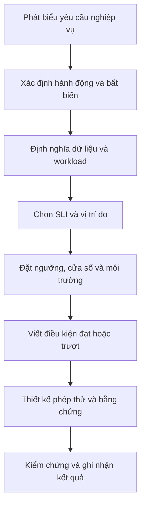
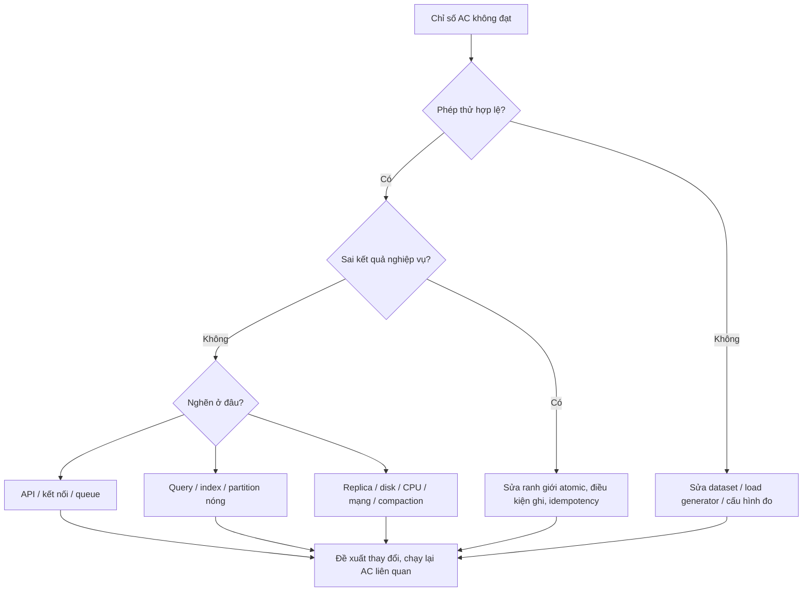

# Chuyển yêu cầu thành tiêu chí đo lường và điều kiện nghiệm thu

Khi thiết kế hệ thống dùng cơ sở dữ liệu NoSQL, những yêu cầu như “truy vấn nhanh”, “chịu tải cao”, “không mất đơn hàng” hay “đồng bộ gần như tức thời” mới chỉ mô tả **mong muốn**. Chúng chưa đủ để chọn cấu trúc dữ liệu, partition key, chỉ mục, số bản sao, mức nhất quán hay cấu hình cụm. Hai nhóm kỹ sư có thể cùng nói “nhanh” nhưng một nhóm nghĩ đến 100 ms cho một lần đọc theo ID, nhóm khác nghĩ đến 2 giây cho tìm kiếm nhiều điều kiện trên hàng triệu document.

Muốn thiết kế và nghiệm thu có căn cứ, cần chuyển lời mô tả thành một **hợp đồng có thể kiểm chứng**: hệ thống phải làm gì, dưới tải và bộ dữ liệu nào, đo từ đâu, đạt ngưỡng nào, trong bao lâu, sai số và trường hợp lỗi được tính ra sao. Đối với NoSQL, hợp đồng ấy còn phải làm rõ **phạm vi nhất quán, độ trễ sao chép, phân bố khóa và hành vi khi một node hoặc Region gặp sự cố**.

> Ví dụ, thay vì “Đọc sản phẩm phải rất nhanh”, viết: “Tại mức 1.200 yêu cầu xem sản phẩm mỗi giây, trên 4 triệu sản phẩm với phân bố truy cập đã mô tả, độ trễ từ lúc client gửi yêu cầu đến khi nhận đủ phản hồi có p95 ≤ 120 ms trong phép thử tải 60 phút; tỷ lệ lỗi hạ tầng ≤ 0,1%”. Các con số trong bài chỉ là **giả định minh họa cho một hệ thống giả lập**, không phải mức chuẩn áp dụng cho mọi ứng dụng NoSQL.

## 1. Phân biệt yêu cầu, thước đo và điều kiện nghiệm thu

Một chuỗi chuyển đổi đầy đủ gồm các khái niệm sau:

| Khái niệm | Ý nghĩa | Ví dụ |
| --- | --- | --- |
| **Nhu cầu nghiệp vụ** | Kết quả người dùng hay tổ chức muốn đạt được | Người mua nhận được trạng thái đặt hàng đáng tin cậy. |
| **Yêu cầu hệ thống** | Hành vi hoặc ràng buộc mà hệ thống phải đáp ứng | Không được giữ hàng vượt số lượng tồn có thể bán. |
| **SLI** (*Service Level Indicator*) | Đại lượng đo thực tế, kèm điểm đo và cách tính | Tỷ lệ yêu cầu giữ hàng bị lỗi hạ tầng, đo tại API gateway. |
| **SLO** (*Service Level Objective*) | Mục tiêu mong muốn của SLI trong một khoảng đánh giá | Tỷ lệ lỗi hạ tầng dưới 0,1% trong cửa sổ 30 ngày. |
| **SLA** (*Service Level Agreement*) | Cam kết dịch vụ mang tính thỏa thuận, có thể đi kèm trách nhiệm/biện pháp khi vi phạm | Cam kết khả dụng theo hợp đồng với khách hàng. |
| **Tiêu chí nghiệm thu** (*acceptance criterion*) | Điều kiện xác định đạt/không đạt cho một chức năng hoặc đợt triển khai | Thử 10.000 yêu cầu giữ hàng cạnh tranh, không có lần bán vượt tồn, không tạo reservation trùng. |
| **Bằng chứng nghiệm thu** | Dữ liệu và cách tái tạo phép đo | Báo cáo load test, histogram độ trễ, log truy vết, số liệu đối soát bản ghi. |

**SLI** là thứ được đo; **SLO** là đích phải đạt; **điều kiện nghiệm thu** nói rõ bài kiểm tra nào đủ để chấp nhận. Một số SLO về vận hành dài hạn (ví dụ 99,9% khả dụng trong 30 ngày) **không thể chứng minh** chỉ bằng một lần thử tải 60 phút. Với chúng, cần tách kết quả thử nghiệm trước triển khai và số liệu theo dõi trong vận hành.

Một điều kiện nghiệm thu tốt có thể đọc như một câu hoàn chỉnh:

> **Trong** môi trường và bộ dữ liệu xác định, **khi** chạy tình huống/tải xác định, **hệ thống phải** cho kết quả và chỉ số xác định, **được đo bằng** công cụ/phương pháp xác định, **trong** khoảng thời gian xác định; nếu vi phạm điều kiện bắt buộc thì không nghiệm thu.

Để tránh đánh đồng, không nên coi “100% request trả HTTP 200” là dấu hiệu của correctness. Ứng dụng có thể trả `200` khi dữ liệu sai, trả `409` đúng nghiệp vụ khi hết hàng, hoặc trả `202` đúng hợp đồng khi đơn đang xử lý bất đồng bộ. Kết quả cần được phân loại theo **ngữ nghĩa nghiệp vụ**, không chỉ theo mã HTTP.

## 2. Vì sao NoSQL phải định nghĩa workload và kết quả quan sát cụ thể?

NoSQL không phải một nhóm sản phẩm có cùng cách truy cập và cùng mức nhất quán. Với từng hệ, hiệu năng và correctness thay đổi theo mô hình dữ liệu và hình thái tải:

- **Document database:** truy vấn theo ID thường khác xa truy vấn lọc nhiều field, sắp xếp và phân trang. Chỉ mục, kích thước document và việc cập nhật nhiều document quyết định chi phí.
- **Key-value database:** lookup theo key khác với scan; một key có lưu lượng bất thường có thể trở thành điểm nóng dù tổng số request vẫn thấp.
- **Wide-column database:** partition key và clustering key quyết định phân bổ dữ liệu cũng như khả năng thực thi truy vấn; số hàng và kích thước từng partition quan trọng hơn tổng số hàng đơn thuần.
- **Search-oriented store:** ghi thành công và bản mới xuất hiện trong kết quả tìm kiếm có thể xảy ra vào hai thời điểm khác nhau. Nên đo **độ tươi của index** bên cạnh thời gian truy vấn.
- **Hệ phân tán nhiều replica/Region:** thao tác đọc từ leader và follower, đọc nhất quán mạnh và đọc cuối cùng, ghi có các mức xác nhận khác nhau tạo ra độ trễ và hành vi lỗi khác nhau.

Do đó, không thể dùng duy nhất số đo “database đạt 50.000 operations/giây” để quyết định nó đạt yêu cầu. Cần biết **operation nào, trên dữ liệu nào, độ lệch truy cập thế nào, tính đúng đắn nào và ở mức tài nguyên bao nhiêu**.

### Tám chiều của một workload cần làm rõ

| Chiều | Câu hỏi khai thác | Vì sao ảnh hưởng đến nghiệm thu? |
| --- | --- | --- |
| Loại thao tác | Đọc theo khóa, lọc, tìm kiếm, thêm, cập nhật, xóa, batch, transaction? | Không thể gộp latency của các operation khác nhau thành một số chung. |
| Tần suất | Trung bình, đỉnh, burst, chu kỳ theo giờ/ngày? | Năng lực chịu tải đỉnh thường quyết định số node và phân vùng. |
| Tỷ lệ đọc/ghi | Bao nhiêu phần trăm thao tác thuộc mỗi loại? | Index có thể giúp đọc nhưng tăng chi phí ghi và storage. |
| Phân bố khóa | Đều, Zipf, top 1% khóa chiếm phần lớn lưu lượng, khóa tăng tuần tự? | Hot key/partition có thể gây nghẽn dù mức RPS toàn cụm còn thấp. |
| Kích thước | Số bản ghi, dung lượng mỗi bản ghi, độ lớn kết quả, tăng trưởng theo thời gian? | Scan, I/O, bộ nhớ cache và mạng thay đổi theo kích thước thực tế. |
| Phạm vi truy cập | Một partition hay nhiều partition, một Region hay nhiều Region? | Fan-out, coordination và độ trễ liên vùng có thể chi phối p99. |
| Tính nhất quán | Có cần read-your-writes, conditional write, transaction, độ trễ hội tụ giới hạn? | Khả năng trả kết quả nhanh không thay thế correctness. |
| Tình huống lỗi | Timeout, retry, failover, partition mạng, replica lag, sự kiện trùng? | Hệ thống phải có hành vi rõ ràng cả khi không ở trạng thái bình thường. |

## 3. Quy trình chuyển lời yêu cầu thành tiêu chí đo được



### Bước 1 — Ghi yêu cầu bằng ngôn ngữ nghiệp vụ

Giữ nguyên ý định của bên yêu cầu trước khi chọn công nghệ. Ví dụ:

- Khách hàng mở trang chi tiết sản phẩm không phải chờ lâu.
- Khách hàng không thể đặt mua quá số tồn.
- Khi nhân viên sửa mô tả, kết quả tìm kiếm sẽ phản ánh thay đổi đủ sớm.
- Mất một node không làm mất đơn đã xác nhận.

Không diễn giải “không chờ lâu” thành 100 ms hay “đủ sớm” thành 1 giây mà không thống nhất với chủ yêu cầu. Các ngưỡng có thể được đề xuất dựa trên nhu cầu trải nghiệm, số liệu hiện hữu và khả năng chi trả, rồi được chấp nhận như **một quyết định thiết kế có chủ sở hữu**.

### Bước 2 — Xác định đối tượng, thao tác và bất biến

Ví dụ với “không bán vượt tồn kho”:

```text
Thực thể: SKU, tồn kho có thể bán, reservation, đơn hàng.
Thao tác: reserve(sku, quantity, orderId).
Bất biến: available >= 0.
          Mỗi orderId chỉ sinh tối đa một reservation có hiệu lực.
Đường ghi: có thể đồng thời từ nhiều phiên người dùng.
Phản hồi: thành công khi đã giữ hàng theo hợp đồng, nếu không trả
         từ chối hợp lệ; timeout phải có cách tra cứu kết quả.
```

Đây là tiêu chí **đúng/sai tuyệt đối**, không phải một tỷ lệ lỗi nhỏ có thể bỏ qua. Không được biến “không oversell” thành “chỉ oversell dưới 0,1%” khi nghiệp vụ chưa cho phép.

### Bước 3 — Mô tả dữ liệu và mẫu tải

Đặt thông số cho cả hoạt động bình thường lẫn đỉnh: số bản ghi, kích thước phân bố, đường truy cập, quy luật khóa nóng, số client, tần suất cập nhật, kích thước response, batch, background job và thời gian chạy. Cần phân biệt **tải được yêu cầu gửi vào** (*offered load*) với **tải xử lý thành công** (*achieved throughput*). Một hệ có thể giữ latency thấp bằng cách từ chối hoặc rơi bớt yêu cầu; khi đó nó không đáp ứng năng lực mong muốn.

### Bước 4 — Chọn đại lượng và công thức

Mỗi đại lượng phải có đơn vị, điểm bắt đầu/kết thúc, phạm vi mẫu, cách xử lý timeout/retry và cách tổng hợp. Chẳng hạn “p99 latency 200 ms” chưa đủ nếu không nói đo từ client hay từ database và trong điều kiện nào.

### Bước 5 — Đặt ngưỡng, khoảng quan sát và điều kiện áp dụng

Ví dụ: “p95 ≤ 120 ms khi gửi 1.200 request/giây trong 60 phút, sau 10 phút khởi động, với bộ dữ liệu 4 triệu sản phẩm, từ vùng mạng được chỉ định”. Đặc tả nên ghi rõ số liệu dùng để đánh giá **toàn bộ phép thử** và có cần thêm quy tắc cho các cửa sổ thời gian ngắn hay không.

### Bước 6 — Định nghĩa cả tiêu chí loại trừ và cách xử lý sai lệch

Phải chỉ rõ các lỗi khiến phép thử **không hợp lệ** (ví dụ load generator hết CPU hoặc thiếu dữ liệu), và các lỗi khiến kết quả **không đạt** (ví dụ timeout của hệ thống được kiểm thử, vi phạm bất biến). Không loại bỏ những request chậm chỉ để làm đẹp p95/p99.

### Bước 7 — Thiết kế bằng chứng và người phê duyệt

Liên kết từng yêu cầu với phép thử, log/trace, biểu đồ, dữ liệu đối soát và người chấp nhận kết quả. Cần biết một kết quả chưa đạt do yêu cầu quá tham vọng, do thiết kế dữ liệu sai hay do môi trường đo không hợp lệ để quyết định sửa ở đâu.

## 4. Một ví dụ xuyên suốt: hệ thống bán hàng sử dụng NoSQL

Giả sử nhóm dự án cần chọn và cấu hình kho dữ liệu cho danh mục sản phẩm, tồn kho và luồng đặt hàng. Các số liệu sau là **bộ giả định minh họa được thống nhất để viết tiêu chí**, chưa phải dự báo từ sản phẩm thực:

| Thuộc tính workload | Giả định đã thống nhất |
| --- | --- |
| Dữ liệu khởi đầu | 4 triệu sản phẩm; bản ghi sản phẩm trung bình 2 KiB; tồn kho theo SKU lưu riêng. |
| Tăng trưởng | 50% số sản phẩm sau 12 tháng; benchmark thêm tại mức dữ liệu dự kiến khi mở rộng. |
| Vị trí sử dụng | Một Region chính; máy tạo tải đặt trong vùng mạng xác định và báo cáo RTT nền. |
| Phân bố truy cập | 20% SKU phổ biến nhất nhận khoảng 80% lượt xem; bộ dữ liệu có cả key nóng và key lạnh. |
| Loại tải | Xem chi tiết, tìm kiếm sản phẩm, giữ hàng, cập nhật mô tả nền. |
| Kỳ đánh giá latency | Phép thử đỉnh 60 phút, sau 10 phút warm-up riêng. |
| Quy tắc tài nguyên | Giữ nguyên cấu hình cụm, số node, index, replication và giới hạn autoscaling đã ghi trong hồ sơ thử. |

Lưu ý: 4 triệu × 2 KiB xấp xỉ **7,6 GiB dữ liệu sản phẩm thô**, **chưa** tính index, metadata, phân mảnh, replication, bản ghi tồn kho, log và dung lượng tăng trưởng. Không dùng phép nhân kích thước document để công bố ngay nhu cầu disk thực tế; phải đo dung lượng lưu trữ sau khi nạp dữ liệu.

### 4.1. Hồ sơ tải giả định

| Mã thao tác | Hành động | Tải trung bình | Tải đỉnh cần phục vụ | Đặc trưng |
| --- | --- | ---: | ---: | --- |
| `GET_PRODUCT` | Đọc theo product ID | 400 req/s | 1.200 req/s | Đa số key phổ biến nhưng có key lạnh. |
| `SEARCH_PRODUCT` | Lọc/tìm kiếm và phân trang | 100 req/s | 300 req/s | Kết hợp bộ lọc và sắp xếp thực tế. |
| `RESERVE_STOCK` | Giữ hàng theo `orderId` | 40 req/s | 120 req/s | Có tranh chấp cùng SKU, yêu cầu không oversell. |
| `UPDATE_CATALOG` | Cập nhật mô tả, giá | 25 req/s | 75 req/s | Chạy cùng tải đọc; cần đo trễ hiển thị trên search. |

Nếu cả bốn loại cùng chạm đỉnh, **offered load** là 1.695 logical requests/giây. Kế hoạch thử không được chỉ chạy `GET_PRODUCT` ở 1.200 req/s, vì ghi và lập chỉ mục chạy đồng thời có thể khiến kết quả đọc thay đổi. Cũng không được cộng throughput đọc trả từ cache với throughput ghi database rồi công bố đó là năng lực riêng của database.

### 4.2. Chuyển yêu cầu thành ma trận nghiệm thu

| ID | Yêu cầu nghiệp vụ | Chỉ số/điều kiện phải đạt | Bối cảnh, phạm vi và bằng chứng |
| --- | --- | --- | --- |
| `AC-01` | Chi tiết sản phẩm mở nhanh | `GET_PRODUCT` p95 ≤ 120 ms; p99 ≤ 250 ms; tỷ lệ lỗi hạ tầng ≤ 0,1%. | 1.200 req/s trong bài tải hỗn hợp 60 phút; đo end-to-end ở client; histogram và log lỗi. |
| `AC-02` | Tìm kiếm vẫn phản hồi tốt khi có cập nhật | `SEARCH_PRODUCT` p95 ≤ 300 ms; p99 ≤ 600 ms; lỗi hạ tầng ≤ 0,1%. | 300 req/s, bộ filter/sort/page được định nghĩa; đang chạy `UPDATE_CATALOG`; histogram latency. |
| `AC-03` | Sửa sản phẩm sẽ xuất hiện trên tìm kiếm | p99 của độ trễ từ **ghi được xác nhận** đến **search thấy phiên bản mới** ≤ 5 giây. | Tạo các cập nhật có version riêng, truy vấn lặp ở tần suất quan sát cố định; tính trên toàn bộ mẫu cập nhật. |
| `AC-04` | Không bán vượt tồn | Số hàng giữ thành công ≤ lượng ban đầu + nhập thêm − số đã cấp phát; không có `available < 0`. | Chạy nhiều client đồng thời tranh SKU cuối; kiểm tra ledger/reservation sau khi tất cả request kết thúc. |
| `AC-05` | Retry không tạo thêm đơn/giữ hàng | Một `orderId` tạo tối đa một reservation có hiệu lực; retry cùng payload trả về trạng thái nhất quán. | Tiêm timeout/lặp request, đọc lại theo idempotency key; đối soát dữ liệu cuối. |
| `AC-06` | Giữ hàng không quá chậm | `RESERVE_STOCK` p99 ≤ 200 ms ở 120 req/s và lỗi hạ tầng ≤ 0,1%. | Trong tải hỗn hợp, gồm tập SKU phổ biến và tranh chấp; đo tại client, tách từ chối hợp lệ. |
| `AC-07` | Cụm chịu lỗi node theo mức đã cam kết | Không mất ghi đã được xác nhận theo chính sách durability được chọn; dịch vụ phục hồi thao tác ghi trong thời gian quy định riêng. | Kịch bản kill/failover, audit orderId và xác nhận ghi, timeline khôi phục; kết quả phụ thuộc cấu hình replication và write acknowledgement. |
| `AC-08` | Có dư địa tăng trưởng | Dữ liệu ở mức dự kiến 12 tháng vẫn đạt ngưỡng latency và correctness tương ứng. | Nạp dữ liệu dự báo, giữ tỷ lệ truy cập và workload cùng nguyên tắc; chạy lại các phép đo liên quan. |

Các ngưỡng `AC-01` đến `AC-08` là ví dụ về **dạng hợp đồng cần thống nhất**, không phải gợi ý rằng bất kỳ hệ NoSQL nào cũng mặc nhiên đạt được. Các ID cho phép truy từ lời yêu cầu sang kịch bản, kết quả đo, bug và quyết định nghiệm thu.

## 5. Định nghĩa phép đo đủ chính xác để hai nhóm cho cùng kết luận

### 5.1. Độ trễ: đo ở đúng ranh giới

Với API được người dùng gọi, độ trễ end-to-end nên đo từ khi client bắt đầu gửi logical request đến khi nhận đủ phản hồi hoặc kết thúc bằng lỗi/timeout. Độ trễ này có thể gồm mạng, gateway, ứng dụng, database, serialize và cache. Đo lệnh database từ driver đến khi nhận phản hồi cũng hữu ích, nhưng chỉ là **một phần** hành trình.

```text
Client  ── mạng ──>  API  ── driver ──>  NoSQL / replica / index
  |                  |                       |
  |<───── độ trễ end-to-end (SLI) ──────────|
                     |<── DB operation ─────>|  (đo riêng)
```

**p95 = 120 ms** có nghĩa khoảng 95% mẫu độ trễ thuộc tập đo có độ trễ không vượt quá ngưỡng này. **p99** giúp quan sát phần đuôi chậm hơn. Average/mean có thể đẹp dù một nhóm nhỏ người dùng chịu timeout kéo dài. Không được tính trung bình các giá trị p95 của từng node để suy ra p95 của cả hệ thống; cần gộp histogram hoặc dữ liệu mẫu theo phương pháp phù hợp.

Định nghĩa cần thống nhất:

- Đo từ client mô phỏng thực tế hay từ bên trong service; có tính thời gian kết nối, TLS và tải dữ liệu phản hồi không?
- Đo latency theo **logical request** hay từng **attempt** khi retry? Nên báo cả hai; đừng để retry ẩn độ trễ người dùng.
- Timeout là một lần không đạt, không được bỏ khỏi mẫu đánh giá lỗi. Khi tính percentile, phải công bố cách xử lý mẫu bị censor do timeout và đánh giá riêng tỷ lệ timeout.
- Ngưỡng p95/p99 áp dụng toàn 60 phút, theo từng loại request hay theo từng nhóm kích thước? Một truy vấn search trả 10 item không có cùng chi phí với scan nhiều triệu item.
- Có cần bảo vệ chống một cửa sổ 5 phút quá xấu không? Nếu có, bổ sung điều kiện riêng thay vì thay đổi quy tắc sau khi chạy.

### 5.2. Throughput: nhận và xử lý thành công khác nhau

Các khái niệm phải được báo cáo đồng thời:

```text
Offered RPS = logical requests được bắt đầu / số giây của phép thử

Completed RPS = logical requests kết thúc (kể cả lỗi) / số giây

Successful RPS = logical requests đáp ứng đúng hợp đồng / số giây

Infrastructure error ratio
    = logical requests lỗi hạ tầng hoặc timeout / tổng logical requests
```

Ví dụ thiếu chính xác: bộ tạo tải nhắm 1.200 req/s nhưng do nghẽn chỉ thực sự gửi 850 req/s; dashboard server xử lý 845 req/s với p95 = 90 ms. Điều này **không chứng minh** server đáp ứng tải yêu cầu 1.200 req/s. Cần xác nhận offered RPS đã đạt mục tiêu và công cụ tạo tải không phải nút cổ chai.

**Logical request** đại diện một hành động nghiệp vụ; **attempt** đại diện mỗi lần gửi lại tới backend. Nếu một request bị retry ba lần, throughput backend có thể ghi nhận ba attempts, nhưng nó vẫn là **một** yêu cầu nghiệp vụ. Với lệnh ghi, phải đánh giá tác động idempotency cùng với năng lực chịu tải.

### 5.3. Tỷ lệ lỗi: phân loại theo ngữ nghĩa

| Kết quả | Cách phân loại gợi ý | Lý do |
| --- | --- | --- |
| Giữ hàng thành công, tồn kho giảm đúng | Thành công nghiệp vụ | Đạt hợp đồng. |
| Hết hàng và trả trạng thái từ chối đã định nghĩa | Từ chối nghiệp vụ hợp lệ | Không phải hỏng hạ tầng nếu kết quả đúng và kịp thời. |
| Truy vấn timeout hoặc bị mất kết nối | Lỗi hạ tầng/timeout | Tính vào SLI lỗi dù request có thể đã ghi ở server. |
| API trả 200 nhưng `available = -1` | Vi phạm correctness | Không được tính là thành công chỉ dựa vào HTTP status. |
| Retry cùng `orderId` tạo hai reservation | Vi phạm bất biến | Là lỗi nghiêm trọng ngay cả khi cả hai response đều 200. |
| Search trả kết quả cũ trong khoảng trễ đã chấp thuận | Có thể hợp lệ theo hợp đồng freshness | Phải xác minh khoảng trễ, version và SLO đã chọn. |
| Search trả dữ liệu sai sau hạn freshness | Vi phạm freshness | Khác với latency của truy vấn search. |

Không phải mọi phản hồi `4xx` đều là lỗi hệ thống, cũng không phải mọi `2xx` đều đúng. Phải liệt kê trạng thái được xem là hợp lệ **cho từng operation**.

### 5.4. Độ tươi và nhất quán: đo đúng thứ đã hứa

Nếu dùng index cập nhật bất đồng bộ hoặc đọc từ replica, có thể định nghĩa:

```text
Freshness lag của update i
    = thời điểm một đường đọc được chỉ định thấy version i
      - thời điểm update i được xác nhận
```

Một phép thử đo freshness nên gắn `version` hoặc `updatedAt` đáng tin cậy vào dữ liệu, xác nhận thời điểm ghi hoàn tất, truy vấn theo đường đọc muốn nghiệm thu và ghi thời điểm thấy phiên bản mới. Nếu chỉ dùng đồng hồ ở hai máy khác nhau, phải kiểm soát sai lệch đồng hồ; đơn giản hơn, cùng bộ đo điều phối các mốc hoặc ghi rõ giới hạn sai số đồng hồ.

Ví dụ yêu cầu “người sửa hồ sơ nhìn thấy thay đổi ngay” cần diễn tả thành **read-your-writes** trên session/đường đọc được chọn. Nó khác với “mọi client ở mọi Region đều thấy bản mới ngay”. Yêu cầu “chỉ có một người nhận được vé cuối cùng” lại đòi **điều kiện atomic/transaction** bảo vệ cạnh tranh, không thể chỉ nghiệm thu bằng p99 latency.

### 5.5. Độ sẵn sàng, phục hồi và độ bền

Các chỉ số thường gặp:

- **Availability:** tỷ lệ request hợp lệ được phục vụ theo hợp đồng trong cửa sổ đo; phải nêu rõ probe hoặc traffic nào được tính, loại trừ thời gian nào (nếu có) và cách xử lý lỗi phụ thuộc.
- **RTO** (*Recovery Time Objective*): thời gian mục tiêu để dịch vụ trở lại mức chức năng chấp nhận được sau một sự cố được định nghĩa.
- **RPO** (*Recovery Point Objective*): mức mất dữ liệu theo thời gian có thể chấp nhận khi phục hồi; RPO mong muốn bằng 0 đối với những ghi xác nhận cần được xác minh theo cơ chế bền vững cụ thể.
- **Durability of acknowledged writes:** những ghi được xác nhận theo mức nào sẽ còn lại khi node/leader hỏng; phải xét chính sách ghi, số replica, journal/persistence và kiểu sự cố trong phạm vi cam kết.

SLO “99,9% availability trong 30 ngày” là chỉ tiêu vận hành; một phép thử failover vài phút chỉ cung cấp **bằng chứng về một kịch bản phục hồi**, không thể thay thế 30 ngày đo thực tế. RPO/RTO cần có định nghĩa thời điểm bắt đầu, kết thúc và loại sự cố: hỏng node, hỏng disk, mất một Availability Zone hay mất toàn Region là những tình huống khác nhau.

## 6. Viết điều kiện nghiệm thu có thể thực thi

Một cách viết dễ dùng là **Given–When–Then** hoặc bảng kịch bản có input, phép đo, expected result và bằng chứng.

### Kịch bản A — Hiệu năng đọc trong tải hỗn hợp

```gherkin
Feature: Đọc danh mục sản phẩm đáp ứng tải đỉnh

Scenario: Đọc theo productId trong tải bán hàng giả lập
  Given dữ liệu có 4 triệu sản phẩm với phân bố key nóng/lạnh đã chốt
  And chỉ mục, số node, replication và cấu hình cache được ghi nhận
  And workload hỗn hợp chứa GET_PRODUCT 1200 req/s,
      SEARCH_PRODUCT 300 req/s, RESERVE_STOCK 120 req/s,
      UPDATE_CATALOG 75 req/s
  When chạy warm-up 10 phút rồi đo liên tục 60 phút
  Then offered RPS từng loại đạt tải mục tiêu theo dung sai đã công bố
  And GET_PRODUCT có p95 <= 120 ms và p99 <= 250 ms
  And tỷ lệ lỗi hạ tầng của GET_PRODUCT <= 0.1%
  And toàn bộ số liệu, histogram và cấu hình thử được lưu lại
```

Phần “dung sai đã công bố” phải được thay thành một ngưỡng cụ thể trước khi chạy. Ví dụ hợp đồng có thể chấp nhận sai lệch offered load ±2% quanh mức mục tiêu trong khoảng đo; nếu không đạt mức nạp yêu cầu, phép thử không hợp lệ để kết luận đạt throughput.

### Kịch bản B — Không giữ hàng vượt tồn khi nhiều client tranh chấp

```gherkin
Feature: Bảo vệ bất biến tồn kho

Scenario: 200 client cùng đặt SKU cuối với available = 1
  Given SKU-P có available = 1 và không có reservation hiệu lực
  And 200 client có orderId riêng, cùng gửi reserve(SKU-P, 1)
  When mọi request kết thúc hoặc timeout và hệ đã đối soát trạng thái
  Then tổng số reservation hiệu lực cho SKU-P bằng 1
  And available của SKU-P bằng 0
  And không orderId nào có hơn một reservation hiệu lực
  And mọi request không được chấp nhận có lý do/trạng thái phù hợp
```

Kiểm tra phải quan sát **dữ liệu sau cùng và lịch sử thay đổi**, không chỉ đếm phản hồi thành công. Nếu một yêu cầu timeout nhưng thực tế đã giữ hàng, hệ phải có API tra cứu bằng `orderId` để client quyết định có cần retry hay không. Để phát hiện lỗi hiếm gặp, lặp kịch bản nhiều lần trên các mẫu SKU và thời điểm tranh chấp khác nhau; không coi một lần chạy thành công là chứng minh toán học rằng mọi interleaving đều an toàn.

### Kịch bản C — Dữ liệu cập nhật được tìm thấy trong thời gian cho phép

```gherkin
Feature: Độ tươi của chỉ mục tìm kiếm

Scenario: Cập nhật mô tả sản phẩm trong tải đỉnh
  Given có các sản phẩm với version tăng dần theo từng update
  And luồng tìm kiếm và cập nhật đang chạy cùng tải đã quy định
  When một update được xác nhận thành công
  Then bộ đo ghi thời điểm xác nhận và thời điểm search thấy version mới
  And p99 độ trễ xuất hiện của version mới <= 5 giây
  And không nhầm kết quả cache cũ với version mới
```

Nghiệm thu phải định nghĩa tần suất polling và timeout quan sát. Nếu polling mỗi 2 giây thì phép đo độ tươi dưới 1 giây không đủ độ phân giải; nếu dừng chờ sau 30 giây, các bản cập nhật chưa thấy phải được báo cáo như vi phạm hoặc timeout, không âm thầm loại khỏi mẫu.

## 7. Thiết kế bộ dữ liệu thử đại diện cho thực tế

Tạo 4 triệu document có cùng kích thước, toàn bộ key ngẫu nhiên đều nhau có thể cho kết quả rất khác khi chạy thật. Muốn chỉ số nghiệm thu có ý nghĩa, dữ liệu thử phải giữ các đặc điểm quyết định chi phí truy cập:

1. **Cardinality và phân bố field:** số lượng giá trị khác nhau của category, trạng thái, mã vùng, tag; tỷ lệ field không tồn tại và null. Các điều kiện lọc hiếm/phổ biến có selectivity khác nhau.
2. **Kích thước bản ghi:** trung vị, p95, bản ghi rất lớn, array có nhiều phần tử; đo cả kích thước kết quả và số trang trả về.
3. **Phân bố khóa nóng:** tỉ lệ truy cập top SKU hoặc top tenant; có thể sinh phân bố Zipf hoặc dùng trace đã ẩn danh phù hợp.
4. **Tăng trưởng dữ liệu:** trạng thái khởi đầu, dự báo 12 tháng, dữ liệu lịch sử không còn nóng và dữ liệu mới tập trung ở một dải key.
5. **Trạng thái chỉ mục:** index đã build hoàn tất, thống kê liên quan đã cập nhật; cần kiểm tra chi phí update khi vừa ghi vừa search.
6. **Biến động nền:** TTL, compaction, GC, rebalancing, snapshot/backup, index refresh và background jobs nếu chúng có mặt trong vận hành dự kiến.
7. **Tỷ lệ cache:** đo warm cache trong chuỗi lưu lượng ổn định và một kịch bản cold/partially cold nếu việc khởi động, failover hay đổi tập key có thể gây cache miss tăng đột ngột.
8. **Dữ liệu phân vùng:** số partition, kích thước lớn/nhỏ và số key cùng chạm một partition; kiểm tra phân bổ thực tế sau nạp.

Đối với hệ đa tenant, phải thử cả tenant lớn nhất/nhóm tenant nhiều hoạt động nhất nếu ranh giới phân vùng hay quota phụ thuộc tenant. Trung bình trên hàng trăm tenant nhỏ có thể che mất việc một tenant lớn bị nghẽn.

## 8. Kế hoạch đo: phép thử nào cho bằng chứng gì?

Không có một loại benchmark duy nhất chứng minh mọi yêu cầu. Bộ nghiệm thu nên phối hợp những phép thử có mục tiêu riêng:

| Loại thử | Mục tiêu | Kết quả chính | Giới hạn của kết luận |
| --- | --- | --- | --- |
| Kiểm tra đúng chức năng | Đúng kết quả dữ liệu, điều kiện ghi, uniqueness, trạng thái | Số vi phạm bất biến, bằng chứng trace/đối soát | Không tự chứng minh chịu tải cao. |
| Load test trạng thái ổn định | Tải mục tiêu với mix và dữ liệu thật | Offered/successful RPS, p95/p99, lỗi, tài nguyên | Không tự chứng minh chịu được đỉnh cực đoan hoặc sự cố. |
| Spike test | Tăng tải đột ngột từ nền lên đỉnh | Latency trong burst, hàng đợi, thời gian hồi phục | Không thay thế soak test dài hạn. |
| Stress test | Tìm ngưỡng suy giảm/quá tải | Điểm gãy, kiểu lỗi, backpressure | Kết quả vượt ngưỡng mục tiêu không mặc nhiên là tiêu chí production. |
| Soak test | Chạy nhiều giờ trong tải ổn định | Memory growth, compaction, disk, p99 trôi theo thời gian | Không thay thế kịch bản crash/failover. |
| Contention test | Nhiều tác vụ tranh một key/partition | Đúng bất biến, retry, throughput theo hot key | Không đại diện toàn bộ traffic mix. |
| Failure injection | Hỏng node/replica, trễ mạng, đứt kết nối | RTO thực nghiệm, ghi xác nhận còn lại, lỗi/timeout | Chỉ chứng minh cho chế độ lỗi và cấu hình đã thử. |
| Consistency/freshness test | Kiểm tra đường đọc và độ trễ hội tụ | Anomaly, stale read, freshness p95/p99 | Chỉ có ý nghĩa với phiên đọc/cấu hình đã xác định. |
| Capacity test | Mức tăng dữ liệu/traffic dự báo | Dung lượng, CPU/memory/I/O/network, latency | Cần mô hình tăng trưởng và chi phí hạ tầng kèm theo. |

Một trình tự hợp lý: chốt hợp đồng → nạp dữ liệu → kiểm tra chức năng/bất biến → chạy baseline → chạy tải hỗn hợp → cạnh tranh/hot key → kiểm tra độ tươi → failover/soak/capacity → tổng hợp kết quả. Khi có số liệu sai hoặc môi trường thay đổi, phải ghi rõ lần chạy nào dùng cấu hình nào; không ghép “p95 tốt nhất” của lần A với “error rate tốt nhất” của lần B làm một kết quả giả.

### Tránh các lỗi làm phép đo vô nghĩa

- Chạy mọi request trên một máy phát tải quá yếu, rồi kết luận backend chậm hoặc backend khỏe mà không đo độ bão hòa của chính máy phát.
- Chỉ báo cáo throughput phía server, bỏ qua request bị từ chối/trượt ở client.
- Chỉ đo lúc cache nóng khi đường vận hành thực tế có nhiều truy cập mới hoặc failover làm cache trống.
- Chạy read-only benchmark rồi dùng kết quả để chứng minh năng lực khi viết và refresh index song song.
- Đặt mọi thao tác vào key khác nhau, bỏ qua tranh chấp tồn kho/hot partition vốn là rủi ro chính.
- Chỉ xem CPU trung bình cụm, bỏ qua một shard/partition nóng ở 100% tài nguyên.
- Bỏ timeout ra khỏi phân tích độ trễ, hoặc đánh đồng mọi `4xx` là lỗi hạ tầng.
- Thay đổi kích thước cụm, index, quorum/read concern trong lúc thử nhưng không ghi phiên bản cấu hình.
- Dùng dữ liệu mẫu nhỏ nằm trọn RAM rồi suy ra hiệu năng khi dữ liệu vượt RAM và phải đọc disk.
- Báo “không có lỗi” chỉ vì log API rỗng mà không đối soát trạng thái thực tế của dữ liệu.

## 9. Mẫu đặc tả tiêu chí nghiệm thu có thể lưu trong dự án

Nhóm có thể lưu mỗi tiêu chí dưới dạng tài liệu hoặc dữ liệu có cấu trúc. Mẫu dưới đây là một *schema minh họa* nhằm thể hiện đủ thông tin, **không phải cấu hình chính thức cho một công cụ benchmark cụ thể**:

```yaml
id: AC-01
title: "Đọc chi tiết sản phẩm tại tải đỉnh"
sourceRequirement: "Trang chi tiết sản phẩm phải phản hồi nhanh"
owner: "Product + Backend + SRE"
operation: GET_PRODUCT
businessSemantics:
  expectedResult: "Trả đúng productId và version dữ liệu phù hợp hợp đồng"
  validBusinessRejects: ["PRODUCT_NOT_FOUND"]

dataset:
  products: 4000000
  avgDocumentSizeKiB: 2
  hotKeyDistribution: "20% SKU nhận 80% lượt xem"
  indexes: "Danh sách index đã khóa trong bản thiết kế"

environment:
  region: "Region thử nghiệm được ghi cụ thể khi thực thi"
  topology: "Ghi số node, shard, replica và vùng đặt client"
  consistency: "Ghi mức đọc và mức xác nhận ghi thực dùng"
  cacheState: "Warm sau 10 phút nạp tải"

traffic:
  workload: "Hỗn hợp GET_PRODUCT, SEARCH_PRODUCT, RESERVE_STOCK, UPDATE_CATALOG"
  targetOfferedRps: 1200
  offeredRpsTolerancePercent: 2
  warmupMinutes: 10
  measurementMinutes: 60

indicators:
  latency:
    boundary: "Client logical request đến khi kết thúc phản hồi"
    p95MsMax: 120
    p99MsMax: 250
  infrastructureErrorRatioMax: 0.001
  correctness: "Không trả nhầm productId/version theo hợp đồng đọc"

evidence:
  - "Báo cáo RPS offered/completed/successful theo từng loại"
  - "Histogram latency có metadata cửa sổ đo"
  - "Log timeout, phân loại lỗi, thông tin retry"
  - "Cấu hình cụm, index, dữ liệu seed và commit bản ứng dụng"
passRule: "Đạt tất cả ngưỡng và không vi phạm correctness; phép thử phải hợp lệ"
```

Khi sử dụng thật, phần `topology`, `consistency`, `indexes`, `region` phải điền giá trị cụ thể, không để nguyên câu hướng dẫn. Có thể mã hóa cùng thông tin vào test automation, nhưng giữ một bản hợp đồng dễ đọc giúp Product, Backend, Data và SRE cùng phê duyệt.

## 10. Mã giả để đo request và lưu bằng chứng

Một bộ tạo tải cần ghi thời điểm trước/sau mỗi **logical request**, loại thao tác, payload group, retry attempts, mã phản hồi, kết quả nghiệp vụ và latency. Mã giả dưới đây chỉ minh họa trách nhiệm đo, không gắn với MongoDB, DynamoDB hoặc driver cụ thể:

```javascript
async function runLogicalRequest(operation, payload, requestId) {
  const startedAt = monotonicNow();
  let attempts = 0;
  let finalOutcome;

  try {
    // executor gồm timeout, retry policy và phân loại phản hồi được công bố.
    // Retry của lệnh ghi phải dùng cùng requestId/idempotency key.
    finalOutcome = await executeWithDeclaredRetryPolicy({
      operation,
      payload,
      requestId,
      onAttempt: () => { attempts += 1; }
    });
  } catch (error) {
    finalOutcome = classifyFailure(error); // timeout/transport/unknown result...
  }

  const elapsedMs = monotonicNow() - startedAt;
  recordLogicalRequest({
    operation,
    requestId,
    elapsedMs,
    attempts,
    outcome: finalOutcome.category,
    businessValid: finalOutcome.businessValid
  });
}
```

`monotonicNow()` đại diện đồng hồ đơn điệu phù hợp để đo khoảng thời gian. Những hàm như `executeWithDeclaredRetryPolicy` và `recordLogicalRequest` là placeholder phải được triển khai trong công cụ thực. Đo ở logical request giúp tránh việc ba attempts do retry bị diễn giải thành ba khách hàng mua hàng; có thể báo riêng latency/throughput ở cấp attempt để phân tích chi phí backend.

Với phép thử correctness, ngoài request log còn cần truy vấn/đối soát dữ liệu cuối cùng:

```text
acceptedReservations = đếm reservation còn hiệu lực cho SKU
remainingStock = số tồn có thể bán
totalStock = số tồn ban đầu + số nhập thêm - số cấp phát ngoài thử

Điều kiện không oversell:
    acceptedReservations + remainingStock <= totalStock

Điều kiện idempotency:
    count(reservation hiệu lực theo từng orderId) <= 1

Điều kiện nghiệp vụ khác (nếu không có hủy/hoàn/giữ hàng ngoài bài thử):
    acceptedReservations + remainingStock == totalStock
```

Phải định nghĩa `effective reservation`, `cấp phát ngoài thử`, thời điểm ảnh chụp dữ liệu và các luồng giữ/hoàn hàng. Nếu hệ thống có bước tự giải phóng reservation hết hạn thì phương trình đối soát phải tính đúng các chuyển trạng thái đó; một phép đếm thiếu ngữ cảnh có thể cho báo động giả.

## 11. Nghiệm thu còn cần ngân sách tài nguyên và chi phí

Hai cấu hình đều đạt 120 ms p95 nhưng một cấu hình dùng gấp 8 lần tài nguyên có thể không phù hợp. Chất lượng đáp ứng của database cần được đánh giá theo **các ràng buộc về năng lực vận hành**, không chỉ latency:

| Ràng buộc | Cách chuyển thành tiêu chí |
| --- | --- |
| CPU, RAM, disk I/O | Giới hạn tài nguyên theo node và toàn cụm trong bài tải; quan sát shard nóng, GC/compaction. |
| Sức chứa | Tổng dung lượng dữ liệu + index + replica + headroom tại mức 12 tháng; kiểm tra disk utilization sau nạp thật. |
| Lưu lượng mạng | Băng thông theo node, liên AZ/Region, kích thước request/response; kiểm tra khi replication bận. |
| Khả năng mở rộng | Đạt bộ chỉ số sau khi dữ liệu hoặc lưu lượng tăng theo mức dự báo; ghi rõ có thêm node hay không. |
| Chi phí | Tổng chi phí ước tính/đơn vị tải và kỳ sử dụng, bao gồm compute, storage, I/O, backup và traffic liên vùng khi có. |
| Vận hành | Thời gian phục hồi sau failover, quan sát lỗi, khả năng replay/reconciliation và cảnh báo backlog. |

Ví dụ một tiêu chí chi phí có thể ghi: “Trong phương án triển khai được phê duyệt, đạt `AC-01`…`AC-08` ở mức chi phí vận hành tháng không vượt ngân sách đã duyệt”. Ngân sách phải có đơn vị tiền tệ, kỳ đo, giả định lưu lượng và điều kiện tính giá cụ thể. Không thể suy ra một mức giá đúng từ con số RPS nếu chưa biết dịch vụ, Region, kiểu lưu trữ, replication và lưu lượng chuyển dữ liệu.

**Headroom** cũng phải có tiêu chí. Cụm chạy 99% CPU mà vừa đủ đạt p95 trong 30 phút có thể không chịu được burst, compaction hay failover; lựa chọn ngưỡng headroom phải phản ánh đỉnh tải và số node còn lại khi hỏng, rồi được đưa thành phép đo riêng.

## 12. Từ báo cáo thử nghiệm đến quyết định nghiệm thu

Sau mỗi lần thử, hồ sơ kết quả nên chỉ ra được *cái gì đã chạy* và *vì sao được chấp nhận*:

| Trường trong báo cáo | Nội dung tối thiểu |
| --- | --- |
| Build và dữ liệu | Commit ứng dụng, phiên bản database/driver, dataset seed/version, số document, kích thước và phân bố dữ liệu. |
| Cấu hình hệ thống | Số node/shard/replica, Region, index, cache, consistency/read-write settings, autoscaling và quota. |
| Kịch bản đo | ID `AC-*`, offered workload từng loại, số client, thời gian warm-up/đo, kịch bản lỗi. |
| Kết quả | Offered/completed/successful RPS, p50/p95/p99, timeout, lỗi phân loại, correctness violations và các số đo tài nguyên. |
| Tính hợp lệ | Công cụ tạo tải có đạt tải? Đồng hồ và mạng có ổn định? Dữ liệu, index, cấu hình có đúng? |
| Kết luận từng AC | `PASS`, `FAIL` hoặc `INVALID/NOT_TESTED` với bằng chứng tương ứng. |
| Quyết định | Ai đồng ý nghiệm thu, ngày phê duyệt và các điều kiện/bất cập đã được xử lý hay ghi nhận. |

Mỗi tiêu chí phải có kết quả độc lập. Nếu latency đạt nhưng bất biến tồn kho bị vi phạm, nghiệm thu chức năng giữ hàng **thất bại**; không được lấy throughput tốt để bù trừ lỗi correctness. Nếu công cụ không đạt tải phát hoặc dùng sai dataset, kết quả **không hợp lệ** cho phép thử đó; nó không phải bằng chứng hệ thống đã đạt hoặc trượt ngưỡng khi được nạp đúng tải.

### Phân biệt ba loại phát hiện

**(1) Yêu cầu chưa đủ rõ:** “Trả kết quả mới nhất” nhưng chưa nói mới nhất ở primary, mọi replica hay index search. Cần làm rõ hợp đồng trước khi quyết định đạt/trượt.

**(2) Yêu cầu rõ, thiết kế chưa đáp ứng:** Ví dụ yêu cầu read-your-writes ngay sau khi cập nhật, nhưng API đọc qua replica eventual và trả bản cũ. Cần thay đổi đường đọc/cấu hình/thiết kế hoặc được chủ yêu cầu chấp thuận sửa tiêu chí.

**(3) Thiết kế có thể đúng, phép thử không hợp lệ:** Dataset nằm trọn bộ nhớ, thiếu hot key, load generator bị nghẽn hoặc chưa dựng xong index. Cần sửa phép đo rồi thực hiện lại, không thay đổi số liệu theo ý muốn.

### Cách phân tích nguyên nhân khi một chỉ số không đạt



Nếu cần điều chỉnh ngưỡng vì chi phí hoặc đặc điểm sản phẩm thực tế, phải **thay đổi hợp đồng và ghi quyết định** trước khi coi ngưỡng mới là điều kiện nghiệm thu. Việc thấy kết quả p95 = 170 ms rồi âm thầm đổi mục tiêu từ 120 thành 180 ms khiến phép nghiệm thu mất ý nghĩa.

## 13. Mẫu câu hỏi dùng trong buổi chốt yêu cầu

Khi trao đổi giữa Product, Backend, Data và SRE, có thể hỏi theo thứ tự:

1. **Ai thực hiện hành động nào?** Truy vấn theo ID, lọc nhiều điều kiện, ghi một bản ghi, ghi nhiều bản ghi hay tìm kiếm full-text?
2. **Điều kiện nào không được phép sai?** Không oversell, không trùng thanh toán, không mất giao dịch đã xác nhận, hay chỉ cần dữ liệu hội tụ sau một khoảng chấp nhận được?
3. **Đỉnh tải bao nhiêu, kéo dài bao lâu và đến theo hình gì?** Lưu lượng ổn định, spike, burst hoặc hot key từ chương trình khuyến mãi?
4. **Dữ liệu như thế nào?** Số document, kích thước, tốc độ tăng, phân bố khóa, tỷ lệ cache và mức độ chọn lọc của truy vấn?
5. **Đo từ đâu và bao gồm gì?** Từ client đến phản hồi cuối, riêng database, hay từ ghi xong đến index được nhìn thấy?
6. **Thế nào được xem là thành công và thất bại?** Business reject, timeout, retry, kết quả cũ và mốc xác nhận ghi được phân loại ra sao?
7. **Vùng lỗi nào phải chịu được?** Mất một node, một AZ hay cả Region; mất dữ liệu và thời gian phục hồi được phép là bao nhiêu?
8. **Có ràng buộc tài nguyên/chi phí không?** Bao nhiêu node, ngân sách, headroom và công suất trong giai đoạn tăng trưởng?
9. **Ai nhận kết quả và chứng cứ nào đủ tin cậy?** Load test, log, audit dữ liệu, failure drill hay quan sát SLO dài hạn?

Khi các câu trả lời đã được đưa vào ma trận `Requirement → SLI → Workload → Threshold → Test → Evidence → Decision`, nhóm phát triển có thể lựa chọn NoSQL dựa trên mục tiêu đã thống nhất và kiểm chứng bằng dữ liệu thực nghiệm, thay vì dựa vào khẩu hiệu “mở rộng ngang”, “nhanh” hoặc “nhất quán”.

## Kết luận

**Yêu cầu chỉ trở thành điều kiện nghiệm thu khi có đối tượng, đại lượng, đơn vị, ngưỡng, thời gian, tải, dữ liệu, môi trường và cách xác minh rõ ràng.** Với NoSQL, phải bổ sung mô hình truy cập, phân vùng, replica, mức nhất quán, độ trễ hội tụ và kịch bản lỗi. Những tiêu chí này giúp trả lời đồng thời hai câu hỏi: **hệ có trả lời đủ nhanh dưới tải thực tế không, và kết quả có còn đúng khi dữ liệu hoặc hệ thống chịu cạnh tranh và sự cố không?**
