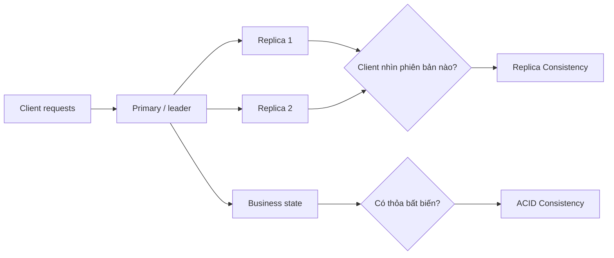

# Phân biệt nhất quán bản sao với tính nhất quán nghiệp vụ trong ACID

Trong một hệ thống NoSQL phân tán, từ **“nhất quán” (consistency)** thường được dùng để nói về hai vấn đề **khác nhau**:

1. **Nhất quán bản sao (replica consistency):** khi dữ liệu được lưu ở nhiều node/replica, **node nào đã nhìn thấy phiên bản nào, theo thứ tự nào và vào thời điểm nào**?
2. **Tính nhất quán trong ACID (ACID Consistency):** sau một giao dịch hợp lệ, **trạng thái dữ liệu có tiếp tục thỏa các ràng buộc và bất biến nghiệp vụ không**?

Ví dụ, một khách hàng vừa cập nhật địa chỉ giao hàng, nhưng lần tải trang tiếp theo đọc từ một replica bị trễ vẫn trả địa chỉ cũ. Đó chủ yếu là vấn đề **dữ liệu được nhìn thấy trên bản sao**. Trái lại, hai người cùng đặt chỗ cuối cùng trên một chuyến xe, hệ thống xác nhận cả hai đặt thành công mặc dù chỉ còn một ghế: đây là vấn đề **bất biến nghiệp vụ**. Tăng số replica hoặc chuyển một truy vấn thành “đọc majority” không tự sửa được mọi lỗi đặt chỗ.

Hai nghĩa của consistency xuất hiện đồng thời trong NoSQL vì một ứng dụng thường có **nhiều bản sao, nhiều document, nhiều request và nhiều dịch vụ**. Hiểu đúng từng trục giúp chọn read/write concern, isolation, transaction, conditional write và chiến lược kiểm chứng phù hợp.

Bài này xây dựng mô hình tư duy, dùng ví dụ giỏ hàng, tồn kho, đặt chỗ và sổ cái, đồng thời minh họa với MongoDB và đối chiếu DynamoDB, Cassandra, Redis. Mục tiêu không phải tìm một mức “consistency mạnh nhất” cho mọi trường hợp, mà là **xác định chính xác điều kiện đúng mà nghiệp vụ cần**.

---

## 1. Hai câu hỏi “nhất quán” cần tách ngay từ đầu

| Tiêu chí | Nhất quán bản sao | Nhất quán nghiệp vụ trong ACID |
| --- | --- | --- |
| **Câu hỏi chính** | Các replica có cùng nhìn thấy phiên bản/thứ tự ghi không? | Dữ liệu có thỏa quy tắc nghiệp vụ sau giao dịch không? |
| **Đối tượng** | Node, replica, phiên bản, client session, thứ tự đọc/ghi | Document, đơn hàng, tài khoản, tồn kho, khóa duy nhất, quan hệ |
| **Ví dụ lỗi** | Vừa cập nhật tên nhưng secondary trả tên cũ | Đã bán 11 vé dù chỉ có 10 ghế |
| **Đơn vị bảo đảm** | Có thể theo key, session, phân vùng, request hoặc toàn hệ | Theo những bất biến và phạm vi giao dịch được thiết kế |
| **Cơ chế thường gặp** | Replication protocol, quorum, read/write concern, session guarantees | Validation, unique/conditional write, transaction, isolation, guard, ledger |
| **Mối quan tâm vận hành** | Replication lag, stale reads, failover, rollback, read-after-write | Conflict, constraint violation, write skew, lỗi nghiệp vụ, retry |
| **Kết quả mong muốn** | Đọc/ghi có thứ tự và độ tươi đúng hợp đồng | Mọi trạng thái được chấp nhận đều hợp lệ theo nghiệp vụ |

**Đừng thay thế một cột bằng cột còn lại.** Chọn majority write concern có thể thay đổi xác nhận của bản sao, nhưng **không tự tạo điều kiện “số ghế còn lại không âm”**. Ngược lại, cập nhật tồn kho nguyên tử tại primary có thể bảo vệ số ghế nhưng **không khiến mọi secondary thấy thay đổi ngay lập tức**.

### 1.1. Một sơ đồ hai trục



Nhánh **replica consistency** nói về bản sao, khả năng đọc và thứ tự quan sát. Nhánh **ACID Consistency** nói về tính hợp lệ của trạng thái khi các thao tác được chấp nhận.

---

## 2. “Consistency” trong ACID thực sự có nghĩa gì?

ACID gồm bốn thuộc tính:

| Thuộc tính | Ý nghĩa | Không đồng nghĩa |
| --- | --- | --- |
| **Atomicity** | Những thay đổi thuộc một transaction cùng commit hoặc cùng abort trong phạm vi hỗ trợ | Không có nghĩa transaction tự đúng nghiệp vụ |
| **Consistency** | Transaction hợp lệ đưa trạng thái hợp lệ sang trạng thái hợp lệ, bảo toàn những bất biến đã được xác định và thực thi | Không có nghĩa mọi replica lập tức giống nhau |
| **Isolation** | Các transaction đồng thời được quan sát/tương tác thế nào | Không có nghĩa mọi mức isolation đều serializable |
| **Durability** | Sau commit, dữ liệu sống sót qua loại sự cố được cam kết | Không có nghĩa mọi client đọc ngay phiên bản mới |

Trong diễn đạt lý thuyết: nếu trạng thái trước giao dịch thỏa các bất biến và transaction được thực hiện theo những quy tắc cần thiết, thì trạng thái commit phải tiếp tục thỏa chúng.

**Điều kiện quan trọng:** database **không thể tự đoán hết quy tắc nghiệp vụ**. Nếu ứng dụng không khai báo, không kiểm tra, hoặc kiểm tra sai thời điểm một bất biến, việc gọi transaction không tự làm bất biến được bảo toàn.

### 2.1. Bất biến nghiệp vụ là gì?

Bất biến (*invariant*) là điều kiện phải đúng với mọi trạng thái được hệ thống chấp nhận ở những ranh giới xác định.

Ví dụ:

- **Tồn kho:** `availableStock >= 0`.
- **Đặt ghế:** một ghế không thuộc quá một đặt chỗ đã được xác nhận.
- **Định danh:** trong cùng tenant, hai tài khoản đang hoạt động không có cùng email chuẩn hóa nếu chính sách cấm.
- **Sổ cái:** tổng số tiền ghi Nợ bằng tổng số tiền ghi Có của một bút toán đã ghi nhận.
- **Hóa đơn:** tổng tiền bằng tổng những dòng tiền hợp lệ cộng thuế/phí theo quy tắc tính.
- **Quan hệ:** không xác nhận đơn hàng nếu reservation bắt buộc không tồn tại.
- **Trạng thái:** một đơn `CANCELLED` không được chuyển thẳng sang `SHIPPED` nếu workflow cấm.

Một số bất biến nằm trong **một document**; một số trải trên **nhiều document**, **nhiều partition** hoặc **nhiều dịch vụ**. Cách bảo vệ vì thế khác nhau.

### 2.2. Ai thực thi bất biến?

| Tầng | Loại quy tắc có thể bảo vệ | Giới hạn |
| --- | --- | --- |
| Schema validator | Kiểu dữ liệu, trường bắt buộc, một số điều kiện nội bộ document | Không tự bảo vệ mọi quan hệ nhiều document |
| Unique index | Tính duy nhất của những key thuộc phạm vi index | Chỉ bảo vệ ràng buộc được định nghĩa |
| Atomic conditional update | Điều kiện và cập nhật trên một record/document | Không tự kiểm tra dữ liệu ở collection khác |
| Transaction + isolation phù hợp | Ràng buộc nhiều thay đổi trong cùng phạm vi giao dịch | Snapshot isolation vẫn có thể gặp write skew |
| Application/service logic | Chính sách và state machine đặc thù | Dễ có race nếu chỉ read-check-write không có guard |
| Ledger/reservation/outbox | Bất biến và trạng thái cho quy trình nhiều bước | Cần thiết kế retry, bù trừ và đối soát |

ACID Consistency là **mục tiêu của toàn bộ hệ thống giao dịch và quy tắc được thực thi**, không đơn thuần là một flag cấu hình.

### 2.3. Có transaction vẫn có thể commit dữ liệu sai

Giả sử transaction thực hiện:

```text
BEGIN
  Đọc số ghế còn lại: 0
  INSERT booking(status=CONFIRMED)
COMMIT
```

Nếu transaction không kiểm tra `remainingSeats >= 1` hoặc không có unique/conditional guard tương ứng, database có thể commit thao tác insert một cách nguyên tử và bền vững, nhưng trạng thái **sai quy tắc kinh doanh**.

Transaction **không đọc ý nghĩ của người thiết kế**.

---

## 3. Nhất quán bản sao giải quyết chuyện gì?

Trong hệ phân tán, một thực thể có thể được lưu trên nhiều node:

```text
                  Write: status=PAID
                           |
                           v
                     Primary (A)
                      status=PAID
                       /      \
           replication        replication
                    /          \
                   v            v
             Replica B       Replica C
             status=PAID     status=PENDING
                             (chưa bắt kịp)
```

Nếu một request đọc A hoặc B, nó thấy `PAID`; đọc C, nó có thể thấy `PENDING`, tùy read model và mức bảo đảm. Dữ liệu trên C không nhất thiết “hỏng”; nó có thể chỉ **chưa nhận bản cập nhật mới**.

Nhất quán bản sao nghiên cứu:

1. **Thứ tự:** các node áp dụng những write theo thứ tự nào?
2. **Khả năng nhìn thấy:** sau khi write hoàn tất, read nào được phép thấy version cũ?
3. **Độ trễ:** replica cần bao lâu để bắt kịp?
4. **Sự cố:** khi primary chết, bản ghi nào có thể được leader mới nhìn thấy?
5. **Mối quan hệ nhân quả:** nếu thao tác B phụ thuộc A, client có nhìn B trước A không?
6. **Mô hình client:** một client có bị đọc “lùi” từ version mới về version cũ không?

Những câu hỏi này **không tự động chứa bất biến “số ghế không âm”**.

### 3.1. Replica nhất quán không bắt buộc bằng nhau ở mọi thời điểm

Trong mô hình *eventual consistency*, các replica có thể tạm thời khác nhau. Khi không còn cập nhật mới, lỗi được xử lý và các điều kiện hội tụ được thỏa, chúng **tiến tới cùng một trạng thái theo quy tắc hòa giải của hệ**.

Sự hội tụ có thể yêu cầu network hoạt động trở lại, repair/anti-entropy hoàn tất, không còn xung đột chưa xử lý và cơ chế giải quyết conflict phù hợp.

**Eventual consistency không hứa mọi lần đọc đều mới**, không hứa hội tụ trong đúng N mili-giây nếu dịch vụ không có SLO riêng, và không bảo đảm dữ liệu hội tụ là **đúng nghiệp vụ**.

### 3.2. Linearizable consistency: một dạng bảo đảm mạnh về quan sát

Một mô hình **linearizable** yêu cầu mỗi thao tác có vẻ xảy ra tại một điểm nguyên tử giữa lúc bắt đầu và hoàn tất, đồng thời tôn trọng thứ tự thời gian thực: nếu write W đã hoàn tất trước khi read R bắt đầu, R phải phản ánh W hoặc một write muộn hơn theo lịch hợp lệ.

Ví dụ một register/key:

```text
W: SET status=PAID -------- ACK
                              |
                              v
                          R bắt đầu
                          GET status
```

Nếu operation trên key thực sự **linearizable** trong phạm vi được cam kết, R không được trả giá trị cũ `PENDING` chỉ vì replica được chọn bị trễ.

Tuy nhiên, **linearizable read/write trên từng key không tự biến một quy tắc trải trên hai key thành một transaction serializable**. Đó vẫn là bài toán bảo vệ bất biến nhiều đối tượng.

---

## 4. Những mô hình nhất quán bản sao thường gặp

| Mô hình | Khái niệm cơ bản | Tình huống |
| --- | --- | --- |
| **Eventual consistency** | Replica có thể tạm thời lệch, hội tụ khi điều kiện phù hợp | Feed, cache, dữ liệu ít ràng buộc tức thì |
| **Strong/linearizable theo đối tượng** | Read theo bảo đảm quan sát write đã hoàn tất trong thứ tự thời gian thực | Trạng thái khóa/lease, dữ liệu cần quyết định tức thì |
| **Sequential consistency** | Các thao tác có vẻ theo một thứ tự chung giữ thứ tự chương trình từng client, nhưng không bắt buộc tôn trọng toàn bộ thời gian thực | Mô hình lý thuyết của bộ nhớ phân tán |
| **Causal consistency** | Các thao tác có quan hệ nhân quả được nhìn theo thứ tự phù hợp | Bình luận phải theo sau bài gốc |
| **Read-your-writes (session)** | Client thấy những write của chính client trong phạm vi bảo đảm | Sửa hồ sơ rồi tải lại |
| **Monotonic reads (session)** | Client không nhìn thấy version “lùi” khi đọc liên tiếp | Chuyển đổi giữa các replica |
| **Monotonic writes (session)** | Các write của một client được áp dụng theo thứ tự phù hợp | Cập nhật tuần tự trạng thái |
| **Consistent prefix** | Read không thấy hậu quả sau khi bỏ qua một phần prefix cần thiết của write order | Theo dõi sự kiện có thứ tự |

Các tên gọi có thể khác hoặc không được hỗ trợ như một lựa chọn cấu hình trực tiếp ở từng sản phẩm. Đặc biệt, **“strong consistency”** là từ rộng; muốn thiết kế chính xác cần tìm hợp đồng cụ thể: linearizable, transactional, snapshot, bounded staleness hay bảo đảm khác.

### 4.1. Causal consistency khác ACID Consistency

Một client tạo post P rồi tạo comment C tham chiếu P. Causal consistency giúp tránh việc những quan sát hợp lệ cho thấy C mà chưa thấy điều kiện nhân quả P, trong phạm vi mô hình được hỗ trợ.

Nhưng nếu nghiệp vụ cấm một người dùng bị khóa đăng bài, causal consistency **không tự áp dụng quyền đăng bài**. Quy tắc `user.status == ACTIVE` vẫn phải được xác minh và bảo vệ khỏi race ở nơi có thẩm quyền.

### 4.2. Read-your-writes khác transaction read-your-writes

- **Session read-your-writes:** người dùng vừa sửa hồ sơ, lần đọc tiếp theo trong session thấy giá trị mới theo bảo đảm.
- **Transaction read-your-writes:** một transaction đọc được những thay đổi chưa commit do chính nó thực hiện.

Hai bảo đảm có liên quan về trải nghiệm, nhưng **khác phạm vi và điều kiện thực thi**.

---

## 5. Bốn tổ hợp giúp nhận ra hai trục độc lập

Để phân biệt thật rõ, xét cả **dữ liệu trên replica có đủ mới theo yêu cầu không** và **trạng thái đã commit có đúng nghiệp vụ không**.

| | Bất biến nghiệp vụ đúng | Bất biến nghiệp vụ sai |
| --- | --- | --- |
| **Bản sao thỏa mức nhất quán đọc mong muốn** | Hệ thống đáp ứng cả hai yêu cầu | Các replica thống nhất về một trạng thái **sai** |
| **Bản sao chưa thỏa mức nhất quán đọc mong muốn** | Dữ liệu gốc có thể đúng nhưng client đọc **stale** | Vừa có dữ liệu lệch, vừa sai bất biến |

### 5.1. Replica cũ nhưng nghiệp vụ vẫn đúng

- Primary thực hiện một atomic conditional update giảm tồn kho từ 2 xuống 1.
- Secondary chưa bắt kịp, vẫn hiển thị 2.
- Client đọc secondary thấy 2, tức một giá trị cũ.
- Nếu **mọi quyết định đặt hàng** đều phải qua conditional update trên nguồn có thẩm quyền, không có chuyện hai booking hợp lệ vượt tồn kho chỉ vì màn hình cũ.

Replica có thể **kém tươi** nhưng bất biến vẫn được bảo vệ tại write path.

### 5.2. Replica đồng bộ nhưng nghiệp vụ sai

- Hai request cùng dựa vào snapshot có `doctor-A.onCall=true` và `doctor-B.onCall=true`.
- Mỗi request cho một bác sĩ nghỉ và cả hai được commit.
- Sau replication, **tất cả node đều nhìn A=false, B=false**.

Bản sao có thể hoàn toàn hội tụ, nhưng nghiệp vụ **“ít nhất một bác sĩ trực” đã bị phá**.

### 5.3. Cả hai đều đúng

- Chuyển trạng thái được kiểm tra bằng transaction/guard phù hợp.
- Read dùng hợp đồng mới nhất hoặc session phù hợp.
- Replica/quorum đáp ứng yêu cầu quan sát.
- Bất biến cuối vẫn giữ.

Đây là mục tiêu khi nghiệp vụ vừa cần trạng thái đúng vừa cần dữ liệu mới ngay.

### 5.4. Cả hai đều có vấn đề

- Một service ghi số tồn kho sai vì thiếu điều kiện.
- Một read model còn chậm cập nhật vài giây.
- Người dùng có thể nhìn con số cũ; rồi khi đồng bộ xong lại nhìn con số mới nhưng **vẫn sai nghiệp vụ**.

Chỉ giảm replication lag không giải quyết được lỗi ở write path.

---

## 6. Một ví dụ cụ thể: hết hàng nhưng trang vẫn báo “Còn 1”

Giả sử sản phẩm có `stock=1`. Client A và B cùng xem trang.

```text
T=0: Primary stock=1, Secondary stock=1
T=1: A đọc Secondary: stock=1
T=2: A đặt hàng qua primary, stock 1 -> 0
T=3: Primary commit, Secondary chưa nhận update
T=4: B đọc Secondary: stock=1
T=5: B thử đặt hàng
```

Có hai thiết kế khác nhau.

### Thiết kế A: kiểm tra tồn kho ở nơi ghi

B gửi yêu cầu:

```javascript
db.products.updateOne(
  {
    _id: "sku-bike",
    stock: { $gte: 1 }
  },
  {
    $inc: { stock: -1 }
  }
);
```

Nếu A đã làm stock thành 0, B không khớp điều kiện. Kết quả: **màn hình của B stale, nhưng không oversell**.

### Thiết kế B: tin kết quả màn hình

Ứng dụng B dùng giá trị `stock=1` từ secondary, tự tạo đơn `CONFIRMED` mà không có guard trên nguồn có thẩm quyền. Kết quả: có thể xác nhận đơn vượt hàng.

Ở thiết kế B, **stale read làm lộ một sai sót trong giao thức nghiệp vụ**: quyết định quan trọng dựa vào dữ liệu có thể cũ mà không tái xác nhận. Nhưng gốc lỗi không thể được giải quyết vững chắc bằng cách “đổi mọi read thành majority” nếu còn những race khác.

**Mẫu đúng:** đọc phục vụ hiển thị có thể chấp nhận một mức staleness; thao tác làm thay đổi tài nguyên khan hiếm cần **atomic conditional write hoặc transaction bảo vệ bất biến**.

---

## 7. Tại sao một hệ có dữ liệu đúng vẫn trả trạng thái “nhìn như sai”?

Xét bất biến tổng tài sản:

\[
A + B = 100
\]

Ban đầu A=60, B=40. Một transaction hợp lệ chuyển 10 từ A sang B, commit A=50, B=50.

Nếu ứng dụng đọc A tại bản cũ (60) và B tại bản mới (50), nó cộng được **110**.

```text
Trạng thái S0:  A=60, B=40  -> Tổng=100
Trạng thái S1:  A=50, B=50  -> Tổng=100

Client đọc:     A từ S0 (60)
                B từ S1 (50)
                ----------------
                Tổng quan sát =110
```

**Cả hai trạng thái đã commit đều hợp lệ**, nhưng tổ hợp nhiều lần đọc đến từ những mốc khác nhau làm số liệu hiển thị vi phạm bất biến.

Đây có thể là **read skew / fractured observation**, không chứng minh transaction ghi đã phá quy tắc bảo toàn tổng.

### 7.1. Tách hai câu hỏi khi điều tra

1. **Trạng thái commit thật ở nguồn chân lý có hợp lệ không?**
2. **Các lần đọc đã quan sát cùng một trạng thái logic chưa?**

Đối với báo cáo cần tổng hợp chính xác nhiều document tại cùng mốc, có thể cần **snapshot read** hoặc một read model tính tổng theo giao thức nhất quán. Đổi read concern một cách đơn lẻ chưa chắc bảo đảm **nhiều câu query** thuộc cùng snapshot.

### 7.2. Snapshot cũng không tự bảo đảm business invariant

Một snapshot giúp đọc một ảnh nhất quán, nhưng nó có thể là **ảnh của trạng thái sai do transaction khác đã commit** nếu write path không bảo vệ invariant.

Snapshot giải quyết tính nhất quán của **quan sát**, không tự động tính đúng đắn của **quyết định ghi**.

---

## 8. ACID Isolation liên hệ thế nào với ACID Consistency?

Hai thuộc tính ACID khác nhau nhưng có quan hệ mật thiết.

- **Consistency** là mục tiêu: trạng thái sau commit thỏa bất biến.
- **Isolation** cung cấp những bảo đảm về lịch đồng thời để việc kiểm tra bất biến không bị phá bởi race.
- **Atomicity** giúp không chỉ commit một nửa thay đổi bắt buộc.
- **Durability** đảm bảo trạng thái commit không biến mất trong phạm vi sự cố cam kết.

### 8.1. Transaction nguyên tử nhưng vẫn vi phạm bất biến

Ví dụ cùng một transaction cập nhật giá nhưng quên cập nhật thuế nếu quy tắc yêu cầu phải đồng bộ. Engine commit nguyên tử toàn bộ những lệnh **được gửi**, nhưng ứng dụng đã **thiếu lệnh cần thiết**.

Atomicity không thay thế logic nghiệp vụ.

### 8.2. Snapshot isolation và write skew

Hai bác sĩ cùng trực:

```text
T1 đọc A=true, B=true
T2 đọc A=true, B=true
T1 ghi A=false
T2 ghi B=false
T1 và T2 đều commit nếu không có xung đột thích hợp
```

Hai transaction đều nhìn snapshot nhất quán. Chúng không ghi cùng document; cơ chế chỉ chặn write-write conflict có thể không phát hiện **xung đột qua tập đã đọc**.

Như vậy, có **snapshot isolation** vẫn chưa đồng nghĩa bảo vệ mọi invariant nhiều document.

### 8.3. Serializable khi nào cần?

Một lịch serializable tương đương việc chạy trọn T1 trước T2 hoặc ngược lại. Nếu logic “cho một người nghỉ chỉ khi còn người khác trực” được thực hiện đầy đủ, một lịch tuần tự hợp lệ **không thể** kết thúc với cả A và B nghỉ.

Một số engine hỗ trợ serializable transaction theo phạm vi nhất định; một số khác yêu cầu thiết kế **guard document**, conditional write hoặc đồng bộ nghiệp vụ. Cần dựa vào bảo đảm của engine, không chỉ chữ “transaction”.

---

## 9. Điều gì quyết định replica consistency?

Có ba nhóm yếu tố chính.

### 9.1. Giao thức replication

- **Leader–follower:** writer thường gửi tới leader; follower nhận thay đổi sau.
- **Multi-leader:** nhiều nơi nhận ghi; cần xác định xung đột và hội tụ.
- **Leaderless / quorum-oriented:** nhiều replica tham gia đọc/ghi; cần reconciliation, version và chính sách conflict resolution.

Tên mô hình không đủ để biết mọi read có mới hay không. Ví dụ leader–follower có thể phục vụ đọc từ follower trễ; một hệ quorum cũng có thể trả dữ liệu không mới nếu điều kiện giao thức và triển khai không đủ.

### 9.2. Mức xác nhận của write

Write concern/consistency level trả lời câu hỏi: **một lệnh ghi cần bao nhiêu hoặc loại replica nào xác nhận, và xác nhận tới mốc nào?**

Cần phân biệt:

- Replica đã nhận dữ liệu vào RAM.
- Replica đã áp dụng trong bộ nhớ.
- Replica đã lưu journal/WAL bền theo chính sách.
- Replica đã majority-acknowledged hoặc commit theo giao thức.
- Read path đã có thể trả phiên bản đó.

Một câu “hai replica đã ACK” **không tự cho biết** dữ liệu đã được fsync trên cả hai replica hay transaction nghiệp vụ đúng.

### 9.3. Mức đọc

Read concern/consistency level xác định một lần đọc được phép dùng dữ liệu nào, từ node nào hoặc cần xác minh qua bao nhiêu replica.

Ví dụ:

- Đọc một follower gần người dùng để giảm latency nhưng có thể stale.
- Đọc leader/primary với chính sách phù hợp.
- Đọc theo quorum hoặc mô hình linearizable khi sản phẩm hỗ trợ.
- Đọc trong session có causal consistency để giữ read-your-writes theo điều kiện.

**Read policy không tự mang ràng buộc “tồn kho không âm”**. Ràng buộc đó phải được xác lập ở đường ghi và logic giao dịch.

---

## 10. Quorum: công thức giao nhau không phải “bảo hành mọi thứ”

Trong một mô hình quorums lý tưởng, nếu có \(N\) replica, read quorum \(R\) và write quorum \(W\), điều kiện:

\[
R + W > N
\]

giúp bảo đảm một read quorum và một write quorum **có ít nhất một replica chung** trong tập cấu hình giả định.

Ví dụ:

\[
N=3,\quad R=2,\quad W=2 \Rightarrow R+W=4>3
\]

Nhưng không nên kết luận từ đó rằng hệ **đương nhiên linearizable**, **mọi write không bao giờ mất**, hoặc **bất biến nghiệp vụ được bảo vệ**.

### 10.1. Vì sao quorum intersection chưa đủ?

Muốn có bảo đảm về phiên bản mới nhất, còn phải xét:

1. Replica nào tham gia trong membership thực tế.
2. Có sloppy quorum/hinted handoff hoặc dynamic reconfiguration không.
3. Tính thứ tự/version của write; replica chung có trả và ưu tiên phiên bản đúng không.
4. Hai writer đồng thời có thể tạo conflict như thế nào.
5. Read có kiểm tra/repair hoặc commit-index phù hợp không.
6. Failover và journal durability diễn ra ra sao.
7. Hệ có cung cấp một điểm tuyến tính hóa hợp lệ không.

**Công thức là điều kiện giao tập trong mô hình đơn giản**, không thay thế tài liệu consistency protocol của sản phẩm.

### 10.2. Quorum cũng không hiểu quy tắc kinh doanh

Ngay cả nếu mọi read nhìn giá trị mới nhất của một key, hai giao dịch trên **hai key khác nhau** vẫn có thể phá bất biến tổng.

Quorum và linearizability theo key giải quyết **thứ tự quan sát giá trị key**, không tự tạo transaction serializable trên nhiều key.

---

## 11. Ví dụ MongoDB: read concern và write concern

MongoDB thường sử dụng replica set gồm một primary và những secondary. Có một số loại concern cần phân biệt.

| Thiết lập | Tác dụng khái quát | Không tự bảo đảm |
| --- | --- | --- |
| `writeConcern: {w: 1}` | Nhận xác nhận theo primary theo ngữ nghĩa MongoDB | Ghi đã majority-committed hay bất biến nghiệp vụ đúng |
| `writeConcern: {w: "majority"}` | Yêu cầu mức xác nhận majority phù hợp deployment | Mọi secondary cập nhật tức thì; mọi quy tắc business đúng |
| `readConcern: "local"` | Cho phép đọc trạng thái node theo điều kiện cục bộ | Đã majority-committed |
| `readConcern: "majority"` | Đọc dữ liệu theo bảo đảm majority của MongoDB | Một chuỗi nhiều query ngoài transaction cùng snapshot |
| `readConcern: "snapshot"` | Đọc snapshot nhất quán trong phạm vi API hỗ trợ | Serializable transaction mặc định |
| `readConcern: "linearizable"` | Có bảo đảm đọc tuyến tính trong phạm vi được MongoDB hỗ trợ và điều kiện cần thiết | Transaction nhiều document serializable chỉ bằng một read |
| `readPreference: "secondary"` | Chọn secondary cho các read phù hợp | Secondary luôn có giá trị mới nhất |

Cần đọc tài liệu theo **phiên bản và cấu hình đang chạy**: journaling, write concern defaults, topology và read preference có thể ảnh hưởng những bảo đảm cụ thể.

### 11.1. Ví dụ một read có thể stale

Giả sử primary đã commit `status=PAID`, nhưng một secondary còn lưu `PENDING`.

```javascript
// Ví dụ minh họa lựa chọn nơi đọc; cần replica set.
const lab = db.getSiblingDB("nosql_consistency_lab");

// Writer yêu cầu majority acknowledgement.
lab.orders.updateOne(
  { _id: "order-01" },
  { $set: { status: "PAID" } },
  { writeConcern: { w: "majority" } }
);
```

Một client khác sử dụng secondary read preference có thể đọc một secondary chưa bắt kịp theo mức đọc cho phép. **Mức majority của write không có nghĩa mọi secondary đã cập nhật tại cùng một khoảnh khắc**.

Tình huống stale phụ thuộc topology, lịch replication và thời điểm. Không nên viết test **đòi secondary chắc chắn stale** vì trong môi trường thử nhanh, nó có thể đã bắt kịp.

### 11.2. Read concern majority không tự thành một transaction snapshot

Hai lần đọc ngoài transaction:

```javascript
const one = lab.orders.findOne({ _id: "order-01" });

// Một writer khác có thể commit giữa hai lần đọc.

const two = lab.orders.findOne({ _id: "order-01" });
```

Ngay cả khi một mức đọc bảo đảm dữ liệu đã majority-committed, hai câu query ở hai thời điểm **không tự được gắn cùng một snapshot**. Muốn đọc một tập document nhất quán theo một thời điểm, cần dùng cơ chế snapshot/transaction thích hợp.

### 11.3. ACID Consistency cần điều kiện ở đường ghi

Nếu nghiệp vụ cấm số lượng âm:

```javascript
lab.products.updateOne(
  {
    _id: "p1",
    availableStock: { $gte: 1 }
  },
  {
    $inc: { availableStock: -1 }
  },
  {
    writeConcern: { w: "majority" }
  }
);
```

**Hai phần phục vụ hai mục đích:**

- Filter `availableStock >= 1` và atomic update của một document: bảo vệ **bất biến tồn kho cục bộ**.
- `writeConcern: "majority"`: yêu cầu **mức xác nhận ghi trên các replica**.

Nếu bỏ điều kiện và cứ `$inc: -1` với stock=0, majority write concern vẫn có thể xác nhận **một giá trị âm**.

---

## 12. Thực hành MongoDB: dữ liệu đồng bộ nhưng logic vẫn sai

> **Môi trường:** dùng database thử nghiệm riêng. Các lệnh seed dưới đây xóa collection trong database học tập; không chạy trên production.

### 12.1. Tạo sản phẩm và tồn kho

```javascript
const lab = db.getSiblingDB("nosql_consistency_lab");

lab.products.drop();

lab.products.insertOne({
  _id: "p1",
  tenantId: "tenant-a",
  availableStock: 1,
  version: 1
});
```

### 12.2. Lệnh ghi không có guard

```javascript
lab.products.updateOne(
  { _id: "p1" },
  { $inc: { availableStock: -1 } },
  { writeConcern: { w: "majority" } }
);

lab.products.updateOne(
  { _id: "p1" },
  { $inc: { availableStock: -1 } },
  { writeConcern: { w: "majority" } }
);

printjson(lab.products.findOne({ _id: "p1" }));
```

Kết quả logic có thể là `availableStock = -1`.

**Điểm học:** cả hai thao tác có thể đã được xác nhận theo majority, và mọi replica cuối cùng có thể hội tụ về `-1`. Replica consistency không làm giá trị âm trở thành hợp lệ.

### 12.3. Đưa dữ liệu về trạng thái thử nghiệm

```javascript
lab.products.updateOne(
  { _id: "p1" },
  {
    $set: { availableStock: 1, version: 1 }
  }
);
```

### 12.4. Atomic guard ngăn âm

```javascript
function reserveOne(productId) {
  return lab.products.updateOne(
    {
      _id: productId,
      tenantId: "tenant-a",
      availableStock: { $gte: 1 }
    },
    {
      $inc: {
        availableStock: -1,
        version: 1
      }
    },
    {
      writeConcern: { w: "majority" }
    }
  );
}

const first = reserveOne("p1");
const second = reserveOne("p1");

printjson({
  firstMatched: first.matchedCount,
  secondMatched: second.matchedCount,
  product: lab.products.findOne({ _id: "p1" })
});
```

Trong thử nghiệm tuần tự, lần đầu match 1 document, lần hai không match; stock kết thúc bằng 0, không âm.

Khi hai request chạy đồng thời, atomic conditional update trên **cùng document** cũng bảo vệ điều kiện stock không âm theo semantics MongoDB. Tuy nhiên, **retry không idempotent** của yêu cầu đặt hàng vẫn cần operation ID hoặc một transaction/protocol riêng: nếu client timeout sau khi giữ được một đơn vị, nó không nên tùy tiện chạy lại như đơn mới.

### 12.5. Bất biến vẫn phụ thuộc nghiệp vụ

Điều kiện stock không âm là cần thiết nhưng chưa đủ cho hệ đặt hàng đầy đủ. Có thể còn cần:

- Mỗi `orderId` chỉ tạo một reservation.
- Không thanh toán hai lần.
- Không giảm stock nếu order bị hủy trước khi giữ hàng.
- Hoàn stock đúng một lần khi hủy reservation.
- Đồng bộ lịch sử và báo cáo theo quy tắc.

Những điều này có thể trải trên **nhiều document** và đòi transaction/unique key/idempotency.

---

## 13. Thực hành MongoDB: write skew và bất biến nhiều document

Một hệ có thể dùng transaction nhiều document với snapshot isolation. Snapshot cung cấp **góc nhìn nhất quán** nhưng không tự chặn mọi dạng write skew.

### 13.1. Hai bác sĩ cùng trực

```javascript
lab.doctors.drop();

lab.doctors.insertMany([
  { _id: "doctor-A", shiftId: "night-01", onCall: true },
  { _id: "doctor-B", shiftId: "night-01", onCall: true }
]);
```

Quy tắc: trong ca `night-01` phải luôn có ít nhất một bác sĩ trực.

### 13.2. Hai session đọc cùng snapshot logic

Ví dụ dùng `mongosh` và một **replica set/sharded cluster hỗ trợ transaction**, không dùng standalone mongod mặc định.

```javascript
const conn = db.getMongo();

const sa = conn.startSession({ causalConsistency: false });
const sb = conn.startSession({ causalConsistency: false });

sa.startTransaction({
  readConcern: { level: "snapshot" },
  writeConcern: { w: "majority" }
});

sb.startTransaction({
  readConcern: { level: "snapshot" },
  writeConcern: { w: "majority" }
});

const da = sa.getDatabase("nosql_consistency_lab");
const dbb = sb.getDatabase("nosql_consistency_lab");

const seenA = da.doctors.find({
  shiftId: "night-01",
  onCall: true
}).toArray();

const seenB = dbb.doctors.find({
  shiftId: "night-01",
  onCall: true
}).toArray();

print("Session A sees", seenA.length);
print("Session B sees", seenB.length);
```

Hai session cùng đọc `2` trước khi ghi. Mỗi session dựa vào điều kiện “còn một người khác trực”.

### 13.3. Hai session sửa hai document khác nhau

```javascript
if (seenA.length >= 2) {
  da.doctors.updateOne(
    { _id: "doctor-A", onCall: true },
    { $set: { onCall: false } }
  );
}

if (seenB.length >= 2) {
  dbb.doctors.updateOne(
    { _id: "doctor-B", onCall: true },
    { $set: { onCall: false } }
  );
}
```

Nếu hai transaction có thể cùng commit mà không bị một xung đột khác chặn, kết quả là không còn ai trực.

```javascript
try {
  sa.commitTransaction();
  sb.commitTransaction();
} catch (error) {
  print("One transaction aborted/conflicted:", error.message);
  try { sa.abortTransaction(); } catch (_) {}
  try { sb.abortTransaction(); } catch (_) {}
} finally {
  sa.endSession();
  sb.endSession();
}

printjson(
  lab.doctors.find({ shiftId: "night-01" }).toArray()
);
```

**Lưu ý quan trọng:** đây là kịch bản minh họa khả năng của snapshot isolation, không cam kết mọi lần chạy đều commit cả hai. Để test đúng lịch cạnh tranh cần barrier/concurrency control; việc một lần chạy bị abort do nguyên nhân thực thi không chứng minh hệ bảo đảm serializable cho mọi workload.

### 13.4. Vì sao writeConcern majority không khắc phục write skew?

Ngay cả khi mỗi transaction đều yêu cầu majority commit, **majority chỉ yêu cầu mức xác nhận theo protocol**. Nó không làm cho database tự kiểm tra predicate `count(onCall=true)>=1` trên toàn bộ doctor.

**Lỗi là thiếu bảo vệ bất biến giữa hai transaction, không phải thiếu replica.**

---

## 14. Bảo vệ bất biến đa document: bốn hướng thiết kế

### 14.1. Gom trạng thái vào một document

Nếu ca trực có ít người và mức cạnh tranh phù hợp:

```json
{
  "_id": "night-01",
  "onCallDoctors": ["doctor-A", "doctor-B"],
  "version": 7
}
```

Tất cả thao tác thay đổi ca trực cập nhật **cùng document**, với điều kiện sau cập nhật danh sách vẫn còn ít nhất một người. MongoDB có atomicity trên một document, nên đây có thể là ranh giới bảo vệ phù hợp.

Đánh đổi: document có thể thành hot key; vẫn phải thiết kế conditional update và xử lý xung đột đúng.

### 14.2. Guard/version document chung

Giữ doctor riêng, nhưng mọi transaction thay đổi ca trực phải **ghi một guard document**:

```json
{
  "_id": "shift-guard-night-01",
  "revision": 12
}
```

Hai transaction cùng dựa vào revision 12 nhưng đều ghi guard sẽ phát sinh xung đột hoặc điều kiện version thất bại theo semantics của engine. Transaction bị abort phải đọc lại trạng thái và kiểm tra bất biến trước khi retry.

**Chỉ đọc guard không đủ** nếu không có cơ chế ghi/khóa/condition buộc hai quyết định cạnh tranh phải bị phát hiện.

### 14.3. Serializable transaction

Nếu database cung cấp isolation serializable trên đúng phạm vi ràng buộc, có thể yêu cầu nó và xử lý transaction abort/retry.

Không suy rằng “có transaction” nghĩa là **serializable**. Tài liệu có thể chỉ bảo đảm snapshot hoặc conditional atomicity theo partition.

### 14.4. Reservation hoặc service điều phối

Một ứng dụng đặt chỗ có thể dùng `reservation` với unique key `(tripId, seatId)` hoặc một allocator duy nhất cho chuyến đi. Các điều kiện xung đột được bảo vệ ở write path thay vì chỉ dựa vào query “còn ghế”.

Với nguồn tài nguyên khan hiếm, **biến bất biến thành ràng buộc có thể thực thi được** thường đáng tin cậy hơn việc tăng nhất quán bản sao một cách đại trà.

---

## 15. Unique index bảo vệ điều gì mà replication không bảo vệ?

Ví dụ đặt ghế có collection:

```json
{
  "_id": "reservation-01",
  "tripId": "trip-A",
  "seatId": "S12",
  "status": "CONFIRMED"
}
```

Nếu nghiệp vụ cấm hai reservation đã xác nhận cùng `(tripId, seatId)`, cần ràng buộc thực thi.

MongoDB có thể dùng **unique partial index** cho các reservation có trạng thái cần chiếm ghế:

```javascript
db.reservations.createIndex(
  {
    tripId: 1,
    seatId: 1
  },
  {
    unique: true,
    partialFilterExpression: {
      status: "CONFIRMED"
    }
  }
);
```

Khi một reservation được chuyển vào trạng thái `CONFIRMED`, hệ sẽ kiểm tra uniqueness trong phạm vi index.

**Không nên chỉ query trước:** hai client cùng chạy `findOne({tripId,seatId})`, đều thấy “chưa ai đặt”, rồi cùng insert. Dù cả hai đọc từ primary với bảo đảm mạnh, giữa **read và insert** vẫn có race nếu không có unique constraint/atomic operation.

### 15.1. Giới hạn của một unique index

Index chỉ bảo vệ những gì nó mô tả. Có thể còn phải xác định:

- Ghế `S12` có thực sự tồn tại trong chuyến đi không?
- Ghế đã bị vô hiệu hóa hoặc bảo trì chưa?
- Reservation hết hạn có còn chiếm ghế không?
- Trạng thái `HELD` có được phép trùng với `CONFIRMED` không?
- Tenant/trip scope có được đặt đúng không?
- Hành động trả tiền có gắn với reservation đúng ID không?

Những bất biến khác cần được bảo vệ bằng dữ liệu và giao thức riêng.

---

## 16. Sổ cái: ví dụ ràng buộc nghiệp vụ không thể suy từ số replica

Một giao dịch chuyển 100 đơn vị từ A sang B phải duy trì:

\[
A_{\text{after}} + B_{\text{after}}
=
A_{\text{before}} + B_{\text{before}}
\]

Đồng thời, nếu dùng sổ cái kép:

\[
\sum \text{Debit} = \sum \text{Credit}
\]

cho mỗi bút toán đã được xác nhận theo quy tắc của hệ.

### 16.1. Một transaction bị thiết kế thiếu bước

```text
BEGIN
    UPDATE account A: balance -= 100
COMMIT
```

Nếu ứng dụng quên ghi vào B, transaction có thể commit nguyên tử thao tác duy nhất. **Replicate transaction đó sang năm node chỉ tạo năm bản sao của cùng kết quả sai**.

### 16.2. Một transaction ghi hai tài khoản vẫn cần kiểm tra điều kiện

```text
BEGIN
    READ A.balance
    IF A.balance >= 100:
        UPDATE A.balance -= 100
        UPDATE B.balance += 100
COMMIT
```

Trong thực tế cần:

- Isolation/locking/conditional write chống nhiều transfer cạnh tranh.
- Idempotency key để một transfer không được áp dụng hai lần khi retry.
- Phạm vi atomicity phù hợp nếu A và B là hai document.
- Quy tắc xử lý số dư không âm, tiền tệ, precision và làm tròn.
- Ledger/audit để đối soát.

**Atomicity + isolation + logic đúng** cùng bảo vệ nghiệp vụ. **Replication** phục vụ khả năng chịu lỗi và khả năng quan sát theo hợp đồng; nó không thay thế logic chuyển tiền.

### 16.3. Đọc sổ cái có thể bị skew dù dữ liệu commit đúng

Nếu dashboard lấy số dư A ở replica cũ và B ở replica mới, tổng hiển thị có thể sai tạm thời. Để báo cáo nhất quán, dùng snapshot hoặc một projection/sổ cái được tính theo giao thức nhất quán.

Điều này minh họa ba mặt tách biệt:

1. Giao dịch chuyển tiền có đúng không?
2. Giao dịch đó đã bền và được replica nào xác nhận?
3. Dashboard có đọc cùng một snapshot không?

---

## 17. Eventual consistency có thể phù hợp nghiệp vụ nào?

Không phải mọi bất biến đòi trạng thái tức thì giống nhau giữa mọi replica.

### 17.1. Những dữ liệu thường chấp nhận được độ trễ

- Số lượt thích hoặc lượt xem mang tính thống kê.
- Bảng xếp hạng được làm mới định kỳ.
- Search index và autocomplete có thể trễ vài giây nếu chính sách sản phẩm chấp nhận.
- Cache mô tả sản phẩm không quyết định số tồn kho cuối.
- Analytics, báo cáo không yêu cầu real-time.

Trong những tình huống đó, một bản sao cũ có thể ảnh hưởng trải nghiệm, nhưng không nhất thiết vi phạm **bất biến đã cam kết tại write path**.

### 17.2. Những quyết định thường cần bảo vệ mạnh hơn

- Trừ tồn kho, cấp một ghế duy nhất.
- Chuyển tiền, ghi ledger, chống thanh toán trùng.
- Thu hồi quyền truy cập hoặc khóa tài khoản.
- Cấp phát định danh duy nhất.
- Sử dụng quota khan hiếm.
- Trạng thái pháp lý/nghiệp vụ không được đảo ngược trái quy tắc.

Không nhất thiết mọi read đều linearizable; nhưng **điểm quyết định và commit** cần bảo đảm đủ mạnh để bảo vệ quy tắc.

### 17.3. “Cuối cùng sẽ đúng” có đủ không?

Có những sai lệch có thể chấp nhận tạm thời, ví dụ số lượt thích của một bài đăng chậm cập nhật. Nhưng không thể viện lý do eventual consistency để cho phép **hai người cùng được cấp một ghế duy nhất**, nếu sản phẩm đã cam kết chỉ một người sở hữu.

Cần phân biệt:

- **Hội tụ dữ liệu:** các bản sao cuối cùng đồng thuận về cùng trạng thái.
- **Hợp lệ nghiệp vụ:** trạng thái cuối thỏa điều kiện sản phẩm.
- **Sự kiện đã xảy ra ngoài đời:** ghế đã giao, hàng đã xuất kho, tiền đã chuyển; một “merge” tự động có thể không sửa được hậu quả.

---

## 18. CRDT và hội tụ không đồng nghĩa bảo vệ mọi invariant

Một số hệ dùng **Conflict-free Replicated Data Types (CRDTs)** hoặc các chiến lược merge để cập nhật song song rồi hội tụ.

Ví dụ một bộ đếm có thể cho nhiều replica tăng số mà không mất các sự kiện tăng khi merge đúng cơ chế. Điều đó tốt cho lượt xem hoặc chỉ số có thể chấp nhận eventual visibility.

Nhưng nếu bộ đếm đại diện **số ghế còn lại** và điều kiện là **không bao giờ âm**, chỉ cho mỗi replica trừ độc lập rồi merge có thể dẫn tới **over-allocation** trước khi hội tụ.

Muốn bảo vệ giới hạn có thể cần:

- **Escrow/bounded counter** phân bổ quyền tiêu thụ giữa các replica.
- Một nơi điều phối cấp quyền.
- Reservation token có giới hạn.
- Transaction/conditional write lên nguồn có thẩm quyền.

**Phép merge có tính hội tụ không tự biến mọi nghiệp vụ thành conflict-free.**

### 18.1. Thiết kế invariant theo tính chất dữ liệu

| Loại dữ liệu | Merge/hội tụ độc lập có dễ phù hợp không? | Cần xem thêm |
| --- | --- | --- |
| Lượt xem | Thường có thể | Chống đếm trùng, ID sự kiện |
| Tập tag | Có thể | Ngữ nghĩa thêm/xóa đồng thời |
| Giỏ hàng | Có thể tùy chính sách | Xung đột số lượng, đặt hàng cuối |
| Ghế duy nhất | Khó nếu cấp phát phân tán không điều phối | Reservation/escrow/unique |
| Tiền/số dư | Yêu cầu rất chặt | Ledger, idempotency, audit |
| Quyền truy cập | Có thể cần thu hồi tức thời | Freshness, authorization tại quyết định |

---

## 19. Transaction local và tính nhất quán xuyên dịch vụ

Giả sử quy trình mua hàng làm việc với bốn hệ:

```text
Order Service ----> MongoDB orders
Inventory Service -> Inventory database
Payment Service --> External payment provider
Search Service ----> Search index
```

Một transaction trong MongoDB **không tự commit nguyên tử** với payment provider hoặc search engine.

Có thể xảy ra:

1. Đơn hàng đã commit.
2. Payment gateway thành công.
3. Inventory service timeout.
4. Search chưa cập nhật.

Lúc này cả **trạng thái nghiệp vụ xuyên hệ** lẫn **dữ liệu nhìn thấy ở các bản sao/read model** cần một giao thức xử lý.

### 19.1. Saga hoặc state machine

Một workflow có thể biểu diễn:

```text
ORDER_CREATED
   |
   v
STOCK_RESERVED
   |
   v
PAYMENT_AUTHORIZED
   |
   v
ORDER_CONFIRMED
```

Nếu một bước thất bại, hệ chuyển sang trạng thái xử lý lỗi, bù trừ hoặc retry theo chính sách.

**Không phải mọi trạng thái trung gian đều là vi phạm ACID Consistency.** Hệ có thể định nghĩa trạng thái `PENDING` hợp lệ và quy tắc “chưa giao hàng nếu chưa thanh toán”. Consistency nghiệp vụ được giữ bằng **state machine và điều kiện chuyển trạng thái**, thay vì giả vờ có transaction xuyên mọi dịch vụ.

### 19.2. Outbox và read model

Transaction lưu đơn hàng và một **outbox event** trong cùng ranh giới được hỗ trợ:

```text
Commit order + outbox event
             |
             v
        Event relay
          /      \
         v        v
    Search index  Cache/projection
```

Các consumer cập nhật read model có thể đến trễ. Điều đó là một vấn đề **replica/projection freshness**, không nhất thiết là sai transaction tạo đơn.

Cần xử lý event trùng, sai thứ tự và chưa gửi bằng operation ID, version, retry/idempotency và giám sát độ trễ.

### 19.3. Khi read model không được phép stale

Nếu một tài khoản vừa bị thu hồi quyền, hệ không nên cho phép cache cũ cấp quyền chỉ vì projection chưa nhận event.

Với quyết định bảo mật, có thể phải đọc **nguồn có thẩm quyền** hoặc dùng cơ chế suppression/version gate đủ mạnh. Mức staleness được phép phải dựa vào loại nghiệp vụ, không chỉ tối ưu latency.

---

## 20. Những tính năng NoSQL cần hiểu đúng theo từng sản phẩm

### 20.1. MongoDB

- **Atomicity một document:** giúp cập nhật nhiều field trong cùng document dưới một thao tác.
- **Multi-document transaction:** hỗ trợ trong deployment phù hợp, với semantics isolation/read concern cụ thể.
- **Write concern:** xác định mức xác nhận của write/commit theo replica set.
- **Read concern:** xác định dữ liệu được phép đọc theo những mức được hỗ trợ.
- **Read preference:** lựa chọn node đọc; secondary có thể bị trễ.
- **Unique index/validation:** thực thi một số bất biến nghiệp vụ.
- **Snapshot read:** cung cấp góc nhìn nhất quán, nhưng không mặc nhiên serializable.

Dùng `w:"majority"` để tăng bảo đảm xác nhận **không thay thế** điều kiện `stock >= 1`, unique index hoặc guard chống write skew.

### 20.2. DynamoDB

- **Eventually consistent read** và **strongly consistent read** có bảo đảm khác nhau; mạnh theo item/API được hỗ trợ chứ không tự tạo global business transaction.
- **Conditional writes** giúp bảo vệ điều kiện trên item ở thời điểm ghi.
- **TransactWriteItems/TransactGetItems** cung cấp ngữ nghĩa giao dịch trong phạm vi dịch vụ được công bố.
- **BatchWriteItem** tối ưu ghi nhiều item, không phải transaction toàn batch.
- **Global tables** và nhân bản đa vùng có những semantics/xung đột riêng cần xem tài liệu của chế độ đang dùng.

Ví dụ cần cấp duy nhất một ghế nên dùng điều kiện/transaction đúng phạm vi thay vì tin rằng một strong read trước khi insert đã tự chặn race.

### 20.3. Cassandra

- **Consistency level** như ONE/QUORUM/ALL điều chỉnh bảo đảm truy cập và chi phí theo replica/protocol.
- **Regular CQL writes** không tự cung cấp transaction serializable nhiều partition.
- **Lightweight transaction (LWT)** cung cấp cơ chế điều kiện/đồng thuận trong phạm vi được hỗ trợ.
- **Batch** có semantics khác transaction SQL; logged batch không tự bảo đảm isolation toàn cục.
- Timestamp, tombstone, repair và replication topology tác động hội tụ dữ liệu.

Một truy vấn QUORUM không tự kiểm tra bất biến “tồn kho không âm” nếu cả hai client thực hiện read-then-write không có điều kiện an toàn.

### 20.4. Redis

- Redis có replication và persistence với bảo đảm riêng; replica có thể trễ.
- Các command nguyên tử trên server và script phù hợp có thể bảo vệ một số invariants.
- `WATCH` + `MULTI/EXEC` hỗ trợ optimistic guard.
- `WAIT` và các cơ chế xác nhận replication không nên bị đánh đồng với **durable transaction commit hay serializability toàn hệ**.
- Các read từ replica/cached keys cần được xem theo mục tiêu freshness.

Một lệnh `DECR` có thể nguyên tử ở Redis nhưng **vẫn cho số âm** nếu ứng dụng không có điều kiện kiểm tra. Atomically doing the wrong operation is still wrong.

### 20.5. Hệ document/graph khác

Khi đọc tài liệu của một NoSQL bất kỳ, hãy tách hai bộ câu hỏi:

**Replica/read model:** thời điểm commit, điều kiện ACK, node đọc, staleness, read-your-writes, quorum, failover.

**Business constraints:** phạm vi atomicity, isolation, unique/condition, transaction conflict, constraint trên nhiều key, retry và idempotency.

Không mang nguyên một mức consistency từ sản phẩm A sang sản phẩm B chỉ vì hai API dùng cùng từ `majority` hoặc `transaction`.

---

## 21. CAP không thay thế phân biệt hai nghĩa của consistency

CAP thường nói về **Consistency, Availability và Partition Tolerance** dưới điều kiện có **network partition**. Chữ C ở đây thường được diễn đạt là một dạng **single-copy/linearizable consistency** theo mô hình của định lý, **không phải chữ C của ACID**.

### 21.1. Một partition không xóa quy tắc nghiệp vụ

Khi một phần cluster mất kết nối, hệ có thể từ chối một số thao tác nhằm giữ bảo đảm đọc/ghi mạnh, hoặc tiếp tục nhận ghi ở các phía và hòa giải sau theo thiết kế.

Nhưng dù chọn cách nào, nghiệp vụ vẫn cần quyết định:

- Có cho phép hai nơi cùng cấp một ghế không?
- Có được nhận đặt chỗ ở trạng thái PENDING thay vì CONFIRMED không?
- Một payment có được xác nhận nếu chưa giữ hàng không?
- Khi kết nối hồi phục, những trường hợp tranh chấp xử lý ra sao?

Một ứng dụng có thể **giữ tính hợp lệ của trạng thái đã xác nhận** bằng cách từ chối hoặc trì hoãn quyết định khi không đủ thông tin, dù read model có thể stale.

### 21.2. Đừng dùng câu “NoSQL chọn AP nên không có ACID”

Đây là đơn giản hóa sai.

- CAP mô tả đánh đổi dưới network partition theo mô hình cụ thể.
- ACID nói về properties của giao dịch.
- Một sản phẩm có thể có transaction local mạnh nhưng read replica eventual.
- Một số API mạnh và API yếu cùng tồn tại trong một dịch vụ.
- Một hệ có thể chấp nhận availability thấp hơn ở thao tác cấp ghế, nhưng cao hơn ở trang thống kê.

**Cần phân tích từng operation và bất biến, không gắn một nhãn duy nhất cho cả sản phẩm.**

---

## 22. Thiết kế giao thức đặt hàng đáp ứng cả hai trục

Giả sử ứng dụng cần:

1. Trang sản phẩm phản hồi nhanh.
2. Không bao giờ xác nhận đơn vượt số lượng tồn kho.
3. Người dùng phải thấy đơn vừa tạo trong màn hình cá nhân.
4. Search index có thể trễ vài giây.
5. Mất kết nối khi gửi đơn không tạo đơn trùng.

Một kiến trúc có thể có:

```text
[Product page]
  Read cache / secondary (có thể hơi cũ)
        |
        v
[Place order API]
  Validate identity + operationId
        |
        v
[Authoritative DB]
  Atomic stock reservation + order
  Transaction/conditional writes phù hợp
        |
        v
  Commit + outbox
        |
        +----> Personal order read (session/primary/consistent route)
        |
        +----> Search and analytics (eventually consistent)
```

### 22.1. Một hợp đồng tách biệt cho từng đường

| Đường | Yêu cầu replica consistency | Yêu cầu nghiệp vụ |
| --- | --- | --- |
| Trang danh mục | Có thể chấp nhận stale ngắn | Không có quyết định cấp phát ở đây |
| Đặt hàng | Đọc/ghi đủ mới tại điểm quyết định | Không oversell, không order trùng |
| Màn hình “đơn của tôi” | Read-your-writes sau commit theo SLO | Chỉ hiển thị đơn thuộc người dùng |
| Báo cáo cuối ngày | Snapshot/nguồn dữ liệu nhất quán theo mốc | Tính đúng tổng theo ledger và quy tắc hạch toán |
| Search | Có thể eventual | Không hiển thị nội dung bị cấm/thu hồi theo chính sách |
| Hủy đơn | Cần biết trạng thái hiện hành đúng điều kiện | Không hoàn stock hai lần, không hủy sai state |

Không nhất thiết ép mọi đường cùng một read concern. **Đúng đắn nghiệp vụ và chi phí vận hành đều được tối ưu khi bảo đảm được áp đúng nơi.**

### 22.2. Error và retry là một phần hợp đồng

Nếu API đặt hàng timeout sau khi database đã commit, người dùng có thể gửi lại. Cần `orderRequestId` ổn định và một unique/transactional guard để xác nhận **cùng một logical order**, tránh giữ hai đơn vị hàng cho một lần bấm.

Replica consistency có thể quyết định khi nào người dùng đọc thấy order, nhưng **idempotency quyết định có vô tình tạo thêm order hay không**.

---

## 23. Đo và giám sát hai loại consistency khác nhau

### 23.1. Chỉ số liên quan bản sao

| Chỉ số | Ý nghĩa |
| --- | --- |
| Replication lag (time/operations) | Replica chậm bao lâu hoặc bao nhiêu thao tác |
| Stale read rate | Tỷ lệ read không đáp ứng freshness được yêu cầu |
| Read-your-writes violations | Một session đọc không thấy chính write đã xác nhận |
| Monotonic read violations | Client thấy version “lùi” |
| Failover/rollback events | Thay đổi leader có làm mất/đảo phiên bản được mong đợi không |
| Read/write latency | Chi phí của mức consistency đã chọn |
| Availability under partition | Các thao tác được phép tiếp tục trong network fault |

### 23.2. Chỉ số liên quan bất biến nghiệp vụ

| Chỉ số | Ý nghĩa |
| --- | --- |
| Negative stock count | Số sản phẩm có tồn kho âm |
| Duplicate confirmed seat | Số ghế bị xác nhận cho nhiều reservation |
| Unique conflict rate | Tần suất cạnh tranh định danh |
| Write skew/invariant violation alerts | Trạng thái cuối không hợp lệ |
| Transaction abort/conflict | Số request bị từ chối để bảo vệ xung đột |
| Idempotency collisions | Request lặp có cùng hoặc khác payload |
| Ledger reconciliation differences | Sai lệch giữa ghi Nợ/Có hoặc projection |
| Saga stuck/compensation failures | Workflow chưa đạt trạng thái hợp lệ cuối |

**Một dashboard chỉ có replication lag = 0 không chứng minh dữ liệu đúng nghiệp vụ.** Và một bảng invariant đúng không chứng minh người dùng luôn đọc được trạng thái mới nhất.

### 23.3. Test injection cần thiết

Một bộ test thực tế có thể mô phỏng:

- Đọc secondary ngay sau write primary.
- Failover giữa write và read.
- Hai client đặt cùng ghế.
- Hai giao dịch cập nhật khác document dựa trên cùng count.
- Timeout sau commit rồi retry.
- Replication tạm dừng khi read model vẫn phục vụ dữ liệu cũ.
- Consumer nhận event trùng hoặc sai thứ tự.
- Hủy đơn và hoàn tồn kho cạnh tranh.
- Báo cáo đọc nhiều document từ các mốc khác nhau.

Từng kịch bản cần ghi **mốc commit, bản sao đọc, operation ID, version và trạng thái invariant** để phân biệt nguyên nhân.

---

## 24. Những hiểu lầm phổ biến

### 24.1. “Các replica đã đồng bộ, vậy dữ liệu đúng nghiệp vụ”

Không. Chúng có thể cùng lưu một số tồn kho âm hoặc một cặp đặt chỗ trùng.

### 24.2. “ACID Consistency nghĩa là mọi replica lập tức giống nhau”

Không. ACID Consistency nói về bất biến của trạng thái giao dịch, không trực tiếp là độ tươi dữ liệu trên từng replica.

### 24.3. “Đọc majority nghĩa là mọi quyết định đều an toàn”

Không. Majority read không tự khóa predicate hoặc tạo ràng buộc giữa lần đọc và lần ghi sau.

### 24.4. “Read concern majority chính là serializable”

Không. Majority và serializable nói về những khía cạnh khác nhau.

### 24.5. “Có transaction là mọi bất biến tự được bảo vệ”

Không. Transaction chỉ áp dụng cho những lệnh và điều kiện được thiết kế; snapshot isolation có thể gặp write skew.

### 24.6. “Atomic increment là đủ cho đặt hàng exactly once”

Không. Nó có thể chống mất update và số âm, nhưng retry cùng logical order sau timeout vẫn có thể làm giảm tồn kho hai lần nếu không có idempotency.

### 24.7. “Dữ liệu đọc lệch tổng chắc chắn là database đã commit số tổng sai”

Chưa chắc. Có thể các lần đọc ghép dữ liệu từ nhiều thời điểm dù mỗi trạng thái đã commit đều hợp lệ.

### 24.8. “Eventual consistency sẽ tự sửa mọi xung đột nghiệp vụ”

Không. Hội tụ dữ liệu không tự hoàn tiền, thu hồi ghế đã giao hoặc sửa hậu quả bên ngoài hệ thống.

### 24.9. “Đặt nhiều replica sẽ loại bỏ write skew”

Không. Write skew là lỗi isolation/ràng buộc logic, không đơn thuần lỗi số lượng replica.

### 24.10. “Linearizable trên một key tương đương transaction serializable nhiều key”

Không. Ràng buộc xuyên nhiều key cần một cơ chế rộng hơn.

### 24.11. “CAP chữ C cũng là ACID Consistency”

Không. Hai chữ C được định nghĩa trong những mô hình khác nhau.

### 24.12. “Đã ACK từ hai replica nghĩa là đã fsync trên cả hai”

Không thể suy ra chỉ từ số ACK. Cần xem write concern, durability/journal và giao thức thực tế.

### 24.13. “Cache stale luôn chỉ là vấn đề UX”

Không. Nếu cache quyết định quyền truy cập hoặc cấp phát tài nguyên, stale data có thể dẫn đến lỗi bảo mật/nghiệp vụ.

### 24.14. “Chỉ cần test từng request riêng lẻ”

Không. Vi phạm invariant nhiều khi chỉ xảy ra dưới **lịch đồng thời**, timeout hoặc failover.

---

## 25. Bài tập thực hành và tình huống phân loại

### Bài 1: địa chỉ mới nhưng replica trả cũ

Người dùng đổi địa chỉ thành “Hà Nội”, primary đã commit; request sau đọc secondary trả địa chỉ cũ.

**Hỏi:** Đây chủ yếu là loại consistency nào?

**Gợi ý:** Replica/session consistency (stale read). Nếu business rule không bị phá, chưa thể kết luận vi phạm ACID Consistency.

### Bài 2: tất cả node đều thấy tồn kho âm

Hai thao tác giảm stock không có guard khiến stock=-1, sau replication mọi node đều thấy -1.

**Hỏi:** Replica đã hội tụ chưa? Nghiệp vụ có đúng không?

**Gợi ý:** Có thể đã hội tụ, nhưng bất biến stock≥0 bị vi phạm.

### Bài 3: majority write và điều kiện stock

Hai cách:

```javascript
// Cách A
db.products.updateOne(
  { _id: "p1" },
  { $inc: { stock: -1 } },
  { writeConcern: { w: "majority" } }
);

// Cách B
db.products.updateOne(
  { _id: "p1", stock: { $gte: 1 } },
  { $inc: { stock: -1 } },
  { writeConcern: { w: "majority" } }
);
```

**Hỏi:** Cách nào trực tiếp bảo vệ stock≥0?

**Gợi ý:** B, nhờ predicate atomic ở write path. Majority không phải điều kiện kiểm tra tồn kho.

### Bài 4: tổng tài sản nhìn thành 110

Hai trạng thái đã commit đều có A+B=100, nhưng dashboard đọc A từ snapshot cũ và B từ snapshot mới, tính 110.

**Hỏi:** Có thể chưa có vi phạm bất biến ở nguồn không?

**Gợi ý:** Có. Đây có thể là read skew do trộn các mốc, cần snapshot đọc nhất quán.

### Bài 5: write skew của bác sĩ

Hai transaction cùng đọc hai bác sĩ đang trực rồi mỗi bên cho một bác sĩ nghỉ, ghi hai document khác nhau.

**Hỏi:** Vì sao snapshot isolation có thể không chặn được?

**Gợi ý:** Không có write-write conflict trực tiếp trên cùng document; constraint là predicate nhiều document.

### Bài 6: quorum

Có N=3, R=2, W=2.

**Hỏi:** Từ R+W>N có được khẳng định mọi operation linearizable trong mọi sự cố không?

**Gợi ý:** Không. Còn phụ thuộc membership, version/order, conflict resolution, failover, durability và protocol.

### Bài 7: đặt ghế qua đọc trước

Hai client cùng đọc “S12 còn trống” từ nguồn rất mới, rồi cùng insert booking riêng.

**Hỏi:** Đọc mới có đủ ngăn trùng không?

**Gợi ý:** Không. Cần unique constraint hoặc atomic reservation/transaction.

### Bài 8: ACID transaction quên bước

Một transaction chỉ trừ 100 ở A, quên cộng 100 vào B và vẫn commit thành công.

**Hỏi:** Có mâu thuẫn với atomicity không? Có đúng nghiệp vụ không?

**Gợi ý:** Atomicity có thể vẫn đúng đối với những lệnh đã gửi; logic giao dịch thiếu bước nên bất biến bị vi phạm.

### Bài 9: cache thu hồi quyền

Tài khoản bị khóa tại nguồn, cache permission chưa cập nhật trong 10 giây.

**Hỏi:** Có được chấp nhận stale giống số lượt xem không?

**Gợi ý:** Thường không nên nếu stale cache còn cấp quyền nguy hiểm; cần kiểm tra nguồn/quy tắc suppression phù hợp.

### Bài 10: read-your-writes

Người dùng sửa tên và ngay sau đó tải lại ở secondary bị trễ.

**Hỏi:** Cần xem bảo đảm nào?

**Gợi ý:** Read-your-writes/session consistency, read preference và mức đọc/ghi.

### Bài 11: CRDT cho lượt thích và ghế

Một CRDT counter hội tụ tốt cho likes.

**Hỏi:** Vì sao chưa thể dùng cùng cách để cấp ghế không vượt quota?

**Gợi ý:** Hội tụ không tự bảo vệ giới hạn cứng khi nhiều replica cùng cấp phát; cần escrow/reservation.

### Bài 12: CAP và ACID

Một người nói: “Cassandra có mức ONE nên chắc chắn không thể có bất biến nghiệp vụ”.

**Hỏi:** Nhận định đó thiếu điều gì?

**Gợi ý:** Phải xem loại thao tác, conditional write/LWT, phạm vi invariant và các API khác. Không thể suy toàn bộ ACID Consistency từ một consistency level của một request.

### Bài 13: transaction và saga

Workflow đã tạo đơn nhưng thanh toán đang PENDING.

**Hỏi:** Có nhất thiết là trạng thái sai?

**Gợi ý:** Không nếu state machine coi PENDING là hợp lệ và không cho giao hàng trước xác nhận. Bất biến cần được định nghĩa theo trạng thái.

### Bài 14: kiểm thử hai trục

Thiết kế hai bài test: một bài kiểm tra replica stale, một bài kiểm tra oversell khi nhiều client cạnh tranh.

**Gợi ý:** Bài đầu đo version/lag/read-your-writes sau write; bài sau ép nhiều writer cùng giữ hàng cuối và xác minh không có hai reservation thành công.

### Bài 15: chọn nơi dùng bảo đảm mạnh

Một ứng dụng có search index được cập nhật sau 3 giây, nhưng đơn hàng phải không bao giờ trùng `orderRequestId`.

**Hỏi:** Có nên buộc search linearizable hay ưu tiên unique/idempotency ở order write path?

**Gợi ý:** Ưu tiên bảo vệ `orderRequestId` bằng unique key/transaction; chọn freshness của search theo SLA riêng.

---

## 26. Quy trình ra quyết định trong thiết kế NoSQL

Trước khi cấu hình read/write concern hay transaction, làm theo thứ tự:

1. **Liệt kê bất biến nghiệp vụ.** Ví dụ stock≥0, ghế duy nhất, ledger cân bằng.
2. **Xác định ranh giới của bất biến.** Một field, một document, nhiều document, nhiều shard hay nhiều dịch vụ?
3. **Xác định dữ liệu nguồn chân lý.** Write nào quyết định thành công cuối cùng?
4. **Chọn cơ chế bảo vệ khi ghi.** Unique index, conditional update, transaction, guard, reservation, ledger hoặc state machine.
5. **Xác định mô hình isolation.** Có thể gặp lost update/write skew không? Có serializable không?
6. **Định nghĩa yêu cầu đọc.** Read-after-write, monotonic reads, causal, snapshot báo cáo hay chấp nhận stale?
7. **Chọn replication/write acknowledgment.** Replica nào phải xác nhận, journal/durability ra sao?
8. **Xác định các projection ngoài nguồn.** Cache, search, event consumer và analytics có SLO staleness riêng không?
9. **Thiết kế retry và idempotency.** Timeout/unknown commit không được tạo tác động trùng.
10. **Thử nghiệm cạnh tranh và sự cố.** Network partition, failover, stale read, double booking, write skew, event trễ.
11. **Đo hai bộ chỉ số riêng.** Replication lag/freshness và invariant violation/conflict.
12. **Diễn đạt hợp đồng cho người dùng.** “Đơn đã xác nhận” khác “đang chờ đồng bộ”; “trang hiện còn ghế” không thay lời cam kết đặt chỗ.

**Câu hỏi kiểm tra cuối cùng:** *Nếu mọi replica ngay lập tức giống nhau, liệu hệ thống có thể vẫn chấp nhận trạng thái sai nghiệp vụ không?* Nếu có, ta đang thiếu cơ chế ACID Consistency/bất biến. *Nếu mọi giao dịch đều giữ bất biến, liệu người dùng vẫn có thể đọc dữ liệu cũ từ một replica không?* Nếu có, ta cần thiết kế replica consistency/visibility.

**Kết luận:** **Nhất quán bản sao** nói về **dữ liệu được nhìn thấy trên những node và session nào, theo thời điểm/thứ tự nào**. **Tính nhất quán nghiệp vụ trong ACID** nói về **trạng thái commit có tiếp tục thỏa bất biến đã định nghĩa hay không**. Hai khía cạnh có thể hỗ trợ hoặc gây ảnh hưởng lẫn nhau, nhưng **không thay thế nhau**. Muốn hệ NoSQL đáng tin cậy, cần bảo vệ invariant tại **đường ghi có thẩm quyền**, rồi chọn read/replication/transaction semantics đáp ứng từng yêu cầu quan sát — thay vì cố chữa lỗi nghiệp vụ chỉ bằng cách tăng số replica hay chuyển tất cả query thành “strong”.
