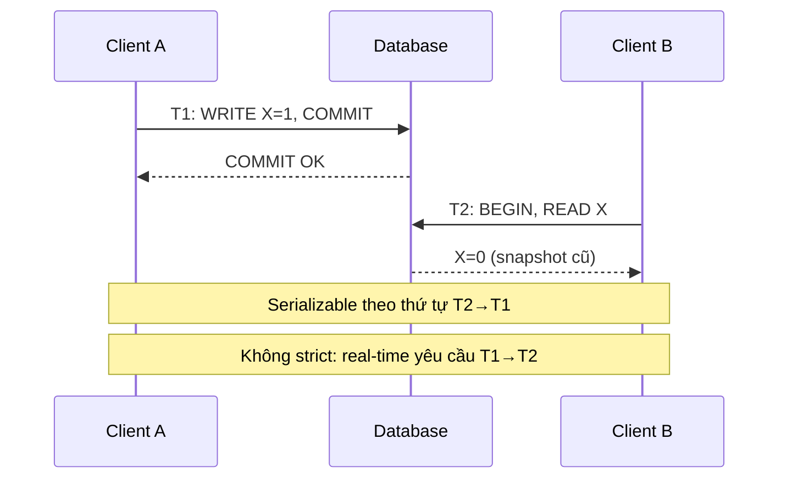
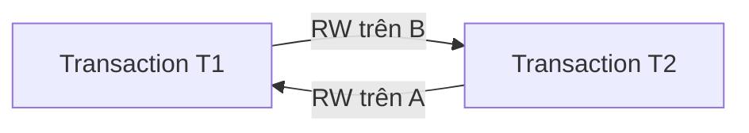
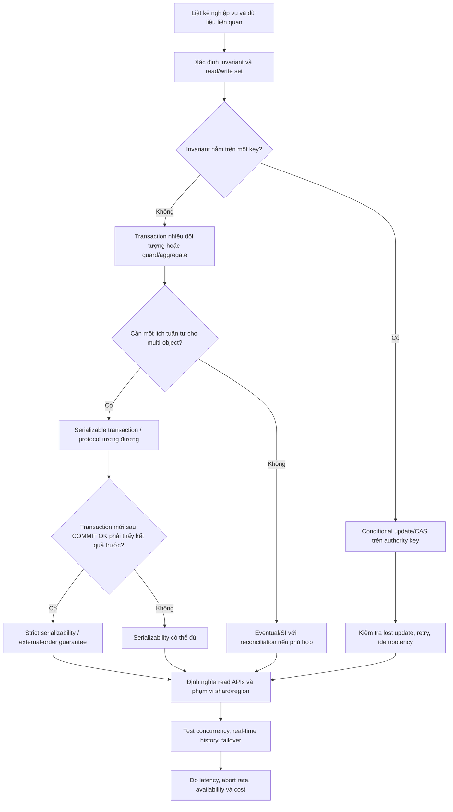

# Serializability so với strict serializability trong giao dịch nhiều đối tượng

Trong hệ NoSQL phân tán, một nghiệp vụ hiếm khi chỉ thay đổi đúng một key. Chuyển tiền phải cập nhật hai tài khoản; đặt vé phải giữ chỗ, tạo đơn và ghi thông tin thanh toán; chuyển quyền quản trị có thể đồng thời sửa nhiều document. Một cơ sở dữ liệu có thể bảo đảm **mỗi key được đọc/ghi nguyên tử** mà vẫn để xảy ra kết quả sai khi nghiệp vụ nhìn **nhiều đối tượng cùng lúc**.

Hai mức bảo đảm quan trọng là **serializability** và **strict serializability**. Cả hai nói về cách các giao dịch đồng thời được quan sát như một thứ tự thực thi tuần tự; khác biệt quyết định nằm ở **thứ tự thời gian thực (real-time order)**. Một lịch sử có thể có kết quả tương đương việc chạy các giao dịch lần lượt nhưng lại không phản ánh thứ tự mà người dùng thực sự đã hoàn tất và bắt đầu chúng.

Bài học thuộc **Database No SQL → Các mô hình nhất quán**, tập trung vào giao dịch **nhiều đối tượng**: cách đọc/viết nhiều item, document hoặc partition; những bất biến như tổng số dư và số lượng nhân viên trực; giới hạn của snapshot isolation và CAS trên từng key; mối quan hệ với linearizability, MVCC, phân tán đa vùng; và cách kiểm thử những cam kết mà một sản phẩm NoSQL công bố.

Mọi ví dụ về tiền, người dùng và số liệu đều là giả định minh họa. Tên tính năng trong MongoDB, DynamoDB, Cassandra/ScyllaDB, Redis hoặc hệ quản lý phân tán cần đối chiếu **đúng phiên bản, API, cấu hình, read/write concern và phạm vi transaction thực tế**, không được tự suy rằng một sản phẩm NoSQL luôn cung cấp cùng cấp nhất quán.

## 1. Bắt đầu từ giao dịch chứ không phải từng document

Giả sử hai tài khoản:

```text
Account A = 100
Account B = 100
Tổng số dư = 200
```

Một giao dịch chuyển 10 từ A sang B:

```text
BEGIN T_transfer
  READ A
  READ B
  SET A = 90
  SET B = 110
COMMIT
```

Bất biến nghiệp vụ:

\[
A.balance + B.balance = 200
\]

Nếu hai cập nhật là **hai lệnh độc lập** thay vì một giao dịch đa đối tượng, một người quan sát có thể thấy:

```text
A = 90
B = 100
Tổng = 190
```

Đây là trạng thái trung gian. Mỗi write vào A hoặc B có thể nguyên tử, thậm chí tuyến tính hóa được riêng lẻ, nhưng **không có tính nguyên tử của cả phép chuyển tiền**.

Một transaction nhiều đối tượng cần xác định rõ:

- **Read set:** những đối tượng và phạm vi query đã đọc.
- **Write set:** những đối tượng sẽ ghi.
- **Invariant:** điều kiện phải đúng khi nghiệp vụ commit.
- **Commit boundary:** các thay đổi nào phải được xem là một đơn vị.
- **Consistency guarantee:** những giao dịch khác được phép quan sát lịch sử thế nào.
- **Failure semantics:** timeout/abort/retry/failover có làm thay đổi kết quả hay không.

Serializability và strict serializability có ý nghĩa khi đánh giá **toàn bộ giao dịch trong phạm vi được bảo vệ**, không chỉ việc update một field có dùng `$inc`, CAS hay LWT hay không.

## 2. Serial execution là gì?

**Thực thi tuần tự (serial execution)** nghĩa là các giao dịch chạy hoàn toàn lần lượt, không xen kẽ:

```text
T1: BEGIN -> READ -> WRITE -> COMMIT
T2:                              BEGIN -> READ -> WRITE -> COMMIT
T3:                                                            ...
```

Nếu mỗi transaction bảo toàn bất biến khi chạy độc lập, thực thi tuần tự có thể làm việc bảo vệ bất biến dễ suy luận hơn: transaction sau nhìn trạng thái do transaction trước tạo ra theo thứ tự tuần tự đó.

Nhưng chạy mọi transaction lần lượt sẽ hạn chế throughput và latency ở quy mô lớn. Hệ quản trị cho phép **thực thi đồng thời (concurrent execution)** bằng locking, MVCC, optimistic validation hoặc giao thức phân tán.

Câu hỏi của serializability không phải “có chạy song song thật không?”, mà là:

> Dù các thao tác đã xen kẽ, có tồn tại một thứ tự chạy tuần tự các giao dịch sao cho kết quả quan sát được tương đương lịch sử này không?

Nếu có, lịch sử có thể được coi là **serializable** theo mô hình lịch sử và tương đương được dùng.

## 3. Định nghĩa serializability

**Serializability** yêu cầu kết quả của các giao dịch đã cam kết tương đương với **một thứ tự tuần tự hợp lệ** của chính các giao dịch đó. Một lịch sử đồng thời có thể có nhiều thứ tự tuần tự tương đương; hệ không cần chạy giao dịch thật theo thứ tự đó.

Ví dụ:

```text
Ban đầu:
    X = 0
    Y = 0

T1:
    READ X = 0
    WRITE X = 1

T2:
    READ Y = 0
    WRITE Y = 1
```

Nếu T1 và T2 chỉ tác động vào các đối tượng độc lập, chúng có thể xen kẽ mà vẫn tương đương với T1→T2 hoặc T2→T1.

### Một điểm rất dễ hiểu sai

**Serializability không tự yêu cầu thứ tự tuần tự đó tôn trọng thời điểm hoàn tất và bắt đầu transaction trong đời thực.**

Chính chỗ thiếu điều kiện về thời gian thực này tạo ra khác biệt với strict serializability.

Một hệ “serializable” có thể chọn thứ tự logic khác thứ tự người dùng quan sát ở ranh giới các transaction, miễn lịch sử vẫn tương đương một lịch tuần tự theo bảo đảm của nó.

## 4. Định nghĩa strict serializability

**Strict serializability** kết hợp:

1. **Serializability:** các transaction có kết quả tương đương một thứ tự tuần tự.
2. **Real-time order:** nếu transaction T1 **đã hoàn tất** trước khi transaction T2 **bắt đầu**, T1 phải đứng trước T2 trong thứ tự tuần tự tương đương.

Có thể viết:

\[
\operatorname{response}(T_1)
<
\operatorname{invocation}(T_2)
\quad\Longrightarrow\quad
T_1 \prec_{\mathrm{serial}} T_2
\]

Trong đó:

- `invocation(T)`: thời điểm transaction được bắt đầu/gọi.
- `response(T)`: thời điểm hệ trả kết quả hoàn tất cho transaction.
- `T1 ≺serial T2`: T1 phải được xếp trước T2 trong lịch tuần tự tương đương.

Vì thế, **strict serializability** thường được diễn giải là:

> Mỗi giao dịch nhiều đối tượng trông như xảy ra nguyên tử tại một thời điểm nằm giữa lúc nó bắt đầu và lúc hoàn tất, và thứ tự đó tôn trọng thời gian thực.

Đây còn được mô tả là **linearizability ở cấp transaction**, chứ không chỉ linearizability của một key.

### Quan hệ bao hàm

```text
Strict serializability
          |
          v
    Serializability
```

Mọi lịch sử strict-serializable đều serializable. Chiều ngược lại **không đúng nói chung**.

## 5. Ví dụ kinh điển: serializable nhưng không strict

Xét một key `X`, ban đầu bằng 0. Hai giao dịch **không chồng lấn về thời gian**:

```text
Thời gian tăng dần
----------------------------------------------------
10:00:00  T1 bắt đầu.
10:00:01  T1 ghi X = 1.
10:00:02  T1 COMMIT thành công, đã nhận response.

10:00:03  T2 bắt đầu, sau khi T1 đã hoàn tất.
10:00:04  T2 đọc X = 0 từ một snapshot cũ.
10:00:05  T2 COMMIT/read-only hoàn tất.
----------------------------------------------------
```

T1 đã hoàn tất trước khi T2 bắt đầu. T2 lại đọc giá trị cũ.

### Vì sao lịch sử vẫn có thể serializable?

Xét thứ tự tuần tự giả định:

```text
T2: READ X = 0
T1: WRITE X = 1
```

Trong thứ tự **T2→T1**, việc T2 đọc 0 là hợp lệ; trạng thái cuối vẫn X=1. Vì vậy riêng lịch sử này **có một thứ tự tuần tự tương đương**.

### Vì sao không strict serializable?

Thời gian thực bắt buộc:

```text
T1 hoàn tất trước khi T2 bắt đầu
    => T1 phải đứng trước T2.
```

Nhưng nếu T1 đứng trước, T2 phải đọc X=1 theo giao dịch này. T2 đọc 0 nên **không thể** có thứ tự vừa tương đương lịch sử vừa tôn trọng thời gian thực.

### Sơ đồ



**Bài học:** khi người dùng đã nhận **COMMIT OK**, một transaction bắt đầu sau đó mà vẫn đọc trạng thái trước commit có thể phù hợp với một mô hình serializability không ràng buộc thời gian thực, nhưng **vi phạm strict serializability** trong cùng phạm vi bảo đảm.

Không được suy từ ví dụ này rằng mọi engine công bố `SERIALIZABLE` đều mặc định phục vụ snapshot cũ; đó là **một lịch sử phân biệt hai định nghĩa**, không phải hành vi bắt buộc của sản phẩm.

## 6. Khi hai giao dịch chồng lấn, strict serializability yêu cầu gì?

Giả sử:

```text
T1: |--------- BEGIN ... COMMIT ---------|
T2:        |--------- BEGIN ... COMMIT ---------|
```

T2 bắt đầu trước khi T1 có response hoàn tất, nên **không có cạnh real-time bắt buộc T1→T2 hoặc T2→T1 chỉ dựa trên hai thời điểm đó**.

Strict serializability vẫn yêu cầu:

- Có một thứ tự tuần tự tương đương.
- Thứ tự đó phải tôn trọng mọi ràng buộc read/write của lịch sử.
- Các cặp giao dịch **không chồng lấn** phải tôn trọng thời gian thực.

Ví dụ T2 có thể đọc giá trị T1 ghi khi T1 chưa trả response nếu semantics commit/visibility cho phép và lịch sử vẫn đúng; nhưng không được tạo ra một chu trình bất khả thi của ràng buộc giao dịch.

Một lối diễn giải sai là “strict nghĩa là luôn commit theo thứ tự request đến trước”. Không đúng: nếu hai transaction chồng lấn, hệ có thể chọn nhiều thứ tự hợp lệ dựa trên concurrency protocol và quan sát thực tế.

## 7. Bảng phân biệt nhanh

| Câu hỏi | Serializability | Strict serializability |
| --- | --- | --- |
| Mỗi transaction có thể được xem là một phần của lịch tuần tự? | **Có** | **Có** |
| Có thể thực thi vật lý song song? | **Có** | **Có** |
| Bảo vệ bất biến nhiều đối tượng trong phạm vi transaction đúng? | **Có**, nếu mọi thao tác liên quan nằm trong transaction và protocol đúng | **Có**, cùng điều kiện |
| Bắt buộc tôn trọng thứ tự completion-before-invocation? | **Không** | **Có** |
| Một transaction mới bắt đầu sau COMMIT OK phải thấy hiệu quả trước đó trong phạm vi cùng bảo đảm? | Không do serializability đơn thuần quyết định | Có, nếu đọc nằm trong transaction/API được bảo đảm |
| Tương đương linearizability trên transaction? | Không | Thường **có** theo định nghĩa lịch sử |
| Tự bảo đảm dữ liệu bền vững sau mất điện? | Không | Không; durability là trục khác |
| Tự bao phủ cache/search/queue bên ngoài DB? | Không | Không |
| Tự bảo vệ side effect tới payment gateway? | Không | Không |

**“Strict” ở đây nói về thứ tự thời gian thực, không phải về fsync mạnh hơn hay transaction lâu hơn.**

## 8. Linearizability theo từng key không đủ cho transaction nhiều đối tượng

**Linearizability** của một object nói các thao tác trên object đó trông như xảy ra nguyên tử theo một thứ tự tôn trọng thời gian thực.

Giả sử hệ có hai key A và B; mỗi `SET`/`GET` riêng lẻ đều linearizable. Ta vẫn có thể thực hiện hai lệnh độc lập:

```text
Initial: A=100, B=100.

WRITE A=90       -> thành công.
READ A=90        -> thành công.
READ B=100       -> thành công.
WRITE B=110      -> thành công.
```

Mỗi key riêng lẻ đều có lịch hợp lệ. Nhưng người đọc đã thấy tổng 190, phá bất biến của phép chuyển 10 nếu ứng dụng hứa giao dịch chuyển tiền nguyên tử.

**Per-key linearizability ≠ multi-key serializability.**

Nếu ứng dụng muốn chuyển tiền là một thao tác nguyên tử đối với cả A và B, hai lệnh WRITE độc lập không đủ, dù mỗi lệnh mạnh. Cần **transaction trên tập đối tượng** với mức bảo đảm đã chọn hoặc thiết kế domain khác.

### Đừng nhầm transaction write atomicity với một chuỗi GET

Ngay cả nếu chuyển tiền được commit **nguyên tử trong một transaction**, người đọc vẫn cần đặt hai lần đọc A/B vào **cùng một read-only transaction/snapshot** nếu muốn kiểm tra tổng ở một thời điểm logic duy nhất. Hai `GET` độc lập, tách bởi lúc transaction khác commit, có thể trả dữ liệu từ hai thời điểm khác nhau.

Bảo đảm của database phải được áp dụng ở **đúng ranh giới mà ứng dụng sử dụng**.

## 9. “Serializability” bảo vệ bất biến trong điều kiện nào?

Ví dụ bất biến:

\[
A.balance + B.balance = C
\]

Nếu transaction chuyển tiền đọc A/B và ghi cả hai, một lịch serializable bảo đảm tương đương với một thứ tự tuần tự hợp lệ. Nhưng để bất biến được bảo vệ thật, còn cần:

1. Mọi writer có thể ảnh hưởng bất biến **đều dùng giao thức thích hợp**.
2. Transaction đọc đủ state hoặc predicate cần cho quyết định.
3. Transaction phải abort khi trạng thái đã không còn đáp ứng điều kiện.
4. Không có side effect ngoài transaction đang được giả định là atomic.
5. Ranh giới transaction nằm trong **phạm vi sản phẩm hỗ trợ**.
6. Những read phục vụ quyết định cần consistency phù hợp.

Nếu một background script có quyền ghi trực tiếp `A.balance` không qua transaction hoặc một hệ khác thay đổi tiền bên ngoài database, serializability của nhóm transaction còn lại **không tự bảo vệ toàn nghiệp vụ**.

## 10. Snapshot isolation (SI) không đồng nghĩa serializability

Nhiều hệ NoSQL dùng **MVCC** để cho transaction đọc một snapshot nhất quán. **Snapshot isolation (SI)** giúp tránh một số anomaly như đọc thấy thay đổi chưa commit và có thể ngăn hai transaction cùng ghi một document theo conflict protocol.

Nhưng SI không mặc định là serializable, bởi những transaction cùng đọc nhiều đối tượng rồi **ghi các đối tượng khác nhau** có thể cùng commit, phá invariant.

Ví dụ nổi tiếng: **write skew**.

## 11. Write skew: hai bác sĩ cùng rời ca trực

Bất biến:

```text
Trong mỗi ca trực phải có ít nhất một bác sĩ ON_CALL.
```

Dữ liệu ban đầu:

```json
{
  "doctorId": "A",
  "onCall": true,
  "version": 4
}
```

```json
{
  "doctorId": "B",
  "onCall": true,
  "version": 9
}
```

Hai transaction thực thi đồng thời trên cùng snapshot:

```text
T1:
    READ A.onCall=true
    READ B.onCall=true
    Thấy B vẫn trực -> SET A.onCall=false.

T2:
    READ A.onCall=true
    READ B.onCall=true
    Thấy A vẫn trực -> SET B.onCall=false.
```

Vì T1 ghi A và T2 ghi B, một engine SI có thể cho cả hai commit khi không có write-write conflict trực tiếp trên cùng document.

Kết quả:

```text
A.onCall = false
B.onCall = false

Không còn ai trực -> invariant bị vi phạm.
```

### Vì sao không serializable?

Thử thứ tự T1→T2:

```text
Sau T1, A=false và B=true.
T2 phải thấy chỉ còn B trực.
T2 không được cho B nghỉ.
```

Thử thứ tự T2→T1: lập luận đối xứng, T1 không được cho A nghỉ.

Vì hai transaction đều đã đưa ra quyết định dựa trên “người còn lại đang trực” mà cả hai cùng commit, **không có thứ tự tuần tự tương đương hợp lệ với logic này**.

### Vì sao version từng document vẫn chưa đủ?

Giả sử T1 cập nhật A với `WHERE A.version=4`, còn T2 cập nhật B với `WHERE B.version=9`. Hai điều kiện đều đúng vì không ai tranh cùng document. Version riêng từng document bảo vệ **lost update trên document đó**, nhưng không bảo vệ bất biến **A OR B**.

Giải pháp có thể là transaction serializable được hỗ trợ, một **guard record/version chung**, hoặc một mô hình aggregate chứa bất biến trong một đơn vị cập nhật nguyên tử.

## 12. Phân biệt các anomaly liên quan

| Hiện tượng | Ví dụ | Điều cần xem |
| --- | --- | --- |
| **Dirty read** | Đọc thay đổi chưa commit rồi transaction kia abort | Isolation chống đọc dữ liệu chưa commit |
| **Non-repeatable read** | Trong một transaction, đọc cùng key lần sau khác lần đầu | Snapshot/locking semantics |
| **Read skew** | Đọc những key liên quan từ hai trạng thái không đồng bộ | Snapshot chung/transactional read |
| **Lost update** | Hai writer tính từ cùng giá trị cũ, một ghi đè người kia | Conditional write, OCC, transaction |
| **Write skew** | Hai transaction đọc cùng invariant, ghi các đối tượng khác nhau | Serializable transaction hoặc guard |
| **Phantom** | Predicate query có thêm/bớt bản ghi do writer khác | Predicate/range conflict protection |
| **Stale read after commit** | Transaction bắt đầu sau COMMIT OK vẫn thấy bản cũ | Real-time order / strict serializability |

Một mô hình nhất quán mạnh hơn có thể loại nhiều anomaly, nhưng phải xét **đúng API/transaction boundary**. Một thao tác đọc từ GSI hoặc cache không nhất thiết nằm trong cùng phạm vi bảo đảm với transaction nguồn.

## 13. Phantom: bất biến trên tập kết quả, không chỉ ID

Giả sử hệ đặt lịch và quy định:

```text
Trong phòng R1 tại slot 10:00,
tối đa một reservation trạng thái CONFIRMED.
```

Hai transaction:

```text
T1:
    QUERY reservations WHERE room=R1 AND slot=10:00 AND confirmed
    -> không có.
    INSERT reservation A.

T2:
    QUERY cùng predicate
    -> không có.
    INSERT reservation B.
```

Nếu transaction chỉ bảo vệ những record đã tồn tại, không bảo vệ **predicate “không có reservation nào”**, cả hai có thể cùng insert. Đây là dạng **phantom/serialization anomaly**.

Một transaction thực sự serializable với read predicate và write thích hợp phải có cách phát hiện hoặc ngăn kết quả không thể diễn giải theo một thứ tự tuần tự.

Phương án khác nếu database hỗ trợ phù hợp là mô hình hóa slot như **một key duy nhất** và dùng conditional insert:

```text
PK = ROOM#R1#SLOT#2026-11-14T10:00
Condition: key chưa tồn tại
```

Một khóa duy nhất có thể giảm phạm vi bài toán từ predicate nhiều bản ghi thành một conditional write. Nhưng nó chỉ hợp lệ nếu toàn bộ quy tắc và tính duy nhất thật sự được encode vào key/condition.

## 14. Serializability và strict serializability đều không thay thế atomicity

Nói “database serializable” không có nghĩa mọi chuỗi lệnh ứng dụng tự động được gộp thành transaction.

Hai thao tác:

```text
PUT A=90
PUT B=110
```

nếu không nằm trong một transaction đa đối tượng, hệ có thể coi chúng là **hai transaction đơn độc**. Khi đó một reader chen giữa chúng có thể thấy A mới, B cũ mà không vi phạm serializability của từng lệnh đơn.

Ranh giới đúng:

```text
BEGIN TRANSFER
    assert A >= 10
    decrement A by 10
    increment B by 10
COMMIT TRANSFER
```

Cần dịch sang transaction API thực sự của NoSQL được chọn. Không nên chỉ viết hai lệnh trong cùng một function Java rồi gọi đó là transaction.

Tương tự, một **read-only transaction** phải đọc cả A và B trong một snapshot/serialization point nếu mục tiêu là đối chiếu tổng nhất quán.

## 15. Formal history: invocation, response, read và write

Để phân tích hai mức bảo đảm, có thể ghi lịch sử:

```text
inv(T1)       bắt đầu T1
r1(X)=0       T1 đọc X=0
w1(X)=1       T1 ghi X=1
commit(T1)    T1 commit được xác nhận

inv(T2)       bắt đầu T2
r2(X)=0       T2 đọc X=0
commit(T2)    T2 kết thúc
```

Khi `commit(T1)` được trả kết quả **trước** `inv(T2)`, strict serializability thêm cạnh real-time:

\[
T_1 \rightarrow T_2
\]

Nhưng việc `r2(X)=0` từ trạng thái trước `w1(X)=1` lại phù hợp với thứ tự:

\[
T_2 \rightarrow T_1
\]

Hai ràng buộc mâu thuẫn, nên lịch sử này không strict-serializable.

### Không chỉ kiểm tra timestamp commit

Một cơ sở dữ liệu có thể gán commit timestamp theo logical clock hoặc hybrid clock. Những timestamp đó **không tự động chứng minh** kết quả tôn trọng thời gian thực. Cần biết transaction đã được xác nhận lúc nào, read được bắt đầu lúc nào và timestamp/read barrier thực sự được áp dụng ra sao.

## 16. Serialization graph và ràng buộc phụ thuộc

Một cách suy luận serializability là xem các **phụ thuộc** giữa transaction:

- **Write→Read (WR):** T2 đọc giá trị do T1 ghi.
- **Write→Write (WW):** hai transaction ghi cùng đối tượng, có thứ tự phiên bản.
- **Read→Write / anti-dependency (RW):** T1 đọc trạng thái hoặc snapshot trước khi T2 ghi thay đổi có liên quan.

Ví dụ write skew:

```text
T1 đọc B=true.
T2 ghi B=false.
    => T1 có anti-dependency hướng tới T2.

T2 đọc A=true.
T1 ghi A=false.
    => T2 có anti-dependency hướng tới T1.
```

Phụ thuộc tạo chu trình:



Một chu trình không thể được thỏa bằng một thứ tự tuần tự đơn giản cho lịch sử đó.

### Lưu ý về kiểm tra formal

Với **conflict-serializability** trong mô hình schedule thích hợp, đồ thị precedence không chu trình là tiêu chí quen thuộc. Với lịch sử **MVCC nhiều phiên bản**, suy luận chính xác hơn cần biết version nào đã được đọc, thứ tự version, predicate/range và mô hình isolation; không thể chỉ đếm các cặp transaction cùng chạm key rồi kết luận.

Với strict serializability còn cần thêm các **real-time edges** từ transaction đã hoàn tất tới transaction bắt đầu sau. Một lịch sử có thể không có chu trình phụ thuộc đọc/ghi nhưng **có mâu thuẫn khi thêm cạnh thời gian thực**.

## 17. Serializability không phải một thuật toán cụ thể

Một database có thể hướng tới serializable execution bằng nhiều kỹ thuật:

| Kỹ thuật | Ý tưởng | Đánh đổi quan trọng |
| --- | --- | --- |
| **Two-phase locking (2PL)** | Transaction giữ/quản lý lock theo giao thức để tạo thứ tự tương thích | Contention, deadlock, thời gian chờ |
| **Optimistic Concurrency Control (OCC)** | Chạy lạc quan, validate read/write set trước commit | Abort/retry nhiều khi tranh chấp cao |
| **Serializable Snapshot Isolation (SSI)** | Dùng snapshot và phát hiện tổ hợp phụ thuộc nguy hiểm | Overhead theo dõi, có thể abort transaction |
| **Timestamp/ordering protocol** | Gán thứ tự logic và bảo đảm truy cập phù hợp | Chi phí phối hợp, quản lý clock/order |
| **Single sequencer/leader** | Tuần tự hóa những nghiệp vụ theo một authority | Hotspot, failover, giới hạn phạm vi |
| **Distributed transaction protocol** | Phối hợp nhiều shard/participant | Network round trips, recovery, availability |

Có MVCC không có nghĩa tự động serializable; có lock không đồng nghĩa strict; có consensus cho metadata không có nghĩa mọi read path transaction đã strict.

### “Strict 2PL” có bằng “strict serializability” không?

**Strict two-phase locking** thường nói đến quy tắc giữ một số loại lock đến commit/abort để tránh những lịch sử không thể phục hồi hoặc những dirty read. Nó là thuật ngữ **giao thức khóa**.

**Strict serializability** là **bảo đảm lịch sử giao dịch**, kết hợp serializability với real-time order. Tên đều có chữ “strict” nhưng không được coi là cùng định nghĩa chỉ dựa trên tên gọi.

Trong một thiết kế cụ thể, strict 2PL cộng cơ chế commit/visibility đúng có thể triển khai lịch sử rất mạnh; vẫn cần xác minh cả phạm vi transaction và read path.

## 18. Muốn strict còn phải tôn trọng thời gian thực

Một engine có thể đảm bảo serialization order qua transaction ID hoặc logical timestamp, nhưng strict serializability cần thứ tự đó phù hợp với những transaction **không chồng lấn theo thời gian thực**.

Các biện pháp tùy kiến trúc:

1. **Single-writer/leader authority** cho mỗi phạm vi transaction, với read sau commit được định tuyến tới trạng thái đủ mới.
2. **Consensus/commit ordering** giữa những participant để mọi phía thống nhất phần giao dịch đã commit.
3. **Read barriers** hoặc snapshot timestamp phù hợp để giao dịch bắt đầu sau commit không đọc trước commit đó.
4. **Quản lý đồng hồ và bất định thời gian** trong một số hệ dùng timestamps toàn cục.
5. **Commit wait** hoặc kỹ thuật khác để thời điểm xác nhận tương thích thứ tự bên ngoài.
6. **Failover fencing** ngăn leader cũ tiếp tục xác nhận write không hợp lệ.
7. **Recovery protocol** duy trì trạng thái commit và read visibility sau lỗi.

Không phải hệ nào cũng dùng tất cả kỹ thuật. Điều cần chứng minh là **bảo đảm end-to-end**; chỉ bật replication factor lớn hoặc dùng quorum cho một lệnh đơn không đủ để suy ra strict serializability trên transaction nhiều đối tượng.

## 19. “Commit xong rồi mới đọc” có luôn nhìn thấy giá trị mới?

Câu trả lời phụ thuộc **đường đọc có thuộc cùng phạm vi bảo đảm hay không**.

Ví dụ:

```text
T1: update nguồn, COMMIT OK.
T2: bắt đầu sau T1, đọc nguồn bằng read transaction strong.
T3: bắt đầu sau T1, nhưng đọc Redis cache chưa invalidated.
```

Nếu nguồn cung cấp strict serializability trong T1/T2, T2 cần thấy trạng thái phù hợp T1. Nhưng T3 đọc **cache bên ngoài** có thể thấy dữ liệu cũ; database không tự mở rộng bảo đảm sang cache.

Tương tự:

- Search index qua CDC có thể chậm vài giây.
- GSI/read model bất đồng bộ có thể lag.
- Replica chỉ cho eventual reads có thể trả snapshot cũ.
- Analytics warehouse thường không nằm trong cùng transaction domain.
- Event consumer có thể xử lý thay đổi theo thứ tự đến muộn.

Để công bố API “đã cập nhật thì GET ngay sau luôn thấy”, cần xác định **GET lấy từ đâu**, routing thế nào, cache invalidation và consistency token/read barrier.

## 20. Session guarantees khác real-time order toàn cục

Một số ứng dụng chỉ cần:

- **Read-your-writes:** một client đọc lại được những write của chính mình.
- **Monotonic reads:** một session không đi lùi về snapshot cũ hơn.
- **Monotonic writes:** các write trong session được quan sát đúng thứ tự.
- **Causal consistency:** các thao tác có quan hệ nhân quả được quan sát theo thứ tự tương ứng.

Những guarantee này hữu ích và có thể rẻ hơn strict serializability toàn cục, nhưng không đồng nghĩa với nó.

Ví dụ hai client khác nhau:

```text
Client A:
    PUT X=1 -> SUCCESS.

Client B (khác session):
    bắt đầu GET X sau SUCCESS;
    GET X=0 từ replica cũ.
```

Read-your-writes của A vẫn có thể đúng. Monotonic reads của B vẫn có thể đúng nếu B trước đó chưa thấy X=1. Nhưng lịch sử này **không strict-serializable** nếu PUT và GET thuộc cùng phạm vi được hứa strict.

**Strict serializability không chỉ là “session của tôi đọc thấy write của tôi”.** Nó ràng buộc cả các transaction không chồng lấn giữa những client khác nhau.

## 21. Causal consistency và serializability không thay thế nhau

Causal consistency tập trung vào **thứ tự có quan hệ nhân quả**. Hai cập nhật độc lập có thể được quan sát theo thứ tự khác nhau ở các replica tùy mô hình.

Serializability tập trung vào việc **toàn bộ transaction** có thể được xếp thành một thứ tự tuần tự, kể cả khi có các cập nhật đồng thời độc lập.

Không nên đặt mọi consistency model vào một thang đơn giản mà bỏ qua phạm vi và quan hệ thời gian:

```text
Per-object linearizability:
    mạnh trên từng key, chưa đủ cho invariant nhiều key.

Causal/session consistency:
    tôn trọng quan hệ nhân quả/session theo contract,
    chưa đủ cho một serial order của mọi transaction.

Serializable transactions:
    có serial order của transaction,
    không bắt buộc real-time order.

Strict-serializable transactions:
    có serial order và real-time order.
```

Một hệ có thể đồng thời cung cấp nhiều mức bảo đảm cho những API khác nhau. Tên consistency trên marketing không thay cho việc xem **transaction semantics và read concern thực tế**.

## 22. Read-only transaction cũng quan trọng

Nhiều người chỉ chú trọng atomic commit của write. Nhưng nếu đọc nhiều đối tượng để lập báo cáo hoặc quyết định, **read-only transaction** cần snapshot phù hợp.

Ví dụ:

```text
Đầu kỳ:
    Account A = 100
    Account B = 100

T_transfer chuyển 10 từ A sang B.

T_report:
    READ A
    READ B
    RETURN SUM
```

Nếu T_report nằm hoàn toàn **sau khi T_transfer đã commit và có response**, strict serializability yêu cầu tổng phản ánh trạng thái sau transfer (vẫn bằng 200), cùng với các cập nhật khác nếu có.

Nếu T_report **chồng lấn** với T_transfer, hệ có thể xếp báo cáo trước hoặc sau transfer, nhưng không được tạo tổng 190/210 từ trạng thái không tương đương một lần đọc transaction hợp lệ.

### Đừng lấy hai point reads tách biệt làm một transaction

Đoạn ứng dụng:

```java
long a = accountRepository.getBalance("A");
long b = accountRepository.getBalance("B");
return a + b;
```

không tự là read-only transaction nhất quán nếu hai `getBalance` dùng hai request độc lập. Cần một transaction/read API phù hợp, hoặc một aggregate materialized có consistency đã được định nghĩa.

## 23. Serializable transaction và snapshot isolation trong MongoDB

MongoDB hỗ trợ **multi-document transactions** trong những cấu hình triển khai được hỗ trợ. Tuy nhiên, cần phân biệt:

- **Atomic commit/abort** của các write bên trong transaction.
- **Read concern** (ví dụ snapshot) và cách transaction đọc một ảnh chụp nhất quán.
- **Write concern** ảnh hưởng mức xác nhận/durability theo cấu hình.
- **Isolation semantics** thực tế, không tự đồng nhất snapshot isolation với serializability.
- **Read bên ngoài transaction** qua replica/cache có thể có semantics khác.

Ví dụ nghiệp vụ có thể viết theo ý tưởng:

```javascript
// Pseudocode shell/driver transaction:
// 1. startSession()
// 2. startTransaction(...) theo read/write concern đã chọn.
// 3. đọc những document có liên quan.
// 4. kiểm tra invariant.
// 5. cập nhật theo transaction.
// 6. commitTransaction().
```

**Chỉ bọc write skew vào transaction snapshot không mặc nhiên đủ** để bảo vệ invariant nhiều document. Ví dụ hai bác sĩ viết hai document riêng có thể cần một **guard document** được cả hai cùng cập nhật hoặc một protocol cho phép phát hiện xung đột mạnh hơn.

### Guard document minh họa

```text
oncall_guard:
    shiftId = S1
    activeDoctors = 2
    version = 10

Muốn một bác sĩ nghỉ:
    conditional update guard khi activeDoctors > 1
    và tăng version/trừ activeDoctors.
    đồng thời cập nhật doctor record trong transaction phù hợp.
```

Khi cả hai transaction tranh **cùng guard record**, chúng không còn chỉ ghi hai document độc lập. Nhưng việc cập nhật guard và doctor phải có atomicity/recovery phù hợp; nếu tách thành hai thao tác không nguyên tử, bất biến có thể vẫn bị phá.

Không khẳng định mọi cấu hình MongoDB cung cấp strict serializability cho mọi combination transaction và read path. Phải đối chiếu tài liệu phiên bản, topology, concern, failover và transaction limitations.

## 24. DynamoDB: transactional API khác Query/Scan thông thường

DynamoDB hỗ trợ những API giao dịch như **TransactWriteItems** và **TransactGetItems** trong phạm vi và giới hạn được dịch vụ quy định. Chúng có thể cho phép nghiệp vụ làm việc với nhiều item nguyên tử hoặc đọc dữ liệu bằng transactional API.

Ví dụ chuyển trạng thái hai item:

```text
TransactWriteItems:
    Update item account A:
        điều kiện availableBalance >= amount
        và điều kiện version nếu cần
        giảm balance

    Update item account B:
        tăng balance

    Put item transferOperation:
        operationId duy nhất
        điều kiện chưa tồn tại
```

Đây là mô hình nghiệp vụ, không phải payload API hoàn chỉnh.

Điều cần kiểm tra:

- Những item và kích thước có nằm trong giới hạn transaction không?
- Có thể dùng những action/condition gì với cùng item?
- Những loại request nào được hưởng **transactional isolation** và mức cụ thể?
- `GetItem` strong read, `Query`, `Scan`, `BatchGetItem` và **GSI** có cùng semantics với TransactGetItems không?
- Cross-Region/global tables hoặc replication có thay đổi phạm vi bảo đảm không?
- Timeout sau commit được giải quyết bằng `operationId`/client token và readback thế nào?

Không suy từ **atomic TransactWriteItems** rằng mọi truy vấn Query trên GSI vừa cập nhật cũng lập tức strict-serializable. GSI là một đường đọc riêng có quy tắc consistency của dịch vụ.

## 25. Cassandra và ScyllaDB: LWT theo phạm vi hẹp không phải transaction đa đối tượng tổng quát

Trong CQL, **lightweight transaction (LWT)** cho phép thao tác conditional như:

```sql
UPDATE profiles_by_id
SET display_name = ?, version = ?
WHERE tenant_id = ? AND profile_id = ?
IF version = ?;
```

LWT có thể cung cấp bảo đảm so sánh và ghi nguyên tử theo **phạm vi được sản phẩm/phiên bản hỗ trợ**, thường phù hợp những invariant gắn với một partition hoặc một tập khóa có ràng buộc rõ.

Nhưng:

- Một lệnh `IF` trên một row không bảo vệ invariant qua **nhiều partition độc lập**.
- CQL batch không tự trở thành **general-purpose serializable SQL transaction**.
- Consistency level/quorum cho các read/write thông thường không tạo transaction serializable đa đối tượng.
- Replica repair/compaction/tombstone bảo vệ những mặt khác, không thay transaction isolation.
- Một materialized table/by-query table được cập nhật từ event có thể lag và không thuộc transaction đọc gốc.

Ví dụ muốn “ít nhất một bác sĩ trực” trải qua hai partition không thể chỉ dùng hai LWT độc lập rồi kết luận serializable. Cần thiết kế **đơn vị authority/guard** hoặc workflow điều phối phù hợp.

## 26. Redis: atomic command/script khác distributed transaction

Redis có các cơ chế như thao tác nguyên tử trên một key, **MULTI/EXEC**, **WATCH** và script. Chúng giúp tránh nhiều lỗi update đồng thời trong phạm vi thực thi hỗ trợ.

Ví dụ script trên hai hash field cùng key:

```lua
local active = tonumber(
    redis.call("HGET", KEYS[1], "activeDoctors") or "0"
)
if active <= 1 then
    return {0, "LAST_DOCTOR"}
end

redis.call("HINCRBY", KEYS[1], "activeDoctors", -1)
redis.call("HINCRBY", KEYS[1], "version", 1)
return {1, "APPLIED"}
```

Trong phạm vi key và Redis instance/cluster slot phù hợp, script có thể thực thi logic so sánh và cập nhật mà không bị lệnh khác xen vào.

Nhưng cần phân biệt:

- Tính nguyên tử **thực thi lệnh/script** không tự là strict serializability xuyên mọi key/shard/Region.
- WATCH phát hiện sửa đổi trong một transaction window, không tạo global multi-partition serial order.
- Redis Cluster có ràng buộc hash slot cho multi-key operations.
- Replica và persistence có semantics về stale reads, crash recovery và ACK riêng.
- Khi script bảo vệ **guard key** nhưng doctor records nằm hệ khác, cần protocol giữ nhất quán giữa chúng.

Không đặt những key liên quan ở các shard khác nhau rồi giả định MULTI/EXEC hoặc Lua sẽ tự tạo transaction phân tán.

## 27. Các hệ giao dịch phân tán mạnh và external consistency

Một số hệ database phân tán được thiết kế để cung cấp **serializable hoặc strict-serializable transactions** trong phạm vi tài liệu công bố. Trong những tài liệu hệ thống, thuật ngữ **external consistency** thường được dùng để mô tả tính tuần tự tôn trọng thứ tự thời gian thực của các transaction.

Ví dụ cơ sở dữ liệu phân tán như **Google Cloud Spanner** thường được nhắc đến khi thảo luận external consistency. Nhưng không lấy một ví dụ sản phẩm làm bằng chứng rằng mọi read mode, replica, API và tích hợp ngoài database đều có cùng bảo đảm.

Khi chọn sản phẩm, xác định:

1. Transaction có thể trải qua **bao nhiêu key/partition/shard**?
2. Mức isolation thật là snapshot, serializable hay strict serializable?
3. **Read-only transactions** có cùng bảo đảm không?
4. Đọc từ follower/secondary/region khác có chế độ stale hoặc bounded-staleness không?
5. Có giới hạn thời gian, kích thước, số item, write rate không?
6. Khi failover hoặc network partition, request bị block/reject hay đọc cũ?
7. Khi timeout sau commit, client xác định kết quả thế nào?
8. Những gì nằm **ngoài** transaction domain như cache, search, queue có được bảo vệ không?

Một hệ tự giới thiệu “strongly consistent” vẫn cần phân tích kỹ **strong ở mức nào**: từng key, từng read request, từng transaction hay cả thứ tự real-time của những transaction nhiều đối tượng.

## 28. Đa shard và hai pha commit: atomicity không tự bằng strict serializability

Giả sử transfer phải ghi Account A ở shard 1 và Account B ở shard 2.

Một protocol commit phân tán có thể dùng các pha:

```text
Coordinator:
    1. Prepare participants.
    2. Mỗi shard ghi nhận chuẩn bị/lock cần thiết.
    3. Quyết định COMMIT hoặc ABORT.
    4. Phát quyết định và phục hồi khi có lỗi.
```

**Two-phase commit (2PC)** giúp phối hợp **atomic commit decision**, nhưng một mình 2PC **không định nghĩa isolation level** hoặc real-time ordering của tất cả transaction. Cần kết hợp với concurrency control, recovery và read visibility.

Những chi phí:

- Network round trips qua shard.
- Lock hoặc version validation giữ lâu hơn.
- Participant/coordinator failure và recovery.
- Xung đột retry, timeout và kết quả commit chưa rõ.
- Metadata/transaction log.
- Latency p99 tăng theo số participant và vùng địa lý.

Nếu workload buộc liên tục giao dịch trên hàng chục shard, nên đánh giá lại dữ liệu và ranh giới aggregate; không mặc định bật transaction mạnh luôn đủ hiệu năng.

## 29. Network partition, tính sẵn sàng và read staleness

Hãy giả sử một cluster nhiều Region gặp network partition. Transaction T1 đã được xác nhận ở Region A, nhưng Region B không thể ngay lập tức biết trạng thái đó.

Nếu Region B vẫn nhận read transaction mới và trả snapshot cũ, hệ có thể làm vi phạm strict serializability trong cùng phạm vi toàn cluster. Để giữ bảo đảm mạnh, hệ có thể phải:

- Chuyển request tới authority/quorum còn hoạt động.
- Chờ phục hồi kết nối hoặc read barrier.
- Từ chối/timeout request khi không thể xác định trạng thái mới.
- Không cho leader cũ tiếp tục xác nhận những write không có quyền.
- Dùng transaction protocol có phục hồi commit chính xác.

**Strict serializability có chi phí về latency và availability trong một số failure scenarios.** Không thể vừa hứa luôn phục vụ read/write lập tức trên mọi phía của một phân vùng mạng vừa hứa thứ tự transaction mạnh toàn cục nếu không có cách phối hợp và giả định phù hợp.

Điều quan trọng là tài liệu hóa **failure behavior** cùng consistency model, thay vì chỉ trích dẫn tên isolation level.

## 30. Durability và strict serializability là hai trục khác nhau

Một transaction có thể được thực thi theo thứ tự strict-serializable trong bộ nhớ, nhưng nếu server trả COMMIT OK trước khi đáp ứng durability policy rồi mất điện, write có thể không còn. Đó là **vấn đề durability**, không phải một định nghĩa khác của serializability.

Các trục cần tách:

| Trục | Câu hỏi |
| --- | --- |
| **Atomicity** | Transaction ghi nhiều đối tượng có cùng commit/abort không? |
| **Isolation/serializability** | Những transaction đồng thời quan sát lịch sử ra sao? |
| **Real-time order** | Transaction sau khi trước đã hoàn tất có đọc trạng thái phù hợp không? |
| **Durability** | Sau crash/failover, write đã ACK có còn theo cam kết không? |
| **Availability** | Trong phân vùng mạng, có thể tiếp tục trả lời không? |
| **Freshness của read model** | Search/cache/materialized view bắt kịp nguồn đến đâu? |
| **Idempotency** | Retry cùng operationId có tạo side effect hai lần không? |

Một hệ đúng cần xác định các trục này **độc lập nhưng tương tác**. Không nói “strict nên không cần backup”, hoặc “serializable nên timeout commit chắc chắn thất bại”.

## 31. Unknown commit outcome: giao dịch có thể đã thành công

Một transaction đa đối tượng:

```text
Client gửi COMMIT.
Database quyết định COMMIT.
Response bị mất vì network timeout.
Client nhìn thấy TIMEOUT.
```

Client không biết chắc transaction đã commit hay chưa. Nếu lập tức chạy lại nguyên workflow tạo order, trừ tồn kho và thanh toán, có thể tạo dữ liệu hoặc side effect trùng.

Cách xử lý thường cần:

- `operationId`/idempotency key duy nhất.
- Bản ghi trạng thái operation cùng transaction khi khả thi.
- API tra cứu kết quả theo operationId.
- Retry commit theo protocol SDK nếu có hỗ trợ.
- Không phát lại payment/email khi chưa biết trạng thái.
- Reconciliation khi commit state giữa các participant chưa xác định.

**Isolation mạnh không thay thế idempotency.** Strict serializability chỉ quy định lịch sử của những transaction trong phạm vi hệ; nó không làm mất đi khả năng response thất lạc.

## 32. Java: biểu diễn nghiệp vụ transfer trong một transaction

Ví dụ dưới đây là **giả mã Java độc lập nhà cung cấp**. Các interface phải được hiện thực bằng transaction API của NoSQL đã chọn với isolation thực sự đáp ứng yêu cầu.

```java
public final class TransferService {
    private final TransactionalDatabase db;

    public TransferService(TransactionalDatabase db) {
        this.db = db;
    }

    public TransferResult transfer(
            String tenantId,
            String fromId,
            String toId,
            long amountMinor,
            String operationId) {

        if (amountMinor <= 0 || fromId.equals(toId)) {
            return TransferResult.invalid();
        }

        return db.runTransaction(tx -> {
            // Transactional read: cả hai account thuộc phạm vi tx.
            Account from = tx.readAccount(tenantId, fromId);
            Account to = tx.readAccount(tenantId, toId);

            if (from == null || to == null) {
                return TransferResult.notFound();
            }

            // Deduplicate theo operationId trong cùng atomic scope.
            if (tx.operationExists(tenantId, operationId)) {
                return tx.previousResult(tenantId, operationId);
            }

            if (from.balanceMinor() < amountMinor) {
                return TransferResult.insufficientFunds();
            }

            // Hai write và operation marker phải cùng commit.
            tx.updateBalance(
                tenantId, fromId, from.balanceMinor() - amountMinor
            );
            tx.updateBalance(
                tenantId, toId, to.balanceMinor() + amountMinor
            );
            tx.recordOperation(tenantId, operationId, amountMinor);

            return TransferResult.applied();
        });
    }
}
```

Đoạn mã **không phải code chạy ngay**: `TransactionalDatabase`, `Account`, `TransferResult` và cơ chế exception/retry không được cung cấp; tên được chọn để minh họa ranh giới giao dịch.

### Điều kiện của implementation thật

- Đọc A/B và ghi A/B thuộc cùng **serializable transaction** hoặc giao thức mạnh tương đương.
- Nếu cần strict, API/database phải tôn trọng **real-time order** cho những transaction không chồng lấn.
- `operationId` được bảo vệ uniqueness trong phạm vi transaction để chống duplicate.
- Phép cộng/trừ dùng số nguyên có phạm vi hợp lệ; kiểm tra overflow.
- Transaction abort do conflict không được phát side effect bên ngoài.
- Khi commit outcome không rõ, tra operationId thay vì thực hiện lại vô điều kiện.
- Client phải có quyền trên cả hai tài khoản.
- Nếu transaction API chỉ cung cấp snapshot isolation, read-then-write trên nhiều object vẫn phải phân tích write skew và guard phù hợp.

### Một lỗ hổng cần tránh

Nếu check `operationExists` nằm **ngoài** transaction hoặc không có uniqueness bảo vệ, hai request trùng operationId có thể cùng thấy “chưa có”, rồi cùng chuyển tiền.

## 33. Kiểm thử serializability bằng write skew có barrier

Một test chủ động tạo xung đột:

```text
Given:
    A.onCall = true
    B.onCall = true

T1:
    Begin transaction.
    Read A và B: đều true.
    Chờ barrier.

T2:
    Begin transaction.
    Read A và B: đều true.
    Chờ barrier.

Release barrier:
    T1 set A.onCall = false.
    T2 set B.onCall = false.
    Cả hai cố commit.
```

**Kết quả mong đợi nếu transaction được hứa serializable và logic bảo vệ invariant:**

- Không được có cả hai commit dẫn tới A=false, B=false.
- Ít nhất một transaction cần bị chặn/abort/retry hoặc một điều kiện nghiệp vụ phải từ chối khi đánh giá lại.
- Trạng thái cuối vẫn có ít nhất một bác sĩ trực.
- Nếu một transaction được retry, nó phải đọc lại state rồi đánh giá lại điều kiện, không chỉ phát lại update đã tính.

Nếu cả hai commit và tất cả người trực đều off, lịch sử đó không serializable cho logic đã nêu.

### Tránh test giả

Nếu test chạy T1 hoàn tất rồi mới bắt đầu T2, nó **không kích hoạt write skew**. Cần barrier giữ hai transaction cùng đọc snapshot cũ rồi mới cho chúng commit cạnh tranh.

## 34. Kiểm thử strict serializability qua thời gian thực

Test phân biệt serializable với strict:

```text
Initial:
    X = 0.

Client A:
    T1 BEGIN.
    T1 WRITE X = 1.
    T1 COMMIT.
    Đợi nhận COMMIT OK hoàn tất.

Client B:
    Chỉ sau COMMIT OK của A:
    T2 BEGIN.
    T2 READ X.
    T2 COMMIT.

Expected:
    T2 không được trả X=0
    nếu T1/T2 cùng thuộc strict-serializable contract.
```

### Tại sao cần xác định response-before-invocation?

Nếu B bắt đầu trước khi A có response, hai transaction **chồng lấn**. Khi đó T2 đọc X=0 có thể phù hợp với thứ tự T2→T1; không được gọi đó là vi phạm strict chỉ dựa trên timestamp nội bộ.

Vì vậy, test cần dựng một **happens-before** đáng tin cậy:

```text
A nhận commit response.
A gửi signal trực tiếp cho B.
B chỉ bắt đầu T2 sau signal đó.
```

Dùng đồng hồ từ hai máy riêng lẻ mà không đồng bộ đủ tốt có thể khiến kết luận sai. Barrier/session signal chắc chắn hơn để chứng minh thứ tự xảy ra trước.

### Kiểm thử đa vùng

Lặp test với B đọc từ Region/follower khác, **nhưng chỉ khi API đọc đó được sản phẩm tuyên bố thuộc cùng strict contract**. Nếu đọc ở chế độ explicitly stale/eventual, kết quả cũ có thể là hành vi đúng của API chứ không chứng minh engine giao dịch chính vi phạm.

## 35. Kiểm thử nhiều đối tượng: atomic read/write

Với transfer A→B:

```text
Initial:
    A=100, B=100.

T_transfer:
    atomically move 10 from A to B.

T_report:
    read A and B trong read-only transaction.
```

Dưới transaction serializable:

```text
T_report có thể tương đương đọc trước transfer:
    A=100, B=100, total=200

Hoặc sau transfer:
    A=90, B=110, total=200
```

Nhưng không được trả:

```text
A=90, B=100, total=190
```

nếu cả hai read nằm trong **cùng transaction** được bảo đảm serializable và không có nghiệp vụ khác thay đổi tổng.

Nếu T_report bắt đầu **sau COMMIT OK** của transfer trong strict contract, nó phải tương đương trạng thái sau transfer (cùng các giao dịch khác đã hoàn tất theo thứ tự hợp lệ).

Nên thử ở tải đồng thời, nhiều partition/shard và khi failover. Một test chỉ chạy một lần khó phát hiện những anomaly hiếm.

## 36. Kiểm thử phantom và predicate conflict

Một test khác:

```text
Initial:
    Không có reservation nào cho room R1, slot 10:00.

T1:
    QUERY confirmed reservations cho slot -> 0.
    INSERT reservation A.
    COMMIT.

T2:
    QUERY cùng predicate -> 0.
    INSERT reservation B.
    COMMIT.
```

Giữ hai transaction chồng lấn bằng barrier để chúng cùng quan sát “chưa có booking”.

Nếu **bất biến là tối đa một reservation** và transaction chứa đúng predicate/invariant, kết quả cả A/B cùng confirmed là một lịch sử không thể giải thích bằng thứ tự tuần tự hợp lệ của logic nghiệp vụ.

Một implementation serializable cần abort/reject hoặc dùng unique slot key/guard phù hợp. Không chỉ kiểm tra “mỗi insert riêng lẻ đã thành công nguyên tử”.

## 37. Kiểm thử timeout, failover và transaction retry

Ngoài hai transaction thông thường, cần chủ động gây các tình huống:

| Kịch bản | Điều kiểm tra |
| --- | --- |
| **Commit response lost** | Không lặp side effect; trạng thái operationId xác minh được |
| **Leader failover** | Transaction đã ACK không biến mất ngoài durability contract |
| **Stale follower read** | API hứa strict không trả snapshot cũ sau COMMIT OK |
| **Two writers / write skew** | Không phá invariant nhiều object |
| **Phantom insert** | Không tạo hai bản ghi cùng slot nếu domain cấm |
| **Network partition** | Hệ block/reject/failover theo contract, không âm thầm downgrade |
| **Transaction retry** | Retry chạy lại validation, không phát side effect trùng |
| **Cross-shard transfer** | Không quan sát trạng thái transfer nửa chừng trong read transaction |
| **Long-running read** | Snapshot/serialization phù hợp, không ghép các thời điểm |
| **Cache/search lag** | Được phân loại ngoài phạm vi hoặc được đồng bộ theo API guarantee |
| **Migration / mixed writers** | Không còn đường ghi yếu phá invariant |
| **Multi-region concurrent write** | Có conflict resolution/authority được công bố |

Đối với hệ phân tán, test nên ghi **lịch sử invocation/response và read/write values**, không chỉ final database snapshot.

## 38. Phân tích lịch sử bằng công cụ kiểm thử

Một phép thử concurrency có thể lưu event dưới dạng:

```json
{
  "client": "B",
  "operation": "read_transaction",
  "invokeNs": 5100000000,
  "responseNs": 5200000000,
  "reads": [
    {"key": "A", "value": 90},
    {"key": "B", "value": 110}
  ],
  "result": "COMMITTED"
}
```

Nếu dùng các máy khác nhau, timestamp nanosecond tại mỗi máy **không mặc nhiên so sánh được**. Tốt hơn ghi causal signal, client order, transaction IDs và cơ chế đồng bộ test. Có thể dùng một hệ thu thập lịch sử với mô hình thời gian đáng tin cậy.

Công cụ thuộc họ **Jepsen/Elle** có thể hỗ trợ phân tích lịch sử bất đồng bộ, dependency và anomaly theo mô hình được khai báo, nhưng kết quả phụ thuộc dữ liệu instrumentation, coverage và giả định của checker.

### Hạn chế của quan sát

- Một lần không phát hiện anomaly **không chứng minh tuyệt đối** hệ đáp ứng serializability.
- Chỉ kiểm tra final state có thể bỏ qua stale read đã xảy ra nhưng không còn trong DB.
- Chỉ kiểm tra cùng key có thể bỏ qua write skew nhiều key.
- Chỉ kiểm tra trên một node bỏ qua failover/replica lag.
- Clock skew có thể khiến phân loại giao dịch overlap sai.
- Một read qua cache không thuộc transaction domain phải được gắn nhãn khác.
- Các trường hợp UNKNOWN/TIMEOUT cần được biểu diễn thay vì ép thành ABORT.

Phải ghi rõ **phạm vi được test và những điều chưa được bao phủ**.

## 39. Phương pháp thiết kế dữ liệu giảm nhu cầu transaction phân tán

Một số nhu cầu serializable nhiều đối tượng có thể được làm gọn thành một authority.

### Aggregate một item

Nếu bất biến “một ghế chỉ bán cho một người” có thể mã hóa thành:

```text
PK = SHOW#S1#SEAT#A12
status = FREE | RESERVED | SOLD
version = n
```

Conditional update một item có thể bảo vệ chỗ ngồi. Nhưng nếu bán vé còn phải trừ quota toàn sự kiện hoặc giữ nhiều ghế cùng lúc, cần bảo vệ **các invariant bổ sung**.

### Guard record

Tất cả transaction thay đổi một invariant chung đều cần conditional update một **guard key**. Điều này tạo write conflict đúng nơi, có thể giải quyết write skew nhưng cũng tạo hot key.

### Single writer theo entity

Gửi command đến một actor/queue được partition theo entity để tạo thứ tự, dùng idempotency và recovery. Điều này giúp giảm tranh chấp, nhưng không tự cho serializability xuyên nhiều entity/queue.

### Denormalization có chủ đích

Tạo read model phục vụ query nhanh và chấp nhận eventual consistency ở những màn hình không cần quyết định nghiệp vụ mạnh. Không dùng read model trễ để xác nhận tồn kho hoặc uniqueness nếu không có authority phù hợp.

**Thiết kế nhất quán là lựa chọn vị trí bảo vệ invariant**, không phải bật cấu hình mạnh ở mọi truy vấn bất kể chi phí.

## 40. Chi phí và SLO của strict serializability

So với một read eventually consistent trên replica gần người dùng, transaction strict-serializable có thể cần:

- Điều phối nhiều shard/participant.
- Đọc từ authority/quorum hoặc read barrier.
- Validation read/write set.
- Transaction log và recovery protocol.
- Chờ khi commit order hoặc clock uncertainty phải được giải quyết.
- Retry khi transaction conflict.
- Từ chối/chờ khi network partition khiến không thể phục vụ an toàn.

Nhưng **không có hệ số latency cố định** để nói strict “chậm gấp N lần”. Chi phí phụ thuộc topology, khoảng cách vùng, dữ liệu đã được co-locate, tỷ lệ conflict, transaction size và implementation.

Các chỉ số cần đo:

```text
transaction_commit_latency_p50_p95_p99
read_only_transaction_latency_p95_p99
transaction_abort_ratio
serialization_conflict_rate
cross_shard_participants_per_transaction
commit_unknown_outcomes_total
retry_attempts_per_operation
leader_failover_pause
replica_read_staleness
transaction_log_growth
hot_guard_key_contention
```

Khi so với giải pháp yếu hơn, phải đo cả **tính đúng**: ít latency nhưng cho phép overbooking/oversell hoặc mất tiền không phải cải tiến có thể chấp nhận.

## 41. Chọn mức bảo đảm theo nhu cầu nghiệp vụ

| Tình huống | Mức bảo đảm đáng cân nhắc | Lý do |
| --- | --- | --- |
| Lượt xem/trending score | Atomic increment hoặc eventual aggregate | Tối ưu throughput nếu sai lệch tạm cho phép |
| Hồ sơ người dùng sửa một document | CAS/version trên document | Chặn lost update trong phạm vi một record |
| Một ghế chỉ một booking | Conditional write trên seat key | Encode uniqueness vào một authority |
| Chuyển tiền hai tài khoản | Serializable multi-object transaction, và strict khi có yêu cầu real-time | Bảo vệ bất biến số dư và trình tự xác nhận |
| Mỗi ca trực có ít nhất một bác sĩ | Serializable transaction hoặc guard chung | Chặn write skew |
| Dashboard analytics | Snapshot nhất quán hoặc eventual tùy SLA | Không nhất thiết cần real-time toàn cục |
| Đọc trạng thái vừa checkout | Read-after-write trong cùng contract; strict nếu yêu cầu cross-client real-time | Không hiện trạng thái trước commit đã xác nhận |
| Search sau update | Freshness SLA/read model | Thường ngoài transaction domain |
| Đặt nhiều ghế đồng thời | Transaction trên nhiều seat/guard theo khả năng hỗ trợ | All-or-nothing và uniqueness |
| Chỉnh sửa cấu hình nhiều đối tượng | Serializable/strict theo tác động | Tránh policy tạm mâu thuẫn |

Một sản phẩm có thể dùng **nhiều mức consistency**: strict cho money/inventory authority, snapshot cho báo cáo, eventual cho search. Điều quan trọng là API không tuyên bố mạnh hơn những gì storage và workflow thực sự cung cấp.

## 42. Acceptance criteria cho thiết kế giao dịch nhiều đối tượng

Ví dụ hợp đồng cho hệ đặt vé:

```yaml
transactionDomain: ticket_inventory
invariants:
  - "Mỗi seat chỉ thuộc tối đa một confirmed booking"
  - "Reservation và ticket ownership không mâu thuẫn"
isolationRequired:
  serializable: true
  realTimeOrderRequired: true
readPaths:
  inventoryAuthority: "transactional read"
  searchCatalog: "eventually consistent, not used for booking"
failureHandling:
  commitUnknown: "lookup operationId before replay"
  conflict: "retry with bounded budget and revalidation"
acceptance:
  doubleSoldSeats: 0
  phantomBookingConflictsMissed: 0
  staleReadsAfterConfirmedCommitOnStrictAPI: 0
  duplicateOperationEffects: 0
```

Đây là **mẫu minh họa**. Trong triển khai thật, cần mô tả chính xác user journey, request nào nằm trong strict contract, độ mới của những read model phụ, topology và transaction APIs của sản phẩm.

### Tiêu chí kiểm chứng

| Mã | Điều kiện | Phép thử |
| --- | --- | --- |
| AC-01 | Transaction cập nhật nhiều đối tượng không lộ trạng thái nửa chừng trong transactional read | Transfer + read-only transaction |
| AC-02 | Không có write skew phá invariant | Two-doctor barrier test |
| AC-03 | Không có phantom dẫn tới duplicate booking | Concurrent predicate insert |
| AC-04 | Transaction sau COMMIT OK không đọc trạng thái trước commit trên strict API | Response-before-invocation test |
| AC-05 | Per-key CAS không bị xem là bảo đảm multi-key | Cross-key invariant test |
| AC-06 | Timeout commit không tạo side effect hai lần | OperationId/idempotency test |
| AC-07 | Failover không làm client thấy phiên bản sai theo contract | Leader/replica failure injection |
| AC-08 | Read từ cache/search được tách khỏi authoritative contract | API source verification |
| AC-09 | Abort/retry budget và p99 nằm trong SLO | Mixed workload load test |
| AC-10 | Ranh giới shard/region được xác nhận từ tài liệu sản phẩm | Topology/config review |

Không đặt yêu cầu strict trên tên database nói chung; phải viết theo **transaction API cụ thể và những đường đọc/ghi cụ thể**.

## 43. Bài tập: tìm lịch sử nào serializable và strict

### Bài 1 — Đọc sau commit

```text
X=0 ban đầu.

T1: WRITE X=10, COMMIT OK.
Sau response T1:
T2: READ X=0, COMMIT.
```

**Câu hỏi:** lịch sử có thể serializable không? Có strict-serializable không?

**Đáp án:** có thể serializable theo thứ tự T2→T1; **không strict** vì real-time yêu cầu T1→T2. Giả sử cả hai operation thuộc cùng phạm vi guarantee, không phải read từ cache bên ngoài.

### Bài 2 — Hai giao dịch chồng lấn

```text
X=0.

T1 bắt đầu và ghi X=10, chưa trả response.
T2 bắt đầu, đọc X=0 rồi hoàn tất.
T1 trả COMMIT OK.
```

**Câu hỏi:** việc T2 đọc 0 có tự chứng minh vi phạm strict không?

**Đáp án:** **không tự động**. T1 và T2 chồng lấn, nên có thể có thứ tự tuần tự T2→T1 nếu các thao tác còn lại cho phép. Phải biết đầy đủ lịch sử, ngữ nghĩa commit và kết quả được quan sát.

### Bài 3 — Hai bác sĩ

```text
A=true, B=true.
T1 đọc A/B rồi đặt A=false.
T2 đọc A/B rồi đặt B=false.
Cả hai commit, cuối cùng A=B=false.
```

**Đáp án:** không serializable với logic “mỗi transaction chỉ cho nghỉ nếu còn ít nhất một bác sĩ trực”. Đây là write skew có thể xảy ra trong snapshot isolation nếu không có cơ chế bảo vệ invariant.

### Bài 4 — Transfer và read-only transaction

```text
Ban đầu A=100, B=100.
Transfer atomically: A=90, B=110.
Read-only transaction trả A=90, B=100.
```

**Đáp án:** không tương đương trạng thái trước hoặc sau transfer nếu read-only transaction phải quan sát cùng một serial snapshot và không có giao dịch khác ảnh hưởng. Vì vậy không phù hợp serializability của transaction trong mô hình này.

### Bài 5 — Hai point GET độc lập

```text
GET A=100.
Sau đó transfer commit A=90, B=110.
GET B=110.
Ứng dụng tự cộng 100+110=210.
```

**Đáp án:** hai GET **không nằm trong một transaction**, nên chúng có thể được linearize ở hai thời điểm khác nhau. Kết quả tổng 210 không nhất thiết chứng minh database vi phạm strict serializability của từng GET. Lỗi thuộc giả định của ứng dụng khi coi hai request riêng thành một snapshot.

### Bài 6 — Booking không có row để lock

```text
T1 query không có booking cho slot S.
T2 query không có booking cho slot S.
T1 insert booking A.
T2 insert booking B.
Cả hai commit.
```

**Đáp án:** nếu invariant tối đa một booking, đây là phantom/write skew trên tập kết quả. Cần transaction serializable bảo vệ predicate hoặc một unique/guard key có thao tác atomic.

## 44. Những hiểu lầm cần tránh

**“Serializable nghĩa là các giao dịch chạy lần lượt thật.”** Không. Chúng có thể chạy đồng thời, miễn lịch sử tương đương một thứ tự tuần tự.

**“Serializable tự bảo đảm read-after-write của mọi client theo thời gian thực.”** Không do serializability đơn thuần quyết định. Strict thêm điều kiện real-time.

**“Strict chỉ có nghĩa lock lâu hơn.”** Không. Strict ở đây là đặc tính lịch sử transaction, không phải một tùy chọn lock cụ thể.

**“Mỗi key linearizable thì chuyển tiền hai key cũng serializable.”** Không. Độ mạnh trên từng key không tự hợp thành transaction nhiều key.

**“Snapshot isolation chính là serializable.”** Không. SI có thể cho write skew khi transaction ghi các document khác nhau.

**“Có trường version trên mọi document là đủ ngăn write skew.”** Không. Những writer ghi hai document riêng có thể cùng vượt qua CAS.

**“Một lệnh batch luôn là transaction serializable.”** Không. Batch semantics rất khác giữa sản phẩm.

**“2PC tự bảo đảm strict serializability.”** 2PC chủ yếu phối hợp commit decision; còn cần isolation, ordering và read visibility.

**“Quorum nghĩa là mọi read đều thấy commit mới nhất.”** Không thể suy từ quorum riêng lẻ mà không xét giao thức, topology và read path.

**“Transaction ghi atomic nên hai GET rời rạc là một snapshot.”** Không. Muốn kết quả nhất quán của nhiều key cần read transaction/contract thích hợp.

**“Strict serializability bảo vệ cache và search.”** Không nếu các hệ đó ngoài transaction domain.

**“COMMIT timeout nghĩa là không commit.”** Không. Cần operationId/idempotency và kiểm tra outcome.

**“Strict serializability và durability là một.”** Không. Thứ tự quan sát và sự tồn tại sau crash là hai trục riêng.

**“Có thể chứng minh strict bằng một lần chạy không thấy lỗi.”** Không. Cần lịch sử, fault injection và mô hình kiểm tra có giới hạn rõ.

**“Cứ chọn isolation mạnh nhất thì hệ sẽ nhanh và dễ vận hành hơn.”** Transaction mạnh có chi phí phối hợp; nên áp nơi invariant cần, đo latency/availability và thiết kế dữ liệu giảm fan-out.

## 45. Quy trình lựa chọn mức nhất quán cho nghiệp vụ



Trình tự thực tế:

1. **Viết invariant:** ví dụ tổng tiền không đổi, mỗi ca có người trực, mỗi ghế chỉ bán một lần.
2. **Liệt kê read/write set:** các đối tượng có thể nằm ở những shard/collection/Region nào?
3. **Xác định transaction boundary:** thao tác nào phải cùng commit, kể cả read-only decision?
4. **Tìm single-key authority nếu hợp domain:** CAS/unique key có thể đơn giản hơn multi-shard transaction.
5. **Nếu nhiều đối tượng**, chọn transaction serializable hoặc protocol ngăn write skew/phantom.
6. **Nếu có yêu cầu real-time cross-client**, cần strict serializability trên những read/write API tương ứng.
7. **Xem giới hạn sản phẩm:** snapshot, transaction API, GSI/cache/replica modes, failover.
8. **Thiết kế retry và idempotency:** conflict phải đọc lại và đánh giá lại, unknown commit outcome phải tra cứu.
9. **Test lịch sử thật:** write skew, predicate insert, transfer, response-before-invocation và lỗi mạng.
10. **Đo chi phí:** transaction size, latency p95/p99, contention, network partition behavior, availability.

## Kết luận

**Serializability** đảm bảo các giao dịch đồng thời quan sát được một lịch sử tương đương **một thứ tự tuần tự**, qua đó có thể bảo vệ các bất biến nhiều đối tượng khi mọi read/write liên quan nằm trong transaction đúng. **Strict serializability** mạnh hơn vì còn yêu cầu lịch tuần tự **tôn trọng thời gian thực**: transaction đã hoàn tất trước khi transaction khác bắt đầu phải được xếp trước trong thứ tự đó.

Điểm phân biệt quan trọng nhất là ví dụ **COMMIT OK rồi mới bắt đầu READ nhưng vẫn thấy phiên bản cũ**: lịch sử có thể serializable theo cách xếp lần đọc trước lần ghi, nhưng không strict-serializable nếu hai transaction thuộc cùng phạm vi bảo đảm. Ngược lại, một hệ **linearizable theo từng key** vẫn có thể mắc lỗi nghiệp vụ trên nhiều key; và **snapshot isolation** có thể cho **write skew** dù từng document không bị lost update.

Đối với NoSQL, không nên suy từ chữ “transaction”, “quorum”, “snapshot”, “atomic batch” hoặc “LWT” rằng hệ cung cấp strict serializability xuyên mọi item, shard và Region. Cần xác định **API, phạm vi giao dịch, read path, isolation level, real-time guarantee và failure semantics**; sau đó kiểm chứng bằng lịch sử transaction và bài test concurrency/failover cụ thể.

Mục tiêu cuối không phải chọn thuật ngữ mạnh nhất, mà là **bảo vệ chính xác bất biến nghiệp vụ, làm rõ dữ liệu nào phải được nhìn thấy sau một commit đã xác nhận, và chấp nhận có chủ đích chi phí phối hợp cần thiết để đạt mức bảo đảm đó**.
