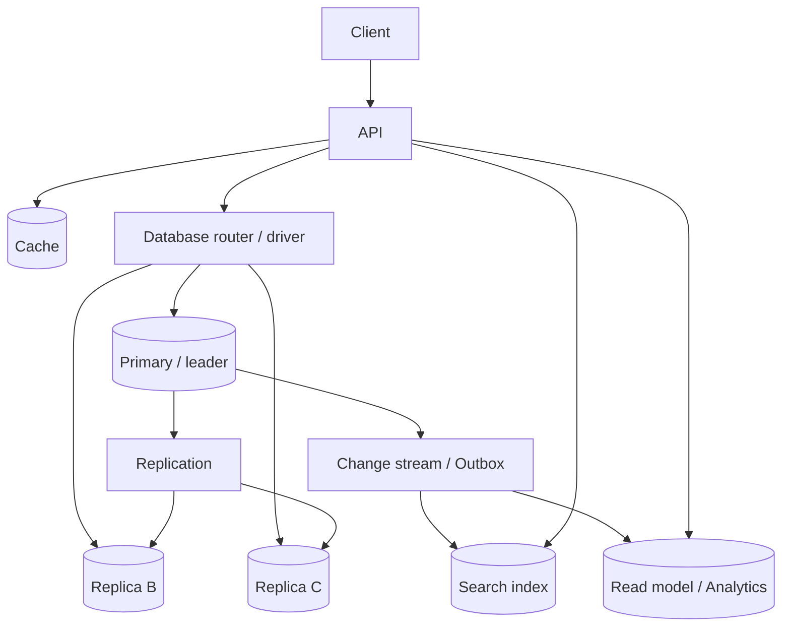

# Cấu hình đọc/ghi và các giả định cần nêu khi mô tả bảo đảm

## 1. Mở đầu: cùng một cơ sở dữ liệu, hai cách cấu hình cho hai kết quả khác nhau

Một ứng dụng đặt hàng lưu trạng thái đơn ở NoSQL database. Sau khi tạo đơn, API trả:

```http
HTTP/1.1 201 Created

{"orderId":"O1001","status":"PENDING"}
```

Người dùng lập tức mở màn hình chi tiết, nhưng có lúc màn hình trả **404** hoặc hiển thị phiên bản cũ. Có thể xảy ra lịch sau:

```text
10:00:00.000  Client ghi Order O1001 vào node A
10:00:00.025  Node A xác nhận thao tác ghi
10:00:00.030  API trả 201
10:00:00.040  Client đọc từ replica B
10:00:00.045  Replica B chưa nhận được O1001 -> 404
10:00:00.120  Replica B đồng bộ xong -> đọc thấy O1001
```

Một nhóm nói: “Database là eventual consistency nên chuyện đó bình thường.” Nhóm khác nói: “Đã dùng write quorum thì đọc nào cũng phải thấy.” Cả hai phát biểu đều **thiếu điều kiện**.

Để nhận định chính xác, phải biết:

- Lệnh ghi đã yêu cầu **mức xác nhận (acknowledgment)** nào?
- Ghi diễn ra trên **leader/primary**, một replica hay nhiều replica?
- Request đọc đi đến **nguồn**, replica, cache hay search index?
- Đọc dùng **read concern/consistency level** nào?
- Có **session token**, revision hoặc ràng buộc read-your-writes không?
- Replication là đồng bộ hay bất đồng bộ và có thể có lag bao lâu?
- Nếu có failover/network partition, những bảo đảm nào còn hiệu lực?
- Cam kết nói về **một key**, một document, một transaction hay nhiều dịch vụ?

Bài này hướng dẫn cách **cấu hình đọc/ghi và nêu giả định** khi mô tả consistency trong NoSQL. Trọng tâm không phải chọn một nhãn “strong” hoặc “eventual”, mà là mô tả một **hợp đồng kiểm chứng được** giữa ứng dụng và hệ lưu trữ.

## 2. Phân biệt ba câu hỏi thường bị gộp vào một

Một thiết kế đọc/ghi luôn có ít nhất ba câu hỏi độc lập:

| Câu hỏi | Nội dung | Ví dụ |
| --- | --- | --- |
| **Tính nhất quán (consistency)** | Lệnh đọc có thể nhìn thấy phiên bản nào, theo thứ tự nào? | Sau một ghi đã hoàn tất, read có còn được thấy giá trị cũ không? |
| **Độ bền (durability)** | Bản ghi đã xác nhận sống sót qua phạm vi lỗi nào? | Mất process, node hay cả AZ có làm mất ghi? |
| **Tính sẵn sàng (availability)** | Khi node hoặc mạng bị lỗi, hệ có tiếp tục trả lời yêu cầu không? | Có chấp nhận ghi tại replica còn sống khi mất liên lạc không? |

Một write có thể **đã được lưu bền** trên primary nhưng secondary đọc vẫn **stale**. Một giá trị có thể **đọc thấy ngay trong RAM** nhưng chưa có bảo đảm bền sau mất điện. Một hệ có thể bảo vệ thứ tự ghi mạnh bằng cách **từ chối** một số thao tác khi không có quorum.

**Không dùng “ghi thành công”, “majority”, “đọc mạnh” hoặc “có replica” làm từ đồng nghĩa cho nhau.**

### 2.1. ACID consistency và distributed consistency

Trong ACID, chữ **C** thường được giải thích theo việc transaction bảo toàn các ràng buộc dữ liệu/kiểu hợp lệ. Trong hệ phân tán, **consistency model** nói về các lịch quan sát đọc và ghi: linearizability, sequential consistency, causal consistency, eventual consistency và các session guarantee.

Hai cách dùng từ liên quan nhưng không tương đương. Một thao tác có thể được replica trả lời theo hợp đồng eventual consistency, trong khi dữ liệu trên từng node vẫn phải tuân schema. Ngược lại, một read linearizable không tự đảm bảo ứng dụng không tính sai số tiền hay phá invariant liên bản ghi.

## 3. Các mức bảo đảm cần biết

### 3.1. Strong consistency không phải một định nghĩa duy nhất

“Strong consistency” trong tài liệu sản phẩm có thể chỉ một khả năng đọc mới hơn tùy chọn, hoặc có nghĩa formal như **linearizability** trong một phạm vi cụ thể. Khi mô tả kiến trúc, nên gọi **tên mô hình chính xác** được sản phẩm cam kết và nói rõ phạm vi.

**Linearizability** yêu cầu mỗi thao tác có thể được xem như xảy ra tại một thời điểm logic nằm giữa lúc gọi và lúc trả lời, đồng thời tôn trọng thứ tự thời gian thực của các thao tác không chồng lấn.

Ví dụ, nếu write `x=2` **đã hoàn tất** trước khi một read mới bắt đầu, read linearizable trên cùng object không được trả `x=1`, giả sử không có write hợp lệ khác sau đó làm x quay lại 1.

### 3.2. Sequential consistency

Các thao tác có kết quả tương đương một thứ tự tuần tự phù hợp với thứ tự chương trình của từng actor, nhưng không nhất thiết phải tôn trọng toàn bộ thứ tự thời gian thực giữa các actor như linearizability.

### 3.3. Causal consistency

Các thay đổi có quan hệ **nhân quả** được các client quan sát theo thứ tự phù hợp. Ví dụ, B chỉ đăng bình luận sau khi đã thấy bài viết A; một người đọc theo causal guarantee không nên thấy bình luận phụ thuộc trong khi thiếu nội dung tiền đề theo đúng phạm vi bảo đảm.

Các thay đổi độc lập, đồng thời có thể chưa có một thứ tự toàn cục duy nhất.

### 3.4. Eventual consistency

Khi ngừng xuất hiện cập nhật mới và các điều kiện đồng bộ/khôi phục cần thiết được đáp ứng, các bản sao cuối cùng tiến tới trạng thái hội tụ theo mô hình hệ thống.

Điều này **không** tự cho biết:

- Đọc cũ tối đa bao nhiêu millisecond.
- Event chắc chắn không mất dù pipeline dừng vĩnh viễn.
- Client sẽ đọc thấy ghi của chính mình ngay.
- Mọi request thành công sau network partition đều nằm trong một thứ tự linearizable.
- Tất cả dữ liệu của mọi bảng hoặc dịch vụ có cùng độ trễ.

Nếu muốn cam kết độ trễ hữu hạn, cần một **bounded staleness guarantee** thực sự hoặc **SLO đo lường** cụ thể; không được suy giới hạn cứng từ từ “eventual”.

### 3.5. Session guarantees

Một số bảo đảm ở phạm vi session/client:

- **Read-your-writes:** một client đọc sau ghi của chính nó sẽ thấy ghi đó hoặc phiên bản mới hơn theo hợp đồng.
- **Monotonic reads:** sau khi thấy phiên bản mới, client không quay lại thấy phiên bản cũ hơn trong phạm vi session.
- **Monotonic writes:** các ghi của một client được áp dụng theo thứ tự cam kết.
- **Writes-follow-reads:** ghi sau một lần đọc tôn trọng quan hệ phụ thuộc cần thiết.

Những bảo đảm này có thể đòi token phiên, sticky routing, phiên bản tối thiểu hoặc cấu hình read/write thích hợp. **Dùng cùng một session object không tự tạo mọi bảo đảm** nếu database không hỗ trợ hoặc cấu hình không đáp ứng điều kiện.

## 4. Đọc/ghi thực sự đi qua những tầng nào?

Một kiến trúc thường có nhiều đường đọc:



Cần phân biệt ít nhất bốn điểm:

1. **Nguồn ghi có thẩm quyền**: nơi quyết định phiên bản và chấp nhận thay đổi.
2. **Replicas**: bản sao có thể đã hoặc chưa bắt kịp.
3. **Derived stores**: search, materialized view, vector index, analytics; có consistency contract riêng.
4. **Cache/CDN**: có thể trả stale ngay cả khi database nguồn đã nhất quán mạnh.

Một yêu cầu “read-your-writes” không đạt nếu API sau khi ghi thành công lại đọc một cached query result cũ không được invalidate, dù read concern của database nguồn đã cấu hình đúng.

### 4.1. Mốc thời gian khác nhau

```text
t0: client gửi write
t1: primary nhận write
t2: primary áp dụng write trong memory/log theo engine
t3: một số replica xác nhận nhận hoặc lưu thay đổi
t4: client nhận ACK write
t5: replica B bắt kịp
t6: search index nhận event
t7: search refresh và trả bản mới
t8: cache query được invalidated
```

Tại `t4`, client biết điều gì còn tùy **write policy**. Không được coi `t4=t5=t7=t8`, cũng không suy tất cả mốc luôn xảy ra theo đúng thứ tự đó trong mọi sản phẩm.

## 5. Cấu hình ghi nói lên điều gì?

Một hệ phân tán có thể cung cấp các tham số:

- **Write concern / consistency level**: số lượng hoặc loại replica cần xác nhận.
- **Journaling/WAL/sync policy**: ghi nào được lưu bền theo semantics engine.
- **Timeout**: chờ ACK tối đa bao lâu.
- **Transaction mode**: một item hay nhiều item được commit cùng nhau.
- **Conditional write**: ghi chỉ khi version/state còn khớp.
- **Idempotency token**: xử lý cùng operation gửi lại.

Chúng phục vụ **những câu hỏi khác nhau**.

### 5.1. ACK không đồng nghĩa tất cả bản sao đã đồng bộ

Ví dụ với ba replica, một write policy chỉ đòi một replica ACK có thể cho phép trả thành công trước khi hai replica còn lại có giá trị mới. Một write policy đòi majority có thể yêu cầu nhiều replica xác nhận hơn, nhưng semantics của ACK với **disk sync** và failure model vẫn cần xem tài liệu sản phẩm.

### 5.2. ACK có thể đến trước khi file dữ liệu được flush

Một storage engine có thể dùng WAL/journal và bộ nhớ đệm, rồi flush thành data pages hoặc SSTables sau. Một ghi được ACK trước khi flush dữ liệu chính vẫn có thể bền nếu cơ chế log đã cam kết đủ theo policy.

Không nên lấy việc “chưa thấy SSTable mới” làm bằng chứng ghi chưa thành công. Cũng không nên suy “có WAL” là chịu được mọi failure mode.

### 5.3. Timeout là trạng thái quan sát của client

```text
Client: gửi write O1001
Database: commit theo policy
Network: mất gói ACK
Client: timeout
```

Client không thể kết luận chắc chắn ghi thất bại. Nếu retry bằng một operation mới, có thể tạo đơn trùng. Cần **idempotency key**, conditional create hoặc truy vấn trạng thái operation.

**Timeout không phải một thao tác rollback.**

## 6. Cấu hình đọc nói lên điều gì?

Một cấu hình đọc có thể chọn:

- **Đọc primary/leader hay secondary/replica**.
- **Read concern / consistency level**.
- **Strongly consistent read** hay eventually consistent read, nếu sản phẩm cho chọn.
- **Snapshot/session token** hoặc minimum version.
- **Cache policy** và read-through/write-through.
- **Time budget**, retry và fallback khi node không đáp ứng.
- **Phạm vi kết quả**: một key, nhiều key, một transaction, index hay aggregate.

### 6.1. Chỉ chọn primary chưa đủ để suy mọi bảo đảm

Trong một primary–secondary architecture, đọc primary thường tránh một nguồn stale do secondary replication lag. Nhưng còn phải xét:

- Primary có thể đổi sau failover.
- Read concern cụ thể và dữ liệu đã majority-committed chưa.
- Khả năng rollback trong các sự cố theo topology/version.
- Cache/API có chen vào không.
- Multi-document query cần snapshot nhất quán hay không.

Một **primary read** không tự động là “mọi phép đọc đều linearizable trong mọi lỗi”.

### 6.2. Đọc nhiều bản ghi khác đọc một bản ghi

Một `GET /orders/O1001` có thể có strong read contract theo item. Một báo cáo đọc 10.000 orders qua nhiều partition/shard **chưa chắc là một snapshot toàn cục** tại một thời điểm.

Nếu báo cáo cần tính nhất quán giữa nhiều record, phải xem snapshot/transaction read hoặc watermark thích hợp, không chỉ bật strong read ở từng thao tác riêng.

### 6.3. Client không có quyền tự làm yếu read contract quan trọng

Nếu API hứa sau khi POST thành công sẽ GET thấy đơn, code không được âm thầm dùng secondary read eventual hoặc cache cũ chỉ vì nó nhanh hơn. Tương tự, nếu một UI chấp nhận hiển thị chậm vài giây thì cần truyền đạt rõ; không nên lẫn hai yêu cầu thành một default chung.

## 7. Công thức quorum: hiểu toán nhưng không suy quá mức

Một mô hình replicated store đơn giản thường dùng:

- **N**: số replica chứa một key.
- **W**: số replica cần ACK cho write.
- **R**: số replica cần phản hồi cho read.

Trực giác thường được dạy:

\[
R+W>N
\]

Nếu các tập replica thực sự được chọn theo cùng một membership ổn định, mọi read quorum và write quorum sẽ **có phần tử giao nhau**.

Ví dụ `N=3, W=2, R=2`:

```text
Replicas: A, B, C
Write quorum có thể là A+B
Read quorum có thể là B+C

Phần giao: B
```

Điều kiện giao nhau có thể giúp read lấy được thông tin về write đã ACK trong các protocol được thiết kế đúng.

**Nhưng công thức một mình không chứng minh linearizability hoặc serializability.**

### 7.1. Các giả định ẩn sau R + W > N

Phải kiểm tra ít nhất:

1. Read và write dùng **cùng tập replica** cho key trong phạm vi đánh giá.
2. Quorum được chọn từ **membership đúng**, không có thay thế làm mất tính giao nhau.
3. Replica phản hồi có dữ liệu/version hợp lệ theo giao thức.
4. Read reconciles các phiên bản/timestamp đúng cách.
5. Read/write concurrency và thứ tự ACK có semantics phù hợp.
6. Có/không có **sloppy quorum**, hinted handoff, repair và replica chưa bắt kịp.
7. Dữ liệu không được đọc từ cache hoặc read model ngoài quorum.
8. Không có write khác hợp lệ ghi đè sau đó.
9. Giao thức xử lý partition, failover và clock/version theo hợp đồng.

Do đó, phát biểu như **“Cassandra QUORUM + QUORUM = linearizable cho mọi thao tác”** là quá rộng. Cần phân biệt consistency level thông thường với **Lightweight Transaction (LWT)** và ràng buộc của từng loại operation.

### 7.2. Bảng minh họa quorum

| N | W | R | R+W>N? | Diễn giải trong mô hình giao quorum đơn giản |
| --- | --- | --- | --- | --- |
| 3 | 1 | 1 | Không | Các tập có thể không giao nhau |
| 3 | 2 | 1 | Không (bằng 3) | Read một replica có thể khác cả hai replica đã ACK nếu tập đọc không được phối hợp |
| 3 | 2 | 2 | Có | Các tập quorum phải giao nhau |
| 3 | 3 | 1 | Có | Một read bất kỳ trong cùng tập giao với write đã tới tất cả |
| 5 | 3 | 3 | Có | Hai tập ba trong năm luôn giao nhau |
| 5 | 2 | 2 | Không | Không bảo đảm giao nhau |

Bảng chỉ thể hiện **lập luận tập hợp**. Mô hình consistency sản phẩm thực tế phải đọc từ giao thức, read repair, version ordering, routing và failure handling, không suy trực tiếp từ bất đẳng thức.

### 7.3. Quorum và durability cũng tách biệt

Ngay cả nếu một write được hai replica ACK, vẫn phải hỏi:

- ACK là đã nhận trong memory hay đã đồng bộ log?
- Hai replica ở hai failure domain độc lập chưa?
- Điều gì xảy ra khi cả hai mất cùng volume/region?
- Có backup/PITR trước xóa nhầm không?

**Quorum không thay thế journaling, placement và backup.**

## 8. Các lịch quan sát thường gặp

### 8.1. Read sau write trên cùng primary

```text
Write x=2 to primary
ACK
Read x from primary with appropriate concern
```

Đường này có thể cung cấp mức quan sát mạnh hơn đọc secondary, **nếu** đúng contract sản phẩm và không có các tầng cache/stale khác.

### 8.2. Read sau write sang secondary chậm

```text
Write x=2 to primary -> ACK
Read x from secondary still at x=1
```

Đây là dạng **stale read** phổ biến khi replication bất đồng bộ hoặc read policy cho phép replica chưa bắt kịp.

### 8.3. Monotonic read bị phá do chuyển replica

```text
Client đọc replica A -> thấy x=2
Lần sau load balancer chọn replica B -> thấy x=1
```

Ngay cả khi lần GET đầu đã thấy phiên bản mới, lần thứ hai có thể lùi nếu session không có cơ chế bảo đảm minimum version.

### 8.4. Đọc sau khi failover

```text
Write trên primary cũ -> ACK theo policy yếu
Primary hỏng
Replica chưa có write được bầu làm primary
Read -> giá trị cũ
```

Nguy cơ này phụ thuộc chính sách write concern, election/replication và topology. Không thể mô tả chắc chắn nếu không biết cluster cụ thể.

### 8.5. Đọc thông qua cache

```text
Database x=2
Cache x=1
GET API đọc cache -> x=1
```

Tăng read concern của database không tự sửa cache. Đường đọc API cần invalidation/versioning hoặc bypass cache ở thao tác yêu cầu đọc mới nhất.

## 9. MongoDB: write concern, read concern và read preference

MongoDB có ba nhóm lựa chọn cần phân biệt:

1. **Write concern:** điều kiện xác nhận thao tác ghi.
2. **Read concern:** thuộc tính dữ liệu mà một read được phép quan sát.
3. **Read preference:** node nào được dùng để phục vụ read.

Ngoài ra còn có session, transaction, retryable writes và topology.

### 9.1. Write concern

Ví dụ lệnh ghi trong mongosh:

```javascript
db.runCommand({
  insert: "orders",
  documents: [
    { orderId: "O1001", status: "PENDING", version: 1 }
  ],
  writeConcern: {
    w: "majority",
    j: true,
    wtimeout: 5000
  }
});
```

Ý nghĩa khái niệm:

- `w: "majority"`: yêu cầu ACK theo điều kiện majority của replica set.
- `j: true`: yêu cầu acknowledgment liên quan journaling theo semantics hỗ trợ.
- `wtimeout: 5000`: giới hạn chờ thỏa write concern; hết hạn **không có nghĩa** thao tác được rollback.

Các mặc định, sự tương tác của majority và journal, cùng hiệu lực của từng option phụ thuộc MongoDB version/deployment. Khi vận hành, phải đối chiếu write concern thực trên driver/command, không chỉ một giá trị mặc định trong cấu hình cluster.

### 9.2. Read concern

Một số mức được MongoDB cung cấp tùy thao tác/topology:

- `local`: có thể đọc dữ liệu trên node phục vụ mà chưa phải majority committed.
- `majority`: đọc dữ liệu đáp ứng điều kiện majority-committed theo semantics của server.
- `linearizable`: mức read với mục tiêu linearizable cho trường hợp được hỗ trợ, gắn điều kiện node/operation và write concern thích hợp.
- `snapshot`: phục vụ một số transaction/snapshot read theo phạm vi hỗ trợ.

**Read concern majority không tự đồng nghĩa linearizable.** Nó nói về mức commit/visibility theo contract, không cho phép tùy tiện suy thứ tự thời gian thực mạnh nhất.

### 9.3. Read preference

Read preference có thể là `primary`, `secondary`, `secondaryPreferred` và các biến thể theo driver. Đọc từ secondary có thể tạo lag; `secondaryPreferred` còn có thể đổi đường đọc tùy topology, khiến độ mới của dữ liệu khó dự đoán nếu không theo dõi version.

Ví dụ trong mongosh, đọc primary với read concern majority:

```javascript
db.getMongo().setReadPref("primary");

db.orders.find(
  { orderId: "O1001" }
).readConcern("majority");
```

Cú pháp trình bày ý tưởng **chọn read preference/read concern**, cần xác nhận với API của client/version sử dụng. Với Java driver, có thể cấu hình read concern/read preference trên MongoClient, database, collection hoặc theo session/operation khi API hỗ trợ; cần xem nơi nào override giá trị.

### 9.4. Linearizable read có điều kiện

Khi nghiệp vụ cần phát biểu linearizability cho một document, phải xem:

- Loại read operation có được hỗ trợ với mức linearizable không?
- Đọc từ primary theo yêu cầu của mode chưa?
- Các writes liên quan có dùng write concern phù hợp, thường là majority theo hướng dẫn sản phẩm?
- Có đặt timeout phù hợp cho tình huống mất quorum không?
- Có cache/secondary/derived store đi vòng qua đường read đó không?

Không dùng một lệnh đọc `majority` rồi tự gắn nhãn **linearizable end-to-end API**.

### 9.5. Causal consistency trong session

MongoDB có cơ chế causal consistency trong session khi các điều kiện và read/write concern phù hợp. Với bài toán read-your-writes hoặc dependent reads, phải xét **session**, **operation time/cluster time** và dùng các mức concern được sản phẩm yêu cầu, thay vì chỉ chuyển read preference một cách tùy ý.

Ví dụ tưởng tượng:

```text
Session S:
  write Order O1001 with majority acknowledgment
  read Order O1001 with majority concern / causal session
```

Bảo đảm chỉ được nhận trong **phạm vi session và điều kiện tài liệu mô tả**. Một API khác không chuyển context phiên hoặc đọc search index không tự kế thừa causal relationship này.

### 9.6. MongoDB transaction và write concern

Transaction có thể gồm nhiều document, nhưng vẫn cần xác định:

- Read concern trong transaction.
- Write concern tại commit.
- Giới hạn transaction và write conflict.
- Hành vi khi commit trả unknown result/timeout.
- Mức isolation đã được tài liệu cam kết, không tự đặt tên serializable.

Nếu hai transaction đọc hai document rồi ghi hai document khác nhau trong một invariant liên bản ghi, phải đánh giá nguy cơ write skew theo mô hình isolation thực.

## 10. Cassandra: consistency level theo từng thao tác

Cassandra cho phép đặt **consistency level (CL)** ở các thao tác đọc/ghi. Các mức thường gặp:

| CL | Ý tưởng | Giới hạn |
| --- | --- | --- |
| `ONE` | Một replica đáp ứng điều kiện | Có thể đọc/ghi với mức quorum thấp và stale theo giao thức |
| `TWO`, `THREE` | Cần số replica tương ứng | Có thể không phù hợp nếu RF thấp |
| `QUORUM` | Quorum theo replication set thích hợp | Không tự tạo transaction serializable |
| `LOCAL_QUORUM` | Quorum trong data center cục bộ | Không buộc region/data center khác bắt kịp ngay |
| `ALL` | Tất cả replica liên quan xác nhận | Khả dụng thấp khi một replica không phản hồi |
| `LOCAL_ONE` | Một replica địa phương | Thường ưu tiên latency, đọc có thể stale |
| `SERIAL`, `LOCAL_SERIAL` | Mức serial/coordination trong LWT theo phạm vi | Không thay cho CL của mọi normal read/write |

### 10.1. Ví dụ với replication factor ba

```text
RF = 3
Replicas: A, B, C

Write CL=ONE:
  Một replica ACK có thể đủ.
  Replica khác có thể chưa bắt kịp.

Write CL=QUORUM:
  Cần quorum phù hợp theo protocol.

Read CL=ONE:
  Có thể đọc từ một replica chưa có giá trị mới.

Read CL=QUORUM:
  Có thể lấy và reconcile nhiều replica theo giao thức đọc.
```

Với `W=2, R=2, N=3`, có ý tưởng giao quorum nhưng vẫn cần xét **concurrent writes, timestamp conflict resolution, failed replicas, repair, hints, topology và semantics API**.

Không quảng bá “Cassandra QUORUM là linearizable mọi CRUD” chỉ dựa trên phép tính giao nhau.

### 10.2. Java Driver 4: chọn CL ở statement

Ví dụ cấu hình consistency level:

```java
import com.datastax.oss.driver.api.core.DefaultConsistencyLevel;
import com.datastax.oss.driver.api.core.cql.SimpleStatement;

SimpleStatement statement = SimpleStatement.builder(
        "SELECT value FROM settings_by_key WHERE tenant_id = ? AND key = ?")
    .addPositionalValues("T01", "homepage")
    .setConsistencyLevel(DefaultConsistencyLevel.LOCAL_QUORUM)
    .build();
```

Giả định bảng có primary key phù hợp với điều kiện truy vấn. Việc đặt `LOCAL_QUORUM` trên read statement không bảo đảm mọi write trước đó cũng dùng `LOCAL_QUORUM`, và không nói gì về cache khác ngoài Cassandra.

Khi cập nhật, cần đặt CL của write statement/driver profile riêng nếu workload yêu cầu.

### 10.3. LWT khi cần compare-and-set

Ví dụ:

```sql
UPDATE orders_by_id
SET status = 'CONFIRMED', version = 8
WHERE tenant_id = 'T01' AND order_id = 'O1001'
IF version = 7;
```

Cần đọc **[applied]** để biết điều kiện được áp dụng. LWT dùng cơ chế phối hợp riêng; ở driver phải xét serial consistency cùng ordinary consistency trong phạm vi và version được hỗ trợ.

**Một lệnh normal UPDATE theo timestamp không tương đương CAS.** Write quorum chỉ mô tả ACK/đường đồng bộ, không bảo vệ việc ứng dụng đã tính newValue từ stale read nếu không có điều kiện phù hợp.

### 10.4. Hints, repair và tombstone

Với Cassandra, hiểu CL còn cần biết:

- Replica có thể tạm không phản hồi hoặc lag.
- Hinted handoff/repair xử lý sai lệch theo semantics và giới hạn riêng.
- TTL/delete có thể tạo tombstone.
- Tombstone retention và repair ảnh hưởng nguy cơ dữ liệu xóa hồi sinh.
- CL ở read/write không thay thế kế hoạch repair.

Một bảo đảm có điều kiện cần nêu **RF, CL, data center, topology, failure scenario, trạng thái repair và loại operation**; chỉ ghi “QUORUM” là chưa đủ.

## 11. DynamoDB: eventual và strongly consistent reads

DynamoDB có các khả năng consistency khác nhau theo loại đường truy cập.

### 11.1. Base table và Local Secondary Index

Với GetItem, Query hoặc Scan trên **base table** trong phạm vi API hỗ trợ, có thể yêu cầu strongly consistent read bằng `ConsistentRead = true`. **Local Secondary Index (LSI)** cũng hỗ trợ strong read trong phạm vi phù hợp.

Mặc định nhiều thao tác đọc trên DynamoDB sử dụng **eventually consistent read**, nên không nên nghĩ rằng ngay sau một PutItem mọi GetItem mặc định đều được bảo đảm đọc mới nhất.

### 11.2. Global Secondary Index không hỗ trợ strongly consistent read

**GSI** được cập nhật bất đồng bộ và hỗ trợ eventually consistent read; đặt `ConsistentRead=true` cho Query GSI không tạo strong read.

Nếu API cần một xác nhận có thẩm quyền về trạng thái vừa ghi, đọc base item phù hợp thay vì coi GSI là nguồn strong consistency.

### 11.3. Java AWS SDK v2

Ví dụ GetItem strong read trên base table:

```java
import java.util.Map;
import software.amazon.awssdk.services.dynamodb.DynamoDbClient;
import software.amazon.awssdk.services.dynamodb.model.AttributeValue;
import software.amazon.awssdk.services.dynamodb.model.GetItemRequest;
import software.amazon.awssdk.services.dynamodb.model.GetItemResponse;

public GetItemResponse getOrderStrong(
        DynamoDbClient client,
        String orderId) {

    GetItemRequest request = GetItemRequest.builder()
        .tableName("Orders")
        .key(Map.of(
            "PK", AttributeValue.builder()
                .s("ORDER#" + orderId).build()
        ))
        .consistentRead(true)
        .build();

    return client.getItem(request);
}
```

Ví dụ giả định table chỉ có partition key **PK**. Nếu có sort key, phải cung cấp đầy đủ primary key. `consistentRead(true)` chỉ thay read consistency của đường truy cập được hỗ trợ; nó **không** tự biến GSI hay cache thành strong read.

### 11.4. Query/Scan và snapshot

Từng strong read của DynamoDB theo hợp đồng API không tự chứng minh một chuỗi nhiều page của Scan/Query trên bảng đang thay đổi là **snapshot toàn cục tại một thời điểm**. Nếu nghiệp vụ cần báo cáo nhất quán tại một mốc, xem transaction/snapshot/export hoặc thiết kế watermark riêng theo khả năng dịch vụ.

### 11.5. Conditional writes và transactions

Một PutItem có điều kiện hoặc UpdateItem với `ConditionExpression` có thể bảo vệ invariant ở item mà không phụ thuộc read trước đó từ GSI:

```text
UPDATE stock item
  SET available = available - :qty
  CONDITION available >= :qty
```

Nếu cập nhật nhiều item, cần cân nhắc `TransactWriteItems` và giới hạn dịch vụ. Strong read **không thay** conditional write: giữa một GetItem mạnh và một PutItem không điều kiện, tác nhân khác vẫn có thể thay đổi item.

### 11.6. Global tables và nhiều region

Khi dùng global tables/multi-region, không nên suy khả năng mạnh toàn cục chỉ từ `ConsistentRead=true` hoặc tên “global”. Các chế độ multi-region, replication/conflict handling và tính năng nhất quán có thể khác theo loại global table, region và phiên bản dịch vụ.

Cần ghi rõ:

- Table đang dùng chế độ/loại multi-region nào.
- Điều kiện đặt dữ liệu và vùng hỗ trợ.
- Write ở vùng nào và xác nhận ở đâu.
- Read trong cùng vùng hay vùng khác.
- Conflict resolution và failover contract.
- Độ trễ replication cùng điều kiện khi một region mất liên lạc.

Không suy rằng mọi global table là linearizable xuyên vùng, cũng không mặc định mọi triển khai nhiều vùng chỉ có một kiểu eventual consistency khi sản phẩm có các lựa chọn khác nhau.

## 12. Redis: atomic lệnh đơn, replication và persistence

Redis có thể thực hiện nhiều lệnh dữ liệu một cách atomic trên server phục vụ khóa. Điều này không tạo một bảo đảm read-after-write toàn hệ nếu:

- Read có thể đi tới replica lag.
- Primary thay đổi sau failover.
- Persistence policy không giữ ghi vừa ACK qua mất điện.
- Ứng dụng đọc thêm từ cache khác.

### 12.1. Lệnh ghi và replica ACK

Redis replication truyền dữ liệu từ primary sang replica theo semantics sản phẩm. Lệnh `WAIT` có thể chờ một số replica xác nhận đã nhận write của kết nối client trong điều kiện cụ thể, nhưng **không nên diễn giải WAIT thành cam kết ghi đã được fsync bền trên mọi replica hoặc không thể mất khi failover**.

Persistence bằng RDB/AOF và fsync policy là câu hỏi khác với replica acknowledgment. Một số phiên bản có cơ chế chờ AOF riêng, nhưng phải kiểm tra phiên bản và hợp đồng của đúng lệnh.

### 12.2. Ghi và đọc ở primary

Sau `SET` thành công, một GET tiếp theo qua cùng primary đang hoạt động có thể thấy giá trị vừa ghi theo semantics xử lý lệnh. Nhưng một GET trên replica lag hoặc sau failover có rủi ro khác.

Không viết câu khẳng định **“Redis luôn linearizable và durable”** vì còn phụ thuộc topology, failover và persistence.

### 12.3. Atomicity không thay ứng dụng kiểm tra điều kiện

```text
GET stock = 5
Java tính stock - 4 = 1
SET stock = 1
```

Hai client có thể cùng tính 1 rồi ghi. Dùng `DECRBY` hoặc Lua/WATCH có điều kiện ở nguồn theo yêu cầu nghiệp vụ; **replication acknowledgment** không sửa lỗi read–modify–write ngây thơ.

## 13. Search index, cache và materialized view phải có contract riêng

Một write đã đạt majority tại nguồn không đồng nghĩa search ngay lập tức trả record mới.

### 13.1. Search near-real-time

```text
Source DB write -> committed
Outbox/CDC -> search indexer
Search engine -> ACK indexing
Refresh -> document xuất hiện ở search
```

Có thể có hai độ trễ độc lập:

1. Source → search indexer.
2. Search indexing ACK → search visibility sau refresh.

Không mô tả **read-after-write mạnh ở endpoint tìm kiếm** chỉ bằng việc cấu hình strong read ở source.

### 13.2. Cache stale

Nếu API đọc Redis cache của kết quả list, cache có thể giữ giá trị cũ dù database đã cập nhật. Giải pháp tùy use case:

- Invalidate/write-through cache có thứ tự và kiểm tra lỗi.
- Gắn version ở cache item.
- Bypass cache cho read cần tính mới.
- Conditional response hoặc session token/minimum revision.
- Chấp nhận stale theo TTL/SLO được đo.

**TTL 30 giây không nhất thiết là cam kết dữ liệu chỉ stale tối đa 30 giây**, vì cache có thể được refresh bằng dữ liệu từ replica cũ, CDN có stale-while-revalidate hoặc tác vụ invalidation lỗi.

### 13.3. Materialized views

Một projection phục vụ dashboard có thể cập nhật bằng event bất đồng bộ. Nếu invariant yêu cầu cập nhật giá trị tài chính ngay, không dùng dashboard projection làm nguồn phân xử. Đường đọc analytical có thể chấp nhận lag, nhưng phải công bố watermark/SLO.

## 14. Read-your-writes và monotonic reads ở cấp ứng dụng

Giả sử người dùng lưu một cài đặt và mở lại màn hình:

```text
PATCH /settings -> 200 OK, version=42
GET /settings -> version=41
```

Ứng dụng có thể vi phạm kỳ vọng UX **read-your-writes**, dù một số đọc eventual của database là hành vi được phép.

### 14.1. Gắn version vào API

Có thể thiết kế:

```http
HTTP/1.1 200 OK
ETag: "settings-v42"

{"version":42,"theme":"dark"}
```

Sau đó client yêu cầu mức tối thiểu:

```http
GET /settings
X-Min-Version: 42
```

Server phải có cơ chế:

- Đọc từ nguồn có thẩm quyền.
- Hoặc chờ replica bắt kịp version 42 trong một deadline.
- Hoặc trả trạng thái rõ là chưa đáp ứng, không tự trả version 41 như dữ liệu mới.
- Không để client tự ép đọc dữ liệu tenant khác bằng token tùy ý.

Đây là **một mẫu thiết kế API**, không phải header chuẩn tự động được mọi NoSQL driver hỗ trợ.

### 14.2. Monotonic reads

Nếu client đã thấy version 42 ở một lần đọc, response sau trong cùng phạm vi guarantee không nên lùi về 41. Có thể dùng session token/minimum revision và routing theo khả năng sản phẩm.

Nếu client đổi device hoặc mất session token, phải quy định bảo đảm có tiếp tục hay không. **Scope** của guarantee là phần bắt buộc của hợp đồng.

### 14.3. Causal consistency

Một dependency:

```text
A: tạo bài viết P100
B: đọc P100 và tạo bình luận C200
C: đọc bình luận C200
```

Nếu C được bảo đảm đọc theo causal order, hệ cần quan sát các phụ thuộc nhân quả được hỗ trợ theo đúng contract. Chỉ thấy một event mới trên message broker không tự bảo đảm mọi projection khác đã thấy parent event.

## 15. Bounded staleness và SLO: phân biệt bảo đảm cứng với mục tiêu quan sát

Một số hệ có mô hình bounded staleness tường minh, ví dụ giới hạn theo **thời gian** hoặc **số phiên bản** trong điều kiện nhất định. Mô hình đó khác với một metric vận hành:

> Trong 99,9% yêu cầu bình thường, độ trễ replication nhỏ hơn 2 giây.

Câu trên là **SLO thống kê**, không phải chứng minh mọi read luôn stale ít hơn 2 giây. Khi có outage, một read có thể rất cũ hoặc fail.

### 15.1. Các định nghĩa lag khác nhau

```text
commitTime
replicaApplyTime
searchIndexTime
searchVisibilityTime
cacheInvalidateTime
clientObservationTime
```

Có thể đo:

\[
L_{\text{replica}} =
t_{\text{replica-applied}} - t_{\text{commit}}
\]

\[
L_{\text{search-visible}} =
t_{\text{search-visible}} - t_{\text{commit}}
\]

Nhưng những timestamp trên các máy khác nhau cần đồng bộ clock/trace/watermark đáng tin. Độ trễ hiển thị một tài liệu và độ trễ của cả hệ có thể không giống nhau.

### 15.2. Đừng chỉ đo phần đã hội tụ

Nếu dashboard chỉ tính lag của events đã xử lý, những event **kẹt vô hạn** có thể bị loại khỏi thống kê và tạo ảo tưởng pipeline khỏe.

Cần đo:

- Event pending quá deadline.
- Tuổi event lâu nhất.
- Số phiên bản thiếu hoặc sai.
- p95/p99 lag của các đường đọc quan trọng.
- Phân nhóm theo region/tenant/read model.

## 16. Snapshot consistency và truy vấn nhiều đối tượng

Một API báo cáo:

```text
GET /reports/total-balance
```

đọc các account khác nhau ở các thời điểm khác nhau có thể thấy một giao dịch chuyển tiền ở trạng thái trung gian:

```text
Account A: -100 đã ghi
Account B: +100 chưa thấy
```

Mỗi read riêng có thể “đúng” theo dữ liệu hiện hành tại lúc đó, nhưng tổng hợp nhiều read **không nhất thiết đại diện một snapshot nhất quán**.

### 16.1. Các phương án

- Transaction/snapshot read được engine hỗ trợ.
- Report theo một mốc watermark/offset đã hội tụ.
- Ghi ledger bất biến rồi aggregate từ những entry có trạng thái hoàn tất.
- Đọc từ một read model có contract snapshot riêng.
- Công bố rằng dashboard chỉ phản ánh số gần đúng/eventual nếu nghiệp vụ cho phép.

Không dùng “mọi read là strong” để thay cho việc xác định **snapshot đa bản ghi**.

### 16.2. Strong read không thay conditional write

Hai tác nhân đều dùng strongly consistent GetItem để thấy stock 5:

```text
A strong read -> 5
B strong read -> 5
A PutItem available=1
B PutItem available=1
```

Vẫn xảy ra lost update nếu hai PUT không có điều kiện. Read mới nhất tại thời điểm đọc **không khóa tương lai**. Cần conditional update/transaction/atomic operation.

## 17. Transaction isolation và các bất thường cần nêu

Các lỗi thường gặp:

| Bất thường | Mô tả | Cơ chế cần xem |
| --- | --- | --- |
| Dirty read | Đọc dữ liệu chưa commit rồi có thể bị rollback | Read concern/isolation |
| Non-repeatable read | Hai lần đọc cùng record trong transaction thấy giá trị khác nhau | Snapshot/repeatable-read semantics |
| Phantom | Truy vấn cùng predicate trong transaction trả thêm/bớt record | Isolation và predicate handling |
| Lost update | Ghi đè thay đổi dựa trên state cũ | Atomic operation, CAS, transaction |
| Write skew | Hai transaction ghi khác record nhưng phá invariant chung | Serializability/aggregate coordination |
| Stale replica read | Đọc phiên bản cũ trên một bản sao | Read CL/concern, routing |
| Stale materialized view | Projection chưa nhận thay đổi nguồn | Event lag, watermark, verification |

Không thể kết luận transaction an toàn chỉ từ API `BEGIN ... COMMIT`. Phải biết **isolation thực tế, tập đọc/ghi và giới hạn của engine**.

### 17.1. Ví dụ write skew

Quy định phải có ít nhất một bác sĩ trực:

```text
Doctor A onCall=true
Doctor B onCall=true

Transaction A đọc A,B -> hai người trực
Transaction B đọc A,B -> hai người trực

A đặt A.onCall=false
B đặt B.onCall=false
Cả hai commit
=> không còn ai trực
```

Hai transaction không ghi cùng document nên kiểm tra xung đột ghi trực tiếp có thể không phát hiện. Cần isolation/điểm phối hợp phù hợp với **invariant liên document**.

## 18. Retry, idempotency và outcome unknown

Một API tạo đơn:

```text
Client POST /orders requestId=R100
Server ghi thành công
ACK bị mất
Client retry requestId=R100
```

Nếu retry là một insert mới với ID khác, có thể tạo **hai đơn**.

### 18.1. Đặt idempotency key

```http
POST /orders
Idempotency-Key: ORDER-T01-R100
Content-Type: application/json

{"sku":"P100","quantity":1}
```

Server cần ràng buộc key với tenant/operation/payload và lưu kết quả theo cơ chế nhất quán với thao tác tạo đơn. Chỉ giữ key trong cache dễ mất mà không có giao thức khác có thể không đủ cho nghiệp vụ quan trọng.

### 18.2. CAS conflict khác timeout

- **CAS/condition failure rõ ràng:** điều kiện không còn đúng, cần đọc lại/tính lại hoặc trả conflict.
- **Network timeout sau request:** có thể đã commit, cần idempotency/tra cứu outcome.
- **Throttling:** retry với backoff/deadline theo SDK.
- **Read stale:** cân nhắc minimum version hoặc mức read concern.
- **Transaction aborted:** có thể retry toàn transaction khi an toàn, không trộn state cũ với state mới.

Không retry mù một phép tăng/giảm tiền hoặc stock không idempotent.

## 19. Failover, network partition và scope của cam kết

Một bảo đảm cần có **failure model**.

| Failure mode | Câu hỏi |
| --- | --- |
| Client disconnect | Write có thể đã commit nhưng ACK mất không? |
| Database process crash | Log/transaction recovery bảo vệ thao tác nào? |
| Một replica dừng | CL/concern có còn thỏa? Read có chuyển node không? |
| Primary failover | Ghi đã ACK có thể rollback theo policy nào? |
| Network partition | Hệ từ chối hay tiếp tục ghi ở từng phía? |
| Mất AZ | Replica placement có phân tán AZ không? |
| Mất region | Có cross-region guarantee/lag/conflict resolution không? |
| Restore backup cũ | Có replay update/delete sau backup không? |
| Lỗi cache/index | Đường read-your-writes có bypass/fail closed không? |

Một test failover của **một process** không chứng minh hệ an toàn khi **mất cả region**. Một write majority thành công trong một data center không tự chứng minh bản dữ liệu ấy đã ở mọi data center khác.

### 19.1. “Strong” có thể giảm availability trong partition

Nếu thiết kế muốn bảo vệ một thứ tự ghi chặt khi mất liên lạc, một phía có thể phải ngừng nhận write hoặc read mới tới khi khôi phục điều kiện phối hợp. Đây là một đánh đổi cần công bố, không phải lỗi bất ngờ.

### 19.2. Client side fallback có thể làm yếu guarantee

Ví dụ:

```text
Primary mạnh bị timeout
API tự fallback sang secondary eventual
API vẫn trả 200 và mô tả "dữ liệu mới nhất"
```

Hành vi này **thay đổi hợp đồng đọc**. Nếu muốn graceful degradation, response nên phân biệt stale/limited mode, hoặc từ chối khi use case yêu cầu strong read.

## 20. Cách viết một cam kết nhất quán đầy đủ

Phát biểu không đủ:

> Hệ thống dùng MongoDB majority nên dữ liệu luôn nhất quán.

Thay bằng mẫu:

> Với thao tác **CreateOrder** trên collection Orders ở replica set X, client ghi theo write concern Y. Sau khi nhận ACK, các lệnh **GetOrder** cùng tenant được phục vụ từ đường đọc Z với read concern R và session policy S; chúng được kỳ vọng quan sát tối thiểu revision đã ACK trong các điều kiện F. Search và dashboard là các bản chiếu bất đồng bộ, có SLO lag riêng. Khi failover/quorum không thỏa, API trả trạng thái lỗi hoặc pending theo contract, không thay bằng giá trị cũ mà vẫn gắn nhãn mới nhất.

### 20.1. Mẫu bảng cấu hình

| Mục | Phải ghi |
| --- | --- |
| **Product/version** | Engine, version, managed/self-hosted |
| **Data scope** | Key, document, partition, transaction, collection, region |
| **Source of truth** | Table/collection/item nào quyết định state |
| **Write operation** | API, transaction, conditional expression |
| **Write policy** | Write concern/CL, journal/sync và timeout |
| **Read operation** | GetItem/Query/Find/Search/API endpoint |
| **Read policy** | Read concern/CL, preference, session/min-version |
| **Read routing** | Primary/secondary/cache/index/region |
| **Guarantee name** | Linearizable, causal, session, eventual... theo phạm vi |
| **Concurrent behavior** | Conflict resolution, CAS, isolation, LWW |
| **Failure model** | Node, network, AZ/region, timeout, failover |
| **Staleness** | Bound thật hoặc SLO quan sát, không trộn hai loại |
| **Recovery** | Retry, idempotency, repair, reconciliation, restore |
| **Exceptions** | Cache, search, analytics và các đường không nằm trong cam kết |
| **Evidence** | Contract chính thức + config/runtime + integration tests |

### 20.2. Phân biệt “bảo đảm” với “kỳ vọng”

- **Bảo đảm được sản phẩm công bố:** phải trích đúng version/mode và điều kiện sử dụng.
- **Mục tiêu SLO của đội:** ví dụ 99,9% sau 2 giây; cần monitoring và error budget.
- **Giả định thiết kế:** topology ổn định, client dùng đúng session, dữ liệu không qua cache cũ.
- **Kết quả đo trên staging:** chỉ chứng minh những failure/workload đã thử, không tự thành bảo đảm pháp lý hoặc toán học.

Không dùng benchmark một lần làm bằng chứng cho mọi request tương lai.

## 21. Hai ví dụ hợp đồng API có mức nhất quán khác nhau

### 21.1. CreateOrder / GetOrder: cần read-your-writes

Hợp đồng có thể là:

```text
POST /orders
  -> chỉ trả success khi conditional write/transaction
     ở nguồn authoritative đã ACK theo write policy yêu cầu
  -> response có orderId và revision

GET /orders/{id}
  -> dùng đường đọc có thể đáp ứng revision tối thiểu
  -> nếu không thể bảo đảm, không trả dữ liệu cũ như "latest"
```

Các giả định:

- Client gửi orderId và revision/token đúng.
- Không đọc qua search index hoặc cache stale.
- Session/minimum revision được truyền khi cần.
- Timeout có trạng thái unknown/pending và idempotency.
- Failure mode được giới hạn rõ.

### 21.2. SearchOrders: chấp nhận eventual

```text
POST /orders -> nguồn đã commit
GET /orders/search?q=...
  -> đọc search index bất đồng bộ
  -> có thể chưa thấy order trong một khoảng lag
```

Hợp đồng:

- Search không dùng để xác nhận duy nhất trạng thái đơn vừa tạo.
- API chi tiết đọc nguồn authoritative.
- Đội vận hành công bố SLO visibility, watermark và cảnh báo.
- Khi index lỗi, không giả vờ “không có order” là kết luận nghiệp vụ cuối cùng.

Hai API trong cùng ứng dụng có thể **hợp lý khi dùng hai mô hình nhất quán khác nhau**.

## 22. Session token và authorization

Nếu client gửi minimum revision qua header, server phải:

- Gắn token với đúng tenant/user/resource/query scope.
- Chống token bị sửa nếu nó ảnh hưởng quyền truy cập hoặc routing.
- Không coi token client gửi là bằng chứng đã commit.
- Không dùng session token thay authorization.
- Giới hạn thời gian chờ replica tới version được yêu cầu.
- Định nghĩa khi token hết hạn, không tồn tại hoặc version không thuộc nguồn.

Consistency là câu hỏi **đã đọc phiên bản nào**; authorization là câu hỏi **có quyền đọc không**. Một read linearizable vẫn có thể lộ dữ liệu nếu access control sai.

### 22.1. Revocation cần một đường có thẩm quyền

Nếu quyền của user bị thu hồi nhưng search/ACL cache chưa bắt kịp, API không nên dựa vào eventual projection khi quyết định trả tài liệu nhạy cảm. Có thể cần kiểm tra quyền authoritative, revocation version hoặc cơ chế fail-closed phù hợp.

## 23. Những thay đổi không thể tùy tiện làm yếu consistency

### 23.1. Đổi read preference khi tăng tải

Chuyển `primary` sang `secondaryPreferred` có thể giảm tải primary, nhưng cũng có thể làm mất read-your-writes nếu không có causal/session policy thích hợp.

### 23.2. Thêm cache

Một cache phía trước API phải có hợp đồng invalidation, TTL và session handling; không tự thừa hưởng consistency của nguồn.

### 23.3. Tạo GSI hoặc search index

Một query được chuyển từ base table sang GSI có thể đổi từ strong read có hỗ trợ sang eventual. Đây là **thay đổi hành vi**, không chỉ tối ưu index.

### 23.4. Đưa hệ sang multi-region

Đường ghi/đọc trong một region không tự mở rộng thành linearizable toàn cầu. Phải xác minh cấu hình global table, replica policy và conflict resolution.

### 23.5. Thêm retry và load balancer

Retry sau timeout có thể tạo tác dụng phụ trùng, còn load balancer chọn replica khác có thể phá monotonic reads. Cần xem cả đường request lẫn state/version.

## 24. Thiết kế phép đo consistency thay vì chỉ đo latency

Một benchmark chỉ đo “GET mất 5 ms” không thể chứng minh nó đọc dữ liệu mới nhất.

### 24.1. Test read-after-write

```text
1. Ghi key K với revision mới V.
2. Chờ ACK theo write policy.
3. Ngay lập tức đọc K qua endpoint được công bố.
4. Ghi lại revision trả về và read policy/routing.
5. Lặp dưới tải, nhiều replica và failover.
```

Nếu contract yêu cầu read-your-writes, test phải kiểm tra **revision >= V** trong phạm vi đã nêu, không chỉ so một field có thể quay lại giá trị cũ.

### 24.2. Test monotonic reads

```text
Client đọc revision 8
Client chuyển sang node khác
Client đọc lần nữa
```

Nếu scope bảo đảm monotonic, revision 7 là vi phạm dù server vẫn trả HTTP 200.

### 24.3. Test concurrent writers

Hai actor cùng đọc version 7 rồi gửi conditional update:

```text
A: expectedVersion=7
B: expectedVersion=7
```

Kết quả mong đợi trong phạm vi một item được CAS atomic: không thể cả hai cùng áp dụng update dựa trên version 7.

### 24.4. Test quorum/failover

Trong môi trường cô lập:

- Dừng một replica.
- Mô phỏng network partition phù hợp.
- Quan sát write/read timeout.
- Thử failover sau những ghi đã ACK theo nhiều policy.
- Kiểm tra revision ở nguồn mới.
- Phân biệt request **unknown** và **đã bị từ chối**.

Không gây chaos trên production nếu chưa có kế hoạch và phạm vi được phê duyệt.

### 24.5. Test search/cache lag

Sau khi source commit revision V:

- Đo bao lâu search trả V.
- Đo bao lâu cache list/detail trở nên mới.
- Theo dõi stale hit, missing document và read repair.
- Không bỏ khỏi thống kê các item chưa hội tụ quá deadline.

## 25. Giám sát các bảo đảm đọc/ghi trong production

| Metric | Mục đích |
| --- | --- |
| `write_ack_latency_p95/p99` | Chi phí thỏa write policy |
| `write_concern_timeout_count` | Ghi không nhận đủ ACK trong deadline |
| `read_consistency_timeout_count` | Read không thỏa yêu cầu |
| `replication_lag` | Tình trạng replica chậm |
| `minimum_revision_violation` | Read trả version thấp hơn mức session yêu cầu |
| `read_your_writes_failure_count` | Kiểm tra contract API |
| `conditional_write_conflict_count` | Cạnh tranh ghi được phát hiện |
| `transaction_abort_count` | Xung đột hoặc giới hạn transaction |
| `unknown_commit_outcome_count` | Client timeout không rõ đã commit |
| `idempotency_duplicate_count` | Request lặp được phát hiện |
| `cache_stale_hit_count` | Cache trả dữ liệu cũ |
| `search_visibility_lag` | Độ trễ source → search |
| `oldest_pending_projection_age` | Dữ liệu dẫn xuất kẹt lâu |
| `failover_recovery_time` | Thời gian chuyển trạng thái node/region |
| `reconciliation_mismatch_count` | Sai lệch dài hạn giữa nguồn và bản chiếu |

Giám sát theo **loại operation, tenant, region và đường đọc**. Một giá trị replica lag trung bình thấp có thể che một partition/kho dẫn xuất đang kẹt hàng giờ.

## 26. Quy trình quyết định cấu hình nhất quán

### Bước 1 — Liệt kê thao tác

Ví dụ:

```text
CreateOrder
ConfirmPayment
ReserveStock
GetOrder
SearchOrders
ListRecommendations
ReportRevenue
```

### Bước 2 — Viết kỳ vọng quan sát

Với từng thao tác, hỏi:

- Read sau write phải thấy ngay không?
- Có cần monotonic reads cho cùng session không?
- Có cần snapshot nhiều record không?
- Có được đọc stale trong bao lâu?
- Khi không thỏa bảo đảm, trả lỗi hay giá trị cũ?
- Có thể có nhiều writer ở nhiều region không?

### Bước 3 — Xác định nguồn có thẩm quyền

Chỉ rõ collection/table/item và ranh giới atomicity. Cache/search không phải lúc nào cũng có quyền quyết định.

### Bước 4 — Chọn write configuration

Ghi cụ thể:

```text
Write concern / CL:
Journal / sync:
Transaction boundary:
Conditional write:
Timeout:
Idempotency:
```

### Bước 5 — Chọn read configuration

```text
Read concern / CL:
Read preference:
Session / minimum version:
Cache policy:
Index or base table:
Region:
Timeout and fallback:
```

### Bước 6 — Nêu failure model

Process crash, node failure, AZ/region failure, partition và failover; trường hợp nào sẽ tiếp tục phục vụ và trường hợp nào từ chối request?

### Bước 7 — Đọc đúng tài liệu phiên bản

Không suy contract từ một bài tổng quan NoSQL. Đọc sản phẩm, phiên bản, topology và chế độ đang dùng; kiểm tra option nào được driver thực sự gửi.

### Bước 8 — Kiểm thử trên các lịch thực thi

Dùng test hai actor, read-after-write, monotonic read, snapshot, timeout, failover và replay/repair theo các scenario cần bảo vệ.

### Bước 9 — Thiết lập observability

Thêm metric ACK, conflict, lag, unknown outcome, stale read và read-model convergence. Phân biệt **guarantee của engine** với **SLO của pipeline ứng dụng**.

### Bước 10 — Viết contract chính xác và giới hạn

Gắn mỗi câu kết luận với:

```text
Product + Version + Topology
Operation + Key/Transaction Scope
Write Policy + Read Policy
Routing + Session Context
Failure Model + Exceptions
Evidence + Monitoring
```

## 27. Các hiểu nhầm thường gặp

| Hiểu nhầm | Cách hiểu đúng |
| --- | --- |
| “NoSQL luôn eventual.” | Mỗi hệ/operation có mô hình và cấu hình riêng |
| “Strong consistency là một nút bật chung toàn hệ.” | Phải nêu scope, read path và định nghĩa formal |
| “Write ACK nghĩa là mọi replica đã có dữ liệu.” | Phụ thuộc write concern/CL |
| “Replica đã ACK nghĩa là fsync.” | Replication ACK và local durability có semantics khác |
| “R+W>N là đủ chứng minh linearizability.” | Cần giao thức, membership, version handling và giả định khác |
| “QUORUM tạo transaction nhiều key.” | Quorum acknowledgment khác isolation/transaction |
| “Read majority luôn linearizable.” | Cần phân biệt read concern majority/linearizable theo sản phẩm |
| “Đọc primary là strong cho mọi trường hợp.” | Phải xét read concern, failover và cache |
| “DynamoDB ConsistentRead=true áp được cho GSI.” | GSI chỉ hỗ trợ eventual read |
| “Strong GetItem trước PutItem ngăn mọi race.” | Giữa read và write vẫn có actor khác; cần condition |
| “Redis WAIT bảo đảm ghi đã bền trên mọi replica.” | WAIT không mặc nhiên là disk persistence guarantee |
| “Transaction có nghĩa không write skew.” | Isolation thực tế quyết định |
| “Eventual nghĩa là tối đa 1 giây.” | Không có bound nếu chưa được cam kết/đo rõ |
| “TTL cache bằng 30 giây nên không thể stale quá 30 giây.” | Cache refill và các tầng khác có thể stale |
| “Timeout chứng minh write chưa commit.” | ACK có thể bị mất sau commit |
| “Search chưa thấy nên source chưa ghi.” | Search có index/refresh lag |
| “Có backup/replication nghĩa là linearizable.” | Backup/durability tách khỏi consistency |
| “Test ở staging chứng minh mọi failure mode.” | Test chỉ chứng minh kịch bản và cấu hình đã thử |

## 28. Bài tập thực hành

### Bài 1 — Viết rõ hợp đồng

Một nhóm ghi: “Orders dùng strong consistency”.

**Hỏi:** Cần bổ sung những điều kiện nào?

**Gợi ý:** Sản phẩm/version, operation, key/transaction scope, write policy, read policy/routing, session, failure model, timeout, cache/index và cách kiểm chứng.

### Bài 2 — Read-after-write

A ghi x=5 vào primary rồi ACK. B đọc replica chưa nhận x=5, trả 4.

**Hỏi:** Bảo đảm nào không đạt nếu API hứa read-your-writes ngay cho A? Có thể xử lý thế nào?

**Gợi ý:** Dùng đường đọc có thẩm quyền/mức read phù hợp, session/minimum version, chờ replica hoặc trả chưa sẵn sàng; không trả stale mà vẫn hứa latest.

### Bài 3 — Quorum

RF/N=3, W=2, R=2.

**Hỏi:** Vì sao có giao nhau giữa tập read và write? Điều đó có đủ kết luận mọi operation linearizable không?

**Gợi ý:** Hai tập hai trong ba luôn giao nhau; vẫn cần xét protocol, concurrent operations, version ordering, topology và read repair.

### Bài 4 — Majority nhưng cache cũ

MongoDB ghi majority thành công; API GET đọc cache giữ revision 8 trong khi nguồn đã ở revision 9.

**Hỏi:** Chỉnh write concern có tự sửa GET không?

**Gợi ý:** Không. Cần cache invalidation/version hoặc bypass cho đường cần mới nhất.

### Bài 5 — DynamoDB GSI

PutItem thành công ở base table, Query GSI ngay sau đó không thấy item.

**Hỏi:** Có thể suy PutItem thất bại không? Cấu hình ConsistentRead=true trên GSI có giải quyết không?

**Gợi ý:** Không. GSI cập nhật eventual và không hỗ trợ strong read; dùng base table GetItem strong theo API nếu cần xác minh.

### Bài 6 — Cassandra LOCAL_QUORUM

Ghi ở data center A với LOCAL_QUORUM, rồi đọc data center B ngay.

**Hỏi:** Có thể mặc định B đã thấy không?

**Gợi ý:** Không. LOCAL_QUORUM nói về phạm vi địa phương; cần xem replication và read policy ở B.

### Bài 7 — Strong read trước ghi

A/B cùng strongly consistent read stock=5 rồi mỗi người gửi PutItem stock=1 không điều kiện.

**Hỏi:** Đã tránh lost update chưa?

**Gợi ý:** Chưa. Read mạnh không khóa khoảng thời gian tới write; cần conditional atomic decrement hoặc transaction.

### Bài 8 — Timeout

Client gửi CreateOrder, database commit nhưng ACK mất.

**Hỏi:** Retry một lệnh insert với ID mới có rủi ro nào?

**Gợi ý:** Tạo trùng đơn; dùng idempotency key/conditional insert và tra cứu outcome.

### Bài 9 — Monotonic reads

Client lần đầu đọc version 10 trên replica A, lần sau đọc version 9 trên replica B.

**Hỏi:** Đây là vi phạm bảo đảm gì nếu API đã hứa trong cùng session?

**Gợi ý:** Monotonic reads. Cần minimum revision/session routing hoặc cơ chế tương đương.

### Bài 10 — Search và refresh

Indexing API ACK nhưng search chưa thấy tài liệu.

**Hỏi:** Có chắc dữ liệu không được ghi nhận không?

**Gợi ý:** Không. Phải xem refresh/visibility và pipeline; index ACK và search visibility là các mốc khác.

### Bài 11 — Transaction nhiều record

Hai bác sĩ cùng đọc “có hai người trực” rồi mỗi người update record của mình thành nghỉ.

**Hỏi:** Vì sao write conflict chỉ trên cùng document chưa đủ?

**Gợi ý:** Write skew do invariant liên record; cần isolation/điểm phối hợp phù hợp.

### Bài 12 — Bounded staleness

Đội vận hành có p99 replication lag=1,5 giây.

**Hỏi:** Có thể công bố “mọi read stale tối đa 1,5 giây” không?

**Gợi ý:** Không. p99 là thống kê, không phải bound cứng; cần xét request chưa hội tụ và failure modes.

### Bài 13 — Failover

Write được ACK theo policy yếu trên primary; primary lỗi trước khi replica nhận update.

**Hỏi:** Kết quả sau failover có thể ra sao?

**Gợi ý:** Có thể đọc giá trị cũ hoặc write bị rollback tùy sản phẩm/policy; phải nêu phạm vi durability và bầu primary.

### Bài 14 — Phân biệt durability và consistency

Một store trong RAM trả ngay giá trị mới nhưng mất dữ liệu khi host bị mất điện.

**Hỏi:** Đọc thấy giá trị mới có chứng minh durability không?

**Gợi ý:** Không. Visibility/read consistency và persistence sau lỗi khác nhau.

### Bài 15 — Soạn cấu hình cho hai endpoint

Thiết kế:

```text
POST /orders
GET /orders/{id}
GET /orders/search
```

**Hỏi:** Endpoint nào cần read-your-writes? Endpoint nào có thể chấp nhận eventual theo nghiệp vụ? Cần công bố điều gì?

**Gợi ý:** GetOrder sau CreateOrder thường cần nhìn thấy đơn vừa tạo; SearchOrders có thể có SLO index lag riêng. Cần nêu write ACK, read path, session/version, failure mode và behavior khi stale.

## 29. Checklist tóm lược khi mô tả một bảo đảm

Trước khi viết “hệ thống nhất quán mạnh” hoặc “hệ thống eventually consistent”, hãy tự trả lời:

1. **Đang nói tới operation nào?** GetItem, Query, transaction, search hay dashboard?
2. **Scope nào?** Một key/document, partition, collection, transaction, region hay nhiều service?
3. **Write đã được xác nhận theo điều kiện nào?** Số replica, journal, timeout?
4. **Read dùng điều kiện nào?** Read concern/CL, primary/secondary, index/cache?
5. **Client có session/minimum revision không?**
6. **Có concurrent writers và conditional write không?**
7. **Độ trễ có bound thật hay chỉ SLO thống kê?**
8. **Đường đọc có derived projection không?**
9. **Network partition, node crash, failover sẽ ảnh hưởng thế nào?**
10. **Client timeout/retry được xử lý idempotent chưa?**
11. **Bằng chứng từ documentation/runtime config/test ở đâu?**
12. **Những điều kiện ngoại lệ hoặc chưa được kiểm chứng là gì?**

Nếu thiếu một câu trả lời quan trọng, hãy **giới hạn phát biểu** thay vì mặc định database mang lại bảo đảm đó.

## 30. Kết luận

**Cấu hình đọc và cấu hình ghi là hai phần của cùng một hợp đồng nhất quán, nhưng không tự có cùng ý nghĩa.** Write concern/consistency level quy định điều kiện xác nhận ghi, còn read concern/read preference/session và routing quyết định những phiên bản có thể được quan sát. Durability, availability, transaction isolation và business invariant là những trục cần xét riêng.

Công thức quorum giúp hiểu giao nhau giữa các tập replica, nhưng không đủ để tuyên bố linearizability. MongoDB có write/read concern, read preference và causal sessions với điều kiện riêng; Cassandra dùng consistency level và LWT cho conditional writes; DynamoDB phân biệt base table/LSI strong reads với GSI eventual; Redis có lệnh atomic, replication và persistence với các bảo đảm khác nhau. Cache, search index và multi-region càng khiến một câu “đã ghi thì đọc thấy ngay” cần phạm vi cụ thể.

**Một bảo đảm đáng tin phải nêu rõ sản phẩm và phiên bản, operation và scope, write policy, read policy, routing, session, concurrent behavior, failure model, ngoại lệ và bằng chứng kiểm chứng.** Khi các giả định ấy được viết thành hợp đồng cụ thể, hệ thống mới có thể cân bằng latency, availability và tính đúng đắn mà không dựa vào các nhãn nhất quán mơ hồ.
