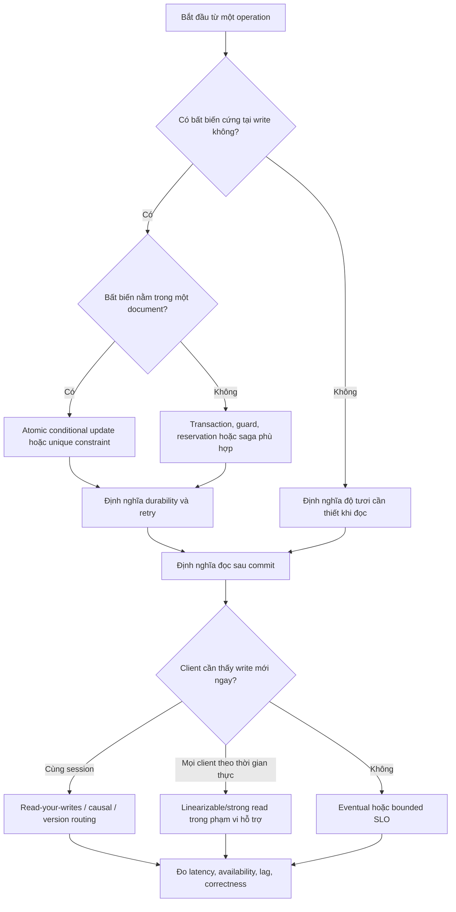

# Lựa chọn mức nhất quán từ yêu cầu nghiệp vụ cụ thể

Trong một ứng dụng NoSQL, không phải mọi thao tác đều cần nhìn dữ liệu mới nhất trên mọi node. Trang danh mục có thể chấp nhận giá sản phẩm được làm mới sau vài giây, nhưng thao tác xác nhận **ghế cuối cùng** không được tạo hai đặt chỗ hợp lệ. Người dùng vừa sửa hồ sơ cần thấy tên mới khi tải lại, còn bảng xếp hạng có thể tổng hợp chậm một phút. Một nghiệp vụ chuyển tiền lại có thêm yêu cầu không mất bút toán, không chuyển hai lần và bảo toàn số dư.

Vì vậy, câu hỏi thiết kế không nên là:

> “NoSQL này nên bật strong consistency hay eventual consistency?”

Câu hỏi chính xác hơn là:

> **“Đối với thao tác nghiệp vụ này, trạng thái nào phải luôn đúng, dữ liệu được phép cũ bao lâu, ai cần nhìn thấy lần ghi nào, và hệ thống phải hành xử ra sao khi node hoặc mạng gặp sự cố?”**

Bài học trình bày một phương pháp lựa chọn mức nhất quán **từ yêu cầu nghiệp vụ** thay vì từ tên công nghệ. Các ví dụ dựa trên đặt hàng, tồn kho, hồ sơ, phân quyền, thanh toán, báo cáo và dữ liệu phân tán; phần thực hành dùng MongoDB và đối chiếu DynamoDB, Cassandra, Redis và các read model tìm kiếm.

Mục tiêu sau bài học là có thể viết một **hợp đồng nhất quán kiểm thử được** cho từng thao tác, xác định cơ chế bảo vệ bất biến và chọn đánh đổi hợp lý giữa **độ đúng, độ tươi dữ liệu, độ trễ, khả dụng và chi phí**.

---

## 1. Trước tiên phải định nghĩa “nhất quán” đang nói tới điều gì

Từ *consistency* trong tài liệu dữ liệu có nhiều nghĩa. Nếu không tách chúng, rất dễ chọn sai công cụ.

| Khía cạnh | Câu hỏi | Ví dụ |
| --- | --- | --- |
| **Replica consistency** | Các replica/client thấy phiên bản nào, theo thứ tự nào? | Secondary trả hồ sơ cũ sau khi primary đã ghi mới |
| **Session guarantees** | Một client có thấy lại write của chính mình, có đọc “lùi” không? | Người dùng sửa tên rồi refresh vẫn thấy tên mới |
| **Snapshot consistency** | Nhiều lần đọc có thuộc cùng một trạng thái logic không? | Báo cáo doanh thu và chi tiết đơn cùng một mốc |
| **Transaction isolation** | Các giao dịch đồng thời có thể quan sát và ghi đè nhau thế nào? | Hai quản trị viên cùng sửa quota |
| **ACID Consistency** | Trạng thái commit có thỏa bất biến nghiệp vụ không? | Tồn kho không âm, mỗi ghế chỉ một reservation |
| **Durability** | Ghi đã commit có sống sót qua lỗi được cam kết không? | Đơn đã xác nhận còn sau crash |
| **Convergence của read model** | Cache/search/analytics có bắt kịp nguồn dữ liệu không? | Search index cập nhật sau 5 giây |

**Một mức read consistency không thay thế được điều kiện ghi nghiệp vụ.** Ví dụ, đọc một số tồn kho hoàn toàn mới nhưng tiếp theo dùng hai lệnh ghi không nguyên tử vẫn có thể bán quá số lượng.

Ngược lại, tồn kho được bảo vệ bằng atomic conditional update vẫn có thể xuất hiện hơi cũ trên trang danh mục nếu trang đọc từ cache.

### 1.1. Hai chiều khác nhau: hợp lệ và mới

Giả sử tồn kho thật đã giảm từ 2 xuống 1 bằng một thao tác hợp lệ.

- Trang đọc replica cũ và hiển thị **2**: dữ liệu hiển thị *stale*, nhưng nghiệp vụ tại nguồn có thể vẫn đúng.
- Hai thao tác giảm tồn kho không có điều kiện khiến giá trị trở thành **-1**, rồi mọi replica hội tụ về -1: các replica có thể đã nhất quán với nhau, nhưng **bất biến nghiệp vụ sai**.

Vì vậy, thiết kế phải trả lời độc lập:

1. **Trạng thái nào được phép commit?**
2. **Những người đọc nào phải thấy trạng thái nào và khi nào?**

---

## 2. Bắt đầu từ bất biến nghiệp vụ, không phải từ cấu hình database

**Bất biến** (*invariant*) là điều kiện phải giữ đúng tại những ranh giới hệ thống đã cam kết.

Ví dụ:

| Nghiệp vụ | Bất biến | Phạm vi |
| --- | --- | --- |
| Tồn kho | `availableStock >= 0` | Một SKU/document nếu mô hình phù hợp |
| Đặt ghế | Một `(tripId, seatId)` chỉ có một đặt chỗ đã xác nhận | Nhiều reservation |
| Thanh toán | Một `paymentId` không được ghi nhận hai lần | Nhiều request/retry, ledger |
| Chuyển tiền | Một transfer có tổng bút toán Nợ/Có cân bằng | Nhiều document/tài khoản |
| Quota | Số tài nguyên đã cấp không vượt giới hạn | Một tenant, nhiều mục |
| Mã đơn | `(tenantId, externalOrderId)` không bị trùng | Nhiều document |
| Quyền truy cập | Người đã bị thu hồi quyền không tiếp tục được phép thao tác nhạy cảm | Auth service, cache, nhiều request |
| Quy trình đơn | Không chuyển từ `CANCELLED` sang `SHIPPED` khi workflow cấm | Trạng thái đơn |
| Báo cáo | Tổng tính từ cùng tập dữ liệu và mốc cần thiết | Nhiều collection/read model |

Một số quy tắc có thể dùng **unique index** hoặc **atomic update** trên một document. Một số khác cần **transaction đa document**, **guard/version chung**, **reservation** hoặc một quy trình điều phối.

### 2.1. Phân biệt invariant cứng và mục tiêu trải nghiệm

- **Invariant cứng:** “Không bao giờ xác nhận hai người sở hữu cùng một ghế.”
- **SLO trải nghiệm:** “Sau khi đặt thành công, màn hình đơn của tôi hiển thị đơn trong tối đa 1 giây.”
- **SLO dữ liệu dẫn xuất:** “Bảng xếp hạng phản ánh cập nhật trong vòng 60 giây.”
- **Quy định an toàn:** “Sau khi quyền bị thu hồi có hiệu lực, API nhạy cảm không được cấp truy cập mới.”

Bốn câu đều nói đến dữ liệu “đúng”, nhưng yêu cầu cơ chế khác nhau.

Bất biến cứng cần bảo vệ **tại điểm quyết định/commit**, không phải chỉ sửa chậm ở job đối soát.

### 2.2. Quy tắc nghiệp vụ có thể có trạng thái trung gian hợp lệ

Một đơn hàng có thể đi qua:

```text
CREATED -> STOCK_RESERVED -> PAYMENT_PENDING
        -> PAID -> CONFIRMED -> FULFILLED
```

Không nhất thiết mọi bước phải nằm trong một transaction xuyên nhiều dịch vụ. Nếu ứng dụng **định nghĩa rõ** `PAYMENT_PENDING` là trạng thái hợp lệ và không cho giao hàng trước khi thanh toán, hệ vẫn có thể bảo toàn các bất biến bằng state machine và workflow.

Đừng nhầm **trạng thái đang xử lý** với **trạng thái dữ liệu sai**.

---

## 3. Định nghĩa độ tươi: “cũ bao lâu là chấp nhận được?”

*Freshness* hay *staleness* là độ mới của dữ liệu được quan sát so với trạng thái nguồn có thẩm quyền.

Một yêu cầu mơ hồ:

> “Thông tin hồ sơ phải khá mới.”

Một yêu cầu kiểm thử được:

> “Sau khi thao tác cập nhật hồ sơ trả thành công, các lần đọc của cùng người dùng trong phiên làm việc phải thấy bản cập nhật hoặc phiên bản mới hơn.”

Một yêu cầu khác:

> “Trong điều kiện hệ thống bình thường, 99% kết quả tìm kiếm cần phản ánh thay đổi danh mục trong 10 giây.”

Ở ví dụ tìm kiếm, **10 giây là SLO giả định của sản phẩm**, không phải thời gian được bất kỳ database nào tự bảo đảm.

### 3.1. Các dạng freshness có thể chọn

| Yêu cầu | Ý nghĩa | Cơ chế đáng cân nhắc |
| --- | --- | --- |
| **Đọc mới nhất theo thời gian thực** | Read bắt đầu sau khi write hoàn tất phải thấy write đó, theo hợp đồng đối tượng/phạm vi | Linearizable read hoặc nguồn có thẩm quyền với giao thức phù hợp |
| **Read-your-writes** | Client nhìn thấy ghi của chính mình trong session | Session guarantees, causal consistency, sticky/consistent routing |
| **Monotonic reads** | Client đã thấy version N thì không thấy version cũ hơn N | Session version token, causal/monotonic read |
| **Causal order** | B được tạo dựa trên A thì không nhìn B mà thiếu A trong phạm vi bảo đảm | Causal consistency, dependency tracking |
| **Snapshot nhất quán** | Nhiều document/read cùng một trạng thái logic | Snapshot read/transaction hoặc versioned projection |
| **Bounded staleness** | Dữ liệu trễ không quá một ngưỡng về thời gian/phiên bản theo hợp đồng | Cơ chế hỗ trợ bounded staleness hoặc routing/lag guard |
| **Eventual visibility** | Chấp nhận một khoảng trễ và hội tụ khi điều kiện đủ | Async replication, cache/search projection |

**Không biến một SLO đo được thành bảo đảm chính thức của database nếu sản phẩm không hỗ trợ.** Ví dụ có thể đo “99% search index cập nhật trong 10 giây”, nhưng đó thường là SLO của **pipeline ứng dụng**, không phải strong consistency của search engine.

### 3.2. Độ tươi được tính từ mốc nào?

Một hợp đồng tốt ghi rõ:

- Bắt đầu tính từ **khi request write được nhận** hay **khi write đã được commit/ACK**?
- Đo ở **nguồn dữ liệu**, **replica**, **cache** hay **search index**?
- Áp dụng cho **cùng người dùng**, **mọi người dùng**, **cùng region** hay **mọi region**?
- Trong **điều kiện hoạt động bình thường** hay cả khi có network partition?
- Nếu không thể đạt yêu cầu, hệ **trả lỗi, chờ, đọc nguồn khác hay chấp nhận dữ liệu cũ**?

Không có những chi tiết này, từ “đọc nhất quán” rất khó kiểm thử.

---

## 4. Những mô hình nhất quán bản sao nên biết

### 4.1. Eventual consistency

Replica có thể tạm thời khác nhau. Khi không còn ghi mới, các điều kiện phục hồi/đồng bộ được đáp ứng và cơ chế hòa giải hoạt động, trạng thái có thể hội tụ.

Ưu điểm thường gặp:

- Có thể phục vụ đọc gần người dùng, giảm độ trễ.
- Giảm phụ thuộc vào một node cho nhiều loại read.
- Phù hợp dữ liệu dẫn xuất hoặc có thể chấp nhận trễ.

Hạn chế:

- Một lần đọc có thể cũ.
- Những lần đọc liên tiếp có thể thiếu monotonicity nếu đổi replica.
- Lỗi retry, merge hoặc conflict vẫn cần xử lý.
- **Hội tụ không đồng nghĩa trạng thái hội tụ thỏa bất biến nghiệp vụ.**

### 4.2. Read-your-writes và monotonic reads

Hai bảo đảm theo session thường tạo khác biệt lớn về trải nghiệm mà không cần mọi read trên toàn hệ đều linearizable.

Ví dụ:

```text
User update profile.name = "Lan"
       |
       v
API trả thành công
       |
       v
User refresh profile
       |
       +--> Phải thấy "Lan" hoặc thay đổi mới hơn
```

Có thể định tuyến read về nguồn vừa ghi hoặc dùng session token/version barrier để chờ một replica bắt kịp.

**Lưu ý:** “T1 đọc write của chính T1 bên trong transaction” khác với “request HTTP sau của cùng người dùng thấy write trước đó ở một replica khác”.

### 4.3. Causal consistency

Nếu B phụ thuộc nhân quả vào A, một client không nên quan sát B mà thiếu A trong phạm vi đảm bảo.

Ví dụ:

```text
Tạo bài viết A
      |
      v
Tạo bình luận B tham chiếu A
```

Một feed hiển thị bình luận nhưng chưa có bài gốc có thể gây trải nghiệm khó hiểu. Causal consistency có thể hữu ích, nhưng **không thay unique index hay xác thực quyền viết bình luận**.

### 4.4. Linearizability

Với một đối tượng/phạm vi mà hệ hỗ trợ, một write đã hoàn tất trước khi read bắt đầu phải được thể hiện theo một thứ tự phù hợp với thời gian thực.

```text
Write status=PAID ----- ACK
                            |
                            v
                        Read begins
                        -> PAID hoặc version mới hơn
```

Linearizability có thể tạo mô hình rất dễ hiểu cho thao tác cấp lease/khóa hoặc đọc trạng thái nhạy cảm. Tuy nhiên, **linearizable theo key không tự bảo vệ predicate nhiều key**.

### 4.5. Snapshot isolation và serializability

**Snapshot isolation** cho một giao dịch đọc dữ liệu từ snapshot nhất quán, thường tránh non-repeatable read và phantom do ghi bên ngoài, nhưng vẫn có thể **write skew**.

**Serializable** yêu cầu kết quả giao dịch tương đương một lịch chạy tuần tự hợp lệ; mạnh hơn cho nhiều dạng bất biến dựa trên tập dữ liệu. Không phải mọi NoSQL đều hỗ trợ serializable transaction trong mọi phạm vi.

**Serializable** không đồng nghĩa **linearizable**; strict serializability thêm ràng buộc thời gian thực cho lịch giao dịch.

---

## 5. Ba trục đánh đổi: latency, availability và correctness

Lựa chọn nhất quán là lựa chọn **hành vi dưới tải và sự cố**, không chỉ lựa chọn cú pháp.

| Lựa chọn | Có thể cải thiện | Có thể phải trả giá |
| --- | --- | --- |
| Đọc replica gần người dùng | Latency và chi phí đọc | Staleness, session consistency cần xử lý |
| Yêu cầu nhiều replica ACK | Khả năng xác nhận theo giao thức | Latency và khả dụng khi replica chậm/mất |
| Linearizable read | Quan sát có thứ tự thời gian thực trong phạm vi được hỗ trợ | Tăng latency, giới hạn nguồn đọc, giảm khả dụng khi không đủ quorum/leader |
| Snapshot transaction | Đọc nhiều document nhất quán theo mốc | Chi phí MVCC, lịch sử version, xung đột, timeout |
| Serializable/guard | Chặn một số lịch vi phạm invariant | Abort/retry, contention, throughput |
| Async projection | Hệ thống mở rộng linh hoạt | Độ trễ cache/search, cần kiểm soát lag |
| Read repair/anti-entropy | Hỗ trợ replica hội tụ | I/O nền, latency hoặc tính mới phụ thuộc protocol |

**Không được đổi tính đúng của một bất biến cứng lấy vài mili-giây nhanh hơn mà không thay đổi hợp đồng nghiệp vụ.**

Ngược lại, ép mọi query bảng xếp hạng dùng transaction serializable có thể tăng chi phí đáng kể mà gần như không thêm giá trị.

### 5.1. Lựa chọn khi có network partition

Khi một vùng không thể liên lạc với phần còn lại của cluster, hệ có thể:

1. **Từ chối/hoãn** những thao tác không bảo đảm điều kiện đúng.
2. **Chấp nhận ở trạng thái tạm** và xử lý khi kết nối phục hồi.
3. **Tiếp tục nhận ghi cạnh tranh** và thực hiện hòa giải theo chính sách.

Ví dụ đặt ghế:

- Có thể cho phép khách **gửi yêu cầu giữ chỗ** ở trạng thái `PENDING`.
- Không nhất thiết được trả `CONFIRMED` nếu chưa có bằng chứng ghế đã được cấp duy nhất.
- Có thể trả `503` hoặc một kết quả “chưa thể xác nhận” nếu không liên hệ được nơi cấp phát.

Bảo vệ bất biến thường đòi **cách diễn đạt trạng thái và phản hồi API** tương ứng với khả năng thật của hệ.

### 5.2. CAP không có nghĩa mọi hệ chỉ là “CP” hoặc “AP”

CAP bàn về đánh đổi giữa một dạng consistency mạnh và availability khi xảy ra network partition, dưới mô hình cụ thể. **Chữ C trong CAP không phải chữ C của ACID Consistency**.

Một hệ có thể:

- Có transaction local mạnh.
- Cho phép đọc cache eventual.
- Bắt buộc quorum/leader khi cấp phát tài nguyên.
- Trả kết quả tạm thời khi một bước xuyên dịch vụ chưa hoàn thành.

Chọn theo **từng operation**, không gắn một nhãn consistency cho toàn bộ ứng dụng.

---

## 6. Mẫu hợp đồng nhất quán theo một thao tác

Trước khi chọn công nghệ, viết một đặc tả ngắn cho từng thao tác.

| Trường | Câu hỏi |
| --- | --- |
| **Operation** | Ai gọi? Read, write, command nghiệp vụ hay report? |
| **Nguồn chân lý** | Dữ liệu cuối cùng được quyết định ở đâu? |
| **Bất biến** | Trạng thái nào tuyệt đối không được commit? |
| **Atomic boundary** | Một document, nhiều document, partition hay nhiều dịch vụ? |
| **Độ tươi đọc** | Cần mới nhất, read-your-writes, snapshot hay chấp nhận trễ? |
| **Phạm vi session** | Cùng client, cùng tenant, mọi client, mọi region? |
| **Write acknowledgment** | Cần mức xác nhận/độ bền nào? |
| **Sự cố** | Khi mất leader/quorum/network, fail, queue hay chấp nhận tạm? |
| **Retry** | Có operation ID và idempotency không? |
| **SLO/metrics** | Kiểm thử được bằng chỉ số nào? |

### 6.1. Ví dụ hợp đồng cho “Đặt một ghế”

```yaml
operation: confirm-seat
scope: tripId + seatId
invariants:
  - at_most_one_confirmed_reservation_per_seat
  - same_request_id_has_one_logical_result
authoritative_source: reservations_database
required_read: authoritative_validation_at_write
atomic_boundary: unique_seat_claim
acknowledgment: committed_per_selected_durability_policy
on_conflict: reject_or_offer_alternative
on_partition: do_not_return_confirmed_without_authoritative_claim
retry: idempotent_by_order_request_id
verification:
  - concurrent_double_booking_test
  - timeout_after_commit_test
  - failover_recovery_test
```

Đây là **hợp đồng ứng dụng minh họa**, không phải cấu hình chuẩn của MongoDB hay một hệ khác.

### 6.2. Ví dụ hợp đồng cho “Xem bảng xếp hạng”

```yaml
operation: view-leaderboard
invariant: rankings_use_valid_aggregated_events
required_read: eventually_consistent
freshness_slo:
  percentile: 99
  max_lag_seconds: 60
on_projection_lag: show_last_updated_time
retry: read_retry_if_transient
verification:
  - projection_lag_monitor
  - duplicate_event_replay_test
```

Cả hai nghiệp vụ đều cần “dữ liệu đúng”, nhưng đường triển khai và độ mạnh của đọc/ghi **khác đáng kể**.

---

## 7. Ma trận lựa chọn từ các use case phổ biến

| Nghiệp vụ | Yêu cầu tại điểm quyết định | Yêu cầu đọc hiển thị | Hướng lựa chọn |
| --- | --- | --- | --- |
| Sửa tên hồ sơ | Ghi đúng user, không ghi đè từ version cũ nếu cấm | **Read-your-writes** sau ACK | Session consistency + optimistic update |
| Xem sản phẩm | Không có quyết định cấp phát | Có thể stale ngắn | Cache/secondary/eventual + TTL/invalidation |
| Giảm tồn kho | **Không âm, không giữ hai lần cho một order** | Danh mục có thể hơi cũ | Atomic condition/transaction + operation ID |
| Đặt ghế duy nhất | **Không hai CONFIRMED cùng seat** | Trang ghế có thể stale, commit phải revalidate | Unique reservation / serializable claim |
| Chuyển tiền | **Ledger cân bằng, không áp dụng trùng** | Số dư có SLO riêng | Transaction/ledger/idempotency; read nhất quán khi cần |
| Thu hồi quyền | **Không cấp quyền sai sau thời điểm hiệu lực** | Không chấp nhận stale ở quyết định nhạy cảm | Authoritative check / revocation version |
| Viết bình luận | Phải liên kết tài nguyên hợp lệ, đúng quyền | Có thể yêu cầu causal visibility | Authorization at write + causal/session read |
| Search | Index có thể chậm | Eventual/bounded SLO | Async projection + last-updated/lag monitor |
| Dashboard doanh thu | Số liệu từ cùng mốc/sổ cái | Snapshot hoặc báo cáo có watermark | Snapshot read/materialized report |
| Cấp quota | Không cấp vượt giới hạn | Số hiện hành có thể đọc từ nguồn đúng | Conditional counter/guard/escrow |
| Cache phiên đăng nhập | Không để token đã thu hồi tiếp tục tác động nguy hiểm | Tùy mức nhạy cảm | Short TTL, version gate, source check |
| Nhật ký telemetry | Không mất sự kiện quan trọng quá mức RPO | Có thể eventual | Durable ingest + batch/stream/replication |
| Like/view counter | Chống mất sự kiện hoặc trùng theo chính sách | Có thể eventual | CRDT/eventual aggregation/idempotency |

Bảng là **định hướng**, không thay thế việc xác định bất biến thật của ứng dụng.

---

## 8. Tình huống 1: hồ sơ người dùng cần read-your-writes

Một người sửa tên từ “Nam” sang “Minh”:

```text
POST /profile (name=Minh)
  -> write on primary
  -> 200 OK
GET /profile
  -> read from lagging replica
  -> name=Nam
```

Về mặt lưu trữ, write có thể đã commit hợp lệ. Nhưng trải nghiệm vi phạm kỳ vọng **“vừa sửa xong phải thấy kết quả”**.

### 8.1. Các cách tổ chức

- Đọc ngay sau write ở nguồn vừa xác nhận ghi.
- Dùng session có bảo đảm causal/read-your-writes khi database hỗ trợ.
- Gửi một **version/token** kèm kết quả write và chỉ cho read trả version từ token trở lên.
- Tạm định tuyến những read của user về nguồn đáng tin cậy, tới khi replica bắt kịp.
- Dùng cache invalidation có version để không ghi đè giá trị mới bằng event cũ.

### 8.2. Monotonic reads

Giả sử người dùng đã nhìn hồ sơ version 9 trên thiết bị, rồi request tiếp theo chuyển sang replica vẫn ở version 7. Hệ không nên trả version 7 nếu đã cam kết **monotonic reads**.

Có thể giữ token:

```json
{
  "profile": {
    "name": "Minh",
    "version": 9
  },
  "minReadableVersion": 9
}
```

Client gửi token cho read tiếp theo; gateway/DB phải sử dụng nó trong một cơ chế **được đảm bảo thực thi**, không chỉ tin một header tự khai là đủ.

### 8.3. Không nhất thiết cần linearizable cho mọi người dùng

Yêu cầu “người sửa thấy dữ liệu mới” **yếu hơn** “mọi client mọi region lập tức đọc được write đã hoàn tất”. Nếu chỉ cần session read-your-writes, có thể tiết kiệm chi phí so với áp tuyến tính thời gian thực cho toàn bộ tải đọc.

Tuy nhiên, cập nhật hồ sơ vẫn cần **authorization** và **concurrency control** để không ghi đè dữ liệu từ một tab cũ.

---

## 9. Tình huống 2: tồn kho và đặt hàng

Giả sử tồn kho hiện có đúng một sản phẩm:

```text
Available stock = 1

Client A đọc từ replica: 1
Client B đọc từ replica: 1

A đặt 1 sản phẩm
B đặt 1 sản phẩm
```

Một sai lầm là **đọc trước rồi ghi theo số client đã đọc**:

```javascript
const item = db.products.findOne({ _id: "p1" });

if (item.availableStock > 0) {
  db.products.updateOne(
    { _id: "p1" },
    { $set: { availableStock: item.availableStock - 1 } }
  );
}
```

Hai client cùng đọc `1` rồi cùng đặt `0`; có thể tạo **hai đơn được xác nhận trong khi stock chỉ giảm một**. Đọc từ primary mới nhất **không tự loại race giữa read và write**.

### 9.1. Chuyển điều kiện sang write nguyên tử

```javascript
const result = db.products.updateOne(
  {
    _id: "p1",
    availableStock: { $gte: 1 }
  },
  {
    $inc: { availableStock: -1 }
  }
);

if (result.matchedCount === 0) {
  print("OUT_OF_STOCK_OR_CONFLICT");
}
```

MongoDB update một document là nguyên tử. Bộ lọc `availableStock >= 1` bảo vệ điều kiện tại **điểm ghi**, không phụ thuộc số hiển thị trên UI.

### 9.2. Nhưng chưa đủ cho đặt hàng hoàn chỉnh

Giữ stock và tạo order có thể thuộc **hai document**. Cần bảo vệ việc:

1. Stock đã được giữ.
2. Order được tạo theo cùng logical request.
3. Không xử lý một `orderRequestId` hai lần.
4. Khi order thất bại, stock không bị giữ mãi không lý do.
5. Khi hủy, stock được hoàn đúng một lần.

Có thể dùng transaction đa document trong phạm vi được hỗ trợ, reservation document với unique key, hoặc workflow có state machine/outbox và bù trừ.

**Replica consistency** phục vụ thông tin hiển thị; **conditional write/transaction** mới là cơ chế trọng tâm chống oversell.

### 9.3. Trang tồn kho có thể hơi cũ nhưng commit phải đúng

Một UI có thể hiển thị “Còn 1” do cache trễ. Khi người dùng nhấn đặt, hệ kiểm tra ở nguồn có thẩm quyền và trả `OUT_OF_STOCK` nếu hết.

Đây là thiết kế hợp lý nếu SLO của trang cho phép stale; không cần buộc toàn bộ trang danh mục linearizable chỉ để chống oversell.

---

## 10. Tình huống 3: đặt ghế duy nhất

Quy tắc:

> Một ghế trong một chuyến đi chỉ có tối đa một reservation `CONFIRMED`.

Một query “ghế đang trống” rồi insert **không đủ** nếu hai client cạnh tranh cùng lúc. Giải pháp thường là đưa uniqueness thành ràng buộc tại database.

Ví dụ MongoDB:

```javascript
db.reservations.createIndex(
  { tripId: 1, seatId: 1 },
  {
    unique: true,
    partialFilterExpression: {
      status: "CONFIRMED"
    }
  }
);
```

Khi hai transaction cùng muốn xác nhận cùng ghế, chỉ một document phù hợp được phép tồn tại theo unique index.

### 10.1. Khi cần trạng thái HELD và hết hạn

Ứng dụng có thể có:

```text
AVAILABLE -> HELD -> CONFIRMED
                 |
                 v
              EXPIRED
```

Cần quyết định:

- `HELD` có chiếm ghế để chặn người khác không?
- Hold hết hạn theo **thời điểm nào được xem là có thẩm quyền**?
- Có thể có hai hold khác nhau trên cùng ghế không?
- Thanh toán muộn sau khi hold hết hạn có được xác nhận không?
- Retry của cùng `requestId` có nhận lại reservation cũ không?

Một unique partial index chỉ cho `CONFIRMED` **không tự bảo vệ** quy tắc “tối đa một HELD đang hiệu lực”, nếu đó là yêu cầu.

### 10.2. Khi mất quorum

Nếu không thể liên lạc tới nơi cấp ghế, API có thể:

- Trả `PENDING` và hẹn kiểm tra sau.
- Từ chối xác nhận.
- Chuyển sang một vùng có giao thức cấp quyền hợp lệ nếu hệ hỗ trợ.

Không nên trả `CONFIRMED` chỉ vì một cache cục bộ nghĩ rằng ghế còn trống.

---

## 11. Tình huống 4: thanh toán và sổ cái

Trong nghiệp vụ tiền, consistency bao gồm **hợp lệ của giao dịch, tính duy nhất của logical payment và durability**, không chỉ trạng thái đọc.

Một chuyển tiền từ A sang B phải bảo vệ:

\[
A_{\mathrm{after}} + B_{\mathrm{after}}
=
A_{\mathrm{before}} + B_{\mathrm{before}}
\]

và theo mô hình sổ cái kép, tổng Nợ bằng tổng Có cho mỗi bút toán được xác nhận.

### 11.1. Vì sao `w:"majority"` không đủ?

Nếu ứng dụng chỉ gửi:

```text
UPDATE wallet A: balance -= 100
```

rồi quên cộng B, majority replication có thể **nhân bản một trạng thái sai**. Mức xác nhận replica không thể bổ sung bước nghiệp vụ bị thiếu.

### 11.2. Những bảo đảm thường cần

- Transaction hoặc ledger protocol bảo vệ **cùng commit** các phần bắt buộc.
- Điều kiện số dư/credit limit trước ghi.
- `paymentId` hoặc `transferId` duy nhất để chống retry trùng.
- Audit record rõ ràng để đối soát.
- Write concern/durability phù hợp RPO.
- Read snapshot hoặc projection kế toán theo watermark khi cần báo cáo nhất quán.
- Quy trình xử lý trạng thái commit **không chắc chắn** sau timeout.

Không nên nghĩ mọi giao dịch có thể giải quyết bằng một `updateMany` hoặc bulk write; các thao tác ghi nhiều document **không tự tạo atomicity toàn nhóm**.

### 11.3. Không dùng retry mù cho phép cộng/trừ

Một lệnh `$inc:{balance:-100}` bị timeout có thể đã áp dụng. Nếu gửi lại cùng logical transfer mà không kiểm tra, số dư có thể bị trừ thêm.

Giải pháp cần **operation ID được bảo vệ cùng hiệu ứng ghi**, không chỉ một bộ đếm retry ở client.

### 11.4. Đọc số dư cũng cần hợp đồng

Một số sản phẩm có thể hiển thị số dư tạm thời, số dư khả dụng và số dư đã tất toán. Mỗi số có ngữ nghĩa khác nhau.

Hợp đồng có thể yêu cầu:

- Sau khi thanh toán được xác nhận, người dùng đọc tài khoản của mình thấy giao dịch và version tương ứng.
- Báo cáo cuối ngày tính từ **sổ cái có điểm chốt**.
- Dữ liệu analytics có thể cập nhật sau, nhưng không tự được dùng làm nguồn quyết định cho giao dịch mới.

---

## 12. Tình huống 5: thu hồi quyền và dữ liệu bảo mật

Khi một tài khoản bị khóa hoặc quyền quản trị bị thu hồi, dữ liệu stale có thể trở thành **lỗi bảo mật**, không còn chỉ là vấn đề trải nghiệm.

Ví dụ:

```text
T0: User có quyền ADMIN; cache A lưu ADMIN
T1: Admin khác thu hồi quyền tại nguồn
T2: Cache A chưa nhận event, vẫn lưu ADMIN
T3: User gọi DELETE /sensitive-resource
```

Nếu API tại T3 tin cache cũ mà không kiểm tra lại theo chính sách, hành động có thể được cho phép sau khi quyền đã bị thu hồi.

### 12.1. Chọn theo yêu cầu hiệu lực

Cần viết rõ:

> “Sau khi thao tác thu hồi quyền trả thành công, những quyết định phân quyền nhạy cảm phát sinh tiếp theo không được cấp dựa trên quyền cũ.”

Từ đó có thể chọn:

- Kiểm tra trạng thái tại **nguồn có thẩm quyền** cho thao tác nhạy cảm.
- Đính **authorization version/epoch** vào token/session và kiểm tra version hiện hành.
- Sử dụng suppression list hoặc revocation marker mà đường đọc không được bỏ qua.
- Giảm TTL cache với rủi ro được lượng hóa; nếu yêu cầu **thu hồi tức thì**, TTL ngắn **một mình không đủ**.
- Chặn hoặc từ chối nếu không thể kiểm tra quyền theo mức chắc chắn bắt buộc.

### 12.2. Không áp cùng policy cho mọi endpoint

Danh sách bài viết công khai và lệnh xóa tài khoản có rủi ro khác nhau. Một mức consistency yếu có thể phù hợp cho feed, nhưng không phù hợp cho **quyết định cấp quyền**.

Độ mạnh nên áp tại nơi xảy ra **hành động không thể chấp nhận sai**, không chỉ tại nơi dữ liệu được hiển thị.

---

## 13. Tình huống 6: search index và analytics

Một search index thường là **read model dẫn xuất**, được cập nhật từ nguồn dữ liệu giao dịch qua change stream, event hoặc batch pipeline.

```text
Canonical database
        |
        v
  Outbox / CDC
        |
        v
  Event consumer
        |
        +--> Search index
        +--> Recommendation feed
        +--> Analytics warehouse
```

Dữ liệu trong search index có thể **cũ hơn nguồn**. Điều đó có thể được chấp nhận với thông tin sản phẩm, nhưng phải đi kèm SLO và khả năng theo dõi lag.

### 13.1. Một hợp đồng eventual rõ ràng

Ví dụ:

> “99% cập nhật tiêu đề sản phẩm xuất hiện trong kết quả search trong vòng 10 giây kể từ khi transaction cập nhật nguồn được xác nhận; khi search pipeline lỗi, cảnh báo sau 2 phút.”

Những ngưỡng ở đây là **ví dụ yêu cầu do đội sản phẩm chọn**; chúng không phải bảo đảm sẵn có của một search engine cụ thể.

### 13.2. Khi search không được quyết định nghiệp vụ

Search có thể trả một sản phẩm đã hết hàng do trễ. Khi người dùng đặt hàng, write path vẫn phải kiểm tra tồn kho tại nguồn có thẩm quyền.

Tương tự, search có thể trả một tài liệu đã được thu hồi quyền. Nếu không được phép hiển thị, hệ cần một **gate/suppress** dựa trên trạng thái đáng tin cậy, thay vì chỉ chờ eventual reindex.

### 13.3. Snapshot cho báo cáo khác eventual index

Một dashboard doanh thu cần tính chính xác tại mốc 00:00 có thể dùng snapshot transaction hoặc projection có **watermark** cho biết đã xử lý hết những event đến mốc nào.

Nếu biểu đồ A tính đến 00:00 và bảng B tính đến 00:03, chúng có thể mâu thuẫn dù từng phần riêng không lỗi. Cần cùng **cut-off/version/watermark** khi đối chiếu.

---

## 14. Tình huống 7: social feed, bình luận và thứ tự nhân quả

Một người đăng bài A rồi đăng bình luận B tham chiếu A.

Một hệ nhiều replica có thể cho client nhìn thấy B trước A nếu read model đồng bộ khác thứ tự. Điều này có thể làm giao diện hiển thị bình luận mồ côi.

Có thể cân nhắc:

- Causal consistency trong session/phạm vi được hỗ trợ.
- Event partition/key giữ thứ tự theo post.
- Projection chỉ công bố B sau khi A đã sẵn sàng.
- Dùng trạng thái `PENDING` cho bình luận nếu tài nguyên gốc chưa hiện diện.

Nhưng câu hỏi nghiệp vụ “người dùng có quyền bình luận hay không” vẫn cần **authorization tại write path**. Thứ tự nhân quả không bảo vệ quyền truy cập.

### 14.1. Monotonic reads cho feed

Người dùng đã thấy bài version 5; request sau chọn replica version 3 khiến tiêu đề “lùi” về trạng thái cũ. Nếu sản phẩm cần trải nghiệm ổn định, chọn session monotonic read hoặc version gate.

Tính đơn điệu theo session **không đòi mọi người dùng ở mọi nơi cùng thấy version 5 ngay**.

---

## 15. Tình huống 8: quota và bộ đếm phân tán

Giả sử tenant có quota **100 tài nguyên**, hiện đã dùng 99.

Hai region cùng đọc `used=99` và cùng cấp thêm một tài nguyên. Nếu hai region được phép quyết định độc lập rồi merge, tổng có thể thành 101.

### 15.1. Vì sao CRDT counter chưa đủ?

Một CRDT counter có thể bảo đảm các phép tăng được merge không mất, tức replica cuối cùng hội tụ thành 101. Nhưng **101 vẫn vượt quota**.

**Hội tụ không tự bảo vệ giới hạn cứng.**

### 15.2. Các lựa chọn

- Dùng **atomic conditional counter** tại nguồn chung.
- Giao quota theo **escrow allocation**: region A giữ 40 token, region B giữ 60, mỗi region chỉ cấp trong ngân sách được phân.
- Dùng service allocator duy nhất.
- Chấp nhận cấp phát `PENDING` khi không liên hệ được nguồn có thẩm quyền.
- Nếu sản phẩm cho phép vượt ngắn hạn, phải **công bố rõ đó là điều kiện nghiệp vụ được phép**, không gọi đó là invariant cứng.

### 15.3. Multi-region và địa lý

Với người dùng ở nhiều châu lục, đọc gần người dùng giúp giảm latency, nhưng write cấp tài nguyên có thể phải đến region/leader sở hữu quota hoặc dùng token đã được phân bổ an toàn.

Không có một cấu hình “strong read mọi nơi” tự giải quyết bài toán nếu **các nơi vẫn có quyền ghi không điều kiện**.

---

## 16. Quorum: một công cụ, không phải công thức vạn năng

Trong mô hình quorum đơn giản, đặt:

- \(N\): số replica.
- \(W\): số replica phải tham gia xác nhận write.
- \(R\): số replica tham gia read.

Nếu:

\[
R + W > N
\]

thì hai tập có giao nhau **trong mô hình membership cố định**.

Ví dụ:

\[
N=3,\quad R=2,\quad W=2 \Rightarrow 4>3
\]

Nhưng chỉ có giao tập không tự bảo đảm:

- Read luôn trả **version mới nhất theo thời gian thực**.
- Mọi write đã được fsync bền theo fault model.
- Không có lỗi do clock/version conflict.
- Không có rollback sau failover.
- Bất biến nhiều document được bảo vệ.
- API sẽ luôn available khi partition.

### 16.1. Các giả định còn thiếu

Cần xét:

1. Membership và việc thay đổi tập replica.
2. Leader/commit protocol và thứ tự log.
3. Sloppy quorum/hinted handoff, nếu có.
4. Conflict resolution và timestamp/sequence.
5. Replica có thật sự lưu bền trước ACK không?
6. Read repair hoặc cơ chế xử lý giá trị cũ.
7. Những ghi đồng thời trên cùng key hoặc nhiều key.
8. Đọc một key so với transaction nhiều key.

**`R+W>N` là một điều kiện về giao nhau của tập**, không phải chứng minh toàn bộ system linearizable.

### 16.2. Chi phí quorum

Yêu cầu nhiều replica có thể tăng latency và giảm khả năng hoàn thành khi node/mạng lỗi. Nếu nghiệp vụ quan trọng, đó có thể là đánh đổi hợp lý; nếu chỉ đọc bảng xếp hạng, chi phí có thể không đáng.

---

## 17. Durability và freshness cần được tách riêng khi chọn mức nhất quán

Một hệ có thể cung cấp write acknowledgment ở nhiều mức. **ACK không luôn đồng nghĩa dữ liệu đã fsync trên mọi replica**; điều đó phụ thuộc engine, journal/WAL, write concern và cấu hình thiết bị.

### 17.1. Ví dụ ba mục tiêu khác nhau

| Yêu cầu | Cơ chế liên quan |
| --- | --- |
| “Không mất đơn hàng đã trả thành công khi một node hỏng” | Durability, replication, write concern, failover protocol |
| “Người dùng vừa tạo đơn phải thấy đơn ngay” | Read-your-writes, read routing, session guarantees |
| “Không có hai đơn cùng externalOrderId” | Unique key, idempotency và transaction/conditional write |

Ba yêu cầu cần được kiểm chứng riêng.

### 17.2. RPO và RTO

- **RPO (Recovery Point Objective):** mức mất dữ liệu tối đa chấp nhận khi có sự cố.
- **RTO (Recovery Time Objective):** thời gian cần để khôi phục dịch vụ.
- **Freshness SLO:** độ mới dữ liệu khi hệ đang phục vụ read.

Một hệ có RPO bằng 0 cho những transaction đã commit theo điều kiện đã chọn **không tự bảo đảm read replica không stale**. Ngược lại, một cache đọc rất mới không chứng minh dữ liệu đã được lưu bền.

### 17.3. Ghi nhận thời điểm ACK

Khi đo freshness, cần thống nhất thời điểm gốc: **ACK/commit được ứng dụng ghi nhận**, không trộn với thời điểm input ban đầu đến queue. Nếu pipeline queue dài, dữ liệu có thể “cũ” trước khi database bắt đầu xử lý.

---

## 18. Thực hành MongoDB: cùng một ghi, hai mục đích

Dùng `mongosh` với database thử nghiệm `nosql_consistency_choice_lab`.

> **Cảnh báo:** đoạn seed xóa collection `products` trong database thực hành. Không chạy trên dữ liệu cần giữ.

```javascript
const lab = db.getSiblingDB("nosql_consistency_choice_lab");

lab.products.drop();

lab.products.insertOne({
  _id: "sku-bike-01",
  tenantId: "tenant-a",
  availableStock: 1,
  version: 1
});
```

### 18.1. Chỉ tăng write concern không bảo vệ số tồn kho

```javascript
const first = lab.products.updateOne(
  { _id: "sku-bike-01" },
  { $inc: { availableStock: -1 } },
  { writeConcern: { w: "majority" } }
);

const second = lab.products.updateOne(
  { _id: "sku-bike-01" },
  { $inc: { availableStock: -1 } },
  { writeConcern: { w: "majority" } }
);

printjson(lab.products.findOne({ _id: "sku-bike-01" }));
// Trong môi trường hoạt động phù hợp: availableStock = -1.
```

Cả hai update có thể được server xử lý hợp lệ về cú pháp và **được majority-acknowledged**, nhưng bất biến `availableStock >= 0` bị phá.

### 18.2. Reset và dùng atomic conditional update

```javascript
lab.products.updateOne(
  { _id: "sku-bike-01" },
  {
    $set: {
      availableStock: 1,
      version: 1
    }
  }
);

function reserveOne(productId) {
  return lab.products.updateOne(
    {
      _id: productId,
      tenantId: "tenant-a",
      availableStock: { $gte: 1 }
    },
    {
      $inc: {
        availableStock: -1,
        version: 1
      }
    },
    {
      writeConcern: { w: "majority" }
    }
  );
}

const a = reserveOne("sku-bike-01");
const b = reserveOne("sku-bike-01");

printjson({
  aMatched: a.matchedCount,
  bMatched: b.matchedCount,
  final: lab.products.findOne({ _id: "sku-bike-01" })
});
```

Với hai request tuần tự trong ví dụ, thao tác đầu match và giảm stock xuống 0, thao tác sau không match. Nếu hai request thực thi đồng thời trên cùng document, tính nguyên tử của conditional update vẫn giúp bảo vệ điều kiện.

**Giải thích hai tầng:**

- Điều kiện `availableStock: {$gte:1}` bảo vệ **bất biến**.
- Write concern majority yêu cầu **mức xác nhận replica**.

Không thể bỏ một và suy rằng cái còn lại làm cùng công việc.

### 18.3. Cần ID ổn định cho từng reservation

Lặp lại `reserveOne` sau một timeout **không an toàn** nếu request lần đầu có thể đã áp dụng. Trong thực tế phải ghép việc giữ stock với một `orderRequestId` hoặc reservation duy nhất theo một giao thức nhất quán.

Mỗi logical order phải có một outcome cuối, dù client gửi lại nhiều lần.

---

## 19. MongoDB: read concern, write concern, read preference

Một số khái niệm thường được dùng:

| Thiết lập | Mục đích khái quát | Không thay thế được |
| --- | --- | --- |
| `writeConcern: {w:1}` | Yêu cầu mức xác nhận phù hợp primary | Majority durability hoặc business invariant |
| `writeConcern: {w:"majority"}` | Majority acknowledgment | Mọi secondary có cùng giá trị ngay |
| `readConcern: "local"` | Đọc trạng thái cục bộ của node | Majority-committed guarantee |
| `readConcern: "majority"` | Đọc theo bảo đảm majority commit | Cố định một snapshot qua mọi statement ngoài transaction |
| `readConcern: "snapshot"` | Đọc một snapshot nhất quán trong phạm vi hỗ trợ | Serializable transaction mặc định |
| `readConcern: "linearizable"` | Read theo tuyến tính trong phạm vi và điều kiện hỗ trợ | Atomic transaction nhiều document |
| `readPreference: "secondary"` | Cho phép dùng secondary cho read | Luôn đọc dữ liệu mới nhất |

Trong MongoDB, **write concern**, **read concern**, **read preference** và **transaction isolation** là các công cụ liên quan nhưng không thể thay thế nhau.

### 19.1. Đọc từ secondary

Một secondary có thể bị replication lag. Một lần đọc từ secondary theo mức cho phép có thể trả giá trị cũ dù primary đã xác nhận write.

```text
Primary: status=PAID
Secondary: status=PENDING (chưa bắt kịp)
```

Nếu ứng dụng yêu cầu read-your-writes, cần session/route/causal guarantee phù hợp. **Không nên viết test kỳ vọng secondary luôn stale**: trong môi trường nhanh nó có thể đã cập nhật rồi.

### 19.2. Read concern majority không tự tạo snapshot nhiều query

```javascript
const one = lab.products.findOne({ _id: "sku-bike-01" });

// Một writer khác có thể commit ở giữa.

const two = lab.products.findOne({ _id: "sku-bike-01" });
```

Hai read độc lập, dù đều majority-committed theo yêu cầu, **có thể quan sát hai mốc commit khác nhau**. Muốn ghép dữ liệu nhiều document ở một mốc, cân nhắc **snapshot transaction hoặc một cơ chế read timestamp** được sản phẩm hỗ trợ.

### 19.3. Causal session và read-your-writes

Một client có thể dùng session causal, kết hợp read concern majority và write concern majority theo những điều kiện MongoDB hỗ trợ, để có các causal guarantees.

```javascript
const conn = db.getMongo();
const session = conn.startSession({
  causalConsistency: true
});

const sdb = session.getDatabase("nosql_consistency_choice_lab");

sdb.profiles.updateOne(
  { _id: "user-01" },
  { $set: { displayName: "Lan" } },
  {
    upsert: true,
    writeConcern: { w: "majority" }
  }
);

const profile = sdb.profiles.findOne(
  { _id: "user-01" },
  { readConcern: { level: "majority" } }
);

printjson(profile);
session.endSession();
```

Đây là minh họa **session context**; kết quả và chính xác những bảo đảm phụ thuộc API, driver, phiên bản và topology. Đối với ứng dụng thật, cần bảo đảm tất cả operation thuộc **cùng causal session** và dùng read/write concern phù hợp.

Không được tự chế “causal consistency” bằng cách chỉ lưu một boolean trong client.

---

## 20. MongoDB: bảo vệ duy nhất bằng unique index

Một hệ đặt ghế có thể tạo:

```javascript
db.reservations.createIndex(
  {
    tripId: 1,
    seatId: 1
  },
  {
    unique: true,
    partialFilterExpression: {
      status: "CONFIRMED"
    }
  }
);
```

Ràng buộc này trực tiếp bảo vệ việc **không có hai reservation CONFIRMED** cùng cặp `(tripId, seatId)`.

Điều nó **không làm**:

- Không tự xác thực user có quyền đặt ghế.
- Không kiểm tra ghế có thật hoặc chuyến đi còn hoạt động.
- Không giải quyết hết hạn reservation `HELD` nếu chưa định nghĩa.
- Không bảo vệ một payment khỏi được ghi hai lần.
- Không tự bảo đảm toàn bộ workflow order–inventory–payment nguyên tử xuyên nhiều hệ.

Nhưng đối với bất biến **ghế duy nhất đã xác nhận**, unique index là một ví dụ rất rõ của **chọn cơ chế từ yêu cầu**, thay vì cố tăng consistency level cho mọi read.

---

## 21. DynamoDB: chọn API đúng phạm vi

DynamoDB có nhiều hình thức đọc/ghi với bảo đảm khác nhau. Cần phân biệt:

- **Eventually consistent reads** phù hợp nhiều luồng truy cập chấp nhận trễ.
- **Strongly consistent reads** có thể được yêu cầu trên một số tài nguyên/API được hỗ trợ; không được mặc định mọi index hoặc bản sao đa vùng đều có semantics giống nhau.
- **Conditional write** cho phép thực thi precondition cùng thao tác ghi trên item.
- **TransactWriteItems / TransactGetItems** có ngữ nghĩa transaction theo giới hạn của dịch vụ.
- **BatchWriteItem** phục vụ ghi hàng loạt, **không phải transaction toàn batch**.
- **Global tables** có các chế độ nhân bản/xử lý xung đột phụ thuộc cấu hình; phải xem đúng chế độ và region.

### 21.1. Ví dụ conditional update theo số lượng

Ý tưởng cập nhật chỉ khi còn stock:

```text
UpdateItem
Key: productId = "p1"
UpdateExpression: SET available = available - :one
ConditionExpression: available >= :one
```

Một conditional update bảo vệ **điều kiện tại write** tốt hơn cách read trước rồi update không điều kiện. Khi condition không khớp, ứng dụng cần trả `OUT_OF_STOCK/CONFLICT` phù hợp.

### 21.2. Khi nào dùng transaction?

Nếu tạo order và giữ hàng ở **hai item** cần cùng commit/abort, có thể cân nhắc transactional API trong phạm vi được hỗ trợ. Đừng dùng BatchWriteItem rồi mặc định toàn batch atomic.

### 21.3. Strong read chưa đủ chống race

Hai client có thể đều **strongly read** thấy stock=1 trước khi ai ghi. Nếu cả hai tiếp tục ghi không có điều kiện, vẫn có race.

Độ mới của **lần đọc trước** không thay thế tính nguyên tử của **điều kiện ghi sau**.

---

## 22. Cassandra: consistency level và LWT là hai lớp khác nhau

Trong Cassandra, những consistency level như `ONE`, `QUORUM`, `ALL` và cấu hình tương ứng ảnh hưởng **mức replica tham gia read/write** theo quy tắc của sản phẩm.

Những lựa chọn này có thể thay đổi latency, khả dụng và mức dữ liệu đọc được dưới failure, nhưng không tự tạo serializable transaction nhiều partition.

### 22.1. Một thao tác thường so với conditional operation

```sql
-- Ý tưởng CQL: thao tác cập nhật thông thường.
UPDATE inventory
SET available = 0
WHERE product_id = 'p1';
```

Nếu logic điều kiện tồn kho quan trọng, không nên triển khai chỉ bằng read–check ở client rồi ghi thường. Cần xem **Lightweight Transactions (LWT)**, điều kiện trong phạm vi được hỗ trợ hoặc tổ chức lại ownership/partition.

```sql
-- Ví dụ minh họa conditional update theo giá trị dự kiến.
UPDATE inventory
SET available = 0
WHERE product_id = 'p1'
IF available = 1;
```

Điều kiện này gắn việc chuyển từ 1 sang 0 với state hiện hành theo ngữ nghĩa LWT; tuy nhiên mô hình dựa trên giá trị dự kiến cần xử lý nhiều mức số lượng và retry đúng cách.

**QUORUM không thay thế `IF`/LWT** khi quy tắc nghiệp vụ cần precondition tại thời điểm write.

### 22.2. Không suy từ chữ BATCH thành transaction SQL

CQL batch có semantics riêng và có thể dùng cho nhóm mutation, nhưng không mặc nhiên là một transaction serializable xuyên mọi partition. Cần xem logged/unlogged batch, partition layout và các điều kiện có sẵn.

---

## 23. Redis: nhanh và nguyên tử theo command không có nghĩa mọi invariant đúng

Redis thường được dùng cho cache, session, counters và một số cơ chế điều phối.

Ví dụ:

```redis
DECR stock:p1
```

`DECR` có thể thực hiện nguyên tử đối với key, nhưng nếu stock đang bằng 0 thì kết quả có thể thành **-1**. Một command nguyên tử **không có nghĩa command đó thỏa quy tắc**.

### 23.1. Điều kiện và optimistic concurrency

Redis có thể dùng `WATCH`, `MULTI/EXEC` hoặc script phù hợp để kiểm tra và thay đổi với semantics cần thiết.

```redis
WATCH stock:p1
GET stock:p1
MULTI
DECR stock:p1
EXEC
```

Đây chỉ là **khung minh họa**, chưa kiểm tra số tồn kho và chưa xử lý `EXEC` bị từ chối khi key thay đổi. Một cài đặt an toàn còn phải kiểm tra giá trị, type, retry và idempotency.

### 23.2. Replica và durability

Redis replica có thể trễ. Các cơ chế đợi replica ACK, persistence AOF/RDB và lựa chọn đọc/ghi **không tự biến mọi lệnh thành durable distributed transaction**.

Nếu Redis chỉ là cache có thể tái tạo, eventual visibility có thể chấp nhận được. Nếu Redis là nguồn chân lý của quota hoặc token thu hồi quyền, cần một hợp đồng chặt hơn và đánh giá failure mode tương ứng.

---

## 24. Cùng một sản phẩm có thể cần nhiều mức nhất quán

Không nên chọn một cấu hình duy nhất cho toàn hệ.

Ví dụ một ứng dụng thuê xe:

```text
Danh mục xe gần tôi:
  đọc cache/search (có thể trễ vài giây)

Xem chi tiết xe:
  đọc trạng thái đủ mới theo yêu cầu

Giữ xe trong 10 phút:
  unique reservation / conditional availability

Thanh toán:
  idempotent transaction / ledger

Đơn thuê của tôi:
  read-your-writes sau commit

Bảng thống kê lượt thuê:
  eventual projection theo SLO

Khóa tài khoản vi phạm:
  authoritative authorization check
```

Các đường đọc có thể dùng những read model khác nhau, trong khi **điểm commit** được bảo vệ ở database có thẩm quyền.

### 24.1. Nhận diện nơi nào phải mạnh

Hỏi:

- Nếu một quyết định dựa vào giá trị cũ, **tổn thất có thể đảo ngược không**?
- Có cấp phát **tài nguyên khan hiếm** không?
- Có ràng buộc **duy nhất** hoặc số tiền không?
- Có yêu cầu **thu hồi quyền tức thì** không?
- Dữ liệu chỉ để **hiển thị/thống kê**, hay là đầu vào commit?
- Có thể trả `PENDING` hoặc `CONFLICT` khi chưa đủ chắc chắn không?

Chỗ nào quyết định hành động **không được phép sai**, nơi đó thường cần bảo vệ mạnh ở write path và một nguồn trạng thái thích hợp.

### 24.2. Nhận diện nơi nào được phép eventual

Hỏi:

- Độ trễ hiển thị có làm sai cam kết sản phẩm không?
- Client có thể thấy thời điểm “cập nhật lần cuối” không?
- Có cần read-your-writes cho người vừa ghi không?
- Nếu projection lag vượt SLO, hệ báo lỗi, dùng fallback hay tiếp tục stale?
- Khi thay đổi quyền truy cập, read model cũ có gây lộ dữ liệu không?

Eventual consistency **không phải bỏ qua đúng đắn**; nó là một hợp đồng chấp nhận độ trễ với điều kiện được định nghĩa rõ.

---

## 25. Xây quy tắc lựa chọn bằng một cây quyết định



Cây quyết định chỉ mang tính định hướng. Nó **không giả định transaction là giải pháp duy nhất cho đa document**; đôi khi guard hoặc reservation đưa invariant về một ranh giới nhỏ hơn, hoặc workflow trạng thái trung gian phù hợp hơn transaction dài.

### 25.1. Trình tự đặt câu hỏi chuẩn

1. **Operation gì?** Read, write hay quyết định nghiệp vụ?
2. **Bất biến gì?** Viết thành điều kiện kiểm tra được.
3. **Phạm vi bất biến?** Một record hay nhiều record/hệ?
4. **Thao tác được phép trả kết quả nào?** CONFIRMED, PENDING, CONFLICT?
5. **Cần đọc mới đến đâu?** Linearizable, RYW, causal, snapshot hay eventual?
6. **RPO/RTO và độ bền?** Sau ACK, loại crash nào được bảo vệ?
7. **Khi partition?** Từ chối, chờ hay xử lý tạm?
8. **Cơ chế database nào bảo đảm?** Unique, conditional, transaction, quorum, session?
9. **Retry có an toàn không?** Operation ID, version, outcome unknown?
10. **Đo/test thế nào?** Concurrent conflict, stale reads, failover, replay?

---

## 26. Định nghĩa SLO và kiểm chứng bằng thực nghiệm

Một lựa chọn nhất quán phải được **đo và kiểm thử** dưới tải và lỗi, không chỉ trình bày bằng sơ đồ.

### 26.1. Hai nhóm chỉ số cần tách

| Nhóm | Chỉ số | Ý nghĩa |
| --- | --- | --- |
| **Độ tươi** | Replication lag | Replica chậm bao lâu |
| **Độ tươi** | Stale read rate | Tỷ lệ read không đáp ứng hợp đồng |
| **Session** | Read-your-writes violations | Client đọc không thấy write đã xác nhận |
| **Session** | Monotonic read violations | Client nhìn thấy version lùi |
| **Projection** | Event backlog / watermark | Search/analytics đã bắt kịp mốc nào |
| **Ghi** | Commit acknowledgment latency | Chi phí của write concern |
| **Durability** | Recovered acknowledged writes | Ghi được ACK tồn tại sau fault test? |
| **Nghiệp vụ** | Negative stock count | Có tồn kho âm không? |
| **Nghiệp vụ** | Duplicate confirmed seat | Có ghế bị cấp hai lần không? |
| **Nghiệp vụ** | Ledger differences | Sổ cái bị lệch không? |
| **Concurrency** | Write conflict/abort rate | Mức cạnh tranh để bảo vệ bất biến |
| **Retry** | Duplicate logical operations | Có một request bị áp dụng nhiều lần không? |

Một dashboard “replication lag = 0” không chứng minh business invariants đúng. Một dashboard “không có tồn kho âm” không chứng minh session read-your-writes được đáp ứng.

### 26.2. Ví dụ freshness test

Giả sử hợp đồng hồ sơ là read-your-writes:

```text
1. Client gửi update với operationId và version N.
2. Chờ response xác nhận write.
3. Trong cùng session, thực hiện một read ngay sau ACK.
4. Đo version mà read trả.
5. Test fail nếu version < N hoặc không đáp ứng điều kiện mong muốn.
6. Lặp khi routing qua nhiều replica và khi failover.
```

Cần lưu log đủ để phân biệt **request chưa được commit** với **read bị stale**.

### 26.3. Ví dụ invariant concurrency test

Giả sử chỉ có một ghế S12:

```text
1. Seed S12 là AVAILABLE.
2. Cho 100 request khác orderRequestId cùng cố CONFIRM S12.
3. Đồng bộ điểm bắt đầu bằng barrier.
4. Thu thập kết quả mỗi request.
5. Kiểm tra đúng một reservation CONFIRMED.
6. Retry một số request sau timeout.
7. Kiểm tra không có reservation trùng sau replay/failover.
```

Nên kiểm tra **trạng thái cuối tại nguồn có thẩm quyền** và kết quả trả về từng logical operation, không chỉ dựa trên số lượng HTTP 200.

### 26.4. Thử nghiệm lỗi phân tán

Có thể mô phỏng có kiểm soát:

- Replica lag bằng delay mạng.
- Một node bị tách khỏi quorum.
- Failover giữa write và read.
- Client timeout sau commit.
- Event consumer nhận trễ hoặc sai thứ tự.
- Long-running snapshot trong khi có writer.
- Hai region cùng cấp quota.
- Cache quyền chưa nhận event thu hồi.

Chạy trên **môi trường thử nghiệm**, không gây sự cố chủ ý trên hệ production.

### 26.5. Không điền số “benchmark” nếu chưa đo

Một báo cáo thử nghiệm:

| Phương án | Read p95 | Write p95 | Stale read rate | Invariant violations | Failure behavior |
| --- | --- | --- | --- | --- | --- |
| Secondary eventual | Đo | Đo | Đo | Đo | Đo |
| Primary/strong route | Đo | Đo | Đo | Đo | Đo |
| Guard + eventual reads | Đo | Đo | Đo | Đo | Đo |
| Transaction + snapshot read | Đo | Đo | Đo | Đo | Đo |

Không tự gán con số đo cho những hàng trên. Lựa chọn cần dựa trên **điều kiện hoạt động và tải đại diện**.

---

## 27. Những sai lầm thường gặp khi chọn mức nhất quán

### 27.1. Chọn “strong” mà không biết cần bảo vệ điều gì

Mọi query đều đi qua primary nhưng nghiệp vụ vẫn oversell vì dùng read–check–write không nguyên tử. Cần xác định invariant và chuyển điều kiện tới write path.

### 27.2. Chọn “eventual” cho cả hệ vì muốn latency thấp

Đối với likes hoặc bảng xếp hạng có thể phù hợp; với cấp ghế, thanh toán hay thu hồi quyền có thể nguy hiểm. Phải chia theo operation.

### 27.3. Coi quorum là transaction serializable

Quorum hỗ trợ những bảo đảm đọc/ghi theo giao thức. Nó không tự phát hiện write skew nhiều document hoặc giữ ledger cân bằng.

### 27.4. Dùng snapshot để thay unique constraint

Hai transaction có thể cùng đọc “chưa tồn tại ghế S12” rồi insert hai reservation khác ID. Nếu không có conflict/predicate guard thích hợp, invariant có thể sai. Cần uniqueness/serializable reservation.

### 27.5. Dùng atomic `$inc` nhưng thiếu idempotency

Lệnh trừ stock có thể an toàn trước hai writer cùng lúc nhưng không an toàn trước **một request bị gửi lại** sau timeout. Hai vấn đề phải được bảo vệ riêng.

### 27.6. Coi `writeConcern: "majority"` nghĩa là mọi secondary tức thì mới

Majority ACK không có nghĩa tất cả replica bắt kịp cùng lúc; đọc theo read preference vẫn cần xem hợp đồng của hệ.

### 27.7. Coi `readConcern: "majority"` là cùng snapshot cho mọi query

Hai query ngoài transaction ở thời điểm khác nhau vẫn có thể thấy hai commit khác nhau. Đọc báo cáo nhiều document cần một cơ chế snapshot/watermark khi có yêu cầu.

### 27.8. Không định nghĩa hành vi khi mất mạng

Nếu API không thể giữ ghế an toàn mà vẫn trả `CONFIRMED`, người dùng có thể bị hứa hai lần. Hệ cần trạng thái `PENDING` hoặc phản hồi không thể xác nhận.

### 27.9. Không phân biệt “thấy dữ liệu mới” với “dữ liệu đã bền”

Visibility, durability, replica ACK và backup là những lớp khác nhau. Cần SLO riêng cho RPO/RTO và freshness.

### 27.10. Tưởng search index là nguồn quyết định tồn kho

Search có thể trễ hoặc thiếu event. Điểm commit nghiệp vụ phải kiểm tra nguồn có thẩm quyền và điều kiện đúng.

### 27.11. Cho phép cache quyền stale giống cache hình ảnh

Dữ liệu bảo mật có failure cost khác nhau. Các thao tác nhạy cảm cần cơ chế thu hồi và kiểm tra quyền theo hợp đồng.

### 27.12. Dùng một transaction rất dài để “bảo đảm tất cả”

Transaction dài tăng chi phí MVCC, xung đột, timeout và không thể bao trùm API bên ngoài database. Có thể cần saga/reservation/outbox.

### 27.13. Đo chỉ replication lag, không đo invariant

Các replica có thể hội tụ về một trạng thái sai. Phải đo cả vi phạm nghiệp vụ như negative stock hoặc duplicate reservation.

### 27.14. Bỏ qua client session khi kiểm tra trải nghiệm

Người dùng vừa sửa tên và refresh thấy tên cũ dù cuối cùng replica sẽ hội tụ. Đây có thể là lỗi read-your-writes mặc dù event sourcing/replication hoạt động theo thiết kế.

### 27.15. Không kiểm thử retry sau timeout

Một operation có thể đã commit nhưng response bị mất. Retry bằng ID mới có thể tạo đặt hàng/thanh toán trùng. Cần idempotency và đối soát.

---

## 28. Bài tập thực hành

### Bài 1: phân loại yêu cầu

Người dùng vừa sửa ảnh đại diện và cần thấy ảnh mới trong lần đọc kế tiếp của chính mình, nhưng người khác có thể thấy ảnh cũ vài giây.

**Hỏi:** Nên ưu tiên bảo đảm nào?

**Gợi ý:** Read-your-writes/session consistency cho người sửa, eventual visibility có SLO cho người khác.

### Bài 2: xác nhận ghế

Hai client cùng strong read thấy ghế S12 trống rồi cùng tạo reservation khác ID.

**Hỏi:** Vì sao strong read chưa đủ?

**Gợi ý:** Có race giữa read và write. Cần unique/conditional reservation hoặc transaction isolation đủ mạnh.

### Bài 3: stock âm nhưng replica đã đồng bộ

Mọi replica đều hiển thị stock=-1 sau hai lệnh giảm không có điều kiện.

**Hỏi:** Đây là lỗi chính ở tầng nào?

**Gợi ý:** Business invariant/ACID consistency và write path, không phải độ trễ replication.

### Bài 4: profile đọc từ secondary

Sau khi cập nhật hồ sơ trên primary, read sau trả version cũ.

**Hỏi:** Cần xem những yếu tố nào?

**Gợi ý:** Read preference, lag, session guarantees, causal consistency hoặc version-based routing.

### Bài 5: majority và quorum

Với N=3, R=2, W=2, có được khẳng định toàn bộ hệ linearizable không?

**Gợi ý:** Không. Cần thêm bảo đảm về thứ tự, membership, durability, conflict, failover và phạm vi key/transaction.

### Bài 6: dashboard doanh thu

Tài khoản A=60, B=40; một transaction chuyển 10 tạo A=50, B=50. Dashboard đọc A từ trước và B từ sau, tính 110.

**Hỏi:** Cần cơ chế nào?

**Gợi ý:** Snapshot nhất quán hoặc projection/watermark tại một mốc, không chỉ mỗi read đơn lẻ “majority”.

### Bài 7: quota đa vùng

Hai region đều thấy used=99 trong quota 100, mỗi bên cấp thêm một tài nguyên.

**Hỏi:** Dùng CRDT counter hội tụ đã đủ chưa?

**Gợi ý:** Chưa. Cần phân bổ token/escrow, nguồn cấp quota hoặc conditional write bảo vệ hard limit.

### Bài 8: quyền đã thu hồi

User mất quyền ADMIN nhưng cache còn giữ quyền cũ 20 giây.

**Hỏi:** Có thể coi stale này giống like counter không?

**Gợi ý:** Không nếu API nhạy cảm còn cấp phép. Cần revocation gate/authoritative validation.

### Bài 9: chuyển tiền

Write concern mạnh đã được bật nhưng transaction chỉ trừ tài khoản A, quên cộng B.

**Hỏi:** Write concern có cứu được bất biến không?

**Gợi ý:** Không. Replica có thể lưu bền sai logic. Cần transaction/ledger đầy đủ.

### Bài 10: search cập nhật muộn

Search index chậm 5 giây, nhưng trang đặt hàng luôn xác minh ở nguồn trước confirm.

**Hỏi:** Có bắt buộc search linearizable để không oversell không?

**Gợi ý:** Không. Bảo vệ invariant ở write path; freshness của search có SLO riêng.

### Bài 11: causal consistency

Một bình luận xuất hiện trong feed trước bài viết mà nó tham chiếu.

**Hỏi:** Bảo đảm nào có thể hữu ích?

**Gợi ý:** Causal ordering hoặc projection giữ dependency, ngoài việc xác thực quyền bình luận.

### Bài 12: retry sau timeout

Client gọi API đặt hàng, timeout sau khi server đã commit, rồi gửi lại với ID mới.

**Hỏi:** Điều gì có thể xảy ra?

**Gợi ý:** Tạo hai logical orders. Dùng một `orderRequestId` cố định, unique constraint/idempotency và đối soát.

### Bài 13: transaction snapshot

Hai bác sĩ cùng trực. Mỗi transaction dựa vào snapshot có hai người, cho một người nghỉ.

**Hỏi:** Snapshot isolation có tự bảo đảm luôn có một người trực không?

**Gợi ý:** Không. Có thể write skew. Cần guard chung, serializable hoặc mô hình lại dữ liệu.

### Bài 14: hành vi khi partition

Một region không liên hệ được dịch vụ cấp ghế duy nhất.

**Hỏi:** API có thể trả gì mà không hứa sai?

**Gợi ý:** `PENDING`, từ chối, hoặc chuyển sang một owner hợp lệ nếu giao thức cho phép. Không trả `CONFIRMED` dựa trên cache.

### Bài 15: lựa chọn theo ba đường

Một hệ có: bảng xếp hạng, màn “đơn của tôi”, API thanh toán.

**Hỏi:** Có nên dùng cùng một consistency level cho cả ba?

**Gợi ý:** Bảng xếp hạng có thể eventual; “đơn của tôi” cần read-your-writes; thanh toán cần atomicity/invariants, durability và idempotency.

### Bài 16: viết hợp đồng cho chính bạn

Chọn một nghiệp vụ (đặt phòng, quản lý kho hoặc cấp hạn mức API). Hãy viết:

1. Bất biến cứng.
2. Nguồn chân lý.
3. Phạm vi atomic.
4. Freshness của mỗi loại read.
5. Behavior khi mất quorum.
6. Retry/idempotency.
7. Hai bài test concurrency/failover.

**Gợi ý:** Không dùng từ “strong” một mình; mỗi yêu cầu phải gắn một hành vi có thể kiểm chứng.

---

## 29. Checklist trước khi chọn cấu hình consistency

Trước khi đưa một tính năng NoSQL vào production, hãy trả lời:

1. **Nghiệp vụ gì?** Một read, write, reporting job hay workflow đa dịch vụ?
2. **Bất biến nào không bao giờ được vi phạm?**
3. **Trạng thái nào được phép là PENDING/STALE?**
4. **Nguồn chân lý ở đâu và ai có quyền commit?**
5. **Có unique/conditional constraint đủ để bảo vệ một record không?**
6. **Nếu nhiều document, cần transaction, guard, reservation, serializable hay saga?**
7. **Có nguy cơ write skew hoặc lost update không?**
8. **Read cần mới nhất, read-your-writes, monotonic, causal, snapshot hay eventual?**
9. **Freshness SLO được đo từ commit/ACK nào?**
10. **Yêu cầu áp dụng cho client/tenant/region nào?**
11. **Khi replica lag, có đường fallback hoặc version gate không?**
12. **Write concern/durability/RPO/RTO là gì?**
13. **Khi partition, thao tác nào cần fail closed hoặc trả PENDING?**
14. **Có cache/search/analytics ngoài phạm vi transaction không?**
15. **Retry/unknown commit result được xử lý bằng operation ID nào?**
16. **Có theo dõi riêng stale reads và business invariant violations không?**
17. **Test có ép được hai writer cạnh tranh ở cùng một mốc không?**
18. **Chi phí p95/p99 latency, availability và throughput có nằm trong SLO không?**

### Tóm tắt cách ra quyết định

| Câu hỏi | Ưu tiên giải quyết |
| --- | --- |
| “Tôi không được bán quá số lượng” | **Atomic condition/transaction/invariant** tại write |
| “Tôi vừa sửa phải thấy giá trị mới” | **Read-your-writes/session guarantee** |
| “Mọi read sau ACK phải thấy write mới nhất” | **Linearizable/strong read** trong phạm vi hỗ trợ |
| “Báo cáo nhiều bảng phải cùng một mốc” | **Snapshot hoặc watermark** |
| “Search có thể trễ vài giây” | **Eventual projection + freshness SLO** |
| “Không mất giao dịch đã xác nhận” | **Durability/write concern/replication + recovery test** |
| “Không xử lý thanh toán trùng khi retry” | **Idempotency key + ledger/transaction** |
| “Thu hồi quyền phải có hiệu lực ngay” | **Authoritative authorization/revocation gate** |

**Kết luận:** Chọn mức nhất quán cho NoSQL không bắt đầu bằng `ONE`, `QUORUM`, `majority` hay `linearizable`. Nó bắt đầu bằng **quy tắc nghiệp vụ được phép và không được phép xảy ra**, sau đó là **ai cần nhìn dữ liệu mới đến đâu và hệ thống phải làm gì khi sự cố**. Từ đó mới chọn đúng phối hợp giữa **atomic conditional write, unique index, transaction/isolation, session guarantees, snapshot, read/write concern, replication và read model eventual**. Một thiết kế tốt không nhất thiết dùng mức mạnh nhất ở mọi nơi; nó đặt **bảo đảm đủ mạnh tại điểm quyết định quan trọng**, và dùng mức linh hoạt hơn ở những đường đọc có thể chấp nhận trễ — với hợp đồng rõ ràng, số liệu đo và bài thử đồng thời.
