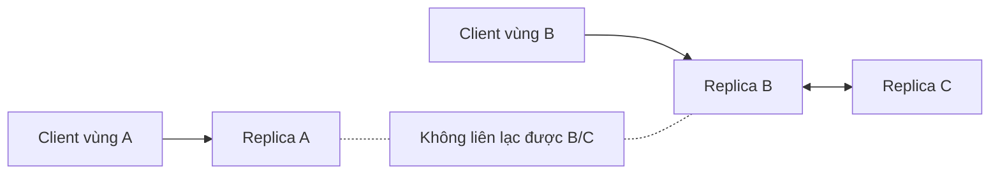
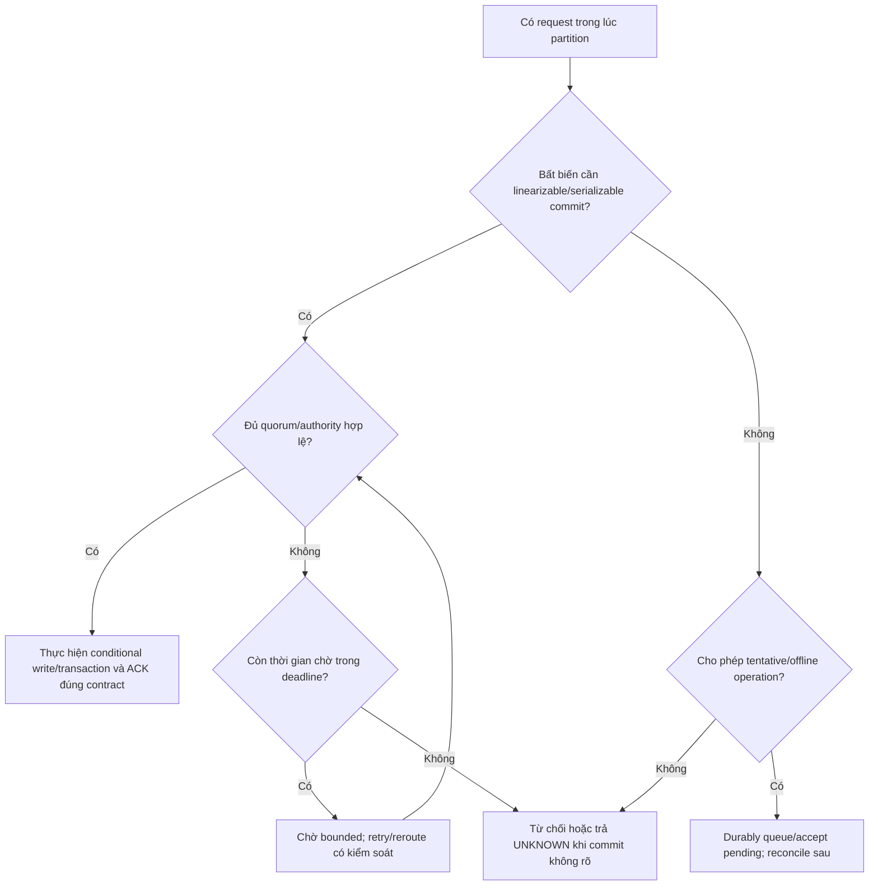
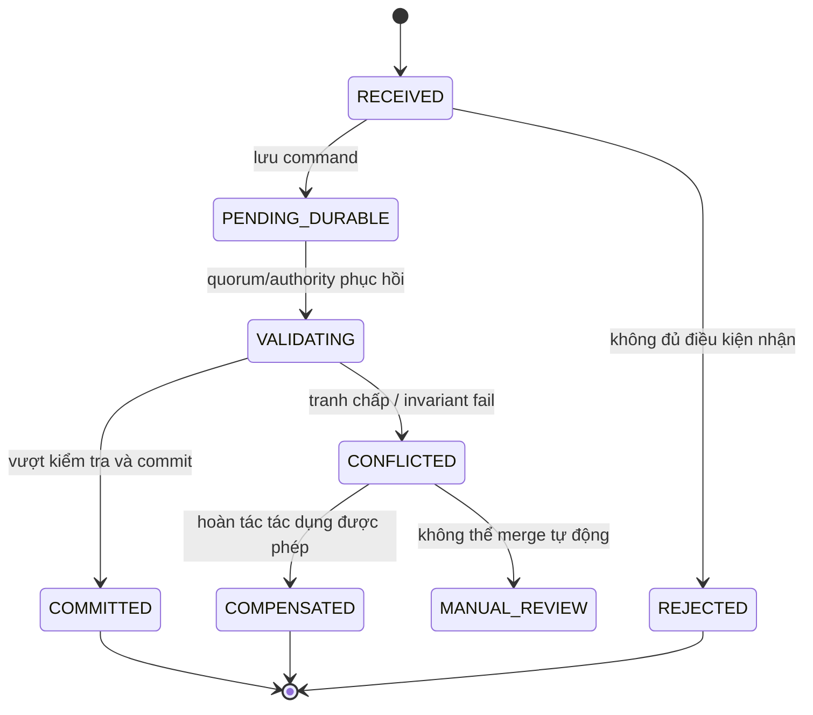
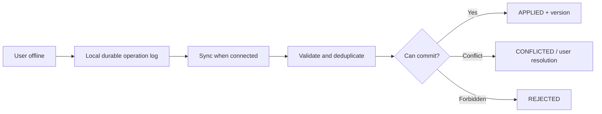

# Tình huống phân hoạch mạng và lựa chọn chờ, từ chối hoặc chấp nhận yêu cầu

## 1. Khi mạng bị chia đôi, ứng dụng phải quyết định điều gì?

Một hệ NoSQL phân tán thường có nhiều node lưu bản sao hoặc những phân vùng của dữ liệu. Trong điều kiện bình thường, các node trao đổi thông tin để phục vụ truy vấn, duy trì replicas, xác nhận giao dịch và bầu leader. Nhưng khi đường mạng giữa các node bị gián đoạn, cùng một API có thể phải quyết định:

- **Chờ (wait):** đợi đủ replicas/quorum/leader hoặc đợi mạng phục hồi trước khi xác nhận.
- **Từ chối (reject):** trả lỗi có kiểm soát thay vì thực hiện một thao tác không thể bảo vệ tính đúng đắn.
- **Chấp nhận (accept):** nhận yêu cầu ngay ở phần hệ thống còn kết nối, có thể trả dữ liệu cũ hoặc lưu thay đổi tạm để hòa giải sau.

Không có lựa chọn đúng cho tất cả dữ liệu. Một lượt tăng số “like” khác với việc bán chiếc vé cuối cùng; một ghi chú ngoại tuyến khác với việc trừ tiền; một kết quả tìm kiếm có thể chậm cập nhật khác với việc cấp quyền quản trị.

Trong bài này, **phân hoạch mạng (network partition)** là tình huống một số thành phần không thể trao đổi thông tin đúng hạn với nhau, dù chúng vẫn có thể tiếp tục hoạt động và nhận request từ người dùng. Câu hỏi nghiệp vụ là: **khi không thể xác nhận được trạng thái chung, API có quyền hứa điều gì với người gọi?**

Bài thuộc chủ đề **Database No SQL**, chương **CAP và các đánh đổi**. Trọng tâm không chỉ là ghi nhớ ba chữ C, A, P, mà là **thiết kế hành vi cụ thể của request khi có phân hoạch mạng**: chờ tới đâu, từ chối thế nào, lúc nào chỉ chấp nhận tạm, và làm sao khôi phục trạng thái sau khi mạng nối lại.

### Mục tiêu học tập

Sau bài học, bạn có thể:

1. Mô tả một network partition, phân biệt với node crash, latency cao và mất kết nối giữa client với service.
2. Phát biểu đúng đánh đổi CAP trong phạm vi consistency và availability mà định lý xét đến.
3. Giải thích vì sao “chọn 2 trong 3” là cách nói dễ gây hiểu nhầm.
4. Phân tích ba chính sách **chờ**, **từ chối** và **chấp nhận** trong cùng một kịch bản.
5. Định nghĩa sự khác nhau giữa **accepted**, **pending**, **committed**, **visible** và **durable**.
6. Chọn chính sách theo bất biến nghiệp vụ, thay vì theo nhãn “CP” hoặc “AP” của database.
7. Hiểu quorum, leader, session consistency, tentative writes, conflict resolution và reconciliation.
8. Thiết kế API, retry, idempotency, timeout và trạng thái rõ ràng trong lúc phân hoạch.
9. Phân tích các khả năng liên quan ở MongoDB, Cassandra, DynamoDB, Redis và etcd.
10. Tạo bộ kiểm thử phân hoạch mạng để đo cả tính sẵn sàng lẫn tính đúng đắn.

## 2. Kịch bản nền: ba replicas bị chia thành hai nhóm

Giả sử dữ liệu một tài nguyên được lưu trên ba replicas:

```text
Trước sự cố:

         +-----+
         |  A  |
         +-----+
          /   \
         /     \
      +-----+--+-----+
      |  B  |  |  C  |
      +-----+  +-----+

Các node trao đổi được với nhau.
```

Sau đó kết nối giữa A với B và C bị đứt:



Đây là một cách biểu diễn partition **1 node so với 2 node**:

- A còn sống, vẫn nhận request từ client có thể tới A.
- B và C còn sống, vẫn liên lạc được với nhau.
- A không xác định ngay được B/C đã chết hay chỉ mất mạng.
- B/C cũng có thể không phân biệt được A chết, lag hay bị cô lập.
- Hai nhóm có thể giữ **bản sao dữ liệu tại những thời điểm khác nhau**.

Để đơn giản, giả sử ba replica này là toàn bộ nhóm bản sao cho cùng một key/aggregate. Trong hệ thống thực, dữ liệu có thể được chia shard, có nhiều nhóm quorum và nhiều tầng proxy, khiến cùng một đợt phân hoạch ảnh hưởng khác nhau đến từng key.

### 2.1. Vì sao mô hình này khó?

Ban đầu:

```json
{
  "sku": "BK-01",
  "available": 1,
  "version": 10
}
```

Client vùng A muốn đặt một sản phẩm. Client vùng B cũng muốn đặt cùng sản phẩm.

Nếu cả hai nhóm đều **xác nhận đơn thành công** mà không có điều phối hoặc phân bổ quyền cấp hàng, hệ có thể bán hai đơn vị trong khi thực tế chỉ có một. Nếu một nhóm **từ chối**, ít nhất một khách hàng gặp lỗi. Nếu hệ thống **chờ**, latency tăng và có thể quá deadline của request.

**Đánh đổi xảy ra ở chính phản hồi của API và tính hợp lệ của trạng thái sau đó**, không chỉ ở việc database có nhận TCP connection hay không.

### 2.2. Replica còn sống không đồng nghĩa request có thể thành công

Một node đơn lẻ vẫn có CPU, RAM, disk và HTTP listener, nhưng nếu policy ghi đòi majority của ba replica, node cô lập có thể không đủ điều kiện commit. Việc node đang “healthy” ở góc nhìn OS không có nghĩa thao tác nghiệp vụ đáp ứng contract đã được chấp nhận.

## 3. CAP nói chính xác điều gì?

CAP nêu sự đánh đổi giữa những thuộc tính được định nghĩa cụ thể trong môi trường phân hoạch mạng.

### 3.1. Consistency trong CAP

Trong cách phát biểu phổ biến dùng cho hệ thống lưu trữ, **C** gắn với *single-copy consistency*, thường được hiểu theo mô hình **linearizability**: các operation hoàn tất có thể được sắp vào một thứ tự như thể có một bản sao dữ liệu duy nhất, đồng thời tôn trọng thứ tự thời gian thực của các operation không chồng lấn.

Ví dụ:

```text
T1: Client 1 ghi x=7 và nhận ACK thành công.
T2: Client 2 bắt đầu đọc x sau khi T1 hoàn tất.
```

Nếu yêu cầu linearizable read/write cho cùng key, T2 không được trả về giá trị cũ trước x=7, giả sử không có write mới hợp lệ làm thay đổi giá trị.

Linearizability không đồng nghĩa một transaction ACID nhiều record, và cũng không đồng nghĩa toàn bộ ứng dụng có cùng một snapshot cho mọi service.

### 3.2. Availability trong CAP

**A** ở mức mô hình CAP là thuộc tính mỗi request đến một node không bị lỗi nhận được phản hồi hợp lệ, chứ không phải trả lỗi bất kỳ để được tính là thành công của operation. Cách định nghĩa hình thức về thời gian và hệ thống phụ thuộc mô hình được xét.

Điểm quan trọng:

- Một API trả `503 Service Unavailable` có thể **hoạt động đúng về nghiệp vụ** khi chọn fail-closed, nhưng không được dùng phản hồi ấy để tuyên bố thao tác luôn available theo nghĩa CAP.
- Một load balancer luôn trả HTTP 200 cho trang “đang bảo trì” không làm dữ liệu trở thành available.
- Một node chỉ nhận command vào queue rồi hứa xử lý sau **không tự hoàn tất write** theo contract ban đầu.
- Availability trong CAP **không phải** số liệu SLA “99,99% uptime” và không trực tiếp nêu một bound latency cụ thể.

### 3.3. Partition tolerance

**P** liên quan khả năng hệ tiếp tục hoạt động trước những gián đoạn giao tiếp giữa các thành phần. Network partition không chỉ có nghĩa “đứt cáp hoàn toàn”; độ trễ cực cao hoặc các gói tin bị mất, bị trì hoãn có thể khiến node không thể trao đổi thông tin trong thời gian cần thiết.

Trong hệ có mạng không đáng tin tuyệt đối, partition là một phần của failure model phải tính đến, không phải một tùy chọn bật/tắt như một feature flag.

### 3.4. “Chọn hai trong ba” là cách diễn đạt chưa chính xác

Cách nói “chọn CA, CP hay AP” dễ khiến người học nghĩ có thể gạt bỏ P bằng cấu hình. Trong một hệ phân tán thực, **khi partition thực sự xảy ra**, một protocol muốn giữ single-copy consistency mạnh phải có khả năng **không hoàn tất một số request**, còn một protocol muốn mọi phía tiếp tục hoàn tất request có thể phải chấp nhận các trạng thái chưa thống nhất.

Không có nghĩa:

- Database CP luôn không available ở mọi node, mọi thời điểm.
- Database AP không có bất kỳ consistency guarantee nào.
- Một hệ phải chọn cùng chính sách cho mọi collection, mọi operation.
- Hệ được cấu hình “CP” thì không còn lỗi latency, timeout hoặc failover.
- Một read stale và một write vi phạm invariant có cùng mức rủi ro.

**CAP là công cụ giải thích giới hạn của một tập bảo đảm trong partition, không phải bảng xếp hạng database.**

## 4. Tại sao timeout không chứng minh node đã chết?

Trong một hệ bất đồng bộ, khi A gửi RPC tới B mà không nhận được phản hồi, có nhiều khả năng:

1. B đã crash.
2. B còn sống nhưng mạng A→B bị đứt.
3. Request tới B nhưng response B→A bị mất.
4. B đang GC pause hoặc quá tải.
5. Request nằm trong queue mạng quá lâu.
6. B đã commit nhưng acknowledgment tới A bị mất.
7. B không có quorum hoặc đang bầu leader mới.

A chỉ nhìn thấy **không nhận được phản hồi đúng hạn**, không tự biết nguyên nhân.

### 4.1. Một timeout là quyết định chính sách, không phải phép đo sự thật tuyệt đối

Ví dụ:

```text
Client deadline:       2 giây
RPC timeout:           700 ms
Replica retry budget:  2 lần
```

Nếu không đủ thời gian thu thập ACK, server phải quyết định trả lỗi, giữ request ở trạng thái chờ, hoặc chuyển sang đường xử lý giảm bảo đảm.

Không nên coi việc timeout tại 700 ms là bằng chứng operation **chưa được commit**. Gói tin có thể đã tới và được áp dụng, còn ACK bị mất.

### 4.2. Network partition có thể không đối xứng

A gửi được tới B nhưng B không trả về A, hoặc chỉ một chiều giao tiếp lỗi. Một số client vẫn đến được leader trong khi client khác không. Vậy cần đo **reachability từ góc nhìn cụ thể**, không tuyên bố đơn giản rằng “cả cluster chết” khi một mạng con bị cô lập.

## 5. Ba chính sách: chờ, từ chối hoặc chấp nhận

Chúng ta quay lại partition A | B,C, với majority của ba node là hai.

| Chính sách | Hành vi tại A cô lập | Lợi ích | Rủi ro/chi phí |
|---|---|---|---|
| **Chờ (wait)** | Đợi liên lạc quorum/leader phục hồi | Có thể giữ contract mạnh nếu chỉ commit khi đủ điều kiện | Latency, queue, timeout, hết ngân sách |
| **Từ chối (reject)** | Trả không thể commit ở phía A | Tránh xác nhận điều kiện chưa kiểm chứng | Giảm availability đối với client chỉ tới A |
| **Chấp nhận (accept)** | Nhận read/write tại A tùy protocol, có thể tạm | Tiếp tục phục vụ request cục bộ | Stale data, conflict, merge, có thể mất invariant |

“Accept” phải được diễn đạt chính xác: **chấp nhận vào hàng đợi**, **chấp nhận tạm**, **chấp nhận ghi cục bộ**, hoặc **đã commit theo contract** là những trạng thái khác nhau.

### 5.1. Một sơ đồ quyết định



Sơ đồ là hướng thiết kế. Thực tế, **một request có thể đã commit trước khi timeout**, nên trường hợp không nhận ACK cần đối soát theo operation ID thay vì mặc định reject như chưa thực hiện.

## 6. Lựa chọn 1 — Chờ để giữ điều kiện nhất quán

Giả sử inventory không được bán vượt số tồn. Một node cô lập không thể chứng minh người khác chưa bán chiếc cuối cùng, nên ứng dụng có thể **chờ quorum trở lại**.

### 6.1. Dòng thời gian

```text
t=0ms   Client gửi đặt hàng đến node A.
t=30ms  A cần majority nhưng không liên lạc B/C.
t=200ms A chờ/retry kết nối.
t=800ms Chưa có quorum.
t=1000ms Deadline sắp hết.
t=1200ms A trả lỗi tạm thời hoặc trạng thái không rõ theo thực tế.
```

Nếu partition phục hồi trong ngân sách, request có thể hoàn thành. Nếu không, request có thể chờ quá lâu hoặc timeout.

### 6.2. Chờ có giới hạn

Không nên để request HTTP giữ socket và lock vô thời hạn chỉ vì mục tiêu “không từ chối”. Thiết kế:

- Deadline end-to-end cho một operation.
- RPC timeout cho từng lần liên hệ replica.
- Retry budget và backoff/jitter.
- Circuit breaker hoặc admission control khi quorum thật sự không khả dụng.
- Cancellation khi client rời đi, nếu operation còn hủy được.
- Bằng chứng trạng thái khi client timeout, nhất là khi commit có thể đã diễn ra.
- Giới hạn queue để tránh tăng bộ nhớ vô hạn.

Chờ là một **chính sách latency** cho phép server trì hoãn quyết định. Khi deadline hết mà chưa thể commit, phải có **contract rõ**: fail-closed hoặc pending đã lưu bền vững.

### 6.3. Chờ không tạo consistency nếu implementation vốn cho ghi rời

Nếu server cứ chờ 500 ms rồi gửi PUT mù tới một replica, điều đó không biến write thành linearizable. Điều kiện quan trọng là **protocol commit**: leader/quorum/transaction/conditional update đúng theo bảo đảm cần thiết.

### 6.4. Chờ có thể làm tình trạng tệ hơn

Trong một đợt phân hoạch, nghìn request cùng chờ có thể giữ:

- Thread/connection pool.
- Session/transaction memory.
- Lock/snapshot.
- Queue nội bộ.
- Retry traffic.

Khi mạng phục hồi, hàng nghìn request cùng retry có thể gây “thundering herd”. Cần jitter, bounded concurrency và backpressure.

### 6.5. Khi nào nên chờ?

- Có khả năng phục hồi ngắn trong deadline.
- Operation quan trọng nhưng user chấp nhận latency cao hơn.
- Số lượng request đã được admission control.
- Service vẫn có khả năng xác minh kết quả commit trước khi trả.
- Bất biến yêu cầu không xác nhận thiếu quorum, nhưng user experience muốn thử lại trong một ngân sách hợp lý.

Chờ quá deadline mà không báo trạng thái không phải thiết kế availability tốt.

## 7. Lựa chọn 2 — Từ chối để bảo vệ bất biến

Nếu A không thể chứng minh quyền commit, nó có thể trả lỗi rõ ràng:

```http
HTTP/1.1 503 Service Unavailable
Retry-After: 3
Content-Type: application/json

{
  "error": "QUORUM_UNAVAILABLE",
  "operationId": "RESERVE-R42",
  "retryable": true,
  "message": "Không thể xác nhận đặt hàng lúc này"
}
```

Ví dụ này chỉ áp dụng khi server biết **operation chưa được commit** và đang từ chối trước khi bắt đầu side effect. Nếu request đã được gửi vào transaction nhưng mất ACK, không được khẳng định chắc chắn chưa commit.

### 7.1. Vì sao từ chối có thể là lựa chọn đúng?

Với chiếc vé cuối cùng, việc chấp nhận hai đơn “thành công” rồi hủy một đơn có thể không phù hợp hợp đồng hoặc làm người dùng thiệt hại. Trả tạm lỗi nhưng giữ bất biến có thể tốt hơn.

Tương tự:

- Chuyển tiền.
- Cấp quyền admin.
- Dùng coupon duy nhất.
- Giữ một slot lịch độc quyền.
- Cập nhật trạng thái sổ cái.
- Phát hành token/quota không được vượt giới hạn.

### 7.2. Không phải mọi từ chối đều là 503

| Trường hợp | HTTP thường cân nhắc | Ý nghĩa |
|---|---|---|
| Không có quorum trước khi thực hiện | `503 Service Unavailable` | Tạm thời không thể phục vụ đúng contract |
| Gateway timeout sau khi forward | `504 Gateway Timeout` | Không tự chứng minh operation chưa commit |
| Business conflict được xác minh | `409 Conflict` | Điều kiện nghiệp vụ hoặc version không phù hợp |
| Server quá tải/rate limit | `429 Too Many Requests` | Không đồng nghĩa network partition |
| Client timeout | Không nhất thiết có response | Client cần đối soát bằng operation ID |
| Command đã được nhận bền vững để xử lý sau | `202 Accepted` | Chưa xác nhận kết quả nghiệp vụ |
| Ghi đã commit | `200/201` tùy API | Cam kết đã hoàn tất theo contract |

Không dùng `200 OK` cùng `"status":"PENDING"` rồi mô tả như “đã đặt hàng thành công” nếu nghiệp vụ thực chất chưa commit. Nếu chọn response thành công về *việc nhận lệnh* thì tên endpoint và documentation phải cho thấy điều đó.

### 7.3. Fail closed và degraded read

Một ứng dụng có thể từ chối **write quan trọng** nhưng vẫn cho phép đọc các thông tin ít rủi ro với nhãn dữ liệu có thể cũ.

Ví dụ trang sản phẩm vẫn hiển thị hình ảnh và mô tả từ cache nhưng không cho xác nhận tồn kho còn 1 ở vùng bị cô lập. Đây là **degraded mode theo từng operation**, không phải một nhãn CAP duy nhất cho toàn website.

## 8. Lựa chọn 3 — Chấp nhận yêu cầu dù chưa thống nhất

Đối với nội dung có thể hội tụ, một partition có thể tiếp tục nhận write cục bộ:

```text
Partition A: thêm comment C1.
Partition B,C: thêm comment C2.
Khi mạng phục hồi: đồng bộ C1, C2.
```

Nếu application xác định được định danh duy nhất và cơ chế merge hợp lệ, hai comment độc lập có thể cùng tồn tại sau hòa giải.

### 8.1. Chấp nhận có nhiều cấp độ

| Trạng thái | Đã xảy ra điều gì? | Có thể hứa gì? |
|---|---|---|
| `RECEIVED` | Request đã đến process | Chưa chắc survive crash |
| `QUEUED_DURABLY` | Command đã ghi vào queue/log với durability đã chọn | Có thể tiếp tục xử lý sau; chưa chắc business commit |
| `APPLIED_LOCALLY` | Mutation đã cập nhật bản sao cục bộ | Có thể cần hòa giải với những bản sao khác |
| `PENDING_RECONCILIATION` | Có kết quả tạm, chờ xác minh conflict | Không được gọi confirmed theo quy tắc mạnh |
| `COMMITTED` | Điều kiện commit chính thức thỏa | Có thể ACK theo contract |
| `REJECTED_AFTER_REVIEW` | Yêu cầu tạm không được chấp nhận khi hòa giải | Cần thông báo/compensate |
| `CONFLICTED` | Hệ cần can thiệp hoặc resolution policy | Không che conflict bằng một kết quả tùy ý |

Từ “accepted” trong HTTP `202` không tự mang bảo đảm durability hoặc completion. Server phải nói rõ đã lưu đến đâu, được retry thế nào, có thể bị loại sau reconcile hay không.

### 8.2. Ví dụ API offline-first

```http
POST /v1/notes/commands
Idempotency-Key: cmd-881
Content-Type: application/json

{
  "noteId": "N42",
  "operation": "appendText",
  "text": "Ghi chú khi offline"
}
```

Phản hồi khi command được **lưu bền vững ở local queue**:

```http
HTTP/1.1 202 Accepted
Location: /v1/operations/cmd-881
Content-Type: application/json

{
  "operationId": "cmd-881",
  "status": "PENDING_SYNC",
  "committed": false,
  "mayConflict": true
}
```

Sau khi kết nối phục hồi:

```http
GET /v1/operations/cmd-881
```

```json
{
  "operationId": "cmd-881",
  "status": "APPLIED",
  "committed": true,
  "resultVersion": 19
}
```

Ví dụ này giả định có một **quy trình sync bền vững** và record trạng thái operation có thể truy vấn lại. Nếu queue chỉ là memory của process, cần phản hồi/contract yếu hơn.

### 8.3. Chấp nhận tại vùng cô lập không tự là AP đúng nghĩa CAP

Một API có thể trả `202 PENDING` mà không thực hiện write theo ngữ nghĩa ban đầu; đó là **đổi contract** thành “nhận lệnh để xử lý sau”, không nhất thiết là hoàn tất operation theo CAP.

Tương tự, một node trả dữ liệu cache stale có thể cải thiện UX nhưng không thỏa linearizable read contract. Khi thiết kế, hãy nói rõ **operation nào đã hoàn tất** và operation nào còn treo.

### 8.4. Ai giải quyết conflict?

Một hệ có thể dùng:

- Merge tự động có ngữ nghĩa rõ.
- CRDT tương ứng với phép toán cho phép.
- Last-write-wins, nếu việc mất một bản cập nhật được chấp nhận.
- State machine nghiệp vụ chọn một kết quả.
- Hàng chờ duyệt thủ công.
- Compensation/refund khi đã có tác dụng không thể đảo ngược.
- Một authority xác nhận phiên bản cuối cùng.

**“Eventual consistency” không tự quyết định cách merge.** Nó mô tả sự hội tụ theo điều kiện, còn lựa chọn giá trị cuối phụ thuộc protocol và nghiệp vụ.

## 9. Quorum: tại sao một phía 2 node vẫn có thể commit?

Với ba replica và majority quorum:

\[
N = 3,\qquad Q = \lfloor N/2\rfloor +1 =2
\]

Nếu A bị cô lập, nhóm B,C có hai node nên có thể tiếp tục những operation đòi majority, **nếu các điều kiện leader/term và protocol tương ứng thỏa**. A chỉ có một node nên không đủ majority.

```text
Partition A:        1/3 replica -> không commit majority.
Partition B + C:    2/3 replica -> có thể commit majority.
```

### 9.1. Quorum intersection

Hai tập majority của cùng một tập ba replicas luôn giao nhau ít nhất một node:

```text
{A,B} và {B,C} giao nhau ở B
{A,C} và {B,C} giao nhau ở C
```

Tính giao nhau giúp một consensus protocol xây dựng những bảo đảm về thứ tự/log/commit khi có thêm election term, log matching, persistence và quy tắc đọc/ghi phù hợp.

**Quorum intersection là thành phần quan trọng, không phải toàn bộ chứng minh linearizability.**

### 9.2. Công thức R + W > N của quorum read/write

Trong một mô hình đọc/ghi quorum đơn giản, nếu:

- \(N\): số replicas;
- \(R\): số replicas tham gia read;
- \(W\): số replicas phải xác nhận write;

thì điều kiện:

\[
R + W > N
\]

giúp tập đọc và tập ghi giao nhau (với tập replica ổn định và lựa chọn quorum đúng).

Ví dụ:

\[
N=3,\ R=2,\ W=2 \Rightarrow R+W=4>3
\]

Tuy nhiên **điều kiện này một mình không chứng minh linearizability**. Còn phải xét version ordering, concurrent writes, conflict resolution, sloppy quorum, hinted handoff, failed reads, repair, membership changes và bảo đảm của sản phẩm.

### 9.3. Điều gì xảy ra khi tăng W?

| Cấu hình khái niệm | Độ sẵn sàng write khi mất replica | Thảo luận |
|---|---|---|
| `W=1` | Có thể write từ ít replica hơn | Dễ tiếp tục nhưng rủi ro stale/conflict/lost ACK tùy protocol |
| `W=2, N=3` | Cần hai replica | Một node cô lập thường không đáp ứng |
| `W=3, N=3` | Cần cả ba | Mất một node có thể khiến write không hoàn tất |
| Majority consensus | Cần quorum theo membership/term | Không phải chỉ đếm ACK tùy ý |

Với hệ thực, tên consistency level, cách chọn replica và tính toán failure domain khác nhau. Không ép bảng này lên mọi loại NoSQL như thể mọi hệ có tham số \(R,W,N\) độc lập.

### 9.4. Tăng quorum không có nghĩa tăng correctness của app vô điều kiện

Một giao dịch “đọc stock=1 rồi INSERT order” trên hai request cạnh tranh vẫn có thể bán vượt tồn nếu thiếu conditional decrement/transaction, ngay cả khi mỗi read lấy từ quorum đủ mạnh.

**Consistency của replica** và **atomicity/isolation của nghiệp vụ** là các bảo đảm khác nhau.

## 10. Leader, minority và failover

Trong hệ có leader/primary được bầu theo protocol:

- Leader hợp lệ có thể cần liên hệ quorum để commit.
- Khi leader bị cô lập khỏi majority, nó có thể phải dừng chấp nhận committed writes.
- Majority có thể elect leader mới sau một khoảng gián đoạn.
- Client vẫn kết nối được tới leader cũ nhưng write cần bị từ chối/timeout.
- Read từ follower có thể stale trừ khi dùng read protocol đủ mạnh.

### 10.1. Ví dụ leader A mất majority

```text
T0  A là leader; B,C followers.
T1  A bị cô lập khỏi B,C.
T2  A có thể còn tự nghĩ mình là leader trong một khoảng.
T3  B,C bầu leader mới theo protocol.
T4  B hoặc C nhận những writes mới.
T5  A nối lại và phải nhận ra term/epoch mới.
```

Một protocol consensus đúng không được cho hai leader ở các term khác nhau cùng commit những log xung đột theo cùng nghĩa commit mạnh. Nhưng **side effect ở một hệ ngoài consensus** vẫn cần guard hoặc fencing nếu leader cũ có thể gửi yêu cầu đến muộn.

### 10.2. Không coi DNS/routing là bằng chứng quyền leader

Load balancer có thể trỏ client tới A trong lúc A đã mất majority. API không được dựa vào “có request đến máy tôi” để xác nhận ghi. Phải kiểm tra quyền commit theo leader/quorum protocol.

### 10.3. Reroute có thể cứu availability

Client vùng A không tới được B/C nhưng một proxy khác vẫn có đường đến majority; API có thể được reroute qua một đường kết nối khác và tiếp tục phục vụ.

Vì vậy không thể nói “partition = mọi người không dùng được dịch vụ”. **Topology và điểm vào request** quyết định khách hàng nào bị ảnh hưởng.

## 11. Một ma trận quyết định theo nghiệp vụ

| Thao tác | Bất biến/UX quan trọng | Phân hoạch: lựa chọn thường xét |
|---|---|---|
| Xem mô tả sản phẩm | Đọc có thể stale trong thời gian giới hạn | Chấp nhận cached/local read có nhãn |
| Xem số tồn kho tham khảo | Có thể stale nhưng không dùng quyết định đặt hàng | Chấp nhận read cũ, cảnh báo |
| Xác nhận mua chiếc vé cuối | Không double-book | Chờ bounded rồi từ chối nếu không commit an toàn |
| Chuyển tiền | Không double debit, đúng ledger | Từ chối/pending rõ, không “success” thiếu commit |
| Tăng lượt thích | Có thể hội tụ/đối soát | Chấp nhận operation và merge phù hợp |
| Thêm bình luận độc lập | Không làm mất nội dung hợp lệ | Có thể nhận locally, sync và dedup |
| Chỉnh cùng một đoạn văn | Conflict nội dung | Accept pending với version/merge/UX resolve |
| Cập nhật giỏ hàng | Không làm mất thay đổi của người dùng | CRDT hoặc merge theo semantics từng item |
| Claim coupon dùng một lần | Uniqueness mạnh | Conditional claim trên authority, chờ/từ chối |
| Ghi telemetry | Không làm mất điểm đo, chấp nhận trễ | Append local durable queue, sync sau |
| Cấp quyền admin | Không cấp nhầm hoặc bỏ qua revoke | Fail closed, cần authoritative policy |
| Đọc trang báo cáo cũ | Staleness được chấp nhận | Serve snapshot đã gắn mốc |
| Cập nhật inventory global | Không bán vượt quota toàn cầu | Quorum/conditional write, hoặc escrow cấp quyền theo vùng |
| Xem danh sách bài đăng | Feed có thể thiếu bài mới tạm thời | Local/stale read có refresh |
| Xóa dữ liệu cá nhân | Cần thực thi và không hồi sinh từ replica cũ | Tombstone/ledger và reconciliation đúng vòng đời |

Bảng là gợi ý **đặt câu hỏi**, không phải một luật tự động. Yêu cầu pháp lý, domain, thỏa thuận sản phẩm và rủi ro thực tế có thể dẫn tới lựa chọn khác.

## 12. Case study: chiếc vé cuối cùng

Giả sử còn một vé cho sự kiện:

```json
{
  "eventId": "EV-42",
  "availableSeats": 1,
  "version": 17
}
```

Partition tách vùng A khỏi majority B,C. Khách ở A và B đồng thời đặt.

### 12.1. Chấp nhận commit độc lập trên hai phía

A thấy còn 1, B,C thấy còn 1. Nếu cả hai nhóm xác nhận thành công:

```text
Order A: CONFIRMED
Order B: CONFIRMED
Seats actually available: 1
```

Không có merge tự động nào làm hai xác nhận đó thành hợp lệ. Chỉ giữ một order và hủy order kia là một **quy trình bù trừ có hậu quả**, không phải điều mà CRDT có thể tự giải quyết phù hợp mọi business contract.

### 12.2. Chờ/từ chối trên phía minority

A không có quorum nên không xác nhận. A có thể:

- Chờ trong deadline ngắn.
- Reroute nếu có đường tới majority.
- Trả `503` khi biết chưa commit.
- Cho khách tạo **ý định đặt vé** trạng thái `PENDING` nhưng không coi là đã giữ ghế.

B,C có quorum nên có thể dùng conditional decrement để cấp vé, nếu protocol DB cung cấp bảo đảm phù hợp.

### 12.3. Dùng quota/escrow khi muốn nhiều vùng vẫn phục vụ

Nếu có 100 vé, có thể phân bổ:

```text
Region A: tối đa 35 vé
Region B: tối đa 40 vé
Region C: tối đa 25 vé
Tổng quyền cấp = 100
```

Trong partition, mỗi vùng cấp vé **chỉ trong quota được trao**. Đây là cách chuyển bất biến global thành quyền sở hữu hữu hạn theo vùng; cần một protocol tin cậy khi cấp lại/chuyển quota, tránh dùng hai lần cùng allocation.

Nếu chỉ còn một vé và chưa được phân bổ cho vùng A, vùng A không thể tự xác nhận chiếc vé đó mà vẫn hứa không oversell.

## 13. Case study: bình luận và lượt thích

Giả sử hai người cùng thêm comment trong hai network partitions:

```text
A: INSERT comment C101
B: INSERT comment C102
```

Nếu mỗi comment có ID ổn định và operation được gửi lại idempotently, hai record có thể cùng tồn tại sau khi đồng bộ.

### 13.1. Không phải mọi phép “ghi xã hội” đều tự merge

Một lệnh `likes = 100` từ A và `likes = 101` từ B có thể ghi đè nhau, làm mất increment. Nếu yêu cầu tổng lượt thích chính xác sau hội tụ, cần một mô hình **commutative operation** hoặc CRDT/counter phù hợp.

### 13.2. Các yêu cầu cần bổ sung

- Mỗi action có operation ID để dedup.
- Thứ tự hiển thị comment theo contract (client timestamp không nhất thiết là commit order).
- Xóa comment cần tombstone/version để không bị replica offline hồi sinh.
- Quyền truy cập và moderation được áp dụng khi sync.
- Tranh chấp về việc một user chỉ thích một lần cần một natural key hoặc set semantics rõ.

**Có thể chấp nhận được sự hội tụ trễ của lượt like; không có nghĩa chấp nhận spam like, quyền trái phép hoặc double charging.**

## 14. CRDT và phép toán có thể hội tụ

**Conflict-Free Replicated Data Types (CRDTs)** là một họ cấu trúc dữ liệu/operation có quy tắc merge giúp replicas hội tụ trong những điều kiện nhất định. Chúng hữu ích khi muốn tiếp tục cập nhật trong partition mà không đòi coordination mọi lúc.

### 14.1. Counter

Thay vì hai node cùng ghi một con số cuối `likes=101`, có thể dùng counter với component per replica/actor để merge theo quy tắc phù hợp.

Một G-counter minh họa:

```json
{
  "A": 4,
  "B": 7,
  "C": 2
}
```

Giá trị tổng:

\[
value = 4+7+2 = 13
\]

Nếu A offline tăng component A từ 4 lên 5, B tăng component B từ 7 lên 8, hai thay đổi có thể hội tụ bằng phép merge **max theo mỗi component**, sau đó tính tổng 15.

Đây là minh họa của state-based G-counter khi các component chỉ tăng. Không áp dụng phép merge này trực tiếp cho **số tồn kho có giới hạn toàn cục**, vì hai vùng cùng tăng lượng bán có thể vi phạm capacity.

### 14.2. PN-counter

Một PN-counter thường biểu diễn increment và decrement qua hai thành phần tăng dần, nhưng việc hội tụ không tự giữ bất biến số dư không âm giữa các vùng. Nếu hai vùng cùng trừ tiền từ một balance chung, kết quả có thể âm sau merge.

### 14.3. Set với add/remove

Một set cộng đơn giản gặp vấn đề nếu:

```text
A: remove user U
B: add user U
```

Khi mạng phục hồi, phải xác định add-wins, remove-wins, observed-remove hay semantics khác. OR-Set và các CRDT tương ứng có quy tắc rõ cho concurrent add/remove nhưng **không tự thể hiện policy bảo mật**.

Nếu user bị thu hồi quyền, việc một replica offline chấp nhận add lại có thể không phù hợp. Cần authoritative authorization và tombstone/revocation protocol.

### 14.4. Không dùng CRDT như “thuốc chữa” mọi invariant

CRDT hữu ích cho phép toán có thể merge mà không vi phạm business contract sau hội tụ. Nhưng những invariant như **unique username**, **không bán vượt tồn**, **không double charge**, **ít nhất một bác sĩ trực** đòi phối hợp, phân bổ quyền hoặc thay đổi model.

Cần phân biệt **hội tụ trạng thái** với **tính hợp lệ của mọi trạng thái trung gian và các side effect đã xác nhận**.

## 15. Last-write-wins: đơn giản nhưng có thể mất dữ liệu

Một chiến lược phổ biến là chọn một giá trị “mới nhất” theo timestamp/version rồi bỏ các giá trị còn lại.

Giả sử:

```text
A: set shippingAddress = "Hà Nội"
B: set shippingAddress = "Đà Nẵng"
```

Nếu hai update xảy ra ở các partition khác nhau, last-write-wins (LWW) chọn một giá trị khi hòa giải, nhưng **thay đổi còn lại biến mất**.

### 15.1. Đồng hồ không phải một total order hoàn hảo

Dùng wall-clock timestamp của hai region có thể bị ảnh hưởng bởi:

- Clock skew.
- Độ phân giải timestamp.
- Hai update có cùng timestamp.
- NTP correction.
- Event đến trễ.
- Thứ tự thực của các operation không thể suy chỉ từ timestamp.

Một hybrid logical clock (HLC) hoặc version vector có thể hỗ trợ ordering/cause theo protocol cụ thể, nhưng cũng không tự đưa ra quyết định nghiệp vụ “địa chỉ nào đúng”.

### 15.2. Khi nào LWW có thể chấp nhận?

Nếu document chỉ lưu “trạng thái UI gần nhất” và có thể mất một thay đổi, LWW có thể phù hợp sau khi product chấp nhận trade-off.

Nếu là sổ cái, tồn kho, xóa quyền, ledger thanh toán hoặc nội dung do nhiều người đồng tác giả, chọn mất một update bằng timestamp có thể nguy hiểm.

### 15.3. Không che conflict bằng kết quả giả

Nếu hai bên đều đã hứa “đã xác nhận”, một merge chọn bên B không khiến lời hứa bên A trở thành đúng. Cần xử lý compensations và thông báo tới những user bị ảnh hưởng, hoặc ngăn phát sinh promise ấy từ đầu.

## 16. Đọc trong lúc partition: staleness là một contract

Đọc cũng có ba lựa chọn:

- **Chờ:** đợi dữ liệu được xác minh theo consistency mong muốn.
- **Từ chối:** không trả dữ liệu mà không thể chứng minh đủ mới/đúng.
- **Chấp nhận:** trả bản sao local có thể stale với metadata về độ tin cậy.

### 16.1. Linearizable read

Nếu một client đã nhận ACK ghi x=7 trước khi một client khác bắt đầu đọc, linearizable read phải quan sát giá trị tương ứng hoặc mới hơn theo thứ tự hợp lệ.

Một replica bị cô lập có thể không biết có write mới, nên không thể khẳng định data local là mới nhất. Nó có thể phải **đợi/không trả thành công** theo contract.

### 16.2. Read-your-writes

Một user cập nhật profile tại region A rồi đọc tại B. Nếu replica B chưa nhận update, user có thể thấy tên cũ.

Có thể cân nhắc:

- Session stickiness tới replica đã nhìn thấy write.
- Session/version token được reader dùng để đợi tới version tối thiểu.
- Đọc từ authoritative/leader path.
- UI optimistic update với trạng thái pending.

Đây là bảo đảm phiên (*session consistency*), không phải linearizability toàn cục.

### 16.3. Monotonic reads

Một user đọc version 20 rồi query sau lại thấy version 18 vì request được route sang replica trễ hơn. Một session token có thể ngăn “đọc lùi” nếu server có cách đảm bảo version tối thiểu hoặc từ chối khi chưa đạt.

### 16.4. Stale read có nhãn

Một API có thể trả:

```json
{
  "items": [
    { "id": "P1", "title": "Sản phẩm mẫu" }
  ],
  "consistency": "STALE_POSSIBLE",
  "lastKnownUpdateAt": "2026-11-14T10:10:00Z",
  "refreshAvailable": false
}
```

**Không dùng mốc thời gian local làm chứng cứ chính xác dữ liệu stale bao nhiêu** nếu hệ không có watermark/commit timestamp đáng tin. Metadata phải phản ánh thông tin hệ thật sự có.

### 16.5. Quyền và bảo mật không nên dựa trên replica quá cũ

Nếu user bị thu hồi quyền admin ở majority nhưng replica cô lập vẫn cho phép truy cập dữ liệu nhạy cảm, chấp nhận stale policy có thể gây lộ thông tin.

Đọc eventual cho **thông tin ít nhạy cảm** không thể áp máy móc cho **authorization decisions**. Những request có hậu quả bảo mật nên fail closed hoặc kiểm qua nguồn authoritative đủ mạnh.

## 17. Ghi trong lúc partition: trạng thái tạm và commit

Một luồng ghi có thể chia thành:



### 17.1. Đã nhận ≠ đã commit

Nếu API lưu request vào local durable queue nhưng chưa có quorum, có thể trả `202 Accepted` với `PENDING`. Không trả `ORDER_CONFIRMED` nếu vẫn có thể từ chối sau khi kiểm tra inventory.

### 17.2. Cần giữ request ID ổn định

Một client retry sau timeout có thể tạo duplicate. Hãy dùng:

```json
{
  "requestId": "R42",
  "resourceId": "EV-42",
  "action": "RESERVE_SEAT",
  "quantity": 1
}
```

Ledger/queue cần nhận biết cùng request ID và payload fingerprint. Nếu retry cùng ID nhưng payload khác, trả conflict thay vì tạo ý định mới.

### 17.3. Unknown commit không phải rejected

Giả sử:

```text
Client -> service -> DB transaction.
DB commit thành công.
ACK mất trước khi tới service.
Service timeout.
```

Service không biết transaction đã commit hay chưa. Nếu trả "đã từ chối chắc chắn" rồi client thử lại với một ID mới, có thể gây duplicate. Nên:

- Dùng operation ID.
- Query trạng thái qua đường đọc đủ consistency.
- Tiếp tục retry idempotently theo protocol.
- Trả trạng thái rõ là unknown/pending nếu chưa xác minh.
- Không hứa “chưa bị trừ tiền” khi chưa có bằng chứng.

## 18. PACELC: khi mạng không partition vẫn có đánh đổi

CAP nhấn vào phân hoạch. Nhưng hầu hết thời gian mạng hoạt động bình thường, hệ vẫn chọn giữa:

- Consistency mạnh, thường có thêm coordination/round trip.
- Latency thấp hơn nhờ replica gần client, cache hoặc đọc local với staleness cho phép.

Một khung suy nghĩ phổ biến là **PACELC**:

- **P:** khi có Partition, đánh đổi Availability hay Consistency theo bảo đảm được chọn.
- **E:** Else (không partition), đánh đổi Latency hay Consistency.

### 18.1. Ví dụ đa vùng

User ở Việt Nam truy vấn dữ liệu có leader/authority ở một vùng xa:

- Đọc từ replica gần client có thể có latency thấp nhưng dữ liệu stale.
- Đọc từ authoritative/consensus path có thể cần round trip xa.
- Nếu WAN partition, đường đọc mạnh có thể không hoàn tất.

PACELC nhắc rằng ngay cả không có sự cố, latency và consistency vẫn là một quyết định sản phẩm.

### 18.2. Không dùng PACELC để gắn nhãn vĩnh viễn mọi API

Một database có thể cho mỗi read chọn mức consistency khác nhau. Một ứng dụng cũng có thể dùng mạnh cho ví tiền, eventual cho feed và cached cho catalog. Vì vậy cùng một sản phẩm có nhiều **đường đọc/ghi với bảo đảm khác nhau**.

## 19. Các hệ NoSQL phản ứng khác nhau

Không thể lấy một label “CP” hoặc “AP” để suy tất cả hành vi của mọi version/deployment. Cần xét loại replication, API, consistency level, index, multi-region và tình huống network cụ thể.

### 19.1. MongoDB replica set

MongoDB replica set thường có primary và các secondary; election/quorum giúp xác định primary theo protocol. Một số tham số quan trọng:

- `writeConcern`: điều kiện ACK của write, ví dụ majority theo cấu hình.
- `readConcern`: các bảo đảm đọc theo chế độ.
- `readPreference`: chọn primary hay secondary cho read.
- Transactions: có phạm vi/isolation và giới hạn riêng.
- Retryable writes và sessions: giúp xử lý một số lỗi tạm, nhưng ứng dụng vẫn cần business idempotency.

Ví dụ một write cần majority:

```javascript
db.orders.insertOne(
  {
    _id: "O-42",
    tenantId: "t17",
    status: "PENDING"
  },
  {
    writeConcern: { w: "majority", wtimeout: 2000 }
  }
);
```

Đây là lệnh minh họa yêu cầu majority acknowledgment. Khi primary không tới được đủ thành viên, write có thể không nhận majority ACK trong deadline, hoặc primary có thể step down. Nếu timeout mà chưa rõ commit, **không tự kết luận record chắc chắn chưa tồn tại**.

Nếu chọn write concern yếu hơn, write có thể được ACK sớm hơn theo contract nhưng rủi ro durability/rollback khi failover có thể khác. Phải đọc tài liệu theo deployment, đặc biệt cách xử lý elections, majority journaling và read semantics.

**Lưu ý:** `readConcern: "majority"` không đồng nghĩa mọi read luôn linearizable mới nhất theo thời gian thực. MongoDB có mode đọc với contract riêng; hãy kiểm tra trường hợp cần linearizable read và các giới hạn hỗ trợ thay vì suy từ tên “majority”.

### 19.2. Apache Cassandra

Cassandra có các consistency levels cho operation, ví dụ `ONE`, `QUORUM`, `LOCAL_QUORUM` tùy API và topology.

Trong mô hình RF=3 tại một data center:

```text
CL=ONE:
  có thể ACK với một replica phù hợp theo semantics.
CL=QUORUM:
  cần quorum của replica phù hợp.
```

Với partition 1|2, một request CL=QUORUM tại phía chỉ có một replica thường không thể hoàn tất quorum; một request CL=ONE có thể được phục vụ nếu có replica thích hợp, nhưng có khả năng quan sát trạng thái khác với phía còn lại.

Đặc biệt phải hiểu:

- RF, topology và consistency level theo data center.
- Replica selection, coordinator, failure detectors.
- Hinted handoff và read repair.
- Tombstone/repair và nguy cơ resurrection nếu vận hành sai.
- Last-write-wins và timestamp conflict semantics.
- Lightweight transactions (LWT/Paxos) có contract và chi phí khác writes thường.
- Một số yêu cầu multi-row invariants không thể giải bằng việc chỉ chuyển `ONE` sang `QUORUM`.

Không nên nói “Cassandra luôn AP và không có mạnh consistency”: consistency được cấu hình ở mức operation, nhưng không tự đồng nghĩa linearizable transaction tổng quát.

### 19.3. DynamoDB

DynamoDB là managed service; không expose một topology replication tùy ý như ví dụ A|B,C. Cần phân biệt:

- Eventually consistent reads và strongly consistent reads trên những đường API được hỗ trợ.
- Query lên GSI có eventual consistency.
- Conditional writes và transaction APIs có contract riêng trong phạm vi được hỗ trợ.
- Global tables/multi-region có replication/conflict semantics phụ thuộc mode/phiên bản.
- Service sẽ quản lý failure/routing nội bộ; client thấy timeout, lỗi tạm hoặc kết quả theo contract.

Ví dụ conditional inventory decrement ở một authoritative region:

```json
{
  "TableName": "Inventory",
  "Key": {
    "sku": { "S": "BK-01" }
  },
  "UpdateExpression": "SET available = available - :q",
  "ConditionExpression": "attribute_exists(sku) AND available >= :q",
  "ExpressionAttributeValues": {
    ":q": { "N": "1" }
  }
}
```

Nếu condition được thực thi theo contract, nó bảo vệ invariant một item trong phạm vi tương ứng. Điều này **khác** với việc một client ở nhiều vùng tự nhận write khi không liên lạc được nguồn authoritative.

Đừng suy rằng bật global tables luôn bảo đảm strong serializable global writes ở mọi region/mode. Phải đọc đúng loại global tables và cơ chế conflict resolution đang dùng.

### 19.4. Redis

Redis trong nhiều deployment dùng primary–replica replication bất đồng bộ và failover theo cấu hình. Một write đã được primary ACK có thể chưa tới replica trước khi primary lỗi; sau failover có thể có dữ liệu bị mất theo failure model.

Redis có `WAIT` và các cơ chế khác có thể cải thiện một số thuộc tính acknowledgment của replica, nhưng **không tự biến replication bất đồng bộ thành consensus transaction trong mọi tình huống**.

Với cache/catalog, chấp nhận stale hoặc mất một write có thể được phép. Với tồn kho hoặc ledger cần invariant mạnh, phải xem Redis có đúng contract durability/failover/conditional update cần thiết không, hoặc chuyển quyền quyết định sang store authoritative khác.

### 19.5. etcd

etcd dựa trên consensus và thường yêu cầu quorum để thực hiện những operation có bảo đảm linearizability tương ứng. Trong partition 1|2, phía minority không thể tự tạo committed updates mới theo quorum. Phía majority có thể tiếp tục nếu leader/election và network path đáp ứng.

etcd cũng có các đường đọc với consistency semantics khác nhau tùy API/option; không mặc định mọi read là một điều duy nhất.

etcd hữu ích cho coordination, configuration, leases và leader election, nhưng không thể dùng lease làm bằng chứng rằng worker cũ tự ngừng side effect ở một database khác. Những write bên ngoài cần fencing/guard phù hợp.

### 19.6. Tóm tắt theo đường thao tác

| Hệ | Quyết định nổi bật | Điều cần kiểm chứng |
|---|---|---|
| MongoDB | Write concern, read concern, primary/secondary, transactions | Majority ACK, rollback, election, linearizable read |
| Cassandra | Consistency level, RF, LWT, repair | Quorum theo topology, stale/conflict, predicate invariants |
| DynamoDB | Strong/eventual read, conditional/transaction write, global tables | GSI lag, multi-region mode, API error semantics |
| Redis | Async replication, persistence, primary failover, Lua/transactions | ACK vs durability, replica lag, split-brain risk |
| etcd | Consensus quorum, linearizable operations, leases | Leader election, minority availability, stale worker fencing |

Không lấy nhãn của một sản phẩm làm câu trả lời thay cho access pattern và version thật.

## 20. Routing và cấu hình nhiều vùng

Một application có thể chọn topology:

- **Single authoritative region:** ghi quyết định quan trọng ở một vùng; các vùng khác đọc projection hoặc chuyển tiếp request.
- **Active–passive:** một vùng chính, vùng dự phòng tiếp quản theo protocol.
- **Active–active:** nhiều vùng có thể nhận writes, cần phân xử conflict hoặc phân quyền dữ liệu.
- **Ownership per key/tenant:** một vùng là authority cho một nhóm keys, vùng khác sở hữu nhóm khác.
- **Escrow allocation:** mỗi vùng được cấp sẵn quota hữu hạn để có thể ghi độc lập khi mất WAN.

### 20.1. Availability là thuộc tính của đường đi

Giả sử user chỉ tới được region A, còn authoritative write path nằm ở B,C:

- Nếu A chỉ proxy sang B/C nhưng mạng partition, user không thể commit.
- Nếu user có thể truy cập trực tiếp một endpoint ở majority, họ có thể được phục vụ.
- Nếu A đã được cấp escrow quota cho operation ấy, A có thể commit trong phạm vi quyền.
- Nếu A chỉ lưu lệnh offline, user có thể có trạng thái pending nhưng không phải business success.

Không đủ nói “cluster có majority nên toàn thế giới vẫn write được”.

### 20.2. Failover không tự giải quyết split brain của side effect

Nếu leader A mất quorum nhưng vẫn có đường đến external payment service, nó có thể gửi payment request dù leader B đã tiếp quản. Cần idempotency/fencing/workflow tại nơi xảy ra side effect. A mất quyền trong consensus group không buộc payment gateway hủy lệnh cũ.

## 21. Thiết kế API theo quyết định chờ/từ chối/chấp nhận

Một API rõ ràng nên tách **resource endpoint** khỏi **operation status** khi kết quả không thể xác định ngay.

### 21.1. Request có idempotency key

```http
POST /v1/orders/reservations
Idempotency-Key: reserve-20261114-42
Content-Type: application/json

{
  "sku": "BK-01",
  "quantity": 1
}
```

### 21.2. Commit thành công

```http
HTTP/1.1 201 Created
Content-Type: application/json

{
  "reservationId": "RSV-42",
  "status": "CONFIRMED",
  "committed": true
}
```

Chỉ trả `CONFIRMED` nếu nguồn authoritative đã áp điều kiện inventory/reservation theo contract.

### 21.3. Không thể commit, chưa thử hoặc đã biết abort

```http
HTTP/1.1 503 Service Unavailable
Retry-After: 5
Content-Type: application/json

{
  "error": "CONSISTENCY_PATH_UNAVAILABLE",
  "operationId": "reserve-20261114-42",
  "committed": false,
  "retryable": true
}
```

Chỉ đặt `committed:false` khi hệ có bằng chứng operation không được commit. Nếu đã gửi và mất ACK, trường này có thể sai; dùng trạng thái chưa xác định và endpoint lookup.

### 21.4. Chấp nhận vào hàng đợi

```http
HTTP/1.1 202 Accepted
Location: /v1/operations/reserve-20261114-42
Content-Type: application/json

{
  "operationId": "reserve-20261114-42",
  "status": "PENDING_CONFIRMATION",
  "committed": false,
  "reservationGuaranteed": false
}
```

Nếu một yêu cầu đặt vé pending vẫn có thể bị từ chối vì hết hàng sau reconcile, UI phải hiện rõ **“Đã nhận yêu cầu, chưa giữ chỗ”** chứ không hiển thị “Đặt thành công”.

### 21.5. Timeout sau khi commit có thể đã xảy ra

```json
{
  "operationId": "reserve-20261114-42",
  "status": "COMMIT_OUTCOME_UNKNOWN",
  "checkStatusAt": "/v1/operations/reserve-20261114-42"
}
```

Đây là payload mô hình; HTTP status thực tế tùy tầng gateway và API contract. Không đảm bảo server luôn gửi được response sau khi client timeout. Client cũng phải có cơ chế truy vấn operation ID khi kết nối trở lại.

### 21.6. Kênh cập nhật trạng thái

Có thể dùng:

- Poll `GET /operations/:id`.
- Server-sent events/WebSocket khi kết nối phục hồi.
- Webhook idempotent cho tích hợp server-to-server.
- Push notification khi pending chuyển thành confirmed/rejected.

Kênh thông báo có thể gửi trùng hoặc đến trễ; consumer nên xác định trạng thái theo operation ID và source version.

## 22. Mẫu chính sách trong service layer

Một lớp quyết định phải tách điều kiện nghiệp vụ và khả năng commit.

```java
enum PartitionPolicy {
    REQUIRE_CONFIRMED_COMMIT,
    ALLOW_DURABLE_PENDING,
    ALLOW_STALE_READ
}

enum QuorumState {
    REACHABLE,
    UNAVAILABLE,
    UNKNOWN
}

record Decision(
    String action,
    String explanation
) {}

final class RequestPolicy {
    static Decision choose(
            PartitionPolicy policy,
            QuorumState quorum,
            boolean durableQueueAvailable) {

        if (quorum == QuorumState.REACHABLE
                && policy != PartitionPolicy.ALLOW_STALE_READ) {
            return new Decision(
                "TRY_AUTHORITATIVE_COMMIT",
                "Vẫn phải kiểm condition/transaction khi ghi"
            );
        }

        return switch (policy) {
            case REQUIRE_CONFIRMED_COMMIT ->
                new Decision(
                    "WAIT_BOUNDED_THEN_REJECT_OR_LOOKUP",
                    "Không được báo business success khi chưa commit"
                );
            case ALLOW_DURABLE_PENDING ->
                durableQueueAvailable
                    ? new Decision(
                        "ENQUEUE_DURABLY_AND_RETURN_PENDING",
                        "Cần operation ID, idempotency và reconciliation"
                    )
                    : new Decision(
                        "REJECT",
                        "Không có nơi lưu pending đủ bền"
                    );
            case ALLOW_STALE_READ ->
                new Decision(
                    "READ_WITH_STALENESS_CONTRACT",
                    "Kiểm quyền và đánh dấu mức mới của dữ liệu"
                );
        };
    }
}
```

Đây là **mô hình policy minh họa**, không phải client library cho database và không xác định được quorum chỉ bằng một biến không có nguồn đáng tin. Trong production:

- `REACHABLE` không có nghĩa transaction chắc chắn commit.
- `UNKNOWN` sau một write in-flight không được đối xử như “chưa commit”.
- Một stale read phải được cho phép riêng theo domain và authorization.
- Queue phải xác thực durability trước khi trả accepted.
- API vẫn cần deadline, backpressure, retry bound và status lookup.

## 23. Retry an toàn trong partition

### 23.1. Exponential backoff và jitter

Nếu cả 10.000 clients cùng retry đúng mỗi giây, khi mạng phục hồi chúng có thể tạo đợt tải đỉnh lớn. Một chính sách điển hình:

```text
attempt 1: sau khoảng ngắn ngẫu nhiên
attempt 2: backoff tăng với jitter
attempt 3: backoff tăng, không vượt deadline
...
dừng: khi quá retry budget hoặc operation đã có kết quả
```

Không retry vô hạn trên một HTTP request. Cần áp dụng số lần thử, tổng thời gian và rate limits.

### 23.2. Phân loại lỗi

| Lỗi | Có nên retry không? |
|---|---|
| Không đủ quorum, chưa thực hiện write | Có thể retry sau backoff |
| Timeout không rõ commit | Lookup/idempotent retry theo protocol; không tạo request ID mới |
| Conditional write fail vì hết tồn | Không retry như lỗi mạng |
| Version conflict | Có thể đọc lại và kiểm lại ý định nghiệp vụ |
| Unauthorized | Không tự retry để vượt quyền |
| Queue đã nhận operation ID | Không gửi logical operation mới; poll trạng thái |
| Replica chỉ trả stale data | Route sang đường consistency mong muốn hoặc trả thông báo |
| Validation failure | Sửa request, không retry nguyên payload vô hạn |

### 23.3. Retry budget phải dùng deadline tổng

Nếu client deadline 3 giây, không thể chạy ba RPC mỗi cái 3 giây rồi vẫn hứa trả trong 3 giây. Deadline phải được truyền và giảm theo từng bước.

### 23.4. Đừng tự hạ consistency level khi retry

Một request đặt hàng yêu cầu committed write có điều kiện không nên tự chuyển từ majority/transaction sang local write chỉ vì timeout. **Đó là thay đổi contract và invariant**, cần policy có chủ ý, không phải fallback ngầm.

## 24. Chấp nhận yêu cầu khi offline: queue và log bền vững

Một ứng dụng mobile offline có thể cho user tạo draft, comment hoặc telemetry. Dữ liệu được lưu local rồi sync.



### 24.1. Queue cần có metadata

Ví dụ:

```json
{
  "operationId": "op-881",
  "tenantId": "t17",
  "entityId": "N42",
  "type": "APPEND_NOTE",
  "baseVersion": 17,
  "clientCreatedAt": "2026-11-14T08:00:00Z",
  "attempts": 0,
  "status": "PENDING",
  "payload": {
    "text": "Ghi chú"
  }
}
```

Lưu ý: `clientCreatedAt` chỉ dùng tham khảo UX, không tự là timestamp commit toàn hệ.

### 24.2. Trạng thái không được nhảy sai

```text
PENDING -> SYNCING -> APPLIED
                   -> CONFLICTED
                   -> REJECTED
```

Nếu client chưa biết outcome, không tự đánh dấu `APPLIED` chỉ vì đã gửi request. Nếu server trả `202`, vẫn phải poll/resume.

### 24.3. Xử lý xóa dữ liệu

Một client offline có thể giữ bản cũ của record đã bị xóa. Khi sync lại, nó không được tự tạo lại dữ liệu trái với ý định xóa có hiệu lực. Cần:

- Tombstone/version hoặc deletion ledger.
- Quy tắc thắng/thua của delete và update đồng thời.
- Retention đủ cho thời gian offline hỗ trợ.
- Kiểm quyền mới khi sync.
- Quy tắc xóa PII, không chỉ merge nội dung.

### 24.4. Mất queue cũng là mất yêu cầu

`202 Accepted` nên phản ánh điều gì đã được ghi bền vững. Nếu queue chỉ nằm trong bộ nhớ worker cô lập, khi worker chết pending operation có thể mất. Hãy nêu rõ durability scope của queue, không coi mọi thao tác enqueue là durable.

## 25. Reconciliation sau khi mạng phục hồi

Khi partition kết thúc, hệ phải quyết định trạng thái hội tụ và xử lý các side effect trước đó.

### 25.1. Các bước thường cần

1. Phát hiện các replicas và đường kết nối đã giao tiếp lại.
2. Xác định membership/leader/epoch phù hợp.
3. Đồng bộ log/state theo protocol của database.
4. Phân loại các writes đã ACK, pending, conflict và rollback theo contract.
5. Deduplicate các operation IDs.
6. Áp dụng merge rule đã định hoặc chuyển conflict sang giải quyết thủ công.
7. Cập nhật projections/search/cache/analytics.
8. Đối soát các bất biến nghiệp vụ.
9. Thông báo trạng thái cuối cho client.
10. Kiểm tra tombstone, TTL, retention và backup để tránh dữ liệu xóa bị hồi sinh.

### 25.2. Conflict resolution không giống “chọn last timestamp”

Với một ghi chú collaborative, có thể merge text theo protocol. Với address, có thể hỏi user. Với inventory, cần authoritative reservation ledger hoặc compensation.

Cần một **quy tắc gắn với domain** chứ không phải dùng một timestamp cho mọi collection.

### 25.3. Không để tombstone biến mất quá sớm

Nếu replica A offline lâu hơn thời gian giữ tombstone xóa, khi A reconnect với bản record cũ, hệ có thể không đủ thông tin để phân biệt bản cũ với một insert mới. Tùy database và mô hình repair, có nguy cơ dữ liệu “hồi sinh”.

Đặc biệt ở các hệ dùng tombstone và anti-entropy repair, retention và quy trình khôi phục phải được thiết kế theo outage duration. Không áp một giá trị TTL tùy ý mà không xét repair windows và data deletion policy.

### 25.4. Sau failover, ack nào có thể đã mất?

Một primary có thể đã ACK theo mức durability yếu hơn nhưng write chưa replicated khi failover; write có thể bị rollback theo contract. Vì vậy reconciliation phải xác định **mức ACK đã hứa** trước khi khẳng định mọi client success tồn tại vĩnh viễn.

### 25.5. Reconciliation cũng cần idempotent

Một repair worker bị retry không được tự trừ inventory, charge payment hay publish billing event lần thứ hai. Dùng operation ledger, conditional transitions và audit.

## 26. RPO, RTO và CAP không phải cùng bài toán

- **RPO (Recovery Point Objective):** lượng dữ liệu/tổn thất thời gian mà hệ có thể chấp nhận khi recovery.
- **RTO (Recovery Time Objective):** thời gian mục tiêu phục hồi chức năng.
- **CAP:** giới hạn tính nhất quán và tính sẵn sàng dưới network partition, theo mô hình đã định nghĩa.

Một hệ chấp nhận writes cục bộ khi partition có thể có availability tốt cho một số operation, nhưng nếu ghi chỉ tồn tại ở node cô lập rồi node ấy mất disk, RPO thực tế có thể tệ. Ngược lại, một hệ chờ majority có thể giảm nguy cơ ACK write bị mất, nhưng latency/availability giảm ở minority.

Cần đo cả:

- Rủi ro lost acknowledged writes.
- Tỷ lệ request trả lỗi hoặc timeout.
- Recovery duration.
- Số pending operations tồn đọng.
- Thời gian đạt lại hội tụ.
- Lượng compensation/repair phải làm.

Không thể suy RPO/RTO chỉ từ label CP/AP.

## 27. Monitoring trong network partition

| Metric | Ý nghĩa |
|---|---|
| `quorum_unavailable_duration` | Thời gian không có quorum |
| `leader_election_count` | Số lần bầu lại leader |
| `replica_lag_seconds` | Độ trễ bản sao |
| `read_staleness_version_gap` | Sai khác version nếu đo được |
| `write_majority_timeout_rate` | Tỷ lệ ghi không đạt ACK trong deadline |
| `request_rejected_consistency` | Request bị từ chối do yêu cầu correctness |
| `request_wait_latency_p99` | Tail latency của đường chờ |
| `pending_operations_count` | Lượng command chưa được áp |
| `oldest_pending_age` | Pending lâu nhất |
| `conflicts_detected` | Số conflict khi reconcile |
| `compensation_required` | Side effect cần bù trừ |
| `idempotency_duplicate_hits` | Retry cùng operation |
| `unknown_commit_outcomes` | Kết quả commit chưa xác định |
| `repair_backlog` | Công việc đồng bộ còn tồn |
| `tombstone_retention_risk` | Offline quá thời gian an toàn dự kiến |
| `cross_region_route_errors` | Sự cố đường truy cập majority/authority |
| `availability_by_operation` | Success rate riêng của từng API theo contract |

Một hệ có HTTP success rate cao nhưng xác nhận sai đơn hàng thì không thể coi là thành công. Theo dõi cả **availability** lẫn **invariant violations**.

### 27.1. Dashboard theo lớp

- Network: packet loss, RTT, inter-zone/inter-region reachability.
- Coordination: quorum, leader, epochs.
- Storage: replication lag, failed consistency requirements, commit outcomes.
- API: p50/p95/p99, 503/504, 202 pending rate.
- Business: oversell, duplicate charge, pending reservations, merge conflicts.
- Recovery: repair progress, backup integrity, reconciliation age.

## 28. Chaos test: tái tạo partition có kiểm soát

Không đợi production gặp sự cố rồi mới biết một API sẽ chọn gì. Tạo thí nghiệm trên staging/dữ liệu tổng hợp hoặc môi trường production được quản lý rủi ro.

### 28.1. Ma trận thử nghiệm

| Tình huống | Điều cần quan sát |
|---|---|
| A bị cô lập khỏi B,C | Minority có reject/timeout đúng? Majority có tiến triển? |
| Leader bị cô lập khỏi majority | Có bầu leader mới? Leader cũ có tiếp tục side effect? |
| Độ trễ WAN rất cao | Timeout, hàng đợi và retry budget |
| Mất response sau commit | Unknown outcome và idempotent retry |
| Hệ có một replica trả stale read | API có ghi rõ consistency? |
| Hai partition cùng ghi một entity | Merge/conflict resolution theo domain |
| Client offline 24 giờ rồi sync | Version/tombstone/authorization |
| Failover sau ACK yếu | Có rollback? API contract đã phù hợp? |
| Hệ phục hồi rồi mọi client retry đồng loạt | Thundering herd, backpressure |
| Pending queue chết trước sync | Durability promise có đúng? |
| Replica quay lại sau retention tombstone | Không hồi sinh record đã xóa |
| Worker cũ giữ lease sau partition | Fencing target có chặn? |

### 28.2. Một bài test cụ thể: oversell

Điều kiện ban đầu:

```text
event=EV42
available=1
replicas A,B,C
partition A | B,C
```

Chạy đồng thời:

```text
Client near A: reserve(1, operationId=R-A)
Client near B: reserve(1, operationId=R-B)
```

Bất biến:

\[
confirmedReservations \leq 1
\]

Kỳ vọng nếu contract bắt buộc mạnh:

- Tối đa một request được xác nhận.
- Phía không có quorum không tự báo `CONFIRMED`.
- Retry sau timeout không cấp hai reservation cho cùng operation ID.
- Sau reconcile không có hai confirmed orders.
- Pending request bị từ chối phải được báo trạng thái rõ.

### 28.3. Test comment merge

Hai partitions cùng tạo comments với ID riêng. Sau heal:

- Các comment được chấp nhận theo contract đều tồn tại, nếu không bị moderation/deletion hợp lệ.
- Không trùng comment khi retry.
- Metadata version/order phù hợp.
- Không dùng client timestamp để tự cho rằng comment A “đến sau” B.
- Không bị resurrect nếu comment đã bị xóa theo policy.

### 28.4. Phân biệt fail từ infrastructure và business

Nếu write bị từ chối vì `OUT_OF_STOCK` sau khi quorum phục hồi, đó là business conflict, không phải consistency outage. Nếu bị từ chối vì `QUORUM_UNAVAILABLE`, đó là lỗi tạm có thể retry. Hai trường hợp cần metric và UX khác nhau.

### 28.5. Không tự đo correctness bằng request latency

Một test chỉ đo “mọi request trả dưới 100 ms” có thể che việc một nhóm replicas đã nhận write xung đột. Phải kiểm trạng thái cuối, operation log, ACK đã gửi, invariants và history theo mô hình nhất quán đã chọn.

## 29. Những sai lầm thường gặp

| Sai lầm | Vì sao sai | Hướng xử lý |
|---|---|---|
| “CAP = chọn 2 trong 3 bất cứ lúc nào” | Partition là failure model, không một toggle | Xét quyết định khi network partition thực sự xảy ra |
| “CP nghĩa là cả database luôn từ chối” | Majority và nhiều đường đọc vẫn có thể hoạt động | Phân tích topology và operation |
| “AP nghĩa là không có consistency” | Có thể có session, causal hoặc merge semantics | Ghi rõ consistency model |
| “HTTP 503 cũng là CAP availability vì đã có response” | Operation không được hoàn tất hợp lệ | Phân biệt API error với formal availability |
| “HTTP 202 nghĩa là đơn hàng đã đặt thành công” | Chỉ nhận command/pending | Tách accepted và confirmed |
| “Timeout nghĩa là transaction chưa commit” | ACK có thể bị mất | Operation ID và status lookup |
| “Quorum R+W>N tự chứng minh linearizability” | Còn concurrent writes, topology, repair và protocol | Dựa vào contract DB và test |
| “Strong read rồi write rời là đủ không oversell” | Race TOCTOU | Conditional write/transaction |
| “Chỉ đổi Cassandra ONE thành QUORUM là có serializable transactions” | Consistency replica không phải ACID đa record | LWT/transaction/guard đúng scope |
| “GSI DynamoDB có strong read như base table” | GSI có eventual semantics theo dịch vụ | Chọn đúng access path |
| “MongoDB majority read luôn mới nhất thời gian thực” | Read concern có contract riêng | Đọc đúng linearizable/read semantics |
| “Redis ACK luôn không thể rollback khi failover” | Replication/persistence có failure modes | Đo durability và chọn store phù hợp |
| “Queue trong RAM là durable pending” | Process crash mất command | Persist queue trước ACK |
| “LWW giải mọi conflict” | Mất một update hợp lệ | Chọn merge/domain resolution |
| “CRDT counter có thể giữ inventory không âm” | Hai vùng cùng trừ có thể vượt giới hạn | Escrow/quota hoặc authority |
| “Replica offline lâu tự sync sạch sẽ” | Tombstone có thể hết hạn, dữ liệu resurrect | Repair/retention/ledger |
| “Nếu majority còn sống mọi user đều ghi được” | Client có thể không tới majority | Rerouting và network reachability |
| “Chờ mãi tốt hơn trả lỗi” | Queue bùng nổ, deadline và UX xấu | Bounded wait/backpressure |
| “Cứ retry là ổn” | Retry không idempotent tạo duplicate | Idempotency key, operation ledger |
| “Mã vùng active-active mặc định giải mọi invariant” | Conflict có thể phá điều kiện nghiệp vụ | Authority/escrow/partition ownership |
| “Phân hoạch mạng đồng nghĩa node crash” | Node còn chạy, side effect vẫn đến | Test cả stale worker và partial reachability |
| “Chỉ cần monitor HTTP 200” | Không biết dữ liệu sai hoặc pending tồn đọng | Monitor invariants và reconciliation |

## 30. Bài tập thực hành

### Bài 1 — Phân hoạch ba node

Replica A bị cô lập khỏi B,C, majority là 2/3. Một client chỉ truy cập được A; client khác truy cập B.

**Yêu cầu:**

1. Nhóm nào có thể tham gia majority?
2. Vì sao A vẫn nhận HTTP request không có nghĩa nó có thể commit majority write?
3. Đề xuất hành vi cho một lệnh chuyển tiền.
4. Đề xuất hành vi cho xem catalog không nhạy cảm.

**Gợi ý:** B,C tạo majority; A nên đợi/từ chối commit tiền, nhưng có thể serve stale catalog theo contract.

### Bài 2 — Đã ACK nhưng mất phản hồi

Server commit đơn hàng, nhưng response bị mất. Client nhận timeout rồi retry.

**Yêu cầu:** giải thích vì sao không được tạo `orderId` mới và trừ tồn kho lần nữa. Thiết kế operation ID và status endpoint.

**Gợi ý:** outcome chưa rõ không giống abort. Giữ idempotency key và truy vấn kết quả qua nguồn authoritative.

### Bài 3 — Chờ hay từ chối?

Một API đặt chỗ có p99 SLA 2 giây. Quorum có thể mất 30 giây.

**Yêu cầu:** nếu giữ consistency mạnh, API nên làm gì khi không có quorum sau 2 giây? Có nên trả `202`?

**Gợi ý:** chờ có giới hạn rồi từ chối nếu chưa commit; `202` chỉ đúng nếu API thật sự nhận command bền vững với contract “chưa đặt chỗ”.

### Bài 4 — Chấp nhận comment

Hai phía partition cùng thêm comment, A tạo C1 và B tạo C2.

**Yêu cầu:** đề xuất ID, idempotency, thứ tự hiển thị và cách reconcile sau heal.

**Gợi ý:** comment IDs độc lập và stable operation IDs, merge dạng thêm record, source ordering/version và bảo vệ xóa/quyền.

### Bài 5 — Quorum toán học

Cho \(N=5\), đọc cần \(R=3\), ghi cần \(W=3\).

**Yêu cầu:** kiểm tra \(R+W>N\). Nếu partition 2|3, phía nào có thể đủ quorum 3? Giải thích vì sao công thức chưa đủ chứng minh linearizability toàn hệ.

**Gợi ý:** 6>5; nhóm 3 có thể đủ, nhưng còn leader/log/version/conflict protocol và membership.

### Bài 6 — Lượt thích CRDT

A và B offline cùng increment một counter đang bằng 10.

**Yêu cầu:** mô tả vì sao hai phép gán `count=11` có thể mất một update, và thiết kế G-counter đơn giản có thể hội tụ thành 12.

**Gợi ý:** cộng các component tăng đơn điệu theo replica rồi merge max từng component; nhớ chống duplicate operation.

### Bài 7 — Tồn kho đa vùng

Ba vùng cần bán cùng 100 sản phẩm trong khi WAN có thể partition.

**Yêu cầu:** so sánh một authority global với escrow quota per region. Mô tả cách không cấp trùng allocation khi chuyển quota.

**Gợi ý:** phân quyền hữu hạn và protocol cấp/quay lại quota đáng tin; không tự phát thêm quota ở vùng cô lập.

### Bài 8 — Query staleness

Một user thay đổi tên tài khoản rồi request được route qua replica chưa nhận write.

**Yêu cầu:** nêu ba phương án để đạt read-your-writes và đánh đổi của từng cách.

**Gợi ý:** sticky session, session version watermark, authoritative read; tất cả cần xử lý failover và latency.

### Bài 9 — DynamoDB và search index

Một service ghi order ở base table rồi ngay lập tức query GSI theo status nhưng không thấy order.

**Câu hỏi:** có nên kết luận write thất bại không? Nếu cần xác minh vừa tạo order, đọc từ đâu?

**Gợi ý:** GSI có eventual consistency, không dùng làm bằng chứng tức thì; query/get authoritative key phù hợp.

### Bài 10 — Restore replica cũ

Một user đã xóa document trước partition. Replica offline lâu giữ bản cũ rồi reconnect.

**Yêu cầu:** phân tích nguy cơ resurrection, vai trò tombstone/retention/repair và quyền truy cập.

**Gợi ý:** delete phải được bảo vệ qua protocol/ledger, không tùy tiện dọn tombstone trước khi replica lâu không sync được xử lý.

### Bài 11 — API pending

Một mobile app offline lưu command đặt hàng vào local queue rồi hiển thị “Đơn hàng đã xác nhận”.

**Yêu cầu:** giải thích lỗi UX/contract, đề xuất state machine và thông báo phù hợp.

**Gợi ý:** hiển thị “Đã nhận yêu cầu/Chờ xác nhận”; chỉ confirmed khi authoritative commit thành công.

### Bài 12 — Lập kế hoạch chaos test

Tạo kịch bản:

```text
A|B,C partition trong 15 giây
1.000 write requests/sec
20% clients retry sau timeout
một nhóm client không thể reroute majority
```

**Yêu cầu:** xác định metric về quorum, committed writes, pending, duplicates, p99, conflict và số invariant violations. Mô tả tiêu chí pass/fail.

**Gợi ý:** không chỉ tối ưu success rate; kiểm chứng những operation đã ACK theo contract và recovery sau heal.

## 31. Checklist thiết kế khi có phân hoạch mạng

### Hợp đồng nghiệp vụ

- [ ] Có bất biến nào không được vi phạm dù partition?
- [ ] Thao tác nào có thể đọc stale hoặc pending?
- [ ] Khi trả success, đã commit theo mức bảo đảm nào?
- [ ] Nếu có thể bị từ chối sau sync, UI có diễn đạt rõ không?
- [ ] Có quy tắc bù trừ và thông báo khi conflict?
- [ ] Có phân biệt thao tác tạo dữ liệu, cập nhật, xóa và cấp quyền?

### Consistency và topology

- [ ] Có biết replication, shard, quorum và leader rules?
- [ ] Có xác định consistency level/read concern/write concern theo operation?
- [ ] Có mô tả minority/majority và client routing?
- [ ] Read từ cache/index/secondary có cho phép stale không?
- [ ] Có kiểm tra multi-region replication conflict semantics?
- [ ] Có nguồn authority cho invariant cứng hoặc escrow allocation?
- [ ] Có xét stale leader và external side effects?

### Request lifecycle

- [ ] Có deadline, retry budget, backoff/jitter?
- [ ] Có phân biệt wait, reject và accept pending?
- [ ] Có operation ID/idempotency key?
- [ ] Có xử lý unknown commit không suy từ timeout?
- [ ] Có status lookup và state transitions rõ?
- [ ] `202 Accepted` có thật sự đã lưu command theo durability đã hứa?
- [ ] Không hạ consistency ngầm khi retry?
- [ ] Có backpressure khi quorum outage kéo dài?

### Recovery và vận hành

- [ ] Có merge rule theo từng loại dữ liệu?
- [ ] Có repair/reconciliation và compensation?
- [ ] Tombstone/TTL có phù hợp với thời gian replica offline?
- [ ] Có audit các writes acknowledged, pending và rolled back?
- [ ] Có metric consistency failures, pending age và business violations?
- [ ] Có test partition, failover, mất ACK, split brain và reconnect?
- [ ] Có kiểm tra quyền mới khi xử lý operation offline?
- [ ] Có quy trình restore không hồi sinh dữ liệu bị xóa hợp lệ?

## 32. Tài liệu tham khảo

Khi triển khai thật, hãy đọc **đúng phiên bản, kiểu deployment và chế độ consistency** của sản phẩm:

- [MongoDB Replication](https://www.mongodb.com/docs/manual/replication/) — replica sets, primary/secondary và failover.
- [MongoDB Read Concern](https://www.mongodb.com/docs/manual/reference/read-concern/) — các bảo đảm đọc, gồm những khác biệt giữa majority và linearizable.
- [MongoDB Write Concern](https://www.mongodb.com/docs/manual/reference/write-concern/) — acknowledgment và timeout.
- [Apache Cassandra Documentation](https://cassandra.apache.org/doc/latest/) — consistency levels, RF, hinted handoff, repair, LWT và topology.
- [Amazon DynamoDB Read Consistency](https://docs.aws.amazon.com/amazondynamodb/latest/developerguide/HowItWorks.ReadConsistency.html) — eventually/strongly consistent reads.
- [Amazon DynamoDB Global Tables](https://docs.aws.amazon.com/amazondynamodb/latest/developerguide/GlobalTables.html) — replication giữa các vùng và các mode được hỗ trợ.
- [Amazon DynamoDB Conditional Operations](https://docs.aws.amazon.com/amazondynamodb/latest/developerguide/Expressions.ConditionExpressions.html) — conditional write cho invariant một item.
- [Redis Replication](https://redis.io/docs/latest/operate/oss_and_stack/management/replication/) — asynchronous replication và failover.
- [etcd API Guarantees](https://etcd.io/docs/v3.5/learning/api_guarantees/) — linearizability và các bảo đảm API.
- [etcd Fault Tolerance](https://etcd.io/docs/v3.5/faq/) — quorum, leader và khả năng chịu lỗi.
- [Jepsen Analyses](https://jepsen.io/analyses) — các phân tích/kiểm thử tính nhất quán theo failure model.
- [Designing Data-Intensive Applications](https://dataintensive.net/) — mô hình consistency, replication, transactions và distributed systems.

CAP được phát triển trong nghiên cứu hệ thống phân tán; các thuật ngữ “availability”, “consistency” phải được hiểu theo định nghĩa của mô hình, không đánh đồng ngay với SLA hoặc tên tính năng trong một sản phẩm cloud.

## 33. Kết luận

**Khi mạng bị phân hoạch, lựa chọn của hệ thống phải xuất phát từ hậu quả của từng request.**

- **Chờ** khi còn ngân sách latency và muốn cố đạt quorum/authority trước khi phản hồi.
- **Từ chối** khi không thể bảo vệ một bất biến cứng, không được báo business success thiếu cơ sở.
- **Chấp nhận** khi dữ liệu và quy trình thực sự hỗ trợ trạng thái tạm, đồng bộ, merge, idempotency và reconciliation.

CAP giúp giải thích vì sao không thể cùng lúc hứa single-copy consistency mạnh và mọi phía đều hoàn tất request hợp lệ dưới mọi partition. Quorum và consensus có thể cho phía majority tiếp tục, nhưng phía minority vẫn có thể bị mất khả năng commit; local/eventual writes có thể giúp UX liên tục, nhưng phải đối mặt conflict và các điều kiện nghiệp vụ không thể merge vô điều kiện.

Đừng lấy HTTP 202, queue trong RAM, retry tự động hay câu “eventual consistency sẽ tự giải quyết” làm một lời hứa chưa có bằng chứng. Hãy tách **đã nhận yêu cầu**, **đã lưu bền vững**, **đã commit**, **đã hiển thị**, và **đã đối soát**. Sau đó kiểm chứng bằng kịch bản partition thật, không chỉ bằng benchmark khi mạng khỏe.

Câu hỏi cuối cùng của mỗi API là: **“Khi một nhóm node không thể liên lạc với nhóm còn lại, chúng ta sẽ chờ bao lâu, từ chối điều gì, được phép chấp nhận tạm điều gì, và có thể chứng minh lời hứa với người dùng vẫn đúng sau khi mạng phục hồi hay không?”**

