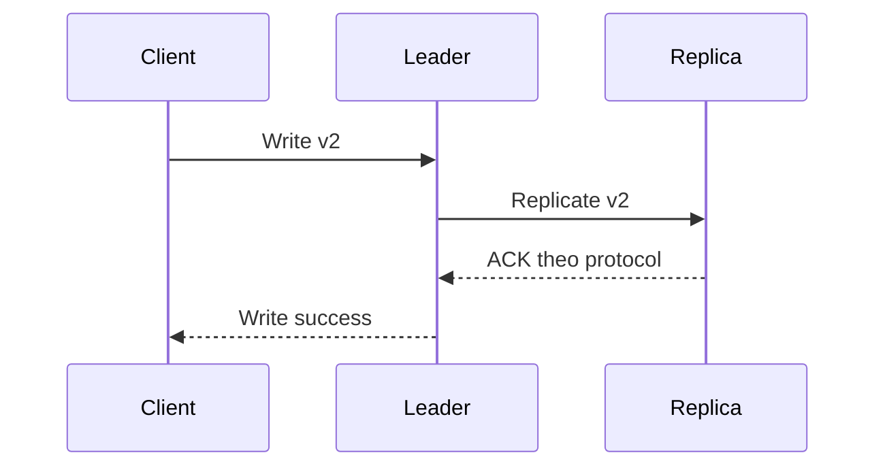
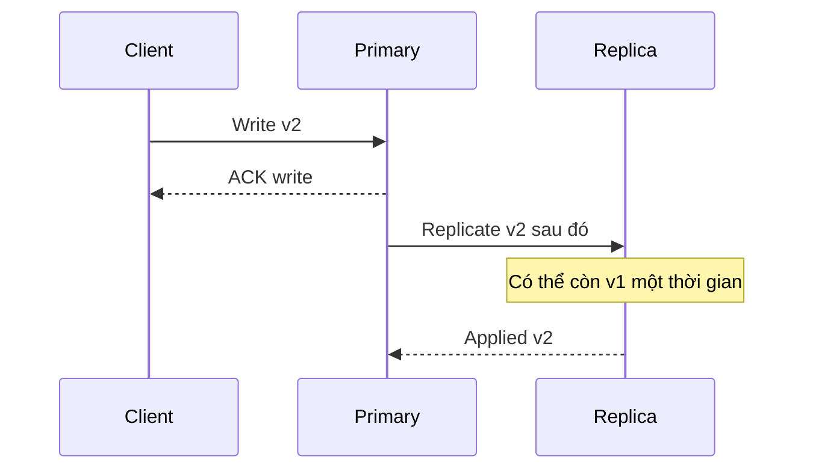

# Tác động của độ trễ mạng khi hệ không bị phân hoạch

## 1. Bài toán mở đầu: kết nối vẫn hoạt động, vì sao ghi chậm?

Một ứng dụng lưu trạng thái đơn hàng trong cơ sở dữ liệu NoSQL có ba bản sao:

- Replica A nằm gần API server.
- Replica B nằm trong cùng khu vực triển khai với A.
- Replica C nằm ở một khu vực địa lý xa hơn.

Không có máy nào bị cô lập: mọi node đều ping được nhau, kết nối TCP vẫn hoạt động và các thông điệp cuối cùng đều đến đích. Tuy vậy, yêu cầu `CreateOrder` đôi khi mất hàng trăm mili-giây mới được xác nhận.

Giả sử các độ trễ **minh họa**:

```text
Client -> API -> replica A:     vài ms
Replica A <-> replica B:        khoảng 4 ms RTT
Replica A <-> replica C:        khoảng 120 ms RTT
```

Nếu thao tác ghi chỉ cần được một replica gần xác nhận, nó có thể hoàn tất tương đối nhanh. Nếu hợp đồng yêu cầu xác nhận từ một replica ở khu vực xa, thời gian ghi có thể chịu thêm một hoặc nhiều lượt truyền qua mạng diện rộng (*wide-area network – WAN*).

Không có network partition, nhưng thời gian xác nhận vẫn khác biệt.

**Câu hỏi trọng tâm:** Khi các node vẫn liên lạc được, cấu hình mức nhất quán và cách bố trí replica ảnh hưởng thế nào tới latency, throughput và trải nghiệm ứng dụng?

Câu trả lời dẫn tới phần thường bị bỏ qua khi học CAP: **CAP không mô tả đầy đủ đánh đổi hiệu năng trong thời gian không có phân hoạch mạng.**

## 2. Mục tiêu học tập

Sau bài học, bạn có thể:

1. Phân biệt **network partition** với **mạng chậm**, jitter và replication lag.
2. Hiểu CAP nói về điều kiện có phân hoạch, còn mô hình **PACELC** giúp nhìn thêm đánh đổi **latency–consistency** trong điều kiện bình thường.
3. Vẽ đường đi của một read/write và ước lượng các lượt RTT cần thiết.
4. Phân tích tác động của synchronous/asynchronous replication, leader locality, read/write quorum và transaction phân tán.
5. Giải thích vì sao không phân hoạch vẫn có stale read, timeout hoặc tail latency cao.
6. So sánh lựa chọn thực tế ở MongoDB, Cassandra, DynamoDB và Redis mà không đồng nhất API của các hệ.
7. Phân biệt **bảo đảm nhất quán của engine**, **SLO độ trễ** và **giả định về topology**.
8. Thiết kế đo đạc, kiểm thử và tối ưu hóa hệ thống mà không đánh đổi bất biến nghiệp vụ một cách vô thức.

## 3. Nhắc lại CAP đúng phạm vi

Định lý CAP thường được trình bày bằng ba khái niệm:

- **Consistency (C):** theo cách dùng trong CAP, thường nhắm tới một dạng nhất quán mạnh như linearizability của các thao tác trên đối tượng dữ liệu.
- **Availability (A):** mỗi yêu cầu gửi tới node không lỗi nhận được một phản hồi hợp lệ, theo định nghĩa của mô hình, không phải đơn giản “uptime 99,9%”.
- **Partition tolerance (P):** hệ đối diện việc thông điệp giữa một số nhóm node không thể truyền qua được trong một khoảng thời gian, dù các node trong nhóm vẫn hoạt động.

Khi có phân hoạch khiến các nhóm không thể phối hợp, hệ khó đồng thời bảo đảm cả linearizable semantics và availability cho mọi yêu cầu ở mọi phía, trong mô hình CAP tương ứng.

Điều đó **không có nghĩa** cứ chọn một database là vĩnh viễn chọn chính xác hai trong ba chữ cái trên mọi thao tác.

### 3.1. Cần tránh cách diễn giải “2 trong 3” quá đơn giản

Một câu thường gặp:

> “Database này là CP nên luôn chậm; database kia là AP nên luôn nhanh.”

Câu này không chính xác.

- CAP tập trung vào những bảo đảm **khi xảy ra partition**.
- Latency phụ thuộc đường đi mạng, giao thức, contention, tải, phần cứng và cấu hình.
- Một hệ có thể đưa ra nhiều mức read/write consistency khác nhau theo từng operation.
- Một deployment “ưu tiên consistency khi partition” vẫn có thể phục vụ read/write rất nhanh khi các replica ở gần.
- Một hệ chấp nhận eventual consistency vẫn có thể chậm vì quét dữ liệu, partition nóng, đĩa hoặc mạng nghẽn.

**CAP không phải công thức xếp hạng tốc độ các database.**

### 3.2. Khi không có partition, CAP giúp gì?

Nếu mạng không bị phân hoạch và hệ đáp ứng những giả định cần thiết, khả năng phối hợp giữa các node thường vẫn tồn tại. Lúc đó câu hỏi thực dụng không chỉ là “có thể đạt consistency không?”, mà còn là:

- Phải chờ bao nhiêu vòng mạng mới được ACK?
- Có cần replica xa tham gia trên đường đồng bộ không?
- Một read phải hỏi leader, quorum hay replica gần?
- Có thể trả dữ liệu cũ tạm thời không?
- Khi một replica chậm, thời gian đáp ứng phải chờ nó tới đâu?

Để phân tích các lựa chọn này, **PACELC** là một khung tư duy bổ sung hữu ích.

## 4. PACELC: phần “Else” của đánh đổi

PACELC thường được tóm tắt:

```text
If Partition (P):
    trade off Availability (A) vs Consistency (C)

Else (E), khi không có partition:
    trade off Latency (L) vs Consistency (C)
```

Ký hiệu:

- **PA/PC:** cách hệ ứng xử với availability và consistency khi có partition.
- **EL/EC:** xu hướng lựa chọn latency hoặc consistency trong thời gian bình thường.

Ví dụ, một thiết kế có thể ưu tiên trả read từ bản sao gần để giảm độ trễ, chấp nhận stale read nhất định. Thiết kế khác buộc một read phải phối hợp với leader hoặc quorum để giữ một bảo đảm mạnh hơn, có thể tăng số bước truyền thông.

### 4.1. PACELC là khung phân tích, không phải nhãn thay mọi thông số

PACELC giúp hỏi đúng câu hỏi nhưng không có nghĩa:

- Hệ “EC” chắc chắn chậm trong mọi thao tác.
- Hệ “EL” chắc chắn luôn trả kết quả stale.
- Mỗi sản phẩm chỉ có một chế độ bất biến.
- Bất cứ hình thức consistency nào cũng phải trả cùng một chi phí.
- Số node ACK nhiều hơn luôn đồng nghĩa bảo đảm formal mạnh hơn.

Một sản phẩm có thể cho chọn local/majority/quorum/strong read theo operation; vị trí replica và giao thức có thể khiến độ trễ biến động mạnh.

### 4.2. Ví dụ hai API dùng hai đánh đổi

Một ứng dụng có:

```text
GET /orders/O1001
GET /recommendations
```

`GetOrder` ngay sau thanh toán có thể cần dữ liệu xác nhận tại nguồn có thẩm quyền.

`GetRecommendations` có thể chấp nhận dữ liệu gợi ý trễ vài giây và đọc từ cache địa phương.

Dùng hai consistency contracts khác nhau không có nghĩa ứng dụng bị thiết kế sai. **Đó là lựa chọn theo yêu cầu nghiệp vụ**.

## 5. Độ trễ mạng gồm những thành phần nào?

Khi nói “mạng chậm”, cần phân biệt:

| Thành phần | Ý nghĩa | Ví dụ |
| --- | --- | --- |
| **RTT** | Thời gian gửi yêu cầu và nhận phản hồi | Một lượt coordinator hỏi replica |
| **One-way delay** | Thời gian một chiều của thông điệp | Replication message từ leader tới follower |
| **Jitter** | Độ biến động của latency | Bình thường 5 ms, đôi lúc 80 ms |
| **Queueing delay** | Chờ ở socket, proxy, thread pool, NIC hoặc server | Node quá tải tạo hàng đợi |
| **Serialization cost** | Mã hóa/giải mã thông điệp | BSON/JSON, compression |
| **TLS/network overhead** | Chi phí mã hóa, connection setup và truyền | Kết nối mới hoặc tải lớn |
| **Packet loss/retransmission** | Mất gói rồi gửi lại, chưa nhất thiết là phân hoạch bền vững | Một request bị tăng RTT |
| **Cross-region path** | Truyền qua khoảng cách và mạng diện rộng | Hà Nội ↔ Singapore, chỉ mang tính ví dụ |

**Độ trễ end-to-end không chỉ là ping RTT.** Một RPC có thể đi qua load balancer, service mesh, database coordinator, hàng đợi nội bộ, fsync và replica trước khi trả về.

### 5.1. Phân biệt network partition và slow network

```text
Không có partition:
    thông điệp vẫn có thể đến, nhưng có thể đến rất chậm

Partition:
    một số nhóm node không thể trao đổi thông điệp
    trong khoảng lỗi đang xét
```

Trong hệ phân tán bất đồng bộ, trước khi hết deadline, một node có thể **không phân biệt chắc** peer đã chết, bị chia cắt hay chỉ phản hồi rất chậm.

Do đó, một mạng về mặt vật lý vẫn kết nối nhưng quá chậm có thể khiến ứng dụng gặp **timeout, nghi ngờ node hỏng, failover hoặc mất quorum tạm thời**. Kết quả vận hành có thể giống một sự cố phân hoạch, dù thực tế không có chia cắt kéo dài.

### 5.2. Không có partition không hàm ý có chặn trên latency

Giả định “mọi message cuối cùng đều được chuyển” khác với giả định “mọi message tới trong tối đa 10 ms”.

Trong một mạng không có bound chặt, thời gian hoàn tất của thao tác phối hợp có thể cao bất thường. Vì vậy không được suy:

> “Không có partition, tất cả read/write mạnh phải trả trong 100 ms.”

Một bảo đảm consistency và một cam kết latency cần **hai tập điều kiện** khác nhau.

## 6. Mô hình chi phí của một thao tác ghi

Giả sử API gửi write đến coordinator, rồi coordinator yêu cầu các replica xác nhận.

Một mô hình đơn giản:

\[
T_{\text{write}} \approx
T_{\text{client-to-coordinator}}+
T_{\text{coordination}}+
T_{\text{storage}}+
T_{\text{reply}}
\]

Tùy giao thức, `T_coordination` có thể gồm một hay nhiều pha trao đổi với replica.

Đây là công thức **ước lượng**; một số pha có thể thực hiện song song và storage có thể ghi log cùng lúc với replication.

### 6.1. Khi các replica trả lời song song

Giả sử coordinator gửi request đồng thời tới `n` replica và cần `k` phản hồi đủ điều kiện. Nếu latency của các phản hồi là:

```text
L_A = 4 ms
L_B = 6 ms
L_C = 140 ms
```

thì trong một mô hình chờ phản hồi đơn giản:

- Chờ **một** phản hồi: khoảng 4 ms.
- Chờ **hai** phản hồi: khoảng 6 ms.
- Chờ **ba** phản hồi: khoảng 140 ms.

Về mặt toán học, thời gian chờ có thể phụ thuộc vào **thống kê thứ tự thứ k** của các thời gian phản hồi, không phải tổng tất cả nếu gửi song song.

Nhưng đây **không tự mô tả protocol của mọi engine**. Một số hệ có leader log replication, commit index, nhiều pha consensus, durability sync hoặc xử lý phản hồi khác; số ACK cần thiết chỉ là một phần chi phí.

### 6.2. Khi các bước tuần tự

Với một workflow phải:

```text
API -> leader
leader -> quorum
quorum ACK -> leader
leader -> application
```

nếu mỗi giai đoạn phụ thuộc giai đoạn trước, chi phí nằm trên **critical path**.

Một số lệnh consensus/transaction có thể cần thêm pha để chuẩn bị/commit, tăng số network round trips. Đổi lại, chúng cung cấp những thuộc tính atomicity/order mà một write bất đồng bộ đơn giản không cung cấp.

### 6.3. Ví dụ minh họa local và remote

Giả định chỉ để tính trực giác:

```text
RTT client-to-leader gần:         5 ms
RTT leader-to-local-replica:      4 ms
RTT leader-to-remote-replica:   120 ms
Xử lý và ghi log:                3 ms
```

Nếu điều kiện ACK thỏa bằng leader và local replica, remote replica chưa cần nằm trên đường critical path, độ trễ có thể thấp hơn đáng kể so với khi bắt buộc chờ remote ACK.

Không nên biến các số minh họa thành cam kết p99 production. Hãy đo RTT thực, topology thật và các pha của engine.

## 7. Synchronous replication: chờ trước khi ACK

**Synchronous replication** theo một hợp đồng cụ thể yêu cầu một phần replication/commit được hoàn tất trước khi client nhận xác nhận.

Mô hình:



Ưu điểm có thể gồm:

- Tăng khả năng bảo vệ ghi đã ACK trước một số tình huống failover.
- Cho phép những mức guarantee mạnh hơn khi giao thức và quorum phù hợp.
- Giúp phân biệt rõ thao tác được xác nhận với thao tác đang chờ.

Đổi lại:

- Client phải chờ ít nhất các ACK bắt buộc.
- Replica chậm có thể làm tăng latency hoặc gây timeout.
- Khi không đạt quorum, hệ có thể phải từ chối/treo thao tác theo policy.
- Cross-region synchronization thường chịu thêm WAN RTT.

### 7.1. Không đồng nhất “synchronous” với “mọi replica fsync”

Một hệ có thể gọi replication synchronous vì chờ replica ACK, nhưng ACK được định nghĩa thế nào còn tùy sản phẩm:

- Đã nhận message?
- Đã append vào log?
- Đã đồng bộ log bền?
- Đã commit theo quorum protocol?

Phải xem chính xác semantics của **write acknowledgment** và **durability policy**. Có replica ACK không tự đồng nghĩa đã có backup độc lập.

### 7.2. Khi synchronous replication hợp lý

Các use case có thể chấp nhận latency cao hơn để giữ guarantee:

- Đơn hàng đã xác nhận.
- Chuyển khoản hoặc ledger theo invariant rõ.
- Cấp phát định danh duy nhất.
- Thay đổi quyền truy cập quan trọng.
- Reservation tồn kho có giới hạn.

Tuy nhiên, bảo đảm correctness còn cần **conditional write, transaction, uniqueness**; chỉ chờ replica ACK không tự ngăn lost update.

## 8. Asynchronous replication: nhanh hơn ở write path, nhưng đọc có thể cũ

Trong replication bất đồng bộ, một thao tác có thể được xác nhận tại nguồn trước khi những bản sao khác bắt kịp.



Ưu điểm:

- Có thể giảm thời gian chờ trên write critical path.
- Giảm phụ thuộc trực tiếp vào latency WAN cho mỗi write.
- Hữu ích với cache, analytics, search, telemetry hoặc dữ liệu cho phép lag.

Đổi lại:

- Replica có thể trả phiên bản cũ.
- Sau failover, nguy cơ mất/rollback một số ghi phụ thuộc chính sách và giao thức.
- Cần quan sát lag và repair/reconciliation.
- Những read yêu cầu mới nhất có thể phải về nguồn, dùng session token hoặc chờ.

**Asynchronous replication không có nghĩa mọi write đều “không bền”**. Nguồn vẫn có thể ghi bền cục bộ; vấn đề là replica khác chưa nhất thiết có bản ghi tại thời điểm ACK.

### 8.1. Eventual consistency không cam kết độ trễ cứng

Nếu hệ eventual, replication có thể bình thường hoàn tất trong vài chục millisecond rồi đột nhiên kéo dài hàng giây khi tải tăng. “Thường rất nhanh” khác “mọi read stale tối đa 50 ms”.

Một **bounded-staleness guarantee** nếu được sản phẩm cam kết cần nêu điều kiện chặt. Một metric kiểu p99 lag < 2 s là **SLO thống kê**, không phải bound tuyệt đối.

## 9. Read preference: ở gần có thể nhanh, nhưng chưa chắc mới

Một API có nhiều đường đọc:

```text
Client
  -> local replica (RTT 4 ms)
  -> remote leader (RTT 120 ms)
```

Nếu local replica cập nhật chậm, `GET` ở local có thể trả giá trị v7 khi leader đã có v8.

Các lựa chọn:

| Cách đọc | Lợi ích có thể có | Rủi ro/điều kiện |
| --- | --- | --- |
| Local replica eventual | Latency thấp, locality cao | Có thể stale |
| Leader/primary | Thường thuận lợi cho trạng thái mới nhất của leader | Cross-region RTT, failover, read concern |
| Read quorum | Kết hợp nhiều replica theo protocol | Chờ nhiều phản hồi, reconciliation |
| Session minimum version | Tránh lùi phiên bản trong scope tương ứng | Cần token, routing hoặc chờ |
| Cache | Rất nhanh khi hit | Invalidations, refill và TTL có thể stale |
| Search/read model | Phù hợp query chuyên biệt | Có ingestion/index refresh lag |

**Đọc leader không tự là linearizable trong mọi cấu hình**, còn **đọc majority không tự có mọi tính chất linearizability**. Phải xét hợp đồng của đúng sản phẩm/operation.

### 9.1. Read-your-writes

Sau khi client ghi version 42:

```text
PATCH /settings -> success, revision=42
GET /settings   -> revision=41   (stale)
```

Nếu UX hứa read-your-writes, response thứ hai là sai hợp đồng. Có thể:

- Đọc từ nguồn authoritative với mức read phù hợp.
- Mang session token/minimum revision.
- Chờ replica theo deadline.
- Bypass cache cũ.
- Trả kết quả chưa sẵn sàng thay vì âm thầm trả stale và ghi nhãn “latest”.

### 9.2. Monotonic reads

Một client đã thấy revision 42, nhưng lần sau load balancer chọn replica chưa bắt kịp và trả revision 41. Đó là vi phạm **monotonic reads** trong phạm vi session nếu contract có bảo đảm này.

Một sticky session có thể giúp locality, nhưng không phải câu trả lời duy nhất hoặc đầy đủ: replica có thể failover, cache có thể trả cũ, và scope session cần được nêu rõ.

## 10. Replica locality và bố trí địa lý

Bố trí replica là một biến số lớn của latency khi mạng không bị phân hoạch.

### 10.1. Ba replica trong một khu vực

```text
AZ-1: Replica A
AZ-2: Replica B
AZ-3: Replica C

Khoảng cách mạng tương đối gần
```

Nếu quorum có thể thỏa trong khu vực, đường ACK có thể ngắn hơn so với quorum buộc chờ vùng địa lý xa.

Nhưng cùng region không tự đủ bảo đảm chống mất cả region; cần xác định failure domain và RPO/RTO.

### 10.2. Ba replica ở ba khu vực xa nhau

```text
Region 1: Replica A
Region 2: Replica B
Region 3: Replica C
```

Chờ đa vùng có thể tăng WAN round trips. Đọc/ghi địa phương nhanh hơn có thể bị đánh đổi với lag hoặc xung đột đa vùng, tùy giao thức.

### 10.3. Một leader ở xa phần lớn người dùng

Nếu mọi thao tác phải tới leader ở region X, những client ở region Y có thể chịu thêm latency **ngay cả khi không replication chậm**.

Có thể chọn leader locality theo workload; nhưng đổi leader ảnh hưởng:

- Những client khác.
- Tần suất failover/reconfiguration.
- Khả năng conflict và session continuity.
- Transaction nhiều vùng.
- Quy định nơi lưu dữ liệu và quyền truy cập.

Không nên tối ưu khoảng cách mạng mà bỏ qua ràng buộc lưu trú dữ liệu (*data residency*) và khả năng phục hồi.

### 10.4. Multi-leader không có phép màu

Cho phép write gần người dùng ở nhiều region có thể giảm latency write cục bộ, nhưng các thay đổi đồng thời phải được **giải quyết xung đột** khi hội tụ:

```text
Region A: profile.nickname = "An"
Region B: profile.nickname = "Anna"
```

Một số chính sách như last-write-wins có thể bỏ đi ý định hợp lệ của một phía. Với số dư hoặc tồn kho, có thể cần một điểm phân xử mạnh, quota reservation hoặc giới hạn writer ownership.

“Ghi local nhanh” không miễn phí; chi phí correctness có thể chuyển sang conflict resolution.

## 11. Quorum: số phản hồi và vị trí phản hồi đều quan trọng

Một mô hình replicated store đơn giản dùng:

- `N`: số replica của một key.
- `W`: số replica cần ACK cho write.
- `R`: số replica tham gia đáp ứng read.

Trong mô hình quorums giao nhau:

\[
R+W>N
\]

cho thấy hai tập read/write được chọn từ cùng một tập `N` sẽ có phần tử chung.

### 11.1. Quorum và latency không chỉ phụ thuộc R/W

Giả sử `N=3`, replica phản hồi theo các thời gian minh họa:

```text
A: 4 ms
B: 5 ms
C: 110 ms
```

Nếu gửi song song và cần hai ACK hợp lệ, có thể đáp ứng theo A và B mà chưa chờ C. Nếu B chậm bất ngờ, quorum có thể phải chờ C, làm latency tăng đột ngột.

**P99 của quorum có thể xấu đi dù p50 khá tốt**, vì chỉ cần một tập replica đủ điều kiện trở nên chậm.

### 11.2. Quorum không tự suy ra linearizability

Công thức giao nhau là điều kiện hữu ích trong một mô hình, nhưng **không đủ** để chứng minh linearizability. Còn phải xét:

- Replication protocol và xử lý concurrent writes.
- Phiên bản/timestamp và reconciler.
- Membership thay đổi khi failover.
- Sloppy quorum, hinted handoff hoặc thay thế replica nếu được hệ hỗ trợ.
- Read repair và các bản sao lag.
- Cache/index không thuộc tập quorum.
- Durability/ACK semantics.
- Loại operation có transaction/CAS hay không.

Đặc biệt, **normal quorum read/write** và **consensus/LWT/transaction** không phải cùng một khái niệm.

### 11.3. LOCAL_QUORUM so với quorum trải nhiều khu vực

Trong một hệ multi-data-center, `LOCAL_QUORUM` có thể giới hạn các ACK cần thiết trong data center cục bộ. Nó có thể giảm WAN latency trên critical path, **nhưng không buộc data center xa nhìn thấy ngay cập nhật mới**.

Cấu hình này hợp lý nếu business contract phân biệt **stronger local coordination** với **eventual cross-region propagation**. Không nên diễn giải `LOCAL_QUORUM` là “quorum toàn thế giới”.

## 12. Tail latency: vấn đề lớn hơn trung bình

Một service gọi đồng thời 20 RPC tới các shard để tổng hợp kết quả. Phần lớn shard trả trong 10 ms, nhưng một vài shard đôi khi mất 300 ms.

Nếu phải đợi **tất cả** 20 shard, request end-to-end chịu latency của **shard chậm nhất**.

### 12.1. Công thức trực giác

Với `k` RPC độc lập, thời gian hoàn thành song song nếu cần tất cả là:

\[
T_{\text{fanout}}=\max(T_1,T_2,\ldots,T_k)
\]

Nếu từng RPC có xác suất `p` hoàn tất trước mốc `t` và độc lập, xác suất toàn bộ `k` RPC hoàn tất trước `t` là:

\[
P(T_{\text{fanout}}\leq t)=p^k
\]

Ví dụ minh họa: nếu mỗi RPC hoàn tất trong 50 ms với xác suất 99%, thì 20 RPC độc lập đều hoàn tất trong 50 ms với xác suất:

\[
0.99^{20}\approx 81.8\%
\]

Mỗi shard có p99 tốt không tự chứng minh p99 của request fan-out tốt. Trong thực tế các RPC còn có thể **tương quan** do cùng network, cùng disk hoặc cùng coordinator.

### 12.2. Coordinator và straggler

Những nguyên nhân đuôi độ trễ dài:

- Replica đang compaction hoặc checkpoint.
- GC pause.
- CPU/IO noisy neighbor.
- Node chứa hot partition.
- Queue network tạm cao.
- Retransmission.
- TLS connection setup hoặc pool exhaustion.
- Một shard chứa nhiều dữ liệu hơn phần còn lại.

Khi read/write policy yêu cầu một node hoặc một tập ACK nhất định, straggler có thể tác động đáng kể ngay cả khi **không có phân hoạch**.

### 12.3. Đánh đổi consistency và tail latency

Một read eventual từ replica gần có thể trả nhanh hơn nhưng có nguy cơ stale. Một read cần phối hợp/quorum có thể phải chờ nhiều phản hồi. Tuy nhiên, một đường read mạnh được tối ưu tốt trong một khu vực có thể vẫn rất nhanh.

Đừng nói “strong read luôn chậm hơn eventual read” như một định luật không ngoại lệ; cần so cùng topology, request, cache và failure policy.

## 13. Little's Law: latency tăng có thể khiến hệ quá tải

Với một hệ ổn định, định luật Little:

\[
L=\lambda W
\]

trong đó:

- `L`: số công việc trung bình đang ở trong hệ.
- `λ`: thông lượng trung bình của công việc hoàn thành (request/s).
- `W`: thời gian trung bình mỗi công việc ở trong hệ (s).

Ví dụ minh họa, hệ xử lý 1.000 request/giây:

- Nếu thời gian trung bình 0,02 s, số request in-flight khoảng **20**.
- Nếu thời gian trung bình tăng lên 0,2 s, số request in-flight có thể thành **200**, với cùng throughput và trạng thái ổn định.

Hậu quả có thể là:

- Nhiều thread/future/socket bị giữ đồng thời.
- Connection pool chật.
- Memory buffer tăng.
- Queue lâu hơn.
- Timeout và retry nhiều hơn.
- Tải lại tăng do retry tạo vòng phản hồi xấu.

**Thêm một lượt WAN RTT không chỉ thêm thời gian trên một request; nó có thể tăng concurrency và làm xuất hiện queueing delay ở toàn hệ.**

### 13.1. Tối ưu throughput không tự tối ưu latency

Batching/pipelining có thể tăng throughput bằng cách phân bổ chi phí network cho nhiều operation, nhưng:

- Chờ gom batch làm tăng latency của một số item.
- Batch lớn chiếm buffer/memory.
- Một lỗi batch có thể cần retry phức tạp.
- Transaction nhiều item phải bảo vệ semantics riêng.

Hãy đo cả **p50/p95/p99 latency**, throughput và resource utilization.

## 14. Timeout: từ mạng chậm thành lỗi ứng dụng

Giả sử:

```text
Database write hoàn tất sau: 180 ms
HTTP client timeout:        100 ms
```

Client thấy lỗi, dù database có thể đã commit ở 180 ms hoặc commit trước đó rồi ACK đến muộn.

Đây là tình huống **outcome unknown**. Nếu một request `POST /orders` bị retry tự động mà không có idempotency key, người dùng có thể tạo đơn trùng.

### 14.1. Tầng timeout phải nhất quán

Trong một request có thể có:

```text
Client HTTP deadline
  -> API gateway deadline
      -> Service deadline
          -> Database driver timeout
              -> Server-side operation timeout
```

Nếu gateway hết hạn trước driver nhưng service vẫn tiếp tục thao tác, nguồn có thể ghi sau khi người dùng thấy lỗi. Nếu driver tự retry mà API cũng retry, số lần thực thi có thể tăng mạnh.

Một deadline hợp lý cần tính **ngân sách độ trễ end-to-end**, không đơn thuần lấy timeout bằng p50 RTT.

### 14.2. Mạng chậm và failure detector

Nếu heartbeat tới replica chậm quá threshold, node có thể bị nghi hỏng. Điều này có thể kích hoạt:

- Re-election.
- Rerouting.
- Tạm mất khả năng đạt quorum.
- Duplicate leader suspicion hoặc retry.
- Chuyển workload sang replica khác.

Các hành vi chính xác tùy protocol. Một mạng chưa bị phân hoạch nhưng có jitter cao vẫn có thể ảnh hưởng availability được quan sát **qua timeout và cơ chế phát hiện lỗi**.

Không nên chỉnh heartbeat/election timeout tùy tiện chỉ để che latency nếu chưa hiểu fault model và rủi ro split-brain.

## 15. Retry storm và tải tự khuếch đại

Ví dụ:

```text
1. WAN RTT tăng từ 30 ms lên 150 ms.
2. Nhiều request vượt timeout 100 ms.
3. Client retry mỗi request một lần.
4. Database nhận thêm tải.
5. Queue tăng -> latency cao hơn.
6. Lại có thêm timeout/retry.
```

Mạng chưa bị chia cắt, nhưng hệ vẫn có thể rơi vào **retry storm**.

### 15.1. Các cơ chế giảm tác động

- **Deadline end-to-end** và truyền deadline xuống downstream.
- **Exponential backoff + jitter** cho lỗi tạm thời.
- **Retry budget** giới hạn tỷ lệ retry.
- **Admission control**, bounded queues.
- **Circuit breaker** khi phụ thuộc đang quá tải, có ngữ nghĩa fallback rõ.
- **Idempotency** cho write có thể bị gửi lại.
- **Rate limit** theo tenant, workload và loại operation.
- **Đo pending request age**, không chỉ throughput.

Đặc biệt, không nên retry vô hạn một write không có cách xác minh kết quả. Retry không có mục tiêu correctness có thể gây hậu quả nghiệp vụ lớn hơn lỗi timeout ban đầu.

## 16. Hedged requests và speculative reads: nhanh hơn nhưng phải giữ semantics

Một cách giảm tail latency là gửi một read thứ hai đến replica khác nếu lần đọc đầu chậm:

```text
Read replica A
  -> sau threshold, gửi thêm read replica B
  -> lấy phản hồi phù hợp tới trước
```

Đây là **hedged request/speculative execution**. Nó có thể giảm tail latency nếu các lựa chọn replica đủ độc lập.

Nhưng nó có rủi ro:

- Tăng tổng request tải lên database.
- Replica trả nhanh hơn có thể **stale hơn**.
- “Lấy response đầu tiên” không được làm yếu read concern/CL hoặc minimum revision.
- Nếu áp dụng tùy tiện cho writes, có thể tạo tác dụng phụ lặp.
- Một phản hồi timeout không chứng minh request đầu bị hủy.

**Optimization phải tôn trọng consistency contract.** Một driver có speculative execution đúng chuẩn của engine có thể xử lý điều kiện khác code tự gửi hai GET rồi chọn bất kỳ phản hồi nào.

## 17. MongoDB: mạng chậm và write/read concern

MongoDB cung cấp những cấu hình cần phân biệt:

- **Write concern**: xác nhận write theo điều kiện nào.
- **Read concern**: data visibility/commit semantics của read.
- **Read preference**: node nào phục vụ read.
- **Session**: causal consistency, operation metadata trong phạm vi hỗ trợ.
- **Transaction**: atomic/isolation trong ranh giới công bố.

### 17.1. Write concern majority có thể ảnh hưởng latency

Ví dụ mongosh:

```javascript
db.runCommand({
  insert: "orders",
  documents: [
    {
      orderId: "O1001",
      status: "PENDING",
      version: 1
    }
  ],
  writeConcern: {
    w: "majority",
    j: true,
    wtimeout: 5000
  }
});
```

Ý nghĩa khái niệm:

- `w:"majority"` đòi acknowledgment theo majority rule.
- `j:true` yêu cầu journaling acknowledgment theo semantics hỗ trợ.
- `wtimeout` giới hạn thời gian chờ write concern; timeout không có nghĩa rollback.

Nếu các thành viên cần ACK ở xa hoặc một node cần thiết bị nghẽn, write latency có thể tăng. **Mức ảnh hưởng thực** tùy deployment, topology, journal policy và version.

Không suy từ `w:"majority"` rằng read trên mọi secondary đều thấy ngay write hoặc mọi ACK đã được sao lưu ngoài cluster.

### 17.2. Read preference tối ưu locality nhưng có thể stale

Ví dụ:

```javascript
// Cú pháp minh họa cho cách chọn node trong mongosh.
db.getMongo().setReadPref("secondaryPreferred");
```

Khi đọc secondary, ứng dụng có thể giảm tải primary và thuận lợi về địa lý, nhưng có thể thấy replication lag. Nếu chuyển read từ primary sang secondary để tối ưu latency, cần xem **read-your-writes, monotonic reads và failover** có còn thỏa hợp đồng API hay không.

### 17.3. Read concern majority khác linearizable

Read concern `majority` bảo đảm theo dữ liệu majority committed trong phạm vi MongoDB công bố, nhưng **không tự là linearizable read**. MongoDB có read concern `linearizable` cho một số trường hợp/operation được hỗ trợ và yêu cầu sử dụng đúng điều kiện.

Khi yêu cầu “GetOrder sau CreateOrder phải thấy trạng thái đã xác nhận”, phải đối chiếu read/write concern, session và đường đọc cụ thể, không chỉ chọn tên `majority` rồi tuyên bố mọi read linearizable.

### 17.4. Causal session và read-your-writes

Với session có causal consistency và điều kiện concern thích hợp, client có thể duy trì quan hệ nhân quả cho các thao tác liên tiếp. Nhưng một request khác không nhận context session, hoặc một màn hình đọc Elasticsearch, **không tự kế thừa** bảo đảm này.

Nếu cần consistency ở API nhiều request, có thể thiết kế revision/ETag và minimum revision ở tầng ứng dụng, dựa trên khả năng thực của nguồn.

### 17.5. Transaction và WAN RTT

Giao dịch nhiều document/shard có thể cần nhiều bước và coordinated commit, làm tăng network critical path. Đừng gộp chi phí transaction commit với chi phí của một update một document trong benchmark.

## 18. Cassandra: consistency level quyết định phạm vi phối hợp

Cassandra cho phép đặt consistency level (CL) theo thao tác. Ví dụ thường gặp:

| CL | Trực giác | Về latency |
| --- | --- | --- |
| `ONE` | Một replica đáp ứng | Có thể đáp ứng sớm, nhưng stale/guarantee tùy read/write |
| `LOCAL_ONE` | Một replica tại data center cục bộ | Có thể thuận lợi về locality |
| `QUORUM` | Quorum của tập replica phù hợp | Phải đợi đủ phản hồi |
| `LOCAL_QUORUM` | Quorum trong data center cục bộ | Tránh buộc ACK vùng xa trên một số đường |
| `ALL` | Tất cả replica liên quan | Nhạy với node chậm và kém khả dụng hơn khi replica không đáp ứng |
| `SERIAL` / `LOCAL_SERIAL` | Phối hợp dành cho LWT trong phạm vi hỗ trợ | Thường có chi phí coordination khác write thường |

### 18.1. Java Driver 4

Ví dụ chọn mức read:

```java
import com.datastax.oss.driver.api.core.DefaultConsistencyLevel;
import com.datastax.oss.driver.api.core.cql.SimpleStatement;

SimpleStatement query = SimpleStatement.builder(
        "SELECT value FROM settings_by_key " +
        "WHERE tenant_id = ? AND setting_key = ?")
    .addPositionalValues("T01", "homepage")
    .setConsistencyLevel(DefaultConsistencyLevel.LOCAL_QUORUM)
    .build();
```

Giả định table có partition key cho phép query như trên. Khi dùng CL, phải ghi rõ **RF của keyspace**, data center, driver routing và CL của cả write lẫn read. Một read LOCAL_QUORUM không tự làm mọi write trước đó cũng LOCAL_QUORUM.

### 18.2. LWT tăng phối hợp

Cassandra Lightweight Transaction dùng các bước coordination cho điều kiện như:

```sql
UPDATE settings_by_key
SET value = 'dark', version = 8
WHERE tenant_id = 'T01'
  AND setting_key = 'homepage'
IF version = 7;
```

LWT cần kiểm tra kết quả `[applied]`, xét ordinary CL và serial consistency tương ứng. Đổi lại chi phí latency, nó cung cấp một cách bảo vệ CAS mà blind UPDATE ở application không có.

### 18.3. Không quy QUORUM thành linearizable mọi thao tác

Cassandra normal read/write ở QUORUM, với timestamp/conflict resolution và các điều kiện topology riêng, không nên được mô tả thành “mọi CRUD có serializable transaction”.

Cần phân biệt **giao nhau giữa replica** với **một transaction bảo vệ invariant nhiều record**.

### 18.4. Mạng chậm nhưng không partition

Một replica trả ACK chậm có thể khiến coordinator phải chờ replica khác đủ điều kiện, hoặc hết timeout nếu không có quorum kịp thời. **Không phải mọi timeout là dữ liệu mất hoặc phân hoạch thật**; nó có thể là straggler, queue và CL deadline.

## 19. DynamoDB: strong/eventual reads và chi phí đường truy cập

DynamoDB cung cấp eventual và strongly consistent reads ở những đường truy cập nhất định:

- **Base table**: GetItem/Query/Scan hỗ trợ strongly consistent read theo API.
- **Local Secondary Index (LSI)**: hỗ trợ strongly consistent read trong phạm vi hỗ trợ.
- **Global Secondary Index (GSI)**: cập nhật bất đồng bộ, chỉ hỗ trợ eventually consistent read.

### 19.1. Java AWS SDK v2: strongly consistent GetItem

```java
import java.util.Map;

import software.amazon.awssdk.services.dynamodb.DynamoDbClient;
import software.amazon.awssdk.services.dynamodb.model.AttributeValue;
import software.amazon.awssdk.services.dynamodb.model.GetItemRequest;

public void loadOrder(DynamoDbClient client, String orderId) {
    GetItemRequest request = GetItemRequest.builder()
        .tableName("Orders")
        .key(Map.of(
            "PK", AttributeValue.builder()
                .s("ORDER#" + orderId).build()
        ))
        .consistentRead(true)
        .build();

    var response = client.getItem(request);
    if (response.hasItem()) {
        processOrder(response.item());
    }
}
```

Ví dụ giả định table có partition key `PK` và một method `processOrder` do ứng dụng định nghĩa. Nếu table có sort key thì request phải có đủ primary key.

`consistentRead(true)` **không biến GSI thành strong read**, không tự tạo snapshot toàn cục khi scan nhiều trang, và không làm cache/search index nhìn thấy ghi mới.

### 19.2. Strong read và latency

Chọn strong read có thể thay đổi yêu cầu phục vụ/phối hợp và chi phí tài nguyên so với eventual read. Không nên giả định mức chênh lệch latency cố định; AWS managed service có internal implementation không hoàn toàn giống các quorum tự triển khai.

Khi quyết định:

- Dựa vào hợp đồng API cho từng read type.
- Đo trên partition key, kích thước item và tải thực.
- Quan sát throttling, hot partition và p99.
- Đảm bảo đường read từ API không đi qua GSI/cache eventual ngoài dự kiến.

### 19.3. Conditional write quan trọng hơn read mạnh trước đó

Hai actor dùng `ConsistentRead=true` cùng đọc stock=5 rồi gửi hai PutItem không điều kiện vẫn có thể xảy ra lost update.

Một điều kiện ghi phù hợp:

```text
UPDATE available = available - :qty
IF available >= :qty
```

phải được engine kiểm tra atomic trên item. Read strong là một cơ chế quan sát, **không khóa khoảng thời gian giữa read và write**.

### 19.4. Global tables và multi-region

DynamoDB có nhiều hình thức/khả năng multi-region tùy chế độ dịch vụ và thời điểm triển khai. Không mô tả mọi global table như thể chúng có cùng một mô hình consistency.

Cần kiểm tra:

- Loại global table và chế độ multi-region đang dùng.
- Nơi chấp nhận write.
- Chính sách replication/conflict.
- Read tại cùng region hay khác region.
- Failover, availability và giới hạn API.
- Các bảo đảm được công bố cho đúng configuration.

Đừng suy **“consistentRead=true ⇒ đọc linearizable toàn thế giới trong mọi chế độ”**.

## 20. Redis: rất nhanh ở gần nhưng vẫn phải xét replica và persistence

Redis thường phục vụ thao tác dữ liệu trong RAM. Với key trên một server:

```redis
SET user:U01:theme dark
GET user:U01:theme
```

Một GET tới cùng primary đang hoạt động sau SET thành công có thể thấy giá trị vừa ghi theo semantics lệnh. Nhưng:

- Read từ replica có thể stale.
- Replication ACK không tự tương đương fsync.
- Khi failover, mức giữ được ghi phụ thuộc policy và topology.
- Một cache phía trên Redis vẫn có thể trả cũ.
- Multi-key/cluster operations có phạm vi riêng.

### 20.1. WAIT và replica acknowledgment

Redis `WAIT` có thể chờ một số replica xác nhận đã nhận các write của client connection theo semantics lệnh. Nhưng không nên nói:

> `WAIT 2 1000` chứng minh hai replica đã lưu mọi write bền vững qua mất điện.

Cần xem persistence AOF/RDB, policy fsync, phiên bản và failover. Những vấn đề này khác với RTT client → primary và độ mới khi đọc replica.

### 20.2. Redis Cluster và locality

Key được phân phối theo hash slots; client có thể phải định tuyến tới node sở hữu slot hoặc nhận redirect. Nếu app ở xa cluster, ngay cả lệnh đơn cũng có WAN latency.

Cache địa phương giúp latency nhưng đưa thêm consistency contract về invalidation và source of truth.

## 21. Search, cache và bản chiếu: độ trễ ngoài database

Một nguồn dữ liệu có strong write/read contract vẫn có thể phục vụ một endpoint eventual:

```text
Primary DB write
    -> outbox/CDC
    -> indexing consumer
    -> Elasticsearch/OpenSearch index
    -> refresh
    -> Search API
```

Có ít nhất hai nguồn lag:

1. Source commit → consumer/index update.
2. Index write acknowledgment → document trở nên searchable sau refresh.

Vì vậy không thấy đơn ở trang tìm kiếm ngay sau khi đặt không nhất thiết chứng minh ghi tại nguồn thất bại.

### 21.1. Cache invalidation

```text
DB:    profile version 42
Cache: profile version 41
```

Một cache có TTL 30 giây chưa chắc giới hạn dữ liệu stale tối đa 30 giây nếu:

- Cache được refill từ replica còn lag.
- Cache có stale-while-revalidate.
- Invalidation event bị kẹt.
- Nhiều lớp cache/CDN có TTL khác nhau.

Với endpoint cần read-your-writes, có thể bypass cache, dùng version token hoặc bảo vệ cache value bằng minimum revision.

### 21.2. Đừng dùng derived index làm nguồn quyết định duy nhất

Kiểm tra một username chưa tồn tại qua GSI/search index eventual rồi cấp phát username có thể đụng race, kể cả không partition.

Uniqueness/stock/permission cần conditional write/transaction tại **nguồn authoritative** theo đúng invariant.

## 22. Transaction phân tán và nhiều network round trips

Một giao dịch cập nhật hai bản ghi trên hai shard khác nhau:

```text
Shard A: Debit account X
Shard B: Credit account Y
```

Nếu nghiệp vụ cần atomic commit, hệ có thể phải phối hợp nhiều shard và ghi log/commit records theo giao thức transaction.

### 22.1. Vì sao không partition vẫn chậm?

Mỗi pha có thể cần:

- Tra cứu coordinator/leader.
- RPC đến các shard.
- Lock/validation hoặc kiểm tra version.
- Prepare/commit messages.
- Log flush.
- Response tới caller.

Các giai đoạn phụ thuộc nhau khiến WAN RTT tăng latency giao dịch. Thêm shard không chỉ tăng throughput; nó cũng có thể tăng fan-out và số điểm chờ.

### 22.2. Cẩn trọng khi thay transaction bằng eventual workflow

Để giảm latency, có thể chuyển một số bước sang asynchronous saga/outbox:

```text
Reserve inventory -> ACK
Queue payment processing
Later: Confirm or compensate
```

Điều này thay đổi **business semantics**:

- Khách có thể thấy trạng thái PENDING.
- Có khoảng thời gian các service chưa hội tụ.
- Cần idempotent retry và compensation.
- Không được báo COMPLETED nếu bước quan trọng chưa hoàn tất.

Latency thấp hơn ở request đầu không có nghĩa toàn quy trình kết thúc nhanh hơn hoặc an toàn hơn.

## 23. Các kịch bản không có partition nhưng vẫn gặp sai kỳ vọng

### 23.1. Kịch bản A: ứng dụng đa vùng đọc gần người dùng

```text
User ở region B
Leader ở region A
Replica gần user ở B
```

- Read ở B có thể nhanh nhưng stale nếu replica chưa đồng bộ.
- Read tới leader A chịu WAN RTT nhưng có thể đáp ứng hợp đồng mới hơn.
- Nếu API cần read-your-writes, phải dùng session/version hoặc route thích hợp.

**Giải pháp không phải luôn chọn leader**; giải pháp là xác định endpoint có thể chấp nhận stale không.

### 23.2. Kịch bản B: quorum đặt sai khu vực

```text
3 replicas
2 nằm ở region xa
1 nằm gần API
write cần 2 ACK
```

Nếu write quorum luôn phải cần ít nhất một remote replica, WAN latency trở thành chi phí thường xuyên dù cluster khỏe.

Có thể xem xét placement, local quorum, ownership vùng hoặc đổi phạm vi cam kết. **Không tự hạ consistency level** của nghiệp vụ quan trọng chỉ để giảm p99.

### 23.3. Kịch bản C: write concern thấp, failover về replica cũ

Một write được ACK sớm ở primary; replica chưa bắt kịp. Primary hỏng, node thiếu ghi được chọn phục vụ. Dữ liệu có thể bị rollback/mất theo failure semantics của sản phẩm.

Ở thời điểm ghi **không có partition**. Nhưng chính sách xác nhận yếu và sự cố sau đó vẫn gây rủi ro. Vì vậy phải phân biệt **latency khi bình thường** với **durability qua failure**.

### 23.4. Kịch bản D: worker tự retry tạo hai đơn

Network RTT tăng, client timeout 100 ms, database commit sau 140 ms. Client gửi lại `CreateOrder` với ID mới.

Hai đơn có thể được tạo. Giải pháp là **idempotency key hoặc conditional create**, không chỉ tăng timeout một cách tùy ý.

### 23.5. Kịch bản E: dashboard gần như realtime nhưng lag ở search

Nguồn commit nhanh, nhưng consumer xử lý chậm và search refresh muộn. Dashboard có độ trễ lớn dù replication giữa các node nguồn không có vấn đề.

Cần đo **end-to-end visibility lag** thay vì chỉ theo dõi network RTT của database.

## 24. Chọn một mức consistency theo access pattern

| Use case | Hướng lựa chọn | Điều phải nói rõ |
| --- | --- | --- |
| Xem chi tiết đơn vừa tạo | Read-your-writes/minimum revision hoặc authoritative read | Read path, session, timeout |
| Tìm kiếm tất cả đơn | Search/read model eventual có SLO lag | Khi nào search thấy bản mới |
| Giữ hàng cuối cùng | Atomic conditional write/transaction | Invariant, idempotency |
| Đếm lượt xem | Có thể cho phép update/aggregation bất đồng bộ | Sai số và trễ chấp nhận |
| Gợi ý sản phẩm | Cache/replica địa phương | TTL, invalidation, fallback |
| Phân quyền truy cập | Đường kiểm tra quyền authoritative hoặc revocation-safe | Không trả quyền cũ sau thu hồi |
| Báo cáo tài chính | Snapshot/watermark hoặc ledger đúng ranh giới | Consistent snapshot nhiều record |
| Trạng thái giao vận | Có thể dùng eventual với revision/order | Độ trễ và event đến ngược thứ tự |
| Chat message history | Cần thứ tự/causal scope thích hợp | Session/order theo conversation |
| Cấp username duy nhất | Unique/conditional insert tại nguồn | Chống concurrent creation |

Một ứng dụng tốt có thể dùng **nhiều contracts**, nhưng phải ghi rõ để đội sản phẩm hiểu tại sao có màn hình thấy ngay và màn hình khác chậm vài giây.

## 25. Một mô hình ước lượng latency dùng cho thiết kế

Giả sử một lệnh ghi có các thời gian **minh họa**:

```text
Client -> API / coordinator:               6 ms
Validation/serialization:                  2 ms
Local storage + log:                       4 ms
Quorum ACK ở local site:                  10 ms
Reply to client:                           6 ms
```

Nếu tuần tự hóa những pha này trên critical path, ước lượng:

\[
T_{\text{local}} \approx 6+2+4+10+6=28\text{ ms}
\]

Nếu chính sách bắt buộc chờ một ACK có chi phí WAN 120 ms thay cho 10 ms:

\[
T_{\text{WAN}} \approx 6+2+4+120+6=138\text{ ms}
\]

Đây **không phải công thức SLA**: các bước có thể overlap, một số engine cần nhiều pha, và tail latency thay đổi theo tải.

### 25.1. Lấy thông số ở đâu?

- Distributed tracing cho từng request.
- Metrics của driver: round trip, pool wait, retry.
- Database coordinator: write/read acknowledgment latency.
- Replica lag và commit apply delay.
- Network RTT/packet loss theo đường thật.
- Phân phối record size, serialization và disk flush.
- P50/p95/p99 theo operation và region.

### 25.2. Hệ quả ở concurrency

Với thông lượng ổn định 500 request/giây:

- Nếu thời gian trung bình 28 ms, in-flight trung bình xấp xỉ **14**.
- Nếu tăng lên 138 ms, in-flight xấp xỉ **69**.

Theo `L=λW`, số request đang chờ gần gấp năm lần. Cần bảo đảm thread pool, connection pool và queue có giới hạn; tăng RTT có thể làm hệ quá tải dù CPU xử lý business logic không đổi.

## 26. Thiết kế timeout và retry theo latency thực

### 26.1. Dùng deadline thay vì mỗi tầng tự chờ tối đa

Ví dụ:

```text
HTTP deadline tổng: 700 ms
  API validation:       50 ms budget
  DB operation:        400 ms budget
  Response/serialization: 100 ms budget
  Dự phòng:            150 ms
```

Các số chỉ minh họa. Điều quan trọng là tổng các timeout lồng nhau không vượt quá yêu cầu của client một cách không kiểm soát.

### 26.2. Bảo vệ retry cho write

Write `ReserveStock` nên có operation ID để retry không giảm thêm lần thứ hai:

```http
POST /reservations
Idempotency-Key: RES-T01-R100
Content-Type: application/json

{"sku":"P100","quantity":2}
```

Lưu idempotency key và cập nhật nghiệp vụ cần có giao thức nhất quán; nếu cờ PROCESSED được lưu trước khi giảm stock, crash giữa chừng cũng có thể bỏ sót nghiệp vụ.

### 26.3. Có thể trả PENDING thay vì hứa hoàn tất

Nếu một workflow phải đợi nhiều region, sản phẩm có thể thiết kế:

```text
POST -> 202 Accepted, operationId
GET /operations/{id} -> PENDING / COMPLETED / FAILED
```

Đó là **thay đổi hợp đồng** từ hoàn tất đồng bộ sang chấp nhận xử lý, không phải cách làm phép toán mạng biến mất. Hệ cần quản lý pending, retry, timeout và eventual convergence.

### 26.4. Không tự fallback từ strong sang stale

Nếu endpoint cam kết nguồn mới nhất mà database strong read bị timeout, việc tự chọn replica eventual rồi trả `200 OK` mà không báo trạng thái có thể phá contract.

Nếu business cho phép chế độ degraded, response cần ghi rõ dữ liệu có thể cũ. Với quyết định tiền/tồn kho/quyền, thường nên **fail closed** theo policy thay vì trả stale như authoritative.

## 27. Kiểm thử trong trạng thái “mạng còn kết nối nhưng chậm”

Một bài test partition thường chặn hẳn kết nối. Bài này cần các thử nghiệm **mạng chậm nhưng message vẫn đến**.

### 27.1. Các chiều tác động

- RTT tăng đều từ 5 ms lên 50/100/200 ms.
- Jitter tăng, tạo đuôi latency dài.
- Packet loss nhỏ và retransmission.
- Bandwidth giới hạn.
- Hàng đợi coordinator tăng.
- Một replica chậm hơn các replica khác.
- Ứng dụng tăng số request đồng thời.
- Client/gateway timeout ngắn hơn database completion.
- Replica lag tăng dù primary vẫn ACK nhanh.

### 27.2. Test read-after-write

```text
1. Ghi record K với revision mới V.
2. Chờ ACK theo write policy cụ thể.
3. Gửi read ngay qua endpoint công bố.
4. Ghi revision và node/index/cache phục vụ.
5. Lặp khi RTT/jitter thay đổi.
6. Đếm read trả revision < V.
```

Nếu API hứa read-your-writes, phải kiểm tra **revision tối thiểu** theo session, không chỉ so một giá trị business có thể trở lại trạng thái cũ.

### 27.3. Test quorum latency

Giữ cùng payload, RF, CL và topology; điều chỉnh có kiểm soát độ trễ của một replica. Đo p50/p95/p99 write ACK, số request timeout và replica selection.

Nếu đổi cả number of replicas, payload và workload một lúc, khó kết luận latency tăng do đâu.

### 27.4. Test fan-out

Chạy query cần nhiều shard. Đo:

- RPC per shard.
- Max shard latency.
- Number of shards.
- Total request latency.
- Cache misses và GC/queueing.

Cần quan sát p99 của **API end-to-end**, không chỉ p99 của một node.

### 27.5. Test outcome unknown

Gây delay/drop **phản hồi** sau khi nguồn đã có thể commit, rồi quan sát retry:

- Có tạo operation trùng không?
- Có idempotency key không?
- Có cách tra cứu outcome không?
- Application có báo FAILED trong khi nguồn đã thay đổi không?

Thử nghiệm chỉ được thực hiện trong **môi trường cô lập, được phép và có thể phục hồi**; không gây ngắt mạng hoặc dữ liệu hỏng trên production để chứng minh bài học.

## 28. Giám sát mạng và consistency cùng nhau

| Metric | Ý nghĩa |
| --- | --- |
| `client_to_db_rtt_p95/p99` | Độ trễ đường đi client–database |
| `replica_rpc_latency` | Chậm ở từng replica |
| `write_ack_latency_p95/p99` | Chi phí thỏa write policy |
| `read_latency_by_consistency_level` | So sánh các mức read cùng workload |
| `replica_apply_lag` | Replica chậm bao lâu so với nguồn |
| `quorum_timeout_count` | Không đạt quorum trước deadline |
| `read_your_writes_violation` | Read thấp hơn revision yêu cầu |
| `monotonic_read_violation` | Read phiên sau lùi version |
| `in_flight_requests` | Áp lực latency lên concurrency |
| `connection_pool_wait` | Hàng đợi chờ connection |
| `retry_rate` | Tải tăng vì retry |
| `unknown_commit_outcome` | Request timeout không rõ commit |
| `coordinator_queue_depth` | Bottleneck tại node điều phối |
| `search_visibility_lag` | Độ trễ nguồn–search–refresh |
| `cache_stale_hit_rate` | Cache trả phiên bản cũ |
| `reconciliation_mismatch` | Sai lệch dài hạn giữa các bản chiếu |

### 28.1. Đo theo vùng và đường đọc

Một giá trị trung bình toàn cluster có thể che:

```text
Region A -> leader: p99 = 30 ms
Region B -> leader: p99 = 210 ms
Region C -> leader: p99 = 90 ms
```

Nếu chỉ hiển thị average, người dùng ở Region B có thể chịu trải nghiệm xấu dù dashboard tổng trông ổn.

Phân nhóm theo operation, consistency level, tenant, region, partition key và đường cache/index.

### 28.2. SLO lag không phải bound cứng

Ví dụ:

> 99,9% thay đổi từ nguồn xuất hiện trong search dưới 2 giây.

Đây là mục tiêu đo lường, không chứng minh **mọi** thay đổi đều trong 2 giây.

Cần đo cả **oldest unprocessed change**, số item chưa hội tụ và lỗi replay; nếu chỉ thống kê item đã xử lý, một số event bị kẹt có thể biến mất khỏi báo cáo lag.

## 29. Benchmark đúng cách: so cùng điều kiện

Một bảng benchmark có thể đánh lừa:

```text
Database A: Write CL=ONE, 1 region, 1 KB payload
Database B: Write majority, 3 regions, 20 KB payload
```

Nếu A có latency thấp hơn, chưa thể kết luận engine A “tốt hơn”; hai bài đo khác cả policy, placement và kích thước dữ liệu.

### 29.1. Cố định các yếu tố

Khi so sánh, giữ rõ:

- Cùng loại operation và business invariant.
- Cùng payload/index/data distribution.
- Cùng độ dài test và warmup.
- Cùng read/write concerns hoặc nêu sự khác biệt.
- Cùng mức concurrency và client region.
- Cùng failure model và tình trạng background compaction.
- Cùng cache warm/cold conditions.
- Cùng p50/p95/p99, timeout/error rate và throughput.

Nếu cần so hai policy khác nhau, hãy gọi đúng đó là **so sánh đánh đổi**, không phải benchmark một thuật toán đơn.

### 29.2. Benchmark sau khi chạy dài

Một LSM-based database có thể ban đầu ghi rất nhanh rồi chậm khi compaction backlog tích tụ. Một cache có thể nhanh khi toàn bộ dataset vừa RAM nhưng không phản ánh khi bị eviction. Network latency cộng với storage pressure có thể tăng tail latency phi tuyến.

Do đó cần kiểm thử đủ lâu để hệ vào trạng thái tải ổn định và ghi nhận các công việc nền.

### 29.3. Tính cả tỷ lệ lỗi

Bài đo p99=50 ms nhưng 20% request timeout không thể mặc nhiên tốt hơn bài đo p99=90 ms với tỷ lệ thành công cao nếu business yêu cầu mỗi đơn hàng đều được xử lý đúng.

Ghi cả **latency của yêu cầu thành công, error rate, deadline miss và unknown outcomes**.

## 30. Mẫu hợp đồng cho một endpoint cần consistency

Đừng viết:

> “Hệ thống ưu tiên consistency nên mọi thao tác sẽ chậm nhưng chính xác.”

Hãy viết rõ:

> Với `POST /orders`, ứng dụng gửi conditional write/transaction đến nguồn authoritative và chỉ trả `COMPLETED` sau khi write thỏa policy X. `GET /orders/{id}` đọc từ đường Y có khả năng thỏa revision tối thiểu trong phạm vi session S. Khi quorum hoặc đường đọc không hoàn tất trước deadline D, API trả trạng thái lỗi/pending theo contract, không tự fallback sang replica stale. Search và analytics được cập nhật bất đồng bộ, có SLO riêng. Các bảo đảm này áp dụng cho topology T, phiên bản V và failure model F.

### 30.1. Bảng thiết kế cần điền

| Hạng mục | Câu trả lời cần có |
| --- | --- |
| Product/version | Database, driver, service mode |
| Topology | Node, replica, AZ, region |
| Operation | GetItem, Query, Update, transaction |
| Invariant | Điều gì không được vi phạm |
| Write policy | Quorum/concern, WAL/journal/sync |
| Read policy | Concern/CL, node/replica, session |
| Consistency scope | Key, document, partition, transaction, region |
| ACK meaning | Nhận/gửi/log/commit theo tài liệu |
| RTT/latency budget | RTT, các pha phối hợp, p99 |
| Failover/partition policy | Khi không có quorum sẽ xảy ra gì |
| Staleness bound/SLO | Phân biệt hard bound và mục tiêu thống kê |
| Cache/search exceptions | Các đường không nằm trong cam kết |
| Retry/idempotency | Outcome unknown và request lặp |
| Evidence | Config thực, tài liệu phiên bản, test, metrics |

### 30.2. Câu chữ về latency phải có phạm vi

Phát biểu:

> “Độ trễ tăng 120 ms vì quorum.”

có thể chỉ đúng với topology hiện tại và một pha ACK nhất định. Viết tốt hơn:

> “Trong benchmark staging hiện tại, cấu hình write X cần ACK từ replica ngoài khu vực. Khi độ trễ RPC giữa hai khu vực tăng, p95 write ACK tăng tương ứng. Các số chỉ áp dụng cho workload và topology đã đo.”

Không diễn dịch một quan sát thành định luật phổ quát cho mọi hệ NoSQL.

## 31. Những hiểu nhầm thường gặp

| Hiểu nhầm | Cách hiểu đúng |
| --- | --- |
| “Không partition thì không có đánh đổi.” | Vẫn có chi phí latency/coordination và lựa chọn consistency |
| “CAP giải thích mọi chênh lệch tốc độ.” | CAP không thay mô hình latency, PACELC giúp thêm góc nhìn |
| “Mạng chưa đứt thì không thể timeout.” | Message chậm hơn deadline vẫn gây timeout |
| “Eventual nghĩa là read stale tối đa 1 giây.” | Cần bound chính thức hoặc chỉ được nói SLO |
| “Strong read lúc nào cũng chậm.” | Phụ thuộc topology, protocol và workload |
| “Quorum số 2 nhanh như nhau ở mọi topology.” | Vị trí và độ trễ replica quyết định ACK critical path |
| “R+W>N tự chứng minh linearizability.” | Chưa đủ protocol, version ordering và assumptions |
| “Synchronous replication nghĩa là mọi replica fsync.” | ACK semantics/durability phải xác minh |
| “Async replication nghĩa là primary chưa lưu bền.” | Local durability và remote lag là hai trục |
| “Đọc leader là mới nhất trong mọi điều kiện.” | Cần read concern, failover và đường cache |
| “DynamoDB strong read dùng được trên GSI.” | GSI chỉ hỗ trợ eventual read |
| “MongoDB majority read luôn linearizable.” | Majority và linearizable có semantics khác |
| “Cassandra LOCAL_QUORUM buộc mọi region cập nhật.” | Nó chỉ phối hợp theo phạm vi local DC |
| “Redis WAIT bảo đảm backup/zero data loss.” | Replica ACK khác persistent storage/backup |
| “Retry sau timeout chắc là an toàn.” | Write có thể commit; cần idempotency |
| “Cache TTL=30 s thì stale không thể hơn 30 s.” | Refill stale, multi-layer cache, invalidation lag |
| “p99 của từng shard tốt thì p99 fan-out tốt.” | Đợi max của nhiều shard làm tail latency xấu đi |
| “Mạng chậm chỉ tăng mỗi request, không ảnh hưởng hệ.” | Concurrency, queue, retry và pool pressure tăng |
| “Hạ write concern là tối ưu miễn phí.” | Có thể thay durability/failover guarantee |
| “Benchmark latency thấp hơn nghĩa là database tốt hơn.” | Phải so cùng workload, scope và error rate |

## 32. Bài tập thực hành

### Bài 1 — CAP hay PACELC?

Một cluster không có phân hoạch mạng. Ghi mạnh phải chờ replica ở xa; ghi bất đồng bộ ACK tại địa phương nhanh hơn.

**Câu hỏi:** Đây chủ yếu là góc nhìn CAP hay phần Else của PACELC?

**Gợi ý:** **Else: latency–consistency**. Cả hai đường còn liên lạc nhưng có chi phí phối hợp khác nhau.

### Bài 2 — Mạng chậm có phải partition?

Replica nhận mọi message nhưng RTT tăng từ 10 ms lên 500 ms, còn database timeout đặt 200 ms.

**Câu hỏi:** Có nhất thiết xảy ra network partition không? Vì sao ứng dụng vẫn thấy lỗi?

**Gợi ý:** Không nhất thiết partition bền vững; deadline ngắn hơn thời gian phản hồi tạo timeout. Failure detector có thể nghi node lỗi.

### Bài 3 — Quorum và vị trí

Ba replica phản hồi trong 4 ms, 7 ms và 130 ms. Coordinator gửi song song, cần hai ACK.

**Câu hỏi:** Trong mô hình chờ phản hồi đơn giản, phải chờ ít nhất bao lâu? Nếu replica 7 ms trở thành 180 ms thì sao?

**Gợi ý:** Khoảng **7 ms**; khi B thành 180 ms, cần A+C nên khoảng **130 ms**, chưa tính những pha khác.

### Bài 4 — R+W>N

N=3, W=2, R=2.

**Câu hỏi:** Tại sao quorum giao nhau? Có thể kết luận toàn bộ transaction multi-key linearizable không?

**Gợi ý:** Hai tập hai trong ba luôn có phần tử chung, nhưng protocol/transaction và concurrent writes phải được chứng minh thêm.

### Bài 5 — Đồng bộ đa vùng

Một write cần ACK từ vùng xa với WAN RTT 120 ms. Đội muốn giảm xuống ghi local ACK.

**Câu hỏi:** Cần đánh giá những rủi ro gì ngoài latency?

**Gợi ý:** Replica lag, failover rollback/data loss theo chính sách, durability, read-your-writes, RPO/RTO và business invariant.

### Bài 6 — Read preference

Client vừa ghi version 9, rồi đọc replica địa phương version 8.

**Câu hỏi:** Bảo đảm nào bị vi phạm nếu API đã hứa “sau Save luôn thấy thay đổi ngay”?

**Gợi ý:** Read-your-writes trong scope đã cam kết. Dùng authoritative read/minimum revision/session hoặc chờ, không giả vờ version 8 là latest.

### Bài 7 — Monotonic read

Lần đầu client thấy version 10, lần sau load balancer chuyển replica khác và trả version 9.

**Câu hỏi:** Đây là lỗi gì?

**Gợi ý:** Vi phạm monotonic reads nếu session contract yêu cầu không lùi version.

### Bài 8 — Little's Law

Một API xử lý 600 request/s. Latency trung bình tăng từ 50 ms lên 200 ms nhưng throughput ổn định.

**Câu hỏi:** Số request in-flight trung bình thay đổi thế nào?

**Gợi ý:** Từ `600 × 0,05 = 30` lên `600 × 0,2 = 120` request.

### Bài 9 — Fan-out

Một truy vấn cần phản hồi của 20 shard độc lập, mỗi shard có xác suất 99% trả trước 50 ms.

**Câu hỏi:** Xác suất cả 20 shard đều trả trước 50 ms xấp xỉ bao nhiêu?

**Gợi ý:** `0,99^20 ≈ 81,8%` trong giả định độc lập.

### Bài 10 — Timeout sau commit

Client timeout ở 100 ms, nhưng database hoàn tất ghi sau 140 ms. Client retry `CreateOrder` với ID mới.

**Câu hỏi:** Rủi ro gì? Khắc phục thế nào?

**Gợi ý:** Tạo hai đơn. Dùng idempotency key/conditional create và cơ chế tra cứu outcome.

### Bài 11 — DynamoDB GSI

PutItem vào base table thành công; Query GSI ngay sau đó không thấy item.

**Câu hỏi:** Có thể kết luận write thất bại không? Dùng ConsistentRead=true trên GSI có được không?

**Gợi ý:** Không. GSI eventual, không hỗ trợ strong reads. Nếu cần xác minh, đọc base table bằng đường API phù hợp.

### Bài 12 — Cassandra LOCAL_QUORUM

Write ở data center A với LOCAL_QUORUM. Client ở data center B đọc ngay sau đó.

**Câu hỏi:** Có thể mặc định B đã đồng bộ chưa?

**Gợi ý:** Không. Local quorum chỉ liên quan local DC; phải xem cross-DC replication và read policy.

### Bài 13 — MongoDB majority và search

MongoDB ghi majority thành công, nhưng search index vẫn trả trạng thái cũ.

**Câu hỏi:** Có phải write majority sai không?

**Gợi ý:** Không nhất thiết. Search có CDC/indexing/refresh lag riêng.

### Bài 14 — Hedged read

Driver gửi request tới hai replica và chọn phản hồi về sớm nhất, nhưng replica nhanh hơn có version cũ.

**Câu hỏi:** Có được coi optimization đó giữ nguyên contract strong read không?

**Gợi ý:** Không nếu chọn tùy ý kết quả stale. Hedging phải tôn trọng read consistency và revision tối thiểu.

### Bài 15 — Bounded staleness

Theo monitoring, 99,9% update lên search dưới 2 giây.

**Câu hỏi:** Có thể tuyên bố “không bản ghi nào stale quá 2 giây” không?

**Gợi ý:** Không. Đây là SLO thống kê; phải đo cả những update bị kẹt hoặc chưa được quan sát.

### Bài 16 — Optimistic write sau strong read

A/B cùng strongly read stock=5 rồi cả hai blind SET stock=1.

**Câu hỏi:** Strong read có bảo vệ invariant không?

**Gợi ý:** Không. Cần conditional atomic update hoặc transaction bảo vệ read-modify-write.

### Bài 17 — Chọn latency budget

Một endpoint có deadline 500 ms nhưng API gọi ba service tuần tự, mỗi service timeout 400 ms.

**Câu hỏi:** Đặt timeout như vậy có vấn đề gì?

**Gợi ý:** Các tầng có thể chờ vượt deadline tổng và tiếp tục công việc khi client đã timeout; cần propagate deadline, kiểm soát retry và cancellation.

### Bài 18 — Viết hợp đồng endpoint

Thiết kế `CreateOrder`, `GetOrder`, `SearchOrders` ở hệ đa vùng.

**Câu hỏi:** Phân biệt các guarantee thế nào?

**Gợi ý:** `CreateOrder` có ACK/conditional write theo nguồn; `GetOrder` có read-your-writes hoặc minimum revision; `SearchOrders` có thể eventual với SLO lag và không dùng làm nguồn xác nhận duy nhất.

## 33. Tóm tắt quy trình ra quyết định

Khi thiết kế một hệ NoSQL, hãy đi theo thứ tự:

1. **Xác định invariant và kỳ vọng quan sát của người dùng.**
2. **Vẽ đường ghi và đường đọc thực tế**, bao gồm cache/index/replica.
3. **Đo RTT, jitter, tail latency và phạm vi địa lý** của các node.
4. **Xác định write/read policy và semantics ACK**, không dựa vào nhãn CP/AP.
5. **Ước lượng số pha phối hợp và critical path** trong điều kiện không partition.
6. **Xem rủi ro stale read, failover và durability** khi giảm latency.
7. **Thiết kế deadline, idempotency, retry budget và backpressure**.
8. **Benchmark cùng workload/configuration**, bao gồm p99, error rate và fan-out.
9. **Thử mạng chậm có kiểm soát**, không chỉ thử partition hoàn toàn.
10. **Viết consistency contract có phạm vi**, kèm SLO, failure model và ngoại lệ.

## 34. Kết luận

**Không có phân hoạch mạng không đồng nghĩa mạng tức thời, không có timeout hoặc mọi bản sao đã đồng bộ.** Khoảng cách địa lý, RTT, jitter, hàng đợi, replica chậm và nhiều bước phối hợp có thể làm tăng độ trễ đáng kể ngay trong trạng thái cluster còn kết nối.

CAP giúp phân tích những giới hạn bảo đảm khi xảy ra partition; **PACELC bổ sung góc nhìn latency–consistency khi không có partition**. Đợi xác nhận mạnh hơn, quorum rộng hơn, leader ở xa hoặc transaction nhiều shard có thể tăng critical path, trong khi đọc/ghi gần và propagation bất đồng bộ có thể giảm latency nhưng thay đổi phạm vi dữ liệu mới nhất được quan sát hoặc mức bảo vệ qua failover.

Không có một nút “ưu tiên tốc độ” dùng cho mọi trường hợp. **Cần đối chiếu mô hình dữ liệu, topology, write/read concerns, session, yêu cầu nghiệp vụ, retry và failure model**. Một thiết kế tốt không chỉ phản hồi nhanh khi mạng khỏe mà còn **công bố rõ những bảo đảm đã đánh đổi, đo tail latency, xử lý outcome unknown và giữ nguyên các invariant quan trọng** ngay cả khi mạng chỉ chậm chứ chưa bị chia cắt.
