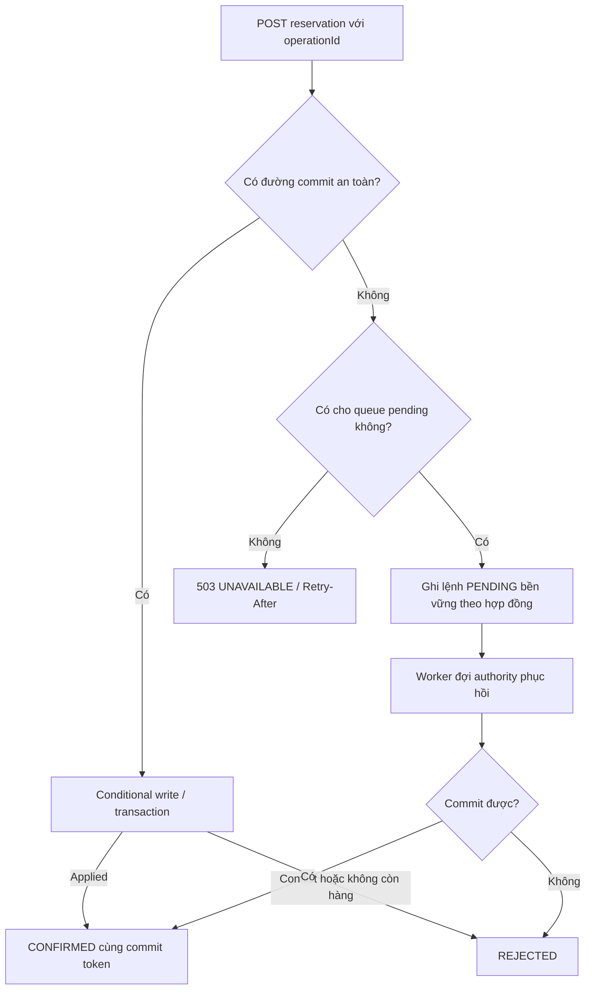
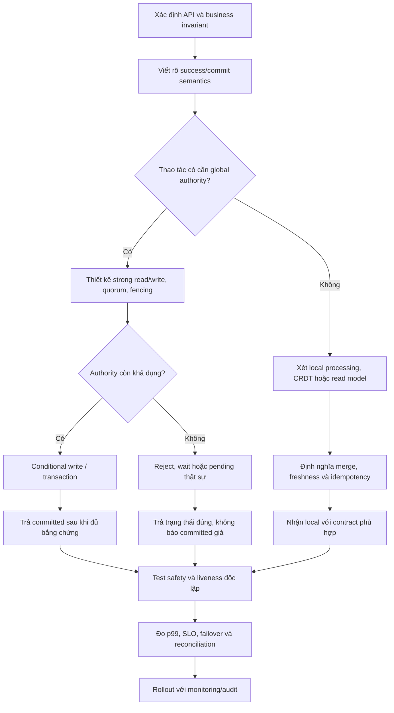

# Phân biệt tính an toàn dữ liệu với khả năng tiếp tục xử lý yêu cầu

Một hệ thống NoSQL phân tán có thể vẫn **trả lời request** trong lúc mạng bị chia cắt nhưng lại trả về trạng thái sai, chấp nhận hai thao tác mâu thuẫn hoặc âm thầm làm mất một cập nhật. Ngược lại, một hệ thống có thể **từ chối hoặc trì hoãn một số request** để không đưa dữ liệu vào trạng thái mà nó không thể chứng minh là hợp lệ.

Hai mục tiêu này liên quan nhưng không đồng nhất:

- **Tính an toàn dữ liệu (safety/correctness):** không cho phép một kết quả hoặc trạng thái bị cấm xuất hiện. Ví dụ không bán cùng một ghế cho hai người nếu hợp đồng nói một ghế chỉ có một chủ, không xác nhận trừ tiền hai lần cho cùng một lệnh, không trả phiên bản cũ sau một ghi đã hoàn tất khi API hứa linearizability.
- **Khả năng tiếp tục xử lý yêu cầu (availability/progress):** hệ còn có thể hoàn thành những thao tác được gửi tới, trong những điều kiện lỗi và giới hạn thời gian cụ thể. Ví dụ một khu vực vẫn nhận bài đăng, một API vẫn đọc dữ liệu hoặc một giao dịch vẫn được xác nhận khi một nhóm node không liên lạc được với nhóm khác.

Trong chương **CAP và các đánh đổi** của **Database No SQL**, cần hiểu rõ rằng **một hệ tiếp tục hoạt động không nhất thiết an toàn**, và **một hệ tạm dừng ghi không có nghĩa nó mất dữ liệu**. Tuy nhiên, cũng không thể kết luận hễ muốn đúng thì phải dừng toàn bộ dịch vụ: thiết kế phân vùng dữ liệu, chọn thao tác phù hợp và thu hẹp phạm vi nhất quán có thể giúp duy trì nhiều tính năng trong khi vẫn bảo vệ những bất biến quan trọng.

Bài học sẽ phân biệt safety với liveness, làm rõ availability trong định lý CAP khác uptime/SLO trong vận hành, giải thích vì sao network partition buộc phải đánh đổi với linearizability, phân tích mô hình quorum/leader/active-active, và xây dựng cách thiết kế API, xử lý lỗi, retry, kiểm thử và giám sát phù hợp từng nghiệp vụ.

## 1. Hai câu hỏi khác nhau: “Có sai không?” và “Có tiến lên được không?”

Hãy bắt đầu với một nghiệp vụ đặt vé:

```text
Quy tắc:
    Ghế A12 của suất chiếu S1 chỉ được bán cho tối đa một khách.

Yêu cầu:
    Client X mua ghế A12.
    Client Y cũng mua ghế A12.

Kết quả an toàn:
    Tối đa một yêu cầu được xác nhận SOLD.

Kết quả không an toàn:
    Cả X và Y đều nhận SOLD_CONFIRMED cho cùng ghế.
```

Nếu trong lúc kết nối giữa các node bị đứt, một node trả `503 Service Unavailable` cho Y thay vì xác nhận thêm một vé, hệ đã **không phục vụ thành công** yêu cầu đó ở thời điểm ấy nhưng có thể đã **giữ được bất biến**.

Ngược lại, hai node đều trả `200 SOLD_CONFIRMED` rất nhanh không chứng minh hệ tốt hơn; nó có thể đã bán trùng một tài nguyên duy nhất.

Một ví dụ khác là bảng tin xã hội:

```text
Yêu cầu:
    Người dùng đăng một bình luận mới.

Chính sách sản phẩm:
    Cho phép bình luận hiện ngay ở vùng gần nhất.
    Có thể chấp nhận vài giây để các vùng khác thấy bình luận.
    Nếu trùng do retry, hệ có operationId để loại trùng.
```

Ở đây tiếp tục chấp nhận thao tác cục bộ trong giai đoạn mạng lỗi có thể là một lựa chọn hợp lý **nếu hợp đồng nói rõ tình trạng pending, phạm vi xác nhận và cách hợp nhất về sau**. Không phải nghiệp vụ nào cũng cần mức bảo đảm giống đặt vé hoặc thanh toán.

**Mấu chốt:** phải xác định cụ thể *điều gì không được sai* và *request nào phải tiếp tục hoàn thành*, thay vì gắn nhãn “ưu tiên C” hoặc “ưu tiên A” mà không nêu nghiệp vụ.

## 2. Safety trong lý thuyết hệ phân tán

Trong một cách mô tả quen thuộc, **safety property** là điều kiện “**điều xấu không bao giờ xảy ra**”. Khi một lịch sử thực thi vi phạm safety, thường có thể chỉ ra **một tiền tố lịch sử hữu hạn** chứa bằng chứng đã vi phạm.

Ví dụ:

- Hai giao dịch đã được xác nhận giữ cùng một số ghế duy nhất.
- Một giao dịch đọc bản ghi cũ sau khi một ghi đã hoàn tất, trong API yêu cầu linearizability.
- Số dư xuống âm trong khi hệ hứa mọi lệnh trừ tiền phải kiểm tra số dư.
- Một mục đã bị xóa theo chính sách lại được xác nhận là còn sống bởi cơ chế replay không hợp lệ.
- Một transaction chuyển tiền được xác nhận nhưng chỉ một phía cập nhật, dù hệ hứa atomic multi-object commit.

Safety **không chỉ là bảo mật**. Trong tiếng Việt, “an toàn dữ liệu” đôi khi bị hiểu là mã hóa, chống rò rỉ hoặc sao lưu; những yêu cầu đó rất quan trọng nhưng **safety** trong lý thuyết concurrency/consistency là tính chất về **những lịch sử và trạng thái được phép**.

### Công thức khái niệm

Giả sử tập các trạng thái hợp lệ là \(I\) và bất biến:

\[
\mathrm{Valid}(s) = \mathrm{true}
\]

Một hệ hứa an toàn theo bất biến phải bảo đảm mọi trạng thái được công bố hoặc commit trong phạm vi hợp đồng đều thỏa:

\[
\forall s \in \mathrm{CommittedStates},\quad \mathrm{Valid}(s)
\]

Ví dụ tồn kho:

\[
\mathrm{available} \geq 0
\]

Nhưng không phải bất biến nghiệp vụ nào cũng chỉ là một biểu thức trên một snapshot. **Linearizability** còn giới hạn thứ tự lịch sử của thao tác: nếu ghi đã được hoàn tất trước khi đọc bắt đầu, thao tác đọc phải phản ánh thứ tự đó.

### Safety có phạm vi

Một database có thể bảo đảm conditional write trên **một item** mà không bảo đảm transaction xuyên **nhiều partition**. Kết luận “an toàn” chỉ đúng khi nêu rõ:

1. Đối tượng/partition/transaction nào được bảo vệ.
2. Những thao tác đọc/ghi nào nằm trong hợp đồng.
3. Có nhiều writer qua đường ngoài hệ hay không.
4. Replica/cache/search có nằm trong phạm vi không.
5. Khi sự cố xảy ra, những kết quả nào được xem là đã xác nhận.

## 3. Liveness và khả năng tiến triển

**Liveness property** thường diễn đạt rằng “**cuối cùng một điều tốt sẽ xảy ra**”, dưới những giả định môi trường và fairness được nêu rõ.

Ví dụ:

- Một yêu cầu hợp lệ cuối cùng hoàn thành.
- Sau khi kết nối được khôi phục, các replica cuối cùng hội tụ.
- Một message còn hợp lệ trong queue cuối cùng được xử lý.
- Một transaction không bị kẹt mãi nếu contention giảm và hạ tầng còn khả dụng.

Liveness không chỉ là “server có mở cổng TCP”. Một API có thể nhận request và trả heartbeat nhưng không hoàn tất nghiệp vụ.

Tuy nhiên, cần cẩn thận: trong hệ bất đồng bộ, nếu không có giới hạn về thời gian truyền thông hoặc lịch trình xử lý, chữ **“cuối cùng”** có thể không đi kèm một giới hạn mili-giây. **Liveness toán học khác SLO latency thực tế**.

### Ví dụ

```text
Request A:
    10:00:00 gửi PUT.
    10:00:01 database đã chấp nhận nhưng chưa commit.
    10:05:00 cuối cùng commit.

Theo một mô hình liveness:
    Có tiến triển sau cùng.

Theo API có deadline 1 giây:
    Không đạt yêu cầu phục vụ đúng hạn.
```

Do đó cần phân biệt:

- **Progress/liveness:** có thể hoàn thành cuối cùng trong điều kiện giả định.
- **Availability trong CAP:** được định nghĩa chặt theo mô hình thao tác và node.
- **Availability SLO:** tỷ lệ request hoặc thời gian dịch vụ đạt tiêu chí phục vụ đã thỏa thuận.
- **Latency SLO:** kết quả hoàn thành trước một ngưỡng, ví dụ p99 dưới 300 ms.

Chúng có liên hệ, nhưng không thể dùng thay nhau không giải thích.

## 4. Availability trong CAP nghĩa là gì?

Định lý **CAP** được thảo luận trong bối cảnh hệ lưu trữ phân tán khi mạng có thể **partition**: các nhóm node còn chạy nhưng không thể trao đổi thông điệp đầy đủ.

Trong mô hình CAP kinh điển:

- **C – Consistency:** thường được diễn giải là **atomic consistency/linearizability** của đối tượng dữ liệu theo lịch sử thao tác, chứ không phải mọi ý nghĩa của từ “consistent”.
- **A – Availability:** **mọi request** nhận bởi một node không lỗi trong phạm vi mô hình phải có response hoàn thành phù hợp với thao tác, dù kết nối đến nhóm node khác bị cắt.
- **P – Partition tolerance:** hệ phải đối mặt với khả năng mất thông điệp/kết nối giữa các nhóm node đang hoạt động.

Khi partition xảy ra, không thể bảo đảm đồng thời **linearizability toàn hệ** và **availability theo định nghĩa trên** cho mọi yêu cầu trên những phía bị tách.

### Availability trong CAP không phải “cổng mở” hoặc trả lỗi thật nhanh

Một node trả:

```http
HTTP/1.1 503 Service Unavailable
```

vẫn có thể rất **an toàn**: nó từ chối ghi khi không đủ quorum. Nhưng response này **không có nghĩa thao tác đọc/ghi đã hoàn tất thành công theo đặc tả**, nên không biến hệ thành “available” theo nghĩa lý tưởng của CAP chỉ vì trả lời HTTP.

Tương tự:

```http
HTTP/1.1 202 Accepted
```

có thể chỉ có nghĩa **đã nhận vào queue**, chưa commit vào dữ liệu có thẩm quyền. Nếu hợp đồng API phân biệt `ACCEPTED_PENDING` với `COMMITTED`, việc nhận vào queue là một thao tác khác với hoàn tất yêu cầu gốc. Không được dùng mã 202 để tuyên bố một giao dịch tiền/vé đã hoàn tất khi chưa có bằng chứng.

Trong vận hành, đội sản phẩm có thể tính một số lỗi/202 là “service responsive”, nhưng phải công bố **success criteria** rõ và không đánh tráo mục tiêu consistency.

## 5. CAP không đơn giản là “chọn hai trong ba” mọi lúc

Cách nhớ “chỉ được chọn hai trong C, A, P” giúp gợi ý đánh đổi nhưng dễ gây hiểu nhầm:

1. **Partition không phải tùy chọn luôn tắt được.** Một hệ thực phân tán phải quyết định khi kết nối bị cắt; không thể cấu hình `P=false` để mạng chắc chắn không lỗi.
2. **Bất khả thi trong trường hợp partition**, không có nghĩa lúc mạng khỏe hệ không thể vừa phản hồi nhanh vừa đọc/ghi tuyến tính hóa được.
3. **Consistency ở CAP có định nghĩa cụ thể** gần với linearizability, không mặc định là ACID “C” hoặc mọi bất biến nghiệp vụ.
4. **Availability ở CAP cũng có định nghĩa cụ thể**, không đồng nghĩa uptime 99,99%.
5. Hệ có thể **chọn theo thao tác và phạm vi**: một số key/read được phục vụ, một số write bị từ chối.
6. Có thể có nhiều mô hình nhất quán và chiến lược hội tụ khác nhau; nhãn **CP/AP không mô tả toàn bộ sản phẩm**.
7. Đánh đổi giữa **latency và consistency** vẫn tồn tại khi không có partition; có thể tham khảo hướng tư duy PACELC.

Nên đặt câu hỏi: *Khi hai nhóm node mất liên lạc, thao tác cụ thể ở từng nhóm phải xử lý ra sao?* Câu hỏi này hữu ích hơn “database này là CP hay AP?” nếu không biết configuration và API.

## 6. Thí nghiệm hai node: vì sao phải đánh đổi?

Giả sử một giá trị X ban đầu bằng 0, có hai node A và B:

```text
Trước sự cố:
    Node A: X = 0
    Node B: X = 0

Network partition:
    A  X---X  B
    Không có thông điệp qua hai phía.
```

Sau khi partition:

```text
T1: Client 1 gửi WRITE X=1 tới A.
T2: A trả WRITE_COMMITTED cho Client 1.

T3: Sau khi Client 1 đã nhận response,
    Client 2 gửi READ X tới B.
```

Nếu hệ hứa **linearizability**, READ bắt đầu sau khi WRITE đã hoàn tất phải không trả X=0 trong cùng phạm vi hợp đồng.

Nhưng B không nhận được thông điệp từ A, nên **không thể phân biệt**:

```text
Trường hợp 1: A vừa commit X=1.
Trường hợp 2: A chưa từng nhận WRITE; X vẫn là 0.
```

Nếu B cứ trả X=0 để bảo đảm response, nó có thể **vi phạm safety của linearizability** trong Trường hợp 1. Nếu B chờ hoặc từ chối cho đến khi xác định trạng thái, nó **không hoàn tất read** trong giai đoạn partition, từ đó từ bỏ availability theo định nghĩa CAP cho phía B.

### Diễn biến

```mermaid
sequenceDiagram
    participant C1 as Client 1
    participant A as Node A
    participant B as Node B
    participant C2 as Client 2
    Note over A,B: Network partition; A không liên lạc được B
    C1->>A: WRITE X=1
    A-->>C1: COMMITTED
    C2->>B: READ X sau COMMITTED
    Note over B: Không biết A đã ghi X=1
    alt Trả X=0 ngay
        B-->>C2: X=0
        Note over B,C2: Có thể vi phạm linearizability
    else Chờ hoặc từ chối
        B-->>C2: UNAVAILABLE / TIMEOUT
        Note over B,C2: Giữ safety, không đạt availability tại B
    end
```

Đây là **lý do nguyên tắc**, không phải mô phỏng đầy đủ mọi cơ chế quorum. Một hệ thực có thể ngăn A xác nhận WRITE nếu không đủ quorum ngay từ đầu, cho phép một phía có authority tiếp tục hoặc chia thao tác thành loại read/write với chính sách khác. Không thể từ đó suy rằng mỗi partition **luôn** có đúng một nửa ngừng hoạt động.

## 7. Safety thường được ưu tiên bằng cách không xác nhận điều chưa biết

Từ ví dụ trên, nếu node B không chắc mình đang có bản mới nhất, nó có một số lựa chọn:

- **Từ chối strong read** với trạng thái `UNAVAILABLE`.
- **Chờ** kết nối, read barrier hoặc authority xác nhận.
- **Chuyển tiếp** request tới nhóm có quyền xử lý nếu có đường mạng khác.
- **Trả stale read nhưng công bố rõ là stale**, trên một API có hợp đồng yếu hơn.
- **Trả cached representation** chỉ nếu caller chấp nhận dữ liệu lỗi thời.
- **Nhận yêu cầu vào queue pending**, không báo commit nếu chưa commit.

Chỉ một số lựa chọn giữ được một giao dịch **strong/linearizable**. Nhưng hệ không cần tắt mọi màn hình: đọc cache cho catalog có thể vẫn hữu ích trong khi API trừ tồn kho chờ authority.

**Từ chối khi thiếu điều kiện an toàn là hành vi đúng của một hệ đang bảo vệ dữ liệu**, không phải dấu hiệu database “đánh mất tính nhất quán”.

## 8. Quorum: một cách duy trì safety trên phần có đa số

Một mô hình phổ biến dùng ba replica:

```text
Replica R1 ---- Replica R2     |     Replica R3
      Nhóm A có thể liên lạc   |    Nhóm B bị cô lập
                             NETWORK PARTITION
```

Giả sử giao thức có quorum hợp lệ trên **2 trong 3** replica cho một số thao tác:

- Nhóm R1–R2 có thể tiếp tục xử lý những thao tác mạnh **nếu** protocol, leader/epoch/fencing và read/write path cho phép.
- R3 thiếu quorum, nên **không được tự xác nhận những write có thể xung đột** theo cùng hợp đồng.
- Client đang kết nối R3 có thể nhận lỗi, phải chuyển route hoặc chờ.

### Vì sao quorum giao nhau quan trọng?

Hai quorum đa số của một tập ba node luôn có ít nhất một node chung. Một giao thức được thiết kế đúng có thể sử dụng giao điểm đó cùng thứ tự version/term và quy tắc commit để ngăn hai leader khác nhau cùng xác nhận trạng thái mâu thuẫn.

Nhưng **chỉ lấy R + W > N không phải công thức chứng minh linearizability cho mọi NoSQL**. Cần xem:

- Quorum là cùng tập replica hay có thay đổi topology?
- Có một leader/term hợp lệ không?
- Read có kiểm tra trạng thái commit mới nhất hoặc read barrier không?
- Ghi tới quorum là **ack của replica** hay đã commit theo protocol?
- Clock, version resolution và concurrent writes được xử lý thế nào?
- Có sloppy quorum/hinted handoff hoặc read repair semantics khác không?
- Có những write trên nhiều key/partition cần transaction riêng không?

Quorum là **thành phần của một giao thức**, không tự tạo strong consistency bằng một phương trình cấu hình.

## 9. Split-brain: tiếp tục ghi ở cả hai phía có thể nguy hiểm

**Split-brain** xảy ra khi hai nhóm node hoặc hai leader đều tin mình có quyền nhận những ghi có thẩm quyền.

Ví dụ:

```text
Node A: leader cũ, không thấy leader mới do partition.
Node B: được bầu làm leader mới ở nhóm có quorum.

Cùng object O:
    A xác nhận O.status = PAID.
    B xác nhận O.status = CANCELLED.
```

Nếu cả hai đều được client tin là `COMMITTED`, khi phục hồi mạng hệ phải chọn một giá trị hoặc hợp nhất, nhưng không thể biến hai xác nhận mâu thuẫn thành một lịch sử single-authority đúng cho mọi nghiệp vụ.

### Leader election chưa đủ: cần fencing

Một **fencing token** hoặc **term/epoch tăng đơn điệu** giúp hệ từ chối hành động của leader cũ sau khi một leader mới đã có quyền.

Ví dụ:

```text
Leader A có epoch 41.
Leader B được bầu với epoch 42.

Storage/resource nhận write:
    chỉ chấp nhận epoch hiện hành hoặc mới hơn
    theo protocol được định nghĩa.

Write từ A với epoch 41:
    bị từ chối nếu B/epoch 42 đã nắm authority.
```

Token chỉ an toàn khi **nguồn tài nguyên thực thi kiểm tra fencing**. Một service giữ biến `epoch=42` trong RAM nhưng hệ bên dưới vẫn cho leader A ghi không điều kiện sẽ không chặn split-brain.

Trong thực tế còn cần xử lý lease expiry, clock uncertainty và leader failover. Không dùng đồng hồ client đơn thuần để quyết định ai là authority nếu cần bảo đảm mạnh.

## 10. Eventual consistency: tiếp tục phục vụ bằng cách chấp nhận tạm lệch

Một hệ chọn tiếp tục xử lý ở những phía tách mạng có thể cho các replica nhận cập nhật cục bộ rồi **đồng bộ/hợp nhất về sau**.

Ví dụ tính năng đổi tên hiển thị:

```text
Region A:
    Alice đổi displayName thành "An".

Region B:
    Alice đổi displayName thành "Anh".

Hai Region tạm mất liên lạc.
```

Cả hai ghi có thể được nhận, nhưng khi kết nối lại phải có **conflict resolution policy**:

- Last-write-wins theo metadata/thời gian/độ ưu tiên đã quy định.
- Mẫu version/vector clock giúp phát hiện ghi đồng thời.
- Yêu cầu người dùng chọn một trong hai phiên bản.
- Merge được nếu dữ liệu có cấu trúc cho phép.
- CRDT hoặc mô hình dữ liệu có phép hợp nhất xác định.

**Hội tụ cuối cùng không đồng nghĩa mọi ý định ghi đều được giữ nguyên.** Nếu LWW chọn một giá trị, thay đổi còn lại có thể bị ghi đè dù từng Region từng báo “đã nhận”. API phải xác định acknowledgment có ý nghĩa gì.

### Điều kiện để “eventual” thành sự thật

Sự hội tụ thường dựa vào giả định như:

- Các bản cập nhật được lưu bền vững theo chính sách.
- Thông điệp cuối cùng được truyền hoặc có cơ chế anti-entropy/replay.
- Các replica không bị xóa mất lịch sử cần cho merge.
- Conflict-resolution logic xác định, có idempotency khi replay.
- Hệ không liên tục partition mãi theo cách ngăn hội tụ.

Không thể dùng chữ “eventual” như một lời hứa hội tụ vô điều kiện khi log đã mất hoặc conflict không có quy tắc xử lý.

## 11. Không phải mọi thao tác AP đều làm sai dữ liệu

Nói “chấp nhận ghi cả hai phía thì chắc chắn dữ liệu sai” là quá rộng. Một số phép toán có thể **hợp nhất an toàn** theo invariant đã chọn.

Ví dụ sự kiện gắn thẻ độc lập:

```text
Region A: ADD tag "backend"
Region B: ADD tag "nosql"
```

Nếu dữ liệu là một set có merge semantics phù hợp và hai sự kiện có ID riêng, khi hợp nhất có thể được:

```text
tags = {"backend", "nosql"}
```

Không cần chọn một giá trị để ghi đè giá trị kia. Với các phép toán giao hoán và idempotent được thiết kế đúng, hệ có thể giữ invariant cụ thể trong giai đoạn mất kết nối.

Tuy nhiên, **xóa so với thêm** cùng một phần tử, giới hạn số phần tử, hoặc kiểm tra quyền truy cập có thể khiến thiết kế phức tạp hơn. Không nên suy rằng dùng chữ CRDT là mọi business invariant đều được bảo vệ.

### AP theo phạm vi thao tác

Có thể tiếp tục ghi:

- Lượt thích hoặc reaction theo cơ chế deduplication rõ.
- Bản nháp cá nhân không tranh tài nguyên chung.
- Event append được gắn operationId và merge theo hợp đồng.
- Cập nhật cục bộ có trạng thái `PENDING_SYNC`.

Nhưng ngay cả những thao tác này cũng phải xét **durability**: nếu node cục bộ vừa chấp nhận request rồi chết trước khi log được lưu bền vững, dữ liệu có thể mất. Availability và durability là hai trục khác nhau.

## 12. Ví dụ tồn kho: trả lời nhanh không đồng nghĩa bán đúng số lượng

Một kho có 1 sản phẩm:

```json
{
  "sku": "SKU-42",
  "available": 1,
  "version": 12
}
```

Hai Region bị partition, mỗi Region vẫn đọc số lượng `available=1`.

```text
Region A:
    Order A reserve 1 -> CONFIRMED.

Region B:
    Order B reserve 1 -> CONFIRMED.
```

Khi nối mạng lại, không thể thực hiện cả hai cam kết vật lý nếu tồn kho thật chỉ có một. Hệ có thể:

- Oversell rồi hủy một đơn sau đó.
- Hoàn tiền hoặc backorder.
- Ghi đè một reservation, làm mất cam kết còn lại.
- Để một đơn chờ duyệt từ đầu thay vì xác nhận.

Các lựa chọn đầu **vi phạm invariant “không xác nhận quá số hàng”** nếu hợp đồng xác nhận là chắc chắn giữ hàng. Nếu sản phẩm chủ động cho phép oversell/backorder, đó là **một invariant khác**, phải được mô tả trung thực trong API và giao diện.

### Thiết kế bảo vệ mạnh

Một phương án là chỉ cho **authority có quorum** xác nhận reservation bằng conditional update hoặc transaction; phía không có authority trả unavailable hoặc `PENDING` với semantics rõ.

Như vậy tính an toàn được giữ, đổi lại không phải mọi Region đều xác nhận được ngay.

## 13. Escrow: phân bổ quyền sử dụng trước khi partition

Có thể thiết kế để một số thao tác tiếp tục **an toàn** ngay cả khi mất liên lạc nếu tài nguyên được **phân bổ trước**.

Giả sử tồn kho tổng cộng 10 đơn vị:

```text
Global stock authority:
    Region A được cấp quyền reserve tối đa 6.
    Region B được cấp quyền reserve tối đa 4.

Invariant:
    rightsA + rightsB <= totalStock.
```

Trong partition:

```text
Region A có thể xác nhận tối đa 6 reservation local.
Region B có thể xác nhận tối đa 4 reservation local.
```

Nếu giao thức cấp/tiêu thụ quyền đúng, tổng số reservation xác nhận không vượt 10 mà không cần từng order trao đổi qua mạng liên vùng.

### Đánh đổi

- Region A có thể hết quota 6 khi B còn dư 4 nhưng hai phía không liên lạc được.
- Hệ cần chống dùng cùng quyền hai lần khi retry/failover.
- Quyền đã cấp phải được lưu bền vững và không nhân đôi khi leader thay đổi.
- Chuyển quyền giữa Region cần giao thức an toàn.
- Refund/cancel/return stock cần quy tắc trả quyền.
- Tồn kho vật lý còn có thể bị ảnh hưởng bởi hàng lỗi, nhập kho, sai lệch kiểm kê.

Thiết kế **escrow/bounded counter** cho phép tăng availability **trong giới hạn quyền đã phân bổ** mà vẫn giữ một invariant toàn cục. Nó không xóa đánh đổi CAP cho mọi request: khi phía A hết quyền, A vẫn phải chờ hoặc từ chối.

## 14. Money transfer: safety khác khả năng nhận yêu cầu

Giả sử chuyển 100.000 đồng từ ví A sang ví B:

```text
A.balance = 500.000
B.balance = 300.000

Transfer T:
    A.balance := 400.000
    B.balance := 400.000
```

Các invariant có thể gồm:

1. Không tạo tiền hoặc mất tiền trong phép chuyển nội bộ.
2. Không cho A âm nếu không có hạn mức thấu chi.
3. Một operationId không được tạo hai lần chuyển.
4. Nếu API trả `COMMITTED`, cả hai phía phải được ghi theo hợp đồng.
5. Có sổ cái/audit để đối chiếu và phục hồi.

Trong partition, một API có thể chọn:

```text
POST /transfers
    -> 503 UNAVAILABLE: không đủ authority để xác nhận.

Hoặc:
    -> 202 PENDING: lệnh đã được lưu để xử lý sau.
```

`202 PENDING` có thể cải thiện **khả năng tiếp nhận lệnh** nhưng **không tương đương tiền đã chuyển**. Client cần endpoint trạng thái hoặc event xác nhận commit sau này.

### Một thiết kế nguy hiểm

```text
Node A trừ tiền và báo SUCCESS.
Node B không liên lạc được nên chưa cộng tiền.
```

Nếu API hứa chuyển tiền atomic, đó là trạng thái xác nhận sai. Có thể dùng một mô hình ledger/saga và trạng thái trung gian, nhưng phải xác định **lúc nào nghiệp vụ được xem là hoàn tất** và phần nào có thể compensate. Không gọi `COMPLETED` khi chỉ một bước đã xảy ra.

## 15. Safety của lịch sử: linearizability là gì?

**Linearizability** là mô hình nhất quán yêu cầu mỗi thao tác nhìn như xảy ra nguyên tử ở một thời điểm giữa lúc bắt đầu và lúc hoàn tất, đồng thời tôn trọng thứ tự thời gian thực giữa những thao tác không chồng lấn.

Ví dụ:

```text
Initial X = 0.

Client A:
    WRITE X=1
    nhận ACK thành công.

Chỉ sau ACK:
Client B:
    READ X.
```

Nếu cả hai API được hứa linearizable, B không được đọc X=0 chỉ vì nó đang kết nối tới replica cũ.

### Vì sao linearizability là safety property?

Một lịch sử như:

```text
WRITE X=1 COMMITTED
    xảy ra hoàn toàn trước
READ X=0 SUCCESS
```

có bằng chứng hữu hạn về thứ tự và giá trị không hợp lệ. Không cần chờ hệ “sửa lại” trong tương lai để quyết định lịch sử đã sai; việc sau đó các replica hội tụ không xóa được kết quả sai đã trả cho client.

### Không nhầm với “đọc nhất quán trong một session”

Read-your-writes và monotonic reads có thể làm một client không thấy phiên bản cũ, nhưng chưa chắc bắt buộc một **client khác** bắt đầu sau commit phải thấy write đó. Linearizability đặt ràng buộc thời gian thực giữa các client trong cùng phạm vi đối tượng/operation.

## 16. Safety của transaction nhiều đối tượng

CAP thường được giảng bằng một key có đọc/ghi tuyến tính hóa, nhưng nghiệp vụ có thể liên quan nhiều document/item. Khi đó còn phải phân biệt:

- **Atomicity:** tất cả write thuộc transaction commit hoặc abort cùng nhau.
- **Serializability:** transaction đồng thời tương đương một thứ tự tuần tự.
- **Strict serializability:** serializability cộng thứ tự thời gian thực.
- **Durability:** write đã ACK tồn tại sau failure theo policy.
- **Business invariants:** điều kiện đúng mà ứng dụng phải bảo vệ.

Ví dụ hai bác sĩ đang trực:

```text
A.onCall = true
B.onCall = true
Invariant: luôn có ít nhất một người trực.
```

Hai transaction cùng đọc A/B đều true:

```text
T1: cho A nghỉ -> A=false.
T2: cho B nghỉ -> B=false.
```

Nếu mỗi transaction ghi một document khác nhau và hệ chỉ có snapshot isolation hoặc OCC riêng từng document, cả hai có thể commit, khiến không ai trực. Đây là **write skew**: không đủ chỉ bảo vệ lost update trên cùng một key.

Cần transaction serializable phù hợp, guard record chung hoặc thiết kế aggregate làm hai thao tác tranh một authority. **An toàn theo từng item không tự suy ra an toàn cho invariant nhiều item.**

## 17. Availability có thể khác nhau giữa read và write

Trong cùng sự cố mạng, hệ có thể chọn:

| Thao tác | Ví dụ chính sách | Đổi lại |
| --- | --- | --- |
| Strong write | Chỉ nhóm có quorum/authority được commit | Thiểu số không xác nhận được |
| Strong read | Cần read barrier/quorum hợp lệ | Có thể timeout khi không đủ thông tin |
| Stale read | Replica cục bộ trả dữ liệu với giới hạn stale được công bố | Không dùng cho quyết định yêu cầu dữ liệu mới nhất |
| Append-only event | Nhận cục bộ với operationId và sync sau | Có pending state, cần merge/idempotency |
| Read-only catalog | Cho phép cache đã được gắn tuổi | Có thể thấy sản phẩm/giá cũ |
| Payment/stock commit | Bảo vệ một nguồn authority | Một vùng có thể không hoàn tất request |

“Database vẫn available” không có nghĩa **mọi API** vẫn khả dụng ở cùng cấp consistency. Một hệ tốt có thể có **degraded mode theo endpoint**.

### Đừng downgrade ngầm

Nếu `/inventory/confirm` hứa xác nhận tồn kho chính xác, lúc mất quorum không được tự động đổi sang đọc cache rồi vẫn trả `CONFIRMED`. Nếu muốn cho phép pending, hãy dùng status và API contract riêng.

Ví dụ:

```json
{
  "reservationId": "R-100",
  "status": "PENDING_CONFIRMATION",
  "message": "Request recorded but stock not yet reserved"
}
```

khác hoàn toàn:

```json
{
  "reservationId": "R-100",
  "status": "CONFIRMED"
}
```

Client, kế toán, UI và downstream phải hiểu đúng khác biệt.

## 18. Bảng so sánh safety và availability khi partition

| Tiêu chí | Ưu tiên safety/strong consistency | Ưu tiên tiếp tục xử lý cục bộ |
| --- | --- | --- |
| Node mất liên lạc với authority | Từ chối hoặc chờ thao tác mạnh | Có thể nhận thao tác local nếu protocol cho phép |
| Linearizable read/write | Giữ trong phạm vi được bảo đảm | Không thể bảo đảm cho mọi phía partition |
| Trạng thái giữa replica | Không xác nhận xung đột | Có thể tạm khác nhau |
| Conflict sau khi nối mạng | Giảm số quyết định mâu thuẫn bằng authority | Cần merge/LWW/CRDT/manual resolution |
| Latency khi mất mạng | Có thể tăng mạnh hoặc timeout | Có thể thấp hơn ở local |
| Availability của mọi node | Không bảo đảm theo CAP | Có thể phục vụ thêm thao tác theo mô hình yếu |
| Tính đúng nghiệp vụ | Phải định nghĩa invariant và bảo vệ | Cũng phải định nghĩa; có thể dùng escrow/operation restrictions |
| Chi phí vận hành | Quorum, leader fencing, failover | Anti-entropy, reconciliation, duplicate handling |
| Phù hợp | Unique booking, stock, payment authority | Draft, reaction, analytics event, cache có thể stale |

Không nên đọc bảng thành “bên AP không quan tâm an toàn”. Một **AP design tốt** chọn kiểu dữ liệu và phép toán sao cho phần an toàn cần thiết vẫn được bảo vệ trong mức nhất quán yếu hơn. Ngược lại một **CP design** vẫn có thể gây mất tiền nếu business transaction viết sai hoặc API trả `COMMITTED` sai.

## 19. PACELC: ngay cả khi mạng khỏe vẫn có đánh đổi

CAP tập trung vào trường hợp **Partition**. Một khung tư duy bổ sung là **PACELC**:

```text
Nếu có Partition (P):
    đánh đổi Availability (A) với Consistency (C).

Else (E), khi vận hành bình thường:
    đánh đổi Latency (L) với Consistency (C)
    theo kiến trúc và workload.
```

Ví dụ:

- Read từ replica gần client có thể rất nhanh nhưng stale.
- Strong read qua quorum hoặc leader xa có thể tăng latency.
- Cross-region transaction bảo vệ thứ tự xác nhận nhưng cần thêm phối hợp.
- Read model qua CDC giúp dashboard nhanh nhưng không nhất thiết đọc được commit mới ngay.

**PACELC là công cụ tư duy, không phải một phép phân loại đủ để xác định mọi API.** Hệ có thể có nhiều read mode và SLA khác nhau trên cùng một database.

### Chi phí không chỉ là latency trung bình

Cần đo **p95/p99**, timeout, failover pause, số request pending, retry amplification, và hành vi khi network jitter hoặc packet loss. Một thiết kế có p50 rất tốt nhưng p99 thường xuyên vượt deadline vẫn có thể không đáp ứng yêu cầu sản phẩm.

## 20. Network partition không phải mọi lỗi của hệ thống

Những tình huống khác nhau:

- **Network partition:** các nhóm node sống nhưng không thể trao đổi đủ thông điệp.
- **Node crash:** một node dừng hẳn, có thể phục hồi sau.
- **Slow network:** message chậm vượt timeout, dễ bị hệ coi như lỗi.
- **Asymmetric connectivity:** A tới B được nhưng B tới A không.
- **Packet loss/reordering:** một số message đến chậm hoặc bị mất.
- **Storage full:** node không ghi WAL được.
- **CPU saturation:** node vẫn sống nhưng không xử lý kịp.
- **Dependency outage:** payment gateway hoặc cache bị lỗi, trong khi database vẫn khỏe.
- **Deployment/config bug:** hệ trả lỗi do schema, chứng chỉ hoặc route.

Trong mô hình bất đồng bộ, node rất chậm và node mất kết nối có thể **khó phân biệt từ bên ngoài**. Timeout là tín hiệu quyết định vận hành, không phải bằng chứng chắc chắn node đã crash.

CAP không giải thích mọi nguyên nhân không khả dụng. Một hệ có consistency yếu vẫn có thể 503 vì thiếu RAM; một hệ strong vẫn có thể trả lời nhanh khi mạng khỏe.

## 21. Safety khác durability: một ACK có nghĩa gì?

Giả sử một ghi được xác nhận:

```text
PUT X=1 -> SUCCESS
```

Ba câu hỏi riêng:

1. **Visibility/consistency:** những read bắt đầu sau ACK thấy phiên bản nào?
2. **Durability:** sau crash, dữ liệu đã ACK có còn theo policy không?
3. **Idempotency:** gửi lại cùng operationId có tạo hiệu ứng thứ hai không?

Một write có thể được phục vụ nhanh từ bộ nhớ nhưng chưa được ghi bền vững; hệ có thể linearizable khi còn chạy nhưng vẫn mất dữ liệu sau crash nếu policy cho phép. Ngược lại, một replica có dữ liệu bền vững cũ có thể trả stale read dù bản mới đã commit ở nơi khác.

Ví dụ chính sách ACK:

| ACK | Có thể hàm ý | Không tự bảo đảm |
| --- | --- | --- |
| `RECEIVED` | Server nhận request | Đã commit |
| `QUEUED` | Đã lưu lệnh theo policy queue | State nghiệp vụ đã thay đổi |
| `APPLIED_LOCAL` | Đã áp ở một node | Những replica khác đã nhận |
| `COMMITTED_QUORUM` | Giao thức đã xác nhận theo quorum | Multi-object business invariant ngoài transaction |
| `BUSINESS_CONFIRMED` | Nghiệp vụ hoàn tất theo hợp đồng | Tự động gửi email/payment side effect đúng một lần nếu chưa thiết kế |

Đặt tên response rõ theo **điều thực sự được bảo đảm**.

## 22. Safety khác security và privacy

Tính đúng của lịch sử nhất quán không thay thế:

- Xác thực danh tính người gửi request.
- Authorization theo tenant/role.
- Mã hóa data-at-rest và data-in-transit.
- Audit trail và quy tắc lưu giữ.
- Quyền xóa dữ liệu, masking, secret management.
- Backup/restore và quy trình ứng phó sự cố.

Một hệ strict-serializable vẫn có thể **rò rỉ thông tin người dùng** nếu API không kiểm tra tenantId. Một hệ eventually consistent vẫn có thể giữ dữ liệu an toàn về quyền truy cập với cơ chế authorization đúng.

Ngược lại, khi quyền truy cập thay đổi trong partition, việc tiếp tục cho phép thao tác trên **quyền đã cache quá cũ** có thể vi phạm một invariant bảo mật của ứng dụng. Lúc đó phải đưa **authorization freshness** vào phần safety được bảo vệ, chứ không coi nó là vấn đề hoàn toàn độc lập.

## 23. Một mẫu thiết kế API có trạng thái phản hồi rõ

Nghiệp vụ reservation có thể có ba trạng thái:

```text
PENDING:
    Đã ghi nhận yêu cầu; chưa giữ hàng chắc chắn.

CONFIRMED:
    Đã giành được quyền giữ hàng theo authority.

REJECTED:
    Đã xác định không thể giữ hàng theo policy.
```

Flow:



Trong nhánh PENDING:

- API không được trả `CONFIRMED` trước khi có chứng cứ.
- Queue có thể full; khi đó cần từ chối thay vì lưu vô hạn.
- `operationId` cho phép retry mà không tạo hai reservation.
- Có endpoint trạng thái cho client kiểm tra.
- Có TTL/deadline để lệnh hết hiệu lực không được áp muộn.
- Worker phải kiểm tra lại stock và trạng thái đơn ở thời điểm commit.
- Event notification và UI phải xử lý trạng thái không chắc chắn.

**Tiếp nhận request khác với hoàn tất request.** Nếu muốn giữ safety, phải phản ánh đúng ranh giới này trong hợp đồng API.

## 24. HTTP status không tự chứng minh consistency

Ví dụ:

```http
HTTP/1.1 202 Accepted
Content-Type: application/json

{
  "operationId": "R-101",
  "status": "PENDING",
  "finalized": false
}
```

Điều này có thể giúp ứng dụng tiếp tục nhận lệnh nhưng **không được tính như thành công của thao tác giữ hàng** nếu SLO định nghĩa thành công là `CONFIRMED`.

Một response khác:

```http
HTTP/1.1 503 Service Unavailable
Retry-After: 2
Content-Type: application/json

{
  "error": "CONSISTENCY_AUTHORITY_UNAVAILABLE",
  "operationId": "R-101"
}
```

`Retry-After: 2` là một hướng dẫn retry nếu còn deadline và thao tác retry-safe; nó **không bảo đảm sau hai giây database đã phục hồi**. Không phát tín hiệu “retry vô hạn” vì có thể gây retry storm.

Ở thực tế, các status code phải phù hợp hợp đồng HTTP/API của dự án. Điều quan trọng về consistency là **kết quả được xác nhận đến đâu**, không phải riêng việc request có mã 2xx.

## 25. Timeout sau commit: không được đoán đã thất bại

Một timeline:

```text
T1: Client gửi reserve operationId=R-101.
T2: Database commit reservation.
T3: Network mất response.
T4: Client thấy TIMEOUT.
```

Client không biết chắc request đã commit hay chưa. Nếu gọi lại bằng **operationId mới**, có thể tạo reservation thứ hai hoặc trừ stock lần nữa.

Thiết kế đúng:

1. Tạo operationId trước khi gửi.
2. Ghi nhận operationId cùng thay đổi nguồn trong atomic scope hoặc protocol có recovery phù hợp.
3. Khi timeout, tra trạng thái theo operationId.
4. Nếu đã commit, trả lại kết quả cũ.
5. Nếu chưa commit và policy cho phép, retry cùng operationId có giới hạn.
6. Nếu kết quả vẫn chưa rõ, giữ trạng thái `UNKNOWN/PENDING_RECONCILIATION`, không bịa ra `FAILED`.

**Safety và progress đều quan trọng:** làm sao không áp dụng hai lần, đồng thời làm sao người dùng cuối cùng biết kết quả.

## 26. Retry có thể làm giảm availability thay vì cải thiện

Khi nhiều request bị từ chối do thiếu quorum:

```text
1.000 request/s ban đầu
    -> 1.000 lỗi kết nối/quorum

Mỗi client retry ba lần ngay:
    -> thêm 3.000 attempts/s

Tổng đến backend:
    4.000 attempts/s
```

Điều này làm tăng kết nối, queue, CPU và số timeout, đúng lúc hệ cần khôi phục. Một service muốn “available hơn” nhờ retry có thể tự tạo **retry storm**, khiến thời gian khôi phục kéo dài.

Các biện pháp:

- **Capped exponential backoff + jitter**.
- **Max attempts** và deadline tổng.
- **Retry budget** trên client/service.
- Phân biệt **version conflict**, **throttling**, **unknown commit** và lỗi nghiệp vụ.
- Rate limit theo tenant/operation.
- Bounded queue và admission control.
- Circuit breaker cho dependency đang không thể phục vụ.
- Không retry cùng payload cũ sau OCC conflict mà không đọc và tính lại.

Retry không thay thế được quorum hoặc authority. Nếu partition chưa lành, lặp lại nhiều lần không tạo thêm thông tin nhất quán.

## 27. Định nghĩa SLO availability cho đúng nghiệp vụ

SLO “99,9% request trả dưới 500 ms” chưa trả lời **request trả đúng cái gì**.

Đối với endpoint thanh toán:

```text
POST /payments
  Success = COMMITTED đúng một lần,
            không overspend và có operationId.

202 PENDING:
  Không được đếm như thành công thanh toán cuối cùng,
  trừ khi SLO chỉ đo khả năng nhận lệnh.

503:
  Không thành công ở tầng API,
  có thể là quyết định đúng để giữ safety.
```

Nên công bố ít nhất:

| Chỉ số | Câu hỏi |
| --- | --- |
| **Accepted rate** | Có bao nhiêu request được ghi nhận? |
| **Committed success rate** | Bao nhiêu thao tác nghiệp vụ hoàn tất đúng? |
| **Rejected due to invariant** | Bao nhiêu yêu cầu bị từ chối hợp lệ? |
| **Unavailable rate** | Bao nhiêu request không thể hoàn tất vì thiếu authority/tài nguyên? |
| **Pending completion age** | Lệnh PENDING chờ bao lâu? |
| **p95/p99 latency** | Yêu cầu hoàn tất nghiệp vụ mất bao lâu? |
| **Safety violations** | Có duplicate reservation, oversell, stale strong read không? |
| **Unknown outcomes** | Bao nhiêu request chưa xác định commit sau timeout? |

Một invariant violation có thể là **không chấp nhận được dù chỉ xảy ra một lần**, trong khi API có thể có error budget cho availability. Đây là hai dạng mục tiêu khác nhau; không được đánh đổi một lỗi safety lấy nhiều response 200 rồi tính là cải tiến.

## 28. Công thức đo availability và safety violation

Một SLO nghiệp vụ có thể định nghĩa:

\[
\text{CommittedAvailability} =
\frac{\text{Số request hợp lệ hoàn tất đúng và đúng hạn}}
{\text{Tổng request hợp lệ được đưa vào phạm vi đo}}
\]

Định nghĩa mẫu số cần nêu rõ có loại trừ **request bị từ chối vì bất biến nghiệp vụ** hay không. Ví dụ OUT_OF_STOCK không phải outage nếu nguồn hàng thực sự hết; có thể tính là request được xử lý đúng, dù không bán được hàng.

Một metric safety:

\[
\text{DoubleBookingViolations} =
\#\{\text{các ghế có hơn một xác nhận còn hiệu lực}\}
\]

Mục tiêu:

```text
DoubleBookingViolations = 0
```

Tuy nhiên, **số đếm = 0 trong monitoring không phải chứng minh toán học hệ an toàn**. Hệ có thể thiếu log, dữ liệu audit, định nghĩa “còn hiệu lực” hoặc chưa gặp failure scenario. Cần test adversarial và kiểm tra lịch sử.

### Không gộp các lỗi vào một mã duy nhất

```text
VERSION_CONFLICT      -> state đã thay đổi.
BUSINESS_REJECTED     -> bất biến/luật không cho phép.
UNAVAILABLE           -> chưa có authority/tài nguyên.
UNKNOWN_OUTCOME       -> không biết commit xảy ra chưa.
APPLIED               -> đã hoàn tất theo hợp đồng.
PENDING               -> mới ghi nhận, chưa hoàn tất.
```

Phân loại này giúp client quyết định nên đọc lại, hiển thị lỗi nghiệp vụ, retry theo backoff hay tra operation status.

## 29. Nguyên nhân một request “vẫn xử lý được” nhưng không an toàn

Những trường hợp thường gặp:

**1. Stale read của giá/stock.**

```text
Nguồn: price=120.000 đã commit.
Replica lag: price=100.000.
API ghi đơn theo replica mà không xác nhận giá tại authority.
```

Nếu giá đơn phải tính theo giá mới nhất đã được xác nhận, API có thể vi phạm hợp đồng. Nếu sản phẩm cho phép “giữ báo giá trong 15 phút” bằng quote token, cần một cơ chế authority khác bảo vệ quote, không đơn thuần đọc cache cũ.

**2. Lost update.**

Hai writer đọc version=3 rồi ghi cả object mà không CAS. Một bản ghi ghi đè thay đổi của người kia.

**3. Double spend/double reservation.**

Hai Region xác nhận cùng một tài nguyên hữu hạn.

**4. Split-brain.**

Leader cũ và mới đều chấp nhận write không có fencing.

**5. Duplicate side effect.**

Timeout dẫn đến retry thanh toán với operationId khác.

**6. Resurrect deleted data.**

Replica lâu không nhận tombstone rồi replay giá trị cũ sau khi thông tin xóa đã bị dọn không an toàn.

**7. Cross-document write skew.**

Hai transaction độc lập cùng đọc một invariant rồi ghi hai record khác nhau, tạo trạng thái bị cấm.

Mọi trường hợp đều có thể xảy ra khi hệ **trả response nhanh**. Tốc độ không thay thế kiểm chứng correctness.

## 30. Nguyên nhân một hệ an toàn nhưng không hoàn tất request

Ngược lại, hệ có thể đúng nhưng tạm không phục vụ được vì:

- Thiếu quorum để xác nhận một write.
- Chỉ còn replica stale, không thể cung cấp strong read theo hợp đồng.
- Leader election chưa kết thúc hoặc fencing chưa được xác nhận.
- Transaction coordinator đang phục hồi commit state.
- Rate limit/circuit breaker từ chối để bảo vệ hệ.
- Lock/transaction conflict kéo dài tới hết deadline.
- Partition liên vùng làm read barrier không hoàn thành.
- Khóa mã hóa hoặc authorization authority chưa khả dụng, nên fail closed.

Những phản hồi này không phải bằng chứng dữ liệu đã hỏng. Chúng là dấu hiệu dịch vụ **không thể chứng minh đủ điều kiện để hoàn tất thao tác mạnh** tại thời điểm ấy.

Đồng thời, nói “an toàn nên chậm là chấp nhận” cũng chưa đủ. Cần thiết kế **failover, traffic routing, degraded reads và kế hoạch khôi phục** để giảm thời gian không phục vụ mà không phá invariant.

## 31. Phân loại tính năng theo mức rủi ro

| Tính năng | Bất biến quan trọng | Có thể phục vụ stale/local khi partition? | Lựa chọn thường cân nhắc |
| --- | --- | --- | --- |
| Xem bài viết cũ | Không xem dữ liệu không có quyền | Có thể, nếu authorization/freshness policy cho phép | Cache với TTL/age |
| Ghi reaction | Không tạo trùng cùng operation | Có thể với merge/dedup phù hợp | CRDT/event log |
| Lưu bản nháp | Không mất chỉnh sửa đã ACK | Có thể lưu local pending nếu contract rõ | Local durable log + sync |
| Cập nhật địa chỉ | Không mất update | Có thể nhận pending, merge sau | OCC/field conflict |
| Thanh toán | Không trừ tiền hai lần | Không xác nhận khi thiếu authority | Idempotent strong commit |
| Giữ tồn kho | Không xác nhận vượt quota | Có thể trong escrow rights đã cấp | Conditional reservation/escrow |
| Bán ghế duy nhất | Không bán trùng | Thường cần single authority | CAS/unique seat |
| Đọc dashboard | Freshness trong SLA | Có thể | Eventual read model |
| Xóa dữ liệu theo yêu cầu | Không resurrect ngoài chính sách | Có thể ghi deletion intent đúng chỗ | Tombstone/version fencing |
| Thay quyền admin | Không áp quyền cũ trái policy | Cần cân nhắc fail-closed | Strong auth state/read barrier |

Bảng không phải một quyết định cố định cho mọi sản phẩm. Điều cần thiết là **định nghĩa mức độ sai lệch có thể chấp nhận** và hậu quả nếu một yêu cầu được xác nhận sai.

## 32. DynamoDB: strong read, transactional write và GSI là các đường khác nhau

Trong DynamoDB, không nên từ tên sản phẩm suy rằng mọi thao tác có cùng consistency:

- **GetItem/Query trên bảng** có các chế độ read consistency theo khả năng API.
- **Global Secondary Index (GSI)** có đặc điểm cập nhật bất đồng bộ; read qua GSI có thể không thấy thay đổi vừa commit ngay.
- **ConditionExpression** có thể bảo vệ một item khỏi ghi khi điều kiện không còn đúng.
- **TransactWriteItems/TransactGetItems** có phạm vi và giới hạn transaction riêng.
- **Global tables/multi-Region** cần xét replication và conflict resolution của chế độ triển khai cụ thể.

Ví dụ:

```text
Source item:
    stock=0 sau reservation đã commit.

GSI/search-like read path:
    vẫn có thể báo stock=1 trong một khoảng thời gian.

Nếu client chỉ dùng dữ liệu GSI để quyết định đặt hàng
mà không kiểm tra có điều kiện tại source:
    có nguy cơ xác nhận sai.
```

Đường đúng là dùng **conditional write/transaction trên authority** cho bất biến tồn kho, còn GSI phục vụ discovery với thông tin freshness rõ. Khi request bị throttling hoặc conditional check thất bại, phải phân loại thay vì retry tất cả như lỗi hạ tầng.

**Không dùng consumed capacity units để suy ra mức an toàn hoặc thời điểm commit.** Đây là metric tài nguyên, không phải bằng chứng lịch sử linearizable.

## 33. Cassandra/ScyllaDB: consistency level không giải quyết mọi invariant

Trong Cassandra/ScyllaDB, các mức đọc/ghi và replication giúp chọn **số replica tham gia hoặc xác nhận** theo giao thức, còn LWT cung cấp conditional operations trong phạm vi được hỗ trợ.

Một ví dụ cập nhật bằng CAS/LWT:

```sql
UPDATE inventory_by_sku
SET available = ?, version = ?
WHERE tenant_id = ?
  AND sku = ?
IF version = ?;
```

Nếu `[applied] = false`, điều kiện không đúng; không được ép ghi lại bản cũ. Nếu node không đủ điều kiện consistency/quorum cho thao tác, nó có thể trả unavailable/timeout thay vì xác nhận thiếu căn cứ.

Nhưng cần phân biệt:

- **Quorum reads/writes** không tự là serializable transaction xuyên mọi partition.
- **LWT** không tự mở rộng thành giao dịch tùy ý nhiều bảng/nhiều partition.
- Replication/repair/tombstone có ngữ nghĩa liên quan đến **durability và deletion safety**.
- Một truy vấn rộng với `ALLOW FILTERING` không tạo correctness mạnh hơn.
- Topology, pending repair, timestamp conflict và read/write path ảnh hưởng kết quả.

Không thể kết luận “QUORUM + QUORUM = mọi nghiệp vụ an toàn” nếu workflow có hai document cùng phải giữ bất biến hoặc dùng nhiều loại write không cùng protocol.

## 34. MongoDB: read concern, write concern và transaction

MongoDB có các cấu hình read concern, write concern, session và transaction tùy topology/version. Chúng giải quyết những câu hỏi khác nhau:

| Cơ chế | Câu hỏi trọng tâm |
| --- | --- |
| **Write concern** | Write cần được xác nhận ở mức nào? |
| **Read concern** | Read được phép quan sát những dữ liệu nào? |
| **Read preference** | Đọc từ node nào? Có thể lag không? |
| **Session/causal consistency** | Những thứ tự trong session được duy trì thế nào? |
| **Multi-document transaction** | Những read/write nào commit cùng một transaction? |
| **Version/CAS filter** | Có ngăn lost update trên document khi ghi không? |

Ví dụ CAS trên một document:

```javascript
const result = db.orders.updateOne(
  {
    tenantId: "T1",
    orderId: "O-100",
    version: NumberLong("12")
  },
  {
    $set: { status: "PAID" },
    $inc: { version: NumberLong("1") }
  }
);

if (result.matchedCount === 0) {
  // Không ghi đè; cần kiểm tra conflict hoặc not-found.
}
```

Điều kiện version giúp không chấp nhận payload cũ trên cùng document. Nhưng nếu nghiệp vụ thay đổi nhiều document, phải xác định transaction/isolation và các bất biến chéo document riêng. Một read từ secondary có độ trễ không mặc định tương đương read qua authority.

Không khẳng định mọi tổ hợp `readConcern`/`writeConcern` mang cùng một bảo đảm end-to-end khi có failover; cần đối chiếu đúng phiên bản và hợp đồng API.

## 35. Redis: trả lời nhanh trong RAM vẫn cần phân biệt consistency

Redis thường có latency thấp cho các thao tác trong RAM. Một script hoặc atomic command có thể bảo vệ một invariant trong phạm vi key/slot:

```lua
-- KEYS[1]: inventory key
-- ARGV[1]: requested quantity
local stock = tonumber(redis.call("GET", KEYS[1]) or "0")
local requested = tonumber(ARGV[1])

if requested == nil or requested <= 0 then
    return {0, "INVALID_QUANTITY"}
end

if stock < requested then
    return {0, "OUT_OF_STOCK"}
end

redis.call("DECRBY", KEYS[1], requested)
return {1, "RESERVED"}
```

Script giúp kiểm tra và trừ trên cùng authority một cách nguyên tử trong phạm vi Redis hỗ trợ, nhưng **chưa có idempotency** nên request timeout/retry có thể trừ thêm lần nữa. Nó cũng không tự chứng minh durability hay strict serializability xuyên nhiều Redis shard/Region.

Những giới hạn:

- **Replica read** có thể lag tùy replication mode.
- **Failover** và persistence policy cần được kiểm tra.
- Multi-key script/MULTI trong Redis Cluster có ràng buộc hash slot.
- Mọi order quan trọng cần operationId/uniqueness và chiến lược phục hồi.
- Không dùng một Redis cache eventual làm authority duy nhất của tồn kho nếu dữ liệu nguồn và cơ chế đồng bộ không bảo vệ invariant.

Một hệ trả GET trong 1 ms vẫn có thể sai nếu đó là giá trị cũ mà API đòi mới nhất.

## 36. Active-active, LWW và nguy cơ “thành công ở cả hai phía”

Trong kiến trúc active-active đa vùng, mỗi Region có thể tiếp nhận ghi riêng:

```text
Region A:
    customer.phone = "0900..."
    ACK local.

Region B:
    customer.phone = "0911..."
    ACK local.
```

Khi mạng phục hồi, một chính sách last-write-wins (LWW) có thể chọn một giá trị theo timestamp hoặc version resolution.

Nếu API chỉ hứa “giá trị cuối cùng theo LWW”, đây có thể là behavior đã định nghĩa. Nhưng nếu API hứa **mọi cập nhật được xác nhận đều không mất**, LWW có thể vi phạm kỳ vọng đó.

### Clock không đủ để tạo global business order

- Đồng hồ máy khác nhau có thể lệch.
- Timestamp bằng nhau hoặc đảo do clock skew.
- Thời điểm ghi ở một Region không nhất thiết phản ánh causal order.
- Một retry sau timeout có thể đến muộn hơn operation mới.
- Hai version cùng số đếm không đồng nghĩa chúng cùng lịch sử.

Nếu domain cần giữ mọi ý định, cân nhắc **append-only log + operationId + conflict resolution**, hoặc trao quyền một writer có thẩm quyền cho entity. Nhưng ngay cả append-only events cũng cần deduplication, retention, order và replay semantics.

## 37. Consistency budget thay vì một nhãn duy nhất

Một ứng dụng thực tế có thể công bố:

```yaml
operations:
  view_catalog:
    consistency: eventual
    maxAcceptableStalenessSeconds: 30
    fallback: cached_response
  update_profile:
    consistency: optimistic_conditional_write
    onConflict: require_reconciliation
  reserve_inventory:
    consistency: authoritative_conditional_write
    onNoQuorum: unavailable_or_pending
  create_payment:
    consistency: transactional_authority
    idempotencyKeyRequired: true
    onUnknownCommit: reconcile
  analytics_dashboard:
    consistency: event_driven_read_model
    freshnessSloSeconds: 120
```

Đây là **mẫu hợp đồng minh họa**. Phải xác nhận các mức này có thể triển khai bằng database/SDK/topology thật. Một API có thể có nhiều read modes, ví dụ `GET /orders` cho UI thông thường và `GET /orders/authoritative` cho quyết định nghiệp vụ.

**Consistency budget** giúp dùng mức bảo đảm mạnh ở những điểm cần invariant và cho phép stale ở những điểm có thể dung thứ. Nó không làm mất đi nghĩa vụ authorization hoặc durability.

## 38. Thiết kế degraded mode có chủ đích

Khi mất liên lạc với authority, ứng dụng có thể tiếp tục một phần trải nghiệm:

```text
Catalog GET:
    serve cached content, hiển thị "last updated".

Cart edits:
    lưu draft cục bộ, chưa giữ hàng.

Checkout:
    tạm khóa CONFIRM nếu không thể reserve an toàn.

Payment:
    hiển thị PENDING nếu đã nhận request an toàn,
    không thông báo CHARGED khi chưa được xác nhận.

Notification:
    queue event có idempotency, gửi khi hệ phục hồi.
```

Một bảng chính sách:

| API | Chế độ bình thường | Khi mất authority | Sau phục hồi |
| --- | --- | --- | --- |
| Browse catalog | Có thể dùng cache | Stale read có nhãn | Refresh/revalidate |
| Edit draft | Local/remote sync | Local pending | Merge/conflict UI |
| Reserve stock | Conditional commit | Reject hoặc pending | Recheck quota rồi commit |
| Payment | Transaction + idempotency | Không confirm thiếu căn cứ | Tra operationId |
| Analytics | Event-driven read | Hiển thị snapshot/lag | Catch-up events |
| Admin permission change | Strong authority | Fail closed khi không kiểm chứng | Audit/replay có kiểm soát |

Không phải toàn bộ hệ tắt khi một endpoint mạnh không đáp ứng. **Giảm phạm vi gián đoạn** là phương pháp tăng availability thực tế mà không tự động hạ thấp safety của những thao tác rủi ro.

## 39. Read repair, anti-entropy và reconciliation

Ở những hệ chấp nhận replica lệch tạm, quá trình phục hồi có thể gồm:

1. Xác định những version/event đã được commit hoặc nhận ở mỗi phía.
2. Đối chiếu bằng version vector, timestamp, log position hoặc cấu trúc của engine.
3. Hợp nhất theo domain policy.
4. Deduplicate những operationId được replay.
5. Áp tombstone/delete marker và không resurrect giá trị bị xóa.
6. Tạo compensating action nếu business đã cho phép trạng thái tạm và cần bù.
7. Kiểm chứng invariant sau hòa giải.
8. Báo cáo những conflict không thể tự giải quyết.

**“Eventual consistency” không có nghĩa lấy dữ liệu của node bất kỳ chép đè lên node còn lại**. Một thao tác xóa có thể bị đảo bởi bản cũ nếu deletion marker không được quản lý đúng. Một payment bị ghi đè bởi LWW có thể cần đối soát sổ cái, không thể “merge JSON” là xong.

Hệ cần định nghĩa từ đầu **thao tác nào được phép hợp nhất** và **thao tác nào không được chấp nhận khi không đủ authority**.

## 40. Test safety và availability bằng hai bộ câu hỏi khác nhau

Một hệ có thể có availability SLO cao nhưng safety thấp; cũng có thể safety tốt nhưng failover quá chậm. Do đó cần kiểm tra song song.

### Safety tests

- Hai writer cùng giữ một seat/stock unit: có thể nhận hai commit không?
- Một read bắt đầu sau strong write đã hoàn tất: có thấy giá trị cũ không?
- Hai transaction ghi các document khác nhau có phá invariant không?
- Timeout sau commit rồi retry: có duplicate business effect không?
- Replica khôi phục sau thời gian dài: delete có bị resurrect không?
- Leader cũ gửi write sau failover: fencing có chặn không?
- Read qua cache có bị dùng nhầm cho business decision không?
- Một HTTP 202 có bị UI hiểu thành commit không?

### Availability/progress tests

- Khi mất một node, bao nhiêu request tiếp tục hoàn tất?
- Khi một nhóm node mất quorum, client có được lỗi nhanh, rõ ràng không?
- Failover mất bao lâu? p99 latency tăng bao nhiêu?
- Queue pending có tiếp tục nhận đến giới hạn nào?
- Khi nối mạng lại, backlog được xử lý trong bao lâu?
- Retry budget có ngăn bão truy cập không?
- Tenant nhỏ có còn được phục vụ khi một tenant lớn gây tải cao?
- Khi không thể phục vụ strong operation, degraded endpoints có còn đúng SLA không?

Một test chỉ xác nhận “có HTTP response” không đo safety. Một test chỉ xác nhận final state cuối cùng đúng có thể bỏ qua những stale reads/duplicate confirmations đã xảy ra trong lúc partition.

## 41. Thí nghiệm fault injection: chia ba replica thành 2–1

Thiết lập giả định:

```text
R1, R2, R3 là replica của cùng một phạm vi dữ liệu.
R1 và R2 liên lạc bình thường.
R3 bị cách ly khỏi R1/R2.
```

Các bước:

1. Ghi X=0, xác minh cluster khỏe và trạng thái ban đầu.
2. Tạo network partition 2–1 có kiểm soát trong môi trường test.
3. Gửi strong write `X=1` tới nhóm R1–R2.
4. Gửi strong read tới R3 qua đúng API được hứa strong.
5. Ghi invocation, response, timeout, error code và topology.
6. Thử writer khác ghi `X=2` ở R3.
7. Phục hồi mạng, chờ replication/recovery theo protocol.
8. Đọc trạng thái cuối và kiểm tra history.
9. Lặp với leader nằm ở nhóm R3 trước khi partition.
10. Lặp với packet loss, độ trễ lớn và failover.

Kết quả kỳ vọng của một **giao thức strong đúng** có thể là nhóm có quorum tiếp tục, còn R3 không xác nhận write/strong read trái contract. Kết quả cụ thể phụ thuộc protocol, role và commit semantics.

### Không cần cố làm mọi request thành công trong test

Nếu R3 trả unavailable ở bước 4–6, đó có thể là **hành vi đúng để bảo vệ consistency**. Bài test phải đánh giá đồng thời:

- Có violation nào không?
- Nhóm nào tiếp tục xử lý được?
- Lỗi có đúng loại và không đánh lừa client không?
- Sau phục hồi có cùng thứ tự dữ liệu và operation status không?

## 42. Ghi lịch sử thay vì chỉ chụp trạng thái cuối

Một lịch sử thao tác có thể lưu:

```json
{
  "operationId": "op-002",
  "client": "client-B",
  "type": "READ",
  "key": "X",
  "invocationOrder": 42,
  "responseOrder": 45,
  "result": {
    "status": "SUCCESS",
    "value": 0
  }
}
```

Cần có cơ chế ghi **happens-before** đáng tin cậy giữa các client, không chỉ so timestamp của những máy có đồng hồ lệch. Ví dụ client B chỉ bắt đầu sau khi đã nhận tín hiệu xác nhận commit từ client A; điều đó tạo thứ tự thực có thể kiểm tra.

Một ví dụ vi phạm:

```text
T1: WRITE X=1 -> COMMITTED.
    (Client A nhận response trước.)

T2: READ X -> 0.
    (Client B chỉ bắt đầu sau khi nhận signal từ A.)
```

Trong cùng linearizable read/write API, lịch sử đó không hợp lệ. Nếu test chỉ nhìn **X=1 sau khi reconnect**, nó sẽ bỏ lỡ vi phạm đã xảy ra ở T2.

Có thể dùng các phương pháp phân tích lịch sử kiểu **Jepsen/Elle** khi phù hợp, nhưng phải xem giả định checker, log instrumentation và phạm vi operation. Không một lần chạy “không thấy lỗi” có thể chứng minh tuyệt đối hệ luôn an toàn trong mọi execution.

## 43. Ma trận lỗi cần thử

| Failure | Safety cần xác minh | Progress/availability cần đo |
| --- | --- | --- |
| Partition 2–1 | Không có hai authority commit mâu thuẫn | Phía nào vẫn phục vụ? |
| Leader crash sau commit | Không mất confirmed write ngoài durability contract | Failover mất bao lâu? |
| Old leader quay lại | Fencing chặn stale leader | Thời gian resume |
| Read replica lag | Strong API không trả stale | Stale API có freshness label |
| Timeout sau commit | Không duplicate operation | Thời gian resolve UNKNOWN |
| Hàng nghìn CAS conflict | Không lost update | Retry rate, p99, queue |
| Disk đầy | Không ACK sai về durability | Khi nào reject, recovery |
| CDC backlog | Source invariant vẫn đúng | Read model lag |
| Cache invalidate lỗi | Không dùng stale state cho nghiệp vụ mạnh | Fallback latency |
| Replica có tombstone cũ | Không resurrection | Repair convergence |
| Network latency cao | Không xác nhận hai commit trái thứ tự | Timeout/throughput |
| Burst traffic | Không bỏ qua điều kiện để đáp ứng tải | Load shedding và fairness |
| Region mất kết nối lâu | Escrow quota không bị tiêu quá | Bao nhiêu request bị pending |
| Clock skew | Không phá leader lease/version order | p99/commit wait nếu có |

Các phép thử failure injection chỉ thực hiện trong môi trường được phê duyệt hoặc với cơ chế đảm bảo không ảnh hưởng production. Cần ghi rõ version, topology, read/write modes và dữ liệu test.

## 44. Đánh giá theo dữ liệu, không chỉ nhãn CP/AP

Một bảng thông số có ích:

```yaml
system:
  domain: reservations
  replicaCount: 3
  writeAuthority: quorum_protocol
  readPaths:
    authoritative:
      contract: linearizable
    catalog:
      contract: bounded_staleness
  outagePolicy:
    lostQuorum:
      reservations: unavailable
      drafts: pending_local
  idempotency:
    required: true
  safetyInvariants:
    - "no duplicate committed reservation for a seat"
  metrics:
    - committed_success_rate
    - safety_violation_count
    - quorum_unavailable_requests
    - pending_age_seconds
    - failover_duration
```

Đây là **mẫu yêu cầu thiết kế**, không phải cấu hình của một sản phẩm cụ thể.

Khi đánh giá NoSQL, hỏi:

1. Linearizability/serializability áp dụng cho **một key, một partition hay nhiều item**?
2. Transaction có đi xuyên shard/Region không?
3. Chế độ đọc mặc định là leader, follower, eventual hay strong?
4. Write ACK cần điều kiện nào?
5. Khi mất quorum, những API nào reject và những API nào vẫn phục vụ?
6. Nếu nhận local writes, conflict sau đó giải quyết thế nào?
7. Retry sau timeout có an toàn không?
8. Một stale cache có thể ảnh hưởng quyết định nghiệp vụ không?
9. Có cách quan sát trạng thái PENDING và audit commit không?
10. Failure tests có chứng minh được những lời hứa này trong phạm vi đã chọn không?

## 45. Java pseudocode: tách “applied” với “unavailable”

Một service cập nhật reservation có thể dùng interface phản hồi rõ thay vì trả boolean chung:

```java
public sealed interface ReservationOutcome
        permits Applied, BusinessRejected, Unavailable,
                Pending, UnknownOutcome {
}

public record Applied(
        String reservationId,
        long committedVersion) implements ReservationOutcome {
}

public record BusinessRejected(
        String reason) implements ReservationOutcome {
}

public record Unavailable(
        String reason,
        long retryAfterMillis) implements ReservationOutcome {
}

public record Pending(
        String operationId) implements ReservationOutcome {
}

public record UnknownOutcome(
        String operationId) implements ReservationOutcome {
}
```

Đây là Java minh họa kiểu sealed type/record trong các phiên bản Java hỗ trợ, **không phải chương trình hoàn chỉnh**. Ý nghĩa:

- `Applied`: có bằng chứng business commit.
- `BusinessRejected`: bất biến không cho phép thao tác.
- `Unavailable`: chưa thể xử lý an toàn lúc này.
- `Pending`: lệnh đã được chấp nhận vào workflow nhưng chưa commit.
- `UnknownOutcome`: không biết write đã commit hay chưa; phải tra operationId.

Phần logic:

```java
ReservationOutcome reserve(ReserveCommand command) {
    validate(command);
    authorize(command);

    if (!authority.canProveCommitCapability()) {
        if (pendingQueue.isDurablyAvailable()) {
            return pendingQueue.enqueueIdempotently(
                command.operationId(), command
            );
        }

        return new Unavailable(
            "AUTHORITY_UNAVAILABLE", 1000
        );
    }

    try {
        return authoritativeStore.reserveConditionally(
            command.operationId(),
            command.seatId(),
            command.expectedVersion()
        );
    } catch (CommitOutcomeUnknown ex) {
        return new UnknownOutcome(command.operationId());
    }
}
```

Đây là **giả mã domain**: `authority`, `pendingQueue`, `authoritativeStore` và các exception/interface cần được hiện thực theo giao thức thật. Quan trọng là **không tự báo `Applied` chỉ vì đã gửi request hoặc vì node cục bộ còn chạy**.

### Lưu ý triển khai

- Việc `canProveCommitCapability()` kiểm tra rồi tới `reserveConditionally` có khoảng thời gian race; **bản thân store vẫn phải thực thi authority/conditional check nguyên tử**.
- Idempotency record phải có cùng ranh giới commit hoặc protocol recovery phù hợp.
- Không cho client tự chọn tenant/seatId trái quyền.
- Nếu queue chỉ lưu trong RAM và có thể mất khi node chết, không gọi nó là “durably accepted”.
- `retryAfterMillis` là gợi ý, không bảo đảm hệ sẽ phục hồi đúng lúc.
- Nếu không dùng Java version hỗ trợ sealed interface/record, thay bằng interface/class tương đương.

## 46. Acceptance criteria: đo cả hai mục tiêu

Ví dụ một hệ đặt chỗ:

| Mã | Tiêu chí | Bằng chứng |
| --- | --- | --- |
| AC-01 | Không có hai reservation được commit cho cùng seat | Concurrent booking + audit |
| AC-02 | Stale read sau strong commit không xuất hiện trên authoritative API | Real-time history test |
| AC-03 | Thiếu quorum không tạo confirmed write ở minority | Partition test |
| AC-04 | Old leader không commit sau khi mất authority | Fencing/failover test |
| AC-05 | Pending không bị trình bày như committed | API/UI contract test |
| AC-06 | Retry sau timeout không tạo duplicate reservation | OperationId test |
| AC-07 | Sau mạng hồi phục, reconciliation giữ invariant | Anti-entropy/repair test |
| AC-08 | Có graceful degradation cho catalog/draft theo policy | Partial outage test |
| AC-09 | Lỗi version conflict khác lỗi quorum unavailable | API error mapping test |
| AC-10 | p95/p99 và committed availability nằm trong SLO | Load test với failure injection |
| AC-11 | Queue có hạn mức và xử lý lệnh hết hạn | Pending/backpressure test |
| AC-12 | Safety violation được audit độc lập | Reconciliation/ledger validation |
| AC-13 | Không dùng cache stale cho stock/payment authority | Source-of-truth integration test |
| AC-14 | Chính sách khi Region lâu mất kết nối được xác định | Network partition recovery drill |

Đặt giới hạn latency, success rate và pending age theo nhu cầu thực. Không chấp nhận “safety violation dưới 1%” cho một invariant mà nghiệp vụ yêu cầu tuyệt đối, nhưng cũng không tuyên bố chính sách retry vô hạn là một cách nâng availability.

## 47. Bài thực hành 1: chọn cách phục vụ khi mất mạng

Một cửa hàng có hai Region, mỗi Region hiển thị kho sản phẩm. Trong 5 phút mất kết nối:

```text
SKU-A:
    Chỉ còn 1 sản phẩm, không chia quota trước.

SKU-B:
    Có 100 sản phẩm.
    Đã chia escrow rights: Region 1 = 60, Region 2 = 40.

Catalog:
    Có thể chấp nhận giá/ảnh cũ tối đa 30 giây.

Payment:
    Một operationId phải được charge đúng một lần.
```

Yêu cầu:

1. SKU-A có thể xác nhận mua ở cả hai Region không nếu vẫn muốn không oversell?
2. SKU-B có thể xác nhận trong hạn mức quyền đã cấp không?
3. Khi Region 1 hết quyền nhưng Region 2 còn, nên phản hồi gì?
4. Catalog có thể phục vụ cache cũ không, cần hiển thị gì?
5. Payment timeout sau khi gửi phải xử lý ra sao?

**Gợi ý đáp án:**

- SKU-A không nên cho cả hai phía tự xác nhận nếu chưa có protocol bảo vệ một đơn vị stock.
- SKU-B có thể tiếp tục trong quota escrow nếu lưu trữ quyền và consumption an toàn.
- Khi hết local rights, trả unavailable/pending hoặc chuyển tới authority; không tự vượt quota.
- Catalog dùng cache nếu còn trong freshness contract, hiển thị tuổi dữ liệu.
- Payment cần operationId và tra cứu commit outcome; không charge lại vô điều kiện.

## 48. Bài thực hành 2: nhận diện lỗi safety hay availability

Phân loại các sự kiện:

| Sự kiện | Loại vấn đề nổi bật |
| --- | --- |
| API trả 503 cho minority khi thiếu quorum | **Availability/progress** bị giới hạn; có thể giữ safety |
| API trả 200 cho hai lệnh bán cùng ghế | **Safety violation** nếu chỉ một ghế được bán |
| Strong read trả giá trị cũ sau completed write | **Safety/linearizability violation** trong cùng contract |
| GET catalog trả cache 10 giây cũ, policy cho phép tới 30 giây | **Không nhất thiết vi phạm**; đáp ứng bounded-staleness contract |
| Database commit nhưng client timeout | **Unknown outcome**; chưa đủ kết luận safety hay commit failure |
| Queue giữ lệnh 10 phút trước xử lý, SLO là 1 phút | **Liveness/latency SLO** không đạt; cần kiểm tra pending correctness |
| Replica hội tụ sau partition nhưng đã từng bán trùng | Safety từng vi phạm, không được xóa bởi hội tụ sau |
| Redis script atomic nhưng failover mất write đã ACK ngoài durability contract | **Durability failure** |
| Lệnh ghi dùng đúng CAS nhưng caller sửa tenant khác | **Authorization/security failure** |
| Một read-only transaction thấy A mới, B cũ trong atomic transfer | Có thể là **isolation/transaction safety violation** trong contract phù hợp |

Bài tập giúp tách **khả năng phục vụ, tính đúng logic, dữ liệu bền vững và bảo mật** thay vì gọi tất cả là “consistency issue”.

## 49. Bài thực hành 3: thiết kế chính sách khi thiếu quorum

Giả định cụm 3 replica:

```text
R1 + R2 liên lạc được.
R3 bị cô lập.
Giao thức yêu cầu majority để strong write.
```

Hãy viết chính sách cho:

1. `PUT /seats/A12/confirm` gửi tới R3.
2. `GET /seats/A12` strong read gửi tới R3.
3. `GET /catalog` cho phép stale tới 60 giây.
4. `POST /drafts` cho phép local pending.
5. `POST /payments` có operationId.
6. Sau khi R3 nối lại: lệnh local pending được xử lý thế nào?

**Hướng giải:**

- Strong confirm ở R3 không được trả committed khi không có quorum/authority.
- Strong read ở R3 phải route/chờ/reject theo hợp đồng, không âm thầm trả stale.
- Catalog có thể trả stale kèm age/freshness marker.
- Draft có thể nhận local pending với log bền vững và conflict policy.
- Payment không được xác nhận thiếu bằng chứng commit; xử lý unknown outcome bằng idempotency.
- Pending requests cần được validate lại lúc có authority; xử lý expiry, duplicate và reconciliation trước khi báo committed.

## 50. Những ngộ nhận thường gặp

**“CAP yêu cầu chọn bất kỳ hai trong ba tính chất rồi cấu hình xong.”** Thực tế phải phân tích khi partition, trên từng API và phạm vi dữ liệu.

**“P là một tính năng có thể tắt để giữ C và A.”** Mạng có thể lỗi dù ứng dụng không muốn; phải quyết định hành vi khi sự cố xảy ra.

**“Hệ trả HTTP 200 tức là available và dữ liệu đúng.”** HTTP status không chứng minh business commit hay safety.

**“Hệ trả 503 nghĩa là dữ liệu đã mất.”** Có thể dữ liệu an toàn, chỉ thiếu authority để phục vụ thao tác mạnh.

**“AP đồng nghĩa dữ liệu luôn sai.”** Nhiều phép toán có thể merge an toàn theo invariant, hoặc dùng escrow rights; cần định nghĩa đúng tính chất.

**“CP đồng nghĩa mọi nghiệp vụ an toàn.”** Strong consistency trên một key không tự bảo vệ invariant nhiều document và side effect bên ngoài.

**“Quorum R+W>N luôn bảo đảm linearizability.”** Còn cần protocol, version/leader ordering, read barrier, topology và failure handling.

**“Hội tụ cuối cùng có nghĩa mọi cập nhật được ACK đều được giữ lại.”** LWW có thể loại một trong hai ý định ghi.

**“Cứ nhận vào queue là đã xử lý thành công.”** PENDING khác COMMITTED; API/SLO phải phân biệt.

**“Timeout nghĩa là server chưa ghi.”** Server có thể đã commit, response bị mất; cần idempotency.

**“Cứ retry là sẽ tăng availability.”** Retry storm có thể làm hệ chậm và không phục hồi được.

**“Strict consistency có nghĩa dữ liệu luôn bền vững.”** Linearizability/isolation khác durability.

**“Read-your-writes đồng nghĩa mọi client thấy write mới.”** Session guarantee không tự mở rộng thành linearizability toàn cục.

**“Cache stale luôn chấp nhận được.”** Chỉ hợp lệ khi contract cho phép, không dùng để quyết định nghiệp vụ yêu cầu authority.

**“Dữ liệu cuối cùng đúng thì không từng có lỗi.”** Một stale strong read hoặc double confirmation đã xảy ra là lịch sử không an toàn, dù sau đó được sửa.

**“Availability chỉ là uptime 99,99%.”** Phải định nghĩa thao tác hoàn tất đúng hạn và mức consistency của kết quả.

**“Một database là CP/AP cho mọi feature.”** Cùng sản phẩm có nhiều read/write/transaction modes, topology và policy.

## 51. Quy trình ra quyết định theo nghiệp vụ



Triển khai thực tế:

1. **Ghi invariant cấm vi phạm:** không oversell, không double charge, không đọc stale ở API strong.
2. **Xác định phạm vi:** key, item, partition, transaction nhiều object, Region, cache và read model.
3. **Chọn consistency contract theo API:** linearizable, transactional, conditional, eventual hoặc bounded-staleness.
4. **Định nghĩa COMMITTED và PENDING:** trạng thái nào có bằng chứng gì?
5. **Viết partition playbook:** mỗi phía có quyền làm gì, không được làm gì?
6. **Chọn conflict protocol:** quorum/leader fencing, version CAS, escrow, CRDT hoặc reconciliation.
7. **Thiết kế unknown outcome và idempotency:** retry không làm nghiệp vụ hai lần.
8. **Phân biệt safety/progress/durability/security metrics:** không gọi tất cả là availability.
9. **Test fault injection và lịch sử real-time:** không chỉ kiểm tra final state.
10. **Đo cost/latency:** p95/p99, failover, pending age, retry load và fairness.
11. **Thông báo degraded mode cho người dùng:** không xác nhận điều chưa commit.
12. **Theo dõi lâu dài:** stale reads, reconciliation backlog, split-brain và invariant audit.

## Kết luận

Trong NoSQL phân tán, **tính an toàn dữ liệu** và **khả năng tiếp tục xử lý yêu cầu** trả lời hai câu hỏi khác nhau. **Safety** hỏi liệu hệ có bao giờ xác nhận một kết quả bị cấm hay vi phạm lịch sử nhất quán đã cam kết không. **Liveness/availability** hỏi hệ có tiếp tục hoàn thành thao tác, trong phạm vi node, điều kiện lỗi và deadline cụ thể hay không.

Định lý CAP cho thấy khi **network partition** xảy ra, một hệ không thể đồng thời bảo đảm **linearizability** và **availability theo định nghĩa CAP** cho mọi request ở mọi phía bị tách. Một nhóm thiếu authority có thể phải **chờ hoặc từ chối strong operation để giữ safety**; một hệ chọn nhận local writes phải định nghĩa rõ **mức xác nhận, conflict resolution, merge, idempotency và giới hạn các invariant**. Có thể tiếp tục nhiều tính năng bằng **cache có freshness contract, pending workflow, CRDT hoặc escrow**, nhưng không được âm thầm đổi một xác nhận chắc chắn thành lời hứa tạm.

Kết quả cuối cùng cần đánh giá bằng **hai loại bằng chứng độc lập**: lịch sử/kiểm thử chứng minh không có anomaly hoặc invariant violation, và metric chứng minh request được hoàn tất đúng hạn với mức phục vụ đã công bố. **Một hệ đúng không nhất thiết luôn phản hồi thành công trong sự cố; một hệ luôn phản hồi thành công không nhất thiết đúng.** Thiết kế tốt là làm rõ điều nào nhất định phải đúng, điều nào có thể chờ và cách phục hồi mà không phá cam kết với người dùng.
