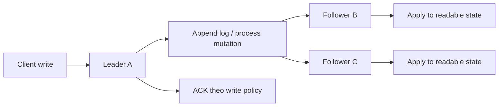
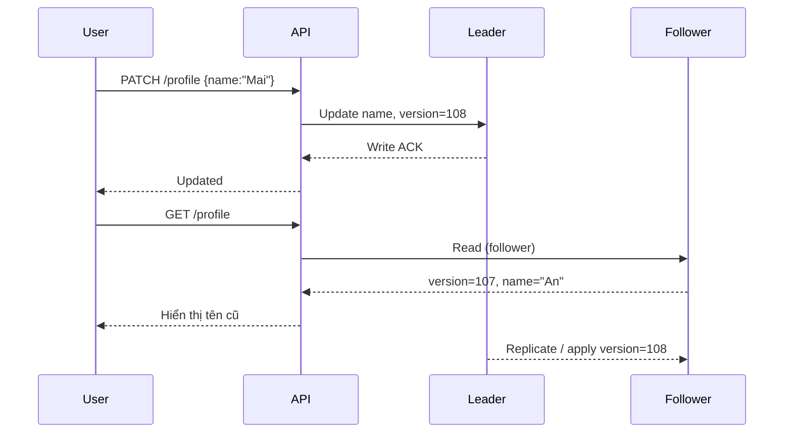
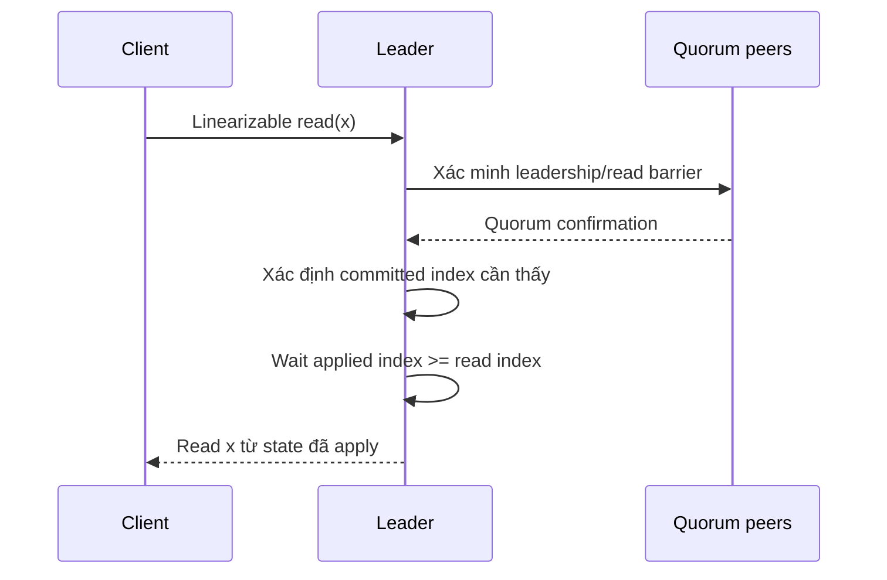
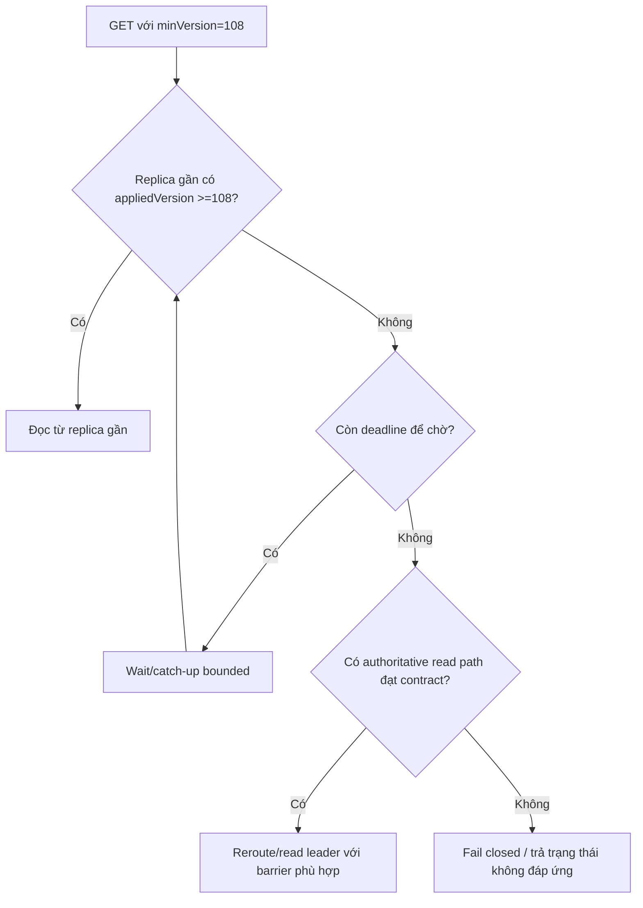
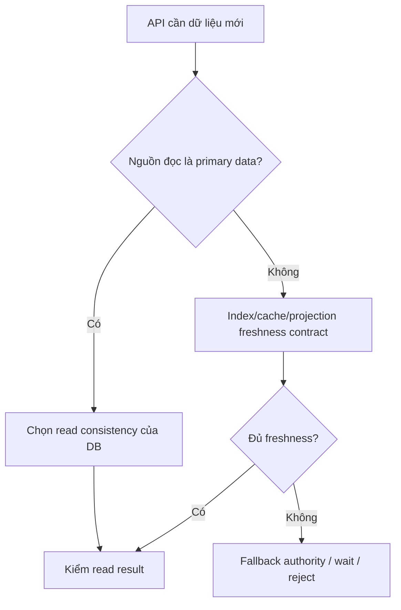

# Đọc từ bản sao dẫn đầu hoặc bản sao khác

## 1. Một bản ghi vừa cập nhật, nhưng người dùng vẫn thấy giá trị cũ

Giả sử ứng dụng quản lý hồ sơ khách hàng lưu dữ liệu trong ba bản sao của một nhóm replication:

```text
                  Client
                    |
                    v
              API / Load Balancer
                    |
          +---------+---------+
          |                   |
          v                   v
     Replica A            Replica B          Replica C
      (leader)           (follower)         (follower)
     version 108         version 107        version 106
```

Người dùng vừa đổi địa chỉ từ `Hà Nội` sang `Đà Nẵng`. Request ghi đã thành công ở A, nhưng việc sao chép đến B và C cần thêm thời gian.

Nếu request đọc tiếp theo được gửi đến B, ứng dụng có thể hiển thị địa chỉ cũ. Nếu đọc ở A, khả năng nhận dữ liệu mới thường cao hơn, nhưng **đọc từ leader tự nó vẫn chưa chứng minh rằng kết quả có tính linearizable** trong mọi tình huống, nhất là khi leader bị cô lập, vừa mất quyền hoặc có read path dùng cache/snapshot cũ.

Bài này đặt câu hỏi thiết kế rất cụ thể:

> **Một request đọc nên đến bản sao dẫn đầu hay bản sao khác, và hệ thống phải hứa điều gì về độ mới, thứ tự, tính nhất quán, độ trễ và khả năng sẵn sàng của kết quả?**

Đây là kiến thức quan trọng trong **Database No SQL**, chương **Sao chép và quorum**, bởi NoSQL thường mở rộng đường đọc bằng cách phân tán nhiều bản sao. Chọn replica không chỉ là cách cân bằng tải, mà còn là lựa chọn về **consistency contract** của API.

### Mục tiêu học tập

Sau bài học, bạn có thể:

1. Phân biệt leader/primary, follower/secondary, replica, coordinator và client router.
2. Mô tả đường ghi, commit, apply và thời điểm dữ liệu nhìn thấy được trên các bản sao.
3. So sánh **leader read** với **follower/replica read** về độ mới, độ trễ, tải và failure behavior.
4. Phân biệt **linearizable**, **majority-committed**, **eventual**, **read-your-writes**, **monotonic reads**, **causal** và **bounded-staleness**.
5. Giải thích tại sao đọc trực tiếp từ leader có thể cần read barrier/lease/read-index để bảo đảm mạnh.
6. Hiểu quorum read/write và giới hạn của công thức \(R+W>N\).
7. Chọn replica theo version watermark, session token, khả năng failover và deadline.
8. Đọc ví dụ theo MongoDB, DynamoDB, Cassandra, Redis và etcd mà không đánh đồng cơ chế của các sản phẩm.
9. Thiết kế API, monitoring và chaos tests cho lỗi stale read, leader failover và network partition.
10. Đưa ra chính sách đọc phù hợp theo loại dữ liệu nghiệp vụ.

## 2. Các khái niệm cần tách bạch

| Khái niệm | Ý nghĩa | Không được suy ra |
|---|---|---|
| **Replica** | Bản sao dữ liệu hoặc một phần dữ liệu được duy trì bởi hệ | Mọi replica đều có cùng version ngay lập tức |
| **Leader / primary** | Node có vai trò điều phối hoặc nhận ghi theo một protocol | Mọi read trên node đều tự linearizable |
| **Follower / secondary** | Node học trạng thái hoặc áp dụng thay đổi từ leader/source | Không được phép phục vụ read |
| **Coordinator** | Node nhận request, liên hệ replicas và tổng hợp kết quả | Luôn là leader sở hữu dữ liệu |
| **Log index / LSN / offset** | Vị trí trong log hoặc trình tự cập nhật theo phạm vi | Version toàn hệ có thứ tự chung trong mọi shard |
| **Committed index** | Mốc được protocol công nhận commit theo phạm vi | Follower đã áp dụng tất cả mục đến mốc đó |
| **Applied index** | Mốc state machine đã thực thi vào dữ liệu đọc được | Mọi client/replica đều nhìn thấy ngay |
| **Replication lag** | Mức chậm của bản sao so với một mốc nguồn | Luôn đo chính xác bằng số giây |
| **Read preference** | Quy tắc chọn node/replica phục vụ read | Bảo đảm consistency của kết quả |
| **Read concern/consistency level** | Bảo đảm dữ liệu phải thỏa khi được trả | Không ảnh hưởng routing, latency hoặc failure |
| **Session token** | Thông tin phiên/version để duy trì mức đọc tối thiểu | Tự là quyền truy cập hoặc proof của authorization |

Một nhóm NoSQL có thể dùng leader–follower, multi-leader, leaderless replication hoặc một managed service che giấu topology. Vì thế **“đọc từ bản sao khác”** không phải một thuật ngữ đồng nhất giữa các sản phẩm.

## 3. Đường ghi và sao chép trong mô hình leader–follower

Mô hình khái niệm:



Trình tự thực tế tùy protocol: leader có thể append log trước, gửi entries cho followers, đợi quorum, commit rồi apply, hoặc xử lý theo cơ chế storage khác. **Không dùng sơ đồ này thay định nghĩa kỹ thuật của một database cụ thể.**

### 3.1. Bốn mốc thời gian cần phân biệt

Giả sử một mutation làm `profile.version = 108`:

1. **Received:** leader nhận lệnh ghi.
2. **Replicated:** một số followers nhận dữ liệu/log, có thể đã persist hoặc chưa tùy ACK.
3. **Committed:** điều kiện commit của protocol đạt, ví dụ quorum đã xác nhận.
4. **Applied/visible:** bản sao đã áp dụng thay đổi vào đường đọc mà client sử dụng.

Trong hệ dùng replicated log, **follower có thể đã nhận log entry nhưng chưa apply**. Đọc trực tiếp state machine của follower lúc này vẫn có thể thấy version trước đó.

### 3.2. ACK không có cùng ý nghĩa trong mọi cấu hình

Một write có thể được ACK:

- Sau khi node nhận vào memory.
- Sau khi local log được persist.
- Sau khi đủ replicas nhận.
- Sau khi quorum của consensus group công nhận.
- Sau khi transaction được xác nhận theo write concern.
- Sau khi event được ghi vào queue chứ chưa thành business state.

Khi muốn đảm bảo **read-after-write**, phải biết ACK vừa nhận tương ứng mốc nào. Không thể chỉ nhìn HTTP `200` và mặc định mọi secondary đều đã apply.

### 3.3. Replication là bất đồng bộ hay đồng bộ?

Trong một số hệ, leader gửi thay đổi rồi tiếp tục mà không đợi mọi replica; followers có thể lag. Trong hệ yêu cầu quorum commit, một số replicas phải tham gia để ACK thành công, nhưng các replica còn lại vẫn có thể lag.

**Quorum write không đồng nghĩa mọi follower đã bắt kịp.** Đây là lý do read routing cần quan tâm đến consistency policy.

## 4. Đọc từ leader: đường đơn giản nhưng không phải phép màu

Một giải pháp dễ nghĩ là “mọi read phải đến leader”. Điều này có ưu điểm:

- Đường đọc thường gần những writes mới nhất mà leader đã xử lý.
- Có thể dễ giữ **read-your-writes** hơn trong nhiều topology.
- Không phân tán request sang replica có lag lớn.
- Một số protocol hỗ trợ read mạnh thông qua leader/quorum coordination.

Nhưng cũng có chi phí:

- Leader vừa chịu writes vừa chịu reads, dễ nóng CPU/disk/cache.
- Client ở xa leader có thêm network latency.
- Khi leader election, đường đọc có thể bị ngắt ngắn.
- Bản thân đường đọc từ leader **phải đáp ứng đúng protocol** để bảo đảm dữ liệu mới nhất.
- Leader cũ bị partition có thể chưa biết mình đã mất quyền nếu chỉ đọc local memory.
- Một truy vấn qua index/cache/materialized view khác có thể stale ngay cả khi endpoint đi vào leader.

### 4.1. Vì sao leader cũ có thể trả kết quả không linearizable?

Kịch bản:

```text
t0: A là leader, giữ x=10.
t1: A bị cô lập khỏi majority B,C.
t2: B,C bầu leader mới và commit x=11.
t3: Client gửi GET x đến A.
t4: A chưa phát hiện mất quyền, trả x=10.
```

Nếu client đọc ở t3 sau khi write x=11 đã hoàn tất ở t2, giá trị x=10 **vi phạm linearizable read**. Dữ liệu cục bộ A có thể hoàn toàn hợp lệ theo snapshot cũ, nhưng không đủ mới theo contract.

Vì vậy, một read thực sự linearizable thường cần **cơ chế xác minh quyền leadership hoặc read barrier** theo protocol, không chỉ kiểm một biến local `isLeader=true`.

### 4.2. Bản sao dẫn đầu cũng có nhiều dạng

- **Primary có khả năng nhận writes:** điển hình trong một replica set.
- **Leader của consensus log:** nhiệm kỳ/term và quorum commit quan trọng.
- **Leader trong một shard:** mỗi shard có leader khác nhau.
- **Service-level leader:** scheduler chọn leader nhưng database vẫn có topology riêng.

Đọc từ “leader” của scheduler **không biến read ở database thành strong read** nếu database phục vụ từ một cache/index replica khác.

## 5. Đọc từ follower/secondary: mở rộng đường đọc và chấp nhận độ trễ

Follower read có thể hữu ích vì:

- Giảm CPU, disk I/O và số connection tới primary.
- Phục vụ người dùng gần vùng/availability zone của follower.
- Hỗ trợ báo cáo, dashboard, export và batch reads.
- Cô lập một phần workload nặng khỏi node xử lý ghi.
- Tăng năng lực read khi dữ liệu phù hợp replication model.

Đánh đổi thường gặp:

- **Replica lag:** follower chưa nhận/apply write mới.
- **Stale reads:** có thể thấy trạng thái cũ.
- **Non-monotonic reads:** request thứ hai route sang follower chậm hơn request đầu.
- **Inconsistent view:** kết quả của nhiều query liên tiếp có thể đến từ các mốc khác nhau.
- **Failover edge cases:** một write có ACK yếu có thể không tồn tại trên primary mới.
- **Divergent/uncommitted state:** cần hiểu engine có cho đọc dữ liệu chưa được commit hay bị rollback theo mode hay không.
- **Security/authorization lag:** policy mới có thể chưa có ở follower.

### 5.1. Một ví dụ người dùng thấy tên cũ



Tình huống này có thể tồn tại dù write đã thành công và follower hoàn toàn không bị lỗi phần cứng.

### 5.2. Follower read không mặc định là lỗi

Nếu trang giới thiệu sản phẩm có thể cũ 10 giây, follower read có thể là lựa chọn tốt. Nhưng nếu người dùng đổi mật khẩu, thu hồi quyền hoặc thanh toán, đọc dữ liệu cũ có thể gây hậu quả lớn.

Cần quyết định theo **API semantics**, không chỉ theo mong muốn giảm tải primary.

## 6. Những mô hình nhất quán thường dùng cho read

### 6.1. Eventual consistency

Khi không còn writes mới và replication hoạt động, replicas có thể hội tụ theo protocol. Trong giai đoạn có lag/partition, các read có thể thấy dữ liệu cũ.

Eventual consistency **không định nghĩa một số giây tối đa** dữ liệu được phép cũ nếu không có thêm SLA/assumption.

### 6.2. Read-your-writes

Một client sau khi ghi thành công được đảm bảo các read tiếp theo trong phiên không thấy trạng thái trước write ấy, theo scope và contract.

Ví dụ:

```text
PATCH profile -> server ACK version=108
GET profile -> phải nhìn version >=108
```

Cách thực hiện có thể là read leader, session pinning, version watermark hoặc chờ follower bắt kịp.

### 6.3. Monotonic reads

Nếu user đã đọc version 108, các lần đọc tiếp theo trong cùng phiên không được lùi về version 106.

```text
GET #1 -> version 108 (Replica B)
GET #2 -> version 106 (Replica C)  // Sai nếu hứa monotonic reads
```

Một session token mang version tối thiểu hoặc router tránh replica chậm có thể giúp giữ bảo đảm này.

### 6.4. Causal consistency

Những operation có quan hệ nhân quả cần được quan sát theo trật tự nhân quả phù hợp. Ví dụ user A đăng bài, rồi B thấy bài và viết phản hồi; B không nên thấy phản hồi trước khi có bài gốc theo một số causal contracts.

Causal consistency **không tự tương đương** với linearizability hoặc transaction serializable toàn hệ.

### 6.5. Bounded staleness

API có thể hứa read không cũ quá một giới hạn đã định, chẳng hạn:

- Không quá 5 giây so với nguồn authoritative theo cơ chế đo đáng tin.
- Không chậm hơn 100 log entries của cùng partition.
- Ít nhất version đã biết của session.

Các hình thức này khác nhau. Nếu hệ không có một mốc thời gian nguồn đáng tin, **không thể suy số giây stale** chỉ từ đồng hồ local của follower.

### 6.6. Linearizability

Read/write của một đối tượng có thể được sắp như thể diễn ra tức thời tại một điểm giữa lúc bắt đầu và kết thúc operation, bảo toàn thứ tự thực tế của các operation không chồng lấn.

Điều kiện cụ thể:

```text
Write x=108 hoàn tất.
Sau đó Read x bắt đầu.
Nếu không có write hợp lệ mới, Read phải thấy x=108.
```

Đường đọc có thể phải phối hợp với quorum/leader term/read barrier để đạt bảo đảm này.

### 6.7. Snapshot consistency

Nhiều read có thể nhìn **một snapshot nhất quán** của dữ liệu tại một mốc, thay vì mỗi record một thời điểm khác nhau. Snapshot giúp báo cáo/transaction có góc nhìn không bị trộn, nhưng snapshot có thể là **snapshot cũ**.

**Snapshot read không mặc nhiên là read mới nhất.** Một snapshot isolation transaction có thể thấy dữ liệu cũ hơn trạng thái đã commit sau khi transaction bắt đầu.

### 6.8. Bảng so sánh

| Bảo đảm | Câu hỏi được trả lời | Có cần đọc trực tiếp leader không? |
|---|---|---|
| Eventual | Sau này replicas có hội tụ không? | Không nhất thiết |
| Read-your-writes | User có thấy write vừa ACK của mình không? | Không bắt buộc nếu follower có session watermark |
| Monotonic reads | Session có tránh đọc lùi không? | Có thể thực hiện bằng version-aware routing |
| Causal | Các sự kiện phụ thuộc có được thấy theo thứ tự nhân quả không? | Tùy protocol |
| Bounded staleness | Độ trễ so với nguồn có bị chặn bởi một bound không? | Có thể dùng follower có lag được kiểm chứng |
| Linearizable | Read có phù hợp thứ tự thời gian thực không? | Tùy read protocol; leader đơn thuần chưa đủ |
| Snapshot | Các record có cùng góc nhìn nhất quán không? | Tùy engine và transaction/read concern |

Không có một “read từ leader = cột mạnh, read từ follower = cột yếu” đúng tuyệt đối cho mọi hệ.

## 7. Commit, apply và thời điểm follower phục vụ được phiên bản mới

Trong hệ dùng replicated log:

```text
Leader:
  log index:       100 101 102 103 104 105
  commitIndex:     105
  lastApplied:     105

Follower B:
  log index:       100 101 102 103 104 105
  commitIndex:     105
  lastApplied:     103

Follower C:
  log index:       100 101 102
  commitIndex:     102
  lastApplied:     102
```

Giả sử write của user tương ứng entry 104.

- B **đã nhận log tới 105** nhưng chưa apply 104 vào state machine phục vụ read.
- C chưa có log 104.
- Read local ngay lúc này ở B hoặc C có thể không thấy update 104.
- Nếu API cần version tối thiểu 104, reader phải đợi apply hoặc route tới bản sao khác có cơ sở trả version 104.

Các con số là mô hình minh họa, không đại diện chính xác cho API metric của tất cả sản phẩm.

### 7.1. Đừng kiểm “last received” rồi trả read

Một follower có thể nhận entry nhưng chưa commit/apply. Để đáp ứng session watermark, cần chọn mốc thực sự có ý nghĩa **được phép đọc** theo storage engine. Chỉ thấy một offset trong network buffer không đủ.

### 7.2. Dữ liệu chưa commit có thể bị bỏ khi đổi leader

Một primary/leader có thể xử lý write nhưng chưa đạt mức ACK/durability yêu cầu. Sau failover, thay đổi ấy có thể bị rollback hoặc bị thay bằng lịch sử commit hợp lệ theo protocol.

Vì vậy **write acknowledged** phải được định nghĩa kèm write concern/commit semantics. Nếu app hứa read-your-writes dựa vào một ACK yếu, cần hiểu điều gì xảy ra sau failover.

## 8. Vì sao một linearizable leader read cần thêm giao thức?

Giả sử leader A còn tin nó là leader sau network partition, nhưng quorum đã elect leader mới B. Nếu A chỉ phục vụ local `GET`, nó có thể trả dữ liệu cũ.

Một số hệ consensus dùng những kỹ thuật như:

- **Read-index/read barrier:** leader xác nhận quyền và mốc commit phù hợp với quorum, đợi local state apply đến mốc ấy rồi đọc.
- **Lease-based read:** dùng leader lease và giả định đồng hồ/thời gian hợp lệ trong protocol để tránh hỏi quorum mỗi lần.
- **Log-based read:** đưa read vào thứ tự log/consensus hoặc đồng bộ qua cơ chế tương đương.
- **Follower linearizable read:** follower có thể chuyển tiếp đến leader/quorum hoặc dùng read-index rồi đợi apply, nếu engine hỗ trợ.

### 8.1. Mô hình read-index khái niệm



Sơ đồ không phải thứ tự RPC bắt buộc của mọi consensus implementation. Nhưng nó cho thấy **điểm khó là chứng minh không có leader mới đã commit write mà reader bỏ qua**.

### 8.2. Read lease có những giả định riêng

Lease-based read có thể nhanh hơn vì tránh quorum round trip trên một số read, nhưng phải xử lý:

- Clock drift và clock bounds.
- Leader term/epoch.
- Mất heartbeat và expiry.
- Pauses dài.
- Network partition.
- In-flight operations.
- Node restart và phục hồi state.

Không sao chép một phép kiểm `now < leaseExpiry` dùng đồng hồ client để tự xây strong read.

### 8.3. Quorum read cũng không phải một phép “lấy đa số rồi xong”

Một protocol quorum read phải chọn đúng phiên bản đã commit và xử lý concurrent writes, stale membership, replication/repair theo contract. Chỉ lấy 2/3 giá trị rồi chọn timestamp lớn nhất không tự chứng minh linearizability trong mọi failure scenario.

## 9. Công thức quorum read/write và giới hạn của nó

Trong một mô hình replicated key–value đơn giản:

- \(N\): số replicas tham gia.
- \(R\): số replicas đọc để ra kết quả.
- \(W\): số replicas phải xác nhận write.

Một điều kiện giao nhau thường được nêu:

\[
R + W > N
\]

Ví dụ:

\[
N=3,\quad R=2,\quad W=2
\]

Hai tập có ít nhất một replica giao nhau nếu đều là subsets của cùng tập ba replicas ổn định.

### 9.1. Tại sao giao nhau có ích?

Giả sử write \(x=108\) đã được xác nhận ở B và C. Một read quorum gồm A và B sẽ gặp ít nhất một replica (B) có bản ghi tương ứng, trong giả định không có các lỗi khác.

### 9.2. Vì sao vẫn không đủ để khẳng định linearizable?

Cần xem thêm:

- Concurrency: hai writes đang diễn ra có thể chưa cùng một thứ tự.
- Version/timestamp ordering và cách chọn winner.
- Sloppy quorum/hinted handoff: quorum thực tế có thể không phải cùng replica set.
- Lỗi giữa lúc read và repair.
- Membership changes, node replacement.
- Read/write của cùng item hay nhiều items.
- Read repair, anti-entropy và consistency guarantees của engine.
- Replica trả dữ liệu đã nhận nhưng chưa commit hay không.
- Cơ chế conditional writes/transactions khi có business invariant.

**Quorum intersection là tính chất toán học cần thiết trong nhiều protocol, không phải bản chứng minh đầy đủ của giao dịch phân tán.**

### 9.3. Mô hình leaderless khác mô hình leader–follower

Trong Cassandra, một coordinator có thể liên hệ replicas theo consistency level; coordinator **không tự là leader của partition**. Do đó “đọc leader hay follower” cần dịch thành “đọc ở consistency level nào, qua coordinator/replica nào?” thay vì dùng primary/secondary sai nghĩa.

## 10. Chọn replica dựa vào phiên bản tối thiểu

Một cách bảo vệ **read-your-writes** và **monotonic reads** là client/session mang một **watermark**: mốc phiên bản thấp nhất mà kết quả đọc phải đạt.

Ví dụ:

```json
{
  "resourceId": "profile:U42",
  "minVersion": "108",
  "scope": "profile:U42"
}
```

Router nhận request:

```text
GET profile:U42 with minVersion=108
```

Nó có thể:

1. Tìm một follower đã apply version ≥108.
2. Nếu follower phù hợp, phục vụ ngay.
3. Nếu follower chưa bắt kịp nhưng còn deadline, đợi có giới hạn.
4. Nếu chính sách cho phép, route tới authoritative/leader read path.
5. Nếu vẫn không thể đáp ứng, trả lỗi hoặc trạng thái không xác định theo API contract; **không trả version 107 như thể đã đạt yêu cầu**.

### 10.1. Sơ đồ



### 10.2. Version phải có đúng phạm vi

Một số version chỉ so sánh được **trong cùng partition/aggregate/shard**:

```text
profile:U42 -> version 108
orders:O99  -> version 311
```

Không suy rằng version 311 của order mới hơn version 108 của profile theo một đồng hồ toàn cục. Nếu cần một session xuyên nhiều partitions, cần **vector/session token** hoặc protocol hỗ trợ causal/transaction snapshots theo DB.

### 10.3. Watermark không phải một token tùy tiện

Nếu client gửi `minVersion=999999999999`, router có thể chờ mãi nếu không có giới hạn. Cần:

- Validate scope và format.
- Deadline/maximum wait.
- Giới hạn độ dài token.
- Đảm bảo token thực sự đại diện mốc đã được hệ công nhận.
- Xác thực hoặc không tin client token cho các quyết định an ninh/chi phí.
- Không lấy token chỉ là millisecond timestamp rồi coi như commit index.

### 10.4. Session token không thay authorization

Một client mang watermark của record không đồng nghĩa nó có quyền đọc record đó. Authorization phải được kiểm tra riêng và ở mức dữ liệu đủ mới cho quy tắc bảo mật.

## 11. Java pseudocode: version-aware read routing

Ví dụ sau thể hiện **quyết định ở tầng ứng dụng**, không là driver cho một sản phẩm cụ thể. Một implementation thật phải dựa vào API/metadata version của database; không nên tự suy applied index từ cache không đáng tin.

```java
import java.time.Duration;
import java.util.List;
import java.util.Optional;

record ReadRequest(
    String resourceId,
    long minimumVersion,
    Duration deadline
) {}

record ReadResult(
    String resourceId,
    long version,
    String payload,
    String source
) {}

interface ReplicaReader {
    String name();

    // Version đã được áp dụng và có thể trả ở read path tương ứng.
    long appliedVersion(String resourceId);

    // Read với conditional/version check ở đúng consistency domain.
    Optional<ReadResult> readAtLeast(
        String resourceId,
        long minimumVersion
    );
}

interface AuthoritativeReader {
    // Phải dùng protocol đủ mạnh nếu API yêu cầu linearizability.
    ReadResult readWithRequiredConsistency(
        String resourceId,
        long minimumVersion
    );
}

final class ReadRouter {
    private final List<ReplicaReader> followers;
    private final AuthoritativeReader authority;

    ReadRouter(
        List<ReplicaReader> followers,
        AuthoritativeReader authority
    ) {
        this.followers = followers;
        this.authority = authority;
    }

    ReadResult read(ReadRequest request) {
        if (request.minimumVersion() < 0) {
            throw new IllegalArgumentException("Invalid version");
        }

        // Ví dụ minh họa: chọn replica đã bắt kịp.
        for (ReplicaReader replica : followers) {
            if (replica.appliedVersion(request.resourceId())
                    < request.minimumVersion()) {
                continue;
            }

            Optional<ReadResult> value =
                replica.readAtLeast(
                    request.resourceId(),
                    request.minimumVersion()
                );

            if (value.isPresent()
                    && value.get().version() >= request.minimumVersion()) {
                return value.get();
            }
        }

        // Production: kiểm deadline, retry budget, route health.
        // Không tự cho phép trả bản cũ khi session yêu cầu version mới.
        ReadResult result = authority.readWithRequiredConsistency(
            request.resourceId(),
            request.minimumVersion()
        );

        if (result.version() < request.minimumVersion()) {
            throw new IllegalStateException(
                "CONSISTENCY_REQUIREMENT_NOT_MET"
            );
        }
        return result;
    }
}
```

### 11.1. Vì sao phải kiểm version trong `readAtLeast`?

Một health cache có thể báo follower đã tới version 108, nhưng dữ liệu thực trả về lại cũ do:

- Metadata được cập nhật trước state machine.
- Read đi qua một snapshot khác.
- Router chọn nhầm shard.
- Replica vừa restart/rollback.
- API có nhiều tầng cache.

Do đó `appliedVersion` chỉ là một hint nếu không có chứng cứ theo contract; **read operation cuối cùng phải bảo vệ chính kết quả được trả**.

### 11.2. Ví dụ chưa cài waiting thực tế

Để giữ mã ngắn và rõ, ví dụ không implement bounded wait và deadline. Trong production, chọn replica phải tính budget thực tế, hủy read quá hạn, jitter khi retry, admission control và fallback không làm thay đổi consistency promise.

### 11.3. Khi không có version field?

Có thể cần dựa hoàn toàn vào primitive của database:

- Causal session hỗ trợ bởi driver.
- Strong/linearizable read API.
- Read concern/read consistency phù hợp.
- Quorum read protocol.
- Transaction snapshot/read-at timestamp.
- Đường đọc từ authoritative owner với condition/lease thích hợp.

**Không tự gắn một trường `updatedAt` rồi coi nó là global version** nếu clock và concurrency không có bảo đảm.

## 12. So sánh ba chính sách đọc

Một API có thể có ba loại đường đọc:

| Policy | Đường đọc | Ưu điểm | Giới hạn |
|---|---|---|---|
| **AUTHORITATIVE** | Leader/quorum read với protocol đủ mạnh | Dữ liệu mới và chính xác theo contract | Latency/availability/coordination |
| **SESSION_FRESH** | Follower đạt watermark, fallback authority | Read-your-writes, tránh đọc lùi và giảm tải | Cần session/version support |
| **EVENTUAL_FAST** | Replica gần/cache theo policy | Latency thấp, scale read | Có thể trả stale, cần giới hạn sử dụng |

### 12.1. Ví dụ API hợp đồng

```yaml
endpoint: GET /v1/profiles/{userId}
read_policy: SESSION_FRESH
session_min_version: from_previous_write
on_replica_lag: wait_bounded_then_authoritative
max_wait_ms: 200
on_unavailable: return_503_or_consistency_error
authorization: always_required
```

Đây là **đặc tả ứng dụng minh họa**, không phải file cấu hình chung của NoSQL.

### 12.2. Cần chọn policy theo request, không theo toàn ứng dụng

Trang sản phẩm có thể dùng `EVENTUAL_FAST`; trang xác nhận thanh toán dùng `AUTHORITATIVE`; trang hồ sơ sau edit dùng `SESSION_FRESH`.

Một cluster có thể đồng thời phục vụ cả ba nếu database và router hỗ trợ.

## 13. Đọc dữ liệu cực mới: linearizable không đồng nghĩa snapshot đa record

Giả sử hai record:

```text
Account A: balance=100
Account B: balance=0
```

Một transfer commit A=70 và B=30 trong một transaction. Một API gọi:

```text
GET A from leader
GET B from follower
```

Nếu hai requests không thuộc một snapshot/transaction read nhất quán, có thể thấy A=70 nhưng B=0, dù từng read có thể hợp lệ ở những mốc khác nhau theo contract riêng.

### 13.1. Cần phân biệt ba bài toán

1. **Một key mới nhất:** đọc version mới nhất của một object.
2. **Nhiều key nhất quán:** đọc một snapshot có quan hệ invariant.
3. **Read-modify-write an toàn:** kiểm tra predicate và ghi theo isolation đủ mạnh.

Không thể chỉ đổi cả hai reads sang leader rồi mặc định mọi thao tác có serializable isolation. Nếu cần transaction snapshot, dùng API transaction/read concern hoặc thiết kế aggregate phù hợp.

### 13.2. Snapshot có thể cũ nhưng nhất quán

Một report cần số liệu cùng thời điểm có thể ưu tiên snapshot version 100, trong khi dữ liệu mới nhất đã là 105. Đây có thể là lựa chọn đúng; “mới nhất tuyệt đối” không phải lúc nào cũng có giá trị hơn “nhất quán cùng mốc”.

### 13.3. Đọc follower để quyết định rồi ghi leader có race

Ví dụ:

```text
Read stock from follower -> stock=1
Insert confirmed order at leader
```

Ngay cả khi follower bắt kịp tại thời điểm read, người khác có thể mua chiếc cuối giữa hai bước. Cần **atomic conditional decrement/transaction**, không chỉ strong read.

## 14. Leader failover và sự thay đổi đường đọc

Dòng thời gian:

```text
t0  A là leader, B/C là followers.
t1  A bị cô lập khỏi B/C.
t2  B/C bầu leader mới theo quorum.
t3  B commit version 109.
t4  Request GET đi vào A cũ.
t5  A có thể chỉ thấy version 108.
```

Một read path đòi linearizability phải tránh việc A cũ trả 108 thành công nếu 109 đã commit trước khi GET bắt đầu.

### 14.1. Rerouting

Client/router phải biết:

- Leader mới được công nhận qua protocol nào.
- Có nên retry trên lỗi `NOT_LEADER` hay không.
- Request đã bắt đầu ở leader cũ có side effect gì chưa.
- Deadline và số lần retry.
- Có đang đọc từ một replica đúng shard/tenant không.

### 14.2. Cache topology có thể trễ

SDK hoặc load balancer thường giữ metadata về thành viên và leader. Sau failover, cache này có thể sai tạm thời. Hệ nên handle redirect/refresh topology và báo lỗi khi không xác minh được authority.

Không nên coi DNS hoặc health check “TCP port mở” là bằng chứng node có quyền phục vụ linearizable read.

### 14.3. Read trong lúc không có leader

Nếu protocol yêu cầu leader/quorum để đọc mạnh:

- Có thể đợi bounded để bầu leader.
- Có thể trả lỗi nếu không khôi phục kịp.
- Có thể phục vụ stale read từ follower **chỉ cho API đã cho phép giảm bảo đảm**.

Không âm thầm đổi một endpoint tài chính từ strong read sang eventual read vì primary không sẵn sàng.

## 15. Network partition và khả năng đọc ở minority

Với ba node A | B,C:

```text
A cô lập: 1 replica
B,C:      2 replicas
```

Nếu dùng consensus majority cho một key, B,C có thể tiếp tục tiến triển khi có leader hợp lệ; A không thể xác nhận trạng thái mới theo quorum. Tuy vậy A có thể vẫn giữ dữ liệu local và phục vụ stale read nếu protocol/ứng dụng cho phép.

### 15.1. Một request ở A phải quyết định

- Đợi quorum/leader phục hồi để đáp ứng strong read.
- Reroute qua đường tới B,C nếu có.
- Trả lỗi thay vì trả giá trị không đủ mới.
- Trả dữ liệu local có nhãn stale **nếu API cho phép và không vi phạm security**.

### 15.2. CAP không có nghĩa “đọc từ follower là AP”

Định lý CAP liên quan các thuộc tính được định nghĩa hình thức trong partition. Một read local stale là một lựa chọn consistency; một read leader có thể đợi/từ chối ở minority; nhưng **sản phẩm và operation cụ thể** mới quyết định hành vi.

Một API có thể luôn cho stale product catalog nhưng từ chối permission/inventory reads nếu không thể xác minh đúng.

## 16. Mức độ mới: thời gian, version và bound đo được

“Follower lag 5 giây” nghe dễ hiểu nhưng cần hỏi **5 giây được đo từ đâu?**

### 16.1. Các dạng metric

- **Apply lag theo log index:** leader commit đến 10.000, follower applied đến 9.990; chậm 10 entries trong cùng partition.
- **Source timestamp lag:** timestamp của mốc đã apply so với một mốc nguồn đáng tin.
- **Observed transport lag:** độ trễ khi messages đến.
- **End-to-end visibility lag:** thời gian từ write ACK tới lúc đường read của follower nhìn thấy giá trị.
- **Snapshot staleness:** khoảng cách giữa thời điểm snapshot và điểm hiện tại theo một clock/protocol đã định.

Các số này **không tương đương**.

### 16.2. Log entry count không đổi thành giây một cách trực tiếp

Một log có thể ghi 100.000 entries/giây trong giờ cao điểm và 10 entries/giây khi rảnh. “Lag 100 entries” có ý nghĩa khác nhau. Nếu API cần bound 2 giây, phải dùng cơ chế đo thời gian đúng và kiểm chứng.

### 16.3. Timestamp từ client có thể sai

Client mobile có thể lệch 10 phút. Nếu đặt `updatedAt=Date.now()` rồi dùng để quyết định follower mới hơn, hệ có thể chọn nhầm. Nên dùng database/server commit metadata hoặc version logic có contract rõ.

### 16.4. Các percentiles quan trọng

Một follower có p50 lag 20 ms nhưng p99 lag 8 giây vẫn có thể phá UX “vừa lưu đã thấy” cho một tỷ lệ người dùng. Cần đo:

- Lag p50/p95/p99.
- Maximum lag và thời gian giữ stale.
- Phân bố theo shard, region, tenant.
- Lag dưới write peak, compaction, snapshot và repair.
- Tỷ lệ read không đạt watermark trước deadline.

## 17. Read routing và độ trễ giữa các vùng

Giả sử user ở Thành phố Hồ Chí Minh; authoritative leader đặt tại một vùng xa hơn so với local follower. Độ trễ round trip đến hai nơi có thể khác đáng kể tùy mạng.

Một policy có thể chọn:

- **Nearest follower:** latency thấp, staleness cao hơn.
- **Leader:** mới hơn theo đường đọc được bảo đảm, WAN RTT cao hơn.
- **Follower đạt session watermark:** cân bằng freshness và latency.
- **Read quorum:** phối hợp nhiều replica, latency có thể bị chi phối bởi node chậm hoặc quorum members.
- **Cached snapshot:** rất nhanh nhưng có TTL/invalidations.

Đừng suy khoảng cách địa lý từ tên region rồi gán số latency. Phải đo RTT thực tế từ workload/client location.

### 17.1. Ví dụ hiệu năng giả định

| Cấu hình | Latency read p95 | Tỷ lệ trả data stale với yêu cầu phiên | Tải đọc ở leader |
|---|---:|---:|---:|
| Leader read có barrier | 45 ms | 0% theo contract đo | 100% |
| Follower local eventual | 8 ms | 4% | 0% |
| Version-aware follower + fallback | 18 ms | 0% theo watermark | 12% |

Đây **chỉ là ví dụ giả định** để học cách so sánh, không phải benchmark của một sản phẩm. Tỷ lệ stale phải được đo đúng theo contract; nếu leader read không có barrier, bảng này không còn đúng.

### 17.2. Đọc follower có làm giảm tải thật không?

Trong một số database, follower cũng đang apply writes, xây index, chạy backup hoặc compaction. Đẩy quá nhiều analytic reads vào follower có thể:

- Làm replication apply chậm hơn.
- Tăng memory/page-cache contention.
- Gây I/O đĩa lớn.
- Làm chính follower stale hơn.
- Kéo theo write concerns hoặc failover risk nếu replica không bắt kịp.

Không miễn phí. Theo dõi CPU, IOPS, apply queue và read throughput trên từng node.

## 18. Read-your-writes và session stickiness

Một giải pháp đơn giản là pin session của user vào một replica/region sau write. Nhưng sticky routing có giới hạn:

- Replica pinned có thể bị lỗi.
- Session có thể chuyển thiết bị hoặc network.
- Ứng dụng có nhiều backends cùng sử dụng DB.
- User có thể đọc qua CDN hoặc search index khác.
- Leader failover làm mất routing target.

Nếu cần correctness qua failover, **session token/watermark ở tầng dữ liệu** thường rõ hơn so với một sticky-cookie chỉ chứa hostname.

### 18.1. Write trả version

```http
PATCH /v1/profile
Content-Type: application/json

{
  "displayName": "Mai"
}
```

```json
{
  "status": "UPDATED",
  "resourceId": "profile:U42",
  "version": "108",
  "sessionToken": "opaque-token-from-service"
}
```

Request tiếp:

```http
GET /v1/profile
X-Min-Read-Version: 108
```

Server phải kiểm version theo phạm vi và provenance phù hợp; nếu token opaque chứa thông tin nhạy cảm, không log hoặc đưa ra URL công khai một cách tùy tiện.

### 18.2. Khi user chuyển thiết bị

Một session token chỉ có trong RAM của tab A có thể không sang thiết bị B. Nếu sản phẩm cần read-your-writes xuyên thiết bị, có thể cần lưu mốc commit theo user/account hoặc dùng strong read path cho những màn hình nhất định.

### 18.3. Không đánh đồng session và transaction

Một causal session có thể giúp quan hệ read/write trong phiên, nhưng không tự bao một chuỗi read-modify-write xuyên hai item thành serializable transaction.

## 19. MongoDB: readPreference, readConcern và writeConcern

MongoDB replica set là ví dụ rõ ràng của mô hình primary–secondary. Cần đọc tài liệu của đúng phiên bản và driver.

### 19.1. Read preference chọn node

Các lựa chọn thường được dùng:

- `primary`: ưu tiên đọc primary, là mặc định phổ biến.
- `primaryPreferred`: primary nếu có, có thể fallback secondary theo contract.
- `secondary`: đọc secondary.
- `secondaryPreferred`: ưu tiên secondary, có thể fallback primary.
- `nearest`: chọn theo tiêu chí latency/tag và driver topology selection.

**Read preference không phải consistency level.** Chọn `nearest` không có nghĩa “dữ liệu mới nhất”; chọn `primary` không tự tương đương readConcern `linearizable`.

### 19.2. Ví dụ Mongo shell đọc secondary

```javascript
const secondaryConn = db.getMongo();
secondaryConn.setReadPref("secondary");

const result = db.profiles.find(
  { _id: "U42" },
  { _id: 1, displayName: 1, updatedAt: 1 }
).limit(1);
```

Ví dụ này minh họa ý định đọc từ secondary theo cơ chế shell/driver. Trong ứng dụng thực, cấu hình readPreference có thể đặt trên client, database, collection hoặc operation; phải bảo đảm shell/client API và session/transaction constraints phù hợp.

Secondary read có thể stale. Nếu không có secondary đủ điều kiện, một đường `secondary` có thể trả lỗi thay vì chuyển sang primary.

### 19.3. Majority read không đồng nghĩa newest linearizable read

`readConcern: "majority"` hướng tới đọc dữ liệu đã được xác nhận theo majority semantics của deployment. Nhưng một majority-committed snapshot có thể không là dữ liệu **mới nhất theo thứ tự thời gian thực**; phải phân biệt với yêu cầu linearizable read.

`readConcern: "linearizable"` là chế độ riêng cho những read được hỗ trợ, có ràng buộc về đường đọc và hiệu năng. Không mặc định dùng trên secondary.

Ví dụ runCommand minh họa yêu cầu linearizable read từ primary:

```javascript
db.runCommand({
  find: "profiles",
  filter: { _id: "U42" },
  limit: 1,
  readConcern: { level: "linearizable" },
  maxTimeMS: 2000
});
```

Cần kiểm tra deployment và loại operation hỗ trợ; read concern này không thay thế transaction cho nhiều document.

### 19.4. Majority write rồi đọc causal session

MongoDB cung cấp cơ chế **causally consistent sessions** theo contract của driver/server. Những bảo đảm causal/session đi kèm các yêu cầu liên quan đến read/write concern và session usage.

Ví dụ Node.js ở mức ý tưởng:

```javascript
const session = client.startSession({
  causalConsistency: true
});

try {
  const profiles = client
    .db("shop", { readConcern: { level: "majority" } })
    .collection("profiles");

  await profiles.updateOne(
    { _id: "U42" },
    { $set: { displayName: "Mai" } },
    {
      session,
      writeConcern: { w: "majority" }
    }
  );

  const profile = await profiles.findOne(
    { _id: "U42" },
    {
      session,
      readPreference: "secondary",
      readConcern: { level: "majority" }
    }
  );

  console.log(profile);
} finally {
  await session.endSession();
}
```

Mục tiêu là minh họa cùng session và read/write concern phù hợp. Hành vi code/option phụ thuộc phiên bản Node.js driver, MongoDB server, topology và feature support. Thực tế cần dùng các API đặt readConcern ở collection/client/session theo tài liệu phiên bản và **kiểm tra session đã ghi nhận operation time cần thiết**.

### 19.5. Causal session có thể phải chờ secondary

Nếu client yêu cầu read ít nhất tới operation time của write vừa ACK, secondary lag có thể phải đợi catch-up hoặc timeout. Vì vậy việc bật causal consistency không có nghĩa secondary read luôn nhanh và luôn sẵn sàng.

### 19.6. Transactions và read preference

Multi-document transaction có yêu cầu routing/readPreference/readConcern riêng, thường không cho tùy ý sử dụng secondary như một read thông thường. Phải kiểm tra session/transaction documentation, không gộp một query secondary vào transaction rồi mặc định hợp lệ.

### 19.7. Lưu ý về failover

Write được ACK ở mức yếu có thể bị rollback theo failure model khi primary chuyển. Nếu ứng dụng bắt buộc sau ACK vẫn có dữ liệu, cần chọn write concern/durability phù hợp, không chỉ dựa vào đọc primary.

## 20. DynamoDB: strong read và eventually consistent read

Amazon DynamoDB che giấu topology replica nội bộ, nên ứng dụng không thường chọn “primary IP hay secondary IP”. Thay vào đó, API cung cấp các mức đọc.

### 20.1. Base table và LSI

Trong những phạm vi được hỗ trợ, `GetItem`, `Query` hoặc `Scan` có thể dùng `ConsistentRead = true` cho strongly consistent read của base table và Local Secondary Index (LSI).

Ví dụ AWS SDK for Java v2:

```java
import software.amazon.awssdk.services.dynamodb.DynamoDbClient;
import software.amazon.awssdk.services.dynamodb.model.AttributeValue;
import software.amazon.awssdk.services.dynamodb.model.GetItemRequest;
import software.amazon.awssdk.services.dynamodb.model.GetItemResponse;
import java.util.Map;

public class ProfileStrongRead {
    public static void main(String[] args) {
        try (DynamoDbClient dynamo = DynamoDbClient.create()) {
            GetItemRequest request = GetItemRequest.builder()
                .tableName("Profiles")
                .key(Map.of(
                    "userId", AttributeValue.builder()
                        .s("U42").build()
                ))
                .consistentRead(true)
                .build();

            GetItemResponse response = dynamo.getItem(request);
            System.out.println(response.item());
        }
    }
}
```

Đây là ví dụ request, không bao gồm thiết lập credentials, region, retry, schema và error handling production.

### 20.2. GSI không có cùng strong-read behavior

DynamoDB Global Secondary Indexes (GSI) trong những contract phổ biến cung cấp **eventually consistent reads**, và không hỗ trợ yêu cầu strong read bằng `ConsistentRead=true` trên GSI. LSI khác GSI.

Vì vậy:

```text
Put order into base table -> ACK
Query GSI by status immediately -> may not see order yet
```

Việc query GSI không thấy order **không chứng minh base-table write đã thất bại**.

Nếu cần xác minh order vừa ghi, đọc bằng key authoritative ở base table với consistency thích hợp, không dùng GSI như một commit oracle.

### 20.3. Multi-region không chỉ một kiểu

DynamoDB có các khả năng global tables/multi-region và mode consistency thay đổi theo tính năng dịch vụ và phiên bản. Không suy từ tài liệu GSI hoặc một ví dụ global table eventual rằng **mọi** triển khai đa vùng có cùng guarantee, cũng không suy strong read ở một vùng thành global serializability cho mọi đường đọc.

Khi workload multi-region, kiểm tra đúng mode, API, bảng, index và write conflict semantics được bật.

### 20.4. Conditional read-modify-write

Một strong read có thể thấy inventory=1, nhưng người khác vẫn mua trước lệnh update. Bất biến tồn kho cần `ConditionExpression` hoặc transaction thích hợp khi ghi.

Chọn đọc strong không thay thế check-and-write nguyên tử.

## 21. Cassandra: coordinator và replicas thay cho primary/follower

Apache Cassandra thường dùng replication **không phụ thuộc một leader chung cho mỗi partition theo kiểu primary–secondary**. Một request có thể đi vào **coordinator**, rồi coordinator liên hệ các replicas theo consistency level.

### 21.1. Các consistency level thường gặp

- `ONE`: yêu cầu phản hồi từ một replica phù hợp.
- `QUORUM`: yêu cầu quorum của tập replicas theo topology.
- `LOCAL_QUORUM`: quorum trong data center địa phương theo semantics.
- `ALL`: yêu cầu tất cả replicas phù hợp.
- Các mức khác có ý nghĩa tùy write/read, local/each quorum và phiên bản.

Nếu RF=3 và đọc CL=ONE, kết quả có thể đến từ replica lag so với một write mới đã đến replicas khác.

### 21.2. Ví dụ Java DataStax/Apache Cassandra Java Driver 4.x

```java
import com.datastax.oss.driver.api.core.CqlSession;
import com.datastax.oss.driver.api.core.DefaultConsistencyLevel;
import com.datastax.oss.driver.api.core.cql.SimpleStatement;

public class ReadOrder {
    public static void main(String[] args) {
        try (CqlSession session = CqlSession.builder().build()) {
            SimpleStatement statement =
                SimpleStatement.builder(
                    "SELECT status, total_minor FROM "
                    + "shop.orders_by_id WHERE order_id = ?"
                )
                .addPositionalValue("O42")
                .setConsistencyLevel(
                    DefaultConsistencyLevel.LOCAL_QUORUM
                )
                .build();

            session.execute(statement).one();
        }
    }
}
```

Ví dụ phụ thuộc cấu hình kết nối, schema và driver thực tế. Mục tiêu là chỉ ra consistency được chọn **trên operation**, không phải bằng cách gán một replica làm “leader read”.

### 21.3. R + W > RF không tự thành linearizable transaction

Một cấu hình quorum có thể giúp read/write intersection; nhưng Cassandra có timestamp ordering, concurrent writes, hinted handoff, read repair, tombstones và các cơ chế riêng.

Nếu cần compare-and-set/uniqueness trên một key với bảo đảm mạnh hơn, xem **lightweight transactions (LWT)** theo đúng phạm vi/consistency. Đổi `ONE` thành `QUORUM` không tự bảo vệ một nghiệp vụ “đọc số dư rồi ghi hai bản ghi” trước mọi race.

### 21.4. LOCAL_QUORUM và đa vùng

`LOCAL_QUORUM` chỉ đòi quorum của data center tương ứng theo topology, không bảo đảm mọi vùng đều đã apply. Trong partition WAN, đường đọc local có thể vẫn phục vụ nhưng khả năng thấy write từ vùng khác tùy mô hình, consistency và replication.

### 21.5. Read repair và tombstones

Một read có thể kích hoạt hoặc hưởng lợi từ cơ chế so sánh/repair bản sao theo phiên bản. Tuy nhiên, việc read repair có tồn tại ở engine/version không phải lời hứa mọi read sẽ thấy dữ liệu mới nhất tức thì. Data deletion còn phụ thuộc tombstone/repair windows; một replica stale lâu có thể gây sự cố nếu vận hành sai.

## 22. Redis: đọc primary hoặc replica

Redis thường được dùng với primary và replicas trong nhiều mô hình triển khai. Replication thường bất đồng bộ theo contract; replica có thể phục vụ read nhưng trả dữ liệu chưa nhận từ primary.

### 22.1. Một tình huống cache

```text
SET user:U42:name "Mai" -> primary ACK
GET user:U42:name     -> replica trả "An"
```

Nếu ứng dụng dùng Redis làm cache cho profile, tình huống này có thể tạo UX “vừa lưu đã thấy tên cũ”. Có thể chọn đọc primary sau write, xóa/invalid cache phù hợp hoặc gắn version.

### 22.2. Đọc từ replica trong Redis Cluster

Một số chế độ client/Redis Cluster cho phép đọc từ replica với cấu hình/command phù hợp, ví dụ `READONLY` trên kết nối được route tới replica. Các API và command support phải đối chiếu đúng version, topology và client.

### 22.3. WAIT và replication ACK

Redis có `WAIT` để chờ một số replicas xác nhận đã nhận writes theo semantics của Redis. Điều này **không biến Redis thành một consensus database** và không bảo đảm mọi read từ mọi replica luôn linearizable, cũng không tự chứng minh write không thể mất dưới mọi failover/durability mode.

### 22.4. Đừng dùng replica stale để cấp quota cứng

Một worker đọc `stock=1` từ Redis replica rồi tạo order ở hệ khác có thể bán vượt tồn. Cần một authoritative conditional mutation/transaction theo contract của dữ liệu gốc.

Redis replicas có thể rất phù hợp cho cache ít nhạy cảm; quyết định về tồn kho, token hoặc quyền truy cập cần mức bảo đảm mạnh hơn.

## 23. etcd và hệ consensus: linearizable vs serializable reads

etcd sử dụng consensus để quản lý trạng thái KV. Nó thường phân biệt read:

- **Linearizable read:** cần bảo đảm giá trị không vi phạm thứ tự real-time của các commits theo protocol.
- **Serializable read:** có thể phục vụ từ một member state local và vì thế có thể cũ hơn trạng thái committed mới nhất.

### 23.1. Tên “serializable” cần hiểu theo tài liệu etcd

Trong một số hệ CSDL, “serializable transaction” là mức isolation rất mạnh. Nhưng trong ngữ cảnh **etcd RangeRequest serializable**, từ này nói về đường đọc local có thể stale so với quorum.

**Không đồng nhất một lựa chọn tên `serializable` ở etcd read API với một linearizable read hoặc serializable multi-record ACID transaction trong database khác.**

### 23.2. Read từ follower cũng có thể có bảo đảm mạnh nếu phải phối hợp

Một follower không nhất thiết luôn trả local data: nó có thể chuyển tiếp/xác minh read qua consensus path, hoặc đợi state apply đến một read index hợp lệ nếu engine hỗ trợ.

Do đó **node phục vụ request** không luôn xác định hoàn toàn **consistency semantics**; đôi khi follower chỉ là cửa nhận request.

### 23.3. Partition minority

Một member ở minority có thể tiếp tục trả local serializable read theo contract, nhưng không tự cung cấp linearizable read mới nhất khi không liên hệ được quorum. Với cấu hình và consistency mode phù hợp, read mạnh có thể timeout/từ chối.

### 23.4. Coordination state có yêu cầu khác dữ liệu catalog

etcd thường được dùng lưu cấu hình, lock/lease và leader election. Đọc stale một lock owner hoặc cấu hình quyền có thể gây side effect nguy hiểm nếu dùng trực tiếp để quyết định quyền ghi. Khi ứng dụng cần fencing, mutation ở target phải kiểm tra generation/epoch đúng, không chỉ tin một read local cũ từ coordination store.

## 24. Query engine, search index và cache có thể cũ dù database read mạnh

Một API có thể có nhiều đường dữ liệu:

```text
Authoritative NoSQL table
      |
      +--> Secondary index
      |
      +--> Search index
      |
      +--> Redis cache
      |
      +--> Materialized view
      |
      +--> Analytics pipeline
```

Nếu application nói “đọc leader” nhưng request thực ra đọc search index chưa refresh, kết quả vẫn có thể stale. Cần hiểu **data lineage** của endpoint.

### 24.1. GSI và materialized views

Một secondary index được duy trì bất đồng bộ có thể không thấy record mới dù source table đã commit. Không dùng query index để quyết định vừa ghi có thành công hay không nếu consistency contract không cho phép.

### 24.2. Search refresh

Một search engine có thể có chu kỳ refresh/indexing và cơ chế near-real-time riêng. Việc một write vào source DB đã ACK không tự làm query search thấy record.

### 24.3. Cache invalidation

Đọc từ cache gần client tiết kiệm RTT, nhưng phải xác định:

- TTL tối đa.
- Invalidations khi write.
- Stale-while-revalidate có được phép không?
- Version key hoặc ETag.
- Quy tắc bypass cache cho security/financial state.
- Tránh cache stampede khi nguồn không sẵn sàng.

### 24.4. Sơ đồ hai tầng consistency



## 25. Khi nào nên ưu tiên leader/quorum read?

Những tình huống thường cần bảo đảm mạnh hơn:

- Xác nhận trạng thái thanh toán vừa commit.
- Lấy số dư khả dụng để ra quyết định tiếp theo.
- Kiểm tra quyền truy cập sau khi thu hồi.
- Kiểm tra state của reservation độc quyền.
- Truy vấn kết quả của operation vừa timeout nhưng có thể đã commit.
- Tra cứu version hiện hành trước một conditional state transition.
- Lấy guard/lease generation phục vụ quyền ghi.
- Xác minh một lệnh xóa dữ liệu quan trọng đã được áp dụng.

Lưu ý: **đọc mạnh vẫn có thể cần atomic write** cho bất biến. Ví dụ số dư vừa đọc không đảm bảo vẫn còn nguyên khi một request khác chuyển tiền.

### 25.1. Có thể giảm leader load mà không hy sinh contract?

Có thể tùy engine:

- Follower phục vụ read với read-index/quorum barrier.
- Session-aware follower read sau khi bắt kịp watermark.
- Cache immutable objects có version.
- Read replicas hỗ trợ bounded staleness được database enforce.
- Tách truy vấn danh sách analytics khỏi đường xác nhận state.

Mỗi lựa chọn cần kiểm chứng về consistency, latency, throughput và failure modes.

## 26. Khi nào nên ưu tiên follower/local read?

Các ví dụ thường dễ chấp nhận stale:

| Workload | Độ mới thường xét | Lợi ích follower |
|---|---|---|
| Product catalog | Có thể cũ vài giây theo product policy | Giảm latency và tải primary |
| Feed bài viết | Có thể hiển thị thiếu bài mới tạm thời | Scale read cao |
| Dashboard thống kê | Có watermark/refresh time | Batch read/scan ngoài leader |
| Lịch sử đơn hàng dài hạn | Không cần tức thì sau update | Giảm tải list queries |
| Báo cáo định kỳ | Có snapshot/cutoff cố định | Phù hợp replicas đọc batch |
| Log/telemetry exploration | Có ingestion lag SLA | Truy vấn read-heavy |
| Cache nội dung tĩnh | TTL/ETag | Locality và băng thông |

Nhưng trong cùng ứng dụng, **màn hình chi tiết order sau thanh toán** có thể cần read mới hơn **trang lịch sử chung**.

### 26.1. Read từ follower để backup/analytics

Một follower riêng cho analytics có thể tránh query nặng ảnh hưởng leader. Tuy nhiên backup/analytics có thể tạo lag; cần theo dõi compaction, replication queue, read throughput và snapshot consistency.

### 26.2. “Replica gần nhất” không chắc rẻ nhất

Một replica gần nhưng CPU/disk quá tải có thể chậm hơn node xa. Driver có thể chọn theo RTT, health, tag/region và freshness watermark. Không chọn chỉ dựa trên địa lý mà bỏ metric.

## 27. Bounded staleness: đặt ngưỡng như thế nào?

Ví dụ một dashboard cho phép dữ liệu cũ tối đa 10 giây.

Để enforce được SLA đó, cần có:

- Mốc nguồn đáng tin để biết event mới nhất.
- Thời điểm/phiên bản mà follower đã apply.
- Cách đo chênh lệch không phụ thuộc hai đồng hồ lệch vô hạn.
- Cơ chế đợi, fallback hoặc trả lỗi khi vượt ngưỡng.
- Metrics chứng minh p99 và maximum lag trong failure scenarios.

### 27.1. Không chỉ dùng health check

Một health endpoint có thể trả `UP` khi follower đang trễ 2 phút. Với bounded-staleness read, router cần kiểm replication status hoặc applied watermark, không chỉ TCP success.

### 27.2. Đo bằng end-to-end canary

Có thể tạo test records có operation ID, ghi qua authoritative path rồi poll read từ các follower cho đến khi thấy version. Khi ấy có thể đo **write-ACK-to-read-visible lag** với một clock thống nhất ở bộ đo, tránh đồng hồ server lệch.

Canary nên chạy có kiểm soát, không tạo tải hoặc chi phí không cần thiết trên production.

### 27.3. Không bắt mọi read đợi khi SLA cho phép stale

Nếu dashboard cho phép dữ liệu cũ 30 giây, bắt buộc chờ quorum ở mọi read có thể làm tăng latency mà không đem lợi ích nghiệp vụ. Cân bằng theo yêu cầu thực.

## 28. Retry, timeout và kết quả đọc không rõ

### 28.1. Read timeout không chứng minh key không tồn tại

Một client đọc follower bị timeout có thể do replica chậm hoặc partition. Không trả `404 Not Found` chỉ vì không nhận được response; nếu database thực sự xác nhận key không tồn tại theo read semantics, lúc ấy mới trả 404.

### 28.2. Retry có thể thay đổi replica

Lần 1 tới follower B, lần 2 tới follower C. Nếu không có watermark, lần 2 có thể trả version **cũ hơn** lần 1.

Nếu API hứa monotonic reads, cần mang session lower bound qua retries và routing.

### 28.3. Quá deadline

Khi replica chưa đạt minVersion:

- Chờ bounded.
- Fallback authoritative read.
- Nếu không thể, trả `503`/consistency-not-met theo API contract.
- Không âm thầm hạ mức bảo đảm.
- Không giữ request chờ vô hạn gây queue exhaustion.

### 28.4. Retry không thay thế transaction

Một strong read thất bại có thể retry; nhưng trong một read-modify-write, nhiều client cùng thấy cùng state mới nhất vẫn có race trước write. Cần conditional write hoặc transaction theo invariant.

## 29. Thiết kế hợp đồng API dễ hiểu

### 29.1. Đọc dữ liệu có thể stale

```http
GET /v1/catalog/P42
```

```json
{
  "productId": "P42",
  "title": "Sổ tay",
  "priceMinor": 45000,
  "readConsistency": "EVENTUAL",
  "dataVersion": "catalog-P42-v19",
  "mayBeStale": true
}
```

Nhãn phải phản ánh thực tế; nếu không có version chính xác, không được tự tạo một version giả để tăng niềm tin.

### 29.2. Đọc ít nhất phiên bản vừa ghi

```http
GET /v1/profiles/U42
X-Min-Read-Version: 108
```

```json
{
  "userId": "U42",
  "displayName": "Mai",
  "version": 108,
  "readConsistency": "SESSION_FRESH"
}
```

Nếu không đáp ứng được, API nên báo không đạt độ mới, không trả version 107 như thể đã đáp ứng.

### 29.3. Đọc authoritative

```http
GET /v1/payments/P42?consistency=authoritative
```

```json
{
  "paymentId": "P42",
  "state": "AUTHORIZED",
  "committedVersion": "v41",
  "readConsistency": "AUTHORITATIVE"
}
```

Từ `AUTHORITATIVE` phải có định nghĩa cụ thể trong documentation: linearizable, committed snapshot hay một mức mạnh được database hỗ trợ. Không dùng một nhãn tuỳ ý để khẳng định mọi replica đều tức thì giống nhau.

### 29.4. Không để caller tự yêu cầu mức yếu với dữ liệu nhạy cảm

Nếu client gửi `consistency=eventual` cho endpoint kiểm quyền, backend không nhất thiết phải cho phép hạ mức. **Yêu cầu an toàn của server phải thắng mong muốn giảm latency từ client.**

### 29.5. Đừng lộ topology nội bộ không cần thiết

API public có thể công bố consistency category và data version nhưng không cần lộ hostname, IP, epoch nội bộ hoặc keyspace topology khi không phục vụ nghiệp vụ. Audit/observability nội bộ có thể lưu route details để điều tra.

## 30. Quản lý cache và thứ tự đọc trong cùng session

Giả sử user update profile, authoritative DB đã có version 108, nhưng edge cache vẫn giữ 107.

Nếu sau update client lấy lại profile qua cache:

```text
PATCH profile -> committed v108
GET profile via CDN -> cached v107
```

Ngay cả khi chọn leader read ở tầng DB, **request chưa tới DB** nên đọc vẫn stale.

### 30.1. Các phương án

- Invalidate cache key sau write, với giới hạn invalidation propagation.
- Cache key theo version: `profile:U42:v108`.
- Bypass cache trong phiên sau write.
- Cache response có ETag/version và conditional validation.
- Giữ session watermark, cache chỉ được phục vụ nếu cachedVersion ≥ minVersion.
- Dùng stale-while-revalidate **chỉ khi contract cho phép**.

### 30.2. Thao tác xóa quan trọng hơn update thông thường

Một user bị thu hồi quyền không nên tiếp tục truy cập vì cache policy của permission cũ chưa hết TTL. Với security-sensitive decisions, cần authoritative check hoặc cơ chế revocation được thiết kế cho consistency yêu cầu.

Không áp chính sách cache catalog cho authorization chỉ vì cả hai đều là GET.

## 31. Chọn đường đọc cho các bước nghiệp vụ dài

Một saga đặt hàng có nhiều trạng thái:

```text
PENDING -> INVENTORY_RESERVED -> PAYMENT_AUTHORIZED -> CONFIRMED
```

Dashboard tổng quan có thể đọc một projection eventual. Nhưng một worker quyết định chuyển từ `PAYMENT_AUTHORIZED` sang `CONFIRMED` cần kiểm điều kiện state transition tại nguồn có thẩm quyền và mutation có điều kiện/transaction.

### 31.1. Read để hiển thị khác read để quyết định

| Read purpose | Nguy cơ stale | Thiết kế gợi ý |
|---|---|---|
| Hiển thị order list | Thiếu trạng thái mới | Eventual/session-fresh tùy UX |
| Xác nhận payment vừa nhận | Báo nhầm thất bại/thành công | Authoritative read/status lookup |
| Quyết định trừ stock | Oversell | Conditional write/transaction thay vì read riêng |
| Tìm kiếm order theo keyword | Trễ index | Search eventual với source verification khi cần |
| Đọc audit ledger | Sai báo cáo tài chính | Snapshot/consistency có định nghĩa |
| Quyết định cấp quyền | Vi phạm bảo mật | Policy source đủ mới và fail closed |

### 31.2. Nếu nguồn authoritative tạm không sẵn sàng?

Có thể trả `PENDING_VERIFICATION` cho thao tác chưa thể xác minh, hoặc tạm từ chối. Không sử dụng replica stale để tự kết luận điều kiện cứng đã thỏa.

## 32. Benchmark: đo đúng trade-off

Một benchmark nên so sánh ít nhất:

1. Leader/quorum read có bảo đảm thực sự mong muốn.
2. Follower read không có watermark.
3. Follower read với session watermark và bounded wait.
4. Follower read với fallback tới authority khi lag.
5. Read qua cache/index nếu API có đường ấy.

### 32.1. Tập dữ liệu và workload

- Nhiều shard/partition và tenant skew.
- Record nhỏ/lớn, payload lồng nhau.
- Read/write ratio phù hợp production.
- Burst writes và background compaction/index build.
- Cross-region latency, packet loss, failover.
- Read-after-write với cùng session.
- Đọc report snapshot nhiều record.
- Client retry và request routing thay đổi.

### 32.2. Metrics

| Nhóm | Cần đo |
|---|---|
| Latency | Read p50/p95/p99 theo policy và region |
| Throughput | RPS mỗi replica, leader read share |
| Freshness | Version gap, visibility lag, session watermark failure |
| Consistency | Số read trả version thấp hơn minVersion |
| Replication | Apply lag, pending log/queue, repair backlog |
| Routing | Leader/follower selection, fallback rate |
| Resource | CPU, IOPS, network, cache hit/miss |
| Availability | Timeout/reject khi quorum hoặc replica mất |
| Failover | Election duration, stale route duration |
| Business | Sai state, false missing, authorization stale |
| Operations | Tỷ lệ retry, unknown status lookup, reconciliation |

### 32.3. Một bảng kết quả giả định để diễn giải

| Phương án | Read p95 | Fallback tới authority | Read lag p99 | Ghi chú |
|---|---:|---:|---:|---|
| Leader read | 38 ms | — | Không áp cho follower | Leader chịu toàn bộ read |
| Follower eventual | 9 ms | 0% | 3.2 s | Không đạt read-your-writes |
| Session-aware follower | 16 ms | 18% | 0 đối với session minVersion khi trả thành công | Cần metadata/protocol |
| Follower, max wait 200ms | 24 ms | 6% | Tùy contract | Cần xử lý deadline và failures |

**Không xem các số giả định là kết quả đo của bất kỳ NoSQL engine cụ thể nào.** Kết quả phụ thuộc hardware, partition count, mạng, read concern và workload.

### 32.4. Đọc follower có thể làm follower chậm hơn

Nếu follower đang lag do compaction, thêm 10.000 RPS analytical read có thể làm apply lag tăng, gây nhiều session reads phải fallback. Một phương án read-scaling phải đo **cả hệ phản hồi như thế nào**, không chỉ latency một truy vấn đơn lẻ.

## 33. Kiểm thử lỗi có chủ đích

### Test 1 — Read-your-writes

1. Ghi profile version 108 và nhận ACK theo contract.
2. Ngay lập tức GET profile qua replica khác.
3. Lặp hàng nghìn lần với routing ngẫu nhiên.

**Kỳ vọng:** nếu API hứa read-your-writes, mọi response thành công phải có version ≥108 hoặc phiên bản hợp lệ mới hơn.

### Test 2 — Monotonic reads khi đổi replica

1. Đọc version 108 ở B.
2. Route request tiếp sang C còn version 106.
3. Kiểm kết quả.

**Kỳ vọng:** session-fresh phải đợi/reroute/từ chối, không trả 106.

### Test 3 — Leader cũ bị cô lập

1. A là leader, bị partition khỏi B,C.
2. B,C bầu leader mới và commit version 109.
3. GET linearizable tại A cũ.

**Kỳ vọng:** A không trả version 108 như một linearizable success.

### Test 4 — Follower có log nhưng chưa apply

1. Cho B nhận log 109 nhưng cố trì hoãn apply.
2. Session yêu cầu minVersion=109.
3. Gửi GET tới B.

**Kỳ vọng:** B không trả data 108 mà vẫn dán nhãn session-fresh.

### Test 5 — Read quorum

1. Chia RF=3 thành A | B,C.
2. Thử read CL/concern cần quorum từ cả hai phía.
3. Quan sát timeout, route và consistency.

**Kỳ vọng:** chỉ những đường có đủ điều kiện thực sự mới trả read theo contract; không hạ consistency ngầm.

### Test 6 — Unknown write outcome

1. DB commit write, ACK về client bị mất.
2. Client query trạng thái từ follower lag.
3. Follower không thấy write.

**Kỳ vọng:** không kết luận write chưa xảy ra chỉ vì read follower không thấy; lookup theo authoritative/idempotency protocol.

### Test 7 — GSI/search lag

1. Ghi order ở base table.
2. Query ngay trên secondary index.
3. Quan sát độ trễ xuất hiện.

**Kỳ vọng:** không đồng nhất index lag với base write failure.

### Test 8 — Permission revoke

1. Thu hồi quyền truy cập từ authoritative store.
2. Replica/cache chưa thấy revoke.
3. Thử request đọc dữ liệu nhạy cảm.

**Kỳ vọng:** policy bảo mật không cho phép stale authorization gây truy cập trái quyền.

### Test 9 — Failover sau ACK yếu

1. Ghi dưới acknowledgment/durability mode yếu hơn.
2. Gây failover trước khi full replication.
3. Read ở primary mới.

**Kỳ vọng:** hệ/ứng dụng xử lý đúng failure model; không hứa độ bền chưa được cấu hình.

### Test 10 — Follower quá tải

1. Chạy scan lớn trên follower.
2. Ghi liên tục ở leader.
3. Đo apply lag và session fallback.

**Kỳ vọng:** phát hiện khi read-scaling làm lag tăng, có admission control hoặc phân bổ tài nguyên phù hợp.

## 34. Những sai lầm thường gặp

| Sai lầm | Vì sao sai? | Cách tiếp cận đúng |
|---|---|---|
| “Đọc leader luôn linearizable” | Leader cũ có thể stale, read path cần protocol | Read barrier/lease/read concern đúng contract |
| “Follower luôn sai” | Nhiều API chấp nhận stale hoặc có follower read mạnh | Chọn theo nghiệp vụ |
| “ReadPreference=nearest nghĩa là mới nhất” | Nó chọn route, không là consistency level | Tách routing và guarantee |
| “Write ACK thì mọi replica đã apply” | ACK có scope khác nhau | Hiểu commit/applied index và write concern |
| “Đã nhận log entry là đã đọc thấy” | Log nhận chưa chắc apply/visible | Applied watermark và read condition |
| “Majority read luôn latest linearizable” | Majority snapshot có semantics khác | Đọc chính xác read concern/protocol |
| “R+W>N tự chứng minh serializability” | Chỉ là quorum intersection trong giả định | Xét version ordering và concurrency |
| “Đọc strong rồi ghi mù là đủ” | Có TOCTOU | Conditional write/transaction |
| “Session stickiness đủ qua failover” | Replica/leader có thể đổi | Session watermark/causal support |
| “Version của shard A so với shard B được” | Version có scope | Dùng vector/transaction token phù hợp |
| “updatedAt là commit timestamp đáng tin” | Clock skew và delayed apply | Metadata từ storage protocol |
| “GSI không thấy order nghĩa là write lỗi” | GSI có thể lag | Query authoritative base key |
| “Cassandra có primary cho mỗi partition giống MongoDB” | Leaderless coordinator model khác | Chọn CL theo operation |
| “Redis WAIT biến replica read thành linearizable” | ACK replication không đồng nghĩa consensus | Xem durability/failover semantics |
| “etcd serializable read là latest” | Local serializable read có thể stale | Chọn linearizable read khi cần |
| “Read replica càng nhiều càng tốt” | Replica đọc nặng có thể lag | Đo apply backlog, CPU/I/O |
| “Lag 100 entries nghĩa là lag 1 giây” | Entry rate biến đổi | Đo visibility lag theo cơ chế |
| “Replica healthy nghĩa là đủ mới” | TCP health không phản ánh apply lag | Freshness probe/watermark |
| “Follower timeout nghĩa là key không tồn tại” | Timeout ≠ 404 | Phân loại lỗi |
| “Có cache version 108 nên DB source cũng 108” | Cache/projection có scope riêng | Xác định source-of-truth |
| “Khi leader chết tự hạ strong read xuống stale” | Đổi contract không thông báo | Wait/reroute/reject theo policy |
| “Quyền truy cập đọc stale vẫn ổn như catalog” | Có thể lộ dữ liệu sau revoke | Fail closed/authoritative policy |
| “Chỉ đo latency” | Có thể rất nhanh nhưng trả sai version | Đo consistency failures |
| “Snapshot phải là mới nhất” | Snapshot có thể tại mốc cũ | Tách freshness và consistency |
| “Mọi read đến cùng DB đều cùng thời điểm” | Index/cache/replica có lag riêng | Vẽ data path thực tế |

## 35. Bài tập thực hành

### Bài 1 — Chọn leader hay follower

Một hệ có leader A, follower B và C. A đã apply version 108, B=107, C=106. Một user vừa ghi version 108 và nhận ACK.

**Yêu cầu:** với API hứa read-your-writes, replica nào có thể trả bản dữ liệu hiện tại ngay theo thông tin đã cho? Nếu muốn đọc B, cần làm gì?

**Gợi ý:** chỉ A đã đủ version theo mô hình; B cần catch-up tới 108 hoặc request fallback. Không suy A linearizable chỉ vì local version khớp; contract vẫn cần protocol.

### Bài 2 — Read routing và monotonic reads

GET đầu thấy version 50 ở B, GET sau route sang C có version 48.

**Yêu cầu:** cách ghi session watermark, điều kiện của router và fallback khi C không bắt kịp.

**Gợi ý:** giữ minVersion 50; chờ, chuyển replica, hoặc trả không đáp ứng được độ mới.

### Bài 3 — Leader partition

A là leader cũ, B,C bầu leader mới và commit x=11. A vẫn giữ x=10.

**Yêu cầu:** tại sao một local GET từ A không đủ để hứa linearizable? Hãy mô tả read barrier/leader lease cần bảo đảm điều gì.

**Gợi ý:** xác minh leader còn hợp lệ và state đã apply tới commit index phù hợp.

### Bài 4 — Quorum

Một key có RF=5, read quorum R=3, write quorum W=3.

**Yêu cầu:** tính R+W và số giao tối thiểu giữa hai tập quorum, rồi nêu ít nhất ba lý do vẫn phải xem read/write protocol để có linearizability.

**Gợi ý:** \(3+3>5\), hai quorum giao ít nhất một replica; version ordering, concurrent writes, membership/repair vẫn quan trọng.

### Bài 5 — DynamoDB

Base table `Orders` vừa nhận một PutItem. Query GSI theo `status` chưa thấy record.

**Câu hỏi:** có thể coi PutItem thất bại không? Làm sao xác minh order bằng key? GSI hỗ trợ `ConsistentRead=true` như base table không?

**Gợi ý:** GSI eventual, dùng GetItem base table với strong read được hỗ trợ khi cần.

### Bài 6 — Cassandra

RF=3 trong một data center; CL=ONE read có thể thấy bản cũ, CL=QUORUM cần hai replicas.

**Yêu cầu:** giải thích ảnh hưởng đến availability khi partition 1|2. Liệu CL=QUORUM có tự bảo vệ chuyển tiền hai tài khoản không?

**Gợi ý:** phía một replica có thể không đạt quorum; transaction/invariant đa key cần primitive khác.

### Bài 7 — MongoDB

Một developer dùng `readPreference=secondaryPreferred` rồi nói “read vẫn strong vì writeConcern=majority”.

**Yêu cầu:** phân tích readPreference, readConcern, writeConcern khác nhau thế nào, và đề xuất cách bảo vệ read-your-writes.

**Gợi ý:** majority write ACK không khiến mọi secondary apply; dùng causal session/read concern phù hợp hoặc authoritative path.

### Bài 8 — Redis

Primary nhận `SET count=100` và ACK, replica chưa apply. GET qua replica trả 99.

**Yêu cầu:** mô tả tại sao đây có thể là behavior theo replication model, lúc nào chấp nhận, lúc nào không; `WAIT` có biến mọi replica read thành linearizable không?

**Gợi ý:** không; điều kiện ứng dụng và durability/failover semantics quyết định.

### Bài 9 — Authorization

User bị thu hồi quyền truy cập ở primary nhưng local follower chưa thấy thay đổi.

**Yêu cầu:** vì sao đọc follower stale để kiểm quyền nguy hiểm? Đề xuất fail-closed hoặc quyền truy cập theo token/revocation protocol phù hợp.

**Gợi ý:** stale authorization có thể để lộ dữ liệu; không dùng cùng read policy với catalog.

### Bài 10 — Snapshot và kết quả mới nhất

Báo cáo cần đếm order và tổng doanh thu cùng một thời điểm. Một hệ có nhiều queries chạy trên những replicas khác nhau.

**Yêu cầu:** vì sao “mọi query đọc primary” chưa đủ để nói kết quả cùng snapshot? Chọn cơ chế gì?

**Gợi ý:** transaction/snapshot read với cùng mốc phù hợp; primary routing không tự liên kết nhiều request.

### Bài 11 — Chi phí đọc

100.000 reads/giây, trong đó 90% catalog chấp nhận stale và 10% payment/status cần xác nhận mạnh.

**Yêu cầu:** đề xuất read routing giảm tải leader, điều kiện session, metrics để kiểm soát rủi ro.

**Gợi ý:** follower/cache cho catalog, authoritative/appropriate consistency cho payment; đo lag p99, fallback và invariant failures.

### Bài 12 — Chaos test

Thiết kế test 3 replicas: leader A bị cô lập khỏi B,C trong 20 giây. Trong khoảng ấy tạo writes tại B,C và reads ở A/B.

**Yêu cầu:** xác định outcome mong muốn với linearizable read và eventual read; metric nào chứng minh hệ làm đúng?

**Gợi ý:** linearizable read từ A không được trả thành công với dữ liệu cũ, eventual read có thể stale theo contract; kiểm operation history và version.

## 36. Checklist trước khi cấu hình đọc từ replica

### Đặc tả nghiệp vụ

- [ ] API có cần dữ liệu mới nhất theo real-time order không?
- [ ] Có cần read-your-writes hoặc monotonic reads trong phiên không?
- [ ] Có chấp nhận độ trễ bao lâu, theo số giây hay version?
- [ ] Đọc này chỉ hiển thị hay được dùng để ra quyết định bất biến?
- [ ] Dữ liệu có tác động tài chính, security hoặc quyền truy cập không?
- [ ] Có cần snapshot nhất quán xuyên nhiều record không?

### Đặc tả dữ liệu và topology

- [ ] Hệ là leader–follower, leaderless, multi-leader hay managed?
- [ ] Read preference chọn route nào, read concern xác nhận điều gì?
- [ ] Write ACK tương ứng mức durability/replication nào?
- [ ] Follower đọc state đã apply hay chỉ có log nhận?
- [ ] Version/watermark có scope theo key/shard/region nào?
- [ ] Có index/cache/projection nằm ngoài source DB không?
- [ ] Có đường leader/quorum fallback khi follower chậm không?

### Latency và lỗi

- [ ] Có deadline, bounded wait, backoff/jitter, retry budget?
- [ ] Khi quorum hoặc leader mất, có fail-closed thay vì silently stale không?
- [ ] Có xử lý leader failover, stale route và unknown write commit?
- [ ] Client có thể truy cập majority/authority sau reroute không?
- [ ] Replica lag và apply backlog được đo dưới peak writes chưa?
- [ ] Có test non-monotonic read khi chuyển replica chưa?
- [ ] Có tránh follower analytics làm replication chậm hơn không?

### Giám sát và kiểm thử

- [ ] Đo p50/p95/p99 latency theo read policy?
- [ ] Đo version gap và visibility lag p95/p99?
- [ ] Đo tỷ lệ read trả version thấp hơn session watermark?
- [ ] Đo fallback-to-authority và quorum timeout?
- [ ] Đã chaos-test leader partition và failover chưa?
- [ ] Đã test search/GSI/cache lag sau write chưa?
- [ ] Đã thử authorization revoke khi replica stale chưa?
- [ ] Có audit read routing và source version để phân tích sự cố?

## 37. Tài liệu tham khảo chính thức

Tham khảo **đúng phiên bản database, driver, deployment và cấu hình replication**. Thuật ngữ giống nhau ở hai sản phẩm không bảo đảm hành vi giống nhau.

- [MongoDB Replication](https://www.mongodb.com/docs/manual/replication/) — replica set, primary/secondary và failover.
- [MongoDB Read Preference](https://www.mongodb.com/docs/manual/core/read-preference/) — các chế độ chọn replica.
- [MongoDB Read Concern](https://www.mongodb.com/docs/manual/reference/read-concern/) — majority, linearizable, snapshot và giới hạn.
- [MongoDB Write Concern](https://www.mongodb.com/docs/manual/reference/write-concern/) — ACK/durability semantics.
- [MongoDB Causal Consistency](https://www.mongodb.com/docs/manual/core/causal-consistency-read-write-concerns/) — sessions và read-your-writes theo contract.
- [Amazon DynamoDB Read Consistency](https://docs.aws.amazon.com/amazondynamodb/latest/developerguide/HowItWorks.ReadConsistency.html) — strong/eventual reads và GSI/LSI.
- [DynamoDB Global Tables](https://docs.aws.amazon.com/amazondynamodb/latest/developerguide/GlobalTables.html) — multi-region replication và consistency modes.
- [Apache Cassandra Documentation](https://cassandra.apache.org/doc/latest/) — consistency levels, RF, repair và LWT.
- [Redis Replication](https://redis.io/docs/latest/operate/oss_and_stack/management/replication/) — replica behavior và asynchronous replication.
- [Redis WAIT](https://redis.io/docs/latest/commands/wait/) — replica acknowledgments và giới hạn.
- [etcd API Guarantees](https://etcd.io/docs/v3.5/learning/api_guarantees/) — linearizable và serializable reads theo thuật ngữ etcd.
- [Raft: In Search of an Understandable Consensus Algorithm](https://raft.github.io/raft.pdf) — nền tảng về leader, log, commit và các yêu cầu đọc với consensus.
- [Designing Data-Intensive Applications](https://dataintensive.net/) — replication lag, consistency models, leader-based replication và phân vùng mạng.

Các đường dẫn là nguồn để kiểm tra contract thực tế, không phải một sự thay thế cho benchmark hoặc thử nghiệm failover với topology đang dùng.

## 38. Kết luận

**Chọn đọc từ bản sao dẫn đầu hay bản sao khác là một quyết định về bảo đảm dữ liệu và vị trí thực thi, không chỉ là chọn node nào rảnh.** Follower read thường giúp giảm độ trễ và mở rộng tải đọc, nhưng có thể stale hoặc đọc lùi khi các request chuyển replica. Leader read thường gần nguồn ghi hơn, nhưng để hứa linearizability vẫn phải dựa vào read protocol đúng, không chỉ một cờ `isLeader`.

Thiết kế nên đi theo thứ tự:

1. Xác định read dùng để **hiển thị** hay để **quyết định nghiệp vụ**.
2. Viết rõ yêu cầu: eventual, bounded staleness, read-your-writes, monotonic, snapshot hoặc linearizable.
3. Chọn đường đọc/consistency level thực sự hỗ trợ yêu cầu đó.
4. Gắn session watermark/version nếu cần tránh dữ liệu cũ sau write.
5. Chọn fallback: chờ bounded, reroute tới authority hoặc từ chối — không âm thầm hạ consistency.
6. Đo replication lag, visibility lag, p99 latency và resource contention.
7. Kiểm thử network partition, failover, write ACK yếu, cache/index lag và quyền truy cập.

Câu hỏi quan trọng nhất không phải **“có bao nhiêu replicas để chia tải đọc?”**, mà là **“khi người dùng vừa ghi xong, leader thay đổi hoặc một bản sao chậm cập nhật, mỗi câu trả lời của API có còn giữ đúng lời hứa về độ mới và tính nhất quán hay không?”**

