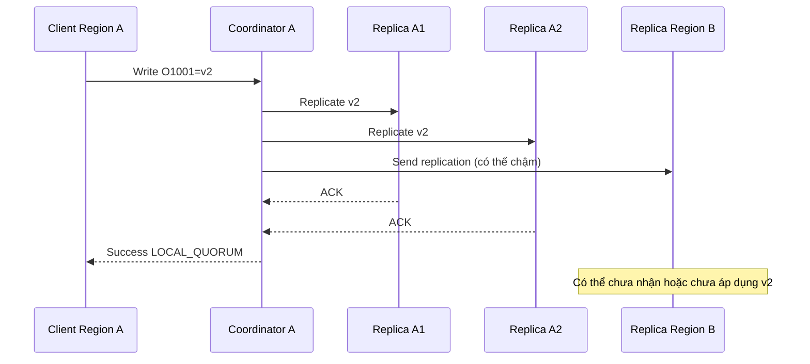
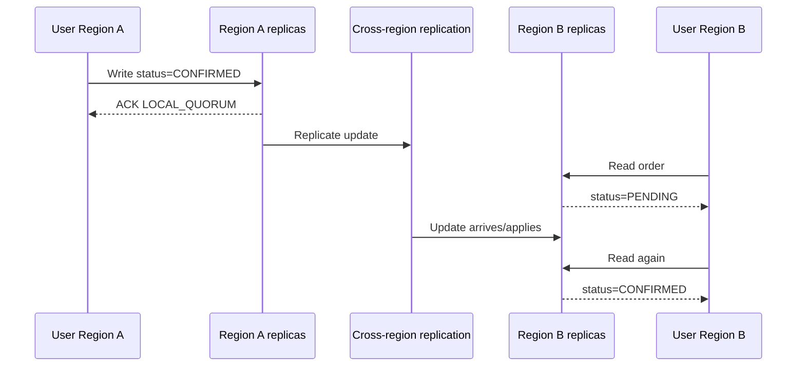

# Quorum cục bộ/toàn cục và dữ liệu giữa nhiều vùng

## 1. Bài toán mở đầu: cùng một bản ghi, hai vùng địa lý

Một ứng dụng đặt hàng có khách ở hai vùng địa lý. Cơ sở dữ liệu NoSQL được sao chép để người dùng ở mỗi vùng có thể đọc dữ liệu từ những máy gần mình.

```text
                 WAN
Region A  ----------------------  Region B

A1  A2  A3                        B1  B2  B3
      \                              /
       \--- cùng sao chép dữ liệu ---/

Đơn hàng O1001:
  Region A: trạng thái CONFIRMED
  Region B: trạng thái PENDING (chưa nhận bản cập nhật)
```

Trong nhiều thời điểm, tất cả node vẫn hoạt động và liên lạc được. Nhưng một cập nhật được xác nhận ở Region A **chưa nhất thiết đã xuất hiện trong Region B**, tùy cơ chế sao chép và chính sách xác nhận.

Ba câu hỏi cần tách bạch:

1. **Quorum cục bộ:** phải có bao nhiêu bản sao trong vùng đang phục vụ xác nhận?
2. **Quorum toàn cục:** bao nhiêu bản sao của toàn tập replication phải tham gia?
3. **Dữ liệu giữa các vùng:** các vùng khác nhìn thấy cập nhật khi nào, và có thể tiếp tục ghi khi một vùng mất liên lạc không?

Ví dụ: cùng một cluster có thể phục vụ thao tác ở Region A nhanh khi chỉ chờ hai replica địa phương, nhưng chậm hơn khi buộc chờ xác nhận từ Region B. Trái lại, chỉ xác nhận trong A có thể cho phép Region B **đọc bản cũ** cho đến khi replication hội tụ.

**Mục tiêu bài học:** hiểu và tính được quorum cục bộ/toàn cục, phân tích read–write consistency xuyên vùng, lý giải rủi ro khi failover hoặc network partition, và chọn cấu hình dựa trên **bảo đảm nghiệp vụ, topology, latency, availability và khả năng phục hồi**.

## 2. Các khái niệm nền tảng

### 2.1. Replica và replication factor

**Replica** là một bản sao dữ liệu được duy trì ở node hoặc miền lỗi (*failure domain*) nào đó. **Replication factor – RF** là số bản sao được cấu hình cho một phạm vi dữ liệu.

Ví dụ:

```text
Data center A:
  A1: chứa partition K
  A2: chứa partition K
  A3: chứa partition K
  RF_A = 3

Data center B:
  B1: chứa partition K
  B2: chứa partition K
  B3: chứa partition K
  RF_B = 3

Tổng số replica chứa K = 6
```

Đây là **sáu replica của cùng một partition/key**, không phải sáu database độc lập có cùng dữ liệu bằng cách tình cờ.

Một database có hàng nghìn partition. Không phải mọi node đều giữ tất cả partition; quorum của một key được tính trên **tập replica sở hữu key đó** theo giao thức, không phải số máy chủ bất kỳ trong toàn cluster.

### 2.2. Node, availability zone, data center và region

| Khái niệm | Cách hiểu | Vì sao quan trọng |
| --- | --- | --- |
| Node | Một thành viên xử lý/lưu dữ liệu | Có thể hỏng độc lập hoặc chia sẻ hạ tầng |
| Rack / availability zone | Miền lỗi nhỏ hơn region, tùy hạ tầng | Tránh mất toàn bộ replica khi một miền gặp sự cố |
| Data center (DC) | Nhóm node được cấu hình cùng vị trí logic/vật lý | Một số CL của Cassandra được xác định theo DC |
| Region | Vùng địa lý hoặc vùng dịch vụ cloud | Thường có WAN RTT và failure domain khác |
| Replica set | Tập các bản sao/voter theo sản phẩm | Có quy tắc ACK, bầu leader, membership riêng |
| Voting member | Thành viên tham gia quyết định quorum của một giao thức | Không phải mọi replica đều có cùng quyền vote |

**“Local” không có nghĩa cố định là cùng thành phố hay cùng region.** Trong Cassandra, LOCAL_QUORUM gắn với **data center do topology/snitch xác định**. Ở sản phẩm khác, local có thể chỉ region của request hoặc một tập replica theo policy.

### 2.3. Quorum là một tập xác nhận có kích thước đủ điều kiện

Một quorum là tập thành viên đủ lớn/theo quy tắc của giao thức để một thao tác đạt điều kiện xác nhận hoặc ra quyết định.

Trong mô hình đa số đơn giản có `N` thành viên:

\[
Q(N)=\left\lfloor\frac{N}{2}\right\rfloor+1
\]

Ví dụ:

| N | Majority quorum Q |
| ---: | ---: |
| 1 | 1 |
| 2 | 2 |
| 3 | 2 |
| 4 | 3 |
| 5 | 3 |
| 6 | 4 |
| 7 | 4 |
| 9 | 5 |

Điều kiện cụ thể của một database có thể không chỉ dựa vào majority đơn giản: thành viên bỏ phiếu, loại thao tác, membership thay đổi, quorum theo vùng và cơ chế đồng thuận đều quan trọng.

### 2.4. “Đã ACK” chưa chắc là “mọi vùng đã thấy”

Một write nhận `success` khi đạt mức xác nhận yêu cầu. Nếu policy không buộc chờ Region B, Region B có thể chưa áp dụng write đó.

Hơn nữa, ACK còn có các nghĩa khác nhau: nhận thông điệp, append log, fsync, commit theo protocol hoặc hoàn tất transaction. **Độ bền (durability) và độ mới của bản sao (read visibility) không nên đánh đồng.**

## 3. Quorum cục bộ là gì?

**Quorum cục bộ (local quorum)** là yêu cầu đủ xác nhận trong **một nhóm replica thuộc vùng/DC đang xét**, thay vì từ mọi vùng chứa dữ liệu.

Giả sử trong Region A có ba replica:

```text
A1, A2, A3
RF_A = 3
Local majority = floor(3/2) + 1 = 2
```

Một write ở A dùng local quorum có thể hoàn tất sau khi đủ hai replica ở A đáp ứng điều kiện của engine. Nó **không nhất thiết phải chờ ACK từ B1, B2 hoặc B3**.

Sơ đồ khái niệm:



Sơ đồ chỉ minh họa **điều kiện chờ**, không khẳng định mọi engine thực hiện đúng số RPC hoặc thứ tự gửi giống nhau.

### 3.1. Vì sao local quorum hấp dẫn?

- Có thể tránh đặt RTT WAN vào đường ACK của mỗi ghi.
- Có thể tiếp tục phục vụ local operations khi DC xa chậm hoặc mất liên lạc, nếu local DC vẫn đủ replica.
- Dễ đặt compute và storage gần người dùng cùng vùng.
- Giảm mức độ phụ thuộc vào một vùng xa cho những operation chỉ cần bảo đảm cục bộ.

### 3.2. Giới hạn của local quorum

- Việc xác nhận tại A **không tự xác nhận B đã có bản mới**.
- Đọc ở B ngay sau ghi A có thể stale, tùy consistency policy của B và tiến trình replication.
- Khi A mất hoàn toàn trước khi B nhận các ghi mới nhất, rủi ro phục hồi/mất một phần ghi phụ thuộc durability và cross-region replication semantics.
- Một số invariant toàn cục, như username duy nhất trên mọi vùng, **không được bảo vệ chỉ bằng việc mỗi vùng có quorum riêng**, nếu hai vùng đều có thể chấp nhận ghi độc lập.
- Khi network partition, hai local quorums có thể cùng hoạt động trên hai nhóm **không giao nhau**.

**Local quorum không phải “global strong consistency với latency local”.**

## 4. Quorum toàn cục là gì?

Trong mô hình đơn giản, **global quorum** được lấy từ toàn bộ tập replica/voter của một đối tượng dữ liệu trên nhiều vùng.

Với A có ba replica và B có ba replica:

\[
N_{\text{total}}=3+3=6
\]

\[
Q_{\text{global}}=\left\lfloor 6/2\right\rfloor+1=4
\]

Nếu write yêu cầu bốn ACK từ tổng sáu replica, ba replica ở A không đủ; phải có ít nhất một phản hồi phù hợp từ B.

```text
Region A: A1  A2  A3       Region B: B1  B2  B3

Write global quorum = 4

Ví dụ tập ACK hợp lệ:
  A1 + A2 + A3 + B1 = 4

Ví dụ khác:
  A1 + A2 + B1 + B2 = 4
```

Một write có thể phải chịu latency của ít nhất một đường truyền liên vùng. Nhưng **quorum toàn cục không đồng nghĩa mọi vùng đều đạt quorum cục bộ**.

### 4.1. Global quorum là majority của tập nào?

Cần hỏi ngay:

- Quorum của tất cả **data replicas**?
- Quorum của **voting members**?
- Quorum của **một partition** hay của toàn cluster?
- Quorum theo mọi DC hay theo **majority của các region**?
- Có witness/arbiter chỉ vote nhưng không giữ dữ liệu không?
- Quorum được tính trước hay sau thay đổi membership?

Ví dụ với năm voting members:

```text
Region A: A1 A2 A3
Region B: B1
Region C: C1

Majority = 3 trên 5
```

Quorum **A1+A2+A3** vẫn có thể ở hoàn toàn Region A. Như vậy “quorum toàn bộ replica set” **không tự buộc có ACK từ vùng xa** nếu việc bố trí voter cho phép một vùng chiếm majority.

Đây là một điểm thiết kế rất quan trọng với hệ leader-based consensus và replica sets.

### 4.2. Quorum toàn cục không phải xác nhận của mọi replica

Ở ví dụ sáu replica, quorum bốn có thể đã ACK nhưng hai replica khác vẫn chậm. Nếu API đọc từ một trong hai replica đó mà không có policy/read repair phù hợp, nó vẫn có thể thấy state cũ.

**Đạt global quorum cho write không có nghĩa every replica đã hội tụ.**

## 5. Quorum theo từng vùng: khác global quorum

Một cơ chế thứ ba là yêu cầu **quorum riêng ở từng vùng/DC**, đôi khi được đặt tên như `EACH_QUORUM` trong Cassandra cho write ở những phiên bản/đường thao tác được hỗ trợ.

Với RF_A=3 và RF_B=3:

\[
Q_A=2,\quad Q_B=2
\]

Điều kiện “mỗi vùng đạt quorum” là:

```text
Region A: ít nhất 2 trong 3 replica
Region B: ít nhất 2 trong 3 replica

Tổng ACK tối thiểu = 2 + 2 = 4
```

Số lượng tối thiểu **bằng** global quorum bốn trong ví dụ này, nhưng **tập ACK hợp lệ không giống nhau**.

| Tập ACK | Global quorum 4/6 | Quorum mỗi DC 2+2 |
| --- | --- | --- |
| 3 replica A + 1 replica B | Đủ | **Không đủ ở B** |
| 2 replica A + 2 replica B | Đủ | Đủ |
| 1 replica A + 3 replica B | Đủ | **Không đủ ở A** |
| 3 replica A + 0 replica B | Không đủ | Không đủ |

Vì vậy **global quorum** và **quorum ở mỗi vùng** không phải hai tên cho cùng một cấu hình, ngay cả khi số ACK tối thiểu trùng nhau.

### 5.1. Tại sao phải chọn per-region quorum?

Nếu hệ thật sự cần biết rằng mỗi DC đã có một số replica tham gia trước khi ACK, một chính sách theo từng DC có thể diễn đạt điều kiện đó rõ hơn majority của toàn tập.

Đổi lại:

- Mọi DC được yêu cầu đều nằm trên đường critical path.
- Một DC chậm hoặc không đạt quorum có thể chặn ghi.
- Số vùng tăng làm tăng số điều kiện phải cùng thỏa.
- Không tự giải quyết transaction nhiều key hoặc xung đột concurrent writes.

### 5.2. Không suy mỗi sản phẩm đều có EACH_QUORUM

`EACH_QUORUM` là tên consistency level gắn với một số sản phẩm như Cassandra, **không phải một API NoSQL chuẩn** có thể dùng cho MongoDB, DynamoDB hoặc Redis.

Trong một hệ leader-based consensus, quorum được tính trên voting members của log/replica group; có thể không có lựa chọn “hai ACK ở mỗi region” cho mỗi write.

## 6. Công thức tổng quát cho nhiều vùng

Giả sử có `m` vùng. Vùng `i` lưu `N_i` replica của một key.

Tổng replica:

\[
N=\sum_{i=1}^{m}N_i
\]

Quorum theo majority toàn tập:

\[
Q_{\text{global}}=\left\lfloor\frac{N}{2}\right\rfloor+1
\]

Quorum cục bộ trong vùng `i`:

\[
Q_i=\left\lfloor\frac{N_i}{2}\right\rfloor+1
\]

Nếu protocol yêu cầu majority **tại mọi vùng**, tổng số ACK tối thiểu là:

\[
Q_{\text{each}}=\sum_{i=1}^{m}Q_i
\]

Đây là các công thức majority **khái niệm** trên cùng một tập replica đã biết, không phải phép đo tự động cho mọi dịch vụ managed.

### 6.1. Ví dụ ba vùng, mỗi vùng ba replica

```text
Region A: 3
Region B: 3
Region C: 3
```

Khi đó:

\[
N=9,\quad Q_{\text{global}}=5
\]

\[
Q_A=Q_B=Q_C=2
\]

\[
Q_{\text{each}}=2+2+2=6
\]

Khác biệt:

- Local quorum ở A cần 2 ACK tại A.
- Global quorum cần 5 ACK bất kỳ trong tập chín.
- Per-region quorum cần 2 ACK ở **mỗi** A, B và C, tổng ít nhất 6 ACK.

Một global quorum 5 có thể gồm `3A+2B+0C`. Vì vậy nó **không yêu cầu C tham gia**, dù dữ liệu được sao chép ở ba vùng.

### 6.2. Một region đủ node để đạt global quorum

Một replica group có ba node ở A và một node ở B, một node ở C:

```text
N = 5
Q_global = 3

A: 3 voters
B: 1 voter
C: 1 voter
```

Một quorum toàn cục có thể được tạo hoàn toàn trong A. Nếu mục tiêu là **ghi phải có sự tham gia của một vùng bên ngoài A**, placement này không bảo đảm mục tiêu ấy.

Không chỉ xem số vùng có replica; phải kiểm tra **phân bố những thành viên được quyền xác nhận/vote**.

## 7. Chứng minh giao nhau của read quorum và write quorum

Một công thức thường gặp:

\[
R+W>N
\]

Trong đó:

- `N`: tổng replica của **cùng một đối tượng và membership**.
- `W`: số replica yêu cầu cho write.
- `R`: số replica yêu cầu cho read.

Nếu hai tập con được chọn từ cùng tập `N`, khi `R+W>N`, chúng bắt buộc có ít nhất một phần tử chung.

### 7.1. Ví dụ toàn cục

Với `N=6, W=4, R=4`:

\[
R+W=8>6
\]

Hai tập bốn replica trong tập sáu giao nhau ít nhất:

\[
R+W-N=2
\]

Phần giao có thể giúp một giao thức đọc tìm thấy thông tin về write đã ACK.

### 7.2. Ví dụ local trong cùng vùng

Region A có `N_A=3`, `W_A=2`, `R_A=2`:

\[
R_A+W_A=4>3
\]

Mỗi read quorum và write quorum trong **cùng vùng A** sẽ giao nhau theo mô hình tập hợp đơn giản.

### 7.3. Local A write và local B read không có bảo đảm giao nhau

Một write từ A chỉ được ACK bởi A1+A2, còn một read ở B chỉ hỏi B1+B2:

```text
Write quorum ở A: {A1, A2}
Read quorum ở B:  {B1, B2}

Intersection: rỗng
```

Dù **mỗi vùng** tự đạt local quorum, hai tập không có replica chung. Việc đọc ở B có thấy write của A hay không phụ thuộc **cross-region replication, phiên bản và policy đọc**, không thể suy từ phép cộng `2+2>3` của riêng một vùng.

### 7.4. Tại sao giao quorum vẫn chưa đủ để tuyên bố linearizable?

Điều kiện tập hợp **không tự** xử lý:

- Hai write đồng thời, thứ tự commit và conflict resolution.
- Replica trả lời với timestamp/version nào.
- Cơ chế read repair và reconciliation.
- Membership thay đổi khi node join/leave/failover.
- Sloppy quorum hoặc substitute replicas nếu sản phẩm sử dụng.
- Replica đã ACK nhưng dữ liệu không bền qua loại lỗi đang xét.
- Read qua cache hoặc index nằm ngoài tập quorum.
- Transaction chứa nhiều record/partition.

**Quorum overlap là một thành phần có thể cần của giao thức nhất quán, không phải toàn bộ chứng minh correctness.**

## 8. Bảng so sánh ba lựa chọn trên cùng topology

Giả sử một partition có RF_A=3, RF_B=3:

| Khía cạnh | LOCAL_QUORUM tại A | QUORUM toàn tập | EACH_QUORUM theo A+B |
| --- | --- | --- | --- |
| Điều kiện ACK điển hình | 2 trong 3 ở A | 4 trong 6 | 2 ở A **và** 2 ở B |
| Bắt buộc chờ B trên write khởi tạo ở A? | Không theo chính điều kiện local | Có ít nhất một ACK B trong ví dụ | Có ít nhất hai ACK B |
| Phụ thuộc WAN latency trên đường ACK | Có thể tránh | Thường có trong ví dụ | Có |
| Khi B mất hoàn toàn | A vẫn có thể phục vụ local | Không còn đủ 4/6 | Không thể đạt quorum B |
| Khi A còn 1, B đủ 3 | Local A không đủ | Có thể đủ 4/6 | A không đủ |
| B đọc ngay sau A local write | Có thể stale | Phụ thuộc read policy/protocol | Phụ thuộc read policy/protocol |
| Cam kết linearizable mọi thao tác? | Không tự suy ra | Không tự suy ra | Không tự suy ra |
| Mức phù hợp | Local operations, ưu tiên availability/latency vùng | Quorum toàn replication set | Buộc có ACK theo từng DC |

**Bảng giải thích điều kiện quorum**, chưa bao gồm mọi chi tiết của một engine, ví dụ cách chọn coordinator, consistency serial, durability, membership hoặc những replica bị lỗi.

## 9. Một region bị mất: sự khác nhau hiện rõ

Với ba node ở A và ba node ở B:

```text
A1 A2 A3  |  B1 B2 B3
```

Giả sử toàn Region B mất kết nối, còn A hoạt động đầy đủ.

### 9.1. Local quorum ở A

A còn 3/3 replica, cần 2 ACK nên có thể tiếp tục phục vụ thao tác local trong phạm vi được sản phẩm hỗ trợ.

Nhưng A **không thể buộc B nhận dữ liệu mới tại thời điểm đó**. Phải có chính sách cho những write mới này nếu người dùng ở B tiếp tục thao tác hoặc khi B phục hồi.

### 9.2. Global majority 4/6

A chỉ có ba replica nên không đạt global majority bốn. Thao tác yêu cầu quorum này không thể hoàn tất theo policy nếu B không có replica nào phản hồi.

Đây là cái giá của việc buộc giao nhau trên toàn tập: một loại lỗi có thể khiến vùng A **còn sống nhưng không thể xác nhận write** theo mức mạnh đã chọn.

### 9.3. Per-region quorum 2+2

Không có ACK từ B nên cũng không thể hoàn tất. Ngay cả khi A đủ hai hoặc ba replica, điều kiện ở B chưa thỏa.

### 9.4. B không mất hoàn toàn nhưng có ít node phản hồi

| Trạng thái | LOCAL A (2/3) | GLOBAL (4/6) | EACH (2A+2B) |
| --- | --- | --- | --- |
| A còn 3, B còn 3 | Có thể | Có thể | Có thể |
| A còn 3, B còn 1 | Có thể | Có thể (3+1) | Không |
| A còn 2, B còn 3 | Có thể | Có thể | Có thể |
| A còn 1, B còn 3 | Không | Có thể (1+3) | Không |
| A còn 3, B còn 0 | Có thể | Không | Không |
| A còn 1, B còn 1 | Không | Không | Không |

“Có thể” nghĩa là **đủ số phản hồi theo mô hình**, không bảo đảm thao tác thật sự hoàn tất khi còn latency, disk failure, transaction conflict hoặc timeout.

### 9.5. Mất region khác mất một node

Một topology có ba replica cùng một availability zone có thể chịu một node hỏng nhưng mất cả zone sẽ mất toàn bộ bản sao cục bộ.

Số lượng quorum phải gắn với **failure domains** và quy hoạch placement, không chỉ tổng số process.

## 10. Điều kiện còn liên lạc nhưng mạng rất chậm

Local/global quorum có đánh đổi ngay cả khi không có phân hoạch.

Giả sử thời gian ACK (chỉ minh họa):

```text
A1: 4 ms
A2: 6 ms
A3: 8 ms
B1: 115 ms
B2: 130 ms
B3: 180 ms
```

Nếu coordinator gửi song song tới tất cả replica:

- Local quorum ở A (2/3) có thể đủ sau khoảng **6 ms**.
- Global quorum (4/6) cần ít nhất một B, có thể đủ sau khoảng **115 ms**.
- Per-region quorum (2A+2B) phải có hai B, có thể đủ sau khoảng **130 ms**.

Các số không tính client/coordinator RTT, storage, processing và protocol phases; không phải dự đoán hiệu năng Cassandra production.

### 10.1. Thứ tự phản hồi chứ không chỉ tổng RTT

Nếu gửi song song và cần `k` phản hồi hợp lệ, thời gian chờ tối thiểu trong mô hình đơn giản là **thời gian phản hồi nhanh thứ k**, không phải tổng mọi RTT.

Tuy nhiên giao thức leader-based consensus, transaction hoặc read reconciliation có thể có **nhiều pha phụ thuộc nhau**. Không được lấy một bảng ACK để tính trực tiếp p99 của bất kỳ database nào.

### 10.2. Tail latency

Một replica bình thường 6 ms có thể đôi lúc chậm 200 ms do GC, queue hoặc compaction. Nếu là replica cần để đủ quorum, p99 request có thể tăng mạnh dù p50 tốt.

Đặt một số replica ở xa không chỉ tăng độ trễ trung bình; nó tạo thêm những **đường lỗi, mạng và node** tham gia critical path.

### 10.3. Local quorum có thể chuyển chi phí sang đọc xuyên vùng

Giảm chờ remote ACK giúp write local nhanh hơn, nhưng nếu client chuyển sang Region B và đòi ngay giá trị mới nhất, API có thể phải:

- Route read về Region A.
- Chờ B bắt kịp một minimum revision.
- Chuyển sang một đường strong read được sản phẩm hỗ trợ.
- Hoặc thông báo trạng thái chưa đồng bộ.

**Giảm latency của một write không có nghĩa cả workflow đọc–ghi xuyên vùng nhanh hơn.**

## 11. Replication bất đồng bộ giữa vùng và cửa sổ dữ liệu cũ

Một đường đi điển hình:



Hiện tượng này là **stale read** ở B, không nhất thiết là lost update ở A.

### 11.1. Những mốc thời gian cần phân biệt

```text
t0: Client A gửi write
t1: Quorum A ACK
t2: Client A nhận response
t3: Message replication tới Region B
t4: B áp dụng write vào replica
t5: Các replica B đáp ứng read policy tương ứng
t6: Bản chiếu/search/cache ở B cập nhật
```

Một ACK tại `t2` chỉ có ý nghĩa theo write contract ở A. Không được suy `t2=t5=t6`.

### 11.2. Eventual consistency không phải giới hạn thời gian cứng

Một thay đổi có thể bình thường tới B trong vài chục mili-giây, nhưng khi WAN nghẽn, consumer lag hoặc replica lỗi, nó có thể chậm lâu hơn.

Phát biểu:

> “99,9% cross-region replication dưới 2 giây.”

là **SLO thống kê nếu được đo**, không đồng nghĩa “mọi read stale tối đa 2 giây”.

Nếu cần một **bounded staleness guarantee**, phải dùng mô hình/dịch vụ thực sự cam kết bound đó trong điều kiện xác định.

### 11.3. Session và minimum revision

Một API có thể trả:

```http
HTTP/1.1 200 OK
ETag: "order-v42"
Content-Type: application/json

{"orderId":"O1001","status":"CONFIRMED","version":42}
```

Nếu client chuyển sang Region B, có thể yêu cầu server trả không thấp hơn version 42 theo **giao thức ứng dụng được xây dựng riêng**:

```http
GET /orders/O1001
X-Min-Revision: 42
```

Server cần đọc từ nguồn phù hợp hoặc chờ B bắt kịp trong deadline. Nếu không thỏa, phải trả trạng thái rõ, không tự trả version 41 với nhãn “latest”.

**Header trên là ví dụ thiết kế API, không phải header chuẩn mà mọi NoSQL server tự hiểu.**

## 12. Global quorum có tạo strong consistency xuyên vùng?

Câu trả lời chuẩn xác là: **chỉ khi giao thức, read/write policies và các giả định cần thiết thật sự bảo đảm mô hình nhất quán được phát biểu**.

Một majority/quorum là **điều kiện về tập xác nhận**. Để có linearizable read/write trên một đối tượng, còn cần:

- Thứ tự commit/leader hoặc consensus protocol đúng.
- Xử lý concurrent writes và network delays.
- Membership/reconfiguration không phá giao nhau.
- Đọc qua đường được phép, ví dụ leader read đã xác minh hoặc quorum/read-index phù hợp.
- Không tự phục vụ từ replica chưa bắt kịp.
- Xử lý failover, fencing và clock/version theo đúng protocol.

### 12.1. Consensus majority khác leaderless quorum

Có hai họ cần phân biệt:

**Leader-based replicated log**, ví dụ kiến trúc dùng Raft hoặc cơ chế consensus tương ứng:

- Voter thỏa quorum để quyết định log entry.
- Leader election, commit index và read protocol giúp bảo vệ thứ tự.
- Một follower đọc local không xác minh vẫn có thể stale dù log entry đã majority-committed.

**Leaderless replication**, ví dụ một số mô hình đọc/ghi theo quorum:

- Coordinator nhận/đọc từ nhiều replica.
- Timestamp/version resolution và read repair ảnh hưởng kết quả.
- `R+W>N` không tự tạo serialization của transaction hay xử lý mọi concurrent write.

Không nên gộp hai họ thành cùng một giải thích “nhờ majority nên luôn đọc mới nhất”.

### 12.2. Quorum không thay compare-and-set

Hai actor cùng đọc stock=5, rồi mỗi actor đặt lại available=1:

```text
A READ -> 5
B READ -> 5
A WRITE available=1 (được quorum ACK)
B WRITE available=1 (được quorum ACK)
```

Dù cả hai write đều được quorum toàn cục xác nhận, kết quả vẫn có thể là **lost update** ở tầng nghiệp vụ.

Để giữ invariant stock không âm, cần atomic conditional decrement/CAS/transaction phù hợp, không chỉ tăng số replica ACK.

### 12.3. Global quorum không tự thành transaction nhiều key

Một read hoặc write quorum cho key K không tự cung cấp atomicity cho:

```text
Debit account A
Credit account B
```

nếu chúng nằm ở hai partition/shard khác nhau. Cần transaction, ledger hoặc workflow theo mô hình nhất quán mong muốn.

## 13. Cassandra: LOCAL_QUORUM, QUORUM và EACH_QUORUM

Cassandra là ví dụ rõ ràng về consistency level khác nhau theo data center và operation.

Giả sử keyspace được sao chép sang hai data center:

```sql
CREATE KEYSPACE commerce
WITH replication = {
  'class': 'NetworkTopologyStrategy',
  'dc_east': 3,
  'dc_west': 3
}
AND durable_writes = true;
```

Tên DC là ví dụ. Cấu hình phải khớp tên data center mà Cassandra topology/snitch thực tế công bố.

Một table:

```sql
CREATE TABLE commerce.orders_by_id (
    tenant_id text,
    order_id text,
    status text,
    version int,
    updated_at timestamp,
    PRIMARY KEY ((tenant_id), order_id)
);
```

Một partition `(tenant_id)` có các row theo `order_id`; việc chọn partition key, dữ liệu phân bố và kích thước partition phải dựa trên access pattern thực tế.

### 13.1. LOCAL_QUORUM

Với `dc_east` có RF=3:

```text
LOCAL_QUORUM tại dc_east = 2 replica dc_east
```

Trong Cassandra, CL này định nghĩa điều kiện quorum tại data center cục bộ của coordinator/operation. Nếu thao tác được xử lý từ dc_east, nó không bắt buộc đợi đủ replica tại dc_west trước ACK theo chính điều kiện LOCAL_QUORUM.

Một read LOCAL_QUORUM tại dc_west ngay sau write LOCAL_QUORUM tại dc_east **có thể đọc stale**, nếu thay đổi chưa được áp dụng đủ ở dc_west.

### 13.2. QUORUM

Tổng replication factor:

```text
RF_total = 3 + 3 = 6
QUORUM = floor(6/2) + 1 = 4
```

Điều kiện bốn replica có thể gồm:

```text
3 east + 1 west
2 east + 2 west
1 east + 3 west
```

Trong topology này, QUORUM đòi ít nhất một phản hồi liên DC vì mỗi DC chỉ có ba replica.

Không nên suy rằng read ở dc_west sau QUORUM write sẽ luôn linearizable trong mọi trường hợp; cần xét read CL, write protocol, concurrent writes và semantics conflict resolution của Cassandra.

### 13.3. EACH_QUORUM

Trong những phiên bản Cassandra hỗ trợ, `EACH_QUORUM` dùng cho **write operations** theo yêu cầu quorum trên **mỗi DC**.

Với 3+3:

```text
EACH_QUORUM write = ít nhất 2 east + ít nhất 2 west
```

Đây là điều kiện mạnh hơn yêu cầu global QUORUM ở ví dụ khi một DC chỉ có một ACK. Nó có thể không đáp ứng khi một DC bị mất hai replica, dù global QUORUM vẫn có thể đủ 4.

**Không dùng EACH_QUORUM cho read như thể mọi phiên bản/driver đều hỗ trợ**; hãy kiểm tra consistency levels hợp lệ cho từng loại lệnh.

### 13.4. ONE, LOCAL_ONE, ALL

- `ONE`: một replica đáp ứng điều kiện theo protocol.
- `LOCAL_ONE`: một replica thuộc DC cục bộ.
- `ALL`: tất cả replica thuộc phạm vi thao tác phải xác nhận; nhạy với bất kỳ replica không phản hồi.
- `LOCAL_QUORUM`: majority trong DC cục bộ.
- `QUORUM`: majority toàn tập replication của key.
- `EACH_QUORUM`: majority mỗi DC với write khi hỗ trợ.

Chúng mô tả **mức xác nhận và phạm vi replica**, không có nghĩa `ONE` luôn mất dữ liệu hay `ALL` tự là serializable transaction.

### 13.5. Đọc và ghi có thể dùng CL khác nhau

Một API ghi LOCAL_QUORUM ở east và đọc LOCAL_QUORUM ở east có thể có tập quorum giao nhau **trong east** theo mô hình phù hợp. Nếu API đọc từ west, local quorum hai bên là hai tập khác nhau.

Một API khác có thể ghi EACH_QUORUM và đọc LOCAL_QUORUM tại một trong hai DC. Quorum đã ghi trong từng DC giúp các tập trong chính DC đó giao nhau ở mô hình tập hợp.

Dù vậy, còn phải kiểm tra semantics Cassandra đối với concurrent writes, timestamp, repair và version. **Đừng chuyển một lập luận giao tập thành cam kết linearizability tuyệt đối.**

### 13.6. Java Driver 4: cấu hình theo statement

```java
import com.datastax.oss.driver.api.core.DefaultConsistencyLevel;
import com.datastax.oss.driver.api.core.cql.SimpleStatement;

// Đọc trong data center cục bộ.
SimpleStatement localRead = SimpleStatement.builder(
        "SELECT status, version FROM commerce.orders_by_id " +
        "WHERE tenant_id = ? AND order_id = ?")
    .addPositionalValues("T01", "O1001")
    .setConsistencyLevel(DefaultConsistencyLevel.LOCAL_QUORUM)
    .build();

// Ghi với yêu cầu quorum toàn replication set.
SimpleStatement globalWrite = SimpleStatement.builder(
        "UPDATE commerce.orders_by_id SET status = ? " +
        "WHERE tenant_id = ? AND order_id = ?")
    .addPositionalValues("CONFIRMED", "T01", "O1001")
    .setConsistencyLevel(DefaultConsistencyLevel.QUORUM)
    .build();
```

Ví dụ chỉ cho thấy cách đặt CL của **statement**. Code production cần connection/session, retry policy, timeout, idempotency và kiểm tra kết quả. Driver's local DC, load balancing và coordinator location phải khớp topology thiết kế.

### 13.7. CAS/LWT là trục khác của consistency

Nếu hai vùng cùng muốn chuyển Order từ PENDING:

```sql
UPDATE commerce.orders_by_id
SET status = 'CONFIRMED', version = 8
WHERE tenant_id = 'T01'
  AND order_id = 'O1001'
IF version = 7;
```

Lệnh có `IF` dùng cơ chế Lightweight Transaction. Cần kiểm tra `[applied]`, ordinary consistency level và **serial consistency** theo phiên bản.

`SERIAL` và `LOCAL_SERIAL` có phạm vi phối hợp khác nhau trong hệ multi-DC. Không dùng local serial condition rồi mặc định đã bảo vệ một invariant globally unique trên mọi vùng nếu tài liệu sản phẩm không cam kết vậy.

### 13.8. Hinted handoff, repair và tombstone

Dữ liệu giữa hai DC có thể cần hinted handoff/repair hoặc cơ chế đồng bộ khi replica bỏ lỡ write. `LOCAL_QUORUM` **không thay thế repair**.

Delete/TTL có thể dùng tombstone; nếu replica xa không nhận delete và metadata xóa bị dọn quá sớm theo cấu hình sai, một số kiến trúc có rủi ro dữ liệu đã xóa xuất hiện lại. Cần phối hợp retention, repair cadence và failure assumptions.

## 14. MongoDB: majority không đồng nghĩa quorum theo region

MongoDB replica set có primary, secondary và các thành viên voting theo topology. **Write concern `majority`** có nghĩa theo majority rule của replica set/những thành viên đủ điều kiện trong cấu hình cụ thể, **không phải lệnh “đợi một số replica ở từng region”**.

### 14.1. Ví dụ placement làm thay đổi đường ACK

Giả sử một replica set có năm voting data-bearing members:

```text
Region A: A1 A2 A3
Region B: B1
Region C: C1
```

Một majority ba thành viên có thể được thỏa hoàn toàn ở A trong một số cấu hình/điều kiện ghi tương ứng. Do đó `w:"majority"` **không tự là cam kết dữ liệu vừa ghi đã ở B hoặc C trước ACK**.

Ngược lại:

```text
Region A: A1 A2
Region B: B1 B2
Region C: C1
```

Với majority ba, bất kỳ tập ba voter nào cũng phải vượt ra ngoài một vùng vì không vùng nào đủ ba. Việc bố trí voter quyết định đường critical path và failure characteristics.

Thực tế còn phải kiểm tra **quy tắc tính write majority, số member voting/data-bearing và sự hiện diện của arbiter**, không dùng ví dụ đếm đơn giản để thay tài liệu MongoDB của phiên bản đang chạy.

### 14.2. Write concern và journaling

Ví dụ ghi trong mongosh:

```javascript
db.runCommand({
  insert: "orders",
  documents: [
    {
      orderId: "O1001",
      status: "PENDING",
      version: 1
    }
  ],
  writeConcern: {
    w: "majority",
    j: true,
    wtimeout: 5000
  }
});
```

Cần phân biệt:

- `w:"majority"`: điều kiện ACK theo cấu hình replica set.
- `j:true`: journaling acknowledgment theo semantics của version/engine.
- `wtimeout`: giới hạn chờ write concern, **không có nghĩa rollback write** khi timeout.

### 14.3. Read concern và read preference

- `primary` read thường tránh đọc secondary lag.
- `secondary` hoặc `nearest` có thể giảm độ trễ/định tuyến theo locality nhưng có khả năng stale tùy read concern.
- Read concern `majority` **không đồng nghĩa** read concern `linearizable`.
- Causal session có thể hỗ trợ những session guarantees nhất định khi read/write concerns được cấu hình theo điều kiện của MongoDB.

Nếu người dùng ghi ở A rồi mở giao diện ở B qua secondary, write majority ở A **không tự làm read B thấy ngay** nếu B không thuộc tập đã bắt kịp hoặc đường đọc không có bảo đảm phù hợp.

### 14.4. Primary election và geography

Đặt đa số voter trong một vùng có thể giảm coordination latency khi vùng đó còn hoạt động, nhưng cũng khiến các vùng còn lại không thể bầu primary/duy trì majority nếu mất vùng chứa đa số.

Quorum placement phải cân bằng:

- Vùng ưu tiên cho writer chính.
- Khả năng mất một vùng.
- WAN RTT.
- Node voting và non-voting.
- Nhu cầu đọc từ secondary và quy định data residency.

Không thể tối ưu chỉ bằng việc thêm replica ở một region khác nếu **quorum election/commit** vẫn có điểm tập trung.

### 14.5. Sharded MongoDB và nhiều tập quorum

Trong deployment sharded, còn có config servers, replica sets của các shard và transaction/cross-shard coordination. `majority` cho một write trên một shard **không tự có nghĩa một transaction nhiều shard đã commit** hoặc mọi shard có một snapshot toàn cục.

Khi bàn về dữ liệu nhiều vùng, phải xác định đang nói **quorum của shard replica set nào và operation nào**.

## 15. DynamoDB Global Tables: không gán máy móc RF và CL

DynamoDB là managed service. Người dùng làm việc với hợp đồng API, strong/eventual read, transaction, conditional write và các khả năng global tables được công bố; **không được tự dựng một công thức N/R/W từ số region rồi coi đó là cơ chế nội bộ**.

### 15.1. Một region và GSI

Trong phạm vi được dịch vụ hỗ trợ:

- Base table và Local Secondary Index có tùy chọn strongly consistent read.
- Global Secondary Index chỉ hỗ trợ eventually consistent read.
- `ConsistentRead=true` không biến GSI thành strong read.

Một ghi vào base table được xác nhận không đồng nghĩa GSI đã có entry mới.

### 15.2. Nhiều chế độ global tables

Các cấu hình DynamoDB Global Tables có thể bao gồm những chế độ multi-region với semantics **eventual** và **strong** khác nhau ở các điều kiện dịch vụ hỗ trợ. Không nên viết:

> “Mọi DynamoDB Global Tables đều eventual như nhau.”

hoặc:

> “Một strong read trong bất kỳ region luôn tạo global linearizability ở mọi cấu hình.”

Cần xem chính xác:

- Chế độ global table hiện dùng và những region hỗ trợ.
- API/operation có hỗ trợ strong read và conditional/transaction semantics mong muốn không.
- Write được xác nhận trong vùng nào.
- Cross-region replication, conflict resolution và failover policy.
- Những giới hạn đặc thù của global table mode/phiên bản dịch vụ.
- Các đường GSI/read model vẫn có semantics riêng.

### 15.3. Mô hình eventual multi-region có thể cần giải quyết conflict

Nếu hai vùng cùng chấp nhận ghi một item trong một mô hình replication eventual, hai thay đổi có thể cạnh tranh:

```text
Region A: balanceLikeCounter = 100
Region B: balanceLikeCounter = 120
```

Một chính sách chọn phiên bản thắng có thể làm mất ý định của actor kia, ngay cả khi mỗi vùng đều ACK thành công.

Với số dư và reservation, cần mô hình phối hợp/nguồn phân xử mạnh phù hợp, không tin rằng replication eventual tự giữ invariant.

### 15.4. Dùng API contract thay giả định số replica

Ví dụ Java AWS SDK v2 đọc base item strong trong trường hợp được hỗ trợ:

```java
import java.util.Map;
import software.amazon.awssdk.services.dynamodb.DynamoDbClient;
import software.amazon.awssdk.services.dynamodb.model.AttributeValue;
import software.amazon.awssdk.services.dynamodb.model.GetItemRequest;

public void readOrder(DynamoDbClient client, String orderId) {
    GetItemRequest request = GetItemRequest.builder()
        .tableName("Orders")
        .key(Map.of(
            "PK",
            AttributeValue.builder().s("ORDER#" + orderId).build()
        ))
        .consistentRead(true)
        .build();

    var response = client.getItem(request);
    // Xử lý item theo hợp đồng của application.
}
```

Giả định table chỉ có partition key `PK`; nếu thêm sort key phải cung cấp đầy đủ. Không dùng đoạn này để suy mạnh về GSI hoặc mọi region nếu mode không hỗ trợ.

## 16. Redis: quorum bầu leader khác ACK dữ liệu

Redis có primary–replica replication, Redis Sentinel/Cluster cho một số chức năng theo dõi/failover và các lệnh chờ replica theo phiên bản.

Đừng gộp:

1. **Quorum của hệ giám sát/failover:** các thành viên bỏ phiếu hoặc thống nhất node master lỗi.
2. **Số replica đã nhận dữ liệu:** dùng các cơ chế ACK/WAIT thích hợp.
3. **Durability trên disk:** RDB/AOF và fsync policy.
4. **Read freshness:** client đang đọc primary hay replica lag.

### 16.1. WAIT không phải global commit quorum

Redis `WAIT` có thể chờ replica xác nhận nhận những write của kết nối theo semantics lệnh, nhưng nó **không biến Redis thông thường thành consensus database với linearizable multi-region commit và zero data loss**.

Nếu primary mất trước khi write được giữ bền trong hệ failover, vẫn có thể có rủi ro tùy topology/persistence.

### 16.2. Replica địa phương và vùng xa

Đọc từ Redis replica gần có thể giảm RTT nhưng có thể stale so với primary. Đặt primary ở xa người dùng khiến mỗi write phải chịu WAN RTT ngay cả khi replication không được chờ.

### 16.3. Cache không nên phân xử invariant toàn cục nếu không có bảo đảm

Giảm stock trong Redis cache ở hai vùng không tự bảo vệ tồn kho authoritative ở database khác. Cần conditional write/transaction hoặc mô hình reservation được thực thi ở nguồn có quyền quyết định.

## 17. Consensus trên nhiều vùng: leader, voter và witness

Một replicated log dùng consensus như Raft thường có:

- Leader đang nhận/đề xuất log entries.
- Followers/voters tham gia quyết định quorum.
- Một log entry được coi committed theo protocol khi thỏa điều kiện hợp lệ.
- Read linearizable cần đường đọc được protocol cho phép (chẳng hạn leader đã xác minh leadership/read index), **không phải tùy tiện đọc follower**.

### 17.1. Ba voter, ba region

```text
Region A: 1 voter
Region B: 1 voter
Region C: 1 voter

Majority = 2
```

Bất kỳ majority nào cũng gồm hai region. Hệ có thể chịu mất một voter/region mà hai vùng khác vẫn còn khả năng tạo majority, tùy điều kiện kết nối và leadership.

Đổi lại, khi leader ghi, ít nhất một follower ngoài region phải tham gia để quorum đạt được; WAN thường nằm trên commit path.

### 17.2. Năm voter phân bố 2–2–1

```text
A: 2 voters
B: 2 voters
C: 1 voter

Majority = 3
```

Không region nào có ba voter, nên majority bắt buộc gồm nhiều region.

Nếu mất toàn A, B2+C1 còn ba voter có thể tạo majority. Nếu mất B, A2+C1 cũng còn ba; nếu mất C, A2+B2 còn bốn. Đây là ví dụ placement thuận lợi cho một số tiêu chí chịu mất một region, nhưng vẫn cần xét leader election, data placement, storage và network topology.

### 17.3. Witness/arbiter không tương đương data replica

Một witness có thể tham gia bầu chọn nhưng không giữ dữ liệu ứng dụng giống một replica đầy đủ. Nó có thể giúp cấu trúc voting, nhưng không tự tăng số bản sao dữ liệu phục vụ recovery.

Khi đếm “quorum”, phải rõ **quorum để quyết định leadership** hay **quorum dữ liệu đã ghi** theo protocol của engine.

### 17.4. Leader locality và failover

Chọn leader ở A có thể làm write từ khách B chậm vì request phải tới A, rồi leader cần quorum. Chuyển leader sang B giúp khách B nhưng có thể làm khách A chậm.

Một thiết kế tốt cần xét nơi tập trung writer, tỷ lệ read/write, RTT giữa các vùng, election times và failure policy.

## 18. Active–passive và active–active multi-region

### 18.1. Active–passive

```text
Region A: primary writer
Region B: standby/replica

Writes -> A
Reads -> A hoặc B theo policy
```

Ưu điểm:

- Có một nguồn quyết định thứ tự ghi cho những tài nguyên thuộc phạm vi đó.
- Đơn giản hơn trong việc ngăn đồng thời ghi mâu thuẫn.
- Phục vụ disaster recovery nếu replication và failover đúng.

Đánh đổi:

- Writer ở B có thể chịu WAN latency khi gửi về A.
- Nếu A lỗi, phải có cơ chế failover/fencing.
- B có thể chưa nhận write cuối cùng nếu replication eventual.
- Cần quyết định RPO, RTO và trường hợp outcome unknown.

### 18.2. Active–active

```text
Region A: chấp nhận writes
Region B: chấp nhận writes
A <---- replication ----> B
```

Ưu điểm:

- Đường ghi gần người dùng hơn.
- Có thể tăng khả năng tiếp tục chấp nhận thao tác ở các vùng.

Đánh đổi:

- Concurrent writes có thể xung đột.
- Cần version/conflict resolution/CRDT/quota hoặc phân tách ownership.
- Không thể mặc định tồn kho, uniqueness và quyền truy cập được bảo toàn chỉ bằng eventual convergence.
- Phải mô tả hành vi khi hai vùng bị cách ly.

### 18.3. Active–active có thể dùng quyền sở hữu theo key

Một giải pháp là phân vùng resource ownership:

```text
Tenant T01 -> owner Region A
Tenant T02 -> owner Region B
```

Mỗi key/aggregate chỉ có một vùng được phép quyết định write, còn vùng khác định tuyến lệnh tới owner. Cách này có thể giảm conflict nhưng vẫn mang chi phí WAN cho request của tenant không gần owner.

Nếu chuyển ownership khi failover, cần fencing/epoch hoặc transaction migration phù hợp để tránh **hai chủ sở hữu cùng ghi**.

## 19. Read-your-writes giữa nhiều vùng

Một khách tạo Order ở Region A, ngay sau đó request GET bị route sang Region B:

```text
POST /orders -> Region A, ACK local quorum
GET /orders/O1001 -> Region B, replica stale
```

Nếu UX cam kết “tạo thành công thì nhìn thấy đơn”, cần thiết kế:

- Đọc từ authoritative region.
- Truyền session token/revision giữa requests.
- Chờ replica địa phương tới minimum revision.
- Hoặc giữ request GET ở vùng có bảo đảm tương ứng.

### 19.1. Sticky region không phải phương án duy nhất hoặc tuyệt đối

Giữ client tại Region A có thể đơn giản hóa read-your-writes, nhưng:

- Mobile client đổi mạng hoặc load balancer failover.
- Region A mất kết nối.
- Một cache trong Region A vẫn có thể stale.
- Một session không tồn tại vĩnh viễn.

Nên xác định **phạm vi và thời hạn bảo đảm**, thay vì dựa vào sticky routing như một giả định ngầm.

### 19.2. Monotonic reads

Nếu user thấy Order version 10 ở A, rồi API B trả version 9, đó là **lùi phiên bản quan sát**. Session/minimum revision hoặc đọc authoritative có thể ngăn điều này trong scope cam kết.

### 19.3. Causal consistency

Khi bình luận phụ thuộc vào một bài viết, hệ đọc đa vùng cần xem bảo đảm thứ tự nhân quả. Việc event Comment tới B trước event CreatePost có thể làm projection hiện “bình luận cho bài chưa tồn tại”.

Có thể dùng event dependency, per-aggregate ordering hoặc causal tokens, không coi local quorum đơn thuần là bảo đảm causal xuyên mọi service.

## 20. Unique constraints toàn cục: hai vùng cùng đọc “chưa có”

Giả sử username phải unique toàn hệ. Hai vùng cùng nhận:

```text
Region A:
  QUERY username="an" -> chưa có
  CREATE username="an" -> ACK local

Region B:
  QUERY username="an" -> chưa có
  CREATE username="an" -> ACK local
```

Hai local quorums không giao nhau; nếu mỗi vùng đều có thể cấp phát username mà không phối hợp, **có thể sinh hai chủ sở hữu**.

### 20.1. Không dựa vào read trước insert

Ngay cả strong read rồi insert không điều kiện vẫn có khoảng race giữa đọc và ghi.

Cần:

- Unique/conditional write atomic tại nguồn có phạm vi toàn cục đúng.
- Một service cấp phát định danh với ownership rõ.
- Transaction/consensus phù hợp cho key reservation.
- Hoặc phân vùng namespace theo vùng nếu nghiệp vụ cho phép.

### 20.2. Chọn phạm vi uniqueness

```text
Global username:
  "an" chỉ xuất hiện một lần toàn hệ

Tenant-local username:
  (tenantId, normalizedUsername) duy nhất
```

Đừng trả chi phí global coordination cho ràng buộc vốn chỉ cần local tenant. Ngược lại, đừng mô hình local uniqueness nếu API hứa username toàn cục.

## 21. Stock và tài nguyên giới hạn ở nhiều vùng

Tồn kho tổng là 10. Hai vùng đều nhìn thấy 10 trước khi replication:

```text
A reserve 7
B reserve 6
```

Nếu mỗi vùng chấp nhận độc lập, tổng reservation = 13, vượt 10, dù mỗi vùng local còn không âm theo snapshot riêng.

### 21.1. Một nguồn phân xử toàn cục

Có thể yêu cầu mọi reservation của cùng SKU đi qua một writer/transaction/conditional record có thẩm quyền. Đổi lại, write của khách xa có thể chịu WAN latency hoặc thất bại khi không liên lạc được với owner.

### 21.2. Quota escrow/phân bổ trước

Một phương án khác:

```text
Tổng stock 10
Region A được phân bổ quota 6
Region B được phân bổ quota 4
```

Mỗi vùng chỉ được giữ hàng trong quota của mình; phân bổ lại quota giữa vùng cần giao thức an toàn. Cách này có thể giảm coordination ở **mỗi** reservation, nhưng:

- Quota không dùng ở A có thể khiến B hết hàng cục bộ dù toàn hệ vẫn còn.
- Chuyển quota phải chống cấp phát trùng.
- Cần xử lý hoàn hàng, hủy reservation và vùng mất liên lạc.
- Cần kiểm toán tổng quota và tổng reservation.

Đây là sự thay đổi **mô hình sở hữu tài nguyên**, không chỉ thay `LOCAL_QUORUM` thành `QUORUM`.

## 22. Độ bền xuyên vùng khác tính nhất quán của đọc

Một write đạt local quorum ở A có thể **bền qua mất một node A**, nhưng chưa chắc bền qua mất cả Region A nếu B chưa có cập nhật.

Ngược lại, write đạt global quorum ở A+B có thể có bản ở hai region, nhưng khi operator xóa nhầm và delete được sao chép, các region đều có thể mất dữ liệu logic.

Cần phân biệt:

| Thuộc tính | Câu hỏi |
| --- | --- |
| Read consistency | Người đọc có thể thấy phiên bản nào? |
| Write acknowledgment | Bao nhiêu và loại replica nào cần ACK? |
| Local durability | Node đã lưu log/data theo policy nào? |
| Regional durability | Mất node/AZ/region có làm mất write đã ACK không? |
| Replication lag | Vùng khác chậm bao lâu? |
| Backup/PITR | Xóa nhầm có khôi phục về trước đó không? |
| Availability | Khi một vùng lỗi, đường đọc/ghi nào còn hoạt động? |

**Quorum không thay backup, snapshot và point-in-time recovery.**

### 22.1. RPO và RTO

- **RPO:** mức mất dữ liệu chấp nhận được khi phục hồi.
- **RTO:** thời gian khôi phục khả năng phục vụ.

Một write local được ACK nhanh nhưng replication cross-region chậm có thể không đáp ứng RPO gần 0 khi mất toàn vùng. Một thiết kế chờ remote ACK có thể bảo vệ một số sự cố tốt hơn nhưng không tự có RTO ngắn nếu failover thủ công mất nhiều thời gian.

### 22.2. Backup không phải một quorum read

Backup/PITR phục vụ phục hồi lịch sử dữ liệu; nó không làm API đọc ở Region B thấy trạng thái mới ngay trong luồng bình thường.

## 23. Network partition giữa hai vùng

Giả sử mọi node trong A còn liên lạc nội bộ, mọi node B cũng vậy, nhưng mạng A–B bị cắt.

```text
Region A [A1 A2 A3]  X  [B1 B2 B3] Region B
```

### 23.1. Local quorum cho phép những quyết định local

A có thể đáp ứng local quorum riêng; B cũng có thể đáp ứng local quorum riêng.

Nếu cả hai bên cùng cho phép ghi **cùng key** và không có nguyên tắc ownership/consensus khác, hệ có thể tạo hai lịch sử cập nhật cạnh tranh. Sau khi kết nối phục hồi, cần conflict resolution.

### 23.2. Global majority 4/6 không còn đủ

Mỗi phía chỉ có 3/6 replica nên không bên nào đạt majority bốn; thao tác đòi global majority có thể không được xác nhận.

Đó là một cách hệ ưu tiên tránh cam kết các lịch sử mâu thuẫn trong phân hoạch bằng cách giảm availability của các operation cần quorum.

### 23.3. Không mọi network failure là partition hoàn toàn

RTT tăng vượt timeout có thể khiến client thấy **không đạt quorum** dù message cuối cùng vẫn đến. Failure detector có thể nghi replica chết hoặc failover.

Vì vậy tài liệu cần nêu:

- Quorum phải đạt **trước deadline** nào?
- Khi một vùng chậm, coordinator đợi hay fail?
- Write timeout có thể đã commit không?
- Có tự hạ CL/fallback sang local read không?
- Khi hồi phục, dữ liệu được đối soát ra sao?

## 24. Failover và rủi ro hai writer cùng nghĩ mình là leader

Giả sử A là vùng owner của một aggregate. A mất kết nối, B được nâng lên thành owner mới. Khi mạng hồi phục, A có thể còn một worker đang xử lý request cũ.

```text
T0: A owner epoch=41
T1: network delay lớn, hệ nghi A mất
T2: B owner epoch=42
T3: B ghi version mới
T4: worker cũ ở A tiếp tục gửi ghi với epoch=41
```

Nếu nguồn nhận ghi **không kiểm tra epoch/fencing token**, writer cũ có thể làm sai trạng thái mới.

### 24.1. Fencing

Một số hệ dùng generation/epoch/term tăng đơn điệu để từ chối writer giữ quyền cũ. Nhưng token chỉ hữu ích khi **resource có thẩm quyền thực thi kiểm tra**, không phải client chỉ in token vào log.

### 24.2. Write timeout và unknown commit

Trong failover, client có thể timeout sau khi write đã commit nhưng trước ACK. Nếu client retry ở vùng mới bằng operation ID khác, có thể tạo side effects trùng.

Cần idempotency key và cơ chế tra cứu trạng thái operation, không coi timeout là bằng chứng ghi chưa xảy ra.

### 24.3. Chuyển vùng không đồng nghĩa có dữ liệu mới nhất

Một vùng standby chưa bắt kịp có thể mất một số write gần nhất theo replication policy. Runbook failover phải quy định:

- Cho phép promote khi lag tới mức nào?
- Có cơ chế reconcile các write ở vùng cũ không?
- Có thể tạm ngừng writes để hạn chế split-brain không?
- Khi owner cũ trở lại, rejoin/catch-up ra sao?

## 25. Cross-region latency và chi phí phối hợp

Một đường write có thể gồm:

```text
Client -> API
API -> Coordinator
Coordinator -> Local replicas
Coordinator -> Remote replicas
Coordinator waits for policy
Coordinator -> API -> Client
```

Một công thức khái niệm:

\[
T_{\text{write}} \approx
T_{\text{routing}}+T_{\text{coordination}}+
T_{\text{storage}}+T_{\text{response}}
\]

Các pha có thể chạy song song, và một consensus transaction có thể cần nhiều vòng mạng. Do đó **không áp dụng một số RTT cố định cho tất cả hệ**.

### 25.1. Ví dụ mô hình thời gian ACK

Giả định chỉ cho bài toán:

```text
Client -> Coordinator và trả response: 10 ms
Local quorum đủ ACK sau:          7 ms
Global quorum đủ ACK sau:       125 ms
Per-region quorum đủ ACK sau:   150 ms
Other processing/storage:        5 ms
```

Nếu các pha được cộng trên critical path trong mô hình đơn giản:

| Chính sách | Ước lượng minh họa |
| --- | ---: |
| Local quorum | 10 + 7 + 5 = 22 ms |
| Global quorum | 10 + 125 + 5 = 140 ms |
| Each-region quorum | 10 + 150 + 5 = 165 ms |

Các số **không phải số đo của Cassandra/MongoDB/DynamoDB**; chúng minh họa tác động của việc chờ phản hồi vùng xa.

### 25.2. Khi p99 cao hơn nhiều p50

Một replica WAN bình thường 120 ms nhưng đôi khi trả 700 ms do queue hoặc packet loss. Nếu policy buộc chờ phản hồi đó, **tail latency** có thể xấu dù mọi node còn liên lạc.

Đo riêng:

- P50, p95, p99 write ACK theo CL.
- Số request hết deadline.
- Latency từng replica và từng region.
- Pending RPC và retries.
- Replica apply lag.
- Queue length và compaction/IO pressure.

### 25.3. Little's Law và lượng request chờ

Trong hệ ổn định:

\[
L=\lambda W
\]

Với `λ` là throughput request/giây, `W` là thời gian request trong hệ (giây) và `L` là số request in-flight trung bình.

Nếu 1.000 request/s:

- Latency 20 ms → khoảng 20 in-flight.
- Latency 200 ms → khoảng 200 in-flight.

Một lựa chọn cross-region quorum tăng 180 ms có thể kéo theo áp lực connection pool, memory, retries và queue, chứ không chỉ tạo trải nghiệm chậm cho từng người dùng.

## 26. Chi phí vận hành của replication đa vùng

Ngoài latency và consistency, cần đánh giá:

- **Cross-region egress/transfer cost:** mỗi write và repair có thể truyền dữ liệu giữa vùng.
- **Storage cost:** nhiều bản sao, snapshot và log retention.
- **Repair/backfill traffic:** dữ liệu chậm hoặc node mới có thể cần stream lượng lớn.
- **Data residency:** quy định doanh nghiệp/pháp lý về nơi lưu dữ liệu.
- **Network dependency:** WAN outage, DNS, private links, routing.
- **Operational complexity:** monitor và runbook theo nhiều region.
- **Failover drills:** khả năng đưa hệ về trạng thái an toàn.
- **Security:** encryption, quyền admin, key management giữa vùng.

Một policy ghi “chờ mỗi vùng” có thể làm chi phí chuyển dữ liệu/sync tăng, nhưng **không tự thay quy trình backup và giám sát tính toàn vẹn**.

## 27. Dữ liệu nhạy cảm và authorization giữa các vùng

Nếu khách hàng ở A bị thu hồi quyền truy cập, nhưng hệ ở B chưa nhận revocation:

```text
A: permission=REVOKED, version=42
B: permission=ACTIVE, version=41
```

Một API B đọc local eventual rồi cho tải tài liệu có thể vi phạm kỳ vọng bảo mật.

Có thể cần:

- Kiểm tra quyền tại nguồn authoritative.
- Minimum revocation version/watermark.
- Fail-closed khi không thể xác minh.
- Đồng bộ quyền theo cơ chế nghiêm ngặt hơn dữ liệu gợi ý.
- Giới hạn cache token/permission phù hợp.

**Consistency của dữ liệu quyền là một phần của threat model**, không chỉ tính tiện dụng UI. Không nên dùng một local read stale để phân xử quyền nếu business contract yêu cầu áp dụng revocation ngay.

## 28. Transaction nhiều vùng: số ACK không thay atomic commit

Một giao dịch chuyển tiền:

```text
Account A ở shard/region 1: -100
Account B ở shard/region 2: +100
```

Quorum của mỗi bản ghi riêng không chứng minh hai thay đổi commit cùng nhau. Muốn atomic multi-record transaction cần một cơ chế tương ứng theo sản phẩm, hoặc một ledger/workflow có invariant được định nghĩa.

### 28.1. Hai pha không thể giản lược thành “W=4”

Một transaction phân tán có thể đi qua:

1. Đọc/validate.
2. Lock/prepare.
3. Phối hợp commit.
4. Ghi log.
5. Hoàn tất response.

Mỗi pha có thể liên quan WAN RTT, làm tăng latency dù không partition.

### 28.2. Snapshot isolation và write skew

Hai transaction cùng đọc có hai bác sĩ trực, mỗi transaction cho một người nghỉ bằng cách sửa **hai record khác nhau**. Chúng có thể commit mà invariant “ít nhất một người trực” bị phá nếu isolation không ngăn write skew.

Quorum write ACK không bảo vệ invariant này. Cần transaction/isolation đủ mạnh hoặc một điểm ghi phối hợp.

### 28.3. Saga và eventual workflow

Có thể thay một thao tác end-to-end đồng bộ bằng:

```text
Reserve locally -> status=PENDING
Replicate/authorize payment
Confirm globally or compensate
```

Điều này giảm chờ trong response đầu, nhưng thay đổi semantics:

- PENDING chưa phải COMPLETED.
- Có thể cần hành động bù.
- Side effects phải idempotent.
- Event đến ngược thứ tự phải được xử lý.
- Người dùng cần biết trạng thái nào là cuối cùng.

Không được trả COMPLETED chỉ vì một vùng local quorum đã ACK nếu các bước nghiệp vụ bắt buộc còn chờ.

## 29. Retry và idempotency trong cross-region writes

Một request gửi tới A rồi timeout, client retry qua B:

```text
POST /reservations requestId=R100 -> A
A commit theo policy nhưng ACK mất

Client retry -> B
B chưa biết R100
B thực hiện thêm một reservation
```

Nếu idempotency record chỉ tồn tại local ở A và B chưa bắt kịp, hai vùng có thể xử lý **cùng một yêu cầu** hai lần.

### 29.1. Một khóa idempotency phải có phạm vi phù hợp

Cần quyết định:

- Idempotency key unique theo tenant/operation hay toàn hệ?
- Vùng nào có quyền cấp phát/ghi nhận key đó?
- Khi chuyển vùng, B có thể kiểm chứng operation đã xử lý ở A không?
- Key được lưu bền và giữ đủ retention?
- Idempotency state và business effect có cập nhật nhất quán không?

Chỉ thêm header `Idempotency-Key` mà các vùng không có cơ chế kiểm tra chung chưa bảo đảm exactly-once business effect.

### 29.2. Không ghi dấu PROCESSED rời khỏi tác dụng nghiệp vụ

```text
Ghi idempotency=PROCESSED
Crash trước khi giảm stock
```

hoặc:

```text
Giảm stock
Crash trước khi ghi idempotency=PROCESSED
```

đều có thể sai. Cần transaction/aggregate/operation state hoặc reconciliation phù hợp.

### 29.3. Retry budget

WAN chậm có thể kích hoạt retry storm. Nên có:

- Deadline end-to-end.
- Exponential backoff/jitter cho lỗi tạm thời.
- Giới hạn retry.
- Circuit breaker/admission control khi hệ quá tải.
- Phân biệt CAS conflict, throttling và unknown commit.
- Không tự fallback từ global quorum xuống local quorum mà vẫn trả cùng semantic success.

## 30. Khi nào chọn local, global hoặc mỗi vùng?

| Yêu cầu | Lựa chọn cần cân nhắc | Điều kiện không được bỏ qua |
| --- | --- | --- |
| Read list gợi ý có thể cũ vài giây | Local replica/cache | Lag SLO, invalidation, source |
| Ghi telemetry số lượng lớn, chấp nhận mất nhỏ theo policy | Local write/batch | RPO, retry, replay |
| Đơn hàng cần đọc lại ngay tại cùng region | Local quorum + read/session phù hợp, hoặc strong source theo sản phẩm | Read-your-writes, failover |
| Đơn bắt buộc xác nhận đã có bản ở ngoài vùng | Cross-region ACK policy phù hợp | Placement, semantics disk ACK, deadline |
| Username unique toàn hệ | Global unique owner/conditional operation/consensus | Không dùng hai local check-then-insert |
| Stock tổng hữu hạn trên hai vùng | Global owner hoặc quota escrow an toàn | Tổng quota, idempotency |
| Payment/ledger đa vùng | Transaction/ledger có invariant và failure model chặt | RPO/RTO, audit, atomicity |
| Search analytics | Async replication/read model | Watermark, backlog, convergence |
| Revocation/security quyết định quyền | Authoritative/min-version/fail-closed | Không lấy quyền từ stale replica |
| DR vùng | Replication theo RPO + restore/failover runbook | Quorum availability, split-brain |

**Chọn theo access pattern và invariant**, không chọn một CL cố định cho mọi operation chỉ vì muốn cấu hình đơn giản.

## 31. Mẫu hợp đồng nhất quán cho dữ liệu đa vùng

Một mô tả thiếu điều kiện:

> “Hệ dùng global quorum nên dữ liệu giữa các vùng luôn nhất quán.”

Một mô tả có thể kiểm chứng hơn:

> Với `CreateOrder` trên partition Order ở cluster X phiên bản Y, writer nằm ở Region A và thao tác ghi yêu cầu policy W. Một ghi chỉ được coi là COMMITTED sau ACK phù hợp với policy. `GetOrder` tại Region A dùng đường đọc R_A; `GetOrder` tại Region B dùng R_B kèm session/minimum revision nếu API hứa read-your-writes. Search và analytics có replication lag SLO riêng. Trong tình huống mất Region B, CreateOrder có thể trả lỗi/pending thay vì tự giảm mức ACK. Phạm vi mất dữ liệu, recovery và timeout được xác định bằng failure model F.

### 31.1. Bảng thông tin bắt buộc

| Hạng mục | Cần ghi rõ |
| --- | --- |
| Sản phẩm/phiên bản | Cassandra, MongoDB, DynamoDB mode, v.v. |
| Phân vùng dữ liệu | Partition key/shard, data ownership |
| Topology | Node/voter, RF theo DC/region, AZ placement |
| Write CL/concern | LOCAL, global, each-DC, majority, transaction |
| Read CL/concern | Local, global, primary, strong/eventual |
| Quorum membership | N của tập nào, những node nào được tính |
| Acknowledgment | Nhận message, log, sync, commit |
| Session | Read-your-writes, monotonic reads, min revision |
| Cross-region replication | Đồng bộ/bất đồng bộ, lag, replay |
| Concurrent writers | Single writer, multi-leader, CAS, conflict rules |
| Failure model | Node/AZ/region/partition, timeout |
| Durability | WAL/journal, RPO, backup, PITR |
| Read model | Cache/GSI/search/analytics có thuộc contract không |
| SLO | P95/p99 latency, convergence lag, availability |
| Kiểm thử | Failover, delayed WAN, conflict, restore |
| Ngoại lệ | Operation nào không được bảo đảm |

### 31.2. Đừng gộp ba tuyên bố khác nhau

- **Engine guarantee:** theo documentation với topology/mode chính xác.
- **Application guarantee:** sau khi xét cả cache, routing, idempotency, session và source of truth.
- **Operational SLO:** tỷ lệ request/replication đạt latency hoặc convergence target được đo.

Một engine bảo đảm local quorum không tự biến endpoint cache ở vùng khác thành read-your-writes.

## 32. Quan sát và giám sát dữ liệu giữa nhiều vùng

| Metric | Lý do |
| --- | --- |
| `write_ack_latency_by_cl` | Chi phí chờ mỗi write policy |
| `read_latency_by_cl` | Tác động đường đọc và consistency |
| `cross_region_rtt_p95_p99` | Theo dõi đường WAN |
| `replica_apply_lag_by_region` | Vùng nào bắt kịp chậm |
| `quorum_timeout_count` | Không đủ ACK trước deadline |
| `unavailable_replica_count` | Số replica không tham gia |
| `leader_change_count` | Election/failover |
| `unknown_commit_outcome` | Request timeout nhưng chưa xác minh kết quả |
| `idempotency_duplicate_count` | Xử lý retry trùng |
| `session_revision_violation` | Đọc thấp hơn phiên bản tối thiểu |
| `repair_backlog` | Replica thiếu dữ liệu cần sửa |
| `oldest_unreplicated_change_age` | Đếm cả những thay đổi chưa hội tụ |
| `search_visibility_lag` | Đường index dẫn xuất |
| `transaction_abort_conflict_count` | Phối hợp nhiều record/region |
| `backup_age_and_restore_test` | Khả năng phục hồi khi mất vùng |
| `data_reconciliation_mismatch` | Phát hiện sai lệch dữ liệu nguồn/bản sao |

### 32.1. Phân nhóm theo từng vùng

Một giá trị trung bình chung có thể che sự khác biệt:

```text
A -> B: p99 apply lag = 0.3 s
A -> C: p99 apply lag = 8 s
```

Nếu người dùng vùng C đang đọc dữ liệu cũ, dashboard trung bình toàn hệ không đủ. Theo dõi riêng từng region/DC, partition nóng, consistency level, loại operation và read path.

### 32.2. Đừng chỉ đo event đã thành công

Nếu hệ chỉ đo lag của events **đã áp dụng**, những event bị kẹt trong queue có thể biến mất khỏi thống kê. Cần cả:

- Tuổi thay đổi chưa được sao chép lâu nhất.
- Số event pending.
- Tỷ lệ replay lỗi.
- Gap/missing revision.
- Số lần read-your-writes fail.

## 33. Kiểm thử quorum với hai vùng

Chọn một môi trường **riêng, có quyền và có thể phục hồi**, cấu hình tương đương các thành phần production quan trọng.

### 33.1. Test local write và remote read

1. Ghi key K với revision V ở A, chờ LOCAL_QUORUM ACK.
2. Ngay lập tức đọc K ở A bằng local read policy.
3. Ngay lập tức đọc K ở B bằng local read policy.
4. Ghi revision đã đọc và replication lag.
5. Lặp lại nhiều lần dưới nhiều mức tải.

Mục đích: xác minh các điều kiện quan sát cụ thể, không suy từ một lần thành công rằng cross-region always synchronous.

### 33.2. Test mạng chậm nhưng không partition

Cho RPC giữa A và B chậm, nhưng vẫn nhận được:

- Đo p50/p95/p99 local/global/each write ACK.
- Ghi nhận timeout và retry.
- Quan sát in-flight và connection pool.
- Kiểm tra việc ứng dụng có tự hạ CL khi timeout không.

### 33.3. Test mất một vùng

Trong môi trường thử nghiệm:

- Ngừng B có kiểm soát.
- Kiểm tra local A write còn đáp ứng không.
- Kiểm tra global quorum/each quorum có bị từ chối đúng policy không.
- Không để API trả COMMITTED khi policy bắt buộc chưa thỏa.
- Khôi phục B và quan sát replication/repair.

Kết quả chỉ có ý nghĩa cho topology, phiên bản và failure mode đã thử; không tự chứng minh mọi sự cố region production.

### 33.4. Test conflict giữa hai vùng

Cho hai actor cùng ghi một key:

```text
A: set order=CANCELLED, version=7
B: set order=CONFIRMED, version=7
```

Kiểm tra:

- Hệ có chặn một write hoặc cho cả hai ACK?
- Nếu cùng ACK, conflict được phân xử ra sao?
- Có mất ý định của actor nào không?
- Read model có thể hiện trạng thái chuyển tiếp không?
- Có invariant bị phá không?

### 33.5. Test unknown commit và idempotency

Gây chậm/mất phản hồi sau khi database đã có thể commit, rồi retry cùng operation ID qua vùng khác. Xác minh không có tác dụng nghiệp vụ trùng.

### 33.6. Test restore và failback

Nếu B được promote sau khi A lỗi, thử A trở lại và khôi phục ownership một cách an toàn. Kiểm tra revision/epoch, dữ liệu chưa replicate, backup/PITR và reconciliation.

**Không gây partition hoặc xóa dữ liệu trên production chỉ để xác nhận bài học.**

## 34. Bảng kịch bản phân tích thực tế

| Tình huống | Mối nguy | Hướng xử lý |
| --- | --- | --- |
| Write A local ACK, read B ngay | B trả bản cũ | Minimum version, authoritative read hoặc chờ |
| Quorum toàn cụm cần remote ACK | WAN latency làm chậm write | Placement/locality, cân nhắc policy theo invariant |
| Mất B, A vẫn sống | Global quorum không đạt | Fail theo contract hoặc đổi ownership/policy có kiểm soát |
| Multi-leader cả A/B nhận write | Conflict và lost update | CAS/consensus/owner/quota/conflict resolution |
| Global majority tập trung một vùng | Mất vùng đó làm mất quorum | Phân bố voter theo failure domain |
| GSI/search ở B chưa cập nhật | Read thiếu item | Không dùng bản chiếu làm nguồn quyết định duy nhất |
| Client timeout sau commit A | Retry B tạo trùng | Idempotency xuyên vùng và operation lookup |
| Replica lag lâu | Causal/session read sai | Watermark, min revision, monitoring |
| Mất một AZ | Quorum có thể mất nếu placement kém | Phân bố replica/voter đa AZ |
| Delete chưa tới B | Dữ liệu cũ có thể hiện lại | Tombstone/repair/retention theo engine |
| Backup cũ được restore | Dữ liệu đã xóa có thể hồi sinh | Replay log/delete, đối soát |
| Quyền bị thu hồi ở A | B còn cấp quyền cũ | Authoritative authz/fail-closed |
| Hot partition tại một leader | Queue và p99 cao | Shard/ownership/batch, không bỏ invariant |

## 35. Bài tập thực hành

### Bài 1 — Tính local và global quorum

Hai vùng A và B, mỗi vùng có ba replica của key K.

**Câu hỏi:** Local majority tại mỗi vùng là bao nhiêu? Global majority là bao nhiêu?

**Gợi ý:** Local = 2/3; global = 4/6.

### Bài 2 — So sánh global và each quorum

Với RF_A=RF_B=3, write nhận ACK từ A1+A2+A3+B1.

**Câu hỏi:** Đã đủ global QUORUM và EACH_QUORUM chưa?

**Gợi ý:** Global 4/6 đủ; EACH_QUORUM chưa đủ vì B chỉ có một ACK, cần ít nhất hai.

### Bài 3 — Ba vùng

A, B, C đều có RF=3.

**Câu hỏi:** Global majority là bao nhiêu? Quorum mỗi vùng yêu cầu tổng ít nhất bao nhiêu ACK?

**Gợi ý:** N=9, global Q=5. Each-region 2+2+2=6.

### Bài 4 — Mất Region B

Hai vùng 3+3. B mất toàn bộ, A còn ba node.

**Câu hỏi:** LOCAL_QUORUM tại A, QUORUM toàn tập và EACH_QUORUM còn đạt số lượng không?

**Gợi ý:** Local A có thể đạt; global4/6 và each2+2 không đạt.

### Bài 5 — Phần giao quorum

N=6, W=4, R=4.

**Câu hỏi:** Hai tập chắc chắn giao nhau ít nhất mấy replica? Có đủ chứng minh mọi transaction linearizable không?

**Gợi ý:** Ít nhất `4+4-6=2`; chưa đủ vì cần protocol và các giả định khác.

### Bài 6 — Local A sang local B

A write LOCAL_QUORUM và B read LOCAL_QUORUM ngay sau đó.

**Câu hỏi:** Hai local quorums có buộc phải giao nhau không?

**Gợi ý:** Không, chúng có thể là hai tập replica khác vùng. B có thể stale tới khi replication.

### Bài 7 — Đếm voting members

Năm voting members đặt: A3, B1, C1.

**Câu hỏi:** Majority toàn replica set có bắt buộc ACK từ ngoài A không?

**Gợi ý:** Không; A có thể tạo quorum ba. Phải xem placement và vote rules.

### Bài 8 — Placement 2–2–1

Năm voters đặt A2, B2, C1.

**Câu hỏi:** Majority cần mấy voter? Có thể hình thành hoàn toàn trong một vùng không?

**Gợi ý:** Q=3; không vùng nào có đủ ba. Quorum phải trải ít nhất hai vùng.

### Bài 9 — Cassandra EACH_QUORUM

Topology east3+west3; west chỉ còn một replica sẵn sàng, east đủ ba.

**Câu hỏi:** QUORUM write và EACH_QUORUM write khác nhau thế nào?

**Gợi ý:** Global QUORUM 4/6 có thể đạt 3+1; EACH_QUORUM phải có west2 nên không đạt.

### Bài 10 — Cross-region read-your-writes

Client ghi version 21 tại A rồi B trả version 20.

**Câu hỏi:** Nếu API hứa read-your-writes, phải làm gì?

**Gợi ý:** Read authoritative/min revision/session, chờ B catch-up hoặc trả chưa sẵn sàng; không đánh dấu version20 là latest.

### Bài 11 — MongoDB majority

Replica set có ba voter tại A và hai voter ngoài A.

**Câu hỏi:** `w:"majority"` có tự chứng minh remote region đã ACK không?

**Gợi ý:** Không, cần xem quorum membership/placement và quy tắc ACK của phiên bản.

### Bài 12 — DynamoDB

Một global table được triển khai nhiều vùng, đội muốn tính `LOCAL_QUORUM=2` dựa vào việc bảng có ba region.

**Câu hỏi:** Vì sao không hợp lệ?

**Gợi ý:** DynamoDB không công bố mô hình API CL như Cassandra; dùng service contract, mode, read/write semantics và supported operations.

### Bài 13 — Redis WAIT

Client WAIT hai replica đã nhận write.

**Câu hỏi:** Có thể kết luận đã đạt linearizable commit và zero data loss toàn vùng không?

**Gợi ý:** Không. WAIT/ACK, persistence, failover và read consistency là các cơ chế khác nhau.

### Bài 14 — Tồn kho

Stock tổng=10. A/B cùng thấy 10, A giữ 7 và B giữ 6 bằng local writes.

**Câu hỏi:** Sai invariant gì và có những cách xử lý nào?

**Gợi ý:** Tổng reservation vượt 10. Cần global owner/conditional write hoặc quota escrow phân bổ an toàn.

### Bài 15 — Username unique

A/B cùng kiểm tra username chưa tồn tại ở local index rồi cùng insert.

**Câu hỏi:** Quorum cục bộ có tự bảo vệ uniqueness toàn hệ không?

**Gợi ý:** Không khi tập phối hợp tách biệt; cần nguồn cấp phát/constraint globally authoritative.

### Bài 16 — Quorum và latency

A1/A2/A3 phản hồi 4/6/8 ms; B1/B2/B3 phản hồi 115/130/180 ms. Gửi song song.

**Câu hỏi:** Trong mô hình chờ đơn giản, local2, global4 và each2+2 đủ ACK sau khoảng bao lâu?

**Gợi ý:** Local khoảng 6 ms; global khoảng 115 ms; each khoảng 130 ms, chưa tính các pha khác.

### Bài 17 — Timeout sau commit

Ghi đã commit ở A nhưng client timeout rồi retry ở B trước replication.

**Câu hỏi:** Cần cơ chế nào để không tạo hai đơn?

**Gợi ý:** Idempotency và operation lookup có phạm vi xuyên vùng, gắn với nguồn ghi authoritative.

### Bài 18 — Failover và fencing

A được coi là leader cũ epoch 41, B được promote epoch 42, rồi A tỉnh lại.

**Câu hỏi:** Vì sao token 41 không đủ nếu chỉ được ghi log?

**Gợi ý:** Nguồn dữ liệu phải từ chối writer có epoch cũ; fencing phải được enforce.

### Bài 19 — Cross-region consistency và security

Quyền của user bị thu hồi tại A, B còn version cũ.

**Câu hỏi:** API B có nên tiếp tục cấp quyền từ cache stale không?

**Gợi ý:** Với revocation-sensitive action, nên xác minh authoritative/minimum revision hoặc fail-closed theo security contract.

### Bài 20 — RPO/RTO

A ACK local, B lag 30 giây, sau đó A mất hoàn toàn.

**Câu hỏi:** Có thể tuyên bố RPO=0 cho mất vùng chỉ dựa vào local quorum không?

**Gợi ý:** Không. Phải xét write đã được durable/replicated ra ngoài vùng và recovery contract thật.

### Bài 21 — Lập ma trận failure

Cho ba vùng với placement khác nhau, hãy điền:

| Lỗi | Local quorum vùng còn sống | Global majority | Per-region quorum | Dữ liệu mới nhất ở đâu? |
| --- | --- | --- | --- | --- |
| Một node A chết | ? | ? | ? | ? |
| Cả Region B chết | ? | ? | ? | ? |
| WAN A–B chậm 500 ms | ? | ? | ? | ? |
| Partition chia hai vùng | ? | ? | ? | ? |
| Client timeout sau ACK | ? | ? | ? | ? |

**Gợi ý:** Phải có RF, số voter, CL, topology và write policy cụ thể mới kết luận được. Đừng điền theo từ “NoSQL” chung.

### Bài 22 — Viết consistency contract

Thiết kế ba endpoint:

```text
POST /orders
GET /orders/{id}
GET /orders/search
```

**Câu hỏi:** Endpoint nào cần authoritative read, endpoint nào có thể eventual, và điều gì xảy ra nếu remote quorum timeout?

**Gợi ý:** CreateOrder chỉ COMMITTED sau policy đúng; GetOrder có read-your-writes/min revision khi cần; SearchOrders có lag SLO riêng. Khi quorum timeout, cần xử lý unknown outcome/pending mà không âm thầm giảm guarantee.

## 36. Quy trình thiết kế sao chép/quorum đa vùng

### Bước 1 — Xác định dữ liệu có thẩm quyền

Liệt kê keyspace/collection/table, partition key, phạm vi unique/invariant và loại nguồn dữ liệu. Không cho search/cache tùy tiện quyết định state nghiệp vụ.

### Bước 2 — Vẽ topology

Ghi chính xác:

```text
Regions / data centers:
AZs/racks:
Replica count per key per DC:
Voting vs data-bearing members:
Leader/primary/coordinator placement:
Cross-region links:
```

### Bước 3 — Tính các quorum theo đúng giao thức

Với sản phẩm hỗ trợ, tính local/global/per-region quorum theo replica membership. Phân biệt consensus majority, CL của Cassandra, MongoDB write concern và service managed không expose quorum size.

### Bước 4 — Chọn write policy theo invariant và RPO

Hỏi dữ liệu có thể mất khi một node/AZ/region lỗi không; nếu không, phải có một cam kết cross-region/durability được sản phẩm hỗ trợ và kiểm chứng. Chỉ tăng write concern không thay việc giải quyết concurrent writers.

### Bước 5 — Chọn read policy theo session và UX

Sau ghi, người dùng có cần thấy ngay? Có thể stale bao lâu? Đường đọc đến leader, local replica, GSI hay cache? Có cần min revision/causal token không?

### Bước 6 — Mô phỏng network failure

Kiểm tra mất một node, một AZ, một region, WAN partition và WAN high latency. Ghi rõ operations còn được chấp nhận và những operations phải từ chối.

### Bước 7 — Tính latency budget

Đo WAN RTT, số pha coordination, latency local/remote và tail. Chọn timeout, retry budget, backpressure và những endpoint có thể bất đồng bộ.

### Bước 8 — Thiết kế xử lý concurrent writes

Dùng single owner, CAS, globally scoped uniqueness, quota escrow, transaction hoặc quy tắc conflict resolution đã được domain chấp nhận.

### Bước 9 — Định nghĩa backup, repair và failover

Cần RPO/RTO, snapshot/PITR, repair cadence, leader fencing và reconciliation sau khi vùng trở lại. Quorum không thay các cơ chế này.

### Bước 10 — Kiểm thử và công bố hợp đồng

Chạy integration tests giữa vùng và failure drills có kiểm soát. Tài liệu phải nêu **sản phẩm/phiên bản, scope, topology, write/read policy, failure model, SLO và ngoại lệ**.

## 37. Những ngộ nhận phổ biến

| Ngộ nhận | Cách hiểu đúng |
| --- | --- |
| “Quorum là số máy sống trong toàn cluster.” | Quorum gắn với tập replica/voter của đối tượng/operation |
| “LOCAL_QUORUM nghĩa là 2 ACK ở bất kỳ vùng nào.” | Local gắn với DC/region được định nghĩa bởi engine |
| “GLOBAL_QUORUM là mọi vùng đều có dữ liệu.” | Global majority có thể không chứa mọi vùng |
| “EACH_QUORUM và global quorum giống nhau vì đều cần bốn ACK.” | Điều kiện phân bố ACK khác nhau |
| “Majority luôn phải chạm ít nhất hai region.” | Vùng chứa majority voter có thể tự đạt quorum |
| “R+W>N bảo đảm linearizable.” | Cần protocol, ordering và các giả định khác |
| “Local write A + local read B chắc chắn mới.” | Hai quorums có thể rời nhau |
| “Ghi majority ACK thì mọi replica đã sync.” | Có thể còn replica lag |
| “Quorum write tự chặn lost update.” | Cần CAS/conditional update/transaction |
| “EACH_QUORUM dùng cho mọi loại read.” | Cần xem loại operation và engine |
| “MongoDB majority là quorum mỗi region.” | Đó là majority theo rules replica set, không phải per-region |
| “DynamoDB có 3 region thì CL=2.” | Managed service có contract riêng, không suy Cassandra CL |
| “Redis WAIT bằng consensus durable.” | Replica ACK khác commit/persistence/failover |
| “Không partition thì không cần quan tâm vùng xa.” | WAN latency và replication lag vẫn tồn tại |
| “Active–active không có conflict.” | Concurrent writers có thể tạo xung đột |
| “Replica ở hai vùng thay backup.” | Xóa nhầm có thể được sao chép |
| “Timeout nghĩa là write thất bại.” | Write có thể commit rồi mất ACK |
| “Lựa chọn nhanh nhất luôn tốt nhất.” | Phải xét invariant, RPO, UX và availability |
| “Quorum mạnh thì search luôn mới.” | Search/CDC/cache là bản chiếu có lag riêng |
| “Một phép thử failover chứng minh mọi lỗi.” | Test chỉ bao phủ topology/failure model đã thử |

## 38. Kết luận

**Quorum cục bộ, quorum toàn cục và quorum theo từng vùng khác nhau ở tập replica bắt buộc tham gia xác nhận**, không chỉ ở một con số ACK. Với hai vùng có ba replica mỗi vùng, local quorum có thể cần hai ACK tại một vùng; global majority cần bốn ACK trên tổng sáu; per-region quorum cần ít nhất hai ACK **ở mỗi vùng**. Cùng tổng bốn ACK nhưng yêu cầu **4/6 bất kỳ** và **2+2 bắt buộc** là hai hợp đồng khác nhau.

Local quorum có thể giảm độ trễ và tăng khả năng phục vụ khi vùng xa gặp sự cố, nhưng không tự bảo đảm read ở vùng xa thấy dữ liệu mới. Global quorum thường tăng sự tham gia xuyên vùng và có thể giảm availability khi không đủ replica liên lạc; nó cũng **không tự tạo linearizability hay transaction nhiều key**. Phân bố voter, leader, replica, read policy và loại protocol quyết định tính chất thực tế.

Khi thiết kế NoSQL đa vùng, hãy **vẽ topology, tính quorum trên đúng tập thành viên, mô tả đường ghi/đọc, đặt invariant, xác định RPO/RTO, đo WAN latency và thử các tình huống failover**. Một bảo đảm đáng tin là bảo đảm có **phạm vi, cấu hình, failure model và bằng chứng** rõ ràng, chứ không chỉ một nhãn “local” hay “global”.
