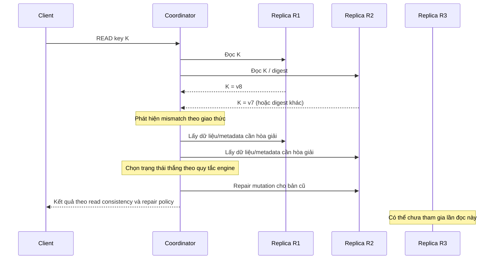
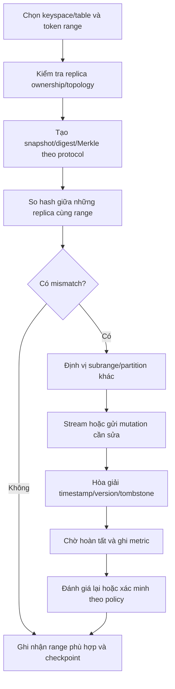
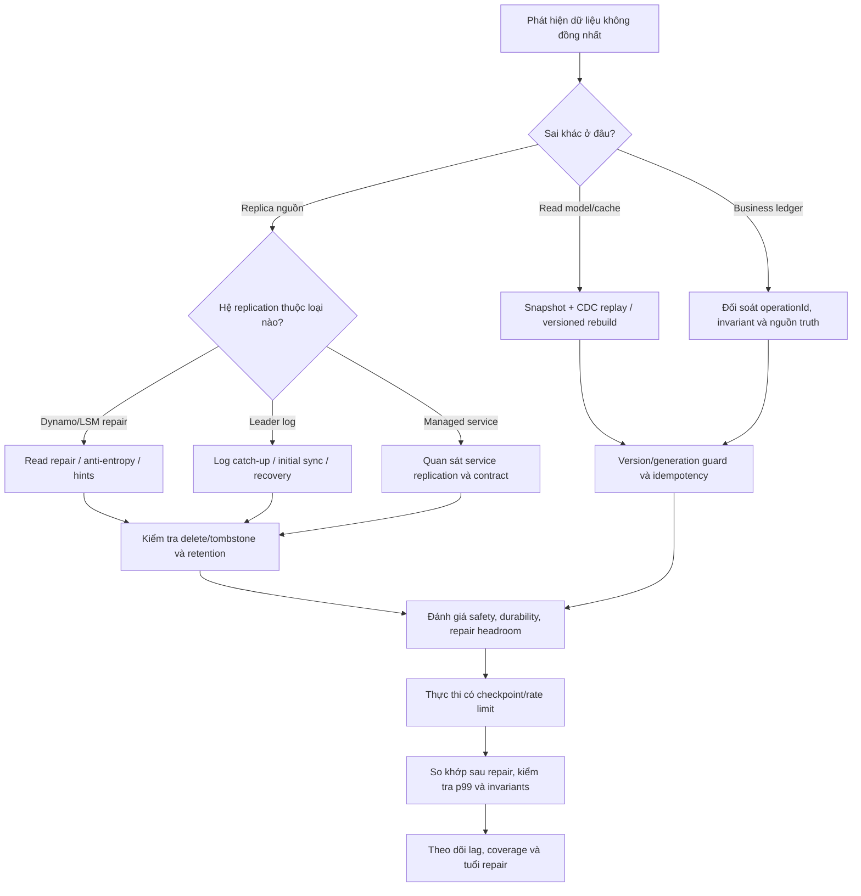

# Read repair, anti-entropy hoặc cơ chế đối soát tương ứng theo từng hệ

Trong một cơ sở dữ liệu NoSQL phân tán, cùng một bản ghi có thể nằm trên nhiều replica để hệ thống chịu được sự cố node, tăng khả năng đọc và phục vụ nhiều vùng địa lý. Nhưng **sao chép không đồng nghĩa mọi bản sao luôn giống nhau ở mọi thời điểm**. Một replica có thể tạm ngừng hoạt động, mạng có thể bị chia cắt, thông điệp ghi có thể đến muộn, và các bản sao có thể chứa những phiên bản khác nhau của cùng một key.

Giả sử đơn hàng `O-100` có trạng thái mới nhất `PAID` trên hai replica nhưng vẫn là `PENDING` trên replica thứ ba. Khi ứng dụng đọc từ replica cũ, nó có thể thấy dữ liệu lỗi thời. Ngay cả khi hệ thống đã hoạt động trở lại, chỉ chờ thụ động không phải lúc nào cũng bảo đảm toàn bộ dữ liệu tự hội tụ, nhất là với các key ít được truy cập, thao tác xóa, snapshot kéo dài hoặc lỗi truyền thông tồn tại lâu.

Ba nhóm cơ chế thường được nhắc đến là:

- **Read repair:** phát hiện sự khác biệt giữa những bản sao khi xử lý một lần đọc và đồng bộ bản sao lỗi thời theo giao thức của hệ.
- **Anti-entropy repair:** chủ động so sánh những phạm vi dữ liệu giữa replica để tìm và sửa sai lệch, không phụ thuộc một key có đang được đọc hay không.
- **Đối soát tương ứng (reconciliation/resynchronization):** những cơ chế khác theo sản phẩm hoặc tầng ứng dụng, như sao chép log, initial/full resync, rollback/recovery, replay event, CDC backfill và so khớp dữ liệu nghiệp vụ.

Bài học thuộc **Database No SQL → Sao chép và quorum**. Mục tiêu là hiểu **điều gì được phát hiện, điều gì được sửa, ai quyết định phiên bản hợp lệ, sửa khi nào và chi phí ra sao**. Đặc biệt, **quorum không tự thay thế anti-entropy**; **read repair không tự chữa mọi key**; và **đồng bộ bản sao storage không đồng nghĩa mọi invariant nghiệp vụ đã đúng**.

> Cần phân biệt rõ sản phẩm và phiên bản. Cassandra, ScyllaDB, Riak, MongoDB, DynamoDB, Redis, Couchbase và search engine không dùng chung một giao thức repair. Các lệnh vận hành dưới đây là ví dụ có điều kiện, không phải runbook để chạy trên production mà không kiểm tra phiên bản, topology, tải và quy trình phê duyệt.

## 1. Vì sao các replica có thể lệch nhau?

Giả sử replication factor là 3:

```text
             Coordinator
              /   |   \
             /    |    \
           R1     R2    R3

Ban đầu:
    R1: order O-100 = PENDING
    R2: order O-100 = PENDING
    R3: order O-100 = PENDING
```

Client cập nhật:

```text
UPDATE O-100 SET status = PAID
```

Trong lúc đó R3 mất kết nối:

```text
R1: PAID
R2: PAID
R3: PENDING  <- chưa nhận cập nhật
```

Đây là **replica divergence**: các bản sao không cùng biểu diễn trạng thái một thực thể hoặc một phạm vi dữ liệu.

Nguồn gốc có thể gồm:

1. **Node tạm offline** nên bỏ lỡ write.
2. **Network partition** khiến thông điệp sao chép không đến.
3. **Replication lag** trong kiến trúc sao chép bất đồng bộ.
4. **Write được ACK ở một số replica** trong khi những replica khác chưa cập nhật.
5. **Node mới bootstrap/restore** từ snapshot cũ.
6. **Concurrent writes** tại nhiều vùng và cơ chế giải quyết conflict.
7. **TTL/delete/tombstone** có thời điểm nhận khác nhau.
8. **Repair bị backlog**, bị hủy hoặc không được chạy trên đủ phạm vi.
9. **CDC/event consumer** bỏ lỡ hoặc xử lý sai thứ tự event.
10. **Materialized read model** cập nhật sau nguồn theo pipeline riêng.

Không phải mọi sai khác là lỗi: hệ eventual consistency cho phép **độ lệch tạm thời trong một phạm vi đã công bố**. Nhưng hệ phải có cơ chế để hội tụ theo bảo đảm của nó, và không được dùng bản sao cũ cho một quyết định cần dữ liệu có thẩm quyền.

## 2. Bốn khái niệm dễ bị nhầm

| Cơ chế | Kích hoạt | Phạm vi được xem xét | Vai trò điển hình |
| --- | --- | --- | --- |
| **Read repair** | Một thao tác đọc phát hiện mismatch | Những key/partition và replica liên quan lần đọc | Sửa bản cũ khi có traffic đọc |
| **Anti-entropy** | Lịch vận hành, tác vụ nền hoặc repair chủ động | Token range, partition range, file/chunk hay tập dữ liệu | Tìm mismatch kể cả dữ liệu “lạnh” không được đọc |
| **Hinted handoff / delayed delivery** | Một ghi không giao tới replica đích ở thời điểm ghi | Những mutation đã được giữ tạm theo chính sách | Chuyển các write bị bỏ lỡ khi replica quay lại |
| **Log replay / catch-up** | Replica hoặc projection bị tụt lại | Chuỗi sự kiện/oplog/WAL/replication log | Phát lại các thay đổi chưa áp dụng |

Bốn cơ chế có thể cùng tồn tại nhưng **không hoán đổi cho nhau**.

Ví dụ hinted handoff có thể giúp một replica nhận write bị bỏ lỡ trong khoảng retention, nhưng không chứng minh tất cả key đã hội tụ. Read repair có thể sửa một key đang được đọc, nhưng để nguyên hàng triệu key không có người truy vấn. Anti-entropy có thể tìm các phạm vi sai khác, nhưng cần quy tắc conflict resolution để quyết định trạng thái hợp lệ.

## 3. Replica đúng là replica nào?

Câu trả lời **không phải luôn là “giá trị có version lớn nhất”** nếu database chưa định nghĩa version đó làm cơ sở hòa giải.

Những mô hình phổ biến:

- **Leader-based replication:** leader/commit log và thứ tự các entry quyết định trạng thái có thẩm quyền; follower bắt kịp log hoặc đồng bộ lại.
- **Dynamo-style replication:** nhiều bản sao có thể nhận write, dữ liệu được hòa giải theo timestamp/version vector/siblings hoặc policy cụ thể.
- **Cassandra-family LSM:** các cell/row mutation được hòa giải theo quy tắc timestamp và tombstone của storage engine, cùng các semantics riêng.
- **Application projection:** nguồn nghiệp vụ có thể dùng event sequence/aggregate revision để quyết định bản mới, không phải timestamp của consumer.
- **Active-active multi-region:** hai thao tác đồng thời có thể đều được nhận cục bộ; cần quy tắc conflict resolution hoặc invariant bảo vệ riêng.

Một trường ứng dụng như:

```json
{
  "status": "PAID",
  "version": 8
}
```

không tự làm cho mọi replica chọn đúng bản ghi khi sửa. Cần biết **version này có được giao thức sao chép dùng để hòa giải hay không**. Nếu nó chỉ là OCC counter của ứng dụng, engine có thể dùng metadata khác để quyết định bản nào thắng.

## 4. Read repair hoạt động như thế nào?

Trong một mô hình sao chép kiểu Dynamo/Cassandra, coordinator có thể liên hệ nhiều replica trong quá trình đọc. Khi phát hiện dữ liệu không khớp, nó có thể gửi thông tin sửa tới bản sao lỗi thời theo chính sách.



Sơ đồ là **mô hình khái niệm**, không quy định mọi hệ đều đọc full data hay gửi repair trước khi trả response. Có hệ dùng digest, có hệ đọc nhiều replica, có tùy chọn **blocking** hoặc chính sách khác; phạm vi sửa có thể chỉ là những replica liên quan tới truy vấn.

### Read repair giải quyết hai việc khác nhau

1. **Đọc kết quả hợp lệ cho request hiện tại** theo giao thức và consistency level.
2. **Sửa bản sao đã lệch** để những lần đọc tiếp theo ít gặp chênh lệch hơn.

Đọc đúng ở bước 1 **không chứng minh** toàn bộ replica đã được sửa ở bước 2, nhất là khi còn replica không được liên hệ.

## 5. Read repair không phải mọi lần đọc đều đối chiếu toàn bộ replica

Giả sử ba replica:

```text
R1: K = v8
R2: K = v8
R3: K = v7
```

Một read chỉ liên hệ R1 và R2 có thể thấy hai bản giống nhau, trả v8 và **không phát hiện R3 đang cũ**.

Khi một ứng dụng chỉ đọc từ một replica (`ONE` trong một số mô hình), nó có thể nhận v7 nếu chọn R3. Khi đọc ở mức khác, coordinator có thể liên hệ thêm bản sao, nhưng thuật toán, speculative request, topology, digest response và semantics trả kết quả phụ thuộc sản phẩm.

Vì vậy:

- Read repair **phụ thuộc có read traffic**.
- Không nhất thiết kiểm tra mọi replica mỗi lần.
- Không tự bảo đảm hội tụ cho dữ liệu ít truy cập.
- Có thể làm tăng **read latency** khi phát hiện mismatch.
- Thường cần **anti-entropy định kỳ** hoặc cơ chế catch-up khác để dọn các sai lệch tồn tại lâu.

Không dùng “ứng dụng đọc nhiều nên chắc dữ liệu đã được repair hết” làm điều kiện vận hành.

## 6. Read consistency level và read repair có quan hệ gì?

Giả sử replication factor \(N=3\). Trong một số hệ, đọc quorum có thể yêu cầu phản hồi từ ít nhất hai replica; ghi quorum cũng có thể cần ít nhất hai replica xác nhận.

Nguyên tắc giao nhau:

\[
R + W > N
\]

với \(R\) là số replica trong read quorum, \(W\) là số replica trong write quorum, \(N\) là tập replica liên quan.

Ví dụ \(R=2, W=2, N=3\) khiến hai tập quorum bất kỳ có ít nhất một replica chung **nếu các giả định về membership và quorum được đáp ứng**.

Nhưng đây **không phải công thức đủ để tuyên bố toàn hệ linearizable**. Cần xét:

- Read/write có dùng cùng tập replica và cùng replica membership không?
- Concurrent writes giải quyết theo timestamp/term/consensus nào?
- Write ACK có nghĩa đã commit bền vững theo protocol chưa?
- Read có đọc được trạng thái mới nhất từ giao điểm quorum không?
- Các mức đọc/ghi hỗn hợp có tạo history nhất quán không?
- Có sloppy quorum, hinted handoff, failover hoặc stale leader không?
- Một nghiệp vụ cần cập nhật nhiều key có được transaction bảo vệ không?

**Quorum quyết định điều kiện thành công của thao tác; repair xử lý dữ liệu replica còn lệch.** Hai khái niệm bổ sung nhau nhưng không thay nhau.

## 7. Digest giúp phát hiện lệch mà không luôn chuyển toàn bộ dữ liệu

Một replica có thể trả **hash/digest** đại diện cho dữ liệu/phiên bản được yêu cầu thay vì chuyển nguyên payload.

Ví dụ:

```text
R1: K = {status: "PAID", timestamp: t8}
    digest = A7...

R2: K = {status: "PENDING", timestamp: t7}
    digest = B2...

A7 != B2 -> có mismatch cần điều tra/hòa giải.
```

Digest giúp giảm chi phí mạng trong trường hợp dữ liệu nhất quán. Nếu digest khác, coordinator có thể đọc thêm dữ liệu từ replica liên quan rồi gửi mutation sửa.

Các điểm cần lưu ý:

- Digest so sánh **cách biểu diễn dữ liệu phù hợp giao thức**, không phải hash JSON tùy tiện.
- Cần nhất quán về canonical encoding, timestamp, tombstone và version.
- Hash collision lý thuyết vẫn có thể xảy ra, nên digest là công cụ xác suất mạnh, không chứng minh toán học dữ liệu hoàn toàn giống.
- Đọc thêm sau mismatch có thể làm tăng p95/p99.
- Không dùng digest ứng dụng để ghi đè storage replica ngoài giao thức của database.

## 8. Blocking read repair và đánh đổi độ trễ

Một số cơ chế read repair có thể yêu cầu sửa đủ những replica liên quan trước khi thao tác đọc hoàn tất theo chính sách. Điều này giúp bảo vệ một số thuộc tính quan sát giữa các lần đọc, nhưng đồng nghĩa read có thể chờ thêm network/write acknowledgment.

Ví dụ:

```text
Read bình thường:
    lấy response nhất quán -> trả client.

Read gặp mismatch:
    đọc thêm phiên bản liên quan;
    hòa giải;
    gửi mutation sửa;
    chờ điều kiện repair theo policy;
    mới trả client.
```

Tác động có thể gồm:

- **Latency tail:** những key lệch cần nhiều round trip.
- **I/O:** read repair là ghi phát sinh từ một request đọc.
- **Read amplification:** đọc thêm nhiều replica/metadata.
- **Retry/timeout:** nếu replica cần repair chậm, request có thể vượt deadline.
- **Monotonicity và atomicity ở phạm vi đọc:** chính sách repair có thể ảnh hưởng những thuộc tính này theo sản phẩm.

Không phải lúc nào trả nhanh sau khi xác định giá trị mới nhất cũng có cùng bảo đảm với **chờ repair hoàn thành**. Phải đọc đúng hợp đồng của phiên bản engine.

## 9. Cassandra: read repair theo bảng và phiên bản

Apache Cassandra là một ví dụ điển hình của họ hệ có **quorum read**, **replica reconciliation**, **hints** và **anti-entropy repair**.

Trong các phiên bản Cassandra hiện đại có tùy chọn bảng như:

```sql
ALTER TABLE shop.order_state
WITH read_repair = 'BLOCKING';
```

hoặc:

```sql
ALTER TABLE shop.order_state
WITH read_repair = 'NONE';
```

**Lưu ý:** các tùy chọn, default và ý nghĩa cụ thể **phụ thuộc phiên bản**. Không chạy lệnh chỉ vì một bài học; cần kiểm tra version đang dùng, trạng thái table, workload và tài liệu tương ứng. Một số phiên bản cũ có cơ chế background read repair với cấu hình khác.

Trong mô hình được hỗ trợ, tùy chọn `BLOCKING` có thể ưu tiên những thuộc tính như **monotonic quorum reads** khi repair được yêu cầu; `NONE` tránh repair bằng lệnh đọc theo kiểu đó nhưng có thể thay đổi những bảo đảm quan sát cụ thể.

Một đánh đổi tinh tế: nếu một write thay đổi nhiều row trong cùng partition nhưng read chỉ truy cập một tập con, read repair có thể sửa phần dữ liệu được đọc mà **không sửa đồng thời cả nhóm row**, ảnh hưởng thuộc tính **partition-level write atomicity** mà một số workload mong muốn. Không đánh giá cấu hình repair chỉ dựa trên một key.

### Không gọi mọi lệnh đọc là repair

Read path của Cassandra có thể sử dụng digest comparison, reconciliation và repair theo CL/config/query. Một read không mismatch hoặc không liên hệ replica lỗi thời không sửa gì. Điều này khác một phiên repair chủ động toàn token range.

## 10. Ví dụ CQL về version ứng dụng và replica repair

Bảng minh họa:

```sql
CREATE KEYSPACE shop
WITH replication = {
  'class': 'NetworkTopologyStrategy',
  'dc1': 3
};

CREATE TABLE shop.order_state (
    tenant_id text,
    order_id text,
    status text,
    version bigint,
    updated_at timestamp,
    PRIMARY KEY ((tenant_id, order_id))
);
```

Lệnh tạo schema **chỉ để minh họa**, cần thay tên datacenter theo topology thật. Dữ liệu mẫu:

```sql
INSERT INTO shop.order_state (
    tenant_id, order_id, status, version, updated_at
) VALUES (
    'T1', 'O-100', 'PAID', 8,
    '2026-11-14 08:30:00+0000'
);
```

Trong `cqlsh`, có thể chọn mức consistency:

```sql
CONSISTENCY QUORUM;

SELECT status, version
FROM shop.order_state
WHERE tenant_id = 'T1'
  AND order_id = 'O-100';
```

Đây là **truy vấn đọc theo consistency level**, không phải lệnh buộc sửa toàn bộ replica. Một số bản sao có thể được read-repaired tùy điều kiện; những token range/key chưa được đọc vẫn cần quy trình repair riêng.

**Quan trọng:** field `version` trong bảng là **metadata ứng dụng**. Replica conflict resolution của Cassandra không mặc định lấy giá trị lớn nhất của field `version` làm toàn bộ thứ tự thắng. Storage engine dùng timestamp/tombstone và rules của mutation; nếu ứng dụng cần CAS theo version, phải chọn đúng LWT/conditional semantics.

## 11. Anti-entropy là gì?

**Anti-entropy** là quá trình các replica chủ động đối chiếu dữ liệu và làm giảm sai khác trong khi không phải đợi request đọc chính xác key đó.

Mục tiêu:

```text
Replica A: nhiều triệu partition.
Replica B: nhiều triệu partition.

Tìm:
    partition nào thiếu;
    partition nào có phiên bản cũ;
    partition nào khác tombstone;
    vùng dữ liệu nào không đồng bộ.

Sau đó:
    truyền phần mutation/data cần thiết,
    hòa giải theo semantics engine,
    xác minh tiến độ và trạng thái repair.
```

Anti-entropy thường chạy theo **phạm vi**, ví dụ token ranges hoặc key ranges, chứ không scan full payload của mọi bản ghi rồi truyền toàn bộ trong mọi trường hợp.

Nó phù hợp để sửa dữ liệu **lạnh**: một key bị bỏ lỡ update nhiều tháng nhưng không ai đọc thì read repair không có cơ hội phát hiện; anti-entropy có thể tìm sai khác khi đến lượt phạm vi đó được đối chiếu.

## 12. Anti-entropy thường dùng Merkle tree như thế nào?

**Merkle tree** là cây hash dùng để so sánh tập dữ liệu theo phân vùng. Node lá đại diện cho hash của một nhóm dữ liệu; node cha gộp hash của các con.

Ví dụ:

```text
Replica A                          Replica B

         H(root)                           H(root)'
        /      \                          /       \
      H01      H23                       H01      H23'
     /  \     /  \                      /  \     /   \
   H0   H1  H2   H3                   H0   H1  H2'   H3

A và B giống ở nhánh H01.
Nhánh H23 khác -> cần đối chiếu sâu vùng này.
```

Nếu hai nhánh có digest giống nhau theo cùng snapshot/encoding, hệ có thể tránh truyền toàn bộ dữ liệu của nhánh đó. Khi khác, nó đi xuống nhánh con để định vị vùng dữ liệu cần streaming/sửa.

### Merkle tree không “chọn bản đúng” hộ ứng dụng

Cây hash trả lời “**hai tập dữ liệu có giống nhau theo cách hash đang dùng không?**” chứ không tự trả lời “**mutation nào hợp lệ về nghiệp vụ?**”.

Sau phát hiện vẫn cần:

1. Đọc dữ liệu/metadata liên quan.
2. Áp dụng quy tắc hòa giải version/timestamp/tombstone.
3. Gửi mutation hoặc stream range cần thiết.
4. Xác định thành công/thất bại và checkpoint.

Cũng cần kiểm soát snapshot/time window khi xây cây. Nếu mỗi replica thay đổi liên tục trong lúc hash được tính mà protocol không bảo đảm tính nhất quán cần thiết, mismatch có thể bao gồm khác biệt tạm thời không phản ánh lỗi tồn tại lâu.

## 13. Quy trình anti-entropy theo token range

Một quy trình khái niệm:



Phần thực tế có thể khác: một số engine streaming tập file, một số dùng row-level repair, có cơ chế incremental metadata hoặc anti-entropy theo log. Đừng lấy sơ đồ làm mô tả nội bộ chính xác của một nhà cung cấp.

### Vì sao chia theo range?

Nếu table có hàng tỷ row, việc so toàn bộ một lượt có thể gây tải I/O, CPU và network quá lớn. Repair theo range cho phép:

- Chia tiến độ theo token/partition ownership.
- Giới hạn concurrency.
- Retry phạm vi thất bại thay vì làm lại toàn bộ.
- Lập lịch ngoài giờ đỉnh.
- Theo dõi range nào còn chưa đối chiếu.
- Điều phối khi thay đổi topology.

## 14. Full repair và incremental repair

Trong các hệ hỗ trợ, có thể phân biệt:

**Full repair:** đối chiếu toàn bộ dữ liệu thuộc phạm vi được chọn theo protocol, không dựa vào giả định một phần dữ liệu đã được đánh dấu repaired.

**Incremental repair:** sử dụng trạng thái/metadata về những phần đã repair để giảm lượng công việc phải lặp lại theo chính sách.

Đánh đổi:

| Tiêu chí | Full repair | Incremental repair |
| --- | --- | --- |
| Phạm vi | Rộng theo tập/range được yêu cầu | Tập dữ liệu chưa được repair theo metadata |
| Tài nguyên | Có thể cao | Có thể tiết kiệm hơn trong steady-state |
| Trạng thái điều phối | Đơn giản hơn về ý tưởng, vẫn tốn tài nguyên | Phụ thuộc repaired status/checkpoint |
| Khi metadata hỏng/thiếu | Có thể là công cụ phục hồi theo hướng dẫn engine | Cần xét độ tin cậy của trạng thái cũ |
| Lịch định kỳ | Tùy quy mô và SLA | Tùy phiên bản và hệ |
| Rủi ro vận hành | Disk/network spike | Metadata/backlog và edge case |

Cú pháp và trạng thái repair khác nhau giữa Cassandra/ScyllaDB và các phiên bản. Không mặc định **incremental repair luôn rẻ hơn hoặc phù hợp hơn** cho mọi workload.

## 15. Hinted handoff: hỗ trợ giao write trễ, không thay repair

Giả sử R3 tạm offline khi coordinator xử lý write:

```text
Client -> Coordinator -> R1: applied
                      -> R2: applied
                      -> R3: unavailable
```

Một hệ có hinted handoff có thể ghi giữ một **hint** về mutation cần chuyển tới R3:

```text
T1: WRITE K=v8
T2: R3 offline
T3: Hint được giữ ở node phù hợp
T4: R3 online trở lại
T5: Hint được gửi để R3 áp mutation
```

Tính năng này giúp giảm thời gian dữ liệu lệch trong những outage ngắn, nhưng không đủ vì:

- Hint có thời hạn lưu và giới hạn tài nguyên.
- Node giữ hint cũng có thể lỗi.
- Một phần write có thể không tạo hint theo policy.
- Replica offline lâu hơn retention sẽ bỏ lỡ hint.
- Topology thay đổi làm việc giao lại phức tạp.
- Hint không phải phép so sánh đầy đủ mọi key với tất cả replica.
- Tombstone/TTL và conflict semantics vẫn cần xử lý.

**Hinted handoff ≠ anti-entropy repair.** Thiết kế vận hành cần repair định kỳ theo bảo đảm sản phẩm ngay cả khi hint delivery nhìn có vẻ tốt.

## 16. Catch-up bằng log khác Merkle-based repair

Một họ cơ chế khác bắt đầu từ **log có thứ tự**:

```text
Leader:
    log index 100 -> PUT K=v7
    log index 101 -> PUT K=v8
    log index 102 -> DELETE M

Follower:
    lastApplied = 100

Catch-up:
    nhận 101 và 102;
    áp theo thứ tự và xác minh checkpoint.
```

Nếu follower bị tụt lại nhưng log entries 101–102 vẫn được giữ, replay có thể đủ để bắt kịp. Nếu follower tụt quá xa và log đã bị truncation/retention, hệ có thể cần **snapshot/full sync**, sau đó tiếp tục replay từ một offset tương thích.

| Cơ chế | Dựa trên | Phù hợp |
| --- | --- | --- |
| Merkle anti-entropy | So sánh trạng thái/range | Phát hiện sai khác khi không chắc event nào bị mất |
| Ordered log replay | Offset/sequence/term | Follower bắt kịp những thay đổi chưa áp dụng |
| Snapshot + log catch-up | Ảnh chụp tại mốc + phần log sau mốc | Replica mới/replica quá cũ |
| CDC backfill | Snapshot nguồn + change stream/offset | Xây lại read model/index phụ |
| Periodic business reconciliation | Bất biến, ledger, source-of-truth | Tìm sai nghiệp vụ mà storage replication không thấy |

Một hệ có thể dùng nhiều cơ chế khác nhau ở các tầng. Không gọi mọi hình thức copy dữ liệu là read repair.

## 17. Tombstone: thông tin xóa cũng phải được sao chép

Giả sử ban đầu:

```text
R1: K = value
R2: K = value
R3: K = value
```

Client xóa K khi R3 offline:

```text
R1: K = TOMBSTONE(delete at t9)
R2: K = TOMBSTONE(delete at t9)
R3: K = value cũ
```

Nếu một hệ chỉ xóa **giá trị cũ** khỏi R1/R2 mà không bảo toàn đủ thông tin rằng K đã bị xóa, sau khi R3 quay lại nó có thể khiến K **xuất hiện trở lại**.

Do đó anti-entropy không chỉ so những row còn sống. Nó phải xét **delete markers/tombstones** và những quy tắc lưu giữ của engine để tránh resurrection.

### Vì sao “xóa vật lý càng sớm càng tốt” có thể nguy hiểm?

Một tombstone có thể phải được giữ cho tới khi các replica liên quan đã có cơ hội biết việc xóa theo giao thức. Nếu tombstone bị dọn quá sớm, replica lâu offline vẫn giữ giá trị cũ; quá trình repair sau đó có thể không còn đủ bằng chứng để phân biệt giá trị cũ với dữ liệu hợp lệ.

Không giảm retention tombstone chỉ để giải phóng đĩa khi chưa kiểm tra repair/replication/failure semantics.

## 18. Cassandra: gc_grace_seconds và repair cadence

Trong Cassandra, cơ chế như `gc_grace_seconds` liên quan tới khoảng thời gian tombstone phải được giữ theo điều kiện trước khi có thể được dọn trong quá trình compaction.

Khái niệm vận hành:

```text
T0: DELETE K được ghi, tombstone xuất hiện.
T1: Một replica vẫn offline và bỏ lỡ DELETE.
T2: Tombstone đủ tuổi để được xem xét purge.
T3: Replica offline trở lại.
```

Nếu không có repair và điều kiện an toàn phù hợp trước khi tombstone bị purge, K có nguy cơ **resurrection** từ bản cũ.

Nguyên tắc cần nhớ:

- Lịch repair phải phù hợp với **tombstone grace, thời gian offline có thể xảy ra và vòng đời dữ liệu**.
- Không suy rằng chỉ chạy repair đúng một lần ngay trước hạn là luôn đủ trong mọi trường hợp.
- Cần biết những node/range đã repair thành công, không chỉ job đã bắt đầu.
- Repair failure hoặc một partition dài phải được theo dõi và xử lý.
- Tùy sản phẩm/phiên bản có các ngoại lệ/tối ưu cleanup khác nhau; không sao chép một giá trị `gc_grace_seconds` tùy ý giữa các cluster.
- Nếu replica đã quá lâu không tham gia và không thể chứng minh an toàn, **rebuild/replace** có kiểm soát có thể cần thiết theo runbook.

**Read repair theo hot keys không thể thay lịch repair toàn bộ dữ liệu chứa tombstone.**

## 19. TTL, expiry và repair

Một key có TTL:

```text
K = "temporary"
TTL = 3600 seconds
```

Sau một giờ, key phải được xem là hết hạn theo semantics hệ. Nhưng dữ liệu vật lý có thể tiếp tục tồn tại trong file cho tới khi cleanup/compaction.

Phân biệt:

1. **Logical expiry:** API không còn được trả value như còn hiệu lực.
2. **Expiry marker/tombstone:** thông tin để các replica hòa giải giá trị cũ.
3. **Physical reclaim:** disk space được dọn sau khi an toàn.

TTL khác nhau giữa row/cell, clock skew, late writes và compaction policy có thể ảnh hưởng đến repair. Trong một số hệ, timestamp do client cung cấp hoặc TTL có thể tạo edge case khi so version và tombstone.

Không dùng “TTL đã hết” để suy rằng repair có thể bỏ qua mọi delete metadata, và không dùng việc disk chưa giảm ngay để kết luận TTL thất bại.

## 20. Timestamp conflict và đồng hồ lệch

Trong hệ sử dụng timestamp để hòa giải:

```text
Replica R1: K=v8, timestamp=100
Replica R2: K=v9, timestamp=99
```

Nếu rule là chọn mutation có timestamp lớn hơn, **v8 có thể thắng v9** mặc dù tên version ứng dụng cho thấy ngược lại. Ví dụ này nhấn mạnh: cùng một key có thể có **application version** và **storage timestamp** khác ngữ nghĩa.

Những rủi ro:

- Đồng hồ node/client lệch.
- Client gán timestamp trong quá khứ/tương lai.
- Two writes cùng timestamp cần tie-break.
- Mutation đến muộn nhưng timestamp lớn có thể thắng.
- Tombstone phải được hòa giải đúng ưu tiên.
- Một write được commit theo service A nhưng read model B dùng quy tắc conflict khác.

**Repair không sửa được lỗi do ứng dụng gán timestamp/authority sai**. Nó có thể khiến mọi replica hội tụ tới **cùng một trạng thái sai theo nghiệp vụ**, vì nó làm đúng quy tắc hòa giải của engine.

## 21. Compaction, repair và chi phí I/O

Repair và compaction là hai hoạt động khác nhau nhưng tương tác mạnh:

- **Repair:** tìm và sửa sai khác giữa replica.
- **Compaction:** gộp các file/phiên bản ở **một node** theo quy tắc storage.
- **Flush:** chuyển memtable thành file bền vững.
- **Cleanup:** loại dữ liệu thuộc range node không còn sở hữu theo topology.
- **Scrub/verify:** kiểm tra hoặc xử lý file theo công cụ sản phẩm; không mặc định là repair replica.

Trong LSM, repair có thể:

```text
Đọc SSTable/metadata
    -> tính digest/hash
    -> stream một số partition/range
    -> tạo dữ liệu/file mới
    -> kích hoạt compaction về sau
```

Do đó một phiên repair có thể làm tăng:

- CPU cho hashing và serialize.
- Disk reads trên nhiều file.
- Network traffic giữa các node/Region.
- Disk writes và temporary files.
- Compaction backlog.
- Tail latency của foreground reads/writes.

**“Repair thành công” chưa đủ** nếu job khiến p99 vượt SLO hoặc disk hết headroom. Cần điều tiết tài nguyên và chọn lịch phù hợp.

## 22. Cassandra: lệnh repair và ranh giới vận hành

Ví dụ cú pháp quen thuộc của `nodetool` trong những phiên bản Cassandra hỗ trợ:

```bash
nodetool repair -full shop order_state
```

Câu lệnh trên chỉ là **minh họa hình thức** cho full repair một keyspace/table. Không chạy trên production nếu chưa kiểm tra:

- Đúng sản phẩm và phiên bản? Cú pháp flag có còn phù hợp?
- Chạy trên node nào, repair phạm vi nào và có trùng phần việc với node khác không?
- Mức đồng thời, streaming và compaction headroom ra sao?
- Có cần repair tất cả datacenter hay chỉ một phạm vi?
- Có topology change/replace/bootstrapping đang diễn ra không?
- Repair state/incremental metadata hiện tại thế nào?
- Có đủ dung lượng tạm và tốc độ network?
- Có runbook rollback/recovery khi một job thất bại không?

Một quy trình vận hành cần **trạng thái hoàn tất theo range và replica**, không chỉ kiểm tra exit code của một lệnh shell. Nếu repair bị hủy giữa chừng, phải biết những phạm vi nào đã sửa xong và cách tiếp tục.

### Ví dụ không có nghĩa “tự repair sau mỗi GET”

`nodetool repair` là anti-entropy chủ động; khác với read repair do request query kích hoạt. Chúng có vòng đời, chi phí và độ phủ khác nhau.

## 23. ScyllaDB: cùng mục tiêu, cách vận hành có thể khác

ScyllaDB là hệ wide-column tương thích CQL ở nhiều điểm, có **replica reconciliation**, **repair** và những cơ chế điều phối/triển khai riêng. Họ tính năng như **row-level repair**, các dạng repair scheduling/automation và công cụ quản lý có thể khác Apache Cassandra.

Điều phải xác minh cho **đúng phiên bản đang dùng**:

- Read repair có được thực hiện theo chế độ mặc định hay tùy chọn nào?
- Có thể chạy repair qua `nodetool`, REST API hoặc công cụ quản lý cluster nào?
- Full/incremental/row-level repair được hỗ trợ và được khuyến nghị ra sao?
- Các task có được tự điều tiết theo shard/node load không?
- Repair và topology operations tương tác thế nào?
- Tombstone grace và cleanup dựa trên bảo đảm nào?
- Công cụ quản lý có retry, checkpoint và alert khi job lỗi không?

**Không sao chép nguyên cách cấu hình read_repair của Cassandra sang ScyllaDB** nếu chưa xác minh sản phẩm. Dù cùng CQL, implementation và operational guidance có thể khác rõ.

## 24. Riak KV: read repair, active anti-entropy và siblings

Riak KV thường được dùng khi giải thích **Dynamo-style replication**:

- Node có thể đọc nhiều replica rồi **read repair** khi dữ liệu không đồng nhất.
- **Active anti-entropy** có thể dựa trên cấu trúc hash/Merkle để xác định dữ liệu cần đồng bộ.
- Những write bị trễ có thể sử dụng cơ chế tương tự **hinted handoff** theo hệ.
- Khi có **concurrent updates**, một số cấu hình cho phép **siblings/version vector** để ứng dụng hoặc policy giải quyết xung đột.

Ví dụ:

```text
Replica A:
    shoppingCart = {apple}

Replica B:
    shoppingCart = {banana}

Hai thay đổi đồng thời:
    Không có một thứ tự duy nhất được quan sát chung.
```

Nếu hệ giữ cả hai phiên bản như siblings, ứng dụng có thể cần hòa giải thành `{apple, banana}` theo ngữ nghĩa giỏ hàng. Nhưng với cùng một địa chỉ giao hàng, union không đúng; phải có policy rõ.

Riak KV không phải lúc nào cũng tự hợp nhất đúng mọi datatype. Sử dụng datatype CRDT hoặc conflict resolution thích hợp mới quyết định **ý định nào được giữ**.

**Cẩn thận:** active anti-entropy có thể làm replica giống nhau sau khi một giá trị được chọn, nhưng **không chứng minh** mọi bất biến trên nhiều key đã đúng.

## 25. MongoDB: oplog replication và resync, không phải Cassandra read repair

MongoDB replica set chủ yếu sử dụng **replication oplog**, primary/secondary, initial sync và cơ chế rollback/recovery theo trạng thái replica set. Đây là mô hình khác Dynamo-style anti-entropy đọc nhiều replica.

Một secondary bình thường:

```text
Primary:
    op 100: update O-100 -> PAID
    op 101: create O-101

Secondary:
    applied through op 99

Catch-up:
    apply op 100, rồi op 101 theo cơ chế replication.
```

Nếu secondary tụt quá xa so với lượng log còn giữ, nó có thể cần **initial sync/resync** theo runbook. Khi một primary cũ đã nhận những thao tác không được bảo đảm giữ lại sau failover, cơ chế **rollback** có thể xử lý branch không thuộc lịch sử được chọn.

### Những gì không nên làm

- Không dùng truy vấn ứng dụng vào secondary rồi tự chép document từ primary sang secondary để “read repair” storage replica.
- Không coi **read preference: secondary** là strong read sau một write vừa commit.
- Không gọi **change streams** là giải pháp tự chữa replication nội bộ; chúng phục vụ consumer/read model ứng dụng.
- Không hiểu `mongod --repair` (nếu gặp trong tài liệu sản phẩm) là cơ chế anti-entropy giữa replica; các công cụ sửa file cục bộ và resync replica có mục đích khác.

### Khi cần đối soát bên ngoài

Nếu MongoDB là source of truth còn OpenSearch là read model, có thể dùng **snapshot/backfill + change streams + reconciliation** để sửa search index. Nhưng đây là **đối soát projection tầng ứng dụng**, không phải read repair của replica set.

## 26. DynamoDB: dịch vụ quản lý replica và cơ chế đối soát ở ứng dụng

DynamoDB cung cấp dịch vụ lưu trữ được quản lý. Người dùng thường **không có lệnh kiểu `nodetool repair`** để chạy Merkle tree/replica reconciliation trên cơ sở lưu trữ nội bộ.

Phân biệt ba phạm vi:

1. **Replica/storage nội bộ của dịch vụ:** được vận hành bởi nhà cung cấp, không có API read repair như Cassandra.
2. **Global tables/multi-Region:** replication và conflict resolution theo chế độ global table được sử dụng, có thể có độ trễ/hành vi xử lý ghi đồng thời; phải kiểm tra tài liệu phiên bản/chế độ cụ thể.
3. **Projection do ứng dụng duy trì:** GSI, Streams consumer, OpenSearch index, materialized summary; có thể cần backfill/replay/đối soát riêng.

### Một ví dụ global multi-Region

```text
Region A:
    profile.nickname = "An"

Region B:
    profile.nickname = "Anh"

Hai write xảy ra đồng thời khi các vùng mất kết nối.
```

Không được mặc định Global Tables giữ cả hai ý định. Nhiều chế độ có **last-writer-wins hoặc conflict-resolution policy cụ thể**; app cần xác định thế nào là kết quả hợp lệ, có cần operation log hoặc single-writer authority không.

### Streams và projection

Nếu consumer Streams cập nhật một bảng tổng hợp hoặc search index:

```text
DynamoDB source mutation
    -> DynamoDB Streams
    -> consumer
    -> projection
```

Consumer có thể gặp retry, duplicate processing, out-of-order giữa những key, retention hết hạn hoặc bỏ lỡ một đoạn khi downtime dài. Vì vậy projection cần idempotency, sequence/watermark thích hợp và **đối soát từ nguồn**. Không dùng Streams như bảo đảm “exactly once toàn hệ” nếu chưa thiết kế deduplication.

**GSI có replication semantics của service riêng**; không can thiệp trực tiếp vào từng replica GSI như một storage node Cassandra.

## 27. Redis: replication resynchronization, không tự đọc/sửa nhiều replica

Redis thường dùng mô hình primary/replica với replication asynchronous trong những cấu hình phổ biến. Replica bị mất kết nối có thể bắt kịp bằng **partial resynchronization** nếu đủ backlog/offset, hoặc cần **full synchronization**.

Ví dụ:

```text
Primary replication offset: 1200
Replica last received:     1100

Nếu backlog còn các thay đổi 1101..1200:
    có thể partial resync.

Nếu lịch sử cần thiết không còn:
    full resync/snapshot theo protocol.
```

Đây là **log/offset catch-up**, không phải kiểu read repair khi một GET so dữ liệu từ nhiều replica.

Lưu ý:

- Đọc từ replica có thể stale.
- ACK replication và persistence policy là các khía cạnh khác nhau.
- Failover có thể làm mất những write không được bảo đảm giữ lại theo cấu hình.
- Redis Cluster quản lý slot/migration khác với read repair của Cassandra.
- Redis Enterprise Active-Active (nếu dùng) có cơ chế CRDT/conflict semantics riêng; không áp ngược sang Redis OSS.

### Redis làm cache

Nếu Redis là cache của MongoDB/PostgreSQL/DynamoDB, cơ chế đối soát thường là:

```text
Source update
    -> invalidate/version cache
    -> cache miss reload
```

hoặc rebuild cache theo TTL. Không coi việc đọc một cache key rồi overwrite là sửa **replication ở source database**.

## 28. Couchbase: replication, DCP và XDCR

Couchbase dùng các cơ chế replication và data-change streaming theo kiến trúc sản phẩm, ví dụ **DCP** cho những luồng thay đổi và **XDCR** cho sao chép xuyên cluster/site trong các cấu hình hỗ trợ.

Điều cần phân biệt:

- Replica đồng bộ/catch-up bên trong cluster.
- Cross-datacenter replication có độ trễ và conflict resolution.
- Đường truy vấn qua index có thể có freshness semantics khác KV access.
- Rollback/recovery khi failover.
- Rebuild/index catch-up sau khi đứt kết nối.

Một ứng dụng chủ động cho hai datacenter cùng cập nhật một document phải đọc policy giải quyết conflict của đúng phiên bản/cấu hình; **“có XDCR” không đồng nghĩa hai update được merge đúng nghiệp vụ**. Không dùng một quan sát từ N1QL/index query để suy ra tất cả KV replica đã repaired.

## 29. Elasticsearch/OpenSearch: shard recovery khác read repair

Search engine có primary/replica shards, translog, sequence/operation metadata và cơ chế shard recovery riêng. Khi một shard replica tụt lại, hệ có thể bắt kịp hoặc copy lại dữ liệu theo khả năng và retention.

Nhưng:

- **Refresh** để document trở nên tìm kiếm được không phải anti-entropy repair giữa replica.
- **Replica recovery** khác sửa dữ liệu nguồn nghiệp vụ.
- **Reindex** xây lại index/search projection, không thay transaction repair trên database nguồn.
- **Cross-cluster replication** có độ trễ, vị trí checkpoint và giới hạn riêng.
- **Query count mismatch** có thể do refresh/indexing lag, filter mapping hoặc lỗi consumer, không chỉ do replica divergence.

Nếu OpenSearch được cập nhật từ DynamoDB/MongoDB qua CDC, cách đối soát đúng thường là **so nguồn–projection theo key/version**, có backfill và replay theo checkpoint, không phải cố điều chỉnh shard replicas thủ công.

## 30. Bảng đối chiếu theo từng hệ

| Hệ/kiểu hệ | Cơ chế hội tụ trọng tâm | Có “read repair” kiểu Dynamo/Cassandra? | Việc ứng dụng/vận hành cần chú ý |
| --- | --- | --- | --- |
| **Apache Cassandra** | Read repair, hints, anti-entropy repair, repair schedule | Có, theo phiên bản/cấu hình | CL, table option, tombstone grace, full/incremental repair |
| **ScyllaDB** | Replica reconciliation và repair/row-level repair theo tính năng | Có cơ chế tương ứng nhưng implementation riêng | Scylla version, manager, task schedule, I/O |
| **Riak KV** | Read repair, active anti-entropy, hints/siblings | Có theo thiết kế/config | Conflict siblings, version vectors, merge |
| **MongoDB replica set** | Oplog replay, initial sync, rollback/recovery | Không dùng cùng giao thức | Majority concerns, replica lag, resync |
| **DynamoDB** | Managed replication và global tables policy | Không có API repair replica kiểu nodetool | GSI/Streams/global table conflict, projection consistency |
| **Redis** | Replication offset, partial/full resync | Không trong mô hình primary/replica thông thường | Replica staleness, persistence, cache invalidation |
| **Couchbase** | Replica catch-up, DCP, XDCR, recovery | Không đồng nhất cơ chế Cassandra | Cross-site lag và conflict resolution |
| **Elasticsearch/OpenSearch** | Shard recovery, translog/sequence, index rebuild | Không theo nghĩa truy vấn GET sửa nhiều replica | Refresh vs recovery; source-projection reconciliation |

Bảng là bản đồ **khái niệm**; chi tiết phụ thuộc edition, version, topology và API. Những hệ mới có thể bổ sung hoặc đổi cơ chế repair theo thời gian. Khi thiết kế production, luôn xác nhận từ tài liệu kỹ thuật chính thức của đúng sản phẩm đang triển khai.

## 31. Hai tầng đối soát: storage replica và read model

Một ứng dụng NoSQL có thể có:

```text
[Authoritative orders database]
          |
          | CDC / Outbox events
          v
      [Event bus]
        /     \
       v       v
[Search index] [Daily revenue projection]
```

Storage engine có thể bảo đảm ba replica nguồn đã hội tụ, nhưng:

- Search index vẫn thiếu order mới.
- Revenue projection chưa xử lý payment event.
- Một consumer ghi lặp cùng event.
- Event đến muộn hơn snapshot backfill.
- Mapping field cũ làm search trả kết quả sai.

**Anti-entropy nội bộ database không tự sửa những cấu trúc ngoài database.** Ứng dụng cần **reconciliation riêng giữa source of truth và từng projection**.

Ngược lại, đọc lại dữ liệu từ search index rồi ghi đè source để “đồng bộ” có thể biến projection trễ thành authority sai.

## 32. Xác định source of truth trước khi đối soát

Một bảng quyền sở hữu dữ liệu:

| Dữ liệu | Nguồn có thẩm quyền | Projection/replica |
| --- | --- | --- |
| Trạng thái order | Order aggregate đã commit | Search index, dashboard |
| Tồn kho xác nhận | Inventory authority/ledger | Catalog availability cache |
| Số dư tiền | Ledger hoặc account transaction authority | Balance view |
| Thông tin hồ sơ | Profile store có OCC | Cache/search |
| Event lịch sử | Event log có retention và dedup | Analytics tables |
| Quyền truy cập | Auth/policy authority | Token claims/cache có TTL |

Nếu không xác định nguồn nào thắng, reconciliation có thể trở thành “hai hệ tự chép đè nhau” và tạo vòng lặp.

Cần trả lời:

1. Ai được phép tạo/đổi/xóa thực thể?
2. Version/sequence nào đại diện commit order?
3. Một bản ghi đã xóa có tombstone hoặc delete event không?
4. Cần rebuild projection tới thời điểm nào?
5. Khi nguồn và projection cùng bị cập nhật, có cơ chế ngăn dual-write drift không?

## 33. So nguồn–projection theo key và version

Giả sử authoritative order:

```json
{
  "orderId": "O-100",
  "status": "PAID",
  "aggregateRevision": 18,
  "deleted": false
}
```

Search projection:

```json
{
  "orderId": "O-100",
  "status": "PENDING",
  "sourceRevision": 17
}
```

Đối soát có thể kết luận projection đang chậm:

```text
Source revision = 18.
Projection sourceRevision = 17.
    -> cần đưa projection tới revision 18.
```

Nhưng **chỉ so số version là chưa đủ** nếu:

- Version không thuộc cùng entity/generation.
- Projection bị thiếu hẳn record.
- Source và projection dùng khác schema/transform.
- Revision đã reset sau delete/recreate.
- Một event bị bỏ lỡ nên projection có revision mới nhưng trường được tính sai.
- Thứ tự event không được bảo đảm trên cùng key.

Đối soát toàn diện có thể dùng **key diff, revision diff và content hash theo canonical representation**. Với dữ liệu tổng hợp, cần tính lại aggregate từ nguồn thích hợp thay vì chỉ so revision của một row.

## 34. Snapshot + CDC: cách xây lại read model mà không bỏ lỡ thay đổi

Một pipeline rebuild projection thường cần kết hợp **snapshot** và **change stream**.

Giả sử:

```text
Source liên tục nhận write.
Projection cần rebuild từ đầu.
```

Nếu chỉ scan source trong nhiều giờ rồi bật consumer từ “thời điểm hiện tại”, các write xảy ra giữa lúc bắt đầu scan và lúc bật stream có thể bị bỏ sót.

Một kế hoạch khái niệm:

1. Thiết lập **mốc log/checkpoint** hoặc cơ chế snapshot nhất quán theo API nguồn.
2. Bảo đảm có thể đọc toàn bộ event từ mốc tương thích đó.
3. Quét và xuất **snapshot nguồn**.
4. Nạp snapshot vào projection mới một cách idempotent.
5. Replay những change event từ mốc đã chọn.
6. Giữ thứ tự cần thiết cho từng entity hoặc dùng revision guard.
7. Theo dõi lag cho tới khi projection bắt kịp.
8. So khớp key/hash/count theo phạm vi và kiểm tra business queries.
9. Chuyển alias/traffic sang projection mới có kiểm soát.
10. Giữ kế hoạch rollback khi phát hiện mapping hoặc transformer sai.

**Mốc snapshot và stream cần tương thích**. Không phải mọi database cung cấp cùng kiểu snapshot token hoặc retention. Nếu event log đã hết hạn trước khi replay kịp, phải rebuild/khôi phục theo phương án được hỗ trợ, không giả định chỉ tăng retry sẽ tái tạo được event đã mất.

## 35. Idempotency và xử lý event không đúng thứ tự

Consumer có thể nhận lại cùng event do retry hoặc redelivery:

```text
Event e18: Order O-100 changed to PAID at revision 18.
Event e18: redelivered.
```

Nếu consumer cứ **cộng doanh thu một lần mỗi lần nhận**, sẽ cộng trùng. Một thiết kế an toàn cần `eventId` hoặc `aggregateRevision` cùng thao tác ghi projection **nguyên tử**.

Ví dụ giả mã:

```text
applyProjection(event):
    atomic conditional operation:
        if eventId đã xử lý:
            return DUPLICATE

        if event.aggregateRevision <= storedRevision:
            return STALE_OR_DUPLICATE

        nếu event yêu cầu revision liên tục
           và event.revision != storedRevision + 1:
            return GAP_DETECTED

        tính trạng thái projection theo event
        update projection + storedRevision
        lưu dấu eventId nếu cần
        commit
```

Đặc biệt:

- Kiểm tra rồi ghi trong **hai thao tác rời rạc** có thể có race.
- “Version cao hơn” không đủ nếu một event trung gian chứa tác động cộng dồn bị bỏ.
- Snapshot event mang **trạng thái đầy đủ** có thể có policy nhảy revision khác một event chỉ mang delta.
- Key generation và tombstone phải được xét khi delete/recreate.
- Nhiều partition event bus có thể không cung cấp thứ tự toàn cục.

## 36. Java pseudocode: reconciler có điều kiện phiên bản

Ví dụ sau là **giả mã Java theo phong cách interface**, tập trung vào nguyên tắc; các class/repository không có sẵn để chạy ngay.

```java
public final class OrderProjectionReconciler {
    private final SourceOrders source;
    private final SearchProjection target;

    public OrderProjectionReconciler(
            SourceOrders source,
            SearchProjection target) {
        this.source = source;
        this.target = target;
    }

    public ReconcileResult reconcile(
            String tenantId,
            String orderId) {

        // Đọc từ authoritative source theo consistency phù hợp.
        SourceOrder authoritative =
                source.readCurrent(tenantId, orderId);

        // Phải phân biệt NOT_FOUND với DELETED và lỗi đọc tạm thời.
        if (authoritative == null) {
            return ReconcileResult.needsDeletionProof();
        }

        // Một thao tác nguyên tử ở projection:
        // Chỉ áp nếu revision/generation nguồn mới hơn
        // theo quy tắc được định nghĩa.
        return target.applyIfSourceNewer(
                authoritative.tenantId(),
                authoritative.orderId(),
                authoritative.generation(),
                authoritative.revision(),
                authoritative.isDeleted(),
                authoritative.toSearchDocument()
        );
    }
}
```

Các interface `SourceOrders`, `SearchProjection`, `SourceOrder` và `ReconcileResult` phải được triển khai theo sản phẩm thật. Hàm `applyIfSourceNewer` phải **kiểm tra revision và áp dụng một cách nguyên tử** trên projection; nếu chỉ `GET` rồi `PUT` không điều kiện thì một event mới có thể bị bản cũ ghi đè.

### Vì sao null nguy hiểm?

Nếu nguồn trả `null`, nguyên nhân có thể là:

- Bản ghi chưa từng tồn tại.
- Đã bị xóa.
- Quyền đọc không đủ.
- Read replica bị lag.
- Query bị lỗi hoặc timeout.
- Schema/migration làm lookup sai key.

Không được xóa target projection chỉ từ một `null` không xác định. Cần **delete marker/tombstone có nguồn**, hoặc hợp đồng source query đủ mạnh để chứng minh absence.

## 37. Reconciliation phải xử lý delete và recreate

Một chuỗi thao tác:

```text
Generation 3:
    O-100 revision 20 = ACTIVE.

Delete:
    O-100 generation 3, revision 21 = DELETED.

Recreate:
    O-100 generation 4, revision 1 = ACTIVE.
```

Nếu target chỉ so `revision`, bản cũ generation 3/revision 20 có thể được xem là “mới” hơn generation 4/revision 1 và ghi đè sai.

Cần một trật tự định nghĩa rõ, ví dụ:

```text
(entityId, generation, revision)
```

hoặc token opaque do source cấp, trong đó thứ tự chỉ được so theo contract.

Khi delete:

- Phát tombstone/delete event với identity và generation.
- Bảo đảm search/cache xóa record tương ứng.
- Giữ delete marker đủ lâu để xử lý event đến muộn.
- Chặn event cũ resurrect entity đã xóa.
- Nếu dùng TTL trong projection, xác định liệu TTL có thể xóa metadata chống replay quá sớm không.

**Đối soát có thể tái tạo dữ liệu đã xóa nếu không quản lý vòng đời và version đúng.**

## 38. Count/checksum chỉ là bước đầu, không đủ cho mọi lỗi

Một pipeline đối soát thường bắt đầu bằng:

```text
Source record count = 1.000.000
Projection count    = 1.000.000
```

Hai count bằng nhau **không chứng minh** hai tập key giống nhau. Có thể source thiếu key A nhưng projection lại có key B, và tổng vẫn bằng.

Tương tự, tổng tiền bằng nhau không chứng minh từng order đúng, vì một dòng thiếu 100 và một dòng thừa 100 có thể triệt tiêu.

Một chiến lược sâu hơn:

1. So tổng số record theo tenant/bucket.
2. So counts và checksums theo key range/time bucket.
3. Khoanh vùng mismatch.
4. So key sets.
5. So revision/generation/tombstone.
6. So canonical content nếu cần.
7. Repair có điều kiện, không ghi đè blind.
8. Xác minh sau sửa.

Hash/checksum cần cùng canonical format, cùng schema transform, cùng snapshot/window. Không được so output đang thay đổi ở hai thời điểm rồi kết luận mất dữ liệu.

## 39. Read repair có chi phí và rủi ro vận hành gì?

Read repair tạo thêm công việc **trong hoặc xung quanh read path**:

- Phát hiện digest mismatch.
- Truy xuất full data.
- Truyền thêm mutation.
- Ghi dữ liệu sửa tại replica.
- Có thể chờ acknowledgment.
- Thêm compaction work về sau trong engine LSM.

Một dashboard có thể thấy:

```text
Normal key:
    read latency = 3 ms.

Key có mismatch:
    read + fetch + repair = 25 ms.
```

Đây chỉ là số giả định minh họa. Điều quan trọng là **tỷ lệ mismatch** và **tail latency**, không phải hai giá trị cụ thể.

Khi hàng nghìn key lệch vì một replica offline lâu, nhiều read repair cùng xảy ra có thể tạo **repair storm**. Cần đo write load do foreground repair, giới hạn tài nguyên và có repair chủ động thay vì trông chờ client traffic tự chữa toàn bộ.

## 40. Anti-entropy cũng có thể làm hệ chậm đi

Một phiên anti-entropy toàn table có thể đọc hàng TB data và truyền nhiều GB khác biệt. Nếu chạy đồng thời với peak traffic:

```text
CPU hash/snapshot tăng
Disk read bandwidth gần bão hòa
Network streaming tăng
Compaction backlog tăng
Foreground read/write p99 tăng
```

Vì thế cần hoạch định:

- Repair windows/schedule.
- Token-range concurrency.
- Streaming bandwidth limits.
- Per-node CPU/IO budget.
- Disk free space và temporary outputs.
- Tách workload cross-DC nếu network đắt hoặc chậm.
- Ưu tiên những range có rủi ro tombstone/hints hết hạn.
- Pause/cancel/resume semantics khi quá tải.
- Monitoring tiến độ theo **range đã hoàn tất**.

Không nên “chạy repair tối đa mọi node cùng lúc” chỉ vì muốn kết thúc nhanh: nó có thể làm giảm khả năng phục vụ và kéo dài backlog.

## 41. Lập lịch repair dựa trên rủi ro, không chỉ cuối tuần

Các biến quan trọng:

| Yếu tố | Câu hỏi |
| --- | --- |
| **RF và topology** | Mỗi range có bao nhiêu replica, ở DC nào? |
| **Expected outage duration** | Replica có thể offline lâu bao nhiêu? |
| **Tombstone grace** | Mốc xóa nào cần được đảm bảo repair an toàn? |
| **Mutation rate** | Bao nhiêu write/delete/TTL mỗi ngày? |
| **Dataset size** | Một vòng repair toàn phạm vi cần bao nhiêu giờ? |
| **Repair throughput** | Streaming/CPU/IO thực tế chịu được bao nhiêu? |
| **Background load** | Compaction, backup, snapshot có cùng thời điểm? |
| **Hot/cold partitions** | Có nhiều key ít đọc và không được read repaired không? |
| **Network partitions** | Có thể bị tách Region/DC trong bao lâu? |
| **Operational coverage** | Có biết range nào chưa repair từ lâu không? |
| **Business loss tolerance** | Một missed delete hay stale order gây hậu quả gì? |

Lịch repair cần **hoàn thành đủ phạm vi trong hạn an toàn** được suy từ chính sách của engine, chứ không chỉ đặt cron “chạy mỗi 7 ngày” rồi mặc định tốt.

## 42. Khởi động lại node quá cũ: không chỉ chạy repair ngay

Một replica offline lâu ngày có thể bỏ lỡ:

- Hints đã hết retention.
- Các log cần replay.
- Tombstone đã bị purge ở những bản sao khác.
- Schema và topology changes.
- Những mutation không còn trong snapshot cũ.

Khôi phục node cũ vào cluster mà chưa đánh giá có thể dẫn tới dữ liệu không nhất quán hoặc resurrection.

Runbook nên:

1. Xác định **last healthy sync/repair** của node.
2. Kiểm tra thời gian offline, log/hint retention và tombstone grace.
3. Đánh giá node có đủ điều kiện **safe catch-up** không.
4. Nếu không, chọn **rebuild/replace/initial sync** theo hướng dẫn hệ.
5. Tránh cho node quá cũ phục vụ authoritative reads/writes trước khi an toàn.
6. Theo dõi bootstrap, streaming, compaction, repair state.
7. Xác minh sample keys, deleted keys và phạm vi dữ liệu.
8. Chỉ đưa traffic vào lại khi đáp ứng health/consistency checks.

**Không có một câu lệnh repair chung bảo đảm cứu được mọi replica đã offline quá lâu.**

## 43. Khi mọi replica cùng sai, repair không giúp được

Giả sử cả ba replica đều đã nhận:

```text
O-100.status = PAID
```

nhưng nghiệp vụ thực tế phải là `CANCELLED` vì một thanh toán bị hoàn tiền mà event đó chưa bao giờ được ghi vào source.

```text
R1: PAID
R2: PAID
R3: PAID
```

Read repair và anti-entropy thấy **các replica đã giống nhau**, nên không có mismatch để sửa. Dữ liệu vẫn sai theo business invariant.

Tương tự:

- Một script chạy sai cập nhật cùng nội dung trên mọi replica.
- Event nguồn bị bỏ lỡ trước khi vào database.
- Transaction đa đối tượng commit nửa chừng ngoài đúng protocol.
- Một LWW policy làm mất cập nhật có ý nghĩa.
- Payment gateway ghi nhận charge nhưng application DB không có operation record.

Cần **business-level reconciliation**, so khớp với ledger/event source/authority, chứ không phải thêm vòng Merkle repair.

## 44. Đối soát nghiệp vụ: ledger và dữ liệu thực tế

Ví dụ payment:

```text
Payment gateway:
    chargeId = CH-101
    status = SUCCEEDED

Application orders DB:
    orderId = O-100
    paymentStatus = PENDING
```

Nguồn có thẩm quyền về thanh toán có thể là gateway/ledger theo hợp đồng; đối soát cần:

1. Tra payment theo **idempotency key/chargeId**.
2. Xác minh amount, currency, merchant/tenant, order mapping.
3. Đối chiếu trạng thái đã commit và timestamp.
4. Ghi reconciliation result có audit.
5. Áp update có điều kiện/idempotent vào order state.
6. Phát event/outbox để projection bắt kịp.
7. Điều tra trường hợp không thể chứng minh trạng thái.
8. Không tự charge lại chỉ vì order DB đang PENDING.

Đây là **đối soát nghiệp vụ**, không phải read repair của một Cassandra partition. Cả hai đều “sửa lệch”, nhưng nguồn truth và quy tắc sửa hoàn toàn khác nhau.

## 45. Không ghi đè phiên bản mới trong lúc repair

Một race phổ biến ở tầng application reconciliation:

```text
T1: Reconciler đọc source O-100 revision 18.
T2: Một request khác ghi O-100 revision 19.
T3: Event revision 19 đã cập nhật projection.
T4: Reconciler ghi mù revision 18 lên projection.
```

Kết quả projection đi **lùi** từ revision 19 về 18.

Phải dùng điều kiện:

```text
Apply source snapshot revision 18
    ONLY IF target revision < 18
    AND generation phù hợp.
```

Thao tác so sánh và ghi phải nguyên tử theo database projection. Nếu revision bằng nhau nhưng content hash khác, không tự bỏ qua; cần xác minh mapping/transformation và xác định bước xử lý.

Tương tự, trong storage repair của engine, không được tự chép một replica ngẫu nhiên sang replica khác. Engine phải tuân thủ **quy tắc hòa giải và recovery** của nó.

## 46. Một dạng đối soát incremental bằng watermark

Đối với pipeline event, `watermark/checkpoint` biểu thị mức đã xử lý theo contract.

```text
Source stream partition P:
    offset 100 -> event A
    offset 101 -> event B
    offset 102 -> event C

Consumer:
    lastFullyAppliedOffset = 100
```

Khi nhận 101:

```text
Apply event B.
Commit projection mutation.
Checkpoint 101 theo protocol an toàn.
```

Nếu checkpoint được ghi **trước** khi projection commit, crash có thể khiến consumer bắt đầu lại từ 102 và bỏ event 101. Nếu projection commit trước nhưng checkpoint bị mất, event 101 có thể được replay; cần **idempotency**.

Điều này dẫn tới một nguyên tắc:

> Khi không có transaction nguyên tử giữa event checkpoint và target projection, hãy thiết kế replay chịu được xử lý trùng và có phát hiện gap.

Watermark không tự chứng minh toàn bộ projection đúng nội dung. Một bug trong transformer có thể khiến consumer checkpoint đến offset mới nhất nhưng target vẫn sai.

## 47. Khung metric để giám sát repair/hội tụ

```text
# Read path / mismatch
read_repair_attempts_total
read_repair_success_total
read_repair_failure_total
replica_digest_mismatches_total
read_latency_p95_p99
sstables_consulted_per_read
stale_read_observations_total

# Anti-entropy
repair_jobs_started_total
repair_jobs_completed_total
repair_jobs_failed_total
repair_ranges_completed
repair_ranges_overdue
repair_bytes_scanned
repair_bytes_streamed
repair_duration_seconds
repair_last_success_age_seconds
pending_repair_tasks

# Resource and retention
compaction_pending_bytes
disk_read_bytes_per_sec
disk_write_bytes_per_sec
network_replication_bytes_per_sec
disk_free_bytes
tombstone_age_distribution
hints_pending_and_expired

# Projection / application
source_projection_revision_lag
cdc_consumer_lag_seconds
projection_missing_keys
projection_stale_keys
delete_replay_conflicts
reconciliation_backlog
reconciliation_time_to_converge
duplicate_event_suppressed_total

# Business
ledger_mismatch_count
double_booking_violations
unknown_operation_outcomes
reconciliation_manual_review_count
```

Tên metric khác nhau theo engine, có thể không có sẵn. Những đại lượng như tombstone bytes hoặc stale read observations đôi khi chỉ có proxy/sampling. Không gán cho dashboard độ chính xác mà nguồn đo không cung cấp.

### Ba chỉ số đặc biệt quan trọng

- **Repair coverage:** phạm vi replica data đã được repair thành công so với tổng phạm vi cần repair.
- **Time since last successful repair:** tuổi của range/table chưa được đối chiếu thành công.
- **Convergence lag:** bao lâu một thay đổi nguồn xuất hiện đúng trên những replica/projection theo contract.

Chỉ đếm “repair jobs completed” chưa đủ nếu một job chỉ xử lý rất ít ranges.

## 48. Quản lý alert và mức độ nghiêm trọng

Ví dụ mức cảnh báo:

| Tín hiệu | Rủi ro | Ưu tiên xử lý |
| --- | --- | --- |
| Một read repair mismatch ngẫu nhiên | Độ lệch tạm thời có thể bình thường | Theo dõi xu hướng |
| Digest mismatch tăng đột biến sau outage | Replica bỏ lỡ nhiều write | Kiểm tra repair/backlog |
| Repair range quá hạn an toàn tombstone | Nguy cơ resurrection/deletion issue | Điều tra khẩn |
| Hints hết hạn, replica vẫn offline | Bỏ lỡ mutations | Lập kế hoạch repair/rebuild |
| Consumer CDC gần hết retention | Nguy cơ không thể replay gap | Ưu tiên catch-up/backfill |
| Projection count khác nguồn kéo dài | Dữ liệu tìm kiếm/báo cáo sai | Reconciliation và query impact |
| Delete đã quay lại sau repair | Có thể là correctness violation | Incident, chặn writes sai và khắc phục |
| Payment ledger mismatch | Rủi ro tài chính | Incident nghiệp vụ, đối soát có audit |
| Repair gây p99 vượt SLO | Tải nền quá lớn | Throttle/schedule, không bỏ repair vô hạn |

Ngưỡng và thời gian cụ thể phải theo retention, RPO/RTO, query SLO, business risk và tốc độ repair thực.

## 49. Benchmark read repair và anti-entropy

Một benchmark hợp lý cần tạo dữ liệu lệch **có kiểm soát** trong môi trường test.

### Chuẩn bị

```text
Replication factor: 3 (giả định).
Dataset: nhiều triệu keys.
Workload:
    70% point reads
    20% updates
    10% deletes/TTL
```

Tạo tình huống:

1. Cho R3 offline.
2. Tiếp tục ghi một tập key với consistency policy cho phép.
3. Đưa R3 online.
4. Đo **read repair trên các key được đọc**.
5. Đo **anti-entropy trên cả key không được đọc**.
6. Đo những delete/tombstone cần giữ.
7. Quan sát p95/p99 và resource cost khi repair.
8. So sample dữ liệu ở mọi replica sau khi hoàn tất theo công cụ hỗ trợ.

### So sánh

| Cấu hình thử | Điều quan sát |
| --- | --- |
| Chỉ traffic đọc thông thường | Hot keys được sửa tới đâu? Cold keys còn lệch? |
| Read repair theo policy đang dùng | Read latency, mismatch, write overhead |
| Anti-entropy throttled | Coverage, duration, foreground p99 |
| Anti-entropy quá aggressive (chỉ test) | CPU/network contention và write stalls |
| Hints được phát thành công | Bao nhiêu mutation catch-up? |
| Hints không còn retention | Repair có sửa được những key còn lệch? |
| Delete khi một replica offline lâu | Tombstone semantics và resurrection risk |
| Projection consumer bị dừng | Snapshot/CDC backfill có phục hồi đầy đủ? |

Không thay đổi ngẫu nhiên dữ liệu storage file của production để “tạo lệch”. Fault injection cần đúng công cụ được hỗ trợ, giới hạn blast radius và có backup/recovery.

## 50. Kiểm thử read repair với key được/không được đọc

Một test cơ bản:

```text
Given:
    R1: K1=v8, K2=v8
    R2: K1=v8, K2=v8
    R3: K1=v7, K2=v7

Action:
    Chạy READ K1 theo đường có thể phát hiện R3 cũ.
    Không bao giờ READ K2.

Expected conceptually:
    K1 có thể được read-repaired theo policy nếu R3 tham gia.
    K2 không tự được sửa chỉ bởi READ K1.
```

Sau đó chạy anti-entropy trên phạm vi có K2:

```text
Repair range containing K2.
```

Kỳ vọng những bản sao lệch được phát hiện và hội tụ theo engine protocol khi repair thành công.

**Lưu ý:** một engine cụ thể có thể đồng thời chạy background processes làm K2 bắt kịp trước khi test kết thúc. Cần kiểm soát các cơ chế nền để kết luận chính xác về read repair; đừng suy từ final state đơn thuần.

## 51. Kiểm thử deletion resurrection

Mô hình:

```text
T0: R1/R2/R3 đều có K=value.
T1: R3 offline.
T2: Delete K trên R1/R2 với policy phù hợp.
T3: Chờ theo kịch bản được phê duyệt.
T4: R3 quay lại.
T5: Repair/replay/catch-up.
```

Bài test cần bảo đảm:

- Một GET đúng contract không trả K còn sống sau delete đã được xác nhận theo kỳ vọng.
- Repair không làm resurrect K từ R3.
- Tombstone được giữ và dọn theo chính sách thực.
- Nếu R3 quá hạn an toàn, runbook chọn rebuild thay vì ghép dữ liệu cũ tùy tiện.
- Chỉ sau completion mới tuyên bố replica hội tụ.

Không khuyến khích rút ngắn `gc_grace_seconds` trên production để tạo test. Trên môi trường thử nghiệm, phải hiểu rõ cơ chế và không xem một kết quả đơn lẻ là chứng minh an toàn trong mọi tình huống.

## 52. Case study: sau outage, một số order còn trạng thái cũ

Bối cảnh:

```text
Cluster có 3 replica.
Một replica offline 2 giờ.
Trong thời gian đó:
    100.000 order chuyển PENDING -> PAID.
    2.000 order bị CANCELLED hoặc DELETED.
Replica cũ online lại.
```

Một ứng dụng phát hiện khi đọc một số đơn:

```text
R1: O-100 = PAID
R2: O-100 = PAID
R3: O-100 = PENDING
```

### Quy trình xử lý đúng tầng

**Bước 1 – Phân loại:** đây là replica divergence trong source database hay projection/search lag?

Nếu source read qua authoritative API đã đúng nhưng UI search trả PENDING, cần đối soát search projection. Nếu các replica source khác nhau, dùng cơ chế repair nội bộ được hỗ trợ.

**Bước 2 – Kiểm tra nguồn metadata:** node status, replication lag, hints, repair status, tombstone age, topology.

**Bước 3 – Đánh giá thời gian offline:** đủ điều kiện catch-up/repair hay đã vượt những giới hạn retention an toàn?

**Bước 4 – Chạy repair/resync có kiểm soát:** ưu tiên phạm vi ảnh hưởng, giới hạn I/O và theo dõi độ phủ.

**Bước 5 – Xác minh:** không chỉ một order PAID mà cả những order **CANCELLED/DELETED**, cùng những key không ai đọc.

**Bước 6 – Sửa projection nếu cần:** CDC replay hoặc snapshot/backfill với revision guard.

**Bước 7 – Đối soát nghiệp vụ:** nếu payment gateway nói charge thành công nhưng order authority không ghi, xử lý bằng operationId và ledger, không sửa trực tiếp replica.

**Bước 8 – Phòng ngừa:** lịch repair, alert khi replica offline lâu, retention, runbook recovery và load test.

Không nên phản ứng bằng “chạy read nhiều lần trên mọi order để tự chữa” vì điều đó tạo traffic lớn và không bảo đảm đúng phạm vi.

## 53. Runbook điều tra divergence an toàn

Một runbook thực tế nên có các bước:

1. **Xác định triệu chứng:** stale read, missing keys, duplicate state, delete resurrect hay read-model lag?
2. **Định vị tầng:** storage replica, external projection, cache, analytics hay business ledger?
3. **Ghi scope:** cluster, version, RF, DC, table, token range, operation IDs, thời gian sự cố.
4. **Đánh giá safety:** có API đang xác nhận dữ liệu sai không? Cần chặn/route/fail closed phần nào?
5. **Kiểm tra quorum/leader/consistency:** read/write CL, replication lag, hints và authority.
6. **Kiểm tra retention:** tombstone grace, CDC log, oplog, backlog, snapshot.
7. **Chọn cơ chế đúng:** read repair, scheduled anti-entropy, log catch-up, full resync, projection rebuild hoặc business reconciliation.
8. **Ước lượng resource:** disk headroom, CPU, network, streaming, compaction, foreground p99.
9. **Triển khai có giới hạn:** theo range/tenant và checkpoint.
10. **Quan sát sự hội tụ:** metrics theo key/range, mismatch và last success.
11. **Kiểm tra delete/TTL và invariant:** không chỉ dữ liệu sống.
12. **Báo cáo outcome:** repaired, pending, unknown, manual review, và những phần chưa kiểm chứng.
13. **Hậu kiểm:** vì sao replica bỏ lỡ mutation và vì sao monitoring không phát hiện sớm?

**Không chỉnh sửa trực tiếp file/storage replica để “đồng nhất” dữ liệu** khi engine đã có replication/recovery protocol. Can thiệp bên ngoài protocol có thể phá metadata, timestamp, tombstone và commit order.

## 54. Những sai lầm thường gặp

**“Quorum read/write đã bật thì không cần repair.”** Quorum giao nhau hỗ trợ một số bảo đảm đọc/ghi theo protocol; replica bị bỏ lỡ mutation vẫn cần hội tụ.

**“Read repair sẽ sửa hết toàn bộ table.”** Read repair chỉ có cơ hội trên key/range và những replica tham gia read theo policy.

**“Chỉ cần hinted handoff.”** Hints có retention/độ phủ giới hạn và không phải anti-entropy toàn dữ liệu.

**“Merkle tree biết dữ liệu nào đúng.”** Hash tìm mismatch, quy tắc hòa giải mới chọn giá trị có hiệu lực.

**“Cứ chọn trường version ứng dụng lớn nhất là đúng.”** Storage engine có thể dùng timestamp/term/tombstone khác; version app có phạm vi riêng.

**“Xóa tombstone sớm là cách sửa dữ liệu lệch nhanh hơn.”** Có nguy cơ resurrection từ replica cũ.

**“Repair càng nhiều parallel càng tốt.”** Có thể bão hòa disk/network, làm p99 tăng và thiếu headroom.

**“Repair thành công nghĩa mọi read model cũng đúng.”** Search index, cache và bảng aggregate có pipeline/consistency riêng.

**“Count hai bảng bằng nhau tức dữ liệu giống nhau.”** Hai tập khác key vẫn có cùng count.

**“Mọi NoSQL đều có read repair và nodetool.”** MongoDB, DynamoDB, Redis, Couchbase, search engine có cơ chế khác.

**“Redis PSYNC là anti-entropy kiểu Merkle.”** PSYNC là replay theo offset/backlog, khác so sánh range.

**“GSI/CDC luôn cập nhật đồng bộ với transaction nguồn.”** Phải theo semantics của API/service, không giả định.

**“Timeout sau commit nghĩa chưa ghi; cứ replay với operationId mới.”** Có thể gây duplicate business effect.

**“Version trùng nghĩa content đúng.”** Transformer bug, event gap hoặc sai schema có thể tạo projection cùng revision nhưng sai payload.

**“Node offline rất lâu có thể repair an toàn bằng mọi cách.”** Có những trường hợp cần rebuild vì hint/log/tombstone retention đã không còn.

**“Sau khi các replica giống nhau, nghiệp vụ chắc chắn đúng.”** Chúng có thể hội tụ tới cùng một trạng thái sai; cần đối soát business authority.

## 55. Bài thực hành 1: ba replica và read repair

Cho:

```text
N = 3
R1: K = value@t8
R2: K = value@t8
R3: K = value@t7

Read 1: liên hệ R1 và R2.
Read 2: liên hệ R2 và R3.
```

Câu hỏi:

1. Read 1 có bắt buộc phát hiện R3 đang cũ không?
2. Read 2 có thể phát hiện mismatch bằng cách nào?
3. Nếu repair chỉ sửa R3, key khác trong range có được sửa không?
4. Nếu value@t7 thật ra là tombstone với timestamp mới hơn t8, chỉ nhìn hậu tố version có đủ kết luận không?

**Gợi ý:**

- Read 1 không nhất thiết thấy R3, nên chưa chắc phát hiện.
- Read 2 có thể so data/digest rồi hòa giải theo engine rules.
- Key khác chưa chắc được chạm tới; cần anti-entropy.
- Phải xét **thứ tự mutation/tombstone** thật, không tự chọn con số trong tên value.

## 56. Bài thực hành 2: chọn repair hay resync

Một hệ gồm:

```text
A. Cassandra table bị lệch sau node offline ngắn.
B. MongoDB secondary tụt sau oplog retention.
C. Redis replica còn replication backlog hợp lệ.
D. Redis replica mất backlog cần thiết.
E. OpenSearch projection bỏ lỡ CDC event.
F. Payment order status khác gateway ledger.
```

Hãy chọn cơ chế ở đúng tầng:

| Tình huống | Cơ chế nên xem xét |
| --- | --- |
| A | Hints/read repair/anti-entropy theo policy Cassandra |
| B | Initial sync/resync/recovery theo MongoDB runbook |
| C | Partial resync/offset catch-up của Redis |
| D | Full resync/snapshot theo Redis protocol |
| E | CDC replay nếu còn log; nếu không thì snapshot/backfill và đối soát |
| F | Business reconciliation với operationId/ledger |

Cần giải thích vì sao không thể dùng một lệnh `repair` chung cho mọi tình huống.

## 57. Bài thực hành 3: tombstone và khoảng offline

Giả sử:

```text
T0: X còn sống trên R1/R2/R3.
T1: R3 offline.
T2: DELETE X trên R1/R2.
T3: R3 vẫn offline qua nhiều chu kỳ compaction.
T4: R3 online.
```

Câu hỏi:

1. Vì sao cần giữ thông tin DELETE trong một số hệ?
2. Điều gì có thể xảy ra nếu tombstone bị purge trước khi R3 học được DELETE?
3. Hinted handoff có luôn còn mutation xóa sau một outage rất dài không?
4. Khi nào nên rebuild node thay vì repair bình thường?
5. Những metrics nào phải báo động trước khi vượt ngưỡng an toàn?

Hướng trả lời: tombstone là metadata ngăn resurrection; hint retention hữu hạn; repair cadence, delete age, replica offline duration và range coverage phải được giám sát cùng nhau.

## 58. Bài thực hành 4: xây lại search projection

Source:

```json
{
  "orderId": "O-100",
  "generation": 3,
  "revision": 21,
  "status": "CANCELLED",
  "deleted": false
}
```

Projection:

```json
{
  "orderId": "O-100",
  "generation": 3,
  "revision": 19,
  "status": "PAID"
}
```

Trong lúc job reconcile đọc source revision 21, event revision 22 cũng tới projection.

Yêu cầu:

1. Viết predicate **atomic conditional apply** để snapshot revision 21 không ghi đè revision 22.
2. Chỉ ra vì sao phải xét generation.
3. Giải thích snapshot và event log cần mốc tương thích.
4. Nếu revision 22 là delta và revision 20 bị mất, chỉ nhảy thẳng 19→22 có an toàn không?
5. Nếu source đã hard-delete nhưng GET trả not-found, làm sao tránh xóa nhầm do stale read?

Gợi ý: dùng source revision/generation, eventId, gap detection, tombstone và source-of-truth semantics; không blind overwrite.

## 59. Acceptance criteria cho chiến lược hội tụ

| Mã | Tiêu chí | Bằng chứng |
| --- | --- | --- |
| AC-01 | Replica vừa trải qua outage hội tụ theo policy | Replica comparison/repair test |
| AC-02 | Những key không được đọc vẫn có cơ chế sửa | Anti-entropy coverage test |
| AC-03 | Hints hết retention không làm dữ liệu bị bỏ quên vĩnh viễn | Repair/rebuild scenario |
| AC-04 | Delete không bị resurrect sau recovery trong phạm vi đã hứa | Tombstone/failover test |
| AC-05 | Không ghi đè mutation mới bằng bản sao cũ | Concurrent repair/write test |
| AC-06 | Repair hoàn tất đúng những token range cần thiết | Range completion/checkpoint |
| AC-07 | Repair không làm p99/storage vượt ngưỡng | Mixed-load benchmark |
| AC-08 | Projection có backfill/replay an toàn | Snapshot+CDC test |
| AC-09 | CDC duplicate không tạo business side effect lần hai | Idempotency test |
| AC-10 | Event gap được phát hiện, không âm thầm bỏ qua | Missing-sequence test |
| AC-11 | Source/projection có đối soát content/key, không chỉ count | Key-hash diff test |
| AC-12 | Khi commit outcome không rõ, không blind retry | Operation status/idempotency test |
| AC-13 | Những trường hợp sửa không chắc đúng được đưa manual review | Reconciliation case review |
| AC-14 | Quy trình đánh giá được node quá cũ phải rebuild | Expired-retention recovery drill |
| AC-15 | Các metric repair age, lag, coverage có alert thực | Monitoring/alert test |

Các ngưỡng như thời gian hội tụ, dung lượng network, p99 và độ trễ projection cần do dự án định nghĩa theo RPO/RTO, retention, workload và rủi ro nghiệp vụ.

## 60. Quy trình chọn đúng cơ chế theo từng hệ



Một lộ trình áp dụng:

1. Phân loại **sai khác thuộc replica nguồn, projection, cache hay nghiệp vụ**.
2. Xác định **source of truth** và conflict resolution của đúng sản phẩm.
3. Với Cassandra/Scylla/Riak, xét read repair, hints và anti-entropy theo tài liệu phiên bản.
4. Với leader/log-based systems, xét oplog/log catch-up, resync/rollback và snapshot.
5. Với managed services, dùng những API/metric công khai thay vì giả định có quyền sửa replica.
6. Với CDC projections, chọn snapshot+replay, revision guard, gap detection và idempotency.
7. Với business mismatch, dùng ledger/operationId/invariant và quy trình audit.
8. Trước repair, kiểm tra **tombstone grace, log retention, thời gian offline và topology**.
9. Giới hạn resource, chia scope theo range, theo dõi checkpoint và khả năng resume.
10. Xác minh cả **hot/cold keys, deleted records, snapshots và business correctness**.
11. Đặt alert cho tuổi repair, lag, expiry risk và pending backlog.
12. Không tuyên bố hội tụ chỉ vì một read trả giá trị đúng hoặc job có exit code 0.

## Kết luận

**Read repair** và **anti-entropy** đều nhằm làm các replica hội tụ, nhưng chúng không giống nhau. Read repair phát hiện và sửa sai khác **khi dữ liệu được đọc** trong phạm vi replica/query liên quan; anti-entropy chủ động đối chiếu **cả những key không được đọc**, thường theo token range và có thể dùng **Merkle tree** hoặc cấu trúc so sánh tương đương. Hinted handoff, log replay, partial/full resync và snapshot recovery hỗ trợ quá trình hội tụ nhưng có **độ phủ và giới hạn retention khác nhau**.

Trong **Cassandra, ScyllaDB hoặc Riak**, các cơ chế read repair và anti-entropy là phần đáng quan tâm trực tiếp; với **MongoDB, Redis, DynamoDB, Couchbase và Elasticsearch/OpenSearch**, phải hiểu đúng giao thức sao chép/catch-up/recovery của từng hệ thay vì áp dụng máy móc cùng một lệnh “repair”. Ở tầng ứng dụng, **CDC read model, search index, cache và ledger** còn cần **đối soát riêng** dựa trên source of truth, phiên bản, idempotency và snapshot/replay có checkpoint.

**Quorum không tự sửa mọi replica; Merkle tree không tự chọn đúng kết quả nghiệp vụ; repair không thay backup, durability hoặc transaction consistency.** Một chiến lược đáng tin cậy phải vừa bảo vệ **delete/tombstone và những write đã xác nhận**, vừa có **lịch sửa dữ liệu lạnh, khả năng phục hồi node lâu offline, đo được độ phủ và thời gian hội tụ**, đồng thời không làm quá tải foreground reads/writes. Mục tiêu cuối là không chỉ để bản sao “giống nhau”, mà để **chúng hội tụ theo đúng giao thức và bảo đảm nghiệp vụ đã cam kết**.
