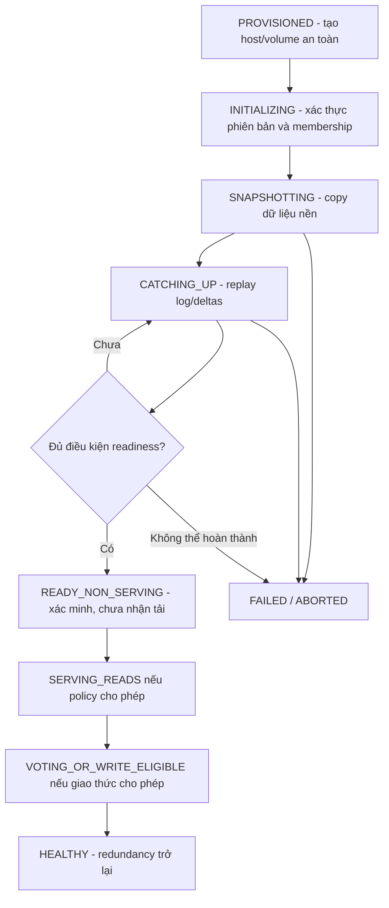

# Thêm hoặc thay thế bản sao khi đang có tải

Một cụm NoSQL đang xử lý hàng nghìn request mỗi giây không thể tùy tiện dừng toàn hệ chỉ để thêm ổ đĩa, nâng cấp máy hoặc thay một replica bị hỏng. Nhưng việc **đưa bản sao mới vào cụm trong khi dữ liệu vẫn thay đổi** cũng không đơn giản là sao chép thư mục data rồi cho node mới nhận traffic.

Trong lúc sao chép 500 GiB dữ liệu nền, ứng dụng có thể tiếp tục tạo đơn, cập nhật tồn kho, xóa phiên đăng nhập và đổi quyền truy cập. Bản sao mới phải thu nhận **một trạng thái ban đầu nhất quán** và **mọi thay đổi hợp lệ xảy ra trong quá trình đồng bộ**, trong khi các bản sao cũ vẫn đủ tài nguyên và quorum để phục vụ production.

Nếu quá trình làm sai, có thể xuất hiện những vấn đề:

- Replica mới đọc dữ liệu thiếu, cũ hoặc không cùng một mốc.
- Log cần replay bị xóa trước khi quá trình copy kết thúc.
- Đồng bộ nền làm đĩa/mạng quá tải, tăng p99 của request đang phục vụ.
- Thêm thành viên có quyền bỏ phiếu quá sớm làm thay đổi majority và giảm khả dụng.
- Thay replica cũ bằng replica chưa đầy đủ khiến cụm tạm mất khả năng phục hồi.
- Một node cũ trở lại sau partition vẫn tưởng mình có quyền ghi.
- Delete/tombstone hoặc transaction chưa hoàn tất được tái tạo sai.

Bài học thuộc chương **Sao chép và quorum**, module **Database No SQL**, giải thích quy trình **online replica addition / replacement**, thiết kế an toàn khi có tải thật và cách kiểm chứng trước khi chuyển node sang trạng thái phục vụ. Nội dung sử dụng mô hình tổng quát, sau đó liên hệ MongoDB replica set, Cassandra, Redis và dịch vụ NoSQL được quản lý.

> **Nguyên tắc xuyên suốt:** một bản sao mới chỉ được tính là bảo vệ hệ thống khi nó đã có **dữ liệu đủ đúng, tiến độ đủ mới, trạng thái bền phù hợp và vai trò được công bố an toàn**. Việc một process khởi động thành công chưa đáp ứng đủ bốn điều kiện đó.

---

## 1. Ba tình huống rất dễ bị nhầm lẫn

### 1.1. Thêm replica để tăng mức bảo vệ

Cụm đang có ba data-bearing replicas A, B, C. Ta muốn thêm D để tăng read capacity hoặc chuẩn bị di chuyển vị trí.

```text
Trước: A  B  C
Sau:   A  B  C  D
```

Câu hỏi: D sao chép từ đâu? Khi nào được phục vụ read? D có cần là voter không? Thay đổi số voter có làm đổi majority không?

### 1.2. Thay replica đã hỏng

Cụm có A, B, C; C chết hoặc ổ đĩa bị hỏng. Ta tạo D để thay vai trò dữ liệu của C.

```text
Trước lỗi: A  B  C
Sau lỗi:   A  B  X
Phục hồi:  A  B  D
```

Câu hỏi: C có thể quay lại không? Có cần giữ identity/logical slot cũ? D lấy được đủ dữ liệu từ A/B không? Trong lúc D chưa catch up, A/B có còn đủ quorum?

### 1.3. Di chuyển replica khi node cũ vẫn còn sống

Ta muốn thay phần cứng, chuyển AZ hoặc nâng cấp OS:

```text
Bước 1: A  B  C
Bước 2: A  B  C  D (D đang bootstrap)
Bước 3: A  B  C  D (D bắt kịp và được kích hoạt)
Bước 4: A  B     D (C rời đi an toàn)
```

Đây có thể là đường **an toàn hơn thay trực tiếp** vì duy trì redundancy trong phần lớn thời gian. Tuy nhiên, cluster và engine phải hỗ trợ cách thêm/bỏ thành viên hợp lệ; không tự sửa membership bằng thao tác file thủ công.

### 1.4. Phân biệt thêm replica với thêm shard

| Thao tác | Mục đích | Dữ liệu trên node mới |
| --- | --- | --- |
| **Add replica** | Thêm bản sao của shard/partition đã có | Một bản khác của dữ liệu hiện hữu |
| **Replace replica** | Khôi phục số bản sao sau lỗi hoặc chuyển vị trí | Dữ liệu do replica cũ phụ trách |
| **Add shard** | Tăng sức chứa và phân phối dữ liệu theo phân vùng | Một phần dữ liệu chuyển từ shard khác |
| **Rebalance** | Dàn đều dữ liệu/tải giữa node | Các shard/partition được chuyển theo placement |
| **Restore from backup** | Khôi phục trạng thái từ bản lưu lịch sử | Trạng thái tại snapshot/point-in-time đã chọn |

Một cụm có thể thực hiện nhiều hoạt động cùng lúc, nhưng **đảm bảo quorum, dữ liệu nguồn và tốc độ chuyển tải** phải được đánh giá riêng.

---

## 2. Vì sao online bootstrap khó hơn sao chép file tĩnh?

Giả sử ở thời điểm T0, key `order:17` có trạng thái `PENDING`. Trong lúc bản sao D đang copy, ứng dụng đổi thành `PAID`, sau đó `REFUNDED`.

```text
Thời gian ->
T0                  T1                    T2                 T3
|-------------------|---------------------|------------------|
Snapshot bắt đầu     order=PAID            order=REFUNDED      Copy xong

Nguồn A vẫn nhận ghi liên tục
Replica mới D vẫn đang đọc dữ liệu nền
```

Nếu chỉ copy file từng thư mục khi engine đang ghi:

- Một file có thể thuộc trạng thái trước transaction.
- File khác có thể thuộc trạng thái sau transaction.
- Metadata và chỉ mục không tương ứng cùng thời điểm.
- Có thể bỏ lỡ một update hoặc một delete.
- Không có cách xác minh D đại diện cho trạng thái commit nào.

Giải pháp tổng quát là **snapshot nhất quán + thay đổi phát sinh sau snapshot**.

```text
Nguồn đang phục vụ:
   [ Dữ liệu ở mốc S ] [ Log các thay đổi S+1 ... hiện tại ]
          |                          |
          v                          v
      Copy snapshot               Replay / catch-up
          |                          |
          +-----------> Replica D <--+
                              |
                              v
                        Verify readiness
                              |
                              v
                       Cho phép phục vụ
```

Một số engine dùng initial sync riêng, streaming SSTable, Raft log, oplog, changelog hoặc snapshot protocol. **Không được áp nguyên thuật toán sao chép một sản phẩm sang sản phẩm khác.**

---

## 3. Những bất biến phải giữ trong toàn bộ quá trình

Bất kể dùng MongoDB hay Cassandra, người vận hành cần xác định rõ những điều không được phép phá vỡ.

### 3.1. Safety của dữ liệu

- Bản sao D không được công bố một trạng thái thiếu những write đã commit mà read policy yêu cầu.
- Không được tạo ra một trạng thái chưa từng là snapshot hợp lệ do trộn các file ở nhiều mốc.
- Các tombstone, version, transaction metadata và index cần khớp với dữ liệu.
- Không được nhận write từ một leader cũ không còn quyền.
- Một write được xác nhận theo hợp đồng durability không được mất chỉ vì chuyển membership không an toàn.

### 3.2. Safety của quorum

- Membership phải thay đổi theo giao thức của engine.
- Không làm mất quorum trong quá trình chuyển đổi theo fault model đã chọn.
- Một thành viên đang copy dữ liệu không được mặc nhiên tính như data replica đã hoàn chỉnh.
- Election voting và data durability không được đánh đồng.
- Không được để hai nhóm node cùng có quyền commit hai lịch mâu thuẫn.

### 3.3. Safety của nghiệp vụ

Replicate chính xác một dữ liệu sai nghiệp vụ **không làm dữ liệu đó đúng**.

Ví dụ, invariant `availableStock >= 0` phải tiếp tục được bảo vệ bằng atomic conditional write hoặc transaction thích hợp trong khi các replica di chuyển. Việc có thêm D không tự sửa những race hoặc duplicate payment đã tồn tại.

### 3.4. SLO của người dùng

Trong quá trình bootstrap:

- API hiện tại phải tiếp tục đáp ứng latency/error SLO đã đặt.
- Không được dùng hết disk headroom khiến ghi production thất bại.
- Các tác vụ có thể bị throttling hoặc tạm dừng khi SLO xấu.
- Cần có cách rollback/pause mà không làm hỏng dữ liệu đang phục vụ.

**Hoàn thành bootstrap nhanh hơn không có giá trị nếu đổi lại gây gián đoạn dài cho production.**

---

## 4. Kiểm tra tình trạng cụm trước khi thêm hoặc thay thế

Đừng bắt đầu từ lệnh `add node`. Hãy ghi một **baseline**:

| Nhóm | Điều cần ghi nhận |
| --- | --- |
| Topology | Các shard/replica, region, AZ, rack, host, role, voter |
| Quorum | Majority hoặc read/write quorum hiện tại theo giao thức |
| Sức khỏe | Node có healthy không; có election/recovery đang diễn ra không |
| Replication | Lag, oplog/log retention, tiến độ secondary |
| Tài nguyên | CPU, RAM, disk free, IOPS, network bandwidth |
| Workload | Write rate, delta bytes/s, read rate, hot partitions |
| SLO | p50/p95/p99, error rate, transaction abort |
| Backup | Bản backup gần nhất, khả năng restore, RPO/RTO |
| Dữ liệu | Dung lượng thực, số index, tombstone, compaction backlog |
| Phiên bản | Database version, storage format, compatibility |
| Bảo mật | TLS, credentials, encryption keys, authorization |
| Phụ thuộc | DNS, service discovery, client routing, load balancer |

### 4.1. Điều kiện không nên bắt đầu

Ví dụ những tín hiệu cần dừng xem xét trước:

- Cụm đang thiếu quorum hoặc đang có leader bất ổn.
- Đã có replica khác mất dữ liệu hoặc replication lag rất lớn.
- Oplog/change retention quá ngắn so với thời gian copy dự kiến.
- Disk của donor gần đầy hoặc đang có compaction/write stall.
- Đang có một bảo trì lớn khác trên cùng shard/AZ.
- Chưa có backup/restore path khả dụng.
- Không biết cách xử lý khi node cũ quay lại.

Những tín hiệu này **không phải danh sách lỗi tuyệt đối cho mọi sản phẩm**; chúng là các rủi ro cần được giải quyết trong kế hoạch thay đổi.

### 4.2. Chọn thời điểm và giới hạn tải

Nếu có thể, chọn khoảng thời gian tải ổn định. Nhưng “ban đêm” không nhất thiết ít tải: batch ETL, compaction, backup và các job dọn TTL có thể chạy mạnh nhất vào lúc đó.

Nên dựa vào **số đo lịch sử và dự báo tải**, không dựa trên đồng hồ.

---

## 5. Vòng đời an toàn của một replica mới

Một trạng thái tổng quát có thể mô tả như sau:



**Các tên trạng thái là mô hình đào tạo**, không phải trạng thái API thống nhất của các database. Một engine có thể tự động chuyển vai trò và không tách thủ công “serving reads” khỏi “voting”; khi đó phải tuân theo lifecycle của sản phẩm.

### 5.1. Provisioning

- Chọn AZ/rack/host đúng failure-domain placement.
- Dành đủ disk cho dữ liệu, index, log, compaction và tăng trưởng.
- Chọn instance và storage đáp ứng IOPS cần thiết.
- Cấu hình network, TLS, DNS, secrets và clock/time sync nếu engine yêu cầu.
- Cài phiên bản tương thích, tránh thay đổi storage format không được hỗ trợ.
- Bảo đảm không có dữ liệu cũ không rõ nguồn trên volume dùng để bootstrap.

### 5.2. Snapshot

Sao chép dataset nền tại một ranh giới nhất quán và thiết lập mốc log tương ứng. Có thể nhận metadata, file, index, snapshot của shard hoặc streaming data.

### 5.3. Catch-up

Replay những mutation xảy ra sau snapshot trong thứ tự và ngữ nghĩa engine đòi hỏi.

### 5.4. Verify

Kiểm tra tiến độ, lỗi checksum, transaction state, khả năng truy vấn và những điều kiện readiness được engine công bố.

### 5.5. Activate

Chỉ sau khi đạt điều kiện cần thiết mới cho D tham gia role đọc, election, write routing hoặc trở thành nguồn bootstrap cho node khác.

---

## 6. Snapshot và mốc log phải liên kết chính xác

Mẫu nguy hiểm:

```text
1. Bắt đầu copy dữ liệu.
2. Copy xong mới hỏi "log đang ở offset nào?".
3. Replay từ offset đó.
```

Mẫu này có **khoảng trống**: những thay đổi xảy ra *trong lúc copy* có thể không có trong snapshot D cũng không nằm trong phần log replay.

### 6.1. Cần một consistent cut

Một cơ chế an toàn về mặt khái niệm:

```text
Ở nguồn:
  Xác lập snapshot state S tại log position L
  Đảm bảo thay đổi sau L còn truy cập được

Ở đích:
  Cài snapshot S
  Replay thay đổi sau L theo thứ tự và transaction semantics
  Tiếp tục tới mốc đủ mới để kích hoạt
```

**Không tự viết quy trình chỉ từ sơ đồ này cho production.** Engine có thể dùng epoch, term, partition log offset, oplog timestamp, snapshot metadata và protocol đặc biệt để tránh thiếu/đúp thay đổi.

### 6.2. Vì sao phải giữ cả tombstone?

Giả sử key A tồn tại trong snapshot, sau đó bị xóa khi D đang copy.

```text
Snapshot S: A = ACTIVE
Log sau S: DELETE A
```

Nếu chỉ copy snapshot mà không replay delete, D có thể **làm A xuất hiện lại** khi được đọc. Với một tài khoản đã thu hồi quyền hoặc đơn hàng đã hủy, lỗi này có thể nghiêm trọng.

Trong LSM-based storage, tombstone và retention còn liên quan tới compaction, repair và những replica lâu ngày offline. Không nên xóa metadata xóa quá sớm trước khi các bản sao cần biết việc xóa đã nhận đủ thông tin.

### 6.3. Transaction nhiều thay đổi

Nếu source commit một transaction gồm:

```text
UPDATE wallet-A: -100
UPDATE wallet-B: +100
INSERT ledger-entry
```

Replica mới không được công bố một snapshot chứa chỉ hai trong ba thay đổi của một transaction đã được commit. Protocol snapshot/log phải tôn trọng **ranh giới commit/transaction** theo engine.

### 6.4. Replay có thể bị lặp

Khi network reconnect, một số entry có thể được gửi lại hoặc replay lại. Engine cần dùng log sequence/term/idempotency phù hợp để **không áp dụng một logical mutation hai lần**.

Không thể thay cơ chế replication bằng vòng lặp ứng dụng chạy lại `$inc` hoặc `DECR` một cách mù.

---

## 7. Mốc bắt kịp và tiêu chí “đủ mới”

Một replica mới không nhất thiết phải có lag **bằng 0 ở mọi nano-giây** trước khi nó được phép đọc theo mọi mức nhất quán. Điều kiện phụ thuộc API và role.

Nhưng nếu D sẽ trở thành **voting leader candidate** hoặc tham gia xác nhận những write quan trọng, phải đáp ứng **điều kiện đủ mới mà giao thức cho phép**.

### 7.1. Các mốc tiến độ

| Mốc | Ý nghĩa |
| --- | --- |
| `snapshotPoint` | Trạng thái logic của dữ liệu nền |
| `copiedBytes` | Lượng dữ liệu nền đã chuyển |
| `sourceCommittedPosition` | Vị trí commit đã được xác định ở nguồn |
| `replicaAppliedPosition` | Vị trí mutation D đã áp dụng |
| `replicaDurablePosition` | Vị trí log/data D đã lưu bền theo cơ chế |
| `replicationLag` | Khoảng chênh thời gian/offset cần giảm |
| `readinessState` | Engine có cho D phục vụ role nào hay chưa |

Đây là **tên trường khái niệm**; metric thực tế tùy MongoDB, Cassandra, Redis hay dịch vụ quản lý.

### 7.2. Đã applied khác đã durable

D có thể replay một mutation vào bộ nhớ trước khi durable sync. Khi đánh giá D có thể giúp bảo vệ mất nguồn hay không, phải xem chính sách log/journal của nó.

**Lag theo timestamp không phải bằng chứng duy nhất về durability.**

### 7.3. Read readiness khác write/election readiness

Một replica tương đối mới có thể được phép phục vụ **eventual read** với giới hạn staleness được công bố, nhưng chưa đủ điều kiện làm leader hoặc phục vụ linearizable read.

Không nên chuyển toàn bộ traffic sang D chỉ vì health endpoint trả `200 OK`.

---

## 8. Tốc độ catch-up: vì sao copy nhanh vẫn có thể không xong?

Trong lúc đồng bộ dữ liệu nền, nguồn tiếp tục sinh write. Gọi:

- \(B(t)\): backlog mutation cần replay tại thời điểm \(t\).
- \(\lambda\): tốc độ dữ liệu thay đổi mới (byte/s hoặc entries/s).
- \(\mu\): tốc độ D có thể replay mutation.
- \(B_0\): backlog ban đầu khi bắt đầu catch-up.

Trong mô hình đơn giản, khi \(\lambda\) và \(\mu\) gần như ổn định:

\[
B(t) \approx \max\{0,\ B_0 + (\lambda-\mu)t\}.
\]

Nếu:

\[
\mu \le \lambda,
\]

backlog **không thể giảm bền vững** chỉ bằng cách tiếp tục replay ở tốc độ hiện tại.

Nếu \(\mu > \lambda\), thời gian bắt kịp gần đúng:

\[
T_{\text{catch-up}} \approx \frac{B_0}{\mu-\lambda}.
\]

Những công thức này là **mô hình năng lực gần đúng**, chưa tính nén, transaction, partition hotspots, retry, index build, giới hạn network hoặc thay đổi tải theo thời gian.

### 8.1. Ví dụ đo trên workload giả định

Giả sử backlog ban đầu là 60 GiB, replica mới replay hiệu dụng 90 MiB/s, trong khi hệ đang phát sinh 70 MiB/s mutation mới.

Tốc độ giảm backlog ròng chỉ là:

\[
90 - 70 = 20 \text{ MiB/s}.
\]

Vì thế, dù chỉ báo “replay throughput = 90 MiB/s” nghe có vẻ cao, backlog vẫn giảm **chậm hơn nhiều** so với tốc độ replay gộp.

Khi tăng tải lên 95 MiB/s, backlog có thể **tăng thay vì giảm**.

### 8.2. Theo dõi cả tốc độ tạo và tốc độ xả backlog

Cần quan sát:

```text
New mutations -> Replication backlog -> Apply on new replica
       λ                                    μ
```

Nếu chỉ hiển thị `copiedBytes` tăng, ta không biết D có đang tiến gần tới current state hay không.

### 8.3. Hot partition có thể tạo nút nghẽn

Một số engine phải replay theo thứ tự trên từng partition/key để bảo đảm đúng. Dù network còn băng thông, một hot partition có thể giới hạn tốc độ apply.

Cần đo **lag theo shard/partition**, không chỉ average lag toàn cluster.

---

## 9. Cửa sổ giữ log có thể khiến initial sync thất bại

Giả sử source chỉ giữ nhật ký thay đổi đủ cho vài giờ. Initial snapshot copy lâu hơn thời gian đó, những entry sớm nhất sau snapshot có thể đã bị xóa.

```text
T0: Snapshot bắt đầu, cần log từ L0
T1: Copy chậm vì disk/network bị bão hòa
T2: Oplog/commit log retention không còn entry L0
T3: Copy kết thúc
T4: Không thể replay đầy đủ từ L0
```

Khi đó replica mới **không có đường an toàn để tự bắt kịp** chỉ bằng phần log còn lại. Engine có thể phải **restart initial sync**, thực hiện rebuild theo cơ chế riêng hoặc báo lỗi.

### 9.1. Dự tính retention window

Một kiểm tra sơ bộ:

\[
T_{\text{log retention}}
>
T_{\text{snapshot copy}}
+
T_{\text{catch-up}}
+
T_{\text{buffer safety}}
\]

Phần `buffer safety` cần tính tải tăng đột biến, retry, network instability và khoảng quan sát. Đây là điều kiện hoạch định, không thay thế quy tắc kỹ thuật của engine.

Một số hệ không quản lý log theo “số giờ cố định”; có thể dựa trên dung lượng, segment, pressure hoặc chính sách khác. Cần dùng **mức giữ log thật**, không suy từ file cấu hình đơn lẻ.

### 9.2. Thêm replica có thể làm tăng áp lực log

Một replica mới hoặc replica bị lag có thể khiến hệ phải giữ log lâu hơn hoặc làm log retention trở thành yếu tố giới hạn. Nếu dung lượng log tăng tới giới hạn đĩa, production write có thể bị ảnh hưởng.

Cần đo **log disk usage, log growth rate và thời gian retention thực tế** trong khi bootstrap.

---

## 10. Chọn donor/source để đồng bộ

Một replica thường nhận dữ liệu từ một node đang khỏe, còn đủ dữ liệu và có thể phục vụ streaming mà không làm cạn tài nguyên.

### 10.1. Tiêu chí chọn donor

- Có dữ liệu/snapshot hợp lệ và mốc log thích hợp.
- Không bị replication lag không chấp nhận được.
- Có CPU, disk I/O và băng thông dư.
- Không đang chịu quá nhiều foreground request.
- Có vị trí mạng phù hợp; tránh WAN không cần thiết.
- Có đúng phiên bản và định dạng dữ liệu tương thích.
- Được engine cho phép làm sync source.

### 10.2. Không chọn donor chỉ vì “ở gần”

Một donor cùng AZ có thể nhanh hơn về mạng, nhưng nếu nó cũng là primary đang xử lý hot writes, tải initial sync có thể làm ảnh hưởng p99 của ứng dụng.

Đôi khi nên dùng một secondary khỏe làm nguồn bootstrap; đôi khi engine tự quyết định và không hỗ trợ chọn tùy ý. **Luôn tuân theo cơ chế sync-source selection của sản phẩm**.

### 10.3. Donor mất giữa chừng

Cần biết engine có thể:

- Chọn donor khác và tiếp tục ở checkpoint.
- Restart một phần hoặc toàn bộ initial sync.
- Chờ donor quay lại.
- Báo lỗi cần thao tác khôi phục.

Không nên tự copy phần file còn lại từ một node khác mà không có metadata nhất quán: hai source có thể ở hai mốc và có lịch sử khác nhau.

---

## 11. Bootstrapping là tải nền cạnh tranh trực tiếp với production

Thêm replica tiêu tốn:

- **Read I/O ở donor:** quét dữ liệu nền, index, metadata.
- **Network:** truyền snapshot và delta.
- **Write I/O ở đích:** ghi file, WAL, index, compaction.
- **CPU:** nén, checksum, serialization, replay.
- **RAM:** buffers, caching, sorting, compaction.
- **Quorum/metadata overhead:** thay membership và giám sát tiến độ.

Một sơ đồ cạnh tranh tài nguyên:

```text
Foreground production queries -----+
                                   |
Bootstrap snapshot reads ----------+--> Donor disk I/O
                                   |
Background compaction -------------+

New mutations ---------------------+
                                   +--> Network + Replica D apply
Snapshot transfer -----------------+
```

### 11.1. Bootstrapping có thể gây write stall

Với LSM storage, initial sync hoặc stream file có thể làm tăng I/O, kích hoạt compaction và cạnh tranh với flush. Nếu tốc độ flush không theo kịp foreground writes, hệ có thể gặp **write stall** hoặc tăng latency.

Với B-tree/cache-oriented engine, việc đọc dữ liệu lớn cũng có thể làm tăng cache churn và I/O.

**Không có một kiểu storage engine miễn phí tài nguyên khi copy dữ liệu.**

### 11.2. Điều chỉnh concurrency theo ngân sách

Không nên chạy đồng thời initial sync của nhiều replica cùng shard/AZ nếu cluster đang có ít headroom.

Có thể giới hạn:

- Số replica đang bootstrap.
- Số stream/song song.
- Băng thông replication/copy.
- Số I/O concurrent.
- Tốc độ rebuild index/compaction nếu engine cho phép.
- Nguồn donor được sử dụng.
- Thời điểm chạy so với các batch job khác.

Tên tham số điều chỉnh **khác theo engine và version**; không tự suy có một flag chung `bootstrapRateLimit` ở mọi NoSQL.

---

## 12. Rate limiting và backpressure có điều kiện

Throttling cố định (ví dụ truyền tối đa X MiB/s) có thể hữu ích, nhưng một hệ đang thay đổi tải cần cơ chế phản ứng theo SLO.

### 12.1. Một bộ điều khiển khái niệm

```text
Nếu production p99 vượt ngưỡng:
    giảm tốc độ snapshot transfer
Nếu write concern error tăng:
    tạm dừng thay membership / giảm tải nền
Nếu donor disk utilization quá cao:
    giảm stream concurrency
Nếu SLO khỏe và có đủ headroom:
    tăng bootstrap rate một cách thận trọng
Nếu log retention gần cạn:
    đánh giá lại phương án bootstrap thay vì chạy mù
```

Đây là **pseudocode chính sách vận hành**, không phải automation an toàn để chạy trực tiếp.

### 12.2. Tránh vòng lặp điều khiển mất ổn định

Nếu cứ mỗi giây tăng/giảm tốc độ mạnh theo một metric nhiễu, bộ điều khiển có thể làm tải dao động. Nên có:

- Khoảng quan sát phù hợp.
- Hysteresis (ngưỡng tăng khác ngưỡng giảm).
- Giới hạn tốc độ thay đổi.
- Thời gian nghỉ sau một quyết định.
- Ngưỡng dừng khẩn cấp.
- Logging quyết định theo timestamp.

### 12.3. Không hy sinh khả năng bắt kịp

Giảm tốc độ snapshot quá thấp có thể khiến nó không kết thúc trước khi log cần replay hết retention window. Phải cân đối **SLO foreground** với **mức log retention và khả năng hoàn thành**.

Nếu không thể đáp ứng cả hai, giải pháp có thể là **mở rộng tài nguyên, tăng retention an toàn, chuyển donor hoặc dời thời điểm**, thay vì cố tiếp tục một đợt sync chắc chắn thất bại.

---

## 13. Dung lượng lưu trữ và mạng cần tính trước

Một ước lượng thô cho dung lượng đích:

\[
D_{\text{required}}
\approx
D_{\text{live data}}
+
D_{\text{index}}
+
D_{\text{log}}
+
D_{\text{temporary}}
+
D_{\text{future headroom}}.
\]

Không nên chỉ cấp đúng dung lượng logical dataset. Một số engine cần file tạm, index build, SSTable compaction hoặc snapshot giữ cùng lúc nhiều bản dữ liệu.

### 13.1. Thời gian copy tối thiểu theo băng thông

Nếu phải chuyển 1 TiB và băng thông hiệu dụng đạt 100 MiB/s:

\[
T_{\text{minimum}}
\approx
\frac{1{,}048{,}576\ \text{MiB}}{100\ \text{MiB/s}}
\approx 2.91\ \text{giờ}.
\]

Đây là **ước lượng lý thuyết cho dữ liệu nền**, chưa tính:

- Network overhead và throttling.
- Disk read/write contention.
- Nén/giải nén, checksum và retry.
- Index creation/validation.
- Log delta sinh thêm trong lúc copy.
- Compaction hoặc scan không tuần tự.

Nếu không có đủ retention cho khoảng này cộng catch-up và biên an toàn, kế hoạch cần được thay đổi.

### 13.2. Capacity sau khi mất node

Trong quá trình thay C, chỉ còn A/B phục vụ workload. Sau lỗi một node, mỗi node còn lại có thể phải gánh nhiều read/replication load hơn.

Ngay cả khi quorum còn, nếu không có CPU/IO/network headroom, cluster có thể **available về mặt giao thức nhưng không đạt SLO thực tế**.

---

## 14. Thêm voting member: thay membership có thể đổi majority

Giả sử một replica set consensus-style có 3 voter:

\[
N=3,\quad Q=\lfloor 3/2\rfloor+1=2.
\]

Nếu thêm voter thứ tư:

\[
N=4,\quad Q=\lfloor 4/2\rfloor+1=3.
\]

Trong mô hình majority đơn giản, **tăng từ 3 lên 4 voter làm majority tăng từ 2 lên 3**. Nếu node mới còn chậm, unavailable hoặc chưa đủ điều kiện, việc thay đổi voting membership quá sớm có thể giảm headroom.

### 14.1. Thêm data replica không voting trước

Một chiến lược ở những engine hỗ trợ:

```text
Giai đoạn 1:
  A voter
  B voter
  C voter
  D non-voting / non-electable, đang initial sync

Giai đoạn 2:
  D bắt kịp, đạt readiness, verify

Giai đoạn 3:
  Thay đổi membership/role D theo protocol an toàn
```

Cách này cho phép đưa dữ liệu lên D trước khi dùng D làm một phần của quorum/election. Nhưng **không phải mọi engine hỗ trợ non-voting data member**, và ngay cả khi hỗ trợ, việc đổi vai trò phải tuân theo giới hạn cấu hình của sản phẩm.

### 14.2. Membership reconfiguration phải giữ an toàn giữa cấu hình cũ và mới

Một lỗi nguy hiểm là:

```text
Nhóm cũ tin cấu hình C_old.
Nhóm mới tin cấu hình C_new.
Hai nhóm khác nhau cùng nhận mình có majority.
```

Các thuật toán consensus dùng cơ chế chuyển membership an toàn, ví dụ joint consensus hoặc quy trình tái cấu hình chuyên biệt, để tránh những tập quorum mâu thuẫn.

**Không tự thực hiện membership change bằng cách chỉnh file cấu hình trên từng node độc lập**, nếu database cung cấp API reconfiguration phải sử dụng.

### 14.3. Election quorum khác data replicas

Một witness/arbiter có thể đóng vai trò voting nhưng không giữ dữ liệu ứng dụng. Vì vậy:

- Thêm witness có thể ảnh hưởng election availability.
- Nó **không tạo một data replica** mới có thể restore.
- Nó không thay việc đồng bộ snapshot, index và log.
- Rủi ro durability phải được phân tích theo **data-bearing members** và write concern/commit semantics của engine.

---

## 15. Phân biệt thêm replica và thay replica mất hoàn toàn

### 15.1. Thêm khi cụm còn đầy đủ 3/3

```text
A  B  C (healthy)
       |
       +----> D đang bootstrap
```

Thông thường có thể giữ redundancy của A/B/C trong lúc D copy, miễn thao tác membership và tải nền không làm hệ quá tải.

### 15.2. Thay khi cụm chỉ còn 2/3

```text
A  B  X(C chết)
      |
      +----> D đang bootstrap
```

Cụm đang ở **trạng thái suy giảm chịu lỗi**. Mất thêm A hoặc B có thể làm hệ thiếu quorum. Vì vậy việc tạo D có tính khẩn cấp hơn nhưng đồng thời **nguy hiểm hơn**, vì donor cũng là thành viên còn lại cần thiết để phục vụ.

Có thể cần:

- Giảm tải background không cần thiết.
- Ưu tiên khôi phục số bản sao dữ liệu.
- Giảm concurrency của bootstrap để không làm A/B mất đáp ứng.
- Không chạy nâng cấp song song.
- Giám sát chặt write concern và failover.

### 15.3. Nếu không còn đủ quorum để ghi

Không được tùy tiện “ép một node làm primary” hoặc “ghi vào đĩa cũ” chỉ để tránh downtime. Những cách làm này có thể vi phạm commit history.

Cần dùng **quy trình disaster recovery/quorum-loss recovery chính thức** của engine, có bước xác định dữ liệu bền, quyền sở hữu mới, các ghi có thể mất và rủi ro split brain.

---

## 16. Node cũ có thể quay lại: xử lý identity và fencing

Giả sử C mất kết nối mạng, người vận hành tưởng C đã chết và dựng D thay C. Sau đó C xuất hiện lại.

```text
A ---- B ---- D (cụm đang hoạt động)
       |
       +---- C xuất hiện sau partition
```

Hai vấn đề:

1. C có thể có **state cũ** và không còn là một thành viên hợp lệ.
2. Nếu C vẫn được phép nhận write hoặc được client route tới như primary cũ, có thể phát sinh **split brain**.

### 16.1. Node identity không phải chỉ là hostname

Tùy database, identity có thể gồm:

- Replica set member ID hoặc host membership.
- Node ID, host ID, token ownership.
- Raft member ID, term và log history.
- Cluster ID, data directory metadata.
- Epoch hoặc lease/fencing token.

**Không tái sử dụng identity hoặc data directory của node cũ một cách ngẫu nhiên.** Một hệ có thể yêu cầu thủ tục replace chính thức để tránh hai node dùng cùng identity hoặc token ranges không hợp lệ.

### 16.2. Fencing

*Fencing* là cơ chế bảo đảm thực thể cũ **không còn quyền thực hiện write có hiệu lực** sau khi quyền lãnh đạo/chủ sở hữu được chuyển.

Ví dụ:

- Leader term/epoch tăng; write từ term cũ bị từ chối.
- Quorum election không cho old leader tự commit.
- Storage/client route chỉ tới nguồn có authority mới.
- Lease hoặc token quyền sở hữu được kiểm soát an toàn.

Chỉ “tắt ứng dụng client cũ” không đủ nếu node cũ vẫn có khả năng tiếp nhận write từ một đường khác.

### 16.3. Khi nào phải wipe/reseed?

Nếu node cũ giữ dữ liệu đã diverge hoặc chứa metadata membership không hợp lệ, engine có thể cần nó **rejoin như một thành viên mới** sau khi xóa state không còn hợp lệ và bootstrap lại.

Không được tự xóa volume production chỉ vì thấy `lag` cao; trước tiên cần kiểm tra runbook sản phẩm và bảo vệ backup/dữ liệu chưa được xác nhận.

---

## 17. Thời điểm cho replica mới phục vụ đọc

Một replica đang initial sync **không tự phù hợp để phục vụ read**. Nó có thể thiếu data, index hoặc version cần thiết.

### 17.1. Ba loại đọc có nhu cầu khác nhau

| Đường đọc | Điều kiện thường cần |
| --- | --- |
| **Eventual read** | Replica ở trạng thái serving hợp lệ, staleness được kiểm soát theo hợp đồng |
| **Read-your-writes** | Đã thấy write của client/session hoặc được route tới nguồn phù hợp |
| **Linearizable/snapshot read** | Sử dụng API và cơ chế đảm bảo được engine hỗ trợ; không chỉ “node gần nhất” |

Không nên cho load balancer đưa request vào D **chỉ vì port database đã mở**.

### 17.2. Read routing khi traffic tăng

Một chuyển tải an toàn có thể theo bước:

```text
0% read traffic -> D
1% canary reads -> D
10% -> D
25% -> D
50% -> D
```

Tỷ lệ là **ví dụ chiến lược rollout**, không phải chuẩn chung.

Mỗi bước cần quan sát:

- Error rate và timeout.
- p95/p99 latency.
- Read concern/freshness SLO.
- Cache warm-up và disk I/O.
- Replication lag.
- Mức ảnh hưởng tới những replica còn lại.

Nếu engine hoặc topology không cho canary từng replica, dùng cơ chế readiness/route tương đương mà sản phẩm hỗ trợ.

### 17.3. Query index cần sẵn sàng

Một bản sao mới có thể cần xây/copy index. Nếu index chưa sẵn sàng, một query bình thường có thể chuyển thành scan rất đắt.

Đừng chỉ kiểm tra số document; còn phải xác nhận **index definitions, build progress và query readiness** trước khi chuyển tải đọc.

---

## 18. Trình tự remove replica cũ sau khi D sẵn sàng

Một quá trình di chuyển an toàn về mặt ý tưởng:

1. Đảm bảo D đã bootstrap và bắt kịp.
2. Xác minh D đáp ứng vai trò đích.
3. Chuyển bớt read traffic nếu thích hợp.
4. Đảm bảo membership/quorum không bị phá khi C rời đi.
5. **Drain** những session/connection cần thiết của C theo engine.
6. Nếu C là leader, thực hiện **leadership transfer/step-down** phù hợp.
7. Loại C bằng cơ chế reconfiguration chính thức.
8. Xác nhận topology mục tiêu và health.
9. Thu hồi credential/route cũ và lưu log thay đổi.
10. Chỉ xử lý volume cũ theo chính sách sau khi đã chắc chắn không cần phục hồi.

Không phải hệ nào cũng hỗ trợ cùng một thứ tự `add-before-remove`, nhất là khi có giới hạn voter hoặc token ownership. Có engine bắt buộc quy trình **replace** thay vì **add rồi remove**.

### 18.1. Rolling upgrade không phải đồng thời thay tất cả

Đổi một node, chờ healthy/catch-up, rồi mới đổi node tiếp theo giúp giữ redundancy. Thay liên tiếp khi node trước chưa catch-up làm giảm số bản sao thực sự có dữ liệu mới.

### 18.2. Rebalance có thể làm thay đổi miền lỗi

Khi D được thêm, placement của shard có thể chuyển. Phải xác minh kết quả cuối **vẫn phân tán replica qua failure domains đúng mục tiêu**. Một node mới ở AZ khác nhưng một shard còn hai replica ở cùng AZ chưa chắc đạt yêu cầu chịu lỗi một AZ.

---

## 19. MongoDB: thêm secondary khi replica set đang ghi

MongoDB replica set có **primary**, **secondary**, oplog/initial sync và cơ chế election. Có thể thêm một secondary mới để sao chép dữ liệu rồi chuyển vai trò theo điều kiện được phép.

> **Chỉ thực hành trên replica set thử nghiệm.** Không dùng lệnh thay membership trong production nếu chưa có kế hoạch change, kiểm tra quorum và runbook. Các lệnh thực tế và điều kiện hợp lệ phụ thuộc phiên bản MongoDB.

### 19.1. Kiểm tra trạng thái trước thay đổi

Trong `mongosh`:

```javascript
const status = rs.status();

printjson({
  set: status.set,
  members: status.members.map(member => ({
    name: member.name,
    stateStr: member.stateStr,
    health: member.health,
    optimeDate: member.optimeDate
  }))
});
```

Đọc cấu hình membership:

```javascript
const conf = rs.conf();

printjson(
  conf.members.map(m => ({
    id: m._id,
    host: m.host,
    votes: m.votes,
    priority: m.priority
  }))
);
```

Mục đích: ghi lại số thành viên, voter, role và tình trạng trước khi thay đổi. `rs.status()` có thể chứa metadata khác theo version; không lấy một field trống làm bằng chứng node đã lỗi mà không kiểm tra.

### 19.2. Đưa node mới vào với role thận trọng

Giả sử có một host thực hành mới:

```text
mongo-d.example.test:27017
```

Host này phải được khởi động `mongod` đúng replica set name, network/auth/TLS, disk và version tương thích trước khi thêm.

Một cách trong môi trường hỗ trợ là thêm thành viên **không vote, không được bầu làm primary** trước:

```javascript
rs.add({
  host: "mongo-d.example.test:27017",
  votes: 0,
  priority: 0
});
```

Ý tưởng: D đồng bộ dữ liệu mà **chưa làm thay đổi số voting members** trong giai đoạn đầu. MongoDB có những quy tắc đối với non-voting member, write concern, reconfiguration và version; phải xem tài liệu chính thức của phiên bản triển khai trước khi áp dụng.

### 19.3. Theo dõi initial sync và replication

```javascript
const s = rs.status();

for (const member of s.members) {
  print(
    member.name,
    member.stateStr,
    member.health,
    member.optimeDate
  );
}
```

Cần kết hợp nhiều nguồn quan sát, không chỉ một dòng trạng thái:

- Trạng thái initial sync đang tiến hành hay thất bại.
- Tiến độ và lỗi trong log server.
- Oplog retention window có đủ không.
- Replication lag và tiến độ mốc log.
- Disk, CPU, network và query latency.
- Các lỗi write concern hoặc connection.
- Node đã chuyển sang trạng thái secondary hợp lệ hay chưa.

### 19.4. Không promote D chỉ vì rs.add thành công

Lệnh `rs.add` trả kết quả không có nghĩa D đã nhận đầy đủ dữ liệu. Quá trình initial sync cần thời gian.

Nếu mục tiêu cuối là D được quyền vote/election, thay đổi thành viên/votes phải dùng **quy trình reconfiguration an toàn đúng phiên bản**, sau khi D đủ điều kiện. Bài học không đưa một lệnh `rs.reconfig` chung để tránh khuyến khích thay voting majority sai khi cụm đang có tải.

### 19.5. Thay secondary hỏng

Nếu C mất, kế hoạch có thể gồm:

1. Xác định C thật sự không thể phục hồi hoặc cần thay.
2. Kiểm tra A/B có đủ điều kiện phục vụ và dữ liệu hợp lệ.
3. Dựng D ở failure domain phù hợp.
4. Dùng cơ chế thêm/loại thành viên theo MongoDB, tránh membership mâu thuẫn.
5. Đợi D initial sync/catch-up.
6. Xác nhận quorum và write concern sau cấu hình cuối.

**Không để hai node cùng được client coi là primary chỉ vì node cũ có thể quay lại sau partition.**

### 19.6. Khi cần sửa một oplog window quá nhỏ

Nếu source thay đổi dữ liệu quá nhanh, initial sync có thể không bắt kịp trong cửa sổ oplog. Cần đánh giá dung lượng oplog, tốc độ mutation, donor và thời gian copy, theo công cụ cấu hình phù hợp với version đang chạy.

Không chỉnh oplog/retention mù rồi bỏ qua disk headroom: retention lớn hơn cũng tiêu thụ dung lượng và ảnh hưởng vận hành.

---

## 20. Cassandra: bootstrap, stream dữ liệu và replace node

Cassandra khác MongoDB ở cách tổ chức replication theo token ranges, datacenter/rack và consistency levels. Thêm node có thể kéo theo **bootstrap/streaming** những token ranges mà node mới cần giữ.

### 20.1. Topology và RF

Ví dụ keyspace:

```sql
CREATE KEYSPACE IF NOT EXISTS live_replicas_lab
WITH replication = {
  'class': 'NetworkTopologyStrategy',
  'dc1': 3
};
```

Mô tả: keyspace có RF3 trong `dc1` theo topology được Cassandra hiểu. Không có nghĩa mỗi node đều giữ toàn bộ keyspace.

Trước khi thao tác cần xác nhận:

- Datacenter và rack labels do snitch cung cấp là đúng.
- Node mới nằm ở failure domain phù hợp.
- Token ownership và số vnode/placement theo version.
- Capacity của các node sẽ stream dữ liệu.
- Keyspace replication strategy phù hợp mục tiêu.

### 20.2. Các lệnh quan sát cơ bản

Trên môi trường Cassandra được cài đặt thích hợp:

```text
nodetool status
nodetool netstats
```

`nodetool status` giúp xem node và ownership theo thông tin mà phiên bản đưa ra. `nodetool netstats` giúp quan sát network/streaming activity.

Những command này chỉ để **quan sát**, không tự thao tác replace.

### 20.3. Bootstrap khi node được thêm

Khái niệm:

```text
Node mới D khởi động với cấu hình hợp lệ
    |
    v
Cluster xác định token/replica placement
    |
    v
Các node nguồn stream dữ liệu D cần giữ
    |
    v
D đồng bộ mutation trong quá trình chuyển trạng thái
    |
    v
D trở thành member có thể phục vụ theo giao thức
```

Cassandra còn có các cơ chế liên quan hints, streaming, repair và tombstone. **Hinted handoff không nên được coi là bản sao lưu vô hạn của mọi mutation**, đặc biệt nếu node offline lâu hơn các giới hạn retention.

### 20.4. Replace không giống add node thông thường

Thay node Cassandra chết có thể cần **chế độ replace node** và identity/token ownership theo quy tắc phiên bản. Cách dùng startup flags/commands thay thế node thay đổi theo Cassandra version và cấu hình; phải dựa vào runbook sản phẩm đang chạy.

Không tự tạo node D rồi gán cùng host ID/token của C bằng thao tác thủ công ngoài protocol, vì có thể gây conflict ownership.

### 20.5. Consistency level khi số replica suy giảm

Với RF3 và một replica hỏng, operation yêu cầu `LOCAL_QUORUM` thường cần số ACK phù hợp trong datacenter. Nếu hai replica còn lại khỏe, operation có thể tiếp tục theo điều kiện engine.

Nhưng nếu một node còn lại chậm hoặc mất, write/read có thể thất bại vì thiếu đủ replica. Khi D đang bootstrap chưa đủ điều kiện, không được tự tính D như replica đã hoàn chỉnh để chứng minh quorum.

### 20.6. Repair sau thay node

Cần kiểm tra state của những range liên quan, tombstones, các replica offline quá lâu và kế hoạch repair theo version.

Đặc biệt, việc một node giữ dữ liệu cũ xuất hiện trở lại sau thời gian dài có thể tạo rủi ro **dữ liệu đã xóa tái xuất hiện** nếu tombstone retention và repair policy bị vi phạm.

---

## 21. Redis: thêm replica và giới hạn của đồng bộ bất đồng bộ

Redis có thể dùng mô hình primary–replica, Redis Sentinel hoặc Redis Cluster, tùy triển khai.

### 21.1. Một replica mới đồng bộ ra sao?

Một node được cấu hình làm replica sẽ liên lạc với primary, có thể thực hiện full synchronization hoặc partial resynchronization theo cơ chế replication của Redis và điều kiện backlog/replication IDs.

Ví dụ trạng thái khái niệm:

```text
Redis primary
      |
      +-- Existing replica B
      |
      +-- New replica D:
              connect -> sync -> catch up -> serve
```

### 21.2. Lệnh quan sát

Trong Redis CLI:

```redis
INFO replication
INFO persistence
```

Những thông tin này hỗ trợ đánh giá role, replication offset/link và persistence, tùy version.

### 21.3. Thay đổi vai trò cần thận trọng

Redis có lệnh cấu hình một instance thành replica của primary, chẳng hạn cơ chế `REPLICAOF` trong các phiên bản hỗ trợ. **Chuyển một instance đang có dữ liệu thành replica có thể thay đổi/thay thế dataset của nó**, vì vậy không dùng lệnh này tùy tiện trên server chứa dữ liệu cần giữ.

Ví dụ minh họa trong **môi trường lab sạch**:

```redis
REPLICAOF 10.0.0.10 6379
```

Đây không phải lệnh áp dụng trực tiếp trên production; địa chỉ chỉ là ví dụ. Cần cấu hình authentication/TLS, role và topology thực tế.

### 21.4. Sentinel voting không phải write quorum của data replicas

Sentinel hỗ trợ giám sát và failover theo cơ chế riêng. Số Sentinel đồng thuận về failover **không đồng nghĩa** các data replicas đã durable ghi mới nhất.

Một primary có thể ACK cho client trước khi replica bất đồng bộ nhận mutation. Nếu primary lỗi trong khoảng đó, những ghi mới có thể không được bảo toàn sau failover.

### 21.5. Redis Cluster và hash slots

Trong Redis Cluster, dữ liệu được phân theo hash slots và các node primary/replica theo slot owner. Thêm replica cho một primary khác với **chuyển hash slots sang primary khác**.

Khi thay thế hoặc mở rộng cần kiểm tra:

- Slot ownership.
- Master/replica mapping.
- Replica placement theo host/AZ.
- Slot migration hoặc resharding nếu có.
- Client redirection/route.
- Chỉ số replication lag và failover readiness.

Không suy toàn cluster “có đủ replica” chỉ từ tổng số process Redis; phải kiểm tra **từng nhóm slot**.

---

## 22. Managed NoSQL: khi nhà cung cấp tự quản lý bản sao

DynamoDB và nhiều dịch vụ NoSQL được quản lý có thể không cung cấp lệnh “thêm một replica node” theo kiểu MongoDB hay Cassandra.

Thay vào đó, người dùng có thể:

- Bật/mở tính năng nhân bản dữ liệu giữa region.
- Tăng hoặc điều chỉnh capacity/throughput.
- Thêm khu vực đọc/ghi theo những khả năng dịch vụ hỗ trợ.
- Thay đổi cách định tuyến và failover.
- Theo dõi trạng thái đồng bộ/backfill của tính năng.
- Dùng backup/PITR theo giới hạn dịch vụ.

### 22.1. Thêm một region không giống thêm một máy

Khi thêm region cho một bảng đa vùng, quá trình có thể bao gồm:

1. Khởi tạo bản sao hoặc backfill dữ liệu hiện có.
2. Đồng bộ các thay đổi xảy ra trong lúc backfill.
3. Theo dõi replication lag và trạng thái resource.
4. Điều chỉnh routing của ứng dụng sau khi đủ điều kiện.
5. Kiểm tra xung đột ghi và transaction semantics giữa region.

**Không được suy rằng transaction local tự động mở rộng thành transaction đa vùng**; cần xem đúng chế độ replication/global tables và phiên bản/tính năng mà nhà cung cấp công bố.

### 22.2. “Managed” không có nghĩa không cần runbook

Dù nhà cung cấp tự xử lý node replacement, ứng dụng vẫn cần:

- Xác định freshness của vùng mới.
- Không route request quan trọng quá sớm.
- Có operation ID/idempotency khi timeout.
- Quan sát RPO/RTO và region failover.
- Thử lỗi dependency như DNS, IAM, KMS.
- Quản lý chi phí truyền dữ liệu/replication.

Không nên bịa số replica vật lý hoặc cách phân bố AZ nội bộ nếu dịch vụ không công bố.

---

## 23. Multi-region bootstrap: độ trễ WAN và xung đột ghi

Bootstrap qua region có thêm những thách thức:

- Latency và packet loss lớn hơn mạng trong cùng AZ/region.
- Chi phí truyền dữ liệu liên vùng.
- Dữ liệu cần tuân thủ residency/compliance.
- Encryption và key management liên vùng.
- DNS/app routing tới vùng mới.
- Write conflicts nếu cả hai vùng đều nhận ghi.
- Khả năng network partition giữa những writer.

### 23.1. Active-passive

Một region là authority ghi; region khác nhận bản sao/DR.

```text
Region A: writes -> replication -> Region B standby
```

Ưu điểm: dễ xác định thứ tự ghi hơn. Nhược điểm: vùng B có thể stale và failover cần fencing.

### 23.2. Active-active

Hai vùng cùng có thể nhận ghi:

```text
Region A writer <---- sync/merge ----> Region B writer
```

Nếu hai nơi cùng xác nhận cấp **một ghế duy nhất**, hệ cần authority, escrow/reservation hoặc giao thức phân tán đủ mạnh để tránh double booking.

**Replication eventual và conflict resolution không tự bảo vệ bất biến cứng.**

### 23.3. Không chuyển traffic write chỉ vì backfill đã xong

Cần xác nhận:

- Vùng mới đã bắt kịp những write cần thiết.
- Membership/authority được chuyển hợp lệ.
- Vùng cũ được fencing nếu chế độ chỉ một writer.
- Client routing đã đồng bộ.
- Retry có operation IDs ổn định.
- Read-your-writes và consistency SLO phù hợp.
- Có kế hoạch rollback/failback.

---

## 24. Dữ liệu lớn: khác biệt giữa copy logic và copy vật lý

Có những chiến lược đồng bộ khác nhau.

| Chiến lược | Ý tưởng | Điểm cần lưu ý |
| --- | --- | --- |
| **Physical/file-level snapshot** | Copy file SSTable/DB pages/snapshot hợp lệ | Compatibility, metadata, checksum, consistent cut |
| **Logical export/import** | Đọc record và insert ở đích | Có thể tái tạo index khác, cần change capture và idempotency |
| **Streaming ranges** | Chuyển những partition/token ranges cần cho node | Ownership/topology, source, repair |
| **Log-only catch-up** | Replay WAL/oplog sau snapshot | Log retention và sequencing |
| **Incremental snapshot** | Gửi phần thay đổi so với baseline | Phải xác thực baseline tương ứng |
| **Backup restore + roll forward** | Restore snapshot rồi replay log liên tục | RPO/log window và metadata consistency |

### 24.1. Không trộn dữ liệu của hai snapshot không tương thích

Copy file dữ liệu tại thời điểm T1 và metadata tại T2 có thể không tạo một trạng thái hợp lệ. Một snapshot physical cần được tạo/khóa theo cơ chế database hỗ trợ.

### 24.2. Index là một phần của readiness

Khi logical import, có thể phải tạo index. Nếu node mới nhận read traffic trước khi index sẵn sàng, query có thể full scan và làm ảnh hưởng SLO.

### 24.3. Schema change trong lúc bootstrap

Trong quá trình copy, ứng dụng có thể triển khai thêm field hoặc đổi index. Cần bảo đảm node mới và donor dùng schema/storage format tương thích, còn quá trình replay chấp nhận version mới.

Không nên đổi schema không tương thích và replace storage engine cùng một cửa sổ thay đổi nếu không có kế hoạch chuyển đổi riêng.

---

## 25. Kiểm chứng dữ liệu khi node mới bắt kịp

Một replica có thể hiển thị `healthy` nhưng vấn đề dữ liệu vẫn cần đánh giá theo semantics của engine.

### 25.1. Các lớp kiểm tra

1. **Membership:** D thuộc đúng cluster, đúng role và placement.
2. **Progress:** D đã đạt log/commit position cần thiết.
3. **Durability:** D ghi bền theo chính sách và không có lỗi journal/storage.
4. **Metadata:** indexes, schema, shard/token ownership phù hợp.
5. **Consistency:** read behavior ở D đáp ứng mức consistency dự kiến.
6. **Data integrity:** checksum hoặc khả năng validation/repair được sản phẩm hỗ trợ.
7. **Workload readiness:** latency và throughput ở D đáp ứng SLO.
8. **Fault readiness:** mất một node khác không lập tức làm cluster vi phạm mục tiêu availability.

### 25.2. Vì sao đếm document không đủ?

Hai replica đều có 1 triệu document nhưng:

- Một replica thiếu một update quan trọng.
- Một replica giữ document đã bị xóa.
- Một replica có index thiếu/sai.
- Một replica có những version không hợp lệ.
- Một replica chưa có tất cả transaction commit.

Số document bằng nhau **không chứng minh dữ liệu và thứ tự đã giống nhau**.

### 25.3. Checksum và so sánh theo mốc

Nếu dùng checksum/đối soát, cần so sánh **cùng một mốc logic**. So sánh A ở thời điểm T1 và D ở T2 trong hệ đang có ghi liên tục có thể cho khác biệt **hợp lệ**.

Nên dùng công cụ validation của engine, snapshot có watermark hoặc so sánh nhất quán theo partition trong môi trường thử nghiệm.

### 25.4. Không tự chạy full scan nặng trên production

Validation quá mức có thể gây I/O lớn, cache churn và làm chậm bootstrap. Cần chọn công cụ phù hợp, rate limit và cửa sổ chạy.

---

## 26. Quản lý lỗi trong quá trình thêm/thay replica

| Lỗi | Ý nghĩa có thể có | Hướng xử lý |
| --- | --- | --- |
| Snapshot copy timeout | Network/donor/đích không đáp ứng | Kiểm tra metric, giảm concurrency hoặc đổi nguồn theo protocol |
| Oplog/log window hết | Không còn mutation cần replay | Rebuild/restart initial sync theo engine; điều chỉnh retention |
| D thiếu disk | Không đủ chỗ cho file/log/temp | Tăng capacity, dừng an toàn trước khi disk đầy |
| Checksum mismatch | Dữ liệu hỏng hoặc transfer lỗi | Dừng, xác định nguồn, dùng recovery/repair chuẩn |
| Replication lag tăng mãi | Apply throughput thấp hơn change rate | Xử lý bottleneck, giảm load hoặc tăng năng lực |
| Quorum bị mất | Membership/host/network lỗi | Không ép ghi thiếu authority, dùng quorum-loss runbook |
| Node cũ quay lại | Có thể stale hoặc trùng identity | Fencing/replace/rejoin theo protocol |
| Read canary sai | D không đáp ứng freshness/index/query readiness | Rút khỏi read routing, điều tra |
| Write concern timeout | Chưa đạt mức ACK yêu cầu | Đối soát outcome, retry idempotent |
| Failover trong lúc sync | Donor/leader thay đổi | Để engine điều phối catch-up/restart theo history hợp lệ |

### 26.1. Timeout không chứng minh operation chưa ghi

Ví dụ client gửi lệnh `insert` rồi mất kết nối trong lúc failover. Database có thể đã commit nhưng response không tới client.

Nếu client lập tức tạo một document với ID mới, có nguy cơ trùng nghiệp vụ. Cần **operation ID, unique key và retry/đối soát** theo hợp đồng, không chỉ tăng timeout.

### 26.2. Pause khác abort

- **Pause:** tạm giảm/dừng truyền dữ liệu nếu engine hỗ trợ, giữ trạng thái để tiếp tục.
- **Abort:** từ bỏ quá trình và có thể phải dọn state/metadata theo protocol.
- **Rollback membership:** trở lại cấu hình trước theo API an toàn; không tự khôi phục file cấu hình thô.
- **Decommission:** loại node cũ khỏi cluster theo thủ tục chính thức.

Không được giả rằng sau một lỗi có thể chỉ khởi động lại process là mọi bước chuyển tiếp sẽ tự hoàn tất.

---

## 27. Runbook đề xuất: thêm một replica mới dưới tải

Đây là **mẫu quy trình**, phải điều chỉnh theo sản phẩm/phiên bản.

### Giai đoạn A — Chuẩn bị

1. Xác định mục tiêu: read capacity, fault tolerance, AZ migration hay pre-upgrade.
2. Vẽ topology và failure domains thật.
3. Ghi quorum/voter/data replica của mỗi shard.
4. Kiểm tra baseline SLO, load, disk free và replication lag.
5. Kiểm tra backup/restore path.
6. Ước lượng thời gian copy, tốc độ delta và retention window.
7. Chọn donor và rate limits phù hợp.
8. Chuẩn bị rollback và alert thresholds.

### Giai đoạn B — Khởi tạo

1. Provision D ở vị trí độc lập như mục tiêu.
2. Cài đặt version, network, TLS, secrets và volume đúng.
3. Chưa đưa D vào read routing/leader eligibility tùy protocol.
4. Thêm D bằng membership API được hỗ trợ.
5. Quan sát D khởi động initial sync.

### Giai đoạn C — Đồng bộ

1. Theo dõi snapshot bytes, log backlog và error.
2. Giới hạn bootstrap concurrency để giữ production SLO.
3. Kiểm tra donor disk/network và log retention.
4. Tạm điều chỉnh theo kế hoạch nếu load nền gây nghẽn.
5. Không cho D phục vụ read nhạy cảm khi chưa đủ điều kiện.

### Giai đoạn D — Xác nhận

1. D hoàn tất initial sync.
2. D bắt kịp tới mốc log được yêu cầu.
3. Chỉ số health, durability và index readiness đạt yêu cầu.
4. Verify consistency theo công cụ chuẩn.
5. Thử canary read nếu sản phẩm/role cho phép.
6. Đánh giá quorum/placement của cấu hình mục tiêu.

### Giai đoạn E — Kích hoạt

1. Thay role/voting bằng reconfiguration an toàn.
2. Route read traffic tăng dần hoặc theo policy.
3. Kiểm tra p95/p99, errors, freshness.
4. Xác minh fault tolerance thực tế sau thay đổi.
5. Lưu kết quả và cập nhật runbook/asset inventory.

### Giai đoạn F — Theo dõi sau thay đổi

1. Đo lại workload trong khoảng tải đại diện.
2. Kiểm tra replication lag và write concern.
3. Kiểm tra disk headroom, compaction, network.
4. Xác nhận không còn config, route hoặc backup target cũ sai.
5. Chỉ tuyên bố hoàn thành khi mục tiêu ban đầu được kiểm chứng.

---

## 28. Runbook đề xuất: thay replica hỏng

Đây không phải copy nguyên runbook “thêm node”, vì hệ có thể đã thiếu redundancy.

### 28.1. Phân loại tình huống

| Tình huống | Rủi ro chính |
| --- | --- |
| Node C chết nhưng A/B khỏe và còn quorum | Bootstrap làm quá tải hai node còn sống |
| C chỉ mất mạng, có khả năng quay lại | Double identity / stale writer |
| C có corruption | Không được dùng C làm donor |
| Đang mất một AZ | D có thể bị đặt sai failure domain tạm thời |
| Đang thiếu quorum | Không được ép hệ tự nhận commit history mới |
| Oplog/log retention quá ngắn | Không thể catch-up bằng incremental log |
| C giữ dữ liệu duy nhất chưa được ACK | Cần forensics/recovery riêng, không xóa tùy tiện |

### 28.2. Trình tự gợi ý

1. Xác định lỗi thực là node, disk, network hay control plane.
2. Kiểm tra **quorum và trạng thái dữ liệu** còn lại.
3. Xác định C cần recover hay replace theo runbook.
4. Fencing C hoặc bảo đảm nó không còn quyền ghi nếu cần.
5. Lên D với identity/metadata hợp lệ theo protocol.
6. Bootstrap từ donor khỏe dưới rate limit nghiêm ngặt.
7. Theo dõi rủi ro thiếu quorum trong suốt cửa sổ thay thế.
8. Đợi catch-up, verify readiness và thay membership.
9. Khôi phục placement và redundancy.
10. Kiểm tra business invariant, retry outcomes và trạng thái client sau failover.

**Một lỗi đã làm mất 1/3 redundancy cần ưu tiên bảo toàn hai phần còn lại** hơn tối ưu tốc độ copy bằng mọi giá.

---

## 29. Bài thử fault injection cần chạy trong môi trường an toàn

### 29.1. Lỗi donor giữa snapshot

- D đang copy 60% dữ liệu.
- Donor mất kết nối.
- Hệ có chọn source mới không?
- Cơ chế có tiếp tục đúng watermark/log không?
- Có tạo dữ liệu trộn hai snapshot không?
- D có bị đưa vào read routing sớm không?

### 29.2. Lỗi leader giữa catch-up

- D đang replay log.
- Leader chuyển sang node mới.
- D có được rebase/replay đúng term/history không?
- Các write đã được commit theo hợp đồng có còn không?
- Client retry có sinh duplicate business operation không?

### 29.3. Oplog retention bị vượt

- Tạo write rate cao hơn dự kiến.
- Delay copy trong môi trường thử.
- Xác nhận engine phát hiện thiếu log và **không công bố dữ liệu không đầy đủ**.
- Đo thời gian restart sync và khả năng khôi phục.

### 29.4. Mất thêm replica khi đang thay node

- C đã mất, D đang bootstrap, chỉ A/B hoạt động.
- Thử mô phỏng mất A trong môi trường disposable.
- Xác nhận write cần quorum không được commit trái protocol.
- Kiểm tra recover/durability sau khi A quay lại.

### 29.5. Stale old node returns

- C cũ bị tách mạng trước khi D thay.
- D trở thành thành viên hợp lệ.
- C nối mạng trở lại.
- Xác nhận C không thể tiếp tục làm writer với quyền cũ.
- Xác minh dữ liệu được reconcile hoặc node bị buộc rejoin đúng cách.

### 29.6. Read routing canary

- Cho một lượng read nhỏ tới D khi đã được engine công bố ready.
- Đo latency, index readiness và staleness.
- So sánh theo watermark hoặc contract.
- Rút D khỏi traffic nếu vi phạm SLO.

**Không chủ ý làm lỗi production khi chưa có quyền và cơ chế thử nghiệm phù hợp.**

---

## 30. Những chỉ số quan trọng khi bootstrap/replace

| Nhóm | Metric/quan sát | Câu hỏi |
| --- | --- | --- |
| **Bootstrap** | Bytes copied, percent progress | Đã chuyển bao nhiêu dữ liệu nền? |
| **Replication** | Applied/durable log position | D đang ở mốc nào? |
| **Lag** | Backlog bytes/entries/seconds | D có đang bắt kịp không? |
| **Log retention** | Oldest retained position, free space | Có nguy cơ mất cửa sổ replay không? |
| **Donor** | Disk read IOPS, CPU, network | Nguồn có bị quá tải? |
| **New replica** | Disk writes, index build, compaction | Đích có theo kịp? |
| **Foreground SLO** | Read/write p95/p99 | Người dùng có bị ảnh hưởng? |
| **Errors** | Timeout, write concern, auth/network error | Có thao tác chưa rõ trạng thái? |
| **Quorum** | Healthy/voting members, leader status | Còn khả năng commit theo hợp đồng? |
| **Readiness** | Role state và health | D đã được phép phục vụ chưa? |
| **Placement** | Replica per shard/AZ | Mục tiêu failure domain có được giữ? |
| **Capacity** | Disk free, RAM, CPU headroom | Có còn đủ chỗ cho delta và rebuild? |
| **Integrity** | Checksum/validation errors | Dữ liệu nguồn/đích có lỗi không? |
| **Repair** | Anti-entropy/repair progress | Replica có hội tụ đúng không? |

### 30.1. Một dashboard chỉ có “progress 99%” chưa đủ

99% bytes copy xong có thể đi cùng:

- Backlog replay đang **tăng**.
- Oplog cũ sắp bị xoá.
- D đang build index rất chậm.
- Donor p99 tăng mạnh.
- Một replica khác vừa mất quorum.
- D ở sai AZ so với placement mục tiêu.

Bởi vậy phải quan sát **sức khỏe tổng thể**, không chỉ phần trăm copy.

### 30.2. Các tín hiệu nên dừng hoặc giảm tốc

- Error rate foreground vượt SLO.
- Write concern timeout tăng bất thường.
- Node còn lại giảm headroom tới mức nguy hiểm.
- Disk free sắp chạm ngưỡng bảo vệ.
- Lag không giảm trong khoảng quan sát đủ dài.
- Không còn chắc chắn log retention đáp ứng.
- Node mới báo checksum/data corruption.
- Cụm đang trải qua election/reconfiguration bất ngờ.

Hành động đúng phụ thuộc runbook; có trường hợp nên giảm tải, có trường hợp phải abort và rebuild.

---

## 31. Tình huống tổng hợp: chuyển từ hai AZ sang ba AZ

Cụm đang đặt:

```text
AZ A: Replica A, Replica B
AZ B: Replica C
Majority 2/3
```

Yêu cầu mới: **mất bất kỳ một AZ vẫn còn khả năng majority write**.

Cấu hình ban đầu **không đạt**, vì nếu mất AZ A thì chỉ còn C (1/3).

Mục tiêu:

```text
AZ A: Replica A
AZ B: Replica C
AZ C: Replica D
Majority 2/3
```

### 31.1. Kế hoạch theo giai đoạn

1. Kiểm tra A/B/C healthy, lag, log retention và capacity.
2. Provision D tại AZ C.
3. Thêm D theo role/membership hỗ trợ, ban đầu không làm xấu quorum.
4. Snapshot và catch-up D dưới giới hạn tài nguyên.
5. Verify D đã đủ dữ liệu/role.
6. Chuyển voting/role từ B sang D **theo quy trình reconfiguration an toàn**.
7. Loại B sau khi bảo đảm topology mới còn majority.
8. Kiểm tra fault matrix với mất AZ A/B/C.
9. Đo failover RTO/p99 và kiểm chứng dữ liệu sau sự cố.

### 31.2. Một bước nguy hiểm

Nếu loại B quá sớm:

```text
AZ A: A
AZ B: C
AZ C: D (chưa sync xong)
```

Về mặt số process có ba node, nhưng D chưa đủ điều kiện làm voter/data replica hữu ích. Cụm có thể không đạt mục tiêu hoặc mất redundancy.

**Số node đếm được không bằng số bản sao sẵn sàng theo giao thức.**

### 31.3. Kiểm tra sau migration

| Lỗi giả lập | Replica còn phục vụ | Majority có thể đạt? |
| --- | --- | --- |
| Mất AZ A | C + D | Có, theo giả định 2/3 hợp lệ |
| Mất AZ B | A + D | Có, theo giả định |
| Mất AZ C | A + C | Có, theo giả định |
| Mất hai AZ | Chỉ còn 1 voter | Không |
| WAN/internal network partition tách quorum | Tùy thành viên còn kết nối | Phải kiểm tra giao thức |

Điều kiện “có” còn giả định những node sống **có thể giao tiếp, đủ quyền/vai trò và còn capacity**.

---

## 32. Những sai lầm phổ biến

### 32.1. “Node khởi động là replica đã sẵn sàng”

Sai. Node có thể còn copy snapshot, replay log, build index và chưa được phép phục vụ.

### 32.2. “Copy xong snapshot là đã đồng bộ”

Sai. Foreground writes tiếp tục trong lúc copy. Phải catch up delta và transaction metadata.

### 32.3. “Đợi copy xong mới bắt đầu lấy log”

Có thể bỏ lỡ thay đổi nằm giữa mốc snapshot và mốc bắt đầu log. Cần protocol consistent cut.

### 32.4. “Tăng số voter lúc nào cũng tăng availability”

Không. Từ 3 lên 4 voter có thể tăng majority từ 2 lên 3. Thành viên mới chưa đủ điều kiện có thể khiến headroom xấu đi.

### 32.5. “Không cần rate limit vì sync chạy background”

Background vẫn tiêu tốn I/O, network, CPU và disk. Nó có thể đẩy production vượt p99 SLO.

### 32.6. “Replication lag bằng vài giây là đủ làm leader”

Không thể kết luận chỉ từ lag. Còn durability, commit position, role eligibility và protocol.

### 32.7. “Một donor chết thì ghép phần copy từ donor khác tùy ý”

Không. Các source có thể không cùng snapshot/log history. Phải dùng engine sync protocol.

### 32.8. “Cũ quay lại thì cứ cho nhập cụm”

Có thể gây trùng identity, stale history hoặc split brain. Cần fencing/rejoin đúng cách.

### 32.9. “Replica mới có cùng số document thì dữ liệu chắc chắn đúng”

Không. Có thể sai version, delete, index hoặc transaction state.

### 32.10. “Đang thiếu một replica thì cứ tăng tốc copy tối đa”

Nếu donor đang phục vụ quorum production, đẩy nó quá tải có thể làm mất availability. Cần cân bằng phục hồi nhanh và headroom.

### 32.11. “Replica ở host khác là đủ chống mất AZ”

Không. Phải kiểm tra actual failure domains và per-shard placement.

### 32.12. “Read replica mới có thể nhận traffic trước khi catch-up”

Có thể trả dữ liệu thiếu hoặc scan nặng nếu chưa có index. Chỉ route theo readiness và contract.

### 32.13. “Thay node xong là tự có RPO=0”

Không. RPO liên quan thời điểm ACK, write concern, log durability, failure model và commit protocol.

### 32.14. “Có ba Sentinel Redis nghĩa là ba data replicas”

Không. Sentinel voters/monitor khác Redis instances giữ dữ liệu.

### 32.15. “Cassandra hinted handoff thay thế backup/repair vô hạn”

Không. Hints có giới hạn và không thay thế repair hoặc backup theo fault model.

### 32.16. “Managed database tự lo mọi consistency”

Nhà cung cấp có thể lo node physical; ứng dụng vẫn cần routing, idempotency, region failover và business invariants.

### 32.17. “Dừng giữa bootstrap thì cứ xóa data directory ngay”

Chưa chắc an toàn. Có thể mất metadata cần phục hồi hoặc xóa nhầm volume. Phải dùng abort/rebuild procedure của engine.

### 32.18. “Thay nhiều node cùng lúc để xong nhanh”

Có thể làm mất quorum hoặc khiến nhiều node cùng bootstrap, làm donor/network quá tải.

### 32.19. “Write timeout nghĩa là database chưa commit”

Sai. Kết quả có thể unknown, phải đối soát logical operation trước retry.

### 32.20. “Replication thay được backup”

Không. Xóa nhầm và corruption có thể được replicate tới mọi node; cần backup/PITR và restore drills riêng.

---

## 33. Bài tập thực hành

### Bài 1: bắt đầu từ snapshot hay log?

Replica D cần sao chép dữ liệu khi nguồn đang có ghi. Vì sao không được copy dataset rồi mới ghi nhận offset log?

**Gợi ý:** Có thể bỏ lỡ mutation xảy ra trong lúc copy. Cần consistent snapshot point và log changes từ mốc phù hợp.

### Bài 2: tombstone bị thiếu

Snapshot chứa `user-17=ACTIVE`, nhưng sau snapshot tài khoản bị xóa. D không replay DELETE và được đưa vào read traffic.

**Hỏi:** Rủi ro gì?

**Gợi ý:** Giá trị đã xóa xuất hiện lại; có thể gây lỗi dữ liệu/ủy quyền.

### Bài 3: backlog không giảm

Mutation mới phát sinh 80 MiB/s, D replay 70 MiB/s. Điều gì xảy ra với backlog?

**Gợi ý:** Nó tăng xấp xỉ 10 MiB/s trong mô hình đơn giản. Cần tăng apply capacity hoặc giảm nguồn tải/đổi kế hoạch.

### Bài 4: thời gian catch-up

Backlog 20 GiB, tốc độ replay 100 MiB/s và mutation mới 60 MiB/s. Hãy ước lượng tốc độ giảm backlog và thời gian catch-up.

**Gợi ý:** Tốc độ ròng 40 MiB/s; lấy 20 GiB đổi sang MiB rồi chia cho 40. Chỉ là ước lượng.

### Bài 5: retention window

Source chỉ giữ 2 giờ log, initial copy dự kiến ít nhất 3 giờ. Vì sao có thể phải restart bootstrap?

**Gợi ý:** Entry sớm nhất sau snapshot có thể bị xóa trước khi D replay.

### Bài 6: quorum 3 lên 4

Ba voter có majority 2. Thêm voter thứ tư làm majority bằng bao nhiêu?

**Gợi ý:** 3. Việc promote voter chưa bắt kịp có thể làm giảm headroom.

### Bài 7: non-voting secondary

Vì sao một số engine cho phép thêm data node ở trạng thái non-voting trước?

**Gợi ý:** Bootstrap và verify dữ liệu trước khi thay election quorum.

### Bài 8: node C quay lại

C bị network partition, D thay C, sau đó C kết nối lại. Cần lo điều gì?

**Gợi ý:** Identity, stale log, quyền writer cũ, fencing và split brain.

### Bài 9: donor quá tải

Donor p99 tăng gấp ba trong lúc snapshot copy. Nên làm gì?

**Gợi ý:** Xem headroom/metrics, giảm tốc bootstrap/concurrency hoặc chọn giải pháp donor khác theo protocol.

### Bài 10: chỉ báo “99% completed”

D copy 99% bytes nhưng backlog tăng và oplog retention sắp cạn. Có được kích hoạt D không?

**Gợi ý:** Không chỉ dựa vào phần trăm copy; cần catch-up và readiness.

### Bài 11: thêm shard hay replica?

Hệ cần tăng throughput ghi bằng cách phân dữ liệu sang nhiều phân vùng độc lập. Tại sao chỉ thêm replica của cùng shard chưa chắc giải quyết vấn đề?

**Gợi ý:** Replication chủ yếu tạo bản sao; sharding/repartitioning mới thay phạm vi dữ liệu và write ownership.

### Bài 12: MongoDB write concern

Client thấy write concern timeout khi cụm đang failover. Có được coi lệnh insert chắc chắn không ghi không?

**Gợi ý:** Không. Có thể write đã áp dụng nhưng chưa đạt mức ACK. Cần đối soát/idempotency.

### Bài 13: MongoDB rs.add

Một lệnh `rs.add` đã trả thành công. Có được đưa D làm primary candidate ngay không?

**Gợi ý:** Chưa. D còn cần initial sync, catch-up, verify và cấu hình membership phù hợp.

### Bài 14: Cassandra bootstrap

Node Cassandra D được thêm khi hệ đang ghi. Cần xem những yếu tố nào ngoài `nodetool status`?

**Gợi ý:** Streaming/netstats, partition ranges, RF, rack placement, consistency level, hints/repair, disk/network và workload.

### Bài 15: Redis replication

Primary Redis ACK cho client nhưng replica mới chưa nhận write, primary chết. Điều gì có thể xảy ra?

**Gợi ý:** Ghi mới có thể mất sau failover tùy replication/durability semantics.

### Bài 16: multi-region

D đã bắt kịp snapshot ở region B. Có được bật active-active writes ngay không?

**Gợi ý:** Chưa. Cần conflict resolution, authority, uniqueness/escrow, routing và idempotency.

### Bài 17: chồng lấn bảo trì

C đang bootstrap, B đang chạy compaction nặng, A là primary. Có nên bắt đầu nâng cấp A ngay không?

**Gợi ý:** Rất rủi ro; chưa khôi phục redundancy và donor/headroom đang chịu tải.

### Bài 18: đọc từ node mới

D báo healthy nhưng index chưa hoàn thành. Query scan sẽ ảnh hưởng gì?

**Gợi ý:** Read latency và disk/CPU tăng; chưa nên route toàn bộ read traffic.

### Bài 19: chuyển 2 AZ sang 3 AZ

Ban đầu A/B cùng AZ1, C ở AZ2. Muốn mất bất kỳ AZ nào vẫn còn majority 2/3. Hãy đề xuất vị trí cuối của ba voter.

**Gợi ý:** Một data voter ở mỗi AZ1, AZ2, AZ3, và chuyển membership an toàn.

### Bài 20: data count

A và D đều có 100.000 document. Vì sao chưa chứng minh D là bản sao chính xác?

**Gợi ý:** Có thể sai giá trị/version/tombstone/index/transaction metadata, phải đối chiếu cùng mốc.

### Bài 21: unknown outcome và retry

Trong lúc failover client timeout sau khi tạo order. Client gửi lại bằng orderId mới. Có rủi ro gì?

**Gợi ý:** Tạo hai đơn cho cùng logical operation. Cần stable idempotency key và reconciliation.

### Bài 22: backup

Replica C hỏng do corruption, D được thay và bắt kịp từ A/B. Có cần backup nữa không?

**Gợi ý:** Có. Logic error hoặc corruption chung vẫn có thể ảnh hưởng mọi replica.

### Bài 23: readiness

Viết năm điều kiện để D được phục vụ eventual reads và ba điều kiện bổ sung trước khi D được coi là data replica bảo vệ commit.

**Gợi ý:** Health, data sync, index, read SLO, routing; thêm durable log, membership/commit semantics và fault-domain placement.

### Bài 24: chạy lỗi có kiểm soát

Thiết kế một test khi C đã chết và D đang bootstrap, sau đó A mất kết nối. Nêu expected behavior của write cần majority và các metric cần lưu.

**Gợi ý:** Không được commit trái quorum; theo dõi error, latency, log positions, replication state và recovery.

---

## 34. Checklist cuối cùng trước khi công bố replica mới sẵn sàng

1. **Mục tiêu thêm/thay được nêu rõ:** availability, read capacity, host/AZ migration hay DR.
2. **Baseline được ghi nhận:** shard map, voters, healthy nodes, lag, SLO, disk và backup.
3. **Failure domains đúng:** replica mới không cùng shared fate gây mất mục tiêu bảo vệ.
4. **Dung lượng đủ:** dữ liệu, index, WAL, file tạm, compaction và headroom.
5. **Log retention đủ:** snapshot copy + catch-up + biên an toàn.
6. **Donor được chọn hợp lệ:** source đủ mới, khỏe và còn headroom.
7. **Membership đúng giao thức:** không thay đổi voting quorum tùy tiện.
8. **Snapshot có mốc nhất quán:** không có khoảng trống giữa copy và log replay.
9. **Tombstone và transaction metadata được bảo toàn.**
10. **Lag đang giảm hoặc đã đạt yêu cầu:** không chỉ phần trăm copy.
11. **Durability phù hợp:** applied không bị nhầm với durable.
12. **Index/schema/query readiness đạt điều kiện:** không route scan nặng bất ngờ.
13. **Read policy rõ ràng:** D phục vụ eventual/causal/snapshot/linearizable theo phạm vi được hỗ trợ.
14. **Fencing node cũ và identity được kiểm soát.**
15. **SLO production vẫn đạt:** p95/p99, error, write concern và throughput.
16. **Không có bootstrap bất thường khác đang cạnh tranh tài nguyên.**
17. **Quorum còn đủ khi mất một miền lỗi đã chọn.**
18. **Client routing được cập nhật an toàn:** DNS/driver không gửi request tới node không hợp lệ.
19. **Retry/idempotency được kiểm chứng:** timeout không gây double payment/booking.
20. **Backup và khôi phục độc lập vẫn hoạt động.**
21. **Runbook rollback/failback có sẵn và đã được kiểm tra.**
22. **Metrics sau thay đổi có người theo dõi:** tránh công bố thành công rồi ngừng quan sát.

**Kết luận:** Thêm hoặc thay thế bản sao khi NoSQL đang có tải là một **quá trình chuyển trạng thái dữ liệu và membership**, không chỉ là sao chép file hay bật thêm một máy. Một quy trình an toàn phải gắn **snapshot nhất quán với log thay đổi**, đảm bảo khả năng **catch-up trước khi log hết retention**, giới hạn I/O để bảo vệ production, và chỉ kích hoạt bản sao khi nó **đủ mới, đủ bền, đủ vai trò và nằm đúng failure domain**. Khi thay replica hỏng, cần đặc biệt chú ý **quorum suy giảm, donor còn sống và node cũ có thể quay lại**. Thiết kế tốt là thiết kế có thể **quan sát, tạm dừng, phục hồi và kiểm chứng dưới lỗi thực tế** mà không đánh đổi tính đúng của dữ liệu chỉ để rút ngắn thời gian bootstrap.
