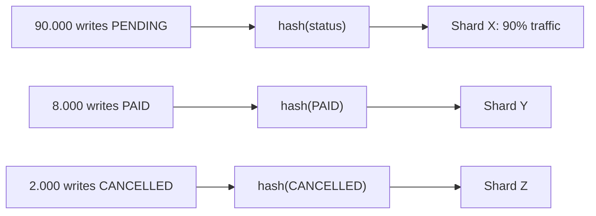
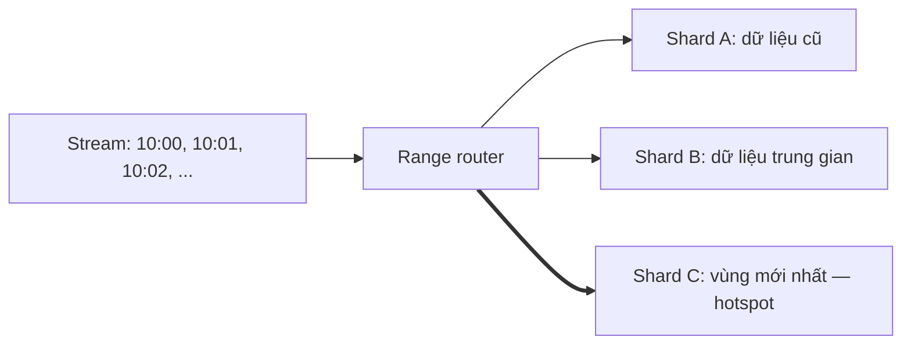

# Khóa có cardinality thấp, khóa tăng dần và phân phối không đều

## 1. Khi có nhiều node nhưng phần lớn request vẫn dồn vào một chỗ

Một hệ NoSQL được chia thành nhiều shard hoặc partition để tăng dung lượng và throughput. Tuy vậy, **thêm node không đồng nghĩa tải tự phân bố đều**. Nếu lựa chọn khóa phân vùng không phù hợp, một node có thể quá tải trong khi nhiều node khác gần như rảnh.

Giả sử một hệ thống ghi 80.000 sự kiện mỗi giây và có 8 nhóm lưu trữ. Nếu phân phối lý tưởng:

\[
\frac{80.000}{8}=10.000\ \text{write/s mỗi nhóm}
\]

Nhưng ứng dụng chọn trường `status` làm khóa phân vùng; 95% sự kiện có `status = ACTIVE`. Khi ấy giá trị `ACTIVE` có thể tập trung khoảng:

\[
80.000 \times 0{,}95=76.000\ \text{write/s}
\]

vào một key hoặc một nhóm định tuyến, trong khi những nhóm còn lại có rất ít việc.

Một tình huống khác: khóa phân vùng là `createdAt` tăng liên tục, còn database phân chia dữ liệu theo **khoảng giá trị (range sharding)**. Mặc dù mỗi timestamp khác nhau và cardinality rất cao, **những bản ghi mới đều thuộc vùng giá trị cao nhất**, gây điểm nóng ở shard phụ trách khoảng cuối.

Hai lỗi có hình thức khác nhau nhưng cùng hậu quả: **phân phối không đều**, tạo hot key/hot partition/hot shard, latency p99 cao, throttling, queue backlog và hạn chế khả năng mở rộng.

Bài này thuộc **Database No SQL — Phân mảnh và định tuyến**, tập trung vào ba nhóm vấn đề:

1. Khóa có **cardinality thấp** nên ít giá trị để phân tán.
2. Khóa **tăng dần** khiến writes mới tập trung theo thời gian.
3. Khóa có nhiều giá trị nhưng **tần suất truy cập lệch** vẫn tạo hotspot.

Điều cần tối ưu không chỉ là “mỗi shard chứa gần bằng nhau bao nhiêu GB”, mà là **đúng resource, request và bất biến nghiệp vụ được phân bổ hợp lý**.

### Mục tiêu học tập

Sau bài học, bạn có thể:

- Phân biệt partition key, shard key, sort/clustering key, physical shard và logical partition.
- Hiểu cardinality, entropy, skew, hot key, hot partition, hot range và temporal hotspot.
- Giải thích vì sao hash trên khóa cardinality thấp **không** giải quyết được điểm nóng.
- Giải thích vì sao range sharding trên khóa tăng dần dễ dồn writes vào một đầu dải.
- Chọn giữa hashing, composite keys, bucketing theo thời gian, salting/striping và phân mảnh dựa trên workload.
- Ước lượng số write mỗi shard, tỷ lệ tải lớn nhất/trung bình và query fan-out.
- Đánh đổi phân tán writes với khả năng query theo tenant, thời gian, thiết bị và tính duy nhất.
- Thiết kế khóa trên Cassandra, DynamoDB, MongoDB, Bigtable và Redis Cluster mà không đánh đồng semantics.
- Xây dựng ví dụ Java sinh khóa định tuyến ổn định và idempotent.
- Lập kế hoạch chuyển khóa, backfill và kiểm thử tải trước khi lên production.

## 2. Từ vựng cơ bản: một “khóa” có nhiều vai trò

Một số tên gọi giống nhau nhưng ranh giới khác nhau giữa các hệ thống.

| Thuật ngữ | Vai trò | Ví dụ |
|---|---|---|
| **Partition key** | Giá trị logic xác định nhóm dữ liệu/phạm vi định tuyến | `tenantId#deviceId#day` |
| **Shard key** | Trường hoặc tuple mà router dùng quyết định shard | `{customerId: 1}` hoặc `{_id: "hashed"}` |
| **Sort key** | Sắp xếp item trong một logical partition ở hệ có sort key | `occurredAt#eventId` |
| **Clustering key** | Quy định thứ tự bản ghi trong partition của mô hình wide-column | `occurred_at, event_id` |
| **Hash/token** | Kết quả biến đổi partition key phục vụ placement | Hash của key rồi gán lên token ring |
| **Logical partition** | Nhóm dữ liệu cùng một giá trị partition key | Các event của một thiết bị trong một ngày |
| **Physical partition** | Đơn vị tài nguyên/storage thực do engine quản lý | Một vùng dữ liệu trên node/disk |
| **Shard** | Đơn vị dữ liệu được phân phối, thường có replicas | Một phần collection hoặc keyspace |
| **Hot key** | Một giá trị key nhận quá nhiều traffic/CPU/I/O | `TENANT#mega` |
| **Hot range** | Một khoảng khóa nhận quá nhiều thao tác | Các timestamps mới nhất |
| **Skew** | Phân phối dữ liệu hoặc tải lệch khỏi mức cân bằng | Top 1% key tạo 80% traffic |

**Không suy rằng một logical partition luôn tương ứng với đúng một physical partition cố định mãi mãi.** Những dịch vụ managed có thể tự split/move/rebalance theo chính sách riêng. Phân tích ở bài này dùng *logical key* để mô tả rủi ro, sau đó cần kiểm tra **placement thực tế và throughput limit** theo engine.

### 2.1. Partition key không giống sort key

Ví dụ một kho có:

```text
Partition key: TENANT#t17#DEVICE#d42#DAY#2026-11-14
Sort key:      TS#2026-11-14T10:20:31.120Z#EVENT#e99
```

- Partition key đưa các sự kiện của một thiết bị trong ngày vào cùng nhóm logic.
- Sort key cho phép đọc theo thứ tự thời gian trong nhóm ấy.
- Sort key tăng dần không tự tạo **range-shard hotspot toàn cluster** nếu partition keys được hash và phân bố tốt; tuy vậy **một partition key quá nóng vẫn có thể là nút thắt**.

Không đánh đồng “timestamp nằm ở sort key” với “timestamp là shard key dạng range”.

## 3. Cardinality là số lượng giá trị phân biệt

Cardinality của một trường hay một tuple khóa là số giá trị **distinct** có thể xuất hiện trong dữ liệu hoặc cửa sổ workload đang xét.

Ví dụ:

| Trường | Cardinality ví dụ | Nhận xét |
|---|---:|---|
| `isDeleted` | 2 | Rất thấp |
| `status` | 5 | Thấp |
| `countryCode` | 200 | Hữu hạn; phân phối có thể lệch |
| `tenantId` | 50.000 | Cao nhưng có thể có tenant rất lớn |
| `deviceId` | 5.000.000 | Cao; xem thêm tần suất mỗi device |
| `eventId` duy nhất | Gần số events | Cao, thường thích hợp phân tán point writes |
| Timestamp millisecond | Có thể rất nhiều | Cao nhưng tương quan mạnh với thời gian |
| `(tenantId, deviceId, day)` | Tùy số tenant/device/day | Có thể cao và nhóm dữ liệu theo query |

Đây là **số liệu giả định**, không phải số cardinality chuẩn của các trường.

### 3.1. Cardinality của cả bộ khóa

Một key ghép `(countryCode, userId)` có thể có nhiều giá trị phân biệt hơn `countryCode` một mình. Nhưng cần quan sát **thuật toán định tuyến**.

Nếu range sharding dựa trên prefix `countryCode` rồi mới tới `userId`, toàn bộ traffic một quốc gia phổ biến vẫn có thể tập trung vào vùng liên quan, tùy cách chia chunks và split. Nếu router hash **toàn bộ bộ khóa**, có thể tản các bộ key khác nhau tốt hơn, nhưng query theo `countryCode` có thể cần fan-out.

Không nên nói “ghép thêm field là hết hotspot” nếu field mới không thực sự tham gia quyết định placement.

### 3.2. Cardinality phải tính trên cửa sổ hoạt động

Một kho có 10 triệu `deviceId` trong lịch sử, nhưng chỉ có 100 thiết bị đang gửi dữ liệu hôm nay. Cardinality lịch sử cao không cứu được write hotspot nếu **các active keys** chỉ có 100.

Các cửa sổ nên đo:

- 1 phút khi có burst.
- 5 phút hoặc 15 phút khi ghi đều.
- Giờ cao điểm.
- Ngày có batch import.
- Thời gian riêng của tenant lớn.
- Peak sau reconnect của hàng triệu clients.

**Distinct trong toàn table** và **distinct đang phát sinh request/s** là hai chỉ số khác nhau.

## 4. Cardinality thấp: vì sao hash không tự tạo thêm khóa?

Giả sử trạng thái đơn hàng có ba giá trị:

```text
PENDING   90%
PAID       8%
CANCELLED  2%
```

Ứng dụng chọn `status` làm partition key.

Một hàm hash ổn định:

\[
placement = H(status) \bmod N
\]

với `N=8` shards chỉ tạo ra **tối đa ba kết quả khác nhau** (thực tế còn có thể đụng cùng shard). Tất cả `PENDING` có cùng input nên cho cùng hash, không thể rải đều chỉ bằng cách tăng số shards.



### 4.1. Một cách nhìn bằng số

Cho 100.000 writes/s và 10 shards.

- Mức lý tưởng: 10.000 writes/s mỗi shard.
- `PENDING`: 90.000 writes/s trên cùng logical key.
- Dù nhóm `PAID` và `CANCELLED` ở hai shard khác nhau, peak có thể đạt khoảng 90.000 writes/s tại một shard.

Tỷ lệ peak so với lý tưởng:

\[
\frac{90.000}{10.000}=9
\]

Đó là **9 lần mức trung bình lý tưởng** trước khi xét overhead khác.

### 4.2. Hashing khác salting

- **Hashing cùng giá trị:** `H("PENDING")` luôn ra cùng đầu ra.
- **Salting/striping:** tạo nhiều giá trị logic như `PENDING#00`, `PENDING#01`, ... từ một phần định danh biến thiên.

Salting **thay đổi không gian key**, còn chỉ hash trường cardinality thấp không làm tăng số key.

### 4.3. “Khóa có 200 quốc gia” có đủ không?

Chưa chắc. Nếu 70% request đến từ một quốc gia, một key country rất nóng, dù có gần 200 giá trị. Điều cần đo là **phân phối tần suất** chứ không chỉ distinct count.

## 5. Phân phối lệch: key nhiều nhưng hot key vẫn tồn tại

Giả sử có 50.000 tenants. Phần lớn tenants nhỏ, nhưng một tenant `mega-shop` phát sinh 60% giao dịch.

Nếu dùng:

```text
Partition key = tenantId
```

thì mọi ghi của `mega-shop` vẫn có một điểm định tuyến logic rất nóng. Cardinality 50.000 **không đảm bảo cân bằng tải**.

### 5.1. Mô hình Zipf và “đuôi dài”

Trong nhiều workload thực tế, một số ít key rất phổ biến, còn vô số key khác hiếm khi được dùng:

```text
Key A      ███████████████████████████████████  60%
Key B      ██████                                10%
Key C      ███                                    5%
Other      ███████████████                       25%
```

Đó là **skew về độ phổ biến**. Một hệ có hash phân phối đều đối với rất nhiều **keys khác nhau** vẫn có thể quá tải vì không chia được nhu cầu của **một key duy nhất**.

### 5.2. Hot key và hot shard không phải một

- Một hot key có thể tạo nhiều CPU trên một physical resource.
- Một hot shard có thể nóng vì chứa **nhiều keys mức vừa**, không nhất thiết có một key duy nhất quá tải.
- Một hot range có thể nóng vì các keys mới luôn được route vào vùng cuối.
- Một hot node có thể nóng vì disk, compaction hoặc những shards cùng được đặt ở node ấy.

Chẩn đoán phải tìm **thứ gì thực sự nóng**, không chỉ nhìn CPU node.

## 6. Khóa tăng dần và hotspot ở cuối khoảng

Với **range-based sharding**, shard phụ trách một khoảng khóa, ví dụ:

```text
Shard A: [0, 1.000.000)
Shard B: [1.000.000, 2.000.000)
Shard C: [2.000.000, +∞)
```

Nếu ứng dụng liên tục thêm record có `createdAt`, `sequenceId` hoặc timestamp tăng:

```text
10:00:01 -> 10:00:02 -> 10:00:03 -> 10:00:04 ...
```

những writes mới dồn vào **khoảng cao nhất** (hoặc thấp nhất nếu dùng key giảm dần). Những shard lưu khoảng thời gian cũ ít nhận writes.

### 6.1. Sơ đồ



### 6.2. Cardinality cao vẫn không giải quyết

Một timestamp millisecond có hàng triệu giá trị khác nhau. Vấn đề không phải thiếu distinct values mà là **vị trí các giá trị mới trên trục đã sắp xếp**.

Nếu split xảy ra, “đầu cuối đang nhận dữ liệu” có thể tiếp tục di chuyển. Những splits/moves không nhất thiết phân tán được **write frontier** đang tăng liên tục khi mọi write luôn nhắm vào cùng phía mới nhất.

### 6.3. Đảo ngược timestamp có giải quyết không?

Đảo:

\[
reverseTime = T_{\max} - timestamp
\]

làm giá trị mới dồn về **đầu thấp nhất**, thay vì cuối cao nhất. Nếu range router vẫn chia theo trục đã sắp xếp, điểm nóng có thể chỉ **chuyển đầu**, không biến mất.

Reverse timestamp có giá trị khi muốn đọc dữ liệu mới trước trong một nhóm key, nhưng không tự tạo phân phối đều nếu thiếu prefix phân tán.

### 6.4. Key tăng dần có phải luôn xấu?

Không. Nếu database **hash toàn bộ khóa có cardinality cao trước placement**, các giá trị sequence khác nhau có thể đi đến nhiều physical partitions, dù giá trị gốc tăng dần. Ngược lại, nếu nhiều writes tập trung vào **một logical partition key** và timestamp chỉ là sort/clustering key, hash của partition key vẫn cố định.

Phải biết **trường nào được hash, trường nào được sắp theo range, và trường nào chỉ dùng để sort trong partition**.

## 7. Ba loại hotspot cần phân biệt trước khi sửa

| Kiểu | Dấu hiệu | Lý do gốc | Hướng xử lý thường xem |
|---|---|---|---|
| **Low-cardinality key** | Một vài key chiếm gần toàn bộ traffic | Không đủ distinct routing values | Composite high-cardinality, stripe/salt |
| **Sequential range hotspot** | Writes liên tục dồn vào shard ở mép range | Khóa mới luôn nằm ở một đầu dải | Hashed placement, prefix phân tán, chia stream |
| **Skewed high-cardinality workload** | Một tenant/entity nóng dù nhiều keys khác | Tần suất truy cập theo Zipf | Per-tenant stripes, isolation, adaptive routing |
| **Wide/hot partition** | Một partition có quá nhiều rows/bytes/reads | Partition quá lớn hoặc không có time bucket | Bucketing + giới hạn kích thước/tải |
| **GSI/index hotspot** | Base table ổn nhưng index throttle | Index partition key/cardinality kém | Đổi key index, index stripe, read model |
| **Hot sort-key region** | Một item collection nhận nhiều writes tại vùng sắp xếp mới | PK ổn định nhưng lưu nhiều events theo thời gian | Smaller time buckets + stripes nếu cần |
| **Placement imbalance** | Shards lệch dù keys tương đối đều | Split/placement/replica overlap, capacity | Rebalance, add nodes, inspect placement |

Mỗi hướng giải quyết có **cái giá truy vấn và vận hành**, không có một công thức duy nhất.

## 8. Shard key tốt phải cân bằng nhiều mục tiêu

Một khóa tốt không chỉ có cardinality cao.

### 8.1. Các tiêu chí cần xét

1. **High effective cardinality:** đủ số active keys để phân tán load.
2. **Low skew:** không có một vài keys nhận phần lớn traffic.
3. **Write distribution:** tránh mọi write vào một range frontier.
4. **Read locality:** query phổ biến tìm được đúng partition/shard thay vì scatter.
5. **Bounded partition size:** không tạo partitions tăng vô hạn.
6. **Stable ownership:** key không đổi thường xuyên khi dữ liệu được cập nhật.
7. **Business access pattern:** lọc theo tenant, device, user, time có hiệu quả.
8. **Cross-tenant isolation:** không trộn dữ liệu giữa tenants khi key collisions.
9. **Uniqueness/idempotency:** record retry đi cùng route và không tạo bản sao.
10. **Operational migration:** có cách backfill, dual-read, cutover và rollback.
11. **Vendor constraints:** item size, partition throughput, index restrictions và shard key rules.
12. **Security:** key không phơi lộ dữ liệu nhạy cảm trong logs/URLs khi không cần.

### 8.2. Đánh đổi phổ biến

| Lựa chọn | Lợi ích | Giá phải trả |
|---|---|---|
| `PK=tenantId` | Query tenant thuận tiện | Tenant lớn dễ nóng |
| `PK=eventId` hashed | Writes phân bố tốt | List theo tenant/time phải dùng index/scan |
| `PK=tenantId#day` | Gom dữ liệu từng ngày | Tenant lớn vẫn nóng trong ngày |
| `PK=tenantId#deviceId#day` | Phân tải theo thiết bị | Query toàn tenant phải fan-out nhiều devices |
| `PK=tenantId#deviceId#day#stripe` | Tăng đường ghi cho device hot | Query device/day phải đọc nhiều stripes |
| Range `createdAt` | Query thời gian có locality | Sequential insert frontier |
| Hash `createdAt` ở key thật sự | Tản các giá trị timestamp khác nhau | Range time query mất locality |
| Pre-allocated per-region quota | Viết local dưới partition network | Cần quản lý allocation và reconciliation |

## 9. Hash placement giải quyết được gì?

Một router có thể tính:

\[
shard = H(partitionKey) \bmod N
\]

Nếu nhiều keys khác nhau và hash tốt, keys thường phân bố tương đối đều khi \(N\) đủ lớn. Nhưng đây là mô hình minh họa:

- Một số NoSQL dùng token ring.
- Một số dùng consistent hashing và virtual nodes.
- Một số dùng range/chunk metadata.
- Một số dịch vụ managed tự điều chỉnh physical partitions.
- Mỗi shard còn có replicas và placement constraints.

### 9.1. Hashing key tăng dần

Giả sử event IDs `1,2,3,4,5,...`. Nếu **toàn bộ eventId** được hash để chọn shard, giá trị tăng không còn buộc mỗi record ở cuối một range.

Nhưng nếu `partitionKey = tenantId` và `sortKey = eventId`, hash chỉ áp dụng trên tenantId; mọi event một tenant vẫn thuộc cùng logical partition.

### 9.2. Hash không tự phân mảnh một hot key

`H("tenantMega")` vẫn có một kết quả cố định. Hash có thể chia **tập các tenants**, không chia request của **một tenant** nếu tenant là key duy nhất.

### 9.3. Consistent hashing, rendezvous và virtual nodes

Các kỹ thuật placement giúp phân bố nhiều keys trên nodes và giảm lượng key phải remap khi membership đổi. Virtual nodes có thể giúp cân bằng ownership giữa các nodes.

Nhưng chúng không tự chia một **logical key đơn nhất có 50.000 writes/s** thành 50 logical keys. Muốn chia một key, phải **đổi mô hình khóa/operation** hoặc dùng một tính năng engine có hỗ trợ tách tải theo phạm vi phù hợp.

### 9.4. Hash collisions và stable routing

Hai distinct keys có thể vào cùng shard/slot — điều bình thường. Quan trọng là:

- Hàm băm có tính ổn định khi replay/backfill.
- Encoding khóa không mơ hồ.
- Routing version được quản lý khi thay thuật toán hoặc số stripes.
- Không dùng hash không xác định giữa process/versions nếu client tự tính key.
- Không dùng số dư `hash % physicalNodeCount` đơn giản cho migration mà không xem cách nhiều keys bị đổi route khi số node thay đổi.

## 10. Composite key: thêm chiều để phân phối

Một lựa chọn là ghép nhiều trường:

```text
tenantId
tenantId + deviceId
tenantId + deviceId + day
tenantId + deviceId + day + stripe
```

Cardinality của tuple có thể tăng khi thêm trường có nhiều giá trị, nhưng phải kiểm tra:

- Router hash cả tuple hay chỉ phần nào.
- Một tenant có bao nhiêu device đang hoạt động.
- Một device gửi bao nhiêu events/s.
- Một time bucket chứa bao nhiêu bytes.
- Query thực tế có biết đủ trường để target partition không.
- Có phân biệt rõ encoding khi ghép chuỗi không.

### 10.1. Chống lỗi va chạm trong nối chuỗi

Sai:

```text
key = tenantId + deviceId
```

Vì:

```text
("ab", "c") -> "abc"
("a", "bc") -> "abc"
```

Thậm chí dùng dấu `#` cũng cần escape nếu input được phép chứa `#`.

Có thể dùng:

- Length-prefix encoding.
- Tuple serialization cố định.
- Base64url cho từng thành phần.
- JSON canonical hoặc binary encoding có schema.
- Một helper key builder được chia sẻ giữa writers/readers.

Khóa phải **deterministic**, không phụ thuộc locale hay trình tự không ổn định của map.

### 10.2. Composite key không thay index

`tenantId#deviceId#day` có thể giúp query theo đúng tenant/device/day, nhưng query “tất cả devices của tenant trong 3 năm” vẫn có thể fan-out lớn.

Một key layout cần dựa trên **query phổ biến nhất và budget fan-out**. Có thể cần bảng/query model riêng phục vụ những truy vấn khác.

## 11. Bucketing theo thời gian

Để tránh partition tăng vô hạn, có thể tách theo ngày/giờ:

```text
PK = tenant#t17#device#d42#day#2026-11-14
SK = time#10:10:01.001#event#e001

PK = tenant#t17#device#d42#day#2026-11-15
SK = time#00:00:00.001#event#e999
```

### 11.1. Lợi ích

- Partition có vòng đời hữu hạn theo bucket.
- Query theo một thiết bị trong một ngày có locality.
- TTL/archive/delete có thể hoạch định theo bucket.
- Lượng bytes mỗi partition có thể dự đoán tốt hơn.
- Giảm độ lớn của một partition trải nhiều năm.

### 11.2. Giới hạn

Nếu một thiết bị gửi 20.000 events/s, mọi event trong **ngày hiện tại** vẫn có cùng partition key. Đổi bucket sang giờ có thể giảm **kích thước tích lũy** nhưng trong mỗi giờ traffic vẫn là 20.000 events/s nếu chỉ một active bucket.

**Time bucketing giải quyết tăng trưởng/giới hạn partition; không tự chia write throughput của một stream nóng trong cùng cửa sổ thời gian.**

### 11.3. Chọn bucket size bằng số liệu

Giả sử:

- 500 events/s từ một device.
- Mỗi event trung bình 800 byte payload.
- Chỉ xét payload, bỏ index/metadata/compression.

Một ngày:

\[
500 \times 86.400 \times 800
= 34.560.000.000\ \text{byte}
\]

Khoảng 34,56 GB (đơn vị thập phân) chỉ riêng payload mỗi ngày. Một partition/ngày có thể quá lớn với một số engine.

Một giờ:

\[
500 \times 3.600 \times 800
= 1.440.000.000\ \text{byte}
\]

Khoảng 1,44 GB/giờ, vẫn có thể lớn tùy hệ.

Nhưng **throughput tức thời vẫn 500 events/s** trong bucket hiện hành. Khi đoán bucket size, phải xét đồng thời size, QPS, số partitions, query fan-out và vendor limits.

### 11.4. UTC và boundary

Time bucket nên được định nghĩa nhất quán, thường theo UTC:

```text
eventTime = 2026-11-14T23:59:59Z -> bucket 2026-11-14
eventTime = 2026-11-15T00:00:00Z -> bucket 2026-11-15
```

Nếu dùng múi giờ tenant, cần định nghĩa daylight saving time, timezone changes, late events, DST gaps và quy tắc query ngày. Không tự lấy ngày theo timezone mặc định của mỗi server.

### 11.5. Event-time hay ingestion-time bucket?

Một sự kiện phát sinh hôm qua nhưng đến hôm nay:

- **Event-time bucket:** lưu theo ngày phát sinh; query timeline đúng nhưng cần cho phép ghi vào bucket cũ.
- **Ingestion-time bucket:** lưu theo ngày nhận; đơn giản cho ingest/TTL nhưng query theo thời gian xảy ra cần xử lý khác.

Chọn một contract rõ; nếu hai service dùng hai loại ngày để tính key, dữ liệu sẽ phân tán khó truy vấn.

## 12. Salting/striping: chia một hot key thành nhiều key

Một hot device/day có thể dùng `S` stripes:

```text
tenant#t17#device#d42#day#2026-11-14#stripe#00
tenant#t17#device#d42#day#2026-11-14#stripe#01
...
tenant#t17#device#d42#day#2026-11-14#stripe#15
```

Chọn stripe theo hash của một identifier **thay đổi giữa records**:

\[
stripe = H(eventId) \bmod S
\]

Không dùng:

\[
stripe = H(deviceId) \bmod S
\]

nếu mục đích là phân tán những events của **cùng deviceId**, bởi tất cả events của device đều có cùng stripe.

### 12.1. Ví dụ 76.000 writes/s trên 16 stripes

Nếu phân phối lý tưởng:

\[
\frac{76.000}{16}=4.750\ \text{writes/s mỗi stripe}
\]

Đây là **mức trung bình lý thuyết**, không cam kết tất cả stripes nằm ở 16 physical nodes riêng, cũng không bao gồm skew trong routing, hash collisions, limits, partition splitting hay replication.

### 12.2. Vì sao chọn stripe theo eventId?

- Mỗi event có ID ổn định.
- Hai retries cùng event ID chọn cùng stripe.
- Các events khác nhau có thể tản theo hash.
- Không cần dùng random mới mỗi lần retry.
- Có thể tái tạo key khi backfill.

Nếu eventId thật sự là giá trị tăng dần, một **hash tốt trên eventId** vẫn có thể phân phối; vấn đề chỉ phát sinh nếu router dùng giá trị gốc dạng range hoặc hash trên field ít thay đổi.

### 12.3. Khi nào dùng random salt?

Random salt có thể giúp phân bố writes nếu mỗi event luôn lưu stripe đã cấp và mọi retry giữ nguyên key. Nhưng nếu một retry tự chọn salt mới, nó có thể tạo hai record cho cùng logical event.

Ưu tiên **deterministic hash của unique immutable event ID** cho idempotency, trừ khi ứng dụng có protocol lưu mapping salt từ lần đầu.

### 12.4. Giá của striping

Một query:

```text
GET last 100 events for device d42, day 2026-11-14
```

không thể chỉ đọc một partition. Nó có thể cần:

1. Query tất cả 16 stripes.
2. Lấy một số record mới nhất của mỗi stripe.
3. Merge theo `occurredAt, eventId`.
4. Deduplicate nếu data pipeline at-least-once.
5. Trả kết quả và lưu pagination cursor cho từng stripe.

**Write scaling thường đổi lấy read fan-out, CPU merge, network, bộ nhớ và complexity.**

## 13. Striping không nên được chọn bằng cảm giác

Có thể ước lượng:

\[
S \gtrsim
\left\lceil
\frac{\lambda_{\text{hot key}}}
{\lambda_{\text{target per stripe}}}
\right\rceil
\]

trong đó:

- \(\lambda_{\text{hot key}}\): peak throughput của hot key.
- \(\lambda_{\text{target per stripe}}\): throughput mục tiêu **được xác minh bằng benchmark** của một logical routing unit trong workload thực.

Ví dụ:

- Peak hot tenant = 48.000 writes/s.
- Mức mục tiêu dự kiến = 4.000 writes/s/stripe.

\[
S \geq \left\lceil \frac{48.000}{4.000}\right\rceil = 12
\]

Có thể thử 12, 16 hoặc một số stripes khác theo hạn chế của engine. Nhưng:

- Hash distribution có biến động.
- Physical placement có thể gom nhiều stripes.
- Query đọc tăng theo `S`.
- Một hot eventId bị ghi đi ghi lại vẫn chỉ chọn một stripe.
- Indexes và các bảng phụ có thể tiếp tục nóng.
- Thêm stripes không thay thế việc tăng cluster capacity tổng thể.

Đừng mặc định `S=16` là con số “chuẩn” cho mọi hệ.

### 13.1. Stripe count phải được version hóa

Nếu ngày đầu `S=8`, tháng sau đổi thành `S=16`, cùng eventId có thể ánh xạ sang stripe khác khi replay:

\[
H(eventId)\bmod8 \ne H(eventId)\bmod16
\]

Cần lưu `routingVersion`/`stripeCount` theo bucket hoặc trong record metadata, hoặc duy trì mapping để cả reader và writer tìm đúng dữ liệu cũ. Không thay giá trị cấu hình rồi ngầm coi tất cả dữ liệu được “chuyển” tự động.

### 13.2. Tăng stripe không tự di chuyển record cũ

Dữ liệu từng lưu trong 8 stripes không tự đi vào 16 stripes mới. Muốn thống nhất layout phải backfill/migrate, hoặc đọc cả hai layout trong một giai đoạn với dedup và kiểm soát.

## 14. Fan-out query: mặt trái của phân phối write

Nếu query theo một logical key phải đọc nhiều stripes, tổng số queries:

\[
Q_{\text{fanout}} = B \times S
\]

với:

- \(B\): số time buckets cần tra.
- \(S\): số stripes của mỗi bucket.

Ví dụ query 7 ngày, 16 stripes/ngày:

\[
Q_{\text{fanout}}=7\times16=112
\]

Một request người dùng có thể tạo **112 subqueries** trước khi merge.

### 14.1. Hệ quả

- Tăng read capacity và số request.
- Tail latency thường bị ảnh hưởng bởi một số shard chậm.
- Truyền nhiều metadata và cursor.
- Nhiều kết nối/streams hơn.
- Cần concurrency limit và deadline.
- Có thể phải đọc nhiều data rồi loại bỏ khi merge.
- Pagination phức tạp hơn.

### 14.2. Top-K merge

Mỗi stripe giữ events sắp theo `occurredAt DESC, eventId`. Reader muốn 100 events mới nhất.

Cách khái niệm:

1. Query mỗi stripe theo khoảng thời gian, lấy tối đa 100 ứng viên.
2. Dùng heap để trộn các streams theo sort order.
3. Chọn 100 đầu tiên.
4. Lưu cursor của từng stripe còn dùng được để phân trang tiếp.

Không phải lúc nào phải tải 100 từ cả 16 stripes; có thể tối ưu bằng streaming/bounds, nhưng cần chứng minh không bỏ sót một record có thứ tự cao hơn.

### 14.3. Pagination và dữ liệu mới chèn

Nếu phân trang bằng offset của từng stripe trong lúc events mới tiếp tục đến, có thể bị duplicate/missing. Một keyset pagination có cursor chứa:

- Mốc `(timestamp, eventId)` cuối.
- Per-stripe continuation token hoặc vị trí.
- Routing version.
- Bucket phạm vi truy vấn.
- Snapshot/cutoff nếu API cần trang ổn định.

Cursor phải có thời hạn và giới hạn kích thước; không để người dùng gửi cursor tự chế vượt quyền tenant.

### 14.4. Một read model riêng có thể hợp lý

Với ứng dụng thường xuyên cần “100 events gần nhất của device” và write rate rất cao, có thể giữ:

- **Write-optimized striped event table**.
- **Read-optimized latest-events projection** theo device, được cập nhật qua event pipeline và có độ trễ SLA riêng.

Nhưng projection eventual không được dùng làm nguồn duy nhất để cưỡng chế invariant cứng nếu dữ liệu có thể stale.

## 15. Ví dụ xuyên suốt: hệ IoT nhiều tenant

Giả sử:

- 1.000 tenants.
- 5 triệu thiết bị đăng ký.
- 100.000 events/s ở peak.
- 80% traffic đến từ 1% thiết bị đang hoạt động.
- API phổ biến: ghi event, đọc lịch sử của thiết bị trong khoảng ngày, lấy event theo ID.
- Retention: 90 ngày.
- Một số thiết bị công nghiệp có peak hàng nghìn events/s.

### 15.1. Phương án A — partition theo tenant

```text
PK = tenantId
SK = occurredAt#eventId
```

**Vấn đề:** tenant lớn là điểm nóng; partition tăng vô hạn; đọc một device phải lọc nhiều events của tenant.

### 15.2. Phương án B — partition theo device

```text
PK = tenantId#deviceId
SK = occurredAt#eventId
```

Phân phối tốt hơn giữa các devices. Nhưng device nóng vẫn có một key và một partition tăng mãi.

### 15.3. Phương án C — partition theo device và ngày

```text
PK = tenantId#deviceId#dayUTC
SK = occurredAt#eventId
```

Giới hạn kích thước theo ngày; query device/day hiệu quả hơn. Nhưng device đang hoạt động vẫn chỉ ghi vào bucket ngày hiện tại.

### 15.4. Phương án D — thêm stripe theo eventId

```text
PK = tenantId#deviceId#dayUTC#stripe
SK = occurredAt#eventId
stripe = stableHash(eventId) mod 16
```

Giúp chia hot device nếu các stripes thực sự được storage phân bố và cluster có đủ capacity. Đổi lại, query lịch sử thiết bị cần fan-out theo stripes.

### 15.5. Phân loại device nóng

Không phải mọi thiết bị cần 16 stripes. Có thể:

- Device bình thường: 1 stripe.
- Device nóng: 8 hoặc 16 stripes.
- Device rất nóng: tăng stripes/bucket size nhỏ hơn sau benchmark.

Nhưng **routing policy phải ổn định và có version**. Nếu classification thay đổi từng phút mà writers/readers không đồng bộ metadata, records có thể được ghi sai nơi hoặc cần đọc hàng chục layout.

### 15.6. Event ID và idempotency

Một event phải có ID ổn định từ nguồn hoặc được cấp đúng một lần. Nếu client retry cùng event vì mất ACK, nó phải dùng **cùng ID và cùng routing version**, không tạo hai record trong hai stripes.

Nếu uniqueness toàn cục của event ID là invariant, cần cơ chế unique conditional insert/ledger ở đúng consistency domain; hashing vào stripes không tự tạo unique constraint xuyên mọi bảng/index.

## 16. Java 17: tạo partition key theo ngày và stripe ổn định

Ví dụ code dưới đây cho một event. Nó dùng:

- UTC để xác định day bucket.
- SHA-256 để lấy hash bytes ổn định (không dùng hash như bảo mật).
- `Integer.remainderUnsigned` để chọn stripe không âm.
- Base64url để encode mỗi thành phần tránh nhầm dấu phân cách.
- `eventId` làm nguồn stripe để events cùng device có thể phân tán.
- Khóa sort chứa timestamp ISO UTC và event ID.

```java
import java.nio.ByteBuffer;
import java.nio.charset.StandardCharsets;
import java.security.MessageDigest;
import java.security.NoSuchAlgorithmException;
import java.time.Instant;
import java.time.ZoneOffset;
import java.util.Base64;

public final class EventKeyPlanner {
    public record Keys(
        String partitionKey,
        String sortKey,
        int stripe
    ) {}

    private EventKeyPlanner() {}

    private static String encodePart(String value) {
        if (value == null || value.isBlank()) {
            throw new IllegalArgumentException("Missing key part");
        }

        return Base64.getUrlEncoder()
            .withoutPadding()
            .encodeToString(value.getBytes(StandardCharsets.UTF_8));
    }

    private static int stableStripe(String eventId, int stripeCount) {
        if (stripeCount < 1 || stripeCount > 1024) {
            throw new IllegalArgumentException("Invalid stripe count");
        }
        try {
            byte[] digest = MessageDigest.getInstance("SHA-256")
                .digest(eventId.getBytes(StandardCharsets.UTF_8));

            int unsignedHash = ByteBuffer.wrap(digest).getInt();
            return Integer.remainderUnsigned(unsignedHash, stripeCount);
        } catch (NoSuchAlgorithmException impossibleForStandardJdk) {
            throw new IllegalStateException(
                "SHA-256 unavailable", impossibleForStandardJdk
            );
        }
    }

    public static Keys forEvent(
        String tenantId,
        String deviceId,
        String eventId,
        Instant occurredAt,
        int stripeCount
    ) {
        if (occurredAt == null) {
            throw new IllegalArgumentException("Missing event time");
        }

        String day = occurredAt.atZone(ZoneOffset.UTC)
            .toLocalDate().toString();

        // Event ID phải ổn định qua retry.
        String encodedId = encodePart(eventId);
        int stripe = stableStripe(eventId, stripeCount);

        String pk = "TENANT#" + encodePart(tenantId)
            + "#DEVICE#" + encodePart(deviceId)
            + "#DAY#" + day
            + "#STRIPE#" + stripe;

        String sk = "TS#" + occurredAt.toString()
            + "#EVENT#" + encodedId;

        return new Keys(pk, sk, stripe);
    }

    public static void main(String[] args) {
        Keys first = forEvent(
            "t17", "d42", "evt-1001",
            Instant.parse("2026-11-14T10:20:31.120Z"),
            16
        );

        Keys retry = forEvent(
            "t17", "d42", "evt-1001",
            Instant.parse("2026-11-14T10:20:31.120Z"),
            16
        );

        System.out.println(first);
        System.out.println(first.equals(retry)); // true
    }
}
```

### 16.1. Những giới hạn của ví dụ

- SHA-256 được dùng như **stable hash**, không phải yêu cầu mã hóa hay bảo mật.
- `stripeCount` phải lấy từ **routing policy cùng version**; đổi từ 8 sang 16 có thể đổi route.
- Nếu timestamp của cùng event bị sửa khi retry, sort key thay đổi; cần đảm bảo event time ổn định hoặc dùng một item ID và protocol cập nhật phù hợp.
- ISO-8601 string có thể dùng cho sort với format chuẩn hóa nhất quán, nhưng `Instant.toString()` có thể có độ dài biểu diễn phần thập phân thay đổi. Để bảo đảm **sort lexicographic tương ứng thời gian cho mọi precision**, production nên dùng fixed-width epoch milliseconds/microseconds hoặc một codec thời gian cố định đã định nghĩa.
- Base64url làm khóa dài hơn raw IDs; cần kiểm giới hạn key length và chi phí lưu trữ.
- Không giải quyết read fan-out, query theo tenant, uniqueness toàn cục hay permission.
- Không chứng minh stripes phân bố trên các physical partitions riêng; cần đo thực tế.

### 16.2. Tại sao không dùng `String.hashCode()`?

Java `String.hashCode()` có thuật toán ổn định theo contract Java cho nội dung UTF-16, nhưng một protocol đa ngôn ngữ sẽ dễ sai nếu Python/Go/JavaScript tính hash khác nhau. Việc chỉ định rõ SHA-256 + UTF-8 + first 4 bytes + unsigned modulo giúp các client có thể thực thi cùng quy tắc.

Nếu chọn Murmur3/xxHash hoặc hàm băm khác vì throughput, cần version hóa đúng thuật toán và seed/byte order. Không dùng hash mật mã chậm cho mọi event chỉ vì ví dụ trên chọn SHA-256.

## 17. Cassandra: partition key composite và clustering columns

Cassandra thường phân phối dữ liệu bằng token của **partition key**. Trong một table có partition key ghép, các thành phần trong dấu ngoặc kép là phần tạo token, còn clustering columns quyết định thứ tự dữ liệu **bên trong** partition.

### 17.1. Ví dụ thiết kế cho thiết bị/ngày/stripe

```sql
CREATE TABLE events_by_device_day_stripe (
    tenant_id text,
    device_id text,
    event_day date,
    stripe smallint,
    occurred_at timestamp,
    event_id uuid,
    payload text,
    PRIMARY KEY (
        (tenant_id, device_id, event_day, stripe),
        occurred_at,
        event_id
    )
) WITH CLUSTERING ORDER BY (
    occurred_at DESC,
    event_id ASC
);
```

Ở đây:

- `(tenant_id, device_id, event_day, stripe)` là **composite partition key**.
- `occurred_at, event_id` là **clustering columns**.
- Cùng một thiết bị/ngày có thể phân thành nhiều partitions theo stripe.
- Query theo một partition cụ thể có thể lấy events theo time range trong partition ấy.

### 17.2. Ví dụ query một stripe

```sql
SELECT occurred_at, event_id, payload
FROM events_by_device_day_stripe
WHERE tenant_id = 't17'
  AND device_id = 'd42'
  AND event_day = '2026-11-14'
  AND stripe = 3
  AND occurred_at >= '2026-11-14T10:00:00Z'
  AND occurred_at < '2026-11-14T11:00:00Z'
LIMIT 100;
```

Muốn đọc toàn bộ devices/day qua 16 stripes, ứng dụng cần thực hiện nhiều queries rồi merge.

### 17.3. Tránh một wide partition khổng lồ

Cassandra có thể chịu được nhiều rows trong một partition ở mức nhất định, nhưng partition quá lớn có thể gây:

- Read amplification khi query.
- Memtable/SSTable/compaction overhead.
- Repair và streaming chậm.
- Tombstone scans tốn chi phí.
- Hotspot về latency và throughput.
- Vấn đề paging/timeout.

Giới hạn partition an toàn phụ thuộc version, data shape và hardware; không đặt “mỗi partition tối đa X MB” như một quy luật chung cho mọi Cassandra deployment.

### 17.4. Clustering time tăng dần không tự phân phối dữ liệu

Nếu chọn:

```sql
PRIMARY KEY ((tenant_id, device_id), occurred_at, event_id)
```

thì mọi events của một device thuộc **một logical partition** dù `occurred_at` tăng. Vì thế **đổi sort order sang DESC không giải quyết hot partition**.

### 17.5. Counters và hot keys

Một counter tổng toàn tenant có thể là logical hotspot. Không phân tán write vô điều kiện rồi query sum eventual nếu nghiệp vụ cần quota không vượt ngay. Phải phân biệt analytics counters có thể hội tụ với những guard cần atomic consistency.

## 18. DynamoDB: partition key, sort key và hot logical access patterns

Trong DynamoDB, một item có partition key và có thể có sort key. Việc lựa chọn key ảnh hưởng mạnh tới Query access pattern và phân phối throughput.

### 18.1. Thiết kế không phù hợp

```text
PK = STATUS#PENDING
SK = TS#2026-11-14T10:20:31.120Z#ORDER#O42
```

Phần lớn orders đang `PENDING` khiến writes vào một logical partition key rất nóng. Sort key có hàng triệu giá trị **không tự biến mọi item thành partition keys khác nhau**.

Managed engine có thể áp dụng adaptive capacity hoặc split-for-heat trong những điều kiện nhất định; vì vậy không được giả định một partition key tương ứng một physical partition cố định mãi. Tuy nhiên, thiết kế traffic dồn vào một logical key vẫn cần benchmark và không thể trông chờ tự chia tải cho mọi workload.

### 18.2. Thiết kế write-distributed

```text
PK = TENANT#t17#DEVICE#d42#DAY#2026-11-14#S#05
SK = TS#2026-11-14T10:20:31.120Z#EV#e99
```

Mỗi event dùng stripe dựa trên event ID. Query toàn ngày phải biết đủ stripes hoặc có một read model khác.

### 18.3. Ví dụ một item

```json
{
  "PK": { "S": "TENANT#t17#DEVICE#d42#DAY#2026-11-14#S#05" },
  "SK": { "S": "TS#2026-11-14T10:20:31.120Z#EV#e99" },
  "eventId": { "S": "e99" },
  "deviceId": { "S": "d42" },
  "temperature": { "N": "28.4" }
}
```

Đây là biểu diễn **attribute value** kiểu low-level DynamoDB API, không phải record JSON thông thường ứng dụng lưu trực tiếp.

### 18.4. Adaptive capacity không thay thiết kế key

DynamoDB có các cơ chế quản lý physical partitions và adaptive capacity. Khả năng hỗ trợ hot partition key/sort-key range phụ thuộc table/index, access pattern và một số giới hạn như LSI trong tình huống nhất định.

Không nên phát biểu tuyệt đối rằng một partition key luôn không thể phân chia tải về vật lý. Cũng **không nên mặc định** dịch vụ sẽ giải quyết mọi hot-key pattern. Cần đo:

- Throttled read/write operations.
- Consumed vs provisioned/on-demand capacity.
- Contributor insights/hot keys nếu bật và phù hợp.
- Các access paths qua base table và GSIs.
- Latency p95/p99.
- Tần suất phân phối lại và throughput sau warm-up/burst.

### 18.5. GSI có thể tạo điểm nóng riêng

Base table đã partition tốt theo `eventId`, nhưng GSI:

```text
GSI_PK = status
GSI_SK = createdAt
```

vẫn có thể nóng vì `status=PENDING` và sort key tăng. **Đánh giá mọi index chịu writes**, không chỉ primary key.

Nếu một index cần query `status` theo giờ và có throughput cao, có thể dùng key theo `status#day#stripe` và query fan-out, hoặc đổi thành read model batch/eventual tùy yêu cầu.

### 18.6. Không quên tính duy nhất

Salting có thể khiến cùng business identifier được ghi vào nhiều keys nếu retry đổi salt. Với yêu cầu tạo duy nhất, dùng key ổn định hoặc transaction/conditional claim phù hợp. Đừng coi `eventId` trùng không thể xảy ra chỉ vì nó là UUID.

## 19. MongoDB: hashed sharding và ranged sharding

MongoDB hỗ trợ các chiến lược shard key, trong đó **hashed sharding** và **ranged sharding** có các đánh đổi khác nhau. Khả năng cụ thể phụ thuộc phiên bản, collection, index và topology.

### 19.1. Ranged shard key tăng dần

Một collection sharded theo `createdAt` dạng range có thể tập trung inserts mới ở một dải cuối.

```javascript
// Minh họa mô hình range sharding theo trường thời gian.
// Điều kiện index và lệnh cụ thể phụ thuộc cấu hình deployment.
sh.shardCollection("app.events", { createdAt: 1 });
```

Khi các giá trị mới luôn lớn hơn trước, vùng chứa các timestamps mới nhất chịu áp lực. Auto splitting/migration không nhất thiết làm đồng đều **write frontier hiện tại**.

### 19.2. Hashed key cho event ID

```javascript
db.events.createIndex({ _id: "hashed" });

sh.shardCollection("app.events", { _id: "hashed" });
```

Đây là ví dụ định hướng hashed shard key trên unique event ID. Khi event IDs khác nhau, placement theo hash có thể phân bố inserts thay vì dồn vào cuối range.

Đổi lại:

- Query theo `_id` có thể định tuyến tốt.
- Query theo `tenantId + time range` nếu không có shard key phù hợp có thể **scatter-gather**.
- Local secondary index có thể giảm chi phí lọc trên từng shard nhưng không loại bỏ nhu cầu fan-out.
- Unique-index và shard-key restrictions cần đọc theo đúng MongoDB version.

### 19.3. Hashed không phải lựa chọn duy nhất

Nếu workload chủ yếu query events của từng tenant trong một khoảng thời gian, có thể cần:

- Compound shard key với thành phần có cardinality tốt.
- Một read model/index phù hợp.
- Time buckets theo tenant/device.
- Zone sharding khi cần data locality.
- Thiết kế phân bố writes theo tenant lớn.

Không chọn hashed `_id` chỉ vì throughput inserts đẹp mà bỏ qua chi phí query toàn tenant.

### 19.4. Compound key và prefix

Trong range sharding, cách các field được sắp xếp trong compound shard key quan trọng; leading prefix ảnh hưởng locality và khả năng targeted query. Cần phân biệt **hashed compound shard key** được hỗ trợ theo phiên bản và **range compound shard key**, không giả định một tuple có nhiều field luôn được băm toàn bộ.

### 19.5. Migration và thay shard key

Đổi shard key cho collection lớn có thể yêu cầu các công cụ/qui trình resharding của MongoDB và chi phí tài nguyên đáng kể. Không xem đó là một `ALTER COLUMN` tức thời. Cần đo oplog/changes, cutover, balancer, index, storage và impact theo tài liệu phiên bản.

## 20. Bigtable/HBase: row-key order và hotspot do prefix

Trong Bigtable và những hệ lưu hàng theo thứ tự row key, **row key có ảnh hưởng mạnh đến locality**. Nếu nhiều writes dùng row keys bắt đầu bằng timestamp tăng dần và dữ liệu được chia theo key ranges, những writes mới có thể dồn về một dải tablet/region.

### 20.1. Một row key kém

```text
2026-11-14T10:00:00.001Z#deviceA
2026-11-14T10:00:00.002Z#deviceB
2026-11-14T10:00:00.003Z#deviceC
```

Nếu timestamp đứng trước, writes mới liên tục dồn vào cuối không gian key.

### 20.2. Prefix phân tán

Có thể dùng:

```text
s03#tenant17#deviceA#2026-11-14T10:00:00.001Z
s11#tenant17#deviceB#2026-11-14T10:00:00.002Z
s07#tenant17#deviceC#2026-11-14T10:00:00.003Z
```

Trong đó `sXX` được tính từ một thành phần đủ biến thiên, ví dụ event ID hoặc device ID tùy mục tiêu phân phối.

**Nếu tính prefix chỉ từ deviceId, toàn bộ writes của một device cực nóng vẫn cùng prefix.** Muốn chia ngay một device, cần một yếu tố per-event hoặc stripe hữu hạn.

### 20.3. Reverse timestamp không giải quyết tất cả

Một row key:

```text
tenant#device#reverseTimestamp
```

thuận cho việc đọc “mới nhất trước” trong cùng prefix. Nhưng nếu một device cực nóng, tất cả writes vẫn có cùng `tenant#device` và dồn vào vùng đầu của khoảng ấy. Cần cân nhắc salting/striping cùng query fan-out.

### 20.4. Đừng bỏ qua row scan

Salting trước tenant/device làm scan “mọi rows của device” phải đi qua nhiều prefix ranges. Một lựa chọn cần benchmark cả read/scan bytes và throughput, không chỉ write QPS.

## 21. Redis Cluster: hash slots và rủi ro hashtag

Redis Cluster định tuyến keys theo hash slot. Thông thường mỗi key được ánh xạ sang một slot trong 16.384 slots, và các slots được phân cho cluster nodes. Một cú pháp **hash tag** với dấu ngoặc nhọn có thể làm nhiều keys khác nhau dùng cùng phần hash.

### 21.1. Ví dụ cố tình collocate

```text
event:{tenant17}:001
event:{tenant17}:002
event:{tenant17}:003
```

Các keys này cùng dùng tag `tenant17` cho routing, nên rơi vào **cùng hash slot** dù suffix event ID khác nhau.

Điều đó hữu ích cho một số multi-key operations yêu cầu cùng slot, nhưng có thể khiến tenant nóng tạo hotspot ở slot/node chứa nó.

### 21.2. Phân tán với full key

```text
event:tenant17:001
event:tenant17:002
event:tenant17:003
```

Khi không có hashtag ép cùng slot, hash của toàn key có thể phân bố khác nhau. Đổi lại, multi-key operation có thể bị giới hạn bởi **cross-slot constraints** theo command/version.

### 21.3. Một key Redis cực lớn

Nếu toàn bộ tenant data nằm trong một Redis hash key:

```text
HSET tenant17:events event001 ...
HSET tenant17:events event002 ...
```

thì nhiều fields **không phải nhiều Redis Cluster keys** cho mục đích hash-slot placement. Chúng vẫn nằm trong một key, không tự được shard theo từng field bởi Cluster.

### 21.4. Resharding slots không tự chia một hot key

Di chuyển slot sang node khác giúp đổi placement; nó không làm một hot key được xử lý đồng thời trên nhiều nodes. Phải đổi data model hoặc phân tách logical key khi nghiệp vụ và command semantics cho phép.

## 22. Cùng vấn đề, nhiều cách sửa

| Vấn đề cụ thể | Không nên vội làm | Hướng cần kiểm thử |
|---|---|---|
| Status chỉ có 3 giá trị | Hash(status) rồi tăng số node | Thêm high-cardinality dimension/stripe |
| Timestamp range tăng | Đảo timestamp rồi coi đã đều | Hashed placement hoặc prefix phân tán |
| Một tenant tạo 70% writes | Chỉ dùng `tenantId` | Tenant-specific stripes hoặc isolate workload |
| Một device có 20.000 events/s | Chỉ bucket theo ngày/giờ | Stripe theo eventId + kiểm fan-out |
| Một GSI nóng | Chỉ reshard base table | Thiết kế lại key của GSI |
| Redis hashtag quá rộng | Chỉ thêm suffix random bên ngoài `{}` | Phân tích hash-slot domain |
| Query 7 ngày × 32 stripes | Tăng stripes vô hạn | Read projection, adaptive routing, bounded fan-out |
| Counter global hot | Blind sharded counter rồi dùng làm quota guard | Strong guard, escrow hoặc allocation |
| Data size cân bằng, CPU lệch | Chỉ rebalance theo GB | Route/concurrency/CPU và hot key metrics |
| Một hash key chứa mọi dữ liệu | Tăng cluster nodes | Phân tách logical keys/aggregate |

## 23. Đo skew: đừng chỉ đếm bytes mỗi shard

### 23.1. Max/average ratio

Cho throughput của 8 shards:

```text
[4k, 5k, 6k, 4k, 5k, 5k, 5k, 46k] writes/s
```

Tổng:

\[
W=80.000\ \text{writes/s}
\]

Trung bình:

\[
\bar w = 10.000\ \text{writes/s}
\]

Peak/average:

\[
\frac{46.000}{10.000}=4{,}6
\]

Một shard nhận 4,6 lần tải trung bình, dù tổng cluster có thể còn capacity chưa sử dụng.

### 23.2. Coefficient of variation (CV)

Có thể dùng:

\[
CV = \frac{\sigma(w_i)}{\bar w}
\]

Trong đó \(\sigma\) là độ lệch chuẩn của throughput giữa shards, \(\bar w\) là trung bình. CV gần 0 nghĩa là tải trên các shards tương tự nhau; CV cao cho thấy phân phối lệch.

Nhưng CV không nói **nguyên nhân**: có thể do hot key, hot range, placement imbalance, read workload khác nhau hoặc capacity node chênh lệch.

### 23.3. Key-frequency histogram

Top-K keys theo QPS:

```text
Top 1 key:    39% writes
Top 10 keys:  74% writes
Top 1% keys:  91% writes
```

Cần xem:

- Key nào nóng?
- Key ấy nằm ở node/shard nào?
- Tải tăng khi nào?
- Là write, read hay update/retry?
- Có liên quan một tenant, status hoặc một time bucket mới không?

### 23.4. Entropy của phân phối key

Với xác suất truy cập \(p_i\) của key \(i\):

\[
H = -\sum_i p_i\log_2 p_i
\]

Một phân phối đều có entropy lớn hơn phân phối mà hầu hết traffic tập trung vào một key, khi xét cùng tập keys.

Tuy nhiên entropy tính trên **key values** chưa tự phản ánh **placement**: nhiều keys có thể hash vào cùng physical shard. Vì vậy luôn đo thêm per-shard traffic và capacity.

### 23.5. Skew theo thời gian

Một heatmap theo giờ và shard giúp phát hiện:

- Shard cuối của một timestamp range nóng dần.
- Tenant chạy batch lúc 0h.
- Burst sau mạng phục hồi.
- Chuyển tải sang shard khác khi autosplit.
- Một GSI trở thành bottleneck sau khi traffic tăng.

Đo một snapshot khi tải thấp có thể bỏ qua điểm nóng thực.

## 24. Theo dõi storage skew khác traffic skew

Giả sử mỗi shard lưu 100 GiB; dung lượng cân bằng tuyệt đối. Nhưng một shard nhận 60% request.

**Storage balance ≠ request balance.**

Cần tách:

| Nhóm metric | Câu hỏi |
|---|---|
| Bytes per shard | Dung lượng có cân đối không? |
| Requests/s per shard | Throughput có cân đối không? |
| Read/write CPU | Shard nào xử lý việc nặng? |
| Disk IOPS/throughput | Có thiếu I/O? |
| P95/P99 latency | Tail latency ở đâu? |
| Retry/throttle/error | Có bị giới hạn capacity? |
| Cache hit rate | Một shard bị cache miss cao? |
| Compaction/flush backlog | Tải nền có tạo nghẽn? |
| Replica lag | Shard nóng làm replica chậm? |
| Top partitions/keys | Nút nóng nằm ở logical key nào? |
| Query fan-out | Một API có khuếch đại số requests? |
| Rebalance/split activity | Hệ có đang chuyển dữ liệu vì nóng? |

Một shard chứa dữ liệu cũ có thể rất lớn nhưng ít request; shard chứa range mới nhất có thể nhỏ nhưng cực nóng.

## 25. Hot read và hot write không luôn có cùng giải pháp

### 25.1. Hot write

Một key nhận rất nhiều mutation:

- Cùng một counter.
- Một stock item.
- Một tenant stream.
- Một status index.
- Một time range frontier.

Có thể cân nhắc stripe writes, batching, append-only events, per-region allocation, đổi partition key.

### 25.2. Hot read

Một sản phẩm rất phổ biến được GET hàng trăm nghìn lần/giây nhưng ít thay đổi. Giải pháp thường khác:

- Cache/CDN.
- Read replicas nếu contract cho phép.
- Precomputed responses.
- Read fan-out controls.
- Hot key replication ở lớp cache.

Salting writes không nhất thiết giúp hot read; đôi khi còn làm mọi read phải fan-out.

### 25.3. Read-modify-write cứng

Một inventory item có `available=1` phải bảo vệ invariant không âm. Chia counter thành 16 shards rồi cộng eventual có thể cho 16 người cùng nghĩ còn hàng.

Các hướng khác:

- Atomic conditional decrement tại authoritative guard.
- Reservation tokens hữu hạn.
- Escrow quota phân bổ theo vùng.
- Transaction/consensus phù hợp.
- Chấp nhận contention có kiểm soát nếu invariant quan trọng hơn peak throughput.

**Không đổi tính đúng đắn thành eventually consistent counter chỉ để giải hot key.**

## 26. Một index cũng có partition key của riêng nó

Mỗi secondary index/GSI/materialized view có thể có đường định tuyến khác primary table.

Ví dụ:

```text
Base table:
  PK = eventId  // cao cardinality

Index:
  PK = status  // chỉ 3 giá trị
  SK = createdAt
```

Base writes có thể phân bố tốt, nhưng mỗi write còn phải cập nhật index. Index nóng khiến toàn bộ write pipeline chậm hoặc throttle.

### 26.1. Kiểm kê trước khi chỉnh key

- Primary key distribution.
- Secondary index partition/sort keys.
- Search index ingest path.
- Change stream/CDC partitioning.
- Queue partition key.
- Materialized views.
- Idempotency ledger.
- Counter/guard records.
- Cache key prefix/hash tag.

Một hệ không thể chỉ đánh giá shard key của **bảng nguồn** rồi tuyên bố toàn bộ workflow scale tốt.

### 26.2. Denormalized read model

Có thể duy trì một read model tối ưu để query theo status/time, được cập nhật bất đồng bộ từ event log. Điều này giảm yêu cầu index phải gánh mọi truy vấn trên write path, nhưng tạo eventual consistency và độ trễ.

Với quyết định nghiệp vụ cứng, read model eventual không được tự đóng vai trò authoritative guard.

## 27. Partition keys và tính cục bộ dữ liệu

Không phải tất cả dữ liệu đều nên tản đều tuyệt đối. Có khi đặt dữ liệu cùng tenant/aggregate gần nhau giúp:

- Query theo range hiệu quả.
- Transaction/batch theo key dễ hơn.
- Giảm network giữa nodes.
- Hạn chế cross-shard joins.
- Dễ backup/archive một nhóm dữ liệu.

Nhưng nếu một aggregate quá nóng, locality có thể thành bottleneck.

### 27.1. Bài toán cân bằng

Chọn key theo hướng:

\[
\text{Write distribution}
\quad \longleftrightarrow \quad
\text{Read locality}
\]

Thêm stripes tăng write concurrency tiềm năng nhưng tăng query fan-out. Gom dữ liệu giúp read locality nhưng tăng contention.

### 27.2. Không có “cardinality càng cao càng tốt” vô điều kiện

Dùng unique event ID làm partition key cực kỳ phân tán, nhưng query “toàn bộ events của device D trong 24 giờ” có thể rất đắt nếu không có index/read model. Một schema tốt cần **một điểm cân bằng cho truy vấn chính** và cơ chế phục vụ truy vấn phụ.

## 28. Multi-tenant fairness và isolation

Khi một tenant lớn gây nóng tài nguyên dùng chung, các tenants khác có thể bị ảnh hưởng dù chúng chỉ có vài request.

### 28.1. Noisy neighbor

```text
Tenant mega: 60% writes
Tenant A:     1%
Tenant B:     1%
...
```

Nếu `mega` và tenants nhỏ cùng chia node/partition, CPU/IO queue của mega có thể làm latency p99 của tenant nhỏ tăng.

### 28.2. Biện pháp ở nhiều lớp

- Per-tenant rate limits.
- Fair queue/scheduling.
- Tenant-aware admission control.
- Tách tenant cực lớn ra pool riêng.
- Shard/stripe theo tenant lớn.
- Batching/write buffer phù hợp.
- Chọn data locality theo tenant khi isolation cần thiết.
- Capacity planning theo peak từng tenant, không chỉ tổng RPS.

### 28.3. Chia tenant lớn vẫn phải giữ quyền truy cập

Khi tenant được phân nhiều stripes, mọi read/write cần gắn tenant ID và authorization. Routing hash không phải cơ chế chống cross-tenant data access.

Không nên dùng một salt/key không kiểm soát để cho người dùng truy vấn sai tenant; service phải validate token, scope và version trước khi mở fan-out.

## 29. Skew theo thời gian và workload thay đổi

Một shard key tốt cho giai đoạn đầu có thể thành bottleneck khi sản phẩm phát triển.

### 29.1. Thay đổi phân phối traffic

- Một quốc gia/tenant trở thành 80% doanh thu.
- Một loại event mới có lượng ghi rất lớn.
- IoT devices gửi bù sau 24 giờ mất mạng.
- Batch import tạo timestamp giống nhau.
- App thêm tính năng làm status `PENDING` chiếm 99%.
- Một index mới ghi cùng key mỗi lần cập nhật.

### 29.2. Không chỉ dùng dữ liệu sản xuất trung bình

Benchmark nên tạo:

- Peak traffic.
- Top tenants tăng gấp nhiều lần.
- Một hot key nhân 10.
- Sequential keys ở tốc độ cao.
- Phân phối gần Zipf.
- Nhiều writers cùng một device.
- Burst offline replay.
- Rebalance/split/compaction trong lúc tải.
- Failover và retry storm.

Nếu chỉ load test 1 triệu record với keys uniform random, thiết kế có thể trông rất đều dù production skew mạnh.

## 30. Thay đổi stripe count khi hệ đang chạy

Giả sử ban đầu:

```text
routingVersion = 1
stripeCount = 8
```

Sau đo tải, muốn:

```text
routingVersion = 2
stripeCount = 32
```

Nếu hai writer dùng hai version khác nhau:

```text
Writer A: stripe = hash(eventId) % 8
Writer B: stripe = hash(eventId) % 32
```

cùng eventId có thể xuất hiện ở hai routes nếu retry chuyển giữa writers.

### 30.1. Metadata chính sách định tuyến

Có thể lưu policy theo entity/bucket:

```json
{
  "tenantId": "t17",
  "deviceId": "d42",
  "bucket": "2026-11-14",
  "routingVersion": 2,
  "stripeCount": 32,
  "hashAlgorithm": "sha256-first32-unsigned-mod"
}
```

Mọi writer phải có cách đọc policy đủ nhất quán, hoặc server chủ động gắn key/version vào operation ở lần đầu. Nếu không, sự thay đổi policy giữa request và retry có thể làm duplicate.

### 30.2. Chiến lược chuyển đổi

1. Định nghĩa schema và routing policy mới.
2. Nâng cấp readers để hiểu cả version 1 và 2.
3. Chọn cutover theo bucket/time boundary hoặc một epoch rõ.
4. Writers mới dùng version 2 cho những events thuộc scope mới.
5. Tiếp tục đọc version 1 cho dữ liệu lịch sử.
6. Backfill/repartition nếu cần hợp nhất.
7. Verify counts, operation IDs và query results.
8. Chuyển traffic dần và theo dõi p99/fan-out.
9. Khi an toàn, dừng đọc old layout và archive/decommission.
10. Giữ rollback plan nếu còn writers cũ.

Không nhất thiết phải rehash toàn bộ lịch sử: một số thiết kế có thể **giữ routing version theo time bucket**, làm reader biết bucket nào có 8 hay 32 stripes. Nhưng việc query across buckets phải hỗ trợ nhiều policies.

## 31. Di trú shard key cho bảng đang có dữ liệu

Thay shard key có thể là một trong những migration khó nhất ở NoSQL. Vì placement, index và query path đều liên quan.

### 31.1. Các lựa chọn

- Engine hỗ trợ resharding online theo contract.
- Tạo table/collection mới, backfill, dual-write hoặc CDC.
- Chia một tenant nóng sang new layout theo phase.
- Tạo read projection phục vụ query cũ.
- Đổi ứng dụng và routing theo version, không cutover đồng loạt.

### 31.2. Backfill và writes mới

Trong lúc backfill, dữ liệu gốc tiếp tục đổi. Nếu chỉ copy snapshot một lần, bảng mới có thể thiếu những writes sau snapshot.

Có thể dùng:

- Snapshot có watermark.
- CDC/change stream để bắt delta.
- Idempotent upsert theo event ID/version.
- Dual-read để kiểm tra kết quả.
- Cutover sau khi delta lag đạt ngưỡng chấp nhận.
- Transaction/guard cho thao tác cần strong correctness.

### 31.3. Dual-write không tự atomic

```text
write old table -> success
write new table -> failure
```

Hai bảng có thể lệch. Nếu dùng dual-write, cần outbox/CDC, reconciliation và một source-of-truth rõ, hoặc transaction nếu cùng domain hỗ trợ.

Đặc biệt với event at-least-once, retry phải giữ stable ID để không tạo duplicate ở cả hai layouts.

### 31.4. Đọc trong giai đoạn chuyển

Có thể dùng:

```text
read(newLayout)
if missing and policy allows:
    read(oldLayout)
```

Nhưng “missing ở new” có thể do replica/index lag chứ không phải record chưa di trú. Với một số nghiệp vụ cần snapshot/strong read, cần chuyển theo policy rõ hơn: query cả hai, dedup theo operation ID và chọn authoritative version.

### 31.5. Xóa dữ liệu cũ

Khi backfill đã hoàn tất, không xóa old layout chỉ theo số record count. Cần đảm bảo:

- Không còn writers cũ.
- Record/version đúng, không duplicate.
- Read paths đã chuyển.
- TTL/tombstone/backup theo retention.
- Indexes và query routing không tham chiếu nơi cũ.
- Có recovery plan khi mất dữ liệu ở layout mới.

## 32. Tại sao “cứ thêm shard” không giải quyết hết?

Thêm node tăng capacity tổng thể, nhưng nếu 80% traffic vẫn phải đi vào **một key không tách được**, capacity hữu ích còn bị giới hạn bởi bottleneck đó.

Mô hình đơn giản:

\[
Throughput_{\text{cluster}}
\leq
\min(
Throughput_{\text{aggregate capacity}},
Throughput_{\text{hot resource requirement}}
)
\]

Nói cụ thể hơn, nếu một logical hot key chỉ có một đường cập nhật tuần tự với 5.000 ops/s và ứng dụng cần 20.000 ops/s trên key ấy, thêm 10 nodes không tự làm khóa đó đạt 20.000 ops/s. Cần:

- Giảm/ghép số operations.
- Đổi mô hình dữ liệu để tách trách nhiệm an toàn.
- Shard theo thành phần hợp lý.
- Đổi primitive/protocol hoặc phục vụ kết quả tổng hợp bất đồng bộ.
- Mở rộng khả năng điều phối nếu engine có hỗ trợ.

### 32.1. Bottleneck cũng có thể nằm ở client/router

Một router chọn shard key bằng CPU, một coordinator phải merge 100 subqueries, hay một service cấp unique IDs có thể thành nút thắt trước database. Chỉ nhìn shard CPU có thể bỏ sót nguyên nhân ở tầng trên.

## 33. Quy trình chẩn đoán một hotspot production

### Bước 1 — Xác nhận điểm nóng thực sự

Thu thập:

- P99 latency theo operation/tenant/shard.
- Read/write requests/s mỗi shard.
- CPU/IO/network/cache metrics.
- Throttling và queue backlog.
- Bytes stored.
- Replication lag/compaction backlog.

### Bước 2 — Tìm top logical keys

Nếu có metrics contributor insights/top partitions hoặc tracing, xác định:

- Top 1/10/100 keys.
- Các fields tạo key.
- Tenant/time range nào chiếm traffic.
- Read hay write.
- Một key hay nhiều keys cùng nằm ở shard nóng.

Tránh log PII/raw partition keys nếu không cần; hash/anonymize trong telemetry theo policy.

### Bước 3 — Xem routing strategy

- Hash hay range?
- Trường nào thực sự được hash?
- Compound key field order?
- Hashtag ở Redis?
- Secondary index dùng key gì?
- Có split/auto-balancing không?
- Các stripes có thực sự nằm trên physical resources khác?

### Bước 4 — Xác định invariant và query path

Trước khi salt:

- Có cần unique key toàn cục?
- Có cần transaction chung trên một aggregate?
- Query sẽ fan-out mấy lần?
- Có cần read mới nhất hay read model eventual?
- Có SLA p99/throughput/cost nào?

### Bước 5 — Thử một chiến lược ở staging

Tái hiện:
- Cardinality thấp.
- Sequential writes.
- Hot tenant/device.
- Read fan-out.
- Failover/retry.
- Index writes.
- Production-like storage size và background work.

### Bước 6 — Rollout dần

Chọn một tenant/bucket được phê duyệt, tăng traffic có giới hạn, monitor và rollback theo routing version. Không đổi phân vùng toàn hệ trong một lần mà không có phương án đọc dữ liệu cũ.

## 34. Benchmark nhiều mục tiêu

Một số chỉ số cần đo cùng lúc:

| Nhóm | Metric |
|---|---|
| Distribution | Max/avg shard RPS, CV, top-key shares |
| Throughput | Total writes/s, reads/s, successful/attempted |
| Latency | Write/read p50/p95/p99, timeouts |
| Capacity | CPU, disk IOPS, network, memory |
| Storage | Bytes/partition, rows/partition, replica footprint |
| Index | GSI/search/index write latency và throttling |
| Routing | Targeted query %, scatter-gather %, fan-out |
| Replication | Apply lag, repair/backfill/compaction |
| Correctness | Duplicate event IDs, lost events, uniqueness violations |
| Migration | Routing version coverage, dual-read mismatch, CDC lag |
| Cost | Read/write capacity units, data transfer, storage, compute |
| Operations | Queue backlog, split/rebalance rate, hot key alarms |

### 34.1. Bảng giả định

| Phương án | Peak shard write/s | Read fan-out mỗi device/day | Write p99 | Ghi chú |
|---|---:|---:|---:|---|
| PK=tenantId | 60.000 | 1 nếu đọc toàn tenant | 400 ms | Tenant lớn quá nóng |
| PK=tenant#device#day | 9.000 | 1 | 90 ms | Phân tải theo device |
| + 8 stripes | 2.200 | 8 | 45 ms | Fan-out cao hơn |
| + 32 stripes | 1.100 | 32 | 43 ms | Diminishing returns, read cost tăng |

Số liệu **hoàn toàn giả định** và không phải benchmark của Cassandra, DynamoDB, MongoDB hay Redis. Nó minh họa việc từ 8 lên 32 stripes có thể chỉ cải thiện write p99 rất ít nhưng làm read fan-out tăng bốn lần.

### 34.2. Tối ưu tổng chi phí

Đừng chỉ chọn phương án có throughput writes tối đa.

Một mô hình quyết định:

\[
Cost_{\text{total}}
=
Cost_{\text{write}}
+
Cost_{\text{read-fanout}}
+
Cost_{\text{storage/index}}
+
Cost_{\text{operations}}
\]

đặt trong ràng buộc SLA:

\[
p99_{\text{read}} \leq SLA_{\text{read}}
\]

\[
p99_{\text{write}} \leq SLA_{\text{write}}
\]

và các bất biến nghiệp vụ. Chi phí còn gồm rủi ro migration, hỗ trợ query mới và bảo trì routing code.

## 35. Những sai lầm phổ biến

| Sai lầm | Hậu quả | Cách sửa |
|---|---|---|
| Dùng `status` làm shard key | Chỉ vài giá trị, hotspot | Thêm dimension có cardinality cao |
| Dùng `countryCode` mà không đo phân phối | Một thị trường nóng | Đo key-frequency, stripe nếu cần |
| Hash một key cố định | Một hash vẫn một route | Stripe theo per-record ID |
| Cho rằng nhiều tenants = đều | Tenant lớn có thể chiếm đa số writes | Phân tích skew tenant |
| Range-shard theo timestamp tăng | Hotspot ở đầu/cuối range | Hashed placement/prefix phân tán |
| Reverse timestamp để “giải hotspot” | Đổi hotspot sang đầu kia | Thêm distributed prefix |
| Dùng sort key tăng rồi gọi là global sequential hotspot | Nhầm scope PK vs SK | Xem routing thực |
| Bucket theo ngày rồi tưởng write load đã chia | Bucket hiện tại vẫn nóng | Stripe nếu cần |
| Stripe theo deviceId cho device nóng | Các events cùng stripe | Hash eventId/record ID |
| Chọn salt mới mỗi retry | Duplicates và khó lookup | Salt deterministic hoặc persisted mapping |
| Tăng stripes vô hạn | Fan-out, cursor, chi phí | Benchmark trade-off |
| Đổi `S=8` sang `S=16` không version | Retry/key mapping sai | Routing version và migration |
| Chỉ đo bytes/shard | Không thấy request skew | RPS/CPU/p99/top-key |
| Đánh giá base table mà bỏ GSI | Index vẫn nóng | Kiểm toàn bộ write path |
| Dùng hash key nhưng query theo tenant | Scatter-gather tốn | Chọn compound/read model |
| Dùng Redis hash tag trên tenant nóng | Tất cả keys cùng slot | Xem scope hashtag |
| Nghĩ virtual nodes sẽ chia một hot key | Một key vẫn một route | Đổi logical key/workload |
| Dùng sharded counter eventual cho quota cứng | Có thể cấp vượt giới hạn | Guard/escrow/transaction |
| Tách aggregate nhưng bỏ tính nguyên tử | Có orphan records | Workflow/transaction phù hợp |
| Đồng hồ client tính day khác nhau | Event đi vào bucket sai | UTC/event-time policy |
| Trộn tenantIDs bằng nối chuỗi mơ hồ | Key collisions, lộ/sai dữ liệu | Canonical encoding |
| Hash algorithm khác giữa Java/Python | Routing inconsistent | Contract thuật toán/seed/version |
| Rely hoàn toàn auto split | Có workload engine không tự chia như mong | Đo under load và xem docs |
| Backfill một lần rồi cutover | Bỏ sót writes trong lúc copy | Snapshot+CDC/reconciliation |
| Dual-write và gọi atomic | Partial write | Outbox/transaction/repair |
| Chỉ load test uniform random keys | Không thấy production hot tenant | Test skew/burst/sequential |
| Chỉ tăng số node | Hot key giới hạn throughput | Chia workload/đổi model |
| Không ràng buộc fan-out query | Request explosion | Bounded concurrency/cursors |

## 36. Bài tập thực hành

### Bài 1 — Cardinality thấp

Hệ có 10 shards, 100.000 writes/s và 90% records mang `status=PENDING`. Router hash `status`.

**Yêu cầu:** tính ideal writes/s/shard, traffic từ `PENDING` và peak/ideal ratio tối thiểu do hot key tạo ra. Tại sao thêm 10 shards chưa chắc giải quyết?

**Gợi ý:** ideal 10.000, PENDING 90.000, tỷ lệ 9; một giá trị hash vẫn có một route.

### Bài 2 — Key tăng dần

Một MongoDB collection phân theo khoảng `createdAt`. Mọi writes mới có timestamp lớn hơn trước.

**Câu hỏi:** vì sao cardinality rất cao mà vẫn có write hotspot? Đảo timestamp có giải quyết chắc chắn không?

**Gợi ý:** mọi key mới tới range cuối; đảo có thể dồn sang range đầu. Cần routing phân tán thật.

### Bài 3 — Tenant lớn

Một hệ có 20.000 tenants nhưng tenant A tạo 65% writes. Partition key chỉ là `tenantId`.

**Yêu cầu:** đề xuất hai thiết kế khác nhau để chia tải tenant A, nêu query nào trở nên đắt hơn.

**Gợi ý:** `tenant+device+timebucket` hoặc per-tenant stripes; query toàn tenant phải fan-out.

### Bài 4 — Time bucket

Một thiết bị tạo 500 events/s, mỗi event 800 bytes.

**Yêu cầu:** ước lượng payload mỗi giờ/ngày và giải thích tại sao chuyển từ bucket ngày sang giờ không làm giảm throughput tức thời của thiết bị.

**Gợi ý:** 1,44 GB/giờ, 34,56 GB/ngày; trong giờ hiện tại vẫn 500 events/s.

### Bài 5 — Chọn trường để stripe

Một stream của device `d42` có 10.000 events/s và 16 stripes.

**Câu hỏi:** `hash(deviceId)%16` hay `hash(eventId)%16` phân tán events của d42 tốt hơn? Điều kiện nào giúp retry không tạo duplicate?

**Gợi ý:** eventId khác nhau giữa events, ổn định qua retry; cần persist/cố định routing version và event ID.

### Bài 6 — Query fan-out

Query cần 14 ngày, mỗi ngày 32 stripes.

**Yêu cầu:** tính số partition queries tối đa nếu quét tất cả. Đề xuất cách tránh tải vô hạn và pagination đúng thứ tự.

**Gợi ý:** 14 × 32 = 448, bounded concurrency, merge Top-K, cursor từng stripe, read model riêng nếu query phổ biến.

### Bài 7 — DynamoDB GSI

Base table có PK=eventId rất đều, GSI theo `status` và sort `createdAt`. 95% events có status=ACTIVE.

**Yêu cầu:** giải thích vì sao base key đều mà writes vẫn throttle ở GSI; đề xuất thay index key hoặc read model.

**Gợi ý:** index là đường ghi riêng và low-cardinality/hot range.

### Bài 8 — Cassandra

Table dùng `PRIMARY KEY ((tenant_id, device_id), occurred_at)`, một device tạo 2 triệu rows/ngày.

**Yêu cầu:** clustering key có giúp chia partition trên token ring không? Thiết kế composite PK mới và giải thích query trade-off.

**Gợi ý:** không; thêm bucket/stripe vào partition key.

### Bài 9 — Redis Cluster

Ba keys:

```text
order:{tenantA}:001
order:{tenantA}:002
order:{tenantA}:003
```

**Câu hỏi:** vì sao cả ba có thể vào cùng slot mặc dù suffix khác? Được và mất gì khi bỏ hashtag?

**Gợi ý:** hash tag chỉ dùng nội dung trong `{}`; bỏ nó phân tán hơn nhưng có thể mất khả năng multi-key commands cùng slot.

### Bài 10 — CV và max/avg

Tám shards có writes/s:

```text
4k, 5k, 6k, 4k, 5k, 5k, 5k, 46k
```

**Yêu cầu:** tính tổng, trung bình và max/avg ratio; kể ba nguyên nhân ngoài hot logical key.

**Gợi ý:** 80k, 10k, 4,6; range frontier, placement, compaction/cache/disk skew.

### Bài 11 — Routing version

Hôm qua có 8 stripes, hôm nay 16. Một event hôm qua bị retry.

**Yêu cầu:** mô tả trường hợp cùng eventId có thể tới hai partition keys; chọn quy tắc để retry vẫn tìm đúng record.

**Gợi ý:** routingVersion theo bucket/operation ID, không lấy S hiện tại cho mọi dữ liệu lịch sử.

### Bài 12 — Quota cứng

Tenant có quota 100 jobs, nhưng để scale writes developer chia bộ đếm `used` thành 16 shards eventual.

**Câu hỏi:** vì sao các worker có thể cùng cấp vượt quota? Đề xuất một phương án an toàn hơn.

**Gợi ý:** một authoritative conditional guard, reservation tokens hoặc escrow allocations được bảo vệ.

### Bài 13 — Di trú dữ liệu

Old table dùng PK=tenantId; new table dùng PK=tenantId#deviceId#day#stripe. Trong khi backfill, users vẫn gửi events.

**Yêu cầu:** vẽ cutover plan tránh thiếu/nhân đôi event và cách phát hiện mismatch.

**Gợi ý:** snapshot watermark, CDC/outbox, idempotent writes, dual-read/counters và routing policy versioned.

### Bài 14 — Chọn thiết kế theo workload

Một dịch vụ có:

- 90% writes là append IoT events.
- 8% reads query device trong một ngày.
- 2% reads query toàn tenant trong 30 ngày.
- Một device nóng tạo 20.000 writes/s.
- SLA read p99 dưới 100 ms.

**Yêu cầu:** đề xuất partition key, sort key, stripe count thử nghiệm và chính sách cho query toàn tenant. Những metrics nào quyết định số stripes?

**Gợi ý:** tenant+device+day+stripe từ eventId, sort time+id; thử nhiều S; query toàn tenant có thể cần projection/analytics, đo p99/fan-out và distribution.

## 37. Checklist thiết kế shard/partition key

### Phân tích dữ liệu

- [ ] Biết distinct key count của **active workload**, không chỉ toàn lịch sử?
- [ ] Có thống kê top 1/10/100 keys theo read/write QPS?
- [ ] Biết tỷ lệ traffic từ tenant/device lớn nhất?
- [ ] Có field tăng tuần tự như timestamp/sequence/ObjectId không?
- [ ] Có phân biệt range key và hashed placement?
- [ ] Có biết mục tiêu size/rows per partition theo engine?
- [ ] Có biết event-time và ingestion-time policy?

### Phân phối và truy vấn

- [ ] Key thực sự tham gia routing có high effective cardinality?
- [ ] Có một hot key không thể chia bằng hash đơn thuần?
- [ ] Composite key field order có phù hợp router/access pattern?
- [ ] Salt/stripe được tính từ field thay đổi per record?
- [ ] Stripe deterministic và idempotent qua retry?
- [ ] Query fan-out có bound và pagination strategy?
- [ ] Đã đo read locality sau khi tăng stripes?
- [ ] Có đánh giá secondary indexes, queue và cache keys?

### Tính đúng đắn

- [ ] Có invariant cần transaction/conditional guard?
- [ ] Việc chia partition có làm mất uniqueness hay idempotency không?
- [ ] Có source-of-truth để đối soát duplicates?
- [ ] Có tách nghiệp vụ cần strong read khỏi eventual projection?
- [ ] Routing version có được lưu/tra cứu nhất quán?
- [ ] Tenant key encoding không va chạm và có authorization?

### Vận hành và thay đổi

- [ ] Benchmark skewed, sequential và burst workload?
- [ ] Đo max/avg, CV, top key share và p99?
- [ ] Đã đo traffic/index/throttling trên từng shard?
- [ ] Có nhận diện physical placement và autosplit behavior?
- [ ] Có kế hoạch backfill+CDC/dual-read khi đổi key?
- [ ] Có rollback/cutover policy với writers cũ?
- [ ] Có giám sát routing version và fan-out growth?
- [ ] Có capacity/fairness plan cho noisy tenants?

## 38. Nguồn tham khảo chính thức

Khi thiết kế production, đối chiếu **đúng phiên bản, deployment, topology, table/index type và giới hạn engine**:

- [MongoDB Sharding](https://www.mongodb.com/docs/manual/sharding/) — shard key, range/hashed sharding, balancer, chunks.
- [MongoDB Hashed Sharding](https://www.mongodb.com/docs/manual/core/hashed-sharding/) — hashed shard keys và query locality.
- [MongoDB Shard Keys](https://www.mongodb.com/docs/manual/core/sharding-choose-a-shard-key/) — cardinality, frequency, monotonicity và query patterns.
- [MongoDB Reshard a Collection](https://www.mongodb.com/docs/manual/core/sharding-reshard-a-collection/) — kế hoạch thay shard key theo version.
- [Apache Cassandra Documentation](https://cassandra.apache.org/doc/latest/) — partition/clustering keys, token distribution, partitions và compaction.
- [Amazon DynamoDB Partition Key Best Practices](https://docs.aws.amazon.com/amazondynamodb/latest/developerguide/bp-partition-key-design.html) — phân phối đều, write sharding và capacity.
- [Amazon DynamoDB Write Sharding](https://docs.aws.amazon.com/amazondynamodb/latest/developerguide/bp-partition-key-sharding.html) — suffix/hashed write sharding.
- [DynamoDB Adaptive Capacity](https://docs.aws.amazon.com/amazondynamodb/latest/developerguide/bp-partition-key-design.html) — giới hạn và thực tế quản lý hot partitions, cần xem theo service mode.
- [Google Cloud Bigtable Schema Design](https://cloud.google.com/bigtable/docs/schema-design) — row keys, hotspot và hiệu quả scan.
- [Google Cloud Bigtable Hotspots](https://cloud.google.com/bigtable/docs/schema-design#row-keys) — ảnh hưởng sequential row keys và row ranges.
- [Apache HBase Book](https://hbase.apache.org/book.html) — row key design, salting và region hotspots.
- [Redis Cluster Specification](https://redis.io/docs/latest/operate/oss_and_stack/reference/cluster-spec/) — 16.384 hash slots và hash tags.
- [Redis Cluster Tutorial](https://redis.io/docs/latest/operate/oss_and_stack/management/scaling/) — placement và resharding.
- [Designing Data-Intensive Applications](https://dataintensive.net/) — data partitioning, skew, hot keys, secondary indexes.

Tài liệu chính thức có thể thay đổi theo phiên bản. Những con số throughput, latency và partition size trong bài là **giả định hoặc ví dụ phép tính**, không phải SLA/cam kết của từng hệ.

## 39. Kết luận

**Khóa có cardinality thấp tạo quá ít giá trị để phân tán; khóa tăng dần dễ dồn writes về một đầu dải range; và ngay cả khóa có cardinality cao vẫn gây hotspot nếu một số giá trị chiếm phần lớn traffic.** Cả ba đều có thể khiến cluster nhiều node hoạt động giống như chỉ có một node đang gánh tải.

Cách giải quyết bắt đầu từ **đo phân phối request thật và hiểu đúng routing**. Hash một key chỉ có ba giá trị không tạo ra hàng nghìn routes; bucketing theo ngày không tự chia stream nóng trong ngày; đổi thứ tự timestamp không làm mất hot frontier; virtual nodes không chia được một hot logical key. Composite keys, hashing, time bucketing và salting/striping chỉ hiệu quả khi trường được thêm **thực sự tham gia placement**, đồng thời không làm query fan-out và operational complexity vượt ngân sách.

Một quy trình thiết kế tốt là:

1. Đo top-key share, max/average shard RPS, latency p99 và bytes/partition.
2. Phân biệt low-cardinality, sequential-range và access-frequency skew.
3. Chọn scope partition dựa trên query chính và bất biến nghiệp vụ.
4. Tăng effective cardinality bằng composite key/stripe đúng chỗ; chọn time bucket để kiểm soát tăng trưởng.
5. Giữ routing deterministic, versioned và idempotent.
6. Đo read fan-out, secondary-index writes và sự phân bố physical thật.
7. Thử skew/burst/failover, rồi chuyển đổi có backfill/CDC và rollback rõ.

Câu hỏi cuối cùng không phải **“shard key này có bao nhiêu giá trị phân biệt?”** mà là **“dưới peak workload thực, mỗi node nhận bao nhiêu write/read, hotspot nằm ở key hay range nào, và chi phí truy vấn cũng như tính đúng đắn phải trả để phân tán tải có chấp nhận được không?”**

