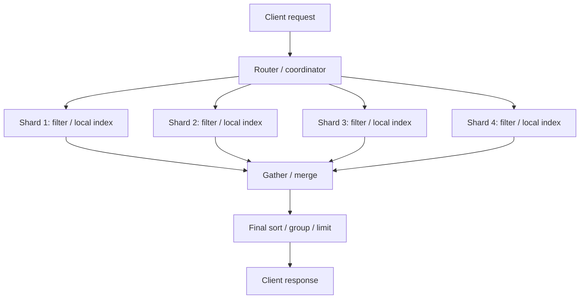
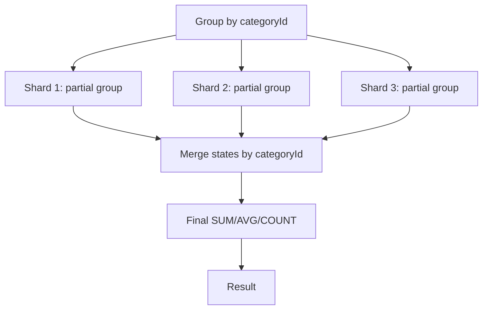
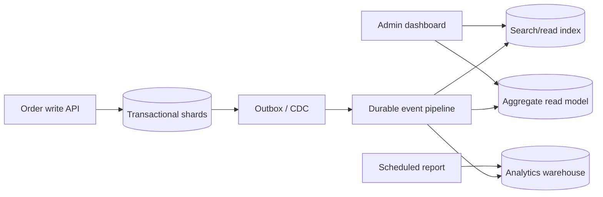

# Chi phí tập hợp kết quả, sắp xếp và tổng hợp xuyên phân mảnh

## 1. Tình huống mở đầu: một truy vấn đơn giản nhưng chạm cả cụm

Một ứng dụng thương mại điện tử lưu đơn hàng trong hệ NoSQL đã chia thành nhiều **shard**. Mỗi shard giữ một phần các đơn hàng. Giao diện quản trị yêu cầu:

> “Hiển thị 20 đơn mới nhất của tất cả khách hàng, theo thời gian tạo giảm dần.”

Lệnh ở mức ý tưởng:

```javascript
db.orders.find(
  { status: "PAID" }
).sort({
  createdAt: -1,
  _id: -1
}).limit(20);
```

Nếu `status` không phải một điều kiện có thể định tuyến đến một nhóm shard hẹp, database có thể phải gửi truy vấn tới **nhiều shard**:

```text
Client
   |
   v
Query router
   |------> Shard 1: lọc và lấy các bản ghi ứng viên
   |------> Shard 2: lọc và lấy các bản ghi ứng viên
   |------> Shard 3: lọc và lấy các bản ghi ứng viên
   |------> Shard 4: lọc và lấy các bản ghi ứng viên
   |
   v
Gộp những ứng viên
Sắp xếp để tạo thứ tự toàn cục
Trả 20 bản ghi mới nhất
```

Người dùng chỉ cần **20 dòng**, nhưng hệ thống có thể đọc index, gửi RPC, xử lý kết quả và giữ bộ nhớ trên **toàn bộ cụm**. Nếu cùng truy vấn còn yêu cầu `COUNT(DISTINCT userId)` hoặc `GROUP BY productId ORDER BY revenue DESC`, chi phí tổng hợp có thể lớn hơn nhiều.

Đó là vấn đề cốt lõi của bài học: **sharding phân tán dữ liệu và tải ghi, nhưng các truy vấn cần một góc nhìn toàn cục có thể phải trả chi phí gom, sắp xếp và tổng hợp xuyên phân mảnh**.

Không nên kết luận “càng nhiều shard thì mọi truy vấn càng nhanh”. Việc phân mảnh giúp **một số đường truy cập**, song cũng tạo thêm **network fan-out, merge, coordination, memory pressure và tail latency** cho các thao tác cần kết hợp dữ liệu.

## 2. Mục tiêu học tập

Sau bài này, bạn cần có thể:

1. Phân biệt **truy vấn trúng một shard** với **truy vấn phát tán nhiều shard**.
2. Mô tả mô hình **scatter–gather** và các điểm tốn CPU, RAM, I/O, mạng.
3. Hiểu vì sao **ORDER BY + LIMIT** toàn cục cần một bước merge, và khi nào có thể dùng local top-K.
4. Giải thích vì sao **OFFSET lớn** và phân trang trên nhiều shard thường đắt hoặc không ổn định.
5. Biết cách tính đúng **SUM, COUNT, AVG, MIN, MAX, DISTINCT, percentile, top groups** khi dữ liệu bị chia.
6. Phân biệt phép tổng hợp có thể đẩy xuống shard với phép đòi coordinator giữ nhiều trạng thái.
7. Nhận biết **data skew, hot groups, spill to disk, straggler, p99 amplification**.
8. Thiết kế shard key, index, read model và API cho các truy vấn quan trọng.
9. Đọc kế hoạch thực thi/metrics tương ứng trong MongoDB, Elasticsearch/OpenSearch, Cassandra, DynamoDB và Redis Cluster.
10. Đặt đúng điều kiện về **snapshot, consistency, dữ liệu thiếu và partial results** trong báo cáo xuyên shard.

## 3. Các thuật ngữ cần thống nhất

| Thuật ngữ | Ý nghĩa |
| --- | --- |
| **Shard / partition** | Một phần dữ liệu được phân phối theo quy tắc chia dữ liệu |
| **Shard key / partition key** | Trường hoặc tập trường ảnh hưởng nơi lưu và định tuyến dữ liệu |
| **Router / coordinator** | Thành phần nhận truy vấn và gửi tới những shard phù hợp |
| **Targeted query** | Truy vấn có thể định tuyến đến ít shard |
| **Scatter–gather** | Gửi yêu cầu ra nhiều shard rồi thu kết quả về để kết hợp |
| **Fan-out** | Số shard/nhánh con phải tham gia một truy vấn |
| **Merge sort** | Kết hợp những luồng đã sắp xếp cục bộ thành thứ tự toàn cục |
| **Partial aggregation** | Tính trạng thái tổng hợp cục bộ trước khi merge |
| **Final aggregation** | Kết hợp trạng thái từ các shard thành kết quả cuối |
| **Shuffle / exchange** | Di chuyển dữ liệu giữa các worker để nhóm theo khóa mới |
| **Top-K** | Lấy K phần tử đứng đầu theo một thứ tự xác định |
| **Cardinality** | Số lượng khóa/nhóm khác nhau |
| **Skew** | Phân phối dữ liệu hoặc tải lệch mạnh giữa các shard/nhóm |
| **Spill** | Đẩy dữ liệu trung gian từ bộ nhớ xuống thiết bị lưu trữ |
| **Read model / projection** | Dữ liệu được tổ chức sẵn cho một đường đọc cụ thể |
| **Watermark / revision** | Mốc dùng để nói dữ liệu đã được xử lý đến đâu |

Trong các hệ khác nhau, khái niệm “shard” và “partition” không phải lúc nào ánh xạ 1–1 tới máy vật lý. Ví dụ partition logic của DynamoDB khác chi tiết phân chia vật lý bên dưới dịch vụ managed. Đừng suy một câu lệnh `Query` trên một logical partition luôn là một RPC đơn tới một máy.

## 4. Ba loại đường truy cập

### 4.1. Định tuyến chính xác đến một shard hoặc một tập hẹp

Giả sử dữ liệu phân theo `tenantId`:

```text
tenantId = T01 -> Shard A
tenantId = T02 -> Shard C
tenantId = T03 -> Shard B
```

Truy vấn:

```javascript
db.orders.find({
  tenantId: "T01",
  status: "PAID"
});
```

có thể được **target** theo shard key, tùy cấu hình sharding. Những thao tác lọc/sắp xếp/giới hạn trong tập tenant này thường tránh phải đọc mọi shard.

### 4.2. Truy vấn nhiều shard nhưng có thể loại bớt

Nếu shard key theo khoảng thời gian hoặc theo một prefix tổ hợp, một số range predicate có thể chỉ chạm subset shard.

Ví dụ một thiết kế phân theo `(region, month)` có thể chỉ gửi đến các shard chứa đúng region/tháng được yêu cầu, nếu routing metadata và query filter tương thích.

Đừng mặc định mỗi query có range là scatter toàn cụm; cũng đừng mặc định index thứ cấp làm router biết được shard chứa dữ liệu nếu thiếu thông tin shard key.

### 4.3. Truy vấn scatter toàn bộ shards

```javascript
db.orders.find({
  status: "PAID"
});
```

Nếu `status` không cho phép xác định shard chứa bản ghi, coordinator có thể phải gửi query tới tất cả shard liên quan.

**Index `status` trên mỗi shard** có thể giúp mỗi shard lọc nhanh hơn, nhưng **không tự giảm số shard phải hỏi**. Đây là hai chiều tối ưu khác nhau:

- **Shard targeting:** giảm số shard tham gia.
- **Local access path:** giảm lượng công việc ở từng shard.

## 5. Kiến trúc scatter–gather

Một kế hoạch thực thi khái niệm:



Tùy engine và query plan, tầng coordinator có thể:

- Merge các luồng đã sorted.
- Thực hiện final aggregation.
- Cần chờ toàn bộ shard trước khi xuất một số kết quả.
- Chạy một phần pipeline ở shard và phần còn lại ở merger.
- Phân công một shard làm merger thay vì tất cả công việc ở router.
- Dùng execution engine phân tán nhiều tầng và nhiều exchange.

**Sơ đồ không khẳng định mọi sản phẩm đưa toàn bộ dữ liệu về một router trung tâm.** Điều cần phân tích là **nơi dữ liệu phải gặp nhau để tính kết quả toàn cục**.

### 5.1. Độ trễ của truy vấn fan-out

Gọi:

- `S`: số shard được gửi query.
- `T_i`: thời gian shard `i` trả phần kết quả cần thiết.
- `T_merge`: thời gian hợp nhất và tính cuối.
- `T_route`: chi phí định tuyến/truyền thông.

Với truy vấn phải **đợi tất cả shard**:

\[
T_{\text{query}}
\approx
T_{\text{route}}+\max(T_1,T_2,\ldots,T_S)+T_{\text{merge}}
\]

Đây là mô hình trực giác. Trong nhiều engine, dữ liệu được stream và merge có thể overlap với các RPC; read quorum, retries hoặc phân trang khiến critical path phức tạp hơn.

Điểm quan trọng: **truy vấn toàn cục thường bị chi phối bởi nhánh chậm nhất**, không phải thời gian trung bình của shard.

### 5.2. Số shard tăng và hiệu ứng tail latency

Giả sử mỗi shard có xác suất `p=0,99` hoàn thành trước một deadline nhất định, độc lập với nhau.

Truy vấn cần tất cả `S` shard thì:

\[
P(\text{mọi shard đúng deadline})=p^S
\]

Với `S=20`:

\[
0,99^{20}\approx 81,8\%
\]

Một shard đơn lẻ có tỷ lệ hoàn tất 99% trước deadline **không có nghĩa** fan-out 20 shard cũng đạt 99%. Giả định độc lập chỉ nhằm minh họa; trong thực tế các shard có thể cùng chịu đĩa, mạng hoặc coordinator quá tải nên lỗi có tương quan.

### 5.3. Fan-out còn nhân chi phí khác

Mỗi shard được hỏi có thể tạo thêm:

- CPU parse/plan/execute.
- Local index seek và đọc storage.
- Network request/response.
- Memory buffer/heap/GC.
- Connection và thread/future đang chờ.
- Retry trên timeout.
- Merge state ở coordinator.

Vì vậy số shard lớn không chỉ tác động response latency. Nó còn ảnh hưởng **chi phí tính toán tổng của toàn cụm**, đặc biệt nếu request từ nhiều người dùng cùng scatter.

## 6. Mô hình khối lượng dữ liệu phải gom

Gọi:

- `S`: số shard.
- `M_i`: số bản ghi ứng viên trả về từ shard `i`.
- `b`: kích thước trung bình sau projection, tính bằng byte.
- `M = Σ M_i`: tổng bản ghi ứng viên.

Nếu đưa toàn bộ ứng viên về một merger, dữ liệu truyền về có mức xấp xỉ:

\[
B_{\text{network}} \approx b\sum_{i=1}^{S}M_i
\]

Ví dụ minh họa:

```text
12 shard
Mỗi shard trả 5.000 record
Mỗi record trả về khoảng 500 byte
```

Tổng ứng viên:

\[
M=12\times5.000=60.000
\]

Dung lượng payload thô:

\[
B\approx60.000\times500=30.000.000\text{ byte}
\]

Tức khoảng **30 MB theo đơn vị thập phân**, chưa tính network protocol, serialization, metadata và compression.

Nếu kết quả cuối chỉ có 20 record, đó là dấu hiệu cần xem **lọc, projection, local top-K và query routing đã được đẩy xuống shard chưa**.

### 6.1. Projection giảm byte, không chắc giảm CPU đọc

Thay vì lấy toàn bộ document:

```javascript
db.orders.find(
  { status: "PAID" },
  {
    _id: 1,
    tenantId: 1,
    createdAt: 1
  }
);
```

Projection có thể giảm dữ liệu truyền và RAM giữ ở merger. Nhưng nếu index không covering, shard vẫn có thể phải fetch document để tính điều kiện hoặc tìm field. Phải xem query plan và số document được kiểm tra.

### 6.2. Predicate pushdown

Một filter có thể thực thi tại shard trước khi trả kết quả:

```text
Filter status=PAID
Project orderId, createdAt
Local sort
Local limit
Send candidates
```

Như vậy shard gửi ít dữ liệu hơn. Nhưng nếu cần tổng hợp toàn cục, một số thao tác chỉ có thể đẩy xuống một phần; không được pushdown một cách làm thay đổi kết quả.

## 7. Sắp xếp toàn cục không phải sắp xếp riêng từng shard

Giả sử mỗi shard đã trả các order theo thời gian giảm dần:

```text
Shard A:  99, 90, 70
Shard B: 100, 80, 60
Shard C:  98, 95, 65
```

Nếu chỉ nối ba danh sách:

```text
99, 90, 70, 100, 80, 60, 98, 95, 65
```

thì không có thứ tự toàn cục.

Muốn đúng `ORDER BY createdAt DESC`, cần merge:

```text
100, 99, 98, 95, 90, 80, 70, 65, 60
```

### 7.1. K-way merge

Nếu mỗi shard gửi một luồng **đã sắp xếp theo cùng comparator**, coordinator có thể dùng một priority queue/heap:

1. Lấy phần tử đầu của từng shard.
2. Chọn phần tử đứng đầu toàn cục.
3. Phát phần tử đó.
4. Lấy phần tử kế tiếp từ shard vừa được chọn.
5. Lặp cho đến khi đủ kết quả.

Với `S` luồng sorted và `N` phần tử thực sự được merge, độ phức tạp tính toán thường gần:

\[
O(N\log S)
\]

với trạng thái heap cỡ `O(S)`, chưa tính buffer mạng, document và các công việc tại shard.

Nếu engine phải **sort toàn bộ dữ liệu chưa sorted** ở coordinator, chi phí có thể lớn hơn nhiều, kèm memory pressure và spill.

### 7.2. Điều kiện để merge đúng

- Tất cả shard dùng **cùng thứ tự sort** và cách so sánh.
- Các giá trị sort có semantics thống nhất, bao gồm null/missing và collation.
- Có **tie-breaker duy nhất, ổn định** để phân biệt những record trùng thời gian.
- Không tự thay đổi kiểu dữ liệu `createdAt` giữa các shard.
- Không dùng score chỉ có ý nghĩa cục bộ như thể là global score, nếu scoring khác giữa shard.
- Xử lý những write/update/delete xen giữa các page theo consistency model.

Một timestamp không nhất thiết là khóa duy nhất. Nên sắp thêm một ID ổn định:

```javascript
.sort({ createdAt: -1, _id: -1 })
```

Comparator chính xác phải được dùng ở **tất cả** shard và merger.

## 8. ORDER BY + LIMIT có thể đẩy top-K xuống shard

Nếu chỉ cần **20 record mới nhất** toàn cụm và mỗi shard đã sorted đúng theo comparator toàn cục, có thể yêu cầu mỗi shard gửi **20 bản ghi tốt nhất của nó**, rồi merge để chọn 20 bản ghi toàn cụm:

```text
12 shard × 20 ứng viên/shard = tối đa 240 ứng viên
Merger chọn 20 kết quả cuối
```

So với việc gửi 60.000 record như ví dụ trước, đây là cải thiện lớn về dữ liệu truyền.

### 8.1. Vì sao local top-K đủ cho top-K toàn cục?

Với một **thứ tự total order giống nhau ở mọi shard**, giả sử một record `x` không nằm trong top-K của shard đang chứa nó. Vậy trong cùng shard đã có ít nhất K record đứng trước `x`.

Do đó `x` không thể nằm trong top-K toàn cục: chỉ riêng shard đó đã có K record tốt hơn `x`.

Vì vậy, **local top-K của mỗi shard chứa đủ ứng viên cho global top-K**, miễn các giả định đúng:

- Mỗi record thuộc một shard trong tập xét.
- Comparator có thể so sánh toàn cục.
- Lọc được thực hiện trước limit và có semantics tương đương.
- Không có phép group/aggregate phía sau làm thay đổi thứ hạng.
- Không có thay đổi snapshot khiến kết quả các shard thuộc những mốc không tương thích.

### 8.2. Local top-K không luôn an toàn

Không được dùng lập luận trên một cách mù quáng khi:

- **Top-K theo tổng doanh thu từng sản phẩm** cần gộp doanh thu của cùng sản phẩm từ nhiều shard.
- **Điểm tìm kiếm (relevance score)** có thể được tính bằng thống kê riêng của shard.
- Có **DISTINCT/GROUP BY** trước khi xếp hạng.
- Thứ tự theo một field được tính lại ở merger.
- Shard trả kết quả từ thời điểm khác nhau và cần snapshot nhất quán.
- Filter phân quyền được áp dụng **sau** local top-K khiến ứng viên bị loại và kết quả thiếu.

Local top-K theo trường sort trực tiếp và **top-K sau tổng hợp** là hai bài toán khác nhau.

## 9. Khi local top-K sau GROUP BY cho kết quả sai

Giả sử muốn biết sản phẩm có **tổng lượt mua cao nhất toàn hệ**.

Dữ liệu nằm trên hai shard:

```text
Shard A:
  Product X: 50 lượt
  Mười sản phẩm A1..A10: mỗi sản phẩm 60 lượt

Shard B:
  Product X: 50 lượt
  Mười sản phẩm B1..B10: mỗi sản phẩm 60 lượt
```

Các sản phẩm A1..A10 chỉ xuất hiện ở A; B1..B10 chỉ xuất hiện ở B.

Nếu mỗi shard chỉ gửi **top 10 product theo lượt mua local**, Product X (50) không vào top10 của shard nào. Merger không nhận Product X và có thể không hề biết nó tồn tại.

Nhưng **tổng lượt của X là 100**, lớn hơn từng sản phẩm A/B chỉ có 60. X mới là sản phẩm đứng đầu toàn cục.

### 9.1. Kết luận

- **Top-K record sau local sort** có thể đẩy xuống khi có cùng comparator.
- **Top-K group sau global aggregation** không thể cắt local top-K một cách tùy tiện nếu các nhóm xuất hiện ở nhiều shard.

Một số hệ dùng **candidate overfetch**, thống kê lỗi hoặc thuật toán heavy-hitters để xấp xỉ. Phải hiểu độ chính xác và điều kiện thuật toán, không tự gắn nhãn exact.

### 9.2. Partition theo group key có thể thay đổi bài toán

Nếu mọi event của Product X đều được partition theo `productId`, tất cả số lượt mua của X có thể nằm trong cùng một logical partition/shard ở phạm vi thiết kế.

Khi đó local group result đã là tổng đầy đủ của X, giúp top-K toàn cục dễ hơn. Nhưng một product rất nổi tiếng có thể trở thành **hot partition**.

Đây là đánh đổi giữa **đặt dữ liệu cùng chỗ để giảm tổng hợp** và **chia tải để tránh hotspot**.

## 10. OFFSET trên nhiều shard

Một API:

```text
GET /orders?offset=100000&limit=20
```

muốn bỏ qua 100.000 record đầu trong một **thứ tự toàn cục**.

Với pagination dựa trên offset, coordinator không thể biết chính xác record nào đứng ở vị trí 100.001 nếu chưa xử lý đủ ứng viên đứng trước.

Trong mô hình top-(offset+limit), mỗi shard có thể cần giữ/gửi đến:

\[
K_{\text{local}}=100.000+20=100.020
\]

trước khi merger lấy 20 record của trang này. Một số query engine có tối ưu chuyên biệt, nhưng **offset lớn vẫn thường tạo lượng công việc tăng theo vị trí trang**.

### 10.1. Vì sao mỗi shard chỉ trả `LIMIT 20` là sai?

Giả sử 100.000 record mới nhất đều nằm trên Shard A. Nếu A chỉ trả 20 record, coordinator không thể biết record thứ 100.001 toàn cục là gì.

Khi dùng offset, một phân trang chính xác theo thứ tự toàn cục cần xét **cả số record bị bỏ qua**, không chỉ số record của trang mong muốn.

### 10.2. Offset còn không ổn định khi có write mới

Trang 1 được đọc lúc t1. Trước trang 2, hệ xuất hiện nhiều order mới đứng đầu danh sách:

```text
T1: Page 1 = records 1..20
T2: Có ba record mới đứng đầu
T3: Offset 20 -> một số record của page 1 lặp lại
```

Các thao tác delete và thay đổi sort key còn có thể khiến record bị bỏ sót.

**Offset pagination trên dữ liệu biến động không tự tạo một hành trình phân trang không trùng/không thiếu**, ngay cả khi database không sharded.

## 11. Cursor/keyset pagination cho thứ tự toàn cục

Thay vì “bỏ 100.000 record”, client có thể hỏi:

> “Lấy 20 record đứng sau bản ghi cuối của trang trước trong thứ tự đã xác định.”

Với comparator:

```text
createdAt DESC, _id DESC
```

cursor của trang trước:

```json
{
  "lastCreatedAt": "2026-11-14T09:30:00Z",
  "lastId": "O1001"
}
```

Truy vấn ý tưởng trong MongoDB:

```javascript
db.orders.find({
  tenantId: "T01",
  status: "PAID",
  $or: [
    {
      createdAt: {
        $lt: ISODate("2026-11-14T09:30:00Z")
      }
    },
    {
      createdAt: ISODate("2026-11-14T09:30:00Z"),
      _id: { $lt: "O1001" }
    }
  ]
}).sort({
  createdAt: -1,
  _id: -1
}).limit(20);
```

Ví dụ giả định `_id` là string so sánh được theo collation đã chọn. Với ObjectId hay một kiểu khác, cursor phải lưu/khôi phục **đúng kiểu dữ liệu**. Query planner/index thực tế cần được xem cho điều kiện `$or`.

### 11.1. Cursor cần mang gì?

Tùy API:

- Giá trị **toàn bộ các sort keys** của record cuối.
- Một tie-breaker duy nhất.
- Scope filter và quyền truy cập.
- Version/snapshot token nếu cần ổn định qua nhiều trang.
- Với merge thủ công qua shards: trạng thái/cursor của từng luồng shard hoặc một token được coordinator quản lý.
- TTL và schema version của cursor.

Cursor phải được bảo vệ chống sửa trái phép nếu nó chứa thông tin nội bộ, tenant hoặc quyền truy cập. Không đưa shard topology hoặc khóa bí mật trực tiếp cho client khi không cần.

### 11.2. Cursor không tự tạo snapshot

Keyset giúp tránh offset lớn và giảm lặp do record mới chen lên đầu theo comparator, nhưng các record **đổi sort key hoặc bị xóa** giữa các trang vẫn tạo hiện tượng riêng.

Nếu nghiệp vụ yêu cầu “xuất đúng snapshot tất cả order tại một thời điểm”, cần snapshot/PIT hoặc watermark/transaction read theo khả năng engine, không chỉ có cursor.

### 11.3. Phân trang khi merger kết hợp nhiều shards

Một coordinator merge nhiều sorted streams có thể giữ mỗi stream cursor và một frontier toàn cục. Để tiếp tục trang sau, hệ phải biết:

- Shard nào đã phát những record nào.
- Record nào đã prefetched nhưng chưa phát.
- Có shard nào bị bỏ lỡ do timeout không.
- Snapshot/route map có thay đổi không.

Một client cursor đơn giản chỉ chứa `lastCreatedAt` có thể thiếu tie-breaker hoặc trạng thái cần thiết trong hệ thiết kế tùy biến. **Đừng giả định mọi cơ chế phân trang phân tán đều tự tương đương keyset trên một bảng đơn.**

## 12. Một ví dụ Java: merge nhiều danh sách đã sorted

Mã dưới đây minh họa kỹ thuật **K-way merge** ở tầng ứng dụng. Giả sử mỗi shard đã trả một danh sách nhỏ được sắp theo `createdAt DESC`, sau đó `id DESC`.

```java
import java.time.Instant;
import java.util.ArrayList;
import java.util.Comparator;
import java.util.List;
import java.util.PriorityQueue;

record Order(String id, Instant createdAt) {}

record CursorItem(int shard, int position, Order order) {}

public class MergeOrders {
    static final Comparator<Order> NEWEST_FIRST =
        Comparator.comparing(Order::createdAt).reversed()
            .thenComparing(Order::id, Comparator.reverseOrder());

    static List<Order> topK(
            List<List<Order>> sortedShards,
            int limit) {

        PriorityQueue<CursorItem> heap =
            new PriorityQueue<>(
                (a, b) -> NEWEST_FIRST.compare(
                    a.order(), b.order()
                )
            );

        for (int shard = 0; shard < sortedShards.size(); shard++) {
            if (!sortedShards.get(shard).isEmpty()) {
                heap.add(new CursorItem(
                    shard, 0, sortedShards.get(shard).get(0)
                ));
            }
        }

        List<Order> result = new ArrayList<>();

        while (!heap.isEmpty() && result.size() < limit) {
            CursorItem current = heap.poll();
            result.add(current.order());

            int nextIndex = current.position() + 1;
            List<Order> sameShard = sortedShards.get(current.shard());

            if (nextIndex < sameShard.size()) {
                heap.add(new CursorItem(
                    current.shard(),
                    nextIndex,
                    sameShard.get(nextIndex)
                ));
            }
        }

        return result;
    }
}
```

Điều kiện sử dụng:

- Mỗi danh sách đầu vào đã sorted theo **cùng comparator**.
- Các record/ID không được nhân bản sai giữa các shards.
- Comparator xác định thứ tự đủ chặt.
- Đầu vào có trạng thái quan sát phù hợp với consistency contract.
- Mỗi shard gửi đủ ứng viên cho K.

Đây là ví dụ **thuật toán**. Trong production, không nhất thiết nên tự xây merger nếu database/search engine đã hỗ trợ; cần xem memory, streaming, backpressure, cursor và lỗi từng shard.

## 13. GROUP BY phân tán: tính cục bộ rồi kết hợp

Bây giờ thay query lấy record bằng query doanh thu:

> “Tổng doanh thu của từng `categoryId` trong một ngày trên toàn hệ là bao nhiêu?”

Một pipeline phân tán có thể tổ chức:



Thay vì gửi từng order, shard có thể gửi **partial aggregates** theo `categoryId`.

### 13.1. SUM và COUNT

Ví dụ:

```text
                 Shard A   Shard B   Shard C
category C01      120       80        30
category C02       50       20        10
```

Merger tính:

```text
C01 = 120 + 80 + 30 = 230
C02 =  50 + 20 + 10 = 80
```

SUM và COUNT trên các tập dữ liệu rời nhau có thể được kết hợp từ partial sums/counts, với điều kiện:

- Mỗi phần tử thuộc đúng phạm vi tính toán.
- Không bị nhân đôi do retry hoặc data duplication.
- Đúng semantics filter và timezone.
- Cùng đơn vị tiền tệ và kiểu số.
- Không mất shard bắt buộc.

### 13.2. MIN và MAX

Có thể kết hợp:

\[
\min(\min_A,\min_B,\min_C)
\]

hoặc:

\[
\max(\max_A,\max_B,\max_C)
\]

vì các phép này có thuộc tính hợp nhất phù hợp. Nhưng nếu cần **record đầy đủ đi kèm min/max**, phải giữ thêm định danh hoặc một cấu trúc argmin/argmax có tie-breaker; chỉ gửi một giá trị số có thể chưa đủ.

### 13.3. AVG không được lấy trung bình các AVG

Giả sử:

```text
Shard A: count=100, sum=500 -> avg=5
Shard B: count=1, sum=100   -> avg=100
```

Sai:

\[
(5+100)/2=52,5
\]

Đúng:

\[
AVG=\frac{500+100}{100+1}
=\frac{600}{101}\approx5,94
\]

Vì vậy partial state cho AVG cần **(sum, count)**:

```json
{
  "group": "C01",
  "sum": 600,
  "count": 101
}
```

Merger cộng các phần rồi chia cuối. Trung bình những trung bình cục bộ chỉ đúng trong một số điều kiện đặc biệt như các nhóm có cùng kích thước.

### 13.4. COUNT với join/duplicate cần quy tắc dữ liệu

Nếu một event tồn tại trên nhiều shard vì replicated cache hoặc hệ thống ingest lại, không thể cứ cộng count từ mọi nguồn và kỳ vọng count logical events.

Phải biết các shard là **phân vùng disjoint** của tập được đếm, hay những bản sao của cùng dữ liệu. Replication factor lớn hơn một **không có nghĩa** được cộng tất cả replica vào kết quả báo cáo.

## 14. Phép tổng hợp nào có thể merge từ trạng thái nhỏ?

| Phép toán | Partial state thường dùng | Khả năng merge | Điều cần lưu ý |
| --- | --- | --- | --- |
| `SUM(x)` | Tổng cục bộ | Đơn giản | Overflow, decimal, đơn vị |
| `COUNT(*)` | Số phần tử cục bộ | Đơn giản | Duplicate, filters |
| `MIN(x)` | Min cục bộ | Đơn giản | Null và comparator |
| `MAX(x)` | Max cục bộ | Đơn giản | Null và comparator |
| `AVG(x)` | `(sum,count)` | Đơn giản sau khi giữ state đúng | Không avg các avg |
| Exact `COUNT(DISTINCT x)` | Tập distinct / cấu trúc exact khác | Có thể rất tốn | Cần loại trùng xuyên shards |
| Median/percentile exact | Dữ liệu phân phối hoặc cấu trúc đủ thông tin | Khó giữ state nhỏ tổng quát | Không avg percentile |
| Approx. cardinality | HLL sketch | Merge được theo thuật toán | Có sai số |
| Approx. quantile | Quantile sketch / t-digest tùy engine | Merge xấp xỉ | Sai số và bias |
| Top frequent items | Candidate counts / heavy-hitter sketch | Có thể xấp xỉ | Local top-K có thể bỏ sót winner |
| Collect all values | Danh sách giá trị | Có thể không giới hạn | Memory/network growth |

**Mấu chốt:** một aggregate tiết kiệm được mạng khi có **trạng thái trung gian đủ nhỏ và phép merge đúng toán học**. Không phải mọi phép toán tổng hợp đều có đặc điểm đó.

### 14.1. Associative, commutative, idempotent

Các tính chất hay dùng:

- **Associative:** có thể gộp theo nhóm mà không đổi kết quả, ví dụ tổng các số trong mô hình số học chính xác phù hợp.
- **Commutative:** thứ tự gộp không làm đổi kết quả logic.
- **Idempotent:** áp dụng lại cùng dữ liệu không đổi kết quả.

SUM thường **không idempotent** đối với event trùng. Lưu ý số dấu chấm động có sai số làm phép cộng trong máy tính không hoàn toàn associative như toán học chính xác. Với tiền, nên dùng decimal/integer minor units, kiểm soát overflow và rounding.

## 15. COUNT DISTINCT xuyên shard

Giả sử muốn đếm số người dùng hoạt động trên toàn hệ:

```text
Shard A: U1, U2, U3
Shard B: U2, U3, U4
Shard C: U3, U4, U5
```

Số user distinct cục bộ:

```text
A = 3
B = 3
C = 3
```

Cộng ba số = 9 là **sai**, vì U2/U3/U4 xuất hiện nhiều shard.

Tập distinct toàn cục:

```text
{U1, U2, U3, U4, U5}
```

Kết quả đúng = **5**.

### 15.1. Giải pháp exact

Có thể:

- Gửi các user IDs hoặc hash IDs đến tầng dedup/merge.
- Dùng distributed shuffle theo `userId` để tất cả bản ghi cùng user được đưa về một nhóm.
- Thiết kế shard key theo `userId` để mỗi user chỉ thuộc một shard trong phạm vi phép đếm, nếu access pattern cho phép.
- Xây một summary table có ràng buộc uniqueness phù hợp và cập nhật nhất quán.

Chi phí exact thường tăng theo **số lượng giá trị distinct**, không chỉ số shard.

### 15.2. Approximate distinct bằng HyperLogLog

**HyperLogLog (HLL)** lưu một sketch có kích thước tương đối nhỏ để ước lượng cardinality. Các sketch tương thích có thể merge để ước lượng union.

Ưu điểm:

- Giảm dữ liệu truyền.
- Hữu ích cho analytics/telemetry với cardinality lớn.
- Phù hợp khi sai số thống kê được chấp nhận.

Giới hạn:

- Không cho danh sách user distinct.
- Không bảo đảm kết quả chính xác tuyệt đối.
- Cần biết precision, error model và khả năng merge giữa phiên bản/library.
- Không phù hợp nếu một con số distinct được dùng để quyết định số tiền phải thanh toán hoặc quota pháp lý bắt buộc đúng tuyệt đối.

Không nên dùng approximate cardinality mà UI vẫn hiển thị như một phép đếm chính xác không có ghi chú.

## 16. Percentile, median và histogram

Một câu hỏi phổ biến:

> “P95 latency của tất cả request ở mọi shard là bao nhiêu?”

**Không được lấy trung bình các P95 cục bộ**.

Ví dụ đơn giản:

```text
Shard A: 1.000 request, latency chủ yếu 10 ms
Shard B:    10 request, latency chủ yếu 1.000 ms
```

P95 của mỗi shard không phản ánh trực tiếp trọng số dữ liệu hay phân bố chung. Trung bình hai P95 sẽ cho một số gần như không có ý nghĩa về P95 toàn hệ.

### 16.1. Cách tính exact

Để có percentile exact, cần đủ thông tin về phân phối toàn cục: các giá trị, histogram đủ độ phân giải hoặc cấu trúc lựa chọn thứ tự có thể xác định vị trí percentile chính xác.

Dữ liệu phải được gộp theo semantics percentile đã chọn, ví dụ nearest-rank hay interpolation.

### 16.2. Cách tính approximate

Dùng một quantile sketch như t-digest, KLL hoặc cấu trúc mà engine hỗ trợ, rồi merge nếu thuật toán và implementation cho phép.

Cần công bố:

- Sai số hoặc độ chính xác quan sát.
- Kích thước sketch.
- Merge semantics/version.
- Cách xử lý outlier.
- Phạm vi thời gian và missing samples.

### 16.3. Histogram có thể dễ gộp hơn

Nếu mọi shard dùng **cùng ranh giới bucket**, có thể cộng các count của từng bucket để xây histogram toàn cục. Tuy nhiên, percentile suy từ histogram có độ phân giải hữu hạn vẫn có thể là **ước lượng**.

## 17. GROUP BY cardinality cao và memory pressure

Một truy vấn:

```text
GROUP BY userId
```

trên 100 triệu sự kiện, với 20 triệu `userId` khác nhau, có thể tạo **hàng triệu aggregate states**.

Ngay cả khi mỗi shard chỉ gửi partial aggregate, coordinator có thể phải giữ các nhóm hoặc shuffle nhiều trạng thái:

\[
Memory_{\text{groups}}
\approx
G\times b_{\text{state}}
\]

với `G` là số nhóm distinct và `b_state` là kích thước một trạng thái, chưa kể overhead hash table, object, allocator và serialization.

### 17.1. Ví dụ memory

Nếu một triệu group cần trung bình 100 byte trạng thái thô:

\[
1.000.000\times100=100.000.000\text{ byte}
\]

Đó là khoảng **100 MB phần trạng thái thô**, chưa kể overhead. Object/hash-table overhead có thể làm RAM thực tế lớn hơn đáng kể.

### 17.2. Khi hash aggregation vượt RAM

Engine có thể:

- Spill các partition trung gian ra disk.
- Chạy external sort rồi streaming aggregate.
- Tạo nhiều stage exchange.
- Từ chối query vì memory cap.
- Tăng thời gian GC hoặc chậm rất mạnh.

Không nên mặc định spill là một lựa chọn luôn tự động hoạt động: tùy database, version và từng stage, có thể phải bật tùy chọn hoặc có giới hạn riêng.

### 17.3. High-cardinality group không có local limit an toàn tùy ý

Nếu `GROUP BY userId` có hàng triệu group, đặt `LIMIT 100` trên mỗi shard **trước khi final aggregation** có thể làm thiếu những user có đóng góp nhỏ ở từng shard nhưng lớn khi cộng toàn cục.

Phải biết **limit đang áp dụng trước hay sau group** và tính chính xác của thuật toán chọn candidate.

## 18. ORDER BY trên aggregate tốn hai loại công việc

Ví dụ:

```sql
SELECT categoryId, SUM(amount) AS revenue
FROM orders
WHERE status = 'PAID'
GROUP BY categoryId
ORDER BY revenue DESC
LIMIT 10
```

Đây là SQL minh họa semantics; không có nghĩa mọi NoSQL hỗ trợ câu SQL trên.

Một plan đúng thường cần:

1. Lọc các order hợp lệ.
2. Tính partial SUM trên shard.
3. Merge SUM theo categoryId trên phạm vi toàn cục.
4. Sắp xếp các **nhóm đã được merge** theo revenue.
5. Trả 10 nhóm đứng đầu.

Điểm khác `ORDER BY createdAt LIMIT 10` trên raw records: **giá trị revenue dùng để sort chỉ biết đúng sau khi các contributions của cùng category đã gặp nhau**.

### 18.1. Khi có thể đẩy filter xuống shard

Điều kiện:

```text
WHERE status='PAID'
```

có thể được áp dụng trước GROUP BY tại shard.

Điều kiện:

```text
HAVING SUM(amount) > 1000000
```

thường đòi xem tổng sau merge. Chỉ push xuống shard nếu có một phép biến đổi được chứng minh tương đương theo semantics, không chỉ vì muốn giảm dữ liệu.

### 18.2. Có thể đẩy local partial SUM

Thay vì gửi tất cả orders, shard gửi:

```json
[
  {"categoryId":"C01","sumAmount":100000},
  {"categoryId":"C02","sumAmount":80000}
]
```

Merger cộng theo category. Chi phí truyền lúc đó phụ thuộc số group cục bộ thay vì số order gốc.

Nhưng nếu mỗi shard có rất nhiều group distinct, network và memory vẫn lớn.

## 19. Data skew và nhóm quá lớn

Phân phối dữ liệu thực tế thường không đều:

```text
Shard A: 1 triệu records
Shard B: 1 triệu records
Shard C: 1 triệu records
Shard D: 30 triệu records
```

Nếu truy vấn cần kết quả từ cả bốn, Shard D có thể quyết định tổng latency.

### 19.1. Các loại skew

- **Storage skew:** shard giữ nhiều byte hơn các shard khác.
- **Read skew:** một shard nhận nhiều truy vấn hơn.
- **Write skew:** một partition key được ghi liên tục.
- **Aggregation skew:** một group key (ví dụ sản phẩm hot) có quá nhiều records.
- **Network skew:** một shard ở region xa hoặc route có packet loss.
- **Compute skew:** một shard phải scan/index-filter nhiều dữ liệu hơn do distribution.

### 19.2. Hot group sau shuffle

Ngay cả khi raw events được chia đều, `GROUP BY productId` có thể dồn phần lớn dữ liệu về worker chịu trách nhiệm cho một sản phẩm rất hot.

Ví dụ các event cho Product P chiếm 50% toàn bộ log. Nếu shuffle tất cả records theo productId, worker giữ P có thể quá tải trong khi worker khác rảnh.

### 19.3. Partial aggregation giúp giảm skew nhưng không xóa mọi vấn đề

Nếu mỗi shard gộp trước thành `(productId, sum,count)`, số record cần shuffle cho P có thể giảm đáng kể.

Tuy vậy:

- Một shard vẫn có thể phải xử lý lượng input lớn.
- Nhóm `collect all values` không có trạng thái nhỏ.
- Join theo hot key có thể tạo output khổng lồ.
- Số distinct groups vẫn có thể rất lớn.

### 19.4. Salt/sharding group key

Một cách chia hot key là thêm bucket/salt:

```text
P#0, P#1, P#2, P#3
```

Sau đó aggregate qua các bucket rồi merge lần cuối thành Product P.

Điều này có thể chia tải ghi và partial aggregate, **nhưng làm xuất hiện thêm một tầng merge**. Khi có invariant như tồn kho không âm hoặc exact uniqueness, việc chia bucket còn cần cơ chế phân xử đúng; salt chỉ là kỹ thuật phân phối, không phải giải pháp cho tính đúng đắn.

## 20. Distributed JOIN và chi phí di chuyển dữ liệu

Một nhu cầu phân tích:

> “Tổng doanh thu theo nhóm khách hàng, cần join Orders với Customers.”

Nếu dữ liệu đơn hàng phân theo `orderId`, còn Customers phân theo `customerId`, các bản ghi cần join có thể nằm trên các shard khác nhau.

### 20.1. Co-located join

Nếu dữ liệu hai bên được phân phối bằng khóa join tương thích và nằm cùng shard/partition, join có thể xử lý cục bộ nhiều hơn.

### 20.2. Broadcast join

Nếu bảng nhỏ (ví dụ bảng lookup category nhỏ), có thể gửi bản sao của nó tới các worker xử lý bảng lớn.

Chi phí tương đối thấp khi bảng nhỏ và không đổi thường xuyên, nhưng tốn thêm RAM/network và cần nhất quán version của lookup data.

### 20.3. Repartition/shuffle join

Với hai tập lớn không co-located, hệ có thể phải phân phối lại một hoặc cả hai tập theo join key:

```text
Orders shard by orderId
Customers shard by customerId
        |
        v
Shuffle theo customerId
        |
        v
Join partitions
```

Đây có thể là **all-to-all network exchange**, tăng dữ liệu truyền và trạng thái trung gian.

### 20.4. Denormalization và pre-join

Trong NoSQL phục vụ truy vấn nghiệp vụ, có thể lưu sẵn `customerSegment` trong order hoặc duy trì read model theo segment. Đổi lại:

- Có duplicate data.
- Có thể xuất hiện stale attribute khi segment thay đổi.
- Cần cơ chế update/rebuild/CDC.
- Phải quyết định số liệu quá khứ dùng segment tại thời điểm mua hay segment hiện tại.

**Denormalization giúp query không phải trả join cost, nhưng chuyển chi phí sang write/synchronization và định nghĩa semantics.**

## 21. MongoDB sharding: query targeting và merge pipeline

MongoDB là một ví dụ về hệ document có thể chia collection thành shards. Với sharded collection, router dựa trên shard key và routing metadata để quyết định tập shard cần truy vấn.

Giả sử sharding theo `tenantId` và có index cho truy vấn lịch sử:

```javascript
db.orders.createIndex({
  tenantId: 1,
  status: 1,
  createdAt: -1,
  _id: -1
});
```

Truy vấn targeted theo tenant:

```javascript
db.orders.find({
  tenantId: "T01",
  status: "PAID"
}).sort({
  createdAt: -1,
  _id: -1
}).limit(20);
```

Nếu query có điều kiện shard key đủ để target, số shard cần hỏi có thể giảm. Index compound hỗ trợ một đường đọc cục bộ, nhưng chi tiết kế hoạch còn tùy shard key, index selectivity, collation và version.

### 21.1. Truy vấn bỏ tenant có thể scatter

```javascript
db.orders.find({
  status: "PAID"
}).sort({
  createdAt: -1,
  _id: -1
}).limit(20);
```

Nếu `status` không cho phép nhắm shards, router có thể fan-out. Mỗi shard có index tốt vẫn không thay việc cần hỏi nhiều shard để đảm bảo global top-20.

### 21.2. Aggregation pipeline toàn cục

```javascript
db.orders.aggregate([
  {
    $match: {
      status: "PAID",
      createdAt: {
        $gte: ISODate("2026-11-01T00:00:00Z"),
        $lt: ISODate("2026-12-01T00:00:00Z")
      }
    }
  },
  {
    $group: {
      _id: "$categoryId",
      revenue: { $sum: "$amountVnd" },
      orderCount: { $sum: 1 }
    }
  },
  { $sort: { revenue: -1, _id: 1 } },
  { $limit: 10 }
]);
```

Vì query không giới hạn `tenantId`, nó có thể chạm nhiều shard. Một engine có thể chia pipeline thành:

```text
Shard side:
  Match
  Partial group
  Output partial states

Merge side:
  Final group
  Sort by total revenue
  Limit 10
```

**Không được coi split này là bắt buộc cho mọi phiên bản và mọi pipeline.** MongoDB có những ràng buộc và tối ưu theo stage; cần kiểm tra plan cụ thể bằng `explain`.

### 21.3. Kiểm tra explain

```javascript
db.orders.explain("executionStats").aggregate([
  { $match: { status: "PAID" } },
  { $group: {
      _id: "$categoryId",
      total: { $sum: "$amountVnd" }
  }},
  { $sort: { total: -1 } },
  { $limit: 10 }
]);
```

Tùy phiên bản, output có thể thể hiện những thông tin như:

- Số shard tham gia.
- Stages phía shard và merger.
- Index scan, collection scan và examined counts.
- Các sort/group stages.
- Spilling / usedDisk hoặc metrics memory nếu được expose.
- Thời gian và số tài liệu đi qua các stage.

Đừng suy từ một tên stage duy nhất về toàn bộ chi phí; phải đọc đúng execution plan của deployment hiện tại.

### 21.4. `$sort` và `$limit`

Khi có index phù hợp, engine có thể tận dụng index order và không cần full in-memory sort trên mỗi shard. Khi không có index, sort có thể là blocking operation, tốn RAM/đĩa.

Một pipeline như:

```javascript
[
  { $match: { status: "PAID" } },
  { $sort: { createdAt: -1, _id: -1 } },
  { $limit: 20 }
]
```

có nhiều cơ hội tối ưu hơn:

```javascript
[
  { $group: { _id: "$categoryId", total: { $sum: 1 } } },
  { $sort: { total: -1 } },
  { $limit: 20 }
]
```

vì ở pipeline thứ hai `total` chỉ biết sau khi group.

### 21.5. `$facet`, `$lookup` và `$unwind`

Các stage này có thể làm tăng trạng thái trung gian hoặc nổ số record:

- `$facet` tạo nhiều nhánh xử lý từ cùng input và có giới hạn tài nguyên riêng.
- `$lookup` có thể làm phát sinh join-like work, locality tùy shard key và phiên bản.
- `$unwind` nhân số output khi mảng có nhiều phần tử.

Không mặc định `allowDiskUse` hoặc thêm RAM sẽ giải quyết triệt để một pipeline fan-out không hợp access pattern. Cần xem stage, index, shard targeting và phạm vi dữ liệu.

### 21.6. Shard key theo tenant có đánh đổi

Nếu tất cả đơn của tenant T01 nằm chung một shard, đọc lịch sử T01 rất thuận lợi. Nhưng tenant T01 cực lớn có thể tạo:

- Hot shard.
- Kích thước dữ liệu mất cân bằng.
- Giới hạn throughput cho tenant lớn.
- Query tổng toàn hệ vẫn phải scatter.

Có thể cân nhắc compound/bucketed key hoặc dedicated tenant partition, nhưng mỗi lựa chọn ảnh hưởng query routing và cross-shard aggregation. **Không có shard key tối ưu cho mọi truy vấn.**

## 22. Elasticsearch/OpenSearch: distributed search và Top-K

Elasticsearch/OpenSearch chia index thành shards và phân phối search qua nhiều shard. Một truy vấn tìm kiếm toàn index thường gồm các pha như:

```text
Query phase:
  gửi query tới các shard liên quan
  shard tính ứng viên top hits/aggregations
  coordinator merge thứ hạng

Fetch phase:
  lấy document/source cho các hits được chọn
```

Các chi tiết thay đổi theo phiên bản, query type, replication và cách tối ưu.

### 22.1. `from`/`size` và deep pagination

Ví dụ:

```json
{
  "from": 10000,
  "size": 20,
  "query": {
    "term": {
      "status.keyword": "PAID"
    }
  },
  "sort": [
    { "createdAt": "desc" },
    { "orderId.keyword": "desc" }
  ]
}
```

Nếu coordinator cần trang sâu, các shard có thể phải duy trì lượng ứng viên theo **from + size**, làm tăng heap và network. Elasticsearch có những giới hạn mặc định như `index.max_result_window` (thường 10.000 trong những cấu hình phổ biến), nhưng phải kiểm tra giá trị thực thay vì coi mọi cluster giống nhau.

Không nên tăng giới hạn deep pagination rất lớn như cách sửa hiệu năng mặc định.

### 22.2. `search_after` và Point-in-Time

Với danh sách cần duyệt nhiều trang:

- Dùng sort ổn định.
- Lấy tuple `sort` từ hit cuối trang.
- Truyền nó trong `search_after`.
- Dùng **PIT (Point-in-Time)** khi cần một góc nhìn nhất quán hơn qua nhiều trang theo khả năng sản phẩm.
- Có tie-breaker duy nhất/ổn định theo contract.

Ví dụ ý tưởng:

```json
{
  "size": 20,
  "sort": [
    { "createdAt": "desc" },
    { "orderId.keyword": "desc" }
  ],
  "search_after": [
    "2026-11-14T09:30:00.000Z",
    "O1001"
  ]
}
```

Giá trị `search_after` phải khớp **kiểu và thứ tự sort values** thực tế do response trả về. PIT có thể dùng một tie-breaker nội bộ phù hợp; không tự tạo ID giả.

### 22.3. Relevance score giữa các shard

Search theo `_score` phức tạp hơn sort theo timestamp:

- Mỗi shard có thể tính điểm dựa trên thống kê và phương thức scoring có tính cục bộ.
- Merge hits theo score chỉ đúng theo **semantics scoring của query mode đã chọn**.
- Elasticsearch có chế độ như `dfs_query_then_fetch` để thu thập một số thống kê phân tán trước khi tính điểm, có thể tăng network work.
- Rescoring/phases có thể thay đổi ứng viên đứng đầu.

Không dùng chứng minh “local top-K theo cùng global comparator” nếu điểm của các shard chưa thực sự so sánh được trên cùng một thang theo contract mong muốn.

### 22.4. Terms aggregation và độ chính xác Top buckets

Một `terms` aggregation dạng:

```json
{
  "size": 0,
  "aggs": {
    "top_categories": {
      "terms": {
        "field": "categoryId.keyword",
        "size": 10
      }
    }
  }
}
```

có thể thu thập các candidate buckets trên từng shard và merge. Tùy setting, việc chọn local buckets có thể tạo **sai số cho global doc counts/Top terms** do ứng viên bị cắt ở shards.

Các khái niệm cần xem theo phiên bản:

- `shard_size`.
- `doc_count_error_upper_bound`.
- `sum_other_doc_count`.
- `show_term_doc_count_error`.
- Ordering by count hoặc sub-aggregation.
- Bucket/cardinality memory limits.

Tăng `shard_size` có thể cải thiện độ chính xác trong một số trường hợp, nhưng tăng network/memory. Đó không phải cam kết tuyệt đối mọi loại ordering đều exact.

### 22.5. Composite aggregation cho duyệt nhiều buckets

Khi muốn **duyệt có phân trang một tập rất lớn group keys** thay vì chỉ top phổ biến, composite aggregation và `after_key` có thể phù hợp hơn một terms aggregation cỡ khổng lồ, trong phạm vi tính năng và restrictions của engine.

Cần phân biệt:
- **Phân trang buckets theo key**.
- **Top-K buckets theo metric sau tổng hợp**.
- **Phân trang hits**.

Ba nhu cầu có kế hoạch và giới hạn khác nhau.

### 22.6. `track_total_hits`

Truy vấn chỉ cần 20 hits có thể không cần đếm exact toàn bộ số kết quả phù hợp. Tùy cấu hình, `track_total_hits` cho phép điều chỉnh mức theo dõi tổng hits.

Không lẫn “20 hits đầu” với “đếm chính xác 47 triệu hits”; đếm toàn bộ có thể tăng chi phí, đặc biệt với truy vấn rộng.

## 23. Cassandra: partition-local query và giới hạn truy vấn toàn cục

Cassandra được tối ưu cho các truy vấn dựa trên **partition key** và thứ tự **clustering columns** trong partition.

Ví dụ:

```sql
CREATE TABLE orders_by_tenant_day (
    tenant_id text,
    order_day date,
    created_at timestamp,
    order_id text,
    status text,
    amount_vnd bigint,
    PRIMARY KEY ((tenant_id, order_day), created_at, order_id)
) WITH CLUSTERING ORDER BY (created_at DESC, order_id ASC);
```

Query:

```sql
SELECT order_id, created_at, amount_vnd
FROM orders_by_tenant_day
WHERE tenant_id = 'T01'
  AND order_day = '2026-11-14'
LIMIT 20;
```

có đường truy cập phù hợp với partition key `(tenant_id, order_day)` và thứ tự clustering đã chọn.

### 23.1. Danh sách nhiều ngày cần merge

Nếu UI muốn top20 order của T01 trong 30 ngày, ứng dụng có thể phải Query nhiều daily partitions:

```text
T01#2026-11-01 -> local sorted list
T01#2026-11-02 -> local sorted list
...
T01#2026-11-30 -> local sorted list
                    |
                    v
             K-way merge
```

Các partition đã sorted cục bộ, nhưng **không có thứ tự toàn cục tự động giữa 30 partition**. Một tầng API có thể merge dựa trên createdAt/orderId và giữ cursor của từng partition.

### 23.2. Cassandra `ORDER BY` không phải global sort tùy ý

CQL `ORDER BY` có giới hạn gắn với primary key/clustering order và các ràng buộc truy vấn cụ thể. Không thể mong một câu:

```sql
SELECT * FROM orders_by_tenant_day
ORDER BY amount_vnd DESC;
```

trên mọi tenant/ngày sẽ hoạt động như một distributed SQL engine tùy ý.

### 23.3. `ALLOW FILTERING` không thay thiết kế access pattern

Ép filtering hoặc scan rộng có thể phải xử lý nhiều dữ liệu và vẫn không cung cấp global grouping/ranking hiệu quả. Cần:

- Table theo query.
- Secondary index thích hợp nếu sản phẩm/workload hỗ trợ.
- Materialized/projection data.
- Analytics engine bên ngoài cho báo cáo toàn hệ.

Không sử dụng Cassandra như một kho cho mọi phép `GROUP BY + ORDER BY` tùy ý chỉ vì dữ liệu đã phân tán.

### 23.4. Partition quá lớn cũng không tốt

Đặt toàn bộ lịch sử mọi năm của một tenant trong một partition có thể giảm số partition cần Query, nhưng tạo partition rất lớn, áp lực compaction, repair, đọc và hotspot.

Bucket theo ngày/tháng/tenant và merge ứng viên là một đánh đổi thường hợp lý hơn, tùy lưu lượng.

## 24. DynamoDB: Query, Scan, GSI và tập hợp nhiều key

DynamoDB có mô hình access pattern dựa trên **partition key** và tùy chọn **sort key**; không cung cấp một bộ máy SQL `GROUP BY` toàn bảng chung như warehouse.

### 24.1. Query theo partition key

Giả sử table:

```text
PK = TENANT#T01#DAY#2026-11-14
SK = 2026-11-14T09:30:00Z#ORDER#O1001
```

Đọc những đơn mới theo một partition key:

```text
KeyCondition:
  PK = TENANT#T01#DAY#2026-11-14

ScanIndexForward = false
Limit = 20
```

Query có thể tận dụng thứ tự sort key trong phạm vi logical partition key. Đó không phải `ORDER BY createdAt` toàn bảng trên mọi PK.

### 24.2. Nhiều ngày, nhiều partition keys

Muốn top20 order toàn tháng, ứng dụng có thể Query nhiều daily partition keys rồi merge:

```text
Query day1 -> 20 candidates
Query day2 -> 20 candidates
...
Merge -> top20
```

Cần cân nhắc số ngày, độ trễ từng Query, concurrency, pagination token và tải đọc. Nếu tháng có hàng chục partition, yêu cầu có thể fan-out.

### 24.3. Scan và parallel Scan

Một `Scan` có thể đi qua nhiều phần dữ liệu của table/index. Các tham số `TotalSegments` và `Segment` cho phép chia công việc thành nhiều luồng Scan trong phạm vi API hỗ trợ.

Parallel Scan có thể **tăng throughput**, nhưng vẫn tiêu tốn năng lực đọc và có thể cạnh tranh với workload giao dịch. Nó không biến một truy vấn thiếu access pattern thành targeted Query.

### 24.4. FilterExpression không luôn giảm đọc

Với DynamoDB Query/Scan, `FilterExpression` có thể được áp dụng **sau** khi những item cần đánh giá đã được đọc theo quy tắc API; do đó filter không tự biến Scan thành partition-key lookup và không nhất thiết giảm read capacity tương ứng.

`Limit` và kích thước trang có semantics liên quan số item đã được đánh giá, và response có thể còn `LastEvaluatedKey` dù số item trả về sau filter ít. Client phải phân trang theo contract, không suy “ít hơn limit là đã hết dữ liệu”.

### 24.5. GSI hỗ trợ đường truy cập khác, nhưng có giá

Một GSI như:

```text
GSI1PK = STATUS#PAID#2026-11
GSI1SK = createdAt#orderId
```

có thể phục vụ list theo status/tháng thuận lợi hơn Scan toàn table. Nhưng:

- Một partition key quá tập trung có thể tạo hotspot.
- Có chi phí lưu trữ và write/index maintenance.
- GSI cập nhật eventual.
- Cần thiết kế phân bucket nếu lượng dữ liệu hoặc tải vượt khả năng một logical grouping.
- Nếu bucket hóa GSI theo N bucket, API lại phải query và merge N danh sách.

**GSI là đánh đổi giữa chi phí ghi/lưu trữ và giảm scatter của đường đọc**.

### 24.6. Báo cáo tổng hợp lớn

DynamoDB phù hợp các thao tác access pattern được thiết kế, còn báo cáo toàn bảng với GROUP BY, percentile, DISTINCT thường phù hợp hơn khi:

- Duy trì aggregate items/read models có điều kiện đúng.
- Stream changes sang analytics store.
- Export dữ liệu sang object storage/warehouse.
- Tính các kết quả batch theo snapshot/watermark.

Không kỳ vọng `Scan` trên production table là giải pháp mặc định cho báo cáo nhiều triệu record.

## 25. Redis Cluster: hash slot và multi-key aggregation

Redis Cluster phân phối keys theo **hash slots**. Các lệnh multi-key chỉ hỗ trợ khi các key đáp ứng điều kiện vị trí/slot của command và phiên bản.

Ví dụ:

```text
orders:T01:2026-11-14 -> slot S1
orders:T01:2026-11-13 -> slot S2
orders:T02:2026-11-14 -> slot S3
```

Muốn hợp nhất sorted set của ba key, một lệnh multi-key trực tiếp có thể không được phép nếu key ở các slot khác nhau.

### 25.1. Hash tags

Redis Cluster hỗ trợ cú pháp hash tag để một số key cùng hash slot:

```text
orders:{T01}:2026-11-13
orders:{T01}:2026-11-14
```

Điều này có thể giúp một số multi-key operations cùng slot theo điều kiện command. Nhưng mọi key cùng tag một tenant có thể tập trung tải/byte vào một phần cluster.

**Co-location tốt cho phép tổng hợp cục bộ, nhưng tạo rủi ro hotspot**.

### 25.2. Merge ứng dụng

Nếu dữ liệu cần nằm ở nhiều slots, ứng dụng có thể:

1. Đọc top candidates từ các sorted sets.
2. K-way merge theo score và tie-breaker.
3. Trả global topK.
4. Giữ cursor/version nếu cần phân trang.

Không nên quét toàn bộ Redis keyspace mỗi request để tạo một báo cáo toàn hệ. Với analytics cần exact/durable, Redis có thể không phải nguồn hợp lý nhất.

### 25.3. Redis không tự bảo đảm snapshot xuyên shards

Hai lệnh đọc hai hash slots riêng có thể thấy dữ liệu ở hai thời điểm khác nhau. Nếu nghiệp vụ cần global snapshot hoặc transaction nhiều key xuyên cluster, phải xem những bảo đảm thực sự được hỗ trợ và cân nhắc kiến trúc khác.

## 26. Group-by theo thời gian: bucket và rollup

Những báo cáo phổ biến:

```text
Doanh thu theo giờ trong 30 ngày
Lượt xem theo sản phẩm trong 7 ngày
Số đơn theo trạng thái/region mỗi phút
```

Thay vì scan raw events mỗi khi người dùng mở dashboard, có thể duy trì các **rollup records**:

```json
{
  "bucketHour": "2026-11-14T09:00:00Z",
  "tenantId": "T01",
  "categoryId": "C01",
  "paidOrderCount": 830,
  "revenueVnd": 128000000
}
```

### 26.1. Rollup là chuyển chi phí từ read sang write

Ưu điểm:

- Dashboard đọc ít document hơn.
- Giảm fan-out và số group cần merge.
- Có thể đặt sẵn index theo query.
- Có thể xây series nhanh.

Đổi lại:

- Mỗi event cần cập nhật aggregate.
- Retry trùng event có thể double count.
- Event đến muộn phải cập nhật bucket cũ.
- Correction/refund/delete có thể cần update bù.
- Khi đổi định nghĩa metric, có thể phải rebuild.
- Rollup có độ trễ nếu được tính async.

Không gọi một rollup eventually consistent là “doanh thu chính xác tức thì” nếu chưa bảo vệ consistency của nguồn và pipeline.

### 26.2. Idempotent aggregation

Một event:

```json
{
  "eventId": "E1001",
  "orderId": "O1001",
  "type": "ORDER_PAID",
  "amountVnd": 450000
}
```

có thể được redeliver. Một consumer chỉ làm:

```text
INCREMENT paidOrderCount
ADD amountVnd
```

mỗi lần nhận event sẽ double count nếu event lặp.

Cần:

- Event ID/dedup trong phạm vi retention.
- Checkpoint/offset và cách commit cùng side effect.
- Atomic/transaction update hoặc reconciliation.
- Versioning/correction rõ.
- Quy tắc xử lý event đến ngược thứ tự.

### 26.3. Watermark

Một dashboard có thể công bố:

```text
Revenue projection currently complete through:
2026-11-14T09:55:00Z
```

Watermark cần semantics rõ: **không phải cứ nhìn timestamp mới nhất đã nhận là chứng minh không còn event cũ chưa tới**. Phải thiết kế cơ chế event-time/processing-time, allowed lateness và nguồn đảm bảo completeness.

### 26.4. Snapshot báo cáo

Nếu báo cáo tháng cần đối soát với hệ thống kế toán, phải định nghĩa cut-off, timezone, late corrections, refund và snapshot. Một dashboard real-time và báo cáo đã khóa sổ có thể dùng **hai nguồn/logic aggregation khác nhau**.

## 27. Tránh `COUNT(*)` toàn cụm cho mỗi lần tải trang

Một API phân trang hay trả:

```json
{
  "items": ["...20 orders..."],
  "total": 128005433,
  "page": 1,
  "pageSize": 20
}
```

Để trả `total` chính xác theo filter trên toàn cụm, database có thể phải thực hiện thêm một truy vấn **COUNT** không được giải quyết chỉ từ 20 ứng viên của trang.

Trên dữ liệu nhiều shard, `COUNT(*)` có thể cần đọc/đếm/merge theo filter ở tất cả shard; với DISTINCT hoặc join còn đắt hơn.

### 27.1. Các lựa chọn API

- Không trả total exact khi không cần.
- Trả `hasNextPage` bằng cách lấy K+1 kết quả theo cursor.
- Trả count approximate có nhãn rõ.
- Trả count cached/rollup với timestamp/watermark.
- Tính count exact theo job/report riêng khi nghiệp vụ yêu cầu.
- Trả count chỉ trong một tenant/partition targeted.

Không bịa con số total từ một shard hoặc từ số document chưa qua filter.

### 27.2. COUNT trong môi trường đang ghi

Ngay cả count exact được tính ở nhiều shard cũng cần **phạm vi snapshot** nếu muốn khớp tuyệt đối với trang items. Nếu count và items đọc ở hai thời điểm khác nhau, chúng có thể lệch do write/delete đang diễn ra.

API nên nói rõ “total tính tại thời điểm nào” nếu sự chênh lệch là vấn đề nghiệp vụ.

## 28. Consistency của phép tổng hợp xuyên shard

Sắp xếp và tổng hợp không chỉ có chi phí tính toán. Có câu hỏi về **tính nhất quán của các partial results**.

Giả sử chuyển 100 đơn vị từ A sang B:

```text
Shard 1: Account A đã bị trừ 100
Shard 2: Account B chưa được cộng 100 ở thời điểm đọc
```

Một query tổng hợp balance trên cả hai shard có thể nhìn thấy trạng thái trung gian nếu không có snapshot/transaction semantics phù hợp.

### 28.1. Đọc từng shard mạnh chưa chắc là snapshot toàn cục

Các shard có thể được đọc ở những thời điểm khác nhau:

```text
Read Shard 1 at T1
Read Shard 2 at T2
```

Từng read có thể nhất quán theo phạm vi một key/partition, nhưng toàn bộ báo cáo **không tự là một consistent cut** ở cùng một mốc thời gian.

### 28.2. Các cơ chế cần cân nhắc

- Snapshot read/transaction được engine hỗ trợ ở phạm vi cần thiết.
- Point-in-time search hoặc report snapshot nếu sản phẩm cung cấp.
- Event log + watermark + materialized aggregate với cut-off.
- Financial ledger và quy tắc chốt số liệu.
- Export dữ liệu nhất quán sang analytics storage.
- Trạng thái PENDING hoặc as-of timestamp được trình bày rõ cho báo cáo.

### 28.3. Stale và partial không giống nhau

- **Stale:** kết quả của một thời điểm cũ nhưng theo contract có thể đầy đủ tại mốc đó.
- **Partial:** thiếu một hoặc nhiều shard/nhánh vì timeout/error.
- **Approximate:** dùng thuật toán ước lượng, có sai số.
- **Inconsistent snapshot:** các shard ở những mốc không tương thích.

Bốn trạng thái này **không được gộp thành nhãn “dữ liệu hơi trễ”** nếu chúng ảnh hưởng quyết định nghiệp vụ.

## 29. Partial results: khi một shard không phản hồi

Giả sử báo cáo doanh thu cần 12 shard, nhưng Shard 7 timeout. Hệ có hai lựa chọn lớn:

1. **Fail**: trả lỗi hoặc đang xử lý vì không có đủ dữ liệu exact.
2. **Partial response**: trả kết quả một phần có ghi rõ thiếu shard và phạm vi sai số.

Không được âm thầm trả:

```json
{"revenueVnd": 900000000}
```

như tổng chính xác toàn hệ khi dữ liệu một shard còn thiếu.

### 29.1. Một response partial có nhãn

Ví dụ kiến trúc tự thiết kế:

```json
{
  "complete": false,
  "participatingShards": 11,
  "expectedShards": 12,
  "asOf": "2026-11-14T10:00:00Z",
  "partialRevenueVnd": 900000000,
  "missingShardIds": ["shard-07"]
}
```

Không nên lộ hạ tầng nội bộ cho client công khai nếu không cần; trường chi tiết có thể nằm ở observability, còn API trả trạng thái `INCOMPLETE`.

### 29.2. Không thể suy exact top-K nếu thiếu shard

Nếu một shard không phản hồi, nó có thể chứa record đứng đầu toàn cục. Không có bằng chứng gì cho phép chọn global top20 exact từ 11/12 shard mà vẫn khẳng định “đây là 20 bản ghi mới nhất toàn hệ”.

Nếu ứng dụng chấp nhận partial list, phải ghi rõ điều đó. Với permissions, tài chính và audit, thường cần hành vi fail-closed hoặc báo cáo chưa hoàn tất.

### 29.3. Deadline và hủy công việc

Một query fan-out có thể hết deadline tại API nhưng các shard vẫn tiếp tục xử lý. Điều này gây:

- CPU/I/O lãng phí.
- Queue tăng.
- Retry storm.
- Tải nền kéo dài dù client đã bỏ đi.

Cần xem cancellation/backpressure/query timeout của engine, propagate deadline trong tầng ứng dụng và giới hạn concurrency.

## 30. Tối ưu shard key theo tập truy vấn quan trọng

Chọn shard key không thể chỉ dựa vào phân phối ghi. Hãy liệt kê những truy vấn chính:

```text
Q1: List orders của một tenant theo thời gian
Q2: Lookup order theo ID
Q3: Dashboard doanh thu từng tenant
Q4: Top sản phẩm toàn nền tảng
Q5: Báo cáo lịch sử theo region/tháng
```

### 30.1. Shard key theo tenant

Ưu điểm:

- Các truy vấn Q1/Q3 targeted hoặc co-located hơn.
- Dễ áp dụng tenant authorization và dữ liệu cư trú theo nhóm.
- Có thể giữ order/read model của tenant gần nhau.

Nhược điểm:

- Tenant cực lớn thành hot shard.
- Q4 vẫn đòi cross-shard aggregation.
- Lookup theo orderId thuần có thể cần route map hoặc thêm key.

### 30.2. Shard key theo orderId hashed

Ưu điểm:

- Phân phối writes và point lookups theo orderId.
- Tránh tập trung tất cả order mới trên một shard khi ID phân phối tốt.

Nhược điểm:

- List theo tenant có thể scatter.
- Group theo tenant hoặc category cần merge nhiều shard.
- Time-range scan có thể không target tốt nếu không có dimension phù hợp.

### 30.3. Compound/bucketed shard key

Ví dụ:

```text
(tenantId, monthBucket, hashSuffix)
```

Có thể cân bằng truy vấn tenant/tháng với mức phân phối, nhưng phải kiểm tra khả năng route khi query chỉ có prefix hoặc thiếu bucket/suffix.

Thêm bucket tăng số logical partitions một query phải merge; bucket quá ít tạo hotspot. Không có một số bucket tối ưu chung.

### 30.4. Bảng lựa chọn

| Shard key | Query thuận lợi | Query chịu scatter/merge |
| --- | --- | --- |
| Tenant ID | List, aggregate trong tenant | Global metrics, hot tenant |
| Order ID hash | Point lookup order, phân phối writes | Tenant timeline, global time sort |
| Time bucket | Range theo thời gian đã định tuyến | Query nhiều bucket, hot latest bucket |
| Region + tenant | Read/write theo vùng/tenant | Global ranking, cross-region reporting |
| Product ID | Aggregate theo product | User/order history; hot products |

Hãy benchmark **đúng query mix và tenant distribution**. Tối ưu một Q1 làm sai Q2/Q3 có thể khiến toàn hệ tệ hơn.

## 31. CQRS và read model cho truy vấn toàn cục

Không phải mọi truy vấn toàn cục nên chạy trực tiếp lên transactional shards.

Kiến trúc gợi ý:



### 31.1. Lợi ích

- Ghi transaction không phải chịu một global group query mỗi lần dashboard mở.
- Search index phục vụ relevance/full text/top hits.
- Aggregate read model phục vụ số liệu được precompute.
- Warehouse phục vụ scan, join và GROUP BY lớn với engine phù hợp.
- Có thể đặt retention/index/bucket khác nhau cho từng workload.

### 31.2. Giá phải trả

- Eventual consistency giữa source và projection.
- Chi phí CDC, replay và schema evolution.
- Idempotency và event ordering.
- Backfill khi bổ sung metric.
- Đối soát với nguồn.
- Cơ chế xóa/TTL/tombstone ở mọi projection.

Một read model hữu ích khi nó thực sự làm giảm scatter/compute cost của yêu cầu phổ biến; không nên tạo projection chỉ để thay thế một indexed single-shard query vốn đã đủ nhanh.

### 31.3. Source of truth và read model

Nếu một read model cho biết `available=5`, không nên dùng con số eventual ấy để cấp reservation trong khi source authoritative đã có `available=1`.

Read model có thể hiển thị, đề xuất, lọc ứng viên; bước quyết định bất biến phải kiểm tra ở nguồn theo transaction/conditional operation phù hợp.

## 32. Index giúp ở đâu trong pipeline?

Một index cục bộ có thể giúp:

- Tìm record theo filter nhanh.
- Trả dữ liệu đã sorted theo thứ tự index.
- Giảm document fetch nhờ covering index.
- Hạn chế số record phải group sau filter.
- Hỗ trợ range scan targeted.

Nhưng index không tự:

- Loại bỏ nhu cầu hỏi tất cả shards khi thiếu shard key.
- Tạo thứ tự toàn cục xuyên shards nếu mỗi shard chỉ có local order.
- Tính `COUNT DISTINCT` exact khi cùng key xuất hiện ở nhiều shards.
- Bảo vệ consistent snapshot đa shard.
- Biến grouping toàn bảng thành O(1).

### 32.1. Index và sort order phải khớp

Ví dụ MongoDB:

```javascript
db.orders.createIndex({
  tenantId: 1,
  status: 1,
  createdAt: -1,
  _id: -1
});
```

Cho query:

```javascript
db.orders.find({
  tenantId: "T01",
  status: "PAID"
}).sort({
  createdAt: -1,
  _id: -1
}).limit(20);
```

Khi equality prefix và sort tương thích, index có thể hỗ trợ lọc/sort. Nếu dùng một kiểu collation khác với index hoặc sort theo expression không được index hỗ trợ, engine có thể phải sort tốn tài nguyên.

### 32.2. Index phụ không thay shard key

Nếu collection shard theo `tenantId` nhưng query chỉ có:

```javascript
{ status: "PAID" }
```

thì dù có index `status`, router vẫn có thể phải gửi query đến nhiều shard. Cần giải quyết vấn đề targeting riêng.

## 33. Đo và đọc execution plan

Tối ưu truy vấn xuyên shard phải bắt đầu bằng dữ liệu thực tế, không bằng cảm giác rằng “database đang có nhiều node”.

### 33.1. Câu hỏi tối thiểu cho từng query

1. Có bao nhiêu shard tham gia?
2. Vì sao query target những shard ấy?
3. Bao nhiêu record được scan/examined ở mỗi shard?
4. Bao nhiêu record được trả từ từng shard?
5. Có local index sort không?
6. Có blocking sort ở merger không?
7. Có group state/cardinality lớn không?
8. Có shuffle/network exchange không?
9. Bao nhiêu byte dữ liệu truyền giữa các stage?
10. Có spill/GC/queueing không?
11. P95/p99 khác p50 ở shard nào?
12. Có một shard/partition nóng hay skew không?
13. Bao nhiêu response bị timeout/partial?
14. Phân trang có dùng offset hay cursor?
15. Kết quả có yêu cầu snapshot exact hay cho phép eventual/approximate?

### 33.2. Quan sát theo tầng

| Tầng | Metric hoặc chứng cứ |
| --- | --- |
| Router | Fan-out, route misses, number of targeted shards |
| Shard | Local plan, index hit, documents examined, CPU, I/O |
| Coordinator | Merge duration, heap, group states, spill |
| Network | Bytes sent, RTT, retries, egress |
| Request | End-to-end p50/p95/p99, deadline misses |
| Storage | Disk pressure, cache hit, compaction/GC |
| Read model | Lag, pending events, correction/replay |
| Consistency | Snapshot/revision mismatch, missing shards |
| Cost | Resource per query, cross-region transfer |

Cần so cùng một query shape và data distribution. Một query trên 10.000 record staging không đại diện cho 100 triệu record production.

### 33.3. Shard fan-out metric

Một metric hữu ích:

```text
shards_contacted_per_request
```

Phân nhóm theo API endpoint. Nếu `GET /orders/{id}` lẽ ra point lookup nhưng thường hỏi 30 shard, có thể thiếu shard key trên đường truy vấn hoặc thiết kế lookup chưa đúng.

### 33.4. Record amplification

Có thể đo tỷ lệ:

\[
A_{\text{records}}
=
\frac{\text{records examined or transferred}}
{\max(1,\text{records finally returned})}
\]

Một request trả 20 record nhưng đọc hàng triệu document có amplification rất lớn. Tuy nhiên đây chỉ là một chỉ báo; một phép GROUP BY toàn bảng trả 10 nhóm **có thể cố ý cần đọc hàng triệu records** khi chưa có preaggregation.

Không tối ưu bằng cách giấu bớt records rồi trả kết quả sai.

## 34. Benchmark các phương án công bằng

So ba cách lấy danh sách đơn:

**Phương án A:** Scan/aggregate toàn cluster mỗi lần.

**Phương án B:** Mỗi shard dùng index sort rồi gửi local top20, merger chọn global top20.

**Phương án C:** Có một read model toàn cục được xây sẵn.

So sánh:

| Tiêu chí | A | B | C |
| --- | --- | --- | --- |
| Chi phí read | Có thể rất cao | Phụ thuộc fan-out và local index | Thường thấp hơn khi đúng access pattern |
| Chi phí write | Ít projection | Ít projection | Tăng do cập nhật read model |
| Độ mới | Theo source read contract | Theo source read contract | Có thể eventual |
| Tính chính xác | Có thể exact nếu snapshot phù hợp | Exact topK nếu các giả định đúng | Phụ thuộc pipeline, watermark |
| Độ trễ p99 | Nhạy với scan/shards | Nhạy với số shard và stragglers | Nhạy với index và lag |
| Vận hành | Ít pipeline | Tối ưu index/router | CDC/rebuild/reconciliation |
| Rủi ro | Load production | Fan-out, cursor | Projection stale hoặc thiếu event |

Không nói C tốt nhất chỉ vì nhanh hơn; với endpoint đòi transaction freshness, một read model eventual có thể không đáp ứng nghiệp vụ.

### 34.1. Khi benchmark

Giữ cố định:

- Dataset size và phân phối group key.
- Số shards và loại topology.
- Kích thước document/projection.
- Index và shard key.
- Filter selectivity.
- Read concern/consistency.
- Concurrency/client region.
- Cache warm/cold.
- Cơ chế spill và memory caps.
- Định nghĩa exact/approximate.
- Tỷ lệ timeout/error.

Quan sát cả **tail latency, bytes transferred, shard CPU và memory** thay vì chỉ một con số request/second.

## 35. Ứng dụng thực tế: thiết kế trang “Top sản phẩm 24 giờ”

Yêu cầu:

```text
Trả 10 sản phẩm có doanh thu cao nhất
trong 24 giờ gần nhất
trên toàn nền tảng.
```

Dữ liệu orders được phân theo `tenantId` để tối ưu truy vấn tenant.

### 35.1. Cách trực tiếp

Trên tất cả shards:

1. Lọc order đã thanh toán trong 24 giờ.
2. Group theo productId, SUM revenue.
3. Merge partial sums.
4. Sort nhóm đã hoàn chỉnh.
5. Limit 10.

Ưu điểm: ít thành phần pipeline. Nhược điểm: mỗi request có thể phải đọc nhiều order/shard và merge nhiều nhóm.

### 35.2. Sai lầm phổ biến

Mỗi shard tự lấy top10 sản phẩm theo revenue rồi gửi coordinator. Điều này **có thể bỏ sót global winner** vì một sản phẩm có doanh thu vừa phải ở mỗi shard nhưng cao nhất khi cộng.

Nếu dùng approximate candidates, phải chấp nhận/đo sai số và không gọi kết quả là exact nếu thuật toán chưa bảo đảm.

### 35.3. Cách rollup

Mỗi thanh toán phát event idempotent:

```json
{
  "eventId": "PAY-O1001-1",
  "productId": "P100",
  "amountVnd": 450000,
  "paidAt": "2026-11-14T09:30:00Z"
}
```

Read model duy trì:

```text
(productId, hourBucket) -> revenueSum
```

Query top10 cần gộp 24 hourly buckets của từng product liên quan hoặc có thêm một materialized leaderboard update có kiểm soát.

Cần xử lý:

- Refund/chargeback và correction.
- Late payment events.
- Duplicate delivery.
- Timezone/window boundaries.
- Thiếu dữ liệu khi consumer lag.
- Tie-breaking và rebuild từ source.
- Quy tắc sản phẩm bị xóa/đổi category.

### 35.4. Trả watermark cho dashboard

Có thể hiển thị:

> “Dữ liệu cập nhật đến 09:55 UTC; thống kê có thể trễ.”

Nhưng watermark phải thật sự đại diện cho mức completeness có thể chứng minh của pipeline, không chỉ là timestamp của event mới nhất.

## 36. Ứng dụng thực tế: nhật ký hoạt động theo tenant

Yêu cầu:

```text
GET /tenants/T01/activity?limit=50
```

Nếu mọi event của T01 nằm trên cùng một partition nóng, query rất tiện nhưng writes có thể tập trung.

Thiết kế bucket:

```text
PK = T01#2026-11-14#bucket0
PK = T01#2026-11-14#bucket1
PK = T01#2026-11-14#bucket2
PK = T01#2026-11-14#bucket3
```

Mỗi bucket có sort order theo timestamp/id. API Query từng bucket lấy top50 candidates, rồi K-way merge.

### 36.1. Đánh đổi

- Tăng số bucket: chia write load tốt hơn, tăng fan-out và merge.
- Giảm bucket: query ít nhánh hơn, có nguy cơ hot partition.
- Cursor cần giữ thứ tự toàn cục và có thể cần trạng thái bucket/continuation token.
- Thêm ngày/tuần làm tăng số partitions được hỏi.
- Đọc nhiều bucket không mặc định là một snapshot nhất quán.

Đây là ví dụ rõ việc **phân mảnh dữ liệu để mở rộng ghi tạo chi phí tập hợp khi đọc**.

## 37. Security và tenant isolation trong merge

Một truy vấn toàn cluster có thể chứa dữ liệu nhiều tenant. Nếu ứng dụng lọc quyền **sau** khi merge, nó có thể:

- Truyền dữ liệu không cần thiết qua mạng.
- Giữ tài liệu nhạy cảm ở coordinator.
- Gây thiếu topK nếu limit được áp trước khi loại record không được phép.
- Làm lộ metadata qua count, timing hoặc query diagnostics.

### 37.1. Pushdown authorization filter đúng cách

Nếu user chỉ được đọc tenant T01:

```javascript
db.orders.find({
  tenantId: "T01",
  status: "PAID"
}).sort({
  createdAt: -1,
  _id: -1
}).limit(20);
```

`tenantId` nên được lấy từ ngữ cảnh xác thực của server, không tin một giá trị client tùy ý. Điều kiện tenant vừa là **ràng buộc bảo mật**, vừa có thể giúp query targeting.

### 37.2. Tránh limit trước khi lọc quyền

Sai ở một kiến trúc tùy biến:

```text
Lấy global top20 không xét quyền
Lọc ra records user không có quyền
Trả 3 records còn lại
```

Nếu phải trả top20 **trong phạm vi user có quyền**, filter cần diễn ra trước bước chọn top20 hoặc phải có chiến lược refill chứng minh đúng và không lộ thông tin.

### 37.3. Partial results không được tiết lộ cấu trúc nội bộ

API công khai có thể nói `complete:false` hoặc “báo cáo đang cập nhật”, còn danh sách shard IDs/hostnames nên hạn chế trong logs có quyền. Đừng đưa thông tin routing nội bộ vào cursor không được bảo vệ.

## 38. Khi nên dùng hệ phân tích chuyên biệt?

Một transactional NoSQL store có thể phục vụ rất tốt:

```text
GetOrderById
ListOrdersForTenant
GetInventoryForSku
UpsertUserPreferences
```

Nhưng một truy vấn:

```text
Join nhiều bảng lớn
GROUP BY 10 triệu khóa
ORDER BY SUM(...) DESC
COUNT DISTINCT hàng trăm triệu IDs
P95 latency toàn hệ theo nhiều chiều
```

có thể phù hợp hơn với:

- Analytical columnar storage.
- Distributed SQL engine.
- Search/aggregation engine.
- Batch/stream processing + rollup.
- Data warehouse/lakehouse.

Lý do không phải “NoSQL yếu”, mà là **các engine được tối ưu cho những access patterns và chi phí vật lý khác nhau**.

### 38.1. Đừng chuyển dữ liệu mà thiếu consistency contract

Khi xuất dữ liệu sang analytics:

- Source of truth là gì?
- CDC có mất/nhân bản event không?
- Schema evolve như thế nào?
- Delete/TTL được propagate ra sao?
- Có thể replay/backfill không?
- Dữ liệu được khóa ở mốc nào?
- Báo cáo exact hay approximate?
- RPO/RTO và quyền truy cập thế nào?

Giảm query cost không nên đánh đổi tính đúng đắn của báo cáo nghiệp vụ quan trọng.

## 39. Quy trình tối ưu một truy vấn xuyên shard

### Bước 1 — Viết query contract

```text
Operation:
Filter:
Sort comparator + tie-breaker:
Page size:
Exact / approximate:
Snapshot requirement:
Maximum allowed staleness:
Deadline:
Tenant/authorization scope:
```

### Bước 2 — Xác định shard key và query targeting

Query có shard key đủ để route không? Có range/prefix phù hợp không? Có cần hỏi tất cả shards không?

### Bước 3 — Vẽ plan

Đánh dấu:

```text
Local scan/index
Local filter
Local sort
Local aggregate
Network transfer
Merge/shuffle
Final aggregate
Final sort
Limit/page
```

### Bước 4 — Ước lượng dữ liệu trung gian

Số shard, records mỗi shard, bytes per record, group cardinality, memory state, network transfer và có spill không.

### Bước 5 — Xác định phép đẩy xuống nào đúng

- Filter trước group.
- Projection.
- Local topK nếu cùng comparator trên raw records.
- Partial SUM/COUNT/AVG state.
- Điều kiện partition pruning.

Không đẩy local limit tùy tiện trước global group topK.

### Bước 6 — Xem phân phối và hotspot

Có shard, tenant, partition, product hoặc category nào chiếm phần lớn dữ liệu/tải không?

### Bước 7 — Tối ưu phân trang

Với page sâu, cân nhắc cursor/keyset/PIT thay offset lớn. Có thể bỏ exact total count khỏi response tương tác nếu business không cần.

### Bước 8 — Xem read model

Nếu cùng một global aggregation được chạy liên tục, xem rollup/materialized view/warehouse. Quy định lag, idempotency, repair và rebuild.

### Bước 9 — Benchmark và đo theo tầng

Đọc explain, đo bytes/network, shards contacted, merge memory, spill, p95/p99 và error/partial rate dưới data distribution thật.

### Bước 10 — Viết failure/consistency behavior

Nếu shard timeout, trả lỗi hay partial? Có snapshot không? Query có thể stale không? Retry và cancellation được thực hiện thế nào?

## 40. Những hiểu nhầm thường gặp

| Hiểu nhầm | Cách hiểu đúng |
| --- | --- |
| “Sharding luôn làm query nhanh hơn.” | Một số query toàn cục có fan-out và merge cost lớn hơn |
| “Có index thì không cần hỏi nhiều shards.” | Index local và shard targeting là hai việc khác |
| “Chỉ trả 20 dòng nên chỉ đọc 20 dòng.” | Có thể phải xét rất nhiều candidates/groups |
| “Mỗi shard sort xong là toàn cụm đã sorted.” | Cần K-way merge theo comparator thống nhất |
| “Global top20 = nối local top20.” | Phải merge, không phải nối |
| “Local topK theo group đủ cho global topK.” | Group có thể có đóng góp từ nhiều shard |
| “OFFSET lớn không sao nếu LIMIT=20.” | Có thể phải xử lý offset+limit candidates |
| “Cursor luôn là snapshot.” | Cursor giúp tiếp tục thứ tự, không tự đóng băng dữ liệu |
| “COUNT DISTINCT toàn cục = tổng local distinct.” | Có thể đếm trùng key giữa shards |
| “AVG toàn cục = trung bình local AVG.” | Phải dùng sum/count có trọng số |
| “P95 toàn cụm = trung bình P95 shards.” | Phải có phân phối/sketch hợp lệ |
| “SUM/COUNT luôn đủ exact khi cộng partial.” | Cần disjoint input, dedup và snapshot phù hợp |
| “Mọi aggregation đều merge từ state nhỏ.” | Distinct/collect/quantile exact có thể rất tốn |
| “Thêm RAM sẽ sửa mọi GROUP BY.” | Có thể còn skew, network, I/O và thiếu query targeting |
| “Cassandra ORDER BY được mọi partition.” | CQL có giới hạn theo primary/clustering key |
| “DynamoDB FilterExpression làm Scan targeted.” | Filter không thay key-condition routing |
| “DynamoDB GSI cho strong read.” | GSI read là eventual |
| “Redis Cluster cho phép mọi multi-key lệnh xuyên slots.” | Có giới hạn hash-slot/command |
| “Elasticsearch terms top buckets luôn exact.” | Candidate trimming có thể gây sai số theo query/settings |
| “Một shard timeout nhưng total vẫn exact.” | Missing shard có thể làm sai kết quả |
| “Read từ mọi shard đều mạnh => snapshot toàn cục.” | Cần consistency cut/transaction semantics |
| “Cache 30 giây là metric realtime.” | Cần kiểm soát lag và event completeness |
| “Rollup không cần idempotency.” | Duplicate events có thể double count |
| “Giảm fan-out bằng ép tất cả tenant vào một shard là tối ưu.” | Có thể tạo hot shard và mất cân bằng |
| “Trả count exact là miễn phí khi đã lấy items.” | Count có thể là query thứ hai rất đắt |

## 41. Bài tập thực hành

### Bài 1 — Fan-out cơ bản

Một query `status=PAID` phải hỏi 16 shards. Mỗi shard trả 2.000 records, mỗi record khoảng 300 byte.

**Hỏi:** Có khoảng bao nhiêu record và byte payload thô đi về merger nếu không có local limit?

**Gợi ý:** 32.000 records; khoảng 9.600.000 byte, chưa tính protocol/overhead.

### Bài 2 — K-way merge

Ba shard đã sorted giảm dần:

```text
A: 90, 70, 50
B: 95, 65, 40
C: 88, 80, 20
```

**Hỏi:** Global top5 là gì?

**Gợi ý:** 95, 90, 88, 80, 70. Không chỉ nối ba danh sách.

### Bài 3 — Local topK trên raw records

Có 20 shards, cần global top10 theo `(createdAt DESC, uniqueId DESC)` và mỗi record thuộc một shard.

**Hỏi:** Mỗi shard gửi top10 có đủ ứng viên cho exact global top10 khi comparator nhất quán không?

**Gợi ý:** Có. Một record không trong local top10 đã có ít nhất 10 record cùng shard đứng trước nó.

### Bài 4 — Local topK sau group

Product X có 50 purchases ở shard A và 50 ở shard B. Mỗi shard có mười product khác có 60 purchases nhưng chỉ xuất hiện tại shard ấy.

**Hỏi:** Vì sao local top10 products có thể làm mất global winner?

**Gợi ý:** Product X bị cắt cục bộ nhưng tổng toàn hệ 100, lớn hơn 60 của các product khác.

### Bài 5 — OFFSET lớn

API yêu cầu offset 50.000, limit 20.

**Hỏi:** Vì sao chỉ yêu cầu mỗi shard gửi 20 records không đủ để tạo trang chính xác? Một mô hình đơn giản có thể cần xét bao nhiêu ứng viên mỗi shard tối đa?

**Gợi ý:** Phải biết 50.000 record trước trang; trong mô hình local top-(offset+limit), có thể cần tới 50.020 ứng viên mỗi shard.

### Bài 6 — Cursor và tie-breaker

Hai order có cùng `createdAt`. Cursor chỉ giữ timestamp.

**Hỏi:** Rủi ro khi phân trang là gì?

**Gợi ý:** Có thể trùng hoặc bỏ sót giữa các trang; cần tie-breaker duy nhất và comparator thống nhất.

### Bài 7 — AVG nhiều shard

Shard A có 100 bản ghi, SUM=500. Shard B có một bản ghi, SUM=100.

**Hỏi:** AVG toàn cục là bao nhiêu? Vì sao không lấy `(5+100)/2`?

**Gợi ý:** `(500+100)/(100+1)≈5,94`. Hai shard có trọng số/count khác nhau.

### Bài 8 — DISTINCT

Shard A có user U1,U2,U3; B có U2,U3,U4.

**Hỏi:** Distinct toàn cụm là bao nhiêu?

**Gợi ý:** 4, không phải 6.

### Bài 9 — Exact hay approximate?

Dashboard cần unique active users trên 500 triệu events, chấp nhận sai số thống kê nhỏ.

**Hỏi:** Có thể dùng cấu trúc nào để giảm network? Phải công bố gì?

**Gợi ý:** HLL/sketch tương thích; công bố approximate, precision/error model, watermark.

### Bài 10 — P95

A có 10.000 request nhanh, B có 10 request rất chậm.

**Hỏi:** Có thể lấy trung bình P95 của A và B thành P95 toàn hệ không?

**Gợi ý:** Không. Cần đủ thông tin phân phối hoặc quantile sketch được merge theo thuật toán.

### Bài 11 — MongoDB targeting

Collection sharded theo `tenantId`. Query A có `tenantId=T01`, query B chỉ có `status=PAID`.

**Hỏi:** Query nào có cơ hội target ít shards? Index `status` trên từng shard có đủ để B không scatter không?

**Gợi ý:** A. Index local không thay routing khi thiếu shard key.

### Bài 12 — MongoDB GROUP BY

Một pipeline `$group` theo category rồi `$sort` theo tổng revenue, `$limit 10`.

**Hỏi:** Vì sao không được thay bằng `$limit 10` trên từng shard trước khi final group?

**Gợi ý:** Contributions cùng category nằm nhiều shard; local trimming có thể bỏ global winner.

### Bài 13 — Elasticsearch pagination

Một query `from=100000,size=20` xuyên 30 shards.

**Hỏi:** Những vấn đề gì có thể xuất hiện và kỹ thuật nào phù hợp cho duyệt nhiều trang?

**Gợi ý:** Candidate heap/network tăng, deep pagination limits, dữ liệu dịch chuyển; cân nhắc `search_after` với sort ổn định và PIT theo nhu cầu.

### Bài 14 — Elasticsearch terms aggregation

Terms aggregation top10 hiển thị tổng count khác kỳ vọng khi các term phân bố trên nhiều shards.

**Hỏi:** Những tham số/thống kê nào cần xem?

**Gợi ý:** `shard_size`, error upper bound, other doc count, ordering, bucket limits, query version.

### Bài 15 — Cassandra partition

Cassandra table có PK `(tenantId,day)` và clustering theo `createdAt`.

**Hỏi:** Muốn top20 của tenant trong cả tháng, có thể chỉ ORDER BY trên một partition không?

**Gợi ý:** Phải đọc nhiều day partitions và merge, hoặc có read model khác thiết kế sẵn.

### Bài 16 — DynamoDB Scan

Một table có 50 triệu items; ứng dụng dùng Scan với FilterExpression theo `status=PAID`, trả 20 results.

**Hỏi:** Filter có bảo đảm chỉ đọc 20 items không?

**Gợi ý:** Không. Filter sau đọc theo semantics API; thiết kế Query/GSI theo access pattern hoặc read model.

### Bài 17 — Redis Cluster

Hai sorted sets đặt ở hai hash slots khác nhau.

**Hỏi:** Có thể gọi mọi lệnh multi-key union tùy ý không? Hash tag có đánh đổi gì?

**Gợi ý:** Không. Hash tag có thể co-locate nhưng tạo hotspot nếu gom quá nhiều key.

### Bài 18 — Tail latency

20 shards độc lập, mỗi shard có xác suất 99% hoàn thành trong deadline. Query phải đợi cả 20.

**Hỏi:** Xác suất tất cả đúng deadline xấp xỉ bao nhiêu?

**Gợi ý:** `0,99^20≈81,8%` trong giả định độc lập.

### Bài 19 — Missing shard

Báo cáo tổng doanh thu từ 12 shards thiếu phản hồi của một shard.

**Hỏi:** Có thể trả tổng từ 11 shard như một kết quả exact toàn hệ không?

**Gợi ý:** Không. Trả lỗi/pending hoặc partial có nhãn và phạm vi thiếu.

### Bài 20 — Snapshot

Báo cáo đọc Shard A lúc 10:00 và Shard B lúc 10:03 trong khi có giao dịch chuyển số dư.

**Hỏi:** Từng read đúng có bảo đảm tổng nhất quán không?

**Gợi ý:** Không. Cần snapshot/consistent cut, ledger hoặc report watermark phù hợp.

### Bài 21 — Rollup idempotency

Event ORDER_PAID bị gửi hai lần do consumer retry, và read model làm `SUM += amount` cho mỗi lần nhận.

**Hỏi:** Lỗi gì và bảo vệ bằng cơ chế nào?

**Gợi ý:** Double count; cần event ID dedup/transactional update và reconciliation.

### Bài 22 — Hot tenant

Shard key là tenantId. Tenant lớn nhất tạo 70% requests.

**Hỏi:** Ưu điểm và rủi ro của việc co-locate toàn bộ đơn tenant đó trên một shard?

**Gợi ý:** List/group trong tenant targeted nhưng tạo hot shard, cần cân nhắc bucket/owner/read model.

### Bài 23 — GROUP BY sau filter

Cần doanh thu các order PAID trong tháng.

**Hỏi:** Stage nào có thể đẩy xuống shard? Điều kiện nào nên xét sau final merge?

**Gợi ý:** Match PAID/time, projection và partial SUM có thể đẩy; sort theo tổng revenue/limit global cần sau final aggregation.

### Bài 24 — Thiết kế API phân trang

Trang order history có `items`, `hasNextPage`, `totalExact`. Database phân thành 64 shards.

**Hỏi:** Trường nào có thể khiến query tốn thêm nhiều công việc? Có thể thiết kế response thế nào?

**Gợi ý:** `totalExact` có thể đòi count toàn filter; dùng K+1 cho `hasNextPage`, count approximate/async nếu nghiệp vụ cho phép.

### Bài 25 — So sánh hai kiến trúc

Đội có hai phương án: mỗi request làm `$group` toàn shards, hoặc duy trì materialized revenue model từ CDC.

**Hỏi:** So sánh read cost, write cost, lag, rebuild, idempotency và yêu cầu exact.

**Gợi ý:** Materialized model giảm read compute nhưng thêm pipeline, lag và reconciliation; cần chọn theo metric contract.

## 42. Kết luận

**Chi phí tập hợp kết quả, sắp xếp và tổng hợp xuyên phân mảnh** là phần không thể bỏ qua khi thiết kế NoSQL phân tán. Sharding giúp chia dữ liệu và mở rộng nhiều loại thao tác, nhưng một truy vấn yêu cầu **global order, global count, exact distinct, percentile hoặc top groups** có thể phải liên hệ nhiều shard, chờ những nhánh chậm nhất và xử lý lượng lớn dữ liệu trung gian.

Với **ORDER BY + LIMIT trên record và comparator thống nhất**, local top-K kết hợp K-way merge có thể rất hiệu quả. Nhưng **top-K sau GROUP BY**, exact distinct hay quantile cần những trạng thái/thuật toán khác; cắt ứng viên cục bộ tùy tiện có thể làm sai kết quả. OFFSET sâu, shard skew và snapshot không đồng nhất càng làm bài toán khó hơn.

Cách thiết kế bền vững là **giảm số shard phải hỏi bằng shard key/access pattern, tối ưu index và projection cục bộ, pushdown những phép toán được chứng minh đúng, dùng cursor cho phân trang, precompute read model cho báo cáo lặp lại, và đo fan-out/network/merge/p99 thực tế**. Sau cùng, phải công bố rõ kết quả **exact, approximate, stale hay partial** và hành vi khi shard lỗi. Tối ưu hiệu năng chỉ có giá trị khi vẫn giữ đúng **thứ tự, phép tính và invariant nghiệp vụ** mà người dùng đã được hứa.
