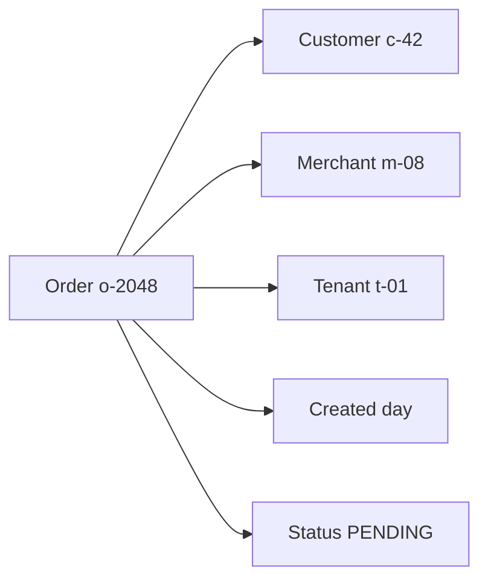

# Đặt dữ liệu liên quan gần nhau và đánh đổi với phân phối tải

Trong một hệ NoSQL được phân mảnh (*sharded/partitioned*), cùng một nghiệp vụ có thể cần đọc nhiều bản ghi: hồ sơ khách hàng, 20 đơn gần nhất, chi tiết đơn, các dòng hàng và trạng thái giao hàng. Nếu tất cả dữ liệu cần cho một request nằm trong một **nhóm có thể định tuyến trực tiếp**, ứng dụng thường gửi ít yêu cầu hơn, truyền ít dữ liệu hơn và dễ kiểm soát độ trễ. Nhưng nếu gom **quá nhiều dữ liệu của một khách hàng hoặc một tenant lớn** vào một partition không thể chia nhỏ, chính nhóm đó có thể trở thành điểm nóng làm nghẽn cả shard.

Đây là sự đánh đổi giữa:

- **Data locality / co-location:** dữ liệu thường được dùng cùng nhau được đặt trong cùng document, partition, shard hoặc gần nhau về mạng.
- **Load distribution:** dữ liệu và lưu lượng được phân tán đủ đều để tận dụng tài nguyên nhiều node, tăng throughput và hạn chế hot partition.
- **Routing efficiency:** truy vấn xác định được nơi cần đọc, tránh phát truy vấn tới mọi shard.
- **Correctness và availability:** ranh giới ghi/đọc và placement phải giữ được những bất biến nghiệp vụ, độ bền và khả năng chịu lỗi cần thiết.

Không có khóa phân mảnh nào tối ưu cho mọi truy vấn. **Khóa phù hợp là khóa làm tốt những truy vấn và cập nhật quan trọng nhất trong các ràng buộc về kích thước, phân phối tải và phát triển dữ liệu.**

Bài học thuộc chương **Phân mảnh và định tuyến**, module **Database No SQL**. Ta sẽ đi từ workload thực tế đến cách chọn partition key, nhận diện hot key, áp dụng bucketing/salting, tạo read model, đối chiếu MongoDB, Cassandra, DynamoDB, Redis Cluster và thiết kế thí nghiệm đánh giá.

---

## 1. “Dữ liệu liên quan” là dữ liệu nào?

Hai bản ghi được xem là liên quan khi một tác vụ thường **cần chúng cùng nhau**, ví dụ:

- Một đơn hàng và các dòng sản phẩm của nó.
- Một khách hàng và 20 đơn mới nhất.
- Một phòng trò chuyện và các tin nhắn gần đây.
- Một thiết bị IoT và dữ liệu đo trong một khoảng thời gian.
- Một tenant và những cấu hình áp dụng cho toàn bộ tenant.
- Một tài khoản và những điều kiện cần kiểm tra để thực hiện một giao dịch.

Nhưng mức liên quan **phụ thuộc truy vấn**.

Một order có thể đồng thời liên quan tới:

1. Khách hàng muốn xem lịch sử mua hàng.
2. Người bán muốn xem đơn cần xử lý.
3. Đơn vị vận chuyển muốn xem đơn theo trạng thái giao hàng.
4. Bộ phận kế toán muốn tổng hợp doanh thu theo ngày.
5. Người quản trị tenant muốn lọc đơn theo khoảng thời gian.

Nếu chỉ lưu một bản canonical của mỗi order thì không thể mặc nhiên khiến nó nằm gần tất cả các chiều truy cập ấy trong cùng lúc.

### 1.1. Workload quyết định mức liên quan

| Request | Trường dùng định tuyến/lọc | Dữ liệu cần | Độ thường xuyên giả định |
| --- | --- | --- | --- |
| Q1. 20 đơn mới nhất của khách | `tenantId`, `customerId` | Danh sách order tóm tắt | Rất cao |
| Q2. Chi tiết một order | `tenantId`, `orderId` | Order + line items | Cao |
| Q3. Đơn chờ giao của người bán | `tenantId`, `merchantId`, `status` | Nhiều order | Cao |
| Q4. Cập nhật một order | `tenantId`, `orderId` | Status, version | Cao |
| Q5. Doanh thu theo ngày | `tenantId`, thời gian | Aggregation nhiều order | Trung bình |
| Q6. Tìm đơn theo email | `tenantId`, email | Customer + order lookup | Thấp |

Những tần suất ở bảng chỉ là **ví dụ phân tích**, không phải số đo của một hệ có thật. Khi thiết kế thực tế, thay bằng truy vấn, tỷ lệ và latency SLO đã đo.

**Không nên chọn shard key từ tên entity một cách cảm tính.** Hãy xuất phát từ truy vấn và đường cập nhật có chi phí hoặc độ nhạy lớn.

---

## 2. Locality có nhiều tầng khác nhau

Khi ai đó nói “đặt các bản ghi gần nhau”, cần hỏi **gần ở tầng nào**.

| Tầng | Ví dụ | Điều có thể đạt | Giới hạn |
| --- | --- | --- | --- |
| **Cùng document** | Order chứa mảng line items | Đọc một document, atomic update trên document theo engine | Document có giới hạn kích thước; mảng có thể tăng vô hạn |
| **Cùng partition key** | Tất cả đơn của một khách trong một bucket | Truy cập một logical partition | Có thể hot hoặc quá lớn |
| **Cùng shard** | Những partition liên quan được route về một shard | Giảm hop giữa shard | Không bảo đảm mãi nếu resharding/rebalancing |
| **Cùng node/host** | Dữ liệu nằm trên cùng máy | Giảm truy cập mạng giữa node | Tăng ảnh hưởng khi host lỗi |
| **Cùng AZ/region** | Service và dữ liệu ở một vùng | Giảm WAN latency | Có thể không chịu lỗi cả region |
| **Cùng cache/read model** | Hồ sơ và 20 đơn được tổng hợp sẵn | Đáp ứng một read nhanh | Dữ liệu nhân bản, cập nhật bất đồng bộ và staleness |
| **Cùng transaction boundary** | Các record cập nhật cùng một atomic operation | Có thể đơn giản hóa correctness | Không tự trùng với co-location vật lý |

**Cùng khóa phân vùng không đồng nghĩa mọi lúc cùng host vật lý** ở mọi sản phẩm. Dịch vụ quản lý có thể di chuyển/split partition nội bộ. Điều ứng dụng thường cần là **khả năng truy vấn theo một logical routing key** và hợp đồng consistency, không phải giả định vị trí vật lý cố định.

### 2.1. Locality logic khác locality vật lý

Một hệ có thể cung cấp truy vấn `Query(PK=...)` hiệu quả dù nhà cung cấp âm thầm di chuyển những bản ghi đó giữa các storage node.

Ngược lại, hai collection đều có field `tenantId` không có nghĩa chúng nằm trên cùng shard, kể cả nếu mỗi collection đều được sharding theo tenant. Placement và routing có thể độc lập.

### 2.2. Gần nhau không có nghĩa bỏ replica dự phòng

Nếu tất cả order của một khách nằm trong một logical partition, partition đó vẫn cần các **bản sao ở những failure domain độc lập** theo thiết kế khả dụng. Locality cho truy vấn không được đánh đổi bằng cách đặt mọi bản sao vật lý lên cùng một host.

---

## 3. Một request phân tán tốn chi phí ở đâu?

Giả sử ứng dụng cần trả chi tiết 20 đơn gần nhất.

### 3.1. Khi dữ liệu cùng một logical partition

```text
Client
   |
   v
Router -> Shard 2
             |
             +-- customer c42, tháng 2026-11
             +-- đọc các order có thứ tự thời gian
             |
             v
         Trả 20 kết quả
```

Tùy database, router có thể tính partition owner ngay từ key. Ưu điểm:

- Ít node nhận request hơn.
- Ít connection/round-trip hơn.
- Dễ dùng thứ tự clustering/index trong cùng partition.
- Có thể giảm khâu hợp nhất/sắp xếp toàn cục.

### 3.2. Khi dữ liệu nằm rải trên nhiều shard

```text
                  Router
               /    |    \
              v     v     v
           Shard 1 Shard 2 Shard 3
              |     |     |
              +-----+-----+
                    |
             Merge + sort + limit
                    |
                    v
                Client
```

Chi phí phát sinh:

- Phát request tới nhiều shard (*fan-out*).
- Mỗi shard có thể đọc nhiều hơn 20 record để phục vụ top-K toàn cục.
- Router/coordinator phải merge, sort, aggregate hoặc deduplicate.
- Latency phụ thuộc các shard chậm.
- Một shard lỗi có thể ảnh hưởng toàn request, tùy chế độ xử lý lỗi.

### 3.3. Vì sao p99 có thể xấu hơn p50?

Nếu một truy vấn cần kết quả của nhiều shard, tổng thời gian thường bị chi phối bởi **shard trả lời chậm nhất**, không phải trung bình.

Trong mô hình gần đúng:

\[
T_{\text{fanout}} \approx T_{\text{dispatch}}+
\max(T_1,T_2,\ldots,T_n)+T_{\text{merge}}.
\]

Không phải mọi hệ đều chờ tất cả shard trong mọi truy vấn, nhưng công thức thể hiện một rủi ro: **càng nhiều nhánh song song, càng có nhiều cơ hội gặp một nhánh chậm**. Đọc một shard không tự nhanh hơn mọi truy vấn song song, nhưng thường giảm tài nguyên và biến động không cần thiết khi workload phù hợp.

---

## 4. Phân mảnh và định tuyến: khóa quyết định đường đi

Một hệ NoSQL phân mảnh thường có:

- **Partition/shard key:** trường hoặc tổ hợp trường dùng quyết định vị trí logic.
- **Router/coordinator:** thành phần tìm shard/partition cần truy cập.
- **Partition mapping/metadata:** ánh xạ key hoặc key range sang owner.
- **Replica group:** nhiều bản sao cho một logical partition/shard.
- **Rebalancer:** chuyển dữ liệu/ownership khi tải hoặc cấu hình thay đổi.

Các khái niệm không nhất thiết có cùng tên trong MongoDB, Cassandra, DynamoDB và Redis Cluster.

### 4.1. Point query: dễ định tuyến nhất

```text
GET order by (tenantId, orderId)
```

Nếu shard key được suy ra từ hai trường trên, router có thể xác định đúng shard cần truy cập, theo ngữ nghĩa sản phẩm.

### 4.2. Query thiếu shard key

```text
GET all PENDING orders across every tenant
```

Nếu không có index và cơ chế định tuyến theo trạng thái toàn cục, hệ có thể cần truy vấn nhiều shard. Đây là **scatter-gather**.

Không phải cứ thêm index ở từng shard là biến truy vấn toàn cục thành single-shard query: index chỉ giúp truy vấn **bên trong từng shard** hiệu quả hơn, còn router vẫn phải biết shard nào có kết quả.

### 4.3. Key prefix không luôn đảm bảo một shard

Với compound shard key `(tenantId, customerId)`, query chỉ có `tenantId` có thể thu hẹp tập key range, nhưng **một tenant lớn vẫn có thể trải nhiều chunk/shard**.

Không được suy “filter bằng tenantId” nghĩa là truy vấn chắc chắn chỉ tới một shard nếu thiết kế/engine cho phép range của tenant đó được chia.

---

## 5. Phân phối tải: mục tiêu khác với tối ưu một truy vấn

Một partition key tốt phải phân tán được:

- Dung lượng lưu trữ.
- Tần suất đọc.
- Tần suất ghi.
- CPU và I/O.
- Network traffic.
- Các phép compaction/flush/index maintenance.
- Tải khi rebalance/restore.

Một khóa có cardinality cao **không tự động phân phối tải đều**. Nếu một giá trị cực kỳ phổ biến, nó vẫn tạo hot key.

### 5.1. Một ví dụ lệch tải

Giả sử có 3 shard với tổng 60.000 request/s. Mức trung bình lý tưởng là:

\[
60{,}000/3 = 20{,}000 \text{ request/s mỗi shard}.
\]

Nhưng nếu shard 1 nhận 48.000 request/s và hai shard còn lại mỗi shard nhận 6.000:

| Shard | Load | So với trung bình |
| --- | ---: | ---: |
| Shard 1 | 48.000 req/s | 2,4 lần |
| Shard 2 | 6.000 req/s | 0,3 lần |
| Shard 3 | 6.000 req/s | 0,3 lần |

Thêm một shard thứ tư **không tự giúp** nếu mọi request nóng đều buộc vào một partition không chia nhỏ được.

### 5.2. Chỉ số skew

Có thể định nghĩa một số đo đơn giản:

\[
\text{SkewRatio} =
\frac{\max_i(\text{load của shard } i)}
     {\operatorname{avg}_i(\text{load của shard } i)}.
\]

SkewRatio càng lớn càng đáng xem xét, nhưng không dùng một ngưỡng chung cho mọi cluster. Cần đo thêm **giới hạn thực của shard nóng**, p99 latency, tải theo key và khả năng di chuyển partition.

### 5.3. Hot partition khác dung lượng lớn

- **Hot partition:** có nhiều request hoặc I/O tại một thời điểm.
- **Large partition:** có kích thước dữ liệu lớn; có thể không hot.
- **Hot tenant:** một tenant tạo lượng traffic lớn, nhưng traffic có thể trải nhiều partition.
- **Hot time range:** phần lớn ghi tập trung vào bucket thời gian mới nhất.

Phải biết đang xử lý **nút nghẽn nào** trước khi chọn salting, bucketing hay reshard.

---

## 6. Đặt gần nhau: ưu điểm thực tế

### 6.1. Giảm số mạng hop

Đọc một group có thể chỉ cần một routed query thay vì nhiều request đến những shard khác nhau.

### 6.2. Tránh distributed join ở đường đọc nóng

Một số NoSQL không cung cấp join phân tán giống RDBMS, hoặc join giữa shard tốn kém. Embed dữ liệu phù hợp hoặc tạo read model theo query có thể giảm call tới các nơi khác.

### 6.3. Thực hiện batch/aggregation có giới hạn

Một truy vấn đếm/sắp xếp trong một partition có thể dùng index/clustering order. Nhưng **không nên suy rằng mọi loại batch trong một partition đều có ACID transaction giống SQL**; semantics phụ thuộc engine.

### 6.4. Hạn chế điều phối transaction

Nếu một bất biến có thể được thể hiện bằng một atomic document hoặc item, thường dễ kiểm soát conflict và retry hơn multi-shard transaction.

### 6.5. Cải thiện tính dự đoán latency

Một truy vấn có ít nhánh kết nối thường ít phụ thuộc vào một shard chậm bất kỳ. Tuy vậy, nếu partition đích **rất nóng**, việc gom lại có thể làm latency tệ hơn scatter trên nhiều node.

---

## 7. Đặt gần nhau: những chi phí ít được nhận thấy

| Lợi ích locality | Đánh đổi thường đi kèm |
| --- | --- |
| Một key điều hướng tới một nhóm | Một nhóm có thể quá lớn hoặc quá nóng |
| Đọc nhiều record ở cùng partition | Write throughput của partition bị giới hạn |
| Tránh fan-out | Query theo chiều khác thành fan-out |
| Ít network hop | Không tận dụng được parallelism của nhiều shard |
| Dễ làm atomic update một document | Document có thể lớn và cập nhật gây tranh chấp |
| Mọi item của tenant ở gần nhau | Tenant lớn có thể trở thành noisy neighbor |
| Read model theo query nhanh | Dữ liệu lặp, chi phí đồng bộ, eventual consistency |
| Placement theo region | Ghi đa vùng hoặc chuyển region tốn WAN/cost |

**Không có điểm tối ưu chung**: nếu Q1 chiếm phần lớn lưu lượng, tối ưu Q1 có thể rất có ích; nếu Q3 mới là luồng phát sinh doanh thu và khắt khe về latency, lựa chọn partition khác có thể hợp lý hơn.

---

## 8. Bài toán mẫu: thương mại điện tử đa tenant

Mỗi order có:

```json
{
  "orderId": "o-2048",
  "tenantId": "t-01",
  "customerId": "c-42",
  "merchantId": "m-08",
  "createdAt": "2026-11-14T09:15:00Z",
  "status": "PENDING",
  "total": 250000,
  "items": [
    {
      "sku": "book-1",
      "quantity": 2,
      "priceAtPurchase": 125000
    }
  ]
}
```

Các truy vấn nghiệp vụ:

| Mã | Truy vấn | Ưu tiên ví dụ |
| --- | --- | --- |
| Q1 | Xem 20 đơn gần nhất theo khách | Rất cao |
| Q2 | Xem chi tiết order | Cao |
| Q3 | Merchant xem 50 đơn chờ xử lý | Cao |
| Q4 | Update status một order | Cao |
| Q5 | Báo cáo doanh thu theo ngày/merchant | Trung bình |
| Q6 | Thống kê tổng thể toàn tenant | Thấp trong đường request trực tiếp |

Đây là workload giả định dùng để phân tích. Đơn vị đo thật cần có requests/s, số tenant, số khách, kích thước order và phân phối hot keys.

### 8.1. Một order có nhiều chiều quan hệ



Nếu partition theo customer, Q1 tốt, nhưng Q3 của merchant có thể phải fan-out. Nếu partition theo merchant, Q3 tốt, còn Q1 có thể phải đọc nhiều nơi.

**Đây là đánh đổi cơ bản của một bản canonical và nhiều access patterns.**

---

## 9. Phương án A: partition theo tenant

Ví dụ logical key:

```text
Partition key: tenantId

t-01 -> tất cả orders trong tenant t-01
t-02 -> tất cả orders trong tenant t-02
t-03 -> tất cả orders trong tenant t-03
```

### 9.1. Khi nào hữu ích?

- Mỗi tenant nhỏ và có giới hạn dữ liệu/traffic.
- Truy vấn thường làm việc trong tenant.
- Cần mức cô lập hoặc data residency theo tenant.
- Sản phẩm/engine cho phép quản lý placement theo tenant.

### 9.2. Khi nào thất bại?

Một tenant lớn có hàng triệu orders hoặc traffic rất cao, nhưng key không chứa phần có thể chia nhỏ, sẽ trở thành hot partition.

Trong hệ cho phép split range bên trong tenant theo compound key, tenant có thể phân tán ra nhiều shard, nhưng lúc đó **mọi dữ liệu tenant không còn cùng một physical shard**.

### 9.3. Các kiểu cô lập tenant

- **Tenant nhỏ:** cùng logical data model, chia sẻ nhiều shard.
- **Tenant lớn:** chia thành buckets/subkeys, hoặc gán dedicated resources.
- **Tenant yêu cầu residency:** dùng policy/zone/region placement phù hợp.
- **Tenant cực nóng:** có thể cần phân tách workload/read model riêng.

Không có lý do phải ép tenant nhỏ và tenant cực lớn cùng một strategy.

---

## 10. Phương án B: partition theo customer

```text
Partition key = (tenantId, customerId)
```

Ưu điểm:

- Q1 theo khách có thể là một logical partition.
- Truy vấn customer history đơn giản hơn.
- Khi lượng khách hàng lớn và tương đối đều, có nhiều partition để phân tải.

Hạn chế:

- Khách hàng “siêu lớn” có thể hot hoặc có partition quá lớn.
- Merchant query Q3 phải tập hợp từ nhiều customer partitions.
- Order ID đơn lẻ không chứa customerId có thể cần lookup trước để route.
- Báo cáo theo tenant hoặc thời gian có thể quét nhiều partition.

### 10.1. Đừng quên key để định tuyến Q2

Nếu API chỉ nhận:

```text
GET /orders/o-2048
```

nhưng shard key là `(tenantId, customerId)`, router không tự biết partition đúng từ `orderId` trừ khi có index/service mapping phù hợp.

Có thể đổi API để mang đầy đủ routing context:

```text
GET /tenants/t-01/customers/c-42/orders/o-2048
```

Hoặc lưu lookup nhỏ:

```text
orderId -> (tenantId, customerId)
```

Lookup làm tăng một hop và cần cập nhật/đối soát đúng. Không nên tùy tiện nhúng customerId vào một orderId nếu có vấn đề bảo mật, khả năng đoán hoặc quản trị định danh.

---

## 11. Phương án C: partition theo order

```text
Partition key = (tenantId, orderId)
```

Ưu điểm:

- Point lookup và cập nhật Q2/Q4 dễ route.
- Order IDs có cardinality cao, thường phân tán tốt nếu được thiết kế đều.
- Mỗi order có ranh giới kích thước tương đối rõ.

Hạn chế:

- Q1 tìm 20 đơn theo khách có thể thành fan-out hoặc cần secondary index/read model.
- Q3 theo merchant cũng có thể fan-out.
- Nhóm orders thuộc cùng khách không tự gần nhau.

Đây là lựa chọn tốt khi phần lớn request thực chất thao tác một order theo ID và workload danh sách được phục vụ bởi **index/read model riêng**.

### 11.1. Point lookup tốt không làm danh sách tốt

Hai truy vấn:

```text
GET order o-2048
GET latest 20 orders for c-42
```

có nhu cầu routing khác nhau. Chọn shard key để hỗ trợ truy vấn thứ nhất không có nghĩa truy vấn thứ hai tự được tối ưu.

---

## 12. Phương án D: kết hợp customer với bucket thời gian

Một chiến lược cân bằng:

```text
Partition key = (tenantId, customerId, monthBucket)

Ví dụ:
t-01 | c-42 | 2026-11
t-01 | c-42 | 2026-10
t-01 | c-42 | 2026-09
```

### 12.1. Vì sao hữu ích?

Thay vì toàn bộ lịch sử khách hàng trong một partition có thể tăng vô hạn, mỗi tháng nằm trong partition riêng.

Ưu điểm:

- Giới hạn kích thước theo thời gian nếu write rate dự đoán được.
- Dễ TTL/archive các bucket cũ.
- Tăng số partition để engine có cơ hội phân tải.
- Q1 mới nhất thường chỉ cần bucket hiện tại và có thể thêm bucket trước.

Hạn chế:

- Q1 có thể cần truy vấn nhiều bucket nếu bucket hiện tại ít order.
- Một khách cực nóng vẫn có thể tạo hot bucket của tháng hiện tại.
- Truy vấn lịch sử nhiều năm phải fan-out qua bucket.
- Cần xử lý timezone và định nghĩa tháng thống nhất.
- Các phép đổi timestamp/order date có thể cần move item giữa bucket.

### 12.2. Quản lý bucket bằng timestamp ổn định

Nên xác định bucket từ một timestamp bất biến của sự kiện, ví dụ `createdAt` theo UTC và một formatter chuẩn.

Không nên lấy bucket bằng **giờ local tùy server** vì khác timezone hoặc daylight saving có thể khiến cùng event rơi vào bucket khác.

### 12.3. Bucket theo ngày hay theo tháng?

| Bucket | Ưu điểm | Đánh đổi |
| --- | --- | --- |
| Năm | Ít partition | Dễ lớn/hot |
| Tháng | Cân bằng cho lịch sử khách vừa phải | Truy vấn qua nhiều tháng |
| Ngày | Partition nhỏ hơn | Metadata/query fan-out tăng |
| Giờ | Phân tán write mạnh hơn theo thời gian | Nhiều partition, query qua nhiều giờ |
| Kích thước cố định | Dễ giữ kích thước mục tiêu | Cần allocator/metadata và logic routing |

Chọn kích thước bucket theo **dữ liệu lớn nhất và khách nóng nhất**, không chỉ trung bình.

---

## 13. Hot partition: vì sao workload thường không đều?

Trong thực tế, số lượng thao tác theo customer, merchant, tenant hoặc device thường có **đuôi dài** (*heavy tail*): một nhóm nhỏ tạo nhiều request.

Ví dụ giả định:

- 1% khách hàng tạo 50% tổng số đơn.
- 10 merchant lớn tạo phần lớn cập nhật trạng thái.
- 1% thiết bị IoT gửi đo đạc mỗi giây, còn các thiết bị khác gửi mỗi phút.
- Một livestream có lượng tin nhắn tăng vọt khi sự kiện diễn ra.

Nếu tất cả dữ liệu của một khách cực nóng cùng một partition, dù hệ có 100 node, partition ấy có thể bị giới hạn bởi **một owner/replica group hoặc một điểm tuần tự hóa**.

### 13.1. Skew làm hỏng giả định hash phân phối đều

Hash phân tán **các giá trị key khác nhau**, không thể tách lưu lượng của **một giá trị key duy nhất** chỉ nhờ thêm node.

```text
hash(customerId):
  c-01 -> shard A
  c-02 -> shard B
  c-03 -> shard C
  ...
  c-hot -> shard A (40% tổng requests)
```

Dù mapping key khác đều, `c-hot` vẫn chi phối tải.

### 13.2. Hiện tượng thundering herd

Một bài đăng viral hoặc phiên flash sale có thể khiến hàng chục nghìn client truy vấn một key. Kể cả dữ liệu nhỏ, read QPS lớn có thể làm partition hot.

Giải pháp có thể nằm ở **cache, CDN, fan-out read replicas, rate limiting hoặc precomputation**, không nhất thiết phải thay shard key canonical.

---

## 14. Salting và bucketing theo hash để chia một nhóm nóng

Thêm một suffix phân tán:

```text
Partition key = (tenantId, customerId, salt)

salt = stableHash(orderId) mod 8
```

Orders của cùng khách được trải qua 8 logical partitions.

### 14.1. Ưu điểm

- Ghi của một khách hot có thể đi qua nhiều partition nếu engine phân chúng tới các shard khác nhau.
- Một partition không còn giữ toàn bộ orders.
- Giảm kích thước và tốc độ write của từng bucket.

### 14.2. Chi phí

Muốn lấy **20 đơn mới nhất của khách**, ứng dụng có thể phải đọc tới 8 partition rồi merge-sort và lấy top 20.

```text
Q1 for customer c-hot
          |
          v
   +------+------+------+ ... +------+
   | salt0| salt1| salt2|     | salt7|
   +------+------+------+     +------+
          \      |       ...   /
             merge top-20
```

Tăng số salt làm giảm mỗi hot partition nhưng tăng fan-out ở truy vấn theo customer.

### 14.3. Salt phải xác định được khi lookup

Nếu `salt = stableHash(orderId) mod 8`, thì biết orderId có thể tính lại suffix để truy vấn đúng một partition.

Nếu salt được chọn ngẫu nhiên tại insert mà không lưu mapping, point lookup theo orderId có thể phải thử tất cả bucket.

### 14.4. Salting không tự giữ uniqueness toàn nhóm

Nếu business rule là **mỗi khách chỉ có tối đa một ACTIVE subscription**, trải các subscription qua 8 salts có thể làm hai writer ghi hai bucket khác nhau, cả hai cùng thấy “chưa có subscription”.

Cần unique guard, atomic counter/owner hoặc transaction phù hợp trên **phạm vi bất biến**, thay vì tin rằng mỗi bucket cục bộ là đủ.

### 14.5. Salt khác time bucket

| Kỹ thuật | Mục tiêu chính | Điểm yếu điển hình |
| --- | --- | --- |
| Time bucket | Giới hạn size/đường truy vấn theo thời gian | Bucket hiện tại vẫn nóng |
| Hash salt | Phân tán nhiều ghi đồng thời của cùng logical group | Fan-out khi đọc whole group |
| Hybrid `month + salt` | Vừa hạn chế size vừa phân tán hot write | Nhiều chiều routing và merge |
| Dedicated shard/tenant | Cô lập tài nguyên cho nhóm lớn | Chi phí và quản trị placement |

---

## 15. Bucketing không phải giải pháp duy nhất

Trước khi phân nhỏ một group, hãy xác định nút nghẽn.

### 15.1. Hot read nhưng ít write

Có thể phù hợp:

- Cache keyed theo `(tenantId, customerId, viewVersion)`.
- Materialized read model chứa 20 đơn gần nhất.
- Read replicas nếu hệ hỗ trợ và SLO freshness phù hợp.
- Pagination với keyset cursor.
- Hạn chế payload hoặc projection field.

Salting canonical write data để xử lý **hot read** đôi khi làm query phức tạp hơn mà không cần thiết.

### 15.2. Hot write trên cùng một counter

Nếu mọi write tăng một counter chung, salting counter thành nhiều keys có thể phân tán tăng, nhưng để đọc tổng phải aggregate; ràng buộc quota cứng có thể bị phá nếu thiếu escrow/guard.

Các giải pháp khác:

- Actor/allocator có quyền ghi duy nhất.
- Batch các increment nếu eventual total chấp nhận được.
- Bounded/escrow counter cho quota.
- Event log với consumer aggregate.
- Rate limiting/hàng đợi theo tài nguyên.

### 15.3. Hot document do array tăng

Một document chứa hàng trăm nghìn tin nhắn hoặc order events sẽ có nguy cơ đạt giới hạn document và tạo write contention. Chuyển sang **bucketed documents hoặc records theo partition** có thể hợp lý hơn thêm replica của cùng document.

---

## 16. Embedding và referencing: locality bên trong document

NoSQL document databases cung cấp một lựa chọn riêng: **nhúng dữ liệu liên quan trong cùng document**.

### 16.1. Khi nhúng có lợi

Một order và line items thường được đọc cùng nhau:

```json
{
  "_id": "o-2048",
  "tenantId": "t-01",
  "customerId": "c-42",
  "status": "PENDING",
  "items": [
    { "sku": "book-1", "qty": 2, "price": 125000 },
    { "sku": "pen-2", "qty": 1, "price": 20000 }
  ]
}
```

Nếu số dòng hàng bị giới hạn hợp lý, embedding có thể:

- Trả order detail bằng một document.
- Giảm join/lookup tới line-item collection.
- Tận dụng atomicity của thao tác update một document trong MongoDB.
- Giữ giá tại thời điểm mua cùng order, tránh phụ thuộc product catalog hiện hành.

### 16.2. Khi nhúng bất lợi

Không nên nhúng **toàn bộ lịch sử đơn** vào document customer nếu số lượng order tăng không giới hạn:

```json
{
  "_id": "c-42",
  "orders": ["order-1", "order-2", "..."]
}
```

Rủi ro:

- Document liên tục phình to.
- Thao tác cập nhật cạnh tranh trên cùng document.
- Đọc hồ sơ cũng kéo nhiều dữ liệu không cần thiết.
- Giới hạn kích thước document (ví dụ MongoDB BSON document có giới hạn 16 MiB).
- Thay đổi một phần có thể làm tăng chi phí ghi và index.

### 16.3. Một mẫu thường phù hợp

- **Canonical order document:** chứa thông tin order và số item được giới hạn.
- **Customer recent-orders view:** chỉ giữ các tóm tắt mới nhất có giới hạn.
- **Order events:** collection/bucket riêng vì tăng không giới hạn.
- **Analytics:** aggregation/projection riêng theo tenant/time.

Đặt gần nhau những thứ **thường cần cùng nhau và có kích thước kiểm soát được**, không gom vô hạn mọi quan hệ.

---

## 17. Canonical data và read model có thể dùng các partition key khác nhau

Một cách giải quyết xung đột access patterns là **dữ liệu chuẩn hóa vừa đủ cho ghi**, kèm **read models** theo truy vấn.

```text
Canonical orders (key by orderId)
       |
       +---- change events / outbox / CDC ----+
                                              |
                                              v
                             CustomerRecentOrders
                             key by customerId
                                              |
                                              +--> Q1
       |
       +------------------------------------> MerchantPendingOrders
                                              key by merchantId
                                              |
                                              +--> Q3
```

### 17.1. Lợi ích

- Q2/Q4 point lookup theo orderId vẫn đơn giản.
- Q1 đọc customer view một lần.
- Q3 đọc merchant view một lần.
- Mỗi projection chọn key và retention phù hợp.

### 17.2. Chi phí

- Mỗi canonical mutation có thể tạo nhiều projection writes.
- Có độ trễ cập nhật, duplicate events và event ordering.
- Khi projection hỏng cần backfill/replay.
- Tốn storage/index và giám sát.
- Cần xác định read model có được phép stale hay không.

### 17.3. Không dùng eventual projection để quyết định resource cấp phát

Ví dụ merchant pending orders view có thể chậm. Nếu thao tác chuyển trạng thái cần tránh xử lý một order hai lần, write API phải xác minh **trạng thái canonical và version**.

Read model giúp **đọc nhanh**, không tự biến nó thành nguồn commit có thẩm quyền.

### 17.4. Đặt giới hạn cho view

Một view `customer_recent` có thể chỉ giữ 20–100 order summaries gần nhất thay vì toàn lịch sử. Khi cần xem sâu hơn, ứng dụng có thể truy vấn canonical store với cursor.

Giới hạn làm giảm kích thước và chi phí cập nhật nhóm hot.

---

## 18. Cross-partition join và aggregate: khi nào chấp nhận fan-out?

Không phải mọi truy vấn cần locality tuyệt đối.

### 18.1. Truy vấn báo cáo định kỳ

Tổng doanh thu theo ngày/tenant có thể quét nhiều partitions và aggregate bằng batch job. Nếu chạy mỗi đêm, không cần ép mọi order vào một shard chỉ để tính tổng một lần.

### 18.2. Truy vấn tương tác với SLO chặt

Một endpoint p99 dưới vài trăm mili-giây, gọi nhiều lần mỗi giây, thường nhạy với fan-out lớn. Có thể cần secondary index, read model hoặc precomputed aggregate.

### 18.3. Fan-out có khi lại hữu ích

Một aggregation nặng trên toàn bộ dataset **có thể chạy nhanh hơn khi được phân tán song song** trên nhiều shard, nếu khâu merge không quá tốn và hệ có đủ tài nguyên.

Vì vậy mục tiêu là **loại fan-out không cần thiết trong request nóng**, không phải cấm mọi truy vấn đa shard.

### 18.4. Kết hợp OLTP và OLAP có thể gây tranh chấp

Nếu cùng cluster phục vụ order writes và report quét toàn bộ, report có thể gây cache churn, disk I/O và tail latency cho OLTP.

Một read replica chuyên reporting, materialized aggregate hoặc hệ OLAP riêng có thể phù hợp hơn việc thay shard key canonical chỉ vì báo cáo.

---

## 19. MongoDB: ví dụ shard key phục vụ customer locality

MongoDB phân tán collection thành các shard và route query qua `mongos`. Việc có một shard key **không bảo đảm những collection khác nhau cùng nằm trên một shard**.

> **Môi trường thực hành:** các lệnh sharding phải chạy trên một MongoDB sharded cluster thử nghiệm đã được cấu hình. Đừng chạy thay shard key/reshard một collection production khi chưa có migration plan.

### 19.1. Collection minh họa

```javascript
const lab = db.getSiblingDB("commerce_locality_lab");

lab.orders.insertMany([
  {
    _id: "o1",
    tenantId: "t1",
    customerId: "c42",
    merchantId: "m1",
    status: "PENDING",
    createdAt: ISODate("2026-11-01T10:00:00Z"),
    total: 100000
  },
  {
    _id: "o2",
    tenantId: "t1",
    customerId: "c42",
    merchantId: "m2",
    status: "PAID",
    createdAt: ISODate("2026-11-02T10:00:00Z"),
    total: 250000
  },
  {
    _id: "o3",
    tenantId: "t1",
    customerId: "c99",
    merchantId: "m1",
    status: "PENDING",
    createdAt: ISODate("2026-11-03T10:00:00Z"),
    total: 50000
  }
]);
```

`ISODate` là helper của `mongosh`, không phải literal JSON thuần.

### 19.2. Tạo index và shard key minh họa

```javascript
lab.orders.createIndex({
  tenantId: 1,
  customerId: 1,
  createdAt: -1,
  _id: 1
});

// Chỉ chạy trên sharded cluster phù hợp,
// trong lab đã chuẩn bị để shard collection.
sh.shardCollection(
  "commerce_locality_lab.orders",
  { tenantId: 1, customerId: 1 }
);
```

Ở thiết kế này, tất cả orders có **cùng cặp shard key `(tenantId, customerId)`** thuộc cùng giá trị routing trong một sharded collection. Điều đó giúp những query có đủ equality predicates trên cặp key được nhắm tới shard phù hợp, theo trạng thái metadata của router.

**Giới hạn quan trọng:** một khách có lượng dữ liệu cực lớn cùng một shard-key value có thể tạo nhóm khó chia nhỏ vì key không có chiều bổ sung để split. Range sharding không tự chia các document có cùng full shard key sang nhiều shard.

### 19.3. Query nhắm theo shard key

```javascript
const q1 = lab.orders
  .find({
    tenantId: "t1",
    customerId: "c42"
  })
  .sort({ createdAt: -1, _id: 1 })
  .limit(20);

printjson(q1.toArray());
```

Index compound có thể hỗ trợ lọc và thứ tự truy vấn, nhưng kế hoạch thực tế còn phụ thuộc index, cardinality và phiên bản.

### 19.4. Quan sát kế hoạch truy vấn

```javascript
const plan = lab.orders
  .find({
    tenantId: "t1",
    customerId: "c42"
  })
  .sort({ createdAt: -1, _id: 1 })
  .limit(20)
  .explain("executionStats");

printjson(plan);
```

Trong `explain`, quan sát:

- Query được route tới **một hay nhiều shard**.
- `nReturned` và keys/docs examined theo nơi hiển thị.
- Có dùng index và có sort tốn tài nguyên không.
- Có merge stage giữa các shard không.
- Latency và mức hiệu quả dưới dữ liệu đại diện.

Không đoán chính xác tên stage từ sơ đồ lý thuyết: explain output khác nhau theo MongoDB version và dạng pipeline.

### 19.5. Q3 merchant có thể không được nhắm một shard

```javascript
lab.orders.find({
  tenantId: "t1",
  merchantId: "m1",
  status: "PENDING"
});
```

Vì `merchantId` không có trong shard key, câu này có thể cần tìm trên nhiều shard. Một index theo merchant trên **mỗi shard** có thể giảm scan tại shard đó nhưng không đảm bảo loại fan-out.

### 19.6. Cùng `tenantId` ở hai collection không tự co-locate

Ngay cả nếu collection `customers` cũng có shard key `(tenantId, customerId)`, MongoDB **không cam kết** hai document có cùng field value ở **hai collection khác nhau** sẽ nằm cùng physical shard. Chunk placement/migration được quản lý theo từng sharded collection.

Nếu cần một request không gọi chéo collection, cân nhắc embedding, một read model hoặc các cơ chế placement/zone có bảo đảm thực tế phù hợp, thay vì dựa vào trùng tên shard key.

---

## 20. MongoDB: hashed sharding và zone placement

### 20.1. Hashed key phân phối gì?

Một hashed shard key có thể hỗ trợ phân phối những **giá trị key khác nhau** trên các shard, giảm rủi ro tăng liên tiếp theo một key range đơn điệu.

Ví dụ ý tưởng:

```javascript
sh.shardCollection(
  "commerce_locality_lab.events",
  { eventId: "hashed" }
);
```

Nhưng hashed sharding theo `eventId` có thể khiến events của cùng customer rải trên nhiều shard; query theo customer sẽ cần cơ chế khác để target.

**Hash giúp cân bằng phân phối của nhiều key, không chia lưu lượng của một key nóng nếu key không thay đổi.**

### 20.2. Compound key và khả năng target

Có thể thiết kế compound shard key chứa `tenantId`, `customerId`, `bucket` hoặc phần hash theo khả năng sản phẩm.

Một query chỉ cung cấp một phần của compound key có thể nhắm **một tập shard**, không phải luôn một shard. Cần xem thực nghiệm qua `explain`.

### 20.3. Zone sharding: locality địa lý/tenant

MongoDB có cơ chế gán **zones** cho key ranges và phân bổ dữ liệu trên những shard thuộc zone được cấu hình.

Tình huống:

- Tenant EU yêu cầu dữ liệu nằm ở vùng cho phép.
- Tenant VIP cần dedicated capacity.
- Dữ liệu một nhóm business cần kiểm soát locality.

Tuy nhiên, zone sharding còn phụ thuộc shard key ranges, shard assignment và migration. Nó không biến mọi join giữa collection thành local join, cũng không thay thế transaction/backup/replica fault tolerance.

### 20.4. Khóa shard có tác động lâu dài

Chọn shard key sai có thể dẫn tới phân phối xấu, `scatter-gather` và khó thay schema/API. Một số phiên bản MongoDB hỗ trợ **resharding**, nhưng đó là migration phức tạp dưới tải, không phải lý do bỏ qua workload analysis.

---

## 21. Cassandra: co-partitioning bằng partition key

Cassandra lưu bảng wide-column với **partition key** và **clustering columns**.

Partition key xác định partition logic; clustering columns xác định thứ tự bên trong partition.

### 21.1. Orders theo customer và bucket

```sql
CREATE TABLE orders_by_customer_bucket (
    tenant_id text,
    customer_id text,
    month_bucket text,
    created_at timestamp,
    order_id uuid,
    status text,
    total decimal,
    PRIMARY KEY (
        (tenant_id, customer_id, month_bucket),
        created_at,
        order_id
    )
) WITH CLUSTERING ORDER BY (
    created_at DESC,
    order_id ASC
);
```

Phân tích:

- `(tenant_id, customer_id, month_bucket)` là **partition key ghép**.
- `created_at` và `order_id` là clustering columns.
- Các rows trong cùng partition được tổ chức theo clustering order.
- Query có đủ partition key sẽ nhắm partition tương ứng.

### 21.2. Truy vấn latest orders

```sql
SELECT order_id, status, total, created_at
FROM orders_by_customer_bucket
WHERE tenant_id = 't1'
  AND customer_id = 'c42'
  AND month_bucket = '2026-11'
LIMIT 20;
```

Nếu bucket tháng hiện tại có ít hơn 20 orders, ứng dụng đọc thêm tháng trước và hợp nhất theo thời gian. Đây là **fan-out có giới hạn và được thiết kế có chủ đích**.

### 21.3. Không query merchant bằng bảng trên một cách tùy tiện

Một query chỉ có `merchant_id` không có sẵn partition key cần thiết. Cassandra không nên bị dùng như cơ sở dữ liệu relational với mọi truy vấn tùy ý và `ALLOW FILTERING` trên workload lớn.

Một hướng là tạo bảng thứ hai:

```sql
CREATE TABLE pending_orders_by_merchant_bucket (
    tenant_id text,
    merchant_id text,
    day_bucket text,
    created_at timestamp,
    order_id uuid,
    customer_id text,
    PRIMARY KEY (
        (tenant_id, merchant_id, day_bucket),
        created_at,
        order_id
    )
) WITH CLUSTERING ORDER BY (
    created_at DESC,
    order_id ASC
);
```

Lúc đó ứng dụng phải đồng bộ hai access-pattern tables, thiết kế retry, idempotency và xử lý trạng thái order khi không còn PENDING.

### 21.4. Batch trong Cassandra không thay serializable transaction nhiều partition

Tạo hai bảng theo query không làm hai update vào hai partition tự có một transaction serializable giống SQL. Cần hiểu Cassandra batch semantics, LWT/conditional operations và failure/retry theo phạm vi hỗ trợ.

**Đặt cùng partition giúp truy vấn có locality, nhưng không tự chứng minh mọi thao tác gồm nhiều record là nguyên tử hay serializable.**

### 21.5. Partition size và repair

Một partition quá lớn có thể ảnh hưởng read, compaction, tombstone và repair/streaming khi node hỏng. Vì vậy Cassandra đặc biệt nhấn mạnh giới hạn kích thước partition ngay từ schema.

---

## 22. DynamoDB: item collection và single-table access patterns

Trong DynamoDB, bảng dùng **partition key** (và có thể có **sort key**). API `Query` phát huy lợi thế khi biết partition key và dùng điều kiện sort key phù hợp.

### 22.1. Mô hình theo customer

Ví dụ các items:

```json
{
  "PK": "TENANT#t1#CUSTOMER#c42",
  "SK": "PROFILE",
  "displayName": "Lan"
}
```

```json
{
  "PK": "TENANT#t1#CUSTOMER#c42",
  "SK": "ORDER#2026-11-14T10:00:00Z#o2048",
  "status": "PAID",
  "total": 250000
}
```

Mục tiêu: đọc profile và order summaries của cùng customer bằng các access patterns dựa trên cùng `PK`.

### 22.2. Truy vấn order mới nhất

Ý tưởng với Query API:

```text
PK = TENANT#t1#CUSTOMER#c42
SK begins_with ORDER#
ScanIndexForward = false
Limit = 20
```

Nếu sort key dùng timestamp ISO UTC sắp xếp từ cũ đến mới và cùng prefix, reverse order có thể trả items mới trước.

**Limit là giới hạn item được đánh giá trong một lần gọi theo API**, không nên suy rằng mọi Query có filter sẽ luôn trả đủ 20 kết quả ngay lần đầu. Cần xử lý pagination và filter semantics.

### 22.3. Locality logic và partition split

Thiết kế `PK` chung giúp sử dụng Query theo item collection, nhưng dịch vụ được quản lý có thể thay đổi partition vật lý và chiến lược adaptive capacity. Không xây dựng correctness dựa trên giả định các items cùng `PK` sẽ luôn ở cùng máy vật lý suốt vòng đời.

### 22.4. Hot partition key

Nếu một customer có hàng chục nghìn write/s, một PK đơn có thể thành bottleneck theo giới hạn dịch vụ/workload. Có thể bucket hoặc write-shard:

```text
PK = TENANT#t1#CUSTOMER#c42#BUCKET#2026-11#SALT#3
```

Đổi lại, đọc toàn bộ orders của customer phải query nhiều keys và merge.

### 22.5. GSI giải quyết chiều truy vấn khác nhưng có chi phí

Một Global Secondary Index có thể phục vụ merchant/status access patterns. Tuy nhiên, cần xem consistency của GSI, write amplification, projection, capacity và hot keys riêng.

**Một index không miễn phí**, và kết quả GSI không tự bảo đảm read-your-writes hoặc toàn bộ transaction consistency giống base-table point read.

---

## 23. Redis Cluster: cùng hash tag để giữ cùng slot

Redis Cluster chia keyspace thành **hash slots**. Những keys có cùng nội dung trong cặp dấu ngoặc nhọn `{...}` có thể được hash tới cùng slot theo cơ chế Redis Cluster.

Ví dụ:

```redis
HSET order:{t1-c42}:o2048 status PAID
HSET order:{t1-c42}:o2049 status PENDING
SET profile:{t1-c42} "Lan"
```

Các keys có hash tag `{t1-c42}` có cùng slot.

### 23.1. Locality này có ích gì?

- Các thao tác nhiều key bị giới hạn cùng slot trong Redis Cluster có thể thuận lợi hơn khi các key liên quan cùng slot.
- Routing đến slot owner rõ ràng.
- Một số script/transaction đa key có thể yêu cầu key nằm cùng slot theo API.

### 23.2. Cái giá

Nếu một tenant/customer cực nóng, mọi key có cùng tag có thể khiến **cùng một slot owner bị quá tải**. Thêm node Redis không tự chia **một slot** đang nóng thành nhiều slot.

### 23.3. Chia theo bucket/salt

```redis
HSET order:{t1-c42-b0}:o2048 status PAID
HSET order:{t1-c42-b1}:o2049 status PENDING
```

Việc này tạo cơ hội đưa dữ liệu sang các slots khác nhau, nhưng thao tác nhiều key trên cả hai bucket không còn cùng slot và một số Redis Cluster commands/scripts có thể không hỗ trợ trực tiếp.

**Redis hash tag là ví dụ rất rõ về đổi locality đa key lấy khả năng phân tán tải.**

---

## 24. Index, routing metadata và lookup table

Khi API thiếu shard key, có một số lựa chọn:

### 24.1. Bắt API mang shard key

Ví dụ:

```text
GET /tenants/t1/customers/c42/orders/o2048
```

Dễ định tuyến, nhưng API có thể lộ cấu trúc và cần kiểm tra authorization; không tin một customerId do client tự cung cấp nếu chưa xác minh tenant ownership.

### 24.2. Lưu mapping từ global ID tới routing key

```text
orderId -> tenantId + customerId + bucket
```

Ưu điểm: point lookup vẫn định tuyến được mà không broadcast.

Đánh đổi:

- Lookup service/index có độ trễ riêng.
- Mapping phải cập nhật nhất quán với order.
- Khi move dữ liệu có thể cần redirect/version.
- Có thể tạo một mapping hot hoặc SPOF nếu triển khai yếu.

### 24.3. Secondary index

Index theo merchant/status có thể tăng hiệu quả truy vấn. Nhưng cần phân biệt:

- **Local secondary index:** dữ liệu/index được quản lý trong cùng một phạm vi shard/partition theo engine.
- **Global secondary index:** truy cập theo chiều khác, có thể được phân vùng lại.
- **Index replica/read model:** có thể được cập nhật bất đồng bộ.

Tên và bảo đảm khác nhau theo sản phẩm. MongoDB, DynamoDB và Cassandra không có semantics GSI giống hệt nhau.

### 24.4. Query routing phải được quan sát

Không chỉ nhìn có index rồi kết luận truy vấn target. Hãy kiểm tra **số shard/partition thực sự được truy vấn** và lượng dữ liệu phải merge.

---

## 25. Cùng shard có làm transaction đơn giản hơn không?

Có thể, nhưng không tự động.

### 25.1. Một document

MongoDB hỗ trợ atomicity cho một document. Nếu bất biến nằm gọn trong document với update có điều kiện, có thể tránh transaction đa document.

Ví dụ:

```javascript
db.inventory.updateOne(
  {
    _id: "sku-1",
    available: { $gte: 1 }
  },
  {
    $inc: { available: -1 }
  }
);
```

### 25.2. Nhiều document nhưng cùng shard

Một số engine có transaction nhiều document với phạm vi được hỗ trợ, nhưng **chỉ vì cùng shard không biến chúng thành một atomic document update**.

Cần xem commit protocol, isolation, read/write concern và retry.

### 25.3. Nhiều partition trong một group

Cassandra, Redis Cluster và DynamoDB có semantics transaction khác nhau. “Cùng partition key” có thể giảm chi phí, nhưng không phải một khẳng định chung về ACID transaction trên nhiều items.

### 25.4. Write skew

Hai transaction cùng đọc một tập doctors rồi sửa hai records khác nhau có thể vi phạm bất biến “còn ít nhất một bác sĩ trực” dưới snapshot isolation.

Co-location có thể giảm network cost, **không tự nâng isolation lên serializable**. Cần guard chung, conditional write, transaction serializable nếu được hỗ trợ hoặc mô hình hóa lại bất biến.

---

## 26. Tái cân bằng: di chuyển partition khác chia hot partition

### 26.1. Rebalance giúp gì?

Khi shard A có nhiều partitions hơn B, rebalancer có thể di chuyển một số partitions/chunks sang B.

```text
Trước:
  Shard A: P1 P2 P3 P4
  Shard B: P5

Sau:
  Shard A: P1 P2
  Shard B: P3 P4 P5
```

Cách này có thể giảm skew nếu tải được chia qua **nhiều partitions độc lập**.

### 26.2. Rebalance không giải quyết hot key không chia được

```text
Shard A: P_hot = 80% tổng traffic
Shard B: các partition nhỏ
```

Di chuyển `P_hot` sang B chỉ **chuyển bottleneck từ A sang B**, không làm tải 80% biến mất.

Cần thay data model, salt/bucket, cache, queue hoặc scale capacity của owner.

### 26.3. Resharding under load có chi phí

Đổi shard key có thể cần:

- Tạo/copy dữ liệu theo key mới.
- Ghi nhận và replay các thay đổi trong lúc copy.
- Dùng phiên bản/mốc chuyển route.
- Kiểm tra toàn vẹn và bảo đảm uniqueness.
- Xử lý old/new key coexistence.
- Khả năng tạm tăng storage/network.
- Quản lý rollback.

Đây là migration lớn, không nên coi như một thao tác metadata miễn phí.

---

## 27. Locality và failure domain: không gom mọi bản sao vật lý vào một nơi

Một yêu cầu đôi khi bị hiểu sai:

> “Order và customer cần gần nhau, vậy tất cả phải ở một máy.”

Với replicated NoSQL, dữ liệu logic có thể cùng shard/partition nhưng có **nhiều replica ở những AZ khác nhau**.

```text
Logical partition:
  tenant=t1, customer=c42
             |
             v
       Replica group
       /     |      \
      v      v       v
    AZ-A   AZ-B     AZ-C
```

Client hoặc coordinator chọn replica phù hợp với read concern, locality và trạng thái cluster.

### 27.1. Đọc gần region nào?

Nếu khách ở châu Á nhưng canonical write owner ở châu Âu:

- Read replica tại châu Á có thể giảm latency.
- Một yêu cầu “mới nhất ngay” có thể cần route hoặc chờ theo session version.
- Transaction write có thể phải đi tới authority ở châu Âu.
- Active-active writes đặt ra bài toán conflict và global invariants.

### 27.2. Tenant data residency

Nếu tenant phải lưu dữ liệu trong một quốc gia/khu vực, placement và backup/read models phải tuân thủ phạm vi đó.

Không đủ nếu **chỉ canonical document** nằm đúng region còn search index, log, backup hay cache lại xuất ra nơi không được phép.

### 27.3. Failure domain và load distribution có thể xung đột

Một group dữ liệu rất hot được gán dedicated shard/AZ theo chính sách cô lập có thể gây quá tải ở vị trí đó. Cần tính dung lượng và khả năng scale trong vùng được phép, không chỉ di chuyển dữ liệu sang nơi nhanh nhất mà bỏ qua yêu cầu residency.

---

## 28. Định lượng fan-out, skew và chi phí read model

### 28.1. Fan-out ratio

Một chỉ số thực dụng:

\[
F = \text{số shard/partition được truy cập mỗi request}.
\]

Theo dõi phân bố \(F\), không chỉ trung bình: p95/p99 fan-out cao có thể gắn với query khó.

Ví dụ giả định:

| Query | Phương án customer partition | Phương án orderId partition |
| --- | --- | --- |
| Q1: latest orders by customer | ~1 logical partition, nếu không bucket | Có thể nhiều shard hoặc cần view |
| Q2: order by ID | Cần customer routing lookup | ~1 nếu có full shard key |
| Q3: merchant pending | Có thể fan-out | Có thể fan-out |
| Q5: daily revenue | Nhiều partition | Nhiều partition |

Các mô tả này chỉ định hướng; số shard thực tế cần đo.

### 28.2. Chi phí merge

Nếu muốn 20 record mới nhất từ 8 salted partitions, một cách đơn giản là lấy tối đa 20 từ mỗi partition rồi merge.

Trong trường hợp không có filter phức tạp, ứng dụng có thể cần nhận tới \(8\times20=160\) record candidates để chọn top 20. Đây là **upper bound của chiến lược đơn giản được minh họa**, không phải số cố định mọi hệ sẽ luôn gửi.

Cần xử lý tie-breaker ổn định như `(createdAt, orderId)` để tránh pagination mất/trùng record.

### 28.3. Write amplification của projection

Giả sử mỗi order mutation còn cập nhật:

1. Canonical orders.
2. Customer recent view.
3. Merchant pending view.
4. Analytics event stream.

Một logical operation có thể tạo nhiều ghi và chi phí network/storage khác nhau. Không nên gán hệ số 4 tuyệt đối: có thể có batching, cập nhật không cần thiết theo status, index maintenance và retry.

**Đọc nhanh hơn bằng materialization thường đánh đổi write amplification và tính nhất quán eventual.**

### 28.4. Tail latency và overloaded shard

Đo theo:

- p50/p95/p99 của từng query.
- QPS và throughput mỗi shard.
- CPU, memory, disk IOPS và network per shard.
- Load top 1% partition keys.
- Slow query ratio và fan-out width.
- Migration/compaction/write stall.
- Replication lag và write concern.
- Cost per successful request.

Không thể kết luận shard key tốt chỉ bằng tổng throughput toàn cluster.

---

## 29. Thí nghiệm so sánh các chiến lược

Một đánh giá thiết kế nên dùng **workload và phân bố dữ liệu đại diện**.

### 29.1. Ba phương án

- **A — Customer-local:** key `(tenantId, customerId)`.
- **B — Customer-time bucket:** key `(tenantId, customerId, monthBucket)`.
- **C — Order-global + projections:** canonical key `(tenantId, orderId)`; view Q1/Q3 riêng.

### 29.2. Bộ dữ liệu thử

Cần chứa:

- Nhiều tenant nhỏ và ít tenant lớn.
- Một số customer/merchant cực nóng.
- Orders phân bố không đều theo giờ/ngày.
- Một vài customer có hàng triệu order lịch sử.
- Order mới và order cũ với kích thước line items khác nhau.
- Trạng thái cập nhật liên tục, delete/TTL nếu phù hợp.
- Sự kiện burst vào giờ flash sale.
- Khối lượng đủ lớn để có nhiều partition/shard thật.

Không chỉ seed 1.000 orders phân bố đều rồi suy ra production sẽ không hot.

### 29.3. Workload chạy thử

| Query | Điều cần đo |
| --- | --- |
| Q1 latest 20 | p95/p99, fan-out, records scanned/returned |
| Q2 by ID | Hops, lookup latency, target success |
| Q3 merchant pending | Shards touched, sort/merge cost |
| Q4 status update | Conflict, write latency, impact projection |
| Q5 aggregation | Shuffle/scan cost, workload isolation |
| Burst hot customer | Max per-shard load, write stalls |
| Failover/rebalance | Recovery time, routing errors, consistency |

### 29.4. Ma trận kết quả

| Tiêu chí | A | B | C |
| --- | --- | --- | --- |
| Q1 latency p99 | Đo | Đo | Đo |
| Q2 latency p99 | Đo | Đo | Đo |
| Q3 latency p99 | Đo | Đo | Đo |
| Max hot partition load | Đo | Đo | Đo |
| Largest partition size | Đo | Đo | Đo |
| Shards touched per request | Đo | Đo | Đo |
| Projection lag | Không áp dụng nếu không có | Không áp dụng nếu không có | Đo |
| Write amplification | Đo | Đo | Đo |
| Disk/index/network cost | Đo | Đo | Đo |
| Recovery/rebalance impact | Đo | Đo | Đo |

Không điền số hiệu năng giả khi chưa benchmark. Các kết quả còn phụ thuộc phần cứng, version, compression, indexes, SLO và số shard.

---

## 30. Cách đưa ra quyết định bằng một bảng điểm có trọng số

Giả sử Q1 chiếm 55% request, Q2 25%, Q3 15%, Q5 5%. Đây là **tỷ lệ giả định** để minh họa.

Một mô hình đơn giản:

\[
C_{\text{read}}
=
0.55 C_{Q1}
+
0.25 C_{Q2}
+
0.15 C_{Q3}
+
0.05 C_{Q5}.
\]

Trong đó \(C_{Qi}\) có thể là latency chuẩn hóa, compute cost hoặc số network hops; phải dùng **một cách đo nhất quán**.

Nhưng không nên chọn phương án có điểm thấp nhất **bất chấp các ràng buộc cứng**. Ví dụ:

- p99 Q1 phải dưới một SLO nhất định.
- Một logical partition không vượt giới hạn kích thước.
- Không được có duplicate confirmed seat.
- Tenant data không rời region quy định.
- Cluster chịu được lỗi một AZ theo hợp đồng.
- Projection lag không vượt mức cho phép với quyền truy cập.

Một lựa chọn tốt cần **đạt tất cả ràng buộc bắt buộc**, sau đó tối ưu chi phí/latency trong không gian hợp lệ.

### 30.1. Kết luận có thể khác nhau theo tenant

Với tenant nhỏ, mô hình A có thể hiệu quả. Với tenant cực lớn, B hoặc C có thể cân bằng hơn.

Có thể áp dụng **tiered routing strategy**:

```text
Small tenant -> customer-local partition
Large tenant -> customer + bucket
Hot merchant -> dedicated read model / capacity
```

Nhưng triển khai nhiều chiến lược tăng độ phức tạp migration, routing metadata và hỗ trợ vận hành. Chỉ nên phân tầng khi lợi ích được đo rõ.

---

## 31. Di chuyển từ locality sang phân phối đều khi hệ đã chạy

Giả sử lúc đầu mọi order của `c42` ở một partition, nhưng giờ c42 quá nóng. Ta muốn chia thành buckets.

### 31.1. Không chỉ đổi hàm hash trong code

Nếu router đổi từ:

```text
oldKey = (tenantId, customerId)
```

thành:

```text
newKey = (tenantId, customerId, monthBucket, salt)
```

thì dữ liệu cũ vẫn nằm ở layout cũ. Request mới chỉ dùng key mới có thể **không tìm thấy records cũ**.

### 31.2. Một quy trình migration khái niệm

1. Xác định key layout mới và những query ảnh hưởng.
2. Tạo routing metadata/version cho schema mới.
3. Chuẩn bị collection/table/partitions/indexes mới.
4. Snapshot/backfill dữ liệu hiện tại theo mốc nhất quán.
5. Bắt các delta sinh ra trong lúc backfill qua CDC/outbox/log hoặc cơ chế sản phẩm.
6. Dùng stable operation IDs để tránh duplicate writes.
7. Kiểm tra count, checksums hoặc reconciliation theo cùng snapshot.
8. Chuyển dần read routing/canary theo phiên bản.
9. Chuyển write authority tại một cutover point được kiểm soát.
10. Giữ rollback/dual-read window nếu thiết kế cho phép.
11. Xác nhận không có request còn trỏ layout cũ.
12. Chỉ dọn dữ liệu cũ khi backup và validation đạt yêu cầu.

### 31.3. Dual write không tự nguyên tử

Gửi write vào cả old và new layout có thể xảy ra:

```text
Write old: SUCCESS
Write new: TIMEOUT
```

Không có transaction toàn hệ thì cần outbox/CDC, log replay, idempotency và đối soát. **Không gọi hai `updateOne` liên tiếp rồi cho là migration transaction an toàn.**

### 31.4. Cutover phải kiểm soát version

Một số request vẫn dùng old routing metadata trong lúc request khác đã dùng new layout. Nếu không có version/fencing hoặc redirect, dữ liệu có thể bị ghi vào hai nơi.

Cần một protocol cutover tương thích engine và ứng dụng, không chỉ thay biến cấu hình tức thì.

---

## 32. Những lỗi thiết kế thường gặp

### 32.1. “Dùng `tenantId` làm shard key chắc chắn local và đều tải”

Không. Tenant lớn có thể hot; compound key có thể khiến một tenant trải nhiều shard; query và placement phải được kiểm chứng.

### 32.2. “Hash key là hết hot partition”

Không. Hash phân tán các key khác nhau; một key nóng vẫn nóng.

### 32.3. “Một tenant lớn phải đặt trọn trên một shard”

Không nhất thiết. Cần cân nhắc bucketing, subpartition, dedicated resources và yêu cầu locality thực.

### 32.4. “Cùng shard key ở hai collection là cùng shard”

Không thể khẳng định chung. Trong MongoDB, placement giữa các collection được quản lý độc lập.

### 32.5. “Gần nhau nghĩa là phải cùng host, không cần replica ở AZ khác”

Sai. Locality logic và fault tolerance vật lý là hai mục tiêu độc lập.

### 32.6. “Index làm truy vấn không còn scatter-gather”

Không luôn đúng. Index local tăng hiệu quả nội shard nhưng router vẫn phải chọn shard.

### 32.7. “Một document càng lớn càng tốt vì tránh join”

Sai. Document có thể quá lớn, tăng write contention và chi phí đọc.

### 32.8. “Bucketing theo thời gian luôn giải quyết hot write”

Không nếu mọi write mới đều dồn vào bucket hiện tại. Có thể cần salt/queue/batching.

### 32.9. “Salting không có chi phí đọc”

Sai. Query theo toàn group có thể phải fan-out qua mọi salt và merge.

### 32.10. “Co-location tự bảo đảm giao dịch nhiều record đúng”

Không. Phạm vi atomicity/isolation phụ thuộc database; write skew và duplicate operations vẫn cần xử lý.

### 32.11. “Materialized view luôn đọc được giá trị mới nhất”

Không nếu được cập nhật bất đồng bộ; cần freshness SLO và source revalidation cho quyết định quan trọng.

### 32.12. “Rebalancer tự chia một hot partition không thể split”

Không. Di chuyển hot partition chỉ chuyển nút nghẽn nếu không thay layout.

### 32.13. “Phân phối đều số record là phân phối đều tải”

Không. Một customer có 10 records nhưng 30.000 reads/s có thể nóng hơn customer có một triệu records nhưng hiếm đọc.

### 32.14. “Q1 nhanh là toàn hệ tối ưu”

Không. Q2, Q3, writes, background jobs và repair/rebalance có thể bị ảnh hưởng.

### 32.15. “Có thể đổi shard key mà không cần migration”

Không. Đổi key có thể làm thay đổi dữ liệu vật lý, API routing, index và consistency của read model.

### 32.16. “Tăng replica sẽ tăng write throughput cho một partition”

Không tự động. Replication thường tăng bản sao và có thể tăng khả năng đọc; write của một logical partition vẫn chịu giới hạn authority/consensus/owner theo engine.

### 32.17. “Hệ có nhiều node thì không còn noisy neighbor”

Không. Hot tenant có thể bão hòa một shard, network link, cache hoặc shared service.

### 32.18. “Dữ liệu ở cùng region nghĩa là read-after-write được bảo đảm”

Không. Replica trong cùng region vẫn có thể lag; session/read consistency cần được chọn riêng.

---

## 33. Bài tập thực hành

### Bài 1: xác định access pattern

Một hệ có 70% request lấy 20 đơn gần nhất theo customer, 20% lấy order detail và 10% báo cáo toàn tenant.

**Hỏi:** Locality theo chiều nào nên được cân nhắc đầu tiên?

**Gợi ý:** Customer access pattern quan trọng; nhưng phải kiểm tra phân phối tải của customer và nhu cầu Q2.

### Bài 2: chọn partition key

Với order fields `tenantId`, `customerId`, `orderId`, `createdAt`, hãy đề xuất hai shard keys và nêu tradeoff cho Q1/Q2.

**Gợi ý:** `(tenantId,customerId)` vs `(tenantId,orderId)`.

### Bài 3: hot tenant

Một tenant tạo 60% write traffic, mọi order của tenant thuộc một partition không chia.

**Hỏi:** Tăng cluster từ 3 lên 10 node có giải quyết triệt để không?

**Gợi ý:** Không nếu hot partition vẫn cần một owner/điểm tuần tự hóa.

### Bài 4: split theo bucket

Một customer có nhiều order suốt 5 năm. Hãy so sánh partition theo customer và theo `(customer,month)`.

**Gợi ý:** Month giới hạn kích thước partition, đổi lại truy vấn lịch sử fan-out.

### Bài 5: hot current bucket

Bucket tháng hiện tại có 90% tổng write của customer. Có thể làm gì?

**Gợi ý:** Salt theo orderId, nhỏ thời gian bucket, batching/queue hoặc tách workload tùy nhu cầu.

### Bài 6: fan-out

Một query latest 20 trên 8 salts lấy tối đa 20 candidates mỗi salt. Số candidates tối đa của chiến lược đơn giản là bao nhiêu?

**Gợi ý:** 160 trước merge/deduplicate.

### Bài 7: tính skew

Ba shard nhận 48.000, 6.000 và 6.000 req/s. Tính tải trung bình và SkewRatio.

**Gợi ý:** Trung bình 20.000, max/avg=2,4.

### Bài 8: cùng shard key khác collection

Collection `orders` và `customers` đều có `tenantId,customerId`. Có chắc MongoDB đặt document cùng customer trên cùng shard ở cả hai collection không?

**Gợi ý:** Không. Placement giữa collection không tự được liên kết bởi cùng tên key.

### Bài 9: MongoDB query targeting

Sharded collection theo `(tenantId, customerId)`. So sánh query có cả hai trường và query chỉ có merchantId.

**Gợi ý:** Query đủ shard key có thể route đến một shard; merchant-only có thể scatter.

### Bài 10: Cassandra

Bảng `orders_by_customer_bucket` dùng PK `((tenant,customer,month),createdAt,orderId)`. Muốn tìm tất cả đơn PENDING của merchant, nên làm gì?

**Gợi ý:** Bảng/read model theo merchant/status thay vì cố query không có partition key.

### Bài 11: Redis Cluster

Hai keys có cùng hash tag `{c42}` được đặt cùng slot. Nếu c42 rất nóng, rủi ro gì?

**Gợi ý:** Slot owner hot; tách tag giúp phân tán nhưng thao tác nhiều key qua slot phức tạp hơn.

### Bài 12: DynamoDB

Một partition key theo customer giúp Query latest orders hiệu quả. Vì sao không nên suy luôn mọi item của customer sẽ ở cùng host vật lý vĩnh viễn?

**Gợi ý:** Dịch vụ quản lý partition và adaptive capacity nội bộ; thiết kế theo API/semantics, không theo vị trí cố định.

### Bài 13: read model eventual

Merchant pending view chậm cập nhật 5 giây. Có được dùng view làm bằng chứng chắc chắn order chưa được xử lý để chuyển trạng thái lần nữa không?

**Gợi ý:** Không. Cần revalidate canonical state bằng conditional write/version.

### Bài 14: business invariant

Hai subscription cùng customer đi vào hai salted partitions khác nhau. Mỗi transaction thấy chưa có ACTIVE subscription trong bucket của mình.

**Hỏi:** Cần bảo vệ điều gì?

**Gợi ý:** Unique/guard cho toàn logical customer, không chỉ từng salt.

### Bài 15: resharding

Đổi từ key `(tenantId, customerId)` sang `(tenantId, customerId, monthBucket)` bằng cách cập nhật router trước khi backfill. Rủi ro?

**Gợi ý:** Dữ liệu cũ không tìm thấy, dual-write/routing split-brain; cần migration/cutover versioned.

### Bài 16: locality và failover

Tất cả orders liên quan được giữ ở một logical shard có 3 replicas trên 3 AZ. Vì sao vẫn có thể vừa có locality vừa chịu lỗi AZ?

**Gợi ý:** Logical partition có routing chung nhưng physical replicas vẫn phân tán qua failure domains.

### Bài 17: report toàn tenant

Báo cáo doanh thu chạy mỗi đêm và quét nhiều partitions. Có nhất thiết chuyển toàn bộ canonical order sang một tenant shard không?

**Gợi ý:** Không. Batch/OLAP/aggregate projection có thể phù hợp hơn.

### Bài 18: giới hạn embedding

Một customer document chứa hàng triệu order objects và được cập nhật liên tục. Rủi ro gì?

**Gợi ý:** Kích thước, contention, write amplification và đọc thừa. Chuyển sang bounded view + order records.

### Bài 19: thử nghiệm ba phương án

Hãy đề xuất 5 metrics để so sánh customer-local, customer-bucket và orderId+projections.

**Gợi ý:** p99 Q1/Q2, fan-out, hot shard load, partition size, projection lag/cost.

### Bài 20: thiết kế trường hợp thực

Hệ chat có 100.000 phòng, nhưng một phòng livestream tạo 60% tin nhắn. Hãy thiết kế hai phương án:
- Phòng thường giữ messages cùng room partition.
- Phòng hot chia messages theo time bucket và salt.

**Gợi ý:** Phân tích thứ tự tin nhắn, phân trang, fan-out khi đọc, khả năng merge, idempotency và tải theo room.

---

## 34. Quy trình thiết kế và checklist triển khai

### Giai đoạn A — Định nghĩa workload

1. Liệt kê query và write path thực.
2. Gắn frequency, latency SLO, kết quả cần trả và mức consistency.
3. Xác định entity relationships nào cần được đọc cùng nhau.
4. Xác định truy vấn mang đầy đủ routing key không.
5. Đo phân phối tenant/customer/merchant và hot keys, không dùng trung bình đơn thuần.

### Giai đoạn B — Chọn logical partition

6. Chọn một hoặc vài candidate partition keys.
7. Dự kiến kích thước tối đa và write/read QPS của mỗi partition.
8. Kiểm tra khả năng split một logical group thành time buckets/salts.
9. Xác định độ rộng fan-out cho mỗi access pattern.
10. Cân nhắc embedding/bounded documents so với referencing.
11. Đặt read model và secondary index cho các chiều truy vấn phụ.

### Giai đoạn C — Bảo vệ correctness

12. Viết bất biến nghiệp vụ và nguồn ghi có thẩm quyền.
13. Xác định phạm vi atomicity/isolation thật của engine.
14. Dùng unique/conditional write, guard hoặc transaction khi cần.
15. Xử lý retry/idempotency và ordering của projection.
16. Kiểm tra dữ liệu multi-tenant không bị lẫn scope/permission.
17. Bảo đảm failure-domain placement và replica consistency đáp ứng SLO.

### Giai đoạn D — Đo và vận hành

18. Seed dữ liệu có heavy tail/hot keys và nhiều ngày/tháng.
19. Chạy Q1–Q6 cùng với ghi và background jobs đại diện.
20. Đo p50/p95/p99, fan-out, partitions touched, load imbalance và storage cost.
21. Giám sát read-model lag, CDC backlog và index readiness.
22. Test failover/rebalance/resharding có kiểm soát.
23. Chuẩn bị migration khi một tenant vượt thiết kế ban đầu.
24. Chỉ chọn phương án khi vừa **đạt bất biến và SLO**, vừa có headroom tăng trưởng.

### Bảng quyết định cuối cùng

| Đặc điểm workload | Hướng đáng cân nhắc | Cần cảnh giác |
| --- | --- | --- |
| Đọc các record nhỏ luôn cùng nhau | Embed/bounded document | Document không được phình vô hạn |
| Một customer có nhiều read theo lịch sử | Customer partition hoặc bucket | Hot customer, partition size |
| Hot writer trên một customer | Salt/hybrid bucket, queue hoặc dedicated capacity | Fan-out khi đọc, global invariants |
| Point lookup chủ yếu theo orderId | Partition theo orderId | Customer/merchant lists cần index/view |
| Nhiều query theo chiều khác nhau | Canonical + query-specific projections | Eventual lag, write amplification |
| Query toàn hệ theo batch | Distributed aggregation/OLAP | Không chặn OLTP |
| Tenant cần residency hoặc dedicated tier | Zone/region placement phù hợp | Chi phí, failover và workload skew |
| Cần atomic update một object | Một document/item + condition | Retry/idempotency |
| Cần uniqueness đa partitions | Global guard/unique authority/transaction được hỗ trợ | Locality không tự tạo uniqueness |
| Đang thêm shard để chữa hot key | Đo giới hạn partition trước | Rebalance có thể chỉ chuyển hotspot |

**Kết luận:** Đặt dữ liệu liên quan gần nhau có thể làm đường đọc nhanh hơn, đơn giản hóa routing và giảm fan-out. Nhưng cùng sự tập trung đó có thể tạo **hot partition, noisy neighbor và giới hạn mở rộng**. Vì vậy cần chọn mức locality theo **access patterns quan trọng**, giữ kích thước và tải trên mỗi partition trong giới hạn, rồi dùng **bucketing, salting, read models và placement** khi cần phân tán. Không được đánh đồng **cùng shard** với **transaction đúng nghiệp vụ**, hoặc **cùng khóa logic** với **cùng vị trí vật lý vĩnh viễn**. Một thiết kế sharding bền vững là thiết kế có thể **định tuyến có chủ đích, đo được skew, giữ đúng bất biến và thay đổi layout an toàn khi workload tăng trưởng**.
