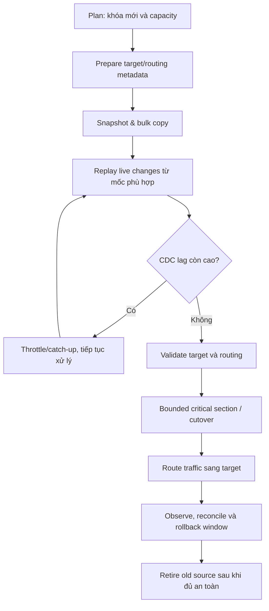

# Thay shard key và giới hạn chuyển dữ liệu đang hoạt động

Trong hệ NoSQL phân tán, **shard key** (khóa phân mảnh/khóa định tuyến) quyết định một bản ghi hoặc một nhóm bản ghi thuộc phần dữ liệu nào, từ đó ảnh hưởng trực tiếp đến **nơi lưu, nơi đọc, mức độ song song, độ nóng của partition và chi phí giao dịch**. Quyết định chọn shard key ở giai đoạn đầu thường dựa trên dữ liệu và workload nhỏ; khi ứng dụng tăng trưởng, khóa đã chọn có thể tạo ra một shard quá tải trong khi những shard khác nhàn rỗi.

Nhưng **thay shard key** không giống đổi tên một field trong JSON. Nếu giá trị khóa phân mảnh quyết định vị trí dữ liệu, đổi định nghĩa khóa có thể kéo theo việc **phân phối lại hàng triệu hoặc hàng tỷ bản ghi**, xây dựng lại index, cập nhật router, đổi đường đọc/ghi, di chuyển traffic và xử lý các thay đổi phát sinh **ngay trong lúc dữ liệu đang hoạt động**.

Bài học thuộc **Database No SQL → Phân mảnh và định tuyến**, tập trung vào hai vấn đề gắn chặt với nhau:

1. **Khi nào và bằng cách nào thay shard key?** Phân biệt đổi giá trị khóa của một thực thể, đổi định nghĩa khóa của toàn collection/table, bổ sung thành phần khóa, cân bằng lại shard và di chuyển một tập dữ liệu giữa cluster.
2. **Giới hạn nào làm chuyển dữ liệu live trở nên khó?** Tốc độ sao chép, lượng ghi mới, dung lượng tạm, tính đúng khi dual-write/backfill, cutover routing, transaction xuyên shard, TTL/delete, retry, rollback và đặc tính của từng NoSQL engine.

Mục tiêu không phải thuộc một câu lệnh “reshard”, mà là thiết kế một quá trình chuyển đổi có thể **đo, giới hạn tài nguyên, phục hồi khi lỗi và không âm thầm mất hoặc nhân đôi dữ liệu**.

> Các API và khả năng online resharding **khác nhau theo sản phẩm và phiên bản**. MongoDB có những cơ chế resharding trực tiếp trong các bản phát hành hỗ trợ; DynamoDB không cho sửa primary key của bảng như một thay đổi schema tại chỗ; Cassandra/ScyllaDB, Redis Cluster và Elasticsearch lại có cách tổ chức partition riêng. Không áp dụng runbook của hệ này lên hệ khác.

## 1. Shard key quyết định gì?

Một tập dữ liệu lớn được chia thành nhiều **shard**:

```text
Client
   |
   v
Router / Coordinator
   |
   +--- Shard A: một phần dữ liệu
   |
   +--- Shard B: một phần dữ liệu
   |
   +--- Shard C: một phần dữ liệu
```

Với một key như:

```json
{
  "tenantId": "T1",
  "orderId": "O-1042",
  "createdAt": "2026-11-14T08:00:00Z",
  "status": "PAID"
}
```

Hệ có thể định tuyến bằng `tenantId`, bằng `orderId`, bằng tổ hợp `(tenantId, orderId)`, một giá trị hash, một khoảng thời gian hoặc một partition/routing key theo sản phẩm.

Shard key tác động đến:

- **Data placement:** bản ghi nằm trên shard nào.
- **Query targeting:** từ filter có xác định được shard cần truy vấn không?
- **Write distribution:** các request có phân tán đều hay cùng đổ vào một shard?
- **Locality:** dữ liệu cần dùng chung có nằm gần nhau không?
- **Transaction cost:** nghiệp vụ có phải cập nhật nhiều shard không?
- **Movement cost:** khi phân phối lại, bao nhiêu dữ liệu phải copy?
- **Unique constraints và key semantics:** một số cơ sở dữ liệu hạn chế uniqueness xuyên shard.
- **Security/isolation:** tenant lớn có làm tenant khác chịu chung hotspot không?

**Shard key không tự đồng nghĩa với primary key hay business ID.** Một hệ có thể dùng `_id` làm document identity nhưng dùng một trường khác để chọn shard; một hệ khác tích hợp partition key trong primary key; một hệ dùng routing key tùy chọn của index.

## 2. Phân biệt các loại thay đổi thường bị gọi chung là “đổi shard key”

| Thao tác | Thay đổi gì? | Có nhất thiết phải di chuyển dữ liệu? |
| --- | --- | --- |
| **Đổi giá trị shard key trên một record** | Một order chuyển routing value từ A sang B | Có thể phải chuyển vị trí record; không phải hệ nào hỗ trợ update trực tiếp |
| **Thay định nghĩa shard key của collection/table** | Từ `tenantId` sang `(tenantId, orderId)` hoặc hashed key | Thường phải phân phối lại hoặc tạo cấu trúc mới |
| **Refine shard key** | Bổ sung thành phần vào định nghĩa hiện có theo cơ chế riêng | Có thể không thực hiện một vòng reshard toàn dữ liệu ngay; không tự chữa mọi hotspot |
| **Rebalance chunk/range/slot** | Giữ nguyên key function, đổi shard đang sở hữu phần key-space | Có di chuyển phạm vi dữ liệu nhưng không đổi định nghĩa khóa |
| **Thêm shard/node** | Tăng tài nguyên lưu trữ/xử lý | Có thể cần cân bằng lại; key giữ nguyên |
| **Tách tenant/collection lớn** | Thay topology hoặc đơn vị sở hữu | Có thể copy một phần dữ liệu |
| **Xây bảng/index mới** | Tạo access model có partition key khác | Cần backfill và đồng bộ những ghi đang đến |
| **Đổi tên field thông thường** | Schema/document representation | Không mặc định đổi routing key |

Vấn đề sản xuất rất hay gặp: đội vận hành thấy một shard nóng rồi yêu cầu “đổi shard key”, trong khi thực tế chỉ cần **tách range, rebalance, cô lập tenant hoặc tăng shard capacity**. Ngược lại, nếu tất cả ghi của một tenant vẫn chỉ định tuyến tới một partition, thêm máy mà giữ nguyên key **có thể không chữa được hotspot**.

## 3. Ví dụ: shard key tốt lúc đầu nhưng kém khi tăng trưởng

Giả sử ứng dụng thương mại điện tử có bảng orders:

```text
orders:
    tenantId
    orderId
    customerId
    status
    createdAt
    totalMinor
```

Ban đầu chọn:

```text
shardKey = tenantId
```

Lý do: API thường truy vấn toàn bộ dữ liệu của một tenant, nên locality tốt.

Tuy nhiên sau một năm:

```text
Tenant T1: 60% write traffic.
Tenant T2: 15%.
Các tenant khác: 25%.
```

Nếu cả tenant T1 bị ràng buộc vào một phạm vi shard/partition không chia nhỏ được theo định nghĩa key hiện tại, có thể xảy ra:

- Một shard/partition nóng liên tục.
- Write queue và p99 latency tăng.
- Shard khác chưa dùng hết CPU/IOPS.
- Các thao tác bảo trì/move tenant T1 rất nặng.
- Query theo `orderId` thiếu tenant scope phải fan-out.
- Một write burst từ T1 ảnh hưởng tenant cùng node.

Một thiết kế mới có thể định tuyến theo:

```text
tenantId + orderId
```

hoặc một giá trị **bucket/hash** bổ sung có quy tắc cụ thể. Nhưng đổi key không tự làm mọi query tốt hơn: các truy vấn “tất cả order của tenant T1 theo thời gian” có thể phải tổng hợp kết quả từ nhiều partition.

## 4. Khi nào thực sự cần thay shard key?

Những tín hiệu đáng điều tra:

1. **Hotspot ổn định:** cùng một partition/shard quá tải theo thời gian.
2. **Phân phối không đều:** thêm shard nhưng không cải thiện bottleneck.
3. **Scatter-gather quá rộng:** các query quan trọng liên hệ quá nhiều shard.
4. **Cardinality key quá thấp:** không có đủ giá trị khóa để phân chia.
5. **Key đơn điệu:** write luôn chạy vào một range mới nhất.
6. **Tenant tăng trưởng không đối xứng:** một tenant vượt giới hạn phân bố ban đầu.
7. **Business access pattern đổi:** trước truy theo tenant, nay chủ yếu truy theo order ID.
8. **Move operations kéo dài:** range/chunk quá lớn, việc cân bằng thiếu tiến triển.
9. **Transaction nhiều shard trở thành đường nóng:** dữ liệu cần cập nhật cùng nhau bị đặt xa.
10. **Chi phí vận hành/khả năng mở rộng chạm trần:** không thể đáp ứng mục tiêu p99 và headroom bằng tuning hợp lý.

Nhưng trước khi reshard, phải kiểm tra: query plan/index có sai không, shard đã mất cân bằng do balancer không chạy, có vấn đề compaction/GC/network không, workload có burst bất thường không, hoặc một thao tác có thể chuyển sang **atomic primitive** thay vì đọc–ghi trên hot key không.

**Resharding là thay đổi kiến trúc dữ liệu, không phải câu trả lời mặc định cho mọi latency spike.**

## 5. Xây bảng inventory của truy vấn trước khi đổi khóa

Một bảng thiết kế:

| Query/operation | Input chính | Tỷ lệ traffic | SLO | Yêu cầu locality |
| --- | --- | ---: | --- | --- |
| `GET order` | tenantId + orderId | 45% reads | p99 thấp | Target một shard |
| `LIST customer orders` | tenantId + customerId, theo thời gian | 25% reads | Phân trang | Có index/read model |
| `LIST pending by store` | tenantId + storeId + status | 15% reads | Near real-time | Định tuyến theo store |
| `UPDATE order status` | tenantId + orderId + version | 60% writes | CAS an toàn | Một authority per order |
| `COUNT daily revenue` | tenantId + day | 10% reads | Có thể trễ vài phút | Aggregate |
| `DELETE tenant` | tenantId | Hiếm | Hoàn tất có audit | Xác định đủ key/range |

Các con số chỉ minh họa. Từ bảng này cần trả lời:

- Query nào **bắt buộc target đúng shard**?
- Query nào có thể dùng **secondary index, materialized view, search**?
- Thao tác nào phải atomically update nhiều item?
- Tenant isolation cần ở mức shard hay chỉ logic tenant?
- Có những read phải bảo đảm read-your-writes hoặc strong consistency không?
- Key nào có cardinality đủ cao và phân phối traffic ra sao?
- Cần thay key của **source of truth** hay chỉ thêm một read model?

Đổi shard key chỉ nhằm giảm một hotspot nhưng làm 80% reads thành scatter-gather thường là đánh đổi không tốt.

## 6. Chọn khóa mới: tính phân tán và tính định tuyến

Một shard key tốt phải phù hợp với **workload cụ thể**, không chỉ có nhiều giá trị duy nhất.

Các tiêu chí:

- **Cardinality:** có đủ distinct values để chia tải không?
- **Skew:** phân phối theo key có bị lệch nghiêm trọng không?
- **Write rate per key:** hot key có vượt giới hạn một partition không?
- **Read locality:** truy vấn có cung cấp key hay phải scatter?
- **Mutability:** giá trị key có đổi theo đời sống thực thể không?
- **Growth:** data/traffic tương lai có giữ phân bố hợp lý không?
- **Time correlation:** key tăng đơn điệu gây hot range không?
- **Security:** key có chứa PII trực tiếp hoặc lộ tenant scope không?
- **Uniqueness:** constraint cần được kiểm tra ở đâu?
- **Operational migration:** phải copy bao nhiêu bytes và xây lại những gì?

Ví dụ:

```text
Key A = tenantId:
    Dễ list tenant, nhưng tenant lớn gây hotspot.

Key B = hash(tenantId, orderId):
    Phân tán point operations tốt hơn, list tenant có thể fan-out.

Key C = tenantId + bucket:
    Chia một tenant ra nhiều bucket, đọc theo tenant cần duyệt các bucket.

Key D = createdAt:
    Range scan theo thời gian thuận lợi nhưng write mới có thể tập trung.
```

**Không có shard key tối ưu cho mọi truy vấn.** Trong NoSQL, thường cần chấp nhận một số truy vấn dùng read model phụ thay vì ép một key phục vụ tất cả.

## 7. Hash sharding và range sharding khác nhau khi đổi khóa

### Hash-based distribution

```text
partition = hash(key) mod numberOfBuckets
```

Đây là công thức khái niệm; hệ thực có thể dùng virtual nodes, token ranges, consistent hashing hoặc map slot→shard khác.

Ưu điểm: phân tán tương đối đều khi input có entropy tốt. Nhược điểm: quét range theo field nghiệp vụ thường không đi theo thứ tự shard.

### Range-based distribution

```text
Shard A: customerId < 100000
Shard B: 100000 <= customerId < 200000
Shard C: customerId >= 200000
```

Ưu điểm: những truy vấn range phù hợp có thể target vùng liên quan. Nhược điểm: key tăng đơn điệu làm write dồn vào range cuối, hoặc một range chứa một giá trị quá hot không thể tách thêm bằng key hiện tại.

### Chuyển từ range sang hash

Có thể cải thiện write distribution nhưng làm dữ liệu phải **đổi nơi đặt** và thay cấu trúc query range. Cần phân tích lại secondary index, sort, pagination và batch access; không so chỉ throughput ghi.

## 8. Đổi giá trị khóa trên một record khác đổi định nghĩa khóa toàn collection

Giả sử order có:

```json
{
  "orderId": "O-100",
  "tenantId": "T1",
  "storeId": "S1"
}
```

Nếu routing key là `storeId`, chuyển order từ `S1` sang `S2` có thể là chuyển bản ghi sang vị trí khác.

Trong một số hệ, key là một phần **immutable primary key** nên phải tạo row mới và xóa row cũ theo protocol. Trong hệ khác, update shard key được hỗ trợ nhưng có điều kiện về routing, upsert và transaction.

Khác với:

```text
Collection đang sharded theo storeId.
Muốn toàn collection chuyển sang tenantId + orderId.
```

Đây là **thay routing function**, có thể tác động tới hầu như mọi record, metadata, index và client. Một thao tác update một record không giải quyết bài toán toàn collection.

## 9. Rebalance không làm thay đổi định nghĩa shard key

Giả sử một range key từ 1000 đến 1999 hiện nằm trên shard A; balancer chuyển range này sang B:

```text
Trước:
    range [1000, 1999] -> Shard A

Sau:
    range [1000, 1999] -> Shard B

Routing key của mọi record:
    giữ nguyên.
```

Mục tiêu là phân phối tải/dung lượng trên các shard hiện có.

Trong một số engine có **chunk migration, token ownership change hoặc hash-slot migration**. Chúng không nhất thiết tạo key mới hoặc thay đổi key schema của ứng dụng.

**Khi nào rebalance không đủ?** Nếu một shard key có một giá trị duy nhất chứa phần lớn traffic và đơn vị dữ liệu đó không thể chia theo key hiện tại, chuyển nó sang shard khác chỉ **dời hotspot**, không giải quyết phân tán bên trong hotspot.

## 10. Không phải “online” nghĩa là không có ảnh hưởng

Một hệ thông báo hỗ trợ **online resharding** thường có nghĩa là vẫn có thể xử lý ít nhất một số thao tác trong quá trình di chuyển, với những điều kiện đã quy định.

Nó **không mặc định** bảo đảm:

- Không tăng p95/p99 latency.
- Không có khoảng chặn ghi/đọc rất ngắn lúc cutover.
- Không tăng disk/network usage.
- Không có giới hạn transaction/index/operation.
- Không có aborted/retried requests.
- Không cần tăng tạm capacity.
- Có thể rollback bất kỳ lúc nào không mất công.
- Có thể reshard một collection bất kỳ ở mọi phiên bản.
- Ứng dụng dùng direct shard routing vẫn hoạt động không đổi.

Khi đọc tài liệu sản phẩm, phải xác định **định nghĩa online**: thao tác nào tiếp tục được, khoảng critical section, những lệnh không được chạy song song, resource budget và failure recovery.

## 11. Bài toán sao chép một nguồn liên tục thay đổi

Một collection có 2 TiB data. Migrate job bắt đầu copy ở T0:

```text
T0:
    Snapshot source chứa version các record tại mốc T0.

T1:
    Application tiếp tục INSERT, UPDATE, DELETE.

T2:
    Copy snapshot hoàn thành.

T3:
    Cutover sang target mới.
```

Nếu chỉ copy snapshot T0 rồi cutover, các thay đổi từ T0 đến T3 **không tự xuất hiện** trên target. Với dữ liệu live, phải có:

- **Change capture** từ nguồn (log/CDC/event stream) và replay vào target; hoặc
- **Dual-write** theo một protocol bảo đảm nhất quán và phục hồi; hoặc
- **Stop-the-world write pause** đủ lâu để hoàn tất copy cuối, nếu downtime được phép; hoặc
- **Engine-managed online resharding** xử lý copy, catch-up và cutover nội bộ.

Chính sách “copy xong rồi chuyển router” nếu bỏ qua ghi trong lúc copy là **không an toàn**, dù copy tool báo thành công 100%.

## 12. Bốn chiến lược phổ biến

| Chiến lược | Cách làm | Phù hợp | Rủi ro chính |
| --- | --- | --- | --- |
| **Engine-managed online resharding** | Engine tự copy, catch up, đổi metadata | Sản phẩm hỗ trợ đúng use case | Giới hạn phiên bản, tài nguyên, critical section |
| **New table/collection + snapshot + CDC** | Xây target mới, stream delta rồi cutover | Đổi primary key/schema lớn | Gap event, lag, consistency, schema transform |
| **Dual-write application migration** | Một số giai đoạn ghi source và target | Không có CDC phù hợp hoặc có protocol riêng | Partial success, ordering, rollback |
| **Offline/bounded maintenance migration** | Tạm dừng writes, copy, switch | Workload nhỏ hoặc có maintenance window | Downtime/queue backlog |

Một số migration kết hợp các cách trên. Ví dụ vừa snapshot+CDC vừa dùng dual-read để so kết quả, nhưng không được chồng các cơ chế mà không rõ **ai là source of truth** trong mỗi giai đoạn.

## 13. Mô hình trạng thái online resharding

Một workflow điển hình:



Giai đoạn cụ thể tùy engine. Cần có **trạng thái có thể quan sát** và **điều kiện chuyển pha**, không dùng một cron script thiếu checkpoint chạy nhiều giờ rồi hy vọng hoàn tất.

## 14. Snapshot nhất quán: xác định chính xác mốc copy

Một snapshot đúng phải gắn với một mốc mà change stream có thể tiếp nối.

Ví dụ:

```text
T0: Source snapshot có mốc LSN/clusterTime S.
T0..T1: Bulk copy dữ liệu theo snapshot S.
T1..T2: Replay changes sau S.
T2: Catch up đến watermark W.
T3: Cutover khi đáp ứng consistency/lag contract.
```

Nếu snapshot thực chất là **một cuộc scan không nhất quán** qua nhiều giờ, mỗi key có thể được đọc ở thời điểm khác nhau. Vẫn có những thuật toán migration chịu được loại scan đó, nhưng phải có cơ chế replay/dedup/ordering để không bỏ lỡ hoặc ghi đè các thay đổi. Không được giả định rằng một scan thông thường tương đương transaction snapshot toàn collection.

### Các cách xử lý khi không có snapshot toàn cục

- Ghi nhận mốc CDC trước scan rồi replay từ đó theo protocol.
- Mỗi record mang revision có thể dùng để áp vào target có điều kiện.
- Quét nhiều pass cho tới khi mismatch giảm theo một quy tắc convergence.
- Có khoảng write freeze ngắn sau khi catch-up để chốt trạng thái.
- Thiết kế cutover theo entity/tenant thay vì toàn bộ collection nếu đảm bảo routing đơn nhất.

Những cách này cần được chứng minh bằng **invariant và test**, không chỉ bằng số record bằng nhau.

## 15. Change Data Capture (CDC) bắt phần ghi sau snapshot

Một luồng CDC có thể chứa:

```text
seq 100: INSERT O-1, revision 1
seq 101: UPDATE O-2, revision 8
seq 102: DELETE O-3, revision 6
seq 103: UPDATE O-1, revision 2
```

Target cần replay theo semantics:

1. Mọi sự kiện liên quan được nắm bắt từ mốc thích hợp.
2. Không bỏ sự kiện do log retention hết hạn.
3. Duplicate events có thể được xử lý an toàn.
4. Các update cùng entity không bị áp sai thứ tự.
5. Delete không bị một event cũ resurrect.
6. Mọi transformation phải tạo đúng new shard key.
7. Khi key thay đổi, dữ liệu cũ ở vị trí cũ được xử lý đúng.
8. Có checkpoint giúp resume không bỏ gap.

**CDC “at least once” không tự đồng nghĩa exactly-once state**. Cần idempotency và conditional revision apply ở target.

## 16. Dual-write không tự tạo atomicity giữa hai nơi

Một lộ trình tưởng đơn giản:

```text
Application writes old store.
Application writes new store.
```

Có những tình huống:

```text
Write old: SUCCESS.
Write new: TIMEOUT.

Hoặc:
Write new: SUCCESS.
Write old: FAIL.
```

Và:

```text
Request A cập nhật v10 -> v11.
Request B cập nhật v11 -> v12.

Target nhận B trước A.
```

Nếu target cho write v11 đè v12, migration tạo **regression**.

### Yêu cầu với dual-write

- Xác định **nguồn nào có thẩm quyền** cho commit.
- Có **operationId** hoặc sequence để replay/dedup.
- Mọi write được ghi vào **durable change log/outbox** hoặc cơ chế recovery có thể bù khi target lỗi.
- Có **version/generation guard** khi áp target.
- Có retry budget, dead-letter/repair workflow và quan sát gap.
- Không báo “đã commit ở cả hai” nếu chỉ một bên xác nhận.
- Định nghĩa hành vi delete, TTL, batch và transaction nhiều item.

**Hai lời gọi API liên tiếp không phải distributed transaction.** Nếu nghiệp vụ bắt buộc cả hai atomic, cần protocol phân tán có hỗ trợ hoặc thay chiến lược migration.

## 17. Tại sao outbox thường tốt hơn dual-write mù?

Một phương án:

```text
[Client command]
       |
       v
[Source transaction]
    update authoritative record
    append outbox event with operationId/revision
       |
       v
[Outbox consumer]
    apply to target new shard layout
    checkpoint after safe apply
```

Nếu source có thể atomically ghi dữ liệu và outbox, sau commit có bằng chứng để target bắt kịp ngay cả khi target tạm offline.

Những vấn đề vẫn cần xử lý:

- Consumer có thể nhận trùng.
- Events có thể bị xử lý sai thứ tự theo key.
- Outbox/stream có retention và capacity.
- Transaction source có giới hạn kích thước.
- Projection target cần atomic compare-and-apply.
- Nếu source không hỗ trợ atomic outbox, phải chọn cơ chế tương đương hoặc rõ ràng chấp nhận/trị lỗi dual-write.

Outbox không tạo “exactly once xuyên hai database” một cách tự động. Nó tạo điều kiện cho **reliable eventual migration** khi có idempotency và replay.

## 18. Cutover: thời điểm cả hệ chuyển sang định tuyến mới

**Cutover** là thời điểm ứng dụng/router bắt đầu coi layout mới là nguồn phục vụ có thẩm quyền.

Bài toán khó nằm ở:

```text
T1: Một request đã định tuyến tới old shard trước cutover.
T2: Metadata đổi sang new shard.
T3: Request T1 mới commit trên old shard.
```

Nếu delta sau T2 không còn được replay, thay đổi của T1 bị bỏ lỡ trên target.

Một protocol cutover phải có cách xử lý những **in-flight writes**:

- Chặn/buộc hoàn tất các writes thuộc generation cũ.
- Giữ CDC tiếp tục tới mốc đã xác định.
- Dùng routing epoch/fencing để từ chối writer cũ sau cutover.
- Chỉ ACK operation khi authoritative commit được xác định.
- Có cơ chế điều phối metadata nhất quán của router.
- Cho request retry/redirect tới owner mới với operationId cũ.
- Phân biệt request chưa nhận với request đã commit nhưng response mất.

Nếu chỉ cập nhật một biến cấu hình trên một node rồi để các node khác tự đổi dần, có thể tạo **split-brain routing**.

## 19. Epoch/fencing cho quyền ghi sau migration

Một mô hình:

```text
Routing epoch 41:
    Order O-100 owner = shard A.

Routing epoch 42:
    Order O-100 owner = shard B.
```

Sau cutover:

```text
Write request có epoch 41:
    không được tự commit ở owner cũ nếu epoch 42 có thẩm quyền.

Write request có epoch 42:
    được xử lý theo protocol ở shard B.
```

Token thế hệ chỉ có tác dụng nếu **storage/router thực thi kiểm tra**. Chỉ đặt `epoch=42` trong cache không ngăn được một worker chạy lâu vẫn gửi ghi tới shard A.

**Đừng tự thiết kế fencing cấp application nếu engine đã có giao thức online migration hoàn chỉnh**, vì có thể phá metadata nội bộ. Ngược lại, nếu tự xây migration giữa hai hệ độc lập, một cơ chế authority/epoch có thể cần thiết để tránh cả hai cùng nhận authoritative writes.

## 20. Stale router và metadata cache

Các request thường không biết physical shard; chúng gọi router hoặc client library:

```text
Client -> Router cache -> Shard map
```

Khi move dữ liệu:

```text
Old:
    key range R -> Shard A

New:
    key range R -> Shard C
```

Router có thể còn metadata cũ:

- Trả lỗi redirect/retry nếu engine hỗ trợ.
- Nhận metadata stale và refresh.
- Định tuyến lại request an toàn.
- Xử lý request đã in-flight ở owner cũ.
- Ngăn vòng lặp A→C→A do cache lệch phiên bản.

Cần đo **routing metadata propagation lag** và **stale route errors**. Một hệ chỉ cập nhật central map nhưng client giữ cache TTL dài có thể tạo hàng phút lỗi hoặc ghi nhầm.

Không để client hardcode shard ID từ business key nếu cơ chế chính thức đã cung cấp router/partition map.

## 21. Hai đường đọc trong giai đoạn chuyển tiếp

Một kế hoạch có thể chuyển theo pha:

```text
Pha 1: reads old, writes authoritative old -> target catch-up.
Pha 2: shadow reads new để so kết quả, production trả old.
Pha 3: cutover reads/writes new.
Pha 4: giữ old read-only phục vụ rollback/audit trong thời hạn.
Pha 5: retire old.
```

**Shadow read** giúp phát hiện schema transform sai, record thiếu hoặc query semantics thay đổi. Nhưng không nên quyết định “new đúng” chỉ từ:

```text
COUNT(old) == COUNT(new)
```

Có thể hai tập khác key hoặc khác status mà count vẫn bằng. Cần so:

- Key sets theo tenant/range.
- Revision/generation.
- Content hash sau canonical transform.
- Tombstone/delete.
- Secondary index/query results.
- Pagination/sort order.
- Những business invariants quan trọng.

Đường shadow read không được gây side effect hoặc làm tăng tải tới mức ảnh hưởng production SLO.

## 22. Dual-read fallback có thể che lỗi

Một số migration sử dụng:

```text
GET key:
    try new;
    if not found -> try old.
```

Đây là cơ chế tương thích dễ dùng nhưng có hai rủi ro:

**Thứ nhất:** nếu record đã bị **delete trên new** nhưng còn bản cũ trên old, fallback có thể resurrect dữ liệu trong response.

**Thứ hai:** nếu new trả lỗi hạ tầng, ứng dụng có thể trả dữ liệu old quá cũ trong một API yêu cầu strong consistency.

Do đó fallback phải biết:

- Missing là **never existed** hay **deleted**?
- New có đang authoritative không?
- Old read có được phép theo business contract không?
- Version/generation của hai bản ra sao?
- Có migration state/epoch nào xác định quyền chọn?

Không dùng `null` đơn thuần làm bằng chứng an toàn để đọc old rồi ghi lại new.

## 23. Delete và TTL trong migration

Giả sử:

```text
T0: Backfill copy user U vào target.
T1: User yêu cầu xóa U trên source.
T2: CDC delete bị trì hoãn.
T3: Cutover.
```

Nếu target chưa biết DELETE tại T3, user U có thể xuất hiện trở lại sau cutover.

Cần:

- Copy **tombstone/delete markers** hoặc replay delete event.
- Bảo đảm CDC watermark bao trùm các delete trước cutover.
- Giữ generation/revision chống sự kiện cũ.
- Không reset TTL tùy tiện khi copy nếu policy đòi expiry thời gian gốc.
- Phân biệt soft delete với hard delete và GDPR/privacy workflows.
- Ghi nhận deletion audit nếu cần.
- Không dọn old dataset trước khi chứng minh delete đã được áp theo contract ở new.

TTL thường là **thuộc tính vòng đời**, không đơn giản là giá trị còn lại trong row. Copy một item sắp hết hạn mà cấp TTL mới đầy đủ có thể vô tình kéo dài retention.

## 24. Idempotency khi chuyển dữ liệu đang ghi

Một request có thể được gửi nhiều lần qua cutover:

```text
T0: Client gửi Reserve(orderId=R1).
T1: Old source đã commit.
T2: Response bị mất.
T3: Cutover sang new.
T4: Client retry Reserve(R1).
```

Nếu new chưa nhận operation record, hệ có thể trừ stock lần nữa.

Một thiết kế cần:

1. OperationId ổn định do client/service cấp.
2. Bản ghi idempotency thuộc phạm vi migration.
3. Outcome cũ được chuyển sang target và tra được sau cutover.
4. Cùng operationId chỉ áp business effect một lần.
5. Retry có thể trả lại kết quả đã commit.
6. Unknown commit outcome được reconcile, không đoán “thất bại”.

**Migration không được thay đổi hợp đồng idempotency** chỉ vì đổi shard layout.

## 25. Thứ tự sự kiện và version guard

Giả sử target nhận các event:

```text
event rev=10: status PENDING
event rev=12: status PAID
event rev=11: status PROCESSING (đến trễ)
```

Nếu áp một cách mù quáng, target có thể kết thúc ở `PROCESSING` dù source đã `PAID`.

Một quy tắc áp event toàn trạng thái:

```text
IF event.generation = currentGeneration
   AND event.revision > target.revision
THEN apply event snapshot;
ELSE ignore stale event.
```

Với event dạng **delta**, không thể luôn bỏ qua các revision trung gian mà vẫn đúng; cần phát hiện **gap**, lấy snapshot mới hoặc replay đúng thứ tự.

Không mặc định trường `updatedAt` là ordering token đáng tin cậy khi có clock skew và multi-primary writes. Chọn một **revision/sequence** với authority và phạm vi rõ.

## 26. Chuyển dữ liệu không chỉ là payload rows

Một collection 1 TiB dữ liệu nghiệp vụ có thể kéo theo:

- Primary/secondary indexes.
- Local replication factor.
- Materialized views hoặc lookup tables.
- CDC/outbox logs.
- TTL/tombstone metadata.
- Search index và analytics projections.
- Backups/snapshots.
- Routing metadata và chunk maps.
- Transaction/session state.
- Cache keys.
- Idempotency/uniqueness records.
- Schema validation, encryption/configuration.
- Monitoring tags và operational dashboards.

**Chi phí migration có thể lớn hơn size dữ liệu sống**. Đặc biệt, trong giai đoạn song song old/new, index build, replica copy, write log và compaction có thể chiếm nhiều dung lượng tạm.

Ước lượng capacity phải dựa trên **physical bytes moved/rewritten**, không chỉ kích thước JSON business.

## 27. Giới hạn số 1: băng thông thực có thể dùng

Độ dài tối thiểu của một quá trình copy, trong mô hình đơn giản:

\[
T_{\min} =
\frac{D_{\text{must-copy}}}
{B_{\text{effective}}}
\]

Trong đó:

- \(D_{\text{must-copy}}\): lượng bytes thực sự phải chuyển theo topology/replica policy.
- \(B_{\text{effective}}\): throughput bền vững còn lại cho migration sau khi dành tài nguyên cho workload thường ngày.

Ví dụ **6 TiB** cần copy qua đường hiệu dụng **100 MiB/s**:

\[
T_{\min}
=
\frac{6 \times 1024 \times 1024\ \text{MiB}}
{100\ \text{MiB/s}}
\approx 62\,915\ \text{s}
\approx 17{,}5\ \text{giờ}.
\]

Đây là **cận dưới lý tưởng cho bulk copy**, chưa tính:

- Network protocol overhead.
- Compression/serialization.
- Index rebuild, replicas và temporary data.
- CDC catch-up.
- Retry/rate limiting.
- Thời gian cutover và validation.
- Hot range chậm hơn các range khác.
- Khi move nội bộ cluster, data có thể đi qua nhiều đường mạng/ổ đĩa.

Nếu capacity thực tế chỉ còn 40 MiB/s vào giờ cao điểm, không thể giữ nguyên estimate 17,5 giờ.

## 28. Giới hạn số 2: dữ liệu tiếp tục thay đổi trong lúc copy

Giả sử source tạo thêm changes:

```text
Data transfer capacity: 100 MiB/s.
Change stream rate:      40 MiB/s.
```

Trong một mô hình pipeline đơn giản, sau bulk copy, hệ có **khoảng 60 MiB/s công suất ròng** để giảm backlog nếu cùng đường tài nguyên và replay cost tương ứng. Nếu change rate tăng lên 120 MiB/s trong khi khả năng áp target chỉ là 100 MiB/s, backlog **có thể tiếp tục tăng** và không bao giờ bắt kịp tới điểm cutover.

Quy tắc:

\[
\text{Sustainable apply throughput}
>
\text{Incoming change rate}
\]

để backlog giảm trong steady state, theo **cùng đơn vị/chi phí** đã chuẩn hóa.

Tuy nhiên, đây là mô hình đơn giản. Bulk copy và CDC có thể dùng những worker/tài nguyên khác nhau; writes có kích thước và amplification khác; một event update có thể tạo nhiều index writes. Cần đo **lag thực**, không chỉ so hai byte counters khác tầng.

### Ví dụ

```text
CDC backlog ban đầu:    180 GiB
Net drain rate:          30 MiB/s

Thời gian tối thiểu để drain:
    180 * 1024 MiB / 30 MiB/s
    = 6144 giây ≈ 1,7 giờ
```

Nếu trong một giờ tới có burst ghi mạnh, estimate sẽ thay đổi. Cutover không nên chỉ dựa trên “còn 100 event” khi những event đó có thể là giao dịch dung lượng lớn hoặc write chưa commit.

## 29. Giới hạn số 3: disk headroom và duplication

Trong giai đoạn online migration, có thể cần giữ:

```text
Old source data
    +
New target data
    +
Target indexes
    +
Migration logs / CDC retention
    +
Temporary compaction/snapshot outputs
    +
Replicas/backups theo policy
```

Ví dụ chỉ để minh họa:

```text
Old data + index:          5 TiB
New data + index:          5 TiB
Migration temp/log:        1 TiB
Compaction/repair headroom:1 TiB

Tổng thời điểm đỉnh:      12 TiB
```

Điều này không nói phải có 12 TiB trên **một node**: phải tính đúng vị trí bytes ở donor/recipient/shards và replication. Nhưng nếu không tính **peak per node/per volume**, một recipient có thể đầy disk trước khi copy hoàn tất, khiến resharding bị kẹt.

Cần theo dõi:

- Free bytes và tỷ lệ fill theo node.
- Dung lượng index xây mới.
- Temporary file overhead.
- WAL/oplog/CDC log retention.
- Compaction backlog.
- Snapshot giữ file cũ.
- Backup/quota và object storage costs.

**Không hoạch định ở 100% disk usage** rồi hy vọng cleanup sẽ chạy trước khi hết chỗ.

## 30. Giới hạn số 4: ảnh hưởng đến traffic foreground

Migration cạnh tranh tài nguyên với người dùng:

| Tài nguyên | Migration sử dụng | Có thể ảnh hưởng |
| --- | --- | --- |
| CPU | Hash/serialize/transform/index build | Query CPU, GC |
| Disk reads | Scan snapshot, read SSTable/page | GET p99, cache eviction |
| Disk writes | Target insert, WAL, compaction | PUT latency/write stalls |
| Network | Bulk transfer, replication, CDC | Cross-region latency |
| Memory | Buffers, sorting, caches | Eviction/OOM risk |
| Connections | Copy workers/transactions | Pool exhaustion |
| Metadata/locks | Chunk map, index/routing coordination | Routing/cutover pauses |
| Storage quota | Old + new copies | Throttling/full disk |

Một job đạt throughput migration tối đa trong benchmark riêng có thể gây **dịch vụ chính không đạt SLO**. Trong production, mục tiêu là **tốc độ chuyển dữ liệu cao nhất vẫn giữ được p95/p99 và error budget**, không phải copy nhanh nhất bất kể hậu quả.

## 31. Throttle, admission control và backpressure

Một strategy thực tế:

```text
Migration controller:
    maxReadMiBps: 80
    maxWriteMiBps: 60
    maxConcurrentRanges: 4
    minDiskFreePercent: 25
    maxForegroundP99Ms: 300
    maxCDCBacklogAgeSeconds: configured
```

Các con số chỉ minh họa yêu cầu, không phải cấu hình có sẵn của mọi engine.

Controller có thể giảm/đóng worker khi:

- Foreground p99 vượt SLO.
- Disk write queue dài bất thường.
- Replica/CDC lag tăng vượt ngưỡng.
- CPU/IOPS đạt giới hạn.
- Recipient gần hết disk.
- Metadata/routing errors tăng.

Khi giảm tốc bulk copy, cần vẫn đủ năng lực CDC để backlog không tăng mãi. Bật throttle mà không theo dõi **khả năng hội tụ** có thể khiến migration kéo dài vô hạn hoặc hết retention.

## 32. Tại sao key rất nóng khó move hơn key lạnh?

Một hot partition có thể đang nhận:

```text
1.000 updates/s cùng một logical key.
```

Nếu copy dữ liệu của key kéo dài, trạng thái target liên tục bị thay đổi trong lúc snapshot và CDC catch-up. Nếu client vẫn đọc/ghi ở old route, thời điểm cần chuyển authority phải giải quyết **writes đang in-flight**.

Các giải pháp tùy engine:

- Per-key write serialization.
- Bounded pause/fencing ở cutover.
- Conditional versioning và idempotency.
- Copy dữ liệu immutable trước, mutable state sau.
- Move theo owner/epoch có metadata consensus.
- Tách hot aggregate hoặc dùng atomic primitive trước khi migrate.
- Tránh move lặp lại cùng hot range liên tục.

Nếu một logical counter quá nóng, chuyển counter sang shard khác chỉ **dời nút cổ chai**. Có thể cần thay data model, sharded counters hoặc queue/single-writer theo invariant.

## 33. Jumbo chunk, range không thể tách và giới hạn kích thước

Trong một số kiến trúc range/chunk sharding, có tình huống một chunk/range quá lớn hoặc chứa một tập tài liệu có cùng shard-key value khiến việc tách theo khóa khó hoặc không thể.

Hiện tượng:

```text
Shard key = tenantId
Tenant T1 chứa 500 GiB dữ liệu

Mọi row có tenantId = T1.
```

Nếu routing chỉ cho phép phân chia tại ranh giới giá trị `tenantId`, dữ liệu của T1 có thể không tách theo các boundary có ý nghĩa chỉ bằng cách bổ sung node. Một engine có thể hỗ trợ những chiến lược khác để di chuyển/cân bằng hoặc quản lý range; chi tiết tùy phiên bản.

Thay khóa thành `(tenantId, orderId)` hoặc dùng bucket có thể tạo thêm điểm phân chia, **nhưng phải migration** và đánh giá query locality/uniqueness.

Không cố giải quyết “jumbo” chỉ bằng tăng balancer frequency nếu vấn đề gốc là **đơn vị phân vùng không chia được**.

## 34. Range moves có thể gây migration churn

Một cluster liên tục tăng/giảm tải có thể lặp:

```text
Move range R từ A -> B.
Sau vài phút B nóng hơn.
Move range R từ B -> C.
Sau đó chuyển lại.
```

Đây là **thrashing/churn**. Data movement liên tục chiếm network/disk, tạo cache misses và p99 spikes, đôi khi còn lớn hơn lợi ích phân tải.

Chính sách cân bằng cần:

- **Hysteresis:** chênh lệch đủ lớn và tồn tại đủ lâu mới move.
- **Cool-down period** cho range vừa chuyển.
- **Hotspot detection** theo QPS/CPU chứ không chỉ size.
- **Move cost model** theo bytes và write churn.
- **Per-node concurrency limits.**
- **Data locality/zone placement rules.**
- **Observability:** bytes moved, moves aborted, repeated moves.
- **Không chạy balancer cùng lúc** với backup/index build quá nặng nếu có thể tránh.

**Cân bằng dung lượng không tự cân bằng traffic.** Một range nhỏ nhưng có 80% writes có thể nóng hơn một range lớn ít truy cập.

## 35. MongoDB: reshardCollection, refine và chunk migration

Trong những phiên bản MongoDB hỗ trợ, có những khả năng phân biệt:

- **Sharding collection:** chọn shard key ban đầu.
- **Chunk/range migration và balancer:** đổi nơi sở hữu dữ liệu **mà giữ key**.
- **refineCollectionShardKey:** mở rộng shard key theo cách được hỗ trợ bằng thêm trường vào hậu tố; không tương đương tùy ý đổi thứ tự hay loại bỏ trường.
- **reshardCollection:** thay shard key của một sharded collection theo cơ chế được hỗ trợ; thường bao gồm copy dữ liệu, catch-up và cutover phối hợp bởi server.
- **Thay giá trị shard key của một document:** có các hạn chế riêng; không đồng nhất với toàn bộ collection reshard.

Ví dụ **hình thức lệnh** để thảo luận, không phải thao tác khuyến nghị chạy ngay:

```javascript
db.adminCommand({
  reshardCollection: "shop.orders",
  key: { tenantId: 1, orderId: 1 }
});
```

Cú pháp, tiền điều kiện, index yêu cầu, version, giới hạn thao tác đồng thời, FCV và khả năng hỗ trợ reshard hashed/range **phải kiểm tra đúng cluster đang dùng**.

### Điểm cần xác minh trước khi chạy

1. MongoDB version và FCV hỗ trợ key cũ/mới không?
2. Collection có nằm trong topology/sharding mode được hỗ trợ?
3. Key mới có index cần thiết và phân phối tốt?
4. Có unique indexes/constraints bị ảnh hưởng?
5. Có query, transaction, bulk write hoặc change stream đặc biệt?
6. Collection size và tốc độ writes có nằm trong resource budget?
7. Cluster có đủ donor/recipient capacity và metadata health?
8. Ứng dụng có dùng `mongos`/driver router đúng, không hardcode shard?
9. Có runbook pause/failure recovery và cutover?
10. Có kế hoạch xác minh dữ liệu và quan sát p99 sau khi xong?

**refine không đồng nghĩa phân phối lại toàn bộ dữ liệu ngay**. Nếu mục tiêu là khắc phục distribution cũ, phải xác minh balancer/ranges và điều kiện để tạo phân bố mới. **reshardCollection cũng không tự tối ưu mọi query**; nó thay key function, còn access patterns phải phù hợp.

## 36. MongoDB: uniqueness và định tuyến sau đổi shard key

Một collection trước đây query:

```javascript
db.orders.findOne({
  tenantId: "T1",
  orderId: "O-100"
});
```

Khi shard key đổi, cần kiểm tra filter có còn đủ điều kiện cho router **target shard phù hợp** không. Nếu bỏ một thành phần quan trọng, query có thể scatter.

Với unique indexes trên sharded collection, tính duy nhất toàn cluster có **điều kiện và giới hạn liên quan tới shard key** theo phiên bản. Không tự kết luận index `{orderId:1}` enforce global uniqueness trong mọi layout.

Một thiết kế thường cần:

```text
Business identity = (tenantId, orderId).
Routing key = field(s) được chọn.
Uniqueness authority = index/guard/service có contract rõ.
```

Nếu shard key mới không còn bao gồm những trường cần cho uniqueness, phải thiết kế lại cơ chế kiểm soát trùng, không phụ thuộc vào may mắn phân bố giữa shard.

### Những path hay bị bỏ qua

- Background jobs query chỉ bằng `orderId`.
- Admin scripts update trực tiếp shard cũ.
- Bulk imports/upserts thiếu shard key.
- Transaction đọc/ghi nhiều shards theo route cũ.
- Delete job chỉ scan một shard.
- TTL/index maintenance.
- Monitoring và backup có filter theo key cũ.

## 37. DynamoDB: partition key của table không đổi tại chỗ

Trong DynamoDB, **primary key** của một table (partition key và sort key nếu có) được xác định khi tạo table và không thể đổi tại chỗ bằng một thay đổi schema đơn giản.

Ví dụ bảng cũ:

```text
Table: OrdersV1
PK = tenantId
SK = orderId
```

Muốn bảng mới:

```text
Table: OrdersV2
PK = orderId
SK = tenantId
```

một chiến lược điển hình là **tạo table mới**, chuyển dữ liệu, đồng bộ những thay đổi live rồi chuyển ứng dụng sang key schema mới. GSI phục vụ đường truy cập mới **không tự đổi partition key vật lý của bảng nguồn**.

### Workflow khái niệm

```text
1. Tạo OrdersV2 với PK/SK/index/capacity phù hợp.
2. Xác định source snapshot/backfill.
3. Bảo đảm mọi thay đổi sau mốc snapshot được bắt.
4. Scan/export/import/backfill data theo contract.
5. Replay DynamoDB Streams hoặc nguồn event đáng tin cậy.
6. Dùng revision/idempotency để tránh overwrite stale.
7. Shadow read/compare.
8. Chuyển application routing/table name.
9. Giữ old table trong rollback window, rồi retire.
```

**DynamoDB Streams có retention và ordering semantics riêng.** Nếu backfill kéo dài hơn lượng lịch sử được giữ và không có phương án khác, target có thể bỏ lỡ updates. Phải xác minh stream/view type, checkpoint, throttling, item size, GSI cost, capacity và cutover.

Một thao tác `UpdateItem` không thể sửa thuộc tính primary key như field thông thường để “chuyển partition” ngay trong cùng table. Với entity cần chuyển identity key, phải thực hiện create/delete theo giao thức phù hợp.

## 38. DynamoDB: hot partition và adaptive capacity

Nếu table có partition key ít phân biệt:

```text
PK = tenantId
```

và một tenant chiếm phần lớn traffic, có thể gặp giới hạn **hot partition key** dù table có đủ tổng capacity.

DynamoDB có cơ chế managed partitioning/adaptive capacity nhưng không thể suy rằng bất kỳ hot key nào cũng tự được phân tán vô hạn. Những ràng buộc phụ thuộc item collection, access pattern, partition layout và service behavior.

Các lựa chọn:

- Thiết kế PK có entropy tốt hơn.
- Thêm một **write sharding suffix** hoặc bucket khi query semantics cho phép.
- Dùng GSI hoặc read model cho query khác.
- Dùng atomic operations để tránh read-modify-write.
- Phân tích transaction/counter hotspot.
- Nếu đổi table PK, lên kế hoạch migration như trên.

Ví dụ write sharding:

```text
PK = TENANT#T1#BUCKET#00
PK = TENANT#T1#BUCKET#01
...
PK = TENANT#T1#BUCKET#15
```

Nhưng query toàn tenant cần đọc/ghép nhiều bucket, và quá trình tăng bucket count cũng đòi hỏi routing/migration/versioning nếu dữ liệu cũ được truy xuất theo bucket khác. Không thêm bucket tùy ý mà không định nghĩa **cách tìm lại record**.

## 39. Cassandra và ScyllaDB: primary/partition key là định danh lưu trữ

Trong CQL, partition key là một phần **PRIMARY KEY** của table:

```sql
CREATE TABLE orders_by_tenant (
    tenant_id text,
    order_id text,
    status text,
    PRIMARY KEY ((tenant_id), order_id)
);
```

Nếu muốn thiết kế khác:

```sql
CREATE TABLE orders_by_id (
    order_id text,
    tenant_id text,
    status text,
    PRIMARY KEY ((order_id))
);
```

thì thường phải tạo **table mới**, backfill, đồng bộ mutation và chuyển query. Không thể dùng `ALTER TABLE` thông thường để hoán đổi primary key của table hiện hữu như đổi một cột thường.

Cassandra/ScyllaDB có token/range ownership, vnode, streaming khi thêm/thay node và cơ chế cân bằng, nhưng **chuyển token ownership không đổi partition key schema**.

### Dữ liệu kiểu query-first

Một thiết kế có thể lưu:

```text
orders_by_id
orders_by_customer
orders_by_store_status
```

để mỗi query chính có key phù hợp. Đó là **denormalization theo access pattern**, tạo write fan-out và nhất quán giữa các bảng phụ cần được thiết kế. Không coi cả ba bảng là các replica có repair tự động như cùng một SSTable.

### Di chuyển row giữa partition keys

Nếu một field thuộc partition key thay đổi, có thể cần insert row ở key mới rồi delete row cũ, với **idempotency, ordering và tombstone** phù hợp. Hai mutation trên hai partitions không tự là transaction SQL serializable thông thường; nghiệp vụ cần xác định khoảng chuyển tiếp, failure handling và quyền đọc.

## 40. Cassandra/Scylla: topology streaming và logical migration khác nhau

Ví dụ thêm node:

```text
Cluster trước:
    Node A sở hữu token ranges R1,R2.
    Node B sở hữu R3,R4.

Thêm Node C:
    Node C nhận một phần token ranges.
```

Engine stream dữ liệu của những ranges được chuyển quyền để đáp ứng replication placement. Partition key của mỗi row **không đổi**.

Ngược lại thay:

```text
PRIMARY KEY ((tenant_id), order_id)
```

thành:

```text
PRIMARY KEY ((order_id))
```

cần logical table migration, vì token được tính từ **key bytes khác**. Streaming topology không biến một row ở table A thành row trong schema B.

### Chú ý khi backfill

- Tombstone và TTL có thể khiến dữ liệu hết hạn/xóa không được copy đúng nếu làm thiếu quy tắc vòng đời.
- Mutation timestamp có thể ảnh hưởng reconciliation.
- Secondary read tables cần đồng bộ/trạng thái.
- LWT/CAS trên table cũ không tự bảo vệ table mới.
- Counter, collection types và large partitions có semantics riêng.
- Repair/compaction tranh tài nguyên với migration.
- Dữ liệu đang ghi cần source event protocol hoặc khoảng write freeze hợp lệ.

## 41. Redis Cluster: hash slot migration không phải đổi tên key

Redis Cluster phân phối key vào **16384 hash slots**, với slot được tính bằng CRC16 của key hoặc phần **hash tag** trong `{...}` theo quy tắc Redis Cluster, rồi map slot sang node.

Ví dụ:

```text
user:{T1}:profile
user:{T1}:orders
```

Hai key dùng cùng hash tag `T1` có thể ở cùng slot, giúp những multi-key operations hợp lệ trong cùng slot.

Các thao tác khác nhau:

1. **Slot migration:** chuyển quyền sở hữu một hash slot từ node A sang node B; key name giữ nguyên.
2. **Đổi key naming/hash tag:** thay tên key có thể làm slot mới khác, cần copy/move và cập nhật tất cả client.
3. **Thay cluster topology:** thêm node rồi cân bằng lại slots.
4. **Thay thiết kế dữ liệu hot key:** tách một key sang nhiều key mới, cần merge semantics.

Trong lúc slot migration, client có thể gặp **MOVED** hoặc **ASK** redirects theo trạng thái; client library phải hỗ trợ refresh slot map và retry đúng protocol.

### Giới hạn quan trọng

- Không phải mọi multi-key command/script hoạt động xuyên slots.
- Đổi hash tag có thể phá tính cùng slot của keys có quan hệ.
- Hot key đơn lẻ không tự chia nhỏ vì slot được move.
- TTL, type, value và concurrent updates phải được giữ đúng khi rename/migrate.
- Không dùng `GET old` rồi `SET new` dưới tải mà không có chiến lược đồng bộ writes.
- Replica failover trong lúc slot move cần recovery protocol đúng.

**Di chuyển slot ≠ đổi partition key logic.** Một ứng dụng muốn chia các key cùng `{T1}` sang nhiều slots phải đổi key design và cách truy vấn/chấp nhận fan-out.

## 42. Elasticsearch/OpenSearch: routing và số primary shards của index

Trong search-oriented NoSQL, một document được định tuyến tới primary shard theo `_id` hoặc `_routing` theo cơ chế index.

Nếu đổi routing cho document, về bản chất có thể cần **index lại document vào route mới** và xử lý bản cũ; một thao tác cập nhật field trong `_source` không nhất thiết đổi route.

Số primary shards là đặc tính quan trọng của index. Trong Elasticsearch/OpenSearch, thay đổi layout thường liên quan:

- Tạo **new index** với shard count/routing/mapping phù hợp.
- **Reindex** dữ liệu từ source index.
- Đồng bộ live updates bằng pipeline/dual-indexing có idempotency.
- Dùng **alias cutover** khi phù hợp.
- Hoặc dùng những operation split/shrink cụ thể nếu index thỏa điều kiện của sản phẩm.

### Alias cutover

```text
Alias "orders-search" -> index orders-v1

Reindex + catch-up:
    orders-v1 -> orders-v2

Sau validation:
    Alias "orders-search" -> orders-v2
```

Cần bảo đảm **writers cũng chuyển đúng nơi**, không chỉ query alias. Nếu ingest vẫn ghi `orders-v1` sau cutover, search index mới sẽ thiếu dữ liệu.

Lưu ý refresh/search visibility, sequence control, delete handling, versioning và update aliases atomicity theo API. **Search index không phải nguồn transaction cho inventory/payment**; freshness của nó thường có contract khác source of truth.

## 43. Các hệ managed/no-code resharding không xóa bài toán ứng dụng

Một dịch vụ cloud có thể tự cân bằng partition và xử lý replica placement. Điều đó giảm việc ứng dụng phải trực tiếp move bytes nhưng không nhất thiết giải quyết:

- Hot logical entity.
- Transaction xuyên partition.
- Query scatter vì key không có trong filter.
- Uniqueness xuyên owner domains.
- Schema/data-model migration.
- Cache/read-model consistency.
- Tenant fairness.
- Thay primary key không được hỗ trợ.
- Tải và chi phí export/import/CDC.
- Client retry/idempotency qua cutover.

Hãy phân biệt **managed physical repartitioning** với **logical shard-key redesign**. “Service tự scale” không có nghĩa bất kỳ key design nào đều tốt.

## 44. Tính duy nhất khi chuyển shard key

Một bất biến:

```text
Mỗi (tenantId, orderId) chỉ có đúng một order hợp lệ.
```

Trong migration, có thể tồn tại:

```text
Old location: O-100.
New location: O-100.
```

Hai physical copies có thể chấp nhận được **tạm thời** nếu chỉ một copy authoritative và không gây duplicate business effect. Nhưng nếu ứng dụng đọc cả hai như hai order, báo cáo/doanh thu có thể double count.

Cần:

- Một **canonical business identity** không đổi.
- Unique constraint hoặc guard idempotent theo phạm vi thực tế.
- Routing/owner generation để chọn authority.
- Dedupe ở read model/reporting.
- Xóa hoặc vô hiệu old copy sau khi đủ điều kiện.
- Không chuyển migration copy thành nghiệp vụ “CREATE ORDER” mới.
- Kiểm tra batch jobs không đọc song song old/new và cộng hai lần.

Nếu database không hỗ trợ global unique index với shard key mới, phải thiết kế riêng **identity authority**, không đặt niềm tin vào unique index chỉ có hiệu lực cục bộ.

## 45. Transaction xuyên shard sau khi đổi khóa

Trước migration:

```text
Hai items của cùng tenant nằm cùng shard.
```

Sau migration:

```text
Item A ở shard 1.
Item B ở shard 3.
```

Một nghiệp vụ trước đây là transaction trong một partition có thể trở thành **cross-shard transaction**, kéo theo:

- Nhiều network round trips.
- Transaction coordinator.
- Commit/abort recovery.
- Lock/validation kéo dài.
- Tăng retry under contention.
- Thay đổi isolation guarantees theo product/API.
- Giới hạn số items/participants.
- p99 tăng khi có một shard chậm.

Ngược lại, thiết kế mới có thể giảm transaction fan-out của một access pattern khác.

**Không kiểm tra shard-key migration chỉ bằng point GET/PUT.** Phải đưa các transaction nhiều item, bulk operations, joins ở tầng application và workflows vào benchmark.

## 46. Multi-tenant: đừng để tenant lớn làm mọi tenant chịu phí migration

Một cách tiếp cận:

```text
Tenant T1 rất lớn, 80% traffic.
Tenant T2..T100 nhỏ.
```

Nếu copy T1 trước với bandwidth không giới hạn, p99 của mọi tenant có thể tăng. Có thể:

- Chia migration theo tenant/range.
- Ưu tiên tenant nhỏ/cold trước để thử protocol.
- Dành capacity cố định cho foreground traffic.
- Có per-tenant rate limit.
- Đặt fairness cho migration workers.
- Tách những tenant lớn vào shard/pool riêng nếu business cho phép.
- Đánh giá tenant-specific uniqueness/security.
- Migrate dưới routing epoch theo tenant chỉ khi cross-tenant interactions đã được xử lý.

**Per-tenant cutover** có thể giảm blast radius nhưng làm tăng số trạng thái song song (tenant A ở layout mới, tenant B còn ở cũ). Mọi service phải dùng một routing contract thống nhất thay vì tự đoán theo tenant ID.

## 47. Routing registry cho migration dần từng tenant

Một bảng khái niệm:

```json
{
  "tenantId": "T1",
  "layoutVersion": 2,
  "authority": "orders-v2",
  "migrationState": "CUTOVER_COMPLETE",
  "routingEpoch": 42
}
```

Các trạng thái:

```text
OLD_ACTIVE
BACKFILLING
CATCHING_UP
VALIDATING
CUTTING_OVER
NEW_ACTIVE
RETIRED
```

Cần quy định:

- Ai có quyền đổi trạng thái?
- Router đọc registry với consistency nào?
- Khi cache registry stale, có redirect/fencing không?
- Các request bắt đầu trước khi đổi epoch giải quyết thế nào?
- Dual-write có còn chạy sau NEW_ACTIVE không?
- Rollback được tới pha nào?
- Cross-tenant queries định tuyến qua nhiều layout ra sao?

Nếu routing registry nằm trong một nơi không sẵn sàng, chính nó có thể trở thành điểm nghẽn. Cần caching phù hợp nhưng **cache không được cho phép authoritative write ở owner đã hết quyền**.

## 48. Rollback: chuyển ngược không chỉ là đổi alias

Một suy nghĩ nguy hiểm:

```text
Nếu new system có lỗi:
    switch app lại old table.
```

Sau cutover, new đã có thể nhận:

```text
Order O-100 revision 20.
Order O-101 new.
Delete O-099.
```

Old không còn đầy đủ những thay đổi đó. Nếu chỉ bật old reads/writes, hệ có thể **lùi trạng thái**, mất order mới hoặc resurrect deleted records.

Rollback cần:

- Giới hạn cửa sổ khi old còn có thể được duy trì đồng bộ.
- Reverse CDC hoặc write-back protocol nếu cần.
- Chứng minh old đã bắt kịp các commits trên new.
- Snapshot/backup và recovery plan nếu không thể reverse.
- Routing epoch/fencing tránh hai nguồn cùng ghi.
- Quyết định có thể **roll forward** an toàn hơn rollback.
- Tách lỗi query/index mapping khỏi lỗi source dữ liệu.

**Rollback kỹ thuật không phải cứ đổi config về giá trị cũ** khi dữ liệu đã tiếp tục thay đổi sau cutover.

## 49. Xóa old data: chỉ khi đã hết trách nhiệm

Sau khi target chạy ổn, không nên xóa ngay old source chỉ để lấy lại disk:

```text
Cutover complete
    -> watch period
    -> reconcile source/target
    -> verify delete and operation IDs
    -> ensure backup/retention
    -> retire old read/write paths
    -> delete old data according to policy
```

Các điều kiện:

- Không còn request cũ in-flight.
- Không còn consumer/cron job đọc route cũ.
- CDC reverse hoặc rollback window đã đóng theo quyết định.
- Target có đủ dữ liệu, index, TTL/tombstone.
- Idempotency records và audit history đã được giữ.
- Backup/restore của target đã xác minh ở phạm vi được phép.
- Thông tin nhạy cảm ở old được xóa theo retention/privacy policy.

Dữ liệu cũ có thể chiếm dung lượng đáng kể, nhưng **giải phóng sớm không được đánh đổi mất khả năng phục hồi**.

## 50. Năng lực copy: đọc, ghi và network có thể có các trần khác nhau

Giả sử:

```text
Source spare read bandwidth:   250 MiB/s
Network spare bandwidth:       100 MiB/s
Target spare write bandwidth:  140 MiB/s
```

Trong mô hình đơn giản, đường copy bị giới hạn bởi thành phần nhỏ nhất:

\[
B_{\text{copy}} \leq \min(250, 100, 140) = 100\ \text{MiB/s}
\]

Nhưng target write amplification do secondary index/replication có thể khiến **140 MiB/s physical write headroom không tương đương 140 MiB/s logical payload**. Cần chuẩn hóa cùng tầng đo.

Với migration liên vùng, network egress và latency có thể là bottleneck. Với migration trong một node, disk IO và compaction có thể chiếm phần lớn.

**Tăng số worker không thể vượt qua một trần vật lý đang bão hòa**; nó chỉ tăng queue và tranh tài nguyên.

## 51. Điều khiển tốc độ theo p99 và lag

Một migration controller có thể áp dụng:

```text
Nếu foreground p99 > SLO:
    giảm concurrent copy ranges.

Nếu target disk free < safety threshold:
    tạm ngừng bulk copy, điều tra headroom.

Nếu CDC lag tăng liên tục:
    tăng năng lực apply hoặc giảm writes/migration scope
    theo policy an toàn.

Nếu cả p99 và lag đạt mục tiêu:
    có thể tăng throughput từng bước.

Nếu failover hoặc topology change:
    pause/cancel theo runbook; không cố cutover.
```

Cần tránh vòng điều khiển quá nhạy: thay đổi worker concurrency mỗi giây có thể gây oscillation. Có thể dùng **hysteresis, minimum hold time, moving averages** và alert theo sự kiện.

Không đồng nhất “CDC lag bằng 0” với target đã đúng toàn bộ: log có thể thiếu event trước mốc hoặc transformer đã áp sai dữ liệu.

## 52. Quan sát migration bằng metric nào?

```text
# Progress
migration_state
migration_started_at
migration_bytes_scanned
migration_bytes_copied
migration_records_copied
migration_ranges_completed
migration_ranges_failed
migration_estimated_remaining_bytes

# Live changes
cdc_events_received
cdc_events_applied
cdc_events_failed
cdc_oldest_pending_age_seconds
cdc_lag_seconds
cdc_gap_detected_total
duplicate_event_suppressed_total

# Routing
routing_epoch
stale_router_requests_total
redirects_total
misrouted_writes_total
cutover_pause_seconds
inflight_old_owner_writes

# Consistency
source_target_missing_keys
source_target_revision_mismatch
source_target_hash_mismatch
delete_mismatch_count
idempotency_duplicate_effects
unique_constraint_violations

# Capacity
donor_read_iops
recipient_write_iops
migration_network_mibps
foreground_latency_p95_p99
db_write_stalls
disk_free_bytes
compaction_backlog_bytes
log_retention_remaining_seconds

# Business
double_booking_violations
payment_reconciliation_backlog
order_state_mismatch
per_tenant_error_rate
```

Tên metric phụ thuộc engine. Nếu không có metric chính xác, nêu là **proxy hoặc ước lượng** thay vì báo “đã copy 100%” dựa trên một query chưa đủ cơ sở.

### Một dashboard hữu ích phải trả lời được

- Đã copy **bao nhiêu trong tổng phạm vi**?
- Dữ liệu live vẫn tạo ra bao nhiêu delta?
- Target đang giảm hay tăng lag?
- Có bao nhiêu key/delete/version mismatch?
- Rất nhiều retries có phải do router stale không?
- Foreground SLO còn đạt không?
- Disk/CDC log còn đủ headroom bao lâu?
- Cutover có còn hợp lệ không, hay phải hoãn?

## 53. Alert khi migration không còn hội tụ

Một số tín hiệu:

| Tín hiệu | Ý nghĩa | Hướng xử lý |
| --- | --- | --- |
| CDC lag tăng liên tục | Apply throughput không theo kịp write rate | Tăng apply capacity hoặc giảm tải/chia scope |
| CDC oldest event sát retention | Nguy cơ mất delta không replay được | Dừng cutover, bảo toàn/rebuild source stream |
| Target disk gần đầy | Copy có nguy cơ fail | Throttle/pause, mở capacity an toàn |
| p99 tăng mạnh | Migration tranh tài nguyên foreground | Giảm concurrency/bandwidth |
| Mismatch không giảm sau catch-up | Transformer, ordering hoặc gap bug | Điều tra, không cutover |
| Stale route errors tăng | Metadata/routing không hội tụ | Refresh, kiểm tra epoch/fencing |
| Một range copy lại nhiều lần | Churn hoặc hotspot | Cooldown, đổi chiến lược |
| Unique violations trên target | Key/constraint khác contract | Dừng migrate, đánh giá identity |
| Delete resurrection | Correctness incident | Chặn route sai, điều tra tombstone |
| Unknown commit outcomes tăng | Retry/cutover race | Tra operationId và điều phối write |

Ngưỡng phải đặt theo traffic và rủi ro; ví dụ operation idempotency vi phạm có thể cần incident ngay, còn một số query mismatches có thể là shadow-read lag theo contract tạm thời.

## 54. Kiểm thử trước khi migrate production

Một ma trận:

| Test | Điều tạo ra | Kỳ vọng |
| --- | --- | --- |
| **T1 – Baseline** | Workload bình thường trên old layout | Số liệu SLO/throughput để so |
| **T2 – Bulk copy** | Dataset lớn hơn RAM | Không cạn disk/IO |
| **T3 – Concurrent updates** | Update cùng key trong khi backfill | Target không lùi revision |
| **T4 – Insert during copy** | Thêm entity sau snapshot | Không bỏ sót qua CDC |
| **T5 – Delete during copy** | Xóa record đã copy | Không resurrect sau cutover |
| **T6 – TTL** | Record sắp hết hạn | Không kéo dài retention sai |
| **T7 – Out-of-order CDC** | rev=12 đến trước rev=11 | Có version guard/gap protocol |
| **T8 – Duplicate CDC** | Redelivery event | Không double-apply |
| **T9 – Timeout after write** | Commit rồi mất response | OperationId tránh duplicate |
| **T10 – Stale router** | Client giữ shard map cũ | Redirect/fence an toàn |
| **T11 – Failover** | Donor/recipient/router restart | Resume đúng checkpoint |
| **T12 – Network partition** | Chậm/dừng CDC | Không cutover khi thiếu delta |
| **T13 – Cross-shard transaction** | Business write qua nhiều owner | Isolation/atomicity theo contract |
| **T14 – Unique key** | Hai inserts cạnh tranh cùng ID | Không tạo hai entity hợp lệ |
| **T15 – Rollback rehearsal** | Có writes sau cutover | Không làm mất new commits |
| **T16 – Hot tenant** | Một tenant chiếm 80% traffic | Có fairness/throttle |
| **T17 – Query targeting** | Query filter thiếu key mới | Đo scatter và p99 |
| **T18 – Partial backfill failure** | Job crash giữa range | Checkpoint/restart không mất key |

Test trên môi trường có semantics tương ứng, không chỉ mock `copy()` thành công. Kết luận cần dựa trên lịch sử thao tác và source-target reconciliation.

## 55. Lịch sử kiểm tra safety xuyên cutover

Một test với cùng order:

```text
Given:
    O-100 revision 7 trên old source.

Worker A:
    đọc revision 7;
    chuẩn bị UPDATE thành revision 8.

Migration:
    đang copy O-100;
    cutover được kích hoạt giữa các bước.

Worker B:
    dùng route mới;
    chuẩn bị UPDATE revision 8 -> 9.
```

Điều phải chứng minh:

- Không có hai authoritative owners cùng chấp nhận cùng expectedRevision.
- Revision 8 không biến mất khỏi target nếu đã commit.
- Revision 9 không bị snapshot rev7 ghi đè.
- Client timeout có thể tra `operationId`.
- Read sau commit theo strong contract không đi lùi.
- Old owner không nhận stale write sau epoch mới.
- Nếu transaction còn in-flight, giao thức move biết cách hoàn tất/abort/retry.

Test phải chủ động chèn barriers, pause network hoặc process theo môi trường cho phép; chỉ đọc final state có thể bỏ qua một stale read đã trả cho client trong cutover.

## 56. Pseudocode: áp sự kiện vào target với revision guard

Một consumer có thể áp dụng:

```java
public interface TargetProjection {
    ApplyResult applyIfNewer(
            String entityId,
            long generation,
            long revision,
            EventPayload payload,
            boolean deleted);
}

public final class MigrationConsumer {
    private final TargetProjection target;

    public MigrationConsumer(TargetProjection target) {
        this.target = target;
    }

    public ApplyResult handle(ChangeEvent event) {
        if (event.revision() < 0) {
            return ApplyResult.invalid();
        }

        // Method bên dưới PHẢI thực hiện atomic compare-and-write.
        // Không được đọc version rồi PUT vô điều kiện.
        return target.applyIfNewer(
                event.entityId(),
                event.generation(),
                event.revision(),
                event.payload(),
                event.deleted());
    }
}
```

Đây là **giả mã minh họa**; các type `ChangeEvent`, `EventPayload`, `ApplyResult` chưa được định nghĩa, không phải chương trình chạy ngay.

### Quy tắc quan trọng

- Generation/revision được cấp bởi authority rõ ràng.
- Nếu event là delta, phải phát hiện missing revision hoặc dùng một replay protocol phù hợp.
- Delete event cần được lưu như tombstone/generation marker đủ lâu.
- Thao tác `applyIfNewer` phải nguyên tử ở target.
- Nếu target đang authoritative, không được cho backfill writer bypass revision guard.
- Có thể cần so cả operationId và schema version.
- Nếu event đã apply nhưng checkpoint chưa ghi, retry phải an toàn.

## 57. Pseudocode: định tuyến theo layout epoch

Một router ứng dụng đơn giản:

```java
public interface LayoutRegistry {
    RoutingInfo resolve(String tenantId);
}

public interface OrderStore {
    OrderReadResult read(String tenantId, String orderId);
    OrderWriteResult conditionalWrite(
            String tenantId,
            String orderId,
            long expectedVersion,
            long routingEpoch,
            UpdateCommand command);
}

public final class OrderRouter {
    private final LayoutRegistry registry;
    private final OrderStore oldStore;
    private final OrderStore newStore;

    public OrderRouter(
            LayoutRegistry registry,
            OrderStore oldStore,
            OrderStore newStore) {
        this.registry = registry;
        this.oldStore = oldStore;
        this.newStore = newStore;
    }

    public OrderWriteResult update(
            String tenantId,
            String orderId,
            long expectedVersion,
            UpdateCommand command) {

        RoutingInfo route = registry.resolve(tenantId);

        OrderStore selected = route.isNewAuthority()
                ? newStore : oldStore;

        // Storage/authority phải kiểm tra routingEpoch thật.
        return selected.conditionalWrite(
                tenantId, orderId,
                expectedVersion,
                route.epoch(),
                command);
    }
}
```

Đây **không phải bảo đảm an toàn tự thân**: giữa `resolve()` và `conditionalWrite()`, epoch có thể đổi. Cả old/new stores phải có protocol kiểm tra quyền sở hữu/fencing; nếu không, đây chỉ là ví dụ của một **TOCTOU race**. Trong production nên ưu tiên routing protocol đã được database chính thức hỗ trợ.

## 58. Case study: đổi layout cho một tenant lớn

### Bối cảnh

```text
Source orders collection:
    shard key = tenantId.

Dataset:
    4 TiB total.
    Tenant T1 = 2,5 TiB.
    T1 tạo 70% writes.

Mục tiêu:
    T1 không còn là single hot partition.
    GET order theo tenant+orderId vẫn nhanh.
    LIST order theo customer giữ p99 SLO.
```

### Lựa chọn cần đánh giá

**Phương án A – Chỉ thêm shard rồi rebalance:** có thể không giúp nếu đơn vị T1 không tách theo current shard key.

**Phương án B – Refine key:** có thể tạo khả năng chia nhỏ theo thành phần mới nếu engine hỗ trợ, nhưng phải xem layout đã phân phối lại thực tế chưa.

**Phương án C – Reshard sang compound/hashed key:** tăng khả năng chia writes, nhưng có thể khiến list toàn tenant cần nhiều shard hoặc read model.

**Phương án D – Cô lập T1 ở table/cluster/pool riêng:** có thể giảm noisy neighbor nhưng không tự chia hot key bên trong T1.

**Phương án E – Thiết kế new read/write models:** nguồn theo ID, secondary tables theo customer/store; tăng write fan-out và chi phí đồng bộ.

### Tiến trình khuyến nghị ở mức khái niệm

1. Đo hiện trạng per-tenant QPS, hot partitions, target/query distribution.
2. Xác định business identity và unique constraints.
3. Chọn layout mục tiêu theo các access patterns thực.
4. Ước tính bytes move, index, temporary space và CDC backlog.
5. Chạy migration thử trên dataset/traffic đại diện.
6. Có routing/authority plan và condition để chặn stale writes.
7. Backfill + catch-up, shadow compare theo tenant/range.
8. Cutover với lag/version/capacity thresholds.
9. Kiểm chứng orders mới, deletes, payments, pagination.
10. Theo dõi p99, error rate và distribution sau chuyển.
11. Chỉ retire old khi đã hết rollback obligation.

**Không quyết định chỉ dựa trên mức độ cân bằng storage GB.** Cần đo traffic/transaction/query behavior.

## 59. Case study: sự kiện IoT với shard key tăng theo thời gian

### Thiết kế ban đầu

```text
Partition key = eventDate
Sort = eventTimestamp
```

Nếu chỉ có một partition cho ngày hiện tại, tất cả event mới đổ vào cùng vùng, gây write hotspot.

Một phương án:

```text
partition key =
    deviceGroup + dateBucket + hashBucket
```

Có thể phân tán ingress tốt hơn, nhưng:

- Query “tất cả events hôm nay” phải scan nhiều buckets.
- Dữ liệu cũ dùng layout cũ; cần migration hoặc router hỗ trợ nhiều generations.
- TTL phải giữ thời điểm expiry nguyên gốc.
- Late-arriving events cần route đúng bucket và replay.
- Một device quá nóng vẫn có thể gây skew nếu bucket không đủ.
- Tăng bucket count sau này cần versioned routing; không thay modulus tùy tiện làm mất lookup path.

Một số time-series workloads có thể dùng **time-window tables/partitions và retention rolling** thay vì một lần reshard toàn bộ lịch sử. Nhưng phải xem query SLO và khả năng quản lý lifecycle.

## 60. Case study: hash bucket count đổi từ 8 lên 32

Giả sử ứng dụng dùng:

```text
bucket = hash(orderId) mod 8
```

Nay muốn:

```text
bucket = hash(orderId) mod 32
```

Đây là một thay đổi định tuyến lớn: nhiều order sẽ chuyển bucket. Nếu client đọc `mod 32` ngay trong khi data vẫn ở `mod 8`, một số order sẽ bị “không tìm thấy”.

### Cách nguy hiểm

```text
1. Sửa hằng số NUM_BUCKETS = 32.
2. Deploy tất cả service.
```

Không có gì bảo đảm data cũ đã đến bucket mới.

### Cách an toàn hơn

- Định nghĩa `layoutVersion` và migration plan.
- Snapshot/copy dữ liệu sang 32 buckets.
- Catch-up changes từ mốc tương thích.
- Không bỏ version/tombstone và idempotency.
- Shadow read để so source-target.
- Cắt authority tại một mốc có ràng buộc.
- Chỉ sau đó cập nhật router/clients.
- Giữ đường truy cập old trong phạm vi kiểm soát, rồi retire.

Nếu key được lưu kèm **bucket ID từ lúc tạo** và app biết bucket đó ở metadata, có thể có chiến lược tránh move toàn bộ bằng hybrid layout. Nhưng mọi query và uniqueness phải hỗ trợ nhiều layout generations; đây là lựa chọn thiết kế chứ không phải miễn phí.

## 61. Những lỗi thiết kế migration thường gặp

**“Thay shard key là sửa một field.”** Có thể phải chuyển dữ liệu, index, routing metadata và transaction boundaries.

**“Thêm shard là hotspot tự hết.”** Một hot logical key/range không chia được vẫn nóng.

**“Rebalance và reshard là một.”** Rebalance đổi owner của một phạm vi theo key cũ; reshard có thể đổi routing function.

**“Online nghĩa không ảnh hưởng latency.”** Copy, CDC, index build và cutover có thể tranh I/O/CPU/network.

**“Snapshot copy thành công là đủ.”** Ghi sau snapshot cần CDC/dual-write/write freeze đúng.

**“Dual-write hai API là atomic.”** Một bên có thể thành công, bên kia lỗi; cần recovery và idempotency.

**“CDC có stream là không mất event.”** Retention, checkpoint và ordering có thể gây gap.

**“Dữ liệu target có số record bằng nguồn thì đúng.”** Có thể khác key, payload, revision hoặc delete.

**“Sau cutover chỉ cần đổi router cache.”** Request cũ và writer cũ phải được fence hoặc điều phối.

**“Không thấy ở new thì đọc old.”** Có thể resurrect dữ liệu đã xóa hoặc trả stale state.

**“Đổi modulo từ 8 lên 32 là xong.”** Key lookup có thể sai cho toàn bộ dữ liệu cũ.

**“Đổi primary key của DynamoDB table tại chỗ.”** Cần tạo bảng mới và migration phù hợp.

**“Thêm GSI làm bảng DynamoDB tự repartition theo GSI.”** GSI là access structure phụ, không đổi table PK.

**“Cassandra ALTER TABLE có thể đổi partition key.”** Primary key schema cần table migration.

**“Redis reshard slots nghĩa là đổi key hashing.”** Slot ownership move không đổi tên key; đổi tag/key là bài toán riêng.

**“Dùng alias Elasticsearch là mọi writes đã chuyển.”** Cần chuyển ingest route và catch-up changes.

**“Tăng concurrency luôn giúp copy nhanh.”** Bị giới hạn bởi bandwidth/IOPS và có thể hại foreground SLO.

**“Rollback chỉ việc quay lại old table.”** New đã có commits mới; có thể mất dữ liệu sau cutover.

**“Có thể xóa old ngay khi new query chạy.”** Có thể còn in-flight writes, rollback obligations và audit/delete semantics.

## 62. Bài thực hành 1: phân biệt move và đổi key

Một hệ đang sharded theo `tenantId`, có 4 shards. Sự kiện:

1. Thêm shard E rồi chuyển vài chunk từ A sang E.
2. Đổi key từ `tenantId` sang `(tenantId, orderId)`.
3. Đổi `order.storeId` từ S1 sang S2, trong khi shard key là `storeId`.
4. Tạo secondary collection theo `(customerId, createdAt)`.
5. Đổi cách tính `hash(orderId) mod 8` thành `mod 32`.

**Yêu cầu:** phân loại thao tác nào là rebalance, record relocation, toàn collection reshard hoặc thêm read model. Với từng thao tác, xác định có cần replay writes trong lúc copy và đổi routing lookup không.

**Gợi ý:** (1) rebalance theo key cũ; (2) full key redesign; (3) record key change có khả năng move; (4) read-model build; (5) application partition mapping change toàn dataset nếu không hỗ trợ nhiều generations.

## 63. Bài thực hành 2: tính giới hạn copy

Giả sử:

```text
Data must copy:        3 TiB
Spare source read:    240 MiB/s
Spare network:         80 MiB/s
Spare target write:   160 MiB/s
```

Bỏ qua overhead, throughput copy tối đa:

\[
B \leq \min(240,80,160)=80\ \text{MiB/s}.
\]

Thời gian tối thiểu:

\[
T \geq \frac{3\times1024\times1024}{80}
= 39\,321{,}6\ \text{s}
\approx 10{,}9\ \text{giờ}.
\]

**Câu hỏi mở:**

- Nếu CDC tạo 50 MiB/s thay đổi và cùng chia network, liệu copy có giữ 80 MiB/s không?
- Nếu target có 3 secondary indexes và replication, write amplification thay đổi estimate ra sao?
- Nếu p99 tăng gấp đôi khi copy 80 MiB/s, mục tiêu throughput nào hợp lý hơn?
- Nếu log retention chỉ đủ vài giờ mà copy hơn 10 giờ, phải thiết kế mốc snapshot/stream ra sao?

Đáp án không thể chỉ là một con số: phải xác định **traffic foreground, các tài nguyên dùng chung và độ bền của CDC log**.

## 64. Bài thực hành 3: tìm race khi cutover

Giả sử:

```text
10:00:00  Router old epoch=7.
10:00:01  Writer A bắt đầu update O-1 trên old.
10:00:02  Target bắt kịp CDC tới watermark W.
10:00:03  Router chuyển sang new epoch=8.
10:00:04  Writer A commit trên old, ACK thành công.
10:00:05  Client B đọc new, không thấy update A.
```

**Câu hỏi:** tại sao chỉ biết target đã tới watermark W ở 10:00:02 là chưa đủ? Cần cơ chế nào cho in-flight writes và fencing?

**Gợi ý:** request A đã vào old trước cutover nhưng commit sau watermark. Cần giao thức barrier/epoch và replay/commit order để không còn write source cũ hợp lệ bị bỏ lỡ; hoặc từ chối/reroute A có kết quả rõ ràng.

## 65. Bài thực hành 4: delete, TTL và source-of-truth

Có các sự kiện:

```text
T0: Snapshot copy user U revision 10.
T1: Source DELETE U revision 11.
T2: Target chưa nhận DELETE.
T3: API chuyển READ sang target.
T4: Target trả U đang hoạt động.
```

Phân tích:

- Sai ở đâu?
- Vì sao `GET new miss -> fallback old` không phải luôn an toàn?
- Nếu U đã hết TTL trong source, copy còn bao nhiêu TTL?
- Một tombstone/generation marker giải quyết replay cũ thế nào?
- Điều kiện nào phải chặn cutover?

Kỳ vọng: trước cutover phải bảo đảm các delete có hiệu lực đến target theo consistency contract; read sau cutover không được resurrect đối tượng bị xóa.

## 66. Bài thực hành 5: chọn chiến lược theo NoSQL engine

| Tình huống | Chiến lược đáng cân nhắc |
| --- | --- |
| MongoDB sharded collection cần đổi field shard key | Kiểm tra `reshardCollection` theo version, resource và compatibility |
| MongoDB chỉ cần phân bố lại chunk/ranges | Balancer/range migration; key không đổi |
| DynamoDB table cần đổi PK | New table + bulk copy + live change capture/cutover |
| Cassandra table cần đổi partition key | New table + backfill + mutation replay/dualwrite protocol |
| Redis Cluster cần chuyển hash slots giữa nodes | Slot migration và client redirection protocol |
| Redis key naming/tag cần đổi toàn bộ | Application key migration với routing/generation |
| Elasticsearch index cần key routing/số shards khác | New index/reindex + live sync + alias cutover |
| Một tenant nóng nhưng chỉ có một immutable counter | Atomic primitive/aggregate redesign hoặc per-key serialization, không chỉ move |

Với mỗi hàng, hãy giải thích vì sao phải kiểm tra **đường đọc/ghi đang chạy**, không chỉ data copy.

## 67. Acceptance criteria cho migration an toàn

| Mã | Tiêu chí | Bằng chứng |
| --- | --- | --- |
| AC-01 | Không bỏ lỡ INSERT sau snapshot | Insert-during-backfill test |
| AC-02 | Không ghi đè UPDATE mới bằng bản cũ | Revision-order test |
| AC-03 | DELETE/TTL không bị resurrect | Delete/expiry test |
| AC-04 | Cùng operationId không thực hiện nghiệp vụ hai lần | Timeout/retry test |
| AC-05 | Không có hai authoritative owners cùng commit mâu thuẫn | Epoch/fencing cutover test |
| AC-06 | Router stale có xử lý an toàn | Cached-routing test |
| AC-07 | Source và target khớp key/revision/content theo scope | Hash/keyset reconciliation |
| AC-08 | New unique constraints giữ business identity | Concurrent-create test |
| AC-09 | Query targeting và p99 đáp ứng SLO | Query-plan/load benchmark |
| AC-10 | Cross-shard transaction giữ invariant | Multi-item concurrency test |
| AC-11 | Migration không hết disk/network resource | Peak-space/load test |
| AC-12 | CDC lag giảm được về cutover threshold | Sustained-write test |
| AC-13 | Job fail/restart giữ checkpoint đúng | Recovery test |
| AC-14 | Rollback hoặc roll forward không mất post-cutover commits | Failure rehearsal |
| AC-15 | Old data chỉ retire sau backup/audit/retention check | Decommission checklist |
| AC-16 | Tenant fairness vẫn đạt yêu cầu | Skewed-tenant benchmark |
| AC-17 | Monitoring có đủ alerts cho lag, disk, p99 và mismatch | Observability test |
| AC-18 | Không còn writer/consumer dùng key layout cũ | Dependency inventory/traffic verification |

Các ngưỡng cụ thể phải dựa trên workload, retention, RPO/RTO, business SLO và giới hạn của engine. Không đặt một con số chung cho tất cả cluster.

## 68. Runbook triển khai từng giai đoạn

### Giai đoạn A – Thiết kế

1. Viết lý do phải đổi key và mục tiêu đo được: hotspot, target query, p99, scale.
2. Lập inventory mọi writer, reader, admin job, CDC consumer và index phụ.
3. Xác định business identity, uniqueness, idempotency và delete semantics.
4. Chọn key mới dựa trên cardinality, skew, locality và khả năng phân chia.
5. Kiểm tra capability theo sản phẩm/phiên bản; xác định online/offline window.
6. Đo physical data size, write rate, CDC retention và resource headroom.

### Giai đoạn B – Chuẩn bị

7. Tạo target/routing metadata và index theo contract.
8. Bật CDC/outbox ở mốc đúng, bảo đảm lưu được thay đổi suốt backfill.
9. Xây cơ chế version/generation guard và checkpoint.
10. Thử trên staging với dataset và traffic đại diện.
11. Xác định stop conditions, abort/recovery và owner của từng pha.
12. Thông báo thay đổi SLO/traffic route nếu cần.

### Giai đoạn C – Chuyển dữ liệu

13. Chạy snapshot/backfill theo range với throttle và checkpoint.
14. Replay live delta, theo dõi lag, mismatch và delete events.
15. Shadow read/compare theo key, hash, revision và query results.
16. Giảm tốc khi p99/disk/network vượt ngưỡng; không hy sinh correctness.
17. Chỉ vào pha cutover khi data scope và invariants đã đáp ứng.

### Giai đoạn D – Cutover

18. Chuẩn bị barrier, xử lý in-flight writes và routing epoch.
19. Chốt mốc delta phải được replay.
20. Chuyển quyền authoritative theo protocol, không chỉ đổi cache.
21. Quan sát error/redirects, p99, transaction behavior và idempotency.
22. Có phương án dừng hoặc roll forward khi unknown outcomes tăng.

### Giai đoạn E – Hậu kiểm

23. Chạy reconciliation dữ liệu và nghiệp vụ, bao gồm deleted keys.
24. Xác minh backup/restore và consumer paths.
25. Giữ old read-only trong thời hạn quyết định.
26. Chỉ xóa old sau khi routing, rollback, retention và audit obligations đều hoàn tất.
27. Ghi lại cost thực, các bottleneck và tiêu chí cho lần migration tiếp.

## 69. Checklist nhanh trước nút “Start resharding”

```text
[ ] Có số liệu chứng minh key hiện tại là bottleneck thật.
[ ] Shard key mới giải quyết hotspot mà không phá query SLO.
[ ] Business identity và uniqueness không lệ thuộc sai vào owner cũ.
[ ] Mọi writer, reader, batch job và index consumer đã được liệt kê.
[ ] Hiểu đúng sản phẩm/version/API hỗ trợ.
[ ] Có phương án bắt live writes trong lúc bulk copy.
[ ] Mốc snapshot và CDC replay tương thích.
[ ] Version, tombstone, generation và idempotency được giữ.
[ ] Có budget network/IOPS/CPU/disk headroom.
[ ] CDC throughput đủ cao để catch up.
[ ] Có metrics và checkpoint tiến độ theo range.
[ ] Có quy tắc xử lý in-flight writes và stale routers.
[ ] Có cutover authority/epoch hoặc engine-managed protocol.
[ ] Có validation theo keysets/revision/hash/business invariants.
[ ] Có chaos/load test khi failover và hot tenant.
[ ] Có stop condition, recovery và rollback/roll-forward policy.
[ ] Có kế hoạch retire old, retention và audit.
```

## Kết luận

**Thay shard key** là thay đổi quan hệ giữa **khóa truy cập, vị trí dữ liệu và đường định tuyến**, thường kéo theo phân phối lại record và thay đổi chi phí query/transaction. Cần phân biệt **thay định nghĩa khóa**, **đổi giá trị khóa của một entity**, **rebalance owner của range/slot** và **tạo bảng/read model mới**: bốn bài toán này có mức độ di chuyển và giao thức khác nhau.

Điểm khó nhất của dữ liệu đang hoạt động không phải chỉ là copy bao nhiêu TB, mà là **write tiếp tục đến trong lúc copy**, cùng các race ở **snapshot/CDC, delete, idempotency, routing metadata và cutover**. Một migration an toàn phải có **nguồn có thẩm quyền, mốc dữ liệu nhất quán, replay không mất gap, revision guard, xử lý in-flight writes, khả năng phục hồi và xác minh theo business identity**. Bên cạnh đó, cần tôn trọng trần **disk/network/IOPS**, dành headroom cho workload thường ngày và bảo đảm CDC có thể bắt kịp trước cutover.

Trong **MongoDB**, resharding/refine/balancer là các cơ chế khác nhau; trong **DynamoDB** hoặc **Cassandra/ScyllaDB**, đổi primary/partition key thường đòi hỏi cấu trúc mới; trong **Redis Cluster**, slot move khác đổi key/tag; trong **Elasticsearch/OpenSearch**, routing và index rebuild/alias lại có semantics riêng. Không có một lệnh “đổi shard key online” áp dụng chung cho mọi NoSQL.

Thiết kế đúng là lựa chọn key phù hợp với **những access patterns quan trọng nhất**, biết rõ **giới hạn di chuyển dữ liệu live**, và chỉ chuyển quyền phục vụ khi có thể chứng minh **không mất cập nhật, không resurrect dữ liệu đã xóa, không tạo side effect trùng và không vượt quá ngân sách vận hành**.
