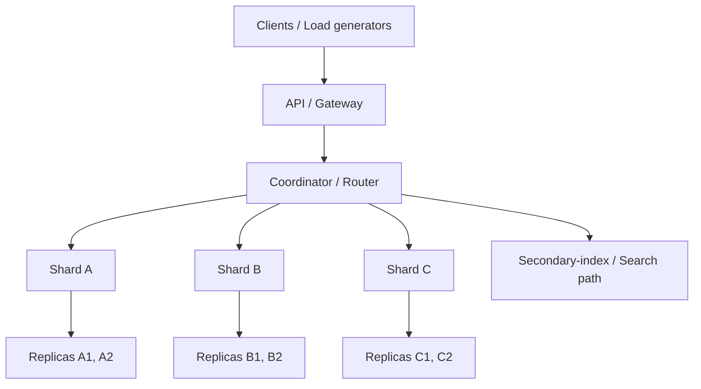
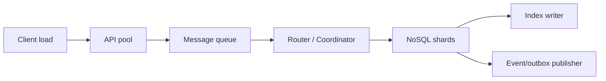
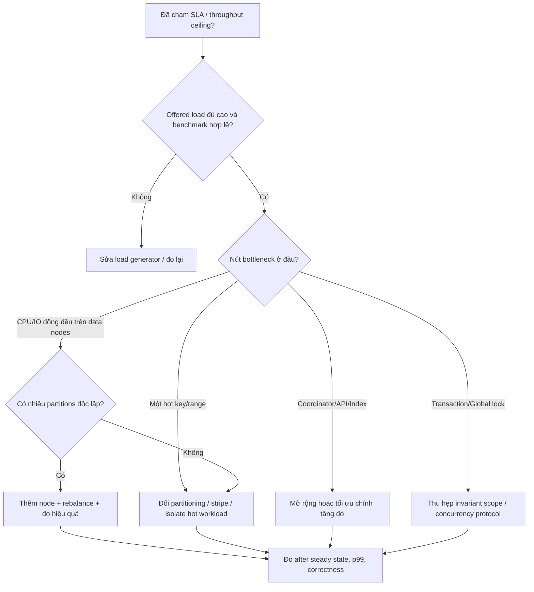

# Mở rộng số nút và xác định điều kiện tăng được thông lượng

## 1. Thêm node nhưng hệ thống vẫn chậm: vấn đề thực sự nằm ở đâu?

Một ưu điểm thường được nhắc tới của cơ sở dữ liệu NoSQL là khả năng **mở rộng ngang (horizontal scaling, scale-out)**: thay vì chỉ nâng cấu hình một máy chủ, chúng ta có thể thêm nhiều nút để phân tán dữ liệu và xử lý nhiều yêu cầu hơn.

Tuy nhiên, tuyên bố “thêm node thì thông lượng sẽ tăng” **chỉ đúng khi có đủ điều kiện**. Nếu 80% requests vẫn phải ghi vào một khóa nóng, nếu mọi ghi phải đợi một coordinator duy nhất, nếu secondary index quá tải hoặc nếu mạng giữa các replicas đã bão hòa, tăng số node dữ liệu có thể gần như không thay đổi tốc độ xử lý.

Giả sử một hệ xử lý 12.000 writes/giây trên bốn nút. Sau khi tăng lên tám nút, bạn đo được 13.000 writes/giây, nhưng latency p99 tăng từ 80 ms lên 300 ms. Về mặt số lượng máy, cluster đã lớn gấp đôi; về mặt kết quả, đây **không phải scale-out thành công**.

Bài học thuộc **Database No SQL — Cân bằng và điểm nóng**, tập trung vào câu hỏi:

> **Điều kiện nào khiến việc mở rộng số nút thực sự tăng thông lượng hữu ích, và làm thế nào chứng minh điều đó bằng mô hình tải, đo đạc và kiểm thử thay vì chỉ nhìn biểu đồ số node?**

### Mục tiêu học tập

Sau bài học, bạn có thể:

1. Phân biệt **throughput**, **latency**, **concurrency**, **capacity** và **offered load**.
2. Tính speedup và scaling efficiency khi tăng số nút.
3. Giải thích các giới hạn của Amdahl, contention và chi phí điều phối phân tán.
4. Phân biệt **thêm shard** với **thêm replica**, **thêm node** với **tăng số partition có thể xử lý song song**.
5. Nhận diện hot key, hot partition, hot range, tenant skew và điểm nóng secondary index.
6. Xây dựng điều kiện tăng throughput dựa trên phân bố khóa, CPU, bộ nhớ, disk, network, quorum và query fan-out.
7. Hiểu vì sao replication, transaction xuyên shard và rebalancing làm giảm lợi ích scale-out.
8. Lập kế hoạch thêm nút, đo trước/sau, kiểm chứng tính đúng đắn và rollback.
9. Phân tích sự khác nhau giữa Cassandra, MongoDB, DynamoDB, Redis Cluster, Bigtable và hệ consensus.
10. Thiết kế benchmark có offered load đủ lớn, đo completed operations và latency p99 ở trạng thái ổn định.

## 2. Một hệ có nhiều node gồm những thành phần nào?

Một cluster NoSQL có thể có:



Sơ đồ chỉ minh họa. Một số hệ đặt coordinator trong chính các database nodes, một số che giấu topology, và một số chia theo token ring hoặc ranges thay vì một router riêng.

**Đường xử lý của một request** có thể gồm:

1. Client gửi request đến API.
2. API kiểm tra input, xác thực và định tuyến.
3. Database tìm shard/partition chịu trách nhiệm.
4. Nút thực hiện read/write vào cache, memory, log hoặc storage.
5. Replicas trao đổi dữ liệu theo consistency/write concern.
6. Indexes hoặc materialized views được cập nhật.
7. Server xác nhận thành công theo contract.
8. Response quay lại client.

Thêm node chỉ giúp nếu một phần quan trọng của đường này **có thể chia tải** qua các node mới, thay vì tiếp tục dồn vào một giới hạn chung.

### 2.1. Phân biệt shard và replica

- **Shard:** một phần logic của tập dữ liệu được chia theo khóa/range để có thể xử lý trên nhiều đơn vị lưu trữ.
- **Replica:** bản sao của dữ liệu nhằm tăng độ bền, khả dụng hoặc phục vụ read trong một số mô hình.
- **Node:** tiến trình/máy tham gia cluster; có thể lưu một hay nhiều shards/replicas.
- **Coordinator/router:** thành phần điều phối, có thể là một hoặc nhiều node; không mặc định là nơi dữ liệu nằm.

Ví dụ:

```text
Shard 1: replicas trên Node A, B, C
Shard 2: replicas trên Node B, C, D
Shard 3: replicas trên Node C, D, E
```

Thêm replica của **cùng một shard** không nhất thiết tạo khả năng ghi song song như khi có thêm **shards độc lập**. Nếu write vẫn phải đi qua một leader/partition owner duy nhất, số replicas tăng có thể làm mỗi write **tốn thêm công sao chép**.

### 2.2. Không dùng số node làm proxy cho parallelism

Giả sử cluster có 16 nodes nhưng chỉ có 4 logical routing units rất nóng. Hệ có thể không phân phối được writes cho cả 16 nodes, hoặc chỉ có 4 điểm ghi có thể tiến triển độc lập theo workload.

Một mô hình tối giản:

\[
Parallelism_{\text{usable}}
\leq
\min(
N_{\text{physical capacity}},
N_{\text{active independent partitions}}
)
\]

Đây chỉ là trực giác; trong hệ thật, một partition có thể được split theo engine, một node có thể phục vụ nhiều partitions và transaction/replication còn tạo ràng buộc khác.

## 3. Thông lượng khác độ trễ và số request đang xử lý

### 3.1. Throughput là gì?

Thông lượng \(X\) thường là **số operation hoàn tất hợp lệ trên một đơn vị thời gian**:

\[
X = \frac{\text{số operation hoàn tất}}{\text{thời gian đo}}
\]

Ví dụ, trong 60 giây hệ xác nhận 600.000 write operations hợp lệ:

\[
X = \frac{600.000}{60}=10.000\ \text{writes/s}
\]

Cần định nghĩa “hoàn tất”:

- Đã ghi vào memory trên một node?
- Đã persist local disk?
- Đã đạt write concern/quorum cần thiết?
- Đã commit transaction?
- Đã cập nhật business state?
- Chỉ mới được đưa vào queue?
- Đã publish tới message broker?

**Không so sánh hai cấu hình bằng “writes/s” nếu chúng ACK ở mức bảo đảm khác nhau.**

### 3.2. Offered load

**Offered load** là tốc độ yêu cầu mà client muốn gửi. Ví dụ load generator phát 20.000 requests/s, nhưng server hoàn tất chỉ 12.000/s.

Không được nói thông lượng hệ là 20.000/s chỉ vì client đã gửi được 20.000 request. Phần còn lại có thể:

- Đang nằm trong queue.
- Timeout.
- Bị throttled.
- Được retry.
- Chưa commit.
- Chỉ được nhận vào một buffer bất đồng bộ.

### 3.3. Latency

**Latency** là thời gian một request cần để nhận kết quả theo contract. Thường đo p50, p95, p99 và timeout rate.

Ví dụ:

```text
Load:           12.000 requests/s
Completed:      12.000 requests/s
Latency p50:    20 ms
Latency p99:   450 ms
```

Throughput đạt offered load nhưng p99 rất cao; một số users có trải nghiệm tệ. Thêm node có thể làm p99 giảm ngay cả khi throughput đo không tăng, bởi **workload chưa phát đủ request để chạm capacity**.

### 3.4. Concurrency

Concurrency là số request đang ở trạng thái in-flight. Nhiều requests đang chờ **không nhất thiết** là thông lượng cao.

Trong trạng thái ổn định, định luật Little:

\[
L = \lambda W
\]

với:

- \(L\): số công việc trung bình trong hệ;
- \(\lambda\): tốc độ hoàn tất trung bình;
- \(W\): thời gian ở trong hệ trung bình.

Ví dụ:

\[
\lambda = 6.000/\text{s},\quad W=0{,}2\text{s}
\]

thì:

\[
L=6.000\times0{,}2=1.200\ \text{requests in flight}
\]

Nếu throughput không tăng nhưng latency tăng, số in-flight có thể tăng — dấu hiệu queue tích tụ, **không phải scale-out tốt**.

### 3.5. Capacity

Capacity là mức tải tối đa mà một hệ có thể xử lý **trong khi vẫn đạt SLA và bảo đảm tính đúng đắn**.

Không nên định nghĩa capacity chỉ là mức RPS cao nhất từng thấy trong 1 giây. Một capacity test hợp lệ cần duy trì:

- Latency p95/p99 dưới mục tiêu.
- Error/timeout rate trong giới hạn.
- Không phá các bất biến nghiệp vụ.
- Replication/compaction/backlog không tăng vô hạn.
- Chi phí và mức tài nguyên còn chấp nhận được.
- Không chỉ dựa trên cache vừa được làm nóng trong vài giây.

## 4. Tăng trưởng lý tưởng và cách đo hiệu quả scale-out

Giả sử một node đạt \(X(1)\) throughput tại SLA đã định. Với \(N\) nodes, thông lượng là \(X(N)\).

### 4.1. Speedup

\[
S(N)=\frac{X(N)}{X(1)}
\]

Nếu:

```text
1 node:  5.000 writes/s
4 nodes: 16.000 writes/s
```

thì:

\[
S(4)=\frac{16.000}{5.000}=3{,}2
\]

Hệ nhanh hơn 3,2 lần, không phải 4 lần.

### 4.2. Scaling efficiency

\[
E(N)=\frac{S(N)}{N}
\]

Với \(N=4\):

\[
E(4)=\frac{3{,}2}{4}=0{,}8=80\%
\]

Hiệu quả 80% thường có nghĩa các nút mới đóng góp nhưng còn overhead/imbalance; không phải thước đo tự động của chi phí tài chính.

### 4.3. Scale-out so với baseline có nhiều nút

Nếu hệ đã có 4 nodes rồi tăng lên 8, ta có thể tính:

\[
S(8\mid4)=\frac{X(8)}{X(4)}
\]

và **hiệu quả biên khi nhân đôi**:

\[
E(8\mid4)=\frac{X(8)/X(4)}{8/4}
\]

Ví dụ:

```text
4 nodes:  16.000/s
8 nodes:  24.000/s
```

\[
S(8\mid4)=1{,}5,\qquad E(8\mid4)=75\%
\]

Đo theo baseline đang dùng trong production thường hữu ích hơn so một nút đơn nếu topology có replicas và quorum.

### 4.4. Một bảng minh họa

| Nodes | Throughput tại cùng SLA | Speedup so 1 node | Efficiency |
|---:|---:|---:|---:|
| 1 | 5.000/s | 1,0× | 100% |
| 2 | 9.000/s | 1,8× | 90% |
| 4 | 16.000/s | 3,2× | 80% |
| 8 | 24.000/s | 4,8× | 60% |
| 16 | 28.000/s | 5,6× | 35% |

Số liệu hoàn toàn **giả định**. Bảng cho thấy lợi ích biên giảm dần; thêm từ 8 lên 16 nodes chỉ tăng 4.000 operations/s dù số nodes gấp đôi.

## 5. Điều kiện tiên quyết để thông lượng tăng

Một cách kiểm tra nhanh:

1. **Có đủ tải mới?** Client phải phát sinh nhiều requests hơn capacity cũ.
2. **Workload có chia được không?** Nhiều keys/partitions thực sự độc lập.
3. **Các keys có phân bố đều không?** Tránh hot key, hot range và tenant skew.
4. **Node mới có nhận dữ liệu và traffic không?** Rebalancing/routing đã hoàn tất.
5. **Có đủ physical resources không?** CPU, RAM, disk IOPS, network và storage.
6. **Có bottleneck dùng chung không?** Router, coordinator, index, transaction log, external service.
7. **Replication/quorum có còn đủ throughput không?** Mỗi write tạo thêm công sao chép.
8. **Read/write access pattern có targeted không?** Scatter-gather có thể tăng overhead.
9. **Tính đúng đắn có được giữ không?** Không đổi write concern để tạo RPS ảo.
10. **Đo đúng ở steady state không?** Không nhầm throughput tức thời với capacity bền vững.

Nếu một điều kiện quan trọng không đạt, scale-out có thể cho lợi ích rất ít hoặc âm.

## 6. Amdahl: phần công việc không chia được giới hạn tốc độ

Amdahl's law cung cấp một cách hiểu đơn giản về giới hạn tăng tốc khi thêm khả năng xử lý song song.

Giả sử:

- \(f\): tỷ lệ công việc **không thể song song hóa**.
- \(1-f\): tỷ lệ có thể song song hóa.
- \(N\): số đơn vị xử lý song song.

Khi bỏ qua overhead khác:

\[
S(N)\leq\frac{1}{f+\frac{1-f}{N}}
\]

### 6.1. Ví dụ 10% công việc tuần tự

Nếu \(f=0{,}1\), \(N=8\):

\[
S(8)\leq\frac{1}{0{,}1+\frac{0{,}9}{8}}
\approx 4{,}71
\]

Dù thêm 8 lần năng lực parallel, speedup tối đa lý thuyết chỉ khoảng 4,71 lần.

Nếu \(N\to\infty\):

\[
S_{\max}\leq\frac{1}{f}=\frac{1}{0{,}1}=10
\]

Chỉ 10% công việc tuần tự cũng giới hạn tốc độ tối đa về dài hạn.

### 6.2. “Phần tuần tự” trong một NoSQL cluster có thể là gì?

- Một global counter/guard cần cập nhật tuần tự.
- Một shard sở hữu hot key.
- Một coordinator cho tất cả requests.
- Một global lock bảo vệ quá nhiều thao tác.
- Một sequence allocator duy nhất.
- Một transaction cần đi qua tập shard cố định.
- Một index update path nóng.
- Một downstream payment/service rate limit.
- Một queue partition nhận mọi event.
- Một lock contention trên catalog/metadata.

### 6.3. Không áp Amdahl máy móc cho hệ phân tán

Amdahl giả định một mô hình lý tưởng về phân chia công việc; database phân tán còn có:

- Traffic skew.
- Network latency.
- Replication.
- Consensus/transaction coordination.
- Cache locality.
- Rebalance.
- Resource contention.
- Thay đổi access patterns khi dữ liệu tăng.

Amdahl là **khung tư duy về giới hạn**, không phải công thức dự đoán production RPS chính xác.

## 7. Contention và communication làm tốc độ tăng chậm dần

Một mô hình thực nghiệm khác thường được dùng là **Universal Scalability Law (USL)**:

\[
C(N)=\frac{N}{1+\alpha(N-1)+\beta N(N-1)}
\]

Trong đó:

- \(C(N)\) là hệ số capacity được chuẩn hóa.
- \(\alpha\) đại diện một phần contention.
- \(\beta\) đại diện coherency/coordination overhead.

Mô hình này thường dùng để **fit dữ liệu benchmark**; không nên coi \(\alpha\), \(\beta\) là những hằng số vật lý chung cho mọi database.

### 7.1. Tại sao thêm node có thể làm throughput giảm?

Khi \(N\) tăng, các việc sau có thể tăng nhanh:

- Heartbeat/gossip/metadata traffic.
- Cross-shard requests.
- Coordinator aggregation.
- Network bytes do replication.
- Transaction coordination và retries.
- Cache miss khi dữ liệu được di chuyển.
- Rebalancing và repair.
- Lock contention.

Ở một mức nào đó, overhead có thể nhiều hơn năng lực xử lý mới. Khi ấy **scale-out thêm còn làm hiệu năng xấu đi**.

### 7.2. Điều cần rút ra

Không có công thức “mỗi node thêm 5.000 RPS” đúng cho mọi kích thước cluster. Cần đo **marginal throughput gain** tại từng mốc nodes và dừng khi hiệu quả biên không còn đáp ứng chi phí/SLA.

## 8. Bản chất điểm nóng: một node quá tải trong cluster rảnh

Giả sử có 4 shards, mỗi shard duy trì tối đa 10.000 writes/s tại p99 SLA.

Nếu phân đều:

```text
Shard A:  8.000/s
Shard B:  8.000/s
Shard C:  8.000/s
Shard D:  8.000/s
Total:   32.000/s
```

Mỗi shard còn headroom.

Nhưng nếu 70% writes thuộc một shard key:

```text
Shard A: 22.400/s   HOT!
Shard B:  3.200/s
Shard C:  3.200/s
Shard D:  3.200/s
Total:   32.000/s offered
```

Shard A đã vượt capacity; cluster không thể hoàn tất đủ 32.000/s ở SLA, dù ba shards khác gần như rảnh.

### 8.1. Mô hình trần thông lượng do hot key

Gọi:

- \(C_h\): throughput tối đa cho hot logical key/path.
- \(p_h\): tỷ lệ workload thuộc key/path ấy.

Muốn tổng throughput \(X\) xử lý đầy đủ, phải có:

\[
p_h X \leq C_h
\]

nên:

\[
X\leq\frac{C_h}{p_h}
\]

Ví dụ \(C_h=10.000/s\), \(p_h=0{,}7\):

\[
X\leq\frac{10.000}{0{,}7}\approx14.286/s
\]

Đây là **trần lý thuyết theo bottleneck hot key**, chưa xét các giới hạn khác. Tăng 4 shards lên 8 mà hot key vẫn chỉ có một đường ghi thì trần này **không tự thay đổi**.

### 8.2. Một key có thể có cardinality cao nhưng vẫn nóng

Một hệ có 1 triệu tenant IDs, nhưng một tenant tạo 70% traffic. Cardinality cao của cả dataset không đảm bảo **effective active-key distribution** tốt.

Cần đo top 1/10/100 keys theo QPS và bytes, không chỉ đếm distinct keys.

### 8.3. Hot range do khóa tăng dần

Với range sharding theo `createdAt` hoặc sequence tăng, mọi inserts mới dồn vào khoảng cuối. Thêm nodes để chứa các khoảng cũ không nhất thiết giúp dải đang nhận writes.

Muốn scale, có thể cần hashed placement, composite key, prefix phân tán hoặc striping. Nhưng những kỹ thuật này đánh đổi range-query locality.

## 9. Hash partitioning cần đủ khóa hoạt động

Giả sử router dùng:

\[
shard = H(partitionKey)\bmod N
\]

Nếu `partitionKey=status` chỉ có 3 giá trị (`PENDING`, `PAID`, `CANCELLED`), thì dù \(N=32\), router có tối đa 3 hash destinations từ 3 giá trị ấy, thậm chí có thể ít hơn nếu va cùng shard.

**Hash không làm tăng cardinality của input.**

### 9.1. Khi thêm node hữu ích

Thêm nodes có khả năng phân bố writes nếu:

- Có nhiều distinct routing keys đang hoạt động.
- Các keys đủ phân tán về tần suất.
- Router có thể gán/move keys/ranges sang nodes mới.
- Data và requests thực sự được chuyển.
- Không có index/coordinator chung trở thành bottleneck.

### 9.2. Khi thêm node không hữu ích

- Mọi writes cùng `PK=tenantMega`.
- Một counter cập nhật đúng một item.
- Dữ liệu mới chỉ đi vào một range frontier.
- Một index có low-cardinality partition key.
- Request đến qua một service với worker pool cứng.
- Có nhiều partitions nhưng hầu như chỉ vài partitions nhận writes.

### 9.3. Salting/striping và cái giá phải trả

Một hot tenant stream có thể dùng:

```text
PK=TENANT#mega#DAY#2026-11-14#STRIPE#00
PK=TENANT#mega#DAY#2026-11-14#STRIPE#01
...
PK=TENANT#mega#DAY#2026-11-14#STRIPE#15
```

Stripe chọn deterministic theo event ID:

\[
stripe=H(eventId)\bmod16
\]

Khi events của cùng tenant có IDs khác nhau, writes có thể phân tán vào các routing keys khác nhau. Nhưng query tất cả events của tenant/ngày phải **fan-out 16 stripes**, hợp nhất và phân trang.

Không salt ngẫu nhiên lại khi retry, bởi cùng logical event có thể tạo bản ghi trùng ở stripe khác.

## 10. Một điều kiện về sự cân bằng phải được đo

Mỗi shard nhận throughput \(x_i\), với \(N\) shards.

\[
X=\sum_{i=1}^{N} x_i
\]

\[
\bar{x}=\frac{X}{N}
\]

Một chỉ số đơn giản:

\[
SkewRatio=\frac{\max(x_i)}{\bar{x}}
\]

Nếu 8 shards có writes/s:

```text
[4k, 5k, 6k, 4k, 5k, 5k, 5k, 46k]
```

thì:

\[
X=80.000/s,\quad \bar{x}=10.000/s
\]

\[
SkewRatio=\frac{46.000}{10.000}=4{,}6
\]

Tải peak gấp 4,6 lần trung bình.

### 10.1. Coefficient of variation

\[
CV=\frac{\sigma(x_i)}{\bar{x}}
\]

CV thấp biểu thị load các shards tương tự nhau; CV cao gợi ý lệch. Nhưng **CV không chỉ ra nguyên nhân**: cần kiểm tra placement, index, workload mix và capacity từng node.

### 10.2. Bytes cân bằng không có nghĩa QPS cân bằng

Có thể mỗi shard lưu 100 GiB nhưng một shard nhận 60% reads. Nếu một nhóm data rất phổ biến nằm trên shard ấy, dung lượng đều không giúp CPU/read throughput đều.

Đo riêng:

- Bytes/rows mỗi shard.
- RPS read và write mỗi shard.
- CPU, IOPS, network.
- p95/p99 latency.
- Top partition keys.
- Cache hit/miss.
- Replication/compaction lag.
- Throttling.

## 11. Thêm replica khác thêm shard thế nào?

### 11.1. Thêm replica có thể tăng read throughput

Trong leader–follower, nếu ứng dụng được phép đọc từ followers và dữ liệu có thể stale hoặc có follower-read protocol đủ mạnh, thêm read replicas có thể chia read load.

Ví dụ:

```text
Leader handles writes + 100% reads.
Add 2 read replicas.
Reader routes 60% eligible reads to replicas.
Leader CPU drops.
```

Lợi ích phụ thuộc routing thật và replication apply load. Follower đang phục vụ scans lớn có thể lag và làm đường đọc cần freshness bị fallback.

### 11.2. Thêm replica có thể không tăng write throughput

Nếu mọi write trên một shard vẫn phải đi qua **cùng leader** và được replicate đến RF replicas, tăng replica count có thể tăng:

- Replication network traffic.
- Log write/flush.
- Coordination/ack overhead tùy quorum.
- Recovery/storage cost.
- Pressure lên leader khi phát replication.

Điều đó có thể cải thiện durability/availability, **không nhất thiết cải thiện write capacity**.

### 11.3. Thêm shard giúp chia writes nếu partitioning cho phép

Nếu một collection có thể chia thành nhiều shards chứa các key ranges hoặc hashes độc lập, writes cho các keys khác nhau có thể tiến triển đồng thời trên nhiều shard leaders/owners.

Nhưng nếu phần lớn writes thuộc một logical key hoặc transaction chạm mọi shards, lợi ích có thể nhỏ.

### 11.4. Một câu hỏi trước khi thêm node

> Node mới sẽ giữ **replica của dữ liệu cũ**, hay sẽ tiếp quản **một phần độc lập của write workload**?

Nếu không trả lời được, chưa đủ cơ sở dự đoán throughput sau scale-out.

## 12. Replication factor, write concern và chi phí một write

Một write của một logical record có thể gây nhiều I/O:

```text
Client -> coordinator/leader -> replicas -> ACK
```

Gọi:

- \(RF\): replication factor.
- \(b\): kích thước logic của write.
- \(a_w\): write amplification do log/index/compaction và storage.
- \(q\): số replicas phải xác nhận theo policy.

Một ước lượng thô về bytes tác động lên cluster có thể liên quan:

\[
Bytes_{\text{replica writes}}\approx RF\times b
\]

Đây **không phải** công thức chính xác network bytes hay disk writes của mọi engine; còn có compression, batching, repair, index writes và giao thức replication.

### 12.1. Tăng nodes khi RF không đổi

Nếu có nhiều keys/shards và RF vẫn 3, thêm nodes có thể phân chia replicas và traffic, giảm load trên mỗi node **sau khi rebalance**.

### 12.2. Tăng RF cùng với số nodes

Nếu thêm nodes nhưng cũng tăng RF từ 3 lên 5, một logical write có thể tạo nhiều công sao chép hơn. Throughput có thể không tăng tương ứng với số máy; mục tiêu có thể chuyển sang availability/durability.

### 12.3. Consistency không được thay giữa hai lần đo

Sai:

```text
Trước scale:  RF=3, write QUORUM
Sau scale:    RF=3, write ONE
Kết luận: throughput tăng do thêm node
```

Thay consistency level đã đổi điều kiện ACK, nên hai kết quả không so sánh công bằng.

Cần giữ cùng:

- Replication factor.
- Write concern/consistency.
- Read concern.
- Transaction/isolation mode.
- Payload và indexes.
- Durability/flush policy.
- Batch settings.
- Retry policy.

Nếu thay bất kỳ cấu hình nào, phải ghi rõ để tách tác động.

## 13. Bottleneck có thể nằm ngoài database nodes

Một hệ xử lý:



Nếu API pool chỉ phục vụ 8.000 requests/s, cluster DB tăng từ 4 lên 12 nodes có thể không nâng throughput end-to-end vượt 8.000/s.

### 13.1. Các trần thông lượng đơn giản

Một mô hình trực giác:

\[
X_{\text{end-to-end}}
\leq
\min(
C_{\text{client}},
C_{\text{API}},
C_{\text{router}},
C_{\text{data}},
C_{\text{index}},
C_{\text{downstream}}
)
\]

Mỗi \(C\) là capacity hiệu dụng của tầng đó **theo cùng đơn vị operations/s và workload mix**. Đây không phải phương trình mô tả mọi dependency, nhưng giúp đặt đúng câu hỏi: **tầng nào đang chạm trần?**

### 13.2. Ví dụ

```text
API capacity:          20.000/s
Router capacity:       12.000/s
Database shards:       40.000/s
Index writer:          15.000/s
External service:      không nằm trên critical path
```

Throughput request end-to-end bị giới hạn khoảng 12.000/s bởi router trong mô hình này. Tăng database capacity lên 80.000/s **không làm router mạnh hơn**.

### 13.3. Đừng bỏ qua client/load generator

Nếu một k6/JMeter/driver instance chỉ phát 8.000/s vì CPU hoặc connection pool, không thể kết luận DB 8 nodes chỉ đạt 8.000/s. Cần đo offered load tại client và nhiều load generators nếu cần.

## 14. CPU-bound, disk-bound và network-bound khác nhau

### 14.1. CPU-bound

Dấu hiệu:

- CPU gần bão hòa trên các shards.
- Garbage collection/serialization/compression tốn nhiều CPU.
- Throughput tăng ít khi tăng IOPS nhưng có thể tăng khi thêm node có CPU mới.
- Query filters/aggregations nặng.

Thêm nodes có thể giúp nếu CPU work **phân bố được** và router/index không cản.

### 14.2. Disk IOPS-bound

Dấu hiệu:

- Disk IOPS/latency cao.
- Compaction hoặc write amplification lớn.
- Queue depth tăng.
- CPU có thể vẫn rảnh.

Thêm nodes giúp nếu data/IO phân bổ lại; không giúp nếu một hot key vẫn nằm trên cùng storage path.

### 14.3. Network-bound

Dấu hiệu:

- Network egress/ingress đạt giới hạn.
- Replication và scatter queries tạo nhiều bytes.
- Cross-zone/cross-region RTT lớn.
- p99 tăng khi quorum/replica xa chậm.

Thêm nodes có thể bổ sung NIC aggregate bandwidth, nhưng cũng có thể tăng chi phí coordination. Cần tính network giữa data nodes, không chỉ giữa client và router.

### 14.4. Memory/cache-bound

Dữ liệu tăng làm working set vượt RAM; cache hit rate giảm, disk reads tăng. Thêm nodes có thể tăng tổng RAM và cache locality sau rebalance.

Tuy nhiên trong giai đoạn rebalance, cache trên node mới còn lạnh, nên p99 có thể **xấu tạm thời** trước khi ổn định.

### 14.5. Lock/coordination-bound

CPU và disk có thể rảnh nhưng throughput không tăng vì:

- Global lock.
- Compare-and-set trên một record.
- Hot inventory counter.
- Transaction conflicts.
- Leader/coordinator serialization.

Thêm node không giải quyết **điểm tuần tự về mặt logic** nếu protocol không thay đổi.

## 15. Giao dịch xuyên shard có thể làm mất lợi ích phân tán

Một transaction sửa hai records trên hai shards có thể cần:

- Điều phối commit.
- Kiểm tra isolation.
- Lock/version conflicts.
- Network round trips.
- Ghi transaction log.
- Retry khi một participant lỗi.

Ví dụ:

```text
TX transfer:
  Debit Account A on Shard 1
  Credit Account B on Shard 7
  Insert Ledger on Shard 3
COMMIT
```

Thêm shards có thể giúp phân tán những transfers độc lập, nhưng cũng làm nhiều transactions chạm **nhiều shards hơn** nếu shard key không theo ownership nghiệp vụ.

### 15.1. Transaction fan-out

Nếu một request chạm \(k\) shards, latency và failure probability có thể phụ thuộc vào nhiều participants. Không thể lấy tổng capacity của tất cả shards rồi suy toàn bộ transaction throughput tuyến tính.

### 15.2. Mỗi request query toàn cluster

Một thống kê:

```text
SELECT count(*) FROM allEvents WHERE status='PENDING'
```

nếu không có index/aggregate phù hợp, có thể cần scan mọi shard và merge tại coordinator. Thêm shard làm mỗi shard scan ít hơn, nhưng request vẫn cần xử lý ở **tất cả shards**, đồng thời tăng aggregation overhead.

### 15.3. Thiết kế lại ranh giới

Nếu workload thường thao tác một order và mọi item của nó, có thể cân nhắc aggregate/partition key theo order ID hoặc tenant+order ID để giữ locality. Nhưng có thể xuất hiện hot tenant hoặc partition lớn. Phải chọn theo **điều kiện đúng của invariant và tải truy vấn**, không chỉ theo một query đơn lẻ.

## 16. Secondary index và materialized view cũng tiêu thụ capacity

Một base table có keys phân bố rất đều, nhưng mỗi write còn cập nhật GSI/index theo `status` với ba giá trị.

```text
Base table PK = eventId (nhiều giá trị, hash đều)
Secondary index PK = status (ACTIVE 95%)
```

Base writes có thể phân tán qua 20 shards, còn đường index lại có hot key/range. Nếu index update là một phần critical path hoặc có backpressure, throughput end-to-end vẫn bị hạn chế.

### 16.1. Những index cần kiểm kê

- Local secondary index.
- Global secondary index.
- Search index.
- Materialized view.
- Change stream/CDC downstream.
- Counter tables.
- Queue partition key.
- Idempotency ledger.
- Secondary read models được update đồng bộ.

### 16.2. Không chỉ nhìn base table metrics

Phải đo:

- Throttling và consumed capacity của indexes.
- GSI/index lag.
- Index write amplification.
- Hot index keys.
- CPU/indexer backlogs.
- Tỷ lệ writes bị chậm bởi index updates.

Thêm nodes ở base storage không tự mở rộng mọi index nếu index có logical hotspot riêng.

## 17. Rebalancing: khi node mới chưa giúp ngay

Khi thêm node, hệ thường cần **di chuyển dữ liệu và quyền xử lý**. Ví dụ:

```text
Before:
  Node A: 40% data, 40% traffic
  Node B: 35% data, 35% traffic
  Node C: 25% data, 25% traffic

Add Node D:
  Node D mới: 0% data, gần 0% traffic
```

Cho tới khi shards/token ranges/partitions được di chuyển hoặc router thay đổi, Node D có thể chưa tham gia serving.

### 17.1. Chi phí nền của rebalance

- Snapshot/streaming hàng trăm GB.
- Network giữa old và new nodes.
- Disk writes ở node nhận.
- Cache cold.
- Repair/checksum.
- Update routing metadata.
- Replica catch-up.
- Index rebuild.
- Compaction tăng.
- Concurrency với user requests.

Trong lúc rebalance, throughput **có thể tạm giảm**. Không dùng số liệu của 2 phút đầu sau scale làm kết luận cuối.

### 17.2. Bốn giai đoạn cần đo riêng

1. **Before:** tải ổn định với topology cũ.
2. **Rebalancing:** dữ liệu đang chuyển, có overhead.
3. **Warm-up:** placement hoàn tất, cache/JIT/index chưa ổn định.
4. **Steady state:** node mới nhận traffic, background backlog ổn định.

Mỗi giai đoạn có ý nghĩa vận hành khác nhau; báo cáo benchmark nên ghi rõ.

### 17.3. Thêm node có thể gây “thêm lỗi”

Nếu cluster mở rộng quá nhanh, network/storage bị bão hòa vì streaming, leader election hoặc repair. Các requests bình thường có thể timeout. Cần throttle migration và kế hoạch rollback.

## 18. Công thức ước lượng capacity sơ bộ

Giả sử muốn phục vụ tổng peak writes \(W_{\text{peak}}\), mỗi node có throughput đo thực \(C_{\text{node}}\) cho workload tương ứng và cần giữ utilization dưới hệ số \(u\).

Một ước lượng **sơ bộ**:

\[
N_{\text{required}}
\gtrsim
\left\lceil
\frac{W_{\text{peak}}}{C_{\text{node}}\times u}
\right\rceil
\]

Ví dụ:

- Peak writes \(W_{\text{peak}}=60.000/s\).
- Một đơn vị write-serving capacity đo được \(C_{\text{node}}=10.000/s\) ở workload tương tự.
- Mục tiêu chạy thường xuyên ở \(u=0{,}65\).

\[
N_{\text{required}}
\gtrsim
\left\lceil
\frac{60.000}{10.000\times0{,}65}
\right\rceil
=
\lceil9{,}23\rceil=10
\]

**Đây không phải con số máy production sẵn sàng triển khai.**

Vì:

- `C_node` có thể đã bao chi phí replicas hoặc chưa.
- Physical nodes không luôn đồng nghĩa một đơn vị write-serving độc lập.
- Phân phối keys có thể không đều.
- Replication, storage capacity, quorum và failover headroom cần riêng.
- Index, coordinator, network cũng có giới hạn.
- Multi-AZ placement có quy tắc riêng.
- Dự phòng mất một node/availability zone làm số node cần nhiều hơn.

Không **nhân RF thêm lần nữa** nếu throughput capacity dùng trong công thức đã được đo trên topology có replication đầy đủ.

### 18.1. Headroom cho sự cố

Nếu cần chịu mất một node mà vẫn giữ SLA, capacity sau khi mất node phải được tính. Ví dụ 10 nodes không có nghĩa lúc mất một node vẫn đạt 100% capacity với cùng utilization.

Cần kiểm tra:

\[
W_{\text{peak}} \leq C_{\text{remaining topology at SLA}}
\]

với đúng placement, RF, quorum và các overload patterns sau failover.

### 18.2. Storage sizing khác throughput sizing

Một node có thể còn 60% disk trống nhưng CPU đã đầy. Hoặc CPU rảnh nhưng disk sắp hết, compaction cần free space. Cần kế hoạch cả:

- Current bytes + tăng trưởng + retention.
- Replication copies.
- Compaction/temporary space.
- Index footprint.
- Repair/backfill space.
- Snapshot/backup overhead.
- IOPS/throughput.
- Network bandwidth.
- CPU và RAM.
- Failure headroom.

## 19. Hệ số utilization và latency p99

Khi một tài nguyên gần bão hòa, queueing delay thường tăng nhanh hơn tốc độ tăng load. Mô hình M/M/1 đơn giản có thời gian phản hồi trung bình:

\[
W=\frac{1}{\mu-\lambda}
\]

với \(\lambda<\mu\), nhưng **database thật không mặc định là hàng đợi M/M/1**; có nhiều workers, batch, priorities, cache và request sizes khác nhau.

Điều cần nhớ:

- Chạy ở 98% utilization dài hạn có thể tạo p99 rất xấu.
- Bursty traffic khiến queue dồn ngay cả khi trung bình chưa đạt 100%.
- Compaction/GC/repair có thể chiếm capacity bất chợt.
- Failover có thể đẩy request sang những nodes còn lại.

Vì vậy mục tiêu sử dụng 60–70% trong ví dụ là **chính sách headroom minh họa**, không phải con số tiêu chuẩn cho mọi workload.

### 19.1. Kiểm p99 dưới burst

Một hệ đạt 50.000/s trong 5 phút ổn định có thể không chịu nổi 100.000/s trong 10 giây nếu queue, disk, memory và retry storms không được kiểm soát.

Benchmark cần có tải tăng đột biến, load shedding/backpressure và recovery time.

## 20. Sơ đồ quyết định: thêm node hay sửa phân phối?



Sơ đồ giúp hình thành hypothesis. Không dùng nó thay metrics hoặc capacity model của engine cụ thể.

## 21. Trường hợp thực tế 1 — Khối lượng đọc tăng mạnh

Ứng dụng có 95% reads, 5% writes. Leader đang chịu 100% reads và writes.

Nếu reads cho phép replica read theo contract:

- Thêm read replicas có thể tăng tổng read-serving capacity.
- Router phải thực sự chuyển eligible reads.
- Replication lag không được phá read-your-writes nếu API hứa điều đó.
- Cache/secondary index phải được xét riêng.
- Read replicas phải đủ CPU/IO để vừa apply writes vừa phục vụ reads.

### 21.1. Không tự giảm độ mới

Một API xác nhận thanh toán ngay sau commit không nên tự route sang stale follower chỉ để có read RPS lớn hơn. Có thể tách workload:

| Endpoint | Read policy |
|---|---|
| Product catalog | Eventual/cache có SLA |
| Public feed | Read replicas / bounded staleness |
| User profile sau update | Session-fresh/read-your-writes |
| Payment status | Authoritative/required consistency |
| Permission revocation | Fail closed hoặc policy mạnh |

Scale-out đọc thường hiệu quả nhất khi **truy vấn đã được phân loại** và chỉ những đường có thể stale mới chuyển sang replicas.

## 22. Trường hợp thực tế 2 — Sự kiện IoT append-only

Một nền tảng IoT nhận 100.000 events/s từ nhiều thiết bị.

Ban đầu:

```text
PK = tenantId
SK = occurredAt#eventId
```

Một tenant chiếm 70% traffic, nên một logical key có thể nóng.

Các bước:

1. Đo top-key QPS và bytes.
2. Chuyển một phần thiết kế sang `tenantId#deviceId#day`.
3. Với thiết bị rất nóng, thêm `stripe=hash(eventId)%S`.
4. Cố định event ID và routing version cho idempotency.
5. Benchmark số stripes.
6. Đo read fan-out khi query history.
7. Thêm nodes và rebalance sau khi workload đã có đủ routing units.
8. Kiểm tra index và CDC paths.

### 22.1. Time bucket không tự chia throughput

Một device ghi 20.000 events/s. Chia mỗi ngày thành 24 buckets theo giờ giảm kích thước mỗi partition lịch sử, nhưng **trong một giờ vẫn là 20.000 events/s vào bucket giờ hiện tại** nếu không thêm chiều phân phối.

### 22.2. Stripe count và khả năng chia tải

Giả sử muốn mỗi stripe dưới 2.500 events/s:

\[
S \geq \lceil20.000/2.500\rceil=8
\]

Đây là lower bound giả định khi distribution đều và mỗi stripe có đủ independent capacity; nếu 8 stripes vẫn nằm trong cùng physical bottleneck thì chưa đạt.

### 22.3. Query fan-out

Đọc 7 ngày × 16 stripes:

\[
7\times16=112\ \text{partition queries}
\]

Phải đo latency/cost, merge Top-K, pagination cursor và bounded concurrency. Có thể cần read model riêng nếu query history quá phổ biến.

## 23. Trường hợp thực tế 3 — Một counter không thể chia bừa

Một tenant chỉ được chạy tối đa 100 jobs đồng thời:

\[
activeJobs \leq 100
\]

Tất cả workers đều phải tăng `activeJobs` trước khi chạy job.

Nếu đây là **bất biến cứng**, chia counter thành 16 shards eventual rồi đọc tổng có thể khiến nhiều workers đồng thời vượt quota.

### 23.1. Tại sao thêm node không cứu được?

Mỗi request cần một điểm kiểm tra-and-update authoritative hoặc một giao thức phân bổ quyền phù hợp. Nếu điểm ấy có capacity thấp, nó là serial bottleneck.

### 23.2. Hướng giải quyết không phá bất biến

- Atomic conditional update trên một guard record, chấp nhận throughput giới hạn.
- Batch reservation tokens theo số lượng hữu hạn.
- Escrow/quota phân bổ có tổng không vượt limit.
- Chia quota theo vùng/worker group với authority bảo vệ transfer.
- Giảm request frequency bằng lease/batch hợp lệ.

Một mô hình escrow:

```text
Global quota = 100
Region A allocated = 40
Region B allocated = 35
Region C allocated = 25
Total allocated = 100
```

Mỗi vùng có thể cấp token trong phạm vi allocation của mình nếu protocol bảo vệ cấp phát, giải phóng và chuyển quota. Không tự cấp thêm khi network partition.

### 23.3. Không đánh đổi correctness lấy benchmark đẹp

Nếu benchmark bỏ qua invariant `activeJobs<=100`, kết quả throughput cao hơn không phản ánh hệ được phép hoạt động theo yêu cầu nghiệp vụ.

## 24. Cassandra: thêm nodes, token ranges và RF

Apache Cassandra dùng mô hình phân phối trên token ring và có replicas theo replication strategy. Một node có thể chịu nhiều token ranges và tham gia coordination.

### 24.1. Khi thêm nodes có thể tăng throughput

- Các partition keys có cardinality và distribution tốt.
- Token ranges/ownership được phân chia lại.
- Dữ liệu streaming/bootstrapping hoàn thành.
- Cluster có workload đủ lớn để khai thác capacity mới.
- Không có hot partition riêng.
- RF và consistency level phù hợp.
- Network/disk/compaction không thành trần mới.

### 24.2. Khi thêm nodes khó cải thiện

- Một vài partition keys chứa quá nhiều requests.
- Coordinator hoặc client driver route lệch.
- Compaction backlog/repair quá lớn.
- Disk hoặc network streaming đang saturate.
- Một table có quá nhiều wide partitions/hot rows.
- RF được tăng khiến tổng replica work lớn.
- CL=ALL hay topology/availability constraints gây giới hạn riêng.

### 24.3. Partition key và clustering key

Ví dụ:

```sql
CREATE TABLE events_by_device (
    tenant_id text,
    device_id text,
    occurred_at timestamp,
    event_id uuid,
    payload text,
    PRIMARY KEY (
        (tenant_id, device_id),
        occurred_at,
        event_id
    )
);
```

Mọi event của một device có cùng **partition key**. `occurred_at` là clustering column, không chia partition sang token khác.

Một thiết bị cực nóng có thể vẫn là bottleneck dù thêm hàng chục nodes.

### 24.4. Có thể thêm time bucket/stripe

```sql
CREATE TABLE events_by_device_bucket (
    tenant_id text,
    device_id text,
    event_day date,
    stripe int,
    occurred_at timestamp,
    event_id uuid,
    payload text,
    PRIMARY KEY (
        (tenant_id, device_id, event_day, stripe),
        occurred_at,
        event_id
    )
);
```

Nhưng query một device/day phải đọc nhiều stripes và merge. Nếu primary workload là read history, chi phí này rất quan trọng.

### 24.5. Không dùng một con số throughput/node cho mọi cluster

Hiệu quả Cassandra phụ thuộc hardware, replication, tombstones, compaction strategy, row size, concurrency và LWT. Các số benchmark phải được đo trên workload tương tự production.

## 25. MongoDB: thêm shard khác thêm secondary

MongoDB sharded cluster thường chia dữ liệu collection qua shards. Mỗi shard có thể là replica set; routers định tuyến dựa vào shard key.

### 25.1. Thêm replica member

Thêm secondary vào một replica set có thể:

- Tăng lựa chọn phục vụ reads theo readPreference.
- Tăng redundancy/failover capability tùy cấu hình.
- Tăng replication/storage overhead.

Nhưng nếu cùng một shard leader nhận mọi writes cho một key range, nó **không tự tăng write sharding parallelism**.

### 25.2. Thêm shard

Có thể tăng write-serving capacity nếu:

- Shard key phân bố writes đủ đều.
- Balancer/resharding phân phối data/traffic.
- Mỗi shard có capacity độc lập.
- Router và index không nghẽn.
- Workload không bị chi phối bởi cross-shard transactions/queries.

### 25.3. Monotonically increasing range shard key

Ví dụ một collection shard theo `createdAt` (range). Inserts mới liên tục có timestamp lớn hơn và có thể dồn vào cùng vùng cuối. **Thêm shard để lưu chunks cũ chưa chắc giảm hotspot vùng mới nhất.**

Hashed shard key với nhiều giá trị khác nhau có thể giúp tản inserts, nhưng range queries có thể trở thành scatter-gather. Compound key và query routing cần được đánh giá theo version/engine.

### 25.4. Shard key có thể là điểm nút kiến trúc

Một schema có key kém có thể khó sửa sau khi dữ liệu đã rất lớn. Resharding online, backfill, index và cutover tiêu tốn resource; không nên coi thêm shard là bước thay thế thiết kế shard key.

## 26. DynamoDB: capacity managed nhưng key vẫn quyết định tải

DynamoDB là managed NoSQL service; application không thường “thêm node DB” trực tiếp. Thay vào đó, nó đặt throughput mode, capacity và data model, còn dịch vụ quản lý physical partitions trong phạm vi tính năng.

### 26.1. Capacity on-demand/provisioned không sửa low-cardinality key

Nếu base table có:

```text
PK = STATUS#PENDING
SK = timestamp#eventId
```

và phần lớn writes vào cùng logical key, tăng provisioned capacity/table capacity không bảo đảm workload scale tuyến tính. Có thể bị giới hạn theo physical partition, hot-key/range và adaptive capacity behavior.

### 26.2. Adaptive capacity và split-for-heat

DynamoDB có các cơ chế tự thích ứng phân bổ capacity và có thể chia physical storage theo heat trong những điều kiện nhất định. Vì vậy không nên tuyên bố tuyệt đối “một partition key luôn tương ứng với một physical partition không thể chia”.

Tuy vậy, khả năng chia tải phụ thuộc **sort-key pattern, access patterns, index/LSI và các giới hạn dịch vụ**. Phải đo thực tế, không mặc định autoscaling giải mọi hotspot.

### 26.3. Global Secondary Index có thể nghẽn

Base table PK=eventId phân bố tốt, nhưng GSI có `GSI_PK=status` chỉ vài giá trị. Index write path có thể nóng và kéo theo throttling/lag.

Cần đo capacity của **cả base table và GSIs**, không chỉ tăng table provisioned units.

### 26.4. Application responsibility

Dù dịch vụ che giấu nodes, developer vẫn phải:

- Chọn partition keys đủ đa dạng.
- Tránh hot partition/key.
- Sử dụng conditional updates cho invariant.
- Hiểu item/transaction capacity limits.
- Kiểm chứng read/write units và throttling.
- Tối ưu query fan-out và index schema.
- Dùng idempotency trong retry.
- Theo dõi Contributor Insights hoặc metric tương ứng khi phù hợp.

## 27. Redis Cluster: số node và 16.384 hash slots

Redis Cluster chia khóa qua hash slots, các slots được phân bổ cho nodes. Trong mô hình phổ biến, key có thể được định tuyến vào một trong **16.384 hash slots**.

### 27.1. Thêm master và resharding slots

Khi thêm master node, cần phân bổ lại hash slots để node mới nhận data/traffic. Chỉ thêm replica theo cùng master không tự tăng write ownership trên những slots ấy.

### 27.2. Hash tag có thể vô hiệu hóa phân phối

Các keys:

```text
cart:{tenant17}:001
cart:{tenant17}:002
cart:{tenant17}:003
```

dùng hash tag `tenant17` và có thể vào cùng hash slot, dù suffix khác nhau. Một tenant rất nóng có thể làm slot đó quá tải.

### 27.3. Một Redis key lớn không tự chia field

```redis
HSET tenant17:events event1 "..."
HSET tenant17:events event2 "..."
```

Mọi fields nằm trong cùng **một Redis key**. Thêm masters không khiến fields tự được phân phối qua slots.

### 27.4. Multi-key commands có trade-off

Phân tách keys ra nhiều slots có thể cải thiện phân bố nhưng làm nhiều multi-key operations bị hạn chế bởi **cross-slot rules**. Phải chọn giữa locality/atomic multi-key scope và parallel write distribution.

### 27.5. Persistence và replication

Throughput test Redis chỉ dùng in-memory ACK có thể khác test với AOF/persistence, replication, failover, `WAIT` và latency guarantees. Không so cấu hình khác nhau rồi quy toàn bộ lợi ích cho số nodes.

## 28. Bigtable và sorted row keys

Trong Bigtable, row keys có thứ tự lexicographic và dữ liệu được chia thành tablets/ranges.

Nếu row key bắt đầu bằng timestamp tăng dần:

```text
2026-11-14T10:00:00.001Z#eventA
2026-11-14T10:00:00.002Z#eventB
2026-11-14T10:00:00.003Z#eventC
```

writes mới có thể dồn vào một vùng của keyspace. Thêm nodes mà write frontier vẫn nóng trên một dải có thể không cho lợi ích kỳ vọng.

### 28.1. Prefix phân tán

Một key như:

```text
stripe#07#tenant17#device42#2026-11-14T10:00:00.001Z
```

có thể giúp phân tán nếu stripe được chọn từ một field đủ biến thiên giữa events. Nhưng query theo tenant/time cần scan nhiều prefixes.

### 28.2. Thêm nodes có điều kiện

Bigtable có khả năng thay đổi số node/cluster capacity theo service configuration, nhưng actual throughput phụ thuộc schema key, tablet distribution, node CPU, disk/compaction và access patterns. Không coi nodes là một phép nhân capacity không điều kiện.

## 29. Hệ consensus/metadata: thêm members không nhất thiết tăng write capacity

Một cluster dùng Raft hoặc consensus cho **một replicated state machine** có thể yêu cầu leader và quorum commit.

Nếu thêm thành viên từ 3 lên 5 cho **cùng một consensus group**, số state machines độc lập không tăng; mỗi write vẫn phải đi qua cùng log leader và replication protocol.

Điều đó có thể:

- Tăng fault-tolerance hoặc đáp ứng topology riêng tùy quorum policy.
- Tăng replication/coordination overhead.
- Làm write latency phụ thuộc thêm members trong một số trường hợp.
- Không tăng write throughput tuyến tính.

Để mở rộng write throughput của workload nhiều keys, có thể cần **nhiều consensus groups/shards** độc lập thay vì chỉ tăng số members của một group. Nhưng nhiều groups tăng complexity routing, balancing và cross-group transactions.

### 29.1. Consensus leader không được suy từ “nhiều nodes = nhiều writes”

Một leader xử lý 50.000 log entries/s không tự đạt 100.000/s khi tăng followers từ 2 lên 4. Cần xem leader CPU/network/storage và số groups được phục vụ.

### 29.2. Read scaling khác write scaling

Follower reads có thể được hỗ trợ với read-index/lease/consistency mode phù hợp, nhưng nếu follower phải phối hợp leader/quorum trên mỗi read, tăng số followers có thể không tạo read throughput tuyến tính.

## 30. Tách write-heavy và read-heavy workloads

Một NoSQL cluster phục vụ đồng thời:

- Transactional point writes.
- Point reads.
- Range scans.
- Full-table analytics.
- Search indexing.
- CDC/backup.
- Background compaction/repair.

Nếu 1% requests là scans rất đắt và làm disk saturation, thêm nodes có thể không giải quyết nếu scans vẫn chiếm nhiều partitions hoặc coordinator.

### 30.1. Workload isolation

Có thể cân nhắc:

- Read replicas riêng cho analytics khi engine hỗ trợ.
- OLTP datastore và OLAP/warehouse tách vai trò.
- Search index phục vụ truy vấn text, cập nhật eventual.
- Capped concurrency cho background exports.
- Rate limiting per tenant.
- Ưu tiên transactional workloads.
- Incremental aggregation thay vì scan toàn bộ.

### 30.2. Cẩn thận khi dùng eventual read models

Một bảng tổng hợp eventual có thể phù hợp dashboard nhưng không được dùng như source of truth để cho phép rút tiền hoặc cấp quota vượt giới hạn.

Scale-out phải giữ **tính đúng đắn của critical operations**, không chỉ giảm latency.

## 31. Đo tải có phân phối thực tế, không chỉ random đều

Một load test tạo keys uniform random sẽ khiến hashed partitioning trông rất đẹp. Nhưng production có thể có:

- Một tenant tạo 60% traffic.
- Một sản phẩm flash-sale cực nóng.
- Một status index nhận 95% writes.
- Một stream có sequential timestamp.
- Burst replay từ các devices offline.
- Các updates cùng một counter.
- Retry sau network partition.
- Một shard đang rebalance.
- Large batch job đúng giờ cao điểm.

### 31.1. Ba workload nên có

**Uniform:** nhiều keys có tần suất gần nhau. Dùng đo upper bound của hệ nếu key distribution tốt.

**Skewed:** ví dụ 80% operations nhắm vào 1% keys. Dùng phát hiện hot keys và noisy neighbors.

**Sequential/range-local:** các keys mới tăng liên tục. Dùng phát hiện hot range ở hệ range sharding.

Đừng kết luận hệ sẽ tăng throughput tuyến tính nếu chỉ đo uniform workload mà production là skewed.

### 31.2. Chọn đúng tỷ lệ operations

Ví dụ production:

```text
60% point writes
25% point reads
10% range queries
 5% multi-item transactions
```

Benchmark 100% point reads không dự đoán throughput write-mixed. Mix phải phản ánh data size, indexes, payload, RF, consistency và transaction coverage.

### 31.3. Đo “successful business operations”

Nếu 100.000 requests được gửi, 20.000 trả `429` và 10.000 retry thất bại, throughput thành công **không phải** 100.000/s. Phân loại:

- Sent/attempted.
- Accepted but pending.
- Committed/acknowledged.
- Business condition failed.
- Throttled.
- Timeout/error.
- Duplicate retry.
- Compensated/reconciled.

## 32. Closed-loop và open-loop load generation

### 32.1. Closed-loop

Một số virtual users cố định gửi request, đợi response rồi mới gửi tiếp.

Khi server chậm, virtual users gửi ít request hơn; offered load giảm theo latency, dễ khiến benchmark che saturation.

### 32.2. Open-loop

Client đặt mục tiêu arrival rate cố định, ví dụ 10.000 requests/s bất kể responses chậm. Nếu server không xử lý kịp, queue/timeouts xuất hiện.

Open-loop giúp kiểm tra khả năng chịu một mức traffic từ bên ngoài, nhưng cần **đủ load generator capacity** để không bị dropped iterations giả tạo.

### 32.3. Coordinated omission

Nếu benchmark chỉ lấy latency của những requests thực sự được gửi sau khi request trước hoàn tất, khoảng thời gian server bị treo có thể không được phản ánh đầy đủ.

Cần đo end-to-end theo arrival expectations, queueing và failed/dropped requests. Không báo p99 đẹp khi rất nhiều user requests lẽ ra phải tới nhưng không được phát vì generator bị chặn.

## 33. Ví dụ k6: tạo tải có hot tenant và arrival rate cố định

Ví dụ dưới đây là **bộ khung thực nghiệm** cho HTTP API nội bộ, không tự tạo database schema. Hãy thay endpoint và xác nhận có quyền dùng môi trường thử nghiệm; không chạy một arrival rate lớn trên production khi chưa được phê duyệt.

```javascript
import http from "k6/http";
import { check } from "k6";

export const options = {
  scenarios: {
    writes: {
      executor: "constant-arrival-rate",
      rate: 2000,
      timeUnit: "1s",
      duration: "5m",
      preAllocatedVUs: 200,
      maxVUs: 1000
    }
  },
  thresholds: {
    http_req_failed: ["rate<0.01"],
    http_req_duration: ["p(99)<500"]
  }
};

export default function () {
  const isHotTenant = Math.random() < 0.8;
  const tenantId = isHotTenant
    ? "hot-tenant"
    : "tenant-" + Math.floor(Math.random() * 100000);

  const eventId =
    String(__VU) + "-" + String(__ITER) + "-" + tenantId;

  const body = JSON.stringify({
    tenantId,
    eventId,
    occurredAt: new Date().toISOString(),
    payload: { value: 42 }
  });

  const response = http.post(
    "https://example.internal/v1/events",
    body,
    {
      headers: {
        "Content-Type": "application/json",
        "Idempotency-Key": eventId
      },
      timeout: "3s"
    }
  );

  check(response, {
    "write acknowledged": (r) => r.status === 200 || r.status === 201
  });
}
```

### 33.1. Những giới hạn cần lưu ý

- `https://example.internal` là địa chỉ minh họa, không phải endpoint có thật.
- `__VU` và `__ITER` chỉ tạo ID tiện cho test; trong một setup phân tán nhiều load generators, cần policy bảo đảm uniqueness toàn cục nếu workload đòi.
- Đo `http_req_failed` riêng có thể không phân biệt commit vs queue accepted nếu API trả 202.
- `check` không tự kiểm dữ liệu cuối đã đúng; phải query operation ledger hoặc business invariants.
- Không thể hiện các retries và dropped iterations cần kiểm riêng.
- Kết quả còn phụ thuộc client/network; phải đo offered load thực.
- Thời gian 5 phút có thể chưa đủ steady state cho compaction/repair; cần chạy lâu theo mục tiêu.
- Không tăng request rate đột ngột đến mức phá môi trường đang phục vụ khách hàng.

### 33.2. Các lượt thử

Chạy các kịch bản:

1. Uniform 2.000/s.
2. Hot tenant 80% tại 2.000/s.
3. Sequential range keys ở 2.000/s.
4. Tăng arrival rate đến khi SLA bắt đầu sai.
5. Lặp lại trên cluster size khác **cùng schema và consistency**.
6. Đo thêm query fan-out, index backpressure, p99, retries và backlog.

**Mục tiêu không chỉ là RPS lớn nhất**, mà là giải thích vì sao thông lượng tăng hoặc không tăng khi N thay đổi.

## 34. Java 17: tính speedup và efficiency từ kết quả benchmark

Đoạn Java sau chỉ tính toán trên các cặp **node count, throughput** đã đo ở cùng SLA. Nó không chạy load test hoặc tự xác minh consistency.

```java
import java.util.List;

public final class ScaleOutSummary {
    record Run(int nodes, double completedOpsPerSecond) {}

    public static void main(String[] args) {
        List<Run> runs = List.of(
            new Run(1, 5_000),
            new Run(2, 9_000),
            new Run(4, 16_000),
            new Run(8, 24_000),
            new Run(16, 28_000)
        );

        double baseline = runs.get(0).completedOpsPerSecond();

        System.out.printf(
            "%5s %14s %12s %12s%n",
            "Nodes", "Ops/s", "Speedup", "Efficiency"
        );

        for (Run run : runs) {
            double speedup = run.completedOpsPerSecond() / baseline;
            double efficiency = speedup / run.nodes();

            System.out.printf(
                "%5d %14.0f %11.2fx %11.1f%%%n",
                run.nodes(),
                run.completedOpsPerSecond(),
                speedup,
                100.0 * efficiency
            );
        }
    }
}
```

Dữ liệu trong chương trình là ví dụ giả định. Nếu benchmark có errors hoặc timeout, cần dùng số **completed operations đạt contract**. Nếu baseline là cluster ba replicas, tính theo số nodes thực tế hoặc **write-serving shards** nhất quán, không pha trộn các loại đơn vị.

### 34.1. Không chỉ đo throughput trung bình

Một báo cáo production cần đính kèm:

- Distribution p50/p95/p99.
- Rate của 2xx/4xx/5xx theo semantics.
- Commit rate và aborted transactions.
- Node utilization.
- Shard imbalance.
- Cache hit rate.
- Replication/compaction backlog.
- Rebalance state.
- Data durability/consistency contract.
- Tổng chi phí.

## 35. Quy trình thử mở rộng từ 4 lên 8 nút

### Bước 1 — Đặt giả thuyết

Ví dụ:

> “Hiện 4 nodes đều CPU trên 80% khi 20.000 writes/s, top-shard write skew dưới 1,2, client có thể gửi hơn 40.000/s, router và network còn headroom. Thêm 4 nodes và rebalance sẽ tăng throughput tại p99<150 ms.”

Giả thuyết cần **có số đo có thể bác bỏ**, không chỉ “thêm node cho nhanh”.

### Bước 2 — Chốt workload và contract

- Same dataset size hoặc ghi rõ growth.
- Same data distribution.
- Same schema/indexes.
- Same payload.
- Same RF/write concern/read concern.
- Same retry and timeout policy.
- Same business invariants.
- Same cluster topology/failure zones ngoài node count.
- Same load-generator methodology.

### Bước 3 — Đo baseline 4 nodes

Tăng offered load từng mức. Tìm **capacity tại SLA**, không chỉ peak 1 giây:

```text
10k/s -> p99 50ms, errors 0%
15k/s -> p99 65ms, errors 0%
20k/s -> p99 120ms, errors 0.2%
25k/s -> p99 700ms, timeouts 5%
```

Nếu SLA p99<150 ms và errors<1%, baseline có thể khoảng 20k/s theo bộ số giả định, cần xác minh steady state.

### Bước 4 — Thêm nodes có kiểm soát

- Ensure đủ disk/CPU/network.
- Chọn availability zones/replica placement.
- Thêm thành viên đúng role.
- Theo dõi rebalance/streaming.
- Giới hạn network/disk background load.
- Không thay đồng thời shard key, RF, index definitions nếu mục tiêu là isolate node-count effect.

### Bước 5 — Chờ steady state

Không lấy vài phút đầu có cache cold và streaming làm capacity thực tế. Kiểm:

- Node mới đã nhận ownership/traffic.
- Replication lag ổn định.
- Compaction backlog không tăng mãi.
- Cache warmup đủ.
- Không còn bottleneck do migration.
- Routing metadata đã được client/routers refresh.

### Bước 6 — Chạy lại cùng test

Tìm mức throughput mới tại SLA. Ví dụ:

```text
4 nodes -> 20k/s
8 nodes -> 33k/s
```

\[
S(8\mid4)=33/20=1{,}65
\]

\[
E(8\mid4)=\frac{1{,}65}{2}=82{,}5\%
\]

Đây là tín hiệu tích cực nếu p99/errors/correctness đều đạt và chi phí phù hợp.

### Bước 7 — Phân tích phần chưa scale

Vì sao không đạt 40k/s?

- Load skew tăng?
- Router CPU chạm 100%?
- Index throttling?
- Replication traffic tăng?
- More cross-shard queries?
- Tenant hot key?
- Cache miss?
- Background compaction?
- Client load generator không đủ?

### Bước 8 — Kiểm tra failover

Một cluster 8 nodes có thể xử lý 33k/s khi khỏe, nhưng sau khi mất một availability zone có thể giảm capacity. Kiểm chứng failure headroom thay vì chỉ báo steady-state throughput.

## 36. Tác động của autoscaling

Autoscaling làm tăng/giảm nodes hoặc provisioned capacity dựa trên metrics, nhưng cần phân biệt:

- **Detection delay:** khi tải tăng, hệ mất thời gian nhận ra.
- **Provisioning delay:** node mới cần boot/config.
- **Rebalance delay:** data/ownership cần được chuyển.
- **Warm-up delay:** cache/JIT/index chưa nóng.
- **Scale-in risk:** rút nodes trong lúc đang có peak hoặc repair.

### 36.1. Autoscale không giải một hot key

Nếu một key có 50.000/s và mỗi key đang phải đi qua một tài nguyên tuần tự, thêm nodes không tự split key. Autoscaler có thể liên tục tăng số nodes mà throughput không tăng, làm chi phí leo thang.

### 36.2. Đặt trigger đúng

Có thể theo dõi:

- p95/p99 latency.
- CPU/IO/network saturation.
- Per-shard RPS và max/avg skew.
- Queue backlog.
- Throttled operations.
- Replication lag.
- Disk utilization và growth rate.
- Time-of-day/burst forecasts.

Chỉ scale khi CPU trung bình >80% có thể bỏ qua một shard CPU 100% và phần còn lại 20%.

### 36.3. Scale-in khó hơn scale-out

Giảm nodes cần đảm bảo:

- Data được chuyển an toàn.
- RF/quorum vẫn thỏa.
- Dung lượng còn lại đủ disk/IO/CPU.
- Compaction/repair còn headroom.
- Không tạo hot placement mới.
- Route/leader migrations được xử lý.

Không cắt node chỉ vì utilization trung bình thấp nếu một số shards đang chạm trần.

## 37. Chi phí và hiệu quả biên

Thêm nodes có giá:

- Compute/instances.
- Storage/replicas.
- Network giữa replicas/zones.
- Backup và snapshots.
- Operations/monitoring.
- Index/rebalance overhead.
- Licenses (tùy sản phẩm).
- Tail latency/availability risk khi topology phức tạp.

Một metric thực dụng:

\[
CostPerMillion=
\frac{Cost_{\text{interval}}}
{\text{completed eligible operations}/10^6}
\]

Nếu throughput tăng 20% nhưng chi phí tăng 100%, cần cân nhắc liệu scale-out đó có đáng không.

### 37.1. Không đánh đổi consistency ngầm để giảm cost

Giảm quorum hoặc durability có thể tăng RPS, nhưng không cùng bài toán. Khi workload cần bảo đảm mạnh, cost tối ưu phải giữ contract.

### 37.2. Throughput trên một đô la không nói hết

Các hệ tài chính/cấp quyền có thể chấp nhận throughput thấp hơn để bảo vệ invariant. Một hệ analytics có thể ưu tiên cost/read throughput. Cần đặt trọng số theo business SLO và failure consequences.

## 38. Khả năng mở rộng khi có sự cố

Một thiết kế scale-out phải hoạt động khi:

- Một data node chết.
- Một rack/zone bị cô lập.
- Leader phải đổi.
- Network giữa replicas chậm.
- Thời gian repair kéo dài.
- Các clients retry đồng loạt.
- Một tenant tạo flash crowd.

### 38.1. Capacity sau failover

Nếu trước sự cố cluster dùng 85% CPU đều, mất 25% năng lực có thể khiến phần còn lại vượt 100% load, kéo theo queue/timeouts.

Cần headroom cho **mức suy giảm topology đã cam kết**, không chỉ số nodes đang khỏe.

### 38.2. Scale-out không thay đổi giới hạn CAP

Thêm nodes không bảo đảm mọi phía partition có thể commit strong writes. Nếu yêu cầu quorum, một phía không đủ quorum vẫn có thể từ chối hoặc timeout.

Nếu ứng dụng tự hạ consistency để phục vụ writes ở minority, đây là **thay đổi bảo đảm**, không chỉ là tăng throughput.

### 38.3. Stale leaders và external side effects

Một worker/leader cũ bị pause có thể tiếp tục gửi write sau khi quyền đã chuyển. Với job/coordination workload, cần fencing token và target-side guards nếu invariant yêu cầu, không chỉ thêm replicas.

## 39. Kiểm thử tính đúng đắn dưới tải cao

Một benchmark nói 100.000 requests/s không có ý nghĩa nếu một số operation bị duplicate, mất hoặc vi phạm invariant.

### 39.1. Test idempotency

Client gửi cùng logical event ID nhiều lần do retry.

Kỳ vọng:

- Không tạo duplicate hợp lệ ngoài business semantics.
- Các retries đi cùng routing policy/partition.
- Operation ledger hoặc conditional create hoạt động đúng.
- Đếm committed operations **không cộng số retry** như operation mới.

### 39.2. Test invariant khi hot key

Tồn kho một sản phẩm còn 1, hàng nghìn concurrent buyers cùng đặt.

Kỳ vọng:

\[
confirmedReservations \leq 1
\]

Nếu sharded counter hoặc looser consistency làm hai người cùng được confirmed, đó là lỗi dù RPS cao.

### 39.3. Test data loss khi scale/rebalance

Trong lúc di chuyển shards:

- Gửi writes với stable IDs.
- Ghi nhận ACK và version.
- Thử failover giữa streaming.
- Đọc lại ở authoritative path.
- Kiểm counts/checksum và missing operations.
- Kiểm không có lost acknowledged write ngoài failure model đã thỏa thuận.

### 39.4. Test scan/fan-out

Một request query 30 ngày × 32 stripes có thể tạo 960 subqueries. Nếu 100 users cùng query, backend có thể phải phục vụ 96.000 subqueries.

Cần bounded fan-out, query budgets, cancellation và pagination; thêm data nodes không tự tạo unlimited router capacity.

## 40. Bảng metric nên quan sát trước và sau scale-out

| Metric | Câu hỏi |
|---|---|
| `completed_ops_per_second` | Thông lượng nghiệp vụ thành công thật sự? |
| `offered_requests_per_second` | Client phát đủ tải? |
| `failed_requests_per_second` | Lỗi/throttle/timeout bao nhiêu? |
| `read_p99_ms` / `write_p99_ms` | Tail latency còn đạt SLA? |
| `max_shard_rps / avg_shard_rps` | Tải phân bố đều không? |
| `top_key_request_share` | Có hot logical key? |
| `node_cpu_p95` | CPU có chạm trần? |
| `disk_iops/utilization` | I/O có bão hòa? |
| `network_egress_bytes` | Replication/scatter tốn network? |
| `replication_apply_lag` | Replicas có theo kịp? |
| `compaction_backlog` | Background work có tích tụ? |
| `index_throttle_rate` | Secondary index có nghẽn? |
| `cross_shard_transaction_rate` | Coordination có tăng? |
| `transaction_abort_retry_rate` | Contention/isolation có gây retry? |
| `query_fanout_p95` | Mỗi user request đánh bao nhiêu shards? |
| `rebalance_bytes_remaining` | Node mới đã nhận data/traffic chưa? |
| `client_dropped_arrivals` | Load generator có phát thiếu? |
| `queue_oldest_age` | Requests đã nhận có bị backlog? |
| `invariant_violation_count` | Thêm capacity có giữ correctness? |
| `cost_per_million_commits` | Hiệu quả kinh tế tăng hay giảm? |

### 40.1. Đặt biểu đồ cạnh nhau

Một dashboard tốt có thể hiển thị:

- Offered vs completed RPS.
- p99 latency.
- Error/throttle rate.
- Node count và shard count.
- Top-shard/average imbalance.
- CPU/IO/network.
- Index/replica lag.
- Rebalance phase.
- Cost.

Chỉ nhìn đường throughput và số nodes dễ dẫn tới kết luận sai.

## 41. Các dấu hiệu nên dừng thêm node và sửa kiến trúc

1. Cluster mới tăng nodes nhưng một shard vẫn gần 100% CPU.
2. Top key chiếm hơn một tỷ lệ lớn traffic và không được chia.
3. Quorum/transaction coordination saturates trước data nodes.
4. Index writes throttle dù base table rảnh.
5. p99 tăng theo số nodes vì fan-out/communication.
6. Rebalance kéo dài gần như liên tục.
7. Replication/compaction backlog tăng ở steady state.
8. Một router/coordinator đơn vẫn xử lý tất cả requests.
9. Throughput tăng nhỏ hơn nhiều chi phí node tăng.
10. API dùng read model stale để ra quyết định hard invariant.
11. Load generator phát không đủ tải để đo capacity.
12. Tăng replicas nhưng không tăng independent write partitions.
13. Mọi writes thuộc cùng global counter hoặc lock.
14. Thêm nodes khiến cross-shard transactions phổ biến hơn.
15. Mỗi query buộc scan toàn bộ shards.

Khi gặp các dấu hiệu này, cần chuyển từ câu hỏi “thêm bao nhiêu nodes?” sang **“đường xử lý nào không scale được và vì sao?”**.

## 42. Những sai lầm thường gặp

| Sai lầm | Vì sao sai? | Hướng xử lý |
|---|---|---|
| “Gấp đôi nodes = gấp đôi RPS” | Contention/coordination/skew tồn tại | Đo speedup/efficiency |
| Tăng nodes khi client chưa đủ offered load | Throughput không tăng do không có demand | Kiểm load generator |
| Chỉ đo requests sent | Có timeout/queue/retries | Đếm committed eligible operations |
| Chỉ đo average latency | P99 có thể rất xấu | Đo percentiles và SLA |
| Một hot key nhưng hash thêm nodes | Hash cùng key vẫn cùng route | Stripe/đổi model đúng |
| Range key tăng liên tục | Viết dồn vào frontier | Hashed placement/prefix phân tán |
| Count dữ liệu đều là tải đều | Hot read/write lệch | Đo per-shard RPS |
| Tăng replicas để tăng write owners | Replica khác shard | Thêm shards/đổi routing nếu cần |
| Tăng RF cùng lúc và quy lợi ích cho nodes | Chi phí write thay đổi | Cố định RF trong benchmark |
| Đo khi đang rebalance | Node mới cache cold/streaming | Tách rebalance/warm-up/steady state |
| Chọn random uniform keys cho mọi test | Không giống production skew | Test hot tenant/sequential/bursts |
| Bỏ secondary indexes | GSI/index có thể là bottleneck | Đo toàn write path |
| Thêm DB nodes khi API pool nghẽn | Bottleneck ở tầng khác | Profile end-to-end |
| Mỗi write chạm mọi shard | Coordination overhead tăng theo N | Targeted writes, thu hẹp transaction |
| Tăng stripes vô hạn | Read fan-out và chi phí tăng | Tìm điểm cân bằng |
| Salt đổi khi retry | Duplicates và khó lookup | Stable ID/routing version |
| Dùng sharded eventual counter cho quota | Có thể vượt quota | Guard/escrow/transaction |
| Hạ consistency khi load test | Đổi correctness contract | Giữ cùng semantics |
| Không đo failover headroom | Production mất node sẽ bão hòa | Test degraded topology |
| Không giới hạn queue/retries | Tạo overload amplification | Backpressure, budgets |
| Tin autoscale chữa hot partition | Node mới không đổi logical key | Sửa partition design |
| Không tính cost-per-operation | Chạy đắt hơn mà gain ít | Tính marginal ROI |
| Scale-in dựa CPU trung bình | Một vài nodes vẫn nóng | Theo dõi max/hot shards |
| Không kiểm data sau rebalance | Có thể thiếu/duplicate | Audit IDs và invariants |

## 43. Bài tập thực hành

### Bài 1 — Speedup và efficiency

Một hệ xử lý 6.000 writes/s ở 2 nodes, 10.000/s ở 4 nodes và 14.000/s ở 8 nodes, đều tại cùng SLA.

**Yêu cầu:**

1. Tính speedup của 4 nodes so với 2.
2. Tính efficiency biên của bước 2→4.
3. Tính speedup và efficiency biên của bước 4→8.
4. Giải thích có thể kết luận thêm 16 nodes chắc tăng đến 28.000/s không.

**Gợi ý:** dùng \(S(N\mid M)=X(N)/X(M)\) và \(E(N\mid M)=S(N\mid M)/(N/M)\). Không nội suy tuyến tính nếu bottleneck chuyển.

### Bài 2 — Amdahl

Một pipeline có 15% công việc không thể song song, 85% có thể phân qua nodes.

**Yêu cầu:** tính upper bound speedup tại 8 nodes và khi \(N\to\infty\).

**Gợi ý:** \(\frac{1}{0{,}15+0{,}85/8}\), trần vô hạn \(1/0{,}15\).

### Bài 3 — Hot key

Có 10 shards, mỗi shard có target capacity 5.000 writes/s. Một key chiếm 40% traffic.

**Yêu cầu:** tính throughput toàn hệ bị trần bởi key này nếu nó không được chia; so với tổng capacity lý tưởng 50.000/s.

**Gợi ý:** \(X\leq5.000/0{,}4=12.500/s\), trước khi xét bottleneck khác.

### Bài 4 — Thêm replica hay thêm shard?

Một MongoDB replica set có một primary và hai secondaries. Workload 90% writes và primary đã CPU 95%.

**Câu hỏi:** thêm hai secondaries có chắc tăng write throughput không? Nếu chuyển sang nhiều shards cần điều kiện gì?

**Gợi ý:** secondary replication không phân tán ownership ghi của key; shard key/capacity/balancing quyết định.

### Bài 5 — Sequential range

Một MongoDB collection range-sharded theo `createdAt`; thêm 5 shards nhưng inserts mới vẫn dồn vào một shard.

**Yêu cầu:** giải thích và đề xuất hai schema alternatives cùng query trade-off.

**Gợi ý:** hashed event ID, compound key/prefix/time buckets; range scan có thể fan-out.

### Bài 6 — DynamoDB GSI

Base table PK=orderId phân bố tốt, GSI PK=status và 95% orders status=PENDING.

**Yêu cầu:** vì sao tăng base table capacity không tự chữa GSI throttle? Đề xuất read/index design.

**Gợi ý:** index có partitioning/write path riêng, low cardinality; dùng status#bucket#stripe hoặc read model phù hợp.

### Bài 7 — Tính headroom

Peak traffic 36.000 writes/s, đơn vị capacity đã đo dưới RF/consistency hiện tại là 8.000/s ở SLA; mục tiêu utilization 60%.

**Yêu cầu:** tính lower bound số đơn vị capacity và giải thích vì sao còn phải tính failover/placement.

**Gợi ý:** \(\lceil36.000/(8.000\times0{,}6)\rceil=8\); đơn vị đo khác số nodes khi topology phức tạp.

### Bài 8 — Stream nóng

Một device gửi 24.000 events/s, mỗi stripe được benchmark chịu khoảng 3.000/s.

**Yêu cầu:** chọn số stripes tối thiểu lý thuyết và mô tả chi phí đọc 30 ngày khi dùng 16 stripes/ngày.

**Gợi ý:** 8 stripes lý thuyết; 16×30=480 partition queries trong layout đồng nhất.

### Bài 9 — Rebalance

Sau thêm nodes, throughput giảm 15% trong 20 phút rồi tăng 40% khi ổn định.

**Yêu cầu:** phân biệt các giai đoạn và đề xuất thời điểm đo capacity. Vì sao không nên lập tức rollback khi thấy giảm 15%?

**Gợi ý:** streaming/cache cold gây overload tạm, cần theo dõi giới hạn an toàn/tiến độ; rollback tùy SLA và failure risk chứ không tự động chấp nhận mọi suy giảm.

### Bài 10 — Load generator

Load generator gửi được tối đa 8.000 requests/s; hệ cũ và mới đều có 8.000 completed requests/s với p99 khác nhau.

**Câu hỏi:** có thể khẳng định throughput capacity không tăng không? Thêm phép đo nào?

**Gợi ý:** offered load chưa chạm capacity, tăng generators/arrival rate và đo saturation.

### Bài 11 — Query fan-out

Một request phải query tất cả 64 shards và aggregate. Sau khi tăng lên 128 shards, mỗi shard scan ít hơn nhưng p99 tăng.

**Yêu cầu:** nêu nguyên nhân có thể và phương án giảm.

**Gợi ý:** coordinator fan-out, network round trips, slowest shard, query caching/preaggregation.

### Bài 12 — Transaction xuyên shard

Một workflow chuyển tiền chạm ba shards. Tăng số shards làm throughput của các point writes tăng, nhưng transfer throughput gần như không đổi.

**Yêu cầu:** lập bảng bottlenecks có thể và đề xuất cách xác minh.

**Gợi ý:** coordination, locking/abort rate, leader CPU, transaction log, network RTT và concurrency conflicts.

### Bài 13 — Failover capacity

Một cluster 8 nodes chạy 70% utilization trung bình. Nếu một zone làm mất 3 nodes và traffic không giảm, những rủi ro gì có thể xảy ra? Có thể lấy 70% × 8/5 để quyết định an toàn không?

**Gợi ý:** ước lượng utilization có thể tăng, nhưng partition/replica placement, quorum và hot shard tạo ràng buộc không tuyến tính; cần failover test.

### Bài 14 — Chọn phương án scale-out

Hệ có các metric:

```text
DB node CPU:           35% trung bình
Coordinator CPU:       99%
Top shard / avg RPS:    1.1
Index throttle:         0
Cross-shard queries:   75%
Write throughput:       không tăng sau thêm node
```

**Yêu cầu:** nên tăng thêm data nodes hay tối ưu coordinator/query routing? Nêu chỉ số xác minh.

**Gợi ý:** coordinator và query fan-out là nghi phạm mạnh; thử targeted queries, preaggregation, thêm coordinator capacity nếu hỗ trợ.

### Bài 15 — Thiết kế benchmark hoàn chỉnh

Yêu cầu so sánh Cassandra cluster 4 vs 8 nodes, RF=3, với:

- 60% writes, 30% point reads, 10% range reads.
- 70% traffic từ 5% tenants.
- p99 latency SLO 150 ms.
- Errors không quá 0,5%.
- Hệ phải chịu một node failure.

**Yêu cầu:** lập kế hoạch chuẩn bị, test steady-state, failure, metrics và tiêu chí pass/fail.

**Gợi ý:** giữ CL/schema/key distribution, cho bootstrap/rebalance hoàn tất, đo skew, successful commits và degraded capacity.

## 44. Checklist ra quyết định trước khi thêm node

### Workload và mục tiêu

- [ ] Đã xác định throughput là **completed operations theo đúng contract**?
- [ ] Có tải cao hơn capacity cũ để đo gain?
- [ ] Đã chốt read/write mix, record size, indexes và data size?
- [ ] Có mục tiêu p95/p99 latency, error rate và correctness?
- [ ] Đã đo uniform, skewed, sequential và burst?
- [ ] Có tách business conflicts khỏi hạ tầng errors?
- [ ] Có đánh giá query fan-out và cross-shard transactions?

### Phân phối dữ liệu

- [ ] Số active partition keys có đủ lớn?
- [ ] Đã đo top 1/10/100 hot keys?
- [ ] Partition/shard key có range tuần tự hay low cardinality?
- [ ] Có tenant hoặc item cực nóng không thể chia?
- [ ] Đã xem physical placement và split/migration behavior?
- [ ] Index/CDC/queue cũng có phân bố phù hợp?
- [ ] Nếu striping, đã đo read fan-out và routing/idempotency?

### Hạ tầng và điều phối

- [ ] Đã biết bottleneck chính là CPU, disk, network, memory hay coordinator?
- [ ] Thêm node thực sự tăng **write-serving shards** hay chỉ replicas?
- [ ] RF, quorum, write concern và durability được giữ nguyên khi so sánh?
- [ ] Có đủ network/IO cho rebalance?
- [ ] Node mới đã nhận traffic/ownership?
- [ ] Đã đo p99 trong và sau warm-up?
- [ ] Có monitoring replication/compaction/index lag?
- [ ] Đã kiểm service phía trước và phía sau DB?
- [ ] Có capacity khi một node/zone lỗi?

### Vận hành và chi phí

- [ ] Có baseline và speedup/efficiency tính đúng đơn vị?
- [ ] Có cost per million eligible operations?
- [ ] Đã chuẩn bị rollout/canary/rollback?
- [ ] Có autoscale triggers không chỉ dựa CPU trung bình?
- [ ] Đã đo failure recovery và retry storms?
- [ ] Có dashboard hot-shard, top-key, p99, throttles?
- [ ] Có kế hoạch migration nếu shard key kém?
- [ ] Có kiểm tra dữ liệu/invariants sau rebalance?
- [ ] Có tài liệu hóa điều kiện mà thêm node **không còn giúp**?

## 45. Tài liệu tham khảo

Khi quyết định trên production, cần đối chiếu **đúng phiên bản engine, deployment topology, capacity mode, consistency và benchmark**:

- [Apache Cassandra Documentation](https://cassandra.apache.org/doc/latest/) — token ring, replication, partition key, compaction và node bootstrap.
- [MongoDB Sharding](https://www.mongodb.com/docs/manual/sharding/) — shard keys, balancer, range/hashed sharding.
- [MongoDB Hashed Sharding](https://www.mongodb.com/docs/manual/core/hashed-sharding/) — placement của keys.
- [MongoDB Read Preference](https://www.mongodb.com/docs/manual/core/read-preference/) — đọc từ primary/secondary.
- [Amazon DynamoDB Partition Key Design](https://docs.aws.amazon.com/amazondynamodb/latest/developerguide/bp-partition-key-design.html) — throughput distribution.
- [Amazon DynamoDB Write Sharding](https://docs.aws.amazon.com/amazondynamodb/latest/developerguide/bp-partition-key-sharding.html) — suffix/stripe.
- [Amazon DynamoDB Metrics](https://docs.aws.amazon.com/amazondynamodb/latest/developerguide/metrics-dimensions.html) — consumed capacity, throttling và hoạt động table/index.
- [Redis Cluster Specification](https://redis.io/docs/latest/operate/oss_and_stack/reference/cluster-spec/) — hash slots, hash tags và placement.
- [Redis Cluster Tutorial](https://redis.io/docs/latest/operate/oss_and_stack/management/scaling/) — scaling và resharding.
- [Cloud Bigtable Performance](https://cloud.google.com/bigtable/docs/performance) — node resources, workload và hiệu năng.
- [Cloud Bigtable Schema Design](https://cloud.google.com/bigtable/docs/schema-design) — row-key design và hotspots.
- [Google SRE Book](https://sre.google/sre-book/table-of-contents/) — capacity planning, overload, reliability và monitoring.
- [k6 Documentation](https://grafana.com/docs/k6/latest/) — load profiles, arrival rate, metrics và thresholds.
- [Designing Data-Intensive Applications](https://dataintensive.net/) — data partitioning, replication, consistency và scalability.

Mọi số liệu throughput/node, latency và stripe count trong bài là **ví dụ hoặc phép tính minh họa**, không phải SLA của một nhà cung cấp. Thông số giới hạn thực tế phải được xác minh ở phiên bản dịch vụ và workload đang dùng.

## 46. Kết luận

**Tăng số nút chỉ làm tăng thông lượng khi lượng công việc có thể phân tán và đi vào những tài nguyên mới, trong khi các nút thắt chung không kìm hãm toàn bộ pipeline.**

Một cluster nhiều nodes không đồng nghĩa nhiều write owners nếu mọi write vẫn dồn vào một hot key, một range mới nhất, một leader, một index hoặc một coordinator. Việc thêm replicas còn có thể tăng replication cost; rebalancing có thể tạm làm latency xấu hơn; query fan-out và cross-shard transactions có thể khiến lợi ích biên giảm nhanh.

Một quyết định scale-out có cơ sở cần:

1. Định nghĩa **completed throughput tại cùng consistency/durability và SLA**.
2. Đo offered load, p99, retries, queue và invariant violations.
3. Tìm bottleneck ở hot key, range, shard, coordinator, index, disk hay network.
4. Xác nhận có đủ independent routing units và placement có thể thay đổi.
5. Thêm node đúng vai trò, rebalance, đợi steady state.
6. Đo speedup/efficiency và cost-per-successful-operation.
7. Kiểm chứng degraded topology, data correctness và khả năng phục hồi.

Câu hỏi quan trọng không phải **“thêm bao nhiêu máy để đạt 100.000 writes/s?”**, mà là **“với workload, phân phối khóa và ranh giới nhất quán cụ thể, tầng nào giới hạn số operation hoàn tất, và node mới có thực sự loại bỏ giới hạn ấy hay không?”**

