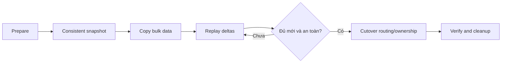

# Giới hạn tốc độ di chuyển để bảo vệ tải nghiệp vụ

Khi mở rộng một cụm NoSQL, ta thường phải **di chuyển dữ liệu**: chuyển partition từ shard đang đầy sang shard mới, rebalance những token range, chuyển Redis hash slots, khởi tạo replica mới, đổi vùng lưu trữ hoặc thực hiện resharding. Các hệ thống hiện đại cố gắng làm việc đó **trong khi ứng dụng vẫn đọc và ghi liên tục**.

Nhưng một tác vụ di chuyển hàng trăm GiB không phải công việc “chạy nền nên không ảnh hưởng người dùng”. Nó có thể cạnh tranh trực tiếp với request nghiệp vụ về **băng thông, CPU, cache, đĩa, IOPS, compaction, lock, replica log, số connection và thời gian phản hồi**. Nếu copy càng nhanh càng tốt, API có thể tăng p99 từ vài chục mili-giây lên nhiều giây, timeout hoặc thậm chí mất khả năng ghi vì đĩa bị đầy.

Ngược lại, **giảm tốc độ quá thấp cũng nguy hiểm**: dữ liệu ở đích có thể không bắt kịp những thay đổi phát sinh, log cần replay bị hết thời gian lưu, thời gian migration kéo dài khiến cụm ở trạng thái suy giảm khả năng chịu lỗi, hoặc điểm nóng tiếp tục làm quá tải shard nguồn.

Vì vậy, mục tiêu đúng là:

> **Di chuyển đủ nhanh để hoàn thành an toàn, nhưng chỉ tiêu thụ phần tài nguyên mà hệ thống có thể dành ra mà không phá vỡ SLO của tải nghiệp vụ.**

Bài học thuộc chương **Cân bằng và điểm nóng** trong **Database No SQL**. Nội dung tập trung vào cách đặt **ngân sách di chuyển**, giới hạn tốc độ và số tác vụ song song, điều chỉnh động theo sức khỏe ứng dụng, theo dõi cả tiến độ lẫn chi phí, và xử lý các đánh đổi khi cân bằng shard/partition đang có tải.

---

## 1. “Di chuyển dữ liệu” gồm những hoạt động nào?

Trong NoSQL phân tán, một tác vụ dịch chuyển có thể mang nhiều tên và diễn ra ở nhiều tầng.

| Hoạt động | Dữ liệu phải chuyển | Mục đích | Rủi ro nổi bật |
| --- | --- | --- | --- |
| **Shard/chunk migration** | Một phần key range hoặc chunk | Cân bằng dung lượng và tải | Cạnh tranh I/O, thay routing |
| **Partition reassignment** | Các partition thuộc một node hoặc replica group | Dàn tải, thay ownership | Hot partition, gián đoạn ngắn khi chuyển vai trò |
| **Replica bootstrap** | Snapshot dữ liệu và thay đổi phát sinh | Khôi phục redundancy, thêm node | Donor quá tải, log retention |
| **Node replacement** | Range/replica của node hỏng | Phục hồi sau lỗi | Cụm đang suy giảm quorum |
| **Resharding** | Dữ liệu theo khóa phân mảnh mới | Sửa thiết kế phân phối | Backfill, dual routing, cutover |
| **Redis slot migration** | Các key của hash slot | Chuyển slot sang node khác | Tăng độ trễ lệnh và client redirect |
| **Tier migration** | Data giữa các tầng hot/cold | Tối ưu chi phí và tốc độ | Query đọc vào dữ liệu đang chuyển |
| **Cross-region relocation** | Dữ liệu qua đường WAN | Residency hoặc DR | WAN latency, phí truyền, log lag |
| **Index backfill** | Scan tài liệu và xây index | Phục vụ truy vấn mới | Scan/CPU/IO ảnh hưởng foreground |

Không phải tác vụ nào cũng hỗ trợ giới hạn tốc độ bằng một cấu hình trực tiếp. Có engine cho điều chỉnh streaming bandwidth, có engine cho giới hạn concurrency, có engine chỉ cung cấp lịch chạy/tạm dừng; dịch vụ được quản lý có thể tự quyết định tốc độ nội bộ.

Điểm chung là **các tác vụ di chuyển phải được quản trị như workload có ưu tiên thấp hơn request nghiệp vụ**, trừ khi chính tác vụ khôi phục là điều kiện để dịch vụ tồn tại.

### 1.1. Không đồng nhất di chuyển với tăng bản sao

Di chuyển ownership của một partition từ A sang B khác với tạo **thêm replica** trên B. Thêm replica có thể không đổi shard key; resharding có thể làm lại cả cách định tuyến. Các loại việc này có **mốc an toàn và rollback khác nhau**.

### 1.2. Không dùng “bytes copied” làm định nghĩa duy nhất của tiến độ

Một task có thể copy 99% snapshot nhưng vẫn còn lượng log thay đổi lớn chưa replay, index chưa sẵn sàng hoặc routing chưa cutover. Vì vậy **phần trăm byte không đồng nghĩa phần trăm hoàn thành nghiệp vụ của migration**.

---

## 2. Foreground và background: ai đang tranh giành tài nguyên?

**Foreground workload** là các request phục vụ người dùng hoặc luồng nghiệp vụ đang hoạt động: đọc chi tiết, tạo đơn, cập nhật tồn kho, xác thực quyền, thanh toán.

**Background workload** gồm compaction, replication, backup, repair, index build và di chuyển dữ liệu.

```text
                   +------------------+
Frontend requests ->|                  |
Orders / payments ->| Shard A (donor)  |--- Snapshot transfer ---> Shard B
Business reads ---->|                  |------ Deltas/log -------> Shard B
                   +------------------+                             |
                        ^    ^                                      v
                        |    +---------- Compaction / index -------+
                        |
                CPU, RAM, disk IOPS, network
                (tài nguyên hữu hạn và dùng chung)
```

Một migration có thể làm hại ứng dụng bằng nhiều cách:

1. **Disk read contention:** donor đọc dữ liệu nền cùng lúc query quét index.
2. **Disk write contention:** đích apply dữ liệu, flush, build index trong khi phục vụ writes.
3. **Cache churn:** scan lớn đẩy dữ liệu nóng khỏi cache.
4. **Network saturation:** snapshot stream dùng hết NIC hoặc đường liên AZ.
5. **CPU contention:** nén, checksum, hash, merge và xử lý metadata.
6. **Compaction amplification:** nhập dữ liệu tạo thêm compaction hoặc write stall.
7. **Replication pressure:** log và delta mới phải được giữ lâu hơn.
8. **Coordinator/metadata pressure:** quá nhiều bước chuyển ownership làm router thay đổi liên tục.
9. **Lock/transaction contention:** giai đoạn cutover có thể cần những thao tác đồng bộ.
10. **Noisy neighbor:** một migration của tenant lớn làm các tenant khác cùng shard bị chậm.

### 2.1. Vì sao p99 thường nhạy hơn p50?

Nếu migration tạo một số khoảng I/O spike, phần lớn request vẫn nhanh nhưng vài request có thể chờ rất lâu. Trung vị p50 nhìn bình thường trong khi p99 tăng mạnh.

Một metric tổng CPU “chỉ 60%” cũng không loại trừ nghẽn: disk queue, single-thread coordinator, hot partition hay network link cụ thể có thể đã chạm giới hạn.

### 2.2. Cân bằng tải không nên tự phá SLO

Nếu di chuyển để giảm tải trên shard A mà trong lúc copy chính shard A bị quá tải hơn, chiến lược “cứ copy cho nhanh” có thể gây tác dụng ngược. Cần đặt **ngưỡng foreground** làm điều kiện bắt buộc trong toàn bộ quá trình.

---

## 3. Viết mục tiêu và SLO trước khi chọn tốc độ

Một kế hoạch thiếu SLO dễ rơi vào tranh luận “40 MiB/s hay 200 MiB/s là tốt?” mà không có cơ sở.

Hãy định nghĩa một hợp đồng như sau:

| Nhóm | Yêu cầu minh họa | Ý nghĩa |
| --- | --- | --- |
| API đọc order | p99 dưới ngưỡng được sản phẩm chấp thuận | Foreground read có ưu tiên |
| API giữ tồn kho | Không có lost update, không oversell | Bất biến nghiệp vụ không được phá |
| API ghi order | Timeout/error rate dưới ngưỡng vận hành | Migration không làm nghẽn write |
| Write concern/quorum | Không tăng lỗi xác nhận vượt ngưỡng | Cụm còn đủ khả năng commit |
| Replication lag | Không vượt giới hạn an toàn | Không dồn backlog không thể xả |
| Donor disk | Duy trì khoảng trống IOPS/throughput | Foreground và compaction còn headroom |
| Migration | Hoàn thành trước hạn vận hành phù hợp | Không để cụm suy giảm vô hạn |
| Recovery | Có thể dừng/đảo tuyến an toàn | Không gây mất dữ liệu khi sự cố |

Các ngưỡng cụ thể phải được xác lập từ SLO và số đo thực tế. Không nên coi một giá trị MiB/s hay độ trễ dùng trong ví dụ là “ngưỡng chuẩn” cho mọi NoSQL.

### 3.1. Phân biệt hard guardrail và soft target

- **Hard guardrail:** không được mất quorum hoặc vi phạm invariant; không được vượt mức disk free tối thiểu đã chọn.
- **Soft target:** muốn hoàn thành migration trong một cửa sổ 4 giờ; muốn giữ p95 thấp hơn mức mục tiêu.

Nếu hai mục tiêu xung đột, phải có **thứ tự ưu tiên được chấp nhận trước**, không để controller tự tối ưu “copy nhanh” rồi hy sinh correctness.

### 3.2. Tính cả tải phục hồi và backup đang chạy

Một migration chạy ổn khi cluster rảnh có thể phá SLO khi cùng lúc có:

- Backup full scan.
- Compaction lớn.
- Rebuild secondary index.
- Job analytics cuối ngày.
- Cấp lại replica sau một node failure.

Một chính sách admission phải biết **những background jobs khác đang chiếm ngân sách**.

---

## 4. Lập ngân sách tài nguyên cho migration

Giới hạn tốc độ copy không chỉ là giới hạn **băng thông mạng**. Mỗi byte di chuyển có thể tạo nhiều byte I/O thực tế.

Một cách lập ngân sách:

\[
C_{\mathrm{migration}} \le C_{\mathrm{safe}} -
C_{\mathrm{foreground}} -
C_{\mathrm{other\ background}} -
C_{\mathrm{headroom}}.
\]

Trong đó \(C\) là một tài nguyên cụ thể: disk throughput, IOPS, NIC bandwidth, CPU hoặc queue capacity.

Công thức là **mô hình hoạch định**; những workload khác nhau có cost/byte khác nhau. Cần đo hệ số thực tế thay vì xem 1 MiB chuyển mạng luôn tương đương 1 MiB đọc đĩa.

### 4.1. Ngân sách ở donor

Donor có thể giới hạn bởi:

- Disk read bandwidth.
- Random read IOPS.
- Page cache và memory bandwidth.
- CPU nén/checksum.
- NIC egress.
- Transaction log/compaction đang tạo I/O.

### 4.2. Ngân sách ở đích

Đích có thể giới hạn bởi:

- Disk write bandwidth và IOPS.
- WAL/commit log.
- Index creation, SSTable flush và compaction.
- CPU giải nén/validation.
- NIC ingress.
- Bộ nhớ ứng dụng delta và hàng đợi.

### 4.3. Ngân sách theo đường mạng

Nếu donor và đích ở khác AZ hoặc region, phải xét:

- Link bandwidth và congestion.
- Cross-zone/region transfer costs.
- Packet loss/retransmission.
- Các luồng replication đang chạy trên cùng đường.
- Độ trễ ảnh hưởng commit/write concern.

### 4.4. Ngân sách theo cụm, không chỉ từng cặp node

Nếu năm cặp donor–destination cùng chuyển mỗi cặp 80 MiB/s, một đường mạng chia sẻ có thể phải gánh tổng lớn hơn khả năng. Rate limit **từng task** không tự thay **cluster-wide budget**.

Một chiến lược phải đồng thời giới hạn:

1. Tổng migration bandwidth trên cụm.
2. Tổng bandwidth theo AZ/link.
3. Số task dùng cùng donor.
4. Số task dùng cùng đích.
5. Mức cạnh tranh với replication/foreground.

---

## 5. Tính tốc độ tối đa an toàn từ số đo

Giả sử đo được một donor có:

- Disk read throughput bền vững dưới workload hiện tại: 350 MiB/s.
- Foreground và compaction hiện dùng khoảng 190 MiB/s.
- Muốn dự phòng ít nhất 60 MiB/s cho spike.

Ngân sách copy đọc đĩa gần đúng:

\[
B_{\mathrm{donor}} = 350 - 190 - 60 = 100\ \mathrm{MiB/s}.
\]

Nhưng nếu network rảnh chỉ còn 75 MiB/s và đích có thể nhận tối đa 90 MiB/s, tốc độ trần khởi đầu là:

\[
B_{\mathrm{migration}} \le
\min(100,75,90)=75\ \mathrm{MiB/s}.
\]

**Đây là phép tính minh họa**, chưa tính amplification và nhiều giới hạn phi tuyến. Trong thực tế phải xem p99, queue depth, đỉnh tải, nhiều stream và thay đổi foreground theo thời gian.

### 5.1. Trần khác tốc độ thực

Cấu hình trần 75 MiB/s **không hứa** task sẽ luôn chuyển được 75 MiB/s. Có thể chậm hơn do checksum, index, disk seeks, compaction, retry hoặc ít parallelism.

### 5.2. Không dùng 100% tài nguyên “rảnh” cho dữ liệu nền

Tải production thường biến thiên. Nếu dùng toàn bộ headroom vừa đo tại một thời điểm, chỉ một burst nhỏ có thể đẩy request vào hàng đợi dài.

Cần dự phòng theo **phân bố tải và SLO**, không chỉ theo average utilization.

---

## 6. Mô hình thời gian copy và backlog thay đổi

Gọi:

- \(D\): dữ liệu nền cần copy.
- \(b\): tốc độ copy hiệu dụng.
- \(\lambda\): tốc độ thay đổi mới phát sinh trong thời gian copy.
- \(\mu\): tốc độ đích replay các thay đổi sau snapshot.

Trong mô hình đơn giản, thời gian copy nền:

\[
T_{\mathrm{copy}} \approx \frac{D}{b}.
\]

Nếu có 720 GiB cần copy với tốc độ 80 MiB/s:

\[
T_{\mathrm{copy}}
\approx
\frac{720\times 1024\ \mathrm{MiB}}{80\ \mathrm{MiB/s}}
=9{,}216\ \mathrm{s}
\approx 2.56\ \mathrm{giờ}.
\]

Đó mới là thời gian **snapshot copy**, không gồm catch-up và cutover.

### 6.1. Cơ chế snapshot + delta

Trong lúc copy, nguồn vẫn ghi:

```text
Snapshot lúc mốc S -----> Copy dữ liệu nền ----> Install
           |                                      |
           +-- Ghi mới / update / delete --------+
                         |
                         v
               Change log / oplog / CDC
                         |
                         v
                      Replay
```

Sau khi snapshot xong, đích cần replay các thay đổi kể từ mốc S theo **thứ tự và transaction semantics** được engine hỗ trợ.

### 6.2. Backlog có thể tăng khi giảm tốc quá mạnh

Giả sử tồn backlog ban đầu \(L_0\). Với tốc độ thay đổi mới \(\lambda\) và tốc độ replay \(\mu\):

\[
L(t) \approx \max\{0, L_0 + (\lambda-\mu)t\}.
\]

Nếu \(\mu \le \lambda\), backlog không giảm về 0 trong điều kiện ổn định. Giảm migration rate quá mức có thể làm đích mãi không bắt kịp.

### 6.3. Log retention là một ràng buộc cứng

Nếu cần replay từ mốc S nhưng log chứa thay đổi sau S bị xóa trước khi đích đọc hết, migration có thể phải bắt đầu lại.

Một điều kiện hoạch định:

\[
T_{\mathrm{copy}}+
T_{\mathrm{catchup}}+
T_{\mathrm{safety\ margin}}
<
T_{\mathrm{retention}}.
\]

Không thể chỉ tăng `sleep` để giảm tải foreground mà bỏ qua giới hạn oplog/changelog/tombstone retention.

### 6.4. Cần cả tốc độ tối thiểu và tốc độ tối đa

Một bài toán thực tế:

\[
b_{\min} \le b \le b_{\max}.
\]

- \(b_{\max}\) được xác định bởi SLO và ngân sách tài nguyên.
- \(b_{\min}\) được xác định bởi thời gian cần hoàn thành, log retention hoặc thời gian chịu trạng thái suy giảm.

Nếu \(b_{\min}>b_{\max}\), **không tồn tại tốc độ hợp lệ** trong cấu hình hiện tại. Cần thêm capacity, tăng retention an toàn, đổi donor, đổi kế hoạch hoặc giảm khối lượng migration; không thể giải quyết bằng một con số limit “thông minh”.

---

## 7. Throttling cố định: đặt một trần dễ hiểu

Biện pháp đơn giản nhất là đặt **giới hạn tốc độ truyền dữ liệu** hoặc số tác vụ song song.

Ví dụ chính sách:

```yaml
# Pseudoconfiguration, không phải file cấu hình chuẩn của một DB.
migration:
  max_cluster_mib_per_sec: 240
  max_per_donor_mib_per_sec: 80
  max_per_destination_mib_per_sec: 80
  max_concurrent_moves: 3
  max_moves_per_shard: 1
```

Điều quan trọng là **mỗi trần có phạm vi và đơn vị rõ ràng**. “80 MB/s” và “80 MiB/s” khác nhau; một tham số có thể áp cho toàn node, từng stream, từng datacenter hoặc cả cluster theo engine.

### 7.1. Ưu điểm

- Dễ dự báo và giải thích.
- Giảm rủi ro burst gây bão hòa.
- Phù hợp một cửa sổ tải tương đối ổn định.
- Dễ đưa vào runbook và audit.

### 7.2. Nhược điểm

- Quá cao khi production có burst.
- Quá thấp khi cluster rảnh.
- Một node hot có thể cần trần thấp hơn node khác.
- Một giới hạn network không tự giới hạn compaction hoặc random I/O.

### 7.3. Giới hạn concurrency có khi quan trọng hơn byte-rate

Một migration có thể tạo hàng nghìn random IOPS dù throughput chỉ vài MiB/s. Giảm số stream hoặc migration đồng thời có thể bảo vệ disk queue tốt hơn chỉ hạ băng thông mạng.

**Phải chọn nút giới hạn theo tài nguyên đang nghẽn.**

---

## 8. Token bucket: cho burst nhỏ nhưng giữ trung bình an toàn

**Token bucket** là mô hình rate limiter thường dùng để kiểm soát thông lượng.

- Bucket chứa tối đa \(C\) tokens.
- Tokens được nạp với tốc độ \(r\) tokens/giây.
- Mỗi byte hoặc block cần tiêu thụ token trước khi được chuyển.
- Khi thiếu token, stream chờ hoặc được điều tiết.

Mô tả khái niệm:

```text
Tokens refill at r
         |
         v
     +---------+
     | Bucket  | capacity C
     +---------+
         |
         v
Migration blocks consume tokens
         |
         v
Send / copy
```

### 8.1. Vì sao cần burst capacity?

Nếu chỉ cho đều đúng 40 MiB/s, những packet/block cần gửi thành batch có thể bị nghẽn không cần thiết. Token bucket cho phép **burst ngắn** khi đã tích token, trong khi trung bình dài hạn không vượt \(r\) theo mô hình.

Nếu đặt bucket quá lớn, burst có thể gây spike I/O phá SLO. Vì vậy chọn \(C\) theo khả năng chịu burst của hệ.

### 8.2. Pseudocode

```python
class TokenBucket:
    def __init__(self, refill_rate_bytes_per_sec, capacity_bytes):
        self.rate = refill_rate_bytes_per_sec
        self.capacity = capacity_bytes
        self.tokens = capacity_bytes
        self.last_check = monotonic_time()

    def allowed_bytes(self, wanted):
        now = monotonic_time()
        elapsed = max(0, now - self.last_check)
        self.tokens = min(
            self.capacity,
            self.tokens + elapsed * self.rate
        )
        self.last_check = now
        granted = min(wanted, int(self.tokens))
        self.tokens -= granted
        return granted
```

Đây là **pseudocode**: `monotonic_time()` chưa được định nghĩa. Một triển khai production còn cần chờ khi thiếu token, concurrency safety, cancellation, accounting thật ở từng đường truyền và giới hạn bucket ở nhiều tầng.

### 8.3. Phân cấp limiter

```text
Cluster global limiter
   |
   +-- AZ-A link limiter
   |      +-- Donor A limiter
   |             +-- Task 1
   |             +-- Task 2
   |
   +-- AZ-B link limiter
          +-- Donor B limiter
                 +-- Task 3
```

Nếu chỉ có limiter từng task, nhiều task có thể cộng lại vượt quá bandwidth chung. Limiter phân cấp giúp quản lý tổng tài nguyên nhưng cần tính đến fairness và hiệu năng của chính coordinator.

---

## 9. Weighted fair sharing: tránh một migration chiếm hết ngân sách

Giả sử cụm có ngân sách di chuyển 200 MiB/s với ba task:

- Task A: khôi phục replica của shard chỉ còn đúng quorum.
- Task B: cân bằng shard bình thường.
- Task C: di chuyển dữ liệu ít truy cập sang tier lạnh.

Có thể phân bổ ưu tiên tương đối:

| Task | Mục tiêu | Trọng số minh họa |
| --- | --- | ---: |
| A | Khôi phục khả năng chịu lỗi | 5 |
| B | Giảm skew | 3 |
| C | Tối ưu lưu trữ | 1 |

Trong thuật toán chia theo trọng số đơn giản, phần A lớn hơn B và C khi tất cả đều cần bandwidth. **Các trọng số là ví dụ chính sách**, không phải lời khuyên cố định để bật trong một database cụ thể.

### 9.1. Phải có cơ chế chống starvation

Một task ưu tiên thấp có thể không bao giờ chạy nếu liên tục có task khẩn cấp. Có thể dành **minimum share** hoặc một lịch bảo trì riêng cho nó, miễn không phá SLO.

### 9.2. Không dùng ưu tiên cao để bỏ qua guardrail

Task A khẩn cấp nhưng không được dùng 100% disk donor khiến donor — hiện là node còn giữ quorum — ngừng phục vụ. “Khẩn cấp” có thể nâng mức ngân sách, **không có nghĩa được phép phá correctness**.

### 9.3. Phân bổ theo cost, không chỉ bytes

Một migration gồm nhiều tài liệu nhỏ hoặc nhiều index có thể cần CPU/IOPS lớn hơn một stream tuần tự cùng byte count. Có thể cần weighted cost units dựa trên đo đạc thay vì chia chỉ theo MiB/s.

---

## 10. Admission control: quyết định khi nào được bắt đầu

Đôi khi cách bảo vệ foreground tốt nhất là **chưa bắt đầu thêm một migration**.

Một bộ điều kiện admission có thể kiểm tra:

1. Có quorum/replication health đầy đủ không?
2. Có migration nào khác cùng donor hoặc cùng destination không?
3. Disk free đủ cho snapshot + log + compaction + growth không?
4. Foreground p99 đang trong ngưỡng an toàn không?
5. Network link có băng thông dự phòng không?
6. Có maintenance, backup hoặc repair đang hoạt động không?
7. Log retention đủ cho thời gian copy dự kiến không?
8. Có kế hoạch rollback nếu task lỗi không?
9. Task này có phải cần thiết để xử lý một hotspot đang gây sự cố không?
10. Có điều kiện pháp lý/data residency ràng buộc nơi nhận dữ liệu không?

### 10.1. Quy tắc một donor, một migration lớn

Một chính sách thực dụng có thể giới hạn **một migration dữ liệu lớn tại một thời điểm trên mỗi donor**, ít nhất đến khi đo được headroom. Cơ sở dữ liệu có thể cho nhiều stream song song nhưng không nhất thiết nên dùng hết khả năng đó khi foreground nhạy latency.

### 10.2. Không đồng thời rút hai node khỏi failure domain đang suy giảm

Nếu cụm chỉ còn hai trong ba data-bearing replicas, thêm tải copy lên cả hai donor cùng lúc có thể làm rủi ro mất quorum cao hơn. Admission nên xét **fault tolerance hiện tại**, không chỉ tổng CPU rảnh.

### 10.3. Lịch chạy theo thời gian không đủ

Cửa sổ “sau 23:00” có thể trùng ETL, backup và compaction. Nên dùng **window cộng điều kiện đo thực tế**, không chỉ cron schedule.

---

## 11. Điều chỉnh tốc độ theo tải: từ static tới adaptive

Tốc độ cố định khó phù hợp mọi trạng thái. Một controller thích nghi có thể tăng tốc khi có headroom và giảm khi foreground xấu đi.

Đặt:

- \(r_t\): rate limit hiện tại.
- \(L_t\): độ trễ p99 foreground đo trên cửa sổ quan sát.
- \(L_{\mathrm{target}}\): ngưỡng latency cho phép.
- \(E_t\): error rate.
- \(Q_t\): disk/network queue pressure.
- \(H_t\): khoảng headroom còn lại.

Một chính sách đơn giản:

```text
Nếu mất quorum, có data error hoặc disk nguy hiểm:
    PAUSE migration, xử lý incident
Ngược lại nếu p99 vượt ngưỡng hoặc error tăng:
    GIẢM rate nhanh
Ngược lại nếu metrics ổn định và backlog/retention an toàn:
    TĂNG rate chậm
Ngược lại:
    GIỮ rate
```

### 11.1. AIMD: tăng chậm, giảm nhanh

Một phương pháp phổ biến là *Additive Increase, Multiplicative Decrease*:

\[
r_{t+1}=
\begin{cases}
\max(r_{\min}, \beta r_t), & \text{khi có áp lực};\\
\min(r_{\max}, r_t+\alpha), & \text{khi khỏe ổn định}.
\end{cases}
\]

Với \(\alpha>0\) là bước tăng và \(0<\beta<1\) là hệ số giảm. Đây là **mô hình thuật toán**, không phải tham số chuẩn của MongoDB/Cassandra.

Ưu điểm: phản ứng nhanh khi foreground gặp vấn đề, nhưng tăng từ từ để tránh vượt trần.

### 11.2. Hysteresis chống dao động

Nếu p99 dao động quanh một ngưỡng và controller giảm/tăng liên tục, rate có thể “nhảy lên xuống”.

Dùng hai ngưỡng:

- Giảm khi p99 vượt **ngưỡng cao** trong đủ thời gian.
- Chỉ tăng lại khi p99 dưới **ngưỡng thấp** trong một số cửa sổ liên tiếp.

Kèm thời gian cooldown sau mỗi lần thay rate.

### 11.3. Không tối ưu một metric đơn độc

p99 cao có thể do một endpoint ít request hoặc do sự cố độc lập với migration. Có thể kết hợp:

- p99 của read và write quan trọng.
- Error/timeout rate.
- Queue depth/disk await.
- Replica lag/write concern failures.
- Donor/destination CPU và disk.
- Backlog migration/log retention.
- Tải theo tenant/hot partition.

Đặt **một vài guardrail cứng** trước khi dùng controller tối ưu throughput.

---

## 12. Lọc nhiễu và chậm trễ phản hồi của controller

Một controller điều chỉnh theo p99 có thể gặp vấn đề vì metric thu thập trễ, cửa sổ quá ngắn hoặc dữ liệu ít mẫu.

### 12.1. Cửa sổ quá ngắn

Nếu chỉ có 10 request trong một giây, “p99 trong 1 giây” gần như là request chậm nhất, không ổn định. Cần đủ mẫu hoặc tổng hợp cửa sổ dài hơn, giữ cảnh báo riêng cho lỗi nghiêm trọng.

### 12.2. Cửa sổ quá dài

Một cửa sổ 30 phút có thể khiến controller phản ứng quá chậm trước burst. Nên tách:

- **Fast guardrails:** lỗi quorum, disk free, error rate cao bất thường.
- **Slow tuning:** latency percentile, throughput, sustained utilization.

### 12.3. Dùng smoothing có kiểm soát

Ví dụ Exponentially Weighted Moving Average:

\[
m_t = \gamma x_t + (1-\gamma)m_{t-1}
\]

với \(0<\gamma\le1\). Giá trị mượt giúp giảm dao động, nhưng cũng tạo trễ. Không dùng smoothing để **che một sự cố dữ liệu/quorum cần dừng ngay**.

### 12.4. Một điều chỉnh có thể mất thời gian mới có hiệu lực

Sau khi giảm bandwidth, compaction hoặc cache churn đã khởi phát có thể tiếp tục gây latency. Không nên liên tục giảm rate trong vài giây mà không đợi hệ phản ứng; có thể dẫn tới overcorrection.

---

## 13. Trình tự ưu tiên khi foreground và migration cạnh tranh

Một chính sách có thể phân tầng:

| Ưu tiên | Loại việc | Ví dụ |
| --- | --- | --- |
| **P0 — Safety** | Bảo toàn dữ liệu và quyền ghi | Quorum, WAL durability, authorization |
| **P1 — Foreground** | Request người dùng trong SLO | Giữ hàng, thanh toán, đọc đơn |
| **P2 — Critical recovery** | Khôi phục redundancy/quorum | Thay replica đang thiếu |
| **P3 — Hotspot mitigation** | Di chuyển giảm overload | Chuyển range hot có thể tách |
| **P4 — Routine rebalance** | Dàn đều dữ liệu | Chuyển chunk theo dung lượng |
| **P5 — Optimization** | Tối ưu vị trí/cost không khẩn cấp | Tiering, di chuyển theo lịch |

Thứ tự là **ví dụ điều phối**, không phải chân lý tuyệt đối. Nếu foreground đã lỗi vì mất replica và không có dư địa chịu lỗi tiếp, recovery có thể phải được ưu tiên cấp cao, nhưng vẫn tuân thủ safety.

### 13.1. Hotspot migration cần xem tải sau khi chuyển

Nếu partition nóng chiếm 60% tổng QPS và không thể split, việc chuyển sang một shard khác chỉ **chuyển điểm nóng**. Di chuyển có thể kéo dài mà cuối cùng cụm vẫn mất cân bằng.

Cần xác định:

- Hotspot do nhiều key nằm cùng shard hay một key quá nóng?
- Có thể tách thành nhiều partitions/chunks không?
- Có thể dùng cache/read replicas không?
- Có thể giảm write contention bằng bucket/salt không?
- Có cần scale up tạm thời không?

Đừng đốt I/O cho migration khi đích đến không thể cải thiện bottleneck.

---

## 14. Phân biệt chuyển dung lượng và chuyển tải

Một rebalancer chỉ tối ưu theo **bytes stored** có thể tạo các shard đều dung lượng nhưng rất lệch QPS.

Ví dụ:

| Shard | Dung lượng | Foreground QPS |
| --- | ---: | ---: |
| A | 500 GiB | 40.000 |
| B | 500 GiB | 4.000 |
| C | 500 GiB | 5.000 |

Dung lượng bằng nhau nhưng A rất nóng.

### 14.1. Di chuyển cold data không làm hạ tải A nhiều

Nếu chuyển 100 GiB dữ liệu lạnh khỏi A, dung lượng A giảm nhưng QPS vẫn cao. Migration có thể còn gây thêm I/O và p99.

### 14.2. Chọn candidate bằng nhiều tiêu chí

Với mỗi partition/chunk:

- Bytes và số record.
- Read/write QPS.
- CPU/IOPS cost.
- Hot key distribution.
- Truy vấn thường đi cùng partition khác không?
- SLO nhạy với cross-shard hop không?
- Mức dữ liệu thay đổi trong lúc copy.
- Đích có đủ headroom không?
- Khả năng chunk có thể split hoặc phải re-key không?

### 14.3. Thứ tự move có thể quan trọng

Di chuyển những cold partitions nhỏ trước giúp kiểm chứng pipeline và giảm rủi ro. Nhưng khi hotspot đang gây incident, có thể cần ưu tiên một candidate có **lợi ích tải cao hơn chi phí copy**, sau khi kiểm tra tính khả thi.

---

## 15. Lợi ích ròng của một lần migration

Một quyết định điều phối tốt không chỉ hỏi “đã chuyển bao nhiêu GiB?”, mà hỏi “lần chuyển đó cải thiện gì sau khi tính chi phí?”.

Một khung đánh giá:

\[
\text{NetBenefit}
=
\text{LoadReductionAfterMove}
-
\text{MigrationCost}
-
\text{NewRoutingCost}
-
\text{RiskPremium}.
\]

Các thành phần ở đây chưa có đơn vị chung; khi áp dụng cần chuẩn hóa theo chi phí/giá trị kinh doanh hoặc dùng các ngưỡng riêng.

### 15.1. Chi phí có thể kéo dài sau khi copy

- Cache của partition mới ở đích còn lạnh.
- Index/cache warm-up làm read latency tăng.
- Compaction tiếp tục sau khi streaming kết thúc.
- Replica lag có thể tăng khi mới nhận dữ liệu.
- Router/client còn metadata cũ và cần redirect/retry.

### 15.2. Đừng quên dữ liệu dẫn xuất

Nếu dịch chuyển canonical data nhưng read model/caches ở các node khác không được điều phối, ứng dụng có thể gặp tình huống đọc cũ, miss tăng hoặc luồng cross-shard đi đường dài hơn.

---

## 16. Kế hoạch sao chép phải gắn với mốc nhất quán

Một quá trình online migration thường gồm các pha logic:



**Tên pha mang tính khái niệm**, không phải state machine chung của mọi engine.

### 16.1. Phase 1 — snapshot/copy

Đây thường là pha có thể throttling theo bandwidth dễ nhất. Giới hạn tốc độ giúp bảo vệ disk/network donor.

### 16.2. Phase 2 — replay/catch-up

Pha này có thể cần ưu tiên cao hơn vì log backlog phải tiến về mốc commit. Throttling quá mạnh có thể khiến migration không bao giờ đủ điều kiện cutover.

### 16.3. Phase 3 — cutover

Chuyển quyền sở hữu, routing hoặc writer authority có thể có đoạn ngắn nhạy cảm với timeout. Không nhất thiết nên giới hạn bằng cùng chính sách byte-rate của snapshot.

Cần đặt **guardrail về độ trễ, quyền ghi và idempotency**, đồng thời tránh phát sinh nhiều cutover đồng thời.

### 16.4. Phase 4 — cleanup

Xóa bản dữ liệu cũ, compact tombstones hoặc giải phóng storage có thể gây I/O đáng kể. Không coi migration “không còn ảnh hưởng production” ngay khi router đã chuyển đích.

### 16.5. Throttling theo pha

| Pha | Loại giới hạn ưu tiên | Rủi ro nếu quá thấp |
| --- | --- | --- |
| Snapshot copy | Byte-rate, IOPS, stream concurrency | Log retention bị vượt, migration quá dài |
| Delta replay | Apply rate, backlog, order constraints | Không bắt kịp source |
| Cutover | Số cutover đồng thời, timeout, readiness | Thời gian chuyển quyền kéo dài |
| Cleanup | Compaction/delete rate, disk headroom | Ổ đầy, dữ liệu cũ chiếm chỗ lâu |
| Verify | Scan concurrency và checksum overhead | Kiểm chứng không hoàn tất trước SLA |

---

## 17. Chính sách điều khiển hai giai đoạn: copy chậm, catch-up đúng hạn

Một chiến lược hay dùng ở cấp thiết kế:

1. Copy snapshot với một rate an toàn.
2. Khi snapshot đã gần hoàn tất, đánh giá **backlog và log retention còn lại**.
3. Nếu catch-up đuổi kịp nhanh, giữ rate và tiến tới cutover.
4. Nếu không thể bắt kịp, cần thay đổi kế hoạch — tăng tài nguyên hoặc retention, giảm tải nguồn, chuyển thời điểm — chứ không ép một cutover thiếu dữ liệu.

### 17.1. Tính “đủ thời gian” theo watermark

Giả sử source log giữ từ vị trí \(L_{\min}\) tới \(L_{\max}\); đích cần replay từ \(L_{\mathrm{required}}\). Mức an toàn phụ thuộc việc \(L_{\mathrm{required}}\) **còn nằm trong lịch sử sẵn có** và tốc độ replay đủ theo kịp.

Không dùng một metric “lag 5 phút” đơn độc nếu hệ định nghĩa lag bằng nhiều timestamp khác nhau hoặc có clock skew.

### 17.2. Một ví dụ quyết định

- Đích còn 30 GiB backlog.
- Tốc độ replay hiệu dụng 120 MiB/s.
- Source phát sinh 100 MiB/s.
- Tốc độ giảm ròng khoảng 20 MiB/s.

Thời gian catch-up xấp xỉ:

\[
\frac{30\times1024}{20}\approx1536\ \mathrm{s}
\approx25.6\ \mathrm{phút}.
\]

Nếu log retention hữu dụng còn chỉ 10 phút, kế hoạch **không an toàn theo mô hình này**, dù máy đích đang replay “120 MiB/s”.

### 17.3. Không giả định migration luôn có changelog riêng

Một số hệ dùng streaming/repair protocol khác, không cho ứng dụng truy cập một changelog tuyến tính toàn cục. Hãy đọc progress/retention tương đương mà engine công bố thay vì tự suy cơ chế snapshot+oplog chính xác.

---

## 18. Copy-on-demand và migration theo mức ưu tiên truy vấn

Không nhất thiết chuyển mọi partition theo thứ tự ID hoặc kích thước.

### 18.1. Dữ liệu lạnh

Cold ranges có thể chuyển chậm trong khung giờ rảnh, ưu tiên an toàn và chi phí.

### 18.2. Dữ liệu nóng

Hot ranges có thể cần di chuyển sớm để giảm p99 đang xấu, nhưng quá trình copy chính nó có thể tăng tải tại donor. Cân nhắc dùng cache, split range hoặc tăng capacity tạm thời.

### 18.3. Prefix/tenant quan trọng

Một tenant có SLA riêng có thể cần bảo đảm không bị tác động bởi migration của tenant khác. Scheduler có thể dành tài nguyên và khoảng thời gian riêng.

### 18.4. Thứ tự chuyển dữ liệu liên quan

Nếu một request thường đọc nhiều partitions cùng nhau, di chuyển một phần mà không xét locality có thể làm request đi qua nhiều shard hơn.

Cần đánh giá **fan-out và network hops sau migration**, không chỉ phân phối disk.

---

## 19. Per-tenant fairness và noisy neighbor

Trong hệ multi-tenant, một tenant lớn có thể là nguyên nhân migration, nhưng những tenant nhỏ cùng dùng donor vẫn chịu tác động.

### 19.1. Hợp đồng bảo vệ tất cả tenant

Giả sử tenant A chiếm 70% storage, tenant B/C chỉ chiếm 30% nhưng có SLO ghi nhạy cảm. Nếu migration A dùng toàn bộ disk, tenant B/C vẫn bị chậm dù không liên quan tới việc di chuyển.

### 19.2. Hạn mức theo tenant

Có thể kết hợp:

- Giới hạn migration per tenant.
- Giới hạn bandwidth per shard.
- Admission dựa trên aggregate foreground SLO.
- Kiểm tra p99 của những tenant quan trọng.
- Dedicated donor/replica hoặc dedicated windows cho tenant rất lớn.

### 19.3. Không dựa chỉ vào p99 toàn cụm

Nếu tenant nhỏ có rất ít request nhưng latency tăng từ 20 ms lên 2 s, percentile toàn cụm có thể không thấy rõ. Cần quan sát **theo endpoint/tenant/tier**, kèm min sample và bảo vệ dữ liệu cá nhân trong telemetry.

---

## 20. Disk IOPS và compaction thường là giới hạn thật

Một lỗi vận hành phổ biến là chỉ giới hạn network rate nhưng vẫn thấy write latency tăng.

### 20.1. LSM-based storage

Trong những engine dùng LSM tree, dữ liệu streaming vào có thể gây:

- Memtable flush.
- SSTable ingestion và overlap.
- Compaction đọc/ghi lại dữ liệu.
- Tombstone processing.
- Write amplification và disk space tăng tạm thời.

Nếu 1 GiB dữ liệu copy tạo thêm nhiều GiB I/O vì compaction, network limit 50 MiB/s **không hứa disk chỉ chịu 50 MiB/s**.

### 20.2. B-tree/cache-oriented storage

Scan snapshot có thể làm cache churn. Read nghiệp vụ phải nạp lại những pages nóng, tăng latency dù disk chưa đạt băng thông tối đa.

### 20.3. Đo IOPS và latency, không chỉ MB/s

Hai workload 100 MiB/s có thể khác nhau:

- Sequential I/O với block lớn.
- Random I/O nhiều thao tác nhỏ.

Cùng byte-rate nhưng random IOPS/queue depth có thể tạo độ trễ rất khác.

### 20.4. Giới hạn compaction đồng thời

Nếu engine hỗ trợ điều chỉnh compaction hoặc streaming concurrency, cần phối hợp. Không nên vô hiệu hóa compaction tùy tiện rồi để disk pressure tăng vô hạn; điều đó có thể gây write stall hoặc rủi ro dữ liệu khác.

---

## 21. Băng thông giữa AZ/region và chi phí truyền dữ liệu

Cross-AZ/region migration có thể bị giới hạn bởi link và làm tăng chi phí vận hành.

### 21.1. Mô hình đơn giản

Giả sử băng thông hữu dụng của đường truyền là \(B_{\mathrm{link}}\), replication đang dùng \(B_{\mathrm{replication}}\) và foreground dùng \(B_{\mathrm{foreground}}\).

Ngân sách migration khởi đầu:

\[
B_{\mathrm{move}} \le
B_{\mathrm{link}}-
B_{\mathrm{replication}}-
B_{\mathrm{foreground}}-
B_{\mathrm{safety}}.
\]

Cần xét traffic **cùng chiều** trên link, QoS network và những ứng dụng khác dùng chung đường.

### 21.2. WAN có thể có latency cao hơn

Các luồng chuyển khối dữ liệu có thể được pipelining nhiều, nhưng control messages, TLS setup, retries và small-block transfers vẫn có thể nhạy WAN RTT.

Không nên tăng parallelism vô hạn để “lấp đầy đường truyền”; nhiều stream có thể làm congestion, packet loss và tăng tail latency của traffic nghiệp vụ.

### 21.3. Chọn đường đi và donor phù hợp

Nếu dữ liệu đã có replica trong AZ/region đích, chuyển từ replica gần hơn có thể giảm egress và tải WAN. Tuy nhiên **donor phải đủ mới và được engine cho phép**; không tùy ý copy từ bản stale.

### 21.4. Dữ liệu lưu trú theo vùng

Một số dữ liệu bị ràng buộc residency. Không được di chuyển sang region khác chỉ vì rảnh băng thông hoặc rẻ hơn nếu không đáp ứng hợp đồng/law/policy. Tốc độ migration không thể sửa sai ở quyết định **đích đặt dữ liệu**.

---

## 22. Quan sát migration phải đi cùng foreground metrics

Một dashboard có đúng một biểu đồ “bytes moved” là chưa đủ.

| Nhóm | Metric | Câu hỏi |
| --- | --- | --- |
| **Foreground** | p50/p95/p99 theo endpoint | Người dùng có chậm không? |
| **Foreground** | Error/timeout rate | Có request thất bại? |
| **Foreground** | Success throughput | Hệ còn xử lý nghiệp vụ không? |
| **Storage** | Disk utilization, queue depth, await | I/O đã nghẽn chưa? |
| **Storage** | Compaction backlog/write stalls | Ingest có làm hệ nghẽn? |
| **CPU/Memory** | CPU saturation/cache misses | Migration có lấy tài nguyên foreground? |
| **Network** | Tx/Rx, retransmits, AZ link usage | Đường mạng có bị bão hòa? |
| **Replication** | Lag và log retention margin | Có còn đủ khả năng catch-up? |
| **Quorum** | Write concern/quorum errors | Giao dịch có đạt mức xác nhận? |
| **Migration** | Bytes moved và effective throughput | Tiến độ copy thật? |
| **Migration** | Outstanding tasks/concurrency | Có quá nhiều tác vụ song song? |
| **Migration** | Delta backlog và apply rate | Đích có theo kịp? |
| **Migration** | Current owner/routing version | Cutover đã hoàn tất an toàn? |
| **Placement** | Hot shard load/skew ratio | Di chuyển có giảm lệch tải không? |
| **Cost** | Cross-zone/region egress và storage | Chi phí có theo ngân sách? |

### 22.1. Chọn metric theo nguồn và đích

Một donor có read I/O cao; đích có write I/O, compaction và cache pressure cao. Nếu chỉ theo dõi donor, có thể bỏ qua tình trạng đích đang chậm áp dụng log.

### 22.2. Quan sát cấp partition/shard

Cluster average có thể tốt trong khi một shard hot và một tenant quan trọng đang chậm. Cần biết **task nào ảnh hưởng shard/tenant nào**.

### 22.3. Dashboard nên thể hiện thay đổi tốc độ

Ghi nhận thời điểm controller tăng/giảm giới hạn, bắt đầu/dừng một task, và các thay đổi SLO sau đó. Nếu không có annotation, khó phân biệt tương quan với nguyên nhân.

---

## 23. Chỉ số SLO guardrail: ví dụ chính sách kiểm thử được

Một bảng chính sách ví dụ:

| Trạng thái | Điều kiện minh họa | Hành động |
| --- | --- | --- |
| **Healthy** | p99 ổn định, disk/network còn headroom | Tăng rate từng bước nhỏ |
| **Caution** | p99 tăng hoặc I/O queue cao trong vài cửa sổ | Giữ hoặc giảm 20–30% |
| **Unhealthy** | Timeout/write concern lỗi tăng đáng kể | Giảm mạnh, không nhận task mới |
| **Critical** | Quorum không đủ, disk free nguy hiểm, checksum error | Pause/abort theo runbook |
| **Stalled** | Backlog không giảm, log window sắp hết | Thay đổi kế hoạch sync/capacity/retention |

Các tỷ lệ phần trăm chỉ dùng minh họa. Trạng thái thực nên xét thêm **ngưỡng tuyệt đối, baseline, số mẫu và bối cảnh lỗi**.

### 23.1. Khi nào pause thay vì reduce?

Nếu chỉ p99 tăng nhẹ, giảm rate có thể đủ.

Nếu phát hiện thiếu log cần replay hoặc checksum mismatch, hạ rate không sửa vấn đề correctness. Phải dừng chuyển trạng thái, xác định nguyên nhân và có thể xây lại snapshot.

### 23.2. Khi nào tăng rate là hợp lý?

Nếu foreground khỏe, donor/destination còn headroom và log retention đang bị áp lực, tăng tốc có thể cần thiết để kết thúc migration. Nhưng phải **kiểm tra bottleneck thật**, không dùng mức trần cao mà gây compaction stall.

### 23.3. Giới hạn thay đổi cấu hình

Controller nên có `min_rate`, `max_rate`, `min_interval` và khả năng operator override. Tránh phát lệnh reconfigure quá thường xuyên, tạo tải metadata hoặc race giữa nhiều controller.

---

## 24. Một bộ điều khiển minh họa bằng pseudocode

Ví dụ này không phụ thuộc API của database. Nó chỉ diễn tả logic quản trị.

```python
class MigrationController:
    def __init__(self, min_rate, max_rate):
        self.min_rate = min_rate
        self.max_rate = max_rate
        self.rate = min_rate

    def decide(self, metrics):
        if metrics.quorum_lost or metrics.integrity_error:
            return {"action": "PAUSE", "rate": 0}

        if metrics.disk_free_below_floor:
            return {"action": "PAUSE", "rate": 0}

        if metrics.high_foreground_errors:
            self.rate = max(
                self.min_rate, self.rate * 0.5
            )
            return {"action": "THROTTLE", "rate": self.rate}

        if metrics.p99_above_high and metrics.enough_samples:
            self.rate = max(
                self.min_rate, self.rate * 0.7
            )
            return {"action": "THROTTLE", "rate": self.rate}

        if metrics.p99_below_low_for_several_windows:
            self.rate = min(
                self.max_rate, self.rate + metrics.safe_step
            )
            return {"action": "INCREASE", "rate": self.rate}

        return {"action": "HOLD", "rate": self.rate}
```

Một triển khai thật còn cần:

- Lấy metric từ hệ quan sát tin cậy.
- Nhận biết metric bị thiếu/stale.
- Quản lý concurrency và quyền sở hữu controller.
- Cơ chế cooldown/hysteresis.
- So sánh với ngưỡng retention/backlog.
- Tách rate toàn cụm và rate theo node.
- Kiểm soát manual override.
- Ghi audit của từng quyết định.
- API thay đổi giới hạn được engine hỗ trợ.

**Không dùng pseudocode này trực tiếp điều khiển production.**

---

## 25. Tránh “controller đánh nhau” với autoscaler và balancer

Một cụm có thể đồng thời chạy:

- Autoscaler thêm/bớt node.
- Rebalancer tự chuyển dữ liệu.
- Migration controller thay rate.
- Storage tiering controller.
- Replica repair manager.
- Hệ triển khai tự rolling restart.

Nếu các controller không phối hợp, một vòng lặp có thể xảy ra:

```text
A hot -> autoscaler thêm B
Balancer chuyển dữ liệu sang B
B tăng CPU do compaction
Autoscaler nhận B thiếu capacity -> thêm C
Balancer chuyển tiếp dữ liệu
Network bão hòa -> migration controller giảm rate
Backlog tăng -> repair manager tăng streaming
...
```

### 25.1. Cần owner của kế hoạch

Một orchestration layer nên biết **thao tác nào đang thay topology**. Các controller có thể có vai trò riêng nhưng phải chia sẻ admission/budget và trạng thái mục tiêu.

### 25.2. Tránh thay đổi qua lại liên tục

Một hot partition có thể bị chuyển từ A sang B rồi B lại hot và chuyển về A. Cần **cooldown**, minimum benefit threshold và chính sách không đảo chiều migration chỉ do dao động ngắn.

### 25.3. Không cho retry tạo task trùng

Nếu scheduler timeout khi khởi tạo migration, nó không nên gửi một lần nữa bằng task ID mới làm cùng chunk bị chuyển cạnh tranh. Cần idempotent operation IDs hoặc cách kiểm tra trạng thái chuyển dữ liệu hiện hành.

---

## 26. MongoDB: balancer/chunk migration và giới hạn thực tế

MongoDB sharded cluster sử dụng metadata/routing và các cơ chế balancer để phân bố dữ liệu giữa shards. Trong lúc migration, hệ có thể phải copy tài liệu và xử lý những thay đổi phát sinh theo cơ chế riêng của phiên bản.

### 26.1. Những điều nên quan sát

Trong một sharded cluster thử nghiệm phù hợp:

```javascript
// Quan sát topology và phân bố shard/collection.
sh.status();

// Quan sát các thao tác đang chạy theo quyền được cấp.
db.currentOp();
```

Cùng với metrics của `mongod` và `mongos`, cần xem:

- Số migration/chunk range đang di chuyển.
- Dung lượng copy và thời gian thực thi.
- Số shard bị tác động.
- `mongos` routing/metadata.
- Read/write p95/p99 và error rate.
- Disk, network, cache pressure ở source và destination.
- Replica lag và write concern.
- Kết quả balancer có thật sự giảm skew không.

Không nên kỳ vọng mọi phiên bản có cùng trường trong `currentOp` hoặc cùng tên metric.

### 26.2. Điều khiển lịch balancer

MongoDB cung cấp những thao tác quản trị balancer theo phiên bản; ví dụ trên môi trường lab, các helper có thể bao gồm:

```javascript
sh.stopBalancer();   // Tạm dừng hoạt động balancer theo semantics hỗ trợ.
sh.startBalancer();  // Cho phép hoạt động balancer trở lại.
```

Nhưng **stop balancer không phải lệnh hủy an toàn mọi migration đang dở**, và khi khởi động lại cần xem trạng thái cluster/migration cụ thể. Trong production phải dựa vào tài liệu và runbook đúng phiên bản, quyền và quy trình phê duyệt.

### 26.3. Không bịa một tham số bandwidth chung

Không phải mọi phiên bản MongoDB công bố một tham số “copy rate MiB/s” dễ dùng cho mỗi chunk. Việc giới hạn thực tế có thể cần điều phối lịch, số migration, môi trường I/O và những tính năng được phiên bản hỗ trợ.

**Không đưa một flag không được xác minh vào runbook**, ví dụ tự đặt `--balancer-rate-limit=...` rồi cho rằng MongoDB có hỗ trợ.

### 26.4. Nếu shard key gây hot key

Di chuyển một chunk chứa quá nhiều traffic có thể chỉ đổi shard nóng từ A sang B. Nếu không thể split vì nhiều record có cùng shard-key value, cần xem lại shard key, data model, bucketing/salting hoặc resharding.

Balancer **không tự tạo parallelism cho một hot logical key** chỉ bằng chuyển địa chỉ.

### 26.5. Đo trước và sau

Trước migration:

- Shard A đang nhận bao nhiêu QPS/IOPS?
- Shard B còn bao nhiêu headroom?
- Query có đang scatter-gather?
- Chunk nào được chọn và tại sao?

Sau migration:

- Skew đã giảm thực sự chưa?
- p99 của foreground tốt hơn hay xấu hơn?
- Có thêm cross-shard hops?
- Cache warm-up và compaction còn tạo spike không?

---

## 27. Cassandra: streaming/repair và bảo vệ foreground

Cassandra có cơ chế streaming giữa node khi bootstrap, replace, decommission hoặc repair; dữ liệu được phân bố theo partition/token ranges.

### 27.1. Những điểm cần quan sát

Trên môi trường Cassandra có quyền phù hợp:

```text
nodetool status
nodetool netstats
nodetool compactionstats
nodetool tpstats
```

Các lệnh quan sát này giúp thấy topology, streaming, compaction và hoạt động thread pools theo phiên bản.

Cần theo dõi:

- Số stream sessions và progress.
- Network bytes/sec giữa source/destination.
- Read/write p99 ở những replicas đang phục vụ.
- Pending compactions và disk headroom.
- Tombstone/repair state và thời gian node offline.
- Read/write consistency level và timeout.

### 27.2. Streaming throughput controls

Cassandra có những cơ chế cấu hình giới hạn streaming throughput theo phiên bản/loại kết nối. Nhưng **tên option, đơn vị, phạm vi liên DC và khả năng thay đổi online** cần đối chiếu đúng phiên bản.

Không nên áp nguyên một lệnh từ tutorial cũ nếu phiên bản hiện tại đã đổi cách đặt rate hoặc default.

### 27.3. Repair có thể tranh tài nguyên với bootstrap

Một node vừa được thêm có thể cần repair/anti-entropy theo chính sách. Chạy streaming lớn và repair nặng cùng lúc có thể tăng I/O đáng kể.

Cần điều phối **số concurrent repair/stream sessions** và quan sát compaction, chứ không chỉ network throttle.

### 27.4. Khi một replica khác đã chết

Với RF=3 và write/read yêu cầu quorum, cụm có thể đang chỉ còn hai replicas khả dụng. Nếu làm hai replica đó nghẽn bằng bootstrap, request nghiệp vụ có thể timeout hoặc mất đủ ACK.

Khôi phục redundancy là khẩn cấp, nhưng tốc độ phải tôn trọng **khả năng sống sót của những nguồn còn lại**.

---

## 28. Redis Cluster: resharding và slot migration có thể ảnh hưởng latency

Redis Cluster chia keyspace thành hash slots. Khi thêm node hoặc cân bằng, hệ có thể chuyển ownership của các slots và các keys liên quan.

### 28.1. Một lần chuyển slot khái niệm

```text
Trước:
  Slot S thuộc Node A

Trong khi chuyển:
  Các key thuộc S được migrate theo protocol
  Client có thể gặp redirect/route changes

Sau:
  Slot S thuộc Node B
```

Redis Cluster có những trạng thái/redirect và quy tắc thao tác multi-key trong lúc migration; cần dùng **redis-cli cluster management hoặc thủ tục API phù hợp**, không di chuyển key tùy tiện rồi sửa metadata bằng tay.

### 28.2. Quan sát

```redis
CLUSTER INFO
CLUSTER NODES
INFO stats
INFO commandstats
```

Các thông tin cần xem:

- Slot ownership và trạng thái migration.
- Command latency/slowlog phù hợp.
- Node CPU, network, memory.
- Replica lag và persistence.
- Redirect/timeout ở client.
- Số keys và hot slots.

### 28.3. Một slot hot không tự được chia

Nếu một hash slot nhận phần lớn workload, di chuyển nó từ A sang B chỉ chuyển hotspot. Thêm nhiều nodes không tự tách slot đó thành những phần nhỏ hơn.

Có thể cần thay cách thiết kế key/hash tags hoặc cache/read design.

### 28.4. Throttle bằng batch và concurrency

Tùy công cụ và phiên bản, resharding có thể có các lựa chọn batch size/concurrency. Không được coi tên tham số của một phiên bản `redis-cli` là cố định; phải kiểm tra `--help`/tài liệu phù hợp ở môi trường triển khai.

Nếu mỗi batch quá lớn, có thể gây latency spike; nếu quá nhỏ, overhead control/redirect làm migration chậm.

---

## 29. DynamoDB và managed NoSQL: ít nút điều khiển hơn, nhưng SLO vẫn là của ứng dụng

Trong managed NoSQL, người dùng có thể không được quyết định thời điểm và rate từng partition nội bộ được dịch chuyển. Nhà cung cấp quản lý physical rebalancing, còn khách hàng quản lý workload, bảng/index, capacity và các luồng backfill có API công bố.

### 29.1. Không giả định nhìn thấy mọi migration nội bộ

DynamoDB có thể tự quản lý partition splitting, storage placement và adaptive capacity. Không thể dựa trên giả định “node A copy sang node B với 100 MiB/s” nếu dịch vụ không công bố thao tác đó.

### 29.2. Những tác vụ do người dùng kiểm soát

- Import/export/bulk write/backfill.
- Global secondary index (GSI) creation hoặc data projection.
- Cross-region replica setup theo tính năng.
- Application-driven migrations giữa bảng.
- Quota hoặc throughput của batch workers.
- Retry, concurrency và exponential backoff.

Cần đọc tài liệu của tính năng đang dùng; một **index backfill** có thể tiêu thụ resources theo cách khác một worker tự copy item.

### 29.3. Application-side rate limiting

Nếu viết script chuyển item, có thể dùng token bucket theo **request units/consumed capacity** thay vì MiB/s.

Một item 1 KiB và item 100 KiB có cost khác nhau theo API và giới hạn dịch vụ. **Giới hạn bằng số request/s đơn thuần chưa đủ** để bảo vệ capacity.

### 29.4. Backoff khi bị throttled

Nếu API trả throttling/rate-limit error, worker nên giảm concurrency, áp exponential backoff với jitter và giữ idempotency. Không retry dồn dập khiến request nghiệp vụ bị cạnh tranh thêm.

---

## 30. Rebalance và resharding: cùng giới hạn nhưng khác ranh giới correctness

**Rebalance** thường di chuyển ownership/data theo shard key cũ. **Resharding** thay đổi key định tuyến, có thể đòi tạo dataset mới.

### 30.1. Rebalance

Những rủi ro chính:

- Tải nền làm chậm source/destination.
- Chunk/token range hot được chuyển không phù hợp.
- Metadata routing thay đổi.
- Cutover đúng ownership và log state.

### 30.2. Resharding

Có thêm rủi ro:

- Backfill dữ liệu theo key mới.
- Dual reads/dual writes hoặc CDC giữa old/new layout.
- Unique constraints thay đổi phạm vi.
- Mapping giữa old routing key và new routing key.
- Cutover với client phiên bản cũ.
- Storage tăng tạm thời vì dữ liệu tồn tại ở hai layout.

### 30.3. Giảm rate không thay thế migration protocol

Một script sao chép chậm nhưng thiếu change capture vẫn có thể bỏ sót những mutation phát sinh trong lúc copy.

Tốc độ an toàn và **tính đúng của dữ liệu** là hai điều kiện độc lập:

\[
\text{MigrationSuccess}
=
\text{CorrectTransfer}
\land
\text{AcceptableServiceImpact}
\land
\text{SafeCutover}.
\]

---

## 31. Kiểm tra tính nhất quán trong lúc di chuyển

Một migration phải bảo đảm dữ liệu đích phản ánh một trạng thái hợp lệ. Không dùng rate limit như lớp bảo vệ correctness.

### 31.1. Snapshot và log phải nối liền

Không được:

```text
Copy dữ liệu tại mốc T0
Chờ vài giờ
Bắt đầu đọc log từ thời điểm T1 > T0
```

Những update giữa T0 và T1 có thể bị bỏ lỡ.

### 31.2. Delete và tombstone

Nếu một document bị xóa sau snapshot, bản sao đích phải nhận và xử lý delete theo semantics của engine. Nếu không, document có thể xuất hiện lại sau cutover.

### 31.3. Transaction boundaries

Khi ứng dụng chuyển tiền hoặc cập nhật nhiều document theo transaction được engine hỗ trợ, migration không được công bố một trạng thái chỉ chứa một phần transaction đã commit.

### 31.4. Idempotency của replay

Nếu delta được gửi lại sau network retry, receiver không được áp dụng một logical increment hai lần. Engine có protocol log sequence/transaction identity; application migration phải thiết kế idempotency tương đương.

### 31.5. Read-your-writes sau cutover

Một client đã được xác nhận ghi tại owner cũ cần vẫn nhìn thấy thay đổi đó sau khi route sang owner mới theo consistency contract.

Chuyển router thành công không tự chứng minh mọi session đã đạt mốc read minimum.

---

## 32. Một case study: shard A nóng, shard B còn headroom

Giả sử cụm có ba shards với tình trạng ban đầu:

| Shard | Read+write QPS | Disk busy | Dữ liệu |
| --- | ---: | ---: | ---: |
| A | 50.000 | 88% | 800 GiB |
| B | 12.000 | 45% | 450 GiB |
| C | 11.000 | 42% | 500 GiB |

Các con số chỉ là **bộ số giả định cho bài toán**.

### 32.1. Mục tiêu

Chuyển một số partitions từ A sang B/C để giảm áp lực A, nhưng **không làm request order p99 vượt SLO**.

### 32.2. Đừng bắt đầu bằng “chuyển 200 GiB”

Cần xác định những partitions nào đang gây 50.000 QPS. Nếu 200 GiB là dữ liệu lạnh, di chuyển chúng có thể chỉ giảm dung lượng mà không hạ tải.

Thống kê theo partition:

| Partition | Size | QPS | Tốc độ thay đổi | Nhận xét |
| --- | ---: | ---: | ---: | --- |
| P1 | 40 GiB | 18.000 | Cao | Hot, cần xem có split được không |
| P2 | 35 GiB | 9.000 | Trung bình | Candidate có lợi ích tải |
| P3 | 150 GiB | 300 | Thấp | Chủ yếu cân bằng dung lượng |
| P4 | 20 GiB | 6.000 | Cao | Hot nhưng nhỏ |

### 32.3. Bước 1: kiểm tra P1 có thể chia không

Nếu P1 đại diện một hot key không thể split, chuyển P1 sẽ chỉ đổi node nóng. Có thể cần salt/bucket hoặc cache, thay vì chỉ migration.

### 32.4. Bước 2: chuyển P2 hoặc P4 có kiểm soát

Giả sử P2 có lợi ích giảm tải đáng kể và đích còn headroom. Bắt đầu một migration trên một donor, đặt một rate thận trọng rồi tăng dần sau khi đo p99.

### 32.5. Bước 3: đánh giá theo cả nguồn và đích

Trong lúc copy:

- A disk busy tăng hay giảm?
- B apply/index compaction có gây nghẽn không?
- QPS foreground trên A còn bao nhiêu?
- Replication lag có tăng?
- Log retention có đủ để catch-up?
- Tỷ lệ timeout/write concern error có đổi?

### 32.6. Bước 4: đo sau cutover

Nếu A giảm từ 50.000 xuống 41.000 QPS và B tăng từ 12.000 lên 21.000, hướng di chuyển có thể giúp phân tải. Nhưng phải đo **p99 sau cache warm-up, cost và SLO**, không coi chênh QPS là bằng chứng cuối cùng.

### 32.7. Bước 5: điều chỉnh kế hoạch

Nếu migration vừa làm p99 của A tăng mạnh vừa giảm backlog rất chậm, cần giảm hoặc tạm dừng, xem donor/disk/retention. Nếu P1 vẫn nóng, vấn đề có thể phải giải quyết bằng mô hình phân mảnh thay vì thêm nhiều lượt move.

---

## 33. Một runbook online migration có guardrails

Runbook dưới đây là **mẫu khung**, không phải tập lệnh trực tiếp cho mọi NoSQL.

### Giai đoạn A — Chuẩn bị

1. Ghi rõ mục tiêu: giảm p99, bớt disk skew, thay node hay đổi AZ.
2. Xác nhận shard/partition cần di chuyển và tại sao.
3. Lập danh sách donor, destination và những tenant chịu tác động.
4. Chụp baseline p95/p99, errors, QPS, disk/network, replication lag.
5. Kiểm tra quorum và replica health.
6. Ước lượng bytes, change rate, time-to-copy và log window.
7. Xác định hạn mức tổng và từng node/link.
8. Đặt ngưỡng giảm, pause và rollback.
9. Chuẩn bị runbook rollback/recovery.
10. Xác nhận backup/restore path và quyền vận hành.

### Giai đoạn B — Canary

1. Chọn một migration nhỏ, có thể quan sát, ít rủi ro.
2. Bắt đầu với rate thấp.
3. Giới hạn một task trên donor liên quan.
4. Theo dõi ít nhất một cửa sổ đủ dài để thấy cache/I/O/compaction tác động.
5. So sánh với baseline trên cùng loại traffic.
6. Chỉ mở thêm concurrency nếu guardrails khỏe.

### Giai đoạn C — Thực thi

1. Di chuyển theo scheduler có admission.
2. Cập nhật rate dựa trên SLO và resource pressure.
3. Theo dõi backlog/log retention đồng thời.
4. Không cho task mới dùng donor đang nóng.
5. Giảm rate hoặc pause nếu foreground xấu đi.
6. Không cố cutover khi dữ liệu/metadata chưa đủ điều kiện.

### Giai đoạn D — Cutover và xác minh

1. Xác nhận snapshot+deltas đã được xử lý đúng.
2. Chuyển ownership/routing bằng protocol của engine.
3. Kiểm tra read/write correctness và idempotency.
4. Quan sát error/redirect/retry khi client cập nhật route.
5. Theo dõi cache warm-up, compaction và hậu xử lý.
6. Đánh giá shard skew mới và mục tiêu ban đầu.

### Giai đoạn E — Kết thúc

1. Dọn dữ liệu cũ theo cơ chế an toàn của engine.
2. Xác nhận storage đã giải phóng và index healthy.
3. Kiểm tra replica placement/failure domains.
4. Ghi log cấu hình speed limit và quyết định pause/tăng tốc.
5. Đo đủ khoảng tải đại diện sau migration.
6. Cập nhật tài liệu topology, capacity plan và bài học vận hành.

---

## 34. Rollback và pause khi có sự cố

Không phải mọi migration đều có nút “undo”.

### 34.1. Pause có thể giữ trạng thái dở dang

Nếu engine hỗ trợ, pause làm giảm tải và giữ checkpoint để tiếp tục. Nhưng những log cần replay vẫn có thể bị giới hạn retention, nên pause dài không nhất thiết an toàn.

### 34.2. Abort có thể phải rebuild

Nếu đã mất mốc log hoặc dữ liệu đích bị corruption, có thể phải hủy trạng thái đích và khởi tạo lại theo protocol. Không copy nốt phần thiếu bằng thao tác thủ công không có consistency boundary.

### 34.3. Trước cutover và sau cutover khác nhau

- **Trước cutover:** nguồn cũ thường vẫn là authority; dừng copy thường ít ảnh hưởng routing hơn.
- **Sau cutover:** đích có thể đã nhận write mới; quay lại nguồn cũ mà không replay ngược hoặc fencing phù hợp sẽ làm mất dữ liệu.

### 34.4. Fencing old owner

Sau khi chuyển quyền ghi, owner cũ không được tiếp tục nhận write có hiệu lực. Cần version/epoch/term hoặc cơ chế authority của engine để tránh split brain.

### 34.5. Bảo vệ unknown write outcomes

Client có thể timeout đúng lúc cutover. Một write có thể đã commit nhưng response bị mất; retry phải dùng operation ID ổn định và cơ chế idempotency/đối soát để tránh tạo hai logical orders.

### 34.6. Hệ có thể cần phục hồi trước khi tiếp tục cân bằng

Nếu migration làm mất quorum hoặc disk đầy, ưu tiên **khôi phục safety và foreground service**. Không để automation tự khởi chạy task mới khi incident chưa được xử lý.

---

## 35. Bài thử hiệu năng phải phản ánh sản xuất

Không thể chọn “tốc độ migration an toàn” chỉ bằng test một dataset nhỏ trên máy nhàn rỗi.

### 35.1. Dữ liệu đại diện

- Nhiều partitions nhỏ và một số partitions rất lớn.
- Hot keys có phân phối heavy-tail.
- Dữ liệu mới/cũ, có update/delete/tombstone.
- Index và kích thước document thực.
- Các tenant có mức hoạt động khác nhau.
- Dữ liệu đủ lớn để tạo I/O và compaction thật.

### 35.2. Workload đồng thời

Chạy hỗn hợp:

- Read chi tiết/đơn gần nhất.
- Write order/status update.
- Conditional update tồn kho.
- Transaction nhiều document nếu có.
- Quorum/replication traffic.
- Background compaction/backup theo điều kiện thực tế.

### 35.3. Thử nghiệm rate ladder

Ví dụ chạy các mức rate:

| Thử nghiệm | Rate limit minh họa | Mục đích |
| --- | ---: | --- |
| T1 | 20 MiB/s | Mức thận trọng |
| T2 | 40 MiB/s | Tăng có điều kiện |
| T3 | 60 MiB/s | Xem SLO và I/O |
| T4 | 80 MiB/s | Chỉ nếu còn headroom |
| T5 | Adaptive | So sánh chính sách điều khiển |

**Không điền số latency giả**. Mọi thí nghiệm cần đo p95/p99, error rate, copy time, backlog, log margin và load của donor/destination.

### 35.4. Thử nghiệm failure

- Một donor mất giữa snapshot.
- Một replica khác mất trong lúc migration.
- Leader thay đổi giữa catch-up.
- Network packet loss trên đường inter-AZ.
- Đích disk I/O bão hòa.
- Client timeout đúng lúc cutover.
- Log retention không còn đủ.
- Controller nhận metric trễ hoặc mất kết nối.

Mục tiêu là xác nhận hệ **không phá correctness** và có phản ứng giảm tải/khôi phục phù hợp.

---

## 36. Công thức so sánh phương án: thời gian, ảnh hưởng và rủi ro

Một phương án di chuyển không nên được đánh giá bằng mỗi số giờ hoàn thành.

Có thể xây bảng:

| Tiêu chí | Migration nhanh | Migration thận trọng | Adaptive migration |
| --- | --- | --- | --- |
| Thời gian copy | Có thể ngắn | Có thể dài | Phụ thuộc tải |
| Peak disk/network | Cao hơn | Thấp hơn | Được giới hạn động |
| Ảnh hưởng p99 | Có thể lớn | Thường dễ kiểm soát | Cần controller đáng tin |
| Log retention pressure | Ít thời gian copy, nhưng replay có thể nghẽn | Có thể cao do kéo dài | Phải theo dõi |
| Complexity | Thấp nếu một mức trần | Thấp | Cao hơn |
| Khả năng phản ứng burst | Kém | Kém nếu tải biến thiên mạnh | Tốt khi thiết kế đúng |
| Rủi ro starvation | Thấp hơn | Cao hơn | Cần minimum progress |

### 36.1. Cost function khái niệm

Có thể xem:

\[
J =
w_1 \cdot \text{ForegroundSLOPenalty}
+
w_2 \cdot \text{MigrationTime}
+
w_3 \cdot \text{InfrastructureCost}
+
w_4 \cdot \text{FailureRisk}.
\]

Những trọng số chưa thể đặt nếu thiếu mục tiêu sản phẩm. **Hard invariants** như không làm mất commit hoặc không thiếu quorum không nên đổi lấy điểm tổng thấp; chúng là điều kiện bắt buộc trước khi tối ưu \(J\).

---

## 37. Những sai lầm phổ biến

### 37.1. “Chạy nền thì không ảnh hưởng request”

Sai. Background copy tranh CPU, disk, cache và network với foreground.

### 37.2. “Giới hạn network 100 MiB/s nghĩa là disk chỉ thêm 100 MiB/s”

Không. Index build, WAL, compaction và random I/O có thể làm disk cost lớn hơn.

### 37.3. “Chỉ cần giảm tốc khi CPU đạt 100%”

Không. Disk queue, single hot partition, NIC hoặc write concern có thể nghẽn trước CPU.

### 37.4. “p50 bình thường thì migration an toàn”

Không. p99, timeout và workload tenant nhỏ có thể đang bị ảnh hưởng.

### 37.5. “Tốc độ càng thấp càng an toàn”

Không luôn đúng. Snapshot kéo dài có thể vượt log retention hoặc giữ cluster suy giảm fault tolerance quá lâu.

### 37.6. “Copy 99% nghĩa là chuẩn bị cutover được”

Không. Delta backlog, index, consistency watermark và readiness còn có thể thiếu.

### 37.7. “Giới hạn từng task là đủ”

Không. Nhiều task có thể cùng bão hòa donor hoặc đường network chung. Cần global/per-node/per-link budgets.

### 37.8. “Thêm nhiều migrations song song sẽ luôn nhanh hơn”

Không. Contention, compaction và retry có thể làm tổng throughput giảm, foreground xấu đi.

### 37.9. “Giảm tải bằng cách chuyển hot partition bất kỳ”

Nếu một hot key không split được, chuyển nó chỉ đổi node bị nóng. Cần xử lý hot key/data model.

### 37.10. “Balancer sẽ chỉ chuyển dữ liệu lạnh trước”

Không thể suy. Cần hiểu lựa chọn candidate của engine, metrics và chính sách riêng.

### 37.11. “Migration completed là hết tác động”

Không. Cache warm-up, cleanup, compaction, routing metadata vẫn có thể gây spike.

### 37.12. “Chỉ cần nhìn throughput migration”

Không. Phải theo dõi foreground latency/errors, replica lag, quorum và disk pressure.

### 37.13. “Quorum còn đủ thì chắc chắn request đạt SLO”

Không. Quorum có thể còn về mặt số node, nhưng donor bị quá tải khiến write concern timeout.

### 37.14. “Đích đang khỏe nghĩa là nhận mọi traffic ngay được”

Đích có thể chưa warm cache/index hoặc chưa đạt consistency/readiness.

### 37.15. “Khi timeout cứ retry migration bằng task mới”

Có thể sinh duplicate moves, metadata conflict hoặc tải tăng. Cần task ID và kiểm tra trạng thái.

### 37.16. “Có thể rollback sau cutover bằng đổi router lại”

Nếu owner mới đã nhận write, quay lại owner cũ có thể mất dữ liệu. Cần protocol failback và replay phù hợp.

### 37.17. “Có thể đặt một tốc độ tối ưu vĩnh viễn”

Foreground và headroom thay đổi theo giờ, ngày, sự kiện. Cần đo lại, điều chỉnh hoặc dùng adaptive policy.

### 37.18. “Tăng retention miễn phí”

Log lớn hơn dùng thêm disk, có thể ảnh hưởng recovery và vận hành. Cần capacity planning.

### 37.19. “Cloud managed sẽ tự bảo vệ mọi SLO”

Provider có thể quản lý physical migration; ứng dụng vẫn chịu trách nhiệm workload, quota, write correctness, backfill và client latency.

### 37.20. “Một controller tự điều chỉnh không cần manual override”

Khi metric thiếu hoặc incident bất thường, operator phải có cơ chế pause/override được kiểm soát.

---

## 38. Bài tập thực hành

### Bài 1: ngân sách network

Một link có 250 MiB/s khả dụng. Foreground đang dùng 90 MiB/s, replication khác dùng 60 MiB/s, cần dự phòng 30 MiB/s. Giới hạn migration khởi đầu theo mô hình đơn giản là bao nhiêu?

**Gợi ý:** \(250-90-60-30=70\) MiB/s.

### Bài 2: donor và đích

Donor còn dư 120 MiB/s, đích nhận được 80 MiB/s, link chỉ dư 100 MiB/s. Chọn tốc độ trần nào?

**Gợi ý:** Tối đa 80 MiB/s trước khi tính amplification và burst.

### Bài 3: thời gian copy

Phải copy 360 GiB với tốc độ hiệu dụng 60 MiB/s. Ước lượng thời gian snapshot copy.

**Gợi ý:** \(360\times1024/60\) giây, chưa tính delta replay.

### Bài 4: backlog tăng

Write mới sinh 75 MiB/s, đích replay 60 MiB/s. Backlog diễn biến thế nào?

**Gợi ý:** Tăng gần 15 MiB/s trong mô hình đơn giản, chưa thể bắt kịp.

### Bài 5: retention

Một migration dự kiến copy 4 giờ, catch-up 1 giờ, nhưng log chỉ giữ tối đa 3 giờ lịch sử cần thiết. Tốc độ copy hiện tại có an toàn không?

**Gợi ý:** Không; cần đổi thiết kế/capacity/retention/timing, không cutover thiếu log.

### Bài 6: p99 và p50

p50 không đổi, nhưng p99 của API thanh toán tăng từ 100 ms lên 2 s trong khi migration. Có nên tiếp tục tăng speed không?

**Gợi ý:** Không. Kiểm tra guardrail p99, errors, disk queue và tác động migration.

### Bài 7: concurrency

Ba tasks mỗi task tối đa 90 MiB/s cùng dùng một link chỉ dành 180 MiB/s cho migration. Có vấn đề gì?

**Gợi ý:** Tổng trần riêng có thể lên 270 MiB/s; cần global limiter hoặc admission.

### Bài 8: token bucket

Một bucket nạp 40 MiB tokens/s và có capacity 80 MiB. Điều gì khác với limiter cứng không cho burst?

**Gợi ý:** Có thể gửi burst ngắn khi có token, trung bình dài hạn vẫn bị giới hạn.

### Bài 9: controller rung lắc

P99 dao động qua lại quanh 200 ms, rate tăng giảm liên tục. Hãy đề xuất hai cơ chế chống oscillation.

**Gợi ý:** Hysteresis, cooldown, smoothing và đủ số mẫu.

### Bài 10: donor quá tải

Migration mới bắt đầu và disk queue ở donor tăng mạnh, trong khi network chỉ đạt 30% khả năng. Nên tăng network rate để đạt tiến độ không?

**Gợi ý:** Không. Bottleneck là disk; giảm concurrency/copy rate hoặc đổi kế hoạch donor.

### Bài 11: compaction

Tại sao một LSM destination có thể gặp write stalls dù bandwidth mạng copy đã bị giới hạn?

**Gợi ý:** SSTable ingest/flush/compaction và write amplification.

### Bài 12: hot partition

Một partition chiếm 70% QPS của toàn cụm. Rebalancer chuyển partition đó từ A sang B; sau chuyển, vấn đề còn không?

**Gợi ý:** Hotspot có thể chỉ đổi vị trí; cần split/bucket/salt/cache hoặc capacity riêng.

### Bài 13: storage skew và QPS skew

Ba shard có dung lượng gần như bằng nhau nhưng một shard chiếm 80% QPS. Có nên ưu tiên metric dung lượng để chọn migration?

**Gợi ý:** Không. Cần thống kê QPS/IOPS theo partition và lợi ích chuyển tải.

### Bài 14: cutover

Vì sao không dùng một byte-rate limiter như phương pháp duy nhất bảo vệ giai đoạn chuyển quyền routing?

**Gợi ý:** Cutover cần readiness, fencing, consistency, retry/idempotency và giới hạn số thao tác chuyển quyền đồng thời.

### Bài 15: cleanup

Sau khi cutover xong, disk write latency vẫn cao. Những việc gì có thể tiếp tục ở nền?

**Gợi ý:** Cleanup, compaction, index/cache warm-up, log replay hoặc repair.

### Bài 16: multi-tenant

Tenant A gây migration, tenant B có ít traffic nhưng SLO nghiêm ngặt. Vì sao p99 toàn cụm có thể bỏ qua vấn đề của tenant B?

**Gợi ý:** Lượng request của B ít, percentile bị chi phối bởi A; cần giám sát theo tier/tenant/endpoint.

### Bài 17: MongoDB

Một shard rất nóng và balancer đã chuyển một chunk lớn, nhưng p99 không cải thiện. Hãy nêu ba giả thuyết.

**Gợi ý:** Chunk lạnh, hot key không split, hoặc đích quá tải/cross-shard fan-out tăng.

### Bài 18: Cassandra

Một node Cassandra mới đang stream dữ liệu, compaction backlog tăng và read p99 xấu. Nên xem metric và nhóm điều chỉnh nào?

**Gợi ý:** `netstats`, `compactionstats`, disk IOPS, stream concurrency/throughput theo version và foreground latency.

### Bài 19: Redis Cluster

Đang chuyển hash slot nóng giữa hai Redis nodes; client redirect và command latency tăng. Throttle bằng cách nào?

**Gợi ý:** Xem batch size, concurrency, slot state và quan sát `CLUSTER INFO`/latency; nếu slot vẫn nóng cần thay key layout.

### Bài 20: managed NoSQL

Một worker tự backfill items lên DynamoDB. Vì sao chỉ giới hạn số requests/s chưa đủ?

**Gợi ý:** Consumed capacity phụ thuộc kích thước item và API, cần quota/backoff theo capacity units, retry idempotency.

### Bài 21: rate tối thiểu

Một task cần giữ backlog dưới log retention, nhưng khi tăng tốc đủ nhanh thì foreground vượt SLO. Nên làm gì?

**Gợi ý:** Kết luận hiện không có tốc độ an toàn; tăng capacity/retention, đổi donor, dời thời điểm hoặc đổi kiến trúc.

### Bài 22: donor chết giữa copy

Nếu donor chết sau khi đích copy 80% snapshot, có được tùy ý lấy phần còn lại từ donor khác không?

**Gợi ý:** Không, trừ khi protocol engine bảo đảm cùng snapshot/log history. Phải để engine điều phối resume/restart.

### Bài 23: retry sau timeout

Client gửi write trong cutover, không nhận response rồi gửi lại bằng business ID mới. Rủi ro?

**Gợi ý:** Duplicate business operation; cần stable idempotency key và reconciliation.

### Bài 24: rollback sau cutover

Sau khi owner chuyển sang B và B nhận 100 writes mới, có được trỏ router trở về A ngay không?

**Gợi ý:** Không nếu A chưa nhận các write đó; cần failback/replay/fencing theo protocol.

### Bài 25: lập bảng đo

Thiết kế một bảng thí nghiệm so sánh migration cố định 20, 40, 60, 80 MiB/s với adaptive throttling.

**Gợi ý:** Ghi p95/p99, error rate, bytes copied, backlog, log margin, source/destination I/O, time-to-complete và kết quả correctness.

### Bài 26: thiết kế policy hoàn chỉnh

Một hệ gồm ba shard, hai AZ, 100.000 requests/s, có hai tenant quan trọng và một shard đang quá nóng. Hãy mô tả:

1. SLO không được vượt.
2. Những partition nên di chuyển trước.
3. Ngân sách donor/destination/link.
4. Max concurrent moves.
5. Ngưỡng giảm/pause.
6. Cách theo dõi log retention.
7. Điều kiện cutover và rollback.
8. Những bài thử failover và correctness.

**Gợi ý:** Không đưa ra con số “đẹp” mà không có baseline; nên ghi giả định và lựa chọn an toàn tương ứng.

---

## 39. Checklist trước, trong và sau khi giới hạn tốc độ di chuyển

### Trước migration

1. Xác định mục tiêu thực: cân bằng **dung lượng**, **QPS**, **I/O** hay khôi phục **redundancy**.
2. Phân biệt shard/partition migration với replica bootstrap và resharding.
3. Đánh giá candidate partitions theo hot keys, size, delta rate và lợi ích ròng.
4. Chụp baseline workload: read/write p95/p99, errors, QPS, disk/network.
5. Đánh giá donor/destination và link chung, không chỉ tổng capacity cụm.
6. Kiểm tra quorum, replica health và failure domains.
7. Đặt hard guardrail cho integrity, disk free và write concern.
8. Đặt rate/concurrency limits theo cluster, node, link và tenant phù hợp.
9. Ước lượng copy duration, delta backlog và log retention.
10. Chuẩn bị pause/abort/cutover/rollback runbook và operator override.

### Trong migration

11. Bắt đầu bằng canary nhỏ hoặc mức thận trọng.
12. Ghi thời điểm thay rate, task và shard bị tác động.
13. Quan sát foreground p99 và timeout theo endpoint/tenant.
14. Quan sát disk queue, IOPS, compaction, cache và network.
15. Quan sát snapshot progress **cùng** delta backlog/log window.
16. Điều chỉnh tốc độ bằng guardrails, cooldown và hysteresis.
17. Không thêm task mới nếu donor/destination đã quá tải.
18. Đừng dùng rate cao chỉ vì cluster average còn rảnh.
19. Không copy thiếu tombstone, transaction metadata hoặc bỏ mốc log.
20. Không cutover trước khi data/role/routing readiness đạt yêu cầu.

### Sau migration

21. Xác nhận owner/route đúng và old owner được fencing.
22. Đối soát dữ liệu/commit theo công cụ của engine.
23. Kiểm tra read-your-writes, retry idempotency và error rate.
24. Tiếp tục quan sát compaction/cache warm-up/cleanup.
25. Đo p99 và skew dưới tải đại diện sau khi chuyển.
26. Xác nhận placement/failure domains không xấu đi.
27. Kiểm tra storage thực giải phóng và disk headroom còn đủ.
28. Đánh giá lợi ích cân bằng so với thời gian/chi phí/rủi ro của migration.
29. Cập nhật runbook, SLO guardrail và capacity plan cho lần sau.

### Bảng quyết định nhanh

| Quan sát | Hành động cần cân nhắc |
| --- | --- |
| Foreground khỏe, còn headroom | Tăng rate có kiểm soát |
| P99 tăng, disk/network pressure cao | Giảm rate hoặc concurrency |
| Write concern timeout/quorum lỗi | Dừng nhận migration mới; bảo vệ correctness |
| Log retention sắp hết | Đánh giá khả năng tăng năng lực/rebuild/đổi kế hoạch |
| Backlog tăng dù copy gần xong | Kiểm tra \(\mu\) so với \(\lambda\); không cutover sớm |
| Hot key không thể split | Đổi data model/bucket/salt/cache; không chỉ move |
| Chỉ một donor đang giữ quorum | Throttle mạnh và ưu tiên khả năng phục vụ |
| Đích quá tải sau copy | Giảm load routing, chờ compaction/cache readiness |
| Controller tăng giảm liên tục | Dùng hysteresis, cooldown và cửa sổ đủ mẫu |
| Migration xong nhưng skew không cải thiện | Xem lại selection objective/metrics và kế hoạch rebalance |

**Kết luận:** Giới hạn tốc độ di chuyển dữ liệu không phải đặt một con số MiB/s rồi bỏ mặc. Đó là **bài toán quản lý tài nguyên có phản hồi**, vừa giữ request nghiệp vụ trong SLO, vừa đảm bảo migration thực sự bắt kịp, hoàn tất và cutover an toàn. Cần kết hợp **ngân sách theo donor/đích/link, giới hạn concurrency, token bucket hoặc adaptive throttling, admission control, giám sát p95/p99 cùng backlog và log retention, và runbook xử lý lỗi**. Tối ưu tốt nhất không phải “copy nhanh nhất”, mà là **di chuyển đủ nhanh với mức ảnh hưởng chấp nhận được, đồng thời thực sự làm giảm điểm nóng hoặc phục hồi khả năng chịu lỗi mà không phá correctness**.
