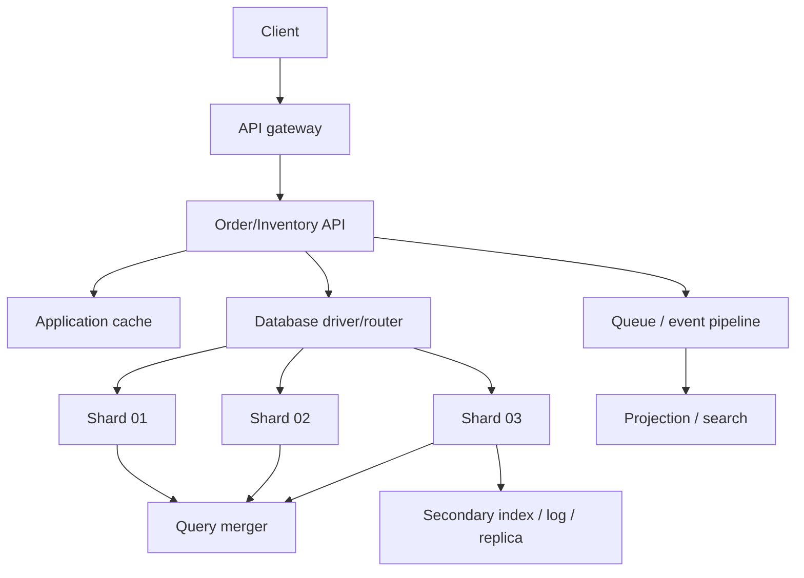
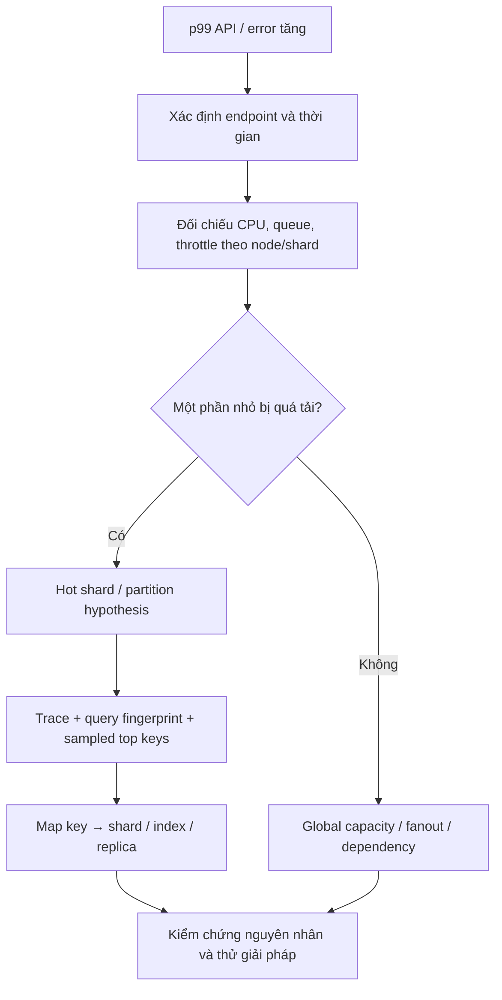

# Phát hiện điểm nóng từ metric và mẫu truy vấn thực tế

## 1. Tình huống mở đầu: cụm còn tài nguyên nhưng người dùng vẫn bị chậm

Một sàn thương mại điện tử lưu tồn kho trong hệ NoSQL phân tán. Mỗi sản phẩm có một bản ghi theo `sku`. Trong ngày bình thường, phần lớn thao tác hoàn tất nhanh. Khi bắt đầu chương trình bán giới hạn của SKU `P100`, API giữ hàng đột ngột chậm và trả nhiều lỗi.

Các metric minh họa trong cùng cửa sổ năm phút:

```text
Cluster CPU trung bình:              38%
Cluster disk utilization:           45%
Tổng write throughput:          12.000 ops/s

Shard-01 write throughput:       1.100 ops/s
Shard-02 write throughput:       1.050 ops/s
Shard-03 write throughput:      8.600 ops/s
Shard-04 write throughput:       1.250 ops/s

ReserveStock p99 trước sự kiện:    45 ms
ReserveStock p99 trong sự kiện:   920 ms
Conditional-write conflicts: tăng mạnh ở Shard-03
```

Nhìn `CPU trung bình = 38%`, đội vận hành có thể nghĩ “cluster vẫn còn rất nhiều năng lực”. Nhưng thực tế **một shard hoặc một key có thể đã vượt khả năng xử lý trong khi phần còn lại rảnh**.

Giả sử trace và key-frequency sampling cho thấy:

```text
SKU P100: 7.900 writes/s
SKU P200:   140 writes/s
Các SKU khác: phân tán
```

Từ dữ liệu trên, giả thuyết hợp lý là **hot key**: nhiều request cùng tranh cập nhật một đơn vị dữ liệu. Tuy nhiên vẫn cần đối chiếu mapping key→partition/shard, chi phí từng thao tác, index được cập nhật, retry và giới hạn của engine. Không nên kết luận chỉ bằng một biểu đồ CPU.

**Chủ đề bài học:** phát hiện điểm nóng (*hotspot*) trong NoSQL bằng cách ghép **metric đúng phạm vi, mẫu truy vấn thực tế, dấu vết request, cấu hình phân mảnh và diễn tiến theo thời gian**, thay vì đoán nguyên nhân dựa trên trung bình toàn cụm.

## 2. Mục tiêu học tập

Sau bài này, người học có thể:

1. Phân biệt **hot key**, **hot partition**, **hot shard**, **hot node**, **hot index**, **hot tenant** và **hot region**.
2. Nhận diện triệu chứng ở bốn lớp: **traffic → workload → saturation → user impact**.
3. Đo mất cân bằng bằng throughput từng shard, top-key share, max/average ratio và phân phối latency.
4. Dùng traces, query logs, explain/query profiles và request sampling để nối request nghiệp vụ với nơi bị nghẽn.
5. Biết cách điều tra theo từng hệ MongoDB, DynamoDB, Cassandra, Redis Cluster và Elasticsearch/OpenSearch.
6. Không nhầm **hết năng lực toàn cluster** với **một key nóng**, hoặc nhầm **một shard chậm** với **nguyên nhân xuất phát ở shard đó**.
7. Thiết kế metric có cardinality kiểm soát, không đưa user ID, token hoặc dữ liệu nhạy cảm vào label.
8. Đánh giá cache, shard-key redesign, bucketing, write aggregation, queue, adaptive capacity và resharding theo đúng loại hotspot.
9. Thử nghiệm workload lệch (Zipf/flash sale), đo trước–sau và chọn chỉ số thành công có ý nghĩa.
10. Xây runbook chẩn đoán và cảnh báo mang tính hành động.

## 3. “Điểm nóng” thực chất là gì?

**Điểm nóng** là một phần của hệ nhận tỷ lệ công việc hoặc chi phí trên mỗi công việc **không cân xứng**, dẫn đến áp lực tài nguyên, độ trễ hoặc lỗi vượt khả năng phục vụ.

Điểm nóng không chỉ là “shard chứa nhiều dữ liệu”. Phải phân biệt:

- Một shard có dữ liệu lớn nhưng rất ít được truy cập.
- Một shard có ít dữ liệu nhưng phải xử lý hàng chục nghìn cập nhật/giây.
- Một key nhỏ nhưng bị nhiều actor tranh CAS.
- Một query shape quét rộng trên tất cả shard làm coordinator quá tải.
- Một replica phục vụ nhiều read hơn các replica cùng tập.
- Một GSI/index partition nhận write tăng mạnh mặc dù base table được phân bố tương đối đều.

### 3.1. Các cấp độ hotspot

| Cấp độ | Đối tượng nóng | Ví dụ |
| --- | --- | --- |
| **Key/item/document** | Một định danh bị truy cập quá nhiều | `stock:P100` |
| **Logical partition** | Tập dữ liệu cùng partition key | `tenantId=T01` |
| **Physical shard/tablet/token range** | Một đơn vị phân phối/điều phối dữ liệu | Shard-03 nhận phần lớn lưu lượng |
| **Node/host** | Máy xử lý nhiều shard hoặc phải chịu overhead nền | Node A CPU/GC/IO cao |
| **Secondary index** | Một index key có tần suất truy cập/ghi lớn | `status=PAID` trong GSI |
| **Query coordinator** | Node phải scatter, merge, sort, group | Dashboard toàn hệ |
| **Tenant/customer group** | Một tenant rất lớn hoặc “noisy neighbor” | T01 tạo 70% writes |
| **Region/data center** | Client hoặc routing tập trung vào một vùng | Traffic toàn cầu dồn về Region A |
| **Thời gian** | Tải tăng bất thường theo sự kiện | Flash sale lúc 10:00 |

Cùng một sự cố có thể có nhiều nhãn: **hot SKU → hot partition → hot shard → hot node**, nhưng các mũi tên chỉ đúng sau khi chứng minh được mapping.

### 3.2. Hotspot không luôn là lỗi thiết kế

Một khóa tự nhiên nổi tiếng có thể thật sự nhận nhiều yêu cầu. Vấn đề không phải “phân bố phải đều tuyệt đối”, mà là **hệ có đủ năng lực và đúng consistency contract để phục vụ tải đó không**.

Một số workload cố ý co-locate dữ liệu theo aggregate để giữ invariant; phân tán ghi bằng cách chia key tùy tiện có thể làm mất tính atomic. Phát hiện hotspot là bước đầu để đánh giá **năng lực, chi phí và correctness**, không phải mệnh lệnh luôn phải shard thêm.

## 4. Đường đi của một request qua hệ NoSQL

Một request đặt hàng có thể đi qua nhiều tầng:



Một request chậm có thể đến từ:

- **Gateway:** rate-limit, connection pool, TLS.
- **API:** CPU, GC, thread contention, lock trong ứng dụng.
- **Cache:** miss, stampede, stale lock.
- **Driver:** chờ connection, topology refresh, retry.
- **Router:** scatter–gather, shard targeting lỗi.
- **Shard:** CPU, disk, hot key, lock/conditional-write contention.
- **Secondary index:** write amplification, index throttling.
- **Replica:** replication lag, quorum ACK, read routing.
- **Projection:** CDC backlog, search refresh và merge.

Vì vậy, trước khi đổi shard key phải xác định **thời gian trôi đi ở tầng nào**.

## 5. Bốn lớp tín hiệu: từ triệu chứng tới nguyên nhân

### 5.1. Traffic: hệ đang nhận loại công việc nào?

Các câu hỏi:

- Requests/giây theo endpoint, tenant tier, operation.
- Read/write ratio thay đổi ra sao?
- Bao nhiêu request thực sự đánh vào database sau cache?
- Một chiến dịch có làm một key hay một query template tăng đột biến?
- Cùng một thao tác bị retry bao nhiêu lần?
- Có batch job hoặc backfill đang chạy đồng thời?

Các metric ví dụ:

```text
http_requests_total{route,method,status}
db_operations_total{operation,collection}
db_retries_total{reason}
cache_requests_total{result}
queue_messages_received_total{consumer}
```

Tên metric chỉ mang tính minh họa, không mặc định engine/SDK tự xuất đúng tên.

### 5.2. Workload: công việc được phân bố lên đâu?

Cần xem:

- Read/write ops theo shard/node/partition.
- Bytes read/write theo shard.
- Rows/items scanned so với rows returned.
- CPU time/IO time theo query shape.
- Top keys hoặc top key-hash buckets theo số thao tác.
- Số shard được hỏi mỗi query.
- Replica selection và leader location.
- Số index mutations do một write tạo.

**Lưu lượng request không bằng chi phí thực thi.** Một scan 10 MB có thể nặng hơn hàng nghìn point gets; một conditional update bị conflict thường có chi phí khác một blind set.

### 5.3. Saturation: tài nguyên nào chạm giới hạn?

Quan sát:

```text
CPU utilization và CPU throttling
Disk IOPS, disk bandwidth và disk queue
Memory/heap, GC pause, page cache misses
Connection pool utilization và pending borrowers
Thread pool/worker queue depth
Write queue/compaction backlog
Lock/CAS/transaction conflict rate
Network bandwidth, packet retransmits
Capacity-unit throttling hoặc hot partition throttling
```

**Utilization gần 100%** là dấu hiệu mạnh; nhưng giới hạn per-partition có thể kích hoạt trước khi CPU toàn node đạt mức cao.

### 5.4. User impact: sự cố biểu hiện thế nào?

- API p50/p95/p99.
- Rate HTTP 429/503/5xx.
- Database timeout/throttle/conflict.
- Tỷ lệ reservation/checkout thành công.
- Số request có outcome không rõ sau timeout.
- Search/list trả partial hoặc stale.
- Độ trễ pipeline CDC/lag.
- SLO error budget đã tiêu thụ.

Sự tương quan theo thời gian giữa workload lệch, saturation và user impact giúp tạo giả thuyết mạnh hơn việc nhìn một metric đơn lẻ.

## 6. Ví dụ: metric trung bình che một shard nóng

Giả sử 8 shard có write throughput:

```text
Shard A  =   500 ops/s
Shard B  =   540 ops/s
Shard C  =   520 ops/s
Shard D  =   490 ops/s
Shard E  =   510 ops/s
Shard F  =   500 ops/s
Shard G  =   530 ops/s
Shard H  = 7.200 ops/s
```

Tổng throughput:

\[
Q_{\text{total}}=10.790\text{ ops/s}
\]

Trung bình theo shard:

\[
\bar Q=10.790/8=1.348,75\text{ ops/s}
\]

Tỷ lệ shard lớn nhất so trung bình:

\[
\text{SkewRatio}=\frac{\max_iQ_i}{\bar Q}
=\frac{7.200}{1.348,75}\approx5,34
\]

Shard H xử lý:

\[
\text{Top1Share}=\frac{7.200}{10.790}\approx66,7\%
\]

Nếu các shard có năng lực giống nhau và request cost tương đương, đây là mất cân bằng lớn. Nhưng hai điều kiện đó có thể **không đúng**:

- Shard H trên host mạnh hơn.
- Một số request ở H chỉ đọc cache/in-memory, còn nơi khác scan disk.
- H là shard tổng hợp nhiều logical partitions hơn.
- Counter phản ánh retries hoặc background work khác.

Vì vậy **SkewRatio là dấu hiệu điều tra, không tự chứng minh lỗi**.

### 6.1. Các metric mất cân bằng

| Metric | Công thức / diễn giải | Giá trị chẩn đoán |
| --- | --- | --- |
| `max/avg` | `max(Q_i) / avg(Q_i)` | Dễ nhìn shard outlier |
| `max/median` | `max(Q_i) / median(Q_i)` | Ít bị outlier kéo trung bình |
| `top1 share` | `max(Q_i) / ΣQ_i` | Tỷ lệ tải tập trung |
| `topK share` | Tổng K shard/key lớn nhất chia tổng | Đánh giá tập trung vào ít đối tượng |
| `CV` | `stddev(Q_i)/avg(Q_i)` | Mức phân tán tương đối |
| `Gini` | Thước đo độ bất bình đẳng | Phân phối rất lệch |
| `p99 per shard` | Đuôi latency mỗi shard | Tìm straggler |
| `max utilization` | Mức dùng cao nhất theo node/shard | Phát hiện saturation cục bộ |

Không có một ngưỡng `max/avg > 2` mang ý nghĩa chung cho tất cả hệ. Ngưỡng cảnh báo phải xét năng lực shard, workload kỳ vọng và SLO.

### 6.2. Kích thước shard không bằng độ nóng

Một shard giữ 1 TB dữ liệu có thể ít truy cập. Một shard giữ 2 GB có thể phục vụ 10.000 updates/s trên vài khóa.

Cần đo **storage skew** và **traffic skew** riêng:

```text
storage_bytes_by_shard
read_ops_by_shard
write_ops_by_shard
read_bytes_by_shard
write_bytes_by_shard
cpu_time_by_shard
```

Với workload query lớn, số **items scanned** và byte đọc thường hữu ích hơn đếm requests.

## 7. Đếm request và đếm chi phí không giống nhau

Hai mẫu truy vấn:

```text
Q1: GetItem theo PK, trả 1 KB
Q2: Scan theo status, xem xét 2 triệu items rồi trả 20 rows
```

Cả Q1 và Q2 đều có thể được ghi là “một request”. Nhưng Q2 tiêu thụ CPU, I/O, read capacity, network/merge và timeout budget lớn hơn nhiều.

Một cách biểu diễn workload hữu ích:

\[
W_i = \sum_{j \in \text{operations on shard }i} cost_j
\]

`cost_j` có thể là:

- Read capacity/write capacity units theo dịch vụ.
- Bytes read/written.
- CPU seconds.
- Documents examined.
- Disk I/O hoặc server execution time.
- Thời gian giữ lock/transaction.

Mỗi đại lượng đo **một khía cạnh**, không phải giá trị cost chuẩn chung. Nếu so throughput giữa shards, cần đối chiếu với loại truy vấn và kích thước record.

### 7.1. Write amplification

Một update document có thể kéo theo:

```text
Update base record
Update index 1
Update index 2
Write log/WAL
Replicate to peers
Emit CDC event
```

Một tenant có writes đến rất nhiều index keys hoặc một secondary index có khóa tập trung có thể gây hotspot **ở index** dù key base phân bố đều.

Không nên chỉ đếm `UPDATE` requests rồi kết luận cả quá trình write có chi phí cố định.

## 8. Cửa sổ thời gian và baseline

Hotspot có thể chỉ xuất hiện trong một đợt tải ngắn. Quan sát sai cửa sổ sẽ khiến tín hiệu bị làm phẳng.

Ví dụ:

```text
09:55–09:59: 2.000 ops/s, phân bố khá đều
10:00–10:03: 18.000 ops/s, 75% vào SKU P100
10:04–10:15: 3.000 ops/s, giảm tải
```

Nếu dashboard chỉ lấy trung bình **theo giờ**, bốn phút nghẽn nghiêm trọng có thể bị che.

### 8.1. Dùng nhiều độ phân giải

- Cửa sổ 30 giây–1 phút: xác định spike, tùy sampling và data retention.
- Cửa sổ 5 phút: xác nhận mất cân bằng có duy trì không.
- Cửa sổ 1 giờ/ngày: nhận dạng chu kỳ.
- So với cùng khung giờ tuần trước: phân biệt tăng trưởng bình thường.
- So trước/sau deploy, campaign, autoscaling, rebalance.

**Cửa sổ quá ngắn** có thể bị nhiễu bởi sampling và một request rất nặng; **quá dài** che incident.

### 8.2. Counter metric phải tính rate

Một counter tăng tích lũy như:

```text
db_write_requests_total
```

không so giá trị tuyệt đối giữa hai shard mới join ở hai thời điểm khác nhau. Cần tính rate/increase trên cửa sổ phù hợp và xử lý reset.

Ví dụ với PromQL, nếu có exporter tương ứng:

```promql
sum by (shard) (
  rate(db_write_requests_total[5m])
)
```

Đây là **metric giả định** để minh họa cách tính; phải thay bằng tên/label thực tế trong hệ.

### 8.3. Đo gần thời điểm xảy ra lỗi

Nếu spike xảy ra lúc 10:02 nhưng traces chỉ được tìm lúc 10:30 sau khi hệ tự hồi phục, không thể suy cause từ trạng thái hiện tại. Cần lưu lịch sử metric, slow query samples và deployment/event annotations đủ lâu.

## 9. p50, p95, p99 và histogram

Một shard bị nóng có thể có:

```text
p50 = 10 ms
p95 = 70 ms
p99 = 900 ms
```

Phần lớn request vẫn nhanh nhưng một nhóm lớn ở tail bị queue lâu.

### 9.1. Không lấy trung bình p99 của từng shard

P99 của toàn hệ **không phải** trung bình P99 các shard. Phải tính từ histogram/observations được merge theo semantics phù hợp.

Nếu có histogram buckets tương thích, Prometheus có thể tính p99 toàn bộ writes theo ví dụ:

```promql
histogram_quantile(
  0.99,
  sum by (le) (
    rate(db_write_latency_seconds_bucket[5m])
  )
)
```

Và theo shard:

```promql
histogram_quantile(
  0.99,
  sum by (le, shard) (
    rate(db_write_latency_seconds_bucket[5m])
  )
)
```

Các tên `db_write_latency_seconds_bucket` và `shard` chỉ là ví dụ instrument. Buckets phải được định nghĩa phù hợp, đủ phân giải và có cùng semantics.

### 9.2. Fan-out làm tăng tail latency

Một query dashboard liên hệ 20 shards, phải đợi tất cả. Nếu mỗi shard độc lập có xác suất 99% hoàn tất trước deadline, xác suất toàn query hoàn tất trong deadline là:

\[
0,99^{20}\approx81,8\%
\]

Đây là ví dụ toán học, không phải một đo đạc thực tế. Các shard có thể có latency tương quan cao, khiến tình hình khác mô hình độc lập.

### 9.3. Phân biệt server time và client time

```text
Client observed latency = 650 ms
Database server execution = 12 ms
Driver connection wait = 580 ms
Network/serialization = 58 ms
```

Trường hợp này **không phải bằng chứng query trên shard chậm**; connection pool hoặc request queue ở ứng dụng mới là nghi phạm mạnh hơn.

Cần trace spans và pool metrics để không tối ưu shard key sai nguyên nhân.

## 10. Từ metric shard xuống key hoặc query shape

Metric shard-03 cao chỉ trả lời: **nơi nào đang chịu tải**. Tiếp theo phải xác định:

- Key nào hot?
- Query shape nào hot?
- Tenant nào tạo tải?
- Read hay write?
- Tải là request độc nhất hay retry?
- Query có targeted hay scatter?
- Có index/mapping khiến nhiều logical keys hội tụ vào một physical partition không?

Điều tra đi từ thô tới chi tiết:



### 10.1. Chuẩn hóa query shape

Đây là hai request khác tham số nhưng cùng query shape:

```javascript
db.orders.find({
  tenantId: "T01",
  status: "PAID"
}).sort({ createdAt: -1 }).limit(20);
```

```javascript
db.orders.find({
  tenantId: "T02",
  status: "PAID"
}).sort({ createdAt: -1 }).limit(20);
```

Fingerprint khái niệm:

```text
orders.find({tenantId:?,status:?})
.sort({createdAt:-1}).limit(?)
```

Gộp theo fingerprint giúp thấy workload nào thường xuyên tốn tài nguyên. Sau đó mới phân đoạn theo tenant tier hoặc key-hash bucket để phát hiện skew.

### 10.2. Thông tin nên giữ trong một query sample

Một bản ghi chẩn đoán có thể chứa:

```json
{
  "timestamp": "2026-11-14T10:02:31Z",
  "operation": "reserveStock",
  "queryShape": "stock.conditionalDecrementBySku",
  "collection": "inventory",
  "logicalPartitionHash": "bkt-17",
  "shard": "shard-03",
  "durationMs": 420,
  "retryAttempt": 2,
  "result": "CONDITIONAL_CONFLICT",
  "documentsExamined": 1,
  "documentsReturned": 0
}
```

Không mặc định mọi NoSQL cung cấp tất cả field. Thông tin key/tenant phải **được pseudonymize, sample và áp quyền truy cập** phù hợp; tránh ghi dữ liệu đơn hàng hay username thô trong log.

### 10.3. Slow-query logs thường bị thiên lệch

Nếu chỉ xem query mất hơn 500 ms, có thể bỏ qua một hot key đang xử lý 20.000 updates/s, mỗi update vẫn 5 ms nhưng gây pressure lớn.

Cần kết hợp:

- **Top by total cost:** tổng CPU/IO/requests của query shape.
- **Top by frequency:** request count, bytes.
- **Top by tail latency:** p99 theo operation.
- **Top by error/conflict:** throttle, retry, conditional failures.
- **Top by key concentration:** top key hoặc bucket share.

Chỉ dùng một trong các nhóm này dễ dẫn tới kết luận sai.

## 11. Cardinality: không đưa mọi key vào metric label

Đây là một cách instrument nguy hiểm:

```text
inventory_requests_total{sku="P100"}
inventory_requests_total{sku="P101"}
...
inventory_requests_total{sku="P999999"}
```

Nếu hệ có hàng triệu SKU và nhiều label khác (`tenantId`, `region`, `instance`, `status`), số time series có thể bùng nổ, gây chi phí lưu trữ và quá tải chính hệ observability.

### 11.1. Label có cardinality giới hạn

Nên dùng những chiều ít giá trị và có quản lý:

```text
operation
route
database
collection
region
shard
node
result_type
tenant_tier
```

Tùy số shard/node và tốc độ churn, chúng cũng phải được đánh giá trước khi phát hành metric.

Không dùng trực tiếp:

```text
userId
email
phone
sessionToken
rawQuery
orderId
requestId
full URL có path ID
```

làm metric labels.

### 11.2. Vẫn cần tìm top key bằng cách nào?

Có thể:

- **Sampling** traces/query logs với rate được ghi nhận.
- **Top-N heavy hitter detector** trong cửa sổ ngắn.
- **Approximate frequency sketch** (ví dụ Count-Min Sketch) với nhận thức về sai số.
- **Hash buckets có cardinality cố định** để phát hiện tập key nóng.
- Các tính năng top-keys/contributor analytics chính thức của sản phẩm.
- Offline aggregation trên log đã ẩn danh theo quyền.

Một hash bucket nóng không tự chứng minh một key nóng: nhiều key khác nhau có thể cùng bucket; cần drill-down có kiểm soát.

### 11.3. Privacy và security

Trước khi thu key mẫu:

- Xác định data classification và mục đích chẩn đoán.
- Mask/hmac hoặc mã hóa token tham chiếu theo policy.
- Giới hạn retention và access.
- Không lưu raw query chứa PII hoặc credential.
- Bảo đảm trace/log không làm rò token qua exception message.
- Tránh làm sampling phát sinh thêm tải lớn trong incident.

## 12. Tracing: nối request nghiệp vụ với shard bị nghẽn

Một trace thành công nên cho biết critical path:

```text
POST /reservations (930 ms)
  ├── authenticate (8 ms)
  ├── inventory.reserve (890 ms)
  │     ├── db pool wait (15 ms)
  │     ├── conditional update shard-03 (280 ms)
  │     ├── retry backoff (150 ms)
  │     ├── conditional update shard-03 (290 ms)
  │     └── retry backoff (155 ms)
  └── response (7 ms)
```

Cần xem:

- Số lần gọi database cho một request.
- Thời gian tại client, pool, network và server.
- Retry reason và deadline.
- Có phải mọi retry cùng quay lại một shard/key?
- Conflict là trạng thái nghiệp vụ hay lỗi hạ tầng?
- Request đã hoàn tất nhưng client timeout hay chưa?

### 12.1. Instrument query fingerprint, không raw query

Trace attributes có thể dùng:

```text
db.system
db.operation.name
db.collection.name
db.query.fingerprint
db.shard.id
app.operation
app.retry.count
```

Tên thuộc tính cụ thể tùy phiên bản OpenTelemetry semantic conventions và instrumentation. Chỉ thêm những key/label được kiểm soát; không ghi trực tiếp payload chứa dữ liệu nhạy cảm.

### 12.2. Sampling làm mất số liệu hiếm

Nếu sample 1% traces, một operation rất hiếm có thể không xuất hiện. Đừng coi “không thấy trong traces” là không có.

Một số chiến lược:

- Head sampling theo tỷ lệ.
- Tail sampling giữ traces có lỗi/tail latency.
- Rare-route sampling.
- Short-lived targeted sampling trong incident.
- Backend metrics đầy đủ để biết tổng số, traces để biết chi tiết.

Khi tính top-key share từ sampled data, cần xem sampling có **thiên lệch theo endpoint, latency hoặc tenant** không.

## 13. Một bảng triệu chứng để khoanh vùng

| Triệu chứng | Giả thuyết ưu tiên | Bằng chứng cần đối chiếu |
| --- | --- | --- |
| Một shard write ops và queue cao | Hot shard/hot key | Mapping keys, top write shapes |
| Một shard data bytes rất lớn, nhưng QPS thấp | Storage skew | Storage distribution, compaction |
| Tất cả shards CPU cao khi dashboard chạy | Scatter/scan/query fan-out | Plan, shards contacted, bytes examined |
| Writes bị throttle, reads ổn | Write capacity/index bottleneck | WCU, index writes, hot partition |
| Reads tăng đột biến sau cache TTL | Cache stampede/hot read | Cache hit ratio, DB GET QPS, key concentration |
| p99 tăng, server time thấp | Client pool/network contention | Pool wait, DNS/TLS, RTT |
| Latency tăng sau rebalance | Data movement/compaction | Balancer events, disk/net, cache misses |
| CPU trung bình thấp, một key throttled | Per-key/per-partition ceiling | Top contributors, throttle reasons |
| Nhiều CAS conflict cùng document | Hot contention | Expected version, conditional failures |
| Replica reads stale, write p99 bình thường | Replication/read path issue | Replica lag, read preference |
| Search query chậm khi index hot | Search shard/merge bottleneck | Hot threads, shard query/aggregation metrics |
| Tải theo tenant tập trung | Noisy neighbor | Tenant-tier activity, rate limits |

Bảng chỉ gợi ý **giả thuyết điều tra**. Không áp dụng biện pháp tái phân mảnh trước khi chứng minh quan hệ nhân quả.

## 14. MongoDB: nhận diện hot shard và query pattern

MongoDB sharded cluster có router, shard replica sets và routing metadata. Một collection có shard key phù hợp cho query targeting sẽ giảm số shard bị hỏi. Một shard nóng có thể do:

- Shard key có ít giá trị hoặc phân phối mất cân bằng.
- Shard key tăng đơn điệu, writes tập trung ở miền cuối.
- Một tenant/SKU quá hot.
- Query thiếu điều kiện shard key nên scatter.
- Secondary index bị cập nhật nhiều.
- Aggregation merge hoặc sort tốn tài nguyên.
- Resharding/chunk migration và compaction/IO nền.

### 14.1. Ví dụ shard key tăng đơn điệu

Giả sử các order được shard bằng range `createdAt`.

```text
Shard A: các order cũ
Shard B: các order trung gian
Shard C: khoảng thời gian mới nhất
```

Mọi insert mới có `createdAt` tăng dần có thể tập trung ở shard giữ khoảng giá trị mới nhất. Đây là **hot write range**, dù tổng số document trên các shard đã tương đối cân bằng.

Cần phân biệt hotspot do **range shard key** với hotspot do **một tenant cụ thể**.

### 14.2. Quan sát phân bố sharding

Trong một deployment được quyền quản trị, các công cụ/command có thể hỗ trợ điều tra tùy phiên bản:

```javascript
// Minh họa thao tác kiểm tra thống kê sharding.
sh.status();
```

Xem thông tin collection, shard key, chunk/range distribution và balancer state theo công cụ tương ứng. Số chunk không phải thước đo trực tiếp của QPS; chunk count cân bằng vẫn có thể có một hot key.

Một số phiên bản MongoDB có lệnh/thống kê phân phối và sampling query để hỗ trợ phân tích shard key/resharding. Hãy dùng đúng API của **version thực tế**, không suy mọi bản đều hỗ trợ cùng một command.

### 14.3. Query explain

```javascript
db.orders.explain("executionStats").find({
  tenantId: "T01",
  status: "PAID"
}).sort({
  createdAt: -1
}).limit(20);
```

Tùy cấu hình sharding/index, `explain` có thể cho biết:

- Shards được query.
- Index scan hay collection scan.
- Documents/keys examined.
- Sort stage có blocking không.
- Số record đi qua execution stages.
- Thời gian và routing behavior.

Một targeted query có thể vẫn chậm nếu tenant nằm ở hot shard hoặc index thiếu; một scatter query có thể có mỗi shard rẻ nhưng tổng fan-out quá lớn.

### 14.4. Profiler và current operations

MongoDB có cơ chế diagnostic profiler, current operations và slow-operation logs. Ví dụ ý tưởng:

```javascript
db.currentOp();
```

Hoặc dùng profiler/query logs theo version, quyền và cấu hình vận hành.

**Không bật profiling toàn bộ truy vấn trên production tùy tiện**: có overhead, privacy risk và lưu lượng log. Chọn sampling/threshold, đo overhead và tuân quyền truy cập.

### 14.5. Phân biệt hot chunk với hot document

Balancer có thể di chuyển ranges/chunks để cân bằng bytes hoặc phân phối dữ liệu, nhưng nếu một **document** nhận mọi updates, chuyển nó sang shard khác chỉ chuyển điểm nóng, không phân tải các writes của nó.

Nếu một tenant lớn chứa nhiều logical keys khác nhau, thay đổi shard-key/bucket hoặc dedicated placement có thể hữu ích hơn. Nhưng nếu invariant gắn với một aggregate, cần bảo vệ consistency trước khi chia writes.

## 15. DynamoDB: hot partition, capacity và Contributor Insights

Với DynamoDB, dữ liệu được tổ chức theo partition key và sort key. Dịch vụ quản lý các physical partitions bên dưới; ứng dụng không nên suy vị trí partition từ một quy tắc hash tự tạo.

Hot partition thường có những mẫu:

- Nhiều reads cùng một partition key.
- Nhiều writes tới một item/partition key.
- Một GSI có partition key tập trung, dù base table phân phối tốt.
- Một workload dùng Scan thay vì Query targeted.
- Adaptive capacity/limits không đủ trước spike hoặc item rất nóng.
- Một hot sort-key range trong access pattern cụ thể.

### 15.1. Metric cần theo dõi

Trên CloudWatch và các nguồn vận hành tùy tính năng:

```text
ConsumedReadCapacityUnits
ConsumedWriteCapacityUnits
ReadThrottleEvents / WriteThrottleEvents
ThrottledRequests
SuccessfulRequestLatency
SystemErrors / UserErrors
ReturnedItemCount
```

Cần xem **dimension/table/index, operation và throttle reason** tương ứng. Throttle reason có thể cho biết áp lực loại capacity nào; không suy mọi throttle là vượt tổng provisioned capacity của table.

Tên metric và khả năng phân rã theo chiều có thể thay đổi theo dịch vụ/cấu hình; đối chiếu tài liệu phiên bản và console trước khi dùng.

### 15.2. Dấu hiệu hot key dù table chưa hết capacity

Ví dụ giả định:

```text
Table consumed write capacity: 40% tổng năng lực đã cấu hình
Throttling: tăng mạnh
Contributor analysis: phần lớn writes tới PK=PRODUCT#P100
```

Đây là tình huống cần điều tra **per-key/per-partition limits**, không chỉ tăng tổng WCU. Một bảng có tổng capacity còn dư vẫn có thể bị giới hạn cục bộ cho key nóng hoặc index.

### 15.3. Contributor Insights

DynamoDB có tính năng Contributor Insights hỗ trợ xác định những partition keys có hoạt động nổi bật theo đường dữ liệu được thu thập. Khi dùng cần:

- Bật đúng resource/table/GSI.
- Hiểu event categories và giới hạn thống kê.
- Kiểm tra quyền xem top contributors.
- Cân nhắc privacy của partition key.
- Không coi bảng top contributors là dữ liệu truy vấn chính xác tuyệt đối ngoài contract của tính năng.

Không cần đưa partition key thô vào Prometheus label để tìm top keys.

### 15.4. GSI có thể là nơi nghẽn thật

Ví dụ:

```text
Base table PK = ORDER#<orderId>
GSI1PK = STATUS#PAID
```

Nếu hầu hết order được ghi vào cùng một GSI partition key `STATUS#PAID`, index có thể tạo hotspot. Ghi vào base table phân bố đều **không loại trừ** write pressure của GSI.

Một thiết kế bucket:

```text
GSI1PK = STATUS#PAID#B00
GSI1PK = STATUS#PAID#B01
...
GSI1PK = STATUS#PAID#B15
```

có thể chia tải theo nhiều logical keys, nhưng query global PAID phải Query nhiều bucket và merge. Nên đo read cost/truy vấn và xác định số bucket theo workload.

### 15.5. Adaptive capacity không phải bảo đảm vô hạn

DynamoDB có những khả năng adaptive capacity, và các giới hạn/tính năng có thể thay đổi theo configuration. Nhưng không được kết luận:

> “DynamoDB tự chia partition nên hot item không bao giờ cần sửa.”

Một **hot item/key** và một workload vượt giới hạn vật lý vẫn có thể cần cache, redesign, write sharding hoặc đổi semantics. Cần đối chiếu metric và tài liệu của mode đang dùng.

### 15.6. Query và Scan

Nếu một API thường xuyên Scan toàn table với FilterExpression, nó có thể tạo read load rộng và làm che vấn đề access pattern. Filter được đánh giá theo semantics Query/Scan của DynamoDB và không tự biến Scan thành key lookup.

Chọn:

- Query theo partition key đã thiết kế.
- GSI phục vụ truy vấn bổ sung.
- Read model hoặc analytics export cho báo cáo toàn bảng.

Đừng chia thêm partitions mà vẫn giữ một Scan toàn bảng cho mỗi page request nếu bài toán gốc là query shape.

## 16. Cassandra: hot partition, token range và thread pools

Cassandra phân phối partitions theo token/replication topology. Một token distribution tương đối đều **không chứng minh request distribution đều**.

### 16.1. Phân biệt ba dạng lệch

1. **Token/storage skew:** node chứa lượng dữ liệu khác nhau.
2. **Hot partition:** nhiều read/write cùng partition key.
3. **Wide partition:** một partition có quá nhiều rows/bytes, làm đọc, compaction hoặc repair tốn kém.

Chúng có thể đi cùng nhau, nhưng không đồng nghĩa.

### 16.2. Những nguồn chẩn đoán

Tùy phiên bản Cassandra và driver, có thể dùng:

```text
nodetool status
nodetool tablestats
nodetool tablehistograms
nodetool tpstats
nodetool compactionstats
```

Chúng có thể giúp nhìn ring health, dữ liệu/table, partition/cell size distributions, thread-pool pressure, dropped tasks và compaction backlog.

Một số phiên bản có chức năng **top-partitions/partition sampling** theo công cụ phù hợp. Phải kiểm tra phiên bản và overhead; không coi mọi command là khả dụng trong mọi release.

### 16.3. Query tracing và driver metrics

Cassandra có tracing cho một số thao tác theo khả năng sản phẩm. Driver có metric về request latency, connection, retries và speculative executions.

Khi hot partition nghi ngờ:

- Xem primary/partition key được dùng.
- RF và consistency level.
- Coordinator/replica được chọn.
- Read nhiều clustering rows hay một row?
- Tombstone scans hoặc wide partitions?
- Compaction/GC ở node sở hữu token?
- Một partition có bị request rất nhiều so với các partition khác?

### 16.4. Query đúng partition có thể vẫn nóng

Ví dụ schema:

```sql
CREATE TABLE orders_by_tenant (
    tenant_id text,
    created_at timestamp,
    order_id text,
    status text,
    PRIMARY KEY ((tenant_id), created_at, order_id)
) WITH CLUSTERING ORDER BY (created_at DESC);
```

Query:

```sql
SELECT order_id, created_at, status
FROM orders_by_tenant
WHERE tenant_id = 'T01'
LIMIT 20;
```

Có thể là access pattern hợp lệ, nhưng nếu T01 có hàng triệu đơn hoặc nhận 60% requests, partition đó có thể quá lớn/quá nóng.

### 16.5. Bucketing theo thời gian

Một phương án:

```sql
CREATE TABLE orders_by_tenant_day (
    tenant_id text,
    order_day date,
    created_at timestamp,
    order_id text,
    status text,
    PRIMARY KEY ((tenant_id, order_day), created_at, order_id)
) WITH CLUSTERING ORDER BY (created_at DESC);
```

Nó giới hạn kích thước partition theo ngày, nhưng:

- Query toàn tháng phải đọc nhiều partitions.
- Ngày hiện tại của tenant lớn vẫn có thể nóng.
- Có thể cần thêm write buckets.
- Sorting toàn cục qua buckets cần merge.
- Retention/TTL/compaction phải được thiết kế riêng.

### 16.6. Vnodes không tự giải hot partition

Vnodes giúp phân phối token ranges và mở rộng/balancing trong nhiều topology, nhưng **một logical partition key không được chia đơn giản thành nhiều nguồn ghi độc lập chỉ vì node giữ nhiều vnodes**.

Khi một key hot, tăng số node có thể không chia được cùng critical section; cần xem data model, bucketing và business semantics.

## 17. Redis Cluster: phân biệt hot key, big key và hot slot

Redis Cluster phân phối keys theo hash slots. Hotspot có thể là:

- Một key bị đọc/ghi hàng chục nghìn lần/giây.
- Một hash slot có rất nhiều hot keys.
- Một node sở hữu các slots có tổng traffic quá cao.
- Một **big key** làm lệnh xử lý/serialization lâu.
- Một Lua script hoặc command chặn event loop lâu.
- Client pipeline/connection routing lệch.

### 17.1. Big key không đồng nghĩa hot key

```text
Key A = 20 MB, đọc một lần/ngày
Key B = 500 bytes, đọc 50.000 lần/giây
```

A là **big key**; B là **hot key**. Chúng cần biện pháp khác nhau.

### 17.2. Lệnh/công cụ tham khảo

Tùy Redis version, cấu hình và quyền:

```text
INFO
INFO commandstats
SLOWLOG GET
LATENCY DOCTOR
CLUSTER SLOTS
```

Redis CLI có một số chế độ khám phá như `--bigkeys` hoặc `--hotkeys` trong điều kiện phù hợp; ví dụ tính năng hot-key sampling cần cấu hình eviction/frequency metadata tương thích (thường là LFU) và có overhead. Không coi một lần quét là kết quả đo hoàn hảo.

### 17.3. Key access pattern và cache stampede

Một key cache cho landing page:

```text
landing:campaign:P100
```

có TTL 60 giây. Khi hết hạn, hàng nghìn request cùng miss và gọi DB:

```text
Cache hit -> fast
TTL expiry -> many simultaneous misses
Database receives burst for same key
```

Đây là **cache stampede** có thể tạo hot read ở source, dù Redis key bình thường phục vụ nhanh.

Các phương án:

- Single-flight request coalescing.
- TTL jitter để tránh nhiều key hết hạn cùng lúc.
- Stale-while-revalidate nếu dữ liệu cho phép.
- Pre-warm cache.
- Rate limit/backpressure.
- Revision-aware invalidation.

Không dùng stale cache để xác nhận quyền hoặc tồn kho nếu invariant không cho phép.

### 17.4. Hash tag co-location có thể tạo hotspot

Redis hash tags có thể đặt các keys liên quan cùng slot:

```text
cart:{tenant:T01}:head
cart:{tenant:T01}:items
```

Cách này hỗ trợ một số multi-key operations, nhưng nếu mọi dữ liệu của tenant lớn cùng slot, node sở hữu slot có thể bị nóng.

Tách keys ra nhiều slots giảm tập trung nhưng làm những multi-key operations bị giới hạn, có thể cần application-level merge và thiết kế consistency mới.

## 18. Elasticsearch/OpenSearch: hot search shard và merge

Một search cluster có thể bị lệch do:

- Indexing tập trung vào shard của index hiện tại.
- Một tenant/query lọc vào subset shards.
- Global search fan-out nhiều shards.
- Aggregation/cardinality lớn.
- Query cache/fielddata/global ordinals pressure.
- Một shard giữ nhiều documents hơn.
- Merge/segment refresh, disk I/O hoặc heap pressure.
- Search node coordinating phải merge top-K/aggregations.

### 18.1. Những nguồn quan sát

Các API thường gặp tùy phiên bản:

```http
GET /_cat/shards?v
GET /_nodes/stats
GET /_nodes/hot_threads
GET /_cluster/health
```

Với query cần profile:

```json
{
  "profile": true,
  "query": {
    "term": {
      "tenantId.keyword": "T01"
    }
  }
}
```

Profile cung cấp thông tin thực thi query trong phạm vi hỗ trợ, nhưng có overhead và không nhất thiết bao phủ toàn bộ network/queue/fetch latency; không bật đại trà cho traffic production.

### 18.2. Search slow logs

Search slow logs có thể giúp tìm:

- Query shapes tốn CPU hoặc IO.
- Aggregation nặng.
- Search/fetch phases.
- Index/shard liên quan.

Kết hợp với node stats, heap, GC, disk pressure và traces ở API để xác định **root cause**. Một slow query xuất hiện trên shard nóng chưa chứng minh query là nguyên nhân; nó có thể chỉ là nạn nhân của tài nguyên đã nghẽn.

### 18.3. Top-K và group aggregation

Search `size:20` trên toàn index có thể đòi mọi shard gửi candidates, coordinator merge. Một `terms` aggregation top buckets có thể tạo memory pressure; tùy cấu hình và phân phối term, việc cắt candidates ở shard còn ảnh hưởng độ chính xác của global top buckets.

Nếu một dashboard repeatedly tính group toàn hệ, cân nhắc rollup/transform/read model thay vì bắt search shard tính lại toàn bộ ở mỗi lần mở trang.

### 18.4. Shard count quá lớn cũng có chi phí

Tăng số shards để “chia tải” có thể:

- Tăng fan-out cho search.
- Tăng metadata/heap và shard management overhead.
- Tăng số merge streams.
- Tăng thời gian recovery và yêu cầu routing.

Chọn shard size/count dựa trên workload, index lifecycle và dữ liệu thực tế. **Nhiều shard hơn không bảo đảm một query toàn index nhanh hơn.**

## 19. Hot read và hot write cần biện pháp khác nhau

### 19.1. Hot read

Ví dụ:

```text
GET /products/P100
60.000 requests/s
Dữ liệu chỉ đổi mỗi 10 phút
```

Hướng ưu tiên:

- Cache gần client/region, CDN nếu phù hợp.
- Cache warming.
- Request coalescing.
- Read replicas với mức consistency phù hợp.
- Response compression, field projection.
- Rate limit đối với traffic bất thường.

Nếu sản phẩm có giá/stock thay đổi theo giây, cần tách field ít thay đổi và field **authoritative/freshness sensitive**.

### 19.2. Hot write

Ví dụ:

```text
UPDATE stock:P100
8.000 conditional writes/s
```

Cache không giải quyết vấn đề write contention tại nguồn. Các hướng:

- Tối ưu một atomic conditional operation thay chuỗi nhiều lệnh.
- Giảm retry vô nghĩa.
- Admission control / per-key queue.
- Batch/aggregation nếu semantics cho phép.
- Escrow/quota phân bổ theo shard/worker.
- Phân tách owner hoặc resource model nếu business cho phép.

**Không chia một số dư/tồn kho duy nhất thành N counters rồi tự cộng mà bỏ invariant**.

### 19.3. Mixed read/write

Một item được cập nhật liên tục và đọc khắp nơi có thể làm cache invalidation storm. Cần cân đối:

- Freshness contract.
- Write frequency.
- Cache TTL/invalidation.
- Read path.
- Replication lag.
- Tỷ lệ cache miss khi tăng write rate.

Không có một TTL thích hợp cho mọi dữ liệu.

## 20. Hot key do thao tác nghiệp vụ tranh chấp

Một số điểm nóng không chỉ tốn CPU mà còn **tạo tranh chấp logic**.

Ví dụ nhiều worker cùng cập nhật:

```json
{
  "sku": "P100",
  "available": 15,
  "version": 42
}
```

Tất cả cùng đọc version 42 rồi CAS. Một actor thành công, các actor khác conflict.

Metrics có thể thấy:

```text
conditional_write_conflict_rate tăng
CAS_retry_attempts tăng
requests_per_key tăng
p99 tăng
actual successful writes không tăng tương ứng
```

Thêm replica đọc hoặc tăng connection pool **không trực tiếp làm nhiều CAS trên cùng item thành công đồng thời**.

### 20.1. Phân biệt conflict với throttle

- **Conflict:** thao tác bị từ chối vì điều kiện nghiệp vụ/version không còn đúng.
- **Throttle:** engine từ chối/giới hạn vì capacity/rate.
- **Timeout:** không có kết quả kịp deadline; commit outcome có thể chưa rõ.
- **Transaction abort:** giao dịch bị hủy vì conflict hoặc các nguyên nhân khác.

Không gộp chúng trong một `db_errors_total` rồi dùng chung retry logic.

### 20.2. Retry storm làm hot key nóng thêm

Nếu mỗi request conflict tự retry 10 lần, 1.000 yêu cầu nghiệp vụ có thể tạo nhiều nghìn database operations mà vẫn có ít thành công.

Cần:

- Giới hạn retry.
- Backoff/jitter khi thích hợp.
- Đọc lại state, không ghi giá trị tính từ snapshot cũ.
- Từ chối sớm khi hết hàng.
- Per-key queue/throttling.
- Idempotency cho yêu cầu bị gửi lại sau timeout.

### 20.3. Queue per key không tự tạo độ bền hoặc exactly once

Tuần tự hóa command theo SKU qua một consumer có thể giảm concurrent CAS, nhưng phải thiết kế:

- Nhiều producer.
- Consumer crash/rebalance.
- Message duplicate.
- Event ordering theo key.
- Idempotency và result lookup.
- Backpressure và queue depth.
- Hạn mức xử lý của key nóng.

Một queue có thể dời hotspot từ database sang **single consumer backlog**. Cần đo tổng latency từ lúc request vào queue đến lúc commit.

## 21. Mẫu truy vấn có thể gây điểm nóng

### 21.1. Shard key có ít giá trị

Giả sử sharding/routing dựa chủ yếu vào:

```text
status = PENDING | PAID | CANCELLED
```

Chỉ vài giá trị khiến phân bố có thể tập trung, nhất là khi phần lớn dữ liệu cùng status.

Cần chọn key có cardinality và phân phối phù hợp, đồng thời phục vụ query targeting.

### 21.2. Shard key tăng đơn điệu

```text
createdAt = 10:00:01
createdAt = 10:00:02
createdAt = 10:00:03
...
```

Range shard theo thời gian có thể đưa mọi write mới tới phần cuối key space. Dữ liệu cũ được phân đều không loại bỏ **latest-range hotspot**.

### 21.3. Một tenant cực lớn

Shard theo tenantId rất hữu ích cho truy vấn một tenant. Nhưng tenant T01 chiếm 60% traffic có thể tập trung writes/reads trên một shard hoặc một tập hẹp.

Có thể cần tenant buckets, split tenant workload hoặc dedicated placement, với chi phí merge các bucket khi đọc.

### 21.4. Query không chứa shard key

```javascript
db.orders.find({
  status: "PAID"
});
```

Khi router không thể target, truy vấn có thể scatter mọi shard. Nếu query chạy nhiều lần/giây, **mọi shard** có thể cùng nóng.

Trường hợp này có thể bị nhầm với “thiếu node”, nhưng giải pháp trọng tâm là **access pattern và index/read model**, không chỉ tăng shard count.

### 21.5. Filter sau Scan

Trong một số NoSQL API, filter được đánh giá sau khi đọc/scanned items; endpoint trả 20 items không có nghĩa engine chỉ xử lý 20 items.

Cần xem items scanned, read capacity và filter selectivity, không chỉ response size.

## 22. Hot index dù base data cân bằng

Một lệnh write có thể cập nhật nhiều index. Ví dụ:

```text
Base PK: ORDER#<randomOrderId>
GSI PK: STATUS#PAID
```

Base table phân bố tốt theo random Order ID. Nhưng mọi order mới chuyển PAID tập trung vào cùng GSI PK.

Triệu chứng:

- Base write distribution khá đều.
- Index-specific throttling/latency tăng.
- GSI replication/visibility lag.
- `UpdateOrderStatus` chậm, `GetOrderById` vẫn bình thường.

### 22.1. Hướng sửa

- Đặt bucket suffix cho index key.
- Chọn GSI access pattern khác.
- Dùng read model theo time/region/tenant buckets.
- Giảm write amplification/indexes không dùng.
- Tách analytics khỏi operational index.

Đánh đổi: đọc `all PAID orders` phải query nhiều buckets và merge. **Write sharding chuyển một phần chi phí sang read fan-out.**

### 22.2. Phân biệt lỗi index với lỗi source

Một index eventual có thể lag mà source đã commit đúng. Nếu API dùng index như nguồn xác nhận order chưa tồn tại hoặc permission chưa được cập nhật, đó còn là vấn đề consistency contract, không chỉ hiệu năng.

## 23. Khi cân bằng storage không cân bằng throughput

Một balancer thường có thể dựa trên:

- Data size.
- Partition/chunk counts.
- Range placement.
- Per-node load hoặc policy đặc thù engine.

Nhưng hai shards cùng 100 GB:

```text
Shard A: 100 GB lịch sử cũ, 100 reads/s
Shard B: 100 GB SKU hot, 20.000 writes/s
```

có tải hoàn toàn khác nhau.

### 23.1. Rebalancing có thể làm gì?

Nếu hotspot gồm **nhiều keys/partitions độc lập**, có thể di chuyển một phần các partitions sang nodes khác và chia tải.

Nếu hotspot là **một logical key duy nhất**, di chuyển nó thường chỉ thay node bị nóng; key vẫn chịu cùng tần suất thao tác.

### 23.2. Rebalance có chi phí ngắn hạn

Data migration có thể tăng:

- Network traffic.
- Disk read/write.
- Compaction.
- Cache misses.
- CPU/coordination.
- Tail latency.

Không kết luận “rebalance đã gây lỗi” chỉ vì hai sự kiện xảy ra cùng lúc; đối chiếu metrics trước/sau và timeline migration. Nhưng cũng không kích hoạt resharding lớn đúng lúc incident mà không có kế hoạch rollback.

### 23.3. Phân phối replication và leadership

Một read-heavy replica có thể nóng do policy định tuyến, dù dữ liệu có nhiều bản sao. Cần phân tích:

- Which replica serves reads?
- Primary/leader có nhận mọi writes?
- Read preference/locality.
- Replica lag.
- Failover/routing cache.
- Một node giữ nhiều shard leaders hay không.

Một node nóng không nhất thiết có dữ liệu nhiều hơn; nó có thể đang đóng vai **leader/coordinator** cho phần lớn traffic.

## 24. Capacity, autoscaling và giới hạn cục bộ

Một cluster có 50% tổng capacity chưa dùng **không chứng minh mọi request đều có headroom**.

Các giới hạn tồn tại ở nhiều phạm vi:

```text
Per item/key
Per logical partition
Per physical partition
Per shard
Per node
Per region
Per service account/table/index
Per connection pool
Per customer quota
```

### 24.1. Autoscaling có thể không chữa hot key

Nếu tải trải đều, thêm nodes/capacity có thể tăng throughput tổng. Nếu mọi requests cùng cập nhật một khóa, chúng có thể vẫn tuần tự/đụng conflict trên một điểm quyết định.

Thêm 10 nodes mà không thay data model có thể làm capacity trung bình rảnh hơn nhưng **p99 của hot key ít cải thiện**.

### 24.2. Hệ số headroom phải tính theo node nóng nhất

Thay vì chỉ nhìn:

\[
\text{AverageUtilization}=40\%
\]

nên xem:

\[
\text{MaxUtilization}=\max_i \text{Utilization}_i
\]

Một shard 98% busy cùng bảy shard 30% busy không phải trạng thái “tất cả an toàn”.

Dù vậy, một CPU core 98% không tự chứng minh database saturated nếu công việc bị chặn bởi IO/lock; cần nhiều tài nguyên cùng lúc.

### 24.3. Hạn mức managed service

Với managed NoSQL, có thể gặp rate limit, provisioned/on-demand capacity, partition throughput hoặc service quotas. Cần đọc **throttle reason và metric theo table/index/partition**, không suy từ một con số WCU tổng.

Các giới hạn sản phẩm có thể thay đổi theo thời gian; tài liệu bài học tập trung cách chẩn đoán, không giả định một giới hạn vật lý cố định áp cho mọi version.

## 25. Counter, leaderboard và hot aggregate

Một số schema tạo một key tự nhiên tập trung:

```text
global:pageViewCount
global:activeUsersCount
leaderboard:today
inventory:P100
```

### 25.1. Counter có thể phân mảnh nếu nghiệp vụ cho phép

Nếu chỉ cần approximate hoặc eventual view count:

```text
viewCount:P100:bucket0
viewCount:P100:bucket1
...
viewCount:P100:bucket15
```

Mỗi request chọn một bucket. Read phải cộng buckets hoặc đọc materialized aggregate.

Cần:

- Idempotency/duplicate behavior của events.
- Cách merge.
- Độ trễ cập nhật.
- Giá trị exact hay approximate.
- Sự khác biệt giữa *count raw events* và *count unique users*.

### 25.2. Inventory không phải một counter tùy ý

Với stock có hạn 10, không được đơn giản cho 16 buckets mỗi bucket thấy 10 rồi đồng thời trừ, vì có thể xác nhận giữ hàng vượt tổng.

Muốn chia tải phải có **quota escrow/reservation allocation** hoặc một nguồn phân xử bảo vệ tổng tài nguyên. Có thể có queue theo SKU để tuần tự hóa ghi, nhưng latency sẽ phụ thuộc backlog.

### 25.3. Leaderboard

Một sorted set đơn cho hàng triệu updates có thể là hotspot. Có thể dùng per-region/per-bucket partial boards rồi merge, nhưng nếu cần **top-K exact realtime**, phải chứng minh thuật toán chọn ứng viên không bỏ global winner.

Không áp local top-K của những tổng nhóm đang phân tán mà không xét khả năng một nhóm có đóng góp nhỏ ở mỗi shard nhưng lớn nhất sau merge.

## 26. Cache để giảm hot read: đúng dữ liệu, đúng điều kiện

### 26.1. Cache hit ratio tổng có thể đánh lừa

```text
Toàn API cache hit ratio: 95%
Endpoint /products/P100 hit ratio: 10%
```

Endpoint P100 vẫn có thể đẩy lượng read lớn xuống DB. Cần hit/miss theo route, resource class và khoảng thời gian, không nhất thiết theo raw key metric labels.

### 26.2. Request coalescing

Nếu 1.000 requests cùng miss cache key P100, một single-flight mechanism có thể:

1. Một request vào source.
2. Các request còn lại chờ hoặc được phục vụ stale nếu cho phép.
3. Kết quả cache được chia sẻ.
4. Có timeout và failure policy để tránh mọi request chờ vô hạn.

### 26.3. TTL jitter

Nếu nhiều hot keys có TTL bằng nhau, chúng có thể đồng thời hết hạn. Thêm jitter trong ngưỡng chấp nhận được giúp phân tán thời điểm refresh.

Không dùng TTL dài cho dữ liệu nhạy cảm như permissions/stock mà không có invalidation/revalidation contract thích hợp.

### 26.4. Cache invalidation

Source write thành công nhưng cache cũ vẫn tồn tại có thể khiến người dùng thấy stale. Cần kiểm soát:

- Event ordering.
- Cache version.
- TTL.
- Delete/invalidate race.
- Read-your-writes.
- Retry của invalidation.

Giảm hot read mà phá freshness contract có thể tạo lỗi nghiệp vụ khó hơn ban đầu.

## 27. Write aggregation và batching: lợi ích và rủi ro

Nếu nhiều events có thể kết hợp:

```text
1.000 increments -> 1 batch increment(+1000)
```

có thể giảm số thao tác tới hot key. Nhưng điều kiện:

- Cùng mục đích và đơn vị cộng.
- Không yêu cầu ACK per-event ngay.
- Duplicate events được xử lý đúng.
- Buffer được lưu bền nếu không được phép mất events.
- Flush interval được đưa vào latency contract.
- Backpressure khi downstream chậm.

### 27.1. Không batch các state transitions độc lập vô điều kiện

Hai operation:

```text
ReserveStock(4)
CancelReservation(4)
```

không thể tùy tiện net thành 0 nếu đã có xác nhận với người dùng, thứ tự trạng thái hay sự kiện ngoài hệ thống.

Batching phải giữ business semantics, không chỉ giảm DB QPS.

### 27.2. Quan sát queue delay

Một API có thể trả 202 Accepted trong 15 ms, nhưng job nằm trong queue 5 phút trước khi commit. Đó không phải “end-to-end latency 15 ms” của reservation.

Cần đo:

```text
request -> accepted
accepted -> queued
queued -> processing
processing -> committed
committed -> client observed
```

Và công bố khi nào thao tác được coi **COMPLETED**.

## 28. Một ví dụ Java: instrument operation mà không tạo label bùng nổ

Giả sử dùng Micrometer trong một dịch vụ Java. Có thể instrument số thao tác và latency theo những chiều có cardinality giới hạn:

```java
import io.micrometer.core.instrument.Counter;
import io.micrometer.core.instrument.MeterRegistry;
import io.micrometer.core.instrument.Timer;

import java.util.concurrent.Callable;

public final class MeasuredRepository {
    private final MeterRegistry registry;

    public MeasuredRepository(MeterRegistry registry) {
        this.registry = registry;
    }

    public <T> T measure(
            String operation,
            String shardGroup,
            Callable<T> action) throws Exception {

        // Chỉ nhận operation/shardGroup từ tập giá trị
        // được quản lý, không truyền userId, SKU hay URL thô.
        Timer.Sample sample = Timer.start(registry);
        boolean success = false;

        try {
            T result = action.call();
            success = true;
            return result;
        } finally {
            String outcome = success ? "success" : "failure";

            Timer timer = Timer.builder("app.db.operation")
                .tag("operation", operation)
                .tag("shard_group", shardGroup)
                .tag("outcome", outcome)
                .register(registry);

            sample.stop(timer);

            Counter.builder("app.db.operation.calls")
                .tag("operation", operation)
                .tag("shard_group", shardGroup)
                .tag("outcome", outcome)
                .register(registry)
                .increment();
        }
    }
}
```

Mục đích code là minh họa **instrumentation có kiểm soát cardinality**, không phải toàn bộ thư viện production:

- `operation` và `shardGroup` phải được validate/normalize từ tập nhỏ.
- Metric đo thời gian bao quanh action, có thể gồm network/retry/pool wait; cần span bổ sung để phân rã.
- Không phân biệt `conflict`, `timeout`, `throttle` chỉ bằng biến `success`; ứng dụng nên ánh xạ đúng result type vào outcome giới hạn.
- Cần cấu hình histogram/SLO buckets nếu muốn p95/p99 từ metrics.
- Không tạo meter mới với SKU/tenant ID thô trong mỗi request.

### 28.1. Instrument retry riêng

Một event conflict có thể không phải “server error” nhưng vẫn là tín hiệu contention. Có thể ghi:

```text
app_db_retries_total{operation="reserve",reason="version_conflict"}
app_db_retries_total{operation="reserve",reason="timeout"}
```

Chỉ định nghĩa những reason categories ít giá trị và hữu ích. Tách retry theo lý do giúp biết hot key là contention logic hay lỗi hạ tầng.

### 28.2. Correlation ID

Traces/logs dùng request ID hoặc trace ID để nối các spans, nhưng không nên đưa raw ID vào metric label. Correlation ID là field **trong logs/traces**, có retention/access phù hợp.

## 29. Ví dụ dashboard: xem theo cùng cửa sổ thời gian

Một dashboard hữu ích cho incident có các panel cạnh nhau:

```text
[1] API requests/s by operation
[2] API p50/p95/p99 by operation
[3] Error, timeout, throttle, CAS conflict rates
[4] DB read/write ops and bytes by shard
[5] CPU/IO/queue/GC by node
[6] Cache hit/miss by route
[7] Query fingerprints by total cost
[8] Top-key sketches / contributor statistics
[9] Replica lag / index backlog
[10] Timeline of deploy, campaign, rebalance, failover
```

### 29.1. PromQL minh họa: shard hoạt động nhiều nhất

Nếu ứng dụng thực sự xuất counter `db_write_requests_total` với label `shard`:

```promql
topk(
  5,
  sum by (shard) (
    rate(db_write_requests_total[5m])
  )
)
```

### 29.2. PromQL minh họa: tỷ lệ max so trung bình

```promql
max(
  sum by (shard) (
    rate(db_write_requests_total[5m])
  )
)
/
avg(
  sum by (shard) (
    rate(db_write_requests_total[5m])
  )
)
```

Chỉ so sánh có ý nghĩa nếu các shard được quan sát cùng phạm vi, cùng đơn vị và tương đối đồng năng lực; những shard mới/không có samples cần được xử lý rõ.

### 29.3. PromQL minh họa: phần tải vào shard lớn nhất

```promql
max(
  sum by (shard) (
    rate(db_write_requests_total[5m])
  )
)
/
sum(
  rate(db_write_requests_total[5m])
)
```

Nếu metric chỉ đếm write của những shards có samples, kết quả là share trong **tập được instrument**, không chắc toàn traffic thực. Hãy kiểm tra coverage và label transformations.

### 29.4. So với latency và errors

Thử quan sát:

```text
write skew ↑
write p99 ↑
conditional conflicts ↑
db timeout ↑
```

với cùng thời điểm. Nếu skew tăng nhưng p99/error không đổi và utilization còn headroom, có thể chỉ cần cảnh báo sớm hoặc capacity planning, chưa cần đổi schema ngay.

## 30. Case study 1: Flash sale một SKU

### 30.1. Timeline

```text
09:58  Traffic baseline 2.000 req/s
10:00  Marketing push cho SKU P100
10:01  ReserveStock 9.000 req/s
10:02  Conditional conflicts tăng 12x
10:02  Shard-03 write queue cao
10:03  ReserveStock p99 = 1,2 s
10:05  Client retries tăng thêm DB load
```

### 30.2. Bằng chứng

- Metrics xác nhận API nào bị ảnh hưởng.
- Trace cho thấy nhiều retries cùng thao tác `reserveStock`.
- Top-key analysis cho thấy `P100` chiếm tỷ lệ lớn.
- Shard mapping chỉ ra P100 nằm ở Shard-03.
- Query plan cho thấy single-item conditional update, không phải Scan.
- Tài nguyên queue/lock/CAS conflict tăng trên nguồn này.

Giả thuyết hợp lý: **một resource có tần suất write contention cao**, không phải thiếu capacity đồng đều.

### 30.3. Ứng phó ngắn hạn

- Giảm retry vô hạn, phân biệt hết hàng/conflict.
- Rate limit/admission control theo SKU.
- Giới hạn số concurrent mutations.
- Dùng idempotency key.
- Tối ưu conditional update để ít round trips.
- Có thể dùng queue per SKU nếu business chấp nhận PENDING và backlog.

### 30.4. Thiết kế dài hạn

- Mô hình reservation/quota an toàn cho flash sale.
- Phân phối stock thành escrow quotas khi bảo vệ tổng.
- Đo khả năng serving theo SKU nóng nhất.
- Có load test skewed trước chiến dịch.
- Thiết kế UX khi hết hàng/hệ đang xử lý.

### 30.5. Biện pháp dễ sai

**Sai:** chia số stock=10 thành 16 counters, mỗi counter tự giữ giá trị 10 rồi cộng sau. Cách này có thể bán vượt lượng hàng.

**Sai:** tăng số replica đọc mà không giảm contention tại item ghi.

**Sai:** retry ngay mọi conflict khiến nhiều DB operations hơn.

## 31. Case study 2: Shard key theo thời gian tạo

Một collection logs có shard key tăng đơn điệu `createdAt`. Sau một deploy tăng gấp đôi ingest:

```text
Shard A: 12 GB dữ liệu cũ; write QPS thấp
Shard B: 14 GB dữ liệu cũ; write QPS thấp
Shard C: 13 GB dữ liệu mới; write QPS rất cao
```

Storage khá cân bằng nhưng Shard C liên tục đạt CPU/IO ceiling.

### 31.1. Giả thuyết

Mọi new insert có key thuộc khoảng mới nhất, router dồn write vào một range/shard. Index tăng dần ở một số engine còn có thể khiến writes tập trung vào một vùng dữ liệu/leaf.

### 31.2. Điều tra

- So shard-key distribution với write arrival timestamps.
- Xem per-shard insert QPS.
- Kiểm tra routing/chunk ranges.
- So `createdAt` với các chiều khác.
- Loại trừ compaction/IO của Shard C như nguyên nhân chính.
- Xem có hot tenant hoặc batch job trùng thời điểm không.

### 31.3. Các hướng thiết kế

- Hash/bucket một phần shard key để phân tán ghi.
- Time bucket + hash suffix.
- Phân tenant/region nếu access pattern cho phép.
- Read model cho truy vấn timeline cần merge các buckets.
- Giới hạn bucket count và xây keyset cursor.

Đổi lại, truy vấn “20 log mới nhất toàn hệ” cần scatter/merge nhiều bucket; thiết kế phải cân bằng **write distribution với read fan-out**.

## 32. Case study 3: Một tenant gây noisy neighbor

Ứng dụng đa tenant shard theo `tenantId`. Tenant T01 nhập dữ liệu lớn:

```text
T01: 68% write requests
T02..T500: 32% write requests
```

Các tenant khác cùng shard/node với T01 bắt đầu chậm.

### 32.1. Tìm nguyên nhân

- Phân đoạn metric theo tenant tier thay vì tất cả raw tenant IDs.
- Dùng sampled tenant mapping có quyền để khoanh vùng T01.
- Xác định các collections/tables bị ảnh hưởng.
- So latency tenant khác trên cùng host với host khác.
- Kiểm tra batch/import frequency, write size và index cost.

### 32.2. Phương án

- Per-tenant rate limit/fair queue.
- Batch ingestion có backpressure.
- Dedicated partition/shard cho tenant lớn nếu hệ hỗ trợ.
- Bucket tenant lớn, application merge theo API contract.
- Tier-specific capacity và quota.

Không nên âm thầm làm chậm những tenant khác chỉ vì một tenant lớn có workload ngoài dự kiến. Nhưng cũng không nên phân biệt tenant bằng metric label thô nếu cardinality/quyền riêng tư không được kiểm soát.

## 33. Case study 4: Truy vấn dashboard làm cả cụm nóng

Một dashboard chạy mỗi 5 giây:

```text
GROUP BY categoryId
ORDER BY SUM(revenue) DESC
LIMIT 10
```

trên orders sharded theo tenant. Query không có shard key filter và scan hàng triệu orders.

Metric:

```text
shards_contacted_per_query = 64
documents_examined lớn
network egress tăng
coordinator merge CPU/heap cao
p99 của nhiều API khác cùng tăng
```

Đây không phải một hot key. Đây là **expensive scatter–gather query** gây tải toàn cụm.

### 33.1. Hướng xử lý

- Giảm tần suất polling hoặc đặt refresh contract.
- Precompute hourly/daily category revenue.
- Dùng CDC/streaming rollup với idempotency.
- Chạy analytics trên read model/warehouse.
- Cache kết quả với watermark/SLO.
- Hạn chế phạm vi thời gian/tenant cho interactive query.

### 33.2. Chú ý tính đúng đắn

Không lấy “top10 category local” ở từng shard rồi cộng mù: category có doanh thu trung bình tại nhiều shard có thể là global winner nhưng bị cắt ở mọi shard.

Nếu dùng approximate Top-K, phải có algorithm/error contract; nếu report tài chính cần exact, dùng merge chính xác/snapshot phù hợp.

## 34. Phân biệt hotspot với vấn đề khác

### 34.1. Cluster-wide capacity saturation

Tất cả shards đều CPU 95%, queue dài và traffic tăng đều. Đây có thể là **thiếu năng lực tổng**, không phải skew. Horizontal scaling/index optimization có thể hữu ích hơn split một key.

### 34.2. Disk compaction hoặc checkpoint

Một shard p99 cao và CPU/IO tăng nhưng request load không tăng. Compaction, checkpoint, repair hoặc flush có thể là nguyên nhân. Điều tra background-task metrics trước khi thay shard key.

### 34.3. JVM GC pause

Một node chậm trên nhiều operations, GC pause tăng và request QPS không lệch. Đây có thể là memory pressure, allocation hoặc heap tuning, không phải hot partition.

### 34.4. Network/region locality

API ở Region B đọc leader Region A qua WAN. p99 tăng đồng thời nhiều shards nhưng per-key load không đổi. Cần xem network RTT, read preference, leader locality, không nhất thiết shard distribution.

### 34.5. Client-side connection pool

Database server time thấp, nhưng app waits for connection cao. Nút thắt nằm ở client pool hoặc quá nhiều concurrent requests. Tăng shard count không khắc phục trực tiếp.

### 34.6. Lock ngoài database

Một `synchronized` block hoặc distributed lock cho mọi `ReserveStock` request có thể tạo serialization toàn service. Traces cho thấy chờ lock app, DB QPS không cao. Nguồn hotspot nằm ở lock design, không phải NoSQL partition.

### 34.7. Replica lag

Một follower/secondary trả stale hoặc chậm apply log. Người dùng thấy dữ liệu cũ nhưng QPS shard không tăng. Cần xem replication lag/ACK policy và read routing, không vội đổi partition key.

## 35. Khi nào tăng node, khi nào đổi data model?

| Phát hiện | Tăng node/capacity | Đổi shard key/bucket | Cache/read model | Chú ý |
| --- | --- | --- | --- | --- |
| Tải đều, mọi node gần giới hạn | Có thể hữu ích | Chưa chắc cần | Tùy query | Kiểm tra workload cost |
| Một hot item write contention | Ít hiệu quả trực tiếp | Chỉ khi semantics cho phép | Cache không giải quyết write | Atomic invariant |
| Một hot tenant với nhiều keys | Có thể có lợi nếu tách phân vùng | Có thể có lợi | Có thể giúp reads | Merge/read fan-out |
| Một hot read key | Replica/cache có thể hữu ích | Có thể không cần | Thường đáng xem | Freshness |
| Latest-range hotspot | Thêm node chưa chắc giải | Hash/bucket thường cần đánh giá | Timeline read model | Query routing |
| Expensive scatter query toàn cụm | Có thể tăng capacity | Thiết kế truy vấn/data lại | Materialized analytics | Snapshot/exact |
| Hot GSI partition | Tăng tổng table capacity có thể chưa đủ | Bucket GSI key | Alternative read model | Eventual consistency |
| Compaction/GC bottleneck | Tùy tài nguyên | Không phải giải pháp đầu | Không thay thế root cause | Storage/heap tuning |

Không có cột nào là câu trả lời mặc định. Chọn giải pháp sau khi mô hình hóa **tài nguyên cạn, key/query gây tải và invariant**.

## 36. Đặt cảnh báo có khả năng hành động

Một alert chỉ dựa trên:

```text
CPU > 70%
```

có thể báo nhiều false positives hoặc bỏ lỡ hot key có throughput ceiling trước khi CPU tăng cao.

### 36.1. Alert kết hợp

Ví dụ ý tưởng:

```text
ALERT PotentialHotShard
WHEN
  shard_write_skew_ratio > baseline_threshold
AND
  (shard_queue_wait_p99 > SLO_budget
   OR shard_throttle_rate > threshold)
FOR 5 minutes
```

Các trường là pseudocode của alert, không phải PromQL chạy trực tiếp.

### 36.2. Phân biệt cảnh báo sớm và sự cố

**Cảnh báo sớm:**

- Skew tăng rõ so baseline.
- Hot-key share tăng.
- Một shard utilization đi lên.
- Chưa vi phạm SLO.

**Sự cố:**

- p99/errors/throttle ảnh hưởng user.
- Queue/backlog tiếp tục tăng.
- Deadline misses và unknown outcomes.
- Incident cần rate limit/backpressure.

Cần điều chỉnh ngưỡng theo traffic seasonality và capacity, không đặt một ngưỡng tuyệt đối cho mọi shard.

### 36.3. Alert phải có hướng điều tra

Một alert tốt kèm:

- Operation/time window.
- Affected shard/region.
- Top query fingerprints.
- Tương quan latency/error.
- Dashboard link.
- Những bước read-only điều tra.
- Giới hạn quyền và handling PII.

Không đưa raw user IDs hoặc query payload vào hệ thống alert gửi công khai.

## 37. Phương pháp kiểm tra nguyên nhân thay vì chỉ tương quan

Giả thuyết:

> “SKU P100 làm Shard-03 nóng.”

Có thể tìm bằng chứng:

1. Bắt đầu chiến dịch P100 đúng lúc QPS Shard-03 tăng.
2. Top-key sampling cho thấy P100 chiếm đa số writes.
3. Mapping chứng minh P100 nằm trên Shard-03.
4. Trace cho thấy p99 của ReserveStock đến từ conditional updates trên Shard-03.
5. CPU/queue/conflict ở Shard-03 tăng cùng thời điểm.
6. Khi giảm traffic P100 có kiểm soát, pressure giảm.
7. Các query shapes khác không giải thích được phần lớn tăng tải.

Càng nhiều bằng chứng độc lập, giả thuyết càng mạnh. Nhưng trong incident thật có thể có nhiều thay đổi đồng thời (campaign, deploy, compaction). Không nên tuyên bố quan hệ nhân quả tuyệt đối chỉ từ một đường biểu đồ.

### 37.1. “Slow query” là nguyên nhân hay nạn nhân?

Một query bình thường 20 ms có thể chậm 500 ms vì node đang queue do hot key khác. Nếu chỉ tối ưu query ấy mà bỏ hotspot gốc, hiệu năng có thể không cải thiện.

Đối chiếu:

- CPU/IO server time.
- Queue wait.
- Query execution plan và examined counts.
- Request arrival volume.
- Resource timing trước/sau spike.

### 37.2. Deploy mới có thể đổi query shape

Một thay đổi code nhỏ như bỏ filter `tenantId` có thể biến targeted query thành scatter. QPS API không đổi, nhưng mỗi request từ một shard thành 40 shards.

Metric:

```text
http_rps: giữ nguyên
shards_contacted_per_request: tăng 1 -> 40
db read ops toàn cụm: tăng mạnh
p99: tăng
```

Đây là **fan-out amplification**, không phải người dùng truy cập tăng.

## 38. Kiểm thử tải lệch để tái hiện hotspot

Load test đồng đều với random keys có thể cho kết quả đẹp nhưng không tái hiện production nơi một SKU hoặc tenant chiếm phần lớn traffic.

### 38.1. Ba dạng phân phối

**Uniform:**

```text
Mỗi key nhận xác suất gần bằng nhau
```

**Zipf-like:**

```text
Một số key rất phổ biến, phần còn lại truy cập ít
```

**Flash sale:**

```text
Trong một khoảng ngắn, 60–90% traffic tập trung vào một key
```

Tỷ lệ chỉ mang tính ví dụ; phân phối thực phải lấy từ traffic/traces đã ẩn danh.

### 38.2. Ma trận workload cần thử

| Kịch bản | Read/Write | Phân phối key | Mục tiêu |
| --- | --- | --- | --- |
| Baseline | 80/20 | Uniform | Khả năng toàn cluster |
| Hot read | 95/5 | Top1 key chiếm 70% reads | Cache/replica pressure |
| Hot write | 20/80 | Top1 key chiếm 50% writes | Contention/conditional conflicts |
| Tenant skew | 50/50 | Một tenant chiếm 60% | Noisy neighbor |
| Time-range hotspot | 10/90 | IDs/timestamps tăng dần | Range-shard pressure |
| Query fan-out | Read | Mỗi query hỏi mọi shard | Coordinator/merge |
| Cache stampede | Read | TTL đồng loạt expire | Source burst |
| Retry storm | Mixed | Inject timeout | Amplification, idempotency |

Không dùng phân phối uniform duy nhất để ký xác nhận khả năng chịu flash sale.

### 38.3. Đo đúng biến

- Achieved throughput, không chỉ offered load.
- Success/error/conditional conflict rates.
- p50/p95/p99 và deadline misses.
- Hot-key/partition rate.
- Shard utilization max/median.
- Queue/backlog và retries.
- CPU/IO/memory/GC.
- Consistency/invariant violations.
- Cost per successful business operation.

### 38.4. Test có kiểm soát

Chỉ chạy load/stress/failure injection trong môi trường đã được phê duyệt, có isolation, giới hạn tải và rollback. Không tạo flash-sale traffic hoặc network disruption trên production nếu không có chương trình thử nghiệm chính thức.

## 39. Runbook chẩn đoán hotspot từng bước

### Bước 1 — Xác định tác động người dùng

Ghi rõ endpoint nào, vùng nào, tỷ lệ lỗi và latency p99. Không bắt đầu từ một dashboard CPU toàn cluster rồi phỏng đoán.

### Bước 2 — Chốt cửa sổ thời gian

Gắn mốc chiến dịch, deploy, batch job, cache expiry, rebalance và failover. Lấy metric trước–trong–sau spike.

### Bước 3 — Phân tách read, write, index và background work

Xem database operations, scanned bytes, index updates, compaction/GC và replica ACK. Không gộp toàn bộ thành “DB traffic”.

### Bước 4 — So theo node/shard/partition

Tính max/avg, top1 share, p95/p99, queue và throttling; xác định có **một phần nhỏ bị nóng** hay toàn cụm hết capacity.

### Bước 5 — Tìm query fingerprint

Dùng sampled logs/traces, profiler và execution plan. Sắp theo tổng chi phí, tần suất, errors và tail latency.

### Bước 6 — Tìm top logical keys có quyền

Dùng contributor analytics, key sampling hoặc bounded sketch; không đưa raw key vào metric label không giới hạn.

### Bước 7 — Map key/query đến shard/index/replica

Kiểm tra routing, shard key, index key, partition placement và leader locality. Xác nhận tác nhân thực sự chạm tài nguyên bị nóng.

### Bước 8 — Phân biệt symptom và root cause

Nếu DB server time thấp mà pool wait cao, sửa client pool/rate control trước. Nếu background compaction trùng spike, không vội reshard.

### Bước 9 — Chọn giảm tải an toàn

Biện pháp ngắn hạn có thể gồm rate limit, backpressure, bounded retry, cache/coalescing, tạm dừng batch job hoặc giảm fan-out. Không hạ consistency cho operation quan trọng nếu chưa đổi business contract.

### Bước 10 — Thiết kế biện pháp dài hạn

Chọn index, shard-key redesign, bucketing, read model, quota escrow, single-writer workflow hoặc capacity upgrade dựa trên **loại hotspot và invariant**.

### Bước 11 — Đo trước–sau

So cùng traffic shape hoặc một A/B/canary hợp lệ. Xem p99, error, throughput, cost, max utilization và số request business thành công.

### Bước 12 — Ghi nhận nguyên nhân và phòng ngừa

Cập nhật query inventory, capacity plan, workload tests, runbook, alerts và event timeline. Không kết luận thành công chỉ vì CPU giảm nếu retry backlog hoặc business failures tăng.

## 40. Một mẫu báo cáo chẩn đoán

```text
Incident: Inventory reservation latency
Time window: 10:00–10:15 UTC+7
User impact:
  ReserveStock p99 1.2s; timeout 4.5%
  Other endpoints mostly unaffected

Traffic:
  ReserveStock offered RPS up 4.5x
  Retry attempts up 3x

Distribution:
  Shard-03 handled 71% write attempts
  Top logical SKU accounted for 65% sampled attempts

Saturation:
  Shard-03 write queue and conditional conflicts high
  Cluster average CPU only 41%

Evidence:
  Traces show repeated CAS on same SKU
  Key-to-shard routing maps SKU to Shard-03
  No collection scan in this operation
  Index/background task load normal for comparison

Hypothesis:
  Single-key write contention amplified by retries

Immediate action:
  Bound retries; apply per-SKU admission control
  Return precise out-of-stock/conflict responses
  Monitor queue, unknown outcomes and business success

Long-term:
  Evaluate reservation queue/escrow quotas
  Load-test flash-sale distribution

Uncertainty:
  Exact per-key attempt rate is sampled
  Engine-specific per-partition capacity still to confirm

Success:
  p99, timeout and conflict amplification fall
  No overselling or duplicate reservations
```

Một báo cáo tốt nêu cả **bằng chứng, giả thuyết, độ chắc chắn và cách xác minh**. Tránh khẳng định “đã tìm ra hot shard” khi mới biết nó xuất hiện ở panel CPU.

## 41. Các ngộ nhận thường gặp

| Ngộ nhận | Cách hiểu đúng |
| --- | --- |
| “CPU trung bình 40% thì không thể nghẽn.” | Một shard/key/partition có thể đạt ceiling |
| “Shard lưu nhiều byte nhất là shard nóng.” | Storage skew và traffic skew khác nhau |
| “Một shard chậm chứng minh shard key sai.” | Có thể do compaction, GC, network hoặc query |
| “Có index thì không có hotspot.” | Index key cũng có thể nóng; index local không giảm fan-out |
| “Tất cả requests có chi phí tương đương.” | Scan, aggregation, CAS và point get khác nhau |
| “Thêm nodes luôn giải được hot item.” | Một item có thể vẫn là điểm tranh chấp duy nhất |
| “Balancer sẽ tự chia một document hot ra nhiều shards.” | Rebalance thường di chuyển ranges/partitions |
| “Hash shard key luôn đủ.” | Một hot logical key vẫn có thể tập trung writes |
| “Cassandra vnodes loại bỏ hot partition.” | Logical partition vẫn có thể nóng |
| “DynamoDB adaptive capacity nghĩa là không còn giới hạn key.” | Cần xem partition/index limits và workload |
| “Redis big key chính là hot key.” | Kích thước và tần suất truy cập khác nhau |
| “Redis WAIT hoặc thêm replica giảm write contention.” | Replica ACK không biến một update thành parallel safe |
| “Slow query log liệt kê toàn bộ tác nhân gây tải.” | Query nhanh nhưng rất thường xuyên vẫn gây hotspot |
| “p99 toàn hệ là trung bình p99 các shard.” | Cần merge phân phối đúng |
| “Một trace sample không có hot key nghĩa là không có.” | Sampling có thể bỏ sót hoặc thiên lệch |
| “Thêm userId vào Prometheus label giúp điều tra tốt hơn.” | Cardinality và privacy có thể gây sự cố mới |
| “Mỗi shard có bytes cân bằng nên QPS cân bằng.” | Writes có thể dồn vào latest range |
| “Cache giải quyết mọi hot write.” | Cache chủ yếu giảm reads, writes vẫn cần nguồn atomic |
| “Hạ consistency level là tối ưu miễn phí.” | Có thể phá durability/read guarantees |
| “Chia stock thành counters ngẫu nhiên luôn an toàn.” | Phải bảo vệ tổng quota/reservations |
| “Retries luôn giúp giảm lỗi.” | Retry storm có thể nhân tải và duplicate side effects |
| “GSI chỉ là đường đọc.” | GSI có write maintenance và có thể throttle |
| “Traffic đều đồng nghĩa hết phân phối lệch.” | Query cost có thể lệch mạnh |
| “Top key sampling luôn exact.” | Có bias, sample rate và sketch error |
| “Metric tăng cùng lúc là bằng chứng nhân quả.” | Cần mapping, trace và kiểm chứng bổ sung |
| “Dashboard có dữ liệu rồi thì không cần report.” | Cần nêu scope, giải thích và uncertainty |

## 42. Bài tập thực hành

### Bài 1 — SkewRatio

Bốn shard có QPS 500, 500, 500, 6.500.

**Hỏi:** Tổng QPS, trung bình, max/avg và top1 share là bao nhiêu?

**Gợi ý:** Tổng 8.000; trung bình 2.000; max/avg=3,25; top1 share=81,25%.

### Bài 2 — Storage hay traffic hotspot?

Shard A chứa 2 TB nhưng 50 reads/s. Shard B chứa 10 GB nhưng 8.000 writes/s.

**Hỏi:** Shard nào storage-heavy, shard nào traffic-hot?

**Gợi ý:** A thiên về storage, B thiên về write traffic. Cần thêm saturation/capacity để biết có ảnh hưởng user.

### Bài 3 — Trung bình CPU

Tám shard, một shard CPU 98%, bảy shard CPU 30%.

**Hỏi:** Vì sao CPU trung bình không đủ để loại trừ hotspot?

**Gợi ý:** Một shard có thể gần ceiling dù trung bình thấp. Xem max utilization, queue, error, p99.

### Bài 4 — Point read và scan

Endpoint A thực hiện GetItem đúng PK. Endpoint B Scan một triệu records rồi filter trả 20.

**Hỏi:** Vì sao so requests/s không đủ?

**Gợi ý:** Chi phí per-request của B lớn hơn; đo items examined, bytes, RCUs, CPU/IO.

### Bài 5 — Counter rate

Hai node có counter từ lúc boot là 10 triệu và 1 triệu writes, nhưng node thứ hai vừa mới chạy.

**Hỏi:** Có thể kết luận node thứ nhất đang chịu tải gấp 10 lần không?

**Gợi ý:** Không. Cần rate/increase trên cùng cửa sổ, xử lý resets.

### Bài 6 — Tail latency

Một shard p50=12 ms, p99=1 s; shards khác p99=25 ms.

**Hỏi:** Có nên xem shard đó là straggler không? Cần thêm metric gì?

**Gợi ý:** Có thể; xem queue, CPU/IO, GC, network, query shape và latency ở driver.

### Bài 7 — Query fingerprint

Hai request khác tenantId nhưng cùng `find({tenantId:?,status:?})`.

**Hỏi:** Vì sao nên nhóm theo fingerprint trước?

**Gợi ý:** Hiểu mẫu truy vấn tiêu tốn tài nguyên; sau đó drill-down theo tenant/key có kiểm soát.

### Bài 8 — High-cardinality labels

Đội muốn ghi `db_ops_total{orderId,sku,userId}`.

**Hỏi:** Có rủi ro gì?

**Gợi ý:** Bùng số time series, chi phí, rò PII; dùng limited labels và sampled logs/traces/top-key analytics.

### Bài 9 — MongoDB shard key thời gian

Collection sharded theo range createdAt; mọi inserts mới tới shard giữ dải mới nhất.

**Hỏi:** Cân bằng số chunk có giải được write hotspot không?

**Gợi ý:** Không chắc. Cần xem phân bố write và hash/bucket/key redesign theo query patterns.

### Bài 10 — MongoDB targeted query

Shard key là tenantId, query A có tenantId, query B chỉ có status.

**Hỏi:** Query nào dễ target ít shard hơn?

**Gợi ý:** A. Index status trên mỗi shard không tự giúp B target.

### Bài 11 — DynamoDB GSI

Base PK là random order ID; GSI PK là STATUS#PAID; mỗi ngày hàng triệu orders chuyển PAID.

**Hỏi:** Hotspot có thể nằm ở đâu?

**Gợi ý:** GSI partition key/status index; xem index-specific metrics và bucket/index design.

### Bài 12 — DynamoDB Scan

Scan có FilterExpression trả 20 items.

**Hỏi:** Có thể giả định chỉ 20 items được đọc không?

**Gợi ý:** Không. Xem scanned count/consumed read capacity; FilterExpression không thay key-based Query.

### Bài 13 — Cassandra vnodes

Một tenant có 60% writes, cùng partition key T01. Cluster thêm vnodes.

**Hỏi:** Hot partition có tự biến mất không?

**Gợi ý:** Không. Logical partition key vẫn tập trung; xem bucketing và consistency.

### Bài 14 — Redis big vs hot

Key A kích thước 50 MB đọc mỗi giờ. Key B 1 KB bị GET 20.000 lần/s.

**Hỏi:** Key nào big, key nào hot?

**Gợi ý:** A big, B hot; biện pháp khác nhau.

### Bài 15 — Cache stampede

Một cache key có TTL 60 s. Sau expiry, 5.000 requests cùng tới database.

**Hỏi:** Làm sao giảm burst?

**Gợi ý:** Single-flight/coalescing, TTL jitter, prewarm, stale-while-revalidate khi dữ liệu cho phép.

### Bài 16 — Hot write và retries

1.000 requests cùng CAS một item; mỗi request tự retry 10 lần không backoff.

**Hỏi:** Vì sao tổng database QPS có thể tăng mà số success không tăng tương ứng?

**Gợi ý:** Conflict amplification/retry storm; dùng bounded retry, queue/admission control, business rejection.

### Bài 17 — Hot SKU inventory

Stock tổng=10, đội muốn tách thành 16 counters để viết song song.

**Hỏi:** Cần cơ chế gì để tránh overselling?

**Gợi ý:** Phân bổ quota escrow hoặc một owner/transaction bảo vệ tổng; không coi counter sharding đơn thuần là đủ.

### Bài 18 — Hot tenant

Tenant T01 tạo 70% traffic, tenant khác trên cùng node chậm.

**Hỏi:** Những cơ chế nào giảm noisy neighbor?

**Gợi ý:** Rate limit/fair queue, batching, dedicated shard/bucket, tier capacity và monitoring.

### Bài 19 — Search query toàn shard

Một dashboard mỗi 5 giây quét 64 shards để group revenue.

**Hỏi:** Đây là hot key hay expensive fan-out? Hướng giảm tải?

**Gợi ý:** Expensive fan-out; targeted filters, rollup/materialized view/analytics engine.

### Bài 20 — Top products

Mỗi shard gửi top10 products theo doanh thu local, merger chọn top10 toàn hệ.

**Hỏi:** Cách làm có thể thiếu global winner không?

**Gợi ý:** Có, nếu một product có đóng góp từ nhiều shards nhưng không vào local top10 của shard nào.

### Bài 21 — Pool wait

Client p99=700 ms, DB server execution p99=15 ms, pool wait p99=620 ms.

**Hỏi:** Có nên reshard đầu tiên không?

**Gợi ý:** Không. Ưu tiên kiểm tra pool, concurrency, retry và saturation ở client.

### Bài 22 — Compaction

Shard-02 CPU/IO cao và read p99 xấu nhưng query QPS không tăng; compaction backlog tăng.

**Hỏi:** Nên điều tra gì?

**Gợi ý:** Background compaction/IO, disk pressure, retention/repair, không kết luận hot key.

### Bài 23 — Workload benchmark

Load test đều 100.000 keys không tái hiện production flash sale một SKU.

**Hỏi:** Cần bổ sung workload nào?

**Gợi ý:** Zipf-like/hot-key distribution, flash-sale spike, retry/timeout, hot tenant và concurrent CAS.

### Bài 24 — Alert thiết thực

Team có alert CPU>70% nhưng hot item throttled khi node CPU=45%.

**Hỏi:** Thiết kế alert nào tốt hơn?

**Gợi ý:** Per-shard/key-contributor skew kết hợp throttling, queue, p99 và user impact.

### Bài 25 — Query shape sau deploy

Trước deploy query có tenantId filter và contact 1 shard. Sau deploy thiếu tenantId, query contact 40 shards; HTTP RPS không đổi.

**Hỏi:** Vì sao database CPU tăng?

**Gợi ý:** Fan-out amplification: mỗi HTTP request tạo nhiều DB operations hơn.

### Bài 26 — GSI bucketing

GSI status=PAID được chia 16 buckets.

**Hỏi:** Lợi ích và chi phí đọc là gì?

**Gợi ý:** Phân writes tốt hơn nhưng read toàn PAID phải Query nhiều buckets/merge.

### Bài 27 — Partial sampling

Trace sample 1% và thấy không có P100, trong khi shard throttles tăng.

**Hỏi:** Có thể loại trừ P100 là hot key không?

**Gợi ý:** Không. Sampling có thể bỏ sót/bias; xem contributor insights hoặc targeted sampling.

### Bài 28 — SLO

SkewRatio tăng từ 1,5 lên 3,0 nhưng p99/error vẫn ổn và capacity còn dư.

**Hỏi:** Có cần khẩn cấp reshard không?

**Gợi ý:** Chưa chắc. Lưu cảnh báo sớm, đo trend/headroom, test workload và capacity planning.

### Bài 29 — Endpoint bị chậm do cache

DB write metrics ổn định, GET `/product/P100` tăng DB calls sau TTL expiry.

**Hỏi:** Điểm nóng có thể do thành phần nào?

**Gợi ý:** Cache stampede/hot read, cần correlation hit/miss và request coalescing.

### Bài 30 — Phân loại kết quả

Một retry sau timeout có thể commit hai lần, còn CAS conflict từ hai requests khác nhau.

**Hỏi:** Có thể dùng một retry policy chung không?

**Gợi ý:** Không. Outcome unknown cần idempotency/lookup; conflict cần đọc lại/ra quyết định nghiệp vụ.

## 43. Checklist hiện trường cho một sự cố NoSQL

Khi tiếp nhận incident, có thể kiểm nhanh:

- **User impact:** endpoint, SLO và tỷ lệ lỗi nào bị ảnh hưởng?
- **Time window:** xuất hiện từ lúc nào, có deploy/campaign/cron/rebalance không?
- **Per-shard metrics:** max/median QPS, bytes, CPU/IO/queue và p99?
- **Query shapes:** top by frequency, cost, latency và errors?
- **Logical keys:** top key/key-bucket/tenant share có chứng cứ không?
- **Mapping:** key/query thực sự tới shard/index/replica nào?
- **Read vs write:** hotspot ở read, write, index, background task hay coordinator?
- **Retries:** timeout/throttle/CAS conflict có làm nhân tải không?
- **Consistency:** giải pháp có ảnh hưởng uniqueness, stock, quyền hoặc read-your-writes không?
- **Observability:** metric có sample bias, thiếu shards hoặc high-cardinality không?
- **Mitigation:** có rate limit, cache, coalescing, stop batch, bounded retry an toàn không?
- **Long-term:** cân nhắc key redesign, bucket, read model, fair queue, quota và rebalance?
- **Verification:** p99, error, throughput và business invariants sau thay đổi?
- **Documentation:** những gì đã chứng minh và những gì còn chưa chắc chắn?

## 44. Kết luận

**Phát hiện điểm nóng trong NoSQL là bài toán tìm sự mất cân bằng ở đúng phạm vi và nối nó với tác động người dùng.** Trung bình CPU, dung lượng shard hoặc một danh sách slow queries riêng lẻ thường không đủ. Cần đối chiếu **lưu lượng theo operation, tải theo shard/key/index, saturation theo tài nguyên, p99/errors, traces, query fingerprints và routing metadata** trong cùng một cửa sổ thời gian.

Một **hot key** đòi cách xử lý khác với **hot scan** hoặc **hot GSI**. Rebalancing có thể giúp khi nhiều partitions độc lập phân phối lệch, nhưng không tự chia một resource đang bị tranh CAS. Cache có thể giảm hot read, còn hot write có thể cần conditional operation tối ưu, queue, batching hoặc escrow/quota bảo vệ invariant. Thêm nodes và tăng tổng capacity chưa chắc giải được giới hạn cục bộ.

Điều quan trọng nhất là **kiểm chứng giả thuyết bằng bằng chứng xuyên tầng**, đo trước–sau, kiểm soát cardinality và thông tin nhạy cảm trong telemetry, thử workload lệch thay vì chỉ uniform, và không đánh đổi tính đúng đắn của dữ liệu để làm một biểu đồ latency đẹp hơn.
