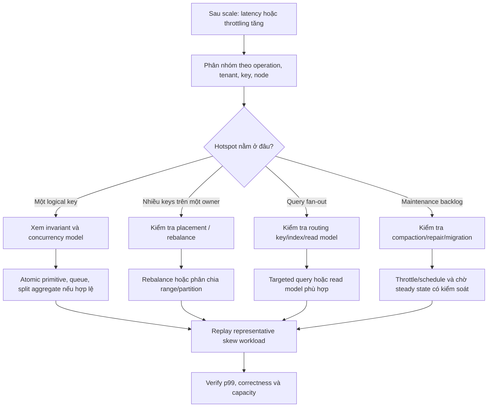

# Kiểm tra mô hình sau thay đổi quy mô hoặc phân bố dữ liệu

Một mô hình NoSQL có thể hoạt động tốt với 10 triệu bản ghi và 100 request/giây, nhưng xuất hiện **điểm nóng (hotspot)** khi tăng lên 500 triệu bản ghi, có vài tenant lớn hoặc lưu lượng chuyển từ truy vấn theo ID sang ghi liên tục theo thời gian. Ngược lại, thêm nhiều node, shard hay partition không tự động chữa được vấn đề nếu phần lớn yêu cầu vẫn dồn vào **một khóa logic** hoặc một access pattern không được định tuyến hiệu quả.

Vì vậy, sau khi **thay đổi quy mô hoặc phân bố dữ liệu**, công việc quan trọng không chỉ là xác nhận cluster “đã thêm node thành công”, mà là **kiểm tra lại mô hình phân mảnh, định tuyến, truy vấn, nhất quán và khả năng chịu tải của ứng dụng trên thực tế**.

Bài học thuộc **Database No SQL → Cân bằng và điểm nóng**. Nội dung tập trung vào cách xác định khi nào phải đánh giá lại shard/partition key, thu thập baseline, tạo workload đại diện, nhận diện chênh lệch giữa **phân bố dung lượng** và **phân bố lưu lượng**, đo tail latency, kiểm tra query targeting, xác minh dữ liệu sau migration/rebalance và quyết định giữ mô hình, tinh chỉnh hay thiết kế lại.

**Nguyên tắc trung tâm:** phải kiểm chứng **cả hệ thống dữ liệu và trải nghiệm nghiệp vụ**, không chỉ nhìn biểu đồ CPU trung bình hoặc số GB mỗi node. Một hệ có các node chứa dữ liệu gần bằng nhau vẫn có thể có một partition đang xử lý 80% giao dịch.

> Các ngưỡng và con số trong ví dụ là giả định để minh họa, không phải giá trị tối ưu chung. Cơ chế physical partitioning, rebalance và giới hạn throughput khác nhau giữa MongoDB, DynamoDB, Cassandra/ScyllaDB, Redis Cluster và Elasticsearch/OpenSearch; cần đối chiếu chính xác theo phiên bản, topology và API đang dùng trước khi thao tác production.

## 1. “Mô hình” cần kiểm tra lại gồm những gì?

Trong NoSQL, mô hình không chỉ là tập field của document. Nó còn gồm cách **khóa, index, replica, partition và read model** phục vụ từng yêu cầu.

Một mô hình đầy đủ có thể mô tả:

```text
Business entity:
    Order(tenantId, orderId, customerId, status, createdAt, amount)

Authoritative store:
    identity: (tenantId, orderId)
    partition/routing key: tenantId + order bucket
    concurrency: conditional version update
    replica placement: theo cluster policy

Read paths:
    GET by orderId
    LIST by customer and date
    LIST pending by store
    COUNT completed by day

Derived data:
    orders_by_customer
    pending_orders_by_store
    daily_revenue_projection

Operational assumptions:
    tenant distribution
    average/maximum item size
    requests per key
    hot partition size
    retention and TTL
    recovery and migration strategy
```

Khi quy mô hoặc phân bố thay đổi, cần kiểm tra lại **từng giả định**. Ví dụ một partition key phân tán đều số lượng order chưa chắc phân tán đều số lần cập nhật: vài order có thể là “hot aggregates” được ghi liên tục, còn phần lớn order không có traffic.

### Phạm vi kiểm tra

| Lớp | Câu hỏi |
| --- | --- |
| **Dữ liệu** | Số record, kích thước, cardinality và tenant skew có đổi không? |
| **Khóa** | Một key/partition có trở nên quá nóng hoặc quá lớn không? |
| **Định tuyến** | Query có còn target shard phù hợp hay scatter-gather rộng? |
| **Index/read model** | Index và bảng phục vụ query có theo kịp write/load không? |
| **Replication** | Replica có phân bố/lag phù hợp với read/write consistency không? |
| **Giao dịch** | Thay bố trí dữ liệu có làm nhiều nghiệp vụ thành cross-shard không? |
| **Độ trễ** | p95/p99 tăng ở nhóm key hay tenant nào? |
| **Tài nguyên** | CPU, RAM, cache, disk I/O, network và compaction chịu tải thế nào? |
| **Tính đúng** | Có mất cập nhật, đọc nhầm owner, trùng dữ liệu hoặc resurrect delete sau move không? |
| **Vận hành** | Có thể rebalance, thêm node, failover và phục hồi trong SLO không? |

## 2. Những thay đổi nào bắt buộc phải đánh giá lại?

Không chỉ có “dữ liệu tăng gấp đôi”.

### Thay đổi về quy mô

- Từ 3 lên 6 hoặc 12 shard/node.
- Tăng request rate mà số record ít đổi.
- Tăng số bản ghi hoặc kích thước document.
- Thêm replica/Region để phục vụ người dùng mới.
- Scale-in, giảm số node hoặc đổi loại máy.
- Chuyển sang tier lưu trữ có IOPS/bandwidth khác.
- Tăng retention từ 30 ngày lên 1 năm.
- Tăng số secondary indexes hoặc bảng denormalized.

### Thay đổi về phân bố

- Một tenant từ 5% traffic tăng thành 60%.
- Thêm khách hàng doanh nghiệp với item collection rất lớn.
- Một vài SKU/campaign có lượt xem và cập nhật tăng đột biến.
- Dữ liệu chuyển từ khá đều sang phân bố Zipf/Pareto.
- Key thời gian đơn điệu khiến writes dồn vào phạm vi mới nhất.
- Một khu vực địa lý phát triển nhanh hơn các khu vực khác.
- Có nhiều request cập nhật cùng một order/counter.
- Nhiều thực thể hết TTL đồng thời.
- Hệ có thêm nhiều bản ghi với giá trị `null`, empty hoặc default ở trường dùng làm key.

**Phân bố mới có thể tạo lỗi dù tổng số record không đổi.** Ví dụ khi flash sale kết thúc, số lượng order chưa tăng nhiều, nhưng các lượt đặt hàng đồng thời cùng kiểm tra tồn kho của một SKU khiến key đó trở nên nóng.

## 3. Ví dụ mở đầu: thêm node nhưng p99 vẫn tệ

Giả sử cluster có 4 shard; mỗi shard chứa khoảng 250 GiB dữ liệu. Một công ty tăng lên 8 shard và cân bằng lại dung lượng:

```text
Trước:
    A = 250 GiB
    B = 250 GiB
    C = 250 GiB
    D = 250 GiB

Sau:
    A = 125 GiB
    B = 125 GiB
    C = 125 GiB
    D = 125 GiB
    E = 125 GiB
    F = 125 GiB
    G = 125 GiB
    H = 125 GiB
```

Nhìn đồ thị dung lượng, hệ đã “cân bằng hơn”. Tuy nhiên, một partition key `TENANT#LARGE` vẫn nhận 35.000 writes/giây và được định tuyến tới một phạm vi hẹp.

```text
Shard A:  4.000 writes/s
Shard B:  5.000 writes/s
Shard C:  5.000 writes/s
Shard D:  4.000 writes/s
Shard E: 35.000 writes/s  <- hotspot
Shard F:  4.000 writes/s
Shard G:  5.000 writes/s
Shard H:  4.000 writes/s
```

Dù dung lượng gần bằng nhau, **lưu lượng và mức tải còn lệch lớn**. p99 của request vào E có thể xấu hơn trước vì copy/rebalance thêm overhead, còn hotspot logic chưa được chia.

**Kết luận từ ví dụ:** sau scale-out phải đo ít nhất **dung lượng, số thao tác, chi phí trên thao tác và tail latency** theo shard/partition. Không thể dùng một metric để kết luận phân mảnh đã tốt.

## 4. Phân biệt data skew với traffic skew

**Data skew**: phân bố kích thước hoặc số lượng record không đều.

```text
Partition P1: 100 triệu rows
Partition P2:  10 triệu rows
Partition P3:  12 triệu rows
```

**Traffic skew**: phân bố số lượt đọc/ghi không đều.

```text
Partition P1:   200 reads/s
Partition P2: 8.000 reads/s
Partition P3:   300 reads/s
```

Hai biểu đồ có thể khác nhau hoàn toàn. P1 là partition lớn nhất nhưng P2 là điểm nóng truy vấn.

### Những tổ hợp cần lưu ý

| Phân bố dữ liệu | Phân bố lưu lượng | Triệu chứng |
| --- | --- | --- |
| Đều | Đều | Tương đối dễ scale-out nếu các operation có chi phí gần nhau |
| Lệch | Đều | Disk/headroom, compaction và thời gian move có thể lệch |
| Đều | Lệch | Một shard/partition nóng dù storage balanced |
| Lệch | Lệch cùng chiều | Node lớn nhất cũng nóng nhất, dễ bão hòa |
| Lệch | Lệch ngược chiều | Dung lượng và throughput có bottleneck ở các nơi khác nhau |
| Tạm đều, burst lệch | Theo thời điểm | Độ trễ xấu theo giờ/campaign nhưng trung bình ngày vẫn đẹp |

**Traffic skew** còn cần chia theo **read và write**, vì một partition nhận 10.000 cache-hit reads/s khác một partition nhận 10.000 conditional transactions/s.

## 5. Cần baseline trước khi thay đổi

Không có baseline, câu “sau scale-out hệ nhanh hơn” thường chỉ là cảm giác.

Baseline nên được ghi theo những khoảng:

```text
Ngày thường
    peak giờ làm việc
    peak giờ bán hàng
    giờ thấp điểm

Sự kiện bất thường
    flash sale
    batch import
    end-of-month report
    tenant lớn chạy bulk job

Sự cố
    một replica chậm
    một node restart
    network jitter
```

Các chỉ số đầu vào tối thiểu:

- Tổng dataset size, live logical bytes và physical bytes.
- Số key/partition/chunk/range/slot theo đơn vị engine.
- QPS/RPS theo operation, endpoint, tenant bucket.
- Item size: median, p95, p99 và các outlier.
- Đọc/ghi/scan, transaction, conditional write tỉ lệ bao nhiêu?
- p50/p95/p99 latency theo operation và theo nhóm key.
- Thời gian truy vấn chờ queue, network và storage.
- CPU, RAM, cache hit, disk IOPS/throughput và network.
- Replica lag, repair/compaction/index build/GC pressure.
- Error, timeout, throttling, retry và OCC conflict.
- Query fan-out và số shard/partition tham gia mỗi request.

### Ghi lại cấu hình

Một baseline chỉ có metric mà không có **cấu hình lúc đo** thì khó so sánh:

```yaml
baseline:
  workloadWindow: "2026-11-14-peak-window"
  shardCount: 4
  replicaPlacement: "theo topology thực"
  storageEngineVersion: "phiên bản cụ thể"
  indexVersion: "schema/index release id"
  routingSchemaVersion: 3
  tenantBuckets: "theo policy"
  dataSizeLogical: "đo từ nguồn"
  dataSizePhysical: "đo từng node"
  peakReadQps: "đo thực"
  peakWriteQps: "đo thực"
  readConsistency: "cấu hình API"
  writeConsistency: "cấu hình API"
```

Đây là mẫu cấu trúc, không phải file cấu hình của một sản phẩm. Cần ghi cả engine version và read/write modes để không so kết quả của những bảo đảm khác nhau.

## 6. Không so before/after khi workload đã đổi

Giả sử:

```text
Trước khi thêm node:
    5.000 requests/s
    90% GET
    10% conditional writes

Sau khi thêm node:
    7.000 requests/s
    50% GET
    50% conditional writes
```

Nếu p99 tăng, không thể kết luận **scale-out làm hệ chậm hơn** chỉ từ hai mốc. Workload đã nặng hơn, số transaction ghi tăng mạnh.

Nên đánh giá theo ba lớp:

1. **Observation thực tế:** hệ hoạt động ra sao với traffic mới.
2. **Controlled replay:** chạy cùng một workload trên cấu hình cũ và mới nếu khả thi.
3. **Projected load:** thử các scenario tăng trưởng và skew để dự đoán rủi ro tương lai.

Khi không thể dựng hệ cũ tương đương, cần ghi rõ **giới hạn suy luận** và sử dụng các chỉ số chuẩn hóa như latency theo operation class, load/capacity ratio và mức skew.

## 7. Xác định đơn vị “partition” trước khi tính

Trong mỗi hệ, từ “partition” có thể chỉ một loại đơn vị khác:

- **MongoDB:** shard, chunk/range và shard-key value.
- **DynamoDB:** partition vật lý do dịch vụ quản lý, partition key logic/item collection, cùng giới hạn thực thi thay đổi theo dịch vụ.
- **Cassandra/ScyllaDB:** partition theo CQL partition key và token range; node có thể sở hữu nhiều ranges.
- **Redis Cluster:** key, hash slot và node sở hữu slot.
- **Elasticsearch/OpenSearch:** primary/replica shard, routing value, index.
- **Ứng dụng:** một bucket logic hoặc tenant group.

Nếu chỉ đo per-node CPU, ta có thể bỏ qua một partition nóng nằm trên node chưa bão hòa tổng thể. Nếu chỉ đo per-key QPS, ta có thể bỏ qua node đầy disk vì nhiều cold keys.

Bài toán cần **đa cấp độ**: entity/key → logical partition/range → physical shard/node → cluster → user-facing service.

## 8. Các chỉ số đo độ lệch cơ bản

Giả sử có \(n\) phân vùng, mỗi vùng nhận \(x_i\) writes/giây.

**Trung bình:**

\[
\bar{x}=\frac{\sum_{i=1}^{n}x_i}{n}
\]

**Tỉ lệ max/mean:**

\[
S_{\max/\mathrm{mean}}=
\frac{\max(x_1,\ldots,x_n)}{\bar{x}}
\]

Giá trị gần 1 cho thấy số lượt ghi tương đối đều theo thước đo này. Giá trị lớn hơn 1 nhiều là tín hiệu lệch.

Ví dụ:

```text
Partition A:  100 writes/s
Partition B:  110 writes/s
Partition C:  100 writes/s
Partition D:  890 writes/s

Tổng = 1200 writes/s
Trung bình = 300 writes/s
Max/mean = 890 / 300 ≈ 2,97
```

Phân bố có một điểm nóng rõ ràng.

### Hạn chế

Max/mean chỉ đo **số lượng**, chưa tính:

- Write A có 1 KiB còn write D có 1 MiB.
- Transaction D dùng thêm nhiều condition/quorum round trip.
- Node nào đang chạy compaction.
- Một shard phục vụ nhiều replica reads.
- Một key nóng nhưng được cache hiệu quả.
- Capacity khác nhau giữa các node.

Vì vậy phải đo cả **resource utilization và latency** thay vì xem max/mean như kết luận duy nhất.

## 9. Hệ số biến thiên và phân vị phân vùng

**Coefficient of variation (CV):**

\[
CV=\frac{\sigma_x}{\bar{x}}
\]

Trong đó \(\sigma_x\) là độ lệch chuẩn của metric trên các partition.

CV cao thể hiện phân bố chênh lệch, nhưng phải cẩn thận khi:

- Số partition ít.
- Nhiều partition gần như không hoạt động.
- Một số node có capacity khác nhau.
- Metric được lấy mẫu trong những khoảng thời gian không đồng bộ.

Có thể bổ sung:

```text
per_partition_write_qps_p50
per_partition_write_qps_p95
per_partition_write_qps_p99
per_partition_write_qps_max
```

**Phân vị của tải trên partition** khác với **p99 latency của request**. Cần đặt tên và đơn vị tường minh.

### Một metric dễ hành động

**Top-K share**:

\[
\mathrm{TopKShare}=
\frac{\sum_{i\in K \text{ partition nóng nhất}}x_i}
{\sum_{j=1}^{n}x_j}
\]

Ví dụ 5 partition nóng nhất chiếm 70% writes trong 1.000 partition có thể đáng xem xét, dù top-level node metrics nhìn cân bằng.

## 10. Đo phân bố dung lượng và tải tách biệt

Dữ liệu mẫu:

| Shard | Data (GiB) | Read QPS | Write QPS | CPU | p99 write |
| --- | ---: | ---: | ---: | ---: | ---: |
| A | 220 | 5.000 | 2.000 | 45% | 18 ms |
| B | 210 | 5.300 | 2.200 | 49% | 20 ms |
| C | 215 | 4.800 | 2.100 | 47% | 19 ms |
| D | 218 | 4.900 | 12.000 | 93% | 180 ms |

Đây là số giả định.

Nhận xét:

- Data size lệch nhỏ, chưa cần đổi key chỉ vì capacity balance.
- Write QPS của D cao gấp nhiều lần nơi khác.
- CPU D gần bão hòa và p99 cao.
- Cần xác định **những key/ranges nào** đóng góp vào 12.000 writes/s.
- Nếu một key duy nhất chiếm phần lớn, rebalance chỉ chuyển hotspot sang node khác.
- Nếu rất nhiều partitions ngẫu nhiên được xếp cùng D do placement, rebalance có thể giúp.

Kết luận không thể là “shard key sai” chỉ từ một bảng; cần drill-down đến **phân bố thực tế của key và query**.

## 11. Data size không bằng chi phí xử lý

Hai partition cùng 10 GiB có thể khác nhau về hiệu năng:

```text
Partition A:
    10 GiB dữ liệu immutable.
    100 point GET/s, cache hit cao.

Partition B:
    10 GiB dữ liệu cập nhật liên tục.
    2.000 conditional updates/s.
    Nhiều tombstone và compaction.
```

Partition B thường có write amplification và contention cao hơn. Một số data model thêm secondary index làm mỗi write phải cập nhật nhiều cấu trúc.

Một chỉ số chi phí gần đúng:

\[
\mathrm{LoadCost} \approx
\sum_{k \in \mathrm{operations}} QPS_k \times Cost_k
\]

`Cost_k` có thể đo bằng CPU-ms, disk bytes, read/write capacity units hoặc latency tùy hệ. Công thức chỉ là **mô hình tương đối**, không cho phép cộng trực tiếp những đơn vị khác nhau.

Hãy đo **per operation class** rồi chuẩn hóa về capacity thực tế trước khi tổng hợp.

## 12. Cardinality của shard key thay đổi theo thời gian

Một key ban đầu có một triệu giá trị khác nhau:

```text
partitionKey = customerId
```

Nhưng nếu hệ chuyển sang phục vụ vài tài khoản lớn, 1% customer có thể sinh 90% writes.

Ngược lại:

```text
partitionKey = status
```

chỉ có vài giá trị `PENDING`, `PAID`, `FAILED`, nên dễ tạo ít partition rất nóng.

Các câu hỏi:

1. Distinct count của key trong dữ liệu hiện tại là bao nhiêu?
2. Distinct count trong **traffic ghi** là bao nhiêu?
3. Top 1/top 10 key chiếm bao nhiêu request?
4. Giá trị `null`, empty string, `UNKNOWN`, default có nhiều không?
5. Phân bố thay đổi theo giờ, ngày, chiến dịch không?
6. Những key lớn nhất có thể tiếp tục tăng không?
7. Một số tenant có thể vượt giới hạn một partition dù tổng tenant nhiều không?

**Cardinality toàn bảng cao không có nghĩa hot traffic phân tán cao.**

## 13. Hot tenant và noisy neighbor

Một hệ SaaS có:

```text
T1: 55% write traffic
T2: 15% write traffic
T3..T10000: 30% còn lại
```

Nếu partition key là `tenantId`, phần lớn writes của T1 có thể tập trung trên một logical partition hoặc một tập partition bị ràng buộc quá hẹp.

Hệ quả:

- T1 chạm giới hạn throughput/key.
- Các tenant nhỏ cùng node bị ảnh hưởng p99.
- Thao tác phục hồi hoặc move tenant T1 mất nhiều thời gian.
- Node khác có tài nguyên thừa nhưng không giúp được T1.
- API có thể tăng retry storm khi T1 bị throttled.

Các hướng xử lý tùy nghiệp vụ:

- Tách tenant lớn sang dedicated resource pool.
- Dùng compound key hoặc write bucket cho dữ liệu T1.
- Mở rộng key bằng entityId/time bucket.
- Giữ read model theo tenant cho truy vấn danh sách.
- Đặt per-tenant rate/concurrency limits.
- Dùng queue để serialize những operation trên cùng aggregate.
- Thiết kế quota/fairness theo business priority.

**Không đưa `tenantId` ra khỏi auth scope chỉ vì muốn shard theo entityId.** Query/write vẫn phải bảo vệ tenant identity và quyền truy cập.

## 14. Hot key khác hot partition

**Hot key:** một logical entity bị ghi/đọc quá nhiều:

```text
product:SKU-42:stock
```

**Hot partition:** một đơn vị lưu trữ/routing chứa nhiều key hoặc một key nhưng tổng tải quá cao:

```text
partition TENANT#T1#DAY#2026-11-14
```

Hot key đơn lẻ có thể không được giải quyết bằng cách tăng shard count. Nếu cùng một item phải tuần tự hóa conditional updates để giữ stock không âm, khả năng scale write của nó có giới hạn từ **invariant**, không chỉ từ tài nguyên.

Biện pháp cần tùy semantics:

| Kiểu tải | Phương án cân nhắc |
| --- | --- |
| Counter có phép cộng độc lập | Atomic increment, sharded counter nếu tổng có thể hội tụ theo policy |
| Tồn kho chính xác | Conditional decrement, per-SKU serialized queue, escrow rights theo policy |
| Một user có nhiều event độc lập | Bucket/split events theo entity+time |
| Một document lớn cập nhật nhiều field độc lập | Tách aggregate nếu invariant cho phép |
| Đọc một key cực nhiều | Cache, CDN, replica reads theo freshness contract |
| Cập nhật cùng key không hoán đổi | Single writer/ordering protocol, không ép scale bằng blind writes |

**Hot key do business invariant** có thể cần thay cách điều phối thay vì “đổi hash”.

## 15. Key đơn điệu và điểm nóng ở cuối range

Một workload time series:

```text
partition key = eventTimestamp
```

Nếu hệ dùng range partitioning và mọi event mới có timestamp tăng, writes thường đổ vào **range cuối**.

```text
Shard A: events cũ
Shard B: events trước đó
Shard C: events tuần này
Shard D: events hôm nay <- nhận gần hết writes mới
```

Dù có rất nhiều ranges và data size đều, nhập liệu hiện tại vẫn dồn vào D.

Phương án:

- Bucket thời gian kết hợp hash/entity.
- Chia ngày/giờ thành nhiều sub-buckets.
- Tránh thiết kế một partition cho toàn bộ một ngày nếu traffic quá lớn.
- Tạo read model để query range không phải quét mọi bucket theo cách tốn kém.
- Dùng append-optimized/time-series layout do engine hỗ trợ nếu phù hợp.

Nhưng **tăng số bucket** làm query phải fan-out nhiều hơn; cần thử cả ingest và read path.

## 16. Skew có thể đến từ query, không chỉ dữ liệu

Giả sử 90% requests là:

```text
GET /orders?status=PENDING
```

Nếu document được shard theo `orderId` mà truy vấn không có partition/routing key hoặc index/read model phù hợp, mỗi request có thể phải hỏi nhiều shard.

```text
Client
  |
  v
Router
  +-- Shard A
  +-- Shard B
  +-- Shard C
  +-- Shard D
```

Tăng từ 4 lên 12 shard có thể **tăng fan-out** của mỗi request, trong khi từng shard cũng ít dữ liệu hơn.

Với một query phân tán, chi phí có thể tăng do:

- Nhiều network round trips.
- Merge/sort/pagination kết quả từ nhiều shard.
- Memory trên coordinator.
- Retry khi một shard chậm.
- Global top-K hoặc count phải tổng hợp.
- Index selectivity giảm theo phân bố dữ liệu mới.

Cần đo **tổng tài nguyên mỗi request**, không chỉ latency của từng shard.

## 17. Query targeting phải được kiểm tra lại sau scale-out

Một bảng:

| Query | Filter | Targeting mong muốn | Rủi ro khi scale |
| --- | --- | --- | --- |
| Order by ID | tenantId + orderId | Một shard/partition | Thiếu trường key mới gây scatter |
| Customer timeline | tenantId + customerId | Một hoặc ít partition/bucket | Bucket growth làm fan-out |
| Store pending | storeId + status + day | Read model phù hợp | Hot store và status thấp cardinality |
| Global search | text/filter | Search index/chỉ mục phân tán | Merge p99 tăng theo shard count |
| Daily revenue | tenantId + day | Pre-aggregation hoặc bounded scan | Query count trên raw orders quá đắt |
| Delete tenant | tenantId | Xác định toàn bộ tenant ranges | Dữ liệu tenant trải rộng hơn trước |

Một mô hình có thể đạt write throughput tốt hơn nhưng khiến **99% query thường gặp phải scatter**. Đây là regression nếu user-facing SLO xấu đi.

### Quy tắc

Mỗi access pattern quan trọng cần ghi:

- Input key có đủ để target không?
- Có index cần thiết không?
- Có phải query trên replica/projection stale không?
- Có sort/pagination hiệu quả không?
- Có giới hạn số partition tham gia không?
- Có tăng chi phí khi shard count gấp đôi không?

## 18. Thay đổi distribution có thể làm index kém hiệu quả

Giả sử trước đây:

```text
status=PENDING chỉ chiếm 1% dữ liệu.
```

Sau chiến dịch:

```text
status=PENDING chiếm 60% dữ liệu.
```

Một index được xây tối ưu cho predicate hiếm có thể mang lại ít lợi ích hơn khi selectivity giảm. Tương tự một compound index theo tenant/store/date có thể kém nếu tenant mới có phân bố khác.

Điều cần kiểm tra:

- Query planner có còn chọn index đúng không?
- Cardinality/selectivity mới thế nào?
- Có scan/allow filtering không cần thiết không?
- Có index maintenance overhead lớn do writes mới không?
- Covering index có còn giảm fetch không?
- Sort trên nhiều shard có tăng memory không?
- Plan cache hoặc thống kê có cần làm mới theo cơ chế engine không?

Không tự thêm mọi index khi query chậm: mỗi index cũng có **write cost, storage cost và migration cost**.

## 19. Dung lượng partition phải xem tail, không chỉ trung bình

Giả sử:

```text
Tổng dữ liệu:       1 TiB
Số partitions:      1 triệu
Mean size:          khoảng 1 MiB/partition
```

Tuy nhiên:

```text
99,9% partitions:   dưới 5 MiB
Một partition:      90 GiB
```

Partition lớn bất thường có thể kéo theo:

- Đọc một key cần xử lý rất nhiều rows.
- Compaction/repair/streaming tốn nhiều thời gian.
- TTL/tombstone tích tụ.
- Node thay thế/backup có long tail.
- Scan/range query có hotspot.
- Không thể chia nhỏ đơn vị partition theo schema cũ.

**Mean partition size không nói được mức rủi ro của largest partition.**

Theo dõi:

```text
partition_size_p50
partition_size_p95
partition_size_p99
largest_partition_bytes
rows_per_partition_p99
tombstones_per_partition
oldest_partition_age
```

Các metric này có thể cần sampling hoặc công cụ theo engine; không phải dịch vụ nào cũng cung cấp trực tiếp.

## 20. Sau scale-out cần phân biệt balancing đang diễn ra với đã hoàn tất

Một cluster vừa thêm node có thể ở trạng thái:

```text
T0: 4 nodes.
T1: Thêm 4 nodes.
T2: Range migration/streaming chưa hoàn tất.
T3: Replica/index vẫn catching up.
T4: Balancer hoàn tất theo scope.
```

Nếu benchmark tại T2 và kết luận mô hình mới tệ hơn, có thể đang đo thêm overhead migration. Ngược lại, nếu chỉ kiểm tra tại T4 và bỏ qua T2, không đánh giá được rủi ro vận hành khi scale-out thật.

Cần đo **cả giai đoạn chuyển tiếp lẫn steady state**:

| Giai đoạn | Kiểm tra |
| --- | --- |
| Trước scale | Baseline and headroom |
| Đang copy/rebalance | p99, bandwidth, write stalls, errors |
| Router/ownership chuyển | Stale metadata, redirects, in-flight writes |
| Catch-up | Replica lag, index build, CDC/repair |
| Sau ổn định | Key skew, query targeting, normalized throughput |
| Sau tăng trưởng tiếp | Độ bền của lựa chọn partition key |

**Một thay đổi quy mô không hoàn tất ở mức ứng dụng chỉ vì cluster dashboard báo đủ số node.**

## 21. Đo hiệu suất theo đơn vị capacity, không chỉ theo node

Giả sử scale từ 4 node loại 16 vCPU lên 8 node loại 8 vCPU. Tổng CPU lý thuyết tương đương nhưng:

- Network bandwidth per node có thể khác.
- Disk IOPS per node có thể khác.
- Cache memory per node giảm.
- Cross-node traffic tăng.
- Replication và metadata overhead có thể tăng.
- Hot key vẫn bị ràng buộc vào một subset tài nguyên.

Do đó throughput tăng gấp đôi **không phải kỳ vọng tự động** khi shard count gấp đôi.

Chỉ số phù hợp:

\[
\mathrm{UtilizationRatio} =
\frac{\mathrm{ObservedDemand}}
{\mathrm{EffectiveCapacity}}
\]

dùng cùng đơn vị và phạm vi. Ví dụ write capacity theo service hoặc disk IOPS cho từng node; không cộng đơn giản CPU% và MiB/s.

Theo dõi **node bận nhất** và **partition nóng nhất**, không chỉ cluster aggregate utilization.

## 22. Ước lượng capacity khi dữ liệu tăng

Một công thức sơ bộ cho storage:

\[
D_{\text{physical}}
\approx D_{\text{logical}}
\times \mathrm{ReplicationFactor}
\times \mathrm{StorageOverhead}
\]

Nhưng `StorageOverhead` là một khái niệm gộp chỉ để ước tính; compression, index, tombstone, snapshot, WAL, compaction và kiến trúc dịch vụ có thể làm quan hệ phức tạp hơn.

Ví dụ giả định:

```text
Live logical dataset:     2 TiB
Replica factor:           3
Overhead factor:          1,4

Physical estimate:
    2 * 3 * 1,4 = 8,4 TiB
```

Nếu có thêm 50% dữ liệu, không nên chỉ cấp 50% disk ở mọi node nếu:

- Một node đã gần đầy.
- Partition lớn nhất tăng nhanh hơn trung bình.
- Có thêm secondary index.
- Quá trình rebalance cần temporary headroom.
- Replica placement khiến capacity phân bố không đều.

Cần tính cả **peak per node** và thời gian phục hồi một node.

## 23. Dự báo tăng trưởng có phân bố lệch

Hai kịch bản cùng tăng 100% record:

```text
Scenario A:
    Mỗi tenant tăng gấp đôi.
    Key distribution gần giữ nguyên.

Scenario B:
    Một tenant lớn tăng 10 lần.
    Các tenant khác giữ nguyên.
```

Tổng dataset có thể tương tự, nhưng B gây nguy cơ hotspot lớn hơn nếu key theo tenant.

Trong capacity planning, thử ít nhất:

- **Uniform growth:** mọi key class tăng tương đối đều.
- **Top-tenant growth:** top 1% tenants tăng mạnh.
- **Hot-item burst:** một vài entities chiếm phần lớn writes.
- **Time-localized traffic:** 90% sự kiện đến trong 1 giờ.
- **Large-item growth:** payload mỗi record tăng.
- **Read-heavy shift:** tập truy vấn thay đổi, nhiều scan/search.
- **Retention shift:** nhiều cold partitions tồn tại lâu hơn.
- **Failover reduced capacity:** một node/Region không khả dụng.

Một mô hình chỉ được thử trên dữ liệu random đồng đều thường đánh giá thấp rủi ro của các case thực.

## 24. Tạo workload thử nghiệm đại diện

**Data generator** phải tạo được cả:

1. Phân bố key.
2. Phân bố kích thước item.
3. Phân bố tần suất truy vấn theo key.
4. Tỉ lệ read/write/update/delete.
5. Quan hệ giữa key và thời gian.
6. Tập query và tỉ lệ chúng được gọi.
7. Tỉ lệ conflict và mức đồng thời.
8. Tính cục bộ theo tenant/Region.
9. TTL/expired records.
10. Các “outlier” lớn nhất.

Không nên chỉ tạo:

```text
random UUID cho mỗi event
```

rồi tuyên bố thiết kế sẽ scale tốt nếu traffic thực tế dồn vào một vài tenant, SKU hoặc ngày hiện tại.

### Những phân bố hữu ích

| Phân bố | Mô phỏng |
| --- | --- |
| **Uniform** | Key được chọn gần đều |
| **Zipf-like/long tail** | Một số key cực phổ biến, nhiều key ít truy cập |
| **Hot-set rotation** | Tập key nóng thay đổi theo thời gian |
| **Burst** | Traffic đột biến trong một khoảng ngắn |
| **Monotonic key** | Timestamp/ID tăng liên tục |
| **Tenant skew** | Vài tenant rất lớn, phần lớn nhỏ |
| **Payload skew** | Một số document/partition lớn bất thường |
| **Mixed operations** | Point GET, range query, CAS update, delete, aggregate |

Phải đặt seed/ngày/phiên bản generator để thử nghiệm có thể tái lập.

## 25. Ví dụ Java: mô phỏng số lượt ghi theo shard

Đoạn code Java sau **tự chạy được với Java 17+** và chỉ là mô hình học thuật. Nó sử dụng `String.hashCode()` để đưa key vào `shardCount` bucket mô phỏng, **không đại diện cho thuật toán placement của MongoDB, DynamoDB, Cassandra hoặc Redis Cluster**.

```java
import java.util.Arrays;
import java.util.SplittableRandom;

public class DistributionExperiment {
    static final int SHARDS = 8;
    static final int OPERATIONS = 1_000_000;

    static int toyShard(String key) {
        return Math.floorMod(key.hashCode(), SHARDS);
    }

    static void report(String label, long[] loads) {
        long total = Arrays.stream(loads).sum();
        double mean = total / (double) loads.length;
        long max = Arrays.stream(loads).max().orElse(0);
        double skew = mean == 0 ? 0 : max / mean;

        System.out.printf(
            "%s loads=%s total=%d max/mean=%.2f%n",
            label, Arrays.toString(loads), total, skew
        );
    }

    public static void main(String[] args) {
        SplittableRandom random = new SplittableRandom(20261114);
        long[] uniform = new long[SHARDS];
        long[] hotKey = new long[SHARDS];

        for (int i = 0; i < OPERATIONS; i++) {
            String randomKey = "tenant:" + random.nextInt(100_000);
            uniform[toyShard(randomKey)]++;

            // 60% requests cùng một logical key.
            String selectedKey = random.nextDouble() < 0.60
                ? "tenant:VERY_HOT"
                : "tenant:" + random.nextInt(100_000);

            hotKey[toyShard(selectedKey)]++;
        }

        report("Uniform-like", uniform);
        report("Hot logical key", hotKey);
    }
}
```

### Điều ví dụ giúp thấy

- Thêm nhiều hash buckets làm tải **nhiều key khác nhau** có cơ hội được phân bố.
- Nếu **60% writes cùng một key**, toàn bộ 60% vẫn đi vào **một bucket**, dù có thêm bucket.
- Mô phỏng chỉ đếm số request, chưa tính read/write cost, replication hay tail latency.
- Một key có khả năng được quản lý khác trong engine thực; kết luận thuộc **mô hình toy**, không phải thông số sản phẩm.

### Bài tập mở rộng

Sửa chương trình để:

- Chạy 4, 8, 16, 32 buckets.
- Tính p95/p99 trên tải theo bucket.
- Tạo nhiều hot tenants với xác suất khác nhau.
- Tạo rotating hot set qua 10 giai đoạn.
- Gán chi phí cao hơn cho transaction writes.
- So sánh cách tách `tenant:VERY_HOT` thành nhiều entity buckets khi domain cho phép.

## 26. Hash phân bố đều nhưng vẫn có thể query kém

Kết quả mô phỏng trên có thể cho:

```text
Hash(orderId) -> writes khá đều.
```

Nhưng query nghiệp vụ:

```text
LIST orders WHERE tenantId=T1 ORDER BY createdAt DESC
```

không còn target một shard nếu orderId được hash trên toàn cluster và không có read model phụ.

Một thiết kế có thể phải chọn:

```text
Authoritative orders:
    target by tenantId + orderId

Read model:
    orders_by_customer_time
    orders_by_tenant_time_bucket
```

Tức tận dụng **query-driven data modeling**: không ép một partition key vừa phân tán mọi writes vừa làm tất cả range queries cục bộ.

Sau khi scale, cần benchmark **toàn bộ read/write cost**, kể cả write fan-out để duy trì read models.

## 27. Mô hình bucket khi một tenant quá nóng

Giả sử:

```text
Partition key cũ:
    TENANT#T1
```

Thiết kế bucket mới:

```text
TENANT#T1#BUCKET#00
TENANT#T1#BUCKET#01
...
TENANT#T1#BUCKET#15
```

Một order có thể được định tuyến ổn định:

\[
bucket = hash(orderId) \bmod 16
\]

Tác dụng: nhiều order khác nhau của T1 phân tán writes.

Đánh đổi:

- Query toàn tenant phải đọc nhiều buckets.
- Muốn GET order cần biết bucket hoặc tính lại được.
- Đổi bucket count từ 16 sang 32 cần tính đến dữ liệu cũ/layout version.
- Uniqueness của orderId phải được bảo vệ ở phạm vi phù hợp.
- Một order duy nhất rất nóng vẫn ở một bucket.
- Transaction xuyên buckets có thể đắt hơn.
- Delete tenant phải quét/biết đủ buckets.
- Routing function phải nhất quán giữa mọi service.

**Write sharding là một phép biến đổi data model**, không chỉ là “bật flag” tăng số partition.

## 28. Sau scale-in, dữ liệu có thể hợp lệ nhưng không còn headroom

Scale-in:

```text
Trước:
    8 nodes.
    Peak CPU mỗi node: 35-50%.

Sau:
    4 nodes.
    Peak CPU mỗi node: 65-95%.
```

Dù hệ vẫn xử lý mọi request trong một ngày thường, nó có thể mất khả năng chịu:

- Flash sale tiếp theo.
- Một node hỏng.
- Compaction/repair spike.
- Backfill và index rebuild.
- Batch import cuối tháng.
- Key hotset thay đổi.

Kiểm tra mô hình sau scale-in phải đưa vào **N-1 failure headroom** hoặc phạm vi mất node/availability zone theo SLO của hệ. Nếu một node chậm/không còn mà các node khác lập tức bão hòa, scale-in chưa chắc đã an toàn.

### Phân biệt “hoạt động” và “đáp ứng SLO”

Một benchmark chỉ báo HTTP 200 ở mức trung bình không đủ. Cần quan sát:

```text
p99 latency
timeout/throttling rate
queue wait
retry amplification
max partition utilization
replica lag
recovery time
```

## 29. Thử nghiệm đọc, ghi và truy vấn phức hợp tách riêng

Một workload hỗn hợp có thể che nguyên nhân.

Gợi ý các kịch bản:

| Kịch bản | Thao tác | Ý nghĩa |
| --- | --- | --- |
| **Point read** | GET theo full key | Đo routing và per-key read |
| **Point write** | INSERT/UPDATE theo key | Đo write distribution |
| **CAS conflict** | Update version cùng record | Đo hot aggregate/contention |
| **Tenant timeline** | Query sorted theo customer/time | Đo index locality và pagination |
| **Scatter query** | Filter thiếu shard key | Đo fan-out và coordinator cost |
| **Time-series ingest** | Append theo thời gian | Đo hot range và compaction |
| **Delete/TTL burst** | Nhiều bản ghi hết hạn/xóa | Đo tombstone và maintenance |
| **Batch import** | Large bulk writes | Đo admission control |
| **Replica failover** | Node rời cluster | Đo headroom/recovery |
| **Rebalance in progress** | Move ranges khi đang có traffic | Đo SLO trong transition |

Sau đó chạy **mixed workload** với tỉ lệ thực tế. Bài test đơn lẻ giúp chẩn đoán; mixed workload cho thấy cạnh tranh tài nguyên trong sản xuất.

## 30. Các mức tải nên thử

Không chỉ thử peak hiện tại.

Ví dụ:

```text
L1: 0,5 × peak hiện tại.
L2: 1,0 × peak hiện tại.
L3: 1,5 × peak dự kiến.
L4: 2,0 × peak dự kiến.
L5: peak + một node failure.
```

Ở mỗi mức, đo:

- Throughput thực hoàn thành đúng.
- p50/p95/p99 end-to-end.
- Mức tải shard/partition nóng nhất.
- Error/throttle/retry.
- Disk I/O, cache misses, compaction.
- Query fan-out và cross-shard operations.
- Correctness/invariant violations.

Nếu workload đạt throughput mục tiêu nhưng p99 vượt SLO, **không coi đó là PASS**.

Không kéo dài overload đến mức gây rủi ro cho production; thử nghiệm năng lực nên ở staging/test hoặc giới hạn cẩn thận trong môi trường được phê duyệt.

## 31. Hệ có thể chưa đạt steady state do compaction/repair

Trong LSM-based systems, vừa nhập một lượng lớn data có thể làm:

```text
Bulk ingest -> nhiều SSTables -> compaction backlog.
```

Một benchmark 5 phút ngay sau copy có thể cho latency tốt trong lúc write buffers còn dư, rồi p99 xấu hơn khi compaction bắt đầu; hoặc ngược lại, dữ liệu đang bị compaction cao khiến kết quả thử đầu thấp giả tạo.

Cần ghi:

- Compaction pending bytes/tasks.
- SSTables read per query.
- Read/write amplification.
- Tombstone density.
- Flush/write stalls.
- Cache warm/cold state.
- Replica repair/streaming status.

Đối với MongoDB, WiredTiger cache, index build hoặc chunk migration cũng có ảnh hưởng riêng; với DynamoDB, service-managed partition/adaptive capacity có dynamics khác.

**Không gán mọi latency sau scale cho shard key** khi maintenance/background state chưa ổn định.

## 32. Kiểm tra replica placement và read consistency

Thay đổi shard count có thể làm các replica được phân bố lại; thêm Region hoặc đổi read preference cũng thay đường đọc.

Cần xác minh:

- Replica đặt đúng failure domains/AZ theo policy không?
- Một logical partition có đủ replicas hợp lệ không?
- Khi một replica chậm, read path có tự động phục hồi đúng không?
- API strong read có đọc nguồn đủ mới không?
- Read từ secondary/follower có stale đúng mức công bố không?
- Replica lag có tăng khi rebalance không?
- Repair/catch-up có hoàn tất trước khi nhận traffic quan trọng không?
- Những cache/read models có bị đi lùi phiên bản sau failover không?

Đây là vấn đề **safety và liveness**, không chỉ performance.

Ví dụ không nên dùng:

```text
Strong inventory confirm
    -> đọc từ một replica eventual
    -> tin available=1
    -> ghi order CONFIRMED mà không conditional check.
```

Một partitioning model phân phối đều vẫn có thể không an toàn nếu đường ghi quyết định từ stale read.

## 33. Kiểm tra dữ liệu sau reshard/rebalance: không chỉ đếm row

Giả sử:

```text
Old layout: 10.000.000 records.
New layout: 10.000.000 records.
```

Count bằng nhau vẫn có thể:

- Thiếu 100 keys và thêm 100 keys sai.
- Mất updates mới nhưng có dữ liệu trùng.
- Sai tenant assignment.
- Sai sort/index field.
- Resurrect những record đã delete.
- TTL bị reset khiến dữ liệu tồn tại quá lâu.
- Duplicate payment/reservation do retry.
- Sai generation sau delete/recreate.
- Đọc được từ route cũ nhưng route mới không thấy.

Một bộ kiểm tra nên gồm:

1. **Key-set comparison** theo identity và tenant.
2. **Revision/generation comparison** với source-of-truth.
3. **Canonical content hash** của các field quan trọng.
4. **Delete/TTL comparison** trên dữ liệu đã xóa/hết hạn.
5. **Query result comparison** cho những access patterns chính.
6. **Business invariant audit** (không double booking, không duplicate charge).
7. **Routing epoch/ownership correctness**.
8. **Sampled consistency read-after-write** theo hợp đồng.

Không nên so hai nguồn tại hai thời điểm khác nhau rồi gọi mọi mismatch là lỗi: data còn đang thay đổi. Cần snapshot/mốc log hoặc version-aware reconciliation.

## 34. Kiểm tra routing sau di chuyển dữ liệu

Một tình huống:

```text
Range R trước thuộc Shard A.
Balancer chuyển R sang Shard B.

Client 1:
    vẫn dùng metadata cũ -> gửi A.

Client 2:
    metadata mới -> gửi B.
```

Hệ phải có protocol redirect, stale config handling hoặc fencing tương ứng để không có hai owner đồng thời nhận authoritative writes mâu thuẫn.

Cần đo:

```text
stale_route_requests
routing_retry_count
redirect_rate
routing_metadata_age
misrouted_write_rejections
inflight_write_during_move
cutover_pause_duration
```

Cần test:

- Reader sử dụng route cũ.
- Writer đang in-flight khi move.
- Client retry sau timeout.
- Request bị gửi đến old owner đã mất quyền.
- Router cache có TTL dài.
- Node failover giữa việc chuyển range.

**Định tuyến đúng là một phần của correctness**, không phải chỉ một chi phí network.

## 35. Kiểm tra idempotency và điều kiện ghi sau scale

Một lệnh reserve có thể được gửi trong lúc shard move:

```text
T1: Client gửi Reserve(operationId=R1).
T2: Old owner commit nhưng response mất.
T3: Routing đổi.
T4: Client retry R1 tới new owner.
```

Nếu record operationId chưa được đồng bộ hoặc new owner coi R1 là lệnh mới, hệ có thể trừ stock lần hai.

Do đó sau scale/rebalance cần thử:

- Client dùng lại **cùng operationId**.
- Không double-apply business effect.
- Conditional version/CAS vẫn đúng trên owner mới.
- Unknown commit outcome có readback/reconciliation.
- Delete/recreate không làm reset generation khiến stale request được nhận.
- Cross-shard transaction còn đúng isolation.
- Không có “write to old owner” bypass authority.

Một hệ phân bố tải rất đẹp nhưng **mất một phần idempotency state** là lỗi nghiêm trọng hơn vấn đề p99.

## 36. Kiểm tra ảnh hưởng đến transaction và aggregate

Trước:

```text
Order + PaymentStatus cùng một partition theo tenant.
```

Sau khi đổi routing:

```text
Order ở shard A.
PaymentStatus ở shard C.
```

Nếu workflow yêu cầu cập nhật cả hai nguyên tử, thiết kế sau thay đổi có thể làm:

- Local transaction thành multi-shard transaction.
- Tăng network/commit cost.
- Thêm conflict/retry.
- Chạm giới hạn transaction của engine.
- Thay đổi read-after-write behavior.
- Tăng khả năng timeout commit chưa rõ kết quả.

Cần liệt kê các aggregate và invariant:

| Invariant | Dữ liệu liên quan | Sau thay đổi cần gì? |
| --- | --- | --- |
| Không oversell | Stock + reservation | Conditional authority, idempotency |
| Một order chỉ thanh toán một lần | Order + operation record | Atomic/consistent dedup |
| Một ghế chỉ một booking | Seat + booking | Unique authority/transaction |
| Không mất tiền trong transfer | Hai accounts + ledger | Serializable transaction/protocol |
| Chỉnh sửa hồ sơ không mất update | Profile/version | OCC trên owner mới |

**Không suy từ “mỗi write vào một document đều atomic” rằng bất biến nhiều document được bảo vệ.**

## 37. Tái cân bằng sau scale-out: kiểm tra range ownership

Một hệ chia dữ liệu thành ranges/slots:

```text
Before:
    Node A owns R1, R2, R3.
    Node B owns R4, R5, R6.

After:
    Node A owns R1, R2.
    Node B owns R3, R4.
    Node C owns R5, R6.
```

Một kiểm tra vận hành:

- Mỗi range có owner hợp lệ theo topology.
- Replicas đúng số lượng/failure domains.
- Không có range không có owner.
- Không có two-authority split-brain.
- Range migration đã hoàn tất hoặc có trạng thái rõ.
- Client stale metadata được redirect/fence.
- Data consistency được đối soát.
- Load distribution sau move có được cải thiện không?

Có thể thấy cluster “balanced” về số ranges nhưng vẫn skew do **một range nóng hơn các ranges khác**. Khi đó phải nhìn demand per range, không đếm số ranges đơn thuần.

## 38. Cân bằng số lượng shard không đồng nghĩa cân bằng throughput

Một mô hình đơn giản:

```text
Node A: 100 partitions, 50.000 ops/s.
Node B: 100 partitions,  5.000 ops/s.
Node C: 100 partitions,  5.000 ops/s.
```

Nếu chỉ đếm `100 partitions/node`, hệ có vẻ cân bằng. Nhưng có thể vài partition trên A cực nóng.

Cần một **weighted balance score** theo workload:

```text
Partition weight =
    f(readQps, writeQps, operationCost, storageBytes, p99, growth)
```

Hàm `f` do đội thiết kế định nghĩa/hiệu chuẩn. Không nên cộng trực tiếp `QPS + GiB + CPU%` thành một con số không có đơn vị rồi tuyên bố tối ưu.

Một lựa chọn thực tế là xem các **ràng buộc độc lập**: max disk utilization, max write capacity utilization, p99, largest partition và network headroom. Node đạt một giới hạn có thể đã là bottleneck dù các metric khác còn thấp.

## 39. MongoDB: quan sát shard key, balancer và truy vấn

Với MongoDB sharded cluster, những câu hỏi quan trọng sau scale-out/reshard:

- Phân bố data và chunks/ranges giữa shards đã hợp lý chưa?
- Có một shard-key value hoặc tenant quá nóng?
- Chunk migration/balancer đã ổn định chưa?
- Query filters có chứa đủ shard key để được target không?
- Một truy vấn có bị **scatter-gather** không?
- Các index có phù hợp với key mới và query patterns không?
- Có jumbo/large ranges hoặc keys khó phân chia?
- Có write concern/read preference làm thay đổi SLO?
- Index/unique constraints có còn đúng contract?
- Có transactions nào từ local thành cross-shard?

Ví dụ shell query để phân tích access pattern:

```javascript
db.orders.find({
  tenantId: "T1",
  orderId: "O-100"
}).explain("executionStats");
```

Và một query có nguy cơ fan-out tùy shard key:

```javascript
db.orders.find({
  status: "PENDING"
}).sort({
  createdAt: -1
}).limit(100).explain("executionStats");
```

**Không kết luận chỉ từ một explain**: cần xem planner, routing, số docs/keys examined, latency và actual workload. Lệnh/công cụ thống kê phân bố shard cụ thể phụ thuộc phiên bản MongoDB và privilege.

### Chú ý sau refine/reshard

Nếu vừa đổi shard-key definition, những filter/unique indexes và job cũ có thể chưa được cập nhật. Test cả batch scripts, admin tools và API cũ, không chỉ endpoint mới.

## 40. DynamoDB: phân biệt table capacity và hot partition key

DynamoDB quản lý physical partitions; người dùng không điều khiển placement giống một cluster tự quản. Nhưng sau khi tăng lượng data/traffic, vẫn phải kiểm tra:

- Một số partition keys chiếm phần lớn consumed read/write capacity không?
- Có **throttling** dù tổng table capacity còn headroom?
- Key design có tập trung vào một hot tenant/item?
- GSI có hot partition key riêng không?
- Query có yêu cầu `Scan` hoặc nhiều calls không?
- Transaction/conditional writes có bị contention không?
- Item collections và large items tác động thế nào?
- Auto scaling/on-demand/adaptive capacity có đáp ứng workload theo chính sách/giới hạn của dịch vụ không?

Các nhóm metric thường liên quan:

```text
ConsumedReadCapacityUnits
ConsumedWriteCapacityUnits
ThrottledRequests hoặc throttling metrics theo API
SuccessfulRequestLatency
SystemErrors / UserErrors
Contributor Insights cho hot keys nếu cấu hình hỗ trợ
```

Tên/chế độ và số liệu khả dụng phụ thuộc dịch vụ/config. Cần phân biệt **table-level metric** với **hot key evidence**; total capacity không chứng minh mọi key được phục vụ đều.

### Ví dụ

Một key:

```text
PK = TENANT#T1
```

nhận phần lớn writes. Thêm GSI theo một field khác có thể giúp read access nhưng **không tự đổi table partition key**. Nếu cần phân tán writes, phải xét thiết kế key/bucket hoặc table mới và chiến lược migration đúng.

## 41. Cassandra/ScyllaDB: partition size, token distribution và compaction

Trong hệ CQL wide-column, việc kiểm tra sau scale cần phân biệt:

- **Token ownership** trên nodes.
- **Partition key distribution** của records.
- **Largest partitions/rows** và số tombstones.
- **Read/write traffic** theo key, range hoặc node.
- **Compaction/flush/repair** và disk amplification.
- **Replica placement** theo datacenter/replication strategy.
- **Consistency level** của read/write và LWT contention.
- **Query pattern** có dùng đúng partition key không.

Ví dụ table:

```sql
CREATE TABLE events_by_device_day (
    tenant_id text,
    device_id text,
    event_day date,
    event_time timestamp,
    payload text,
    PRIMARY KEY (
        (tenant_id, device_id, event_day),
        event_time
    )
) WITH CLUSTERING ORDER BY (event_time DESC);
```

Đây là mẫu thiết kế có **time bucket theo ngày**. Nó giúp tránh dồn toàn bộ lịch sử một thiết bị vào một partition vô hạn, nhưng nếu một thiết bị gửi hàng trăm triệu sự kiện/ngày, partition theo ngày vẫn có thể quá lớn/nóng. Khi đó có thể cần thêm **hour bucket hoặc hash bucket** phù hợp.

### Kiểm tra một truy vấn

```sql
SELECT *
FROM events_by_device_day
WHERE tenant_id = ?
  AND device_id = ?
  AND event_day = ?
LIMIT 100;
```

Query này xác định full partition key. Nhưng muốn tìm “mọi thiết bị đang báo lỗi” cần table/read model khác; không nên mặc định `ALLOW FILTERING` trên raw events là giải pháp scale tốt.

### Cân bằng token chưa đủ

Một node sở hữu lượng token tương đương các node khác nhưng nhận nhiều hot partitions vẫn có thể bị bão hòa. Cần đo per-key/range workload, compaction và largest partition, không chỉ token ownership percentages.

## 42. Redis Cluster: hash slots cân bằng nhưng hot key vẫn nóng

Redis Cluster phân phối **16384 hash slots** giữa nodes. Khi mở rộng cluster có thể di chuyển slots để cân bằng ownership.

Ví dụ:

```text
Node A: 5461 slots.
Node B: 5461 slots.
Node C: 5462 slots.
```

Số slot gần bằng nhau không bảo đảm:

```text
Node A: 90% write traffic.
```

Nếu một key cực nóng hoặc nhiều key dùng cùng `{hashTag}`, chúng có thể tập trung vào một slot. Thêm nodes và di chuyển slots có thể chuyển hotspot sang nơi khác chứ không chia nhỏ được một key.

Kiểm tra:

- Hot keys và hot slots.
- Slot-owner mapping sau move.
- `MOVED`/`ASK` redirection theo trạng thái migration.
- Client có refresh topology đúng không?
- Multi-key transactions/scripts còn nằm trong cùng slot khi cần không?
- Replica lag/failover và persistence.
- Key TTL/expiry events gây burst không?
- Memory usage, eviction/fragmentation và network I/O.

**Đổi hash tag có thể thay routing và phá multi-key locality**. Đừng thay naming convention chỉ để chia tải mà chưa đánh giá full workflow.

## 43. Elasticsearch/OpenSearch: shard count và query fan-out

Trong các hệ search-oriented, một index có nhiều primary shards. Tăng số shards có thể giúp phân phối ingest/search theo tài nguyên, nhưng quá nhiều shards nhỏ cũng gây overhead:

- Metadata/memory per shard.
- Merge/search fan-out.
- Recovery và shard relocation.
- Coordination/global aggregation.
- Cache fragmentation.
- Heap/GC/refresh/segment merge overhead.

Một routing value quá nóng cũng có thể làm một primary shard chịu phần lớn writes/queries.

Sau thay số shard hoặc reindex, cần kiểm tra:

- Shard size và distribution.
- Primary/replica allocation.
- Indexing throughput và refresh/merge backlog.
- Search latency p95/p99 và số shards truy vấn.
- Routing parameter được dùng nhất quán khi index/get/delete/search.
- Mapping/aggregations và query results có đổi không?
- Alias cutover có chuyển cả writer/ingest route chưa?
- Thứ tự ingest/event version và delete correctness.

Không coi search index là source of truth của inventory/payment chỉ vì search đã phân tán tốt. Cần freshness contract và đối soát với authoritative store.

## 44. So sánh theo hệ: không có một metric đủ cho tất cả

| Nền tảng | Đơn vị cần nhìn | Kiểu hotspot thường gặp | Điều đặc biệt cần xác minh |
| --- | --- | --- | --- |
| **MongoDB** | Shard, chunk/range, shard-key value | Hot range, scatter-gather, jumbo | Balancer, query targeting, index/unique constraints |
| **DynamoDB** | Partition key/item, GSI, table | Hot logical key, throttling theo partition | Capacity metrics, Contributor Insights, GSI behavior |
| **Cassandra** | Partition key, token range, node | Large partition, LWT hotspot, tombstones | Compaction, repair, consistency levels |
| **ScyllaDB** | Partition/key, token range, shard/node | Hot partition, per-shard imbalance | Scheduler/compaction/repair theo version |
| **Redis Cluster** | Key, hash slot, node | One hot key/slot, hash tags | Slot moves, redirects, multi-key constraints |
| **Elasticsearch/OpenSearch** | Routing key, primary shard, node | Ingest hotspot, query fan-out | Refresh/merge/reindex, alias/read-model correctness |

Bảng giúp đặt đúng câu hỏi nhưng **không thay tài liệu sản phẩm/phiên bản và metric thực tế**.

## 45. Data model correctness dưới thay đổi phân bố

Một số thiết kế tồn tại nhờ **giả định về phân bố** chứ không phải một invariant có kiểm chứng.

Ví dụ:

```text
Assumption:
    Một customer có không quá 1.000 orders.

Design:
    Nhúng mọi orders vào một customer document.
```

Sau khi doanh nghiệp có khách hàng doanh nghiệp với hàng triệu orders, document có thể vượt giới hạn hoặc update một customer trở thành hotspot.

Hoặc:

```text
Assumption:
    Mỗi ngày một thiết bị gửi tối đa 10.000 events.
```

Khi firmware mới tăng sampling lên 1 triệu events/ngày, một partition theo `(deviceId, eventDay)` có thể quá lớn.

**Không chỉ sửa scaling knobs.** Phải xét lại ranh giới aggregate, embedding-vs-reference, partition size, pagination, TTL và những transaction liên quan.

## 46. Kiểm tra mô hình embed/reference sau tăng trưởng

Một document NoSQL có thể nhúng dữ liệu:

```json
{
  "customerId": "C-1",
  "orders": [
    {"orderId": "O-1", "amount": 1000},
    {"orderId": "O-2", "amount": 2000}
  ]
}
```

Ban đầu ít orders, thuận tiện đọc. Khi số orders tăng:

- Document update hot hơn.
- Kích thước liên tục tăng.
- Network payload lớn.
- Ghi nhiều phiên bản cho một thay đổi nhỏ.
- Có giới hạn kích thước document theo engine.
- Phân trang và retention khó.
- Replication/reshard copy nặng hơn.

Một mô hình mới có thể:

```text
customers_by_id
orders_by_customer_time
orders_by_id
```

Đổi sang reference/tables phụ làm tăng số reads hoặc write fan-out. Cần đo **tổng cost của access patterns mới**, không chỉ riêng độ nhỏ của document.

## 47. Kiểm tra TTL, delete và retention khi scale

Khi thay đổi retention từ 30 lên 180 ngày:

```text
Dữ liệu live tăng.
Tombstone/expired data giữ lâu hơn.
Compaction/cleanup cost tăng.
Cold partitions nhiều hơn.
```

Những ảnh hưởng cần xét:

- Largest partition có vượt giới hạn thiết kế không?
- Old ranges có gây node storage skew không?
- Các TTL cùng hạn tạo burst expiry không?
- Delete có được replicate/repair đúng không?
- Sau rebalancing, deleted data có resurrect vì stale replica không?
- Query theo ngày có bị scan lịch sử dài bất thường không?
- Backup/snapshot và legal retention có bị ảnh hưởng?
- Index/read model có cùng deletion semantics không?

**Tổng bytes live tăng có thể che nhiều bytes chưa reclaim được** trong LSM, khiến physical storage cost lớn hơn dự báo.

## 48. Dữ liệu lạnh và nóng phải được xét theo lifecycle

Ví dụ:

```text
90 ngày dữ liệu cũ = 90% storage bytes.
7 ngày mới = 95% read traffic.
```

Cân bằng toàn bộ data size có thể không phù hợp với performance, vì working set thực nằm ở các range mới.

Các mô hình:

- Hot/cold tiering nếu engine và SLO hỗ trợ.
- Time-based partitions và retention rolling.
- Cache ở những hot reads được phép stale.
- Materialized aggregates thay cho raw range scan.
- Tách write path recent events khỏi historical analytics.
- Policy archival/restore cho dữ liệu ít truy cập.

Một design tưởng cân bằng khi chỉ đo GB nhưng vẫn hot ở range hiện tại cần **query-aware placement** hoặc thay access path.

## 49. Bài toán per-tenant isolation sau scale

Ví dụ metric:

| Tenant group | Requests/s | Error | p99 |
| --- | ---: | ---: | ---: |
| Tenant lớn nhất | 25.000 | 2,0% | 500 ms |
| Top 10 còn lại | 8.000 | 0,5% | 130 ms |
| Tenant nhỏ | 5.000 | 1,5% | 320 ms |

Nếu tenant nhỏ có p99 320 ms dù chỉ dùng ít capacity, có thể là **noisy neighbor** qua shared node/queue hoặc global throttling. Thêm node không đảm bảo tenant nhỏ được bảo vệ nếu placement vẫn trùng cùng hot shard.

Cần kiểm tra:

- Per-tenant resource usage.
- Shared queue/concurrency slots.
- Per-partition throttling.
- Query fan-out từ tenant lớn.
- Fair scheduling/rate limiting.
- Dedicated pools cho những tenant đặc biệt.
- Bounded retry để một tenant không khuếch đại sự cố.

**Fairness là một tiêu chí của mô hình sau scale**, không chỉ tổng throughput.

## 50. Test fault injection sau khi đổi scale

Thêm node, thay placement hoặc reshard có thể làm thay đổi đường failover.

Một ma trận:

| Sự cố | Cần kiểm chứng |
| --- | --- |
| Một node dừng | Không mất dữ liệu theo durability contract; p99 và capacity headroom |
| Một replica chậm | Đọc/ghi theo consistency mode còn đúng |
| Router giữ shard map cũ | Có refresh/redirect/fencing |
| Network partition giữa owners | Không có hai authoritative commits mâu thuẫn |
| Move range đang chạy thì worker restart | Checkpoint/recovery, no missing key |
| Primary/leader failover | Đường đọc/ghi giữ session/real-time guarantee được công bố |
| CDC consumer tụt lại | Không cutover thiếu event, không lùi revision |
| Tombstone bị delay | Delete không resurrect sau recovery |
| Throttling spike | Retry bounded, không gây retry storm |
| Disk gần đầy | Migration/compaction tự giảm tải hoặc dừng an toàn |

Test correctness với lịch sử invocation/response và operationId, không chỉ `SELECT COUNT(*)` khi sự cố kết thúc.

## 51. Snapshot và routing epoch trong bài kiểm tra

Một bài test:

```text
Old routing epoch = 7
New routing epoch = 8

T0: Writer A gửi update với epoch 7.
T1: Một chunk/range được move.
T2: Router công bố epoch 8.
T3: Writer A tới old owner.
T4: Client B đọc từ new owner.
```

Câu hỏi:

- A có được commit ở old owner sau T2 không?
- Nếu A đã commit trước khi đổi epoch, update có ở new không?
- Nếu response của A mất, retry đến new có double-apply không?
- B có thể thấy bản cũ dù A đã hoàn tất trong strong contract không?
- Dữ liệu xóa và TTL được xử lý sao?

Một **routing protocol đúng** phải có cách điều phối những in-flight writes và stale owners. Không bắt đầu từ giả định “lần đọc cuối chắc mới” nếu dùng cache metadata cũ.

## 52. Một bộ tiêu chí trước/sau dễ áp dụng

Ví dụ minh họa cho hệ orders:

```yaml
test:
  baselineShardCount: 4
  targetShardCount: 8
  workload:
    readsPerSecond: 30000
    writesPerSecond: 10000
    hotTenantShare: 0.50
    peakBurstMultiplier: 2
  objectives:
    orderGetP99Ms: 100
    conditionalUpdateP99Ms: 200
    maxNodeUtilizationPct: 75
    maxPartitionSkewRatio: 2.5
    maxScatterShardsForPointRead: 1
    sourceTargetMissingKeys: 0
    duplicateBusinessEffects: 0
    staleAuthoritativeReads: 0
  failureScenarios:
    - one_node_unavailable
    - stale_router
    - write_timeout_after_commit
```

Các giá trị ở đây **không phải defaults**. Tỉ lệ skew 2,5 có thể không phù hợp nếu một shard có capacity gấp đôi; CPU 75% có thể quá cao/thấp tùy headroom và SLO.

Điều quan trọng là tiêu chí phải:

- Có đơn vị.
- Có workload và thời điểm đo.
- Phân biệt user-facing SLO với resource headroom.
- Nêu phạm vi correctness.
- Có tình huống failure/recovery.
- Có điều kiện FAIL rõ nếu dữ liệu sai.

## 53. Phân loại kết quả PASS, FAIL và INCONCLUSIVE

**PASS** khi:

- Mô hình phục vụ đúng access patterns.
- Workload mục tiêu và hot scenarios đạt SLO.
- Capacity/headroom đạt yêu cầu.
- Không có correctness violation trong test scope.
- Routing/rebalance/recovery theo contract.
- Đã quan sát đủ steady state và transition.

**FAIL** khi:

- Hot partition vẫn bị throttled và p99 vượt SLO.
- Query point-read trở thành scatter-gather lớn.
- Data placement lệch ngoài mục tiêu.
- Lost update, duplicate effect, delete resurrection.
- Failover làm API trả stale trái contract.
- Migration không bắt kịp writes dù còn thời gian.
- Scale-in không còn headroom cho failure scenario.

**INCONCLUSIVE** khi:

- Dataset random không giống traffic thực.
- Không có metrics per-partition hoặc key hot.
- Chỉ đo cluster averages.
- Benchmark trong lúc index/compaction chưa ổn định nhưng không ghi trạng thái.
- Không có baseline tương đương.
- Chưa kiểm tra delete/TTL hay transaction.
- Không thể xác minh ranh giới consistency của read path.
- Sample quá ngắn để quan sát p99 hoặc periodic burst.

**Không buộc ra kết luận “đã tối ưu” từ dữ liệu đo thiếu**. Cần chỉ rõ phần chưa kiểm chứng.

## 54. Quy trình điều tra khi thấy hotspot sau scale



Giải pháp phụ thuộc **nguồn gây nóng**, không phải mặc định đổi partition key.

### Chẩn đoán cụ thể

1. Bắt đầu từ request p99 tăng: endpoint nào, key/tenant nào?
2. Xác định shard/partition owner và tài nguyên hiện tại.
3. Xem có một hot key hay hàng nghìn keys cùng owner.
4. Xem query có bị scatter, index scan hoặc range merge không.
5. Kiểm tra migration/repair/compaction/GC đang chạy.
6. So sánh read vs write và condition conflict.
7. Xác định data distribution thực và traffic distribution.
8. Chọn biện pháp nhỏ nhất đúng nguyên nhân.
9. Thử lại bằng cùng workload/seed.
10. Đánh giá business correctness và failover trước rollout.

## 55. Khi nào chỉ cần rebalance?

**Rebalance có khả năng đủ** nếu:

- Key design phân bố số lượng logical partitions hợp lý.
- Có nhiều partitions độc lập.
- Hot partitions hiện bị xếp không đều lên nodes.
- Router/owner placement có thể điều chỉnh được.
- Không có một hot key vượt trần một partition.
- Query targeting không thay đổi.
- Chi phí move trong SLO/capacity budget.

Ví dụ:

```text
1000 partitions tương tự nhau.
Node A đang sở hữu 400 partitions.
Node B đang sở hữu 300.
Node C đang sở hữu 300.
```

Nếu mỗi partition tương tự về traffic, chuyển owner có thể giúp.

Nhưng khi một partition đơn lẻ có 70% writes, chuyển ownership chỉ chuyển điểm nóng. Cần **split key/data model hoặc serialize writes**, tùy invariant.

## 56. Khi nào cần đổi shard/partition key?

Dấu hiệu:

- Một key chứa lượng dữ liệu/tải lớn hơn giới hạn có thể xử lý.
- Key cardinality thấp không tạo đủ partitions.
- Key tăng đơn điệu làm hot range.
- Query routing không còn phù hợp access patterns mới.
- Tenant skew không thể xử lý bằng placement.
- Partition lớn gây repair/move/compaction quá lâu.
- Thao tác cần đồng vị trí đã bị tách quá rộng.
- Một data model embed lớn hơn dự báo.

Nhưng đổi key là **migration**, không chỉ sửa field. Cần xét:

- Snapshot/backfill + live changes/CDC.
- Idempotent replay và version guard.
- Read/write routing cutover.
- Unique constraints.
- Delete/TTL/tombstone semantics.
- Data validation theo key/revision/content.
- Rollback/roll-forward strategy.
- Peak disk/network/IOPS.
- Application release compatibility.

Trong sản phẩm hỗ trợ engine-managed resharding, nên dùng giao thức chính thức thay vì tự xây `copy + rename` thiếu đồng bộ.

## 57. Khi nào không nên đổi key mà nên đổi kiến trúc đọc?

Ví dụ write distribution rất tốt nhưng:

```text
GET pending orders by store
    -> scan tất cả shards.
```

Đổi source shard key sang `(storeId, status)` có thể làm query nhanh nhưng khiến thao tác `GET orderId` và update theo orderId đắt hơn.

Một thiết kế phù hợp hơn có thể:

```text
Authoritative orders_by_id:
    point reads/writes/CAS theo orderId.

Read model pending_orders_by_store:
    partition theo storeId + status + day.

Search/analytics:
    cập nhật qua outbox/CDC theo freshness contract.
```

Đổi lại:

- Write amplification tăng.
- Event consumer có thể lag.
- Cần idempotent apply.
- Cần delete/status-transition cleanup.
- Cần reconciliation và đo freshness.

Bài toán **cân bằng và điểm nóng** không chỉ có một nút “thêm shard”. Đôi khi giải pháp là **phân tách source và query-optimized projections**.

## 58. Mẫu báo cáo kiểm tra sau thay đổi

Một tài liệu nghiệm thu kỹ thuật có thể dùng:

```markdown
# Post-scale data model validation

## Scope
- Cluster/table/index:
- Change: 4 -> 8 shards
- Shard/partition key:
- Routing/schema version:
- Source of truth:
- Consistency mode:

## Dataset and workload
- Logical/physical bytes:
- Top tenant/key share:
- Item size p50/p95/p99:
- Read/write mix:
- Peak and burst scenarios:
- Replay seed and duration:

## Distribution
- Per-node data bytes:
- Per-node read/write QPS:
- Per-partition max/mean:
- Largest partition:
- Hot keys/tenant buckets:

## Query behavior
- Point read targeted shards:
- Scatter/aggregate fan-out:
- Index/explain:
- Pagination/range cost:

## Correctness
- Key/revision/hash mismatches:
- Tombstone/TTL:
- Unique/idempotency:
- Routing epoch/failover:
- Cross-shard transactions:

## Performance
- End-to-end p50/p95/p99:
- Throttling/errors/retries:
- CPU/disk/network/cache:
- Compaction/repair/rebalance:

## Decision
- PASS / FAIL / INCONCLUSIVE
- Residual risks:
- Next action:
- Owner and evidence:
```

Đây là template báo cáo, không phải một kết quả đo có thật. Người đọc cần thấy rõ **số đo, mức kỳ vọng và nguyên nhân kết luận**.

## 59. Một ví dụ nghiệm thu: từ 4 lên 8 shards

Giả sử một nhóm thử nghiệm thu được số đo **minh họa**:

| Chỉ số | Trước | Sau | Mục tiêu |
| --- | ---: | ---: | --- |
| Tổng writes/s | 10.000 | 10.000 | Workload ngang nhau |
| Max/mean write QPS | 3,2 | 2,8 | Dưới 2,0 |
| p99 update | 240 ms | 190 ms | Dưới 200 ms |
| p99 order GET | 75 ms | 90 ms | Dưới 100 ms |
| Số shards cho point GET | 1 | 1 | 1 |
| Largest partition | 80 GiB | 80 GiB | Dưới giới hạn dự án |
| Data mismatch | 0 | 0 | 0 |
| Duplicate effect | 0 | 0 | 0 |

Nhận xét:

- p99 update đã đạt dưới 200 ms, nhưng skew vẫn lớn hơn mục tiêu.
- Largest partition không thay đổi; nếu nó gây rủi ro, thêm shard chưa giải quyết.
- Point GET vẫn target một shard, không tạo regression về routing.
- Correctness tests chưa thấy mismatch trong phạm vi test.
- **Không nên báo PASS toàn bộ** nếu yêu cầu max/mean dưới 2,0 là điều kiện nghiệm thu bắt buộc.

Có thể kết luận: cải thiện performance trước mắt nhưng còn hotspot logic; cần điều tra hot key/tenant và thử bucket/split model, hoặc điều chỉnh mục tiêu dựa trên capacity thực tế có bằng chứng.

## 60. Kiểm tra tăng trưởng theo thời gian, không chỉ một mốc

Một mô hình có thể đạt PASS hôm nay nhưng không đáp ứng sau ba tháng.

Theo dõi:

```text
Week 1:
    largest partition = 8 GiB.

Week 4:
    largest partition = 18 GiB.

Week 8:
    largest partition = 45 GiB.
```

Nếu tăng trưởng không tuyến tính do một tenant/thiết bị lớn, cần dự báo **time to capacity limit** thay vì chỉ nhìn current utilization.

Công thức sơ bộ:

\[
T_{\text{headroom}} \approx
\frac{\text{Capacity limit}-\text{Current usage}}
{\text{Growth rate}}
\]

Chỉ phù hợp nếu tốc độ tăng gần ổn định và đơn vị nhất quán. Nếu growth có burst, retention cleanup hoặc compaction, cần mô hình phức tạp hơn và margin an toàn.

Alert nên dựa cả trên:

- Giá trị hiện tại.
- Tốc độ tăng.
- Thời gian còn tới ngưỡng.
- Tỉ lệ skew đang thay đổi.
- Per-tenant hotset concentration.
- Khả năng rebalance trước khi quá muộn.

## 61. Shadow traffic và canary sau thay đổi

Một quy trình rollout:

```text
Phase 1:
    Staging load with representative skew.

Phase 2:
    Shadow reads/new layout, không phục vụ user.
    So kết quả query và revision.

Phase 3:
    Canary 1% tenants/requests theo policy.
    Theo dõi correctness, p99, throttling.

Phase 4:
    Tăng 5% -> 25% -> 50% -> 100%
    với điều kiện qua được từng gate.

Phase 5:
    Theo dõi đủ peak/burst cycles rồi decommission old.
```

**Không phải API nào cũng có thể canary theo request ngẫu nhiên.** Nếu một entity được ghi bởi cả old và new owners, cần protocol authority/epoch để không tạo split-brain. Có thể canary theo tenant hoặc entity ownership boundary thay vì random write requests.

Rollback cũng phải tính đến **writes mới sau cutover**; không đơn giản đổi flag về old nếu old chưa được đồng bộ.

## 62. Những sai lầm thường gặp

**“Dữ liệu được chia đều GB là mô hình đã cân bằng.”** Traffic, query cost và p99 có thể vẫn lệch.

**“Thêm shard thì một hot key sẽ tự chia.”** Một logical key có thể vẫn chỉ có một authority/partition.

**“Partition count nhiều nghĩa write distribution tốt.”** Một vài partitions có thể nhận phần lớn writes.

**“Tổng CPU cluster dưới 50% thì không thể throttling.”** Một node/partition/key có thể bão hòa trong khi nhiều nơi nhàn rỗi.

**“Dữ liệu random UUID đại diện workload production.”** Workload thực có tenant skew, hot sets, time bursts và large items.

**“Benchmark một lúc rồi kết luận.”** Cần steady state, background compaction/repair và peak cycles.

**“Chỉ quan sát QPS, không cần p99.”** Một nhóm request có thể chậm nghiêm trọng dù throughput tổng cao.

**“Thay key để reads tốt mà không cần đo writes.”** Thay locality có thể tạo cross-shard transaction hoặc write amplification.

**“Shard count tăng gấp đôi thì throughput gấp đôi.”** Hot keys, bandwidth, IOPS, replication và query fan-out có giới hạn khác.

**“Tăng số buckets không ảnh hưởng query.”** Fan-out, lookup route và uniqueness có thể đổi.

**“Index mới luôn làm truy vấn nhanh hơn.”** Selectivity thay đổi, index write overhead và distribution mới có thể tạo regression.

**“Quorum/replicas tự bảo vệ mọi invariant nhiều key.”** Consistency per key không thay transaction.

**“Count dữ liệu trước/sau bằng nhau nghĩa copy đúng.”** Có thể thiếu key, sai payload, lùi version hoặc resurrect delete.

**“Router chuyển owner thì writer cũ tự dừng.”** Cần cơ chế stale metadata/fencing theo engine.

**“Có HTTP 200 là benchmark thành công.”** Phải kiểm tra latency, đúng dữ liệu và business invariants.

**“Retry càng nhiều càng giúp throughput.”** Retry storm có thể làm hotspot tệ hơn.

**“Bài test không thấy lỗi tức chứng minh correctness tuyệt đối.”** Cần mô tả coverage và giới hạn test.

## 63. Bài tập 1: dữ liệu cân bằng nhưng write skew

Giả sử 4 shard có cùng 200 GiB dữ liệu:

```text
Shard A:  2.000 writes/s
Shard B:  2.200 writes/s
Shard C:  2.100 writes/s
Shard D: 15.000 writes/s
```

**Câu hỏi:**

1. Dựa trên dung lượng, cluster có cân bằng không?
2. Max/mean write QPS là bao nhiêu?
3. Có nên thêm 4 shard ngay không?
4. Cần những metric nào để phân biệt một hot key với nhiều partitions cùng được đặt trên D?
5. Nếu D nóng do một key duy nhất, biện pháp nào phù hợp hơn rebalance?

**Gợi ý:** tổng writes = 21.300; mean = 5.325; max/mean ≈ 2,82. Phải drill-down hot key/range trước khi chọn giải pháp.

## 64. Bài tập 2: một tenant lớn sau tăng trưởng

Ban đầu:

```text
10.000 tenants.
Mỗi tenant có số order gần nhau.
partitionKey = tenantId.
```

Sau sáu tháng:

```text
Tenant T1 có 45% writes.
Các tenant khác chia 55%.
```

Hãy đề xuất hai phương án:

- **Phương án A:** tenant isolation/dedicated capacity, giữ key.
- **Phương án B:** bucket một tenant thành nhiều write partitions.

Với mỗi phương án, phân tích:

- Point GET theo orderId.
- LIST orders theo thời gian.
- Unique orderId trong tenant.
- Delete toàn tenant.
- Transaction theo order.
- Số shard tham gia và tail latency.
- Chi phí migration.
- Mức cách ly tenant nhỏ.

Không chọn phương án chỉ bằng số shard count. Đáp án tốt phải dựa vào **query inventory và workload measurements**.

## 65. Bài tập 3: thêm shard nhưng query chậm

Một hệ MongoDB giả định từ 4 lên 12 shards.

```text
GET by tenantId+orderId:
    p99 từ 40 -> 45 ms.

LIST status=PENDING:
    p99 từ 150 -> 480 ms.

Write throughput:
    cải thiện 50%.
```

**Câu hỏi:**

1. Vì sao một query có thể chậm hơn khi nhiều shard?
2. Query `status=PENDING` có chứa shard key không?
3. Có thể dùng targeted index/read model không?
4. Cần đo số shards contacted, docs examined và coordinator merge không?
5. Có nên đảo shard key toàn collection chỉ để chữa query này?

**Gợi ý:** xem scatter-gather, selectivity, index, sort/limit và số kết quả mỗi shard. Có thể thêm read model theo `storeId/status/day` thay vì hy sinh authoritative GET path.

## 66. Bài tập 4: kiểm tra time series

Thiết kế CQL:

```sql
PRIMARY KEY ((device_id, event_day), event_time)
```

Một thiết bị bình thường ghi 10.000 events/ngày, nhưng vài thiết bị mới ghi 10 triệu events/ngày.

**Câu hỏi:**

- Phân bố `device_id` có đủ để chống large partition không?
- Có nên chuyển event_day thành event_hour?
- Có cần thêm hash bucket cho thiết bị rất nóng?
- Query “last 100 events của device” sẽ đọc bao nhiêu partitions?
- TTL/compaction và late events ảnh hưởng thế nào?
- Làm sao backfill bảng mới mà không bỏ live events?

**Gợi ý:** có thể chọn hourly bucket hoặc một policy bucket tùy high-volume device, nhưng phải đo write distribution, query fan-out và giới hạn partition size của sản phẩm. Không có bucket interval tối ưu chung.

## 67. Bài tập 5: correctness sau rebalancing

Giả sử:

```text
T0: Order O-100 v7 ở owner A.
T1: Update O-100 v8 bắt đầu.
T2: Range move A -> B.
T3: Router chuyển sang B.
T4: Client retry cùng operationId.
```

Hãy thiết kế test để xác minh:

- Không hai owners cùng chấp nhận write có thẩm quyền.
- v8 không mất sau move.
- Retry không tăng version/business effect hai lần.
- Client đọc theo strong contract không đi lùi.
- Tombstone/delete event không bị bỏ sót.
- Stale router có response đúng.

**Gợi ý:** dùng barriers và fault injection có kiểm soát, ghi invocation/response và idempotency records; không chỉ xem final row count.

## 68. Acceptance criteria tham khảo

| Mã | Tiêu chí | Phép đo/kiểm chứng |
| --- | --- | --- |
| AC-01 | Phân bố data nằm trong headroom cho từng node | Per-node bytes/compaction capacity |
| AC-02 | Tải trên partition/shard không vượt mục tiêu skew | Max/mean, top-K share |
| AC-03 | Hot keys được nhận diện và xử lý có policy | Hot-key reports, retry/latency |
| AC-04 | Point reads còn target đúng đơn vị | Query plans/shards contacted |
| AC-05 | Query fan-out không làm p99 vượt SLO | Mixed workload benchmark |
| AC-06 | p95/p99 đáp ứng cả ở peak/burst | End-to-end latency histogram |
| AC-07 | N-1 failover vẫn trong capacity budget | Node failure test |
| AC-08 | Rebalance/streaming không vượt disk/network headroom | Transition load test |
| AC-09 | Không thiếu key hoặc sai revision sau move | Key-set/revision/hash diff |
| AC-10 | Không resurrect delete/TTL dữ liệu | Delete/expiry replay test |
| AC-11 | Không duplicate side effect khi retry cutover | Idempotency test |
| AC-12 | Transaction nhiều key vẫn giữ invariant | Concurrent business test |
| AC-13 | Tenant lớn không làm tenant nhỏ vượt SLO | Fairness metrics |
| AC-14 | Data growth và skew dự báo có margin | Capacity projection |
| AC-15 | Có cảnh báo cho top partition utilization và lag | Monitoring integration test |
| AC-16 | Kết quả được công bố PASS/FAIL/INCONCLUSIVE có bằng chứng | Signed test report |

Các ngưỡng cần do nhóm hệ thống xác định từ SLO, traffic, engine limits, workload và business risk.

## 69. Checklist vận hành sau scale/reshard

```text
[ ] Đã xác định đúng sự thay đổi quy mô và phân bố.
[ ] Có baseline cùng cấu hình và workload.
[ ] Đo phân bố data, traffic và chi phí operation riêng.
[ ] Kiểm tra top hot keys/tenants và largest partitions.
[ ] Không chỉ dùng CPU trung bình cluster.
[ ] Đã kiểm tra query targeting, indexes và scatter-gather.
[ ] Đã chạy workload uniform, skew, hot-key, burst.
[ ] Có p95/p99 và error/throttle/retry metrics.
[ ] Có đo maintenance/background tasks.
[ ] Đã xác nhận range/slot/replica ownership sau move.
[ ] Stale routers, cutover/in-flight writes được kiểm thử.
[ ] Đã đối soát key/revision/hash/delete/TTL.
[ ] OCC/idempotency và business invariants còn đúng.
[ ] Cross-shard transactions không phá SLO.
[ ] Đã thử failover/N-1 headroom theo policy.
[ ] Đã kiểm tra tenant fairness/noisy neighbor.
[ ] Có dự báo tăng trưởng và alert sớm.
[ ] Kết luận có bằng chứng, nêu residual risks.
[ ] Có quyết định giữ key, rebalance, bucket hay redesign.
```

## 70. Quy trình thực tế từ lúc phát hiện regression đến khi chốt mô hình

1. **Khoanh vùng:** xác định endpoint/tenant/key có p99 hoặc throttling tăng sau thay đổi.
2. **Xác minh trạng thái cluster:** rebalance/index build/replica catch-up đã ổn định chưa?
3. **So workload:** phân biệt tăng traffic với thay đổi topology.
4. **Đo đa cấp độ:** key, logical partition, shard/node, cluster, user-facing API.
5. **Đánh giá phân bố:** data skew, traffic skew, largest partition, hot-set và burst.
6. **Đánh giá query:** targeting, index selectivity, scatter, sort/pagination.
7. **Đánh giá correctness:** routing ownership, version, delete, idempotency và transaction.
8. **Chạy lại representative workload:** có seed, duration, fault cases và resource limits.
9. **Phân loại nguyên nhân:** hot key, placement skew, query regression hoặc background maintenance.
10. **Chọn biện pháp nhỏ nhất:** rebalance, targeted index, queue, split aggregate, bucket hoặc reshard.
11. **Thử trước/sau:** cùng workload, đo p99, error, cost và fairness.
12. **Ra quyết định:** PASS, FAIL hoặc INCONCLUSIVE; ghi rõ giới hạn và hướng tiếp theo.
13. **Theo dõi tăng trưởng:** vì distribution tiếp tục thay đổi sau khi quyết định.

## Kết luận

Sau khi **thay đổi quy mô hoặc phân bố dữ liệu**, một mô hình NoSQL chỉ được xem là phù hợp khi đã được kiểm chứng lại trên **workload và hình dạng dữ liệu mới**. Cân bằng số node, số chunk, hash slot hoặc dung lượng GB là bước khởi đầu, **không phải bằng chứng rằng tải, truy vấn và điểm nóng đã được xử lý**.

Cần đo đồng thời **data skew, traffic skew, hot key/tenant, largest partition, query targeting, tail latency, resource headroom và chi phí transaction**. Một cluster có thể balanced về storage nhưng một key vẫn chiếm 60% writes; một hệ scale-out tốt cho ghi có thể lại làm query `LIST` phải scatter-gather qua nhiều shard. Đặc biệt, sau rebalance hoặc reshard phải kiểm tra **routing ownership, phiên bản dữ liệu, idempotency, delete/TTL và các bất biến nhiều đối tượng**, không chỉ row count và throughput.

Cách đánh giá tốt là **ghi baseline, tái tạo traffic lệch có chủ đích, đo cả giai đoạn chuyển tiếp và steady state, thử failover, đối soát tính đúng, rồi ra quyết định theo bằng chứng**. Khi một hot key là điểm nghẽn logic, chỉ thêm node hoặc move range chưa chắc giúp; có thể cần bucket, atomic primitive, single writer, read model phụ hoặc thiết kế lại aggregate. Mục tiêu cuối là bảo đảm hệ NoSQL tiếp tục **đúng dữ liệu, phục vụ được truy vấn trọng yếu và có đủ headroom** khi quy mô và phân bố còn thay đổi.
