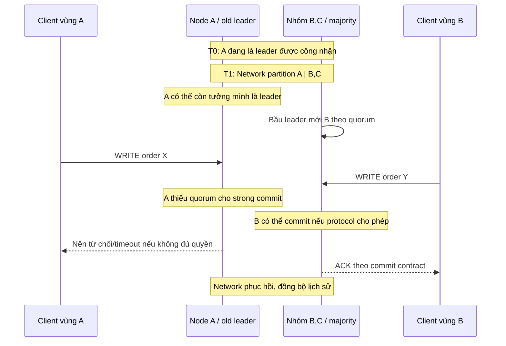
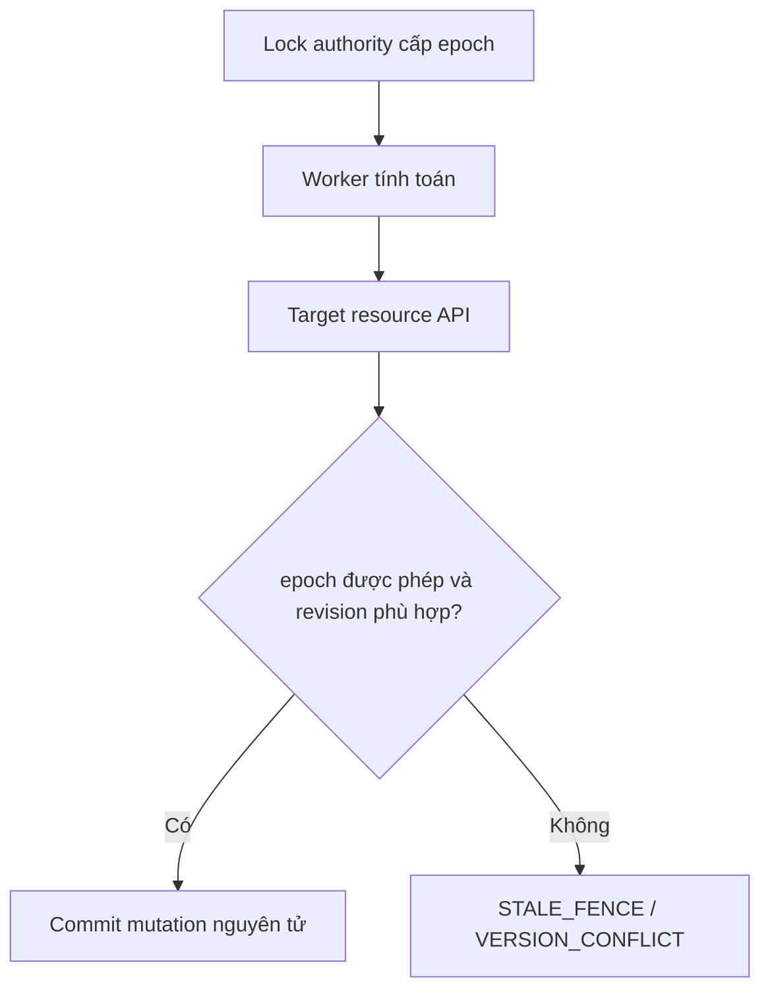

# Split-brain và nguy cơ có nhiều tác nhân cùng cho rằng mình được ghi

## 1. Hai leader xuất hiện: ai thực sự có quyền ghi?

Một dịch vụ đặt hàng lưu trữ trên ba node A, B, C. Ban đầu A là leader, B và C là followers. A nhận ghi, rồi gửi bản sao hoặc log tới các thành viên khác theo giao thức của hệ thống.

Đường mạng giữa A và nhóm B,C bị đứt. A vẫn chạy và có thể tiếp tục nhận yêu cầu từ một số clients. B,C cũng còn sống và có thể đủ điều kiện bầu leader mới. Khi đó:

- A vẫn có thể **tin** rằng mình giữ vai trò leader.
- B có thể được **công nhận** là leader mới theo giao thức đồng thuận.
- Một số clients tiếp tục gửi request tới A vì cache kết nối hoặc DNS cũ.
- Một số clients chuyển sang B.
- Nếu đường ghi không có cơ chế cưỡng chế nhất quán, cả A và B có thể tạo những cập nhật xung đột.

Tình huống nhiều phần hệ thống **cùng cho rằng mình sở hữu quyền điều khiển hoặc quyền ghi độc quyền** thường được gọi là **split-brain**. Điều nguy hiểm không chỉ là có hai biến `isLeader=true` trong bộ nhớ, mà là **có hai nguồn ra quyết định tác động lên cùng tài nguyên theo cách không thể bảo toàn bất biến nghiệp vụ**.

Ví dụ tồn kho của một sản phẩm còn đúng một chiếc:

```text
T0  Inventory SKU-42 available = 1.
T1  A là leader; B,C là followers.
T2  Mạng chia A | B,C.
T3  B,C bầu B làm leader mới.
T4  Client X gửi reserve(1) tới A.
T5  Client Y gửi reserve(1) tới B.
T6  A trả CONFIRMED cho X.
T7  B trả CONFIRMED cho Y.
T8  Mạng phục hồi: có hai đơn được hứa, nhưng chỉ một sản phẩm.
```

Nếu cả hai xác nhận thực sự thành công mà không có quota riêng hoặc reconciliation/compensation đã được định nghĩa, hệ đã vi phạm:

\[
confirmedReservations \le 1
\]

**Đây là lỗi correctness**, không chỉ là trục trặc định tuyến hoặc chậm replication.

Bài học thuộc **Database No SQL — Đồng thuận và quyền ghi**, giải thích cách split-brain phát sinh, dấu hiệu nhận biết, giới hạn của heartbeat và TTL, vai trò quorum/term/epoch, cơ chế fencing tại nơi có side effect, cùng cách xử lý trong những họ NoSQL khác nhau.

### Mục tiêu học tập

Sau bài này, bạn có thể:

1. Phân biệt **perceived leader**, **authorized writer**, **committed writer** và **stale writer**.
2. Vẽ được một network partition tạo ra hai nhóm tưởng mình có quyền.
3. Giải thích vì sao không phải mọi “hai leader” đều có nghĩa giao thức đồng thuận đã mất an toàn.
4. Mô tả quorum intersection, leader term/epoch và điều kiện commit.
5. Phân biệt consensus-based single-writer, asynchronous primary–replica và active–active multi-writer.
6. Nhận diện hậu quả của split-brain: lost update, duplicate side effect, oversell, divergent history, rollback và phục hồi phức tạp.
7. Hiểu lease expiration và stale owner sau GC pause/network partition.
8. Thiết kế fencing token và conditional write thực thi **tại tài nguyên đích**.
9. Tách bảo vệ ghi trong database khỏi bảo vệ các tác dụng ở payment gateway, object storage, message broker hoặc cache.
10. Thiết kế giám sát, kiểm thử lỗi phân tán, runbook phục hồi và bài tập thực hành.

## 2. Split-brain không chỉ có một định nghĩa vận hành

Trong thực tế, cụm từ *split-brain* được dùng ở vài lớp:

| Lớp | Hai phía tin điều gì? | Nguy cơ |
|---|---|---|
| **Cluster membership** | Mỗi nhóm nghĩ mình là cluster hợp lệ | Cấu hình, topology hoặc placement mâu thuẫn |
| **Leader election** | Hai tiến trình cùng tự coi mình là leader | Ra quyết định/điều phối trùng |
| **Data ownership** | Hai writers nghĩ mình có quyền cập nhật cùng key | Divergent writes, lost update |
| **Replication** | Hai phía cùng nhận writes trong trạng thái không đồng bộ | Conflict khi reconcile |
| **Job scheduler** | Hai workers nghĩ mình độc quyền xử lý một job | Gửi tác vụ/side effect trùng |
| **External resource** | Leader cũ và mới đều gửi lệnh tới hệ ngoài | Ghi đè file, charge hai lần, phát event trùng |
| **Disaster recovery** | Vùng chính cũ và vùng dự phòng đều nhận traffic | Hai nguồn sự thật cạnh tranh |

Điều quan trọng là **xác định ranh giới bất biến**: hai tác nhân cùng tự nhận vai trò có thể chỉ gây công việc lãng phí, hoặc có thể phá hỏng sổ cái.

### 2.1. Perceived leader

Một process có biến:

```text
isLeader = true
```

Nó có thể dựa vào health check, cache, heartbeat gần nhất hoặc lần acquire lease trước đây.

Biến này là **trạng thái cục bộ**. Trong hệ phân tán, nó có thể đã lỗi thời sau pause, partition hoặc failover.

### 2.2. Authorized leader / writer

Một **authority** theo một giao thức định nghĩa ai hiện được quyền, trong generation nào và với điều kiện gì. Ví dụ:

```text
resource = order-scheduler
currentEpoch = 42
owner = scheduler-B
```

Quyền sở hữu phải dựa trên state có consistency phù hợp, không tự suy từ một timestamp local hoặc hostname.

### 2.3. Committed writer

Một leader có thể nhận một request nhưng **không thể commit** vì không đủ quorum hoặc không đạt transaction conditions. Chỉ request đã vượt điều kiện commit của protocol mới là thành công theo bảo đảm ấy.

Do đó:

> **Hai nodes cùng nghĩ chúng là leader không tự đồng nghĩa hai nodes đều có thể commit những lịch sử xung đột trong một hệ consensus triển khai đúng.**

Lỗi có thể chỉ nằm ở *nhận thức của clients hoặc process*, trong khi đường ghi consensus vẫn từ chối phía không đủ quyền.

### 2.4. Stale writer

Một tác nhân từng có quyền, sau đó mất quyền, nhưng vẫn gửi lệnh ghi đến muộn. Đây là nguồn rủi ro lớn **ngay cả khi database coordination bên trong vẫn đúng**.

## 3. Một timeline split-brain đầy đủ

Giả sử A, B, C có cùng một nhóm dữ liệu, B và C còn kết nối với nhau khi A bị cô lập.



Trong một consensus protocol đúng, A **không được phép xác nhận commit mạnh** nếu đã mất điều kiện cần thiết. A có thể vẫn đang chạy code, nhưng không thể hợp pháp tạo committed log xung đột với B theo cùng contract.

### 3.1. Khi nào thực sự có ghi sai?

Lỗi có thể xuất hiện nếu:

- A trả business success trước khi có commit quorum.
- Một replica cho phép ghi local không ràng buộc và ứng dụng nhầm là write global.
- Force promotion làm hai primary ở hai nhóm không có protocol chung.
- Storage khác không biết leader mới và vẫn nhận write của A.
- Một script ghi trực tiếp qua đường bypass, bỏ kiểm tra epoch.
- Hai deployment độc lập cùng dùng chung external resource nhưng chỉ điều phối trong phạm vi riêng.
- Một hệ active–active cố ý nhận cả hai writes nhưng nghiệp vụ đòi độc quyền.
- Một counter/term bị rollback sau restore, làm hai holder nhận cùng generation.

### 3.2. Mạng phục hồi không đảo ngược lời hứa đã gửi

Nếu A và B đã gửi email “Đặt chỗ thành công” hoặc gateway đã thu tiền, việc replica hội tụ không tự hủy các side effects ấy.

Phục hồi dữ liệu đúng là một bước; **sửa hậu quả nghiệp vụ** có thể cần refund, cancel, audit và thông báo.

## 4. Tại sao node không thể biết chắc bên kia chết?

Trong hệ phân tán, A gửi RPC tới B nhưng không nhận được phản hồi. Điều này có thể do:

1. B crash.
2. B vẫn sống nhưng mạng A→B lỗi.
3. B nhận request nhưng response B→A mất.
4. B bị stop-the-world GC pause.
5. B quá tải và queue chậm.
6. Routing, TLS hoặc DNS gặp lỗi.
7. Disk I/O của B quá chậm để hoàn thành.
8. Cả hai còn sống nhưng không nhìn thấy nhau qua cùng tập mạng.
9. Timeout cấu hình quá thấp so với latency thực tế.

Một heartbeat timeout **không chứng minh node đã chết**. Nó chỉ cho biết node không đáp ứng trong thời hạn mà failure detector quan sát.

### 4.1. False suspicion

Nếu A không nhận heartbeat của B, A có thể nghi B đã chết và tự nhận leader. B lại không nhận heartbeat A và cũng làm tương tự. Nếu cả hai tiến hành **độc lập, không có quorum hoặc epoch protocol**, split-brain có thể xảy ra.

### 4.2. Failure detector phục vụ liveness, không tự chứng minh safety

Timeout có giá trị để cluster nhanh chóng nhận ra nghi vấn và thử phục hồi. Nhưng để bảo toàn một leader được công nhận, cần **quy tắc bầu chọn và commit với thông tin chung đủ nhất quán**.

### 4.3. GC pause là một partition theo góc nhìn bên ngoài

Một process bị pause 45 giây không phản hồi heartbeat. Nhóm khác có thể bầu leader mới. Sau khi process cũ resume, nó vẫn giữ biến và các tasks chưa bị hủy. Phải giả định nó **có thể tiếp tục gửi lệnh** nếu code không được bảo vệ.

## 5. Safety và liveness: hai mục tiêu phải tách riêng

**Safety:** không bao giờ tạo hai kết quả đã commit trái ngược với bất biến của protocol.

Ví dụ: không có hai primary cùng được phép commit log xung đột cho một consensus group.

**Liveness:** trong điều kiện nhất định, hệ có thể tiếp tục xử lý và đạt tiến triển.

Ví dụ: sau khi A crash, B/C có thể elect leader mới.

### 5.1. Đánh đổi khi partition

Khi mạng chia A | B,C, một nhóm dùng quorum majority thường:

- Cho B,C tiếp tục **nếu** họ có leader hợp lệ và đạt protocol.
- Không cho A ở minority commit theo contract mạnh.
- Có thể từ chối/timeout requests ở A dù A vẫn chạy.

Đây là hy sinh khả năng hoàn tất request ở một phía để giữ safety. Cơ chế liveness như election timeout không được phá quy tắc commit.

### 5.2. “Không có split-brain” không đồng nghĩa mọi thứ đều available

Một cluster có thể an toàn vì mọi nhóm đều từ chối ghi khi không xác định được authority. Nhưng nó không có availability tốt trong tình huống đó.

Chọn policy phải dựa trên yêu cầu nghiệp vụ, không chỉ mục tiêu “hai leader không bao giờ xảy ra”.

## 6. Quorum majority: vì sao hai phía không cùng là đa số?

Với \(N=3\) voting members, majority là:

\[
Q=\left\lfloor \frac{N}{2}\right\rfloor+1=2
\]

Các majority sets có thể là:

```text
{A,B}
{A,C}
{B,C}
```

Hai tập bất kỳ đều có ít nhất một thành viên chung.

Với \(N=5\), majority \(Q=3\), hai tập có ba thành viên trong cùng membership cố định cũng phải giao nhau.

### 6.1. Bằng chứng giao nhau đơn giản

Hai tập không giao nhau, mỗi tập ít nhất \(Q\) thành viên, sẽ cần ít nhất \(2Q\) thành viên phân biệt. Nhưng:

\[
2Q>N
\]

nên trong tập có \(N\) thành viên, hai majority sets không thể hoàn toàn tách rời.

Quorum intersection là một thành phần cốt lõi cho consensus, nhưng **không tự chứng minh mọi điều kiện của linearizability**.

### 6.2. Chỉ đếm node là chưa đủ

Các protocol như Raft/Paxos còn cần:

- Thuật ngữ term/ballot.
- Quy tắc bỏ phiếu.
- Nhận diện leader hợp lệ.
- Log matching hoặc cơ chế history consistency.
- Persistence của state đã hứa.
- Quy tắc commit.
- Membership changes có giao nhau hợp lệ.
- Recovery sau crash và restore.
- Quy tắc read consistency.

Một “quorum” do lập trình viên tự đếm hai HTTP 200 nhưng bỏ qua term/log version có thể không đủ bảo vệ split-brain.

### 6.3. Chẵn hay lẻ?

Trong nhiều bố cục majority, ba voting members chịu được mất một member, bốn members cũng thường chỉ chịu được mất một member để còn quorum ba. Điều này khiến số lẻ thường hiệu quả về tỷ lệ fault tolerance.

Tuy nhiên thiết kế thực tế phụ thuộc placement, witness, data nodes vs voters và protocol. Không thêm voter chỉ để tăng số node mà không tính quorum/failure domains.

## 7. Quorum không có nghĩa cả hai phía đều phải ngừng

Khi A | B,C:

```text
A:   1 / 3 votes
B,C: 2 / 3 votes
```

Nếu B,C có quorum, một leader hợp lệ ở B/C có thể commit. A minority không thể commit cùng consensus group theo contract.

Nếu clients chỉ tới được A, họ có thể nhận lỗi dù phần còn lại của hệ vẫn hoạt động. Nếu router có đường tới B/C, rerouting có thể khôi phục khả năng phục vụ.

### 7.1. Availability là tính chất của request path

Một service có quorum ở B,C nhưng proxy ở A không kết nối được B,C thì người dùng ở A vẫn có thể thấy `503` hoặc timeout.

### 7.2. Một leader cũ có thể phục vụ stale read

Nếu API cho phép local eventual/serializable read, A có thể trả dữ liệu cũ theo contract. Nhưng nó không được trả giá trị cũ **như một linearizable read** sau khi B/C đã commit write mới tương ứng, nếu hệ đòi mạnh.

### 7.3. Quorum và cross-cluster data

Hai **cluster khác nhau** mỗi cluster đều có majority của chính nó nhưng cùng ghi vào một tài nguyên ngoài, chúng không có quorum chung để bảo vệ invariant ngoài hệ. Mỗi cluster tự đúng không làm quyền ghi vào cùng external resource trở nên độc quyền.

## 8. Term, epoch và generation: đặt thứ tự cho quyền lãnh đạo

Một **term/epoch** là số thế hệ được quản lý bởi authority. Mỗi vòng bầu leader hoặc cấp quyền mới có thể nhận một generation tăng.

Ví dụ:

```text
Term 17 -> Leader A
A bị cô lập
Term 18 -> Leader B
A resume, mang term 17
```

Một thành viên nhận thông tin term 18 theo protocol cần bỏ nhận các yêu cầu lãnh đạo/append trái điều kiện từ term cũ. Tuy nhiên, **một external database khác không tự biết term 18** nếu không có guard.

### 8.1. Vì sao epoch nên tăng đơn điệu?

Nếu sau failover authority vô tình quay về term 16 hoặc tái dùng 17, client hoặc resource target không thể phân biệt generation cũ và mới một cách tin cậy.

State dùng để phát generation cần durability và consistency phù hợp. Restore từ snapshot cũ phải có recovery protocol, không chỉ restart counter.

### 8.2. Epoch cần phạm vi so sánh

Term 18 của shard A không nhất thiết so với term 200 của shard B. Có thể dùng:

```text
(resourceId, epoch)
```

hoặc một tuple có cluster/incarnation ID:

```text
(clusterGeneration, resourceGeneration)
```

Tùy thiết kế, **chỉ so sánh trong cùng namespace và authority**. Một số số lớn hơn nhưng từ cluster không được ủy quyền không được coi là token hợp lệ.

### 8.3. Epoch không phải authentication

Nếu user ngoài hệ có thể gọi API:

```text
write(resource, epoch=999999)
```

và server nhận chỉ vì số lớn hơn, đây là lỗ hổng authorization hoặc lock poisoning. Epoch phải được liên kết với quyền cấp thực sự và caller được xác thực.

## 9. Raft: hai người tự xưng leader chưa chắc commit được hai lịch sử

Raft là một giao thức đồng thuận hướng leader. Một node có thể trong thời gian ngắn tin mình giữ chức leader khi đã bị cô lập. Nhưng trong một triển khai đúng với persistence, voting, term và commit rules:

- Leader phía minority không thể commit log entries mới yêu cầu majority.
- Majority có thể elect leader theo term cao hơn.
- Node cũ sẽ nhận ra term mới khi giao tiếp lại và thay đổi vai trò.
- Các committed entries phải tuân những tính chất safety của Raft.

### 9.1. Timeline ý tưởng

```text
T0  A leader term 9, có quorum.
T1  A bị chia khỏi B,C.
T2  B,C elect B term 10.
T3  B append/commit entry X theo majority.
T4  A vẫn còn state isLeader(term 9).
T5  A nhận write Y nhưng không thể commit majority.
T6  A reconnect, gặp term 10 và step down.
```

Nếu A đã trả **business success** cho Y ở T5 mà không có commit guarantee, đó là lỗi ở đường ACK/application semantics, không có nghĩa quy tắc commit của Raft yêu cầu phải chấp nhận Y.

### 9.2. Term cao hơn không tự đủ nếu log chưa đúng

Quy tắc bầu leader và an toàn log cần xem log freshness/entries. Chỉ phát một số term cao rồi chọn node bất kỳ có thể khiến committed entries bị mất.

### 9.3. Membership changes cần giao thức

Đổi voting members từ {A,B,C} sang {A,D,E} không được áp dụng tùy tiện ở hai phía độc lập. Một số thuật toán dùng joint consensus hoặc cơ chế tái cấu hình có bảo đảm intersection; không xóa/thêm thành viên bằng script mà bỏ qua contract của consensus engine.

### 9.4. Consensus chỉ bảo vệ state thuộc nó

Raft có thể an toàn cho log của cluster nhưng không tự bao:

- Lệnh charge tới payment gateway.
- Put object tới external storage.
- Email đã gửi.
- Cập nhật một Redis key ngoài group.
- Một worker viết SQL/NoSQL ngoài transaction của consensus state.

Đây là nơi stale leader cần **fencing ở đích**.

## 10. Lease không làm tiến trình cũ biến mất

Một lease là quyền có thời hạn, thường cần keepalive.

```text
A acquire lease token 41, TTL 15s.
A chạy job.
A bị GC pause 30s.
Lease A hết hạn.
B được cấp lease token 42.
B cập nhật kết quả.
A resume, gửi write cũ.
```

Lock service có thể hoạt động đúng, nhưng A vẫn có khả năng phát write.

### 10.1. Timeout và clock

Không nên coi:

```text
localNow < expiresAt
```

là bằng chứng tuyệt đối A còn quyền nếu clocks lệch, process pause, network delay hoặc authority đã chuyển quyền. Local monotonic clock giúp client dừng sớm, nhưng không thay target guard.

### 10.2. Renew thất bại

Một worker không nhận được ACK renew không biết chắc renewal đã thành công hay chưa. Policy bảo thủ là tạm ngừng side effect mới, kiểm tra lại quyền theo contract, và vẫn cần guard ở nơi nhận những write in-flight.

### 10.3. Release trễ

A có thể release sau khi lease A đã hết hạn và B đã acquire. Một `DELETE lockKey` vô điều kiện từ A có thể xóa khóa B. Release phải xác minh owner/generation **trong cùng atomic operation**.

### 10.4. Session callback đến muộn

Không nhận được sự kiện session lost không chứng minh session còn hợp lệ. A có thể đang pause và chưa xử lý callback khi authority đã giải phóng quyền.

## 11. Fencing token: đưa thế hệ quyền đến nơi nhận write

Một **fencing token** là generation tăng đơn điệu cho các lần cấp quyền được công nhận.

```text
A được cấp token 41.
A mất lease.
B được cấp token 42.
```

Storage giữ một mốc generation và thực hiện compare-and-write nguyên tử:

```text
B gửi write(valueB, token=42):
  nếu 42 >= highestSeenFence:
     highestSeenFence = 42
     value = valueB
     ACK

A gửi write(valueA, token=41):
  nếu 41 < highestSeenFence(42):
     REJECT STALE_FENCE
```

Nhờ đó, một lệnh từ A đến **sau khi target đã công nhận token 42** không ghi đè kết quả B.

### 11.1. Tính chất của token

1. Tăng theo lần cấp quyền mới.
2. Không tái dùng trong cùng resource scope.
3. Không quay lùi khi authority failover/restore.
4. Được cấp từ một authority có consistency phù hợp.
5. Không dùng UUID ngẫu nhiên thay cho **thứ tự**.
6. Được truyền qua mỗi mutation cần bảo vệ.
7. Được kiểm tra **nguyên tử tại target**.
8. Không thay cho authentication/authorization.
9. Có giới hạn overflow và encoding an toàn (ví dụ 64-bit integer).
10. Có recovery protocol khi state generation bị nghi là sai.

### 11.2. UUID owner khác fencing token

```json
{
  "resourceId": "daily-report",
  "ownerId": "5cfa412c-93db-41fa-84ee-4e74f10c8210",
  "fence": 42,
  "leaseState": "ACTIVE"
}
```

`ownerId` giúp so đúng người được release/renew. `fence` giúp biết generation nào mới hơn. Hai UUID khác nhau không có ý nghĩa thứ tự thế hệ khi so từ điển.

### 11.3. Target không kiểm token = token vô nghĩa

Nếu ứng dụng chỉ ghi:

```text
PUT /reports/daily.json
X-Fencing-Token: 42
```

nhưng object storage bỏ qua header và ghi đè vô điều kiện, A có token 41 vẫn có thể đến sau và ghi đè. Cần conditional mutation/ETag hoặc proxy có guard có hiệu lực.

## 12. Giới hạn quan trọng: highest-seen fence khác quyền hiện hành

Có một khoảng trống cần hiểu rõ.

```text
T0 Target highestSeenFence = 41.
T1 A hết lease.
T2 Authority cấp B token=42.
T3 Target chưa thấy token 42.
T4 A gửi write với token=41.
T5 B mới gửi write với token=42.
```

Ở T4, nếu target chỉ kiểm `token >= highestSeenFence`, thì 41 vẫn có thể được nhận.

Vì vậy, **highest-seen fencing** bảo vệ theo nghĩa:

> Một khi target đã công nhận generation 42, target từ chối write generation 41 đến sau.

Nó **không tự bảo đảm**:

> Ngay tại thời điểm authority cấp generation 42, mọi resource đã từ chối mọi write generation 41.

### 12.1. Đăng ký fence ở target

B có thể gọi:

```text
registerFence(resource, 42)
```

và chỉ bắt đầu business writes sau khi target xác nhận. Lúc ấy old writes đến sau đăng ký bị chặn. Nhưng giữa grant tại authority và register ở target vẫn có thể có khoảng trống.

### 12.2. Muốn cấm ghi tức thì từ thời điểm chuyển quyền?

Cần thiết kế mạnh hơn, ví dụ:

- Quyền owner/generation và mutation nằm trong **cùng authoritative consistency domain**.
- Transaction/conditional write kiểm tra current authorized generation lúc commit.
- Một service proxy có quyền cưỡng chế mutation và kiểm guard nguyên tử.
- Protocol chuyển giao quyền có điểm tuyến tính hóa rõ ràng được các writers tuân theo.

Một RPC hỏi lock service “tôi còn quyền không?” rồi một RPC ghi khác **vẫn có cửa sổ TOCTOU**, vì quyền có thể đổi giữa hai lệnh.

### 12.3. Fencing không tự ngăn old write trong cùng generation bị đảo thứ tự

B token 42 phát hai updates `revision 10→11` rồi `11→12`. Nếu mạng giao ngược, cả hai cùng token 42. Cần CAS revision, per-operation sequence hoặc monotonic checkpoint, không chỉ token.

### 12.4. Một thiết kế với currentAuthorizedFence

Nếu DB lưu `currentEpoch=42` và write chỉ match khi `workerEpoch==currentEpoch` trong cùng atomic mutation, A token 41 bị chặn. Để bảo vệ từ đúng thời điểm chuyển quyền, thao tác cập nhật currentEpoch và quyền commit phải cùng ranh giới nhất quán đã xác định.

## 13. Split-brain và mất dữ liệu do primary replication bất đồng bộ

Không phải mọi hệ primary–replica đều dùng consensus cho từng write.

Một kịch bản:

```text
A primary nhận write X và ACK ở mức yếu.
X chưa replicate sang B.
A bị cô lập/crash.
B được promote thành primary.
B không có X.
Một client đọc B và không thấy X.
```

Đây là rủi ro **rollback/lost acknowledged write** theo durability/write concern của deployment. Nếu A tiếp tục nhận writes trong lúc B đã được promote, có thể có hai histories khác nhau và split-brain ở tầng dữ liệu.

### 13.1. ACK có nghĩa gì?

Một request được ACK có thể chỉ:

- Đã đến process.
- Đã ghi memory/cache.
- Đã persisted local log.
- Đã replicated đến một số replicas.
- Đã được majority/quorum công nhận.
- Đã commit transaction.
- Mới được đưa vào durable queue.

Không gộp các mức này thành một loại “thành công” khi phân tích split-brain.

### 13.2. Giảm rủi ro

- Chọn write concern/durability phù hợp.
- Dùng election/quorum protocol đúng.
- Không cho old primary tiếp tục business write theo contract mạnh.
- Fencing external side effects.
- Có idempotency/operation ledger.
- Không force-promote bằng cách bỏ qua dữ liệu chưa đối soát.
- Kiểm tra restore/failover semantics và các trường hợp ACK unknown.

## 14. Active–active multi-writer: hai writers có thể là thiết kế, không phải lỗi election

Một số hệ phân tán cố ý cho nhiều vùng nhận writes cùng lúc. Đây là **multi-writer replication**.

Ví dụ:

```text
Region A: cập nhật profile.displayName = "Mai"
Region B: cập nhật profile.displayName = "Lan"
```

Khi mạng phục hồi, có thể phát sinh conflict. Việc có hai writers ở đây **không nhất thiết là split-brain sai cấu hình**, vì ứng dụng có thể chủ động chấp nhận writes concurrent theo contract.

### 14.1. Nhưng bất biến vẫn cần bảo vệ

Nếu hai regions cùng xác nhận bán chiếc vé cuối cùng, conflict resolution sau đó không tự làm cả hai promises đúng.

### 14.2. Một số cách xử lý

- Last-write-wins với rủi ro mất update.
- Version vectors/causal metadata.
- CRDT phù hợp cho phép toán commutative.
- Ownership per tenant/key/region.
- Escrow/quota preallocation.
- Conditional mutation tại một authoritative source.
- Business conflict/reconciliation/compensation.

### 14.3. Không gọi mọi xung đột là split-brain

Nếu multi-writer cố ý cho phép hai cập nhật và quy tắc merge được công bố, đây là conflict bình thường của model. Nếu một tài nguyên được thiết kế single-writer nhưng hai người cùng tự xưng owner, đó mới là split-brain theo nghĩa phổ biến.

## 15. Phân loại hậu quả theo business invariant

| Tài nguyên | Nếu hai writers cùng xác nhận | Hậu quả |
|---|---|---|
| Một ticket cuối | Hai đơn CONFIRMED | Oversell/double booking |
| Ví tiền | Hai debit từ cùng balance cũ | Số dư sai/negative |
| Leader scheduler | Hai dispatch cho cùng job | Duplicate processing |
| Inventory counter | Hai update từ snapshot cũ | Lost update |
| Object `latest.json` | Writer cũ đè kết quả mới | Stale report |
| Permission policy | Owner cũ cấp quyền sau revoke | Lỗ hổng bảo mật |
| Schema migration | Hai migrations tranh nhau | Data corruption |
| Email notification | Gửi email hai lần | Khó thu hồi |
| Payment gateway | Charge hai lần | Tranh chấp tài chính |
| Cache rebuild | Bản cũ thay bản mới | Stale UI |
| Telemetry append | Hai batches cùng ID | Duplicate records |
| CRDT counter | Đồng thời increment ở hai vùng | Có thể merge nếu protocol đúng |
| Comment độc lập | Hai comments khác IDs | Có thể giữ cả hai |

Chọn biện pháp theo **mức độ có thể bù trừ** và yêu cầu không bao giờ vi phạm bất biến, không chỉ số RPS.

## 16. Split-brain của scheduler: consensus đúng mà công việc vẫn sai

Một scheduler dùng lock service để chọn leader:

```text
A có lease epoch 9.
A bắt đầu chạy job.
A bị GC pause.
Lease A hết hạn.
B được cấp epoch 10.
B chạy job, lưu kết quả.
A resume và lưu kết quả cũ.
```

Lock service đã chuyển quyền đúng, nhưng job/result store có thể vẫn nhận A.

### 16.1. Luồng cần có



### 16.2. Dừng chủ động vẫn cần

A khi biết mất lease nên ngừng phát sinh task mới, hủy work có thể hủy và ngừng renew. Nhưng việc dừng là **cooperative**, không thay target-side guard.

### 16.3. Message broker có thể giao event cũ muộn

A epoch 9 gửi event trước khi mất lease, broker giao sau khi B epoch 10 đã cập nhật state. Consumer phải biết khi nào bỏ event epoch cũ, hoặc dùng source version/idempotency đúng phạm vi.

Chỉ kiểm leader tại publisher không đủ nếu side effect thực xảy ra ở consumer.

## 17. MongoDB: election, primary và write concern

MongoDB replica set có election và khái niệm primary/secondary. Khi primary bị cô lập, các thành viên đủ điều kiện có thể bầu primary mới theo protocol. Một primary cũ có thể mất quyền ghi hoặc bị step down, tùy diễn biến topology.

### 17.1. Không đồng nhất primary preference với quyền commit

Client có thể còn kết nối/metadata về primary A cũ, nhưng server/driver phải xử lý lỗi state change và retry theo topology được công nhận.

### 17.2. Majority write concern

Ví dụ:

```javascript
db.orders.insertOne(
  {
    _id: "O42",
    sku: "SKU-42",
    status: "PENDING"
  },
  {
    writeConcern: { w: "majority", wtimeout: 3000 }
  }
);
```

Cần hiểu:

- Majority ACK theo contract của deployment tăng bảo đảm trước một số failovers.
- Nếu không đủ majority, có thể timeout hoặc không đạt ACK.
- `wtimeout` không tự chứng minh write chưa được thực hiện: kết quả commit có thể chưa rõ, cần lookup/idempotency.
- Một write concern yếu hơn có thể ACK sớm và có khả năng rollback khi failover theo failure model.

Không trả “order confirmed” chỉ vì một node đã nhận write nếu nghiệp vụ cần hơn thế.

### 17.3. Conditional update tại record đích

Giả sử một leader epoch được quản lý đáng tin và đã được đăng ký trong document:

```javascript
db.jobs.insertOne({
  _id: "JOB-42",
  currentEpoch: NumberLong("10"),
  revision: NumberLong("7"),
  status: "RUNNING",
  checkpoint: NumberLong("300")
});
```

Worker B epoch 10 ghi checkpoint, chỉ khi revision còn đúng:

```javascript
const result = db.jobs.updateOne(
  {
    _id: "JOB-42",
    currentEpoch: NumberLong("10"),
    revision: NumberLong("7")
  },
  {
    $set: {
      checkpoint: NumberLong("350")
    },
    $inc: { revision: NumberLong("1") }
  }
);

if (result.matchedCount !== 1) {
  // Kiểm tra lại: epoch cũ, revision conflict,
  // job không tồn tại hoặc trạng thái không hợp lệ.
}
```

Nếu A mang epoch 9, filter không match. Do check và update trong **cùng document mutation**, không có cửa sổ đọc-rồi-ghi rời.

### 17.4. Đăng ký epoch mới

Một service được ủy quyền có thể nâng epoch:

```javascript
db.jobs.updateOne(
  {
    _id: "JOB-42",
    currentEpoch: { $lt: NumberLong("11") }
  },
  {
    $set: {
      currentEpoch: NumberLong("11")
    }
  }
);
```

Cần phân quyền thao tác này, sử dụng generation thực sự đã được authority cấp. Nếu target chưa nhận epoch 11 thì epoch 10 có thể vẫn match; **registration gap** phải được xét khi tuyên bố guarantee.

### 17.5. Ghi guard và payload khác documents

Nếu guard ở document A và payload ở document B, hai writes rời nhau không tự atomic. Khi cần invariant giữa chúng, dùng multi-document transaction nếu phù hợp, hoặc thiết kế một điểm commit có điều kiện trên cùng aggregate.

### 17.6. Không “sửa” failover bằng force primary tùy ý

Force reconfiguration hoặc phục hồi primary dựa trên bản sao không đủ cập nhật có thể gây mất dữ liệu hay topology không mong muốn. Cần theo tài liệu sản phẩm và runbook, không biến thao tác vận hành khẩn cấp thành thủ tục thường xuyên.

## 18. Redis Sentinel và Redis Cluster: không đánh đồng failover với consensus commit

Redis thường được dùng theo nhiều topology, ví dụ primary–replica với Sentinel hoặc Redis Cluster. Đặc điểm replication và failover phải được đánh giá theo đúng phiên bản/cấu hình.

### 18.1. Replication bất đồng bộ

Một kịch bản:

```text
A primary nhận SET key=v2, trả ACK.
A crash trước khi replica B nhận v2.
B được promote.
GET key ở B thấy v1.
```

Đây là rủi ro dữ liệu đã ACK ở một mức được chọn nhưng chưa replicate. Nếu A phục hồi và clients cũ vẫn nói chuyện với A, có thể có trạng thái divergent theo khoảng thời gian/topology.

### 18.2. Sentinel và nhận diện primary

Sentinel hỗ trợ giám sát/automatic failover theo cơ chế voting/quorum của chính nó. Tuy nhiên không nên suy:

- Mọi write đã ACK ở primary cũ đều tồn tại ở primary mới.
- Hai vùng bị partition không thể gặp mọi dạng divergence.
- Một Redis lock với TTL tự bảo vệ writes tới một DB khác.
- Một leader election thành công tạo transaction đa hệ.

### 18.3. Redis Cluster

Redis Cluster dùng hash slots và những quy tắc về failover, availability, cluster size và cấu hình. Một minority/network partition có thể ngừng phục vụ writes theo mode tương ứng, nhưng không thể kết luận mọi deployment có cùng guarantees với một consensus database linearizable.

Client cần xử lý routing thay đổi, MOVED/ASK, retries và failure model của replication. Không coi command đã gửi mà mất ACK là chắc chắn chưa thực hiện.

### 18.4. Lock Redis SET NX PX

```redis
SET lock:job42 owner-b07 NX PX 15000
```

Đây là một mẫu acquire lease trên một key. Owner ID giúp release đúng holder; **không phải fencing token tăng thứ tự**.

Script Lua compare-and-delete:

```lua
-- KEYS[1] = lock key
-- ARGV[1] = owner ID
if redis.call("GET", KEYS[1]) == ARGV[1] then
    return redis.call("DEL", KEYS[1])
end
return 0
```

Một release trễ từ A không được xóa khóa của B. Tuy vậy, script chỉ bảo vệ **key lock trong Redis**, không cấm A đã mất lease gửi write đến MongoDB hoặc object storage.

### 18.5. Counter `INCR` cũng có giới hạn

Một Redis `INCR` có tính nguyên tử trên instance nhưng nếu hệ replication/failover cho phép rollback counter đã phát, token có thể bị tái sử dụng. Muốn fencing nghiêm ngặt, authority phải bảo đảm sequence continuity theo failure model. Không tách tăng sequence khỏi protocol grant rồi cho nhiều owners tự chọn generation.

## 19. etcd: consensus/lease không tự hủy stale external writer

etcd dùng consensus quản lý KV, revisions, leases và concurrency primitives. Nó có thể là một nguồn authority phù hợp cho nhiều coordination tasks, với điều kiện dùng đúng API, consistency mode và protocol.

### 19.1. Authority có leader/quorum

Một thành viên phía minority thường không thể commit những mutations cần quorum. Majority có thể bầu leader mới và tiến triển.

### 19.2. Lease được thu hồi/hết hạn

Khi A mất session/lease, key gắn lease có thể bị xóa theo semantics. B có thể acquire. A vẫn có thể đang chạy khi quay lại từ pause.

### 19.3. Sử dụng revision làm generation phải đúng protocol

Trong một số lock patterns, creation revision của contender key có thể làm cơ sở thứ tự/fencing token. Nhưng:

- Không mặc định lease ID là một số fencing tăng.
- Không dùng một revision từ key không gắn với grant.
- Cần bảo vệ tính không tái dùng qua disaster recovery/restore.
- Target DB khác phải thực thi token trong mutation.

### 19.4. Linearizable check rồi external PUT vẫn có race

```text
if etcd says worker A owns lock:
    externalDb.put(...)
```

Giữa check và put, lease có thể hết hạn. Để bảo vệ effect, target cần atomic generation guard hoặc một protocol quyền–ghi có cùng điểm tuyến tính hóa.

## 20. ZooKeeper: session expiration và ephemeral sequential locks

ZooKeeper dùng session và ephemeral znodes; một lock recipe có thể tạo ephemeral sequential nodes:

```text
/locks/job42/lock-0000000101
/locks/job42/lock-0000000102
```

Client sở hữu node đủ điều kiện theo recipe. Khi session của A hết hạn, ephemeral node của nó biến mất và B có thể tiếp quản.

### 20.1. Nguy cơ stale process

A bị GC pause lâu hơn session timeout. Sau đó A resume và gửi một write tới external store. ZooKeeper không thể ngăn CPU A chạy tiếp.

### 20.2. Sequence và fencing

Sequential node numbers có thể hỗ trợ fencing nếu đúng acquisition protocol, scope và continuity khi namespace/cluster được khôi phục. Cần target-side enforcement; chỉ có thứ tự node trên ZooKeeper không đủ bảo vệ một object store ngoài.

### 20.3. Watcher không phải bằng chứng quyền

Không nhận watcher event session lost không có nghĩa A còn quyền. Event xử lý muộn, mất kết nối hoặc quá tải có thể khiến state cục bộ stale.

## 21. Cassandra: leaderless replication không giống split-brain primary

Apache Cassandra thường không có một primary/leader duy nhất cho mỗi partition theo mô hình MongoDB. Coordinators có thể nhận requests rồi liên hệ replicas theo consistency level.

Trong một số failure scenarios, nhiều phía có thể thực hiện writes theo consistency level cho phép; các bản sao có thể cần reconcile theo timestamp/repair protocol.

### 21.1. Vì sao không gắn nhãn “hai Cassandra leaders”?

Nếu architecture vốn không có unique leader cho key, mô tả đúng là **concurrent writes, replica divergence hoặc consistency conflict**, không phải nhất thiết là split-brain leader election.

### 21.2. CL=ONE và CL=QUORUM

Nếu replication factor là ba trong một data center:

- `ONE` có thể cho write/read hoàn tất với một replica phù hợp theo contract.
- `QUORUM` cần quorum tương ứng.
- Ở partition 1|2, phía chỉ có một replica có thể không thỏa `QUORUM`, nhưng một số writes ở CL yếu hơn có thể được nhận.

Không tự coi đáp ứng CL=ONE là **serializable business transaction**.

### 21.3. LWW và timestamp không bảo vệ mọi invariant

Hai writes đồng thời có thể được giải quyết theo timestamp, tùy schema/engine semantics. LWW có thể mất một update hợp lệ.

Một lệnh tạo order theo điều kiện uniqueness hoặc decrement tồn kho cần primitive phù hợp, ví dụ lightweight transaction theo phạm vi hỗ trợ hoặc một authority/escrow model. Chỉ tăng consistency level không tự biến mọi multi-row workflow thành atomic transaction.

### 21.4. Tombstone và recovery

Nếu một replica offline lâu không thấy deletion, phải quan tâm repair/tombstone retention để tránh dữ liệu cũ hồi sinh. Đây là một rủi ro đồng bộ dữ liệu, có thể liên quan một phân hoạch kéo dài nhưng không được diễn giải đơn giản là “node cũ trở lại làm leader”.

## 22. DynamoDB và global tables: multi-region có contract riêng

DynamoDB cung cấp conditional writes, transactions và các lựa chọn replication. Cần phân biệt **một authoritative region/table** với **multi-region global tables** theo mode thực tế.

### 22.1. Conditional write ở một item

Giả sử một guard record:

```json
{
  "PK": "JOB#42",
  "SK": "STATE",
  "currentEpoch": 12,
  "revision": 6,
  "status": "RUNNING"
}
```

Worker epoch 12 có thể update khi đúng generation và revision:

```json
{
  "TableName": "Jobs",
  "Key": {
    "PK": {"S": "JOB#42"},
    "SK": {"S": "STATE"}
  },
  "UpdateExpression": "SET #st = :next, revision = revision + :one",
  "ConditionExpression": "currentEpoch = :epoch AND revision = :rev",
  "ExpressionAttributeNames": {
    "#st": "status"
  },
  "ExpressionAttributeValues": {
    ":next": {"S": "COMPLETE"},
    ":epoch": {"N": "12"},
    ":rev": {"N": "6"},
    ":one": {"N": "1"}
  }
}
```

Điều kiện được kiểm theo semantics của item mutation tại nơi thao tác, giúp chặn stale epoch **nếu epoch mới đã được đăng ký đúng**.

### 22.2. Hai regions có cùng local guard?

Trong một global-table mode cho phép các regions nhận writes độc lập và giải quyết conflict bằng asynchronous replication, một conditional write được chấp nhận ở region A **không tự chứng minh** condition tương ứng sẽ ngăn một write đồng thời ở region B.

Ví dụ cả A và B cùng đọc `available=1` tại các replicas khác nhau rồi decrement local có thể dẫn tới hai xác nhận. Cần xác định đúng consistency mode của global tables, single-writer ownership hoặc escrow/quota.

### 22.3. Mode và features thay đổi theo dịch vụ

Không nói tất cả DynamoDB global tables đều có một mô hình consistency duy nhất. Các mode/khả năng multi-region có thể thay đổi theo thời gian. Khi triển khai phải kiểm tra tài liệu của đúng mode và transaction scope.

### 22.4. GSI không tự làm guard

Một query GSI có thể eventual. Để xác minh quyền/uniqueness, dùng authoritative key và conditional write/transaction phù hợp; không dùng “không tìm thấy ở GSI” làm bằng chứng item chưa được tạo.

## 23. Object storage: không thể fence bằng một header bị bỏ qua

Hai workers ghi cùng key:

```text
B epoch=12 -> PUT reports/latest.json = versionB
A epoch=11 -> PUT reports/latest.json = versionA (đến muộn)
```

Nếu API chỉ là unconditional PUT, A có thể ghi đè B. Việc đưa `epoch` vào request body/log không tự có tác dụng.

### 23.1. Immutable artifact + authoritative pointer

Một phương án:

```text
reports/job42/epoch-11/result.json
reports/job42/epoch-12/result.json
```

Mỗi worker chỉ tạo artifact theo generation của mình. Một document/item có điều kiện giữ:

```json
{
  "jobId": "42",
  "currentEpoch": 12,
  "currentResultObject": "reports/job42/epoch-12/result.json",
  "revision": 8
}
```

B commit pointer theo CAS/epoch. A đến muộn vẫn có thể tạo artifact cũ, nhưng không được cập nhật pointer về thế hệ 11.

### 23.2. Cần xử lý orphan artifacts

- Ghi artifact thành công, commit pointer thất bại.
- Old generation hoàn tất quá muộn.
- Retry tạo cùng object nhiều lần.
- TTL/delete lifecycle không phù hợp.
- Backups vẫn giữ bản cũ.

Có thể dùng cleanup theo operation state, retention và reconciliation. Không quét “file có timestamp mới nhất” rồi mặc định đó là output chính thức.

### 23.3. Conditional object writes

Nếu object store hỗ trợ ETag/If-Match/If-None-Match hay versioning thích hợp, có thể dùng làm thành phần guard. Phải kiểm tra semantics và atomicity của API cụ thể, không gán một contract giống nhau cho mọi provider.

## 24. Thanh toán và email: fencing database chưa bảo vệ side effect bên ngoài

Giả sử A và B cùng chạy workflow thanh toán. Orders DB đã có fence 12, nên A epoch 11 không sửa order được. Nhưng A vẫn có thể gọi payment gateway:

```text
POST /charge(order42, amount=100)
```

Nếu gateway không kiểm epoch, charge có thể xảy ra dù Orders DB từ chối cập nhật.

### 24.1. Idempotency ở provider

Sử dụng idempotency key ổn định theo **logical payment intent**, không theo mỗi worker:

```text
Idempotency-Key: charge-order42-v1
```

Khi A/B/retry cùng logical charge, gateway có thể trả cùng outcome theo contract provider. Tuy nhiên thời gian lưu key, scope, body equality và semantics cần được xác minh.

### 24.2. Authoritative payment intent

Một luồng:

1. Transaction/conditional claim tạo payment intent duy nhất.
2. Worker được phép xử lý intent.
3. Gọi gateway với idempotency key của intent.
4. Ghi nhận kết quả/unknown outcome.
5. Đối soát với gateway trước retry gây side effect.
6. Chuyển state bằng conditional mutation.
7. Nếu cần, compensation/refund theo quy trình nghiệp vụ.

### 24.3. Email không thể “unsend”

Ngay cả khi DB rollback một email job do leader cũ tạo, email đã gửi có thể không thu hồi được. Cần durable outbox/unique notification ID và dedup tại dispatcher; nếu provider không hỗ trợ idempotency, cần chấp nhận và giảm rủi ro duplicate theo UX/operations.

## 25. Outbox và event processing khi hai leaders cùng publish

Một workflow ghi database rồi publish event qua broker:

```text
db.update(order)
broker.publish(OrderConfirmed)
```

Nếu worker crash giữa hai bước hoặc leader cũ publish muộn, state và events có thể lệch.

### 25.1. Transactional outbox

Trong cùng transaction/commit domain khi được hỗ trợ:

- Ghi business state.
- Ghi outbox record với event ID.
- Một publisher đọc outbox và publish sau.

Consumer xử lý idempotently vì delivery có thể at-least-once.

### 25.2. Epoch tại consumer

Nếu events có `writerEpoch`, consumer chỉ có thể dùng epoch để fence khi:

- Epoch thuộc đúng resource scope.
- Có authoritative state hoặc high-water mark hợp lệ.
- Condition và side effect được bảo vệ.
- Chấp nhận được giới hạn registration/highest-seen nếu target chỉ biết những epochs từng đến.

### 25.3. Thứ tự broker khác thứ tự commit

A epoch 11 có thể gửi message trước khi B epoch 12 commit, nhưng broker giao sau. Timestamp client và arrival order không đủ để quyết định message nào mới hơn.

Cần operation ID, source entity revision/epoch và business state machine.

## 26. Java 17: mô phỏng target-side epoch guard

Đoạn code dưới đây mô phỏng một tài nguyên **trong một JVM**. Nó giúp hiểu quy tắc kiểm generation và version nguyên tử, **không phải distributed lock implementation**. Trong production, phải thực thi cơ chế này ở DB hoặc service có tính nhất quán phù hợp.

```java
import java.util.Objects;

public final class EpochGuardedJob {
    private long currentEpoch = 0L;
    private long revision = 0L;
    private String result = "";

    // Service có quyền đăng ký epoch mới.
    public synchronized void registerEpoch(long epoch) {
        if (epoch <= currentEpoch) {
            throw new IllegalStateException("EPOCH_NOT_ADVANCING");
        }
        currentEpoch = epoch;
    }

    public synchronized long commit(
            long workerEpoch,
            long expectedRevision,
            String newResult
    ) {
        Objects.requireNonNull(newResult);

        if (workerEpoch != currentEpoch) {
            throw new IllegalStateException("STALE_EPOCH");
        }

        if (expectedRevision != revision) {
            throw new IllegalStateException("VERSION_CONFLICT");
        }

        result = newResult;
        revision++;
        return revision;
    }

    public synchronized Snapshot snapshot() {
        return new Snapshot(currentEpoch, revision, result);
    }

    public record Snapshot(
        long epoch, long revision, String result
    ) {}

    public static void main(String[] args) {
        var job = new EpochGuardedJob();

        // Old leader A.
        job.registerEpoch(11);
        Snapshot oldSnapshot = job.snapshot();

        // Worker A bị pause; B được cấp quyền mới.
        job.registerEpoch(12);
        job.commit(12, job.snapshot().revision(), "B's output");

        // A resume và cố ghi theo generation cũ.
        try {
            job.commit(
                11,
                oldSnapshot.revision(),
                "A's stale output"
            );
            throw new AssertionError("Stale write accepted");
        } catch (IllegalStateException expected) {
            System.out.println(expected.getMessage());
            // STALE_EPOCH
        }

        System.out.println(job.snapshot().result());
        // B's output
    }
}
```

### 26.1. Điều đoạn code chứng minh

- Sau `registerEpoch(12)`, token 11 bị từ chối.
- Revision độc lập với generation, nên một worker cùng epoch cũng không thể ghi đè dựa vào snapshot cũ.
- Việc kiểm epoch và ghi là atomic **trong process mô phỏng**.

### 26.2. Điều đoạn code không chứng minh

- Không có một authority phát epoch thật.
- `synchronized` không bảo vệ nhiều JVM/nodes.
- Không có durable persistence hoặc crash recovery.
- Không có network partition, read quorum, leader term protocol.
- Chưa bảo vệ external payment/email/file side effects.
- Nếu epoch mới chưa đăng ký ở target, old epoch có thể vẫn được nhận theo state hiện tại.
- Bất kỳ caller nào cũng gọi được `registerEpoch` nếu ứng dụng không có authorization.

Ví dụ mang mục đích giải thích **điểm kiểm tra atomic**, không phải một bản thiết kế production hoàn chỉnh.

## 27. Một protocol chuyển quyền ownership an toàn hơn

Xét một resource mà ứng dụng yêu cầu: **khi quyền mới bắt đầu, mọi mutation tiếp theo phải thuộc owner mới**.

Một thiết kế có thể dựa trên authoritative resource state:

```json
{
  "resourceId": "JOB-42",
  "ownerId": "worker-B",
  "epoch": 12,
  "leaseDeadline": "... authority-defined ...",
  "revision": 18,
  "status": "RUNNING"
}
```

### 27.1. Acquire/reassign

Một transaction/conditional mutation phải:

1. Xác minh owner trước đã hết quyền hoặc từ bỏ theo contract.
2. Cấp epoch mới không tái sử dụng.
3. Ghi owner/epoch hiện hành.
4. Commit ở nguồn có tính nhất quán phù hợp.
5. Trả epoch cho owner mới.

### 27.2. Business write

Mỗi mutation chỉ thành công nếu:

```text
request.ownerId == stored.ownerId
AND request.epoch == stored.epoch
AND expectedRevision == stored.revision
AND businessPredicateIsValid
```

Condition và mutation phải atomic. Với nhiều items/invariants, cần transaction/algorithm đúng phạm vi.

### 27.3. Renew

Renew cần conditional update theo **đúng owner và epoch**. Renew trễ của A không được kéo dài lease A sau khi B đã acquire.

### 27.4. Release

Release cũng cần owner/epoch equality. Một `DELETE` vô điều kiện có thể xóa quyền của thế hệ mới.

### 27.5. Thời gian hết hạn

Nếu state lease nằm ở database, expiry predicate dùng clock model đã được xác định; không để clients tự tuyên bố expiry bằng đồng hồ không kiểm soát. Một số mô hình chỉ dựa vào server time hoặc lease authority với semantics riêng.

## 28. Chờ, từ chối hay nhận tạm trong split-brain?

Mỗi API cần phân biệt:

| Chính sách | Hành vi khi authority không xác minh được | Đánh đổi |
|---|---|---|
| **Chờ bounded** | Đợi quorum/leader trong deadline | Latency, backlog |
| **Từ chối** | Trả lỗi nếu không đủ quyền commit | Giảm availability nhưng giữ invariant |
| **Nhận tạm** | Ghi durable command/pending để reconcile | UX liên tục nhưng chưa business success |
| **Ghi local với merge** | Nhận updates tại nhiều vùng | Chỉ phù hợp dữ liệu/operation có merge semantics hợp lệ |

### 28.1. Đơn hàng cần độc quyền

Nếu không xác minh được stock/reservation authority, không trả `CONFIRMED`. Có thể trả:

```http
HTTP/1.1 503 Service Unavailable
Retry-After: 3
Content-Type: application/json

{
  "error": "WRITE_AUTHORITY_UNAVAILABLE",
  "operationId": "RSV-42",
  "retryable": true
}
```

Chỉ khẳng định operation chưa commit khi service có bằng chứng điều đó. Nếu request đã in-flight và mất ACK, có thể cần status lookup.

### 28.2. Command được nhận nhưng chưa xác nhận

```http
HTTP/1.1 202 Accepted
Location: /v1/operations/RSV-42
Content-Type: application/json

{
  "operationId": "RSV-42",
  "status": "PENDING_CONFIRMATION",
  "reservationGuaranteed": false
}
```

`202` chỉ nên trả khi đã nhận request theo **contract đã định**, ví dụ command được ghi bền vững vào queue. Không gọi đó là “đặt vé thành công” khi phía authority còn có thể từ chối.

### 28.3. Accept trên cả hai phía không làm invariant tự hợp lệ

Hai người thêm comment độc lập có thể cùng được nhận để merge. Hai người giữ chiếc vé cuối không thể cùng được xác nhận trừ khi có allocation/compensation phù hợp được thỏa thuận.

## 29. Idempotency giúp retry, fencing giúp ownership

Fencing và idempotency giải quyết **hai trục khác nhau**:

- **Fencing:** owner generation cũ không được ghi đè generation mới.
- **Idempotency:** cùng logical operation không được tạo side effect nhiều lần khi retry.

Ví dụ một write:

```json
{
  "resourceId": "JOB-42",
  "ownerEpoch": 12,
  "expectedRevision": 18,
  "operationId": "COMPLETE-JOB-42",
  "resultRef": "object://jobs/42/epoch-12"
}
```

### 29.1. Mất ACK sau commit

B gửi write và DB commit thành công, nhưng response bị mất. B retry cùng `operationId`.

Nếu target chỉ kiểm epoch, cùng epoch 12 có thể được phép ghi lại. Nếu thao tác là tăng counter hoặc gửi email, có thể bị lặp.

Cần operation ledger hoặc idempotent mutation:

```text
IF operationId has committed:
    return recorded result
ELSE IF epoch and revision valid:
    apply change
    persist operationId + result
COMMIT atomically
```

### 29.2. Không tạo operation ID mới cho retry

Nếu timeout, client không biết operation đã commit hay chưa. Tạo ID mới có thể được xem là thao tác thứ hai. Giữ stable logical ID và đối soát qua authoritative record.

### 29.3. Operation ledger phải cùng ranh giới nhất quán phù hợp

Đọc ledger ở replica eventual chưa thấy record không chứng minh operation chưa commit. Nếu ledger nằm ngoài transaction, cần workflow an toàn khi một bên commit còn bên kia fail.

## 30. Divergent histories: sau phân hoạch dữ liệu có thể không tự merge

Giả sử một kho dùng hai writable copies trong partition:

```text
History A:
  v10 available=1
  v11 reserve order X -> available=0

History B:
  v10 available=1
  v11 reserve order Y -> available=0
```

Cả hai histories đều tự cho rằng “v11 là mới nhất”. Khi mạng phục hồi, chúng không thể chỉ so revision 11 rồi chọn bừa.

### 30.1. Last-write-wins mất một lời hứa

Nếu chọn B theo timestamp, order X đã được xác nhận ở A không tự biến mất trong thực tế. Cần xử lý X: hủy, refund, xin lỗi, giao hàng khác, v.v.

### 30.2. Merge chỉ có ý nghĩa nếu phép toán cho phép

Hai increment của một CRDT counter có thể hội tụ thành tổng tăng 2. Nhưng hai quyết định “cấp duy nhất một chỗ” không thể đơn giản hợp nhất thành hai thành công.

### 30.3. Log reconciliation cần biết mức ACK

Một write được trả thành công dưới write concern yếu có thể bị rollback theo contract. Trong postmortem, phân biệt:

- Received but not durable.
- Local persisted.
- Replicated.
- Quorum committed.
- Business confirmed.
- External side effect executed.

Không gán một thuật ngữ `ACK` duy nhất cho toàn pipeline.

## 31. Phục hồi split-brain: ưu tiên an toàn trước khi hòa giải

Khi phát hiện nghi vấn split-brain có ảnh hưởng đến writes quan trọng, không nên ngay lập tức nối hai histories và cho cả hai tiếp tục ghi.

Một quy trình tham khảo:

1. **Khoanh vùng:** xác định resource/shard/cluster/region nào có nhiều owners.
2. **Chặn đường ghi nguy hiểm:** giảm nhận requests hoặc fail closed ở nơi không xác minh được authority.
3. **Xác định authority:** dùng quorum/term/generation và commit evidence đáng tin; không chỉ timestamp từ logs.
4. **Fencing stale owners:** cập nhật guard ở targets hoặc ngắt quyền truy cập ở lớp có thể cưỡng chế.
5. **Thu thập bằng chứng:** logs, operation IDs, terms, writes ACK, external side effects.
6. **Phân loại histories:** committed, pending, rollback candidate, conflict.
7. **Reconcile DB state:** theo protocol của engine hoặc business workflow.
8. **Reconcile ngoài DB:** payment, queue, files, email, search, cache.
9. **Kiểm business invariants:** oversell, duplicate charges, orphan records, revoked permissions.
10. **Khôi phục traffic dần:** theo dõi retries, lag, conflicts, latency.
11. **Audit/postmortem:** ghi rõ nguyên nhân và giới hạn bảo đảm.
12. **Thử lại failure scenario:** cập nhật tests/runbook để tránh tái diễn.

### 31.1. Không chọn “leader thắng” theo hostname

Một node có tên `primary-a` không có nghĩa nó là primary hiện hành. Cần term/epoch/commit log và source of truth của membership.

### 31.2. Không tự promote cluster dự phòng khi primary chưa được fence

Trong disaster recovery, có thể cần **STONITH** (*Shoot The Other Node In The Head*) hoặc một cơ chế fencing tương đương: cô lập quyền ghi của primary cũ trước khi dự phòng được dùng như source-of-truth.

STONITH là thuật ngữ HA phổ biến cho việc cưỡng chế tắt/cô lập một node (ví dụ qua power/storage/network fencing), không phải yêu cầu phải thực sự “tắt máy” trong mọi kiến trúc cloud. Mục tiêu là **bảo đảm node cũ không còn tác động tới shared resource**.

### 31.3. Đường quản trị cần thận trọng

Một lệnh force unlock, force reconfigure hoặc delete quorum metadata có thể làm mất safety guarantees. Khi chưa biết trạng thái các replicas, thay đổi thủ công cần runbook và người chịu trách nhiệm rõ.

## 32. Một runbook mẫu cho sự cố leadership conflict

### P0 — Dấu hiệu

- Monitoring phát hiện hai nodes cùng báo leader cho cùng resource/term context.
- Clients thấy state khác nhau theo vùng.
- Một writer cũ tiếp tục tạo successful mutations.
- Database báo rollback hoặc inconsistent membership.
- Business invariant bắt đầu bị vi phạm.

### P1 — Phạm vi ảnh hưởng

Thu thập:

```text
resourceId
clusterId / shardId
nodeId / zone / region
leaderEpoch / term
leaseId / ownerId
write concern / consistency level
operationId / requestId
commit index / applied version
ack timestamp (source)
external side effect reference
```

Không chỉ dựa vào client clock hoặc application logs tự nhận `leader=true`.

### P2 — Đưa hệ về một đường ghi

Theo cơ chế được hỗ trợ:

- Chỉ định/quay về authority/quorum hợp lệ.
- Cắt write routing tới phía không có quyền.
- Revoke credentials hoặc fence old owners khi cần.
- Không promote thủ công hai phía cùng lúc.
- Giữ read-only/degraded mode cho các API không cần ghi.

### P3 — Đối soát

Tìm các operations nhận ACK trong cửa sổ partition; đối chiếu authoritative state và external providers. Kiểm transaction boundaries, idempotency, duplicate messages, pending queues.

### P4 — Phục hồi

Rejoin replicas theo tài liệu vendor, re-replicate/repair, kiểm lag, consistency và business state, mở traffic từng phần.

### P5 — Phòng ngừa

Bổ sung quorum checks, fencing, bounded wait, no-blind-retry, stale-owner detection, topology monitoring và chaos tests.

## 33. Chỉ số giám sát split-brain

| Metric/log field | Câu hỏi cần trả lời |
|---|---|
| `leader_count_by_resource` | Có nhiều process tự nhận leader? |
| `current_term_or_epoch` | Quyền hiện hành ở thế hệ nào? |
| `election_attempts` | Có election storm? |
| `quorum_unavailable_duration` | Phía nào mất quorum bao lâu? |
| `lease_expiry_during_work` | Worker có tiếp tục làm khi hết hạn? |
| `old_epoch_write_attempts` | Có lệnh ghi stale tới đích? |
| `stale_fence_rejections` | Guard có chặn generation cũ? |
| `accepted_writes_below_current_epoch` | Có dấu hiệu guard bị bypass? |
| `write_ack_without_commit` | Có trả business success trước commit? |
| `replication_lag` | Bản sao chậm bao nhiêu? |
| `rollback_events` | Có writes bị mất sau failover? |
| `unknown_commit_outcomes` | Client timeout nhưng outcome không rõ? |
| `duplicate_operation_hits` | Retry/trùng do nhiều workers? |
| `external_side_effect_duplicates` | Có charge/email/publish lặp? |
| `membership_changes` | Cấu hình voters/replicas đổi lúc nào? |
| `cluster_restore_generation` | Có nguy cơ epoch rollback? |
| `divergent_version_conflicts` | Bao nhiêu resource có histories xung đột? |
| `reconciliation_backlog` | Số operation chờ đối soát? |
| `business_invariant_violations` | Số lỗi oversell, quota, ledger? |

### 33.1. Hai leaders self-reported không phải bằng chứng hai commits

Metric `leader_count` có thể tăng vì observer lag hoặc node chưa nhận term mới. Điều cần quan sát tiếp là **authorization/commit history** của từng resource và external side effects.

### 33.2. Stale fence rejection có thể là tín hiệu tốt

Nếu target từ chối epoch cũ, guard đang hoạt động. Tần suất tăng vẫn đáng điều tra: GC pauses, renew failures, network, too-short TTL, backlog.

### 33.3. Alert nghiêm trọng

- Target chấp nhận write epoch thấp hơn mốc đã đăng ký.
- Hai operations trái bất biến đều được ACK theo cùng strong contract.
- Authority cấp trùng generation sau failover.
- Old owner release làm mất lock của owner mới.
- Payment được charge hai lần cho một intent.
- Replica được promote khi chưa xác minh ownership của old primary.

## 34. Kiểm thử chaos và fault injection

Một hệ thống chỉ được kiểm ở điều kiện mạng khỏe sẽ không lộ ra các lỗi split-brain quan trọng.

### Test 1 — Partition leader khỏi quorum

1. A leader trong nhóm {A,B,C}.
2. Cắt mạng A↔B,C.
3. Cho B,C bầu leader mới.
4. Gửi writes đồng thời tới A và B.

**Kỳ vọng:** phía không có quorum không trả ACK commit mạnh; committed history không có hai updates xung đột theo protocol.

### Test 2 — Stale leader vẫn có đường tới external DB

1. A giữ lease epoch 11.
2. A mất kết nối lock authority nhưng vẫn tới MongoDB.
3. B acquire epoch 12, target đăng ký epoch mới.
4. A resume và gửi update epoch 11.

**Kỳ vọng:** target trả `STALE_FENCE`; không ghi đè B.

### Test 3 — Khoảng grant tới register

1. B được cấp epoch 12.
2. Target vẫn đang có highestSeen 11.
3. A gửi write epoch 11 trước khi B đăng ký.

**Kỳ vọng:** nếu target chỉ dùng highest-seen thì write A **có thể được chấp nhận**. Đây là test xác minh đúng phạm vi guarantee, không được che sai khác ấy.

### Test 4 — GC pause vượt lease

1. A lấy lease TTL 10 giây.
2. Pause JVM A trong 30 giây.
3. B acquire lease mới, commit.
4. Resume A.

**Kỳ vọng:** A chủ động dừng khi phát hiện mất quyền; mọi in-flight write còn sót được target guard bảo vệ.

### Test 5 — Mất ACK sau commit

1. B commit operation với ID ổn định.
2. Chặn response.
3. Client retry cùng operation ID.

**Kỳ vọng:** một logical side effect và status lookup chính xác; không tạo order/payment mới.

### Test 6 — Release đến muộn

1. A lease hết hạn.
2. B acquire lease mới.
3. A release.

**Kỳ vọng:** compare-and-delete/conditional release không xóa quyền của B.

### Test 7 — Membership reconfiguration

1. Đổi thành viên voting group trong khi một node bị partition.
2. Inject delay/retry vào config changes.
3. Gửi writes.

**Kỳ vọng:** không xuất hiện hai quorum cấu hình tự phát có thể commit histories xung đột; dùng engine reconfiguration protocol, không tự chỉnh metadata rời.

### Test 8 — Restore snapshot cũ

1. Authority đã cấp epoch 100.
2. Restore từ backup có counter 90.
3. Thử cấp lease mới.

**Kỳ vọng:** không cấp lại epoch 91 khiến target chấp nhận như thế hệ mới; phải có recovery/epoch advancement protocol.

### Test 9 — External payment

1. A phát payment request và timeout.
2. B tiếp quản cùng order.
3. B retry charge.

**Kỳ vọng:** idempotency theo payment intent và đối soát provider, không double-charge.

### Test 10 — Active–active conflict

1. A,B ở hai vùng cùng ghi một field.
2. WAN partition 2 phút.
3. Heal và đồng bộ.

**Kỳ vọng:** conflict resolution theo contract; audit những writes bị loại, không báo cả hai guaranteed success nếu nghiệp vụ không cho.

### Test 11 — Stale authorization

1. Thu hồi quyền ở authority.
2. Replica/worker cũ vẫn giữ policy.
3. Gửi request truy cập nhạy cảm.

**Kỳ vọng:** policy fail-closed hoặc revocation protocol phù hợp; không để stale data cấp quyền trái phép.

### Test 12 — Event đến muộn

1. A epoch 11 gửi event.
2. B epoch 12 commit event/state mới.
3. Broker giao A sau B.

**Kỳ vọng:** consumer kiểm epoch/source version/operation ID và không làm lùi state.

### Test 13 — Network partition bất đối xứng

Chặn A→B nhưng cho B→A đi qua, hoặc chỉ chặn một cổng. **Kỳ vọng:** failure detector không được dùng để tự cấp quyền thiếu quorum; side effects vẫn được bảo vệ.

### Test 14 — Reconciliation sau heal

Cho hai phía tạo tentative writes có conflict. Sau heal:

- Có một lịch sử chính thức theo protocol.
- Không bị mất operations đã được guaranteed ACK ngoài failure model.
- Pending/rejected/compensated được phản ánh rõ.
- Không có orphan artifacts hoặc duplicate billing.

### Test 15 — Read từ old leader

B majority commit version 105. Sau đó client GET strong qua A old leader còn version 104.

**Kỳ vọng:** A không trả stale data như một linearizable success.

## 35. Kiểm chứng đúng thay vì chỉ đo availability

Một test cho 10.000 requests/s có thể trông rất tốt nếu mỗi partition tự trả HTTP 200. Nhưng nếu hai phía cùng confirm chiếc vé cuối, hệ đã thất bại.

### 35.1. Operation history

Lưu lịch sử:

```json
{
  "operationId": "R-42",
  "resourceId": "SKU-42",
  "writerId": "worker-B",
  "epoch": 12,
  "invokedAt": "...",
  "completedAt": "...",
  "response": "CONFIRMED",
  "observedVersion": 31
}
```

Timestamps giữa hosts có thể lệch; để kiểm linearizability từ client history cần phương pháp đo thời gian và ordering phù hợp. Không chỉ so log wall-clock từ nhiều nodes rồi suy thứ tự toàn cục.

### 35.2. Business invariants

Kiểm:

\[
confirmedReservations \le availableInitial
\]

\[
balance \ge 0
\]

theo định nghĩa nghiệp vụ và loại transaction. Với ledger, tổng debit/credit và uniqueness phải đối soát theo operation IDs, không chỉ aggregate cache.

### 35.3. Tách accepted và committed

Một response `202 PENDING` không được đếm là business confirmed. Một response timeout không tự đồng nghĩa aborted. Một response từ node thiếu quorum không thể được coi giống ACK majority.

### 35.4. Chỉ khi bảo đảm là mục tiêu test mới có kết luận safety

Nếu hệ cố ý cho eventual writes rồi LWW, test cần đánh giá contract hội tụ/conflict; không kiểm linearizable theo một hợp đồng mà hệ chưa hứa. Ngược lại, nếu sản phẩm hứa không oversell, eventual conflict resolution không được dùng làm lý do chấp nhận hai đơn.

## 36. Một tình huống tổng hợp: job xuất báo cáo hàng ngày

Một scheduler chạy `BUILD_DAILY_REPORT` mỗi ngày. Dữ liệu nguồn nằm ở NoSQL, kết quả nằm ở object storage, pointer nằm ở metadata DB, email thông báo được gửi sau khi hoàn tất.

### 36.1. Thiết kế yếu

```text
A acquire Redis lock.
A tính report.
A PUT reports/latest.json.
A gửi email.
A release.
```

Nếu A GC pause, Redis lock hết hạn, B tiếp quản:

- B cũng PUT reports/latest.json.
- A resume, PUT version cũ.
- Cả A/B gửi email.
- Release A có thể xóa khóa B nếu unconditional.

### 36.2. Thiết kế nhiều lớp

1. Authority cấp epoch 101 cho A.
2. Worker A ghi report vào key bất biến `reports/epoch-101.json`.
3. A chỉ commit pointer nếu authoritative guard có epoch 101 và revision expected.
4. A hoàn tất trong DB transaction một outbox notification ID.
5. Dispatcher gửi email idempotently theo notification ID.
6. Nếu A hết lease, authority cấp epoch 102 cho B.
7. B đăng ký/đồng bộ quyền với target theo protocol.
8. B tạo `reports/epoch-102.json` và commit pointer có guard.
9. A resume: không được đổi pointer hiện hành nếu target đã đăng ký epoch 102.
10. Object epoch 101 nếu không được chọn thì cleanup theo retention.
11. Notification ledger ngăn gửi hai lần cùng logical report; nếu provider không có idempotency, có chính sách xử lý trùng.

### 36.3. Giới hạn còn phải mô tả

- Epoch được cấp ở Redis với async failover có thể không đủ continuity nếu cần hard fencing.
- Highest-seen chỉ bắt đầu chặn epoch 101 sau khi target công nhận 102.
- Email provider không hỗ trợ idempotency tuyệt đối.
- Một transaction DB không tự rollback object đã upload.
- Retry cần giữ operation ID và output key.
- Quyền đọc source snapshot và checkpoint phải có consistency contract.

Hệ tốt là hệ **nói rõ giới hạn nào còn tồn tại**, không chỉ có nhiều từ khóa “lock”, “quorum”, “idempotency” trong sơ đồ.

## 37. Các phản mẫu phổ biến

| Phản mẫu | Rủi ro | Cách xử lý |
|---|---|---|
| Chỉ dùng local `isLeader` | State có thể stale | Authority/quorum và target guard |
| Heartbeat timeout là “node đã chết” | False suspicion | Election/lease protocol đúng |
| Mỗi partition tự bầu primary không có quorum chung | Hai owners được công nhận | Quorum intersection/consistent membership |
| Trả success trước khi đạt commit contract | Lost/rollback confirmed writes | ACK theo durability/consistency đã hứa |
| Force promote vùng dự phòng khi vùng cũ vẫn writable | DR split-brain | Fencing/cutoff old writer trước |
| Dùng UUID làm fencing order | Không có thứ tự | Monotonic generation |
| Dùng client timestamp làm epoch | Clock skew/rollback | Revision/term từ authority |
| Dùng counter có thể rollback sau failover | Tái dùng generation | Durable/consistent issuance |
| Chỉ log epoch mà không enforce | Old writer vẫn ghi | Atomic target-side condition |
| Hỏi lock service trước rồi PUT mù | TOCTOU | Guard tại mutation |
| Highest-seen nhưng hứa revoke tức thì | Grant-to-register gap | Protocol chuyển quyền mạnh hơn |
| So epoch mà không so revision | Write đảo thứ tự cùng epoch | CAS revision/operation order |
| Release lock không kiểm owner | A xóa lock của B | Atomic compare-and-delete |
| Dùng cache stale để kiểm quyền ghi | Ghi ngoài authority | Authoritative guard/fail closed |
| Tăng RF và nói đã hết split-brain | Replication != commit protocol | Election/quorum semantics |
| Nhầm Cassandra coordinator là unique primary | Thiết kế sai model | Consistency levels/LWT |
| Nhầm active–active conflict là lỗi bầu leader | Chẩn đoán sai | Định nghĩa multi-writer contract |
| LWW cho mọi dữ liệu | Lost business operations | Domain-specific conflict resolution |
| Chia quota thành eventual counters tùy ý | Oversell/negative balance | Conditional guard/escrow |
| Fencing Orders DB nhưng không bảo vệ payment | Duplicate charge | Payment intent/idempotency/reconcile |
| Publish event trước khi DB commit | Event sai/trùng | Transactional outbox |
| Retry timeout với ID mới | Duplicate business action | Stable operation ID |
| Đọc GSI stale để xác nhận write chưa có | False missing | Authoritative key lookup |
| Không test GC pause/network partition | Stale worker bỏ sót | Fault injection |
| Chỉ nhìn hai leaders trong dashboard | Không biết committed history | Term/quorum/commit evidence |
| Khôi phục backup cũ, reset epoch=0 | Stale epoch có vẻ mới | Recovery với generation continuity |
| Nối lại replicas rồi cho writes chạy ngay | Divergence chưa reconcile | Quarantine/verify/runbook |
| Không audit side effects ngoài DB | Không biết ai đã trả tiền/gửi email | External reconciliation ledger |

## 38. Bài tập thực hành

### Bài 1 — Hai leader có nghĩa hai commits?

A là leader term 7; A bị cô lập khỏi B,C. B,C elect B term 8. A tiếp tục giữ `isLeader=true`.

**Yêu cầu:** giải thích vì sao chỉ từ biến này chưa thể kết luận hai histories đã commit, và nêu điều kiện để A phải bị từ chối.

**Gợi ý:** một quorum-based protocol đúng không cho A ở minority commit entries mới cần majority.

### Bài 2 — Quorum intersection

Với \(N=5\), majority là bao nhiêu? Có thể tồn tại hai tập majority hoàn toàn rời nhau không? Nêu vai trò của term/ballot và membership protocol ngoài phép tính đếm.

**Gợi ý:** majority 3, hai tập 3 phần tử phải giao nhau ít nhất một member.

### Bài 3 — GC pause

A acquire lease epoch 41 với TTL=15 giây. A pause 40 giây. B epoch 42 đã commit. A resume và PUT một object chung.

**Yêu cầu:** đề xuất guard hoặc immutable pointer để A không ghi đè kết quả B.

**Gợi ý:** target-side conditional mutation và unique output key theo epoch.

### Bài 4 — Highest-seen gap

Authority đã cấp B epoch 42, nhưng target còn highestSeen 41. A epoch 41 gửi write trước khi B register.

**Câu hỏi:** nếu target chỉ kiểm `token>=highestSeen`, A có thể được chấp nhận không? Phải làm gì nếu yêu cầu cấm từ đúng lúc grant?

**Gợi ý:** có thể; cần đồng bộ quyền và mutation trong cùng consistency domain hoặc protocol tương đương.

### Bài 5 — MongoDB

Một document `JOB-42` có `currentEpoch=12` và `revision=8`. A gửi epoch 11; B gửi epoch 12 và expected revision 8.

**Yêu cầu:** viết MongoDB `updateOne` filter bảo vệ B, giải thích outcome của A; B retry cùng revision 8 sau khi đã tăng lên 9 thì sao?

**Gợi ý:** filter `_id + currentEpoch + revision`; operation ID cần cho kết quả retry không rõ.

### Bài 6 — Redis release muộn

A giữ `lock:job42`, bị pause rồi lease hết hạn. B acquire key mới. A gọi `DEL lock:job42`.

**Yêu cầu:** phân tích lỗi và viết Lua compare-and-delete phù hợp.

**Gợi ý:** so owner value trong cùng atomic script.

### Bài 7 — Active–active inventory

Hai regions đều có bản sao `available=1`, cùng xác nhận reserve.

**Yêu cầu:** LWW có giải được oversell không? Đề xuất single-writer hoặc escrow quota.

**Gợi ý:** conflict resolution của state không xóa được hai lời hứa đã gửi.

### Bài 8 — Payment side effect

A/B cùng xử lý payment intent của order42 vì failover. Orders DB dùng epoch guard.

**Yêu cầu:** giải thích vì sao vẫn có thể double-charge và thiết kế payment idempotency/reconciliation.

**Gợi ý:** guard Orders DB không tác động tự động tới gateway.

### Bài 9 — Cassandra

Một developer nói “Cassandra có split-brain vì có hai leaders nhận write”.

**Yêu cầu:** sửa cách mô tả cho leaderless replication và giải thích consistency level/LWT.

**Gợi ý:** nhiều coordinators không đồng nghĩa nhiều elected primaries.

### Bài 10 — etdc/ZooKeeper

Một lease/session hết hạn nhưng worker cũ chưa nhận callback. Worker mới tiếp quản.

**Yêu cầu:** xác định nơi cần fencing và vì sao session expiration không dừng process.

**Gợi ý:** external target must enforce generation; callback là state local đến muộn.

### Bài 11 — Disaster recovery

Vùng chính mất đường tới control plane nhưng vẫn nhận requests. Đội vận hành promote vùng dự phòng.

**Yêu cầu:** đề xuất thứ tự thao tác để tránh DR split-brain và những logs cần giữ.

**Gợi ý:** xác minh/cô lập old writer trước, establish new authority, kiểm replication/commit evidence và notify clients.

### Bài 12 — Reconciliation

A và B có hai histories update một user profile, một payment và một inventory item.

**Yêu cầu:** phân loại thứ gì có thể merge tự động, thứ gì cần ledger/idempotency, thứ gì phải được bù trừ.

**Gợi ý:** profile có thể conflict resolution theo UX; payment/inventory cần authoritative nghiệp vụ.

### Bài 13 — Chaos test

Thiết kế test partition A | B,C, 1.000 concurrent writes/s, GC pause A 30 giây, sau đó reconnect.

**Yêu cầu:** định nghĩa các hậu điều kiện bắt buộc, metric và dấu hiệu fail.

**Gợi ý:** no conflicting committed writes, no stale epoch acceptance, no duplicate side effect, clear unknown outcomes.

### Bài 14 — Membership change

Cluster 3 voters thay một node trong lúc có packet loss.

**Yêu cầu:** giải thích vì sao tự thay config trong hai nhóm độc lập nguy hiểm và cần protocol reconfiguration nào.

**Gợi ý:** quorum intersection phải duy trì qua chuyển membership, không chỉ trong mỗi snapshot cấu hình.

### Bài 15 — Thiết kế API pending

Một service không có quyền ghi authoritative vì partition nhưng nhận request checkout vào queue.

**Yêu cầu:** trả HTTP gì, state nào; khi nào được chuyển thành CONFIRMED; làm sao client retry?

**Gợi ý:** `202 PENDING` nếu queue đã lưu theo durability contract, stable idempotency key và status endpoint.

### Bài 16 — Đánh giá “không còn split-brain”

Một đội nói không có split-brain vì metric `leader_count=1`, nhưng có các writes epoch cũ được target nhận.

**Câu hỏi:** vì sao dashboard không đủ? Bạn cần kiểm chứng thành phần nào?

**Gợi ý:** metrics phản ánh thông tin quan sát, còn target commit history và side effects mới thể hiện hậu quả thật.

## 39. Checklist thiết kế chống split-brain

### Quyền lãnh đạo và commit

- [ ] Có định nghĩa resource/shard nào đòi single-writer?
- [ ] Có authority/quorum rõ ràng cho quyền ghi?
- [ ] Election/term/ballot tuân protocol engine đã chọn?
- [ ] Membership changes có giữ tính giao nhau của quorum?
- [ ] Không tự cho mình quyền chỉ vì heartbeat timeout?
- [ ] Không ACK success trước khi đạt commit contract?
- [ ] Có recovery/epoch continuity sau failover/restore?
- [ ] Có phân biệt perceived leader và committed writer?

### Lease và fencing

- [ ] Lease/session có TTL/renew semantics rõ?
- [ ] Owner ID khác generation token?
- [ ] Release/renew dùng atomic owner check?
- [ ] Token tăng và không tái dùng sau cấp quyền mới?
- [ ] Target kiểm generation cùng mutation nguyên tử?
- [ ] Có hiểu highest-seen vs current-authorized guard?
- [ ] Có CAS revision cho writes cùng generation?
- [ ] Client trái quyền không thể đăng ký epoch lớn?
- [ ] Có dừng work khi lease không còn được xác minh?

### Dữ liệu và side effects

- [ ] Những writes nghiệp vụ có đúng consistency/transaction scope?
- [ ] Có idempotency ledger cho unknown commit/retry?
- [ ] Có outbox cho event cần publish sau DB commit?
- [ ] Payment provider có idempotency/intent/reconciliation?
- [ ] Object/file writes dùng immutable keys/conditional pointer khi cần?
- [ ] Cache/index/projection stale không được dùng làm security guard?
- [ ] Multi-region active–active có conflict semantics rõ?
- [ ] Không dùng LWW cho bất biến không thể bù trừ?
- [ ] Tombstones và deletion có quy trình repair tránh resurrection?

### Vận hành

- [ ] Có metrics leader term, quorum, epoch và stale writes?
- [ ] Có audit operation IDs, ACK/commit outcomes và external effects?
- [ ] Có phân biệt 503 chưa commit với timeout outcome unknown?
- [ ] Có runbook force failover và fencing old primary?
- [ ] Có thử GC pause, network partition và partial reachability?
- [ ] Có thử restore từ snapshot cũ?
- [ ] Có kiểm data invariants sau reconciliation?
- [ ] Có rollback/compensation cho những promises sai?
- [ ] Có kiểm tra quyền ghi sau topology changes?
- [ ] Có ghi rõ đảm bảo thực tế cho từng API?

## 40. Nguồn tham khảo chính thức

Khi triển khai hệ cụ thể, cần đối chiếu **đúng phiên bản, topology, failure model và consistency contract**. Tài liệu chung về consensus không tự mô tả hết hành vi một sản phẩm NoSQL.

- [Raft: In Search of an Understandable Consensus Algorithm](https://raft.github.io/raft.pdf) — leader election, term, log matching và committed-entry safety.
- [Raft Website](https://raft.github.io/) — tổng quan thuật toán và tài nguyên nghiên cứu.
- [etcd API Guarantees](https://etcd.io/docs/v3.5/learning/api_guarantees/) — những bảo đảm consistency và transaction.
- [etcd Concurrency API](https://etcd.io/docs/v3.5/dev-guide/api_concurrency_reference_v3/) — lock/election primitives và sessions.
- [Apache ZooKeeper Recipes](https://zookeeper.apache.org/doc/current/recipes.html) — distributed locks, ephemeral sequential nodes.
- [ZooKeeper Programmer's Guide](https://zookeeper.apache.org/doc/current/zookeeperProgrammers.html) — session expiration và watcher behavior.
- [MongoDB Replication](https://www.mongodb.com/docs/manual/replication/) — replica sets, elections, rollbacks.
- [MongoDB Write Concern](https://www.mongodb.com/docs/manual/reference/write-concern/) — acknowledgment và durability semantics.
- [MongoDB Atomicity](https://www.mongodb.com/docs/manual/core/write-operations-atomicity/) — conditional single-document writes.
- [Redis Replication](https://redis.io/docs/latest/operate/oss_and_stack/management/replication/) — replication và failover.
- [Redis Distributed Locks](https://redis.io/docs/latest/develop/use/patterns/distributed-locks/) — lease/lock acquisition và các giả định.
- [Redis Cluster Specification](https://redis.io/docs/latest/operate/oss_and_stack/reference/cluster-spec/) — hash slots, failover và cluster behavior.
- [Apache Cassandra Documentation](https://cassandra.apache.org/doc/latest/) — replication, consistency levels và LWT.
- [Amazon DynamoDB Conditional Expressions](https://docs.aws.amazon.com/amazondynamodb/latest/developerguide/Expressions.ConditionExpressions.html) — conditional writes.
- [Amazon DynamoDB Global Tables](https://docs.aws.amazon.com/amazondynamodb/latest/developerguide/GlobalTables.html) — multi-region replication và các consistency modes.
- [Jepsen Analyses](https://jepsen.io/analyses) — phân tích kết quả kiểm thử phân tán theo failure model.
- [Designing Data-Intensive Applications](https://dataintensive.net/) — replication, partitioning, consistency và consensus.

Các tài liệu này là điểm bắt đầu để chọn cơ chế, không thay cho chaos tests và verification tại target thực tế. Các con số về TTL, epochs, requests và cluster sizes trong bài là ví dụ minh họa, không phải cam kết của một nhà cung cấp.

## 41. Kết luận

**Split-brain nguy hiểm khi nhiều tác nhân cùng tin rằng họ có quyền độc quyền và có thể gây ra những ghi hoặc side effects không tương thích.** Network partition, false failure detection, GC pause, asynchronous failover, restore lỗi và cấu hình nhiều vùng là những đường phổ biến dẫn tới tình huống ấy.

Một hệ consensus quorum triển khai đúng có thể ngăn hai nhóm cùng commit các lịch sử xung đột **trong cùng consensus domain**, dù leader cũ vẫn còn sống và tự nghĩ mình có quyền. Nhưng an toàn đó không tự áp dụng cho lệnh ghi tới hệ ngoài, payment gateway, object storage hoặc consumer xử lý events đến muộn.

Thiết kế bền vững cần:

1. Định nghĩa bất biến và authoritative writer cho từng resource.
2. Dùng election/quorum/term và membership protocol có safety rõ.
3. Không coi heartbeat timeout hay local `isLeader` là bằng chứng quyền ghi.
4. Dùng lease cho khả năng tiếp quản, nhưng dự phòng stale owners bằng fencing.
5. Thực thi epoch/term và revision bằng atomic conditional mutation tại đích.
6. Hiểu giới hạn giữa **highest-seen token** và **generation hiện hành được ủy quyền**.
7. Kết hợp idempotency, outbox, transaction hoặc workflow cho external effects.
8. Kiểm thử partition, failover, pause, restore, mất ACK và reconciliation.
9. Đối soát hậu quả nghiệp vụ, không chỉ mong dữ liệu cuối cùng hội tụ.

Câu hỏi cần trả lời không phải chỉ là **“cluster có hai node cùng tự xưng leader hay không?”**, mà là **“khi hai tác nhân cùng nghĩ mình được ghi, protocol nào quyết định commit, điểm nào cưỡng chế quyền ở tài nguyên đích, và những side effects đến muộn có thể phá vỡ lời hứa với người dùng hay không?”**

