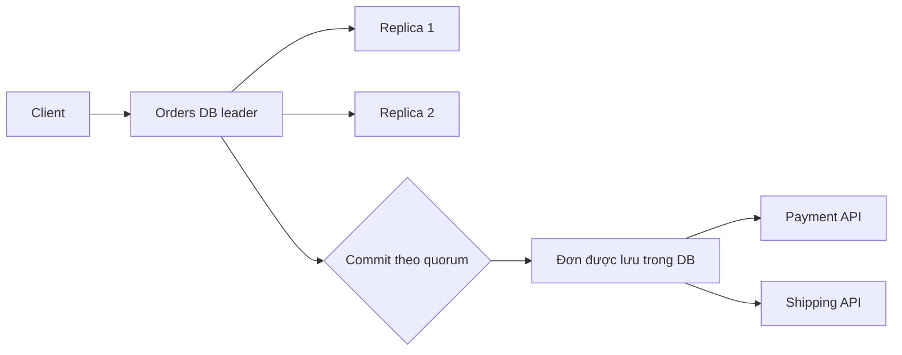
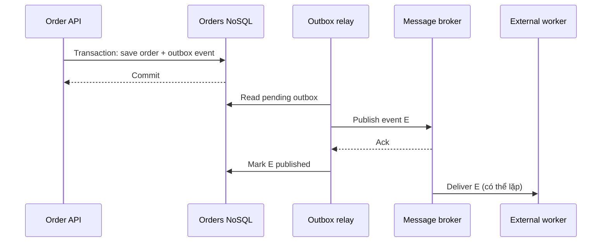
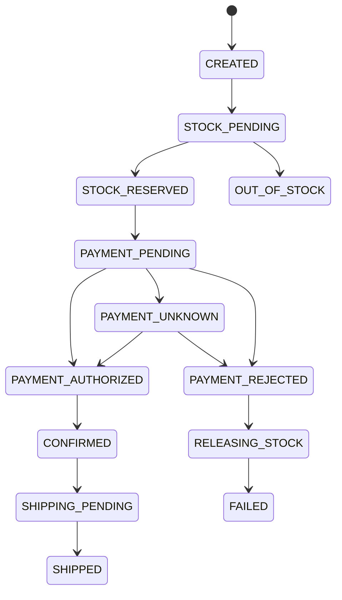

# Giới hạn bảo đảm khi ứng dụng thao tác thêm với hệ bên ngoài

Trong một cụm NoSQL, thuật toán đồng thuận có thể giúp các node thống nhất **ai được quyền ghi, bản ghi nào được commit và thứ tự nào được chấp nhận**. Chẳng hạn, một replica set có thể bầu ra primary mới sau sự cố và tiếp tục xác nhận những thao tác đủ điều kiện. Nhưng ngay sau khi lưu một đơn hàng vào database, ứng dụng còn có thể phải **thu tiền qua cổng thanh toán, giữ kho ở một dịch vụ khác, tạo nhãn vận chuyển, gửi email, cập nhật search index hoặc tải tệp lên object storage**.

Những hệ bên ngoài đó **không tự tham gia cùng giao thức đồng thuận** của NoSQL. Một transaction được commit tại database không đồng nghĩa cổng thanh toán đã thu tiền. Một lệnh HTTP trả timeout không chứng minh dịch vụ bên ngoài chưa làm gì. Một worker có khóa/lease ở database cũng không chắc ngăn được worker cũ tiếp tục gọi API khi lease hết hạn.

Vì thế phải phân biệt hai lời hứa:

- **Bảo đảm nội bộ:** những gì database cam kết về atomicity, isolation, durability, log ordering, leader election và quorum **trong phạm vi tài nguyên mà nó quản lý**.
- **Bảo đảm đầu-cuối của nghiệp vụ:** điều gì được phép xảy ra khi một thao tác trải qua **database + message broker + service ngoài + hệ thống thực tế**, giữa các lỗi mạng, retry và failover.

Bài học thuộc chương **Đồng thuận và quyền ghi**, module **Database No SQL**, tập trung vào ranh giới của consensus khi ứng dụng thực hiện *external side effects*. Ta sẽ xây dựng phương pháp dùng **transactional outbox, idempotency, inbox, saga, reconciliation và fencing token** để nối các hệ mà không giả vờ chúng thuộc một transaction duy nhất.

> **Nguyên tắc cốt lõi:** đồng thuận giúp xác định **một quyết định hợp lệ trong phạm vi đồng thuận**. Muốn một hành động bên ngoài xảy ra đúng theo yêu cầu nghiệp vụ, cần thêm **giao thức phối hợp và cơ chế chống lặp ở chính nơi thực hiện hành động**.

---

## 1. Một giao dịch thực tế có nhiều ranh giới

Giả sử khách mua một sản phẩm:

```text
Ứng dụng
   |
   +--> Orders DB (NoSQL replica set)
   |
   +--> Inventory Service
   |
   +--> Payment Provider
   |
   +--> Shipping API
   |
   +--> Email Service
   |
   +--> Search / Analytics
```

Trong đó mỗi hệ có thể sở hữu database, quorum, log, transaction và retry riêng. Không thể suy rằng những hệ này cùng commit chỉ vì ứng dụng viết:

```text
saveOrder();
reserveInventory();
chargeCard();
sendEmail();
```

### 1.1. Ba sự thật phải tách

1. **Đơn hàng đã được ghi ở Orders DB:** một sự thật về trạng thái database nội bộ.
2. **Nhà cung cấp thanh toán đã chấp nhận một yêu cầu thu tiền:** một sự thật từ hệ thanh toán.
3. **Khách thực sự nhận email hoặc hàng hóa:** một sự thật ở hệ gửi thư và thế giới bên ngoài.

Sự thật thứ nhất không chứng minh hai sự thật còn lại. Thậm chí một HTTP `200 OK` từ dịch vụ email có thể chỉ xác nhận **yêu cầu được tiếp nhận**, không bảo đảm email đã vào hộp thư của người nhận.

### 1.2. Phân biệt side effect

| Loại thao tác | Ví dụ | Có thể hoàn tác hoàn toàn không? |
| --- | --- | --- |
| Ghi nội bộ | Cập nhật trạng thái order | Có thể dùng transaction/ghi trạng thái mới |
| Ghi sang database khác | Tạo reservation ở Inventory DB | Cần giao thức phối hợp, không mặc định atomic |
| Gọi API thanh toán | Capture tiền | Refund là **hành động mới**, không phải xóa lịch sử capture |
| Gửi email/SMS | Gửi xác nhận đơn | Không thể “thu hồi” một thư đã tới người nhận |
| Gửi kiện hàng | Đăng ký vận chuyển/xuất kho | Có thể hủy khi chưa xử lý, nhưng không chắc đảo ngược khi hàng đã đi |
| Ghi object storage | Upload tệp và lưu metadata | Có thể xóa tệp nhưng phải xử lý orphan/mất kết nối |
| Cập nhật cache/search | Đồng bộ read model | Thường tái tạo được nhưng có lag và sai thứ tự event |

Sự khác biệt về khả năng hoàn tác quyết định nên dùng transaction, reservation, saga, reconciliation hay quy trình thủ công.

---

## 2. Consensus bảo đảm những gì — và giới hạn tại đâu?

Những giao thức như Raft/Paxos hoặc cơ chế replication/election của từng database giải quyết việc các thành viên tham gia thống nhất một số quyết định hoặc lịch ghi theo mô hình riêng.

Một hệ có thể cung cấp:

- Một **leader/primary hợp lệ** trong một thời điểm hoặc nhiệm kỳ theo giao thức.
- **Thứ tự log** của những mutation được chấp nhận.
- **Commit/majority acknowledgement** theo điều kiện đã cấu hình.
- **Failover** với quy tắc không công nhận lịch ghi trái protocol.
- **Khả năng phục hồi** từ log/snapshot hợp lệ.
- Những mức read consistency và transaction isolation cụ thể.

Không phải mọi NoSQL đều có tất cả các bảo đảm trên hoặc dùng cùng cơ chế. Phải đọc đúng hợp đồng theo API và phiên bản.

### 2.1. Phạm vi của một quyết định được commit



Quorum của **Orders DB** chỉ gồm những thành viên theo giao thức của Orders DB. `Payment API` và `Shipping API` không trở thành các voter của giao dịch order chỉ vì chúng xuất hiện sau bước commit.

### 2.2. Bốn câu hỏi cần hỏi riêng

| Câu hỏi | Cơ chế liên quan |
| --- | --- |
| Ai được quyền ghi vào Orders DB? | Election, leader lease/term, consensus |
| Ghi nào được database công bố commit? | Replication protocol, write concern, transaction |
| Cổng thanh toán đã thực hiện yêu cầu chưa? | Provider API, idempotency key, webhook/lookup |
| Toàn bộ quy trình đã đạt trạng thái nghiệp vụ cuối chưa? | Saga/state machine, outbox, inbox, reconciliation |

**Không có một mức `w: "majority"` hoặc `QUORUM` chung cho cả bốn câu hỏi.**

---

## 3. Thế nào là “hệ bên ngoài”?

Một hệ được coi là **ngoài phạm vi giao dịch** khi database đang thực hiện transaction không thể **commit/abort nó nguyên tử theo cùng protocol**.

Ví dụ:

- Một microservice có database riêng.
- Message broker hoặc event bus không tham gia transaction của Orders DB.
- Cổng thanh toán xử lý qua HTTP.
- Search engine duy trì index khác nguồn.
- Object storage và CDN.
- Email/SMS/push provider.
- Hệ legacy, ERP hoặc phần mềm kế toán.
- Thiết bị vật lý: máy in hóa đơn, khóa cửa, máy bán hàng.
- Blockchain hay mạng phân tán khác, nếu ứng dụng chỉ gửi giao dịch và chờ xác nhận từ mạng đó.

**“Cùng công ty” không đồng nghĩa “cùng transaction”.** Hai MongoDB collections trong cùng deployment và transaction được hỗ trợ là một tình huống khác với hai MongoDB deployments độc lập do hai service sở hữu.

### 3.1. Thêm một HTTP call đã vượt ranh giới

```java
// Mô tả ý tưởng; không phải ví dụ transaction an toàn.
@Transactional
public void checkout(Order order) {
    orderRepository.save(order);
    paymentClient.charge(order.paymentRequest());
}
```

Annotation transaction có thể điều khiển việc ghi database mà framework đã cấu hình, **không mặc nhiên enlist một HTTP payment provider**.

Nếu provider thu tiền xong rồi transaction DB rollback, tiền **vẫn có thể đã được thu**.

---

## 4. “Dual write” là vấn đề cốt lõi

*Dual write* là trường hợp một thao tác nghiệp vụ cần ghi hoặc tạo tác động ở **hai hệ độc lập**, ví dụ DB và broker, DB và payment, hoặc DB và search index.

Một kế hoạch nhìn rất tự nhiên:

```text
1. Ghi DB
2. Gửi event sang broker
```

Nhưng có một cửa sổ lỗi giữa hai bước:

```text
DB commit thành công
        |
        X process crash trước publish event
```

Kết quả: DB có order, broker không biết để xử lý.

Nếu đảo thứ tự:

```text
1. Publish event
2. Ghi DB
```

lại có cửa sổ khác:

```text
Event publish thành công
        |
        X DB commit thất bại
```

Consumer nhận một event về order mà trạng thái nguồn chưa có hoặc không bao giờ được commit.

### 4.1. Ma trận hai bước

| Bước A | Bước B | Hậu quả |
| --- | --- | --- |
| DB commit OK | Broker publish OK | Tạm đạt mục tiêu |
| DB commit OK | Broker publish FAIL/crash | **Thiếu event** |
| Broker publish OK | DB commit FAIL | **Event mồ côi** |
| Cả hai trả timeout | Không biết chắc điều gì đã xảy ra | Phải tra cứu, chống lặp |
| Publish lặp do retry | Consumer nhận nhiều event | Cần idempotency/inbox |

### 4.2. Thêm replica không xóa cửa sổ lỗi

Orders DB có ba hay năm replica cũng không khiến một message broker độc lập **tự biết** order được commit. Tương tự, broker có replication riêng không đảm bảo commit của Orders DB.

Sự cố này không phải chỉ là “database chưa đủ nhất quán”; đó là **thiếu giao thức nối hai ranh giới giao dịch**.

---

## 5. Tại sao không gọi API ngoài trong transaction dài?

Một cách thử sửa dual write:

```text
BEGIN DB TRANSACTION
  Save order
  Call payment provider over HTTP
  Update order status
COMMIT DB TRANSACTION
```

Cách này vẫn **không tạo atomicity với payment provider**.

### 5.1. Những trường hợp lỗi vẫn còn

- Provider thu tiền, DB commit thất bại.
- Provider thu tiền, connection timeout khiến client nghĩ thất bại.
- Provider chậm 30 giây làm transaction giữ tài nguyên/phiên bản/khóa lâu.
- Network partition khiến transaction timeout hoặc bị abort.
- Transaction retry chạy lại code và **gọi charge lần thứ hai**, nếu không có idempotency.
- Một callback từ provider đến trong lúc transaction chưa commit, không thấy order.

### 5.2. Chi phí vận hành

Transaction dài có thể tăng:

- Lock contention hoặc write conflict.
- MVCC snapshot/transaction history.
- Kết nối và bộ nhớ giữ lâu.
- Xác suất timeout/abort.
- Tail latency của những request khác.

**Một transaction DB nên tập trung vào những thay đổi nằm trong phạm vi DB.** Các side effects bên ngoài được điều phối bằng trạng thái bền và worker, trừ khi có một protocol giao dịch phân tán thực sự được hỗ trợ.

---

## 6. Timeout tạo ra trạng thái “không biết kết quả”

Giả sử ứng dụng gửi `POST /payments/capture`:

```text
App -----------------> Payment Provider
    request captured       |
                           v
                      Capture succeeded
                           |
App <------- X -------- response mất trên mạng
```

App thấy timeout, nhưng provider **có thể đã thu tiền**.

Không thể suy:

```text
Timeout => charge chưa xảy ra
```

Tương tự, một write concern timeout của NoSQL không luôn chứng minh write **chưa được áp dụng**. Cần phân biệt:

- **Thất bại chắc chắn:** request bị bác trước khi có hiệu ứng, có tín hiệu đáng tin.
- **Thành công chắc chắn theo hợp đồng:** đã nhận được xác nhận hợp lệ.
- **Unknown outcome:** request có thể đã xảy ra nhưng không có câu trả lời chắc chắn.

### 6.1. Trạng thái nghiệp vụ cần phản ánh sự không chắc chắn

```text
PAYMENT_PENDING
     |
     +----> PAYMENT_CONFIRMED
     |
     +----> PAYMENT_REJECTED
     |
     +----> PAYMENT_UNKNOWN -> reconciliation/lookup
```

`UNKNOWN` không phải “thất bại”. Nếu không phân biệt, ứng dụng có thể tạo hai lần charge hoặc hoàn tiền sai.

### 6.2. Nguyên tắc retry

Với thao tác có side effect, **không gửi lại như một operation mới**. Phải có **idempotency key ổn định**, tra trạng thái hoặc dùng API truy vấn kết quả của provider nếu có.

---

## 7. Không nên hứa “exactly once” chỉ vì có consensus

Một hệ message thường cung cấp ít nhất một trong các mô hình giao nhận:

| Mô hình | Ý nghĩa khái quát | Rủi ro |
| --- | --- | --- |
| **At-most-once delivery** | Có thể bỏ message nhưng tránh cố gửi lại | Mất side effect cần thiết |
| **At-least-once delivery** | Cố giao lại cho tới điều kiện ACK | Consumer có thể nhận nhiều lần |
| **Exactly-once theo phạm vi được hỗ trợ** | Một số hệ có protocol/transaction bảo đảm trong ranh giới cụ thể | Không tự kéo dài tới HTTP/provider ngoài |

Nếu broker quảng bá **exactly-once processing** giữa log đầu vào và state/topic đầu ra của chính nó, điều đó không mặc nhiên có nghĩa **một email không thể được gửi trùng**.

### 7.1. “Một event” có thể có nhiều lần xử lý

```text
Worker nhận event E
        |
        v
Gọi provider -> thành công
        |
        X worker chết trước khi ACK event
        |
        v
Broker giao lại event E
        |
        v
Worker khác gọi provider lần nữa
```

At-least-once delivery là thiết kế hợp lý để tránh bỏ sót công việc, nhưng **phải đi kèm xử lý side effect lặp**.

### 7.2. Exactly-once business effect cần thêm điều kiện

Cần phân biệt:

1. **Một logical request** được định danh bằng ID ổn định.
2. **Nhiều lần delivery/attempt** được phép xảy ra.
3. **Provider** phải có cơ chế tránh tác dụng trùng trong phạm vi phù hợp.
4. **Ứng dụng** phải biết kết quả cuối, kể cả khi response thất lạc.

Nếu provider **không hỗ trợ idempotency hay truy vấn outcome**, không thể hứa tuyệt đối rằng tác động ngoài xảy ra đúng một lần trong mọi lỗi mạng.

---

## 8. Idempotency: công cụ quan trọng nhất ở ranh giới ngoài

Một thao tác **idempotent** khi thực hiện lại cùng một logical request không tạo thêm tác dụng không mong muốn sau lần đầu.

### 8.1. Định danh logical operation

Ví dụ khách nhấn “Thanh toán” một lần:

```text
orderId = order-1001
paymentAttemptId = pay-order-1001-capture-1
idempotencyKey = pay-order-1001-capture-1
```

Nếu request timeout, retry **vẫn dùng idempotencyKey đó**. Một lần thanh toán khác thật sự mới phải có identity khác theo mô hình nghiệp vụ.

### 8.2. Idempotency key phải được giữ xuyên các tầng

```text
HTTP client request
      |
      v
Order API: requestId
      |
      v
Outbox event: eventId + paymentAttemptId
      |
      v
Worker retry: same paymentAttemptId
      |
      v
Payment provider: same idempotencyKey
```

Không tạo random ID mới tại mỗi retry, vì như thế biến cùng một logical operation thành nhiều operation khác nhau đối với provider.

### 8.3. Phải định nghĩa phạm vi key

Một key có thể cần ràng buộc theo:

- Tenant/merchant account.
- Loại operation: authorize, capture, refund.
- Order/payment attempt.
- Payload fingerprint hoặc amount/currency.
- Thời gian provider lưu lịch sử key.
- Trạng thái sau thành công và lỗi.

Nếu cùng key nhưng amount khác, nên **phát hiện conflict**, không im lặng coi hai yêu cầu khác nhau là cùng một charge hợp lệ.

### 8.4. Provider có giới hạn retention

Một số API chỉ giữ record idempotency trong một khoảng thời gian. Retry sau thời hạn đó có thể không còn được dedupe.

Do đó idempotency ở provider **không thay** ledger/transaction IDs, đối soát và chính sách không tự retry vô hạn.

---

## 9. Idempotency không có nghĩa mọi side effect đều đảo ngược được

Có những tác dụng dễ làm idempotent:

- `PUT object` vào cùng key với điều kiện/version phù hợp.
- Tạo resource với `externalRequestId` unique.
- Set trạng thái từ version N sang N+1 bằng compare-and-set.
- Consumer bỏ qua event ID đã xử lý.

Có tác dụng khó hơn:

- Gửi SMS/email thật đến người dùng.
- Kích hoạt cơ cấu vật lý.
- Phát lệnh chuyển tiền qua hệ không có operation key.
- Gửi một kiện hàng đã được nhân viên lấy đi.

Với loại khó, có thể cần:

- Giảm khả năng gửi trùng bằng local guard.
- Cấp cùng external ID/correlation để tra cứu.
- Trạng thái cần xác minh thủ công khi outcome không rõ.
- Thiết kế chính sách bù trừ hoặc thông báo sửa lỗi.
- Không quảng bá bảo đảm tuyệt đối nếu hạ tầng không có khả năng thực thi.

**Idempotency phải được hỗ trợ ở nơi side effect diễn ra**, hoặc có một nguồn thẩm quyền duy nhất ngăn các lần tác động trùng.

---

## 10. Transactional outbox: ghi quyết định và ý định gửi cùng nhau

**Transactional outbox** giải quyết cửa sổ “DB commit nhưng không publish event” bằng cách ghi **business state và bản ghi ý định gửi** trong **cùng một local transaction**.



Ý tưởng là **không có khoảng trống giữa việc commit order và việc lưu ý định phát event**, trong phạm vi transaction được database hỗ trợ.

### 10.1. Điều outbox giúp bảo đảm

- Nếu transaction DB abort, **không có outbox event commit** cho order đó.
- Nếu transaction commit, **ý định gửi event được lưu bền cùng order** theo durability được chọn.
- Nếu relay crash trước publish, lần chạy sau còn event để thử lại.
- Nếu relay crash sau publish nhưng trước đánh dấu, event có thể **được publish lại**.

Vì thế outbox thường dẫn tới **at-least-once publishing**, không tự là exactly-once end-to-end.

### 10.2. Điều outbox không tự bảo đảm

- Broker không giao message lặp.
- Payment provider không thu tiền hai lần.
- Mọi consumer xử lý đúng thứ tự.
- Event được xử lý trong thời hạn SLO nếu relay đã dừng.
- Transaction tự bao trùm nhiều databases.
- Side effect được rollback cùng Orders DB.

**Outbox thu hẹp khoảng trống mất ý định gửi; nó không loại bỏ nhu cầu idempotency ở consumer và provider.**

---

## 11. Thiết kế bản ghi outbox

Một document mẫu:

```json
{
  "_id": "event-order-1001-created-v1",
  "aggregateType": "Order",
  "aggregateId": "order-1001",
  "aggregateVersion": 1,
  "type": "OrderCreated",
  "status": "READY",
  "payload": {
    "orderId": "order-1001",
    "tenantId": "tenant-a",
    "totalMinorUnits": 125000
  },
  "attempts": 0,
  "createdAt": "2026-11-14T08:00:00Z",
  "nextAttemptAt": "2026-11-14T08:00:00Z"
}
```

### 11.1. Những trường quan trọng

| Trường | Vai trò |
| --- | --- |
| `eventId/_id` | Định danh duy nhất để dedupe event |
| `aggregateId` | Order/resource sở hữu sự kiện |
| `aggregateVersion` | Kiểm tra thứ tự thay đổi theo aggregate |
| `type` | Phân loại hành động consumer |
| `payload` | Dữ liệu tối thiểu consumer cần |
| `status` | READY, IN_FLIGHT, SENT, RETRY, DEAD… |
| `attempts` | Theo dõi retry |
| `nextAttemptAt` | Backoff và delayed retry |
| `leaseUntil` | Cho phép reclaim công việc khi worker chết |
| `correlationId` | Truy vết toàn bộ luồng request |
| `idempotencyKey` | Định danh logical external effect, có thể khác event ID |

### 11.2. Event version và schema evolution

Event được lưu trong outbox có thể còn chờ khi ứng dụng đã nâng cấp. Consumer cần biết schema version, hỗ trợ tương thích hoặc quy trình chuyển đổi.

Không nên nhét dữ liệu nhạy cảm như thông tin thẻ hoặc secrets vào payload chỉ để “đủ dữ liệu gửi”.

### 11.3. Retention và dọn outbox

Không xóa `SENT` quá sớm nếu consumer/deduplication hoặc audit cần tham chiếu. Ngược lại, giữ vô hạn mọi payload cũng tăng storage và rủi ro bảo mật. Cần chính sách retention theo SLA, replay và quy định dữ liệu.

---

## 12. Thực hành MongoDB: lưu order và outbox trong một transaction

Ví dụ sau dùng **`mongosh` trên replica set/sharded cluster hỗ trợ transaction**. Không dùng trên production; database `nosql_external_effect_lab` chỉ phục vụ thực hành.

### 12.1. Chuẩn bị collection và index

```javascript
const lab = db.getSiblingDB("nosql_external_effect_lab");

lab.orders.createIndex(
  { tenantId: 1, clientRequestId: 1 },
  { unique: true }
);

lab.outbox.createIndex({
  status: 1,
  nextAttemptAt: 1,
  createdAt: 1
});
```

Unique index trên `(tenantId, clientRequestId)` bảo vệ một logical order khỏi bị tạo lại bằng cùng key ở phạm vi ví dụ.

### 12.2. Ghi cả order và event cùng transaction

```javascript
const conn = db.getMongo();
const session = conn.startSession({
  causalConsistency: false
});
const sdb = session.getDatabase("nosql_external_effect_lab");

const requestId = "req-1001";
const orderId = "order-1001";
const eventId = "event-order-1001-created-v1";
const now = new Date();

try {
  session.startTransaction({
    readConcern: { level: "snapshot" },
    writeConcern: { w: "majority" }
  });

  sdb.orders.insertOne({
    _id: orderId,
    tenantId: "tenant-a",
    clientRequestId: requestId,
    status: "PENDING_PAYMENT",
    totalMinorUnits: 125000,
    createdAt: now,
    version: 1
  });

  sdb.outbox.insertOne({
    _id: eventId,
    aggregateType: "Order",
    aggregateId: orderId,
    aggregateVersion: 1,
    type: "OrderCreated",
    status: "READY",
    attempts: 0,
    nextAttemptAt: now,
    createdAt: now,
    payload: {
      tenantId: "tenant-a",
      orderId: orderId,
      totalMinorUnits: 125000
    }
  });

  session.commitTransaction();
  print("Order + outbox committed");
} catch (error) {
  print("Transaction needs resolution: " + error.message);
  // Ví dụ rút gọn: ứng dụng thật phải xử lý
  // TransientTransactionError và UnknownTransactionCommitResult
  // theo hướng dẫn driver/phiên bản; không retry side effect mù.
  try { session.abortTransaction(); } catch (_) {}
} finally {
  session.endSession();
}
```

**Cả hai inserts nằm trong cùng transaction của MongoDB.** Nếu một thao tác bị abort hợp lệ, không phải một nửa transaction được commit.

### 12.3. Kiểm tra dữ liệu thử

```javascript
printjson(
  lab.orders.findOne({ _id: "order-1001" })
);

printjson(
  lab.outbox.findOne({
    _id: "event-order-1001-created-v1"
  })
);
```

Nếu transaction được commit thành công, cả order và outbox event cùng xuất hiện ở nguồn dữ liệu theo read concern phù hợp.

### 12.4. Kết quả commit không rõ

Nếu `commitTransaction()` trả lỗi có nhãn `UnknownTransactionCommitResult`, **không được kết luận transaction chắc chắn thất bại**. Driver có hướng dẫn retry commit/đối soát tùy loại lỗi.

Nếu client thực hiện lại checkout, `clientRequestId` vẫn phải giữ nguyên. Unique index giúp ngăn tạo order mới cho cùng logical request; ứng dụng cần đọc lại outcome theo key đó và xác minh payload thay vì “bắt DuplicateKey rồi coi mọi thứ đều thành công”.

---

## 13. Relay đọc outbox: claim công việc không bằng exactly once

Một relay có thể:

1. Chọn event đang `READY`.
2. Đánh dấu `IN_FLIGHT` và giữ lease.
3. Publish/gọi external worker.
4. Nhận ACK.
5. Đánh dấu `SENT`.
6. Nếu lỗi, đặt `RETRY` hoặc cho lease hết hạn để worker khác tiếp quản.

### 13.1. Atomic claim minh họa

```javascript
const lab = db.getSiblingDB("nosql_external_effect_lab");

const now = new Date();
const workerId = "relay-01";

const claimed = lab.outbox.findOneAndUpdate(
  {
    $or: [
      {
        status: { $in: ["READY", "RETRY"] },
        nextAttemptAt: { $lte: now }
      },
      {
        status: "IN_FLIGHT",
        leaseUntil: { $lt: now }
      }
    ]
  },
  {
    $set: {
      status: "IN_FLIGHT",
      claimedBy: workerId,
      leaseUntil: new Date(now.getTime() + 30000)
    },
    $inc: {
      attempts: 1,
      claimVersion: 1
    }
  },
  {
    sort: { createdAt: 1 },
    returnDocument: "after"
  }
);

printjson(claimed);
```

Đây là **mô hình claim trong một collection**, chưa bao gồm publish thực và ACK. Một triển khai production cần xử lý hiệu lực lease, clock, visibility timeout, monitor, retry và outbox record của từng tenant.

### 13.2. Cửa sổ publish lặp vẫn còn

```text
Relay gọi Payment API -> SUCCESS
Relay crash trước khi ghi SENT
Lease hết hạn
Relay khác claim lại event
Relay khác gọi Payment API lần nữa
```

Local claim nguyên tử **không ngăn duplicate external effect** nếu provider không hỗ trợ idempotency.

### 13.3. Bảo vệ cập nhật trạng thái bằng claimVersion

Worker chỉ nên đánh dấu `SENT` nếu nó còn giữ claim tương ứng:

```javascript
lab.outbox.updateOne(
  {
    _id: claimed._id,
    status: "IN_FLIGHT",
    claimVersion: claimed.claimVersion,
    claimedBy: workerId
  },
  {
    $set: {
      status: "SENT",
      sentAt: new Date()
    }
  }
);
```

Điều kiện version tránh một worker cũ ghi đè tiến độ **nội bộ** sau khi công việc đã được claim lại. Nhưng **không tự chặn worker cũ gọi API ngoài**: cần idempotency hoặc fencing tại đích.

### 13.4. `SENT` nghĩa là gì?

Hãy định nghĩa thật chính xác:

- `PUBLISHED_TO_BROKER`: broker đã ACK nhận event.
- `ACCEPTED_BY_PROVIDER`: provider đã tiếp nhận request.
- `EXTERNAL_EFFECT_CONFIRMED`: hệ đã có bằng chứng tác dụng hoàn tất.
- `BUSINESS_CONFIRMED`: toàn bộ điều kiện nghiệp vụ đã đạt.

Gộp tất cả thành `SENT` có thể khiến đội vận hành tưởng đơn hàng đã thanh toán chỉ vì broker nhận một message.

---

## 14. Inbox và consumer idempotency

Ở phía consumer, **inbox/deduplication record** giúp xác định event đã được xử lý trong một phạm vi.

Ví dụ key:

```text
(processorName, eventId)
```

Một document:

```json
{
  "_id": "inventory-worker|event-order-1001-created-v1",
  "processor": "inventory-worker",
  "eventId": "event-order-1001-created-v1",
  "status": "DONE",
  "processedAt": "2026-11-14T08:01:00Z"
}
```

### 14.1. Atomic inbox + local state change

Nếu consumer cập nhật **chính database của nó** và database hỗ trợ transaction, có thể ghi:

```text
BEGIN LOCAL TRANSACTION
  IF inbox key đã tồn tại -> return prior result
  Apply inventory reservation
  Insert inbox key/result
COMMIT
```

Như vậy nhận lại event không tạo **thêm reservation nội bộ** theo đúng phạm vi transaction, nếu kiểm tra key/constraint được thực thi nguyên tử.

### 14.2. Ghi inbox trước hay sau external call?

Nếu chỉ ghi `DONE` **trước** khi gọi provider, rồi worker crash, sự kiện có thể bị mất xử lý.

Nếu gọi provider **trước** rồi ghi `DONE`, worker crash tạo nguy cơ gọi lặp.

Đây là lại là dual-write problem. Inbox giúp dedupe việc **trong database consumer**, còn external call cần idempotency/correlation/tra cứu hoặc giao thức phối hợp khác.

### 14.3. Retention của inbox

Nếu broker có thể replay message cũ sau khi inbox key bị xóa, consumer có thể xử lý lại. Cần chọn retention tương thích với replay horizon, audit và phạm vi key; không giả định dedupe vĩnh viễn khi TTL chỉ vài giờ.

---

## 15. CDC và log tailing có phải thay outbox không?

**Change Data Capture (CDC)** có thể quan sát các mutation đã commit từ log/change stream của database, rồi gửi event sang hệ khác.

Có hai kiểu thường gặp:

1. **Transactional outbox + CDC:** nghiệp vụ và outbox commit cùng nhau; CDC chuyển outbox rows/documents thành events.
2. **CDC trực tiếp từ business collection:** quan sát thay đổi của orders, customers và tạo projection/event.

### 15.1. Ưu điểm

- Không phải application process tự publish ngay sau commit.
- Có thể tái sử dụng log pipeline và checkpoint.
- Giảm thêm một loại truy vấn polling.

### 15.2. Những giới hạn

- CDC connector có thể lag hoặc restart, phát event trùng.
- Log retention và resume tokens cần quản lý.
- Thay đổi schema có thể làm connector/consumer không tương thích.
- Một thay đổi dữ liệu không luôn chứa đầy đủ **ý nghĩa nghiệp vụ** (ví dụ phân biệt `OrderCancelledByUser` với `OrderCancelledByFraud`).
- Đọc event và ghi offset/checkpoint cũng cần xử lý crash/replay.
- CDC không tự làm HTTP provider idempotent.

### 15.3. Polling outbox và CDC outbox

| Tiêu chí | Polling | CDC |
| --- | --- | --- |
| Nguồn event | Query collection `outbox` | Change log/stream đã commit |
| Chi phí | Query/index và worker scheduling | Log connector và checkpoint |
| Độ trễ | Phụ thuộc polling interval/tải | Phụ thuộc pipeline và lag |
| Reprocessing | Lease/status/retry | Offset/resume/replay |
| Rủi ro chung | Duplicate publish, worker crash | Duplicate delivery, log retention |
| Side effect ngoài | Vẫn cần idempotency | Vẫn cần idempotency |

Không có lựa chọn nào biến local DB và provider thành một transaction nguyên tử.

---

## 16. Thứ tự event và phiên bản aggregate

Giả sử order chuyển trạng thái:

```text
v1: CREATED
v2: STOCK_RESERVED
v3: PAYMENT_AUTHORIZED
v4: CANCELLED
```

Do consumer chạy song song, event `v4` có thể đến trước `v3`. Nếu consumer cứ áp dụng event đến sau cùng làm state mới, nó có thể “khôi phục” order từ `CANCELLED` về `PAYMENT_AUTHORIZED`.

### 16.1. Phiên bản đơn điệu

Một projection có thể lưu `lastAppliedVersion` và chỉ chấp nhận event nếu nó **phù hợp thứ tự**.

```javascript
// Ý tưởng CAS cho một projection theo aggregate.
db.orderViews.updateOne(
  {
    _id: "order-1001",
    version: 3
  },
  {
    $set: {
      status: "CANCELLED",
      version: 4
    }
  }
);
```

Nếu event v2 đến sau khi projection ở v4, không được tự ghi đè bằng dữ liệu v2.

### 16.2. Không phải chỉ kiểm tra `>` là đủ

Nếu projection cần áp dụng **mọi bước** để cập nhật tồn kho, chỉ nhận version lớn nhất có thể bỏ qua những effect trung gian quan trọng.

Có hai hướng:

- **State replacement projection:** áp dụng bản trạng thái đầy đủ mới nhất bằng version guard.
- **Event-sourced delta projection:** yêu cầu thứ tự, gap detection và replay/repair khi thiếu version.

Phải biết consumer đang xử lý **snapshot state** hay **delta events**.

### 16.3. Thứ tự toàn hệ rất tốn kém và thường không cần

Đa số nghiệp vụ chỉ cần thứ tự trong **một order, account, tenant hoặc resource**. Chọn partition/order key phù hợp ở broker để giữ thứ tự theo aggregate, kết hợp xử lý version.

Một thứ tự global cho tất cả event có thể trở thành điểm nghẽn.

---

## 17. Saga: điều phối một nghiệp vụ qua nhiều hệ

Khi không thể dùng một transaction ACID xuyên các service, **saga** chia quy trình thành những bước có trạng thái rõ ràng và **hành động bù trừ** khi cần.

Ví dụ đặt hàng:

```text
CREATE_ORDER
     |
     v
RESERVE_STOCK
     |
     v
AUTHORIZE_PAYMENT
     |
     v
CONFIRM_ORDER
```

Nếu authorize thất bại, hệ có thể **release stock** và chuyển order sang `PAYMENT_FAILED`, thay vì coi toàn bộ tiến trình như một rollback DB.

### 17.1. Choreography và orchestration

| Cách | Đặc điểm | Chi phí/rủi ro |
| --- | --- | --- |
| **Choreography** | Các service nghe event và tự kích hoạt bước tiếp theo | Có thể khó nhìn toàn bộ flow, dễ vòng lặp/sai thứ tự |
| **Orchestration** | Một coordinator/state machine điều phối các bước | Coordinator phải durable, recover và không thành nút nghẽn |
| **Hybrid** | Coordinator cho bước quan trọng, event cho read model | Cần hợp đồng ownership rõ ràng |

### 17.2. Saga không làm mọi thứ nguyên tử

Trong lúc `STOCK_RESERVED` nhưng `PAYMENT_PENDING`, các service có thể nhìn thấy trạng thái trung gian. Điều này có thể **hợp lệ** nếu nghiệp vụ định nghĩa state machine và cấm shipping trước khi có thanh toán hợp lệ.

### 17.3. Bù trừ không phải đảo ngược thời gian

`refund(payment)` là giao dịch mới, có thể thất bại hoặc mất phí; nó không xóa việc capture đã xảy ra. `sendCorrectionEmail()` không thu hồi email cũ.

Vì thế saga cần định nghĩa **trạng thái hoàn tất, bù trừ thất bại và đối soát cuối**, không chỉ gọi `undo()` tùy ý.

---

## 18. Case study: đơn hàng và thanh toán

Giả sử hệ gồm:

- Orders DB (MongoDB replica set).
- Inventory Service có database riêng.
- Payment Provider qua HTTPS.
- Shipping Service.
- Event broker và outbox relay.

### 18.1. Một state machine có thể kiểm chứng



Đây là mô hình minh họa; các hệ thực có thêm cancel, timeout, partial capture, fraud review, release authorization và nhiều đường bù trừ khác.

### 18.2. Bất biến chính

1. Một `clientRequestId` tạo tối đa **một logical order**.
2. Không xác nhận quá số tồn kho.
3. Một `paymentAttemptId` không được capture hai lần ngoài ý muốn.
4. Không đánh dấu `PAID` chỉ vì gửi request thành công tới broker.
5. Không giao hàng nếu chưa có trạng thái thanh toán phù hợp.
6. Retry sau timeout không tạo resource mới không kiểm soát.
7. Mọi trạng thái `UNKNOWN` phải có đường đối soát.
8. Event và callback cũ không được làm trạng thái đi lùi.

### 18.3. Có thể có trạng thái `PENDING` hợp lệ

Nếu payment API mất kết nối, API checkout không nhất thiết trả `FAILED` ngay. Có thể trả:

```json
{
  "orderId": "order-1001",
  "status": "PAYMENT_PENDING",
  "message": "Yêu cầu đang được xác minh"
}
```

Tuyên bố `CONFIRMED` khi chưa có bằng chứng thanh toán/giữ kho phù hợp sẽ gây hứa sai.

---

## 19. Luồng thành công với outbox và provider idempotency

Một luồng gợi ý:

```text
1. Client gửi checkout(requestId=R).
2. Order API transaction:
      - tạo order PENDING_STOCK
      - ghi outbox ReserveStockRequested với eventId E1.
3. Outbox relay gửi E1 qua broker.
4. Inventory worker giữ hàng bằng reservationId ổn định.
5. Inventory lưu kết quả và phát StockReserved.
6. Order coordinator chuyển state, ghi PaymentRequested (E2).
7. Payment worker gọi provider bằng paymentAttemptId cố định.
8. Provider xác nhận authorize/capture theo hợp đồng.
9. Coordinator lưu PaymentAuthorized/PaymentCaptured.
10. Order chuyển CONFIRMED và ghi outbox thông báo.
11. Email/shipping consumers chạy bất đồng bộ.
```

### 19.1. Điểm transaction

Mỗi bước local có thể dùng transaction riêng trong database chủ quản. Trạng thái xuyên service được duy trì bằng **event, message, idempotency, state transitions và đối soát**, không bằng một local transaction kéo dài từ bước 1 tới 11.

### 19.2. Điểm xác nhận với khách hàng

Phải thống nhất sản phẩm trả `ORDER_CREATED`, `STOCK_RESERVED`, `PAYMENT_AUTHORIZED` hay `CONFIRMED` ở bước nào.

Không gọi một lệnh “thành công” nếu chỉ mới **đưa event vào hàng đợi**, trong khi cam kết với khách là **đã thanh toán**.

---

## 20. Khi thanh toán lỗi: compensation và recovery

Một tình huống:

```text
Stock reserved OK
Payment declined
```

Có thể thực hiện:

```text
PaymentRejected
   |
   v
ReleaseStockRequested
   |
   v
StockReleased
   |
   v
Order = FAILED
```

### 20.1. Bản thân bù trừ có thể lỗi

Nếu Inventory Service tạm offline, `ReleaseStockRequested` có thể chờ. Reservation vẫn còn tồn tại.

Cần trạng thái như `RELEASE_PENDING`, retry, deadline và đối soát thay vì đánh dấu `FAILED_CLEAN` khi chưa thực sự release.

### 20.2. Đã capture không tương đương có thể “rollback”

Nếu tiền đã capture nhưng stock thất bại, hệ có thể cần refund. Refund phải có **refundAttemptId** riêng và kết quả riêng:

```text
PAYMENT_CAPTURED
STOCK_FAILED
REFUND_PENDING
REFUND_CONFIRMED
```

Nếu refund timeout, trạng thái `REFUND_UNKNOWN` cần lookup/đối soát. Không tạo refund mới vô điều kiện.

### 20.3. Không tự động bù trừ mọi thứ

Một side effect không đảo ngược được có thể cần **quyết định con người**. Ví dụ hàng đã giao, email pháp lý đã gửi hoặc cổng thanh toán đang tranh chấp. Workflow phải có nhánh xử lý ngoại lệ thay vì lặp vô tận.

---

## 21. Reservation và TCC: giữ tài nguyên trước khi xác nhận

Một kỹ thuật khác là **Try–Confirm–Cancel (TCC)**:

1. **Try:** tạm giữ tài nguyên với reservation ID.
2. **Confirm:** chuyển reservation sang trạng thái cam kết.
3. **Cancel:** giải phóng nếu quy trình thất bại.

Ví dụ một ghế:

```text
AVAILABLE
   |
   v
HELD(reservationId=R, expiry=T)
   |
   +--> CONFIRMED
   |
   +--> EXPIRED / CANCELLED
```

### 21.1. Điều kiện an toàn

- Không có hai reservation hợp lệ đồng thời chiếm cùng tài nguyên.
- Một reservation được confirm/cancel có điều kiện theo state/version.
- Retry cùng ID trả kết quả nhất quán.
- Expiry được tính theo nguồn thời gian/authority phù hợp.
- Confirm sau khi hold hết hạn phải bị từ chối hoặc xử lý theo chính sách.
- Callback cũ không được xác nhận một reservation đã bị thay thế.

### 21.2. TCC không miễn phí

Mỗi participant phải **có API Try, Confirm, Cancel**, lưu state và xử lý expiry. Nếu một bên chỉ có API “gửi email ngay” hoặc “chuyển khoản ngay”, không thể biến nó thành TCC bằng cách đổi tên hàm.

### 21.3. Đồng thuận vẫn chỉ áp dụng trong từng participant

Inventory có thể dùng quorum để cấp một reservation duy nhất. Orders DB có thể dùng quorum để lưu state coordinator. Nhưng quá trình TCC **không tự là một atomic transaction xuyên hai cụm**.

---

## 22. Có nên dùng two-phase commit (2PC)?

**Two-phase commit** là giao thức phối hợp transaction giữa nhiều participant **có khả năng chuẩn bị (prepare) và commit/rollback**.

Khái niệm:

```text
Coordinator
   |
   +--> Participant A: PREPARE?
   +--> Participant B: PREPARE?
   |
   +--> Nếu tất cả YES:
   |        COMMIT
   |
   +--> Nếu có NO:
            ABORT
```

### 22.1. Khi có thể xem xét

- Các hệ thực sự hỗ trợ một giao thức distributed transaction tương thích.
- Coordinator durable và có recovery log.
- Latency và availability phù hợp workload.
- Transaction không bao trùm thao tác không thể rollback.

### 22.2. Hạn chế

- Có thể giữ lock/resource lâu.
- Coordinator failure có thể khiến participant ở trạng thái in-doubt cần recovery.
- Network partition làm transaction bị trì hoãn.
- Cần xử lý heuristic outcomes và điều kiện platform.
- Nhiều HTTP/SaaS API không có `PREPARE/COMMIT/ABORT`.

### 22.3. Consensus không tự thay 2PC

Consensus có thể dùng để **nhân bản quyết định coordinator hoặc log** nhằm tăng fault tolerance, nhưng vẫn phải có cách các participant tham gia commit protocol.

Một Orders DB đạt majority không khiến Payment Provider tự nhận lệnh `PREPARE`.

### 22.4. Không lạm dụng distributed transaction

Với microservices và third-party APIs, outbox+saga+idempotency thường thực tế hơn. Tuy vậy, không tuyên bố 2PC “luôn sai”: nếu các resource hỗ trợ và yêu cầu chặt, một giao thức giao dịch phân tán có thể phù hợp trong phạm vi cụ thể.

---

## 23. Leader/lease nội bộ không đủ ngăn stale worker gây tác động ngoài

Giả sử worker A lấy lease xử lý đơn lúc 10:00. Sau đó A bị pause vì GC hoặc mất mạng, lease hết hạn; worker B lấy quyền và xử lý tiếp.

```text
T0: Worker A lấy lease
T1: A bị pause
T2: Lease của A hết hạn
T3: Worker B lấy lease mới và ghi trạng thái
T4: A tỉnh lại, gọi Shipping API bằng lệnh cũ
```

Consensus của database có thể bảo đảm chỉ B là owner hợp lệ **tại thời điểm T4**, nhưng nó không thể **ngăn code đã chạy trong process A phát một HTTP request** nếu Shipping API không kiểm tra ownership.

### 23.1. Tại sao distributed lock thường chưa đủ?

Một khóa/lease trong Redis, MongoDB hoặc coordination service có thể hết hạn trong khi holder bị pause. Holder cũ không phải lúc nào cũng biết mình đã mất lease đúng lúc.

Không nên dựa vào:

```text
“Chỉ một worker đang giữ lock, nên không có hai side effects”
```

với các tác động bên ngoài không có guard.

---

## 24. Fencing token: quyền ghi phải được kiểm tra tại đích

**Fencing token** là một số thứ tự/quyền sở hữu **tăng đơn điệu** được cấp mỗi lần giành quyền. Hệ đích từ chối request mang token cũ hơn token cao nhất đã chấp nhận cho cùng resource.

Ví dụ:

```text
A nhận fence=41
A tạm dừng

Lease của A hết
B nhận fence=42
B gửi write(resource=X, fence=42) -> ACCEPT

A tỉnh lại
A gửi write(resource=X, fence=41) -> REJECT
```

### 24.1. Điều kiện bắt buộc

- Token phải được cấp từ một cơ chế **không cấp trùng/đi lùi** trong fault model được chọn.
- Mỗi resource/side effect phải có cách **lưu và kiểm tra token một cách nguyên tử**.
- Đích phải từ chối token nhỏ hơn token đã chấp nhận.
- Phải phân biệt token cấp **quyền sở hữu** với business idempotency key.
- Không được chỉ kiểm tra token trong process client trước khi gọi đích.

### 24.2. Pseudocode ở external resource

```text
function applyCommand(resourceId, token, commandId, payload):
    atomically at authoritative resource:
        if commandId already processed:
            return priorResult
        if token < lastAcceptedFencingToken(resourceId):
            reject STALE_OWNER
        validate business preconditions
        apply command
        persist lastAcceptedFencingToken(resourceId) = token
        persist commandId -> result
        return result
```

Điều kiện token và effect phải thực thi trong cùng một **ranh giới nguyên tử tại đích**.

### 24.3. Nếu provider không hỗ trợ fencing token?

Một API gửi email thông thường có thể không có field `fencingToken` và không duy trì `lastAcceptedToken`. Khi đó fencing chỉ ở database nguồn **không hoàn toàn bảo vệ** bên ngoài.

Cần dựa vào:

- Stable idempotency key nếu provider hỗ trợ.
- Một service gateway có authority, duy trì dedupe và quản lý side effects phù hợp.
- Không chạy đồng thời hai worker nếu có thể tránh.
- Reconciliation và manual resolution cho unknown outcomes.
- Thừa nhận những rủi ro không thể loại bỏ tuyệt đối.

### 24.4. Fencing khác idempotency

| Công cụ | Giải quyết |
| --- | --- |
| **Idempotency key** | Một logical operation bị gửi lại nhiều lần |
| **Fencing token** | Worker/leader cũ không được tác động sau quyền sở hữu mới |
| **Optimistic version** | Không cập nhật đè trạng thái mới bằng trạng thái cũ |
| **Lease** | Quyền thao tác có thời hạn; giảm tranh chấp khi bình thường |
| **Unique constraint** | Ngăn nhiều bản ghi trùng theo phạm vi đã định nghĩa |

Một workflow quan trọng có thể cần **cả bốn cơ chế** ở những tầng khác nhau.

---

## 25. Ví dụ compare-and-set khi hoàn tất công việc

Một worker xử lý sự kiện `E1` với `claimVersion=7`. Trong lúc gọi API, lease hết hạn và worker khác claim `claimVersion=8`.

Worker cũ không được cập nhật outbox bằng điều kiện `_id` đơn thuần:

```javascript
// Sai về ownership: có thể ghi đè tình trạng của claim mới.
db.outbox.updateOne(
  { _id: "E1" },
  { $set: { status: "SENT" } }
);
```

Thay vào đó:

```javascript
db.outbox.updateOne(
  {
    _id: "E1",
    claimVersion: 7,
    claimedBy: "worker-A",
    status: "IN_FLIGHT"
  },
  {
    $set: {
      status: "SENT",
      sentAt: new Date()
    }
  }
);
```

Nếu claim đã chuyển sang version 8, update trên không match.

**Điểm giới hạn:** compare-and-set này chỉ ngăn A **sửa trạng thái trong MongoDB**. Nếu A đã gọi Payment API và provider không hỗ trợ idempotency/fencing, external effect vẫn có thể xảy ra. Đó chính là ranh giới của bảo đảm consensus/transaction nội bộ.

---

## 26. Webhook/callback: bên ngoài gửi kết quả trở lại cũng không đơn giản

Payment/shipping providers có thể gửi webhook nhiều lần, sai thứ tự hoặc đến sau khi API ban đầu timeout.

Ví dụ:

```text
T0: payment request P gửi đi
T1: API timeout -> application lưu UNKNOWN
T2: webhook PAYMENT_SUCCEEDED
T3: webhook PAYMENT_SUCCEEDED gửi lại
T4: webhook PAYMENT_PROCESSING cũ đến muộn
```

### 26.1. Các quy tắc cần thiết

1. **Xác thực webhook**: chữ ký, secret, timestamp/replay window và kênh tin cậy theo provider.
2. **Deduplicate event ID** nếu provider cung cấp và ổn định.
3. **Correlate** với `paymentAttemptId/orderId` nội bộ.
4. **Kiểm tra trạng thái hợp lệ** bằng state machine và version.
5. Không cho callback cũ làm state “đi lùi”.
6. Khi event có vẻ mâu thuẫn, **truy vấn trạng thái provider** nếu API cho phép.
7. Trả ACK webhook theo yêu cầu provider sau khi xử lý/lưu bền đủ an toàn.
8. Lưu audit để đối soát và điều tra.

### 26.2. Đừng đánh đồng thứ tự nhận với thứ tự thật

Một webhook đến sau có thể nói về **sự kiện xảy ra trước**. Thứ tự xử lý nên dựa vào provider event sequence/version hoặc state transition hợp lệ, không chỉ `receivedAt`.

### 26.3. Inbox local và callback

Một transaction trong Orders DB có thể lưu webhook inbox + cập nhật order cùng nhau, tránh một callback bị áp dụng hai lần nội bộ.

Nếu callback yêu cầu gửi một email khác, bước gửi đó vẫn nên qua outbox/idempotency thay vì gọi trực tiếp trong transaction.

---

## 27. Email và SMS: thế nào là “gửi đúng một lần”?

Email/SMS có các mốc khác nhau:

```text
Queued -> Accepted by provider -> Sent -> Delivered -> Read
```

Không phải provider nào cũng hỗ trợ tất cả trạng thái hoặc idempotency.

### 27.1. Một acknowledgment có thể mang nghĩa hẹp

`HTTP 202 Accepted` có thể chỉ xác nhận **provider nhận request**, không phải người dùng đã nhận email.

Nếu ứng dụng ghi `emailDelivered=true` ngay khi nhận 202 thì trạng thái có thể sai.

### 27.2. Có thể giảm duplicate bằng notification ID

Ví dụ:

```text
notificationId =
    order-1001|order-confirmed|v1
```

Worker cố gắng gửi cùng logical notification bằng cùng ID, dedupe tại gateway/provider nếu có. Ứng dụng giữ state `PENDING/SENT/UNKNOWN` và audit.

### 27.3. Nếu gửi rồi crash?

Nếu provider không có idempotent send và không tra cứu được message ID, khi ứng dụng crash sau send, hệ không thể luôn phân biệt:

- Gửi thành công, chưa lưu kết quả.
- Chưa gửi, chưa lưu kết quả.

Tại điểm đó có một **đánh đổi thật** giữa nguy cơ bỏ sót và gửi trùng. Không nên hứa “exactly once email” bằng một local `sent=true` flag.

---

## 28. Vận chuyển và những side effect không thể rollback

Shipping API có thể:

- Tạo nhãn vận chuyển.
- Đặt lịch pickup.
- Giao cho kho.
- Chuyển trạng thái kiện hàng.
- Kích hoạt đối tác giao nhận.

Một nhãn có thể được hủy, nhưng kiện đã giao cho hãng không chắc có thể “undo”.

### 28.1. Tách command khỏi trạng thái thực tế

```text
SHIPPING_REQUESTED
SHIPPING_ACCEPTED
PICKED_UP
IN_TRANSIT
DELIVERED
```

Không chuyển `SHIPPED` chỉ vì đã gửi HTTP request.

### 28.2. Reservation/idempotency

Dùng `shipmentRequestId` ổn định và lưu external tracking ID. Retry cùng request cần tra cứu resource đã tạo trước khi tạo shipment mới.

### 28.3. Reconciliation quan trọng hơn retry vô hạn

Nếu provider có trạng thái không xác định sau thời gian dài, một quy trình tra cứu và chuyển `MANUAL_REVIEW` có thể an toàn hơn gửi thêm một yêu cầu tạo kiện khác.

---

## 29. Object storage: hai nơi lưu một tài nguyên

Một ứng dụng lưu:

1. File thực trong object storage.
2. Document metadata trong NoSQL.

Không có local transaction nào thường bao trùm cả `PUT object` và `INSERT metadata`.

### 29.1. PUT trước, metadata sau

```text
PUT object thành công
DB insert thất bại
```

Kết quả: **orphan object** không có metadata.

### 29.2. Metadata trước, PUT sau

```text
DB metadata thành công
PUT object thất bại
```

Kết quả: metadata trỏ tới **object chưa tồn tại**.

### 29.3. Mô hình trạng thái

```text
UPLOAD_REQUESTED
  |
  v
OBJECT_UPLOADED
  |
  v
METADATA_CONFIRMED
  |
  v
AVAILABLE
```

Có thể chọn object key xác định từ stable upload ID, ghi trạng thái PENDING và job dọn orphan hoặc khôi phục thiếu file.

### 29.4. Kiểm tra version/checksum

Nếu một key bị overwrite, metadata có thể trỏ tới nội dung không tương ứng. Với dữ liệu quan trọng, có thể lưu object version/ETag/checksum theo semantics provider, xác minh trước công bố `AVAILABLE`.

**Replication của Orders DB không đồng bộ phiên bản object storage theo cách nguyên tử.**

---

## 30. Cache và search index: eventual projection có hợp lệ không?

Một lệnh cập nhật order ở DB rồi cập nhật cache/search là dual write nếu thực hiện riêng lẻ.

### 30.1. Một projection chậm không nhất thiết sai nghiệp vụ

Nếu search index hiển thị order status cũ vài giây trong giới hạn SLO, có thể chấp nhận được. Nhưng thao tác **thanh toán lại** không được dựa trên search status stale để quyết định có thu tiền hay không.

### 30.2. Versioning chống event đảo thứ tự

Một cache entry/projection có thể lưu `version`. Event cũ không được ghi đè version mới.

### 30.3. Thu hồi quyền là ngoại lệ quan trọng

Nếu tài liệu bị thu hồi quyền ở canonical DB nhưng search index vẫn hiển thị cho người không được phép, đó có thể là lỗi bảo mật. Cần gate quyền tại lúc đọc hoặc suppression marker đủ mạnh, không chỉ tin eventual reindex.

### 30.4. Đừng dùng outbox thay cache invalidation strategy

Outbox giúp event không mất ý định gửi; vẫn cần xử lý cache TTL, invalidation, duplicate/out-of-order events và fallback khi projection lag.

---

## 31. External consistency và stale reads

Một nguồn bên ngoài có thể cũng là hệ phân tán và trả dữ liệu cũ:

```text
Inventory primary: reserved=true
Inventory replica: reserved=false (lag)
```

Order service đọc inventory replica thấy “chưa giữ hàng” rồi gửi thêm reservation. Nếu chỉ đọc mà không có conditional command tại inventory authority, có thể tạo duplicate resource.

### 31.1. Mỗi service phải bảo vệ invariant của mình

- Inventory service bảo vệ uniqueness/stock.
- Payment service/provider bảo vệ payment attempt.
- Orders DB bảo vệ order state transition.
- Coordinator đảm bảo không công bố trạng thái vượt bằng chứng có được.

### 31.2. Không kỳ vọng read-your-writes xuyên service tự động

Một session token của Orders DB thường **không có ý nghĩa** với Inventory DB. Nếu nghiệp vụ đòi causal visibility xuyên service, cần correlation/event version, watermark hoặc API giao tiếp có bảo đảm riêng.

### 31.3. Thứ tự nhân quả trong saga

Nếu `PaymentRequested` chỉ hợp lệ sau `StockReserved`, coordinator phải persist dependency. Broker giao message theo thứ tự bất kỳ không được khiến bước sau chạy sai precondition.

---

## 32. Retry, backoff và circuit breaker phải biết trạng thái nghiệp vụ

Một retry policy thường gồm:

- Số lần/thời gian retry tối đa.
- Exponential backoff với jitter.
- Giới hạn concurrency.
- Circuit breaker khi provider lỗi hệ thống.
- Dead-letter/quarantine khi message không thể xử lý.
- Đường reconciliation/triage.

### 32.1. Phân loại lỗi

| Loại lỗi | Hướng xử lý |
| --- | --- |
| Lỗi validation chắc chắn | Không retry mù; sửa payload/logic |
| Conflict có thể giải quyết | Đọc lại state, retry có điều kiện |
| HTTP 429/rate limit | Backoff/jitter và budget |
| HTTP 5xx tạm thời | Retry cùng idempotency key nếu hợp đồng cho phép |
| Timeout sau request có side effect | **Unknown outcome**, lookup hoặc retry idempotent |
| Provider trả declined cuối cùng | Không retry như network failure |
| Callback trùng | Dedupe, trả ACK theo protocol |
| Payload/schema không hỗ trợ | Quarantine/DLQ, xử lý có kiểm soát |
| Lỗi bảo mật/chữ ký webhook | Không xử lý tác động, ghi log/alert |

### 32.2. Không retry vô hạn ở mọi tầng

Nếu HTTP client retry 3 lần, worker retry 5 lần và broker redeliver 4 lần, số attempts tiềm năng có thể nhân lên rất lớn. Thiết kế nên có **một tầng điều phối retry chính**, chia ngân sách và dùng stable operation ID.

### 32.3. Circuit breaker không thay idempotency

Circuit breaker ngăn nhiều request mới tới provider đang lỗi, nhưng **những request đã gửi và timeout vẫn có outcome không rõ**. Khi breaker đóng trở lại phải tiếp tục bằng tra cứu/idempotent retry.

### 32.4. Dead-letter không phải hoàn thành

Một event bị chuyển DLQ nghĩa là cần xử lý lỗi. Đừng đánh dấu order `CONFIRMED` chỉ vì đã “không còn pending event trong queue”.

---

## 33. Trạng thái chuyển tiếp phải đơn điệu và có CAS

Một state machine nên ràng buộc những transition hợp lệ. Ví dụ:

```text
PENDING_PAYMENT -> PAID
PENDING_PAYMENT -> PAYMENT_FAILED
PENDING_PAYMENT -> PAYMENT_UNKNOWN
PAYMENT_UNKNOWN -> PAID
PAYMENT_UNKNOWN -> PAYMENT_FAILED
```

Không nên cho callback cũ chuyển `REFUNDED` về `PAID` nếu nghiệp vụ cấm.

### 33.1. MongoDB conditional transition

```javascript
const lab = db.getSiblingDB("nosql_external_effect_lab");

const result = lab.orders.updateOne(
  {
    _id: "order-1001",
    status: "PENDING_PAYMENT",
    version: 1
  },
  {
    $set: { status: "PAID" },
    $inc: { version: 1 }
  }
);

printjson({
  matched: result.matchedCount,
  modified: result.modifiedCount
});
```

Đây là một guard minh họa trên document; ứng dụng thật còn phải kiểm tra bằng chứng thanh toán từ provider, amount/currency, idempotency và ghi event thay đổi trạng thái trong transaction nếu cần.

### 33.2. Không dùng event đến sau làm “source of truth” vô điều kiện

Một event `PaymentAuthorized` có thể đến muộn sau khi order bị hủy và authorization đã được void. Cần kiểm tra business state hiện hành và định nghĩa trường hợp muộn phải xử lý ra sao, không tự khôi phục đơn.

---

## 34. Observability: theo dõi hai loại tiến độ

Một hệ có thể có Orders DB khỏe, replication lag thấp nhưng backlog outbox lớn và payment chưa được xử lý.

### 34.1. Chỉ số nội bộ database

- Primary/leader role và election events.
- Replication lag.
- Quorum/write concern errors.
- Transaction abort/write conflict.
- Database read/write latency.
- Durability/commit position theo engine.
- Disk capacity và error.

### 34.2. Chỉ số external workflow

| Metric | Ý nghĩa |
| --- | --- |
| Outbox pending count và tuổi event già nhất | Ý định gửi bị tồn bao lâu |
| Time-to-publish p95/p99 | Từ DB commit tới broker |
| Consumer lag và redelivery count | Mức chậm và số lần nhận lại |
| Provider request/error/timeout rate | Sức khỏe hệ ngoài |
| Unknown outcome count/age | Số giao dịch chưa xác định kết quả |
| Idempotency conflicts | Cùng key có payload khác hoặc retry bất thường |
| Saga stuck duration | Workflow mắc ở trạng thái trung gian |
| Compensation pending/failure | Bù trừ chưa xong |
| Reconciliation mismatch | Sự khác biệt giữa trạng thái nội/ngoại |
| Webhook duplicate/out-of-order | Chất lượng và thứ tự callback |
| External effect completion latency | Thời gian đến kết quả thực, không chỉ broker ACK |

### 34.3. Cần correlation xuyên dịch vụ

Một trace/audit record nên chứa:

```text
clientRequestId
orderId
outboxEventId
paymentAttemptId
providerTransactionId
sagaId
aggregateVersion
workerClaimVersion
traceId
```

Không đưa full thông tin thẻ, token bí mật hay dữ liệu nhạy cảm vào log chỉ để tăng khả năng truy vết.

### 34.4. SLO đúng cho người dùng

Một SLO “99% outbox được publish trong 1 giây” có ích, nhưng không thay SLO “99% đơn đã trả tiền được xác nhận trong thời gian sản phẩm cho phép”.

Cần đo **từ yêu cầu nghiệp vụ tới trạng thái cuối**, cùng mức độ chấp nhận `PENDING/UNKNOWN`.

---

## 35. Reconciliation: luôn cần đường xác minh sự thật bên ngoài

Một hệ tích hợp thanh toán đáng tin phải có job đối soát:

```text
Orders DB: payment=UNKNOWN
            |
            v
Query provider by paymentAttemptId
            |
       +----+----+
       |         |
       v         v
   CONFIRMED   NOT_FOUND/FAILED
       |         |
       v         v
  Update DB   Retry or resolve
```

### 35.1. Không suy “not found” là chưa xử lý trong mọi trường hợp

Provider có thể có eventual consistency hoặc API lookup chưa lập tức thấy request vừa được xử lý. Cần dựa vào hợp đồng visibility/idempotency của provider và có retry/backoff thích hợp.

### 35.2. Đối soát theo hai chiều

Không chỉ tìm DB pending mà provider thành công. Còn cần tìm:

- Provider có charge mà DB chưa ghi nhận.
- DB ghi PAID nhưng provider chưa có capture.
- Hai charge cùng logical order.
- Refund yêu cầu nhưng chưa thực hiện.
- Shipment được tạo ngoài ý muốn.
- Event từ broker đã xử lý nhưng không có trạng thái chính thức.

### 35.3. Audit và quyết định thủ công

Một số sai lệch cần nhân viên xác minh và thực hiện hoàn/bù trừ theo quy định. Hệ phải lưu bằng chứng và không tự thực hiện nhiều lần một thao tác tiền tệ có outcome không chắc chắn.

---

## 36. Kiểm thử lỗi: ép từng cửa sổ crash

Một workflow chỉ chạy thành công khi tất cả service khỏe mạnh chưa chứng minh đủ an toàn.

### 36.1. Ma trận fault injection

| Điểm lỗi | Tình huống thử | Điều phải xác minh |
| --- | --- | --- |
| Trước DB commit | Process crash | Không có order commit một nửa |
| Sau DB commit, trước publish | Relay/app crash | Outbox còn để gửi sau |
| Sau publish, trước mark SENT | Relay crash | Publish có thể lặp, consumer dedupe |
| Sau external effect, trước ACK | Network timeout | Không tạo side effect trùng |
| Sau nhận webhook, trước DB commit | Handler crash | Callback được gửi lại/đối soát |
| Hai worker cùng xử lý | Lease hết hạn | CAS/fencing/idempotency đủ |
| Leader failover | Orders DB primary đổi | Không mất commit theo hợp đồng; retry an toàn |
| Broker partition | Event giao trễ | Workflow PENDING, không tuyên bố DONE sớm |
| Callback đảo thứ tự | v4 đến trước v3 | Không làm trạng thái lùi |
| Reconciliation lỗi | Provider unavailable | State UNKNOWN và cảnh báo, không “đoán” |
| Compensation lỗi | Refund/stock release timeout | Compensation pending và retry/triage |
| Provider 429/5xx | Throttle/outage | Backoff, circuit breaker, không storm |

### 36.2. Kiểm thử cùng logical ID

Chạy nhiều concurrent requests cùng `clientRequestId` và xác minh chỉ có **một logical order**.

Chạy nhiều worker cùng một event và xác minh **một external effect theo phạm vi provider idempotency**. Nếu provider test double không thực thi idempotency thì phải mô phỏng hành vi đó hoặc xác định rõ giới hạn không thể bảo đảm.

### 36.3. Kết quả phải kiểm ở nguồn có thẩm quyền

Đừng chỉ đếm HTTP `200` từ Order API. Cần kiểm tra:

- Orders DB state.
- Reservation state tại Inventory.
- Payment state tại provider.
- Number of outgoing shipment creations.
- Outbox/inbox/audit records.
- Idempotency results sau retry.
- Những state UNKNOWN còn tồn tại.

### 36.4. Thử nghiệm dài hơn thời gian retention

Một retry sau vài ngày có thể vượt idempotency window của provider và TTL inbox. Cần test lịch lưu trữ, replay, DLQ và chính sách xử lý request quá cũ.

---

## 37. Các sai lầm thường gặp

### 37.1. “Đã dùng majority write, nên thanh toán chắc chắn thành công”

Sai. Majority chỉ liên quan commit/replication của database theo protocol của nó, không xác nhận side effect tại provider.

### 37.2. “Đặt HTTP call trong DB transaction là atomic”

Sai nếu HTTP provider không tham gia cùng distributed transaction.

### 37.3. “Timeout nghĩa là không thu tiền”

Sai. Request có thể đã được xử lý; đây là unknown outcome.

### 37.4. “Retry với key mới vẫn là retry cùng việc”

Sai. Provider có thể coi đó là hai thanh toán khác nhau.

### 37.5. “Outbox đảm bảo event chỉ được gửi một lần”

Sai. Relay có thể crash sau publish trước khi mark complete.

### 37.6. “Inbox ở consumer bảo đảm external provider không chạy hai lần”

Không nếu provider call và inbox write nằm ở hai hệ không atomic.

### 37.7. “Broker exactly-once nghĩa là đúng một email”

Không. Bảo đảm exactly-once của broker/stream thường có **phạm vi cụ thể**, không tự bao trùm side effects ngoài.

### 37.8. “Có distributed lock là ngăn stale worker tuyệt đối”

Không. Lease có thể hết hạn trong lúc worker pause; worker cũ vẫn có thể gửi request.

### 37.9. “Fencing token chỉ cần kiểm tra trước khi gửi”

Không. Đích phải thực thi guard nguyên tử với side effect; kiểm tra ở nguồn có cửa sổ TOCTOU.

### 37.10. “Saga có rollback hoàn toàn như ACID”

Không. Compensation là thao tác mới, có thể thất bại và không đảo ngược tác động đã xảy ra ngoài đời.

### 37.11. “2PC dùng được cho mọi HTTP API”

Không. Participant cần hỗ trợ prepare/commit/abort trong một protocol tương thích.

### 37.12. “Một callback đến sau là trạng thái mới hơn”

Không chắc. Webhook có thể lặp và sai thứ tự.

### 37.13. “Có webhook signature là đã dedupe”

Không. Xác thực nguồn và xử lý trùng là hai vấn đề khác nhau.

### 37.14. “DB order thành công là đủ để đánh dấu SHIPPED”

Không. Shipment còn có các mốc accepted, pickup, transit và delivered.

### 37.15. “Đã đưa event vào DLQ là kết thúc”

Không. DLQ là nơi cần điều tra và xử lý lại hoặc quyết định thủ công.

### 37.16. “Dùng TTL inbox một giờ nhưng replay bất kỳ lúc nào”

Có thể làm event cũ được áp dụng lại khi dedupe record hết hạn.

### 37.17. “Số replica càng nhiều thì ít phải đối soát”

Không. Replica của một database không thay thế cơ chế kiểm tra sự thật ở external systems.

### 37.18. “Chỉ cần theo dõi database health”

Không. Outbox backlog, unknown payments, stuck sagas và callback lỗi là những chỉ số đầu-cuối thiết yếu.

### 37.19. “Mọi lỗi ngoại vi đều retry vô hạn”

Có lỗi validation cuối cùng và side effect outcome không rõ. Retry mù có thể tạo tác động trùng hoặc làm quá tải provider.

### 37.20. “Ghi trạng thái DONE trước external call sẽ tránh duplicate”

Có thể làm **mất hoàn toàn side effect** nếu worker crash sau khi mark DONE nhưng trước call.

---

## 38. Bài tập thực hành

### Bài 1 — Xác định ranh giới bảo đảm

Orders DB dùng ba replica và majority write. Payment API nằm ở một công ty khác.

**Hỏi:** Majority write của Orders DB bảo đảm được điều gì ở Payment API?

**Gợi ý:** Không tự bảo đảm payment đã được xử lý; hai hệ không cùng commit protocol.

### Bài 2 — Dual write: DB trước

Ứng dụng commit order rồi crash trước khi publish message.

**Hỏi:** Outbox thay đổi tình huống thế nào?

**Gợi ý:** Ý định gửi được commit cùng order và relay có thể xử lý sau.

### Bài 3 — Dual write: broker trước

Ứng dụng publish `OrderCreated` rồi DB commit fail.

**Hỏi:** Consumer có thể gặp gì?

**Gợi ý:** Event mô tả order chưa bao giờ commit; cần tránh tách hai thao tác không atomic.

### Bài 4 — Unknown charge

Provider thu tiền, nhưng response mất trên mạng.

**Hỏi:** Có được gửi request mới với idempotency key mới không?

**Gợi ý:** Không; tra cứu hoặc retry bằng key ổn định theo hợp đồng provider.

### Bài 5 — Outbox được giao lặp

Relay publish E, crash trước khi đánh dấu SENT. Khi restart sẽ ra sao?

**Gợi ý:** Có thể publish E lần nữa; consumer/provider phải chống lặp.

### Bài 6 — Inbox và HTTP

Consumer ghi inbox DONE trước khi gọi shipping API rồi crash.

**Hỏi:** Điều gì có thể xảy ra?

**Gợi ý:** Bỏ sót shipping vì event được coi là đã xử lý.

### Bài 7 — Idempotency key scope

Hai yêu cầu có cùng key nhưng amount khác nhau.

**Hỏi:** Có nên coi là cùng một thanh toán?

**Gợi ý:** Cần kiểm tra payload fingerprint và báo conflict.

### Bài 8 — Provider retention

Provider chỉ lưu idempotency key trong một khoảng thời gian. Một job retry rất cũ.

**Hỏi:** Rủi ro gì?

**Gợi ý:** Provider không còn nhận ra operation trước; phải tra cứu/đối soát trước khi retry.

### Bài 9 — Lease và GC pause

Worker A lấy lease, pause; B lấy lease mới; A tỉnh lại.

**Hỏi:** Lock/lease nội bộ đã đủ ngăn A gọi external API chưa?

**Gợi ý:** Chưa, cần fencing tại đích hoặc idempotency phù hợp.

### Bài 10 — Fencing token

B đã gửi fence=42, A cũ gửi fence=41.

**Hỏi:** External resource phải xử lý thế nào?

**Gợi ý:** Từ chối token cũ sau khi đã chấp nhận token mới bằng guard nguyên tử.

### Bài 11 — Fencing không được provider hỗ trợ

Email API không nhận fencing token và không có idempotency.

**Hỏi:** Có thể hứa tuyệt đối một email trong mọi sự cố không?

**Gợi ý:** Không; cần giảm duplicate, theo dõi outcome và công bố giới hạn.

### Bài 12 — Thứ tự sự kiện

Event order v4 CANCELLED đến trước event v3 PAID.

**Hỏi:** Vì sao không được áp dụng event theo thứ tự nhận?

**Gợi ý:** Có thể làm trạng thái đi lùi; dùng version/state machine và gap handling.

### Bài 13 — Saga stock + payment

Stock reserved nhưng payment rejected.

**Hỏi:** Những trạng thái nào cần có?

**Gợi ý:** PAYMENT_REJECTED, RELEASE_PENDING, STOCK_RELEASED/FAILED và đường compensation retry.

### Bài 14 — Refund không phải rollback

Đơn bị hủy sau khi capture.

**Hỏi:** Vì sao refund là thao tác mới?

**Gợi ý:** Capture đã xảy ra, refund có ID, kết quả, phí/lỗi và audit riêng.

### Bài 15 — 2PC

Một người đề xuất `BEGIN` trong MongoDB rồi `POST /capture` và `COMMIT`.

**Hỏi:** Đây có phải transaction 2PC với provider không?

**Gợi ý:** Không, nếu provider không có participant prepare/commit/abort.

### Bài 16 — Webhook đến lặp

Provider gửi `PaymentSucceeded` hai lần.

**Hỏi:** Cần hai cơ chế nào?

**Gợi ý:** Xác thực chữ ký và dedupe event ID/conditional state transition.

### Bài 17 — Webhook sai thứ tự

Sau `RefundSucceeded` lại có callback `CaptureSucceeded` cũ.

**Hỏi:** Có được đổi REFUNDED về PAID không?

**Gợi ý:** Không theo state machine thông thường; phải kiểm tra version/provider state.

### Bài 18 — Object storage

File đã upload nhưng metadata DB fail.

**Hỏi:** Cách khôi phục?

**Gợi ý:** Stable object key, PENDING record hoặc orphan cleanup/reconciliation.

### Bài 19 — Search index

DB ghi đơn CONFIRMED nhưng search projection trễ 10 giây.

**Hỏi:** Có được dùng search để quyết định charge lại không?

**Gợi ý:** Không; source of truth và idempotency ở payment workflow.

### Bài 20 — Transaction local + outbox

Thiết kế hai document order và outbox trong cùng transaction MongoDB.

**Hỏi:** Nếu transaction abort, event phải có không?

**Gợi ý:** Không, nếu cả hai write thuộc cùng phạm vi transaction hỗ trợ.

### Bài 21 — Dedupe với TTL

Inbox giữ event IDs 24 giờ, broker có thể replay sau một tuần.

**Hỏi:** Cần điều chỉnh gì?

**Gợi ý:** Retention/key strategy phù hợp replay horizon hoặc reconciliation khi event quá cũ.

### Bài 22 — Worker claim lại

Worker A claimVersion=9, B claimVersion=10; A ghi SENT.

**Hỏi:** Query filter nào chặn A?

**Gợi ý:** Match `_id`, `claimVersion=9`, `claimedBy=A` và trạng thái còn hợp lệ.

### Bài 23 — Đo SLO

Orders DB healthy nhưng khách chờ payment 30 phút.

**Hỏi:** Cần alert gì?

**Gợi ý:** Oldest outbox event, payment UNKNOWN age, saga stuck, provider timeout và reconciliation lag.

### Bài 24 — Retry storm

Client retry 3 lần, worker retry 4 lần, broker redelivery 5 lần.

**Hỏi:** Tại sao cần phối hợp retry budget?

**Gợi ý:** Multiplicative attempts có thể gây tải lớn và duplicate; dùng một tầng điều phối và idempotency.

### Bài 25 — Fault injection

Hãy thiết kế test worker crash sau provider SUCCESS nhưng trước DB `SENT`.

**Gợi ý:** Verify provider chỉ tạo một logical effect dù event được giao lại, hoặc chứng minh giới hạn nếu provider không hỗ trợ.

### Bài 26 — Bảo mật webhook

Một attacker gửi JSON giống callback `PaymentSucceeded`.

**Hỏi:** Vì sao chỉ kiểm tra orderId trong payload là không đủ?

**Gợi ý:** Cần xác thực nguồn/chữ ký, chống replay, kiểm tra correlation và đối soát provider.

### Bài 27 — Hợp đồng bên ngoài

Provider trả `202 Accepted` cho lệnh gửi email.

**Hỏi:** Có thể ghi `emailDelivered=true` không?

**Gợi ý:** Không; Accepted, Sent, Delivered là các mốc khác nhau.

### Bài 28 — Thiết kế hệ thực tế

Một hệ đặt phòng gồm Availability DB, Payment Provider, Email API và Orders DB. Hãy viết:

1. Bất biến phòng không đặt trùng.
2. Idempotency key cho checkout/payment/reservation.
3. Order state machine.
4. Outbox events chính.
5. Compensation khi payment fail.
6. Webhook inbox và version guards.
7. Tình huống unknown outcome.
8. Trường hợp cần manual review.
9. Các chỉ số cảnh báo.
10. Hai fault-injection tests bắt buộc.

**Gợi ý:** Không dùng câu “đã có consensus” để thay các bước nối hệ.

---

## 39. Quy trình thiết kế tích hợp NoSQL với hệ bên ngoài

### Giai đoạn A — Xác định ranh giới

1. Liệt kê tất cả databases, brokers, providers và thiết bị tham gia workflow.
2. Xác định hệ nào sở hữu từng loại sự thật nghiệp vụ.
3. Đánh dấu **phạm vi transaction thực sự** của mỗi participant.
4. Xác định side effects có thể đảo ngược, bù trừ hoặc không thể thu hồi.

### Giai đoạn B — Bảo vệ quyết định

5. Viết bất biến: không double-booking, không double-charge, không phát hành khi chưa trả tiền.
6. Đặt unique/conditional guard ở source of truth.
7. Chọn transaction/isolation/consensus phù hợp cho local mutations.
8. Định nghĩa trạng thái `PENDING`, `UNKNOWN`, `CONFIRMED`, `FAILED` thật rõ.

### Giai đoạn C — Giao tiếp đáng tin cậy

9. Ghi business mutation + outbox intention trong một local transaction nếu có thể.
10. Chọn CDC hoặc polling relay có khả năng retry.
11. Dùng event ID và aggregate version.
12. Chọn inbox/dedupe ở consumer.
13. Dùng một **idempotency key cố định cho mỗi logical external effect**.
14. Nếu có lease/leader transfer, dùng claim version/fencing phù hợp.
15. Xác định provider hỗ trợ idempotency, lookup, callback và retention ra sao.
16. Dùng saga/TCC/2PC khi các participant thực sự đáp ứng điều kiện.

### Giai đoạn D — Lỗi và vận hành

17. Định nghĩa retry/backoff/circuit breaker và ranh giới timeout.
18. Có đường đối soát mọi unknown outcome.
19. Lưu correlation IDs và audit không lộ secrets.
20. Theo dõi outbox age, provider lag, stuck saga và compensation.
21. Test crash tại từng điểm dual-write và callback.
22. Kiểm tra duplicate/out-of-order events và old leader returning.
23. Diễn tập provider outage, DB failover và broker partition.
24. Công bố cam kết đầu-cuối dựa trên **những cơ chế được thực thi**, không dựa vào tên thuật toán consensus.

### Bảng lựa chọn nhanh

| Yêu cầu | Cơ chế trọng tâm | Giới hạn cần nhớ |
| --- | --- | --- |
| Leader hợp lệ để ghi NoSQL | Consensus/election/fencing nội bộ | Không chặn HTTP từ stale worker |
| Order và ý định gửi event cùng commit | Transactional outbox | Event vẫn có thể publish lặp |
| Consumer không áp dụng một DB mutation hai lần | Inbox + local transaction/unique key | Không bao trùm provider khác |
| Payment retry không thu trùng | Stable payment attempt ID + provider idempotency | Provider retention/scope có giới hạn |
| Quy trình nhiều service | Saga/state machine/outbox | Có trạng thái trung gian và compensation |
| Tài nguyên giữ trước khi confirm | TCC/reservation | Mọi participant phải hỗ trợ trạng thái hold |
| Commit nguyên tử đa resource tương thích | 2PC/transaction coordinator | Nhiều SaaS/HTTP APIs không tham gia |
| Ngăn writer cũ tác động | Fencing token tại đích | Provider phải thực thi nguyên tử |
| Callback lặp/sai thứ tự | Verify signature + inbox/version/state machine | Callback ACK không bằng nghiệp vụ hoàn tất |
| Timeout sau external request | Unknown state + lookup/reconciliation | Không thể suy chưa có effect |
| Email/shipping không thể undo | Bằng chứng trạng thái + audit/manual resolution | Không hứa rollback hoàn hảo |
| Cache/search eventual | Outbox/CDC + versioned projection | Không dùng stale projection cho quyết định quan trọng |

**Kết luận:** Trong NoSQL, consensus và quorum rất quan trọng để xác định **quyền ghi và lịch commit nội bộ**, nhưng chúng dừng lại ở **ranh giới những thành viên tham gia giao thức**. Ngay khi ứng dụng gửi message, gọi HTTP hoặc tạo tác động ngoài, xuất hiện những cửa sổ crash, timeout và retry mà database không thể tự khóa hay rollback. Hệ đáng tin phải **lưu ý định bằng outbox, đặt idempotency ở điểm side effect, kiểm soát stale workers bằng fencing khi đích hỗ trợ, mô hình hóa workflow bằng saga/reservation, theo dõi trạng thái UNKNOWN và đối soát với hệ ngoài**. Bảo đảm đầu-cuối chỉ đúng khi **tất cả mắt xích cần thiết đều có cơ chế thực thi phù hợp**; không thể suy nó từ một majority ACK hoặc tên gọi “exactly-once” của một thành phần đơn lẻ.
