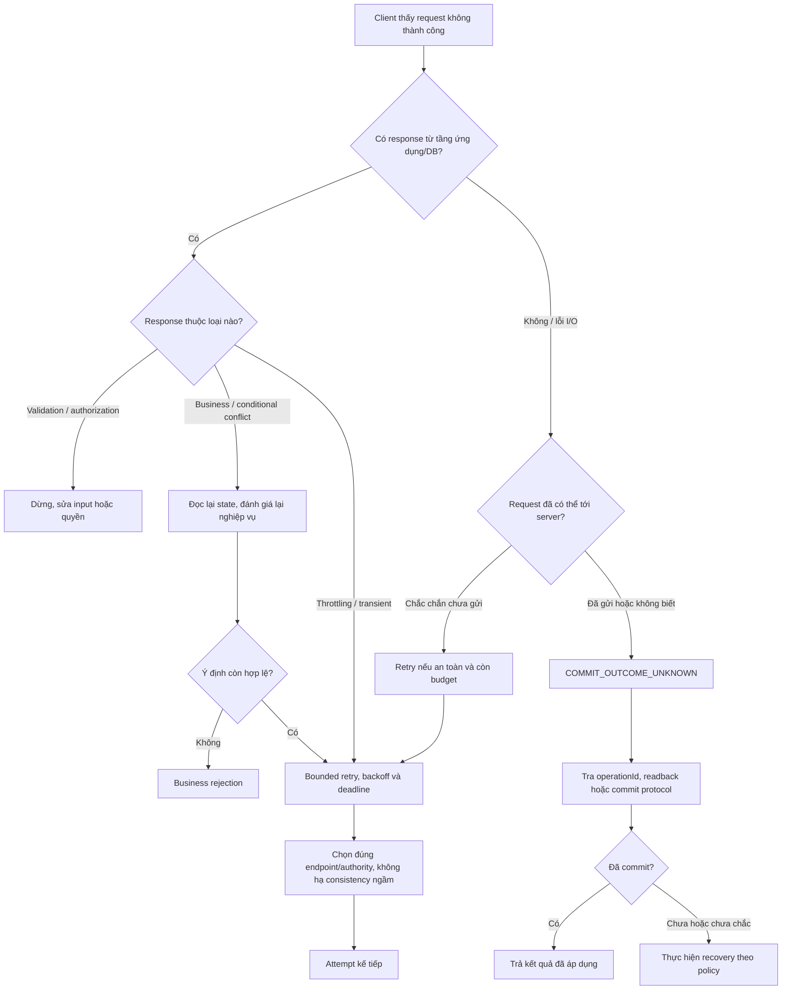
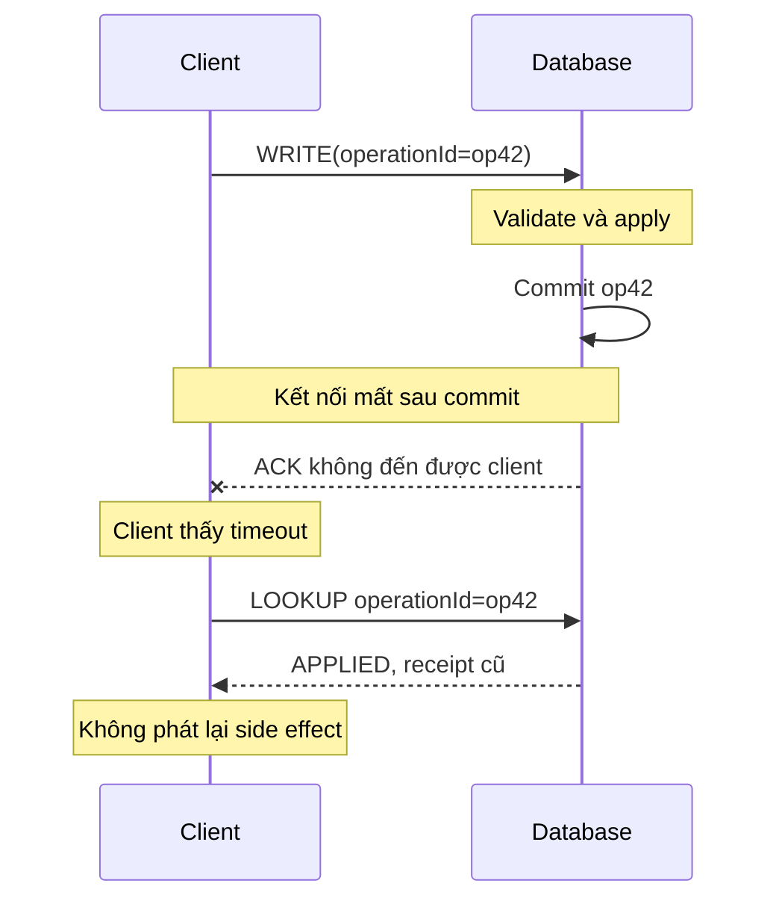
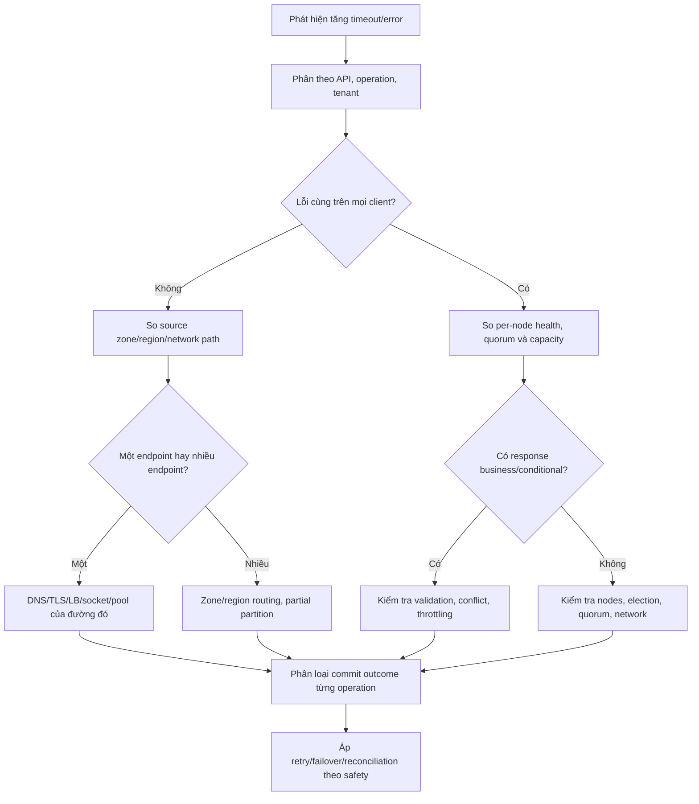

# Phân biệt lỗi yêu cầu, lỗi kết nối, lỗi nút và lỗi mạng một phần

Một API ghi dữ liệu vào NoSQL có thể trả lỗi vì payload sai, phiên bản bản ghi đã thay đổi, kết nối TCP bị reset, một node vừa khởi động lại hoặc chỉ một đoạn mạng giữa các replica bị gián đoạn. Dù cùng được nhìn thấy ở ứng dụng dưới dạng **timeout**, **exception** hoặc **HTTP 5xx**, các tình huống này có nguyên nhân, phạm vi ảnh hưởng và cách khôi phục rất khác nhau.

Ví dụ, một lệnh tăng số lượt mua hàng đã được database thực hiện nhưng phản hồi bị mất. Nếu client lập tức gửi lại lệnh tăng không có idempotency, số lượt mua có thể tăng hai lần. Ngược lại, một lệnh bị từ chối vì `version` không còn khớp cần **đọc trạng thái mới và đánh giá lại nghiệp vụ**, chứ không phải kết nối sang replica khác rồi gửi cùng payload cũ. Một node không truy cập được từ client A cũng không chứng minh node đó đã chết: nó có thể đang phục vụ client B bình thường trong một **sự cố mạng một phần**.

Trong chương **Database No SQL → Lỗi phân tán và retry**, bài học này xây dựng cách phân biệt bốn nhóm sự cố:

1. **Lỗi yêu cầu (request-level failure):** request đến được tầng xử lý nhưng không thể hoặc không được thực hiện theo dữ liệu, điều kiện, giới hạn hay trạng thái hiện tại.
2. **Lỗi kết nối (connection-level failure):** không thiết lập được, duy trì được hoặc trao đổi được thông điệp qua một kênh kết nối cụ thể.
3. **Lỗi nút (node-level failure):** một tiến trình hoặc máy tham gia cluster ngừng phục vụ, treo, quá tải hoặc mất khả năng hoàn thành vai trò của nó.
4. **Lỗi mạng một phần (partial network failure):** chỉ một số đường đi, cặp node, zone, vùng địa lý hoặc loại traffic bị mất, chậm hay bất đối xứng; các phần khác vẫn có thể hoạt động.

Điểm quan trọng nhất: **lỗi quan sát được tại client không tự xác định nguyên nhân gốc và cũng không tự xác định kết quả commit**. Việc xử lý đúng cần tách **tầng triệu chứng**, **phạm vi ảnh hưởng**, **trạng thái thao tác**, **cam kết nhất quán** và **an toàn retry**.

> Những ví dụ MongoDB, DynamoDB, Cassandra/ScyllaDB và Redis thể hiện nguyên tắc. Mã exception, nhãn retry và retry policy thực tế có thể khác theo phiên bản SDK, cấu hình topology, read/write concern, consistency level và API. Luôn đối chiếu tài liệu của sản phẩm đang triển khai khi đưa quyết định vào production.

## 1. Một lệnh NoSQL đi qua nhiều tầng

Xét ứng dụng muốn đặt trạng thái một đơn hàng:

```text
Client
  |
  v
HTTP/API gateway
  |
  v
Application service
  |
  v
Driver / connection pool
  |
  v
DNS / TLS / TCP / Network path
  |
  v
Router / Coordinator / Leader
  |
  +-- Replica 1
  +-- Replica 2
  +-- Replica 3
  |
  v
Storage / Commit / Replication protocol
```

Một lỗi có thể xuất hiện ở bất kỳ điểm nào:

- JSON thiếu trường bắt buộc ngay tại API service.
- Conditional write bị từ chối vì phiên bản cũ.
- Driver không lấy được connection từ pool.
- DNS resolution thất bại.
- TCP connect timeout đến node đích.
- Kết nối đang dùng bị reset giữa lúc gửi request.
- Server nhận lệnh nhưng process crash trước khi trả kết quả.
- Leader thay đổi trong lúc commit.
- Một replica không trả ACK do network partition.
- Coordinator đã commit nhưng response quay về client bị mất.

Do đó dòng log:

```text
java.net.SocketTimeoutException: Read timed out
```

chỉ nói rằng **một thao tác chờ I/O vượt thời gian được đặt**, không chứng minh dữ liệu chưa được ghi, node đã chết hay packet nào đã bị mất.

## 2. Bảng phân biệt bốn nhóm lỗi

| Nhóm | Đối tượng bị lỗi | Triệu chứng thường gặp | Câu hỏi đầu tiên |
| --- | --- | --- | --- |
| **Lỗi yêu cầu** | Một thao tác và điều kiện nghiệp vụ/validation/capacity của nó | Validation failed, version conflict, conditional check failed, quota exceeded | Request có hợp lệ và còn hợp lệ trên state mới không? |
| **Lỗi kết nối** | Kênh client↔server, socket, pool, TLS, DNS | Connection refused/reset, TLS handshake failure, connect timeout, broken pipe | Request đã đi tới server và có thể đã commit chưa? |
| **Lỗi nút** | Một process, máy hoặc participant của cluster | Node down, process crash, OOM, disk full, leader unavailable | Node còn vai trò/quorum không, dữ liệu và commit state ra sao? |
| **Lỗi mạng một phần** | Một tập đường đi giữa các bên | Một AZ không tới được AZ khác, packet loss một chiều, cross-Region timeout | Những bên nào còn liên lạc, còn authority/quorum nào, có split-brain không? |

Bốn nhóm **không loại trừ nhau về mặt nhân quả**. Một node quá tải có thể gây connection timeouts; network partition làm driver đánh dấu một node “unreachable”; network loss khiến server trả lỗi quorum cho một request hợp lệ. Phân loại cần phân biệt **triệu chứng quan sát** với **nguyên nhân gốc được xác minh**.

## 3. Dùng ba trục thay vì một nhãn “DB lỗi”

Một báo cáo sự cố có ích nên phân loại theo ít nhất ba trục.

**Trục A – Nơi quan sát lỗi:**

```text
Application validation
Driver / transport
Database coordinator
Replica / storage
Cluster network / topology
External dependency
```

**Trục B – Trạng thái kết quả ghi:**

```text
DEFINITELY_NOT_APPLIED
APPLIED_AND_ACKNOWLEDGED
COMMIT_OUTCOME_UNKNOWN
BUSINESS_CONDITION_REJECTED
```

**Trục C – Phạm vi ảnh hưởng:**

```text
One operation
One connection
One node
One partition / shard
One availability zone
One region pair / cross-region link
Whole cluster / dependency
```

Ví dụ:

```yaml
observation:
  symptom: "socket read timeout"
  layer: "driver_transport"
  affectedScope: "one region pair"
  commitOutcome: "UNKNOWN"
  businessOperation: "reserve_inventory"
  operationId: "reserve-101"
  nextStep: "reconcile_by_operation_id"
```

Một sự cố chỉ có thể được xử lý tự động an toàn khi các trục này đủ rõ. Nếu chưa đủ thông tin, **ghi `UNKNOWN` và thu thập thêm bằng chứng** tốt hơn suy đoán.

## 4. Lỗi yêu cầu: server có thể đã xử lý đúng khi từ chối

**Lỗi yêu cầu** xảy ra khi request không thỏa contract hoặc điều kiện để database thực hiện hành động. Ví dụ:

- Trường bắt buộc không có hoặc sai kiểu.
- `tenantId`/key không hợp lệ, hoặc user không có quyền.
- Item/document vượt kích thước được hỗ trợ.
- Query hoặc expression sai cú pháp.
- Update không đáp ứng điều kiện `version = expected`.
- Trạng thái đơn đã là `CANCELLED`, không cho chuyển sang `PAID`.
- Vi phạm uniqueness, constraint hay business invariant.
- Giao dịch bị abort do serialization/write conflict.
- Request bị từ chối vì quota, capacity hoặc overload.

Không phải mọi lỗi trong danh sách có cùng retry policy. **Lỗi validation/quyền** thường không thể chữa bằng retry. **Version conflict** có thể cần đọc lại và tính lại nếu nghiệp vụ cho phép. **Throttling** thường có thể thử lại với backoff nếu operation an toàn và còn budget.

### Phân nhóm bên trong lỗi yêu cầu

| Phân nhóm | Ví dụ | Retry trực tiếp cùng payload? |
| --- | --- | --- |
| **Invalid input** | Sai schema, tham số, key | Không |
| **Authorization** | Không có quyền/tenant mismatch | Không; phải sửa quyền hoặc request |
| **Permanent business rejection** | Không đủ hàng, order đã đóng | Không |
| **Optimistic conflict** | CAS/version mismatch | Không gửi mù; đọc lại và đánh giá lại |
| **Transient transaction conflict** | Abort do tranh chấp được engine báo retryable | Có thể theo protocol, bounded và idempotent |
| **Overload/rate limit** | Throttling/429/503 theo API | Có thể với backoff/jitter, deadline |
| **Unknown commit result** | Timeout sau khi gửi ghi/commit | Kiểm tra operationId/commit outcome trước |

**Server trả lỗi** không nhất thiết là một thất bại của hệ thống: đôi khi chính việc từ chối là bảo đảm tính đúng dữ liệu.

## 5. Ví dụ request conflict do optimistic locking

Ban đầu:

```json
{
  "orderId": "O-101",
  "status": "PENDING",
  "version": 7
}
```

Hai writer đọc cùng version 7:

```text
Writer A:
    update where version=7
    set status=PAID, version=8
    -> APPLIED

Writer B:
    update where version=7
    set status=CANCELLED, version=8
    -> CONDITION_NOT_MET
```

B không bị mất mạng. Kết nối có thể hoàn toàn khỏe. Database đã xử lý request và từ chối đúng vì điều kiện không còn thỏa.

Nếu B retry bằng cách đổi expectedVersion thành 8 nhưng vẫn giữ ý định cũ mà không đánh giá trạng thái `PAID`, có thể hủy một đơn đã thanh toán trái quy tắc. Hướng đúng:

```text
VERSION_CONFLICT
    -> đọc trạng thái hiện hành
    -> kiểm tra chuyển trạng thái có còn hợp lệ không
    -> nếu không: BUSINESS_REJECTED
    -> nếu có: tính lại update và CAS với version mới
    -> giới hạn attempts + deadline
```

**Retry không dùng để vượt qua hàng rào business invariant.**

## 6. Lỗi kết nối là gì?

**Connection failure** nói về kênh vận chuyển dữ liệu, không phải logic nghiệp vụ. Nó có thể xảy ra ở những thời điểm khác nhau:

1. Trước khi có kết nối.
2. Sau TCP connect nhưng trước TLS/authentication.
3. Khi gửi bytes.
4. Sau khi server đã nhận request nhưng trước response.
5. Trong lúc chờ response từ server.
6. Khi lấy connection từ pool hoặc khi connection bị idle quá lâu.

Một số triệu chứng:

```text
DNS lookup failed
TCP connection refused
Connect timeout
TLS handshake failed
Connection reset by peer
Broken pipe
EOF / unexpected connection close
Read timeout
Connection pool acquire timeout
```

Không suy rằng mọi triệu chứng đều do “mạng hỏng”. `Connection refused` có thể là không có listener ở cổng đó; TLS handshake có thể do chứng chỉ hoặc cấu hình; pool timeout có thể do ứng dụng dùng hết connections chứ không phải packet loss.

## 7. Connect timeout và read timeout khác nhau

### Connect timeout

Client chưa hoàn tất việc mở kết nối tới endpoint.

```text
Client                Server
  | ---- SYN ---->       ?
  | ... chờ ...
  | CONNECT_TIMEOUT
```

Nếu chưa có phiên kết nối để gửi lệnh nghiệp vụ, **lệnh cụ thể chưa được gửi qua socket này**. Nhưng cần xét SDK có thể đã gửi request qua một connection/attempt khác hay chưa, hoặc callback retry có làm phát sinh operation trước đó không.

### Read timeout

Client đã tạo kết nối, có thể đã gửi request, nhưng không nhận đủ phản hồi trong thời hạn:

```text
Client                   Server
  | ---- UPDATE ---->       |
  |                         | APPLY / COMMIT ?
  | <---- response ? ----   |
  | READ_TIMEOUT            |
```

**Read timeout không cho biết server đã commit hay chưa.** Nó có thể phát sinh do server chậm, coordinator chờ quorum, replica không phản hồi, mạng trả response bị mất hoặc client deadline quá ngắn.

### Pool acquire timeout

```text
50 worker threads
Connection pool size = 10
10 connections bận
40 requests đang chờ pool

Request X:
    lấy connection quá hạn -> POOL_TIMEOUT
```

Request X có thể **chưa chạm database**. Đây là giới hạn local resource/concurrency, không tự chứng minh một node backend đang lỗi.

## 8. Connection reset có chứng minh thao tác thất bại không?

Không.

Một timeline:

```text
T0: Client gửi POST/UPDATE.
T1: Server đọc đủ payload.
T2: Server commit write.
T3: Kết nối bị reset trước khi trả ACK.
T4: Client thấy CONNECTION_RESET.
```

Nếu client lập tức gửi lại một lệnh:

```text
INCREMENT balance by 1
```

database có thể tăng hai lần.

Ngược lại:

```text
T0: Client mở connection.
T1: Kết nối bị reset trước khi gửi bất kỳ byte request nào.
```

trong điều kiện chắc chắn không có attempt trước đó, lệnh chưa được server nhận trên kết nối này. Hai tình huống có cùng **nhãn kết nối bị reset**, nhưng trạng thái operation khác nhau.

**Quyết định retry phụ thuộc giai đoạn I/O và idempotency**, không chỉ tên exception.

## 9. TCP ACK và database COMMIT ACK không giống nhau

Các mốc:

```text
A. TCP handshake complete
B. Bytes được ghi vào socket phía client
C. TCP peer ACK nhận bytes
D. Server xử lý request
E. Storage/transaction protocol commit
F. Server tạo response thành công
G. Client nhận đầy đủ response
```

Có TCP ACK ở C **không chứng minh E đã xảy ra**. Ngược lại, nếu mất response giữa F và G, E có thể đã xảy ra dù client không thấy ACK nghiệp vụ.

Với TLS, load balancer, proxy và connection multiplexing, còn có thêm tầng đệm. Một kết nối thành công tới proxy không chứng minh proxy đã gửi request tới node lưu trữ.

Trong quan sát vận hành, nên tách:

- **Transport established.**
- **Request accepted.**
- **Write applied locally.**
- **Commit/replication acknowledged theo contract.**
- **Response delivered to client.**

Đây là những mốc khác nhau với các bảo đảm khác nhau.

## 10. Lỗi nút: “node không khỏe” có nhiều dạng

Một **node failure** có thể là:

- Process database crash.
- Máy/VM/container dừng.
- Node bị OOM kill.
- Disk full hoặc filesystem read-only.
- JVM GC pause kéo dài khiến node không phản hồi.
- CPU saturation tạo queue dài.
- Storage I/O stalled.
- Node bị cách ly vì configuration/credential.
- Node đã mất vai trò leader nhưng client còn tưởng nó là leader.
- Một replica đang bootstrap/repair và chưa sẵn sàng.
- Coordinator còn sống nhưng không đạt đủ quorum.

### Crash-stop, crash-recovery và fail-slow

**Crash-stop:** node ngừng thực thi và không quay lại trong mô hình một lần chạy.

**Crash-recovery:** node dừng rồi trở lại, phải khôi phục state/log/ownership.

**Fail-slow:** node vẫn trả lời nhưng chậm bất thường, dễ gây tail latency và timeout; có thể còn nguy hiểm hơn crash rõ ràng vì request tiếp tục đổ vào.

Một health endpoint có thể trả `200 OK` ngay cả khi disk writes đều timeout. Do đó **liveness của process** không đồng nghĩa **khả năng hoàn tất transaction theo contract**.

## 11. Một node hỏng không có nghĩa toàn cluster phải dừng

Giả sử ba replica cùng lưu dữ liệu của một partition:

```text
R1: healthy
R2: healthy
R3: process crashed
```

Một số giao thức có thể vẫn hoàn tất request nếu những replica còn lại tạo đủ quorum/authority. Một hệ khác có thể cần chờ failover hoặc không có đủ replicas để đáp ứng một consistency level.

Các câu hỏi:

- RF/replica placement là bao nhiêu?
- Read/write consistency level nào được yêu cầu?
- Leader hiện tại có còn quyền phục vụ không?
- Quorum/term/lease có hợp lệ không?
- Request có liên quan một hay nhiều partitions?
- Node bị hỏng có đang giữ một hot key/sole authority không?
- Có thể route tới node khác mà không giảm mức nhất quán ngầm không?

Không mặc định “thử node khác” luôn hợp lệ. Chuyển sang replica cũ có thể trả dữ liệu stale; gửi write vào một leader cũ có thể tạo split-brain nếu không có fencing.

## 12. Lỗi mạng một phần: cluster không chia đơn giản thành khỏe và chết

Trong phân tán, **partial network failure** nghĩa chỉ một số cặp/đường đi bị ảnh hưởng.

Ví dụ:

```text
                 Region A
               /          \
          Node A1 ----- Node A2
                \         /
                 X       X  (liên vùng lỗi)
                  \     /
                  Region B
                  Node B1 --- Node B2
```

Có thể:

- Client ở A vẫn gọi A1/A2.
- Client ở B vẫn gọi B1/B2.
- A không sao chép sang B được.
- Một node vẫn healthy theo local probe.
- API đọc local vẫn phục vụ, nhưng strong cross-region write bị chặn.
- Một hệ eventual tiếp tục nhận local writes, cần hòa giải sau đó.

**Partial failure là đặc điểm thiết kế của hệ phân tán**, không phải trường hợp cực hiếm có thể xử lý bằng `catch Exception` rồi retry.

## 13. Mạng một chiều và sự cố bất đối xứng

Đường mạng không nhất thiết lỗi đối xứng:

```text
A -> B: thông điệp đi được.
B -> A: response bị chặn.
```

Client A gửi write tới B, B commit, nhưng A không nhận response. A có thể đánh dấu B unreachable trong khi B vẫn ghi nhận mọi request.

Hoặc:

```text
Client C1 -> Node X: thành công.
Client C2 -> Node X: timeout.
Node X -> Node Y: thành công.
Node X -> Node Z: timeout.
```

Một ping hoặc TCP check từ **một điểm** không thể suy ra toàn bộ connectivity graph. Cần probe **từ các vùng/role có liên quan**, đồng thời đối chiếu network telemetry và cluster membership.

Các kiểu lỗi:

- Packet loss một chiều.
- MTU/fragmentation khiến payload lớn thất bại trong khi ping nhỏ vẫn thành công.
- ACL/firewall chặn một port/protocol.
- DNS ở một nhóm client trả endpoint khác.
- Load balancer chỉ chuyển traffic một chiều hoặc một tập backend.
- NAT/connection tracking bị cạn tài nguyên.
- Inter-zone/inter-region link bị suy giảm.
- Network jitter gây timeout giả giống node failure.

## 14. Slow network khác network partition hoàn toàn

Một mạng không mất kết nối nhưng **latency tăng mạnh** có thể gây:

```text
Normal replica ACK: 5 ms
During brownout:   800 ms
Client timeout:    200 ms
```

Client quan sát timeout gần như liên tục, dù message vẫn đến sau 800 ms. Đây là lý do phải cẩn thận với từ **“node dead”**: timeout chỉ là tín hiệu **nghi ngờ** từ failure detector.

Nếu hệ phản ứng bằng việc bầu leader mới quá nhanh nhưng leader cũ chưa bị fence, có thể tạo nguy cơ split-brain. Nếu hệ phản ứng quá chậm, availability giảm. Consensus/leader protocol cần cân bằng timeout với ràng buộc an toàn chứ không chỉ tăng số retries.

## 15. Failure detector: không thể luôn biết chắc node đã chết

Trong mô hình mạng bất đồng bộ, một node không phản hồi có thể:

1. Đã crash.
2. Đang GC pause.
3. Bị scheduler tạm dừng.
4. Gửi/nhận message chậm.
5. Một hướng mạng đang lỗi.
6. Bị throttle/storage stalled.
7. Response đã thất lạc.

Không có một timeout hữu hạn nào luôn phân biệt hoàn hảo các trường hợp đó chỉ từ việc chờ một message.

### Hệ quả thiết kế

- Membership status như `SUSPECT`, `UNREACHABLE`, `DOWN` là **quan sát/protocol state**, không phải bằng chứng vật lý tuyệt đối.
- Đưa node ra khỏi load balancer có thể cải thiện latency nhưng chưa đủ để đảm bảo node đó không ghi.
- Leader fencing/term/epoch phải được kiểm tra ở resource có thẩm quyền.
- Trong recovery, dữ liệu node cũ cần được đồng bộ theo protocol chứ không tự coi mọi bản copy trên nó đều mới nhất.

**Failure detector giúp hệ tiến triển; safety cần giao thức bảo vệ thêm.**

## 16. Một sơ đồ quyết định tổng quan



Sơ đồ chỉ là khung tư duy, không phải thuật toán chuẩn cho mọi SDK. Đặc biệt, **unknown commit outcome không được tự đẩy vào nhánh retry ghi** nếu chưa có idempotency hoặc protocol tương đương.

## 17. Bảng quyết định theo triệu chứng quan sát

| Triệu chứng | Có thể thuộc nhóm | Điều phải xác minh | Hành động ban đầu |
| --- | --- | --- | --- |
| JSON/schema invalid | Request | Contract và payload | Dừng, trả lỗi rõ |
| Conditional check failed | Request | Version, status, uniqueness, business predicate | Đọc lại, không retry mù |
| 429/throttling | Request/overload | Capacity, tenant quota, server hint | Bounded backoff/jitter |
| DNS resolution error | Kết nối/cấu hình | DNS, resolver, endpoint | Retry hạn chế hoặc sửa config |
| TCP connection refused | Kết nối/nút/cấu hình | Listener, port, firewall, node health | Chọn endpoint hợp lệ, điều tra |
| Connect timeout | Kết nối/mạng/nút | Reachability, SYN path, routing | Không suy đã commit trên socket chưa gửi |
| Socket reset sau write | Kết nối/mạng/nút | OperationId, server logs | Outcome unknown |
| Read timeout | Nhiều nhóm | Server đã nhận/commit? quorum? network? | Outcome unknown cho write |
| Node marked down | Nút hoặc mạng một phần | Probe nhiều phía, disk/CPU/process | Failover theo protocol |
| Replica ACK thiếu | Nút/mạng/overload | Quorum/CL và role | Không ACK commit thiếu điều kiện |
| Một AZ timeout, AZ khác khỏe | Mạng một phần/topology | Connectivity graph | Route nếu hợp consistency |
| Minority partition trả unavailable | Mạng một phần/quorum | Authority/quorum | Không ép ghi sang minority |
| Stale read sau failover | Consistency/routing | Read mode, leader, replica lag | Dùng authoritative read path |

Mục tiêu không phải đoán chính xác root cause ngay từ exception, mà là **không thực hiện hành động nguy hiểm trong lúc chưa biết nguyên nhân**.

## 18. “Không có response” là một trạng thái riêng

Một request không có response chưa thể được xem là **server rejected**. Ba lịch sử:

```text
H1: Request chưa đến server.
H2: Request đến server nhưng server abort.
H3: Request đến server, commit, response thất lạc.
```

Client có thể quan sát cùng:

```text
TIMEOUT
```

Nếu lập trình:

```text
catch TimeoutException:
    executeBusinessOperationAgain()
```

sẽ không an toàn trong H3.

Để xử lý đúng, cần có **idempotency key** hoặc cơ chế kiểm tra trạng thái giao dịch.

### Ba loại kết quả cần đưa vào API

```text
APPLIED:
    Đã hoàn tất theo cam kết của API.

REJECTED:
    Có bằng chứng thao tác không được áp dụng.

UNKNOWN:
    Chưa thể chứng minh applied hay rejected.
```

Bổ sung `PENDING` nếu request đã được **nhận bền vững vào workflow nhưng chưa commit nghiệp vụ**. `PENDING` không phải synonym của `APPLIED`.

## 19. Idempotency là hàng rào khi retry ghi

Một lệnh:

```text
Reserve inventory for order O-100, quantity=2
```

cần có định danh ổn định:

```json
{
  "operationId": "reserve-O-100-line-1",
  "sku": "SKU-42",
  "quantity": 2
}
```

Khi request bị timeout, client gửi lại **cùng operationId**, không tạo ID mới.

Một nguồn có thẩm quyền phải đảm bảo:

```text
Nếu operationId đã commit:
    trả lại outcome cũ;
    không trừ stock thêm lần nữa.

Nếu operationId chưa tồn tại:
    đánh giá stock và điều kiện nghiệp vụ;
    áp update và lưu marker operationId trong atomic scope.
```

Nếu check operationId và decrement stock là **hai ghi không nguyên tử**, hai request đồng thời vẫn có thể cùng thấy “chưa xử lý” rồi trừ hai lần.

### Chú ý thời gian giữ marker

Nếu marker idempotency hết TTL sau 1 giờ nhưng client có thể replay sau 2 ngày, hệ có nguy cơ áp lại operation cũ. Retention của dedup state phải phù hợp với **vòng đời retry, replay, queue và business uniqueness**.

## 20. Đọc lại bản ghi sau timeout có đủ không?

Không phải lúc nào cũng đủ.

Giả sử client gửi:

```text
INCREMENT counter by 1
```

Sau timeout:

```text
Read counter = 101
```

Counter trước là 100. Giá trị 101 có thể do chính request đã commit, nhưng cũng có thể do **một client khác** tăng. Chỉ nhìn giá trị hiện tại không chứng minh operationId của client đã được áp dụng.

Tương tự chuyển tiền từ A sang B, số dư đổi có thể do những giao dịch khác.

Một cách đáng tin cậy hơn:

- Tra record `operationId`.
- Tra ledger/event log có unique business ID.
- Dùng conditional insert/transaction marker.
- Retry protocol do SDK/database hỗ trợ cho thao tác đó.
- Chỉ khi API có hợp đồng xác định mới suy kết quả từ version/last command token.

**Readback của state khác readback của operation outcome.**

## 21. Request-level transient conflict khác connection retry

Một optimistic conflict:

```text
CAS expectedVersion=7
-> CONDITION_FAILED
```

server đã xử lý và biết chắc **điều kiện không thỏa**. Client cần đọc lại trạng thái mới rồi tính lại ý định.

Một connection timeout:

```text
CAS expectedVersion=7
-> SOCKET_TIMEOUT
```

không biết CAS đã áp dụng chưa. Nếu client cứ đọc lại thấy `version=8`, cần biết có đúng operation của mình không.

Tuy cùng liên quan retry, hai loại cần tách:

```text
CONFIRMED_CONFLICT:
    re-read -> revalidate -> retry nếu domain cho phép.

UNKNOWN_OUTCOME:
    lookup operationId -> recover/return;
    không retry business effect mù.
```

Kết hợp cả hai vào một `catch(Exception e) { retry(); }` là nguồn gốc nhiều lỗi phân tán khó tái hiện.

## 22. Lỗi kết nối trước gửi request: an toàn đến mức nào?

Nếu client chắc chắn chưa gửi bất kỳ byte request nào và không có attempt nào trước đó, việc retry operation có thể ít rủi ro hơn.

Ví dụ:

```text
Acquire pool connection failed before dispatch.
```

Nhưng “chắc chắn chưa gửi” phải dựa trên **contract và instrumentation của SDK**, không chỉ stack trace. Một thư viện có thể:

- Tự retry nội bộ trước khi đưa lỗi ra ngoài.
- Dùng pipeline hoặc multiplexed connections.
- Gửi request trước rồi exception xảy ra ở response phase.
- Thực hiện nhiều calls cho một business operation.
- Dùng asynchronous callbacks và cancellation.

Do đó khi dùng driver có cơ chế retryable write chính thức, cần **hiểu retry policy và số attempts thực**. Không bọc thêm nhiều tầng retry mà tưởng đây vẫn là lần đầu.

## 23. Quorum khiến lỗi mạng biến thành lỗi request

Giả sử ba replica cùng quản lý một key, write cần điều kiện quorum theo protocol.

```text
R1: reachable
R2: reachable
R3: network partition
```

Coordinator có thể lấy đủ acknowledgment từ R1/R2 nếu quorum hai trong ba là hợp lệ, nên một request có thể thành công.

Nếu chỉ R1 reachable:

```text
R1: reachable
R2: unreachable
R3: unreachable
```

coordinator có thể trả:

```text
UNAVAILABLE / NOT_ENOUGH_REPLICAS
```

Đây là **response cấp request** do **nguyên nhân topology/mạng**. Database từ chối commit vì không thể đáp ứng consistency level.

Một hệ strong đúng không nên âm thầm đổi từ quorum write sang local-only write mà vẫn trả `COMMITTED_QUORUM`.

### Không dùng công thức quorum một cách máy móc

Điều kiện giao nhau của quorum là thành phần quan trọng trong một số thiết kế, nhưng không tự chứng minh linearizability. Còn cần xét leader/term, membership, concurrent writes, read barrier, replication ACK semantics và transaction scope.

## 24. Mạng một phần và split-brain

Một nguy cơ:

```text
Network partition:
    Nhóm A không thấy nhóm B.

Node A:
    cho rằng mình còn là leader.
    tiếp tục nhận authoritative writes.

Node B:
    được chọn leader mới.
    cũng nhận authoritative writes.
```

Nếu cả hai được phép xác nhận mâu thuẫn, hệ có thể có **split-brain** và không thể hợp nhất theo một lịch sử nhất quán đã cam kết.

Một giao thức đúng thường cần:

- Leader election/quorum hợp lệ.
- Term/epoch/fencing token.
- Storage/replica từ chối write của leader cũ.
- Read path tôn trọng commit order.
- Recovery/rollback theo protocol chính thức.
- Client xử lý redirect/retry an toàn.

**Health check “A còn sống” không chứng minh A còn quyền leader.** Failover và fencing giải quyết một bài toán khác với việc mở lại TCP connection.

## 25. Một phía mạng có thể phục vụ được, phía khác không

Giả sử cluster 5 node chia thành nhóm 3 và 2 theo network partition, một giao thức cần majority.

```text
Group X: 3 nodes -> có thể có majority authority.
Group Y: 2 nodes -> không đủ majority.
```

Nếu các giả định quorum/role được đáp ứng:

- Group X có thể tiếp tục những thao tác mạnh theo giao thức.
- Group Y phải chờ, route sang X nếu có đường đi, hoặc trả unavailable cho thao tác đòi authority.
- Group Y vẫn có thể phục vụ **một số stale/cache reads** nếu hợp đồng API cho phép.
- Khi mạng phục hồi, các node phải catch up theo log/repair protocol.

Đây là **partial availability**: một phần chức năng/địa lý vẫn phục vụ, một phần suy giảm.

Không được nói “cluster hoàn toàn down” chỉ vì client ở Group Y thấy timeout, và cũng không được nói “mọi thứ khỏe” chỉ vì Group X có traffic thành công.

## 26. Phân biệt client partition với inter-replica partition

Hai kiểu mạng lỗi có triệu chứng khác:

### Client không tới được database

```text
Client zone A --X--> DB cluster healthy
Client zone B ------> DB cluster healthy
```

Database nội bộ vẫn đạt quorum và phục vụ zone B. Đây có thể là lỗi giữa client/network gateway và service, không phải database replica divergence.

### Replica không tới được replica khác

```text
Client ------> Coordinator
                    |
                 R1--R2
                    X
                    R3
```

Client kết nối coordinator bình thường nhưng transaction/read có thể timeout do không đủ replica acknowledgments hoặc đang leader election.

**Cùng lỗi “request timed out” ở client nhưng remediation khác**: trường hợp một có thể cần route/load balancer/network fix; trường hợp hai cần xem cluster membership, quorum và consistency policy.

## 27. Vì sao kiểm tra ping không đủ?

`ping` hoặc TCP connect tới một địa chỉ chỉ kiểm tra một phần đường đi.

Các tình huống:

- ICMP bị firewall chặn nhưng TCP database hoạt động.
- ICMP đi được nhưng TLS port bị chặn.
- Small packets đi được, large packets lỗi vì MTU.
- Health endpoint trả nhanh nhưng data path disk stalled.
- Client tới load balancer được, backend không tới leader.
- Replica A tới B được nhưng B tới A không.
- Một route qua region khác tăng latency khiến quorum timeout.

Các phép đo cần kết hợp:

```text
Client -> LB
Client -> database endpoint
Coordinator -> replicas
Replica -> replica
Node -> DNS/identity service
Application -> driver connection pool
```

Mọi phép thử cần chạy từ **đúng nguồn và đích** của traffic có vấn đề, không chỉ từ laptop vận hành.

## 28. Timeouts phải được đặt theo tầng

Một request có nhiều timeout:

```text
API total deadline
    |
    +-- connection pool acquire timeout
    +-- DNS/connect timeout
    +-- TLS handshake timeout
    +-- per-command/socket read timeout
    +-- server-side execution timeout
    +-- quorum/transaction timeout
    +-- retry backoff
```

Nếu tầng dưới có timeout dài hơn deadline tổng, request có thể bị hủy ở client nhưng vẫn chạy backend và tạo **unknown outcome**.

Ví dụ:

```text
HTTP deadline:              800 ms
Driver socket timeout:     2000 ms
Database commit completes:  900 ms
```

HTTP đã trả timeout sau 800 ms nhưng database có thể commit sau đó. Một retry mới của user từ frontend có thể gây duplicate nếu không có operationId.

Cần **propagate deadline**, giới hạn attempts và định nghĩa cancellation semantics. Cancellation ở client không tự rollback commit đã bắt đầu ở server.

## 29. Những retry nhiều tầng tạo khuếch đại tải

Giả sử:

```text
API gateway retries:      3 attempts
Service retries:          3 attempts
Repository retries:       3 attempts
```

Trong trường hợp các attempts lồng nhau được thực hiện đầy đủ:

\[
3 \times 3 \times 3 = 27
\]

lần gọi tầng dưới cho **một** request đầu vào, chưa tính retry nội bộ driver.

Khi một node chậm vì mạng một phần, 27 attempts làm tăng connections, queue, CPU và timeouts, có thể kéo hệ vào **retry storm**.

Chính sách tốt:

- Một tầng sở hữu retry nghiệp vụ.
- Driver retries được hiểu và tính vào tổng attempts.
- Giới hạn **maxAttempts** và **overall deadline**.
- Capped exponential backoff và **jitter**.
- Retry budget theo service/tenant.
- Không retry lỗi validation/quyền.
- Không retry unknown commit bằng lệnh không idempotent.
- Không retry ngay cùng hot key trong một vòng vô hạn.

## 30. Exponential backoff với jitter

Một công thức cơ sở:

\[
B_n = \min(B_{\max}, B_0 \times 2^n)
\]

với \(n=0\) cho lần retry đầu tiên, \(B_0\) là delay cơ sở, \(B_{\max}\) là trần.

**Full jitter**:

\[
D_n \sim U(0, B_n)
\]

Ví dụ cấu hình minh họa:

```yaml
retry:
  maxAttempts: 4
  totalDeadlineMs: 1500
  baseDelayMs: 40
  maxDelayMs: 400
  jitter: full
  retryBudget:
    enabled: true
```

Nếu 200 clients cùng gặp 503, chờ đúng 100 ms làm chúng có thể retry cùng nhịp. Jitter rải attempts ra nhiều thời điểm.

### Lưu ý

- Không dùng backoff để lờ đi một conflict nghiệp vụ vĩnh viễn.
- Nếu response có hướng dẫn server-side như Retry-After, xem xét nó trong deadline.
- Không tiếp tục chờ sau khi caller hủy.
- Nếu không còn budget để có một attempt hữu ích, dừng sớm.
- Delay phải được tính chống overflow khi attempts không bị giới hạn nhỏ.

## 31. Failover khác retry

**Retry:** phát lại một thao tác theo policy, có thể tới cùng một endpoint hoặc endpoint mới.

**Failover:** chuyển quyền phục vụ, endpoint, replica, region hoặc leader theo giao thức khi thành phần cũ không còn đáp ứng.

Một ví dụ:

```text
Node primary P crash.
Cluster bầu primary Q.
Driver cập nhật topology và route write tới Q.
```

Ở đây driver có thể cần chờ/bắt lại connection và retry **những lệnh được hỗ trợ**. Nhưng failover không tự bảo đảm mọi thao tác ghi trước đó chưa hoặc đã commit.

Các vấn đề riêng:

- Write trước failover có thể đã commit nhưng response mất.
- Một số writes chưa đạt durability policy có thể bị rollback.
- Transaction commit outcome chưa rõ.
- Old primary cần bị fence.
- Replica mới phải có state phù hợp trước khi phục vụ strong reads.
- Idempotency record có phải được phục hồi cùng business data không?

**Chuyển node không được làm đổi nghĩa của ACK nghiệp vụ.**

## 32. Node failure có thể gây hot key mới sau failover

Trước:

```text
R1, R2, R3 phân bố traffic.
```

Sau R2 rời cluster, traffic được chuyển vào R1/R3:

```text
R1: traffic tăng
R3: traffic tăng
```

Nếu R1/R3 gần capacity, chúng trở thành fail-slow, gây tiếp timeout. Có thể hình thành **cascading failure**:

```text
Node R2 down
   -> Load chuyển sang R1/R3
   -> p99 tăng
   -> Clients retry
   -> QPS tăng thêm
   -> Pool/queue đầy
   -> R1/R3 timeout
```

Vì vậy khi nói “cluster còn 2/3 node sống” phải đo **N-1 capacity headroom**, không chỉ số node.

Các cơ chế bảo vệ:

- Admission control và load shedding.
- Bounded concurrency.
- Adaptive timeouts/retry budget theo chính sách.
- Điều tiết recovery/rebalance.
- Rate limit per tenant/key.
- Circuit breaker cho dependency đang suy giảm.
- Cache/fallback chỉ khi correctness contract cho phép.

## 33. Partial outage và degraded mode

Một hệ NoSQL có thể được thiết kế với nhiều mức dịch vụ:

```text
GET catalog:
    cho phép cached/stale tới 30 giây.

GET inventory authoritative:
    phải dùng nguồn có consistency mạnh.

POST reservation:
    chỉ trả CONFIRMED khi conditional commit thành công.

POST draft:
    có thể nhận PENDING_LOCAL, đồng bộ sau.

POST payment:
    không báo CHARGED khi chưa xác định commit.
```

Khi một region không tới được authority:

- Catalog vẫn có thể phục vụ cache với độ tuổi dữ liệu được công bố.
- Draft có thể lưu pending nếu thực sự được ghi bền vững.
- Reservation/payment phải chờ, từ chối hoặc trả trạng thái chưa hoàn tất.

Không được âm thầm đổi strong read sang eventual read rồi giữ nguyên tuyên bố “dữ liệu mới nhất”.

**Khả năng tiếp tục phục vụ không đồng nghĩa mọi API tiếp tục phục vụ cùng mức bảo đảm.**

## 34. HTTP status và exception không tự nêu nguyên nhân

Ví dụ:

```text
HTTP 400:
    có thể là validation sai, không retry.

HTTP 401/403:
    authorization/authentication; không retry blind.

HTTP 409/412:
    conflict/precondition fail; cần xem state.

HTTP 429:
    quota/throttle; có thể backoff nếu operation safe.

HTTP 500:
    nhiều khả năng, cần server error code cụ thể.

HTTP 502/503/504:
    gateway/dependency issue; write outcome có thể unknown.
```

Mã status trên là **gợi ý phân loại chung**; một API có thể sử dụng error envelope riêng và không luôn tuân theo bảng trên. Ví dụ 500 có thể xảy ra **sau khi commit** do lỗi serialize response.

Phải dùng error code/label từ SDK/database và operation status để quyết định. Không viết:

```java
if (status >= 500) retry();
```

cho mọi POST ghi tiền/hàng khi chưa có idempotency.

## 35. MongoDB: request, connection, node và mạng một phần

MongoDB driver theo dõi topology và lựa chọn server phù hợp. Các tình huống khác nhau:

**Request-level:**

```javascript
const result = db.orders.updateOne(
  { tenantId: "T1", orderId: "O-100", version: 7 },
  { $set: { status: "PAID" }, $inc: { version: 1 } }
);

if (result.matchedCount === 0) {
  // Một precondition không khớp hoặc document không tồn tại.
  // Không phải connection failure.
}
```

**Connection-level:** driver không kết nối được node được chọn, socket reset, TLS/DNS bị lỗi, hoặc operation đã gửi nhưng response mất.

**Node-level:** primary crash/stepdown, replica-set election, storage overload. Driver có thể cần chọn primary mới hoặc chờ topology cập nhật.

**Partial network:** client tới được một secondary nhưng không tới primary, hoặc một nhóm replica không liên lạc được với nhóm khác.

### Hai nhãn transaction quan trọng

- Một số lỗi transaction được gắn **TransientTransactionError**, có thể yêu cầu chạy lại transaction body theo protocol driver.
- **UnknownTransactionCommitResult** cho biết kết quả commit chưa được xác định rõ; phải xử lý commit retry/lookup theo API, không mặc định transaction chưa commit.

Các nhãn và semantics phụ thuộc phiên bản/transaction API. **Không phát payment/email trong callback transaction có thể được driver tự chạy lại** nếu side effects không có cơ chế idempotency.

### Read/write concern

Read preference, read concern và write concern khác nhau. Việc client tìm được secondary còn sống **không đồng nghĩa** mọi read/write có thể chuyển sang đó mà giữ nguyên bảo đảm về dữ liệu và vai trò primary.

## 36. DynamoDB: conditional failure khác service throttling

DynamoDB là dịch vụ quản lý; người dùng thường không điều khiển từng storage node. Nhưng phân loại lỗi vẫn quan trọng.

**Request-level điều kiện:**

```text
UpdateItem
    ConditionExpression: version = :expected
    UpdateExpression: SET version = version + :one, status = :new

Result:
    ConditionalCheckFailed
```

Lệnh không được áp vì điều kiện. Cần đọc lại state và xác minh business rule, không retry mù cùng expectedVersion cũ.

**Capacity/throttling:** dịch vụ hoặc partition bị giới hạn; SDK có thể retry theo strategy với exponential backoff/jitter và giới hạn.

**Connection/network:** DNS, TLS, proxy, SDK HTTP client timeout trước/giữa/sau khi gửi request.

**Partial network:** client ở một AZ/vùng không tới service endpoint, trong khi client vùng khác vẫn gọi thành công; hoặc môi trường multi-region có replication/failover semantics riêng.

### Đừng suy trạng thái ghi từ mã lỗi chung

Một `ValidationException` cho request sai khác bản chất với HTTP timeout sau khi gửi write. Với transaction, **client request token/idempotency behavior** cần được sử dụng đúng phạm vi và thời hạn theo tài liệu. Một timeout không cho phép tạo token mới rồi phát lệnh business giống hệt mà không kiểm tra trạng thái.

### Global tables và cross-region

DynamoDB global tables có những chế độ/semantics replication và conflict resolution riêng. Một endpoint Region khác còn sẵn sàng không tự bảo đảm nó đã thấy write mới nhất từ Region cũ. Cần kiểm tra loại global table, consistency guarantees và yêu cầu business trước khi chuyển write/read.

## 37. Cassandra và ScyllaDB: unavailable khác timeout

Trong hệ CQL wide-column, cần phân biệt những tình huống theo consistency level và coordinator.

Ví dụ:

```sql
UPDATE inventory_by_sku
SET available = ?, version = ?
WHERE tenant_id = ? AND sku = ?
IF version = ?;
```

**Conditional result `[applied] = false`:** điều kiện không đúng; đây không phải socket error.

**Unavailable:** coordinator xác định không có đủ replica đáp ứng consistency level ngay tại thời điểm đánh giá theo protocol.

**Read/Write timeout:** có thể đã gửi request tới replicas nhưng không thu đủ responses trong thời hạn. Kết quả write **có thể chưa rõ** nếu một số replica đã áp mutation.

**Node down:** một replica hoặc coordinator bị chết/không phục vụ; driver có thể chọn node khác theo load balancing policy.

**Partial network:** một coordinator không tới được tập replica cần thiết, trong khi coordinator khác có đường đi tốt hơn.

### Consistency level và LWT

- `ONE`, `QUORUM`, `LOCAL_QUORUM` và các lựa chọn khác có phạm vi/cam kết khác nhau.
- LWT có round-trip/giao thức đồng thuận, timeout có thể để outcome khó xác định.
- CQL batch không tự biến thành transaction serializable trên nhiều partition.
- Hints/read repair/anti-entropy là các cơ chế hội tụ, không thay bảo đảm commit cho request hiện tại.

Một retry không được thay đổi consistency level một cách âm thầm để “cứ ghi cho được”.

## 38. Redis: lệnh nguyên tử nhưng response vẫn có thể mất

Redis là ví dụ dễ thấy về unknown outcome:

```text
Client -> INCR counter
Redis -> xử lý tăng từ 100 lên 101
Network -> response bị mất
Client -> timeout
```

Nếu client gọi lại `INCR` không có idempotency:

```text
counter = 102
```

Dù `INCR` nguyên tử tại Redis trong phạm vi xử lý command, **nguyên tử của một lần thực thi không đồng nghĩa thực thi đúng một lần qua retry**.

### Những lỗi khác

- **WRONGTYPE:** lỗi request/do kiểu dữ liệu; không retry blind.
- **WATCH/EXEC abort:** optimistic conflict; đọc lại và tính lại.
- **MOVED/ASK:** redirect/routing topology của Redis Cluster; không mặc định là node crash.
- **Socket timeout/reset:** connection outcome cần được phân loại.
- **Primary failover:** replica promotion và replication lag có thể làm thay đổi durability/visibility theo cấu hình.
- **Network partition:** client tới một node nhưng không tới node có key/slot authority.

### Ví dụ Lua idempotent theo operationId

Giả mã script một key counter và key đánh dấu operation cùng slot nếu dùng Redis Cluster:

```lua
-- KEYS[1] counter, KEYS[2] dedup marker
-- ARGV[1] increment, ARGV[2] marker TTL seconds
if redis.call("EXISTS", KEYS[2]) == 1 then
    return {0, "DUPLICATE"}
end

local delta = tonumber(ARGV[1])
if delta == nil or delta <= 0 then
    return {0, "INVALID"}
end

local newValue = redis.call("INCRBY", KEYS[1], delta)
redis.call("SET", KEYS[2], tostring(newValue), "EX", ARGV[2])
return {1, tostring(newValue)}
```

Ví dụ minh họa nguyên tắc kiểm tra rồi cập nhật trong **cùng một script**, không phải hệ thống payment/ledger sẵn sàng production. Cần xét script key hash slot, TTL của marker, crash/persistence/failover, input validation và durability contract. Nếu marker hết hạn trước cửa sổ replay, operation cũ vẫn có thể được áp lần nữa.

## 39. Connection pool exhaustion: lỗi ở ứng dụng hay ở node?

Giả sử driver pool có tối đa 50 connections:

```text
Incoming requests: 1000/s
DB query p99:       500 ms
Pool size:           50
```

Nếu queries giữ connection lâu, queue chờ pool có thể tăng mạnh. Application thấy `pool acquire timeout`, dù database vẫn có thể xử lý requests khác.

Để chẩn đoán:

- Pool active/idle/pending connections.
- Query latency và wait time.
- Thread pool saturation.
- Server concurrent operations.
- Connection churn sau failover.
- Number of applications/pods cùng tạo pools.
- Leak/unclosed cursor/session.
- Backpressure của API.

Tăng pool size mù có thể làm database quá tải. Giải pháp có thể là tối ưu query, đóng resources đúng, bounded concurrency hoặc giảm retry amplification.

## 40. DNS, TLS và chứng chỉ: lỗi kết nối có thể tồn tại lâu

Một số lỗi **không nên retry vô hạn**:

```text
Hostname sai trong cấu hình.
TLS certificate expired.
Root CA không tin cậy.
SNI/hostname verification mismatch.
Credential không hợp lệ.
Firewall policy chặn cố định.
```

Retry ngẫu nhiên trên những lỗi này có thể làm log/CPU tăng mà không giải quyết gì.

Ngược lại, DNS resolver tạm không sẵn sàng hoặc một endpoint được thay khi failover có thể là lỗi tạm; cần TTL/caching và service discovery theo contract.

**Đừng tắt TLS verification, auth hoặc tenant validation để “hệ kết nối lại được”.** Đó là thay đổi rủi ro bảo mật, không phải retry policy.

## 41. Connection reset trong quá trình đổi leader

Timeline:

```text
T0: P là primary.
T1: Client gửi write W tới P.
T2: P ghi một phần hoặc commit theo protocol.
T3: P stepdown/crash.
T4: Socket của client bị đóng.
T5: Q được bầu primary mới.
```

Client cần biết:

- W đã được **acknowledged** theo write concern/commit contract chưa?
- Q có chứa write đã commit không?
- W có idempotency/unique business ID không?
- Driver có hỗ trợ retryable write cho operation này không?
- Có thể tra W theo operationId không?
- Nếu transaction commit đang unknown, cần commit recovery protocol nào?

Không đủ nếu chỉ làm:

```text
catch ConnectionReset:
    connect(newPrimary)
    resendEverything()
```

Một số operations có thể an toàn nếu driver cung cấp idempotent retry semantics; toàn bộ workflow ứng dụng với side effects bên ngoài thì không tự động an toàn.

## 42. Các trạng thái failover nên thể hiện rõ trong logs

Một đoạn trace hữu ích:

```text
requestId: req-123
operationId: transfer-100
attempt: 2
driverError: connection_reset
serverCandidate: node-p
topologyEpochBefore: 17
topologyEpochAfter: 18
selectedServerAfter: node-q
clientRequestDeadlineMs: 1200
elapsedMs: 780
outcome: UNKNOWN
```

Nhưng:

- Không log payload chứa PII/credentials.
- Không đưa raw keys/user IDs làm metric labels có cardinality lớn.
- Không khẳng định `topologyEpoch=18` đủ chứng minh business commit.
- Tạo span riêng cho mỗi attempt nhưng liên hệ cùng parent operation.
- Log rõ lúc client gửi request, lúc nhận response, khi phát hiện failover, khi làm reconciliation.

**Trace tốt giúp xác định đường đi của lỗi mà không yêu cầu lập luận chỉ từ tên exception.**

## 43. Java: một mô hình phân loại lỗi không phụ thuộc SDK

Đoạn Java 17+ dưới đây **có thể biên dịch độc lập** và minh họa cách phân loại kết quả theo hợp đồng. Nó không nhận một SDK exception cụ thể vì mapping exception phải do adapter của driver thực hiện.

```java
public final class DistributedFailureClassifier {

    enum Symptom {
        VALIDATION_REJECTED,
        AUTHORIZATION_REJECTED,
        BUSINESS_REJECTED,
        VERSION_CONFLICT,
        THROTTLED,
        POOL_ACQUIRE_TIMEOUT,
        CONNECT_FAILED_BEFORE_SEND,
        SOCKET_RESET_AFTER_SEND,
        READ_TIMEOUT_AFTER_SEND,
        NODE_UNAVAILABLE,
        QUORUM_UNAVAILABLE,
        UNKNOWN_TRANSACTION_COMMIT
    }

    enum Decision {
        STOP_INVALID,
        STOP_BUSINESS,
        REREAD_AND_REVALIDATE,
        BACKOFF_RETRY_IF_IDEMPOTENT,
        RETRY_NEW_CONNECTION_IF_SAFE,
        LOOKUP_OPERATION_ID,
        FAIL_UNAVAILABLE
    }

    static Decision classify(Symptom symptom) {
        return switch (symptom) {
            case VALIDATION_REJECTED, AUTHORIZATION_REJECTED ->
                Decision.STOP_INVALID;

            case BUSINESS_REJECTED ->
                Decision.STOP_BUSINESS;

            case VERSION_CONFLICT ->
                Decision.REREAD_AND_REVALIDATE;

            case THROTTLED ->
                Decision.BACKOFF_RETRY_IF_IDEMPOTENT;

            case POOL_ACQUIRE_TIMEOUT,
                 CONNECT_FAILED_BEFORE_SEND ->
                Decision.RETRY_NEW_CONNECTION_IF_SAFE;

            case SOCKET_RESET_AFTER_SEND,
                 READ_TIMEOUT_AFTER_SEND,
                 UNKNOWN_TRANSACTION_COMMIT ->
                Decision.LOOKUP_OPERATION_ID;

            case NODE_UNAVAILABLE,
                 QUORUM_UNAVAILABLE ->
                Decision.FAIL_UNAVAILABLE;
        };
    }

    public static void main(String[] args) {
        for (Symptom symptom : Symptom.values()) {
            System.out.println(
                symptom + " -> " + classify(symptom)
            );
        }
    }
}
```

### Giới hạn cố ý của ví dụ

- Bảng phân loại là **một policy khởi điểm**, không phải mapping phổ quát.
- `POOL_ACQUIRE_TIMEOUT` có thể cần **fail fast** thay vì retry nếu pool đã bão hòa.
- `NODE_UNAVAILABLE` có thể retry qua authority mới sau failover được xác minh và trong deadline, nhưng không được tự hạ consistency.
- Với một read idempotent, `READ_TIMEOUT_AFTER_SEND` có hướng xử lý khác một write không idempotent.
- Với một write mà SDK xác minh chắc chắn request chưa dispatch, có thể retry an toàn hơn.
- `LOOKUP_OPERATION_ID` cần nguồn trạng thái đáng tin cậy, không phải GET từ cache stale.
- Mapping thật phải dùng error type/labels/documentation của driver và operation semantics.

Điều đáng học là **không chỉ có một nhánh RETRY cho mọi failure**.

## 44. Java: retry coordinator cần deadline và backoff

Đoạn giả mã Java sau nhấn mạnh luồng quyết định ở tầng nghiệp vụ; các interface là hợp đồng cần triển khai, không phải thư viện đã tồn tại.

```java
import java.util.concurrent.ThreadLocalRandom;
import java.util.concurrent.TimeUnit;

public final class SafeOperationRetry {
    static final int MAX_ATTEMPTS = 4;
    static final long BUDGET_NANOS =
            TimeUnit.MILLISECONDS.toNanos(1500);
    static final long BASE_DELAY_MS = 40;
    static final long MAX_DELAY_MS = 400;

    public Outcome execute(
            Operation operation,
            Gateway gateway) throws InterruptedException {

        final long start = System.nanoTime();

        for (int attempt = 0; attempt < MAX_ATTEMPTS; attempt++) {
            if (Thread.currentThread().isInterrupted()) {
                throw new InterruptedException("Cancelled");
            }

            long remainingNanos = BUDGET_NANOS
                    - (System.nanoTime() - start);
            if (remainingNanos <= 0) {
                return Outcome.deadline();
            }

            AttemptResult result = gateway.send(
                    operation.id(),
                    operation.command(),
                    remainingNanos
            );

            if (result.isApplied()) {
                return Outcome.applied(result.receipt());
            }

            if (result.isPermanentRejection()) {
                return Outcome.rejected(result.reason());
            }

            if (result.isUnknownCommitOutcome()) {
                // Phải tra cứu bằng operationId theo authority.
                return Outcome.needsReconciliation(operation.id());
            }

            if (result.isVersionConflict()) {
                // Retry đúng yêu cầu phải đọc lại và tính lại.
                return Outcome.needsBusinessRevalidation();
            }

            if (!result.isSafeTransientFailure()) {
                return Outcome.failed(result.reason());
            }

            if (!operation.isIdempotentOrDeduplicated()) {
                return Outcome.needsReconciliation(operation.id());
            }

            if (attempt == MAX_ATTEMPTS - 1) {
                break;
            }

            long cap = Math.min(
                MAX_DELAY_MS,
                BASE_DELAY_MS << attempt
            );
            long jitter = ThreadLocalRandom.current()
                    .nextLong(cap + 1);

            long left = BUDGET_NANOS
                    - (System.nanoTime() - start);
            if (left <= 0) {
                return Outcome.deadline();
            }

            long waitMs = Math.min(
                jitter,
                TimeUnit.NANOSECONDS.toMillis(left)
            );

            if (waitMs > 0) {
                Thread.sleep(waitMs);
            }
        }

        return Outcome.retryBudgetExhausted();
    }
}
```

Ví dụ **chưa triển khai** `Operation`, `Gateway`, `Outcome`, `AttemptResult`; nó minh họa cách phối hợp các quyết định. `Gateway.send` trong production phải thực sự tuân thủ `remainingNanos`, và cần xét **retry budget chung**, token bucket, SDK retries, cancellation và reconciliation path. Không dùng đoạn mã như một implementation đầy đủ cho giao dịch tài chính.

### Hai nhánh đặc biệt cần giữ tách biệt

- `isVersionConflict()` phải có đường **đọc lại, tính lại, validate**; không phát lại command cũ.
- `isUnknownCommitOutcome()` phải có đường **operation lookup/recovery**; không giả định fail rồi retry business effect.

## 45. Sơ đồ timeout trước và sau commit



Trong một hệ thật, lookup có thể phải dùng authoritative/transactional read hoặc lookup vào ledger. Nếu lookup lại timeout, trạng thái vẫn **UNKNOWN**, không được tự đặt thành `FAILED`.

## 46. Retry budget trong sự cố node và partial network

Giả sử:

```text
10.000 business requests/s
60% fail do dependency slowdown
Mỗi request retry tối đa 3 lần
```

Trong tình huống xấu, tải có thể tăng gần:

```text
10.000 original attempts/s
+30.000 retry attempts/s
=40.000 attempts/s
```

Tải thực phụ thuộc retry success/stop/timeout; đây là **cận mô phỏng** khi cả ba retries đều phát sinh.

Vì vậy:

- Giới hạn attempts của từng operation.
- Giới hạn **tổng retry traffic** bằng token/rate budget.
- Ưu tiên request mới nếu cần bảo vệ hệ.
- Phân nhóm tenant để tránh một tenant ăn hết budget.
- Có queue giới hạn; không giữ hàng trăm nghìn requests chờ vô hạn.
- Khi không có quorum, fail fast có thể tốt hơn retry liên tục.
- Circuit breaker có thể tránh liên tục gọi dependency trong thời gian lỗi.
- Sau failover, dùng jitter tránh mọi client reconnect cùng lúc.

**Retry không tạo lại quorum bị mất.** Nó chỉ tăng số attempts vào một hệ đang thiếu điều kiện phục vụ.

## 47. Circuit breaker không thay thế phân loại lỗi

Một circuit breaker theo dependency có thể có trạng thái:

```text
CLOSED:
    Cho request đi bình thường.

OPEN:
    Từ chối nhanh hoặc fallback đã được cho phép.

HALF_OPEN:
    Cho ít probe để đánh giá hồi phục.
```

Nhưng:

- Không nên mở breaker toàn database chỉ vì một tenant gửi payload validation sai.
- Một số version conflicts là hoạt động OCC bình thường, không phải dependency outage.
- Breaker mở không chứng minh node chết hoặc thao tác cũ chưa commit.
- Fallback stale read chỉ hợp lệ với API chấp nhận stale.
- Probe quá nhiều sau recovery có thể tạo thundering herd.

Breaker bảo vệ **capacity và progress**, còn idempotency/quorum/fencing bảo vệ **correctness**.

## 48. Kiểm tra node health không nên chỉ đọc một tín hiệu

Một checklist:

| Tín hiệu | Điều quan sát | Có thể đánh lừa thế nào? |
| --- | --- | --- |
| Process alive | PID/container còn chạy | Storage có thể stalled |
| TCP port open | Listener nhận connect | Query/commit có thể timeout |
| Liveness endpoint | Health handler trả response | Không kiểm chứng quorum |
| Readiness endpoint | Node có thể phục vụ loại request được định nghĩa | Readiness có thể thiếu role/consistency |
| Replica lag | Khoảng cách với authority | Có thể không đo được khi partition |
| Disk free/IO stalls | Storage còn khả năng ghi | Heap/CPU vẫn có thể bão hòa |
| Cluster membership | Node còn là member theo protocol | Không nhất thiết là leader |
| Leader term/epoch | Authority theo giao thức | Cần kiểm tra fencing ở write path |
| Client error rate | Có request thất bại không? | Một client zone có thể lỗi riêng |
| Cross-node probes | Ai tới được ai? | Probe có thể khác port/data path |

**Kết hợp nhiều tín hiệu** sẽ tốt hơn một boolean `healthy=true` khi điều tra lỗi phân tán.

## 49. Quan sát connectivity theo ma trận

Trong sự cố mạng một phần, thay vì chỉ:

```text
Node R3: DOWN
```

hãy ghi:

```text
             To R1   To R2   To R3
From R1        -       OK      TIMEOUT
From R2       OK        -      TIMEOUT
From R3     TIMEOUT  TIMEOUT      -
```

Nếu chỉ R1 và R2 đánh dấu R3 down, chưa chắc client nằm trong zone R3 cũng không tới được R3.

Dữ liệu hữu ích:

- Request success/failure theo source AZ/Region.
- Target endpoint/node/port.
- One-way packet loss/retransmission.
- RTT p50/p99 và timeout ratio.
- DNS answer/TTL theo client group.
- LB backend selection.
- Firewall/ACL/routing updates.
- Cluster membership/quorum/term.

Chỉ lấy log từ coordinator đang khỏe có thể bỏ sót client zone bị cô lập hoàn toàn.

## 50. Cách debug theo phạm vi ảnh hưởng

Một quy trình chẩn đoán:



Bắt đầu bằng **phân bố lỗi**, không mặc định “database down”.

### Câu hỏi đầu tiên trong incident

1. Lỗi xuất hiện từ lúc nào?
2. Chỉ write hay cả read?
3. Chỉ một endpoint hay nhiều?
4. Chỉ một node/AZ/Region/tenant?
5. Có lỗi business/condition response rõ không?
6. Client đã gửi bytes/operation đến server chưa?
7. Operation đang ở trạng thái applied/rejected/unknown?
8. Cluster đang election, migration, repair hay compaction?
9. Quorum/leader quyền ghi đang ở đâu?
10. Retry có đang khuếch đại tải không?

## 51. Ví dụ phân tích log: lỗi request hay lỗi mạng?

Bốn log:

```text
A. UpdateItem -> ConditionalCheckFailed
B. MongoDB driver -> SocketReadTimeout after dispatch
C. CQL coordinator -> UnavailableException
D. Redis Cluster -> MOVED 1234 10.0.0.8:6379
```

**A:** có response điều kiện không thỏa, thuộc request-level conflict; không retry blind.

**B:** kết nối/đường đi hoặc backend chậm sau dispatch; kết quả write có thể unknown. Kiểm tra operationId/retryable write semantics.

**C:** coordinator báo thiếu replica theo consistency level; nguyên nhân có thể node down hoặc network partition, không phải malformed query. Không giảm CL ngầm.

**D:** protocol redirect/topology mapping; cần cluster-aware client theo MOVED semantics. Không mặc định Redis process crash.

### Thực hành

Với mỗi log, ghi:

```yaml
symptom:
  observedLayer:
  likelyScope:
  commitOutcome:
  safeImmediateAction:
  evidenceNeeded:
```

Không điền `commitOutcome=NOT_APPLIED` chỉ vì có từ `timeout`.

## 52. Phân biệt lỗi application và lỗi dependency

Một request từ frontend có thể thất bại dù database hoàn toàn khỏe:

```text
POST /orders
    -> API validation rejects quantity=-1.
```

Một application bug có thể tạo dữ liệu sai trước khi gọi database:

```text
Code tính totalMinor từ floating point sai.
```

Một thread pool của service bị cạn có thể khiến request timeout trước database.

Ngược lại, database có thể khỏe nhưng:

```text
Payment provider unavailable.
Order command cannot finish.
```

Vì vậy cần trace end-to-end để biết **dependency nào** thực sự gây lỗi và có side effects đã xảy ra hay chưa.

Không dùng một nhãn `DATABASE_ERROR` cho mọi exception từ business service. Error taxonomy nên phản ánh **nguồn lỗi và hệ quả**.

## 53. Partial network failure và multi-region writes

Một hệ active-active nhiều Region có thể cho phép ghi độc lập:

```text
Region A:
    profile.nickname = "An"
    ACK_LOCAL

Region B:
    profile.nickname = "Anh"
    ACK_LOCAL
```

Nếu hai Region bị partition, cả hai ghi có thể được xác nhận **theo hợp đồng local**; khi kết nối hồi phục cần conflict resolution.

Nhưng nếu nghiệp vụ yêu cầu **global strict serializability** hoặc “không xác nhận hai reservation cùng một ghế”, không thể chỉ để mọi Region tự commit rồi dùng LWW là xong.

### Câu hỏi phải có trước khi cấu hình failover

- ACK ở Region A là local hay globally committed?
- Conflict resolution dùng LWW, CRDT, vector clock hay application merge?
- Có single-writer authority cho từng entity không?
- Idempotency marker được replicate ra sao?
- Client chuyển Region có thể thấy version lùi không?
- Trong partition, Region nào được quyền xác nhận stock/payment?
- Những API nào có thể chuyển sang PENDING mà không phá contract?

**Đa vùng tăng resilience nhưng cũng tăng số đường lỗi một phần và trạng thái có thể khác nhau.**

## 54. Khi nào có thể dùng stale read để tiếp tục phục vụ?

Có thể hợp lệ với:

```text
GET product description
GET public article
GET analytics dashboard
```

nếu contract cho phép dữ liệu trễ và hệ hiển thị/kiểm soát freshness.

Không nên dùng stale read làm cơ sở duy nhất cho:

```text
Reserve last stock unit
Transfer money
Update admin permissions
Confirm unique seat ownership
```

trừ khi có một authority/conditional write cuối cùng vẫn bảo vệ invariant.

Một degraded response có thể:

```json
{
  "data": {
    "sku": "SKU-42",
    "displayName": "Example Product"
  },
  "freshness": {
    "mode": "CACHED",
    "ageSeconds": 18
  }
}
```

Kết quả này khác với lời hứa “latest authoritative stock”. Failover không được làm ứng dụng **giấu thông tin stale** khi quyết định có hậu quả.

## 55. Unknown commit outcome trong transaction nhiều đối tượng

Ví dụ chuyển tiền:

```text
T_transfer:
    decrement A by 100
    increment B by 100
    insert operationId T-101
    COMMIT
```

Client mất kết nối tại COMMIT.

Có thể:

- Transaction abort hoàn toàn.
- Transaction đã commit hoàn toàn nhưng ACK mất.
- Commit decision đang được recovery theo protocol.
- Client đang đọc từ một replica chưa thấy commit.

Nếu chỉ đọc số dư A thấy giảm thì chưa đủ chứng minh toàn transaction hoàn tất; cần **transaction outcome/operation record** theo authority.

Không tự tạo transaction mới với operationId mới cho cùng một ý định. Một phần **của workflow bên ngoài database** như gọi payment provider vẫn cần idempotency riêng.

## 56. Error envelope cho API ứng dụng

Một cấu trúc phản hồi rõ:

```json
{
  "error": {
    "code": "CONSISTENCY_AUTHORITY_UNAVAILABLE",
    "category": "DEPENDENCY_UNAVAILABLE",
    "retryable": true,
    "operationId": "reserve-O-100",
    "outcome": "NOT_CONFIRMED",
    "retryAfterMs": 500
  }
}
```

Nhưng `retryable=true` có nghĩa **client có thể xem xét retry theo policy**, không phải phải retry ngay. Nếu outcome đang unknown, phản hồi nên nói đúng:

```json
{
  "error": {
    "code": "COMMIT_OUTCOME_UNKNOWN",
    "category": "UNCERTAIN_RESULT",
    "retryable": false,
    "operationId": "reserve-O-100",
    "outcome": "UNKNOWN",
    "nextAction": "QUERY_OPERATION_STATUS"
  }
}
```

Không để `NOT_CONFIRMED` bị hiểu thành `NOT_APPLIED` nếu request có thể đã commit. Tên state phải có định nghĩa nhất quán trong mọi tầng.

### Lưu ý thông tin nội bộ

Không trả raw hostname, shard mapping, credential, secret hay network topology nhạy cảm trong API public. Có thể giữ `traceId`/`operationId` cho hỗ trợ vận hành.

## 57. Metrics cho từng lớp lỗi

```text
# Request-level
validation_rejections_total
authorization_rejections_total
business_rejections_total
conditional_conflicts_total
transaction_aborts_total
rate_limit_rejections_total

# Connection-level
dns_resolution_failures_total
tcp_connect_failures_total
connect_timeouts_total
socket_resets_total
read_timeouts_total
tls_handshake_failures_total
pool_acquire_timeouts_total

# Node and cluster
node_process_restarts_total
node_unavailable_duration_seconds
leader_elections_total
quorum_unavailable_total
replica_lag_seconds
storage_io_stall_seconds
disk_full_events_total

# Partial network
inter_zone_request_failures_total
cross_region_latency_p99
retransmission_rate
one_way_probe_failures_total
unreachable_peer_pairs
topology_epoch_changes_total

# Operation safety
unknown_commit_outcomes_total
operation_status_reconciled_total
idempotency_duplicate_suppressed_total
duplicate_business_effects_detected_total
stale_strong_reads_detected_total

# Retry and progress
attempts_per_operation
retry_attempts_total
retry_budget_exhausted_total
deadline_exceeded_total
recovery_time_seconds
end_to_end_latency_p95_p99
```

Tên metric minh họa; không phải mọi database xuất sẵn những counter đó.

Nên phân nhóm theo operation/error class, client region, backend node group và tenant bucket **có giới hạn cardinality**. Tránh dùng raw `orderId`, IP cá nhân hoặc operationId làm label chuỗi thời gian.

## 58. Bảng điều tra theo dấu hiệu và nguồn chứng cứ

| Dấu hiệu | Chứng cứ nên xem | Điều không thể kết luận ngay |
| --- | --- | --- |
| Connection refused một node | Listener, process, port, firewall, LB | Node chắc chắn mất dữ liệu |
| Read timeout sau UPDATE | Driver trace, operationId, storage log | UPDATE chắc chắn chưa commit |
| Một AZ lỗi nhiều | Source-target probes, routes, ACL, DNS | Toàn cluster down |
| Node bị marked DOWN | Membership, heartbeats, resource metrics | Node vật lý chắc đã crash |
| Quorum unavailable | Replica map, CL, network/quorum | Có thể hạ CL mà không đổi contract |
| ConditionalCheckFailed | State/version/business predicate | Đây là lỗi kết nối |
| Retry spike | Attempts layer-by-layer, retry budget | Thêm retry sẽ chữa sự cố |
| Primary changed | Election logs, term, write concern | Mọi ACK trước đó vẫn được giữ hoặc mất |
| GSI/search stale | Replication/CDC lag | Source database đã không commit |
| Pool acquire timeout | Pool queue, threads, active connections | Network partition giữa DB replicas |

**Một incident timeline kết hợp log, metrics và lịch sử operation** thường cho kết luận đáng tin hơn việc đặt tên nguyên nhân dựa trên exception đầu tiên.

## 59. Fault injection: tạo lỗi yêu cầu có kiểm soát

Các bài test:

1. Gửi payload thiếu field.
2. Gửi sai tenant/authorization token.
3. Thử conditional update với version đã cũ.
4. Thử uniqueness conflict.
5. Gửi thao tác không thỏa business invariant.
6. Kích hoạt quota/throttling trong môi trường test được hỗ trợ.

Kỳ vọng:

- Validation/auth/business errors được phân loại đúng.
- Không xuất hiện retries không cần thiết.
- Không tự mở circuit breaker toàn database do validation lỗi.
- Version conflict chạy re-read/revalidate nếu chính sách cho phép.
- Throttling có retry bounded và backoff.
- API phân biệt `BUSINESS_REJECTED` với `DEPENDENCY_UNAVAILABLE`.

**Test không nên chỉ xem HTTP status**. Cần xem số calls xuống database và không có side effect sai.

## 60. Fault injection: kết nối trước/sau khi gửi request

Hai test quan trọng:

### Test A – Không kết nối được trước dispatch

```text
Client không mở được connection.
Không có attempt trước đó.
```

Kỳ vọng: driver/service xử lý connect failure với budget phù hợp; không phát sinh write trong backend theo giả định test.

### Test B – Response bị mất sau khi server commit

```text
Client gửi operationId=op-101.
Server commit.
Proxy chặn response.
Client thấy timeout.
```

Kỳ vọng:

- Operation outcome được đánh dấu UNKNOWN tại client.
- Tra `op-101` trả kết quả đã commit.
- Không áp lệnh lần hai.
- Không duplicate external side effect.
- Metrics unknown outcome/reconciliation tăng đúng.

Phải dùng proxy/fault harness có kiểm soát trong staging; không tự chặn packet production khi chưa có quyền và rollback plan.

## 61. Fault injection: node crash và fail-slow

Các tình huống:

| Tình huống | Mục tiêu kiểm thử |
| --- | --- |
| Crash node trước khi nhận request | Driver chọn endpoint khác hoặc fail rõ |
| Crash sau khi nhận nhưng trước ACK | Unknown outcome/idempotency |
| Crash leader đang commit | Recovery theo protocol, không double-apply |
| Node GC pause/storage stalls | Phân biệt fail-slow với crashed |
| Disk full | Không ACK write trái durability contract |
| Node quay lại với log cũ | Catch-up/rebuild trước strong serve |
| Quá tải một replica | Tail latency, bounded retries |
| Failover lặp nhiều lần | Không stale leader commits |
| Concurrent writes trong election | OCC/transaction correctness |
| Recovery + rebalance cùng lúc | Capacity headroom và SLA |

Phải ghi **operation histories**, không chỉ trạng thái cuối. Ví dụ một stale read đã trả cho client là vi phạm contract dù cluster hội tụ về đúng state sau đó.

## 62. Fault injection: lỗi mạng một phần

Ma trận có thể thử:

1. Client AZ A không tới database AZ B.
2. Một replica không tới được hai replica khác.
3. Chặn traffic **một chiều** R1→R2 hoặc R2→R1.
4. Thêm latency cao chỉ trên đường inter-zone.
5. Packet loss 5–20% trên một connection group trong môi trường test.
6. DNS trả endpoint cũ cho một nhóm client.
7. LB giữ connections tới primary cũ.
8. Một Region thấy topology stale.
9. Chỉ payload lớn thất bại vì MTU/path issue.
10. Phục hồi mạng sau khi hai phía đã nhận writes theo contract.

**Kỳ vọng** tùy consistency model:

- Strong operations không commit trái authority/quorum.
- Eventual operations có conflict resolution và eventual convergence theo contract.
- Client không âm thầm downgrade consistency.
- Không có two-authority split-brain.
- Retry budget bảo vệ capacity.
- Số operation UNKNOWN có cơ chế reconciliation.
- Recovery và repair không resurrect deleted data.

## 63. Ma trận kiểm thử tổng hợp

| Mã | Lỗi tạo ra | Kết quả hợp lệ | Điều cần kiểm tra |
| --- | --- | --- | --- |
| T1 | Schema invalid | Rejected | 0 retry ghi |
| T2 | Version conflict | Re-read hoặc business reject | Không lost update |
| T3 | Throttling | Bounded backoff | Không retry storm |
| T4 | Connect refused | Fail/reconnect an toàn | Không coi node chết vô điều kiện |
| T5 | Pool timeout | Backpressure/fail fast | Không nhân pool vô hạn |
| T6 | Socket reset trước dispatch | Retry safe nếu chắc chắn | Không duplicate |
| T7 | Response lost sau commit | UNKNOWN rồi lookup | Một business effect |
| T8 | Node crash | Failover/recovery | Không stale authority |
| T9 | Fail-slow node | Timeout/circuit policy | p99, queue và error budget |
| T10 | Minority partition | Unavailable cho strong operation | Không commit thiếu quorum |
| T11 | Asymmetric partition | Phân loại đúng connectivity | Không split-brain |
| T12 | Cross-region lag | Stale theo contract | Không strong read từ stale replica |
| T13 | Retry 3 tầng | Tổng attempts bị giới hạn | Không amplification ngoài budget |
| T14 | Transaction commit timeout | Lookup/commit retry protocol | Không double transaction |
| T15 | Redis INCR timeout | Idempotency marker | Không tăng hai lần |
| T16 | LWT not-applied | Business conflict | Không retry blind |
| T17 | Restore stale replica | Catch-up/rebuild | Không resurrect delete |
| T18 | Client cancellation | Dừng attempts | Không suy server chưa commit |
| T19 | DNS/cert config error | Dừng/điều tra | Không retry vô hạn |
| T20 | Load-balancer partial outage | Scoped route/failover | Không tuyên bố whole cluster down |

Một test pass chỉ chứng minh hành vi **trong phạm vi dữ liệu, topology và lỗi đã thử**. Không kết luận bảo đảm mọi execution có thể xảy ra chỉ vì không thấy anomaly trong một lần chạy.

## 64. Thí nghiệm hai client để tìm stale read sau commit

Giả sử hệ hứa linearizable read/write với key `X`:

```text
Initial X = 0.

Client A:
    WRITE X=1
    Nhận COMMITTED.

Chỉ sau khi A nhận COMMITTED:
Client B:
    READ X từ endpoint khác.
```

Nếu B trả `X=0` qua cùng **strong-consistency API contract**, lịch sử đó không tuyến tính hóa được theo thứ tự thực tế.

Để kết luận:

- B bắt đầu **sau** khi A nhận commit response.
- A/B dùng cùng domain consistency.
- B không cố ý dùng stale follower/cache API.
- Không có write khác hợp lệ đưa X lại 0 giữa hai thao tác.
- Lịch sử invocation/response được ghi đáng tin cậy.

Đây là test **safety**, khác test node có còn kết nối hay không.

## 65. Recovery không có nghĩa mọi replica đã giống nhau

Sau khi mạng phục hồi:

```text
R1/R2: version 8
R3: version 7
```

Tùy engine, R3 có thể cần:

- Replay oplog/replication log.
- Hinted handoff.
- Read repair/anti-entropy.
- Snapshot/full resync.
- Replica rebuild.
- Projection/CDC replay ở tầng ứng dụng.

Chỉ việc R3 xuất hiện là `UP` không chứng minh nó đã có phiên bản 8. Đọc từ R3 theo eventual contract có thể vẫn thấy 7 cho tới khi catch-up.

Cần giám sát replication lag/repair coverage và **không chuyển strong read/write sang một replica chưa đủ điều kiện authority**.

## 66. Khi nào cần fail closed?

Một số nghiệp vụ nên từ chối thay vì trả kết quả không chắc đúng:

- Xác nhận một ghế duy nhất đã bán.
- Trừ tồn kho cuối cùng.
- Chuyển tiền và thanh toán.
- Cấp quyền quản trị hoặc kiểm tra quyền vừa bị thu hồi.
- Xóa dữ liệu theo chính sách nghiêm ngặt.
- Cập nhật một invariant nhiều đối tượng.

**Fail closed** có thể là:

```text
503 AUTHORITY_UNAVAILABLE
```

hoặc:

```text
202 PENDING, not yet committed
```

nếu có workflow nhận lệnh bền vững. Cả hai tốt hơn việc trả **CONFIRMED** khi không có bằng chứng commit.

Đối với đọc nội dung công khai hoặc dashboard có freshness SLA, có thể chọn fallback stale với tuổi dữ liệu được công bố. Điều quan trọng là hợp đồng API phải rõ.

## 67. Sự cố không có một “nguyên nhân cuối” dễ quan sát

Ví dụ chuỗi nhân quả:

```text
Một AZ gặp packet loss.
    ->
Replica RTT tăng.
    ->
Coordinator read/write timeout.
    ->
Driver retry 3 lần.
    ->
Pool connections bị chiếm lâu.
    ->
API gateway 504.
    ->
Frontend gửi lại request.
    ->
Queue và CPU tăng.
```

Các đội khác nhau có thể thấy:

```text
Network team: packet loss.
DB team: quorum timeout.
Application team: pool starvation.
Frontend team: HTTP 504.
```

Tất cả đều mô tả một phần đúng. Chẩn đoán phải dựng **timeline nhân quả** và nhận diện điểm bắt đầu cùng các feedback loops.

Nếu chỉ tăng timeout gateway, UI có thể chờ lâu hơn nhưng không sửa packet loss; nếu chỉ tăng connection pool, backend có thể nhận thêm tải và suy giảm nhanh hơn.

## 68. Thiết kế thông báo lỗi không gây hiểu nhầm cho người dùng

Một ứng dụng nên phân biệt:

```text
"Thông tin không hợp lệ."
    -> validation

"Đơn hàng đã thay đổi, vui lòng kiểm tra lại."
    -> optimistic conflict

"Không còn đủ hàng."
    -> business rejection

"Chưa thể xác nhận đơn hàng lúc này."
    -> authority unavailable

"Yêu cầu đang được xác minh, chưa gửi lại thanh toán."
    -> unknown outcome / pending reconciliation
```

Không hiển thị:

```text
"Thanh toán thất bại, hãy thanh toán lại ngay."
```

khi server có thể đã charge nhưng response mất. Hướng an toàn là tra cứu theo operationId trước khi yêu cầu người dùng gửi một giao dịch mới.

**Thông điệp sản phẩm cũng là một phần correctness**, vì hướng dẫn người dùng có thể trực tiếp tạo duplicate business operations.

## 69. Bài tập 1: phân loại bốn log

Cho:

```text
Log A:
    UPDATE inventory IF version=5
    Result: applied=false

Log B:
    TCP connection refused khi mở socket mới

Log C:
    Database process OOMKilled, không còn serving port

Log D:
    Client AZ1 tới Node N1 được,
    Client AZ2 tới N1 timeout,
    N1 vẫn giao tiếp với N2 bình thường
```

Hãy phân loại:

- A: lỗi yêu cầu/conditional conflict.
- B: lỗi kết nối; chưa đủ chứng minh node crash.
- C: lỗi nút (process failure); gây lỗi kết nối ở client.
- D: lỗi mạng một phần hoặc đường truy cập từ AZ2; node có thể khỏe.

**Câu hỏi thêm:** với B, nếu có attempt ghi trước đó qua socket khác, có được tự kết luận thao tác chưa commit không? **Không.**

## 70. Bài tập 2: timeout sau commit

Kịch bản:

```text
1. Client gửi INCR counter.
2. Server tăng 100 -> 101.
3. Response bị chặn.
4. Client timeout.
5. Client gửi lại INCR.
6. Server tăng 101 -> 102.
```

Yêu cầu:

1. Chỉ ra lỗi quan sát: connection/response path.
2. Chỉ ra lỗi nghiệp vụ: duplicate effect.
3. Vì sao atomic increment không ngăn double-apply?
4. Đề xuất operationId/dedup marker cùng atomic scope.
5. Nếu marker TTL hết trước retry, rủi ro là gì?

**Gợi ý:** một command atomic chỉ bảo vệ từng lần gọi; idempotency bảo vệ **ý định nghiệp vụ xuyên nhiều lần gọi**.

## 71. Bài tập 3: quorum bị chia thành 2–1

Giả sử ba replica, một giao thức yêu cầu majority cho strong write:

```text
R1 <-> R2
R3 không kết nối được với R1/R2.
```

Yêu cầu:

- Phía nào có thể có quyền tiếp tục strong write theo protocol?
- Client chỉ tới R3 sẽ nhận response gì?
- Có thể cho R3 xác nhận write local rồi nói đã quorum commit không?
- Khi mạng phục hồi, R3 cần làm gì?
- Làm thế nào phát hiện client ở R3 đang bị phân vùng nhưng client ở R1 khỏe?

**Gợi ý:** nhóm R1/R2 có thể có majority authority; R3 không được giả xác nhận quorum. Client có thể fail/reroute nếu có đường hợp lệ; recovery theo log/repair protocol.

## 72. Bài tập 4: node crash hay kết nối hỏng?

Observations:

```text
Service A -> DB Node X: timeout
Service B -> DB Node X: success
DB Node X -> Node Y: success
Node X process CPU=95%
Client A pool pending=1000
```

Phân tích:

1. Có bằng chứng Node X đã crash không?
2. CPU 95% có thể góp phần gây fail-slow không?
3. Pool saturation ở A có thể tự gây timeout trước dispatch không?
4. Nên đo những RTT, connection và queue nào?
5. Có nên tăng retry attempts ở A ngay không?

**Gợi ý:** chưa có bằng chứng node crash; cần phân biệt A pool/route với X saturation, tránh retry storm.

## 73. Bài tập 5: một network partition nhưng nhiều business policies

Một ứng dụng có:

```text
Catalog:
    stale <= 30s được phép.

Draft note:
    nhận local pending được phép.

Last-item inventory:
    chỉ confirm khi atomic conditional commit có authority.

Payment:
    không charge hai lần cho operationId.
```

Khi Region B không tới authority Region A:

- Catalog có thể dùng cache nếu còn trong freshness contract.
- Draft có thể ghi `PENDING_LOCAL` nếu lưu bền vững theo lời hứa.
- Inventory không được trả `CONFIRMED` dựa trên cache.
- Payment phải tra trạng thái operationId sau timeout, không tạo giao dịch mới.

Bài tập nhấn mạnh **một partial failure có thể dẫn tới chính sách khác nhau theo operation**.

## 74. Acceptance criteria cho phân loại lỗi và retry

| Mã | Tiêu chí | Cách kiểm tra |
| --- | --- | --- |
| AC-01 | Validation lỗi không tạo retries xuống DB | Invalid request test |
| AC-02 | Business conflict không bị xem là network failure | OCC version mismatch |
| AC-03 | Conditional retry tính lại trên state mới | Concurrent update test |
| AC-04 | Connection fail trước dispatch được phân biệt | Proxy/driver test |
| AC-05 | Timeout sau commit không double-apply | Response-drop test |
| AC-06 | Mọi business write có operationId khi cần | Retry/idempotency audit |
| AC-07 | Node failure dẫn tới failover đúng protocol | Kill/restart test |
| AC-08 | Không có stale leader authoritative write | Epoch/fencing test |
| AC-09 | Partial network failure được nhận diện theo source/target | AZ asymmetric fault test |
| AC-10 | Strong read/write không âm thầm downgrade | Quorum partition test |
| AC-11 | Retry attempts trong budget và deadline | Retry storm simulation |
| AC-12 | Không open circuit breaker do validation | Business-error load test |
| AC-13 | Pool saturation được phát hiện riêng | Pool acquire timeout test |
| AC-14 | Stale replica không phục vụ strong read trái contract | Failover/read-after-write test |
| AC-15 | Unknown outcomes có reconciliation và audit | Lost-response recovery test |
| AC-16 | Degraded mode dùng response state rõ | API contract test |
| AC-17 | User không được hướng dẫn double payment khi UNKNOWN | UX integration test |
| AC-18 | Sau recovery replica/read models hội tụ theo policy | Catch-up/repair test |
| AC-19 | Metrics/traces nhận diện được node vs client AZ | Cross-zone observability test |
| AC-20 | Các failure scenarios được kiểm thử ở topology đại diện | Fault-injection report |

Các chỉ tiêu về thời gian, tỷ lệ lỗi và throughput phải được đặt theo workload, SLO, tính chất SDK và durability/consistency contract cụ thể.

## 75. Runbook ứng phó khi NoSQL phát sinh nhiều timeout

### Pha 1 – Bảo vệ correctness

1. Xác định thao tác nào đang nhận `APPLIED`, `REJECTED`, `UNKNOWN`.
2. Ngăn frontend/client phát lại giao dịch quan trọng với operationId mới.
3. Giữ idempotency/ledger records và log theo retention hợp lệ.
4. Không âm thầm hạ read/write consistency của endpoint mạnh.
5. Nếu mất authority, chuyển sang pending/unavailable thay vì trả xác nhận sai.

### Pha 2 – Khoanh vùng failure

6. Phân nhóm lỗi theo operation và source client region/AZ.
7. Kiểm tra request-level errors tách khỏi transport exceptions.
8. Đối chiếu connection pool, DNS/TLS và socket metrics.
9. Xem node process, CPU, disk, GC, leader/term/quorum.
10. Kiểm tra network connectivity theo cặp node/source-target.
11. Tìm những dấu hiệu phân vùng mạng bất đối xứng.

### Pha 3 – Giảm tải và khôi phục

12. Giới hạn retry, bật backoff/jitter và retry budget theo policy.
13. Bảo vệ foreground requests bằng bounded queue/admission control.
14. Dùng failover/routing chính thức, không tự chuyển sang stale authority.
15. Khôi phục node/đường mạng theo runbook an toàn.
16. Quan sát replication lag và catch-up trước khi đưa traffic strong vào lại.

### Pha 4 – Đối soát

17. Tra những operationIds có commit outcome unknown.
18. Đối chiếu ledger/stock/order invariants.
19. Kiểm tra deleted keys/tombstones và read model lag.
20. Xác nhận không duplicate side effect.
21. Đánh giá lại p95/p99, pool/queue và retry amplification.
22. Ghi incident timeline phân biệt triệu chứng với nguyên nhân gốc.

## 76. Những hiểu lầm thường gặp

**“Timeout nghĩa là write không xảy ra.”** Sai. Server có thể commit rồi response mới mất.

**“Connection reset nghĩa là node đã chết.”** Sai. Proxy, mạng, idle connection, failover và nhiều nguyên nhân khác có thể reset socket.

**“Một node không ping được nghĩa toàn cluster chết.”** Sai. Client hoặc đường mạng có thể bị cô lập trong khi phần khác vẫn khỏe.

**“ConditionalCheckFailed là một lỗi tạm thời nên retry ba lần.”** Có thể là business/version conflict; phải đọc lại/đánh giá lại, không gửi mù.

**“Bất kỳ lỗi 5xx nào cũng retry an toàn.”** Một số write đã commit trước khi lỗi trả response; cần idempotency.

**“Driver timeout thì application chắc chắn chưa gửi request.”** Tùy phase và SDK; có thể đã dispatch hoặc driver tự retry nội bộ.

**“Dùng TCP ACK để chứng minh DB commit.”** TCP ACK không phải business/transaction commit acknowledgment.

**“Node sống thì vẫn giữ quyền leader.”** Leadership/term/epoch có thể thay đổi khi partition; cần fencing.

**“Replica đọc được thì có thể dùng để xác nhận payment/stock.”** Đường đọc có thể stale hoặc không thuộc authority contract.

**“Có quorum thì mọi transaction nhiều key tự serializable.”** Quorum không tự tạo atomicity/isolation trên nhiều objects.

**“Mạng một phần giống toàn mạng down.”** Một số paths vẫn khỏe; cần quan sát connectivity graph và partial availability.

**“Thêm retry sẽ tăng availability.”** Có thể tạo retry storm, pool exhaustion và cascading failures.

**“Circuit breaker sửa được lỗi dữ liệu.”** Breaker giảm tải dependency, không thay thế OCC/idempotency/commit recovery.

**“Đọc lại số dư/counter là biết request mình đã áp dụng.”** Đồng thời có writer khác, nên phải dùng operation outcome/ledger.

**“Ứng dụng hủy request là server đã rollback.”** Cancellation ở client không tự đảo commit.

**“Mọi error nên có một thông báo 'thử lại'.”** Với UNKNOWN payment, cần kiểm tra trạng thái trước.

**“Các NoSQL engine có exception/retry policy giống nhau.”** Không. Driver, topology, consistency level và API có semantics khác nhau.

## 77. Checklist thiết kế client NoSQL chịu lỗi phân tán

```text
[ ] Phân biệt lỗi validation, business, conflict và throttling.
[ ] Phân biệt connect timeout, pool timeout, read timeout, reset.
[ ] Có trạng thái APPLIED/REJECTED/UNKNOWN/PENDING rõ.
[ ] OperationId ổn định cho những ghi có nguy cơ lặp.
[ ] Dedup marker cùng atomic authority khi cần.
[ ] Không suy commit outcome từ một timeout.
[ ] OCC conflict luôn đọc lại và tính lại ý định.
[ ] Không tự downgrade consistency khi quorum mất.
[ ] Biết SDK/driver có retry nội bộ hay không.
[ ] Có maxAttempts, deadline và backoff+jitter.
[ ] Có retry budget ở cấp service/tenant.
[ ] Không retry lỗi auth/schema hoặc business rejection.
[ ] Có circuit breaker/load shedding cho dependency fail-slow.
[ ] Có topology-aware routing/leader failover theo protocol.
[ ] Có fencing/epoch chống stale leader writes.
[ ] Có metrics theo source AZ/Region và target node.
[ ] Có cross-node connectivity diagnosis cho partial network.
[ ] Có readback/lookup operationId sau unknown outcome.
[ ] Có retry-safe transaction/outbox external side effects.
[ ] Có các fault-injection tests cho node crash, response loss, partition.
[ ] Có recovery plan cho stale replica, tombstone và read models.
[ ] Error UI không khuyến khích duplicate payment/order.
```

## 78. Tóm tắt quyết định theo từng nhóm lỗi

| Nhóm lỗi | Dấu hiệu xác thực tốt hơn | Hành động an toàn thường gặp | Không nên làm |
| --- | --- | --- | --- |
| **Lỗi yêu cầu** | Có response mã điều kiện/validation rõ, state hiện tại | Sửa input; với OCC thì re-read/revalidate; throttle thì backoff | Retry tất cả theo một vòng lặp |
| **Lỗi kết nối** | Socket/DNS/TLS/pool event và request phase | Kết nối lại, phân loại outcome, giữ operationId | Giả định server chưa nhận request |
| **Lỗi nút** | Process/storage/election/quorum metrics, nhiều vantage points | Failover theo protocol, recover/catch-up, bounded retry | Tự viết stale owner hoặc coi healthy port là leader |
| **Lỗi mạng một phần** | Reachability khác nhau theo AZ/Region/pair/port, packet loss | Route hợp lệ, fail closed strong ops, degraded mode có contract | Giả định một node down toàn cục; ghi cả hai phía không fencing |

Không có một **số lần retry cố định** giải quyết được cả bốn nhóm. Việc phân loại đúng giúp quyết định khi nào phải dừng, khi nào cần kết nối lại, khi nào có thể dùng replica/leader mới và khi nào phải điều tra **kết quả commit chưa xác định**.

## Kết luận

Trong NoSQL phân tán, **lỗi yêu cầu, lỗi kết nối, lỗi nút và lỗi mạng một phần** là những khái niệm khác nhau nhưng có thể tạo ra cùng triệu chứng ở client. Lỗi yêu cầu thường gắn với payload, điều kiện nghiệp vụ, concurrency hoặc capacity; lỗi kết nối nằm trên một kênh truyền; lỗi nút tác động tới process/máy/role của cluster; còn lỗi mạng một phần khiến **những bên khác nhau nhìn thấy những trạng thái reachability khác nhau**. Vì vậy **timeout không chứng minh node đã chết và không chứng minh write chưa commit**.

Quy trình xử lý tin cậy là **xác định phạm vi lỗi và trạng thái operation**, sau đó chọn hành động theo semantics: validation phải dừng; OCC conflict cần đọc lại/tính lại; throttling có thể dùng bounded backoff+jitter; connection loss sau dispatch phải coi commit outcome là unknown nếu chưa có bằng chứng; node failure cần failover theo quorum/leader protocol; network partition cần bảo vệ authority, tránh split-brain và công bố rõ degraded mode.

Cuối cùng, **idempotency, operationId, deadline, retry budget, topology-aware routing, fencing và quan sát đa nguồn** là những thành phần giúp hệ vừa phục hồi được vừa không nhân đôi hiệu ứng nghiệp vụ. Một hệ thống xử lý lỗi phân tán tốt không chỉ “thử lại cho đến khi thành công”, mà phải biết **thao tác nào đã thành công, thao tác nào bị từ chối và thao tác nào chưa thể kết luận**, đồng thời chỉ xác nhận điều mà nó có đủ bằng chứng để cam kết.
