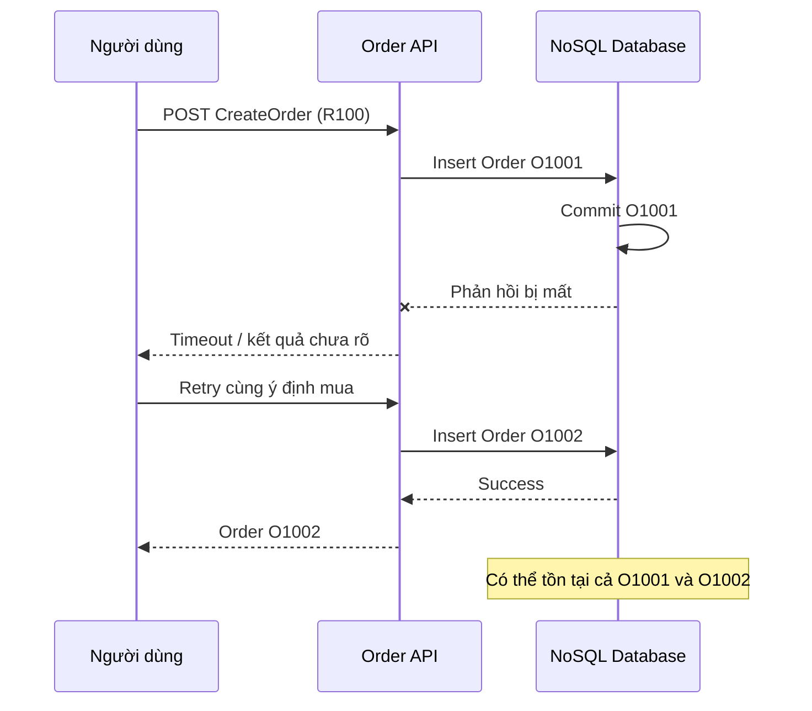
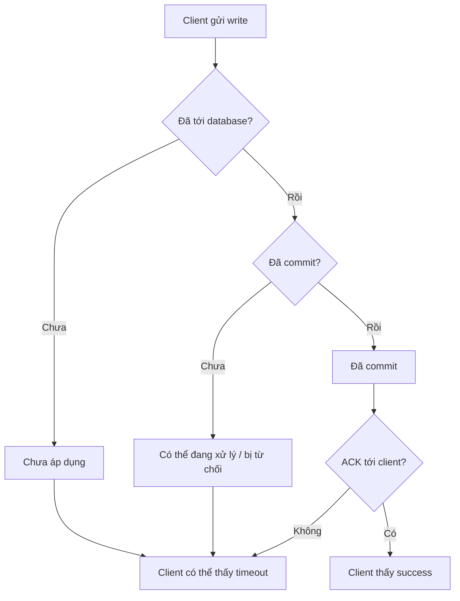
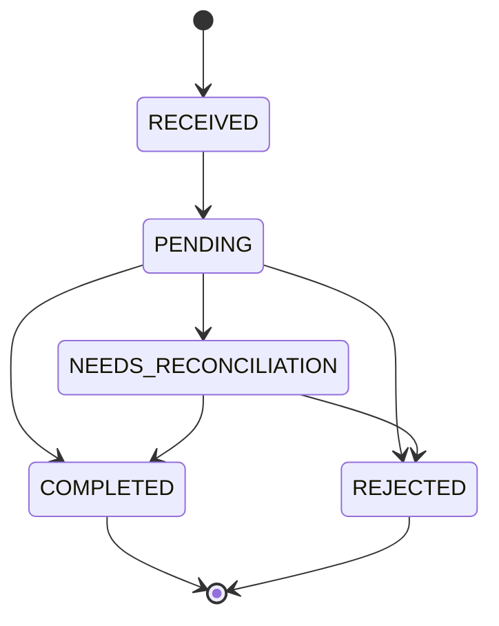
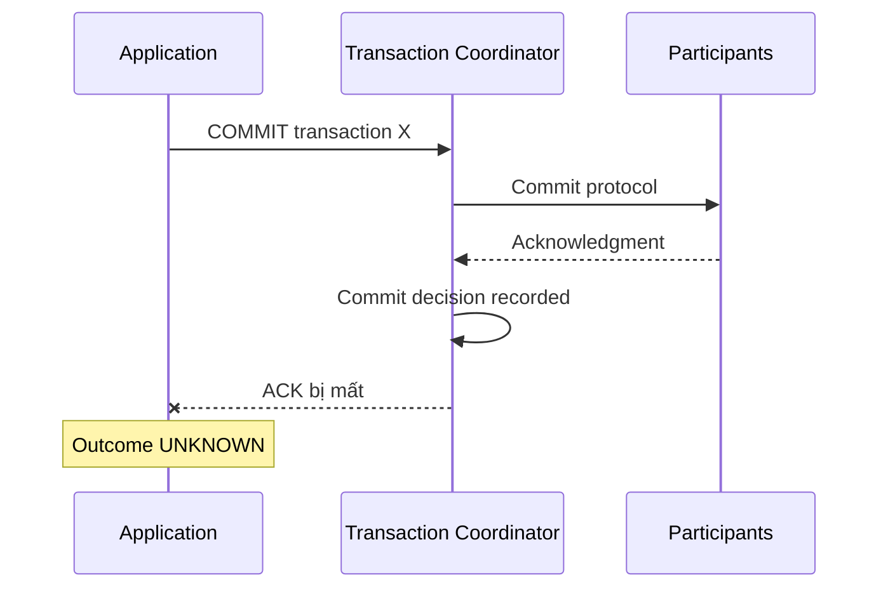

# Timeout và kết quả ghi chưa biết đã thành công hay chưa

## 1. Tình huống mở đầu: client báo lỗi nhưng đơn hàng đã được tạo

Giả sử một ứng dụng Java nhận yêu cầu:

```http
POST /orders
Idempotency-Key: ORDER-T01-R100
Content-Type: application/json

{
  "sku": "P100",
  "quantity": 2
}
```

API ghi một đơn hàng vào cơ sở dữ liệu NoSQL. Server thực hiện thao tác ghi thành công, nhưng phản hồi từ database không về tới ứng dụng trước deadline. Ứng dụng trả lỗi timeout cho người dùng.

Người dùng bấm **Đặt hàng** lần nữa. Nếu API coi timeout là “đơn chưa được tạo” và gửi một lệnh tạo với ID mới, hai đơn có thể xuất hiện cho cùng một ý định mua hàng.



Điểm mấu chốt: **timeout là điều client quan sát được, không phải bằng chứng database chưa ghi**. Kết quả nghiệp vụ có thể đã hoàn tất, đang xử lý, chưa bắt đầu hoặc đã bị từ chối. Nếu thiếu một cơ chế xác định danh tính thao tác và tra cứu kết quả, ứng dụng không thể suy ra trường hợp nào chỉ từ exception timeout.

Bài học này tập trung vào **lỗi phân tán và retry** trong NoSQL, đặc biệt là tình huống *ambiguous write outcome* hoặc *unknown commit result*: **không biết chắc thao tác ghi đã thành công hay chưa**.

## 2. Mục tiêu học tập

Sau bài học, bạn có thể:

1. Phân biệt **request timeout**, **write concern timeout**, **transaction commit timeout**, **conflict chắc chắn** và **lỗi không rõ kết quả**.
2. Vẽ timeline chứng minh ACK có thể mất sau khi database đã commit.
3. Hiểu tại sao “đọc lại không thấy record” chưa chắc chứng minh write ban đầu thất bại.
4. Thiết kế **operation ID/idempotency key** cố định cho một ý định nghiệp vụ.
5. Sử dụng **conditional insert, unique constraint, CAS và transaction** theo phạm vi atomicity thực tế của NoSQL.
6. Tách idempotency của request khỏi idempotency của từng side effect.
7. Xử lý retry, deadline, backoff, failover và kết quả còn `UNKNOWN`.
8. Thiết kế API trả trạng thái `PENDING`, `COMPLETED`, `REJECTED` thay vì báo sai rằng timeout tương đương thất bại.
9. Phân tích MongoDB, DynamoDB, Cassandra, Redis và hệ thống event/queue theo bảo đảm riêng.
10. Kiểm thử lỗi đúng thời điểm và quan sát bằng log/metric/tracing.

## 3. Ba nơi có thể xảy ra timeout

Một request phân tán thường qua nhiều tầng:

```text
User
  -> HTTP client / mobile app
  -> Gateway
  -> Application service
  -> NoSQL driver / connection pool
  -> DB coordinator / primary
  -> Replicas / transaction participants
```

Mỗi tầng có thể có deadline riêng:

| Nơi phát sinh | Client quan sát | Điều chưa thể suy ra |
| --- | --- | --- |
| HTTP client timeout | Không nhận được response API kịp thời | API có thể vẫn đang ghi |
| Gateway timeout | Proxy ngừng chờ backend | Backend có thể đã commit |
| Application deadline | Service bỏ chờ DB | Database có thể đang xử lý |
| Driver socket/read timeout | Không nhận response DB | Request có thể đã tới server và commit |
| Server write concern timeout | Chưa đạt điều kiện ACK trong thời gian yêu cầu | Thay đổi có thể đã được áp dụng trên một số node |
| Transaction commit result unknown | Không xác định được outcome của commit | Transaction có thể đã commit |
| Message broker ACK timeout | Producer/consumer không thấy ACK | Message có thể đã được ghi hoặc xử lý |

**Cùng chữ “timeout” nhưng ý nghĩa khác nhau ở mỗi lớp.** Một driver biết chắc nó chưa gửi byte nào có nhiều thông tin hơn một driver đã gửi request và đứt kết nối khi chờ response.

### 3.1. Timeout không phải rollback

Nếu HTTP client ngừng chờ ở giây thứ nhất, server có thể vẫn tiếp tục và hoàn tất ở giây thứ hai. Hủy một `Future` trong Java cũng không mặc nhiên hủy transaction phía database.

Nếu database đã commit, việc gọi `cancel()` ở client không đảo ngược thay đổi. Muốn hoàn tác cần một operation được thiết kế riêng, chẳng hạn hủy reservation với điều kiện trạng thái thích hợp.

### 3.2. Timeout và exception không tương đương nhau

Ví dụ:

```text
Condition failed (CAS):   Đã biết thao tác này không được áp dụng
Duplicate unique key:    Đã biết insert bị chặn; cần xem record đã có
Network timeout:         Không biết request được áp dụng chưa
Write concern timeout:   Không có đủ xác nhận theo policy trong deadline
Validation error trước gửi: Có thể biết chưa gọi DB
```

Chương trình nên phân loại theo **hợp đồng chính xác của API/driver**, không dùng một `catch (Exception)` rồi trả “ghi thất bại”.

## 4. Timeline: ACK bị mất sau khi commit

Một lịch thực thi hợp lệ:

```text
t0  API gửi Write R100 đến primary
t1  Primary nhận request
t2  Engine kiểm tra điều kiện và ghi thay đổi
t3  Engine commit theo chính sách liên quan
t4  Database gửi response SUCCESS
t5  Mạng mất response / client đã hết deadline
t6  API thấy TIMEOUT
```

Tại `t6`, **database đã commit nhưng API không nhận được thông tin đó**.

Một lịch khác:

```text
t0  API mở connection
t1  Request bị chặn trước khi tới DB
t2  API thấy TIMEOUT
```

Tại lịch thứ hai, ghi chưa diễn ra.

Hai lịch có thể tạo **cùng một thông báo timeout** ở client, nhưng đòi hai kết luận khác nhau. Vì client không quan sát được các bước ẩn sau đường mạng, nó không thể suy ra outcome từ exception một cách tổng quát.

### 4.1. Sơ đồ ba khả năng



Kết luận: **timeout mô tả trạng thái nhận biết của client**, không tự cho biết trạng thái cuối của server.

## 5. Phân biệt submitted, accepted, applied, committed, acknowledged

Những từ thường được dùng lẫn nhau nhưng cần tách:

| Trạng thái / mốc | Ý nghĩa khái niệm |
| --- | --- |
| **Submitted** | Client đã cố gửi request |
| **Received** | Server đã nhận request |
| **Accepted** | Hệ đồng ý nhận để xử lý, chưa nhất thiết hoàn tất |
| **Applied** | Engine đã áp dụng thay đổi ở một phạm vi nào đó |
| **Committed** | Thay đổi đã được quyết định commit theo protocol/transaction |
| **Replicated** | Một số bản sao đã nhận hoặc áp dụng, tùy semantics |
| **Durable** | Có khả năng sống sót qua những loại lỗi đã cam kết |
| **Acknowledged** | Client đã nhận phản hồi về thao tác |
| **Visible** | Một đường đọc cụ thể đã nhìn thấy thay đổi |
| **Published** | Thay đổi đã đi tới event/index/read model khác |

Một write được client thấy `success` thường có một ý nghĩa được quy định bởi **write concern/consistency level**. Không mặc định nó đã:

- Có mặt trên mọi replica.
- Có mặt trong search/GSI/cache.
- Được fsync trên tất cả đĩa.
- Được backup/PITR.
- Được một consumer downstream xử lý.

Trong bài này, `committed` phải luôn gắn với **hợp đồng của database và operation thực tế**, không chỉ một cột status mà ứng dụng tự đặt tên.

## 6. Tại sao chỉ tăng timeout không giải quyết triệt để?

Tăng timeout từ 500 ms lên 5 giây có thể giảm số lần client gặp timeout trong điều kiện bình thường. Nhưng không loại bỏ được:

- Mạng bị cắt sau commit.
- Process crash trước khi gửi ACK.
- Failover trong lúc client chờ.
- Gateway đóng connection.
- Điện thoại mất mạng.
- Driver retry ngầm.
- Broker redelivery.
- Một request vượt deadline 5 giây.
- Client bấm gửi lại sau khi ứng dụng khởi động lại.

Không thể đặt một timeout hữu hạn đủ để chứng minh “nếu chưa nhận success thì chắc chắn chưa commit”.

### 6.1. Mô hình bất đồng bộ

Khi không có giới hạn thời gian truyền thông điệp đáng tin cậy, một node không thể chỉ từ sự im lặng mà biết chắc peer:

- Đã chết.
- Đang xử lý rất chậm.
- Đã commit nhưng ACK chưa tới.
- Chưa nhận request.

Vì thế hệ thống cần **cơ chế phục hồi trạng thái**, không chỉ một số giây timeout.

### 6.2. Deadline vẫn cần thiết

Timeout hữu ích để bảo vệ tài nguyên, latency SLO và trải nghiệm người dùng. Điểm sai là dùng nó như một **bằng chứng về outcome**.

Một thiết kế đúng dùng cả:

1. Deadline để không chờ vô hạn.
2. Operation ID để nhận ra cùng một ý định.
3. Atomic/conditional protocol để tránh side effect trùng.
4. Tra cứu/đối soát để xác minh kết quả chưa rõ.

## 7. Kết quả chắc chắn và kết quả chưa chắc chắn

Nên phân loại theo mức chắc chắn:

| Loại kết quả | Ví dụ | Hành động điển hình |
| --- | --- | --- |
| **Known success** | DB trả ACK thành công theo policy | Trả kết quả đã ghi nhận |
| **Known business rejection** | Condition không thỏa, không đủ hàng | Trả từ chối nghiệp vụ |
| **Known duplicate** | Unique key đã tồn tại | Tra cứu operation cũ và so payload |
| **Known validation failure** | Input sai trước khi gửi DB | Trả lỗi validation |
| **Known transaction abort** | Engine xác nhận transaction bị hủy | Có thể xử lý/retry theo loại lỗi |
| **Unknown write outcome** | Socket timeout sau khi gửi | Không tự ghi success hay failed |
| **Unknown commit outcome** | Lỗi khi chờ kết quả commit | Xác minh/retry commit theo contract |
| **Known accepted, processing pending** | Job được lưu bền nhưng downstream chưa xong | Trả trạng thái PENDING |
| **Stale read after write** | Replica/index chưa cập nhật | Đọc authoritative/min revision hoặc chờ |

Lỗi “known failure” chỉ đáng tin nếu **API thật sự bảo đảm thao tác không được áp dụng**. Ví dụ, exception từ tầng application chưa chắc giữ ý nghĩa đó khi nằm sau một database request đã gửi.

## 8. Một mô hình trạng thái operation

Thiết kế một record theo dõi một ý định nghiệp vụ:

```json
{
  "tenantId": "T01",
  "operationId": "R100",
  "operationType": "RESERVE_STOCK",
  "requestHash": "sha256-of-canonical-payload",
  "status": "PENDING",
  "resourceId": "RES100",
  "version": 1,
  "createdAt": "2026-11-14T09:00:00Z",
  "updatedAt": "2026-11-14T09:00:00Z"
}
```

Có thể dùng state machine:



**Lưu ý quan trọng:** `UNKNOWN` thường là **trạng thái nhận biết ở client**. Không nên lập tức lưu `FAILED` vào nguồn chỉ vì client timeout. Record nguồn có thể giữ `PENDING` hoặc `NEEDS_RECONCILIATION` cho tới khi có bằng chứng quyết định.

### 8.1. Những trạng thái terminal

- `COMPLETED`: hiệu ứng nghiệp vụ được xác nhận đã hoàn tất.
- `REJECTED`: được xác nhận không thực hiện vì một nguyên nhân nghiệp vụ.
- `CANCELLED`: có thể là một trạng thái nghiệp vụ khác, thường chỉ sau một lệnh hủy thành công.

Không chuyển `PENDING -> REJECTED` chỉ vì deadline UI đã hết. Một worker đang chạy có thể hoàn tất sau deadline và tạo mâu thuẫn với trạng thái bạn vừa công bố.

### 8.2. Xung đột do worker cũ

Nếu một job bị timeout và một worker mới tiếp quản, worker cũ có thể tỉnh lại. Có thể cần:

- Version/CAS trên operation record.
- Owner epoch/fencing token.
- Lease với deadline.
- Idempotent effect ở nguồn.
- Quy tắc ai được chuyển trạng thái terminal.

Một lease hết hạn không tự bảo đảm worker cũ đã dừng ghi. Nguồn được bảo vệ phải có cơ chế từ chối thao tác lỗi thời nếu điều đó quan trọng.

## 9. Vì sao “đọc lại không thấy record” chưa chắc chứng minh chưa ghi?

Giả sử request tạo Order nhận timeout. API lập tức hỏi một secondary:

```text
Write O1001 -> primary, outcome unknown
Read O1001 -> secondary, trả NOT_FOUND
```

Một secondary có thể chưa bắt kịp. `NOT_FOUND` ở secondary **không phải bằng chứng tuyệt đối** rằng primary chưa commit.

Tình huống tương tự xảy ra với:

- DynamoDB GSI cập nhật bất đồng bộ.
- Elasticsearch/OpenSearch chưa refresh.
- Cache đang giữ kết quả `NOT_FOUND`.
- Materialized view/CDC consumer bị lag.
- Global table/replica ở vùng khác chưa hội tụ.
- Một read query dùng key hoặc tenant filter sai.
- Một transaction đang commit, chưa visible theo mức đọc đó.

### 9.1. Bằng chứng âm cần điều kiện mạnh

Nếu muốn dùng kết quả “không tìm thấy”, phải nêu:

1. **Đọc từ nguồn authoritative nào?**
2. **Read concern/consistency level nào?**
3. **Có session/minimum revision hay không?**
4. **Operation ban đầu chắc chắn đã kết thúc chưa?**
5. **Có pending request vẫn có thể commit sau lần đọc?**
6. **Có failover hoặc rollback policy nào liên quan?**
7. **Record có bị TTL/delete hay chuyển shard không?**

Ngay cả một read mạnh tại thời điểm t vẫn không tự chứng minh **một request ghi đang chạy sẽ không commit tại thời điểm t+1**.

### 9.2. “Không thấy” nên dẫn tới điều gì?

Khi chưa đủ bằng chứng:

- Giữ operation ở `UNKNOWN/PENDING`.
- Retry **cùng operation identity** bằng thao tác atomic/idempotent.
- Hoặc chờ/đối soát theo deadline có giới hạn.
- Không tạo một order/transaction ID mới cho cùng một ý định.
- Không trả kết luận “thất bại chắc chắn” nếu không thể chứng minh.

## 10. Idempotency là cơ chế cốt lõi

Một operation idempotent theo hợp đồng có tính chất:

> Thực hiện lại cùng một **ý định nghiệp vụ** không tạo thêm tác dụng nghiệp vụ ngoài lần đầu.

Phát biểu khái niệm:

\[
f(f(x)) = f(x)
\]

Tuy nhiên không nên hiểu đơn giản rằng **mọi HTTP call trả byte-for-byte giống nhau** hoặc **mọi cơ chế idempotency tự cung cấp exactly-once end-to-end**.

### 10.1. Ví dụ PUT state và POST operation

Đặt cùng giá trị:

```http
PUT /users/U01/settings/theme

{"theme":"dark"}
```

có thể idempotent về trạng thái cuối nếu API thực hiện đúng semantics.

Trong khi:

```http
POST /wallets/U01/withdrawals

{"amount":100000}
```

không mặc nhiên idempotent. Gửi hai lần có thể tạo hai withdrawal.

Thêm một idempotency key với lưu trữ và atomic protocol phù hợp giúp nhận biết retry của cùng withdrawal.

### 10.2. Idempotency khác CAS

- **Idempotency:** cùng request R100 gửi lại không tạo tác dụng hai lần.
- **CAS/conditional write:** hai request R100 và R101 khác nhau cùng tranh trạng thái thì update chỉ được áp dụng nếu điều kiện hiện hành còn đúng.

Ví dụ inventory:

```text
R100: reserve 3
R100 retry: không reserve thêm 3

R101: reserve 4
```

Hai operation IDs khác nhau vẫn phải cạnh tranh theo `available >= quantity`.

### 10.3. Idempotency khác deduplication theo thời gian

Một TTL cache ghi nhớ request ID trong 5 phút có thể ngăn trùng **trong 5 phút**, nhưng request bị gửi lại sau 10 phút có thể tạo hiệu ứng mới nếu source vẫn cho phép. Phải căn thời gian giữ token theo vòng đời business operation và các retry/delay thực tế.

## 11. Thiết kế idempotency key đúng phạm vi

Một key tốt phải có các thuộc tính:

- **Ổn định:** retry dùng lại key cũ, kể cả sau restart/app reconnect.
- **Đủ duy nhất** cho từng ý định nghiệp vụ.
- **Không bị tái dùng** cho ý định khác.
- **Gắn tenant và loại thao tác** để tránh xung đột giữa phạm vi khác.
- **Không phải bí mật xác thực**; không dùng key để cấp quyền.
- **Được lưu theo độ bền** phù hợp nghiệp vụ.
- **Được xác thực cùng payload** để phát hiện một key nhưng hai nội dung khác nhau.

Ví dụ:

```text
scope = (tenantId, operationType, idempotencyKey)

requestHash = SHA-256(canonicalBusinessPayload)
```

Khi nhận lại cùng key:

| Key | Payload hash | Hành vi |
| --- | --- | --- |
| Chưa từng thấy | Bất kỳ hợp lệ | Cố tạo operation theo atomic rule |
| Đã có | Giống | Trả outcome cũ hoặc PENDING |
| Đã có | Khác | Từ chối `IDEMPOTENCY_KEY_REUSED` |
| Đã có nhưng pending | Giống | Không tạo operation thứ hai; tra cứu/chờ |
| Đã hết retention | Không còn record | Cần policy rõ, tránh vô tình double effect |

### 11.1. Client tạo key hay server tạo key?

Cả hai có thể phù hợp:

- Client có thể tạo UUID/ULID cho một **lần bấm mua** rồi giữ nguyên khi retry.
- Server có thể cấp operation ID qua bước tạo intent trước khi thực hiện tác dụng.

Điều quan trọng: **không tạo key mới trong mỗi retry**.

### 11.2. Payload canonicalization

Hash cùng một payload logic cần quy tắc nhất quán:

```json
{"sku":"P100","quantity":2}
```

và:

```json
{"quantity":2,"sku":"P100"}
```

có thể cùng ý nghĩa nhưng thứ tự khóa JSON khác nhau. Có thể canonicalize các trường nghiệp vụ theo schema cố định trước khi hash. Không tính những field biến động vô nghĩa như trace ID/timestamp retry vào request hash nếu chúng không thay ý định.

### 11.3. Không cho một key xác nhận payload của tenant khác

Mọi lookup idempotency phải kiểm tra tenant/context xác thực. Không trả dữ liệu đơn hàng từ tenant A cho tenant B chỉ vì hai bên đoán cùng operation ID.

## 12. Mẫu atomic create đơn giản nhất

Nếu toàn bộ hiệu ứng nghiệp vụ là **tạo đúng một document/item**, có thể dùng ID ổn định cùng atomic conditional insert.

```text
operationId = ORDER-T01-R100
orderId = deterministic or reserved stable ID

Try INSERT:
  PK/unique key = operationId
  requestHash = H
  orderPayload = ...
  status = CREATED

IF key already exists:
  Read existing authoritative record
  Compare requestHash
  Return existing result or conflict
```

Điểm quan trọng: **database phải thực thi uniqueness/condition một cách atomic**. Mẫu sai:

```text
GET operationId
if missing:
    INSERT without condition
```

Hai request song song có thể cùng GET thấy rỗng và cả hai insert.

### 12.1. Giữ cùng object ID

Nếu lần đầu chọn `orderId=O1001`, retry cần có cách tìm lại `O1001`; không cấp ID mới mỗi lần.

Một lựa chọn là record operation có field `resourceId`. Một lựa chọn khác là deterministic resource ID theo operation key, nhưng cần cân nhắc security, tính công khai của ID và vòng đời dữ liệu.

### 12.2. Khi duplicate key có thể là tín hiệu thành công trước đó

Nếu retry gặp duplicate key, chưa thể trả ngay “đã thành công” mà không kiểm tra:

- Record thuộc đúng tenant?
- Payload hash giống?
- Status đã terminal?
- Tác dụng nghiệp vụ đã gắn với record này chưa?
- Có dữ liệu bị stale/rollback sau failover không?

Unique conflict nghĩa là một record đã tồn tại theo phạm vi constraint. **Nó không tự chứng minh toàn bộ các side effect ngoài record đã hoàn tất.**

## 13. Atomicity cần bao trùm cả dedup và business effect

Giả sử hệ giảm tồn kho và ghi một cờ `PROCESSED`.

### 13.1. Ghi cờ trước

```text
Step 1: INSERT idempotency=PROCESSED
Step 2: DECREMENT stock
```

Crash giữa Step 1 và Step 2:

```text
Idempotency nói đã xử lý
Stock chưa giảm
Retry bị chặn
```

Người dùng thấy reservation thành công nhưng hàng chưa được giữ.

### 13.2. Ghi hiệu ứng trước

```text
Step 1: DECREMENT stock
Step 2: INSERT idempotency=PROCESSED
```

Crash giữa Step 1 và Step 2:

```text
Stock đã giảm
Idempotency chưa ghi
Retry tiếp tục giảm thêm
```

Đây là **double effect**.

### 13.3. Ba hướng thiết kế

1. **Gom hiệu ứng và operation ID trong một atomic aggregate/item/document**, nếu nghiệp vụ cho phép.
2. **Transaction nhiều item/document** được database hỗ trợ, chứa operation record + business change.
3. **Workflow/saga có trạng thái, idempotent steps và reconciliation**, khi không có transaction bao trùm toàn bộ dịch vụ.

Chỉ thêm một Redis cache key `processed:R100` bên cạnh database authoritative **không tự giải quyết khoảng crash giữa hai hệ**.

## 14. Trường hợp inventory: điều kiện tồn kho và dedup

Một thao tác reserve(3) phải đồng thời bảo vệ:

\[
available\geq 3
\]

và:

\[
\text{R100 áp dụng tối đa một lần}
\]

Một mô hình đúng có thể là:

```text
BEGIN transaction or atomic aggregate operation

  IF R100 already applied:
      Return previous result

  IF available < 3:
      Record R100=REJECTED
  ELSE:
      Decrement available by 3
      Record R100=COMPLETED, reservationId=RES100

COMMIT
```

Phải thực hiện check và state transition ở một ranh giới atomic có thật. Nếu `available` và `R100` nằm hai partition khác nhau trong engine không cung cấp multi-partition transaction, pseudocode trên **không thể coi là transaction chỉ vì viết BEGIN/COMMIT**.

### 14.1. Rejection có nên idempotent?

Có. Nếu R100 đã được xác định `OUT_OF_STOCK` và source lưu kết quả terminal đó theo hợp đồng, retry R100 nên nhận cùng kết luận, thay vì bất ngờ thành công sau khi kho được nhập thêm.

Một ý định muốn thử lại sau khi nhập hàng có thể cần **operation ID mới**, theo policy nghiệp vụ.

### 14.2. Vấn đề đồng thời

Hai requests R100 và R101 có thể cùng yêu cầu giữ 3 trong kho còn 5. Chỉ một được chấp nhận nếu invariant không cho phép vượt hàng.

Idempotency của từng request không bảo vệ tranh chấp **giữa hai operation IDs khác nhau**. Cần atomic conditional update/CAS/transaction.

## 15. MongoDB: insert idempotent với unique key

Với MongoDB, một insert lên một document có `_id` ổn định được bảo vệ bởi unique constraint trên `_id`.

Ví dụ mongosh:

```javascript
db.orderOperations.insertOne(
  {
    _id: "T01#CREATE_ORDER#R100",
    tenantId: "T01",
    operationId: "R100",
    requestHash: "sha256:...",
    orderId: "O1001",
    status: "COMPLETED",
    sku: "P100",
    quantity: 2,
    createdAt: new Date()
  },
  {
    writeConcern: {
      w: "majority",
      wtimeout: 5000
    }
  }
);
```

Cú pháp `insertOne`/option chính xác cần đối chiếu driver/mongosh version đang dùng. Ví dụ nhấn mạnh **unique `_id` và write concern**, không thay thế yêu cầu tạo order/reservation nhiều document.

Nếu server đã insert rồi client nhận timeout:

1. Không insert lại dưới `_id` khác.
2. Có thể thử lại **cùng `_id`** theo policy driver.
3. Nếu gặp duplicate, đọc record đã có từ nguồn phù hợp và so requestHash.
4. Nếu vẫn timeout/không đủ bằng chứng, giữ outcome `UNKNOWN` và đối soát.
5. Không dùng secondary stale hoặc search để kết luận chắc chắn write chưa tồn tại.

### 15.1. Write concern timeout

Một thao tác đã được primary áp dụng nhưng `w:"majority"` chưa được xác nhận đúng deadline có thể trả write concern error. Điều này không đồng nghĩa write bị rollback ngay tại thời điểm lỗi.

Cần xem:

- Write concern thực của operation.
- Journaling/replication.
- Replica set topology.
- Timeout fields/labels.
- Rollback/failover semantics.

Không nói “đã majority commit” chỉ vì primary từng thấy document, và cũng không nói “chắc chắn không commit” chỉ vì client nhận `wtimeout`.

### 15.2. Update bằng CAS

Ví dụ state transition:

```javascript
const result = db.orders.updateOne(
  {
    _id: "O1001",
    tenantId: "T01",
    status: "PENDING",
    version: 7
  },
  {
    $set: {
      status: "CONFIRMED"
    },
    $inc: {
      version: 1
    }
  }
);
```

Nếu nhận response thành công và `matchedCount=1`, có bằng chứng filter khớp và update được thực hiện theo contract.

Nếu **timeout không có response**, không được suy `matchedCount=0`. Read lại từ source thích hợp để phân biệt trạng thái, với lưu ý một update khác có thể đã thay đổi record và state có thể chuyển tiếp nhiều lần. Cần operation ID/version/event evidence nếu muốn quy kết outcome chính xác cho R100.

### 15.3. Transaction commit chưa rõ kết quả

Với multi-document transaction, lỗi khi gọi commit có thể mang ý nghĩa **kết quả commit chưa rõ**. MongoDB drivers cung cấp cơ chế và error labels như `UnknownTransactionCommitResult` trong các tình huống được hỗ trợ.

Về nguyên tắc:

- Nếu kết quả **commit** chưa rõ, xử lý theo hợp đồng retry **commit của cùng transaction** khi còn hợp lệ.
- Không tự khởi chạy **toàn bộ nghiệp vụ thành transaction mới** chỉ vì ACK commit mất.
- Phân biệt lỗi transient đòi retry transaction theo driver guidance với lỗi ambiguous commit.
- Giữ idempotency/unique business ID vì application có thể restart hoặc failover ngoài phạm vi driver session.
- Sau deadline, chuyển sang outcome lookup/reconciliation.

Với callback transaction tự động của driver, phải hiểu liệu callback có thể chạy lại. **Không đặt side effect không idempotent ra service ngoài** vào callback có thể bị retry mà không có protocol bảo vệ.

### 15.4. Atomicity một document không bao trùm email/payment

Tạo document order thành công không chứng minh email đã gửi hoặc payment đã capture. Khi order và outbox có thể được commit cùng transaction, event consumer vẫn cần xử lý duplicate delivery.

## 16. DynamoDB: conditional PutItem với operation ID

DynamoDB cho phép conditional write tại item.

Giả sử table `Operations` có primary key `PK`, lưu:

```text
PK = OP#T01#CREATE_ORDER#R100
requestHash = H
status = COMPLETED
resourceId = O1001
```

Dùng `ConditionExpression`:

```text
PutItem
  PK = OP#T01#CREATE_ORDER#R100
  requestHash = H
  status = COMPLETED
  resourceId = O1001

ConditionExpression:
  attribute_not_exists(PK)
```

Hai requests đồng thời cố tạo cùng PK không thể cùng thực hiện thành công một conditional Put trên item đó theo semantics của service.

### 16.1. Java AWS SDK v2

```java
import java.util.Map;
import software.amazon.awssdk.services.dynamodb.DynamoDbClient;
import software.amazon.awssdk.services.dynamodb.model.AttributeValue;
import software.amazon.awssdk.services.dynamodb.model.PutItemRequest;
import software.amazon.awssdk.services.dynamodb.model.ConditionalCheckFailedException;

public final class OperationInsert {
    public static boolean createIfMissing(
            DynamoDbClient client,
            String tenantId,
            String requestId,
            String requestHash) {

        String pk = "OP#" + tenantId + "#CREATE_ORDER#" + requestId;

        PutItemRequest request = PutItemRequest.builder()
            .tableName("Operations")
            .item(Map.of(
                "PK", AttributeValue.builder().s(pk).build(),
                "requestHash",
                    AttributeValue.builder().s(requestHash).build(),
                "status",
                    AttributeValue.builder().s("PENDING").build()
            ))
            .conditionExpression("attribute_not_exists(PK)")
            .build();

        try {
            client.putItem(request);
            return true;
        } catch (ConditionalCheckFailedException conflict) {
            return false;
        }
    }
}
```

Giả định table chỉ có partition key `PK`; nếu có sort key thì cần thiết kế đầy đủ primary key. Giá trị trả `false` ở ví dụ chỉ nói **đã có item theo điều kiện**, không chứng minh payload giống hay operation đã hoàn tất.

**Đặc biệt:** lỗi network/timeout khác `ConditionalCheckFailedException`. Không bắt mọi `DynamoDbException` rồi trả `false` như thể record chắc chắn tồn tại.

### 16.2. Timeout khi PutItem

Nếu PutItem timeout:

- Nó có thể đã được áp dụng.
- Retry dùng **cùng PK, cùng requestHash**.
- Conditional failure ở retry có thể là dấu hiệu lần trước đã thắng.
- Đọc item authoritative với read consistency được API hỗ trợ và so payload/status.
- Nếu outcome vẫn chưa rõ, trả PENDING/UNKNOWN theo business contract.

Đọc từ GSI **không thay** xác minh trên base item vì GSI được cập nhật eventual.

### 16.3. Multi-item transaction

Khi phải ghi đồng thời:

```text
Operation R100
Order O1001
Inventory reservation
Outbox entry
```

cần xem phạm vi hỗ trợ của `TransactWriteItems` hoặc một aggregate atomic khác.

Một request transaction có thể gắn `ClientRequestToken` theo semantics idempotency của dịch vụ; **thời gian hiệu lực và giới hạn của token là hữu hạn theo API**, không thay thế record nghiệp vụ dài hạn nếu retries/đối soát diễn ra sau cửa sổ đó.

Nếu tất cả item không nằm trong cùng phạm vi transaction được hỗ trợ, phải dùng workflow với state và compensation/reconciliation. Không tự coi nhiều PutItem nối tiếp là một transaction.

### 16.4. Global tables và retry qua vùng khác

Nếu active-active/multi-region cho phép request tới vùng khác, client retry ở B trước khi B biết write tại A có thể gặp cửa sổ conflict/duplicate tùy mode.

Phải xác định:

- Global table mode cụ thể.
- Conditional-write semantics xuyên vùng.
- Replication/conflict resolution.
- Vùng nào có quyền cấp phát operation ID.
- RPO/failover behavior.

Không suy “conditional PutItem ở A và ở B độc lập thì tự có uniqueness toàn cầu” cho mọi mô hình eventual multi-region.

## 17. Cassandra: LWT và kết quả `[applied]`

Cassandra normal INSERT/UPDATE không tự biến check-then-write ứng dụng thành thao tác atomic có điều kiện. Khi cần chỉ tạo operation nếu chưa tồn tại, có thể dùng Lightweight Transaction (LWT):

```sql
CREATE TABLE operations_by_tenant (
    tenant_id text,
    operation_id text,
    request_hash text,
    status text,
    resource_id text,
    PRIMARY KEY ((tenant_id), operation_id)
);
```

```sql
INSERT INTO operations_by_tenant (
    tenant_id, operation_id, request_hash, status, resource_id
)
VALUES (
    'T01', 'R100', 'sha256:...', 'PENDING', 'O1001'
)
IF NOT EXISTS;
```

Response LWT có thông tin `[applied]`. Nếu false, cần xem operation hiện hữu và request hash.

### 17.1. LWT timeout vẫn có thể ambiguous

Lệnh có `IF NOT EXISTS` cũng có thể timeout khi coordinator/replica/consensus đang phối hợp. Không kết luận điều kiện thất bại chỉ vì timeout.

Retry với **cùng partition/operation key** và cùng payload có thể giúp xác minh trạng thái theo semantics LWT, nhưng phải xét serial consistency, CL, version Cassandra, concurrent writers và các lỗi chưa xác định.

### 17.2. Một LWT không phải giao dịch đa dịch vụ

Nếu operation row và stock nằm ở hai partitions, việc INSERT operation bằng LWT rồi UPDATE stock riêng **không tự atomic**. Cần thiết kế aggregate, transaction được engine hỗ trợ trong phạm vi phù hợp, hoặc workflow idempotent.

### 17.3. TTL của operation row là một quyết định nghiệp vụ

Dùng TTL ngắn cho dedup có thể làm R100 biến mất trước khi retry muộn. Khi đó thao tác có thể được xử lý như mới. Cần quyết định retention, archival và cách xử lý request sau expiration.

## 18. Redis: thao tác atomic trên server nhưng durability có giới hạn

Redis có thể thực hiện các lệnh như `SET ... NX` và Lua scripts để phối hợp cập nhật nhiều keys trong phạm vi server/hash slot phù hợp.

### 18.1. `SET NX` chỉ xử lý việc giữ marker

```redis
SET op:R100 PROCESSING NX EX 600
```

Lệnh trên giúp một client đặt marker nếu chưa tồn tại. Nhưng nếu ứng dụng tiếp tục:

```text
SET marker
DECREMENT stock trong database khác
```

thì marker và business effect **không atomic với nhau**. Crash giữa các bước vẫn có thể dẫn tới bỏ sót hoặc double effect.

Ngoài ra, TTL 600 giây không tự phù hợp mọi vòng đời idempotency.

### 18.2. Lua có thể gộp check và cập nhật trên cùng Redis

Ví dụ minh họa, các keys nằm trên **cùng Redis server/hash slot** và Redis là nguồn quyết định tương ứng:

```lua
-- KEYS[1] = stock key
-- KEYS[2] = operation result key
-- ARGV[1] = quantity (positive integer)

local qty = tonumber(ARGV[1])
if qty == nil or qty <= 0 or qty % 1 ~= 0 then
    return redis.error_reply("invalid quantity")
end

local previous = redis.call("GET", KEYS[2])
if previous then
    return previous
end

local available = tonumber(redis.call("GET", KEYS[1]) or "0")
if available < qty then
    redis.call("SET", KEYS[2], "REJECTED")
    return "REJECTED"
end

redis.call("DECRBY", KEYS[1], qty)
redis.call("SET", KEYS[2], "COMPLETED")
return "COMPLETED"
```

Trong phạm vi thực thi script trên một Redis server, check/update có thể thực hiện atomic theo semantics Redis.

Nhưng phải lưu ý:

- Cần ràng buộc operation key với tenant và payload hash; script giản lược chưa làm bước này.
- Operation key không được expire trước mọi retry hợp lệ.
- Redis Cluster có quy tắc hash slot cho multi-key script.
- Redis replication/failover và AOF/RDB persistence có thể ảnh hưởng durability.
- `WAIT` acknowledgment không tự biến Redis thành transaction đồng thuận xuyên mọi region.
- Nếu stock authoritative nằm ở MongoDB/DynamoDB, script Redis **không bảo vệ atomicity giữa hai hệ**.

Vì vậy Redis thường hữu ích cho cache, admission control hoặc những state phù hợp, nhưng không nên mặc định một marker Redis bảo đảm không phát sinh hai khoản thanh toán ở hệ khác.

## 19. Mẫu HTTP API cho operation chưa rõ kết quả

Một API nên phân biệt **đã ghi nhận để xử lý** với **đã hoàn thành**.

### 19.1. POST tạo operation

```http
POST /reservations
Idempotency-Key: RES-T01-R100
Content-Type: application/json

{"sku":"P100","quantity":2}
```

Nếu hoàn thành đồng bộ và đã xác minh:

```http
HTTP/1.1 201 Created
Location: /reservations/RES100
Content-Type: application/json

{
  "operationId": "R100",
  "status": "COMPLETED",
  "reservationId": "RES100"
}
```

Nếu server đã **ghi nhận bền một operation đang chờ**:

```http
HTTP/1.1 202 Accepted
Location: /operations/R100
Retry-After: 2
Content-Type: application/json

{
  "operationId": "R100",
  "status": "PENDING"
}
```

`202 Accepted` phù hợp khi server có bằng chứng đã chấp nhận xử lý, nhưng chưa xác nhận hoàn tất. Nếu ngay cả việc tạo operation record cũng **chưa rõ đã thành công hay chưa**, server phải thận trọng với lời hứa “đã nhận”; có thể trả response lỗi/uncertain rõ ràng và cho client tra cứu bằng key đã biết.

### 19.2. GET tra cứu outcome

```http
GET /operations/R100
```

Trả:

```json
{
  "operationId": "R100",
  "status": "COMPLETED",
  "resourceId": "RES100",
  "updatedAt": "2026-11-14T09:00:03Z"
}
```

Hoặc:

```json
{
  "operationId": "R100",
  "status": "PENDING",
  "retryAfterSeconds": 2
}
```

Đường GET phải có authorization và read consistency phù hợp. Không dùng một projection lag để kết luận terminal failure.

### 19.3. Cùng key khác payload

Nếu client gửi lại R100 nhưng đổi quantity:

```json
{"sku":"P100","quantity":5}
```

server nên từ chối key reuse theo contract, ví dụ `409 Conflict` với mã `IDEMPOTENCY_KEY_REUSED`.

Không âm thầm thực hiện quantity mới dưới cùng operation key.

### 19.4. Client dùng lại key qua reconnect

Web/mobile app phải giữ operation key ít nhất cho đến khi biết outcome terminal. Nếu reload UI tạo key mới, toàn bộ cơ chế dedup phía backend có thể bị vô hiệu.

Không coi idempotency key là quyền truy cập: người dùng vẫn cần auth token/session hợp lệ để tra cứu.

## 20. Java: phân loại outcome thay vì bắt mọi lỗi là failed

Một service Java có thể mô hình hóa kết quả:

```java
enum OutcomeKind {
    COMPLETED,
    REJECTED,
    PENDING,
    UNKNOWN
}

record OperationResult(
    OutcomeKind kind,
    String operationId,
    String resourceId,
    String reason
) {}
```

Một adapter database cần phân biệt exception:

```java
interface ReservationRepository {
    // Phải thực thi uniqueness/idempotency và invariant
    // tại nguồn atomic/transactional phù hợp.
    OperationResult executeOrLoad(
        String tenantId,
        String operationId,
        String sku,
        int quantity
    );

    OperationResult lookupAuthoritative(
        String tenantId,
        String operationId
    );
}
```

Application-level control flow khái niệm:

```java
public final class ReservationService {
    private final ReservationRepository repository;

    public ReservationService(ReservationRepository repository) {
        this.repository = repository;
    }

    public OperationResult reserve(
            String tenantId,
            String operationId,
            String sku,
            int quantity) {

        try {
            return repository.executeOrLoad(
                tenantId, operationId, sku, quantity
            );
        } catch (AmbiguousWriteException unknown) {
            try {
                OperationResult known =
                    repository.lookupAuthoritative(
                        tenantId, operationId
                    );

                if (known != null) {
                    return known;
                }
            } catch (RuntimeException lookupFailed) {
                // Không thay đổi kết luận thành "FAILED".
            }

            return new OperationResult(
                OutcomeKind.UNKNOWN,
                operationId,
                null,
                "Write outcome is not confirmed"
            );
        }
    }
}

class AmbiguousWriteException extends RuntimeException {
    AmbiguousWriteException(String message) {
        super(message);
    }
}
```

Các interface này là **contract minh họa**. Production adapter phải giải quyết các vấn đề sau:

- `executeOrLoad` phải enforce cùng operation ID ở database, không chỉ trong synchronized block JVM.
- `lookupAuthoritative` cần dùng read path/consistency thật sự hỗ trợ; không đồng nghĩa read cache.
- `known == null` **không chứng minh thất bại**, vì write cũ có thể đang commit.
- Phải phân biệt validation/conditional conflict/timeout/transaction abort thay vì chỉ một RuntimeException.
- Phải giữ payload hash, tenant scope và quyền truy cập.
- `UNKNOWN` vẫn phải được ghi vào observability và có đường phục hồi.

### 20.1. Không dùng `synchronized` để thay database uniqueness

Hai instance Java phía sau load balancer không chia sẻ cùng monitor. `synchronized` chỉ bảo vệ luồng trong **một JVM**; không bảo vệ concurrent operation giữa instance hoặc region.

### 20.2. Không retry toàn bộ method bừa bãi

Một annotation retry bao ngoài:

```text
chargeCreditCard()
insertOrder()
publishEvent()
```

có thể gọi `chargeCreditCard()` nhiều lần nếu `insertOrder()` timeout. Cần tách retry boundary, idempotency của từng external side effect và operation state machine.

## 21. Retry an toàn: retry “cùng operation”, không “làm lại ý định mới”

Một retry đúng có tính chất:

```text
Request 1: operationId=R100
Request 2: operationId=R100
Request 3: operationId=R100
```

Tất cả cùng tham chiếu **một intent**.

Một retry nguy hiểm:

```text
Request 1: operationId=R100, orderId=O1001
Request 2: operationId=R101, orderId=O1002
Request 3: operationId=R102, orderId=O1003
```

Mỗi lần retry đã biến thành một intent mới, khiến unique key trên các record không còn giúp ngăn trùng.

### 21.1. Những operation dễ retry

- `PUT` với key cố định và semantics idempotent.
- Conditional insert cùng unique ID.
- CAS cùng expected version nếu logic xử lý conflict đúng.
- Transaction commit retry theo đúng contract driver.
- GET/read với consistency phù hợp và không có side effect.

### 21.2. Những operation cần bảo vệ

- `INCREMENT balance`.
- `DECREMENT stock`.
- `POST payment capture`.
- `SEND email/SMS` hoặc tạo shipping label.
- `APPEND event` với ID sinh mới.
- `INSERT` mà mỗi lần client sinh một key mới.
- `DELETE` có thêm side effect đếm lượt hoặc phát event nhiều lần.

Một `DELETE` trên cùng key có thể idempotent về **trạng thái cuối** nhưng không idempotent về **webhook, billing và audit side effects** nếu chúng chạy mỗi lần.

### 21.3. CAS thất bại không phải timeout

Nếu CAS trả điều kiện thất bại rõ ràng, actor phải đọc state mới và đánh giá lại nghiệp vụ, không gửi lại mù giá trị đã tính từ snapshot cũ.

Nếu timeout không rõ outcome, actor cần xác minh **operation ID** trước khi quyết định tiếp tục. Hai tình huống không nên có một nhánh xử lý chung.

## 22. Retry budget, backoff và deadline

Một request có thể bị retry ở nhiều tầng:

```text
Browser: 2 attempts
Gateway: 2 attempts
Service: 3 attempts
Driver: 2 attempts
```

Nếu các tầng nhân nhau theo cách bất lợi, một ý định có thể tạo:

\[
2\times2\times3\times2=24
\]

database attempts, chưa kể message redelivery.

**Retry storm** có thể khiến database vốn chậm lại càng quá tải.

### 22.1. Các nguyên tắc

- Xác định tầng nào **sở hữu retry**.
- Truyền deadline end-to-end.
- Giới hạn số lần retry và tổng thời gian.
- Dùng exponential backoff với jitter khi phù hợp.
- Không retry validation/business rejection.
- Không retry side effect không idempotent.
- Với throttle, tôn trọng hints và quota.
- Với unknown commit, sử dụng cơ chế retry/lookup được driver/engine hỗ trợ.
- Ghi metric attempts per business operation.

### 22.2. Pseudocode

```text
deadline = now + requestBudget

while now < deadline:
    result = submitSameOperationId()

    if result is KNOWN_COMPLETED:
        return COMPLETED

    if result is KNOWN_REJECTED:
        return REJECTED

    if result is DUPLICATE:
        return lookupExistingOperation()

    if result is AMBIGUOUS:
        known = lookupWhenSafe()
        if known is terminal:
            return known

    if retry not allowed or retry budget exhausted:
        return UNKNOWN_OR_PENDING

    wait bounded backoff with jitter

return UNKNOWN_OR_PENDING
```

Pseudocode không có nghĩa mọi lần timeout phải lập tức retry. Có trường hợp nên **chỉ poll trạng thái** để tránh nhân tải và không làm thay đổi ordering.

### 22.3. Hậu quả của retry sau deadline

Nếu client HTTP đã ngừng chờ nhưng service vẫn retry trong nhiều phút, nó có thể tạo side effect sau khi user nghĩ request đã lỗi. Cần contract rõ cho asynchronous completion, operation lookup và khả năng hủy.

## 23. Quyết định nên retry, lookup hay từ chối?

| Tình huống | Hành vi phù hợp |
| --- | --- |
| Input không hợp lệ trước DB | Trả validation error; không retry |
| Không đủ tồn kho, điều kiện thất bại rõ | Trả business rejection |
| Unique ID đã tồn tại, payload giống | Tra cứu và trả outcome cũ |
| Unique ID đã tồn tại, payload khác | Từ chối key reuse |
| Network timeout sau khi gửi write | Lookup/Retry cùng ID theo protocol; chưa kết luận |
| Write concern timeout | Xác minh policy và outcome; không suy rollback |
| Transaction commit outcome unknown | Retry commit đúng ngữ cảnh hoặc reconcile |
| Throttle tạm thời trên idempotent write | Backoff theo budget |
| Replica read trả NOT_FOUND ngay sau ambiguous write | Không coi là bằng chứng terminal |
| Consumer nhận cùng event lần hai | Dedup/apply idempotently |
| External payment provider timeout | Tra cứu provider operation hoặc retry cùng provider key |
| Operation cũ đã terminal | Trả lại kết quả nhất quán của operation |
| Không thể liên hệ source authoritative | Pending/unknown/fail safely theo business contract |

Bảng là **logic ra quyết định ở mức ứng dụng**. Mapping exception cụ thể phải theo version và semantics của driver.

## 24. Transaction commit có thể không rõ dù transaction atomic

Transaction mang lại atomicity trong phạm vi được hỗ trợ, nhưng không loại bỏ việc **client có thể mất ACK commit**.



Ứng dụng biết transaction **có thể** đã commit nhưng chưa có bằng chứng cuối.

### 24.1. Retry commit khác retry transaction

- **Retry commit:** hỏi/tiếp tục hoàn tất **cùng transaction X** theo API và session còn hợp lệ.
- **Retry transaction:** tạo một transaction mới và chạy lại logic nghiệp vụ.

Chạy lại transaction mới có thể tạo side effects trùng nếu X thực ra đã commit. Phải làm theo retry labels/protocol của sản phẩm.

### 24.2. Transaction không gộp được mọi tài nguyên

Ví dụ:

```text
DB transaction:
  create order
  reserve stock
Outside DB:
  capture payment from provider
  send email
```

Commit transaction DB không đồng nghĩa payment/email được commit cùng lúc. Đây là bài toán **distributed workflow**, cần idempotent external calls, outbox và reconciliation.

### 24.3. Transaction callback được driver retry

Một số thư viện hỗ trợ retry một callback transaction khi gặp lỗi transient. Nếu callback gửi email hoặc capture payment trực tiếp, nó có thể chạy nhiều lần.

Không nhét external side effect không idempotent vào retryable transaction callback. Nên ghi intent/outbox trong transaction, rồi thực thi external effect bằng consumer có idempotency.

## 25. Outbox: kết nối ghi database với phát event

Một workflow thường cần:

```text
Create Order
Publish OrderCreated event
```

Hai lệnh độc lập:

```text
DB INSERT Order
Broker PUBLISH OrderCreated
```

có khoảng crash giữa hai lệnh. Đảo thứ tự cũng tạo lỗi khác.

### 25.1. Transactional outbox

Nếu database hỗ trợ transaction phù hợp, có thể commit cùng lúc:

```text
BEGIN
  INSERT Order O1001
  INSERT Outbox Event E1001:
      type=OrderCreated
      aggregateId=O1001
      operationId=R100
COMMIT
```

Một publisher đọc outbox rồi gửi broker.

Ưu điểm: nếu transaction DB commit, có event intent được lưu bền cùng order trong ranh giới atomic; nếu transaction rollback, không có event được commit.

### 25.2. ACK broker bị mất

Publisher gửi E1001 và broker ghi nhận, nhưng ACK mất:

```text
Publisher -> Broker E1001
Broker commits E1001
ACK lost
Publisher retries E1001
```

Broker/consumer có thể thấy duplicate, tùy delivery protocol. Vì vậy outbox thường đi với:

- `eventId` cố định.
- At-least-once publisher.
- Consumer dedup/idempotent writes.
- Checkpoint và retry.
- DLQ/reconciliation.
- Event ordering theo aggregate nếu nghiệp vụ yêu cầu.

**Outbox không tự tạo exactly-once side effects ở mọi hệ ngoài.**

### 25.3. MongoDB/DynamoDB/Cassandra khác nhau

Không có một transaction syntax chung cho NoSQL:

- MongoDB có multi-document transactions trong phạm vi được hỗ trợ.
- DynamoDB có transaction APIs với giới hạn cụ thể.
- Cassandra có atomicity/LWT/batch semantics khác, không tự cung cấp transaction tùy ý xuyên partitions theo mẫu SQL.
- Redis có Lua/MULTI với phạm vi server/slot, không bao trùm broker.

Nếu không có transaction phù hợp, có thể dùng **operation record như nguồn sự thật**, change stream hoặc workflow state machine có reconciliation.

## 26. Message broker: xử lý trùng ngay cả khi producer chỉ gửi một lần

Một consumer:

```text
1. Nhận event ReserveStock R100
2. Ghi DB thành công
3. Crash trước khi ACK broker
4. Broker giao lại R100
```

Nếu consumer không dedup, tồn kho có thể giảm hai lần.

### 26.1. Mẫu inbox/idempotent consumer

```text
On Event R100:
    atomic check if R100 applied
    if applied:
        acknowledge
    else:
        apply business effect
        mark R100 applied
        commit
    acknowledge broker
```

Check/apply/mark cần **atomic trong cùng nguồn hoặc workflow bù trừ đúng**.

### 26.2. “Exactly once” cần nêu ranh giới

Một broker có thể hỗ trợ guarantee exactly-once trong một phạm vi xử lý stream/log nhất định. Điều đó **không tự chứng minh** email, payment gateway, NoSQL ở bên ngoài hay HTTP webhook được áp dụng đúng một lần.

Cần nói chính xác:

```text
At-least-once delivery
+
Idempotent business application
=
At-most-one logical business effect
(trong phạm vi assumptions/retention/atomicity được thiết kế)
```

Không quảng cáo “exactly once toàn hệ” khi chưa chứng minh mọi ranh giới.

### 26.3. Event đến ngược thứ tự

Nếu `OrderCancelled v9` tới trước `OrderConfirmed v8`, consumer không được blindly overwrite bằng v8 chỉ vì v8 đến sau.

Có thể cần version/revision guard, per-aggregate ordering hoặc gap detection/replay. Nhưng không tự bỏ mọi event version thấp nếu event là delta cần áp dụng đầy đủ.

## 27. Saga và bên thứ ba: payment capture là ví dụ nguy hiểm

Một checkout flow:

```text
Create Order
Reserve Inventory
Authorize Payment
Capture Payment
Confirm Order
Send Receipt
```

Mỗi service có thể timeout và có idempotency riêng.

### 27.1. Payment provider timeout

API gửi:

```text
Capture(paymentIntent=P100, operation=CAP-R100)
```

Provider đã capture thành công nhưng mạng mất response. Nếu API gửi capture mới với provider operation ID khác, có thể thu tiền hai lần.

Cần:

- Lưu provider idempotency/reference key ổn định.
- Tôn trọng retention/idempotency contract của provider.
- Tra cứu trạng thái capture qua API/webhook có chữ ký hợp lệ.
- Đối chiếu settlement/reconciliation records.
- Không coi timeout là “không bị thu tiền”.
- Không refund/capture tiếp khi outcome chưa rõ nếu việc đó tạo rủi ro lớn.

### 27.2. Compensation không phải rollback ACID

Nếu đã capture tiền rồi cần hủy, một lệnh refund là **side effect mới**, có trạng thái, lỗi và timeout riêng. Nó không làm quá khứ trở thành “chưa từng capture”.

Saga cần state transitions rõ:

```text
PAYMENT_PENDING
PAYMENT_CAPTURED
FULFILLMENT_PENDING
CANCELLATION_REQUESTED
REFUND_PENDING
REFUNDED
```

Một lỗi timeout ở refund cũng có thể có outcome unknown. Cùng mô hình idempotency/lookup cần áp dụng cho cả compensation.

### 27.3. Không xác nhận COMPLETED quá sớm

Nếu Order DB ghi đã thành công nhưng Payment vẫn unknown, API không nên công bố `PAID` chỉ dựa vào việc đã tạo Order. Phải xác định trạng thái nghiệp vụ cuối cùng theo bằng chứng authoritative cho từng bước.

## 28. Đọc sau timeout: chọn nguồn xác minh

Một lệnh đọc để xác minh cần trả lời **đúng câu hỏi**:

> “Operation R100 có được nguồn có thẩm quyền ghi nhận với hiệu ứng nghiệp vụ mong muốn hay chưa?”

Không chỉ hỏi:

> “Một màn hình tìm kiếm có thấy Order O1001 không?”

### 28.1. Các nguồn khác nhau

| Nguồn | Có thể dùng làm bằng chứng gì? | Giới hạn |
| --- | --- | --- |
| Authoritative operation record | Trạng thái và ID của intent | Cần read policy/session, pending semantics |
| Authoritative business record | Tài nguyên/phiên bản đang tồn tại | Có thể thiếu attribution nếu không lưu operation ID |
| Transaction status/driver session | Outcome commit trong phạm vi protocol | Session có thể hết hiệu lực |
| Read replica | Phục vụ một số mức đọc | Có thể stale/rollback |
| GSI/search index | Tài liệu đã được chiếu tới index | Eventual, refresh lag |
| Cache | Giá trị lưu tạm | Có thể stale hoặc negative cache |
| Broker log/outbox | Event intent hoặc publish state | Không tự chứng minh consumer effect |
| Third-party provider record | Capture/transfer outcome | Cần identity/authorization và provider semantics |
| Reconciliation ledger | Đối soát nghiệp vụ cuối cùng | Có thể trễ theo batch |

### 28.2. Negative cache

Một `NOT_FOUND` có thể bị cache trước khi write commit; sau đó mọi lần lookup vẫn trả `NOT_FOUND` trong TTL. Nếu endpoint outcome lookup yêu cầu tính mới, phải kiểm soát hoặc bypass negative cache.

### 28.3. Consistency của chính operation status

Nếu operation status được ghi ở A nhưng client đổi sang Region B, status lookup tại B cũng có thể stale.

Vì vậy **idempotency record phải thuộc một đường ghi/đọc có consistency đủ mạnh cho phạm vi retry**. Không thể xây global correctness bằng hai kho dedup local eventual mà không có cơ chế reconcile hoặc ownership.

## 29. Reconciliation: xử lý những operation mãi chưa rõ

Một số request sẽ vượt mọi retry budget. Cần một tiến trình **đối soát có kiểm soát**.

Một record `PENDING` lâu có thể được tìm bằng:

```text
status IN (PENDING, NEEDS_RECONCILIATION)
AND updatedAt < cutoff
```

Nhưng không được coi “quá 10 phút” là bằng chứng chưa thực hiện hiệu ứng.

### 29.1. Quy trình đối soát

1. Tìm operation đã quá deadline nhưng chưa terminal.
2. Đọc operation record từ source authoritative.
3. Tra cứu business record bằng ID/reference ổn định.
4. Tra cứu transaction/provider/broker outcome nếu cần.
5. Đối chiếu amount, tenant, resource ID, version và event IDs.
6. Chỉ chuyển trạng thái terminal nếu có bằng chứng đủ.
7. Nếu chưa đủ, giữ trạng thái cần điều tra hoặc escalated/manual review.
8. Không tái thực hiện một effect không idempotent chỉ để “thử xem”.
9. Lưu audit trail của quyết định và thời điểm.
10. Theo dõi backlog, tuổi pending và SLA vận hành.

### 29.2. Quá hạn xử lý không phải thất bại kỹ thuật chắc chắn

Một operation có thể hết SLA xử lý nhưng đã được provider thực hiện. Vì vậy:

- `PROCESSING_SLA_EXCEEDED` là trạng thái vận hành.
- `REJECTED` là quyết định nghiệp vụ đã chứng minh.
- `UNKNOWN` là trạng thái nhận biết.
- `COMPLETED` là outcome đã được xác minh.

Không trộn các khái niệm này thành một Boolean `success=false`.

### 29.3. Giới hạn tuổi operation

Một operation pending nhiều ngày cần policy về:

- Tạm ngừng request tạo intent mới liên quan.
- Điều tra thủ công.
- Hủy/compensation khi xác định được.
- Archival và retention.
- Bảo vệ khách hàng khỏi charge/stock reservation treo.
- Thông báo minh bạch cho người dùng theo quy trình dịch vụ.

## 30. Failover và phục hồi sau sự cố

Timeout thường xảy ra cùng failover:

```text
Write R100 tới primary A
A áp dụng write
A lỗi trước khi response
Replica B được promote
Client retry R100 tới B
```

Outcome sau failover phụ thuộc:

- Write concern và durability của write ban đầu.
- Replica nào được chọn làm primary.
- Membership/election/fencing protocol.
- Replication lag/rollback semantics.
- Idempotency record có tồn tại trên primary mới không.
- Concurrent writes ở hai region có được phép không.

### 30.1. Write acknowledgment yếu có thể bị rollback

Nếu write mới được ACK ở một node nhưng chưa đạt điều kiện sống sót qua failover, record có thể không xuất hiện ở primary mới. Lúc đó một retry cùng operation ID có thể tạo record mới hợp lệ ở trạng thái khác.

Phải định nghĩa **success durability scope**: node, AZ, region và các failure modes. Không nói “write đã success nên tuyệt đối không thể mất” nếu policy không cam kết điều đó.

### 30.2. Nếu writer cũ tiếp tục hoạt động

Một writer bị pause có thể tiếp tục sau khi quyền sở hữu đã chuyển. Fencing token/epoch được nguồn kiểm tra giúp từ chối thao tác từ owner cũ.

Chỉ đặt lease TTL mà không bảo vệ ghi sau khi lease hết hạn có thể gây split-brain trong một số kiến trúc.

### 30.3. Retry qua region

Nếu operation key chỉ tồn tại trong regional store eventual, request R100 ở Region B có thể chưa biết R100 đã chạy tại A.

Để tránh double effect xuyên vùng, cần:

- Một owner/allocator toàn cục cho operation ID.
- Một store có điều kiện/consistency đủ mạnh theo mode.
- Hoặc phân quota/ownership sao cho cùng intent không thể được xử lý độc lập ở hai vùng.
- Cơ chế failover đảm bảo fencing và reconciliation.

## 31. Thời gian giữ idempotency record

Giả sử hệ giữ dedup record 24 giờ, nhưng:

- Mobile client offline ba ngày rồi retry.
- Broker redeliver event cũ sau khi restore.
- Provider webhook đến rất muộn.
- Người dùng refresh một URL cũ.
- Một batch job replay dữ liệu của tháng trước.

Nếu dedup record đã bị xóa, operation có thể bị coi là mới.

### 31.1. Phân loại retention

| Loại operation | Cách suy nghĩ về retention |
| --- | --- |
| Search/read | Không có tác dụng ghi; không nhất thiết cần dedup record |
| Gửi notification | Tùy business, message ID và chính sách gửi lại |
| CreateOrder | Cần tìm được cùng order ID trong vòng đời liên quan |
| Payment capture | Ràng buộc với provider reference/ledger và thời gian đối soát |
| Chuyển khoản | Cần audit/ledger bền theo chính sách tài chính |
| Inventory reservation | Phụ thuộc vòng đời reservation, expiry và release |
| Stream ingestion | Phụ thuộc offset/checkpoint, retention và replay window |

Không có một con số TTL đúng cho mọi nghiệp vụ. Retention phải dựa trên thời gian retry tối đa, replay/restore, pháp lý, audit và khả năng lookup kết quả.

### 31.2. Tombstone và xóa idempotency key

Nếu xóa operation record nhưng business effect còn tồn tại, cần vẫn có một cách gắn operation ID với effect hoặc một tombstone/ledger bền phù hợp.

Nếu không, một retry lâu ngày có thể tạo effect thứ hai.

## 32. Thứ tự sự kiện và thao tác đến muộn

Giả sử:

```text
R100: reserve stock
R101: cancel reservation
```

`R100` timeout ở client nhưng đã commit, sau đó người dùng gửi `R101` hủy. Một worker retry R100 quá muộn không được tự tạo reservation mới sau khi cancellation đã thành công.

### 32.1. Operation identity chưa đủ nếu thứ tự nghiệp vụ sai

R100 retry không được apply lần hai, nhưng ngay cả thao tác khác R102 cũng phải tôn trọng state machine:

```text
PENDING -> RESERVED -> CANCELLED
```

Các transition phải dùng condition/version, ví dụ:

```text
IF status=RESERVED AND version=5
THEN status=CANCELLED, version=6
```

### 32.2. Event revision

Projection nhận `CANCELLED v6` rồi nhận `RESERVED v5` không nên ghi đè state trở lại RESERVED chỉ vì event v5 đến sau.

Có thể dùng revision guard nếu events là full-state snapshots, hoặc gap detection/replay nếu mỗi event là một delta cần áp dụng. Không mặc định bỏ mọi delta cũ khi chưa kiểm tra ordering semantics.

## 33. HTTP status và UX khi outcome chưa rõ

Một cách trình bày sai:

> “Đặt hàng thất bại. Hãy thử tạo đơn khác ngay.”

Nếu outcome unknown, câu này có thể khiến người dùng tạo đơn trùng.

Một thông điệp tốt hơn:

> “Hệ thống chưa xác nhận được kết quả. Đơn hàng có thể đang được xử lý. Vui lòng kiểm tra trạng thái yêu cầu R100 trước khi tạo yêu cầu mới.”

### 33.1. Phân biệt mã HTTP với business state

- `201 Created`: resource đã được tạo theo contract.
- `200 OK`: thao tác/idempotent replay đã có outcome được xác minh.
- `202 Accepted`: đã nhận để xử lý, chưa hoàn tất.
- `409 Conflict`: xung đột business hoặc idempotency key reuse theo contract.
- `412 Precondition Failed`: điều kiện HTTP `If-Match` không thỏa khi dùng conditional request.
- `422 Unprocessable Content`: input hợp lệ về cú pháp nhưng vi phạm validation nghiệp vụ theo contract.
- `429 Too Many Requests`: giới hạn tốc độ.
- `503 Service Unavailable` / `504 Gateway Timeout`: phụ thuộc hạ tầng, không tự mang nghĩa “database chưa commit”.

Mã HTTP chỉ là một phần. Body, operation ID và endpoint lookup phải giúp client xử lý đúng khi outcome chưa rõ.

### 33.2. Không bắt người dùng bấm lặp vô hạn

UI có thể:

- Disable nút gửi trong khi một intent đang active.
- Giữ operation key qua reconnect.
- Poll với backoff.
- Hiển thị PENDING/CONFIRMED rõ ràng.
- Cho xem tài nguyên đã tạo nếu outcome được tìm lại.
- Cho hủy bằng một operation idempotent riêng, khi business cho phép.

Disable button chỉ giảm double-click trong một tab; **không thay backend idempotency** vì request có thể bị gửi lại bởi network/gateway/app restart.

## 34. Observability: đo những request bị mất ACK

Chỉ đếm `db_timeout_total` là chưa đủ. Cần biết timeout nào đã được xác minh là committed, timeout nào vẫn unknown và retry nào bị dedup.

### 34.1. Metrics đề xuất

| Metric minh họa | Mục đích |
| --- | --- |
| `write_attempts_total` | Số lần gọi DB |
| `business_operations_created_total` | Số intent duy nhất |
| `write_ack_success_total` | Client nhận ACK ghi |
| `write_timeout_total` | Các timeout theo loại |
| `write_concern_timeout_total` | Không đủ ACK đúng deadline |
| `unknown_commit_outcome_total` | Commit chưa xác nhận |
| `unknown_outcome_pending` | Bao nhiêu operation chưa kết luận |
| `unknown_outcome_oldest_age_seconds` | Pending lâu nhất |
| `idempotency_replay_total` | Retry được nhận diện |
| `idempotency_payload_conflict_total` | Key reuse sai |
| `conditional_write_conflict_total` | Business concurrency conflict |
| `reconciliation_resolved_total` | Những outcome đã xác minh |
| `reconciliation_unresolved_total` | Những outcome còn thiếu bằng chứng |
| `retry_attempts_per_operation` | Retry amplification |
| `duplicate_business_effect_detected_total` | Phát hiện effect trùng |
| `operation_end_to_end_latency` | Từ intent tới terminal state |
| `replica_lag` | Khả năng đọc authoritative/cross-region |
| `outbox_pending_age` | Event intent chưa publish |
| `consumer_dedup_total` | Duplicate events phía consumer |

Tên metric minh họa, không giả định server nào tự phát hành các series này.

### 34.2. Đừng dùng raw operation ID làm metric label

Sai:

```text
unknown_outcome{operationId="R100",userId="U01"}
```

Hệ có thể tạo hàng triệu time series và làm lộ dữ liệu cá nhân.

Nên dùng label giới hạn:

```text
operation_type
service
database
region
outcome_class
error_reason
```

Operation ID được giữ trong **traces/logs** đã kiểm soát quyền truy cập, không phải Prometheus label unbounded.

### 34.3. Đo business operation, không chỉ DB attempts

Nếu một yêu cầu R100 được retry 10 lần:

```text
business intents = 1
DB attempts = 10
terminal outcomes = 1 (hoặc UNKNOWN)
```

Đếm 10 thành công DB-level rồi kết luận “đã phục vụ 10 đơn” là sai. Hãy dùng **logical operation ID** làm đơn vị đo correctness.

## 35. Distributed tracing và audit trail

Một trace có thể cho thấy:

```text
POST /orders (timeout after 1s)
  -> create intent R100
  -> DB write attempt 1 (no ACK)
  -> DB write attempt 2 (duplicate key)
  -> outcome lookup (COMPLETED O1001)
```

Ở đây timeout lần đầu **không phải failed business operation**; retry cho thấy lần đầu đã có effect, rồi API tìm lại outcome.

### 35.1. Log theo lifecycle

Mẫu thông tin:

```json
{
  "operationType": "CREATE_ORDER",
  "operationRef": "hashed-reference",
  "tenantScope": "tenant-tier-A",
  "attempt": 2,
  "phase": "LOOKUP_OUTCOME",
  "result": "COMPLETED",
  "resourceRef": "masked-order-reference",
  "dbConsistency": "configured-policy-name",
  "elapsedMs": 275
}
```

Cần log:

- Operation identity tham chiếu.
- Attempt number.
- DB request ID/trace ID.
- Phase thực hiện.
- Result class.
- Write concern/CL thực.
- Retry reason.
- Thời điểm transition.
- Bằng chứng dùng để kết luận terminal.

Tránh log full card details, tokens, địa chỉ người dùng hoặc dữ liệu nhạy cảm.

### 35.2. Sampling phải giữ được sự cố hiếm

Nếu trace sample quá thấp, những unknown commit hiếm nhưng nghiêm trọng có thể không được giữ lại. Có thể dùng error/tail-based sampling cho các operation quan trọng, kết hợp metrics tổng đầy đủ.

Không suy “không thấy trace duplicate” nghĩa là không có duplicate.

## 36. Kiểm thử đúng thời điểm thất bại

Để kiểm chứng, phải gây lỗi ở **các mốc khác nhau**, không chỉ ngắt database trước khi gửi request.

### 36.1. Ma trận thử nghiệm

| Kịch bản | Giai đoạn gây lỗi | Điều phải xác minh |
| --- | --- | --- |
| Request chưa tới DB | Trước send | Không phát sinh effect |
| Server nhận rồi reject | Sau validation/condition | Trả rejection đúng |
| Timeout trước commit | Trong quá trình xử lý | Không suy outcome từ timeout |
| Commit rồi mất ACK | Sau commit trước response | Retry không tạo effect thứ hai |
| Write concern timeout | Sau local apply nhưng trước đủ ACK | Phân biệt outcome unknown và durability |
| Duplicate request song song | Hai threads/instances cùng R100 | Chỉ một logical effect |
| Same key, different payload | R100 dùng hai quantities | Từ chối reuse |
| Crash sau effect trước marker | Ranh giới atomic/dedup | Không double effect |
| Crash sau marker trước effect | Ranh giới atomic/dedup | Không bỏ mất nghiệp vụ |
| Transaction commit ACK mất | Khi commit | Retry đúng commit/lookup |
| Failover ngay sau write | Primary/region thay đổi | Recovery theo policy |
| Retry tới region khác | Cross-region lag | Idempotency toàn phạm vi được giữ |
| Event publish ACK mất | Broker nhận nhưng publisher timeout | Không double consume effect |
| Consumer crash trước ACK | Sau DB commit | Duplicate redelivery an toàn |
| TTL dedup hết hạn | Retry rất muộn | Không tạo effect trùng ngoài policy |
| Read replica trả NOT_FOUND | Replica lag | Không kết luận premature failure |
| User bấm lại sau reload | Client mất state tạm | Operation ID vẫn được reuse |
| Refund timeout | Compensation chưa rõ | Không refund hai lần |

### 36.2. Tạo race condition có chủ đích

Hai worker cùng nhận R100:

```text
A: begin processing R100
B: begin processing R100

Barrier: cả hai bắt đầu write cùng lúc
```

Kỳ vọng:

- Không có hai reservation thành công.
- Không có hai payment captures.
- Duplicate request nhận cùng resource/result.
- Nếu một worker crash, worker khác tiếp tục an toàn.
- Audit trace giải thích outcome.

Dùng barrier/integration test với database thật; unit test dùng in-memory map không chứng minh ranh giới cross-process.

### 36.3. Thử timeout sau commit

Một test mạnh:

1. Cho DB thực hiện write.
2. Chặn/làm mất **response** sau commit tại proxy test hoặc bằng fault injection phù hợp.
3. Cho client thấy timeout.
4. Retry bằng cùng operation ID.
5. Xác minh số logical orders/reservations đúng một.
6. Xác minh kết quả lookup là order ban đầu.
7. Kiểm tra mọi side effects downstream không bị nhân đôi.

Chỉ gây fault injection trong môi trường được phép và có khả năng phục hồi.

## 37. Một case study end-to-end: đặt hàng trong flash sale

Stock `P100` còn 5. User U01 đặt 2 sản phẩm, operation R100.

### 37.1. Luồng không an toàn

```text
T1: API đọc stock=5
T2: API SET stock=3
T3: DB commit
T4: ACK mất -> timeout
T5: UI gửi request mới R101
T6: API đọc stock=3
T7: API SET stock=1
```

Một ý định mua đã giữ 4 sản phẩm.

### 37.2. Luồng an toàn hơn

```text
R100 được tạo ở client và giữ nguyên.
Server atomic:
  IF R100 already processed -> return prior outcome
  ELSE IF available>=2:
      reserve 2
      record R100=COMPLETED, RES100
  ELSE:
      record R100=REJECTED

Commit theo policy phù hợp.

ACK bị mất.
Client poll/retry R100.
Source lookup cho biết R100=COMPLETED/RES100.
Server không reserve thêm.
```

Nếu hiệu ứng và marker thuộc nhiều hệ, cần transaction/workflow đảm bảo tương đương; pseudocode không tự làm những bước khác source thành atomic.

### 37.3. Hai user khác nhau

U01 dùng R100 và U02 dùng R200, mỗi người mua 4 trong stock=5:

```text
R100: reserve 4
R200: reserve 4
```

Chỉ một operation được phép thành công. Unique operation IDs bảo vệ duplicate retry, còn **conditional stock decrement** bảo vệ tranh chấp giữa hai intents.

### 37.4. Hành vi UI

Sau timeout không thông báo “đặt hàng thất bại” ngay. Hiển thị operation R100 đang xác minh và không tạo intent mới cho cùng thao tác cho đến khi kết luận hoặc user chủ động quyết định theo policy.

## 38. Case study: chuyển tiền giữa hai tài khoản

Một chuyển khoản:

```text
Transfer R500: từ A sang B, số tiền 100.000 VND
```

Bất biến:

- Không ghi nợ hai lần cho cùng R500.
- Không ghi có hai lần.
- Tổng ledger phải đối soát được.
- Không có một phía bị bỏ sót sau khi hệ kết luận terminal.

### 38.1. Một Boolean `isTransferred` không đủ

Nếu chỉ dùng:

```text
debit A
set isTransferred=true
credit B
```

crash ở bất kỳ ranh giới nào có thể tạo trạng thái sai hoặc chưa rõ.

Cần ledger/transaction hoặc workflow trạng thái có idempotent steps:

```text
TRANSFER_CREATED
DEBIT_PENDING
DEBIT_COMMITTED
CREDIT_PENDING
COMPLETED
NEEDS_RECONCILIATION
```

Nếu dùng ledger, các entry cần reference tới transfer ID cố định, amount/currency và accounting rules.

### 38.2. Timeout ở bên nhận

Nếu debit đã commit, credit bên B timeout, không tự chạy debit lại. Cần xác minh credit entry theo R500 hoặc retry credit idempotently.

### 38.3. Audit và reconciliation

Với tiền, các quy trình settlement/reconciliation thường quan trọng hơn một response tức thời. Không khẳng định “zero risk” chỉ vì SDK có retryable writes.

## 39. Case study: đồng bộ search/index sau source write

Một API tạo sản phẩm:

```text
DB product insert -> committed
Outbox event -> pending
Search index -> chưa cập nhật
```

Client GET `/products/search?q=...` không thấy sản phẩm rồi tự tạo lại.

Đây là lỗi mô hình **dùng read model eventual làm nguồn kiểm tra existence**.

### 39.1. Sửa theo access pattern

- `CreateProduct` dùng idempotency key/unique business ID tại source.
- `GetProductById` xác minh từ source authoritative.
- Search có lag/refresh contract riêng.
- UI có thể hiển thị “đã tạo; đang cập nhật trong tìm kiếm”.
- Retry create chỉ với operation ID cũ, không theo search result `NOT_FOUND`.
- Consumer CDC/outbox dedup để index không nhận side effects sai.

### 39.2. Delete cũng có kết quả chưa rõ

Một lệnh `DELETE` timeout rồi retry. Xóa cùng key có thể idempotent về trạng thái nguồn, nhưng:

- Webhook deletion có thể gửi hai lần.
- Analytics “delete count” có thể tăng đôi.
- TTL/tombstone và replica lag làm search còn thấy item cũ.
- Restore backup có thể làm item xuất hiện lại.

Cần operation ID, event ID và propagation/reconciliation policy nếu deletion có side effects quan trọng.

## 40. Anti-patterns thường gặp

| Anti-pattern | Vì sao nguy hiểm | Thay thế |
| --- | --- | --- |
| “Timeout = failed” | DB có thể commit | Unknown outcome + lookup |
| Retry tạo ID mới | Duplicate resource | Reuse stable operation ID |
| Read search/index để xác minh ghi | Projection eventual | Read authoritative state |
| GET rồi INSERT không condition | Race giữa clients | Unique/conditional insert |
| Ghi PROCESSED rồi effect | Crash bỏ sót effect | Atomic boundary/workflow |
| Effect rồi ghi PROCESSED | Crash double effect | Atomic boundary/workflow |
| Dùng Redis marker làm transaction DB khác | Không atomic hai hệ | DB transaction/idempotent saga |
| Retry mọi RuntimeException | Gộp lỗi có ngữ nghĩa khác | Error classification |
| Retry transaction mới khi commit unknown | Commit cũ có thể thành công | Retry commit/lookup |
| Chạy email/payment trong callback transaction có retry | External effect bị lặp | Outbox/idempotent steps |
| TTL dedup quá ngắn | Retry muộn thành intent mới | Retention theo business lifecycle |
| Đặt status FAILED ngay khi deadline hết | Operation có thể hoàn tất sau đó | PENDING/NEEDS_RECONCILIATION |
| `synchronized` JVM bảo vệ toàn cluster | Nhiều instances độc lập | Source atomicity/consensus |
| Dùng timeout dài vô hạn | Giữ resources, không loại ambiguity | Deadline + recovery |
| Retry không backoff | Throttle/retry storm | Retry budget và jitter |
| Chỉ đếm DB success attempts | Không đo logical effects | Metrics theo operation ID |
| Client disable button là đủ | Network/gateway vẫn retry | Backend idempotency |
| Mọi duplicate key là success | Payload/tenant/status có thể khác | Compare hash + outcome |
| Đọc secondary NOT_FOUND là bằng chứng failed | Replica lag | Stronger authoritative lookup |
| Tin rằng broker exactly-once bao trùm payment | Guarantee có phạm vi | Consumer/provider idempotency |
| Chia record theo region mà không có owner | Hai vùng cùng thực hiện intent | Global ownership/coordination |
| Xem 202 là completed | Chỉ accepted | Poll operation status |
| Xem 504 là no charge | Side effect có thể đã xảy ra | Provider reconciliation |
| Xóa operation record trước replay horizon | Dedup mất | Tombstone/ledger/retention |

## 41. Quy trình thiết kế xử lý write outcome unknown

### Bước 1 — Xác định tác dụng nghiệp vụ

Phân biệt create, update, increment, reserve, payment, email, publish và delete. Mỗi operation có rủi ro retry khác nhau.

### Bước 2 — Vẽ đường request và các mốc ACK

Chỉ rõ:

```text
Client deadline
Gateway deadline
Application deadline
Driver timeout
Server commit
Replication/write concern
External side effect
```

### Bước 3 — Chọn logical operation ID

Operation ID phải sống qua retry, process restart và failover theo phạm vi nghiệp vụ.

### Bước 4 — Ràng buộc identity với tenant/type/payload

Tạo uniqueness/conditional rule, kiểm tra request hash và authorization.

### Bước 5 — Xác định atomic boundary

Effect và dedup được commit cùng một item, transaction hay workflow riêng? Đừng để khoảng crash vô hình.

### Bước 6 — Tách các kết quả

Thiết kế `COMPLETED`, `REJECTED`, `PENDING`, `UNKNOWN`, `NEEDS_RECONCILIATION`; không dùng một Boolean.

### Bước 7 — Thiết kế outcome lookup

Operation status endpoint phải dựa trên nguồn authoritative, read policy thích hợp và không bị negative cache làm sai kết luận.

### Bước 8 — Chọn retry policy

Retry cùng ID, đúng loại lỗi, có backoff/deadline/budget. Transaction commit unknown phải theo protocol commit, không tự chạy lại business callback.

### Bước 9 — Bảo vệ downstream

Outbox, event ID, consumer dedup, provider idempotency và saga state.

### Bước 10 — Thiết kế failover/recovery

Kiểm tra write concern, regional replication, owner fencing, RPO/RTO, TTL và late replay.

### Bước 11 — Thiết kế reconciliation

Có job quét pending lâu, tra cứu nguồn và đánh dấu terminal dựa trên bằng chứng.

### Bước 12 — Test lỗi đúng điểm

Inject lỗi trước send, sau commit trước ACK, tại transaction commit, trong broker ACK, khi failover và khi retry muộn.

### Bước 13 — Đo production

Theo dõi unknown count, oldest pending, retry amplification, dedup, duplicate effect, user-visible latency và reconciliation backlog.

## 42. Checklist review triển khai

Trước khi đưa một endpoint ghi NoSQL vào production, hãy trả lời:

- **Một ý định nghiệp vụ có ID ổn định không?**
- **ID đó có được reuse đúng khi retry không?**
- **Có một unique/conditional constraint thật tại nguồn không?**
- **Same key/different payload có bị phát hiện không?**
- **Dedup marker và business effect có atomic hoặc workflow an toàn không?**
- **Có phân biệt known rejection với timeout ambiguous không?**
- **Read outcome có authoritative, không dùng cache/index stale không?**
- **Không thấy record có bị hiểu nhầm là failure chắc chắn không?**
- **Transaction commit unknown được xử lý theo driver protocol không?**
- **External payment/email/webhook có idempotency riêng không?**
- **Broker redelivery và consumer crash đã được thử chưa?**
- **Retry budget và deadline có được thực thi ở các tầng không?**
- **Operation pending lâu có reconciliation không?**
- **Failover sang vùng khác có giữ cùng intent/owner không?**
- **Retention của operation ID đủ cho replay window không?**
- **Metrics/traces có phân biệt attempt và logical effect không?**
- **UI có tránh khuyên user tạo ý định mới khi outcome còn UNKNOWN không?**
- **Có test commit-success/ACK-lost đúng nghĩa không?**

Nếu còn thiếu một trong những điều kiện then chốt, không nên tuyên bố “API có retry nên không tạo dữ liệu trùng”.

## 43. Bài tập thực hành

### Bài 1 — Nhận diện outcome unknown

Database đã commit Order O1001, nhưng response bị mất.

**Hỏi:** Exception nào có thể tới client? Có thể nói Order chưa được tạo không?

**Gợi ý:** Client có thể thấy timeout/network error. Không được suy chưa tạo; cần lookup/idempotent retry.

### Bài 2 — Hai timeline

A: request chưa tới DB rồi timeout. B: request commit rồi ACK mất.

**Hỏi:** Tại sao client có thể quan sát giống nhau?

**Gợi ý:** Cả hai đều không có success response; sự im lặng không cho biết server đã xử lý tới đâu.

### Bài 3 — Retry tạo order

Client gửi lần đầu với R100, retry bằng R101.

**Hỏi:** Rủi ro gì?

**Gợi ý:** Hai logical operations có thể tạo hai orders. Retry phải dùng lại R100.

### Bài 4 — Duplicate key

Retry cùng operation ID trả duplicate key.

**Hỏi:** Có nên trả COMPLETED ngay không?

**Gợi ý:** Chưa. Đọc existing authoritative record, so tenant/requestHash và status/resourceId.

### Bài 5 — Read replica stale

Write timeout; read secondary trả NOT_FOUND.

**Hỏi:** Đã chứng minh failed chưa?

**Gợi ý:** Chưa. Secondary có thể lag, và write đang xử lý có thể commit sau read.

### Bài 6 — Marker trước effect

Service ghi `PROCESSED` rồi crash trước khi giảm stock.

**Hỏi:** Sai gì?

**Gợi ý:** Retry bị chặn nhưng effect chưa xảy ra; cần atomic state/effect hoặc workflow an toàn.

### Bài 7 — Effect trước marker

Service giảm stock xong, crash trước khi ghi marker.

**Hỏi:** Sai gì?

**Gợi ý:** Retry có thể giảm thêm; cần transaction/idempotent step.

### Bài 8 — Idempotency khác CAS

R100 retry cùng intent; R101 cũng muốn reserve trong stock=5.

**Hỏi:** Vì sao chỉ có idempotency record chưa đủ?

**Gợi ý:** R100/R101 là hai intents khác nhau; cần conditional stock update.

### Bài 9 — MongoDB write concern timeout

Primary thấy record, nhưng client nhận `wtimeout` khi yêu cầu majority.

**Hỏi:** Có thể khẳng định majority commit hoặc rollback không?

**Gợi ý:** Không. Cần xem trạng thái thực theo write concern/replication/failover và lookup.

### Bài 10 — MongoDB commit unknown

Driver mất response trong khi commit transaction.

**Hỏi:** Vì sao không nên tự chạy lại toàn bộ business transaction bằng ID mới?

**Gợi ý:** Transaction cũ có thể đã commit; retry commit hoặc reconcile theo protocol.

### Bài 11 — DynamoDB conditional PutItem

Hai request cùng PK, điều kiện `attribute_not_exists(PK)`.

**Hỏi:** Hai PutItem có thể cùng thắng trên cùng item không?

**Gợi ý:** Không theo semantics atomic conditional write. Timeout vẫn phải phân biệt với conditional failure.

### Bài 12 — DynamoDB GSI

Operation được tạo trên base table, Query GSI ngay không thấy.

**Hỏi:** Có thể kết luận operation chưa được tạo không?

**Gợi ý:** Không. GSI eventual. Dùng base item read/consistency phù hợp.

### Bài 13 — Cassandra LWT

`INSERT ... IF NOT EXISTS` timeout.

**Hỏi:** Có thể mặc định `[applied]=false` không?

**Gợi ý:** Không; chưa nhận được kết quả LWT. Retry cùng key và/hoặc xác minh state theo policy.

### Bài 14 — Redis marker

Service dùng `SET op:R100 NX`, sau đó ghi payment ở provider.

**Hỏi:** Redis có atomic với provider không?

**Gợi ý:** Không. Crash giữa hai hệ và Redis durability/failover đều cần xử lý.

### Bài 15 — Broker duplicate

Consumer commit DB, crash trước ACK broker, rồi nhận lại event.

**Hỏi:** Cần bảo vệ gì?

**Gợi ý:** Event ID/inbox dedup + business effect atomic trong phạm vi phù hợp.

### Bài 16 — Outbox

Order đã commit nhưng event chưa phát do publisher crash.

**Hỏi:** Transactional outbox giúp gì, và còn rủi ro nào?

**Gợi ý:** Lưu event intent cùng order; publisher/consumer vẫn có thể xử lý event trùng.

### Bài 17 — Payment timeout

Provider đã capture nhưng ACK mất.

**Hỏi:** Có nên capture lại bằng provider key mới?

**Gợi ý:** Không. Tra cứu/retry bằng cùng provider idempotency reference theo contract.

### Bài 18 — HTTP 202

API trả `202 Accepted` với operation R100.

**Hỏi:** Có được hiển thị “đã hoàn thành đơn” không?

**Gợi ý:** Chưa; chỉ biết đã chấp nhận xử lý theo contract. Poll status.

### Bài 19 — Retry amplification

Browser retry 2 lần, service retry 3, driver retry 2.

**Hỏi:** Trong mô hình nhân các tầng, có thể có bao nhiêu attempts?

**Gợi ý:** Tối đa khoảng `2 × 3 × 2 = 12`, tùy chính sách thực.

### Bài 20 — TTL idempotency

Dedup record hết hạn sau 1 giờ; mobile client offline 2 ngày rồi retry.

**Hỏi:** Có thể xảy ra gì?

**Gợi ý:** Request bị coi là mới và tạo effect lần hai; cần retention/policy phù hợp.

### Bài 21 — Failover khác region

Write R100 đã ACK local A, B chưa đồng bộ, A mất và client retry tại B.

**Hỏi:** Cần kiểm tra gì?

**Gợi ý:** Write concern, cross-region durability, ownership/idempotency scope, conflict resolution và RPO.

### Bài 22 — Negative cache

Operation R100 mới commit nhưng cache GET còn NOT_FOUND.

**Hỏi:** Đọc cache có đáng tin để kết luận failed không?

**Gợi ý:** Không. Bypass/kiểm soát negative cache và đọc authoritative.

### Bài 23 — CAS conflict

Two actors cùng expectedVersion=7, A commit version8, B bị condition failure rõ.

**Hỏi:** B nên làm gì?

**Gợi ý:** Đọc lại, đánh giá business rule và retry/từ chối; không blind overwrite từ version7.

### Bài 24 — Outcome status

Một operation đã quá deadline, chưa có bằng chứng thành công hay thất bại.

**Hỏi:** Nên đánh dấu `FAILED` hay `NEEDS_RECONCILIATION`?

**Gợi ý:** Chưa được đánh dấu failed chỉ vì deadline; giữ trạng thái cần xác minh.

### Bài 25 — Retry đúng ranh giới

Transaction callback vừa cập nhật DB vừa gửi email; driver có thể retry callback.

**Hỏi:** Rủi ro gì?

**Gợi ý:** Email có thể gửi nhiều lần. Ghi outbox intent và xử lý downstream idempotently.

### Bài 26 — Logic hủy

R100 reserve timeout; user gửi R101 cancel; worker cũ retry reserve R100.

**Hỏi:** Cần gì ngoài idempotency ID?

**Gợi ý:** State machine/version/ordering để không tái tạo reservation sau cancel.

### Bài 27 — Observability

Trong một phút có 100 logical operations, 170 DB attempts, 5 unknown outcomes.

**Hỏi:** Vì sao không được nói hệ đã xử lý 170 đơn?

**Gợi ý:** DB attempts gồm retries; logical operations là đơn vị nghiệp vụ.

### Bài 28 — Test ACK lost

Một integration test chỉ ngắt mạng trước khi DB nhận request.

**Hỏi:** Test này có bao phủ ambiguous commit không?

**Gợi ý:** Chưa. Cần gây mất response **sau khi commit** và xác minh retry an toàn.

### Bài 29 — Payload hash

R100 ban đầu reserve quantity=2, retry R100 với quantity=5.

**Hỏi:** Server nên làm gì?

**Gợi ý:** Từ chối key reuse với payload khác; không tự cập nhật intent cũ.

### Bài 30 — Thiết kế end-to-end

Thiết kế `POST /orders`, `GET /operations/{id}`, payment capture và outbox trong NoSQL.

**Hỏi:** Hãy đề xuất operation key, atomic boundary, các trạng thái, cách retry, cách xác minh payment và xử lý failover.

**Gợi ý:** Cùng logical operation ID; unique/conditional store; transaction hoặc saga; provider key ổn định; outbox; authoritative lookup; `UNKNOWN/PENDING` và reconciliation.

## 44. Kết luận

**Timeout không phải bằng chứng thao tác ghi thất bại.** Trong hệ phân tán, database có thể đã áp dụng hoặc commit thay đổi trước khi phản hồi bị mất. Cũng có thể request chưa từng tới server. Nếu ứng dụng nhìn mọi timeout như một failure chắc chắn rồi tạo lại order, trừ stock, chuyển tiền hoặc capture payment bằng ID mới, hậu quả có thể là dữ liệu trùng và side effects không thể hoàn nguyên đơn giản.

Chiến lược bền vững là **gắn mỗi ý định với một operation ID ổn định**, bảo vệ uniqueness và điều kiện ghi ở nguồn, đưa idempotency marker cùng business effect vào ranh giới atomic khi có thể, và dùng workflow/outbox/inbox/transaction cho những bước trải nhiều thành phần. Khi outcome chưa xác định, API cần **lookup, retry đúng ranh giới, PENDING/UNKNOWN và reconciliation** thay vì gán FAILED tùy tiện.

Một hệ đáng tin không nhất thiết ngăn được mọi timeout. Điều nó phải làm được là **giữ đúng invariant, không tạo hiệu ứng trùng cho cùng ý định, cung cấp đường xác minh kết quả, và giải thích trung thực khi chưa biết thao tác đã thành công hay chưa**.
