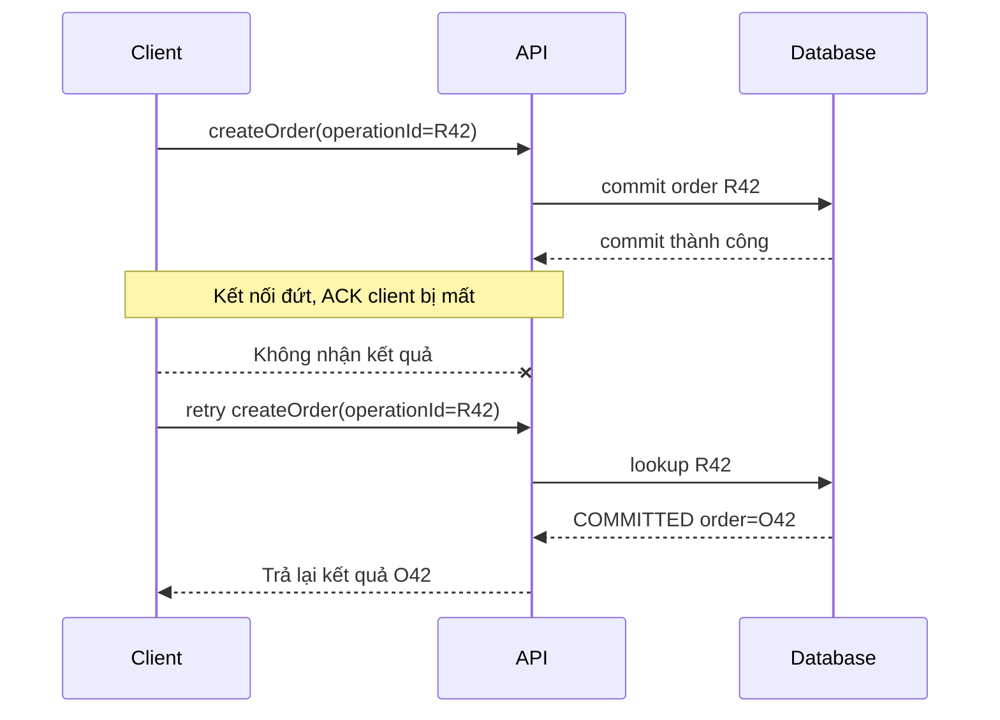
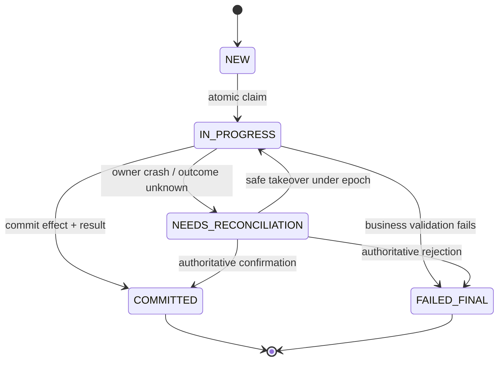
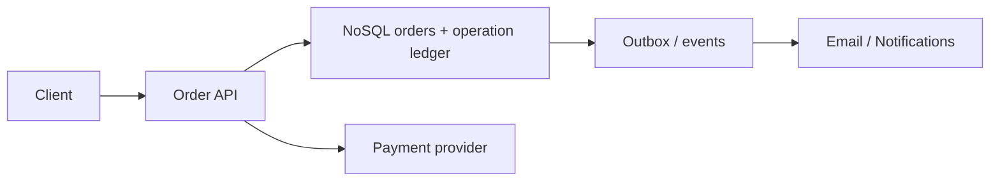
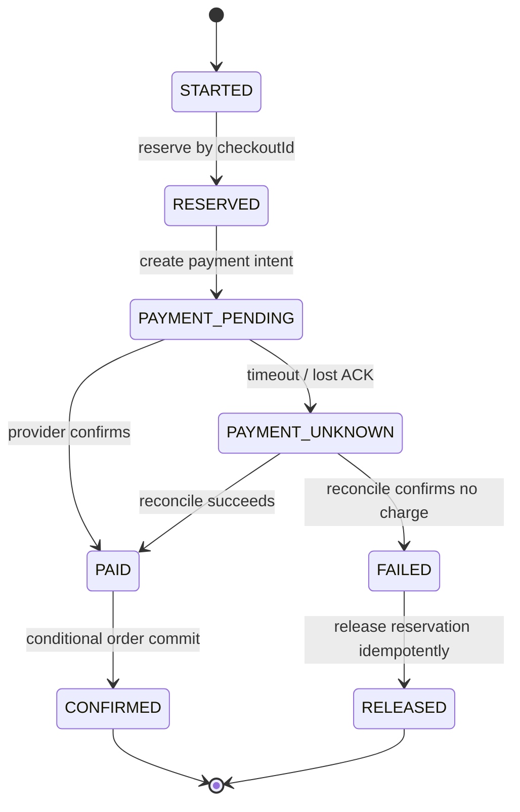

# Tính lũy đẳng của lệnh lưu trữ và của toàn thao tác nghiệp vụ

## 1. Một lần nhấn “Thanh toán” có thể gửi nhiều yêu cầu

Giả sử khách hàng bấm **Thanh toán** cho đơn `O-42`. API nhận yêu cầu, trừ số dư hoặc gửi lệnh tới cổng thanh toán, cập nhật trạng thái đơn hàng trong NoSQL rồi trả phản hồi. Nhưng ngay sau lúc database commit, kết nối client–server bị đứt.

Client nhìn thấy timeout và thử lại:

```text
10:00:00  Client -> API: POST /pay, request R-42
10:00:01  API -> Database: lưu payment = PAID
10:00:02  Database: COMMIT thành công
10:00:03  Response từ API -> Client bị mất
10:00:05  Client: timeout, retry POST /pay
10:00:06  API nhận lại request R-42
```

Nếu lần retry tạo thêm một payment, trừ tiền lần nữa hoặc gửi email xác nhận lần thứ hai, hệ thống đã **không lũy đẳng ở cấp thao tác nghiệp vụ**.

Trường hợp này vẫn có thể xảy ra khi lệnh lưu trữ riêng lẻ là một `PUT`, `SET` hoặc `updateOne` được coi là lũy đẳng. Lệnh lưu trữ lặp lại an toàn **không tự bảo đảm** toàn bộ các bước nghiệp vụ lặp lại an toàn.

Bài thuộc **Database No SQL**, chương **Lỗi phân tán và retry**. Mục tiêu là phân biệt chính xác:

1. **Tính lũy đẳng của một lệnh lưu trữ** trên một đối tượng.
2. **Tính lũy đẳng của một request/API** khi client hoặc proxy gửi lại.
3. **Tính lũy đẳng của toàn bộ thao tác nghiệp vụ** gồm nhiều database records, message brokers và dịch vụ ngoài.

Tư duy cốt lõi:

> **Retry là điều bình thường trong hệ phân tán. Muốn retry an toàn, phải gắn một định danh cố định cho cùng ý định nghiệp vụ và có cơ chế cưỡng chế để các lần thực hiện lặp không tạo ra thêm một tác dụng không mong muốn.**

### Mục tiêu học tập

Sau bài này, bạn có thể:

- Phát biểu định nghĩa lũy đẳng và phân biệt với “chỉ chạy đúng một lần”.
- Phân tích `PUT`, `DELETE`, `SET`, `INCR`, `$inc`, `$set`, upsert và conditional writes.
- Giải thích **unknown commit outcome** do mất ACK.
- Phân biệt request ID, idempotency key, entity ID, transaction ID và message ID.
- Thiết kế operation ledger có trạng thái `IN_PROGRESS`, `COMMITTED`, `FAILED_FINAL` hoặc `UNKNOWN`.
- Chống hai request trùng chạy đồng thời bằng unique claim/conditional write/transaction.
- Kết hợp thay đổi dữ liệu và dấu vết dedup **nguyên tử trong cùng phạm vi nhất quán**.
- Xử lý side effects như thanh toán, email, object storage và event publishing.
- Sử dụng transactional outbox, inbox/dedup và reconciliation.
- Xác định thời hạn giữ idempotency key, rủi ro retry muộn và giới hạn của “exactly once”.
- Viết chiến lược retry có deadline, backoff, jitter và đối soát kết quả.
- Áp dụng theo ngữ nghĩa thực của MongoDB, DynamoDB, Cassandra và Redis.

## 2. Định nghĩa toán học: áp dụng hai lần vẫn cho kết quả như một lần

Một phép biến đổi trạng thái \(f\) gọi là **lũy đẳng (idempotent)** nếu:

\[
f(f(x)) = f(x)
\]

Với mọi trạng thái \(x\) hợp lệ theo phạm vi định nghĩa, áp dụng cùng phép toán thêm lần nữa không làm thay đổi **trạng thái đích** sau lần đầu.

### 2.1. Một phép gán là ví dụ điển hình

Giả sử:

```text
balance = 100
setBalance(80) -> 80
setBalance(80) -> 80
```

Lặp lại thao tác “gán balance bằng 80” trên cùng record không làm `balance` giảm tiếp.

### 2.2. Một phép tăng không lũy đẳng

```text
likes = 10
incrementLikes(1) -> 11
incrementLikes(1) -> 12
```

Do đó:

\[
f(x)=x+1 \Rightarrow f(f(x))=x+2\ne x+1
\]

Nếu mỗi lần retry gửi lại `increment(1)`, lượt thích có thể tăng quá số hành động thực của người dùng.

### 2.3. Tính lũy đẳng phải xác định theo **hậu quả quan sát được**

Một lệnh:

```text
SET status = "PAID"
```

có thể giữ trạng thái `status=PAID` sau nhiều lần thực hiện. Nhưng nếu mỗi lần chạy còn:

- Tăng `revision`.
- Ghi `updatedAt=now()`.
- Phát một sự kiện `OrderPaid`.
- Gửi email xác nhận.
- Thu tiền tại gateway.
- Tạo thêm audit record.
- Trừ tồn kho.

thì **toàn operation** có thể không lũy đẳng.

Một thao tác có thể lũy đẳng đối với **một trường dữ liệu** nhưng không lũy đẳng đối với **tập các side effects cần quan tâm**.

### 2.4. Phân biệt trạng thái cuối và phản hồi HTTP

Một lệnh `DELETE` lặp lại có thể giữ trạng thái “resource không tồn tại”, dù lần đầu trả `204` và lần sau trả `404`. Lũy đẳng theo ý nghĩa trạng thái tài nguyên **không bắt buộc response byte-for-byte giống nhau**.

Tuy nhiên, nếu **API contract** hứa replay cùng kết quả cho cùng idempotency key, service cần lưu response/result phù hợp. Đây là một lớp đảm bảo bổ sung, không tự sinh ra từ lũy đẳng toán học.

## 3. Ba phạm vi khác nhau của tính lũy đẳng

| Phạm vi | Đơn vị xem xét | Ví dụ | Điều chưa chắc được bảo vệ |
|---|---|---|---|
| **Lệnh lưu trữ** | Một command đối với một key/document | `SET key "PAID"` | Những lệnh khác trong workflow |
| **Request/API** | Một lời gọi logic có request ID | `POST /orders` với idempotency key | Side effect bên ngoài API hoặc consumer phía sau |
| **Nghiệp vụ end-to-end** | Một ý định kinh doanh qua nhiều hệ | “Thu tiền cho đơn O-42 đúng một lần” | Cần provider, broker, DB, reconciliation phối hợp |

### 3.1. Lệnh lưu trữ

Có thể là:

```text
PUT order:O42 -> status=PAID
```

Nếu lặp cùng payload mà command chỉ gán trạng thái, phần này có thể lũy đẳng.

### 3.2. API

Một request:

```http
POST /orders
Idempotency-Key: create-order-42
```

cần bảo đảm hai lần gửi cùng intent không sinh hai order khác nhau, ngay cả khi server lần đầu đã tạo ID nhưng phản hồi bị mất.

### 3.3. Nghiệp vụ

Một thao tác thanh toán:

```text
1. Reserve inventory.
2. Create payment intent.
3. Charge provider.
4. Mark order PAID.
5. Publish OrderPaid.
6. Send receipt email.
```

Không thể kết luận toàn workflow lũy đẳng chỉ vì bước 4 là `SET status=PAID`.

**Đúng một mutation trong DB không đồng nghĩa đúng một side effect ở bên ngoài.**

## 4. Vì sao lỗi phân tán dẫn tới retry?

Khi client không nhận phản hồi, có thể đã xảy ra:

| Tình huống | Server có nhận request? | Có thể đã commit? |
|---|---|---|
| DNS/connect thất bại trước khi gửi | Có thể chưa | Thường chưa, nhưng cần biết đường request |
| Request mất giữa đường | Không chắc | Không chắc |
| Server nhận rồi crash trước mutation | Có | Có thể chưa |
| Database commit nhưng ACK DB mất | Có | **Có** |
| API có ACK DB nhưng phản hồi client mất | Có | **Có** |
| Timeout do đọc/quorum chậm | Có thể | Có thể |
| Gateway trả `504` sau khi forward | Có thể | **Có thể đã hoàn tất** |
| Client tự hủy request | Có thể | Có thể tiếp tục commit sau lúc client rời đi |

Từ góc nhìn client:

```text
Timeout ≠ Operation failed
Timeout ≠ Operation committed
Timeout = Outcome not reliably known from this response
```

### 4.1. Unknown commit outcome

Ví dụ:



Điều bảo vệ người dùng ở đây không phải “chỉ có một request”, mà là **hai request được nhận diện cùng một ý định** và kết quả đầu tiên được truy xuất lại.

### 4.2. Retry không phải lỗi lập trình

Retry có thể đến từ:

- Client SDK.
- HTTP reverse proxy.
- Load balancer.
- Message broker redelivery.
- Worker restart.
- Scheduler failover.
- Queue visibility timeout.
- Operator re-run.
- Batch replay hoặc CDC.
- Offline client sync sau nhiều giờ.

Ứng dụng cần thiết kế ngay từ đầu cho các lần lặp có thể xảy ra tại **nhiều tầng**, không chỉ cho một nút Retry trong giao diện.

## 5. Tính lũy đẳng của các lệnh lưu trữ phổ biến

Bảng dưới đây nói về **ngữ nghĩa khái niệm trong một điều kiện dữ liệu ổn định**, không phải lời cam kết rằng implementation ở mọi NoSQL engine đều y hệt.

| Lệnh | Thường lũy đẳng đối với trạng thái chính? | Rủi ro cần xem |
|---|---|---|
| `SET key = value` | Có khi gán cùng value | TTL, version, event, log, metadata thay đổi |
| `PUT full document` cùng nội dung | Có thể | Replace còn có timestamps/revisions/index side effects |
| `DELETE key` | Có đối với trạng thái “không tồn tại” | Response/status, delete event, audit, tombstone |
| `INSERT new ID` không condition | Tùy key/upsert semantics | Duplicate entity nếu ID mới mỗi retry |
| `INSERT IF NOT EXISTS` | Có thể ngăn tạo lần hai | Race, response replay, điều kiện ở scope nào |
| `UPDATE set field = X` | Có với field ấy | Update time, trigger/CDC/revision |
| `UPDATE field = field + 1` | **Không** | Mỗi retry tăng thêm |
| `APPEND list event` | **Không** nếu không dedup | Duplicate element |
| `ADD TO SET element` | Có theo equality của set | Duplicate logic với IDs khác, set size |
| `CAS expectedVersion→newVersion` | Chặn stale repeat | Retry phải truy kết quả, failure không chứng minh commit |
| `UPSERT` | Tùy bản thân update | Có thể ghi đè dữ liệu mới hơn hoặc reset TTL |
| `INCR counter` | **Không** | Retry đếm trùng |
| `ACK queue message` | Tùy broker/consumer state | Không đủ bảo vệ business side effect |

### 5.1. Một phép gán có điều kiện cũng cần hiểu đầy đủ

Giả sử:

```json
{
  "_id": "O42",
  "status": "PENDING",
  "revision": 8
}
```

Command:

```text
SET status = PAID IF revision = 8
SET revision = 9
```

Lần đầu có thể thành công; lần retry nhận `VERSION_CONFLICT` vì revision giờ là 9. Đây là **cơ chế chặn ghi lại**, nhưng client cần biết conflict do **chính mình đã commit** hay do writer khác cập nhật.

Nếu không có operation ID, `VERSION_CONFLICT` không tự là bằng chứng giao dịch đầu tiên đã thành công.

### 5.2. “PUT lũy đẳng” không đồng nghĩa “mọi PUT an toàn”

Một handler:

```text
PUT /order/O42
  update record status=PAID
  chargePayment()
```

có thể dùng HTTP PUT nhưng mỗi lần gọi vẫn thu tiền lần nữa. HTTP method không biến side effects tùy ý của handler thành lũy đẳng.

## 6. Lệnh set và lệnh increment: cùng mong muốn, khác đặc tính

Giả sử tồn kho đã đặt `reserved=10`.

**Cách A — increment:**

```text
reserved = reserved + 1
```

Lặp hai lần tăng lên 12.

**Cách B — set tuyệt đối:**

```text
reserved = 11
```

Lặp lại cho kết quả 11, nhưng có vấn đề nếu writer khác đã thay đổi dữ liệu lên 12: một set mù có thể **ghi đè cập nhật mới hơn**.

Vì vậy:

- Increment không lũy đẳng.
- Blind set có thể lũy đẳng theo riêng mình nhưng vẫn gây **lost update** trong concurrency.
- CAS/transaction giúp bảo vệ điều kiện trạng thái.
- Operation ID/ledger giúp phân biệt retry của cùng một intent.

**Không biến một phép increment nghiệp vụ thành set mù chỉ để có lũy đẳng hình thức.**

## 7. HTTP methods: GET, PUT, DELETE, POST không thay thế thiết kế nghiệp vụ

Theo semantics HTTP, các methods có những thuộc tính như safe/idempotent, nhưng một handler ứng dụng có thể phát sinh side effects ngoài mong đợi.

### 7.1. GET

GET được thiết kế cho retrieval và safe semantics. Tuy vậy, server có thể tăng số đếm truy cập, log hoặc trigger công việc. Nếu một `GET /claimVoucher` thực sự cấp voucher, API đã dùng sai semantics và retry/crawler có thể gây hậu quả.

### 7.2. PUT

PUT thường biểu diễn thay thế hoặc cập nhật state xác định của resource. Lặp cùng representation có thể đạt cùng trạng thái mong muốn. Nhưng nếu code phát thêm event mỗi lần, phải chống sự kiện trùng.

### 7.3. DELETE

`DELETE /resource/R` nhiều lần vẫn làm resource không tồn tại. Lần đầu `204`, lần sau `404` có thể hợp lệ theo API contract. Nếu cần replay cùng response, phải có operation record.

### 7.4. POST

POST có thể tạo resource hoặc thực thi action **không lũy đẳng theo mặc định**. Tuy nhiên API POST hoàn toàn có thể được thiết kế lũy đẳng bằng key:

```http
POST /v1/payments
Idempotency-Key: pay-order-O42-v1
```

Vấn đề không phải lựa chọn động từ nào để “chữa” duplicate, mà là **đảm bảo một business intent được commit một lần**.

## 8. Request ID, idempotency key và business ID khác nhau

Một request có thể mang:

```json
{
  "requestId": "req-9249",
  "idempotencyKey": "payment-O42-v1",
  "orderId": "O42",
  "paymentIntentId": "PAY-O42-1"
}
```

| ID | Công dụng | Có thay thế nhau được không? |
|---|---|---|
| `requestId` | Theo dõi một lần gọi/attempt | Không nếu retry có requestId mới |
| `idempotencyKey` | Nhận diện một logical operation được gửi lại | Có thể map đến business ID nhưng phải định nghĩa rõ |
| `orderId` | Danh tính đối tượng đơn hàng | Không luôn đồng nghĩa một thao tác duy nhất trên order |
| `paymentIntentId` | Danh tính ý định thanh toán | Có thể là natural dedup key cho charge |
| `messageId` | Nhận diện message delivery/event | Một business operation có thể tạo nhiều messages |
| `transactionId` | Nhận diện transaction tại DB/provider | Không tự liên kết mọi dịch vụ end-to-end |

### 8.1. Key phải ổn định qua retry

Sai:

```text
Attempt 1: idempotencyKey = random-A
Attempt 2: idempotencyKey = random-B
```

Đúng:

```text
Logical payment = pay-order-O42-v1
Attempt 1: same key
Attempt 2: same key
Attempt 3: same key
```

Không tái sử dụng cùng key cho **hai ý định thực sự khác nhau** như một lần mua mới trong ngày hôm sau.

### 8.2. Chọn namespace đúng

Một key trần `42` rất dễ đụng giữa tenants, endpoints hoặc resource types.

Một scope có thể là:

```text
(tenantId, operationType, idempotencyKey)
```

Ví dụ:

```text
(t17, CREATE_PAYMENT, pay-O42-v1)
(t18, CREATE_PAYMENT, pay-O42-v1)
```

Là hai ý định khác nhau thuộc hai tenants, cần tách bằng unique constraint.

### 8.3. Key không phải quyền truy cập

Client biết idempotency key không có nghĩa được xem thông tin payment của tenant khác. `GET /operations/:id` cần authorization trên tenant/resource. Không lộ response từ scope khác khi trùng key.

## 9. Cùng key nhưng payload khác: không được chạy âm thầm

Giả sử:

```text
Attempt 1:
  Idempotency-Key = pay-O42-v1
  amountMinor = 120000

Attempt 2:
  Idempotency-Key = pay-O42-v1
  amountMinor = 200000
```

Nếu trả kết quả cũ cho request thứ hai mà không thông báo khác payload, client có thể hiểu sai số tiền. Nếu thực thi request thứ hai, cùng key không còn bảo vệ đúng intent.

Nên lưu một **fingerprint** của payload đã được chuẩn hóa:

```json
{
  "scope": "tenant:t17/CREATE_PAYMENT",
  "idempotencyKey": "pay-O42-v1",
  "requestFingerprint": "sha256:<digest>",
  "status": "COMMITTED",
  "resultId": "PAY-42"
}
```

### 9.1. Chuẩn hóa payload

Fingerprint phải bao gồm các trường **ảnh hưởng semantics**:

- Tenant/resource identity.
- Operation type/version.
- Amount/currency.
- Target payee/account.
- Item list và quantity.
- Các flags ảnh hưởng side effects.

Cần định nghĩa cách canonicalize:

- JSON field order không có ý nghĩa nếu schema nói vậy.
- Phân biệt `120000` với `120000.0` theo schema số.
- Chuẩn hóa Unicode nếu nghiệp vụ cần.
- Xử lý missing vs explicit null.
- Định nghĩa ordering của arrays.
- Không đưa các trường thay đổi từng retry như `traceId` hoặc `clientAttemptAt` nếu chúng không làm đổi intent.

### 9.2. Fingerprint không thay thao tác nguyên tử

Hash chỉ giúp biết payload có giống nhau. Nếu hai requests trùng vẫn cùng chạy qua hai workers, cần **atomic claim/transaction** để chỉ một execution được phép chuyển state.

### 9.3. Xung đột payload

Một API có thể trả `409 Conflict` với mã `IDEMPOTENCY_KEY_REUSED_WITH_DIFFERENT_REQUEST`. Không “tự sửa” bằng cách tạo key mới trên server vì như vậy có thể thực thi một payment thứ hai ngoài ý định.

## 10. Operation ledger: nơi ghi nhận một ý định đã làm đến đâu

Một mô hình lưu metadata cho từng logical operation:

```json
{
  "_id": "tenant:t17/CREATE_PAYMENT/pay-O42-v1",
  "requestFingerprint": "sha256:<digest>",
  "status": "IN_PROGRESS",
  "ownerEpoch": 12,
  "createdAt": "2026-11-14T10:00:00Z",
  "updatedAt": "2026-11-14T10:00:01Z",
  "resultId": null,
  "responseCode": null,
  "expiresAt": null
}
```

### 10.1. Một state machine tối thiểu



Có thể có state `PENDING_EXTERNAL`, `COMPENSATING`, `COMPENSATED` tùy nghiệp vụ. Không nên ép mọi workflow vào state machine hai trạng thái “done/not done”.

### 10.2. Ledger lưu gì?

- Scope và idempotency key.
- Request fingerprint.
- State có ý nghĩa nghiệp vụ.
- Business result ID.
- Canonical response hoặc đủ dữ liệu tái tạo.
- Timestamp và retention policy.
- Version/epoch/owner cho recovery.
- Error code **final** nếu đã xác định.
- Provider request ID cho side effect ngoài.
- Audit thông tin cần thiết nhưng không lộ PII/secrets.

### 10.3. Đừng xóa ledger quá sớm

Nếu client có thể retry sau 24 giờ nhưng ledger chỉ giữ 5 phút, lần retry muộn có thể tạo side effect mới. TTL phải bám theo **contract retry và hậu quả nghiệp vụ**.

Một số natural business uniqueness như “order O42 chỉ được capture payment một lần” có thể cần lưu guard theo vòng đời payment lâu hơn thời hạn idempotency key ở API.

## 11. Atomic claim: hai request trùng đến cùng lúc

Tình huống:

```text
Worker A: CHECK idempotencyKey tồn tại? -> NO
Worker B: CHECK idempotencyKey tồn tại? -> NO
Worker A: charge()
Worker B: charge()
```

Đây là race **check-then-act**; một query “chưa có record” trước action không đủ.

### 11.1. Dùng điều kiện tạo duy nhất

```text
INSERT operation(key, fingerprint, status=IN_PROGRESS)
ONLY IF key does not exist
```

Chỉ một worker có thể claim trong consistency domain đã định. Worker khác đọc operation record và quyết định trả kết quả cũ, trạng thái pending hoặc conflict payload.

### 11.2. Claim xong không đồng nghĩa side effect đã commit

Một worker có thể crash sau khi tạo `IN_PROGRESS` nhưng trước khi thực hiện nghiệp vụ. Nếu hệ coi tồn tại claim là “đã thanh toán” thì sai.

Cần lifecycle và takeover/recovery với evidence rõ ràng.

### 11.3. Tách “đang xử lý” với “đã xong”

| Trạng thái ledger | Retry nên làm gì? |
|---|---|
| Không có record | Thử atomic claim |
| `IN_PROGRESS` hợp lệ | Trả `202`/poll hoặc đợi bounded |
| `COMMITTED` | Trả result đã lưu, không thực thi lại |
| `FAILED_FINAL` | Trả lỗi nghiệp vụ đã chốt |
| `NEEDS_RECONCILIATION` | Đối soát, không tự chạy lại non-idempotent side effect |
| Fingerprint khác | Trả conflict |
| Record đã hết hạn | Áp dụng contract retry/retention; có thể cần guard nghiệp vụ lâu hơn |

## 12. Cùng transaction: ghi kết quả và dấu vết dedup

Thiết kế tốt nhất cho thao tác chỉ tác động **một consistency/transaction domain** là ghi dấu vết và business mutation trong cùng atomic commit.

Giả sử đặt một chiếc vé:

```text
BEGIN ATOMIC TRANSACTION
  IF operation R42 was already committed:
      return prior result

  CLAIM operation R42 if not exists
  ASSERT seatsRemaining >= 1
  DECREMENT seatsRemaining by 1
  CREATE reservation RSV42
  SET operation R42 = COMMITTED with result RSV42
COMMIT
```

Nếu transaction fail trước commit, không để lại phần “trừ ghế rồi chưa lưu operation” như một thành công một nửa. Nếu commit thành công mà response bị mất, retry đọc ledger sẽ thấy kết quả.

### 12.1. Điều kiện cần

- Cùng transaction/atomic boundary thật sự được database hỗ trợ.
- Unique claim hoặc equivalent serializable exclusion.
- Business predicate được kiểm trong phạm vi isolation phù hợp.
- Atomic write result + ledger.
- Retry sau unknown commit truy vấn bằng đường đọc có consistency đủ mạnh.
- Operation ID không đổi.
- Thực hiện condition trên **nguồn authority**, không dựa vào một cache eventual.

### 12.2. Không có transaction nhiều record?

Có thể đổi data model để:

- Đặt dedup marker trong cùng aggregate document/item.
- Dùng một conditional state transition có operation ID trên đúng item.
- Tách workflow thành saga có state/compensation.
- Dùng event log làm source of truth và projection bất đồng bộ.
- Dùng một service authority thực thi guard cho tài nguyên cần độc quyền.

**Không khẳng định atomicity xuyên hai collections/keys chỉ vì từng write riêng lẻ atomic.**

## 13. Một lệnh lũy đẳng vẫn có thể khiến toàn workflow không lũy đẳng

Ví dụ:

```text
1. SET order.status = PAID
2. INCR customer.totalPayments
3. PUBLISH OrderPaid
4. SEND receipt email
```

Giả sử bước 1 lặp lại không thay `status`. Nhưng khi retry toàn workflow:

- `totalPayments` tăng hai lần.
- `OrderPaid` phát hai lần.
- Email gửi hai lần.

Tính lũy đẳng ở bước 1 không “lan truyền” sang các bước tiếp theo. Một công thức tư duy:

\[
\operatorname{Idempotent}(f)
\not\Rightarrow
\operatorname{Idempotent}(g\circ f)
\]

nếu \(g\) có side effects không lũy đẳng.

### 13.1. Chỉ đổi thứ tự các bước không luôn đủ

Nếu:

```text
publish event -> mark DB
```

thì crash giữa hai bước gây event đã phát nhưng DB chưa cập nhật.

Nếu:

```text
mark DB -> publish event
```

thì crash giữa hai bước gây DB đã commit nhưng event chưa được phát.

Cần một giao thức kết nối hai bước, ví dụ **transactional outbox** với consumer idempotency, hoặc một cơ chế giao dịch liên hệ nếu thật sự được hỗ trợ.

## 14. Lưu ý về “exactly once”

Trong hệ phân tán, có thể có:

- **At-most-once delivery:** một thông điệp không được gửi lại sau thất bại, có thể mất.
- **At-least-once delivery:** thông điệp có thể gửi nhiều lần đến khi được xác nhận, có thể trùng.
- **Effectively-once business effect:** nhiều delivery/attempts nhưng application cưỡng chế để một logical operation chỉ tạo một hậu quả theo contract.
- **Exactly-once processing trong một phạm vi được định nghĩa:** một số nền tảng có transactional processing cho những input/output nằm trong cùng hệ.

Không nên nói “message broker bảo đảm exactly once, vậy email/payment bên ngoài chắc chắn chỉ xảy ra đúng một lần”.

### 14.1. Delivery khác effect

```text
Message R42 delivered twice
-> Consumer invoked twice
-> Business effect committed once
```

Đây có thể là thiết kế hợp lệ. Không cần ngăn mọi lần gọi; cần ngăn **hậu quả trùng không mong muốn**.

### 14.2. Phạm vi là phần quan trọng nhất

Một broker có thể xử lý transaction giữa read offsets và write events trong cùng nền tảng. Nhưng việc consumer đã gọi một API ngân hàng và API bị timeout không tự được rollback bởi broker transaction.

Muốn end-to-end effect đúng, mỗi side-effect boundary cần protocol/idempotency riêng.

### 14.3. Lựa chọn chính sách

Đối với nghiệp vụ không chịu được duplicate, **at-least-once delivery + idempotent consumer/operation ledger + reconciliation** thường là kiến trúc thực dụng. Nhưng vẫn cần nêu rõ thời hạn dedup, failure model và những tác dụng không thể undo.

## 15. MongoDB: từ `$set` đến operation ledger trong transaction

MongoDB có atomic updates trên một document và hỗ trợ transactions trên các phạm vi/deployment được hỗ trợ. Nhưng lệnh/update semantics cần xem chính xác.

### 15.1. `$set` và `$inc`

```javascript
// Có thể lũy đẳng về trường status.
db.orders.updateOne(
  { _id: "O42" },
  { $set: { status: "PAID" } }
);

// Không lũy đẳng: mỗi lần đều tăng.
db.orders.updateOne(
  { _id: "O42" },
  { $inc: { paymentCount: 1 } }
);
```

Nếu handler thực thi cả hai lệnh khi retry, `paymentCount` có thể bị tăng trùng dù `status` vẫn là `PAID`.

### 15.2. `$addToSet` có giới hạn

```javascript
db.users.updateOne(
  { _id: "U42" },
  { $addToSet: { tags: "verified" } }
);
```

Thêm cùng string vào set nhiều lần có thể không tạo phần tử trùng theo semantics của MongoDB. Nhưng nếu mỗi retry thêm một object chứa `eventId` mới, các objects có thể khác nhau và vẫn được thêm.

`$addToSet` không tự là dedup cho **logical business intent** nếu representation thay đổi qua attempts.

### 15.3. Upsert với ID cố định

```javascript
db.orders.updateOne(
  { _id: "O42" },
  {
    $setOnInsert: {
      customerId: "U42",
      status: "PENDING",
      createdAt: new Date("2026-11-14T10:00:00Z")
    }
  },
  { upsert: true }
);
```

Nếu cùng `_id` và insert-only data ổn định, việc tạo order có thể chống duplicate trong phạm vi unique key. Tuy nhiên:

- Nếu mỗi retry sinh `_id` mới, vẫn có duplicates.
- Nếu hai requests dùng cùng ID nhưng payload khác, phải phát hiện conflict.
- Nếu nghiệp vụ gồm trừ inventory, gửi event và thanh toán, upsert order một mình chưa đủ.
- Nếu có write concern/replication failure, cần hiểu ACK và rollback semantics.

### 15.4. Atomic conditional transition trên cùng document

Một cách mô hình hóa đơn giản:

```javascript
const result = db.orders.updateOne(
  {
    _id: "O42",
    status: "PENDING"
  },
  {
    $set: {
      status: "PAID",
      paymentIntentId: "PAY-O42-v1"
    }
  }
);
```

Lần thứ hai thường không match vì `status` đã đổi. Nhưng nếu response đầu bị mất, `matchedCount=0` không cho biết chắc ai đã đổi trạng thái; có thể cần đọc authoritative order/payment intent và xác minh operation ID.

### 15.5. Transaction cho nhiều documents

Pseudo-code minh họa, không thay thế driver code:

```javascript
await session.withTransaction(async () => {
  // Một index duy nhất trên (tenantId, operationType, idempotencyKey).
  await operations.insertOne({
    tenantId: "t17",
    operationType: "RESERVE",
    idempotencyKey: "reserve-R42",
    fingerprint: "<sha256>",
    status: "COMMITTED",
    reservationId: "RSV42"
  }, { session });

  const inventory = await stock.updateOne(
    { _id: "SKU42", available: { $gte: 1 } },
    { $inc: { available: -1 } },
    { session }
  );

  if (inventory.matchedCount !== 1) {
    throw new Error("OUT_OF_STOCK");
  }

  await reservations.insertOne({
    _id: "RSV42",
    tenantId: "t17",
    sku: "SKU42",
    operationId: "reserve-R42"
  }, { session });
});
```

Đoạn này chỉ minh họa **các writes cần thuộc cùng transaction**. Production phải xử lý duplicate key từ retry, concurrency, transient transaction errors, unknown commit result, transaction options/write concern và truy vấn ledger có consistency phù hợp.

**Không gọi cổng thanh toán hoặc gửi email trong callback transaction có thể được driver retry**. Callback có khả năng chạy lại, nên side effects ở ngoài transaction sẽ dễ bị lặp.

### 15.6. Retry khi commit outcome chưa rõ

Một số driver hỗ trợ retry commit hoặc xử lý nhãn lỗi; không được lấy bất kỳ lỗi timeout nào để kết luận transaction đã abort. Hãy truy vấn operation ledger/status khi có thể, sử dụng stable operation ID và protocol của driver.

## 16. DynamoDB: conditional writes và transaction dedup

DynamoDB hỗ trợ **ConditionExpression**, `TransactWriteItems` và những semantics riêng về idempotency ở API transaction trong phạm vi được tài liệu quy định.

### 16.1. Tạo item nếu chưa tồn tại

```json
{
  "TableName": "Orders",
  "Item": {
    "PK": { "S": "TENANT#t17#ORDER#O42" },
    "status": { "S": "PENDING" },
    "operationId": { "S": "create-order-R42" }
  },
  "ConditionExpression": "attribute_not_exists(PK)"
}
```

Điều kiện có thể ngăn item trùng primary key. Nhưng nếu lần retry dùng `ORDER#O43`, nó không còn bảo vệ cùng logical order.

### 16.2. Trừ inventory có điều kiện

```json
{
  "TableName": "Inventory",
  "Key": {
    "PK": { "S": "SKU#42" }
  },
  "UpdateExpression": "SET available = available - :q",
  "ConditionExpression": "attribute_exists(PK) AND available >= :q",
  "ExpressionAttributeValues": {
    ":q": { "N": "1" }
  }
}
```

Điều kiện bảo vệ không trừ quá tồn ở một item theo API contract. Nhưng nếu retry sau unknown outcome, request thứ hai có thể trừ thêm một đơn vị khi vẫn còn hàng. **Condition available>=1 không phải idempotency key**.

### 16.3. Kết hợp operation ledger và inventory

Một transaction khái niệm:

```text
TransactWriteItems:
  Put Operation(key=reserve-R42, status=COMMITTED, result=RSV42)
      condition attribute_not_exists(PK)
  Update Inventory(SKU42)
      condition available >= 1
      set available = available - 1
  Put Reservation(RSV42)
      condition attribute_not_exists(PK)
```

Các writes cùng commit hoặc không theo transaction scope được hỗ trợ. Retry sau timeout phải lookup operation ID bằng đường đọc phù hợp và không tự đổi key.

### 16.4. `ClientRequestToken` có giới hạn

DynamoDB `TransactWriteItems` có thể hỗ trợ `ClientRequestToken` cho idempotency của request transaction **trong một khoảng thời gian hữu hạn theo tài liệu**. Không dựa vào token đó như bảo đảm vĩnh viễn cho một nghiệp vụ có thể retry sau nhiều ngày.

Một natural business operation ledger riêng giúp:

- Phân biệt retry sau cửa sổ token.
- Đối soát kết quả/unknown outcome.
- Trả result cho client.
- Gắn với lifecycle của order/payment.
- Kiểm soát reuse token cùng payload khác.

Đọc đúng thời hạn và error semantics của phiên bản API/dịch vụ đang dùng.

### 16.5. Multi-region/global tables

Một conditional write thành công ở region A không tự bảo đảm cùng logical operation không được đồng thời chấp nhận ở region B **nếu chế độ multi-writer replication đang dùng không có một consistency domain đủ mạnh**.

Cần xác định mode cụ thể của global tables, authoritative region cho ID hoặc cơ chế ownership/escrow phù hợp. Không dùng eventual GSI query làm bằng chứng operation chưa xảy ra.

## 17. Cassandra: cùng primary key không có nghĩa mọi retry đều vô hại

Cassandra thường cho `INSERT`/`UPDATE` theo upsert semantics trên cùng primary key. Viết lại cùng column values có thể tạo cùng trạng thái dữ liệu cuối theo một số giả định.

### 17.1. Ví dụ ghi một event ID ổn định

```sql
INSERT INTO events_by_id (
    event_id, tenant_id, event_type, payload
) VALUES (
    58b73241-61ef-4d62-8921-2a5dfd6b80e0,
    't17',
    'ORDER_CREATED',
    '{"orderId":"O42"}'
);
```

Nếu cùng primary key và cùng giá trị được ghi lại, nhiều lần có thể cho cùng logical row. Nhưng cần lưu ý:

- Timestamp/version của cells.
- TTL được đặt lại khi ghi lại theo command/engine semantics.
- Tombstones, write ordering và concurrent writers.
- Cùng primary key nhưng payload khác.
- Các index/materialized views và side effects bên ngoài.
- Một event producer tạo UUID mới mỗi retry.

### 17.2. `UPDATE counter` khác ordinary upsert

Cassandra counters có semantics riêng; tăng counter nhiều lần không lũy đẳng theo logical intent. Retry mù sau timeout có thể tăng trùng nếu không có một cơ chế dedup bên ngoài hoặc thiết kế khác.

### 17.3. LWT để claim điều kiện

```sql
INSERT INTO operation_claims (
    tenant_id, operation_id, fingerprint, status
) VALUES (
    't17', 'reserve-R42', 'hash-abc', 'IN_PROGRESS'
)
IF NOT EXISTS;
```

Lightweight transaction (LWT) có thể cung cấp conditional uniqueness theo phạm vi hỗ trợ. Tuy nhiên, **claim row** và **update một bảng inventory khác** không tự atomic chỉ vì claim dùng LWT.

Nếu cần invariant xuyên nhiều partitions, xem lại data model, source of truth hoặc workflow có reconciliation/compensation.

### 17.4. Consistency level không tự tạo dedup

`QUORUM` cho một lệnh `counter=counter+1` không làm phép tăng trở thành lũy đẳng. Replication ACK mạnh hơn không thay đổi tính chất đại số của operation.

## 18. Redis: SET, INCR, NX và script nguyên tử

### 18.1. `SET` và `INCR`

```redis
SET order:O42:status PAID
SET order:O42:status PAID

INCR order:O42:chargeAttempts
INCR order:O42:chargeAttempts
```

Hai lệnh `SET` có thể cho cùng final value, còn hai `INCR` tăng hai lần.

### 18.2. TTL làm thay đổi tính lũy đẳng quan sát được

```redis
SET session:U42 valid EX 3600
```

Nếu retry 10 phút sau, TTL được thiết lập lại theo semantics của command. Nếu thời gian hết hạn là một phần trạng thái cần bảo đảm, việc gửi lại command không hoàn toàn tương đương lần đầu.

Có thể cần lưu absolute expiry bất biến hoặc dùng option phù hợp, theo version/contract.

### 18.3. `SET NX` dùng cho dedup có giới hạn

```redis
SET dedup:reserve-R42 processing NX EX 3600
```

Có thể giúp chỉ một attempt giành claim trên một primary còn ổn định trong cửa sổ TTL. Nhưng:

- Key có thể hết hạn trong khi work vẫn chạy.
- Worker A crash sau claim.
- Redis failover với replication bất đồng bộ có thể mất key đã ACK.
- A có thể tiếp tục sau khi claim hết hạn.
- Claim thành công không có nghĩa inventory/payment đã commit.
- Response/result có thể không được lưu cùng effect.

Vì vậy `SET NX` một mình **không chứng minh exactly-once business effect**.

### 18.4. Lua và atomicity một instance

Một script Redis có thể đọc `processed` và thay đổi một key trong cùng atomic execution trên một primary. Trong Redis Cluster, các keys của script/transaction cần thỏa các ràng buộc slot tương ứng. Nhưng cần xét durability, failover và external side effects.

Ví dụ khái niệm:

```lua
-- KEYS[1] = inventory counter key
-- KEYS[2] = dedup key for operation
-- ARGV[1] = quantity (positive integer)
-- ARGV[2] = result marker

if redis.call("EXISTS", KEYS[2]) == 1 then
    return { "DUPLICATE", redis.call("GET", KEYS[2]) }
end

local available = tonumber(redis.call("GET", KEYS[1]))
local quantity = tonumber(ARGV[1])

if not available or not quantity or quantity <= 0 then
    return { "INVALID_STATE" }
end

if available < quantity then
    return { "OUT_OF_STOCK" }
end

redis.call("DECRBY", KEYS[1], quantity)
redis.call("SET", KEYS[2], ARGV[2])
return { "COMMITTED", ARGV[2] }
```

Script mô phỏng một **atomic update trong Redis execution domain**, không phải giao dịch phân tán bền vững tuyệt đối qua mọi Redis failover. Production cần định dạng dữ liệu/response, TTL, permission, hash slot, persistence, monitoring và các failure contracts thích hợp.

### 18.5. Redis cache không thay authoritative ledger

Nếu payment ledger nằm ở database khác, đặt dedup key Redis với TTL ngắn có thể giúp giảm retry traffic nhưng không tự là chứng cứ payment chưa/đã được charge. Idempotency guard có hệ quả tài chính phải đặt tại một authority/transaction domain phù hợp hoặc được provider bảo vệ.

## 19. Payment: bài toán không thể giải chỉ bằng một `updateOne`

Một payment workflow thường qua nhiều boundaries:



Giả sử request retry sau khi provider đã thu tiền nhưng API chưa lưu DB:

```text
T0 Create payment intent.
T1 Provider charge thành công.
T2 Response provider -> API bị mất.
T3 API timeout.
T4 Client retry.
```

Nếu API gọi `charge` lần nữa với **một provider idempotency key khác**, có thể thu tiền lần hai.

### 19.1. Một payment intent là nguồn nhận diện logic

Có thể xác định:

```text
paymentIntentId = PAY-ORDER-O42-CAPTURE-1
providerIdempotencyKey = PAY-ORDER-O42-CAPTURE-1
```

Các lần retry cùng intent phải sử dụng đúng provider key và payload có cùng semantics.

### 19.2. Luồng an toàn hơn

1. Tạo payment intent ở DB với natural key/unique guard.
2. Ghi trạng thái `PENDING_PROVIDER`.
3. Gửi request tới provider bằng stable idempotency key.
4. Nếu provider xác nhận, lưu provider reference và chuyển `PAID` bằng conditional state transition.
5. Nếu timeout, không tự kết luận provider chưa xử lý.
6. Query/reconcile provider theo payment intent/reference.
7. Sau khi có authoritative result, cập nhật DB và phát sự kiện qua outbox.
8. Retry API trả lại trạng thái của intent, không tạo payment mới.

### 19.3. Không có distributed transaction với mọi provider

Order database và provider thường không cùng transaction ACID. Vì vậy luôn có các trạng thái trung gian:

- DB có intent nhưng provider chưa biết.
- Provider đã charge nhưng DB chưa ghi nhận.
- DB đã xác nhận nhưng outbox notification còn pending.
- Provider trả kết quả chậm hoặc webhook đến sau.

Giải pháp là **saga/state machine + provider idempotency + reconciliation + compensation**, không phải tuyên bố một transaction xuyên mọi hệ mà thực tế không tồn tại.

### 19.4. Provider idempotency cũng có giới hạn

Cần đọc chính sách provider về:

- Thời gian giữ idempotency key.
- Scope theo account/endpoint.
- Cách xử lý cùng key, khác payload.
- Các lỗi được cache/replay.
- Khi nào một request được coi là bắt đầu thực hiện.
- API tra cứu kết quả.
- Trường hợp webhook gửi nhiều lần.

Không giả định mọi provider hỗ trợ idempotency vô hạn.

## 20. Transactional outbox: lưu event cùng thay đổi dữ liệu

Một pattern thường gặp:

```text
Transaction:
  Update order -> PAID
  Insert outbox event OrderPaid with eventId=E42
Commit
```

Một publisher khác đọc outbox:

```text
Read pending outbox E42
Publish E42
Mark published
```

### 20.1. Tại sao cần outbox?

Không có outbox:

```text
DB commit -> process crash -> event không publish
```

Hoặc:

```text
event publish -> DB rollback
```

Outbox đặt business state và **ý định phát event** trong một atomic DB commit khi engine hỗ trợ.

### 20.2. Outbox không tự cho exactly-once delivery

Publisher có thể:

```text
Publish E42 thành công
ACK broker mất
Publisher retry E42
Broker nhận E42 lần nữa
```

Do đó consumer phải idempotent. Outbox giải quyết **không quên phát sau DB commit**, không tự ngăn mọi message trùng.

### 20.3. Event ID phải ổn định

Một event có thể mang:

```json
{
  "eventId": "ORDER-PAID-O42-v1",
  "operationId": "PAY-O42-v1",
  "orderId": "O42",
  "eventType": "OrderPaid",
  "sourceVersion": 18
}
```

Nếu retry publish cùng logical event nhưng tạo `eventId` mới mỗi lần, consumer dedup theo event ID sẽ không nhận ra trùng.

## 21. Inbox/dedup tại consumer

Một consumer nhận event `OrderPaid` và cấp điểm thưởng. Broker có thể giao event nhiều lần.

**Thiết kế không an toàn:**

```text
onMessage(event):
  increment(customer.points, 10)
  ack(event)
```

Nếu process crash sau increment trước ACK, message được giao lại và tăng thêm 10.

### 21.1. Atomic inbox + effect

```text
BEGIN TRANSACTION
  IF inbox.has(consumerName, eventId):
      return already_processed

  INSERT inbox(consumerName, eventId)
  INCREMENT customer.points by 10
COMMIT

ACK message
```

Nếu transaction commit nhưng ACK broker mất, delivery lại gặp inbox record và không tăng thêm điểm.

### 21.2. Scope per consumer

Cùng event `E42` có thể hợp lệ cho hai consumers:

- Loyalty service cộng điểm.
- Analytics service tăng metric.

Nếu inbox unique chỉ theo `eventId` dùng chung cho mọi consumer, consumer thứ hai có thể bị bỏ qua sai. Dùng scope:

```text
(consumerName, eventId)
```

hoặc một natural operation identity tương ứng.

### 21.3. Nếu inbox và business data ở hai hệ?

Ghi inbox trước rồi increment ở DB khác có thể khiến crash làm **bỏ lỡ effect**; làm effect trước rồi ghi inbox có thể tạo **duplicate**.

Cần một trong các lựa chọn:

- Đặt inbox và effect cùng transaction domain.
- Thiết kế effect bản thân có conditional idempotency key.
- Dùng workflow/reconciliation.
- Chọn business contract có thể chịu trùng và bù trừ.

### 21.4. Offset ACK không phải business commit

Một broker offset đã commit không tự chứng minh điểm thưởng đã được ghi. Thứ tự ACK/DB và crash window cần được xét cẩn thận.

## 22. Multi-step saga: lũy đẳng theo từng bước và toàn bộ ý định

Một saga checkout:

```text
PENDING
  -> INVENTORY_RESERVED
  -> PAYMENT_AUTHORIZED
  -> ORDER_CONFIRMED
  -> RECEIPT_SCHEDULED
```

Mỗi bước cần:

- Operation ID gắn với checkout.
- Điều kiện chuyển trạng thái.
- Idempotency key cho những side effect.
- Result/receipt lưu bền vững.
- Recovery/reconciliation khi outcome unknown.
- Compensation hợp lệ nếu không thể tiếp tục.
- Không nhảy sai trạng thái khi retries song song.

### 22.1. Sơ đồ state machine



### 22.2. Compensation cũng phải lũy đẳng

Một workflow gọi:

```text
releaseReservation(R42)
```

hai lần không được hoàn thêm hai đơn vị tồn nếu bước release đã xảy ra. Compensation phải dựa trên reservation state/operation ID, không chỉ `INCR stock` mỗi lần.

### 22.3. Không gọi “end-to-end exactly once” nếu chỉ mỗi bước độc lập

Một saga có thể đạt **effectively-once theo business invariants** nếu tất cả bước và side effects được bảo vệ, nhưng vẫn cần xử lý các thời điểm chưa xác định. Không có một cờ SDK chung khiến mọi thành phần tự rollback cùng nhau.

## 23. Race giữa hai retries: ai có quyền thực hiện?

Client/proxy có thể gửi hai attempts đồng thời khi timeout quá ngắn:

```text
R42 attempt A -> API worker 1
R42 attempt B -> API worker 2
```

Hai workers chạy trên hai nodes khác nhau. Dùng synchronized/local map trong JVM A không bảo vệ JVM B.

### 23.1. Unique claim

Một unique key trong DB hoặc conditional insert đủ nhất quán là điểm phân xử:

```text
Worker 1: claim R42 -> WON
Worker 2: claim R42 -> EXISTS
```

### 23.2. Worker sở hữu claim có thể chết

Nếu claim `IN_PROGRESS` giữ vô hạn, operation bị kẹt. Có thể dùng lease với owner epoch/heartbeat và takeover theo contract.

### 23.3. Stale worker và fencing

```text
Worker A claim epoch 10.
A pause.
Lease expired.
Worker B takeover epoch 11.
A resume.
```

Nếu cả A/B đều có thể commit effect, dedup claim chưa đủ. Target phải kiểm `currentEpoch`/version trong mutation hoặc side effect phải có provider idempotency.

### 23.4. Fencing chỉ bảo vệ khi được thực thi ở đích

Một token epoch gắn trong log nhưng external payment gateway bỏ qua nó không ngăn A charge. Cần provider idempotency/reconciliation hoặc một guard có hiệu lực ngay tại nơi side effect xảy ra.

### 23.5. Highest-seen fence có cửa sổ giới hạn

Nếu target chỉ nhớ generation lớn nhất từng **nhìn thấy**, trong khoảng B được cấp token mới nhưng target chưa đăng ký token ấy, write cũ vẫn có thể được chấp nhận. Muốn quyền hiện hành có hiệu lực tức thời tại commit, cần protocol cùng authoritative consistency domain hoặc registration handshake được thiết kế đúng.

## 24. Kết quả lặp lại và hợp đồng response

Với một request tạo resource:

```http
POST /v1/orders
Idempotency-Key: create-O42-v1
Content-Type: application/json

{
  "customerId": "U42",
  "items": [
    { "sku": "BK-01", "quantity": 1 }
  ]
}
```

Lần đầu:

```http
HTTP/1.1 201 Created
Location: /v1/orders/O42
Content-Type: application/json

{
  "orderId": "O42",
  "status": "CONFIRMED",
  "operationId": "create-O42-v1"
}
```

Lần retry có thể trả lại **cùng business result** (tùy API policy, có thể cùng 201 hoặc một status khác được tài liệu hóa), nhưng không tạo O43.

### 24.1. Tái sử dụng response cũ hay đọc trạng thái mới?

Có hai contract hợp lệ tùy sản phẩm:

1. **Replay original response:** lưu HTTP status/body cần thiết và trả như lần đầu, thích hợp cho API idempotency key ngắn hạn.
2. **Return current operation outcome:** trả state hiện hành (ví dụ order hiện đã SHIPPED) qua status endpoint, nhưng phải phân biệt original commit result với snapshot mới.

Không vô tình thay một ý định checkout mới bằng “trả state của order cũ” nếu caller dùng key sai.

### 24.2. Mẫu `202 PENDING`

```http
HTTP/1.1 202 Accepted
Location: /v1/operations/create-O42-v1
Content-Type: application/json

{
  "operationId": "create-O42-v1",
  "status": "IN_PROGRESS",
  "resultReady": false
}
```

Chỉ dùng nếu service đã nhận operation theo contract và chưa có kết quả cuối. `202` không đồng nghĩa order đã được xác nhận.

### 24.3. Trạng thái unknown không phải failed

```json
{
  "operationId": "create-O42-v1",
  "status": "OUTCOME_UNKNOWN",
  "checkStatusAt": "/v1/operations/create-O42-v1"
}
```

Đây là mô hình payload. Có thể client đã disconnect trước khi nhận response; do đó client phải tự biết cách query cùng operation ID khi kết nối trở lại.

## 25. Chọn HTTP status phù hợp

| Tình huống | Status thường cân nhắc | Giải thích |
|---|---|---|
| Resource mới được tạo/commit | `201 Created` | Thành công theo contract |
| Mutation/operation hoàn tất | `200 OK` hoặc `204 No Content` | Tùy API |
| Command nhận bền vững nhưng chưa commit | `202 Accepted` | Pending, cần lookup |
| Reuse key cùng payload sau commit | Replay kết quả theo contract | Không thực hiện lại |
| Key trùng nhưng payload khác | `409 Conflict` | Sai scope/idempotency reuse |
| State conflict do concurrent write | `409 Conflict` | Có thể không do chính retry |
| Business validation không hợp lệ | `400` hoặc `422` tùy quy ước | Không retry nguyên payload vô hạn |
| Rate limit | `429 Too Many Requests` | Backoff, Retry-After |
| Không có quorum/authority | `503 Service Unavailable` | Tạm không phục vụ được đúng bảo đảm |
| Gateway timeout sau khi forward | `504 Gateway Timeout` | Outcome có thể unknown |
| Không tìm thấy resource thực sự | `404 Not Found` | Không kết luận từ timeout hoặc stale index |
| Unauthorized | `401`/`403` | Không bỏ qua để trả ledger người khác |

HTTP status chỉ là **một phần** của API contract. Đặc biệt `503`/`504` không chứng minh operation đã abort khi request có thể đã qua điểm commit.

## 26. Retry policy: khi nào thử lại, khi nào đối soát?

| Outcome | Chiến lược |
|---|---|
| Lỗi connect chắc chắn trước khi gửi | Retry cùng key trong deadline |
| Server trả final business error | Không retry như lỗi hạ tầng |
| `429` | Backoff/jitter/`Retry-After` nếu phù hợp |
| `503` do quorum unavailable trước commit | Retry cùng key sau backoff |
| Timeout sau khi gửi | Xem là unknown; lookup hoặc idempotent retry |
| `409` vì fingerprint khác | Không retry cùng key với payload khác |
| `IN_PROGRESS` từ ledger | Poll/đợi bounded; không chạy lần hai |
| `COMMITTED` | Dùng result đã lưu |
| Provider charge timeout | Reconcile provider với stable payment intent |
| Duplicate message | Consumer inbox/dedup; ACK sau effect đúng |
| Conditional write fail | Kiểm record/operation ledger; không mặc định retry như lỗi mạng |

### 26.1. Exponential backoff có jitter

Một mô hình:

\[
delay_k = \min(delay_{\max},\, base \cdot 2^k)\times U(0,1)
\]

với `U(0,1)` là biến ngẫu nhiên đều dùng làm jitter minh họa. Những backoff variants khác có đặc điểm khác; cần chọn theo SLO.

Điều quan trọng:

- Tổng deadline.
- Số lần retry tối đa.
- Timeout cho từng attempt.
- Retry budget theo service và client.
- Không làm mọi clients retry đồng bộ.
- Có circuit breaker/backpressure khi quá tải.
- Ghi nhận operation ID xuyên tất cả attempts.

### 26.2. Retry storm có thể làm tình trạng xấu hơn

Nếu 10.000 clients cùng retry lúc network hồi phục, requests trùng có thể đẩy CPU/ledger/DB lên đỉnh. Dù idempotency đảm bảo correctness, **performance** vẫn có thể bị ảnh hưởng. Cần rate limit, caching completed results, coalescing single-flight (chỉ là tối ưu cục bộ) và admission control.

### 26.3. Hedged requests

Một client gửi bản sao read request sang hai replicas để giảm tail latency. Với write hoặc action có side effect, việc chủ động gửi hai request đồng thời **phải được bảo vệ bằng end-to-end idempotency**, không coi hedge an toàn chỉ vì cùng URL.

## 27. Java 17: mô phỏng operation ledger và atomic business effect

Ví dụ sau dùng một kho **in-memory** với `synchronized` để minh họa một atomic boundary. Nó không cung cấp distributed durability/consensus; trong production cần thay bằng DB transaction/conditional mutation ở source-of-truth phù hợp.

Ví dụ: mỗi logical reservation giữ tối đa một ghế. Hai attempts cùng ID chạy ở nhiều threads nhưng chỉ trừ tồn một lần.

```java
import java.util.HashMap;
import java.util.Map;
import java.util.Objects;

public final class InMemoryReservationStore {
    enum State { COMMITTED, REJECTED }

    record Result(State state, String reservationId, String message) {}

    record Operation(
        String fingerprint,
        Result result
    ) {}

    private int available = 1;
    private final Map<String, Operation> operations = new HashMap<>();

    // Chỉ mô phỏng transaction trên một JVM.
    public synchronized Result reserve(
            String tenantId,
            String operationId,
            String sku,
            int quantity
    ) {
        Objects.requireNonNull(tenantId);
        Objects.requireNonNull(operationId);
        Objects.requireNonNull(sku);
        if (quantity <= 0) {
            throw new IllegalArgumentException("quantity must be positive");
        }

        String scope = tenantId + "/RESERVE/" + operationId;

        // Fingerprint minh họa. Production dùng encoding canonical,
        // chuẩn hóa input và digest phù hợp.
        String fingerprint = sku + "#" + quantity;

        Operation prior = operations.get(scope);
        if (prior != null) {
            if (!prior.fingerprint().equals(fingerprint)) {
                throw new IllegalStateException(
                    "IDEMPOTENCY_KEY_PAYLOAD_MISMATCH"
                );
            }
            return prior.result();
        }

        if (available < quantity) {
            Result denied = new Result(
                State.REJECTED, null, "OUT_OF_STOCK"
            );
            operations.put(scope, new Operation(fingerprint, denied));
            return denied;
        }

        available -= quantity;
        String reservationId = "RSV-" + operationId;
        Result accepted = new Result(
            State.COMMITTED, reservationId, "RESERVED"
        );

        // State mutation và ledger được thực hiện trong một
        // synchronized critical section, không phải DB transaction.
        operations.put(scope, new Operation(fingerprint, accepted));
        return accepted;
    }

    public synchronized int available() {
        return available;
    }

    public static void main(String[] args) {
        InMemoryReservationStore store = new InMemoryReservationStore();

        Result first = store.reserve(
            "t17", "reserve-R42", "SKU42", 1
        );
        Result retry = store.reserve(
            "t17", "reserve-R42", "SKU42", 1
        );

        System.out.println(first);
        System.out.println(retry);
        System.out.println(store.available()); // 0, không phải -1

        Result anotherOrder = store.reserve(
            "t17", "reserve-R43", "SKU42", 1
        );
        System.out.println(anotherOrder); // OUT_OF_STOCK
    }
}
```

### 27.1. Mã minh họa điều gì?

- Hai attempts cùng scope/key/payload trả cùng result.
- Lệnh trừ tồn chỉ diễn ra một lần cho cùng operation ID.
- Payload khác với cùng key bị từ chối.
- Hai logical operations khác nhau vẫn cạnh tranh inventory.
- Dấu vết operation và mutation nằm trong một critical section.

### 27.2. Mã **không** cung cấp điều gì?

- Restart process sẽ mất ledger và tồn kho.
- Hai JVM khác nhau không chung `synchronized`.
- Không có replication/quorum.
- Không có persisted operation claim, failover, owner epoch.
- Không có provider side effects.
- Không có TTL/retention và authorization đầy đủ.
- Fingerprint nối chuỗi còn mơ hồ với input có dấu phân cách.
- Không có transaction isolation của DB thực tế.

**Không dùng HashMap/synchronized làm giải pháp idempotency cho production đa node.** Giá trị của ví dụ là nhìn thấy **vì sao ledger lookup và business mutation phải thuộc cùng atomic consistency boundary**.

## 28. Java: tách business ID và attempt ID trong API layer

Một service có thể định nghĩa:

```java
record PlaceOrderCommand(
    String tenantId,
    String idempotencyKey,
    String customerId,
    String sku,
    int quantity
) {}

record PlaceOrderResult(
    String orderId,
    String status
) {}

interface OrderOperations {
    // Triển khai phải bảo vệ atomic claim + inventory + order.
    PlaceOrderResult executeOnce(PlaceOrderCommand command);

    // Đọc authoritative operation ledger.
    PlaceOrderResult findCommitted(
        String tenantId,
        String idempotencyKey
    );
}
```

Controller:

```java
final class PlaceOrderHandler {
    private final OrderOperations operations;

    PlaceOrderHandler(OrderOperations operations) {
        this.operations = operations;
    }

    PlaceOrderResult handle(PlaceOrderCommand command) {
        // Không sinh idempotencyKey mới trên mỗi attempt.
        return operations.executeOnce(command);
    }
}
```

Điểm khó nằm ở implementation của `executeOnce` và đường recovery, không phải ở một annotation `@Retryable`. Nếu hàm ấy gọi payment provider trước khi lưu ledger, controller không thể cứu duplicate.

### 28.1. Retry ở tầng driver

Driver có thể tự retry một số writes theo semantics riêng. Điều này hữu ích, nhưng không đồng nghĩa toàn bộ business method tự lũy đẳng. Khi mỗi HTTP request gồm ba DB commands và một provider call, driver chỉ hiểu những commands thuộc phạm vi nó quản lý.

### 28.2. Không đặt side effect bên trong callback transaction được retry tự động

Một transaction helper có thể gọi lại callback sau transient conflict. Nếu callback:

```java
paymentGateway.charge(...);
```

trước khi transaction commit, cùng callback chạy lại có thể thu tiền hai lần. Nên commit payment intent/outbox trong DB, rồi gọi provider theo workflow idempotent riêng.

## 29. TTL, retention và ranh giới thời gian của dedup

Lưu mọi idempotency key vô hạn có thể tốn storage/index. Vì vậy nhiều hệ có thời gian giữ ledger.

Giả sử:

```text
Client retry tối đa:      24 giờ
Queue redelivery tối đa:  72 giờ
Offline sync tối đa:      7 ngày
Provider key retention:   theo hợp đồng provider
```

Nếu ledger chỉ giữ 1 giờ, một message bị redeliver sau 2 ngày có thể được xem là mới.

### 29.1. Đặt retention theo đường retry dài nhất

Một nguyên tắc khởi đầu:

\[
T_{\text{dedup}}
\geq
\max(
T_{\text{client retry}},
T_{\text{queue redelivery}},
T_{\text{offline replay}},
T_{\text{recovery replay}}
)
\]

Đây là điều kiện ước lượng trong failure model được chấp nhận, không phải một theorem bảo đảm an toàn tuyệt đối. Một operation có hậu quả lâu dài có thể cần **business unique key** tồn tại lâu hơn.

### 29.2. Một khóa hết hạn không xóa hậu quả nghiệp vụ

Nếu payment đã được thu tiền, việc TTL xóa record `pay-O42-v1` không xóa payment ở provider. Retry sau TTL có thể charge lại nếu không có natural intent uniqueness hoặc provider-side dedup đủ lâu.

### 29.3. Chống replay vô hạn có thể cần hai lớp

- **API idempotency ledger:** TTL ngắn/hữu hạn cho retries hợp lệ.
- **Business invariant ledger:** record lâu hơn theo vòng đời đối tượng, ví dụ mỗi order chỉ có một captured payment intent theo loại.

### 29.4. TTL khi record còn `IN_PROGRESS`

Không tự dọn claim chưa rõ trạng thái rồi cho request mới chạy nếu side effect cũ có thể hoàn thành muộn. Cần lease/owner epoch và reconciliation trước khi takeover.

### 29.5. Xóa dữ liệu cá nhân

Ledger có thể chứa payload, email, IP, payment metadata. Cần privacy/retention policy:

- Lưu fingerprint/IDs thay vì full sensitive body khi có thể.
- Giữ đúng thông tin cần đối soát.
- Mã hóa/quyền truy cập.
- Xóa hoặc ẩn PII theo yêu cầu pháp lý và nghiệp vụ.
- Không để xóa ledger gây khả năng replay side effect nguy hiểm; có thể dùng non-sensitive tombstone/guard phù hợp.

## 30. Quan hệ giữa lũy đẳng, uniqueness và consistency

Ba khái niệm liên quan nhưng khác nhau:

**Idempotency:** một logical operation lặp lại không tạo thêm effect.

**Uniqueness:** một giá trị/đối tượng là duy nhất trong scope, ví dụ order ID duy nhất.

**Consistency/isolation:** concurrent operations tuân các ràng buộc đọc/ghi đã cam kết.

### 30.1. Unique order ID chưa ngăn trừ tồn hai lần

Handler:

```text
DECREMENT stock
INSERT order O42 if not exists
```

Hai attempts cùng ID có thể đều trừ tồn, nhưng một insert bị unique constraint từ chối. Vẫn trừ tồn hai lần nếu không transaction/compensation.

Đổi thứ tự:

```text
INSERT order O42 if not exists
DECREMENT stock
```

có thể tạo order nhưng không trừ tồn nếu crash giữa bước.

### 30.2. Idempotency key không tự giải quyết hai ý định khác nhau

Hai buyers có **hai operation IDs khác nhau**, cùng tranh một chiếc vé. Cả hai không phải retry của cùng request.

Bất biến:

\[
confirmedReservations \le 1
\]

vẫn cần conditional decrement/transaction/escrow. **Dedupe không phải giải pháp concurrency cho những operations khác nhau.**

### 30.3. Consistency read ảnh hưởng lookup

Một read eventual chưa thấy operation record sau commit có thể khiến API tưởng key chưa tồn tại. Không được quyết định thực thi lại non-idempotent operation chỉ từ một replica/index có thể stale. Unique claim/conditional mutation phải dùng consistency scope có bảo đảm phù hợp.

## 31. Multi-region retry và vùng khác nhận cùng key

Giả sử client gửi lần đầu vào region A, timeout rồi retry ở region B:

```text
Region A: operation R42 -> IN_PROGRESS/COMMITTED
Region B: operation R42 -> lookup local replica chưa thấy R42
```

Nếu hai regions có thể claim độc lập và replication eventual, **cùng idempotency key có thể được chấp nhận hai lần**.

### 31.1. Các mô hình giảm rủi ro

- Một authoritative region cho từng operation ID.
- Ownership per tenant/resource với routing xác định.
- Global transaction/consistency mode thật sự hỗ trợ guard.
- Escrow/partitioned rights nếu invariant có thể chia.
- Operation ID/natural unique key được enforce trong một consistency domain.
- Reconciliation/compensation khi multi-writer contract chủ động chấp nhận conflict.

### 31.2. Không đủ chỉ dùng global cache

Redis cache ở mỗi region có thể đều thiếu key khi partition. Key trong hai caches khác nhau không tạo global uniqueness.

### 31.3. Restore và counter rollback

Nếu idempotency ledger hoặc generation counter được restore từ snapshot cũ, có thể mất những claims đã ACK. Recovery phải đối soát với business records/provider và không coi snapshot cũ là toàn bộ lịch sử đã commit.

## 32. Batch import và partial failure

Một batch gồm 1.000 events, API ghi được 700 rồi timeout. Client retry toàn batch.

Nếu mỗi event có **stable event ID** và storage conditional insert/dedup, có thể nạp lại 1.000 mà không tạo 700 duplicates. Nếu dùng auto-generated ID mỗi attempt, những 700 events có thể xuất hiện hai lần.

### 32.1. Idempotency per item hay per batch?

**Per-item dedup** phù hợp khi:

- Batch có thể ghi một phần.
- Events độc lập.
- Retry từng item.
- Có stable entity/event IDs.

**Per-batch dedup** phù hợp khi:

- Cả batch có transaction boundary rõ.
- Cần all-or-nothing.
- Batch ID giữ nguyên và không tái sử dụng cho payload khác.

Một số NoSQL batch APIs không cung cấp cross-partition transaction dù tên command là “batch”. Cần đọc contract từng engine.

### 32.2. Response chi tiết

```json
{
  "batchId": "import-42",
  "items": [
    { "eventId": "E1", "status": "COMMITTED" },
    { "eventId": "E2", "status": "ALREADY_COMMITTED" },
    { "eventId": "E3", "status": "RETRYABLE_ERROR" }
  ]
}
```

Không gộp lỗi transient của 300 items thành “batch hoàn toàn thất bại” nếu 700 items đã commit.

### 32.3. Pagination checkpoint

Một importer retry từ offset cũ cần giữ event IDs và xử lý item-level dedup. Checkpoint offset đã advance mà write chưa commit có thể làm mất dữ liệu; write commit rồi checkpoint chưa advance có thể redeliver, nên cần idempotency.

## 33. Idempotent upsert không đồng nghĩa chống lost update

Giả sử hai clients khác nhau:

```text
Client A: set name="Mai"
Client B: set name="Lan"
```

Mỗi phép `set` có thể lũy đẳng riêng. Nhưng khi thực thi:

```text
A -> B -> retry A
```

kết quả cuối có thể là `Mai`, xóa cập nhật mới hơn của B.

Đây là **lost update do stale retry**, dù retry A lặp cùng payload.

### 33.1. Cần version guard

```text
UPDATE record
SET name="Mai", revision=11
WHERE revision=10
```

Nếu B đã chuyển revision lên 11, retry A dựa trên revision 10 không được mù ghi lại.

### 33.2. Dedupe và ordering cùng cần thiết

- Operation ID ngăn **cùng intent** làm lại.
- Version/CAS ngăn **intent cũ** ghi đè state mới.
- Epoch/fencing ngăn **writer mất quyền** gửi write muộn.
- Authorization xác định **ai được phép** thực hiện.

Không kỹ thuật nào tự thay ba kỹ thuật còn lại.

## 34. Delete và chống hồi sinh dữ liệu khi retry/restore

Một lệnh xóa thường có tính lũy đẳng về trạng thái:

```text
DELETE doc D42
DELETE doc D42
=> D42 không còn tồn tại
```

Nhưng phân tán tạo các rủi ro:

- Replica offline giữ bản cũ.
- Tombstone hết retention quá sớm.
- Restore backup chứa document đã xóa.
- CDC replay tạo lại item cũ.
- Client offline gửi update cũ sau deletion.
- Retry deletion trigger “send data removed email” nhiều lần.

### 34.1. Tombstone và version

Lưu dấu xóa theo record/version hoặc deletion ledger giúp phân biệt “chưa từng tồn tại” với “đã bị xóa theo một phiên bản có hiệu lực”. Một update version cũ không được hồi sinh document sau delete nếu contract không cho phép.

### 34.2. Side effect của DELETE vẫn phải dedup

Nếu mỗi lần DELETE còn gửi invoice cancellation hoặc refund, cần một refund operation ID. Việc document vắng mặt sau xóa không chứng minh refund chưa/đã được thực hiện.

## 35. Quan sát và kiểm toán idempotency

Các metrics hữu ích:

| Metric | Ý nghĩa |
|---|---|
| `idempotency_first_claims` | Logical operations mới được claim |
| `idempotency_duplicate_hits` | Attempts trùng được nhận diện |
| `idempotency_payload_conflicts` | Cùng key nhưng payload khác |
| `operation_in_progress_age` | Claims xử lý lâu chưa xong |
| `operation_unknown_outcome_count` | Kết quả chưa xác minh |
| `operation_reconciliation_backlog` | Số operation chờ đối soát |
| `duplicate_side_effect_prevented` | Lần lặp đã bị chặn ở target |
| `duplicate_business_effect_detected` | Vi phạm đã xảy ra |
| `provider_idempotency_replay_hits` | Provider nhận diện retry, nếu có metric |
| `outbox_publish_attempts` | Số lần publish/khả năng duplicate |
| `consumer_inbox_duplicate_hits` | Redelivery đã được skip |
| `failed_final_replays` | Lỗi nghiệp vụ cũ được trả lại |
| `ledger_ttl_evictions` | Số dedup records hết hạn |
| `late_retry_after_ttl` | Retry sau cửa sổ bảo vệ |
| `transaction_conflicts` | Concurrent claim/version conflicts |
| `retries_per_operation` | Phân bố số attempts mỗi logical operation |
| `status_lookup_latency` | Thời gian giải unknown result |
| `quorum_timeout_rate` | Retry phát sinh do thiếu quorum |

### 35.1. Nên log gì?

Ví dụ audit log:

```json
{
  "tenantId": "t17",
  "operationType": "PAYMENT_CAPTURE",
  "operationId": "PAY-O42-v1",
  "attemptId": "req-9249",
  "ledgerStatus": "COMMITTED",
  "resultId": "PAY-42",
  "sourceRevision": 18,
  "providerRef": "provider-tx-881",
  "event": "IDEMPOTENT_REPLAY"
}
```

Không log đầy đủ số thẻ, tokens bí mật, PII ngoài nhu cầu. Cân nhắc hash/masking IDs khi xuất telemetry.

### 35.2. Một tỷ lệ dedup cao chưa chắc là lỗi

Duplicate hits có thể tăng đúng lúc network lỗi hoặc broker redelivery; đó là dấu hiệu idempotency hoạt động. Nhưng tăng đột ngột gợi ý retry storm, deadline sai, provider chậm hoặc queue visibility timeout quá ngắn.

### 35.3. Điều phải quan tâm nhất

Không chỉ đo có bao nhiêu attempts trùng, mà là **bao nhiêu business effects trùng thật** và **bao nhiêu operations bị mất/treo**.

## 36. Thử nghiệm lỗi và tính lũy đẳng

### Test 1 — ACK mất sau commit

1. Gửi operation `R42`.
2. DB commit thành công.
3. Chặn response.
4. Retry cùng key.

**Kỳ vọng:** không tạo resource/effect thứ hai; trả result đầu tiên hoặc status authoritative.

### Test 2 — Hai attempts đồng thời

1. Gửi 100 requests cùng `idempotencyKey`.
2. Phân tán qua nhiều API nodes.

**Kỳ vọng:** một atomic claim; phần còn lại thấy `IN_PROGRESS`/`COMMITTED`, không tự thực thi.

### Test 3 — Cùng key, khác payload

Gửi cùng key nhưng amount thay từ 100.000 sang 200.000.

**Kỳ vọng:** conflict, không charge lần hai và không âm thầm replay như cùng intent.

### Test 4 — Crash sau claim

Worker tạo `IN_PROGRESS` rồi crash trước side effect.

**Kỳ vọng:** operation không treo vô hạn; takeover/recovery có guard và reconciliation.

### Test 5 — Crash sau provider charge

Provider charge thành công, API crash trước DB update.

**Kỳ vọng:** retry dùng cùng provider intent/key, đối soát; không charge mới.

### Test 6 — Crash sau outbox publish

Publisher gửi event rồi crash trước `published=true`.

**Kỳ vọng:** event có thể redeliver, consumer xử lý idempotently, không cộng điểm hai lần.

### Test 7 — Stale worker sau lease

A claim epoch 11, bị pause; B takeover epoch 12 rồi commit; A resume.

**Kỳ vọng:** target từ chối mutation của epoch cũ hoặc external provider dedup phù hợp.

### Test 8 — TTL hết trước retry muộn

Ledger TTL 1 giờ, client retry sau 2 ngày.

**Kỳ vọng:** theo contract phải có natural guard/provider reconciliation hoặc công bố rõ giới hạn; không vô tình tạo charge thứ hai.

### Test 9 — Lỗi đọc eventual

Operation đã commit trên authority nhưng replica gần client còn stale. Retry query replica không thấy record.

**Kỳ vọng:** không phát business effect mới; atomic claim/authoritative lookup bảo vệ.

### Test 10 — Multi-region split

Hai regions cùng nhận operation ID trong lúc WAN partition.

**Kỳ vọng:** invariant không bị phá theo chosen global consistency/ownership policy hoặc conflict được nhận diện đúng nếu multi-writer được phép.

### Test 11 — Batch 700/1000

Chặn mạng khi 700 items đã commit, retry đủ 1.000.

**Kỳ vọng:** cuối cùng 1.000 unique events, không 1.700.

### Test 12 — Consumer crash trước ACK

Business mutation/inbox commit thành công rồi consumer crash trước broker ACK.

**Kỳ vọng:** redelivery không lặp effect, message có thể ACK sau khi phát hiện đã xử lý.

### Test 13 — Delete + retry

DELETE resource hai lần, mỗi lần có yêu cầu refund.

**Kỳ vọng:** resource xóa một lần và refund tối đa một lần theo refund ID.

### Test 14 — Concurrency của hai logical operations khác nhau

Hai operation IDs khác nhau cùng đặt một chiếc vé cuối.

**Kỳ vọng:** tối đa một CONFIRMED; idempotency của từng operation **không** được coi thay cho stock guard.

### Test 15 — Thay đổi version giữa retry

A set profile name theo expectedRevision 10, B ghi revision 11, A retry.

**Kỳ vọng:** A không ghi đè B, kết quả phân biệt `ALREADY_APPLIED` với version conflict khi có ledger.

### Test 16 — Restore và backfill

Restore state từ backup cũ hoặc replay CDC cũ.

**Kỳ vọng:** confirmed business effects không bị replay như mới; ledger/tombstone/sequence recovery phù hợp.

## 37. Đánh giá kết quả bằng những bất biến cụ thể

Với đơn đặt một chiếc vé:

\[
confirmedReservations \le availableInitial
\]

Với payment intent:

\[
capturesPerPaymentIntent \le 1
\]

Với event batch:

\[
uniqueCommittedEventIds = uniqueValidInputEventIds
\]

theo những điều kiện accepted/rejected đã định.

Với loyalty points:

\[
pointsAddedForEvent(E42) \in \{0,10\}
\]

nếu business policy chỉ cho cộng 10 điểm một lần và sự kiện chưa xử lý có thể bằng 0 tạm thời; sau khi processing hoàn tất hợp lệ, giá trị đúng là 10.

### 37.1. Đừng kiểm chỉ “HTTP 2xx”

Hai payment requests cùng trả `200` có thể hợp lệ nếu cả hai response đại diện **cùng một payment result**. Nhưng hai provider charge IDs khác nhau cho cùng intent là dấu hiệu duplicate side effect.

### 37.2. Không so timestamp client để xác định đúng sai

Clocks có thể lệch, ACK có thể mất, messages đến trễ. Cần operation IDs, commit evidence, provider references, versions và transaction logs.

### 37.3. Đo throughput đúng

Khi load test có 100.000 attempts/s nhưng 20% là retries cùng operation ID, **logical business throughput** có thể chỉ 80.000 unique successful operations/s. Không tính duplicate hits là completed new business effects.

## 38. Những phản mẫu thường gặp

| Phản mẫu | Vì sao nguy hiểm | Cách làm đúng hơn |
|---|---|---|
| “Timeout thì chắc chắn thất bại” | Commit có thể đã xảy ra | Unknown outcome + status lookup |
| Sinh idempotency key mới mỗi retry | Tạo logical operation mới | Stable key từ intent |
| Chỉ dựa vào HTTP PUT | Handler có side effects | Dedup toàn workflow |
| Dùng `SET status` rồi coi payment an toàn | Charge vẫn có thể lặp | Payment intent/provider idempotency |
| Dùng `INCR` cho retryable action | Mỗi retry tăng | Atomic operation ledger |
| Đọc trước rồi insert claim | Race giữa workers | Conditional insert/unique claim |
| Claim rồi action ở DB khác không recovery | Crash giữa hai bước | Saga/reconciliation |
| Ledger riêng nhưng effect riêng, gọi là atomic | Partial commit | Transaction same domain hoặc effect-level idempotency |
| Không lưu request fingerprint | Cùng key khác intent bị nhầm | Scope + canonical payload |
| Ledger key không có tenant | Cross-tenant collision/data leak | Composite namespace và auth |
| Chỉ dùng cache dedup | Cache mất/TTL/failover | Durable authoritative guard |
| `SET NX` có TTL là exactly once | Lease hết/stale worker | Epoch/fencing và effect guard |
| Fencing chỉ ở log | Target vẫn nhận stale write | Atomic target enforcement |
| Gửi email trong transaction callback retry | Callback có thể chạy lại | Outbox + idempotent dispatcher |
| Outbox rồi nghĩ broker không trùng | Publish ACK có thể mất | Inbox/dedup consumer |
| ACK broker trước DB commit | Crash gây mất effect | ACK sau commit + dedup |
| Provider timeout thì charge lại bằng ID mới | Double charge | Cùng provider key + reconcile |
| Dùng GSI eventual làm dedup oracle | False missing | Authoritative key/conditional write |
| Dedupe TTL ngắn hơn retry horizon | Retry muộn tạo effect mới | Retention + business guard |
| Không phân biệt final failure và transient failure | Replay sai hoặc lặp vô hạn | Explicit state machine |
| Hai operations khác nhau cùng stock=1 | Idempotency không bảo vệ concurrency | Conditional decrement/transaction |
| Dùng số dư set tuyệt đối để tránh increment | Lost update | CAS/revision và ledger |
| Restore snapshot cũ, quên operation IDs | Re-execution effects | Reconcile, monotonic recovery |
| Lưu toàn payload nhạy cảm vào ledger | Privacy/security risk | Fingerprint, minimal metadata |
| Không test crash giữa các bước | Lỗi chỉ hiện production | Fault injection theo boundaries |
| Chỉ đo duplicate request count | Không biết duplicate effect | Audit business invariants |
| Hứa “exactly once” không nêu phạm vi | Che failure modes | Ghi rõ delivery/effect/dedup window |

## 39. Bài tập thực hành

### Bài 1 — Phép toán lũy đẳng

Cho ba phép:

\[
f(x)=10,\qquad g(x)=x+1,\qquad h(x)=\min(x,10)
\]

**Yêu cầu:** phép nào lũy đẳng? Chứng minh bằng \(f(f(x))=f(x)\).

**Gợi ý:** phép gán hằng và phép lấy min với hằng có thể lũy đẳng; increment thì không.

### Bài 2 — DELETE lặp lại

Một API `DELETE /profiles/U42` lần đầu trả `204`, lần hai trả `404`.

**Câu hỏi:** có nhất thiết phá tính lũy đẳng không? Nếu API yêu cầu replay response, cần làm gì?

**Gợi ý:** state có thể giống nhau, còn contract response cần record riêng.

### Bài 3 — Lost ACK

DB commit order nhưng client timeout.

**Yêu cầu:** vẽ timeline và cách retry dùng stable operation ID để không tạo order mới.

**Gợi ý:** lookup authoritative ledger và trả result cũ.

### Bài 4 — Cùng key khác payload

Client dùng `pay-R42` cho amount 100.000 rồi retry với amount 120.000.

**Yêu cầu:** status và error code phù hợp, fields nào nằm trong request fingerprint?

**Gợi ý:** conflict; tenant, operation type, currency, amount và payment target.

### Bài 5 — Stock và dedup

Inventory còn 1. Hai attempts cùng `R42`, một attempt `R43` của buyer khác.

**Yêu cầu:** thiết kế transaction/invariants để R42 không trừ hai lần và R43 không oversell.

**Gợi ý:** ledger unique + conditional decrement và reservation record trong atomic scope.

### Bài 6 — MongoDB

Cho document:

```json
{
  "_id": "O42",
  "status": "PENDING",
  "revision": 8
}
```

**Yêu cầu:** phân biệt hậu quả retry của `$set`, `$inc`, conditional `updateOne` và transaction với ledger.

**Gợi ý:** set riêng trạng thái có thể ổn, increment không; CAS giúp chặn stale concurrency, ledger giúp xác định prior success.

### Bài 7 — DynamoDB

Một transaction dùng `ClientRequestToken`, client retry sau khoảng thời gian dài vượt cửa sổ được dịch vụ hỗ trợ.

**Yêu cầu:** đề xuất natural business operation guard và authoritative lookup.

**Gợi ý:** token hỗ trợ một phạm vi/horizon; giữ ledger theo payment/order lifecycle khi cần.

### Bài 8 — Cassandra counter

Một consumer dùng Cassandra counter để cộng 10 điểm mỗi event. Message được redeliver.

**Yêu cầu:** vì sao CL=QUORUM không tự ngăn cộng trùng? Nêu design alternative.

**Gợi ý:** LWT claim theo event ID cộng với workflow phù hợp hoặc mô hình unique event + aggregate projection.

### Bài 9 — Redis TTL

`SET key value EX 3600` được gửi lại sau 30 phút.

**Câu hỏi:** trạng thái TTL có thay đổi không? Vì sao “SET cùng value” chưa đủ lũy đẳng theo toàn bộ state?

**Gợi ý:** expiry có thể bị đặt lại theo command.

### Bài 10 — Outbox

DB commit `OrderPaid` nhưng process crash trước khi publish.

**Yêu cầu:** mô tả transactional outbox và vì sao consumer vẫn cần inbox/dedup.

**Gợi ý:** outbox đảm bảo ý định publish được lưu cùng DB, publisher có thể gửi trùng.

### Bài 11 — Payment provider

Provider charge thành công, API timeout và ledger vẫn `PENDING_PROVIDER`.

**Yêu cầu:** thiết kế các bước tiếp theo sao cho không double-charge.

**Gợi ý:** stable provider key + lookup/reconciliation, không retry bằng intent mới.

### Bài 12 — Hai workers cùng claim

Hai API nodes nhận cùng key trong 10 ms.

**Yêu cầu:** tại sao `if (!exists) insert` không đủ nếu tách hai lệnh, và atomic claim làm gì?

**Gợi ý:** race check-then-act, unique/conditional write ở authority.

### Bài 13 — Consumer inbox

Message E42 giao hai lần; consumer phải tăng points đúng 10.

**Yêu cầu:** state và transaction steps, thời điểm ACK broker.

**Gợi ý:** inbox + business mutation atomic, ACK sau commit.

### Bài 14 — Ledger TTL

Client retry tối đa 24 giờ, queue redelivery 7 ngày, offline replay 10 ngày.

**Yêu cầu:** chọn TTL tối thiểu có ý nghĩa theo failure model và nêu tại sao payment intent có thể cần guard lâu hơn.

**Gợi ý:** dựa trên horizon lớn nhất, thêm recovery/retention margin theo chính sách.

### Bài 15 — Stale worker

A giữ epoch 5; B takeover epoch 6; A resume và ghi kết quả.

**Yêu cầu:** thiết kế target conditional mutation, giải thích highest-seen gap.

**Gợi ý:** current-authorized epoch và CAS revision phải được enforce tại target.

### Bài 16 — Multi-region

Region A/B cùng nhận operation R42 khi WAN partition.

**Yêu cầu:** vì sao per-region cache/unique table eventual chưa đủ cho toàn cục? Đề xuất ownership.

**Gợi ý:** same authoritative consistency domain hoặc per-key region ownership và reconciliation.

### Bài 17 — Batch retry

Import 1.000 events, 700 commit, connection timeout. Retry toàn batch.

**Yêu cầu:** thiết kế per-item operation IDs và expected final unique count.

**Gợi ý:** 1.000 unique records, không 1.700.

### Bài 18 — End-to-end checkout

Checkout gồm reserve stock, charge provider, mark order PAID và send email.

**Yêu cầu:** cho mỗi bước, chỉ ra dedup key, atomic boundary, cách hồi phục sau crash và source of truth.

**Gợi ý:** reserve ledger, payment intent/provider key, conditional order transition, outbox + notification consumer dedup.

## 40. Checklist triển khai

### Đặc tả nghiệp vụ

- [ ] Đã xác định một **logical operation** là gì?
- [ ] Có invariant “tối đa một lần” nào phải giữ?
- [ ] Phân biệt retry cùng intent với một ý định mới?
- [ ] Biết effect nào có thể bù trừ và effect nào không thể thu hồi?
- [ ] Có định nghĩa final success, final failure, pending và unknown?
- [ ] Có quy tắc response replay/status lookup rõ?

### Khóa và ledger

- [ ] Client/proxy/worker giữ cùng idempotency key khi retry?
- [ ] Key được scope theo tenant/resource/operation?
- [ ] Có fingerprint payload canonical?
- [ ] Cùng key khác payload bị từ chối?
- [ ] Ledger có unique claim/conditional insert **nguyên tử**?
- [ ] Completed result được lưu bền vững?
- [ ] Lookup dùng consistency đủ mạnh?
- [ ] Ledger có TTL/retention theo retry horizon?
- [ ] Có business guard dài hạn nếu API key hết hạn?
- [ ] Ledger và status endpoint có authorization?

### Atomicity và concurrency

- [ ] Effect và dedup marker nằm trong cùng transaction khi khả thi?
- [ ] Có xử lý duplicate attempts chạy đồng thời?
- [ ] Có CAS/revision để ngăn stale retry ghi đè?
- [ ] Có owner epoch/fencing nếu worker takeover?
- [ ] Có điều kiện nghiệp vụ nguyên tử cho stock/quota/uniqueness?
- [ ] Không coi idempotency thay cho isolation?
- [ ] Không tạo fresh entity IDs khi retry cùng create operation?

### Hệ ngoài và messaging

- [ ] Provider hỗ trợ idempotency theo đúng scope/horizon?
- [ ] Có payment intent/provider reference và reconciliation?
- [ ] Có transactional outbox cho event sau DB commit?
- [ ] Consumer có inbox/dedup và atomic effect?
- [ ] Có xử lý broker redelivery/offset crash window?
- [ ] Email/notifications có stable logical IDs?
- [ ] Object storage/pointer có CAS hoặc immutable artifact strategy?
- [ ] Compensation cũng được bảo vệ trước retry?

### Khả năng vận hành

- [ ] Retry budget, deadline, backoff/jitter và rate limits?
- [ ] Unknown outcome không bị gọi là aborted?
- [ ] Có status lookup sau client timeout?
- [ ] Có monitoring duplicate hits và duplicate effects?
- [ ] Có alert operations `IN_PROGRESS` quá lâu?
- [ ] Có đối soát provider/ledger và side effects?
- [ ] Có chaos tests mất ACK, crash giữa steps, multi-region và TTL expiry?
- [ ] Có kế hoạch restore không làm replay effects đã commit?
- [ ] Có log/audit đủ chứng minh business invariants mà vẫn bảo vệ PII?

## 41. Tài liệu tham khảo

Khi triển khai thật, cần kiểm tra **đúng phiên bản database, SDK, consistency và phạm vi giao dịch**:

- [MDN — Idempotent HTTP methods](https://developer.mozilla.org/en-US/docs/Glossary/Idempotent) — khái niệm lũy đẳng ở HTTP.
- [RFC 9110 — HTTP Semantics](https://www.rfc-editor.org/rfc/rfc9110) — semantics của requests và methods.
- [MongoDB Atomicity](https://www.mongodb.com/docs/manual/core/write-operations-atomicity/) — atomic single-document operations.
- [MongoDB Transactions](https://www.mongodb.com/docs/manual/core/transactions/) — transaction scopes và retry semantics.
- [MongoDB Retryable Writes](https://www.mongodb.com/docs/manual/core/retryable-writes/) — phạm vi và điều kiện retry được server hỗ trợ.
- [DynamoDB Condition Expressions](https://docs.aws.amazon.com/amazondynamodb/latest/developerguide/Expressions.ConditionExpressions.html) — conditional writes.
- [DynamoDB Transactions](https://docs.aws.amazon.com/amazondynamodb/latest/developerguide/transaction-apis.html) — `TransactWriteItems`, ClientRequestToken và giới hạn.
- [Apache Cassandra Documentation](https://cassandra.apache.org/doc/latest/) — upsert, consistency levels, LWT, counters.
- [Redis SET](https://redis.io/docs/latest/commands/set/) — NX/expiry options.
- [Redis INCR](https://redis.io/docs/latest/commands/incr/) — increment semantics.
- [Redis Scripting](https://redis.io/docs/latest/develop/programmability/eval-intro/) — atomic Lua execution và phạm vi.
- [AWS Builders' Library — Making retries safe with idempotent APIs](https://aws.amazon.com/builders-library/making-retries-safe-with-idempotent-APIs/) — ý nghĩa của client tokens và retries.
- [AWS Builders' Library — Timeouts, retries and backoff with jitter](https://aws.amazon.com/builders-library/timeouts-retries-and-backoff-with-jitter/) — chính sách retry.
- [Microservices Patterns — Transactional Outbox](https://microservices.io/patterns/data/transactional-outbox.html) — lưu ý định publish event cùng business state.
- [Microservices Patterns — Idempotent Consumer](https://microservices.io/patterns/communication-style/idempotent-consumer.html) — xử lý redelivery.
- [Kafka Documentation](https://kafka.apache.org/documentation/) — delivery và processing semantics trong phạm vi Kafka.
- [Designing Data-Intensive Applications](https://dataintensive.net/) — replication, transactions, fault tolerance và distributed systems.

Các URL là điểm xuất phát để đối chiếu contract. Một tính năng mang tên “retryable”, “transactional” hoặc “exactly once” **không tự mở rộng phạm vi bảo đảm tới mọi API và external system**.

## 42. Kết luận

**Tính lũy đẳng của lệnh lưu trữ là một thuộc tính hẹp; tính lũy đẳng của toàn thao tác nghiệp vụ là một cam kết xuyên nhiều trạng thái và nhiều hệ thống.** Một phép `SET` lặp lại có thể không đổi một field nhưng vẫn gửi hai email, trừ kho hai lần hoặc thu tiền hai lần nếu toàn workflow không có bảo vệ.

Trong hệ phân tán, client timeout không phân biệt được request đã commit hay chưa. Thay vì tắt retry để né duplicate, hãy thiết kế để **cùng ý định được nhận dạng ổn định**, các attempts cạnh tranh bị phân xử bởi **atomic claim**, business effect và dedup marker được commit **cùng một consistency boundary** khi có thể, và external effects được bảo vệ bằng **provider idempotency, transactional outbox/inbox, reconciliation và compensation**.

Một thiết kế đáng tin cậy cần kết hợp:

1. **Stable operation ID** với đúng tenant/operation scope.
2. **Request fingerprint** chống tái sử dụng key cho ý định khác.
3. **Atomic claim và ledger** lưu trạng thái/result.
4. **Conditional mutation/CAS/transaction** giữ invariant giữa các logical operations khác nhau.
5. **Timeout/unknown outcome protocol** để retry không tạo thêm effect.
6. **Outbox và idempotent consumers** cho event delivery.
7. **Provider-specific idempotency** cho những side effects ngoài DB.
8. **Retention, recovery và chaos testing** phù hợp với thời gian retry thực tế.

Câu hỏi cuối cùng không phải **“lệnh SET/PUT của tôi có lũy đẳng không?”**, mà là **“nếu cùng một ý định nghiệp vụ được gửi lại vào lúc database đã commit nhưng ACK mất, worker khác tiếp quản hoặc message được giao lần thứ ba, mọi hậu quả quan trọng với người dùng có vẫn chỉ xảy ra đúng số lần được phép hay không?”**

