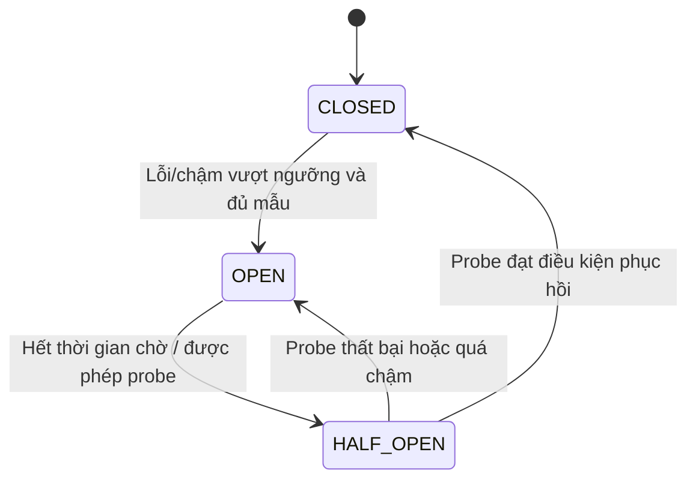
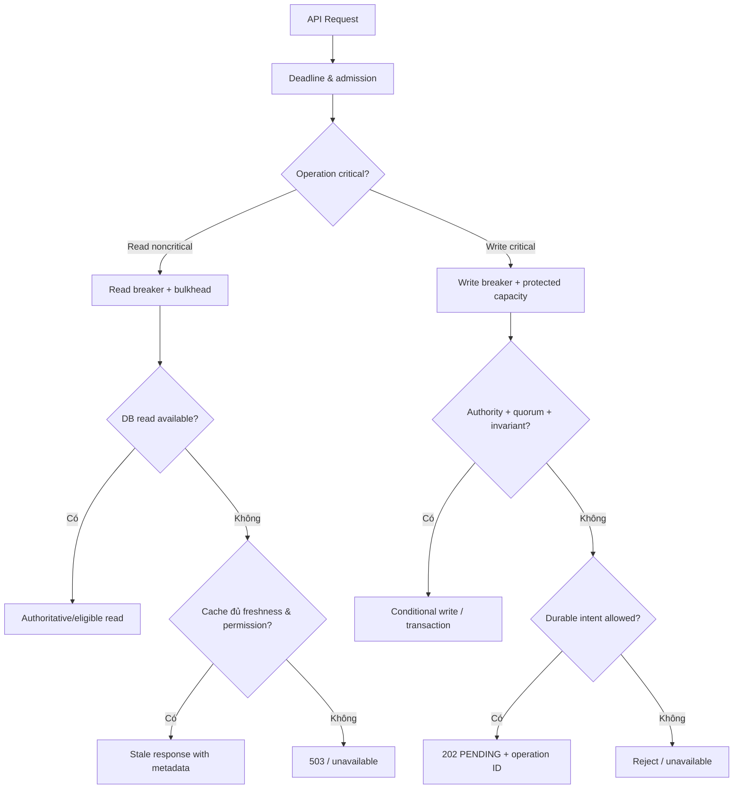

# Circuit breaker, cô lập tài nguyên và phương án suy giảm dịch vụ

Một dịch vụ dùng NoSQL có thể đang phục vụ bình thường thì một replica bắt đầu chậm, leader chuyển vai trò, mạng giữa các availability zone mất ổn định hoặc một partition trở nên quá nóng. Nếu mọi request tiếp tục gọi database, chờ timeout rồi retry không giới hạn, **lỗi của một dependency có thể lan thành sự cố toàn ứng dụng**: connection pool cạn, hàng đợi tăng, CPU dành cho retry, những endpoint không liên quan cũng bị chậm.

Ba nhóm kỹ thuật giúp giới hạn hậu quả là:

1. **Circuit breaker:** tạm ngắt lời gọi tới một dependency đang thất bại hoặc quá chậm, cho phép thử phục hồi có kiểm soát.
2. **Bulkhead (cô lập tài nguyên):** cấp ngân sách concurrency, thread, connection và queue riêng để một dependency hoặc tenant không chiếm hết tài nguyên chung.
3. **Graceful degradation (suy giảm dịch vụ có chủ đích):** khi không thể đáp ứng đầy đủ, vẫn phục vụ những chức năng **được phép** với độ tươi/độ chính xác phù hợp, hoặc trả trạng thái từ chối/tạm chờ rõ ràng.

Ba cơ chế **khác nhau nhưng bổ sung cho nhau**. Breaker mở không thay việc giới hạn concurrency; bulkhead bảo vệ tài nguyên nhưng không biết dữ liệu nào được phép cũ; fallback không được lén bỏ qua bất biến tồn kho, thanh toán hoặc phân quyền.

Bài học thuộc chương **Lỗi phân tán và retry**, module **Database No SQL**. Mục tiêu là thiết kế đường đọc/ghi chịu lỗi cho MongoDB, Cassandra, Redis, DynamoDB và các hệ tương tự bằng cách xác định ranh giới an toàn, ngân sách độ trễ, giới hạn tải, điều kiện fallback và kiểm chứng dưới sự cố.

---

## 1. Từ một database chậm đến sự cố dây chuyền

Giả sử `Order API` xử lý 500 request/s và mỗi request gọi NoSQL với latency bình thường khoảng 40 ms. Đột nhiên một node chậm khiến các lời gọi mất 4 giây mới timeout.

```text
                         +---------------------+
Client requests -------->| Order API           |
                         |                     |
                         | Worker threads      |
                         | Connection pool     |
                         +----------+----------+
                                    |
                                    v
                         NoSQL query bị chậm
                                    |
                     timeout -> retry -> timeout
                                    |
                       queue và in-flight tăng
                                    |
                   endpoints khác cũng thiếu tài nguyên
```

Ngay cả khi `Profile API` chỉ đọc cache và không có lỗi ở backend, nó có thể chậm nếu dùng chung web worker pool hoặc database connection pool với `Order API`.

### 1.1. Vấn đề không chỉ là database thất bại

Có thể xảy ra:

- **Cascading failure:** một phụ thuộc lỗi làm cạn tài nguyên các dịch vụ phía trên.
- **Retry storm:** nhiều client và service cùng retry khiến nguồn lỗi nhận tải lớn hơn.
- **Queue buildup:** arrival rate vượt completion rate, thời gian chờ tăng theo hàng đợi.
- **Thread/connection exhaustion:** toàn bộ worker chờ I/O.
- **Brownout:** hệ vẫn trả một số kết quả nhưng p99 và tỷ lệ lỗi xấu đi đáng kể.
- **Thundering herd:** khi dependency vừa phục hồi, tất cả caller đồng loạt thử lại.
- **Timeout amplification:** nhiều tầng đều chờ gần hết timeout riêng, khiến deadline đầu-cuối vỡ.

Tính sẵn sàng không chỉ được đo bằng **số node còn chạy**. Nó phải gắn với khả năng hoàn thành một operation theo **latency, consistency và correctness contract** của nghiệp vụ.

### 1.2. Ba câu hỏi nên đặt ngay

1. **Lời gọi nào nên ngừng sớm** khi database đang lỗi?
2. **Một nhóm lời gọi lỗi được phép chiếm tối đa bao nhiêu tài nguyên?**
3. **Khi chưa thể thực hiện đúng, API được phép trả kết quả thay thế gì?**

Đó lần lượt là phạm vi của circuit breaker, bulkhead và phương án suy giảm dịch vụ.

---

## 2. Bản đồ các cơ chế chống lỗi

| Cơ chế | Quyết định chính | Ví dụ | Không tự giải quyết |
| --- | --- | --- | --- |
| **Timeout** | Chờ tối đa bao lâu | Read MongoDB tối đa 200 ms theo deadline | Retry storm, tài nguyên bị chiếm trong lúc chờ |
| **Deadline** | Toàn request còn bao nhiêu thời gian | Checkout chỉ có ngân sách tổng 800 ms | Correctness, kết quả ghi không rõ |
| **Retry** | Có nên thử lại lỗi tạm thời | Retry một read transient 1 lần | Lỗi kéo dài, non-idempotent side effects |
| **Circuit breaker** | Có nên gửi lời gọi vào dependency đang lỗi | Từ chối read recommendation trước khi gọi | Tài nguyên của các lời gọi đã vào; correctness |
| **Bulkhead** | Cho tối đa bao nhiêu lời gọi đồng thời | 30 concurrent calls tới search cluster | Nhận biết dependency bị hỏng |
| **Rate limiting** | Nhận bao nhiêu request mỗi khoảng thời gian | 200 requests/s theo tenant | Tail latency từ cuộc gọi chậm |
| **Load shedding** | Request nào bị loại khi quá tải | Trả 503 cho noncritical reads | Tạo ra data chính xác khi nguồn mất |
| **Backpressure** | Làm nguồn phát chậm lại | Consumer giảm tốc khi downstream nghẽn | Sự cố đã xảy ra ở side effect |
| **Fallback/cache** | Trả gì khi nguồn chính không phục vụ | Danh mục từ cache có timestamp | Unique reservation hay thanh toán |
| **Hedging** | Có thử read song song để giảm tail latency? | Thử replica khác khi request chậm | Có thể tăng tải và gây overload |
| **Idempotency** | Retry logical operation có sinh hiệu ứng trùng không? | Cùng `paymentAttemptId` | Dependency outage hoặc saturation |
| **Quorum/replication** | Những bản sao nào phải tham gia đọc/ghi | Majority commit theo protocol | Khả năng tránh cascading failure ở app |

Một hệ bền vững thường dùng **nhiều lớp**, nhưng mỗi lớp phải có một ranh giới nhiệm vụ rõ ràng.

---

## 3. Xác định dependency và phạm vi lỗi

Không nên có một circuit breaker duy nhất cho “mọi thao tác NoSQL”.

Một ứng dụng có thể có:

```text
Product API
  +--> catalog-cache (Redis)
  +--> catalog-db (MongoDB)
  +--> search-index

Booking API
  +--> availability-db
  +--> reservation-writer
  +--> payment-provider

Reporting API
  +--> analytics-store
```

Sự cố `search-index` không nên làm `reservation-writer` bị ngắt. Ngược lại, nếu viết nhiều tên breaker mà tất cả cùng dùng một thread pool nhỏ, **blast radius vẫn không được cô lập**.

### 3.1. Chọn ranh giới breaker

Có thể phân theo:

- Dependency hoặc cluster thực tế.
- Loại operation: read nhanh, aggregation nặng, write quan trọng.
- Region/endpoint nếu đường lỗi độc lập.
- Pool/connection mode.
- SLA và chính sách fallback.
- Tenant tier khi có mức ưu tiên thật sự khác nhau.

Không nhất thiết tạo breaker cho từng customer ID: số lượng breaker quá lớn gây **cardinality explosion**, tiêu tốn bộ nhớ và khiến metric khó theo dõi.

### 3.2. Failure domain khác tên service

Hai API có tên khác nhau có thể dùng **chung MongoDB cluster hoặc chung network link**, vì vậy có correlated failure. Sơ đồ dependency phải thể hiện nguồn lực thật:

```text
Browse API ----+
               +--> mongo-cluster-A --> same AZ network
History API ---+
Checkout API ------> mongo-cluster-B --> payment provider
```

Để bảo vệ tốt, cả breaker và bulkhead cần hiểu **tài nguyên nào có thể cùng lỗi**.

---

## 4. Circuit breaker là gì?

Circuit breaker lấy ý tưởng từ cầu dao điện: khi một phụ thuộc có dấu hiệu không đáp ứng, hệ **ngừng gửi thêm nhiều request vô ích** trong một khoảng thời gian, rồi thử phục hồi có kiểm soát.

Ba trạng thái điển hình:

- **CLOSED:** cho phép lời gọi; thống kê thành công/lỗi/độ chậm trong một cửa sổ.
- **OPEN:** từ chối nhanh lời gọi thông thường; không gửi đến dependency.
- **HALF_OPEN:** chỉ cho một số request thăm dò; dựa vào kết quả để đóng lại hoặc mở tiếp.



### 4.1. CLOSED không có nghĩa dependency khỏe tuyệt đối

Một số request có thể lỗi mà breaker vẫn CLOSED; chỉ khi **một chính sách thống kê** đạt điều kiện, nó mới mở.

### 4.2. OPEN không đồng nghĩa “đã sửa lỗi”

OPEN chỉ có nghĩa caller **chủ động không thử nữa** trong giai đoạn đó để giảm áp lực và trả phản hồi nhanh. Dependency có thể vẫn lỗi hoặc đã phục hồi, nhưng breaker chưa kiểm tra lại.

### 4.3. HALF_OPEN phải giới hạn probe

Nếu 1.000 caller đồng thời thấy breaker hết thời gian OPEN và cùng gọi database, ta tạo **thundering herd** ngay lúc database mới phục hồi. HALF_OPEN chỉ nên cho một số lượng probe có kiểm soát.

### 4.4. Circuit breaker thường nằm ở caller

Một breaker ở từng API instance quan sát request của instance đó. Không mặc nhiên có **một trạng thái breaker toàn cụm**. Một số hệ dùng trạng thái tập trung, nhưng phải cân nhắc độ trễ, độ bền và tránh chính coordination service trở thành dependency mới.

---

## 5. Ngưỡng mở breaker: không chỉ đếm lỗi tuyệt đối

Một policy có thể tính:

\[
\text{FailureRate}
=
\frac{\text{số lời gọi được ghi nhận là lỗi}}
     {\text{tổng lời gọi đủ điều kiện thống kê}}.
\]

Ví dụ **minh họa**:

- Cửa sổ gần nhất có 40 calls.
- Đủ ít nhất 20 calls mới được xét mở.
- Trong 40 calls có 22 lỗi.
- Failure rate = 55%.
- Ngưỡng mở đặt tại 50%.

Khi các điều kiện khác đều phù hợp, breaker có thể chuyển sang OPEN.

### 5.1. Cửa sổ theo số gọi hoặc thời gian

- **Count-based:** xét N lời gọi gần nhất.
- **Time-based:** xét các lời gọi trong khoảng thời gian gần đây.

Nếu traffic rất thấp, một cửa sổ thời gian có thể có 2 requests, 1 lỗi; tỷ lệ 50% **không đủ cơ sở** để kết luận dependency lỗi diện rộng. Vì vậy cần *minimum call count* hoặc guard riêng.

### 5.2. Failure rate và slow-call rate

Database có thể vẫn trả `200 OK` nhưng mất 10 giây. Nếu chỉ đếm exceptions, breaker không mở dù toàn bộ thread đã bị chiếm.

Một số circuit breaker hỗ trợ **slow-call rate**:

\[
\text{SlowRate}
=
\frac{\text{số lời gọi vượt ngưỡng độ trễ}}
     {\text{số lời gọi được đo}}.
\]

Cần chọn ngưỡng theo SLO, timeout và đường thao tác; không áp một ngưỡng 200 ms cho cả point read và batch analytics.

### 5.3. Không dùng ngưỡng trong ví dụ làm chuẩn production

Số 20 calls, 50% hay 10 giây chỉ để minh họa thuật toán. Ngưỡng thực phụ thuộc **khối lượng traffic, độ chậm bình thường, hậu quả khi OPEN và thời gian phục hồi dependency**.

---

## 6. Phân loại lỗi: lỗi nào nên làm breaker mở?

Không phải mọi response không thành công đều chứng minh dependency đang hỏng.

| Kết quả | Có nên tính là dependency failure? | Lý do |
| --- | --- | --- |
| Network timeout/connect failure | Thường có | Có thể mất mạng hoặc dependency quá chậm |
| Connection reset liên tiếp | Thường có | Dấu hiệu đường kết nối lỗi |
| Server unavailable/overloaded | Thường có | Có thể cần giảm tải |
| Quorum unavailable | Tùy operation, thường quan trọng | Chưa đủ điều kiện phục vụ mức consistency yêu cầu |
| DB read deadline exceeded | Thường có | Tail latency/SLO bị vi phạm |
| Rate limit/throttling của provider | Cần policy riêng | Đây có thể là tín hiệu giảm tốc, không phải node hỏng |
| `NOT_FOUND` hợp lệ | Thường không | Kết quả nghiệp vụ bình thường |
| Validation error | Không | Dữ liệu đầu vào sai, không phải dependency outage |
| Unique-key conflict dự kiến | Không | Bất biến đang hoạt động đúng |
| Hết tồn kho / booking conflict | Không | Kết quả nghiệp vụ bình thường |
| Unauthorized do token sai | Không | Không phải lỗi availability của database |
| Worker bị bulkhead từ chối | Thường không tính vào breaker của DB | Request chưa đến dependency |
| Breaker tự trả `OPEN` | Không đếm như lỗi DB mới | Tránh vòng lặp tự khuếch đại |

### 6.1. 429 và throttling không nên được xử lý mù

Với dịch vụ NoSQL có quota hoặc throughput giới hạn, response throttling có thể yêu cầu **giảm tốc độ, backoff có jitter và điều chỉnh capacity**. Mở breaker hoàn toàn có thể phù hợp trong một số overload policy, nhưng cũng có thể khiến request hợp lệ bị chặn khi chỉ một nhóm tenant vượt quota.

Nên phân biệt **quota chung, quota theo partition, theo tenant và lỗi thực của provider**.

### 6.2. Đối với write, lỗi có thể có kết quả không rõ

Một write timeout có thể đã được áp dụng tại nguồn. Breaker có thể mở để hạn chế request mới, nhưng kết quả write trước đó phải được giải quyết bằng **idempotency/đối soát**, không tự chuyển thành `FAILED` hoặc gửi lại bằng ID mới.

---

## 7. Thiết kế HALF_OPEN và phục hồi

Giả sử breaker đã OPEN do mất kết nối một replica group. Sau 20 giây, hệ cho 2 probes.

```text
OPEN
  |
  | hết wait duration
  v
HALF_OPEN
  +--> Probe A
  +--> Probe B
  +--> Các request khác được reject/fallback
  |
  +--> Đủ điều kiện thành công -> CLOSED
  +--> Có lỗi/slow theo policy -> OPEN
```

### 7.1. Không dùng probe gây tác động không thể đảo ngược

Một probe không nên là lệnh **capture payment thật** hoặc cấp ghế mới thiếu idempotency. Ưu tiên operation an toàn/read-only hoặc request đã có ID và logic phù hợp.

### 7.2. Health check quá nhẹ có thể không đại diện

`PING` database có thể thành công trong khi query dùng index nóng vẫn timeout hoặc majority write không đạt quorum. Probe cần phản ánh **đường phục vụ cần bảo vệ**, nhưng không gây tải lớn.

### 7.3. Hysteresis và backoff khi recovery

Nếu dependency chập chờn:

```text
CLOSED -> OPEN -> HALF_OPEN -> OPEN -> ...
```

Có thể tăng thời gian OPEN khi nhiều lần phục hồi thất bại, thêm jitter để nhiều API instances không cùng probe tại một thời điểm.

### 7.4. Khi nào đóng breaker?

Không chỉ một ping trả 200. Nên dựa trên **đủ mẫu probe và thời gian chấp nhận được**, có thể mở traffic dần sau khi CLOSED.

---

## 8. Circuit breaker không phải rate limiter

Breaker dựa vào **sức khỏe quan sát được** để tạm ngừng gọi; rate limiter dựa vào **ngân sách tần suất**.

Ví dụ:

- Database khỏe nhưng tenant gửi 10.000 requests/s vượt quota → rate limiter/load shedding cần hoạt động; breaker không phải cơ chế chính.
- Database đang mất quorum, chỉ có 100 requests/s → breaker có thể ngăn timeout kéo dài dù QPS thấp.

### 8.1. Breaker có thể làm dependency khỏe hơn nhưng chưa đủ

Khi OPEN, số calls đến DB giảm. Tuy nhiên **những lời gọi đã được gửi trước khi OPEN** vẫn có thể đang chờ trong connection pool và giữ tài nguyên.

### 8.2. Breaker cũng không giới hạn queue

Nếu 5.000 requests đang chờ *trước* khi kiểm tra breaker, hệ vẫn có thể nghẽn. Cần **admission control, bounded queue và bulkhead** ở phía caller.

---

## 9. Deadline và timeout: lớp bảo vệ đầu tiên

Một **timeout** giới hạn thời gian chờ của một operation. Một **deadline** là thời điểm cuối cùng mà toàn bộ request phải hoàn thành theo hợp đồng.

Ví dụ:

```text
Checkout API deadline: 800 ms
  |-- auth step
  |-- inventory validation
  |-- database write
  |-- response serialization
```

Nếu mỗi bước đều có timeout 800 ms riêng, tổng latency có thể lớn hơn deadline nhiều lần.

### 9.1. Phân bổ ngân sách độ trễ

Một cách hoạch định:

\[
T_{\text{overall}} \ge
T_{\text{auth}}+
T_{\text{db}}+
T_{\text{serialization}}+
T_{\text{network buffer}}.
\]

Đây là **ngân sách tuần tự gần đúng**. Nếu có các bước song song, phải xét nhánh chậm nhất và overhead; không cộng thô mọi thao tác.

### 9.2. Dùng remaining deadline

Trước lời gọi NoSQL, lấy:

\[
T_{\text{remaining}}
=
T_{\text{deadline}}
-
T_{\text{now}}.
\]

Nếu chỉ còn 50 ms trong khi query thường cần 150 ms, có thể **từ chối sớm** hoặc đi fallback phù hợp, thay vì khởi động một query chắc chắn khó kịp.

### 9.3. Timeout client không chắc hủy server work

Client ngừng chờ không có nghĩa server đã ngừng query, write hoặc external side effect. Cần dùng cơ chế cancellation/deadline của driver/database phù hợp, đồng thời giới hạn concurrency.

### 9.4. Timeouts cần xét nhiều tầng

- Connection establishment timeout.
- Connection pool acquisition timeout.
- Socket/read timeout.
- Server-side query execution time limit nếu hỗ trợ.
- Total request deadline.
- Transaction/commit deadline và semantics khi unknown outcome.

Không dùng **một timeout dài** thay cho thiết kế toàn bộ đường gọi.

---

## 10. Retry phải có ngân sách, không phải phản xạ mặc định

Retry phù hợp với lỗi tạm thời, nhưng có thể khiến sự cố nặng hơn khi backend đã quá tải.

Một chính sách có thể gồm:

- Retry chỉ với các lỗi được xem là transient.
- Số attempts tối đa theo **end-to-end budget**.
- Exponential backoff và jitter.
- Dừng retry khi hết deadline.
- Không retry khi circuit OPEN trừ probe được kiểm soát.
- Không retry write non-idempotent khi chưa giải quyết outcome.
- Rate budget chung để tránh nhiều tầng retry.

### 10.1. Backoff cấp số nhân

Với base delay \(b\) và lần retry thứ \(k\):

\[
d_k = \min(d_{\max}, b \times 2^k).
\]

Thêm jitter để request từ nhiều client không đồng bộ thành một đợt.

```text
Lỗi -> chờ ngẫu nhiên -> retry cùng logical ID
                      -> nếu không còn deadline: dừng
```

Các thông số cần dựa trên tính chất workload và timeout; không được hiểu một công thức delay là bảo đảm recovery.

### 10.2. Retry amplification

Nếu mỗi tầng trong chuỗi 3 tầng đều thực hiện tối đa 3 attempts, một logical request trong tình huống xấu có thể tạo tới:

\[
3 \times 3 \times 3 = 27
\]

lần gọi ở tầng sâu, tùy cách thực thi.

Vì thế cần **một chính sách retry có phối hợp** thay vì để HTTP client, service mesh, driver và worker mỗi bên retry độc lập.

### 10.3. Retry budget thay vì chỉ max attempts

Một thiết kế có thể dành tối đa \(r\%\) traffic cho retry, theo thời gian và dependency, nhằm ngăn retry trở thành phần lớn tải lúc lỗi.

### 10.4. Retries trong driver

MongoDB, Cassandra và các SDK cloud có những retry policy/driver behavior riêng theo loại thao tác. Trước khi thêm retry ở tầng ứng dụng, phải hiểu **driver đã retry điều gì và theo semantics nào**.

**Không tự viết vòng lặp gửi lại lệnh `$inc` hoặc capture tiền mà không có idempotency.**

---

## 11. Thứ tự phối hợp breaker, retry, timeout và bulkhead

Một pipeline khái niệm:

```text
HTTP request
    |
    v
Deadline còn thời gian?
    |
    v
Admission / rate limit
    |
    v
Circuit breaker: OPEN? -> fallback/reject
    |
    v
Bulkhead: còn permit/slot? -> reject nhanh
    |
    v
Dependency call với timeout hữu hạn
    |
    +--> success
    |
    +--> transient failure -> retry policy có budget
    |
    +--> unknown write outcome -> lookup/idempotent resolution
```

### 11.1. Thứ tự wrapper có thể ảnh hưởng semantics

Một thư viện có thể đặt breaker **bọc ngoài** toàn bộ retry hoặc đếm lỗi cho **từng attempt** bên trong retry. Hai cách làm thống kê khác nhau:

- Breaker đếm kết quả cuối của logical request.
- Breaker đếm từng attempt riêng lẻ.

Không có một thứ tự universal, nhưng phải **chọn có chủ đích** và đo đúng đối tượng.

### 11.2. Bulkhead nên giới hạn attempts thực sự chiếm tài nguyên

Nếu retry giữ permit trong suốt thời gian sleep backoff, nó có thể chiếm slot không cần thiết. Nếu nhả permit giữa các attempts, cần bảo vệ để tổng số attempts đang chạy không vượt giới hạn.

### 11.3. Không để fallback tự gọi ngược dependency đang OPEN

Một fallback đọc “cache” nhưng cache miss lại tự động gọi chính NoSQL đang lỗi thì breaker chỉ che được bề ngoài. Cần rõ **dependency graph của fallback**.

### 11.4. Hạn chế recursive fallback

```text
Database fails
  -> Cache fallback fails
      -> Search fallback calls database again
          -> ...
```

Một đường suy giảm an toàn cần **điểm dừng** và giới hạn độ sâu, không gọi vòng tròn.

---

## 12. Bulkhead: cô lập tài nguyên như các khoang kín

Tên *bulkhead* đến từ vách ngăn của tàu: một khoang ngập nước không khiến mọi khoang còn lại cùng chìm.

Trong ứng dụng, bulkhead giới hạn số concurrent operations hoặc tài nguyên cho một dependency.

```text
API Server
+------------------------------------------------+
| Pool A: Product reads       max 40 concurrent   |
| Pool B: Booking writes      max 20 concurrent   |
| Pool C: Analytics queries   max 4 concurrent    |
+------------------------------------------------+
                |               |           |
                v               v           v
           Catalog DB      Booking DB    Analytics
```

Nếu Analytics đứng chờ rất lâu, tối đa 4 operations giữ tài nguyên dành cho nó; đường booking vẫn còn ngân sách.

### 12.1. Hai dạng phổ biến

1. **Semaphore bulkhead:** chỉ cho tối đa N operation đồng thời đi vào một nhóm công việc.
2. **Thread-pool/worker bulkhead:** có executor và queue riêng, giới hạn worker threads và hàng chờ.

### 12.2. Semaphore không tự áp timeout

Một semaphore giới hạn số operation được phép chạy, nhưng nếu operation bị kẹt mãi thì permit cũng bị giữ mãi. Cần timeout/cancellation, finally-release và giám sát stuck calls.

### 12.3. Thread pool cũng không tự giải phóng I/O

Interrupting một thread không chắc dừng query server, socket I/O hoặc external side effect. Cần driver hỗ trợ cancellation và deadline riêng.

---

## 13. Little's Law: vì sao latency kéo concurrency tăng vọt?

Với hệ ổn định trong một khoảng quan sát, **Little's Law**:

\[
L = \lambda W
\]

Trong đó:

- \(L\): số request trung bình đang ở trong hệ.
- \(\lambda\): tốc độ request hoàn tất/đến trong điều kiện ổn định.
- \(W\): thời gian trung bình request ở trong hệ.

Giả sử endpoint xử lý 200 request/s, mỗi request giữ một slot DB trung bình 0,15 giây:

\[
L = 200 \times 0.15 = 30
\]

khoảng 30 lời gọi in-flight trung bình.

Nếu latency tăng lên 2 giây nhưng arrival vẫn 200 request/s, số lời gọi cần giữ để không có queue có thể lên tới:

\[
L = 200 \times 2 = 400.
\]

Đây là **mô hình hoạch định**, không phải bảo đảm arrival vẫn ổn định khi đã quá tải. Trong thực tế pool thường chạm giới hạn trước, khiến queue và timeout bùng lên.

### 13.1. Một bulkhead 40 slots

Nếu cho tối đa 40 DB calls đồng thời, khi dependency chậm, các calls tiếp theo sẽ:

- Đợi trong queue **có giới hạn** hoặc
- Bị từ chối sớm theo chính sách.

Dù nhiều request nhận phản hồi `503/BUSY`, hệ tránh việc **mọi thread đều treo**, giúp các tính năng khác còn hoạt động.

### 13.2. Vì sao giới hạn quá thấp cũng có hại?

Nếu DB khỏe và workload cần 100 concurrent calls để đạt SLO, một limit 20 có thể tự gây bottleneck. Phải điều chỉnh theo **latency bình thường, capacity, traffic burst và mục tiêu foreground**, không chọn số permit ngẫu nhiên.

---

## 14. Java: semaphore bulkhead tối giản

Ví dụ bằng Java chuẩn, minh họa **giới hạn concurrency**, chưa phải thư viện resilience hoàn chỉnh.

```java
import java.util.Objects;
import java.util.concurrent.Callable;
import java.util.concurrent.RejectedExecutionException;
import java.util.concurrent.Semaphore;

public final class DependencyBulkhead {
    private final Semaphore permits;

    public DependencyBulkhead(int maxConcurrentCalls) {
        if (maxConcurrentCalls <= 0) {
            throw new IllegalArgumentException("maxConcurrentCalls > 0");
        }
        this.permits = new Semaphore(maxConcurrentCalls, true);
    }

    public <T> T call(Callable<T> action) throws Exception {
        Objects.requireNonNull(action, "action");

        if (!permits.tryAcquire()) {
            throw new RejectedExecutionException(
                "Dependency bulkhead is full"
            );
        }

        try {
            return action.call();
        } finally {
            permits.release();
        }
    }

    public int availablePermits() {
        return permits.availablePermits();
    }
}
```

Sử dụng minh họa:

```java
DependencyBulkhead catalogBulkhead =
    new DependencyBulkhead(32);

try {
    Product product = catalogBulkhead.call(
        () -> catalogRepository.findById("sku-1")
    );
    // Trả product cho người gọi.
} catch (RejectedExecutionException overloaded) {
    // Chỉ dùng cache nếu business contract cho phép stale.
}
```

Các kiểu `Product`, `catalogRepository` là placeholder của ứng dụng; đoạn bulkhead là Java độc lập có thể tái dùng.

### 14.1. Giới hạn của ví dụ

- `tryAcquire()` không đợi, vì muốn **fail fast**.
- Nếu `action.call()` treo vô hạn, permit vẫn bị giữ cho tới khi nó thoát.
- Fair semaphore giúp giảm một số dạng starvation nhưng không đảm bảo fairness cấp tenant.
- Không có metric/retry/circuit breaker/timeout tích hợp.
- Không quản lý một executor/connection pool bên ngoài.
- Bị từ chối bởi bulkhead không nên tự tính là lỗi mới của database.

Một bản production cần instrumentation và deadline/cancellation ở driver/request.

---

## 15. Connection pool, queue và thread pool cần được cách ly cùng nhau

Một sai lầm là tạo ba semaphore khác nhau nhưng tất cả cùng sử dụng một **connection pool duy nhất 10 connections**. Khi analytics chiếm hết connections, booking vẫn có thể đứng chờ.

### 15.1. Cô lập thực sự

Cần xét đồng thời:

- Worker threads/executor.
- Connection pool theo dependency/role.
- Queue depth và thời gian đợi permit.
- Heap/cache memory.
- Backend read/write capacity.
- Network egress/ingress.
- Hạn mức tenant/service.
- Đường request synchronization.

### 15.2. Unbounded queue là rủi ro

Một executor có 8 workers nhưng queue không giới hạn sẽ nhận thêm hàng chục nghìn tasks, tiêu tốn bộ nhớ và tạo phản hồi rất muộn.

Cấu hình cần giới hạn:

```text
Max active calls: 8
Max waiting requests: 20
Queue wait timeout: 50 ms
On full: reject with explicit outcome
```

Đây là **policy minh họa**. Số thực phụ thuộc capacity và SLO.

### 15.3. Bounded queue vs no queue

- **No queue:** phản hồi sớm khi đủ concurrency; thích hợp deadline ngắn.
- **Small bounded queue:** hấp thụ burst nhỏ; cần timeout hàng đợi.
- **Large queue:** chỉ phù hợp khi workload thực sự cho phép trì hoãn và có bền dữ liệu/điều phối; không dùng làm giải pháp mặc định cho synchronous API.

---

## 16. Bulkhead theo tenant và mức ưu tiên

Một tenant lớn có thể tạo phần lớn read requests và chiếm pool chung, khiến tenant nhỏ bị chậm.

### 16.1. Tách lớp dịch vụ

```text
Database capacity budget
    |
    +-- Critical writes
    +-- Normal interactive reads
    +-- Low-priority analytics
    +-- Background maintenance
```

Nếu mỗi nhóm có ngân sách rõ ràng, một batch analytics bất thường khó làm đường thanh toán ngừng hoạt động.

### 16.2. Không tạo hàng triệu pools theo ID

Per-tenant bulkheads quá chi tiết có thể gây bùng nổ số semaphore/pool và khó quản lý. Có thể dùng:

- Tier-level pools.
- Weighted fair queue.
- Per-tenant rate limiting.
- Shared pool với reservation cho critical traffic.
- Dedicated resources cho tenants đặc biệt lớn.

### 16.3. Bảo vệ quyền truy cập ngay cả khi fallback

Một tenant bị cô lập về tài nguyên không đồng nghĩa dữ liệu được phép trộn: khi cache fallback, key phải chứa **tenant scope và authorization context** đúng, tránh cross-tenant leakage.

---

## 17. Load shedding: từ chối sớm để bảo vệ phần còn lại

Khi hệ đang ở sát giới hạn, tiếp nhận thêm request có thể làm **mọi request** thất bại. *Load shedding* chủ động bỏ hoặc từ chối một phần tải theo policy.

Ví dụ:

```text
Inbound requests
       |
       v
Admission controller
       |
       +--> Critical booking writes -> reserved capacity
       |
       +--> Catalog read -> normal capacity
       |
       +--> Analytics export -> reject/defer when overloaded
```

### 17.1. Các kiểu phản hồi

| Bối cảnh | Phản hồi có thể phù hợp |
| --- | --- |
| HTTP API bị quá tải tạm thời | `503 Service Unavailable` và hướng dẫn retry phù hợp |
| Client vượt quota/rate limit | `429 Too Many Requests` nếu phù hợp |
| Đã lưu ý định xử lý bền, chưa hoàn tất | `202 Accepted` với operation ID và trạng thái `PENDING` |
| Dữ liệu cache đủ điều kiện fallback | `200` với metadata `stale`/`lastUpdated` nếu hợp đồng cho phép |
| Quyết định quan trọng không có quorum | Từ chối/`PENDING`, **không trả xác nhận giả** |

### 17.2. `202 Accepted` phải có ý nghĩa thật

Không nên trả `202` chỉ vì một queue trong RAM đang giữ request có thể mất khi process crash. Nếu cam kết sẽ xử lý sau, cần **durable job/outbox, operation ID, retry và đường truy vấn trạng thái**.

### 17.3. Không loại request ngẫu nhiên khi có phân loại ưu tiên

Nếu các thao tác giữ kho, thanh toán, thu hồi quyền và tải ảnh đại diện dùng chung quota, nên xác định **độ ưu tiên và rủi ro** thay vì ngẫu nhiên bỏ đều tất cả.

---

## 18. Phương án suy giảm dịch vụ là một hợp đồng nghiệp vụ

*Graceful degradation* không phải “gặp lỗi thì trả dữ liệu gì đó”. Nó là lựa chọn được chấp thuận trước về **những phần có thể tạm ngừng, dữ liệu được phép cũ và phản hồi cần giải thích gì cho người dùng**.

### 18.1. Một ma trận cho ứng dụng thuê xe

| Tính năng | Khi phụ thuộc lỗi | Phương án suy giảm | Điều không được làm |
| --- | --- | --- | --- |
| Danh mục xe | Search index chậm | Trả cached listings và thời điểm cập nhật | Khẳng định xe chắc chắn còn |
| Gợi ý xe | Recommendation DB lỗi | Ẩn mục gợi ý hoặc dùng danh sách phổ biến | Chặn toàn bộ trang đặt xe |
| Hình ảnh | Object storage/CDN chậm | Placeholder/thumbnail cũ nếu được phép | Làm thay đổi quyền truy cập ảnh |
| Lịch sử chuyến đi | Read replica lag | Dùng read phù hợp session hoặc hiển thị “đang cập nhật” | Trả lịch sử sai mà không kiểm soát |
| Giữ xe | Reservation authority/quorum lỗi | Trả `PENDING/UNAVAILABLE` | Xác nhận hai khách cùng giữ một xe |
| Thanh toán | Provider timeout | Trả `PAYMENT_UNKNOWN`, tra cứu/đối soát | Tạo payment mới khi chưa rõ kết quả |
| Thu hồi quyền | Authorization source lỗi | Fail closed cho hành động nhạy cảm | Tin quyền cũ không thời hạn |
| Thống kê | Analytics DB lỗi | Hiển thị báo cáo gần nhất kèm watermark | Công bố là số liệu real-time |

Cấu trúc suy giảm nên được xác định **theo endpoint và operation**, không phải theo lựa chọn “fallbackOnAnyError” toàn ứng dụng.

---

## 19. Fail-open và fail-closed phải được hiểu đúng

Hai từ dễ bị dùng thiếu chính xác:

- **Fail-open:** khi bộ phận kiểm tra không sẵn sàng, hệ vẫn cho phép một hành động hoặc hiển thị dữ liệu theo chính sách.
- **Fail-closed:** không thể xác minh điều kiện cần thiết thì từ chối hoặc giữ trạng thái chưa xác nhận.

### 19.1. Khi fail-open có thể hợp lý

- Hiển thị banner marketing từ cache khi recommendation service lỗi.
- Cho người dùng đọc tài liệu công khai được cache hợp lệ.
- Bỏ qua một bước analytics phụ trợ khi tạo đơn.
- Cho hệ ghi telemetry vào buffer bền hoặc tạm giảm sampling nếu policy chấp nhận.

### 19.2. Khi fail-closed thường cần thiết

- Không thể xác minh quyền xóa dữ liệu nhạy cảm.
- Không thể kiểm tra ghế duy nhất trước xác nhận booking.
- Không thể xác thực hạn mức/quota cứng trước cấp phát.
- Không thể xác định payment đã capture hay chưa trước retry tạo charge mới.
- Không thể xác minh trạng thái lệnh giao hàng trước khi thực hiện tác động không thể đảo ngược.

### 19.3. Fail-closed không có nghĩa đánh mất trải nghiệm

API có thể trả:

```json
{
  "operationId": "booking-123",
  "status": "PENDING_VERIFICATION",
  "message": "Chưa thể xác nhận đặt xe lúc này"
}
```

Điều cốt lõi là **không công bố một kết quả mà hệ chưa đủ bằng chứng để bảo đảm**.

---

## 20. Cache fallback: dùng stale data có điều kiện

Đọc cache khi database không phục vụ có thể giúp trang danh mục vẫn hoạt động, nhưng dữ liệu cũ cần giới hạn.

### 20.1. Phân biệt ba kiểu cache

1. **Read-through:** cache miss có thể gọi database để lấy dữ liệu.
2. **Write-through/write-behind:** cập nhật cache cùng hoặc sau write theo policy.
3. **Stale-while-revalidate:** trả bản cũ trong một cửa sổ cho phép và làm mới nền.

Mỗi loại có failure semantics khác nhau. Khi database breaker OPEN, một read-through cache miss **không được vô thức gọi lại database đang OPEN**.

### 20.2. Freshness budget

Một policy ví dụ:

```yaml
# Hợp đồng ứng dụng minh họa, không phải cấu hình Redis/MongoDB.
endpoint: GET /catalog/public
fallback:
  source: cache
  max_staleness_seconds: 120
  require_tenant_scope: true
  return_last_updated: true
  on_cache_miss: 503
```

120 giây là **giá trị giả định của sản phẩm**, không phải khuyến nghị chung.

### 20.3. TTL không tự chứng minh dữ liệu mới

Một cache entry TTL 120 giây có thể được refresh từ **replica vốn đã stale**, hoặc được viết với timestamp sai. Để thực thi freshness chính xác cần biết **mốc commit/version/watermark có thẩm quyền** và cách tính độ trễ.

### 20.4. Cache phục vụ UI, không phải cấp phát tài nguyên

Một trang hiển thị “còn 1 chiếc” từ cache có thể được chấp nhận nếu API booking luôn kiểm tra bằng **atomic conditional write tại nguồn có thẩm quyền**. Không được dựa vào cache stale để xác nhận tồn kho.

---

## 21. NoSQL replica fallback: giảm consistency có được không?

Khi primary không phục vụ, một ý tưởng là đổi mọi read sang secondary, hoặc giảm read/write consistency level để hệ vẫn trả kết quả.

**Đây là quyết định nghiệp vụ, không phải tối ưu kỹ thuật thuần túy.**

### 21.1. Các câu hỏi trước khi hạ consistency

- Read có cần **read-your-writes** không?
- Người dùng đã nhìn version mới có được thấy version cũ hơn?
- Dữ liệu liên quan đến quyền truy cập, tài chính hoặc đặt hàng?
- Khi một replica stale, UI có giải thích được?
- Mức nhất quán thấp hơn có thể làm **mất khả năng kiểm tra bất biến**?
- Khi nhận write ở minority, hệ có thể sinh split brain hoặc rollback?
- Sản phẩm/driver có thật sự hỗ trợ mode đó trong topology hiện tại?

### 21.2. Không hạ write concern một cách âm thầm

Nếu hệ cam kết mọi order xác nhận phải đạt mức durability/quorum nhất định, khi thiếu quorum **không được tự đổi từ majority sang ACK yếu** để trả `CONFIRMED` trông đẹp.

Điều này có thể thay đổi RPO, khả năng rollback và độ tin cậy của order đã xác nhận.

### 21.3. Đọc từ secondary có thể hợp lệ cho một số endpoint

Danh mục, recommendation và analytics có thể chấp nhận eventual reads nếu đã có SLO rõ. Nhưng số dư, dữ liệu sau write, phân quyền và workflow trạng thái có thể cần đường đọc khác.

**Fallback nhất quán phải được định nghĩa theo dữ liệu, không chỉ bằng `catch(Exception)`.**

---

## 22. MongoDB: breaker không thay read/write concern và transaction

MongoDB replica set có primary/secondary, read preference, read concern và write concern theo khả năng cấu hình. Những khái niệm này giải quyết **ngữ nghĩa đọc/ghi**; circuit breaker giải quyết **cách caller phản ứng khi lời gọi thất bại hoặc chậm**.

### 22.1. Một write quan trọng

Ví dụ `mongosh` về giữ hàng bằng điều kiện:

```javascript
const lab = db.getSiblingDB("resilience_lab");

lab.inventory.updateOne(
  {
    _id: "sku-1",
    available: { $gte: 1 }
  },
  {
    $inc: { available: -1 }
  },
  {
    writeConcern: { w: "majority" }
  }
);
```

Điều kiện `available >= 1` bảo vệ bất biến trong phạm vi document. Write concern majority là **mức xác nhận**. Breaker **không thể thay thế** một trong hai.

### 22.2. Khi không đủ quorum để ghi

Một ứng dụng có thể:

- Dừng chấp nhận xác nhận mới.
- Ghi một **yêu cầu chờ xử lý** nếu có một nơi lưu bền độc lập với cơ chế quyền ghi rõ ràng.
- Trả `503` hoặc `PENDING` theo hợp đồng API.
- Kiểm tra lại những write có kết quả không rõ khi cluster phục hồi.

Không được cho rằng `PENDING` đồng nghĩa đã được bền nếu chỉ được giữ trong bộ nhớ process.

### 22.3. Secondary reads

Read preference cho phép đọc từ secondary trong những điều kiện hỗ trợ, nhưng secondary có thể bị lag. Cần chọn read concern/session behavior phù hợp với *freshness* của endpoint.

### 22.4. Query nặng làm pool nghẽn

Một aggregation báo cáo dài nên có **bulkhead/connection resources và server-side time limit phù hợp** để không cạnh tranh không giới hạn với checkout. Nếu mỗi báo cáo chiếm connection lâu, chỉ breaker không đủ.

---

## 23. Cassandra: consistency level, timeout và overload

Cassandra có consistency levels như `ONE`, `LOCAL_QUORUM` và những mức khác theo model/version. Không nên coi giảm từ `LOCAL_QUORUM` xuống `ONE` là fallback vô hại.

### 23.1. Read eventual cho dữ liệu ít quan trọng

Một bảng gợi ý có thể được đọc ở mức cho phép trong phạm vi SLA. Khi cluster suy giảm, caller có thể ngắt nhanh và trả read model/cache thay thế.

### 23.2. Ghi cấp phát tài nguyên

Nếu quota, reservation hoặc một bất biến cứng cần conditional write/LWT hay một authority cụ thể, một read consistency thấp không thay thế được precondition tại điểm ghi.

### 23.3. Timeout có thể đến từ overload

Cassandra read/write timeout có thể do node lỗi, mạng, compaction, hot partition hoặc replica không phản hồi đúng hạn. Breaker theo cluster có thể giúp giảm tải caller, nhưng cần xem **request nào/hot partition nào** gây quá tải để không chặn toàn bộ cluster chỉ vì một khóa nóng.

### 23.4. Bulkhead cho range scans/analytics

Quét phân tán hoặc query thiếu partition key có thể tạo tải lớn. Nên cô lập job đọc nặng, giới hạn concurrency và bảo đảm query đáp ứng mô hình phân vùng; không dựa vào circuit breaker để sửa schema khiến query phải scan rộng.

---

## 24. Redis: cache lỗi và rủi ro fallback ngược

Một mô hình phổ biến:

```text
Client -> Redis cache -> MongoDB source
```

### 24.1. Redis lỗi

Nếu Redis gặp lỗi, một fallback tưởng chừng hợp lý là **mọi request đều đọc thẳng MongoDB**. Nhưng khi 20.000 QPS vốn được cache hấp thụ cùng đổ vào MongoDB, nguồn dữ liệu có thể quá tải.

Đây là **cache avalanche**.

### 24.2. Cách bảo vệ

- Bulkhead/rate limit cho đường cache-miss-to-DB.
- Stale local cache có giới hạn nếu dữ liệu cho phép.
- Single-flight/request coalescing theo key để tránh nhiều concurrent misses.
- TTL jitter tránh nhiều key hết hạn đồng thời.
- Backpressure và load shedding khi DB gần ngưỡng.
- Giới hạn cache warm-up/concurrency sau khi Redis phục hồi.

### 24.3. Single-flight là gì?

Nếu 500 request cùng đọc `product:123` sau cache miss:

```text
500 callers
    |
    v
1 backend fetch (trong phạm vi một coalescing group)
    |
    +--> cùng chia sẻ kết quả cho callers đang chờ
```

Cần timeout và giới hạn waiters; không biến một fetch chậm thành nơi mọi thread treo vô hạn.

### 24.4. Redis là nguồn dữ liệu chính?

Nếu Redis được dùng cho session/quota/lock chứ không chỉ cache, policy fallback phải dựa trên **semantics của dữ liệu đó**. Không mặc định mọi dữ liệu Redis có thể bị bỏ qua hoặc dùng cache cũ.

---

## 25. DynamoDB và managed NoSQL: throttling không đồng nghĩa service chết

Một dịch vụ managed có thể trả throttling khi vượt capacity hoặc do một hot partition.

### 25.1. Phân biệt sự cố

- Capacity/throttling theo key hoặc table.
- Request transient network failure.
- Internal service error.
- Validation/conditional check failure.
- Account quota hoặc concurrency limit.
- Một vùng đang lỗi.
- Global table/read replica lag nếu sử dụng đa vùng.

### 25.2. Phản ứng phù hợp

- Giới hạn request rates và concurrency theo resource.
- Retry có backoff+jitter với budget.
- Cache/read model nếu độ tươi cho phép.
- Giảm batch size hoặc tạm ngừng tác vụ thấp ưu tiên.
- Quan sát consumed capacity và hot keys.
- Dùng circuit breaker khi dependency đang lỗi kéo dài, nhưng không mặc định mở breaker toàn bảng cho một conditional failure hợp lệ.

### 25.3. Conditional write vẫn quan trọng

Nếu cập nhật tồn kho bằng condition expression, một condition failure báo **không đủ hàng hoặc xung đột** — đó là kết quả nghiệp vụ, không phải bằng chứng NoSQL không available.

### 25.4. SDK đã có retry

Managed SDK thường có retry behavior riêng; cần hiểu cấu hình trước khi thêm một lớp retry ở ứng dụng. Hai tầng retry không phối hợp có thể tạo thêm tải đáng kể.

---

## 26. Fallback với message queue: khi nào `PENDING` là an toàn?

Khi một service phụ thuộc không available, ứng dụng có thể ghi durable command vào queue/outbox để xử lý sau.

Ví dụ:

```text
Booking API
     |
     v
Durable intent: BookingRequested(operationId=R)
     |
     v
202 PENDING
     |
     v
Worker -> Reservation authority (khi phục hồi)
     |
     +--> CONFIRMED
     +--> REJECTED
```

### 26.1. Điều phải có

- Durable storage cho intent trước khi ACK.
- Operation ID và idempotency.
- Deadline/expiry và điều kiện kiểm tra lại.
- Phân biệt `ACCEPTED_FOR_PROCESSING` với `CONFIRMED`.
- Backpressure nếu queue tăng.
- Truy vấn trạng thái theo operation ID.
- Reconciliation với các requests có unknown outcome.
- Chính sách DLQ/quarantine và xử lý thủ công khi cần.

### 26.2. Không phải cứ queue là giải quyết được quorum

Nếu database canonical đang mất quyền ghi, việc lưu intent ở một queue độc lập có thể an toàn **chỉ nếu nghiệp vụ chấp nhận xác nhận chậm** và queue đáp ứng durability/failure model đã cam kết. Nó không tạo ra một booking đã được cấp tài nguyên.

### 26.3. Queue là một dependency khác

Một broker lỗi cũng cần breaker/bulkhead/timeout. Không để fallback từ DB sang broker làm cạn toàn bộ worker threads của API.

### 26.4. Giới hạn số pending requests

Nếu provider outage nhiều giờ, queue có thể tăng không giới hạn. Cần admission, quota, thời hạn lưu và thông báo rõ trạng thái/khả năng xử lý.

---

## 27. Khi circuit breaker mở, client cần nhận gì?

Không có một HTTP status đúng cho mọi tình huống.

### 27.1. Phân biệt từ chối với kết quả nghiệp vụ

- `OUT_OF_STOCK`: business condition đã được xác minh.
- `CONFLICT`: một cập nhật không thỏa precondition.
- `DEPENDENCY_UNAVAILABLE`: không thể xác minh hoặc thực thi hiện tại.
- `PENDING`: ý định đã được ghi bền và sẽ được xử lý/tra cứu sau.
- `STALE_DATA`: một read thay thế được phép nhưng không mới.

### 27.2. Ví dụ JSON suy giảm

```json
{
  "data": {
    "vehicleId": "v-123",
    "displayName": "Xe điện A"
  },
  "meta": {
    "source": "cache",
    "freshness": "stale",
    "lastUpdatedAt": "2026-11-14T08:00:00Z",
    "bookingAvailabilityVerified": false
  }
}
```

Mốc thời gian là ví dụ dữ liệu ứng dụng, không chứng minh đã đạt một SLO cụ thể.

### 27.3. Ví dụ từ chối giữ xe

```json
{
  "error": "RESERVATION_TEMPORARILY_UNAVAILABLE",
  "retryable": true,
  "requestId": "req-1001",
  "message": "Chưa thể xác nhận giữ xe"
}
```

Nếu có retry, client cần dùng **cùng idempotency key** để tránh gửi thành một yêu cầu cấp phát mới khi request trước đã được commit mà response thất lạc.

---

## 28. Sơ đồ giải pháp đa lớp cho ứng dụng NoSQL



Sơ đồ là **khung thiết kế**, không tự cung cấp đúng semantics của database/driver. “DB read available” phải bao gồm điều kiện freshness/session/ACL phù hợp, không chỉ kết nối thành công.

### 28.1. Tại sao cần chia read và write?

Một dịch vụ có thể chịu được **danh mục hơi cũ** nhưng không chịu được **booking sai hoặc double charge**. Nếu dùng cùng một fallback cho hai đường, tính năng quan trọng dễ bị trả thành công giả.

### 28.2. Khi sao lưu cache cũng lỗi

Có thể tắt gợi ý, trả placeholder, giảm payload hoặc từ chối những endpoint không bắt buộc. Không thêm một chuỗi fallback vô hạn.

---

## 29. Quản lý recovery tránh thundering herd

Khi database phục hồi, nếu 1.000 API instances đồng thời đóng breaker và gửi các request đang retry, backend có thể lại quá tải.

### 29.1. Các cơ chế mở lại có kiểm soát

- Probe số lượng nhỏ trong HALF_OPEN.
- Jitter thời điểm retry/open-to-half-open.
- Tăng concurrency/rate từ từ.
- Giữ bulkhead ngay cả sau CLOSED.
- Ưu tiên request mới quan trọng hơn job cũ ít ưu tiên.
- Hạn chế background replay và cache warm-up.
- Theo dõi CPU, I/O, lag và p99 khi tăng traffic.

### 29.2. Cẩn thận với queued stale requests

Một request đã quá deadline không nên tiếp tục chạy chỉ vì database vừa phục hồi. Hàng đợi cần **deadline-aware cancellation** để tránh xử lý công việc không còn người chờ.

### 29.3. Job tồn đọng có thể có side effects

Nếu worker replay các lệnh tạo order/payment, phải kiểm tra **expiry, idempotency và outcome cũ**. Không phát lại hàng nghìn lệnh non-idempotent chỉ vì queue đã thông.

---

## 30. Circuit breaker có thể giấu lỗi nếu không có telemetry

Khi breaker OPEN, database nhận ít request hơn và error rate của **những calls thật** có thể giảm. Nhưng user lại nhận nhiều phản hồi fallback/reject hơn.

Nếu dashboard chỉ đo database errors, có thể thấy “sức khỏe đang cải thiện” sai cách.

### 30.1. Metrics cần đo

| Metric | Giải thích |
| --- | --- |
| Breaker state per dependency/operation | CLOSED, OPEN, HALF_OPEN |
| Open transitions & duration | Mức độ và thời gian sự cố |
| Failed/slow call rate | Tín hiệu breaker dựa vào |
| Calls short-circuited | Bao nhiêu request không được gửi đến DB |
| Half-open probe success rate | Mức độ phục hồi |
| Bulkhead active/available permits | Concurrency đang chiếm |
| Bulkhead rejected requests | Tải bị từ chối |
| Queue depth & queue wait | Độ trễ trước khi vào dependency |
| Timeout/deadline exceeded | Thời gian chờ thất bại |
| Retry attempts & retry budget usage | Retry amplification |
| Fallback success/failure | Phương án suy giảm có hoạt động |
| Fallback staleness & source | Chất lượng dữ liệu trả thay thế |
| Foreground p50/p95/p99 | Người dùng có được bảo vệ |
| Quorum/replication lag | Điều kiện NoSQL thực tế |
| Hot partitions & throttling | Bottleneck theo key/shard |
| Unknown write outcomes | Ghi chưa rõ trạng thái |
| Pending workflow age | Request bị trì hoãn bao lâu |

### 30.2. Tách lỗi dependency và phản hồi tự từ chối

Nếu breaker OPEN, `ShortCircuitedException` là **hành vi bảo vệ của caller**, không phải một request mới thất bại tại DB. Nên có metric riêng.

### 30.3. Theo dõi đúng cardinality

Gắn nhãn breaker theo dependency, operation, region, tier là hữu ích. Gắn label `userId` hoặc `orderId` cho từng lần gọi có thể gây mất kiểm soát cardinality và rò rỉ dữ liệu nhạy cảm.

### 30.4. Đo cả correctness

Không có duplicate confirmed booking, negative stock, stale authorization bypass hay double charge **là các invariant metrics riêng**. Breaker không chứng minh tính đúng của thao tác ghi.

---

## 31. Alert và runbook vận hành

### 31.1. Alert phân tầng

**Cảnh báo nhanh:**

- Quorum/commit authority mất.
- Tỷ lệ error critical endpoint vượt ngưỡng.
- Bulkhead critical pool cạn lâu.
- Disk/connection exhaustion.
- Dữ liệu fallback vi phạm giới hạn freshness/ACL.

**Cảnh báo theo xu hướng:**

- Breaker mở quá thường xuyên.
- Retry budget dùng hết.
- Queue pending tăng đều.
- Slow-call rate hoặc replica lag tăng.
- Fallback cache hit giảm trong khi backend vẫn lỗi.

### 31.2. Runbook khi database brownout

1. Xác định endpoint/dependency/region nào đang chậm.
2. Xem breaker/bulkhead states và foreground p99.
3. Phân loại lỗi: election, quorum, hot key, compaction, network hay quota.
4. Kiểm tra retries và pooled resources.
5. Giảm tải batch/analytics trước nếu có thể.
6. Giữ fail-closed cho invariant-critical operations.
7. Bật fallback read **chỉ** với những endpoint đã được phê duyệt.
8. Theo dõi queue/unknown outcomes và reconciliation.
9. Khi nguồn hồi phục, mở traffic dần qua probes và rate control.
10. Đối soát dữ liệu, tắt chế độ suy giảm và ghi hậu kiểm.

Không dùng thao tác **ép minority thành primary hoặc tự hạ quorum** chỉ để mở breaker sớm.

---

## 32. Thiết kế thử nghiệm và fault injection

Một tính năng resilience chỉ được tin cậy khi đã thử với lỗi đại diện, không chỉ trong unit test khi mọi dependency khỏe.

### 32.1. Các tình huống nên ép

| Lỗi giả lập | Điều kiểm tra |
| --- | --- |
| DB read latency tăng từ 50 ms lên 3 s | Timeout, slow-call breaker, bulkhead không cạn toàn hệ |
| Mất leader/primary tạm thời | Driver retry có budget, breaker ngắt nhanh, write outcome xử lý |
| Quorum mất hoàn toàn | Critical write fail-closed, không hạ durability âm thầm |
| Một hot partition bị throttle | Không mở breaker toàn cụm quá rộng, hạn chế theo key/tier phù hợp |
| Secondary bị replication lag | Fallback không vi phạm read-your-writes hoặc ACL |
| Redis cache outage | Không gây cache avalanche về DB |
| Analytics query treo | Bulkhead analytics không cạn booking pool |
| Broker/outbox backlog | PENDING có durability và giới hạn tuổi chờ |
| Database vừa phục hồi | HALF_OPEN probes, gradual ramp, không thundering herd |
| HTTP timeout sau write commit | Stable operation ID, đối soát không duplicate |
| Auth source unavailable | Sensitive endpoints fail-closed |
| Metrics pipeline trễ | Controller/alerts có policy khi thiếu dữ liệu |

Chạy trong **môi trường test có quyền**, tránh gây lỗi có chủ ý trên production không có kế hoạch.

### 32.2. Một test concurrency

Cho 500 requests cùng gọi một fake dependency sleep 2 giây. Bulkhead limit 20:

- Đo max concurrent dependency calls thực tế.
- Đo số rejected/fallback.
- Kiểm tra endpoint độc lập vẫn đạt SLO.
- Kiểm tra tất cả permits được release khi exception/timeout.
- Kiểm tra không có hàng đợi vô hạn.

### 32.3. Một test breaker

- Seed cửa sổ thống kê đủ calls.
- Khi tỷ lệ lỗi vượt ngưỡng, xác minh chuyển OPEN.
- Xác minh khi OPEN không gửi request thông thường xuống dependency.
- Sau thời gian chờ, chỉ cho số probes đã cấu hình.
- Probe thành công đủ điều kiện thì CLOSED; lỗi thì OPEN.
- Kiểm tra metric short-circuit **không làm tăng số lỗi dependency**.

### 32.4. Một test suy giảm

Tắt MongoDB của catalog nhưng giữ cache có record cũ nằm trong freshness SLO. Xác minh:

- Catalog được trả với `stale=true` và `lastUpdated`.
- Booking API **không** xác nhận dựa trên cache.
- Cache miss trả lỗi rõ ràng.
- Auth/tenant scope vẫn được bảo vệ.
- Khi DB khỏe, hệ trở lại read path chính có kiểm soát.

---

## 33. Chọn tham số mà không bịa số benchmark

Một bảng so sánh có thể dùng:

| Phương án | Read p99 | Error rate | Retry QPS | Breaker open rate | Bulkhead rejection | Stale response rate |
| --- | --- | --- | --- | --- | --- | --- |
| Không breaker/bulkhead | Đo | Đo | Đo | Không áp dụng | Không áp dụng | Đo |
| Breaker + timeout | Đo | Đo | Đo | Đo | Không áp dụng | Đo |
| Breaker + bulkhead | Đo | Đo | Đo | Đo | Đo | Đo |
| Thêm cache fallback | Đo | Đo | Đo | Đo | Đo | Đo |
| Adaptive concurrency + load shedding | Đo | Đo | Đo | Đo | Đo | Đo |

Để so sánh công bằng, cần cố định:

- Dataset và phân phối hot keys.
- Tỷ lệ read/write.
- Số API instances và pool sizes.
- Kiểu sự cố (latency, 5xx, timeout, partition).
- Driver timeout/retry configuration.
- Dung lượng cache và hit ratio.
- Bất biến nghiệp vụ và SLO.
- Thời gian thử đủ thấy recovery.

**Không điền con số đo phỏng đoán**. Một cấu hình tốt trên dữ liệu đều và traffic thấp có thể thất bại trước hot partition hoặc burst production.

---

## 34. Các sai lầm thường gặp

### 34.1. “Có circuit breaker thì không cần timeout”

Sai. Một lời gọi đã vào khi breaker CLOSED vẫn có thể treo; timeout là lớp bảo vệ riêng.

### 34.2. “Breaker mở là database chắc chắn chết”

Không. Có thể mạng phía caller lỗi hoặc chỉ một operation/region bị quá tải. Breaker phản ánh tín hiệu được quan sát, không phải chân lý toàn hệ.

### 34.3. “Cứ lỗi HTTP là tính vào breaker”

Sai. Validation errors, `NOT_FOUND`, uniqueness conflict và nhiều business outcomes hợp lệ không phải dependency outage.

### 34.4. “Một breaker cho tất cả database và chức năng”

Dễ ngắt cả booking vì search/reporting lỗi. Phải cân nhắc ranh giới tài nguyên và operation.

### 34.5. “Breaker đóng lại thì cho toàn bộ tải vào ngay”

Có thể tạo thundering herd. Cần half-open probes, gradual ramp, rate controls.

### 34.6. “Bulkhead thay được timeout”

Không. Bulkhead giới hạn số calls, nhưng permit có thể bị giữ vô hạn nếu operation không thoát.

### 34.7. “Semaphore tách biệt là đã cô lập tài nguyên”

Không nếu các nhóm vẫn dùng chung connection pool hoặc executor bị nghẽn.

### 34.8. “Queue không giới hạn giúp chống overload”

Không. Nó đẩy latency lên cao và có thể gây OOM.

### 34.9. “Retry càng nhiều thì availability càng tốt”

Không. Khi dependency quá tải, retry storm khiến phục hồi khó hơn.

### 34.10. “Timeout nghĩa là write thất bại chắc chắn”

Không. Write có thể đã commit; cần idempotency và giải quyết unknown outcome.

### 34.11. “Cache stale có thể dùng cho mọi nghiệp vụ”

Không. Quyền truy cập, thanh toán và cấp tài nguyên cần ranh giới quyết định an toàn.

### 34.12. “Fallback read từ secondary không ảnh hưởng tính nhất quán”

Không. Secondary có thể trễ, vi phạm read-your-writes hoặc freshness contract.

### 34.13. “Mất quorum thì cứ giảm write concern”

Có thể vi phạm durability và khả năng commit mà nghiệp vụ đã cam kết.

### 34.14. “Chỉ đo số lỗi backend là đủ”

Khi breaker OPEN, backend nhận ít calls; cần đo short-circuits và người dùng bị ảnh hưởng.

### 34.15. “Có Redis cache nên cache outage không nguy hiểm”

Cache outage có thể tạo avalanche request tới database; cần bulkhead/single-flight/load shedding.

### 34.16. “Một breaker theo user ID sẽ cô lập tối đa”

Có thể tạo quá nhiều objects/metrics, gây memory và cardinality explosion.

### 34.17. “429 luôn giống 503”

429 thường mang nghĩa rate limit/quota; 503 mang nghĩa không thể phục vụ. Retry/backoff và fallback cần theo hợp đồng.

### 34.18. “202 nghĩa là đã hoàn thành”

Không. Nó có thể chỉ nghĩa request được nhận bền để xử lý sau, chưa được xác nhận nghiệp vụ.

### 34.19. “Dùng circuit breaker là sẽ hết hot key”

Không. Hot partition là vấn đề dữ liệu/placement/load; breaker chỉ giảm áp lực gọi trong khi xử lý nguyên nhân.

### 34.20. “Suy giảm dịch vụ tức là trả thành công dù không biết dữ liệu”

Đó là trả kết quả sai. Cần `PENDING`, `UNAVAILABLE`, cache có metadata hoặc từ chối nếu không đủ bằng chứng.

---

## 35. Bài tập tự kiểm tra

### Bài 1 — Phân biệt cơ chế

NoSQL đang chậm 5 giây, 500 requests/s vẫn chờ tới timeout. Hãy nêu vai trò riêng của timeout, breaker và bulkhead.

**Gợi ý:** Timeout giới hạn chờ, breaker ngừng gửi calls khi lỗi kéo dài, bulkhead giới hạn số slot bị chiếm.

### Bài 2 — Tính concurrency

Một endpoint có 300 requests/s và DB latency trung bình 0,1 giây. Ước lượng số lời gọi in-flight theo Little's Law.

**Gợi ý:** Khoảng 30 trong điều kiện hệ ổn định.

### Bài 3 — Khi latency tăng

Nếu latency tăng từ 0,1 lên 2 giây với cùng arrival 300/s, số in-flight lý thuyết là bao nhiêu?

**Gợi ý:** Khoảng 600 nếu vẫn phục vụ được lưu lượng đó, trước khi tính overload.

### Bài 4 — Mở breaker

Một cửa sổ có 40 calls, 24 failed, threshold 50%, minimum 20 calls. Trong mô hình minh họa breaker có đủ điều kiện mở không?

**Gợi ý:** Failure rate = 60%, vượt ngưỡng.

### Bài 5 — Business error

100 requests đặt ghế nhận `SEAT_TAKEN` do đã có người đặt. Có nên tính là 100 dependency failures?

**Gợi ý:** Không, đây có thể là kết quả nghiệp vụ hợp lệ.

### Bài 6 — Half-open herd

Một cụm vừa phục hồi; 200 app instances cùng thực hiện 100 probes. Rủi ro và giải pháp?

**Gợi ý:** 20.000 calls có thể phá recovery; giới hạn probes, jitter, gradual ramp.

### Bài 7 — Scope breaker

Cùng một MongoDB phục vụ catalog và booking; aggregation catalog lỗi vì thiếu index. Có nên mở write breaker của booking không?

**Gợi ý:** Không tự động; cần quan sát shared resource/operation và cô lập read nặng.

### Bài 8 — Semaphore

Bulkhead có 10 permits. 10 calls bị treo, 100 calls khác tới. Điều gì xảy ra nếu không có timeout?

**Gợi ý:** Permits không được trả, các calls mới bị reject/queue; cần deadline/cancellation.

### Bài 9 — Unbounded queue

Executor 4 threads, queue không giới hạn, database chậm 10 giây. Vì sao có thể OOM?

**Gợi ý:** Arrival nhanh hơn completion, tasks tích lũy trong bộ nhớ.

### Bài 10 — Connection pool chia sẻ

Có ba bulkheads nhưng tất cả dùng một MongoDB connection pool 8 connections. Analytics giữ cả 8; booking ra sao?

**Gợi ý:** Bulkheads không cô lập connection resource; cần phân chia pool/priority hoặc điều phối phù hợp.

### Bài 11 — Retry amplification

Ba tầng service đều retry tối đa 3 attempts. Trong trường hợp xấu, một logical request có thể tạo bao nhiêu attempts ở tầng sâu?

**Gợi ý:** 27 theo mô hình nhân tầng.

### Bài 12 — Không đủ deadline

Request còn 40 ms tới deadline; query thường cần 150 ms. Nên cân nhắc gì?

**Gợi ý:** Fail fast/fallback nếu hợp lệ, không vô thức bắt đầu một query dài.

### Bài 13 — Stale catalog

Danh mục có thể trễ 2 phút và cache đã cập nhật 90 giây trước. Có được dùng fallback không?

**Gợi ý:** Có thể, nếu đúng tenant/ACL và freshness contract; UI nên đánh dấu nguồn/độ tươi.

### Bài 14 — Stale authorization

User vừa bị thu hồi quyền ADMIN, nhưng cache còn phiên bản cũ. Có được fail-open khi auth DB lỗi không?

**Gợi ý:** Không với thao tác nhạy cảm nếu hợp đồng yêu cầu thu hồi có hiệu lực.

### Bài 15 — Booking khi mất quorum

Reservation DB không có quorum nhưng catalog cache hiển thị còn xe. Có được trả `CONFIRMED` không?

**Gợi ý:** Không. Cần authority/conditional write; trả `PENDING` hoặc `UNAVAILABLE`.

### Bài 16 — Pending có durable không?

API trả `202 PENDING` nhưng chỉ lưu request trong một queue RAM. Vì sao nguy hiểm?

**Gợi ý:** Process crash làm mất request dù đã ACK.

### Bài 17 — Redis outage

Redis cache sập, 10.000 QPS bị chuyển toàn bộ về MongoDB. Cần dùng cơ chế nào?

**Gợi ý:** Bulkhead DB, load shedding, local stale cache nếu phù hợp, single-flight và cache warm-up.

### Bài 18 — Cassandra hot partition

Một partition quá nóng gây timeout. Mở breaker toàn cluster có luôn là cách tốt?

**Gợi ý:** Không; có thể cần giới hạn theo operation/partition, điều chỉnh data model/bucketing và tìm root cause.

### Bài 19 — Managed DB throttling

DynamoDB trả lỗi giới hạn throughput, SDK đã retry. Ứng dụng lại tự retry 5 lần. Rủi ro?

**Gợi ý:** Retry amplification, vượt quota nặng hơn; phối hợp budget/backoff và quan sát consumed capacity.

### Bài 20 — Unknown write outcome

Một write đã commit nhưng client timeout. Circuit breaker mở. Khi phục hồi, ứng dụng nên xử lý ra sao?

**Gợi ý:** Tra trạng thái/idempotent retry với logical ID ổn định; không tạo operation mới.

### Bài 21 — Metrics sai

Sau khi breaker OPEN, database error rate giảm về gần 0 nhưng 60% request bị fallback. Tại sao dashboard “DB khỏe” là thiếu?

**Gợi ý:** Phải đo short-circuit count, fallback rate và ảnh hưởng người dùng.

### Bài 22 — Recovery rate

Breaker chuyển HALF_OPEN và 3 probes thành công. Có nên trả lại 100% traffic ngay?

**Gợi ý:** Không nhất thiết. Gradual ramp, rate/concurrency limit và theo dõi p99/lag.

### Bài 23 — Circuit breaker và object storage

Ảnh sản phẩm bị lỗi khi object storage timeout. Có cần ngắt toàn bộ checkout?

**Gợi ý:** Không nếu ảnh là chức năng phụ; dùng placeholder hoặc cached thumbnail.

### Bài 24 — Suy giảm thống kê

Analytics DB không hoạt động nhưng dashboard có báo cáo trước với watermark. Nên hiển thị gì?

**Gợi ý:** Báo cáo gần nhất kèm mốc dữ liệu, không khẳng định real-time.

### Bài 25 — Thiết kế sơ đồ

Vẽ dependency graph của một ứng dụng có `catalog`, `booking`, `payment`, `analytics`, xác định breaker, bulkhead và fallback cho từng đường.

**Gợi ý:** Phân biệt dữ liệu hiển thị có thể stale với write cần authority/uniqueness.

### Bài 26 — Thiết kế chaos test

Thiết lập fake database latency 3 giây, 200 req/s, bulkhead 20, timeout 250 ms. Nêu metric phải đo để chứng minh endpoint khác không bị ảnh hưởng.

**Gợi ý:** Active permits, rejected count, p95/p99 per endpoint, retry attempts, connection pool waiting và memory.

### Bài 27 — Cân bằng lỗi và tải

Nếu breaker mở quá nhạy khi traffic thấp, hệ có thể chặn dependency khỏe. Cần sửa cấu hình gì?

**Gợi ý:** Minimum call count, window/threshold, slow-call classification, half-open policy.

### Bài 28 — Kế hoạch triển khai

Viết một kế hoạch bảo vệ checkout khi MongoDB primary election mất vài giây nhưng catalog vẫn phục vụ được.

**Gợi ý:** Deadline + bounded retry, write breaker/bulkhead, idempotency, unknown outcome resolution, cache fallback catalog, không hạ write concern âm thầm.

---

## 36. Quy trình thiết kế resilience theo thao tác nghiệp vụ

### Giai đoạn A — Xác định đường gọi

1. Vẽ dependency graph theo endpoint, cluster, region và resource pool.
2. Xác định những dependency có lỗi tương quan.
3. Đặt latency/deadline SLO cho mỗi operation.
4. Ghi rõ read/write consistency, RPO và bất biến nghiệp vụ.
5. Phân loại thao tác: có thể stale, có thể queue, hay phải fail-closed.

### Giai đoạn B — Đặt lớp bảo vệ

6. Chọn timeout cho từng connection/pool/query và deadline đầu-cuối.
7. Xác định retryable errors và idempotency/unknown outcome behavior.
8. Đặt retry budget với backoff+jitter.
9. Tạo circuit breaker theo dependency/operation hợp lý.
10. Định nghĩa CLOSED/OPEN/HALF_OPEN, minimum samples, slow call và probes.
11. Đặt bulkhead concurrency/thread/connection/queue theo resource.
12. Có admission/rate limit/load shedding trước pool.
13. Đặt fallback cache/projection theo freshness/ACL và metadata phản hồi.

### Giai đoạn C — Đảm bảo nghiệp vụ đúng

14. Giữ unique/conditional/transaction ở canonical write path.
15. Không hạ quorum/durability âm thầm khi lỗi.
16. Không dùng stale read để quyết định cấp phát hoặc cấp quyền nhạy cảm.
17. Với `PENDING`, ghi ý định bền và có operation ID.
18. Đối soát timeout/unknown writes; không retry bằng logical ID mới.
19. Đảm bảo cache key và fallback không vượt tenant/security boundary.

### Giai đoạn D — Đo và vận hành

20. Giám sát breaker state, short-circuits, bulkhead rejection và timeout.
21. Đo p50/p95/p99, error rate và SLO từ phía người dùng.
22. Đo NoSQL quorum, replica lag, hot partitions và throttling.
23. Kiểm thử latency spike, failover, cache outage, recovery herd.
24. Canh chỉnh limits dựa trên workload đại diện và headroom thực.
25. Viết runbook khi OPEN kéo dài và kế hoạch gradual recovery.
26. Kiểm tra từng thay đổi cấu hình khi thêm service/region/tenant tier.

### Bảng quyết định nhanh

| Tình huống | Cơ chế ưu tiên | Điều không được quên |
| --- | --- | --- |
| Database timeout kéo dài | Timeout + circuit breaker | Breaker không hủy calls đã vào |
| Một dependency làm cạn mọi thread | Bulkhead + bounded queue | Tách connection pools/capacity thật |
| Retry storm | Retry budget + backoff/jitter + load shedding | Giữ idempotency của write |
| Replica lag | Read policy/freshness gate | Read-your-writes, monotonicity, ACL |
| Quorum không đủ | Fail-closed hoặc durable pending | Không tự xác nhận write chưa hợp lệ |
| Cache Redis sập | Bulkhead nguồn + single-flight + fallback hợp lệ | Tránh cache avalanche |
| Search/analytics lỗi | Stale view, ẩn tính năng phụ | Trình bày watermark/độ tươi |
| Provider throttling | Rate limit/backoff và capacity planning | Phân loại lỗi đúng, SDK retry đã có |
| Backend vừa phục hồi | Half-open probes + gradual ramp | Tránh thundering herd |
| Tenant nóng | Per-tier fairness/bulkhead | Không nổ cardinality breaker |
| Thanh toán timeout | UNKNOWN + idempotency/reconciliation | Không retry bằng payment ID mới |
| Thu hồi quyền không kiểm tra được | Fail-closed | Không dùng cache stale để cấp quyền |

**Kết luận:** Trong NoSQL phân tán, lỗi mạng, leader election, replication lag, hot partition và quá tải có thể khiến **lời gọi bị chậm chứ không chỉ thất bại**. Circuit breaker giúp **ngừng gửi những lời gọi nhiều khả năng vô ích**, bulkhead giữ **một dependency không làm cạn tài nguyên của phần còn lại**, còn graceful degradation quy định **những gì vẫn được phép phục vụ an toàn**. Thiết kế đáng tin cần phối hợp cả ba với **deadline, timeout, retry budget, idempotency, admission control, metrics và kiểm thử lỗi**. Quan trọng nhất, không được nhầm “dịch vụ vẫn trả HTTP 200” với “nghiệp vụ vẫn đúng”: khi thiếu quorum hoặc nguồn có thẩm quyền, hãy **từ chối hoặc lưu yêu cầu chờ hợp lệ**, thay vì bí mật hạ bảo đảm consistency hay xác nhận một kết quả chưa được chứng minh.
