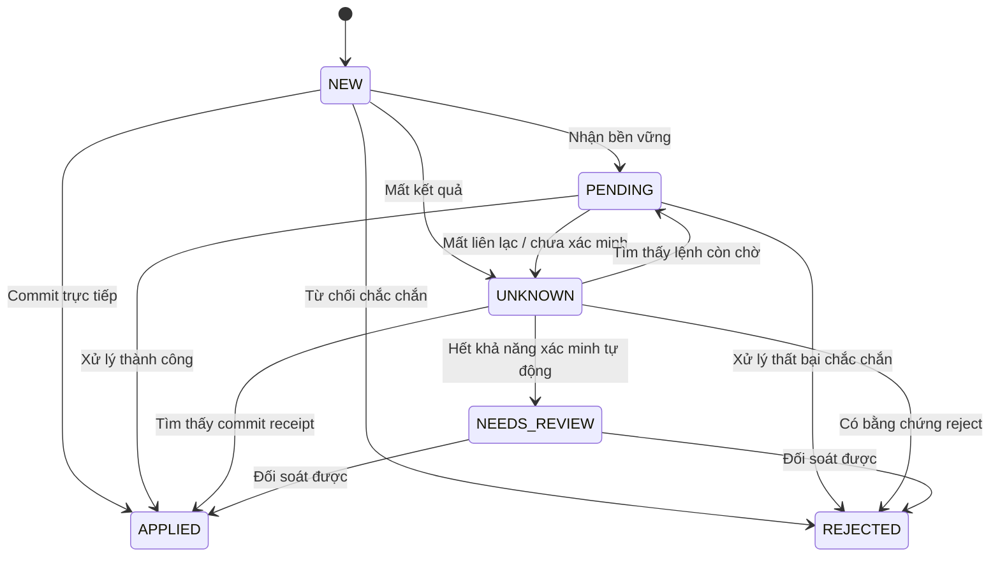
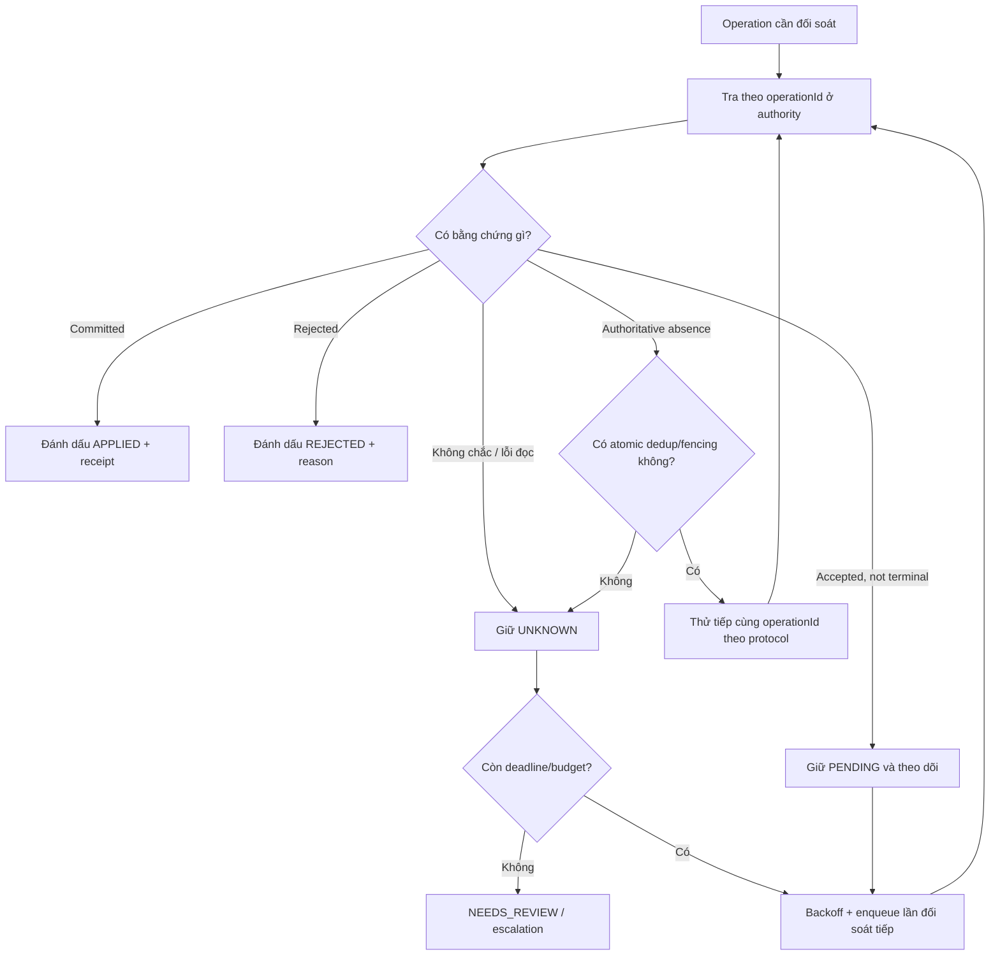

# Đối soát trạng thái khi không thể kết luận kết quả ngay

Một request ghi vào NoSQL có thể **đã được commit**, **bị từ chối** hoặc **vẫn đang xử lý** ngay cả khi client chỉ thấy thông báo `TIMEOUT`. Nếu phản hồi từ server bị mất trên đường mạng, việc tự kết luận “lệnh thất bại” rồi gửi một lệnh mới có thể dẫn đến đặt hàng trùng, trừ tồn kho hai lần hoặc tạo hai giao dịch thanh toán.

Đây là một vấn đề cốt lõi của chương **Database No SQL → Lỗi phân tán và retry**: **đối soát trạng thái khi không thể kết luận kết quả ngay** (*reconciliation of uncertain outcomes*).

Xét ví dụ:

```text
10:00:00  Client gửi lệnh reserve 1 sản phẩm.
10:00:01  Database commit reservation.
10:00:02  Kết nối bị reset trước khi response tới client.
10:00:03  Client nhận timeout và không biết kết quả.
```

Ở thời điểm `10:00:03`, hệ thống không được mặc định rằng lệnh **chưa được thực hiện**. Thông tin đã biết là: **client chưa nhận được một kết quả có thể xác minh**.

Một cách xử lý đúng thường cần:

1. **Định danh ổn định cho ý định nghiệp vụ** bằng `operationId` hoặc idempotency key.
2. **Nguồn ghi nhận có thẩm quyền** về việc lệnh đã commit, bị từ chối hay còn chờ.
3. **Trạng thái chưa xác định** được mô hình hóa rõ ràng thay vì ép thành success/failure.
4. **Quy trình tra cứu, replay hoặc đối soát** có giới hạn và có thể phục hồi sau crash.
5. **API và UI phản ánh đúng mức xác nhận**, không buộc người dùng phát lệnh mới khi kết quả cũ chưa rõ.
6. **Monitoring và kiểm thử fault injection** chứng minh không nhân đôi hiệu ứng nghiệp vụ.

Bài này tập trung vào *cách xác minh kết quả của một ý định nghiệp vụ sau sự cố*, không chỉ vào cách mở lại kết nối tới database.

> Các ví dụ dùng một số sản phẩm NoSQL như MongoDB, DynamoDB, Cassandra/ScyllaDB và Redis để minh họa sự khác biệt về semantics. Cần đối chiếu khả năng, phiên bản, driver, topology, read/write concern và consistency level cụ thể trước khi triển khai.

## 1. Vì sao timeout không đồng nghĩa thao tác thất bại?

Giả sử một lệnh ghi được thực hiện qua nhiều bước:

```text
Client                      Database
  |                             |
  |------ Request op-42 ------> |
  |                             |  Validate
  |                             |  Write/commit
  |                             |  Replicate theo policy
  |<----- Response success -----|
  |                             |
```

Khi đường truyền ổn định, client có thể nhận được response thành công. Nhưng khi phản hồi không đến nơi, nhiều kịch bản dẫn tới cùng triệu chứng:

```text
Kịch bản A:
    Request chưa rời client.
    Server không biết lệnh tồn tại.

Kịch bản B:
    Request đến server.
    Validation hoặc condition thất bại.
    Response bị mất.

Kịch bản C:
    Server commit thành công.
    Response bị mất.

Kịch bản D:
    Server tiếp nhận lệnh và đưa vào queue.
    Chưa commit nghiệp vụ khi client timeout.

Kịch bản E:
    Leader/coordinator đang chuyển vai trò.
    Quyết định commit cần recovery hoặc tra cứu.
```

Client có thể chỉ quan sát:

```text
java.net.SocketTimeoutException
```

Exception này mô tả **thời gian chờ I/O**, không phải **kết quả nghiệp vụ**.

### Phân biệt hai loại thông tin

- **Trạng thái thực tế ở hệ có thẩm quyền:** dữ liệu đã được áp, bị từ chối hay chưa có quyết định.
- **Trạng thái hiểu biết của caller:** caller đã có đủ bằng chứng để kết luận chưa?

Một operation có thể **đã commit thực tế** nhưng caller vẫn ở trạng thái **UNKNOWN**. Hai khái niệm không mâu thuẫn.

## 2. Các trạng thái cần tách bạch

Một mô hình tối thiểu:

| Trạng thái | Ý nghĩa | Có được phép thông báo thành công? |
| --- | --- | --- |
| `NEW` | Ý định mới, chưa gửi hoặc chưa được ghi nhận | Không |
| `PENDING` | Đã nhận lệnh theo một cơ chế được định nghĩa, chưa hoàn tất nghiệp vụ | Không |
| `APPLIED` | Có bằng chứng thao tác đã commit theo hợp đồng | Có |
| `REJECTED` | Có bằng chứng thao tác bị từ chối và không được áp | Không |
| `UNKNOWN` | Caller không thể kết luận `APPLIED` hay `REJECTED` | Không |
| `NEEDS_REVIEW` | Đối soát tự động chưa thể đưa ra kết luận an toàn | Không |

**`UNKNOWN` là trạng thái nhận thức**, không nhất thiết là một trạng thái vật lý tồn tại trong database. Ví dụ server có thể đã lưu `APPLIED`, nhưng client thấy timeout nên tạm đánh dấu `UNKNOWN`.

### Không nhập nhằng `PENDING` và `UNKNOWN`

`PENDING` có thể nghĩa là server **đã ghi nhận một lệnh vào inbox/queue bền vững** và đang chờ xử lý.

`UNKNOWN` nghĩa là **không có đủ chứng cứ** lệnh đã được tiếp nhận/commit hay chưa.

Nếu chỉ có socket timeout, không thể tuyên bố `PENDING` trừ khi có bằng chứng hệ thống đã nhận và lưu lệnh.

## 3. Trạng thái nguồn và trạng thái quan sát

Một mô hình rõ hơn dùng hai trục:

```text
Source state (thực tế):
    NOT_SEEN | ACCEPTED | COMMITTED | REJECTED

Caller knowledge:
    CONFIRMED_APPLIED | CONFIRMED_REJECTED | UNKNOWN
```

Ví dụ:

| Source thực tế | Client quan sát | Client nên biểu diễn |
| --- | --- | --- |
| `COMMITTED` | Nhận ACK thành công | `APPLIED` |
| `COMMITTED` | Mất response | `UNKNOWN`, sau đó tra cứu |
| `REJECTED` | Nhận rejection rõ | `REJECTED` |
| `REJECTED` | Mất response | `UNKNOWN`, sau đó tra cứu |
| `NOT_SEEN` | Connect thất bại trước mọi dispatch được chứng minh | Có thể xác định chưa gửi theo phạm vi chứng cứ |
| `ACCEPTED` | Có receipt pending bền vững | `PENDING` |
| Không rõ | Deadline hết | `UNKNOWN` |

Trạng thái client không được thay đổi thành `REJECTED` chỉ vì hết thời gian chờ. **Deadline là giới hạn chờ của caller, không phải chứng cứ server rollback.**

## 4. Sơ đồ trạng thái nghiệp vụ và đường đối soát



Sơ đồ **không có nghĩa** đã commit ở database rồi có thể tự động chuyển ngược thành rejected. Nó mô tả **các quan sát và kết luận của workflow**.

Một hệ có thể có trạng thái nghiệp vụ khác như `REFUNDED`, `CANCELLED`, `COMPENSATED`. Chúng là **hành động mới có lịch sử riêng**, không làm “biến mất” giao dịch ban đầu đã commit.

## 5. Tình huống điển hình: đặt hàng bị timeout sau commit

Giả sử chỉ còn một sản phẩm:

```json
{
  "sku": "SKU-42",
  "available": 1,
  "version": 16
}
```

Client gửi:

```json
{
  "operationId": "reserve-O-501-line-1",
  "orderId": "O-501",
  "sku": "SKU-42",
  "quantity": 1
}
```

Database thực hiện:

```text
Check available >= 1.
Decrease available from 1 to 0.
Record operationId = reserve-O-501-line-1.
Commit.
```

Nhưng HTTP response bị mất:

```text
Client:
    TIMEOUT
```

Nếu client gửi request mới:

```json
{
  "operationId": "reserve-O-501-line-1-retry-new-id",
  "orderId": "O-501",
  "sku": "SKU-42",
  "quantity": 1
}
```

Hệ có thể coi đó là **một ý định mới**, dẫn đến duplicate reservation hoặc một rejection gây nhầm lẫn: “hết hàng” dù đơn của chính khách đã giữ được hàng.

Cách đúng là **giữ nguyên operationId** và tra kết quả đã commit.

## 6. Vì sao thao tác idempotent quan trọng?

Một phép toán là **idempotent theo hiệu ứng nghiệp vụ** nếu thực hiện nhiều lần với cùng danh tính ý định vẫn tạo hiệu ứng như thực hiện một lần.

Ví dụ:

```text
SET status = PAID
```

có vẻ idempotent về **giá trị field**. Nhưng nếu mỗi lần update còn phát email, cộng doanh thu hay charge payment, cả workflow không tự idempotent.

Ngược lại:

```text
INCREMENT stock_reserved by 1
```

không idempotent nếu không có deduplication.

Một contract phù hợp:

```text
operationId = "reserve-O-501-line-1"

First attempt:
    Apply effect, save receipt.

Subsequent attempts with same operationId:
    Return saved receipt.
    Never apply effect again.
```

**Idempotency bảo vệ ý định nghiệp vụ**, không chỉ câu lệnh database đơn lẻ.

## 7. Định danh operation cần ổn định và có phạm vi

`operationId` nên:

- Được tạo **trước khi bắt đầu side effect**.
- Ổn định qua timeout, refresh UI, worker restart và retry.
- Duy nhất trong phạm vi nghiệp vụ được bảo vệ.
- Gắn với tenant/account/aggregate phù hợp.
- Không lộ dữ liệu nhạy cảm không cần thiết.
- Được truyền xuyên API, queue, outbox, payment gateway và ledger khi có thể.
- Có retention phù hợp với vòng đời có thể replay.
- Có khả năng tra cứu ngay cả khi backend đang chuyển shard/Region.

Ví dụ:

```text
tenantId: T1
businessOperation: RESERVE_INVENTORY
operationId: 7df5c8d5-29d9-4d1f-bde2-7b9670ea0101
```

Không dùng một giá trị không duy nhất như `orderId` nếu cùng order có thể có nhiều ý định hợp lệ độc lập (reserve, release, amend quantity) mà không có cách phân biệt.

### Payload fingerprint

Với cùng operationId, nếu client gửi payload khác:

```text
Lần 1: reserve SKU-A quantity=1
Lần 2: reserve SKU-B quantity=3
```

không được vô điều kiện trả receipt cũ hoặc áp payload mới. Cần so **normalized request fingerprint**:

```text
same operationId + same semantic payload
    -> return prior outcome

same operationId + different payload
    -> IDEMPOTENCY_KEY_REUSED_WITH_DIFFERENT_REQUEST
```

Chuẩn hóa field và phiên bản schema để fingerprint nhất quán; không hash JSON theo thứ tự field tùy tiện nếu representation có thể thay đổi.

## 8. Một bản ghi operation ledger tối thiểu

Ví dụ:

```json
{
  "tenantId": "T1",
  "operationId": "reserve-O-501-line-1",
  "operationType": "RESERVE_INVENTORY",
  "requestFingerprint": "sha256:...",
  "businessId": "O-501",
  "status": "APPLIED",
  "result": {
    "reservationId": "RSV-901",
    "sku": "SKU-42",
    "quantity": 1
  },
  "committedRevision": 17,
  "createdAt": "2026-11-14T08:00:00Z",
  "updatedAt": "2026-11-14T08:00:01Z"
}
```

`createdAt`/`updatedAt` phục vụ quan sát, **không mặc định là thứ tự toàn cục** giữa các node có đồng hồ lệch.

Một ledger thực tế còn có thể cần:

```text
ownerEpoch
attemptCount
leaseUntil
lastObservedError
nextReconcileAt
terminalReason
schemaVersion
sourceCommitToken
externalProviderReference
```

Nhưng **không nên để ledger biến thành một collection hot** mà mọi operation đều ghi cùng một key. Chọn partition key theo operation identity/tenant và workload thực; nếu cần uniqueness toàn cục, phải có authority phù hợp.

## 9. Atomicity giữa ledger và hiệu ứng nghiệp vụ

Một lỗi thường gặp:

```text
Step 1: decrement stock -> SUCCESS
Step 2: insert operation ledger -> TIMEOUT
```

Nếu bước 1 đã commit còn bước 2 chưa ghi, client không tìm được operationId và có thể gửi lại; hàng bị trừ lần nữa.

Một invariant quan trọng:

> **Khi có business effect được commit, phải tồn tại một cách đáng tin cậy để đối chiếu effect đó với định danh operation.**

Phương án tùy NoSQL:

- Ghi **business state + operation marker trong cùng atomic document/item** nếu phạm vi nhỏ.
- Dùng **transaction nhiều item** của database nếu được hỗ trợ đúng phạm vi.
- Dùng **conditional insert/unique operation record** làm authority, rồi workflow bù/truy hồi với trạng thái rõ.
- Dùng **append-only ledger** làm source of truth và tạo projection từ đó.
- Dùng **outbox/inbox** trong cùng transaction nguồn để đồng bộ các bước ngoài.

Hai lần ghi tách biệt không tự trở thành atomic chỉ vì cùng service Java gọi chúng liên tiếp.

## 10. Một giao thức reserve trên một aggregate

Giả sử inventory authority cho phép một thao tác có điều kiện nguyên tử trên một aggregate gồm tồn kho và danh sách operation IDs hợp lệ.

```text
atomic reserve(operationId, sku, quantity):
    if ledger has operationId:
        if fingerprint same:
            return storedOutcome
        else:
            return KEY_REUSE_CONFLICT

    if available < quantity:
        record REJECTED outcome according to contract
        return OUT_OF_STOCK

    decrement available
    record operationId -> APPLIED receipt
    commit atomically
    return APPLIED receipt
```

Cần lưu ý:

- `record REJECTED` có thể là terminal nếu điều kiện business đã được đánh giá theo authority.
- Nếu business cho phép đặt lại sau khi nhập hàng, một **ý định mới** phải có operationId mới; đừng tái sử dụng operation cũ để “đợi đủ hàng”.
- Kích thước aggregate không được tăng vô hạn vì lưu mọi operation marker vĩnh viễn.
- Nếu marker được tách sang partition khác, tính nguyên tử phải được thiết kế lại.
- Nếu callback tạo email/payment ngoài transaction, cần outbox/idempotency riêng.

Đây là mô hình khái niệm, không phải một script áp dụng chung cho mọi database.

## 11. Chỉ có “GET operationId không thấy” chưa chứng minh chưa commit

Một reconciler tra ledger và nhận:

```text
NOT_FOUND
```

Nguyên nhân có thể là:

1. Operation chưa từng được nhận.
2. Operation đã commit nhưng ledger chưa replicate tới replica đọc.
3. Reader đang đọc cache hoặc secondary stale.
4. Ledger record chưa được tạo do dual-write không atomic.
5. Key lookup sai tenant/generation/partition.
6. Marker đã bị TTL xóa.
7. Stream/consumer đang lag.
8. Request tới storage lỗi nhưng bị map thành `NOT_FOUND`.
9. Đang chuyển shard/routing nên tra nhầm owner.

**Absence trong một read bất kỳ không phải proof of non-commit.**

Chỉ khi có một authority và protocol chứng minh rằng operation **không thể đã commit và cũng không thể commit về sau** mới có thể quyết định tạo mới theo cùng operationId một cách an toàn.

## 12. Cần phân biệt “không thấy” và “chưa quyết định”

Một state query nên có kết quả giàu ngữ nghĩa:

```text
FOUND_APPLIED(receipt)
FOUND_REJECTED(reason)
FOUND_PENDING(jobId)
NOT_FOUND_AUTHORITATIVELY
UNKNOWN_QUERY_FAILED
UNKNOWN_STALE_READ
UNKNOWN_INFLIGHT
```

`NOT_FOUND_AUTHORITATIVELY` cũng phải được dùng cẩn thận: một operation đã được gửi tới worker cũ **có thể commit sau lúc lookup** nếu không có fencing hoặc một protocol duy nhất điều phối quyền ghi.

Do đó trước khi retry sau absent read, thường cần một trong hai:

- **Same-operation atomic dedup:** retry cùng operationId, nếu attempt cũ commit trước/sau thì chỉ một lần effect được áp.
- **Fencing/cancellation protocol:** chứng minh attempt cũ không thể commit sau mốc kiểm tra, rồi mới áp mới.

Không nên dùng “sleep 2 giây rồi GET lại” như chứng minh toán học về không có late commit.

## 13. Một thiết kế API trạng thái

Ví dụ giao tiếp:

```http
POST /reservations
Idempotency-Key: reserve-O-501-line-1
Content-Type: application/json

{
  "orderId": "O-501",
  "sku": "SKU-42",
  "quantity": 1
}
```

Nếu commit ngay:

```http
HTTP/1.1 201 Created
Content-Type: application/json

{
  "operationId": "reserve-O-501-line-1",
  "status": "APPLIED",
  "reservationId": "RSV-901"
}
```

Nếu đã lưu lệnh bền vững nhưng chưa commit:

```http
HTTP/1.1 202 Accepted
Content-Type: application/json

{
  "operationId": "reserve-O-501-line-1",
  "status": "PENDING",
  "statusUrl": "/operations/reserve-O-501-line-1"
}
```

Nếu server chưa thể chứng minh kết quả trước deadline:

```http
HTTP/1.1 503 Service Unavailable
Content-Type: application/json

{
  "operationId": "reserve-O-501-line-1",
  "status": "UNKNOWN",
  "code": "COMMIT_OUTCOME_UNKNOWN",
  "nextAction": "CHECK_OPERATION_STATUS"
}
```

**Ví dụ HTTP minh họa:** status code cuối cùng phải khớp contract của API. Không mặc định `202` nếu chưa thực sự nhận lệnh; không mặc định `503` nghĩa write chưa được áp.

## 14. Endpoint tra cứu nên trả gì?

```http
GET /operations/reserve-O-501-line-1
```

Kết quả:

```json
{
  "operationId": "reserve-O-501-line-1",
  "status": "APPLIED",
  "result": {
    "reservationId": "RSV-901"
  },
  "final": true
}
```

Hoặc:

```json
{
  "operationId": "reserve-O-501-line-1",
  "status": "PENDING",
  "final": false,
  "nextCheckAfterMs": 1000
}
```

Hoặc:

```json
{
  "operationId": "reserve-O-501-line-1",
  "status": "UNKNOWN",
  "final": false,
  "message": "Chưa thể xác nhận kết quả",
  "nextCheckAfterMs": 2000
}
```

Khi endpoint không thể tới authority, nó cũng có thể phải trả lỗi **tra cứu chưa khả dụng**, thay vì `NOT_FOUND` hoặc `REJECTED` giả.

### Những yêu cầu tối thiểu

- Authorize đúng tenant, không cho lộ operation của user khác.
- Có version/commit token hoặc bằng chứng phù hợp.
- Response không cache sai khi cần current status.
- `APPLIED` không biến thành `UNKNOWN`/`PENDING` trong những lần đọc authoritative tiếp theo.
- Có TTL/retention/archival cho operation history rõ.
- Đọc theo đúng consistency path, không dựa vào index eventual nếu cần xác định commit.

## 15. Một state machine cho reconciler



Điểm then chốt: **reconciler ưu tiên xác minh trạng thái trước khi tạo thêm business effect**. Chỉ thực hiện retry ghi khi có bảo đảm idempotent hoặc protocol phục hồi phù hợp.

## 16. Không nên hòa lẫn retry request với reconcile outcome

**Retry request** cố thực hiện một thao tác thêm lần nữa (hoặc gửi lại cùng lệnh).

**Reconcile outcome** cố xác định liệu thao tác cũ đã được thực hiện hay chưa.

Hai hành động có thể phối hợp nhưng phải phân biệt:

| Hành động | Câu hỏi | Rủi ro |
| --- | --- | --- |
| Retry write | “Có thể thực hiện lại an toàn không?” | Duplicate effect, stale payload |
| Query operation status | “Ý định cũ đã tới đâu?” | Read stale, not-found giả |
| Replay outbox event | “Projection/side effect còn thiếu có thể áp lại không?” | Duplicate delivery |
| Retry transaction commit | “Commit của cùng transaction ra sao?” | Phải theo protocol SDK/database |
| Rebuild projection | “Bản sao dẫn xuất có khớp source không?” | Ghi đè version mới, delete resurrection |
| Manual review | “Nguồn chứng cứ có mâu thuẫn không?” | Quy trình con người chậm, phải audit |

Một số database/SDK cung cấp **retryable writes hoặc transaction commit retry semantics**; cần ưu tiên cơ chế được hỗ trợ thay vì tự xây vòng retry làm mất session/transaction identity.

## 17. Chu kỳ đối soát có giới hạn

Một reconciler ổn định không nên poll liên tục:

```text
UNKNOWN
 -> query status
 -> still unknown
 -> query status ngay
 -> query status ngay...
```

Điều này gây tải đúng lúc database hoặc mạng đang suy giảm.

Một chính sách:

```yaml
reconcile:
  initialDelayMs: 250
  maxDelayMs: 30000
  maxAutomatedAgeMinutes: 60
  exponentialBackoff: true
  jitter: full
  maxConcurrentPerTenant: 20
  maxConcurrentGlobal: 200
  manualReviewOnConflictingEvidence: true
```

Các số chỉ minh họa, không phải giá trị cấu hình chung.

**Max automated age** khác với **operation retention**. Hết 60 phút tự động không được hiểu là operation chắc chắn thất bại; nó có thể chuyển sang `NEEDS_REVIEW` và lưu hồ sơ để xử lý tiếp.

## 18. Backoff và deadline không được sửa đổi kết luận

Nếu một operation chờ quá lâu:

```text
T0: attempt commit.
T1: timeout.
T2..Tn: status lookup tiếp tục unavailable.
Tn: reconcile budget hết.
```

Kết luận đúng:

```text
UNKNOWN -> NEEDS_REVIEW
```

không phải:

```text
UNKNOWN -> REJECTED
```

trừ khi có bằng chứng authority cho thấy rejected/not-applied.

Trong những nghiệp vụ có side effects khó đảo ngược (payment, đặt vé, cấp quyền), **lưu trạng thái chưa xác định** tuy bất tiện nhưng trung thực và an toàn hơn một phản hồi sai.

## 19. Đối soát bất đồng bộ bằng queue

Kiến trúc khái niệm:

```text
[API service]
    |
    | write with operationId
    v
[Authoritative NoSQL]
    |
    | timeout / unknown at caller
    v
[Reconciliation queue]
    |
    v
[Reconciler worker]
    |
    | lookup operationId / ledger
    v
[Decision + status]
    |
    +--> [Notify UI / webhook]
    +--> [Needs-review queue]
```

Nhưng có một câu hỏi quan trọng: **khi API timeout, việc enqueue reconciliation có được ghi bền vững không?**

Nếu enqueue cũng thất bại, operation có thể không được kiểm tra lại. Thiết kế cần:

- Durable inbox/queue hoặc **job record có thể scan lại**.
- Worker at-least-once nhưng idempotent.
- Lease/fencing khi nhiều workers cùng xử lý.
- Recovery scan cho những UNKNOWN quá hạn.
- Dead-letter/manual review khi không đủ chứng cứ.
- Các metrics cho số operation chưa kết luận.

**Queue không biến UNKNOWN thành PENDING** nếu chưa có bằng chứng bản thân ý định được authority nhận; queue chỉ lưu **việc cần đối soát**.

## 20. Reconciler phải chịu được xử lý trùng

Nhiều worker có thể cùng nhận:

```text
reconcile(operationId=op-42)
```

Hoặc một worker xử lý xong nhưng crash trước khi ACK queue:

```text
Worker A:
    tra kết quả, ghi status APPLIED.
    crash trước queue ACK.

Queue:
    phát lại cho Worker B.
```

Nếu reconciler chỉ **cập nhật trạng thái theo bằng chứng có thẩm quyền**, việc chạy lại thường có thể thiết kế idempotent.

Nếu reconciler được phép **gọi lại một side effect**, thì nó phải có cùng operationId và cơ chế dedup ở authority. Không được xem việc job bị phát lại là permission tạo operationId mới.

### State transition có điều kiện

```text
UPDATE operation
SET status = APPLIED
WHERE operationId = op-42
  AND status IN (UNKNOWN, PENDING, NEEDS_REVIEW)
  AND sourceReceipt = verifiedReceipt
```

Đây là pseudo-query, không phải SQL chạy được trên mọi NoSQL. Cần thêm version/epoch và handling khi hai workers thấy bằng chứng khác nhau. Không được overwrite một terminal `APPLIED` bằng `REJECTED` chỉ do một read stale.

## 21. Lease và fencing khi worker bị treo

Worker A nhận job:

```text
leaseOwner = A
leaseEpoch = 21
leaseUntil = T
```

A bị pause lâu. Lease hết; Worker B nhận job với `leaseEpoch=22`. Nếu A tiếp tục chạy và ghi trạng thái không điều kiện, nó có thể ghi đè quyết định mới của B.

Cần:

- Lease để hạn chế work trùng.
- **Fencing token/epoch** tăng theo authority để chặn stale worker.
- Atomic compare-and-set trên status/version.
- Mọi side effect được gửi với operationId idempotent.
- Ghi checkpoint sau khi hoàn tất tác động theo protocol.
- Không dựa vào đồng hồ local của A để xác định mình vẫn là owner.

Lease một mình không đủ bảo vệ dữ liệu nếu tài nguyên đích không kiểm tra token/điều kiện ghi.

## 22. Ranh giới giữa committed và acknowledged

Các nhãn thường gặp:

```text
RECEIVED:
    Server nhận bytes / parse request.

ACCEPTED:
    Server nhận lệnh vào workflow theo contract.

APPLIED_LOCAL:
    Một node đã ghi trạng thái.

REPLICATED:
    Các replicas đã ACK theo policy.

COMMITTED:
    Transaction/consensus/authority xác nhận hoàn tất.

CLIENT_ACKNOWLEDGED:
    Caller thực nhận response.
```

Thứ tự chính xác và ý nghĩa có thể khác theo hệ.

Với NoSQL phân tán, một write **đã ACK bởi một node** chưa chắc có cùng durability/visibility guarantee với write **quorum committed**. Khi đối soát, phải dùng đúng **cam kết mà API đã hứa**:

- Một status `APPLIED_LOCAL` không tự thay thế `BUSINESS_CONFIRMED`.
- Một outbox event được nhận không tự chứng minh payment provider đã charge.
- Một primary write được thấy ở secondary có thể phụ thuộc replication policy/failover.
- Một transaction có commit outcome unknown cần protocol giải quyết riêng.

## 23. Những nguồn bằng chứng theo thứ tự tin cậy

Không có thứ tự chung cho mọi sản phẩm, nhưng có thể thiết lập một hệ phân cấp nguồn:

1. **Receipt/commit record tại authoritative transaction hoặc ledger**.
2. **API tra cứu operationId từ authority** với consistency phù hợp.
3. **Business transaction record/unique idempotency marker** nằm trong cùng atomic scope.
4. **Log/CDC/outbox có mốc và retention được xác nhận**.
5. **Replica/read model/search index** sau khi có chứng cứ đã bắt kịp.
6. **Application logs, metrics và traces** để hỗ trợ điều tra.
7. **UI cache, email, notification** thường không đủ là bằng chứng commit.

Điểm quan trọng không phải “nguồn số 1 luôn thắng” mà là **xác định một nguồn dữ liệu nào có quyền quyết định trạng thái cho từng loại operation**.

Ví dụ payment gateway có thể là authority cho `chargeId`, còn order database là authority cho tình trạng xử lý đơn. Một email “đã thanh toán” có thể đã được gửi lỗi và không phải nguồn dữ liệu có thẩm quyền.

## 24. Receipt cần gắn với đúng operation

Một receipt:

```json
{
  "operationId": "pay-O-501-1",
  "providerChargeId": "CH-781",
  "merchantId": "M-22",
  "orderId": "O-501",
  "amountMinor": 149900,
  "currency": "VND",
  "status": "SUCCEEDED"
}
```

Khi đối soát:

- `operationId` đúng hay chỉ trùng `orderId`?
- Có đúng merchant/tenant/account không?
- Amount và currency có khớp yêu cầu gốc không?
- Provider đã final success hay mới accepted?
- Có refund/reversal/chargeback sau đó không?
- Kết quả mới nhất có bị đọc từ replica trễ không?
- Có hai provider charge IDs tương ứng cùng một ý định không?

Chỉ tìm một giao dịch cùng **số tiền** hoặc cùng **timestamp gần nhau** chưa đủ chứng minh đó là operation cần đối soát.

## 25. Ví dụ thanh toán: không tạo charge thứ hai

Timeline:

```text
T0: Client gọi Pay(order O-501, operationId=pay-O-501-1).
T1: Payment provider xử lý và charge thành công.
T2: Provider response bị mất.
T3: Application timeout.
T4: UI chưa biết khách đã bị trừ tiền chưa.
```

Sai lầm:

```text
UI:
    "Thanh toán thất bại. Hãy bấm Thanh toán lần nữa."

Client:
    tạo operationId=pay-O-501-2.
```

Nếu provider coi đó là charge mới, khách có thể bị tính hai lần.

Hướng tốt:

1. API trả trạng thái `UNKNOWN` hoặc `VERIFYING`.
2. UI hiển thị “Đang xác minh kết quả thanh toán”.
3. Backend tra gateway theo idempotency key/provider reference.
4. Nếu `SUCCEEDED`, ghi receipt và chuyển order sang trạng thái phù hợp.
5. Nếu `FAILED` có bằng chứng, thông báo thất bại chắc chắn.
6. Nếu gateway chưa trả lời, giữ `UNKNOWN`, retry đối soát có giới hạn.
7. Khi phát hiện hai charges, mở quy trình tài chính/audit/hoàn tiền phù hợp; không xóa lịch sử.

**Đối soát phải dựa vào chứng cứ về charge**, không chỉ trạng thái order trong database ứng dụng.

## 26. Ví dụ tồn kho: không được “reserve lại” vô điều kiện

Ban đầu:

```text
available(SKU-42) = 1
```

Một lệnh reserve được áp nhưng response mất. Sau đó lookup operation bị lỗi.

Để giữ invariant:

```text
available >= 0
one effective reservation per order line
```

không được làm:

```text
if timeout:
    decrement stock again
```

Phương án:

- Conditional reservation có stable operationId.
- Unique reservation record cùng business identity.
- Ledger ghi source revision/receipt.
- Query operation bằng authority.
- Nếu status chưa xác định, hiển thị PENDING/VERIFYING.
- Nếu order bị hủy trong lúc đối soát, cần **release/cancel theo workflow riêng** có idempotency.
- Khi hàng hết, không tự gán `REJECTED` cho operation cũ nếu chính nó có thể đã reserve hết hàng.

## 27. Ví dụ chuyển tiền: không suy từ một số dư

Lệnh:

```text
Transfer T-101:
    A -= 100000
    B += 100000
```

Client timeout. Sau đó đọc:

```text
A.balance giảm 100000.
B.balance chưa thấy tăng.
```

Điều này không đủ kết luận:

- Có thể read path B đang stale.
- Có thể source dùng ledger + projection bất đồng bộ.
- Có thể workflow là saga đang ở bước trung gian.
- Có thể transaction/coordination đã commit nhưng một view tụt lại.
- Có thể ứng dụng thiết kế sai và thật sự mất atomicity.

Phải tra:

```text
transactionId/operationId
ledger entries
commit receipt
projection lag
external bank/provider state nếu có
```

Một giao dịch chuyển tiền hoàn tất theo contract không được “tự chữa” bằng cách cộng B theo suy đoán, vì có thể tạo tiền nếu transaction gốc đã thực hiện đầy đủ.

## 28. Distinguish transaction retry vs business operation retry

**Transaction retry** có thể thực thi lại một transaction body trong phạm vi mà SDK/database hỗ trợ để giải quyết conflict/transient error.

**Business operation retry** là lặp lại ý định có thể gồm:

```text
Database update
Payment provider call
Email
Kafka publish
HTTP callback
```

Không được giả định transaction retry tự bảo vệ **email, payment hoặc webhook**. Một callback chứa side effect ngoài transaction có thể chạy hai lần khi SDK retry transaction.

Thiết kế tách:

```text
DB transaction:
    update domain state
    append outbox event

After commit:
    outbox processor
    -> idempotent external side effect
```

Đối soát kết quả của transaction và đối soát side effect ngoài transaction là **hai bước riêng**.

## 29. Outbox giúp phục hồi sau commit mà publish bị lỗi

Một race:

```text
T1: Order được commit.
T2: Service crash trước khi publish OrderPaid event.
```

Nếu event không được phát, search index/notification/analytics có thể không biết order đã paid.

Một **transactional outbox**:

```text
Atomic source transaction:
    order.status = PAID
    outbox += OrderPaid(eventId, orderId, revision)

Outbox worker:
    publish event
    mark/advance progress after confirm
```

Lợi ích: nếu nguồn lưu order và outbox cùng atomic scope, event không biến mất chỉ vì service crash sau commit.

Nhưng outbox worker vẫn có thể publish trùng nếu publish thành công rồi ACK/checkpoint bị mất. Consumer cần idempotency/dedup theo `eventId` và revision.

**Outbox giải quyết sự kiện sau source commit**, không tự xác nhận payment gateway đã charge hoặc email thực đã được gửi.

## 30. Inbox giúp hệ nhận lệnh bền vững trước khi xử lý

Một **inbox** có thể ghi:

```text
operationId
payloadFingerprint
receivedAt
status = ACCEPTED
```

rồi worker xử lý sau.

Nếu đã có **receipt inbox commit**, API có thể trả `202 PENDING`. Sau đó có thể tra operation theo ID và bảo đảm lệnh không biến mất theo durability contract.

Nhưng cần phân biệt:

- Inbox `ACCEPTED` không có nghĩa business `APPLIED`.
- Một command có thể bị business rule từ chối khi worker xử lý.
- Lệnh có thể hết hạn và cần state `EXPIRED/REJECTED`.
- Worker có thể được chạy trùng, cần idempotency.
- Queue/inbox có thể quá tải, phải có admission control.
- Nếu inbox lưu không bền vững theo policy, không được nói đã durable accepted.

Đối soát có thể chuyển từ “tìm write không rõ kết quả” thành “theo dõi durable command state”, giảm bất định sau khi có bằng chứng lệnh đã được nhận.

## 31. Saga và trạng thái chưa chắc chắn giữa các bước

Một workflow liên dịch vụ:

```text
Order service:
    tạo order.

Inventory service:
    reserve stock.

Payment service:
    charge.

Shipping service:
    tạo shipment.
```

Không nên biểu diễn saga chỉ bằng:

```text
SUCCESS / FAILURE
```

Vì một bước có thể có **unknown outcome**:

```text
RESERVE_REQUESTED
RESERVE_UNKNOWN
RESERVED
PAYMENT_REQUESTED
PAYMENT_UNKNOWN
PAID
SHIPMENT_PENDING
```

Nếu payment đang `UNKNOWN`, một compensation như **release stock** có thể làm mất hàng giữ trước khi biết payment đã charge, dẫn tới workflow khó xử lý. Cần xác định thứ tự và chính sách compensation theo domain.

### Sự khác nhau giữa reconcile và compensate

- **Reconcile:** xác minh điều gì đã xảy ra.
- **Compensate:** thực hiện hành động nghiệp vụ khác để xử lý hậu quả đã xác định.

Compensation không phải rollback vật lý giao dịch đã commit. Một hoàn tiền là **giao dịch mới**, có ID và audit riêng.

## 32. State chuyển tiến cần có điều kiện

Ví dụ state machine thực:

```text
NEW
  -> ACCEPTED
  -> APPLIED
        \-> REFUND_REQUESTED
             \-> REFUNDED
```

Hoặc:

```text
NEW
  -> ACCEPTED
  -> REJECTED
```

Một worker đối soát không được làm:

```text
APPLIED -> REJECTED
```

chỉ vì một lần đọc từ replica cũ trả `NOT_FOUND`. Nếu sau commit xuất hiện yêu cầu đảo nghiệp vụ, cần một trạng thái/câu lệnh mới như `CANCELLED` hoặc `REFUNDED` theo policy.

Dùng CAS/conditional write:

```text
compare currentVersion
compare currentStatus
compare leaseEpoch
apply transition if legal
increment version
```

**Transition function** phải phản ánh invariant, không chỉ danh sách enum.

## 33. Nếu hai nguồn bằng chứng mâu thuẫn thì sao?

Ví dụ:

```text
Payment gateway:
    charge CH-781 = SUCCEEDED.

Application ledger:
    operation pay-O-501-1 = REJECTED.
```

Đây không phải một trường hợp nên tự chọn `max(timestamp)` hay ghi đè bằng giá trị đến sau.

Các khả năng:

- Rejected ghi sai trước khi biết gateway đã commit.
- Gateway trả dữ liệu của một payment khác.
- Có duplicate operation ID.
- Ledger đọc từ replica stale.
- Provider đang có trạng thái `AUTHORIZED` chứ chưa `CAPTURED`.
- Event/webhook đến sai thứ tự.
- Transaction application đã abort nhưng provider charge vẫn thành công.

Quy trình:

1. Giữ toàn bộ receipts và bằng chứng.
2. Xác minh identity, amount, currency, tenant/provider.
3. Tra authoritative nguồn của từng miền.
4. Xác định sự khác nhau giữa source state và projection.
5. Nếu không có quy tắc chứng minh kết luận an toàn, chuyển `NEEDS_REVIEW`.
6. Không xóa lịch sử hoặc sửa terminal state mù.
7. Thực hiện compensation/adjustment theo policy đã phê duyệt nếu cần.

**Mâu thuẫn chứng cứ là incident dữ liệu hoặc workflow**, không chỉ một retryable exception.

## 34. Reconciliation không thay transaction consistency

Một ứng dụng có hai bảng:

```text
stock_by_sku
reservation_by_order
```

Nếu service cập nhật hai bảng không có transaction hoặc protocol phù hợp:

```text
T1: Decrement stock thành công.
T2: Crash trước insert reservation.
```

Đối soát có thể phát hiện lệch và bù, nhưng **không tự biến lịch sử thành atomic transaction** đã được hứa.

Có hai hướng:

- Thiết kế atomic invariant ngay ở nguồn phù hợp.
- Nếu chấp nhận eventual workflow, công bố trạng thái trung gian và compensation, bảo đảm không trả confirmed sai.

Dùng reconciliation như lưới an toàn vận hành, **không dùng nó để biện minh cho một commit protocol không bảo vệ invariant nghiêm ngặt**.

## 35. MongoDB: retryable writes và transaction commit unknown

MongoDB có các cơ chế tùy topology/driver/version như **retryable writes** và **multi-document transactions**. Cần phân biệt:

- Lỗi trước khi dispatch.
- Lỗi trong transaction body có thể được driver gắn nhãn transient.
- Lỗi ở bước commit khiến client không biết quyết định cuối cùng.
- Read concern/write concern và đường đọc có thể làm quan sát khác nhau.

Hai error labels thường được gặp:

```text
TransientTransactionError
UnknownTransactionCommitResult
```

Ý nghĩa khái niệm:

- **TransientTransactionError:** một số lỗi có thể yêu cầu chạy lại transaction theo protocol (phụ thuộc vị trí lỗi và driver).
- **UnknownTransactionCommitResult:** caller chưa biết commit có thành công không; cần dùng retry commit/recovery semantics của MongoDB driver, không tự tạo business transaction mới chỉ vì thấy exception.

### Phân biệt transaction callback với side effect ngoài

Sai lầm:

```javascript
await session.withTransaction(async () => {
  await orders.updateOne(..., { session });
  await paymentGateway.charge(...); // Side effect bên ngoài DB
});
```

Một driver có thể retry callback transaction. Gọi provider trong callback như trên có thể charge lại nếu không có idempotency.

Nên cân nhắc:

```text
Trong transaction:
    update orders
    insert outbox event

Ngoài transaction:
    outbox processor gọi provider với stable operationId
    reconcile provider outcome
```

Cần áp dụng transaction API đúng phiên bản, retry labels và commit semantics; không giả định MongoDB retryable write bao phủ mọi workflow của application.

## 36. MongoDB: mẫu operation receipt trong transaction

Giả mã Node.js:

```javascript
async function reserveWithReceipt(session, command) {
  const existing = await db.collection("operations").findOne(
    {
      tenantId: command.tenantId,
      operationId: command.operationId
    },
    { session }
  );

  if (existing) {
    assertSameFingerprint(existing, command);
    return existing.result;
  }

  // Phải có unique index đúng phạm vi và isolation protocol.
  const updated = await db.collection("inventory").updateOne(
    {
      tenantId: command.tenantId,
      sku: command.sku,
      available: { $gte: command.quantity }
    },
    {
      $inc: { available: -command.quantity, version: 1 }
    },
    { session }
  );

  const outcome = updated.modifiedCount === 1
    ? { status: "APPLIED" }
    : { status: "REJECTED", reason: "OUT_OF_STOCK" };

  await db.collection("operations").insertOne(
    {
      tenantId: command.tenantId,
      operationId: command.operationId,
      fingerprint: command.fingerprint,
      result: outcome
    },
    { session }
  );

  return outcome;
}
```

Đây là **mẫu logic đặt trong một transaction session hợp lệ**, không phải toàn bộ chương trình hoặc transaction wrapper. Các điều kiện bắt buộc:

- Database hỗ trợ multi-document transaction trong topology được dùng.
- Transaction commit thật sự thành công trước khi API báo `APPLIED`.
- Unique index/transaction conflict được xử lý đúng.
- Không trả `outcome` ra ngoài như kết quả cuối khi commit chưa xác định.
- Mọi retry sau commit timeout tuân thủ protocol và operationId.
- Nếu transaction callback được retry, side effects ngoài DB không chạy trong callback.

## 37. DynamoDB: điều kiện, transaction token và authoritative lookup

DynamoDB có các API như:

```text
PutItem / UpdateItem với ConditionExpression
TransactWriteItems
TransactGetItems
GetItem với read consistency tương ứng
```

Ví dụ một thao tác trên **một item** chứa stock và marker có thể dùng conditional update nếu kích thước/domain cho phép. Với **nhiều items**, `TransactWriteItems` cung cấp atomic group trong phạm vi hỗ trợ.

DynamoDB hỗ trợ token idempotency cho một số transaction APIs, với **cửa sổ và điều kiện sử dụng cụ thể**; token đó **không tự giải quyết vĩnh viễn** mọi lần replay ứng dụng. Cần giữ business operation record theo vòng đời phù hợp.

### Không dùng GSI để chứng minh không commit

Một query qua **Global Secondary Index** có thể chậm cập nhật. Nếu không thấy operation trong GSI ngay sau write, **không được kết luận source item chưa được ghi**.

Cần tra cứu đúng **base table/transaction authority** với khả năng đọc phù hợp. Với Global Tables/multi-region, phải xét replication và consistency contract của chế độ cụ thể; một Region khác chưa thấy key không nhất thiết chứng minh Region đầu chưa commit.

### Một kịch bản

```text
1. TransactWriteItems gửi với client token T.
2. Server commit.
3. Client mất response.
4. Retry theo token/SDK semantics trong cửa sổ hợp lệ.
5. Kiểm tra operation record/transaction result.
```

Không tạo token mới cho cùng business intent rồi chạy lại một lệnh trừ tiền/stock khi kết quả cũ chưa biết.

## 38. Cassandra và ScyllaDB: LWT timeout có thể vẫn cần đối soát

Cassandra/ScyllaDB hỗ trợ conditional operations theo CQL trong những phạm vi nhất định:

```sql
UPDATE inventory_by_sku
SET available = ?, version = ?
WHERE tenant_id = ?
  AND sku = ?
IF version = ?;
```

Khi câu lệnh trả:

```text
[applied] = false
```

đây là **kết quả điều kiện không được áp dụng** theo protocol; cần xem giá trị hiện tại và business semantics.

Nhưng nếu client nhận:

```text
WRITE_TIMEOUT
```

sau khi request đã được gửi, không thể mặc định LWT chưa được áp. Có thể có tình huống coordinator đã thực hiện một phần protocol hoặc commit outcome chưa được client quan sát.

Các phương án:

- Sử dụng operation identity trong cùng aggregate/partition khi có thể.
- Conditional compare-and-set theo semantics thực của engine.
- Tra authoritative state/operation marker ở consistency level phù hợp.
- Không tự đổi `QUORUM` sang `ONE` chỉ để nhận ACK.
- Không giả định CQL batch tạo transaction serializable tùy ý trên nhiều partitions.
- Không lấy một replica eventual làm bằng chứng dứt khoát về absence.
- Nếu mutation dùng timestamp/TTL/tombstone, reconciliation phải tôn trọng quy tắc engine.

**LWT bảo vệ điều kiện của một thao tác trong phạm vi hỗ trợ; business workflow nhiều bảng vẫn cần một protocol riêng.**

## 39. Redis: script nguyên tử không tự ngăn retry sau timeout

Ví dụ:

```text
Client -> INCRBY inventory_reserved 1
Redis -> đã tăng
Client -> timeout trước khi nhận kết quả
Client -> INCRBY lần nữa
```

`INCRBY` nguyên tử trong một lần thực thi, nhưng **không idempotent qua hai lần gửi**.

Một Lua script có thể kiểm tra marker và cập nhật trong cùng atomic execution trên key/slot phù hợp:

```lua
-- KEYS[1] = counter
-- KEYS[2] = dedup marker for operationId
-- ARGV[1] = delta, ARGV[2] = marker TTL (seconds)

local old = redis.call("GET", KEYS[2])
if old then
  return { "DUPLICATE", old }
end

local delta = tonumber(ARGV[1])
local ttl = tonumber(ARGV[2])

if not delta or delta <= 0 or not ttl or ttl <= 0 then
  return { "REJECTED", "INVALID_ARGUMENTS" }
end

local value = redis.call("INCRBY", KEYS[1], delta)
redis.call("SET", KEYS[2], tostring(value), "EX", ttl)

return { "APPLIED", tostring(value) }
```

Lưu ý:

- Với Redis Cluster, các `KEYS` trong script phải phù hợp ràng buộc hash slot.
- Marker TTL phải lớn hơn cửa sổ retry/replay cần được bảo vệ.
- Script không tự chứng minh durability khi node crash/failover; cần xem persistence/replication settings.
- Nếu Redis chỉ là cache, không coi cache marker là authority cho payment/ledger.
- Nếu nhu cầu là **exactly-once financial operation**, cần authority/ledger bền vững với semantics mạnh hơn một script cache đơn lẻ.

## 40. Đối soát dữ liệu qua read model và CDC

Một hệ có thể ghi source thành công nhưng dashboard/search chưa thấy:

```text
Authoritative orders:
    O-501.status = PAID, revision = 18.

Search index:
    O-501.status = PENDING, revision = 17.
```

Đây là **projection lag**. Nó không chứng minh payment chưa commit.

Đối soát nên:

1. Đọc authority theo contract.
2. Xác định source revision/generation.
3. Kiểm tra projection version.
4. Replay/repair bằng conditional apply.
5. Chỉ cập nhật projection nếu source state mới hơn.
6. Không để một event revision 17 ghi đè revision 18.
7. Xử lý delete/tombstone đúng.
8. Kiểm tra CDC retention và event gaps.
9. Đo thời gian hội tụ/freshness.

**Reconciliation of operation outcome** và **reconciliation of derived projections** là hai bài toán liên quan nhưng khác nhau. Đừng dùng search index làm nguồn duy nhất quyết định payment hoặc reservation đã commit.

## 41. Không so count tổng là đủ

Giả sử:

```text
Source orders:     10.000.000 rows.
Projection orders: 10.000.000 rows.
```

Hai count bằng nhau vẫn có thể thiếu order O-501 và thừa order O-999, hoặc cùng key nhưng status sai.

Đối soát tốt hơn theo:

```text
Key set
Tenant/identity
Generation/revision
Canonical content hash
Deletion markers
Business invariants
```

Với nghiệp vụ payment, còn cần đối chiếu **operation IDs, provider charge IDs, amount/currency và ledger entries**, không chỉ số đơn hàng.

## 42. Late events và đối soát không được ghi đè bản mới

Timeline:

```text
T0: Source operation revision 10 = ACCEPTED.
T1: Source operation revision 11 = APPLIED.
T2: Projection nhận event rev11.
T3: Event rev10 tới muộn.
```

Nếu projection áp rev10 không điều kiện, status đi lùi từ APPLIED về ACCEPTED.

Một quy tắc với **state snapshot events**:

```text
apply if:
    incoming.generation is valid
    incoming.revision > stored.revision
    transition is legal
```

Với **delta events**, cần phát hiện revision gaps; bỏ qua rev10 khi thiếu side effect ở rev11 có thể sai tùy mô hình. Không thể dùng một quy tắc “chọn version lớn nhất” cho mọi event model.

### Đừng suy thứ tự từ timestamp client

Đồng hồ client/Region có thể lệch. Khi cần ordering, dùng sequence/term/revision được cấp bởi authority trong phạm vi được định nghĩa, hoặc metadata causal phù hợp.

## 43. TTL của operation marker là một ràng buộc an toàn

Ví dụ:

```text
Operation marker TTL: 1 giờ.
Message queue retention: 7 ngày.
Retry từ client có thể xảy ra sau 2 ngày.
```

Một message phát lại sau 2 ngày có thể không còn thấy marker, khiến lệnh cũ được áp lần hai.

Cần xác định:

- Cửa sổ retry của caller.
- Thời gian sống của queue/DLQ/replay jobs.
- Khả năng webhook delivery lại.
- Operation uniqueness của domain.
- Mốc archive và truy xuất record cũ.
- Legal retention và yêu cầu bảo mật/riêng tư.
- Loại side effect không thể lặp.

**Dedup TTL phải được thiết kế cùng workflow**, không chọn tùy ý vì muốn giảm dung lượng.

Nếu cần marker sống lâu nhưng data nóng tăng quá lớn, có thể dùng compact ledger/archive, unique business identifiers hoặc nhiều tầng kiểm tra. Tuy nhiên, archive phải vẫn đủ quyền chứng minh operation đã xảy ra khi có replay.

## 44. Xóa và tái tạo entity làm việc đối soát phức tạp hơn

Một order ID có thể được tái sử dụng do bug hoặc theo quy tắc nghiệp vụ đặc biệt:

```text
Generation 3:
    O-501 revision 20 = DELETED.

Generation 4:
    O-501 revision 1 = ACTIVE.
```

Nếu reconciler chỉ so `revision`, bản cũ generation 3 có thể được cho là “mới hơn” generation 4.

Cần:

```text
(entityId, generation, revision)
```

hoặc một commit token có semantics tương ứng. Delete marker cần đủ thông tin để không resurrect bản cũ khi event/retry đến muộn.

Một `NOT_FOUND` từ source cũng không chứng minh entity chưa từng tồn tại; cần phân biệt chưa tạo, đã xóa, bị lọc theo tenant, stale read và lỗi lookup.

## 45. Không dùng timestamp làm bằng chứng duy nhất

Ví dụ:

```text
Region A:
    operationId=op42 committed at local time 10:00:03

Region B:
    response log says 09:59:59
```

Đồng hồ của hai máy có thể lệch. Sắp xếp log bằng timestamp local có thể tạo timeline sai.

Nên kết hợp:

- Request/operation IDs.
- Provider transaction IDs.
- Database commit sequence/term/LSN/clusterTime nếu API cung cấp.
- Trace parent-child relationships.
- Explicit happens-before signals.
- Server/client timestamps với clock uncertainty.
- Log source identity và reliability.

**Đối soát cần chứng cứ về nhân quả và commit**, không chỉ chọn bản ghi có `updatedAt` lớn nhất.

## 46. Các loại kết luận khi đối soát

| Kết luận | Điều kiện tối thiểu | Hành động |
| --- | --- | --- |
| `APPLIED` | Receipt/ledger chứng minh commit | Trả result, phát sự kiện còn thiếu một cách idempotent |
| `REJECTED` | Authority chứng minh đã từ chối và không commit | Trả reason, không áp lại cùng ý định |
| `PENDING` | Có durable acceptance chưa terminal | Tiếp tục theo dõi/có thể cancel theo protocol |
| `UNKNOWN` | Chưa đủ chứng cứ | Tiếp tục kiểm tra có giới hạn |
| `NEEDS_REVIEW` | Hết automated budget hoặc chứng cứ mâu thuẫn | Escalation có audit |
| `COMPENSATED` | Một hành động bù đã thực hiện | Lưu cả lịch sử gốc lẫn compensation |

Không được đưa `REJECTED` vào UI như “chưa từng xảy ra” nếu hệ đã phát sinh side effect rồi được compensate. Các nghiệp vụ cần có **audit trail**.

## 47. User experience khi kết quả chưa rõ

Đối với người dùng, cách hiển thị quan trọng:

**Không nên:**

```text
Thanh toán thất bại. Hãy thử thanh toán lại ngay.
```

nếu timeout sau commit.

**Nên:**

```text
Chúng tôi đang xác minh kết quả thanh toán.
Vui lòng không tạo giao dịch mới cho đơn hàng này.
Bạn có thể theo dõi trạng thái bằng mã giao dịch.
```

Khi đã có chứng cứ:

```text
Đã thanh toán thành công.
```

hoặc:

```text
Giao dịch được xác nhận là chưa thực hiện.
Bạn có thể thử lại theo hướng dẫn.
```

Không giữ người dùng ở trạng thái `UNKNOWN` vô thời hạn mà không có cơ chế tiếp nhận khiếu nại, thời hạn điều tra và kênh hỗ trợ. **Đối soát là một phần của trải nghiệm sản phẩm**, không chỉ một worker chạy trong backend.

## 48. Chống hai thao tác từ cùng một người dùng

Khi UI hiển thị đang xử lý, người dùng có thể reload hoặc bấm lại.

Frontend có thể:

- Giữ operationId trong phạm vi phiên/đơn hàng theo policy.
- Disable nút tạo payment mới trong lúc `UNKNOWN`.
- Query status thay vì gửi lại charge mới.
- Hiển thị trạng thái và bằng chứng đã xác nhận.
- Giữ correlation ID trong support flow.

Nhưng **không tin chỉ frontend**: client có thể bị đóng, chạy đa thiết bị hoặc request bị gửi trực tiếp. Backend vẫn phải enforce uniqueness/idempotency.

Ví dụ:

```text
UNIQUE active payment intent per (tenantId, orderId, paymentAttemptSequence)
```

là một quy tắc domain có thể dùng; cần định nghĩa khi nào được phép có attempt mới và ai xác nhận attempt trước đã kết thúc.

## 49. Retry budget và tránh bão đối soát

Nếu 10.000 operations cùng timeout do network partition, một reconciler poll mỗi 100 ms có thể tạo:

\[
10.000 \times 10 = 100.000
\]

lượt status queries/giây — tăng tải mạnh lên hệ đang suy giảm.

Cần:

- Exponential backoff + jitter.
- Global và per-tenant concurrency limits.
- Rate limiting theo authority.
- Priority queues cho payment/stock critical operations.
- Circuit breaker cho status provider đang lỗi.
- Queue bounded và dead-letter/manual review.
- Deadline phân biệt từ application request và reconciliation lifecycle.
- Sử dụng callbacks/webhooks nếu đáng tin nhưng vẫn có periodic audit.

**Reconciliation không được trở thành nguyên nhân kéo dài outage.**

## 50. Số lần đối soát không tương đương mức độ chính xác

Một worker có thể poll 1.000 lần cùng **read replica stale** mà vẫn không thấy operation đã commit ở primary.

Cần đo:

```text
Authoritative read vs eventual read
Replication lag
Commit receipt validity
Event stream retention
Operation status source completeness
```

Nếu authority không khả dụng, việc “đọc nhiều hơn” chưa chắc cung cấp thêm thông tin. Trong tình huống đó, giữ UNKNOWN và backoff là hành vi đúng.

## 51. Thiết kế Java: kết quả có kiểu rõ ràng

Ví dụ Java 17+ với sealed interface để tránh gộp mọi kết quả thành `boolean`:

```java
public sealed interface OperationOutcome
        permits Applied, Rejected, Pending, Unknown, NeedsReview {
}

public record Applied(
        String operationId,
        String receiptId) implements OperationOutcome {
}

public record Rejected(
        String operationId,
        String reason) implements OperationOutcome {
}

public record Pending(
        String operationId,
        String statusUrl) implements OperationOutcome {
}

public record Unknown(
        String operationId,
        String reason) implements OperationOutcome {
}

public record NeedsReview(
        String operationId,
        String caseId) implements OperationOutcome {
}
```

Các record có thể được map tới API response hoặc event tùy domain.

**Vì sao không dùng `boolean success`?** Khi `false`, ta không biết lệnh đã bị từ chối chắc chắn hay caller chưa thể biết kết quả. Hai trường hợp có retry policy khác nhau.

## 52. Java: định nghĩa authority và repository

Các interface minh họa:

```java
public interface OperationRepository {
    OperationRecord readAuthoritative(
            String tenantId, String operationId);

    boolean transitionIfVersion(
            String tenantId,
            String operationId,
            long expectedVersion,
            OperationState target,
            String verifiedReceipt);
}

public interface ProviderGateway {
    ProviderStatus lookupByIdempotencyKey(
            String tenantId, String operationId);
}

public interface ReconcileQueue {
    void schedule(String tenantId,
                  String operationId,
                  long notBeforeEpochMillis);
}
```

Đây là **thiết kế interface**, chưa có class triển khai. `readAuthoritative` phải có semantics phù hợp source of truth và có thể trả một loại `UNKNOWN_UNAVAILABLE` riêng; ví dụ đơn giản không dùng `null` để biểu diễn cả absence lẫn I/O failure.

Lưu ý: `transitionIfVersion` không được cho worker ghi đè `APPLIED` thành `REJECTED` dựa trên chứng cứ yếu.

## 53. Java: giả mã worker đối soát

```java
public ReconcileDecision reconcile(ReconcileTask task) {
    OperationRecord record;

    try {
        record = operations.readAuthoritative(
            task.tenantId(), task.operationId()
        );
    } catch (AuthorityUnavailableException ex) {
        return ReconcileDecision.retryLater(
            "AUTHORITY_UNAVAILABLE"
        );
    }

    if (record != null && record.isTerminal()) {
        return ReconcileDecision.completed(
            record.outcome()
        );
    }

    ProviderStatus provider;
    try {
        provider = gateway.lookupByIdempotencyKey(
            task.tenantId(), task.operationId()
        );
    } catch (ProviderUnavailableException ex) {
        return ReconcileDecision.retryLater(
            "PROVIDER_UNAVAILABLE"
        );
    }

    if (provider.isVerifiedSuccess()) {
        return persistIfAllowed(
            task, record, OperationState.APPLIED,
            provider.receiptId()
        );
    }

    if (provider.isVerifiedFinalRejection()) {
        return persistIfAllowed(
            task, record, OperationState.REJECTED,
            provider.receiptId()
        );
    }

    if (provider.isStillProcessing()) {
        return ReconcileDecision.retryLater("PENDING");
    }

    return ReconcileDecision.manualReview(
        "NO_CONCLUSIVE_EVIDENCE"
    );
}
```

Đây là giả mã cấp domain; `operations`, `gateway`, `persistIfAllowed` và các type chưa được triển khai.

Điều kiện triển khai:

- Không tự chuyển `null` thành “chắc chắn chưa áp”.
- `persistIfAllowed` phải CAS/versioned và kiểm tra evidence/transition.
- Nếu provider là nguồn truth cho payment, còn DB là nguồn truth cho order, mỗi nguồn có phạm vi quyết định khác nhau.
- Nếu operation có thể commit muộn, phải có fencing/idempotency trước khi tạo attempt mới.
- Worker phải có retry budget và durable scheduling.
- Không log secret/payment token hoặc payload nhạy cảm.

## 54. Idempotency record cần được đọc/ghi đúng mức nhất quán

Một record idempotency lưu trong eventual replica có thể có tình huống:

```text
Region A:
    operationId op-42 committed.

Region B:
    replication lag.
    GET op-42 -> NOT_FOUND.
```

Nếu Region B nhận retry cùng operationId và tự áp business effect, có nguy cơ double apply hoặc ghi xung đột.

Có thể chọn:

- Single writer/authority cho operation key.
- Consensus/strong conditional write trên record.
- Routing theo deterministic key để retry tới cùng authority.
- Cross-Region protocol có conflict resolution phù hợp.
- Không xác nhận global uniqueness khi hạ tầng chỉ bảo đảm eventual uniqueness.

Đừng coi một bảng “operations” là tự động idempotent nếu **consistency model của bảng không đủ mạnh cho phép kiểm tra uniqueness trên cùng phạm vi**.

## 55. Reconciliation và network partition

Khi hai Region không liên lạc:

```text
Region A:
    Có receipt APPLIED cho op-42.

Region B:
    Chỉ có request timeout/UNKNOWN.
```

Region B không thể suy “op-42 chưa xảy ra” chỉ vì không thấy receipt.

Lựa chọn an toàn tùy hệ:

- **Wait/reroute** tới authority nếu có đường.
- **Persist UNKNOWN và đối soát về sau**.
- **Return PENDING** chỉ khi lệnh đã được nhận bền vững tại nơi có thẩm quyền theo contract.
- **Do not reissue non-idempotent side effects**.
- Khi partition hồi phục, sử dụng replay/repair và verify receipts.

Đây là nơi trade-off giữa **safety và availability** trở nên cụ thể: một số thao tác phải chờ để không gây duplicate effect; các thao tác có merge/idempotent protocol có thể tiếp tục.

## 56. Leader election và stale owner khi đối soát

Sau failover:

```text
Old leader: epoch 21.
New leader: epoch 22.
```

Một worker cũ có thể giữ connection/transaction đang chạy với epoch 21. Nếu nó được phép commit sau epoch 22 mà không có fencing, state có thể sai.

Cần:

- Authority version/term được quản lý bởi protocol.
- Old owner không commit trái role.
- Reconciler đọc từ authority hợp lệ.
- In-flight operations trước failover có recovery semantics.
- Conditional writes giữ version/generation.
- Retry cùng operationId khi được phép.

**Một operation được “không thấy” trên leader mới ngay sau election không tự chứng minh leader cũ chưa từng ACK/commit**; cần xét write concern/durability/failover contract.

## 57. “Exactly once” cần hiểu đúng phạm vi

Thông điệp thường có delivery semantics:

```text
At-most-once:
    Có thể mất, không cố phát lại.

At-least-once:
    Có thể nhận trùng, được phát lại.

Exactly-once processing within a defined system boundary:
    Phụ thuộc giao thức, transaction và phạm vi.
```

Một hệ distributed workflow gồm DB, queue, HTTP gateway, payment provider và email **không tự có exactly-once end-to-end** chỉ vì một component quảng bá exactly-once semantics.

Chiến lược thực dụng:

- **Stable operationId**.
- **At-least-once delivery** có giới hạn.
- **Idempotent atomic apply** ở từng authority.
- **Outbox/inbox** khi cần nối transaction với messaging.
- **Reconciliation** cho unknown outcomes.
- **Audit** cho những bước không có atomic boundary chung.

Có thể đạt **exactly-once business effect trong phạm vi đã định nghĩa** nếu toàn bộ đường đi có protocol phù hợp, nhưng không nên tuyên bố bảo đảm rộng hơn những gì thật sự có.

## 58. Trạng thái chưa kết luận và bảo toàn dữ liệu kiểm toán

Khi một payment/status chưa rõ, hệ phải giữ:

```text
operationId
tenantId
businessId
requestFingerprint
attempt timestamps
provider reference
last known provider state
source commit token (nếu có)
reconcile attempts
last error category
decision evidence
operator actions
```

Không nên lưu:

- Raw thẻ thanh toán, credentials hoặc tokens nhạy cảm.
- Payload PII quá mức.
- Connection secrets/cluster credentials.

Audit cần có quyền truy cập giới hạn, retention và cách xóa/ẩn theo chính sách. Khi nhân viên xử lý thủ công, cần ghi **ai đã quyết định, dựa vào chứng cứ nào, hành động nào được tạo sau đó**.

## 59. Một vụ đối soát bị bỏ sót do job chỉ nằm trong RAM

Timeline:

```text
T0: Client timeout.
T1: App tạo task reconcile trong RAM.
T2: App process crash.
T3: Task biến mất.
T4: Operation mãi ở UNKNOWN.
```

Đây là lỗ hổng durability của workflow đối soát.

Thiết kế tốt hơn:

- Lưu durable job/inbox trước khi ACK việc theo dõi.
- Có periodic scanner tìm UNKNOWN/PENDING quá hạn.
- Queue worker có at-least-once/recovery semantics.
- Reconciler idempotent và ghi checkpoint.
- Có alert cho record không được kiểm tra quá thời hạn.
- Có escalation cho case chưa kết luận.

Không nên chỉ dựa vào một `CompletableFuture` hoặc background thread sống cùng HTTP request mà không có durable state nếu nghiệp vụ cần phục hồi sau crash.

## 60. Đối soát có hai deadline khác nhau

**Request deadline:** thời gian người dùng sẵn sàng đợi một HTTP response, ví dụ 2 giây.

**Reconciliation lifecycle deadline:** thời gian workflow tự động theo dõi trước khi đưa sang manual review, có thể dài hơn nhiều.

```text
HTTP request:
    2 seconds -> trả UNKNOWN / PENDING phù hợp.

Reconcile:
    sau 1s, 3s, 7s, 15s...
    trong một khoảng giới hạn.

Escalation:
    sau thời hạn theo policy,
    vẫn giữ chứng cứ và case để xử lý.
```

Không kéo dài HTTP connection 30 phút chỉ vì muốn chờ outcome, cũng không bỏ cuộc đối soát ngay khi HTTP timeout.

## 61. Công thức đo backlog đối soát

Gọi:

- \(\lambda\): tốc độ tạo case cần đối soát (case/s).
- \(\mu\): tốc độ giải quyết terminal của reconciler (case/s).

Trong mô hình hàng đợi đơn giản:

\[
\frac{dB}{dt} \approx \lambda - \mu
\]

với \(B\) là số case tồn đọng.

Nếu:

```text
New UNKNOWN cases:    300/s.
Resolved cases:       200/s.
```

backlog tăng khoảng 100 case/s trong thời gian các mức tốc độ giữ ổn định. Nếu tình trạng này kéo dài, queue và tuổi case sẽ tăng.

Cần tăng khả năng **đưa ra kết luận an toàn**, không chỉ tăng polling QPS. Authority có thể là bottleneck, và nhiều lookup hơn có thể làm outage kéo dài.

## 62. Những metric nên theo dõi

```text
operation_unknown_total
operation_pending_total
operation_applied_total
operation_rejected_total
operation_needs_review_total

reconcile_jobs_created_total
reconcile_jobs_completed_total
reconcile_jobs_retried_total
reconcile_jobs_failed_total
reconcile_backlog
reconcile_oldest_case_age_seconds
reconcile_time_to_terminal_seconds
reconcile_attempts_per_operation

unknown_commit_outcomes_total
authoritative_status_lookup_failures_total
status_lookup_stale_observations_total
conflicting_evidence_cases_total
idempotency_key_reuse_conflicts_total
idempotency_duplicate_suppressed_total
duplicate_business_effects_total

provider_webhook_lag_seconds
outbox_pending_events
cdc_consumer_lag_seconds
manual_review_queue_size
```

Tên metric là **mẫu observability**, không khẳng định sản phẩm đã có sẵn.

### Metric quan trọng hơn “jobs chạy thành công”

- **Time to definitive outcome:** bao lâu người dùng nhận được APPLIED/REJECTED?
- **Unknown age percentiles:** p50/p95/p99 của thời gian tồn tại UNKNOWN.
- **Unresolved cases:** bao nhiêu case không có bằng chứng sau deadline?
- **Duplicate business effects:** có tiền/hàng bị xử lý hai lần không?
- **Conflicting evidence:** ledger/provider/DB có mâu thuẫn không?
- **Recovery coverage:** scanner có tìm được mọi operation chưa terminal không?

Một worker chạy “100% không exception” vẫn có thể thất bại nghiệp vụ nếu nó liên tục thấy cache stale và không bao giờ xác minh được kết quả.

## 63. Không để operationId làm metric label vô hạn

Metrics:

```text
reconcile_status{operationId="..."} 1
```

cho hàng triệu operations có thể tạo cardinality cực lớn và làm hệ giám sát quá tải.

Nên dùng:

```text
operation_type
error_class
status
tenant_tier
source_region
provider_type
age_bucket
```

OperationId và tenantId cụ thể nên được lưu trong **log/trace/record có kiểm soát**, không phải một series mới cho mỗi ID.

## 64. Một timeline điều tra điển hình

```text
10:00:00.010 API nhận operationId=op-42.
10:00:00.030 Database request dispatched.
10:00:00.080 Leader commit theo protocol.
10:00:00.085 Response bị mất do network reset.
10:00:01.000 API trả UNKNOWN.
10:00:01.020 Reconcile job persisted.
10:00:03.000 Worker authoritative lookup.
10:00:03.025 Operation receipt APPLIED found.
10:00:03.050 State reconciled to APPLIED.
10:00:03.070 Client status query returns APPLIED.
```

Với timeline này, **không có thao tác ghi mới** được thực hiện ở thời điểm `10:00:03`; worker chỉ xác minh kết quả đã xảy ra.

Khi điều tra production, cần chứng minh các mốc bằng log/trace/receipt đáng tin cậy, có thể có clock skew. Timeline này là ví dụ lý tưởng.

## 65. Fault injection 1: mất response sau commit

Kịch bản kiểm thử:

1. Tạo operationId cố định.
2. Gửi command vào source authority.
3. Cho database commit thành công.
4. Dùng proxy/test harness chặn response.
5. Client nhận timeout.
6. Reconciler tra operationId.
7. Kiểm tra `APPLIED` với receipt đúng.
8. Retry cùng operationId nếu SDK/workflow có làm.
9. Kiểm tra stock/ledger chỉ thay đổi **một lần**.
10. Kiểm tra UI không hiển thị “thất bại chắc chắn”.

**Expected:** UNKNOWN được giải quyết thành APPLIED mà không tạo duplicate business effect.

## 66. Fault injection 2: request chưa đến source

1. Ngăn dispatch trước khi bytes request được gửi, trong phạm vi test có thể chứng minh.
2. Caller nhận connect/pool error.
3. Reconcile lookup không tìm thấy operation.
4. Nếu giao thức cho phép, phát lại **cùng operationId**.
5. Kiểm tra một lần effect được áp.
6. Không tạo thêm một operation ID mới.
7. Nếu có worker cũ/in-flight attempt khác, bảo đảm dedup/fencing xử lý được race.

**Expected:** một ý định nghiệp vụ cuối cùng có tối đa một effect, dù attempt ban đầu không tới source.

## 67. Fault injection 3: hai reconciler đồng thời

1. Enqueue hai bản sao cùng operationId.
2. Worker A và B nhận cùng lúc.
3. Cả hai tra nguồn.
4. Một worker cập nhật status `APPLIED`.
5. Worker còn lại retry CAS hoặc phát hiện state đã terminal.
6. Kiểm tra không có event/email/payment thứ hai.
7. Giả lập Worker A crash trước queue ACK.
8. Kiểm tra redelivery vẫn an toàn.

**Expected:** trạng thái kết luận idempotent, không có duplicate downstream effect.

## 68. Fault injection 4: đọc từ replica trễ

1. Operation commit trên authority.
2. Chặn/hoãn replication tới read replica.
3. Reconciler thử đọc replica eventual và thấy `NOT_FOUND`.
4. Xác minh logic **không** coi absence đó là definitive rejection.
5. Sau khi dùng authority/read path đúng, tìm được commit receipt.
6. Kiểm tra operation chuyển thành APPLIED.
7. Không tạo side effect mới.

**Expected:** không biến lag thành kết luận không commit.

## 69. Fault injection 5: status ghi trước business effect

Thiết kế lỗi được thử có chủ đích:

```text
Step 1: Record APPLIED.
Step 2: Update stock.
```

Giả lập crash giữa hai bước. Kết quả:

```text
Ledger: APPLIED.
Stock: unchanged.
```

Đây là **false success**. Nếu giao thức không có transaction hoặc mô hình reservation state, một reconciler chỉ tra ledger sẽ tưởng nghiệp vụ đã hoàn tất.

Bài test cần buộc design:

- Atomic commit cả status và effect khi contract đòi.
- Hoặc trạng thái trung gian `ACCEPTED/PENDING`, chỉ thành `APPLIED` sau khi effect có bằng chứng.
- Có recovery/compensation nếu một workflow gồm nhiều bước.
- Không trả final success trước khi bảo đảm được business invariant.

## 70. Fault injection 6: provider response và webhook đến lệch thứ tự

Timeline:

```text
T0: Charge request -> timeout.
T1: Webhook SUCCEEDED tới application.
T2: Application reconciles APPLIED.
T3: Webhook PROCESSING cũ tới muộn.
```

Nếu dùng last event wins, state có thể đi lùi.

Cần:

- Provider event identity/version/sequence nếu có.
- State transition graph hợp lệ.
- Idempotency cho webhook.
- Nếu event mâu thuẫn, authoritative lookup và audit.
- Không cho `PROCESSING` ghi đè terminal `SUCCEEDED` chỉ vì message đến sau.

**Arrival order không nhất thiết là business order.**

## 71. Fault injection 7: operation marker hết TTL

1. Tạo lệnh và marker.
2. Cho operation commit.
3. Giả lập marker hết retention.
4. Phát lại message cũ cùng operationId.
5. Quan sát hệ có tạo effect lần hai không.
6. Kiểm tra tầng ledger/unique business key/archival strategy.

Nếu có duplicate, yêu cầu retention hoặc identity design chưa đáp ứng replay window.

**Đây là một test về an toàn vòng đời**, không phải chỉ chọn TTL lớn hơn một cách tùy tiện.

## 72. Fault injection 8: partition trong khi reconcile

```text
Region A có receipt APPLIED.
Region B không tới được A.
Worker B thấy UNKNOWN.
```

Kỳ vọng:

- B không ghi `REJECTED` từ absence cục bộ.
- B không tạo charge/reservation mới.
- Có backoff và manual review nếu kéo dài.
- Khi mạng hồi phục, B tra được receipt.
- Trạng thái APPLIED được công bố theo contract.
- Read model ở B có thể lag nhưng được repair/catch-up.

Test luôn kiểm tra **safety lẫn thời gian phục hồi**, không chỉ số response 200.

## 73. Ma trận kiểm thử và tiêu chí kỳ vọng

| Mã | Tình huống | Điều phải được bảo đảm |
| --- | --- | --- |
| T01 | Response mất sau commit | APPLIED cuối cùng được tìm thấy |
| T02 | Request chưa tới source | Có thể retry cùng ID an toàn |
| T03 | Hai attempts trùng ID đồng thời | Tối đa một business effect |
| T04 | Cùng ID nhưng payload khác | Reuse conflict được phát hiện |
| T05 | Lookup stale `NOT_FOUND` | Không kết luận REJECTED sai |
| T06 | Leader failover khi commit | Unknown outcome được recovery |
| T07 | Reconciler crash sau status write | Redelivery idempotent |
| T08 | Hai reconciler xử lý cùng job | CAS/fencing bảo vệ state |
| T09 | Provider webhook trùng | Không double apply |
| T10 | Webhook đến sai thứ tự | Không hạ terminal state |
| T11 | CDC event bị mất | Gap/rebuild/reconciliation phát hiện |
| T12 | Marker TTL ngắn | Test chứng minh không double effect |
| T13 | Queue outage | Operation vẫn được scanner tìm lại |
| T14 | Authority unavailable | UNKNOWN giữ đúng, bounded retry |
| T15 | Không thể xác minh lâu dài | NEEDS_REVIEW với audit |
| T16 | Lệnh business đã bị từ chối | Không retry mù |
| T17 | Delete/recreate entity | Generation bảo vệ stale replay |
| T18 | API/UX sau timeout | Không yêu cầu tạo payment mới |
| T19 | Operation có side effect ngoài DB | Outbox/inbox/idempotency phù hợp |
| T20 | Reconcile backlog tăng | Alert, rate limit và fairness |
| T21 | Operation chuyển Region | Không dùng stale local absence |
| T22 | Conflict trong ledger và provider | Manual review, không blind overwrite |
| T23 | Cross-shard transaction | Atomicity/commit outcome theo contract |
| T24 | Retry ở nhiều tầng | Tổng attempts nằm trong budget |

Không phải mọi test cần chạy trên production. Dùng staging/fault harness được phê duyệt, topology đại diện và audit logs phù hợp.

## 74. Acceptance criteria cho chức năng đối soát

| Mã | Tiêu chí | Bằng chứng |
| --- | --- | --- |
| AC-01 | Mỗi intent quan trọng có operationId ổn định | API contract/integration tests |
| AC-02 | Cùng operationId không tạo effect lần hai | Concurrent retry test |
| AC-03 | Same ID/different payload bị chặn | Fingerprint conflict test |
| AC-04 | Commit receipt được ghi theo atomicity cần thiết | Transaction/crash test |
| AC-05 | Timeout sau dispatch không tự là REJECTED | Response-drop test |
| AC-06 | Lookup phân biệt not-found, unavailable, stale | Source/read-mode test |
| AC-07 | Trạng thái terminal không đi lùi | Out-of-order event test |
| AC-08 | Reconcile job bền vững, crash-safe | Process restart test |
| AC-09 | Có scanner cho UNKNOWN/PENDING quá hạn | Recovery coverage test |
| AC-10 | Không có duplicate provider charge | Gateway/idempotency simulation |
| AC-11 | Reconciliation có bounded backoff/jitter | Load/partition test |
| AC-12 | Hết budget không biến UNKNOWN thành thất bại giả | Lifecycle test |
| AC-13 | `NEEDS_REVIEW` có case, owner và audit | Manual review drill |
| AC-14 | UI không khuyên user double-pay khi UNKNOWN | UX integration test |
| AC-15 | Source-projection lag không làm sai outcome | Eventual read test |
| AC-16 | Commit sau failover được phát hiện đúng | Leader/term recovery test |
| AC-17 | Retention marker phù hợp replay window | Delayed retry test |
| AC-18 | Mismatch giữa source và provider được phát hiện | Ledger reconciliation test |
| AC-19 | Metrics đo tuổi case và time-to-terminal | Observability test |
| AC-20 | Phân quyền tra cứu operation đúng tenant | Authorization/tenant isolation test |

Các ngưỡng thời gian, throughput, retention và mức ưu tiên được đặt theo business risk, workload và khả năng thực của database/provider.

## 75. Một kế hoạch triển khai từng giai đoạn

### Giai đoạn A – Xác định hợp đồng

1. Liệt kê operations nào có side effect không được nhân đôi.
2. Định nghĩa `APPLIED`, `REJECTED`, `PENDING`, `UNKNOWN`.
3. Chọn source of truth cho từng operation.
4. Xác định receipt có giá trị pháp lý/nghiệp vụ gì.
5. Chọn operationId và fingerprint semantics.
6. Xác định cửa sổ retry/replay và dedup retention.

### Giai đoạn B – Thiết kế storage

7. Đặt operation record cùng atomic boundary nếu có thể.
8. Chọn transaction/conditional write tương ứng database.
9. Thiết kế index/lookup trực tiếp bằng operationId.
10. Chọn consistency path cho status query.
11. Định nghĩa idempotency khi worker/provider webhook lặp.
12. Dự phòng failover, stale replica và marker TTL.

### Giai đoạn C – Workflow đối soát

13. Tạo durable reconciliation jobs và recovery scan.
14. Dùng CAS, lease/epoch và bounded concurrency.
15. Lookup source/provider trước khi retry side effect.
16. Ghi chứng cứ kết luận vào audit trail.
17. Khi chưa đủ chứng cứ, giữ UNKNOWN rồi backoff.
18. Khi quá hạn, mở NEEDS_REVIEW chứ không đổi thành REJECTED.

### Giai đoạn D – API và quan sát

19. Trả trạng thái rõ với operationId/status endpoint.
20. UI không cho tạo duplicate payment/reservation.
21. Theo dõi backlog, unknown age, time-to-terminal và duplicate effects.
22. Alert khi authority không trả lời, backlog tăng hoặc evidence conflict.

### Giai đoạn E – Kiểm thử và vận hành

23. Thử mất response sau commit.
24. Thử duplicate concurrent attempts.
25. Thử crash worker/queue, stale reads, failover và partition.
26. Thử out-of-order events, marker expiry và manual review.
27. Ghi runbook, ownership và audit obligations.
28. Theo dõi thực tế rồi điều chỉnh budgets mà không hạ safety.

## 76. Runbook sự cố: nhiều request có kết quả UNKNOWN

**Bước 1 – Bảo vệ hệ thống khỏi double effect.**

- Ngăn retry với operationId mới cho cùng intent.
- Giữ log và operation records.
- Kiểm soát rate/concurrency của caller và reconciler.
- Không âm thầm hạ consistency requirement.

**Bước 2 – Phân loại nguyên nhân.**

- Mất response từ client→API hay API→database?
- Node crash, leader election hay network partition?
- Lỗi chỉ ở một AZ/Region hay toàn bộ?
- Provider gateway có đang unavailable không?
- Queue/CDC có lag hoặc hết retention không?

**Bước 3 – Xác định nguồn chứng cứ.**

- Operation ledger/transaction receipt.
- Authoritative database read path.
- Provider transaction status theo idempotency key.
- Outbox/CDC state nếu có.
- Audit logs/correlation IDs để hỗ trợ.

**Bước 4 – Đối soát an toàn.**

- Tìm `APPLIED`, `REJECTED`, `PENDING` bằng chứng rõ.
- Chỉ retry side effect bằng protocol idempotent.
- Có giới hạn và backoff.
- Không ghi đè terminal state do stale read.
- Không xóa operations không xác định chỉ để “dọn queue”.

**Bước 5 – Xử lý tồn đọng.**

- Phân ưu tiên payment/stock/permissions theo rủi ro.
- Escalate các case có chứng cứ mâu thuẫn.
- Xác minh không duplicate effects.
- Tạo compensation nếu cần, có operation ID riêng.
- Thông báo trạng thái chính xác tới người dùng.

**Bước 6 – Hậu kiểm.**

- Vì sao response mất?
- Vì sao không có durable receipt/status?
- Retry ở tầng nào đã khuếch đại tải?
- Có records nào không được scanner tìm lại?
- Marker TTL và queue retention có đủ không?
- Time-to-terminal SLO đạt hay không?

## 77. Những hiểu nhầm thường gặp

**“Timeout nghĩa là database không ghi.”** Không; commit có thể xảy ra trước khi response mất.

**“HTTP 500 luôn là thao tác bị hủy.”** Không; lỗi có thể xảy ra sau commit khi serialize/return response.

**“Không có record trong GSI/search nghĩa source chưa commit.”** Không; read model có thể lag.

**“Không tìm được operationId ở replica bất kỳ nghĩa không có operation.”** Không; có thể stale, route sai hoặc marker đã hết TTL.

**“Chỉ cần retry cùng payload là an toàn.”** Không; payload giống nhau không tạo idempotency nếu effect là increment/charge.

**“UUID mới cho mỗi retry giúp tránh trùng.”** Ngược lại, nó có thể khiến backend coi đó là operation mới.

**“Idempotency key có ở API là đủ.”** Không; dedup marker và effect phải có atomic/recovery semantics phù hợp.

**“Dùng transaction trong một DB là email/payment không thể gửi hai lần.”** Không; side effects bên ngoài nằm ngoài transaction.

**“Outbox đảm bảo event chỉ được publish một lần.”** Outbox thường cần consumer idempotency vì delivery/retry có thể trùng.

**“PENDING đồng nghĩa đã thanh toán.”** PENDING chỉ có nghĩa lệnh/workflow chưa final theo contract.

**“UNKNOWN quá deadline thì chuyển thành FAILED.”** Hết thời gian chờ không chứng minh failure.

**“Worker reconcile chạy lại là nguy hiểm.”** Reconciler được thiết kế đúng phải idempotent; nguy hiểm là worker tạo side effect mới không có dedup.

**“Không thấy trùng tiền trên dashboard nghĩa không có double charge.”** Dashboard có thể lag; cần ledger/provider evidence.

**“Timestamp lớn nhất luôn là phiên bản đúng.”** Đồng hồ lệch và causal order khiến kết luận đó không đáng tin nếu không có contract.

**“Chỉ cần đọc trạng thái hiện tại là đủ biết ai làm thay đổi.”** Nhiều writers có thể tạo cùng trạng thái; cần operation receipt.

**“Compensate là rollback như chưa có gì xảy ra.”** Compensation là hành động nghiệp vụ mới, phải lưu lịch sử.

**“Chạy job thêm nhiều lần sẽ nhanh có kết quả.”** Quá nhiều status queries có thể làm authority quá tải.

**“Một nguồn không khớp nguồn khác cứ lấy dữ liệu mới hơn.”** Cần xác minh authority, identity và giải quyết evidence conflict.

**“Exactly-once messaging tự bảo vệ mọi side effect.”** Chỉ những phạm vi giao thức thật sự bao phủ mới có bảo đảm.

## 78. Bài thực hành 1: timeout sau reserve

Cho:

```text
Source inventory:
    available=1 at version 7.

Command:
    operationId=op-reserve-1.
    quantity=1.

Attempt 1:
    sent.
    Client timeout.

Source after 2 seconds:
    available=0, version=8.

Operation ledger:
    op-reserve-1 = APPLIED, reservationId=R-1.
```

Câu hỏi:

1. Client có được tạo `op-reserve-2` để retry không?
2. Kết quả nào là bằng chứng lệnh đã được áp?
3. Vì sao chỉ nhìn `available=0` chưa đủ?
4. API status nên trả gì?
5. Nếu email xác nhận chưa gửi, xử lý thế nào?

**Gợi ý:** giữ operationId cũ, receipt ledger là bằng chứng theo contract; email dùng outbox/consumer idempotent.

## 79. Bài thực hành 2: transaction commit chưa xác định

Kịch bản:

```text
MongoDB multi-document transaction:
    update order status
    insert operation receipt

Client:
    commitTransaction -> network timeout
```

Yêu cầu:

- Phân biệt retry transaction body với retry commit.
- Giải thích vì sao không gọi payment provider trong transaction callback có thể chạy lại.
- Đề xuất đường truy cứu operation receipt.
- Nếu authority chưa khả dụng, API phải trả gì?
- Nếu transaction đã commit, status lookup phải cho kết quả nào?

**Gợi ý:** tuân thủ transaction/retry labels của driver; không tạo transaction business mới khi commit outcome unknown; giữ operationId và tra receipt.

## 80. Bài thực hành 3: GSI bị trễ

Kịch bản:

```text
DynamoDB base table:
    operation op-42 committed.

GSI:
    chưa cập nhật op-42.

Reconciler:
    query GSI -> zero items.
```

Câu hỏi:

1. Có được kết luận `REJECTED` không?
2. Phải tra nguồn nào?
3. Vì sao `NOT_FOUND` không phải lúc nào cũng definitive?
4. Nếu Global Table ở Region khác chưa nhận record thì sao?
5. Cần giới hạn retry status query như thế nào?

**Gợi ý:** dùng authoritative base item/transaction path và consistency contract phù hợp, không dùng eventual GSI absence để kết luận.

## 81. Bài thực hành 4: duplicate webhook

Gateway gửi:

```text
eventId=e101, chargeId=CH-781, status=SUCCEEDED
eventId=e101, chargeId=CH-781, status=SUCCEEDED
eventId=e100, chargeId=CH-781, status=PROCESSING
```

Yêu cầu:

- Thiết kế dedup theo eventId.
- Đảm bảo `PROCESSING` cũ không hạ trạng thái `SUCCEEDED`.
- Ghi provider reference vào operation ledger.
- Nếu event `REFUNDED` hợp lệ tới sau, trạng thái nên biểu diễn ra sao?
- Vì sao `latest arrival wins` không an toàn?

**Gợi ý:** idempotency, version/state-machine, authoritative lookup và event riêng cho refund.

## 82. Bài thực hành 5: operationId marker không atomic

Thiết kế sai:

```text
Step 1: decrement stock.
Step 2: insert operationId marker.
```

Một crash xảy ra giữa hai bước.

Yêu cầu:

1. Mô tả các trạng thái có thể xảy ra.
2. Vì sao reconciler tra marker nhận NOT_FOUND có thể kết luận sai?
3. Đề xuất ít nhất hai cách thiết kế bảo vệ invariant.
4. Nếu database không hỗ trợ transaction xuyên hai partitions, cần thay layout/workflow thế nào?
5. Test fault injection ở khoảng giữa hai bước ra sao?

**Gợi ý:** cùng aggregate atomic update, transaction phù hợp hoặc ledger-first workflow có trạng thái trung gian và recovery; không gọi side effect đã làm là “chưa tồn tại”.

## 83. Bài thực hành 6: lập chính sách đối soát theo nghiệp vụ

Cho ba operation:

```text
A. User likes an article.
B. User reserves the last available seat.
C. User initiates a payment.
```

Hãy xác định:

| Tiêu chí | Like | Last seat | Payment |
| --- | --- | --- | --- |
| Cần stable operationId? | Thường có ích | Bắt buộc theo contract đề bài | Bắt buộc theo contract đề bài |
| Unknown có thể chấp nhận tạm? | Có thể, theo UX | Cần khóa/đối soát | Cần đối soát nghiêm ngặt |
| Duplicate effect có chấp nhận? | Có thể thiết kế set membership | Không | Không |
| Authority | Reaction record | Seat owner/unique guard | Payment provider/ledger |
| Retry | Idempotent set/add | Chỉ cùng ID + conditional commit | Chỉ cùng ID/provider protocol |
| UI | Pending reaction có thể được hiển thị | Không báo confirmed thiếu receipt | Không báo failed chắc chắn khi unknown |

Hãy viết thêm chính sách retention, time-to-terminal, manual review và fault tests.

## 84. Template thiết kế một quy trình đối soát

```yaml
operation:
  name: "reserve_inventory"
  sourceOfTruth: "authoritative inventory"
  idempotency:
    keyScope: "tenant + orderLine + attempt"
    requestFingerprintRequired: true
    dedupRetention: "align with replay window"
  states:
    - NEW
    - PENDING
    - APPLIED
    - REJECTED
    - UNKNOWN
    - NEEDS_REVIEW
  commitEvidence:
    - "transaction receipt"
    - "operation ledger"
  readConsistency:
    statusLookup: "authoritative"
  retry:
    writeRetryRequiresDedup: true
    backoff: "exponential jitter"
    boundedAttempts: true
  reconciliation:
    durableQueue: true
    periodicScanner: true
    concurrentWorkerFencing: true
    staleReadDoesNotProveAbsence: true
    conflictingEvidence: "manual review"
  api:
    statusEndpoint: "/operations/{operationId}"
    pendingDoesNotMeanCommitted: true
  metrics:
    - unknown_case_age
    - time_to_terminal
    - duplicate_business_effect
    - conflicting_evidence
```

Đây là **mẫu ghi yêu cầu**, không phải cấu hình runnable cho một database cụ thể.

## Kết luận

**Đối soát trạng thái khi không thể kết luận kết quả ngay** là năng lực thiết yếu của ứng dụng NoSQL phân tán. Khi một request bị timeout, kết nối reset hoặc leader đổi vai, điều chắc chắn mà client biết có thể chỉ là **chưa nhận được phản hồi**. Operation thực tế có thể đã commit, bị từ chối hoặc còn chờ. Vì vậy không được tự biến `UNKNOWN` thành `REJECTED` và không được gửi lại một ý định có side effect với operationId mới khi chưa có giao thức bảo vệ.

Một thiết kế đáng tin cậy cần **operationId ổn định, fingerprint để phát hiện reuse sai, ledger/receipt có thẩm quyền, atomicity hoặc recovery protocol giữa marker và business effect, status query đúng mức nhất quán, durable reconciliation queue, CAS/fencing cho worker, bounded backoff và đường manual review**. Với MongoDB, DynamoDB, Cassandra/ScyllaDB hay Redis, phải dựa trên semantics giao dịch/conditional write và retry của chính sản phẩm; không coi mọi timeout và mọi `NOT_FOUND` là bằng chứng giống nhau.

Quan trọng hơn, hệ phải phân biệt **đối soát kết quả thao tác**, **đối soát read model/CDC** và **compensation cho bước nghiệp vụ đã hoàn tất**. Chúng liên quan nhưng không thay thế nhau. Thành công của bài toán không phải là “mọi request cuối cùng đều trả 200”, mà là **mỗi ý định nghiệp vụ có thể được truy vết và kết luận dựa trên chứng cứ, không nhân đôi hiệu ứng, không công bố thành công hoặc thất bại giả, và có quy trình xử lý rõ ràng cho những trường hợp vẫn chưa thể xác minh**.
