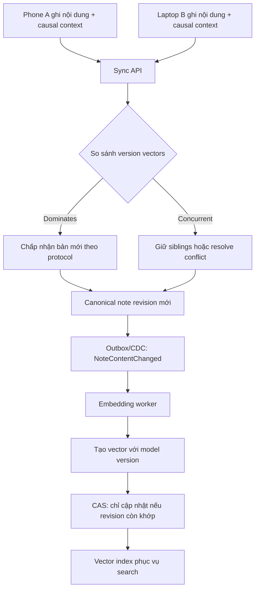

# Phân biệt vector phiên bản với vector dùng trong tìm kiếm độ tương đồng

Trong tài liệu về NoSQL, từ **vector** có thể xuất hiện trong hai cuộc thảo luận hoàn toàn khác nhau:

- **Vector phiên bản** (*version vector*, thường được giải thích cùng *vector clock*): cấu trúc metadata hỗ trợ theo dõi **quan hệ nhân quả giữa các phiên bản** khi dữ liệu được thay đổi ở nhiều node, replica hoặc thiết bị. Nó giúp trả lời: “Phiên bản nào đã biết về phiên bản nào?”, “Bản cập nhật này nối tiếp hay đồng thời với bản cập nhật kia?”.
- **Vector tìm kiếm độ tương đồng** (*embedding vector*, *feature vector*): một dãy số biểu diễn nội dung hoặc đối tượng trong không gian đặc trưng. Nó giúp trả lời: “Văn bản, hình ảnh hay sản phẩm nào **gần với truy vấn nhất về mặt biểu diễn**?”.

Hai khái niệm cùng dùng cách biểu diễn nhiều chiều, nhưng **ý nghĩa từng chiều, phép so sánh, cơ chế cập nhật, kết quả trả về và bảo đảm** khác nhau. Một vector phiên bản có dạng `{deviceA: 2, deviceB: 1}` không phải embedding để tìm kiếm ngữ nghĩa. Một embedding `[0.12, -0.48, 0.73, ...]` không chứng minh hai bản ghi có quan hệ nhân quả hoặc cái nào mới hơn.

Bài học thuộc chương **Xung đột và đồng bộ** của module **Database No SQL**. Ta sẽ học cả hai loại vector, thực hành tính toán, xem cách chúng cùng xuất hiện trong một hệ NoSQL và xây dựng các quy tắc để không nhầm **đồng bộ phiên bản** với **xếp hạng mức tương đồng**.

---

## 1. Hai câu hỏi dẫn đến hai loại vector

Giả sử ứng dụng ghi chú hỗ trợ làm việc offline:

- Điện thoại A thay đổi tên ghi chú thành “Lịch công tác”.
- Laptop B cùng lúc thay đổi nội dung thành “Họp thứ Sáu”.
- Server phải biết hai cập nhật có **quan hệ nhân quả** hay đã phát sinh **độc lập**.

Đây là bài toán của **vector phiên bản**, hoặc một cơ chế quản lý version và conflict tương đương.

Trong khi đó, cùng ứng dụng cho phép người dùng tìm “cuộc họp cuối tuần”. Server cần tìm các ghi chú có nội dung tương tự ngay cả khi không chứa đúng các từ trong câu hỏi.

Đây là bài toán của **embedding vector và similarity search**.

```text
                                  Ghi chú NoSQL
                                  /           \
                                 /             \
             Đồng bộ A/B, xung đột               Tìm kiếm ngữ nghĩa
                     |                                  |
                     v                                  v
              Version vector                      Embedding vector
              {A: 2, B: 1}                     [0.12, -0.48, ...]
                     |                                  |
                 Causal order                      Cosine / dot / L2
                     |                                  |
             Dominates / concurrent                 Top-K neighbors
```

**Điểm khác biệt nền tảng:** một loại vector nói về **lịch sử cập nhật**; loại còn lại nói về **đặc trưng của nội dung**.

---

## 2. Bảng phân biệt nhanh

| Tiêu chí | Vector phiên bản | Vector tìm kiếm độ tương đồng |
| --- | --- | --- |
| Tên tiếng Anh | Version vector, vector clock, dotted version vector ở một số hệ | Embedding vector, feature vector, dense vector |
| Mục đích | Theo dõi quan hệ nhân quả giữa các phiên bản | Đo và xếp hạng độ tương tự giữa đối tượng |
| Một chiều biểu diễn | Một actor/replica/site theo giao thức | Một chiều đặc trưng do mô hình/thuật toán tạo |
| Giá trị thường gặp | Số đếm không âm, đơn điệu theo actor | Số thực, có thể âm hoặc dương |
| Kích thước | Phụ thuộc tập actor và chiến lược metadata | Phụ thuộc embedding model và cấu hình index |
| Phép so sánh | Thứ tự bộ phận: trước/sau/bằng nhau/đồng thời | Cosine, dot product, Euclidean distance… |
| Kết quả | Quan hệ phiên bản hoặc phát hiện concurrency | Điểm tương đồng/khoảng cách, top-K |
| Cách cập nhật | Tăng bộ đếm phù hợp khi có một sự kiện mới; nhận biết causal context | Tái tính vector khi nội dung/model thay đổi |
| Index chuyên dụng | Thường không cần vector similarity index | Thường dùng vector index và kNN/ANN |
| Tính đúng dữ liệu | Giúp phát hiện một số xung đột; **không tự giải quyết** | Không cung cấp consistency hay conflict detection |
| Ví dụ | `{A: 3, B: 1}` | `[0.08, -0.21, 0.55, 0.04]` |

Hai loại vector có thể cùng là field trong một document NoSQL, nhưng tuyệt đối không nên dùng thay thế cho nhau.

---

# Phần I — Vector phiên bản và quan hệ nhân quả

## 3. Vì sao một số thứ tự cần hơn timestamp?

Một bản ghi được sửa trên nhiều thiết bị có thể mang:

```text
Device A: savedAt = 10:05:01
Device B: savedAt = 10:05:03
```

Có phải B đã nhìn thấy bản sửa của A rồi mới sửa tiếp không? **Không thể suy ra.**

- Đồng hồ A/B có thể lệch.
- Hai thiết bị có thể offline.
- Một cập nhật được tạo trước nhưng đến server sau.
- Timestamp cho biết thời điểm được ghi nhận theo một đồng hồ, **không trực tiếp ghi nhận quan hệ “đã thấy bản nào”**.

Vấn đề cần giải quyết là *causality*:

> Nếu thao tác Y được tạo sau khi tác nhân thực hiện Y đã quan sát kết quả của thao tác X, thì X có thể là nguyên nhân đi trước Y.

Ký hiệu thường dùng:

\[
X \rightarrow Y
\]

đọc là “X happened-before Y”.

Khi không có quan hệ nhân quả theo hai chiều, hai sự kiện được gọi là **concurrent (đồng thời theo nghĩa nhân quả)**. Chúng không bắt buộc xảy ra đúng cùng mili-giây; chúng có thể cách nhau vài phút nhưng hai phía chưa biết về nhau.

## 4. Vector clock và version vector liên quan thế nào?

Trong cách giải thích nhập môn, hai tên dễ được sử dụng gần nhau; cần phân biệt phạm vi:

- **Vector clock:** một cơ chế đồng hồ logic gắn với sự kiện/tác nhân, dùng xác định quan hệ *happened-before* khi thông tin nhân quả được truyền đúng.
- **Version vector:** metadata gắn với **phiên bản một đối tượng**, giúp so sánh kiến thức nhân quả của các nhánh cập nhật đối tượng đó.
- **Dotted version vector:** một biến thể bổ sung khái niệm *dot* (định danh của một sự kiện riêng) và causal context, hữu ích khi có nhiều cập nhật đồng thời hoặc client ghi ở nhiều server.

Trong ví dụ bài này, ta dùng một mô hình vector đơn giản có ánh xạ **actor → counter**. Mô hình đủ để học phép so sánh và phát hiện concurrency, nhưng không đại diện trọn vẹn mọi giao thức version vector thực tế.

**Không nên khẳng định bất kỳ trường `version` hoặc `vectorClock` nào trong một sản phẩm đều có ngữ nghĩa giống hệt mô hình đơn giản.** Mỗi engine có thể dùng sibling versions, dotted vectors, operation IDs, log positions hoặc conflict resolution khác.

## 5. Cấu trúc vector phiên bản

Giả sử có hai actor A và B:

\[
V = \{A:a,\ B:b\}
\]

Trong đó:

- `A` là định danh ổn định của actor A.
- `a` là số sự kiện mà phiên bản đã quan sát theo lịch sử của A.
- `B` và `b` tương tự.
- Một actor chưa có trong vector thường được hiểu có bộ đếm 0 trong **mô hình đang dùng**.

Ví dụ:

```json
{
  "versionVector": {
    "phone-A": 3,
    "laptop-B": 1
  }
}
```

Ý nghĩa là phiên bản mang causal context tới mốc 3 của A và mốc 1 của B **theo cách giao thức định nghĩa**. Không nên diễn giải “A sửa đúng ba lần nội dung hiện tại” nếu counter còn bao gồm các sự kiện khác trong quá trình.

### 5.1. Không có chiều “ý nghĩa ngôn ngữ”

Trong vector phiên bản, trục `phone-A` không phải một đặc trưng như “màu sắc” hay “chủ đề thanh toán”. Nó chỉ là **nguồn phát sinh sự kiện**.

Các bộ đếm không phải score và không nên chuẩn hóa về khoảng `[0,1]` như embedding.

### 5.2. Định danh actor cần được quản lý

Nếu thiết bị A được cài lại, tái dùng ID A nhưng counter quay về 0 có thể làm đứt giả định đơn điệu. Một hệ triển khai đúng phải có cách quản lý incarnation/epoch hoặc ID mới.

---

## 6. Ba quan hệ quan trọng khi so sánh version vectors

Xét hai vectors \(V\) và \(W\). Định nghĩa quan hệ theo từng actor \(i\).

**\(V \preceq W\)** nếu:

\[
\forall i,\ V_i \le W_i.
\]

Nghĩa là mọi bộ đếm của \(V\) đều không lớn hơn bộ đếm tương ứng trong \(W\).

Các trường hợp:

1. **Bằng nhau:** \(V_i=W_i\) với mọi \(i\).
2. **\(W\) trội hơn \(V\) (*dominates*):** \(V\preceq W\) và có ít nhất một chiều của \(W\) lớn hơn.
3. **\(V\) trội hơn \(W\):** ngược lại.
4. **Concurrent:** có chiều mà \(V_i>W_i\) và chiều khác mà \(V_j<W_j\).

### 6.1. Bằng nhau

```text
V = {A:2, B:1}
W = {A:2, B:1}
```

Hai vectors có **cùng causal context** theo mô hình.

Chú ý: cùng vector **không phải một phép so sánh nội dung**. Nếu dữ liệu có cùng version metadata nhưng payload khác nhau ngoài khả năng của giao thức, đó có thể là lỗi hoặc trường hợp phải điều tra; không được tự cho hai payload bằng nhau.

### 6.2. Một vector trội hơn vector khác

```text
V = {A:2, B:1}
W = {A:3, B:1}
```

W trội hơn V vì:

\[
3\ge2,\quad 1\ge1
\]

và ít nhất một chiều lớn hơn.

Trong giao thức bảo toàn causal context, W có thể đại diện cho nhánh **đã biết về** những sự kiện mà V ghi nhận.

### 6.3. Concurrent

```text
V = {A:3, B:1}
W = {A:2, B:2}
```

Ở chiều A, \(V_A>W_A\); ở chiều B, \(V_B<W_B\). Không vector nào trội hơn vector kia.

Đây là dấu hiệu **hai lịch sử không bao hàm nhau**, thường cần giữ cả hai ứng viên hoặc giải quyết xung đột theo chính sách.

### 6.4. Tại sao không cộng tổng?

```text
V = {A:3, B:1}   -> tổng 4
W = {A:2, B:2}   -> tổng 4
```

Cùng tổng **không có nghĩa cùng lịch sử**. Dùng tổng counter hoặc so từ trái sang phải sẽ làm mất quan hệ thứ tự bộ phận.

---

## 7. Timeline hai thiết bị cùng sửa offline

Ban đầu ghi chú có trạng thái `title="Ghi chú"` và vector:

```text
V0 = {A:0, B:0}
```

Điện thoại A offline, sửa tiêu đề:

```text
A sửa title -> V_A = {A:1, B:0}
```

Laptop B cũng offline, sửa nội dung:

```text
B sửa body  -> V_B = {A:0, B:1}
```

Sơ đồ:

```text
                       V0 {0,0}
                       /       \
                      /         \
             A sửa title       B sửa body
                    |             |
             V_A {1,0}       V_B {0,1}
                      \         /
                       \       /
                    Đồng bộ tại server
```

\(V_A\) và \(V_B\) concurrent. Server **không được suy** bản đến sau là “phiên bản mới nhất theo nhân quả”.

### 7.1. Hai nhánh có thật sự mâu thuẫn nội dung không?

Nếu A chỉ sửa `title`, B chỉ sửa `body`, ứng dụng có thể **merge hai field không xung đột**, miễn biết bản gốc và chính sách hợp nhất.

Nếu cả A và B cùng sửa `title` thành hai giá trị khác nhau, ứng dụng cần:

- Cho người dùng chọn.
- Áp quy tắc ưu tiên (nếu nghiệp vụ chấp nhận).
- Giữ sibling versions.
- Dùng loại dữ liệu có merge semantics riêng.

**Version vector phát hiện concurrency; nó không biết nội dung sửa có thể hợp nhất an toàn không.**

---

## 8. Merge vector phiên bản: lấy max từng chiều

Để hợp nhất **causal context**, ta dùng phép join theo từng thành phần:

\[
(V\sqcup W)_i = \max(V_i,W_i).
\]

Với:

```text
V_A = {A:1, B:0}
V_B = {A:0, B:1}
```

Causal context sau khi nhận biết cả hai:

```text
join(V_A, V_B) = {A:1, B:1}
```

Nếu A thực hiện một sự kiện mới **sau khi đã biết cả hai nhánh**, vector có thể thành:

```text
V_merged_write = {A:2, B:1}
```

Vector `{A:2,B:1}` trội hơn cả `{A:1,B:0}` và `{A:0,B:1}`.

### 8.1. Merge metadata khác merge payload

Phép `max` theo chiều chỉ hợp nhất **thông tin nhân quả**. Nó không nói rằng giá trị `balance` cần lấy max, cộng hay ghi đè.

Ví dụ:

```text
A: stock = 9,  version {A:1,B:0}
B: stock = 8,  version {A:0,B:1}
```

Không được lấy `stock=9` vì vector metadata sau join có thành phần max. Cũng không được tự cộng `stock=17`.

Việc merge giá trị cần quy tắc nghiệp vụ, CRDT, log sự kiện hoặc người dùng giải quyết.

### 8.2. Phép join có tính chất gì?

Với vector hợp lệ:

- Giao hoán: \(V\sqcup W=W\sqcup V\).
- Kết hợp: \((U\sqcup V)\sqcup W=U\sqcup(V\sqcup W)\).
- Lũy đẳng: \(V\sqcup V=V\).

Những tính chất này giúp hợp nhất causal contexts dù thứ tự nhận khác nhau. **Không suy rằng payload được hợp nhất cũng tự có ba tính chất đó.**

---

## 9. Java: so sánh version vectors bằng quan hệ từng chiều

Ví dụ Java 17 dưới đây độc lập với database, dùng `Map<String,Long>`. Code minh họa **mô hình so sánh**, không phải giao thức đồng bộ production đầy đủ.

```java
import java.util.HashMap;
import java.util.HashSet;
import java.util.Map;
import java.util.Set;

public final class VersionVectorExample {

    enum Relation {
        EQUAL, LEFT_BEFORE_RIGHT, LEFT_AFTER_RIGHT, CONCURRENT
    }

    static Relation compare(
            Map<String, Long> left,
            Map<String, Long> right
    ) {
        Set<String> actors = new HashSet<>(left.keySet());
        actors.addAll(right.keySet());

        boolean leftGreater = false;
        boolean rightGreater = false;

        for (String actor : actors) {
            long a = left.getOrDefault(actor, 0L);
            long b = right.getOrDefault(actor, 0L);

            if (a < 0 || b < 0) {
                throw new IllegalArgumentException("Negative counter");
            }

            if (a > b) leftGreater = true;
            if (a < b) rightGreater = true;
        }

        if (leftGreater && rightGreater) {
            return Relation.CONCURRENT;
        }
        if (leftGreater) {
            return Relation.LEFT_AFTER_RIGHT;
        }
        if (rightGreater) {
            return Relation.LEFT_BEFORE_RIGHT;
        }
        return Relation.EQUAL;
    }

    static Map<String, Long> join(
            Map<String, Long> left,
            Map<String, Long> right
    ) {
        Map<String, Long> result = new HashMap<>(left);

        right.forEach((actor, count) ->
            result.merge(actor, count, Math::max)
        );

        return result;
    }

    static Map<String, Long> nextEvent(
            Map<String, Long> context,
            String actor
    ) {
        Map<String, Long> next = new HashMap<>(context);
        next.merge(actor, 1L, (oldValue, one) ->
            Math.addExact(oldValue, one)
        );
        return next;
    }

    public static void main(String[] args) {
        Map<String, Long> phone = Map.of("A", 1L);
        Map<String, Long> laptop = Map.of("B", 1L);

        System.out.println(compare(phone, laptop));
        // CONCURRENT

        Map<String, Long> context = join(phone, laptop);
        System.out.println(context);
        // {A=1, B=1} (thứ tự in Map không cố định)

        Map<String, Long> next = nextEvent(context, "A");
        System.out.println(compare(phone, next));
        // LEFT_BEFORE_RIGHT

        System.out.println(compare(laptop, next));
        // LEFT_BEFORE_RIGHT
    }
}
```

### 9.1. Tại sao phải lấy hợp của các actor?

`{A:1}` và `{B:1}` cần được so trên cả hai trục A/B; thiếu actor được hiểu là 0 trong ví dụ.

Nếu chỉ duyệt keys của `left`, ta có thể **bỏ qua bằng chứng concurrency ở chiều B**.

### 9.2. Tại sao không dùng timestamp?

Phép so version vectors dựa trên **thứ tự bộ đếm được truyền theo causality**, không phải so `updatedAt`.

### 9.3. Giới hạn của code

Code chưa xử lý actor incarnation, giới hạn metadata, counter cấp phát cạnh tranh, dot IDs, lưu trữ bền causal contexts, retry, sự kiện bị gửi lặp hoặc xung đột payload. Những điều đó cần giao thức đồng bộ có thiết kế riêng.

---

## 10. Version vector không phải số version đơn

Một trường phổ biến:

```json
{
  "_id": "doc-17",
  "version": 42
}
```

Có thể dùng `version` làm **optimistic concurrency token** trong hệ có một authority cập nhật:

```javascript
db.docs.updateOne(
  { _id: "doc-17", version: 42 },
  {
    $set: { title: "Mới" },
    $inc: { version: 1 }
  }
);
```

Nếu `matchedCount=0`, một tác nhân khác có thể đã thay đổi document hoặc document không còn tồn tại. Điều này rất hữu ích cho **compare-and-set**.

Nhưng một scalar `version=42` không mang thông tin rằng nhánh A đã thấy B hay B đã thấy A **khi các thiết bị offline độc lập**.

### 10.1. Có thể dùng cả hai

Một document có thể chứa:

```json
{
  "_id": "doc-17",
  "revision": 42,
  "causalVersion": {
    "device-A": 3,
    "device-B": 1
  }
}
```

- `revision` hỗ trợ CAS tại authority hiện tại.
- `causalVersion` hỗ trợ giao thức đồng bộ với client khác, nếu ứng dụng thực thi đúng.

Không nên giả rằng **MongoDB tự động hiểu field `causalVersion`**. Nếu chỉ lưu JSON, mọi quy tắc so sánh vẫn do ứng dụng/giao thức triển khai.

---

## 11. Version vector khác Lamport clock và hybrid logical clock

### 11.1. Lamport clock

Một logical clock vô hướng có thể bảo đảm nếu \(X\rightarrow Y\) thì \(L(X)<L(Y)\), khi giao thức cập nhật đúng. Nhưng chiều ngược lại **không đúng nói chung**:

\[
L(X)<L(Y)\not\Rightarrow X\rightarrow Y.
\]

Hai sự kiện concurrent vẫn có thể được gán số khác nhau. Vì thế không dùng Lamport timestamp đơn để kết luận chắc chắn quan hệ nhân quả.

### 11.2. Hybrid Logical Clock (HLC)

HLC kết hợp thông tin thời gian vật lý với thành phần logic để hỗ trợ ordering/độ gần thời gian thực trong nhiều hệ. Nó có những bảo đảm riêng về thứ tự theo giao thức, **không mặc nhiên thay thế vector clock để phân biệt đầy đủ mọi cặp concurrent events**.

### 11.3. Wall-clock timestamp/LWW

Một chính sách *last-write-wins* (LWW) có thể chọn giá trị theo timestamp/priority. Nó giúp hội tụ theo quy tắc đã chọn, nhưng **có thể làm mất một cập nhật đồng thời**.

### 11.4. Chọn theo nhu cầu

| Cần làm gì? | Hướng cân nhắc |
| --- | --- |
| CAS trên document tại một authority | Scalar revision/version |
| Ghi nhận thứ tự logic theo một protocol | Lamport/HLC/log index nếu phù hợp |
| Phát hiện hai nhánh offline concurrent | Version vector/vector clock hoặc causal metadata tương đương |
| Chọn một giá trị thắng nhanh, chấp nhận mất update | LWW có chính sách rõ |
| Hợp nhất dữ liệu có phép merge hợp lệ | CRDT/operation log |
| Giao dịch quan trọng cần invariant | Atomic/conditional write, transaction, consensus phù hợp |

---

## 12. Vector phiên bản không tự bảo đảm eventual convergence

Giả sử hai replica phát hiện hai nhánh concurrent:

```text
A: title = "Bản A", vector {A:1,B:0}
B: title = "Bản B", vector {A:0,B:1}
```

Để hội tụ, hệ phải **quyết định xử lý payload**:

- Giữ cả hai sibling versions để client giải quyết.
- Merge theo field khi được chứng minh an toàn.
- Chọn theo một thứ tự xác định và chấp nhận mất một nhánh.
- Dùng CRDT cho dữ liệu có đại số merge phù hợp.
- Chuyển sang trạng thái conflict cần can thiệp.

Version vector chỉ là một phần của **cơ chế phát hiện xung đột**, không phải một thuật toán giải quyết tất cả.

### 12.1. Cần tránh “merge nhân đôi”

Nếu A và B cùng tăng counter kinh doanh bằng thao tác độc lập, không thể cứ cộng hai **giá trị snapshot** khi chưa trừ baseline. Có thể double-count phần đã biết chung.

Ví dụ CRDT G-counter có cấu trúc counter theo actor với merge max từng chiều, nhưng đó là **cấu trúc dữ liệu đếm cụ thể**, không phải mọi version vector đều chính là G-counter mang giá trị kinh doanh.

### 12.2. Invariant cần nguồn thẩm quyền

Số ghế còn 1 nhưng hai thiết bị offline cùng “giữ ghế” có thể tạo hai yêu cầu concurrent. Version vector phát hiện hai nhánh không tuần tự, **không quyết định cả hai cùng hợp lệ**.

Để giữ bất biến “không bán quá một ghế”, cần reservation authority, escrow, atomic condition hoặc protocol cấp phát phù hợp.

---

## 13. Sibling versions và dotted version vectors

Một số hệ NoSQL kiểu đa bản ghi/xung đột có thể giữ nhiều phiên bản của cùng key thay vì âm thầm ghi đè.

```text
Key = profile:user-42

Sibling 1:
  payload.title = "Bản từ điện thoại"
  context      = {A:2, B:0}

Sibling 2:
  payload.title = "Bản từ laptop"
  context      = {A:1, B:1}
```

Hai contexts concurrent. Nếu client đọc cả hai, giải quyết xung đột rồi ghi phiên bản mới với **đủ causal context**, nhánh mới có thể bao hàm cả hai.

### 13.1. Tại sao dotted vector hữu ích?

Một *dot* thường định danh một sự kiện riêng, chẳng hạn `(actor, counter)`. Cấu trúc kết hợp dot mới với causal context đã biết để tránh mất thông tin về **nhiều ghi đồng thời**, đặc biệt khi có nhiều writers đi qua cùng server.

Ví dụ khái niệm:

```text
Context trước: {server-A: 7, server-B: 4}
Sự kiện mới:   dot = (server-A, 8)
```

Không nên coi hai dòng trên là một định dạng giao thức chuẩn cho mọi implementation. Điểm cần học là **metadata phải phân biệt một cập nhật cụ thể với tập sự kiện mà cập nhật đó đã biết**.

### 13.2. Nhiều client qua cùng một server

Nếu server A liên tục nhận hai ghi từ clients chưa thấy nhau, việc chỉ “tăng bộ đếm server A” rồi giữ một vector duy nhất có thể **che mờ concurrency ở mức client** nếu protocol thiết kế không đúng.

Vì thế những hệ có siblings/dotted contexts cần quản lý **causal context được client gửi về và định danh sự kiện riêng**, không chỉ số lần ghi tổng của server.

---

## 14. Chi phí và giới hạn của version vector

Version vectors không miễn phí.

### 14.1. Chi phí metadata

Với \(n\) actors, một vector đầy đủ có thể chứa \(O(n)\) counters. So sánh hoặc join cũng cần xét các chiều liên quan, thường \(O(n)\) trong mô hình đơn giản.

Nếu có hàng triệu thiết bị với actor ID riêng, lưu một chiều vĩnh viễn cho mỗi thiết bị trên mọi document sẽ không khả thi.

### 14.2. Dynamic membership

Hệ phải giải quyết:

- Actor tham gia/rời đi.
- Thiết bị bị cài lại.
- Replica được thay mới.
- Counter/epoch có tái sử dụng không.
- Metadata của actor cũ có thể compact khi nào.
- Tác nhân offline nhiều tháng quay lại với history cũ.

Một thiết kế không thể chỉ “xóa bớt keys cũ để giảm kích thước” mà không chứng minh vẫn bảo toàn thông tin causality cần thiết.

### 14.3. Giới hạn rò rỉ metadata

Actor IDs có thể là device IDs/replica IDs nhạy cảm. Không trả toàn bộ hệ thống nội bộ cho client nếu không cần; dùng opaque causal tokens hoặc định danh hợp lệ theo kiến trúc.

### 14.4. Replay và duplicate event

Một sự kiện đã nhận lại phải được xử lý idempotently; không tăng counter mỗi lần **nhận bản tin lặp**. Counter phải theo **sự kiện logic**, không theo số lần network delivery.

---

# Phần II — Vector dùng để tìm kiếm độ tương đồng

## 15. Embedding vector là gì?

Một embedding là dãy số thực biểu diễn một đối tượng trong không gian đặc trưng:

\[
\mathbf{e}=(e_1,e_2,\ldots,e_d)\in\mathbb{R}^{d}.
\]

Đối tượng có thể là:

- Văn bản hoặc câu hỏi.
- Một đoạn tài liệu.
- Hình ảnh.
- Âm thanh.
- Sản phẩm.
- Người dùng hoặc phiên tương tác trong hệ gợi ý.
- Một trạng thái/dữ liệu cảm biến trong mô hình học máy.

Ví dụ 4 chiều **minh họa**, không phải output của một embedding model cụ thể:

```json
{
  "id": "note-17",
  "embedding": [0.12, -0.48, 0.73, 0.09]
}
```

Mỗi chiều thường là một tọa độ đặc trưng học được. Ta **không thể gán tùy ý** “chiều 1 = lịch sử”, “chiều 2 = thanh toán” cho một model đã huấn luyện nếu model không công bố ngữ nghĩa đó.

### 15.1. Embedding không phải version

Khi nội dung văn bản thay đổi, embedding có thể thay đổi dù số phiên bản vẫn tăng đều. Hai văn bản rất giống nhau có thể có embeddings gần nhau nhưng được tạo cách nhau nhiều năm.

### 15.2. Cùng mô hình và cùng không gian

So sánh hai embeddings chỉ có ý nghĩa nếu chúng thuộc những không gian tương thích theo mô hình được sử dụng:

- Cùng model/version hoặc cơ chế tương thích được chứng minh.
- Số chiều phù hợp.
- Tiền xử lý và chuẩn hóa đúng.
- Cùng metric được index/search sử dụng.

Không trộn tùy ý embeddings 384 chiều với 768 chiều hoặc từ hai model khác nhau rồi tính cosine như thể cùng hệ tọa độ.

---

## 16. Tạo embeddings trong đường ghi và đường truy vấn

Một pipeline phổ biến:

```text
Tài liệu NoSQL
     |
     v
Chuẩn hóa nội dung theo policy
     |
     v
Embedding model M
     |
     v
Vector [x1, x2, ..., xd]
     |
     v
Vector index (kèm metadata filter)
```

Khi user tìm kiếm:

```text
Câu hỏi của user
     |
     v
Embedding model tương thích M
     |
     v
Query vector q
     |
     v
Top-K nearest neighbors
     |
     v
Lọc tenant/ACL + re-rank nếu cần
     |
     v
Kết quả
```

Nhiều hệ dùng ANN index như HNSW hoặc IVF để giảm chi phí so với quét mọi vector. **ANN có thể trả kết quả gần đúng**, với đánh đổi recall, latency, memory và chi phí xây index.

### 16.1. Không cần một vector cho mọi field

Có thể tạo embedding cho `title + body`, hoặc riêng từng đoạn/chunk. Nếu tài liệu dài, chunking giúp truy xuất phần liên quan, nhưng tăng số vectors và yêu cầu mapping về document gốc.

### 16.2. Nội dung thay đổi cần re-embed

Nếu note từ “Hướng dẫn Redis” thành “Hướng dẫn Cassandra”, embedding cũ có thể không còn phản ánh nội dung. Cần pipeline cập nhật/đánh dấu version và xử lý indexing lag.

### 16.3. Model nâng cấp là migration

Đổi embedding model có thể làm vector dimension/metric thay đổi. Một index mới, backfill và canary cutover có thể cần thiết, không chỉ đổi tên trường.

---

## 17. Độ tương đồng cosine

Với hai vector thực \(\mathbf{x}\) và \(\mathbf{y}\) có chuẩn khác 0, cosine similarity:

\[
\cos(\mathbf{x},\mathbf{y})=
\frac{\mathbf{x}\cdot\mathbf{y}}
{\|\mathbf{x}\|_2\,\|\mathbf{y}\|_2}.
\]

Trong đó:

\[
\mathbf{x}\cdot\mathbf{y}=\sum_i x_i y_i
\]

và:

\[
\|\mathbf{x}\|_2=\sqrt{\sum_i x_i^2}.
\]

Cosine xem **góc/hướng** giữa các vector, ít phụ thuộc độ lớn nếu chuẩn hóa phù hợp.

### 17.1. Một ví dụ 2 chiều để tính tay

Cho:

```text
Query q = (1, 0)
Doc A   = (0.8, 0.6)
Doc B   = (0, 1)
```

Các vector trên có chuẩn 1:

\[
\cos(q,A)=0.8,\quad \cos(q,B)=0.
\]

Theo cosine, A gần truy vấn hơn B.

**Những tọa độ này chỉ minh họa phép toán**, không nói rằng một hệ ngữ nghĩa thực có đúng hai chiều.

### 17.2. Giá trị âm có nghĩa gì?

Cosine có thể nằm từ -1 tới 1 theo định nghĩa toán học. Cách triển khai index có thể chuyển score sang thang khác, làm tròn, hoặc áp các giả định riêng về vector normalization.

Không đặt ngưỡng “cosine 0.8 là giống nhau” cho mọi model và mọi domain mà không đánh giá.

### 17.3. Vector không chuẩn 0

Cosine **không xác định** nếu một vector có chuẩn 0. Pipeline cần xử lý vector rỗng/không hợp lệ trước khi index hoặc truy vấn.

---

## 18. Dot product và Euclidean distance khác cosine thế nào?

### 18.1. Dot product

\[
\mathbf{x}\cdot\mathbf{y}=\sum_i x_i y_i.
\]

Nếu vector chưa chuẩn hóa, **độ lớn** ảnh hưởng score. Ví dụ:

```text
q = (1, 0)
A = (0.8, 0.6)
B = (10, 10)
```

Dot scores:

\[
q\cdot A=0.8,\qquad q\cdot B=10.
\]

Dot chọn B, nhưng cosine:

\[
\cos(q,A)=0.8,\qquad \cos(q,B)\approx0.707.
\]

Cosine chọn A. **Metric khác có thể đổi thứ hạng.**

### 18.2. Euclidean distance

Khoảng cách L2:

\[
d_2(\mathbf{x},\mathbf{y})
=
\sqrt{\sum_i(x_i-y_i)^2}.
\]

Với L2, **nhỏ hơn nghĩa là gần hơn**; với cosine/dot (trong cách dùng thông thường), **lớn hơn nghĩa là tương tự hơn**.

### 18.3. Khi nào cosine tương quan với dot/L2?

Nếu tất cả vectors đã được chuẩn hóa về chuẩn 1:

\[
\mathbf{x}\cdot\mathbf{y}
=
\cos(\mathbf{x},\mathbf{y})
\]

và:

\[
\|\mathbf{x}-\mathbf{y}\|_2^2
=
2-2\cos(\mathbf{x},\mathbf{y}).
\]

Khi ấy thứ hạng có liên hệ đơn điệu. **Không áp kết luận này cho vectors chưa được chuẩn hóa**.

---

## 19. Python thuần: tìm Top-K theo cosine

Đoạn Python 3 sau minh họa phép tính exact search trên tập rất nhỏ, không cần thư viện ngoài.

```python
from math import sqrt

def dot(left, right):
    if len(left) != len(right):
        raise ValueError("Vector dimensions differ")
    return sum(a * b for a, b in zip(left, right))

def l2_norm(vec):
    return sqrt(sum(x * x for x in vec))

def cosine(left, right):
    denominator = l2_norm(left) * l2_norm(right)
    if denominator == 0:
        raise ValueError("Cosine is undefined for zero vectors")
    return dot(left, right) / denominator

query = [1.0, 0.0]

documents = [
    ("A", [0.8, 0.6]),
    ("B", [0.0, 1.0]),
    ("C", [0.6, 0.8]),
]

ranked = sorted(
    (
        (doc_id, cosine(query, embedding))
        for doc_id, embedding in documents
    ),
    key=lambda item: item[1],
    reverse=True,
)

for doc_id, score in ranked:
    print(doc_id, round(score, 3))
```

Kết quả mong đợi:

```text
A 0.8
C 0.6
B 0.0
```

Đây là **exact linear scan** có chi phí gần \(O(Nd)\) cho N vectors d chiều trong mô hình cơ bản. Khi N lớn, hệ thường cần index chuyên dụng và ANN. Nó không dùng một thuật toán version vector nào.

---

## 20. kNN, ANN và vector index

**k-nearest neighbors (kNN)** là tìm k điểm gần truy vấn nhất theo metric đã chọn.

**Approximate nearest neighbor (ANN)** là tìm ứng viên gần nhất bằng thuật toán/index tối ưu tốc độ/bộ nhớ, có thể bỏ lỡ một số hàng xóm thật sự gần nhất.

Ví dụ:

```text
Query embedding q
       |
       v
Vector index
       |
       +--> candidate 1 (score 0.92)
       +--> candidate 2 (score 0.89)
       +--> candidate 3 (score 0.87)
       |
       v
Filter, rank, retrieve documents
```

Các tên như HNSW hay IVF mô tả **họ thuật toán/chỉ mục**, không phải cơ chế phiên bản trong replication.

### 20.1. Các tham số cần cân bằng

- **Recall@K:** tỷ lệ kết quả thực gần nhất được tìm thấy.
- **Latency p95/p99:** thời gian truy vấn.
- **Index build time:** thời gian tạo/rebuild.
- **Memory/disk footprint:** kích thước vector index.
- **Update latency:** thời gian phản ánh tài liệu mới.
- **Filter selectivity:** có cần giới hạn tenant/type/date không?
- **Candidate count:** tập kết quả ứng viên ban đầu.
- **Reranking cost:** bước đánh giá lại theo văn bản/ML.

### 20.2. Similarity score không phải xác suất đúng

Một score 0.89 không mặc nhiên nghĩa “89% kết quả chính xác”. Nó là giá trị của **metric scoring** được cấu hình; muốn chuyển thành xác suất cần mô hình/hiệu chuẩn và dữ liệu đánh giá riêng.

---

## 21. NoSQL lưu embedding ra sao?

Một document có thể chứa các trường:

```json
{
  "_id": "note-17",
  "tenantId": "tenant-1",
  "title": "Cuộc họp dự án",
  "body": "Thống nhất lịch triển khai...",
  "embedding": [0.12, -0.48, 0.73, 0.09],
  "embeddingModel": "model-M-v1",
  "contentRevision": 18,
  "indexedRevision": 18
}
```

Ở đây:

- `embedding` là **dữ liệu vector tìm kiếm**.
- `embeddingModel` cho biết không gian/mô hình đã tạo vector.
- `contentRevision` là **scalar revision** của nội dung.
- `indexedRevision` thể hiện pipeline indexing đã xử lý mốc nào.

Trường `indexedRevision` không phải tự động là version vector, và `embedding` không phải history. Đây là những tầng metadata khác nhau.

### 21.1. Embedding index không thay document index

Query theo `tenantId`, `status`, `createdAt` hoặc `_id` có thể cần index/lọc riêng. Vector index hỗ trợ **nearest-neighbor similarity**, không tự làm mọi truy vấn quan hệ/range hoặc quyền truy cập hiệu quả.

### 21.2. Filtering là một phần của yêu cầu bảo mật

Trong hệ đa tenant, không được chỉ tìm Top-K **toàn bộ database** rồi hiển thị kết quả chưa kiểm tra quyền. Thiết kế phải bảo đảm tenant/ACL ở truy vấn hoặc tầng xác thực phù hợp, với bảo vệ kể cả khi index lag.

### 21.3. Embedding có thể là dữ liệu nhạy cảm

Vector có thể tiết lộ thông tin về nội dung gốc hoặc có rủi ro riêng khi gửi tới nhà cung cấp model. Cần chính sách quyền truy cập, mã hóa, retention và dữ liệu đủ điều kiện được embedding.

---

## 22. MongoDB Atlas Vector Search: ví dụ truy vấn

Một số triển khai MongoDB có khả năng vector search qua index chuyên dụng. Ví dụ cú pháp `$vectorSearch` dưới đây mang tính **minh họa cho môi trường Atlas có tính năng, phiên bản và index phù hợp**. Nó không chạy trên mọi `mongod` hoặc mọi version.

Giả sử collection:

```javascript
const lab = db.getSiblingDB("vector_learning_lab");

lab.notes.insertMany([
  {
    _id: "n1",
    tenantId: "t1",
    title: "Hướng dẫn MongoDB",
    embedding: [0.8, 0.6, 0.0, 0.0]
  },
  {
    _id: "n2",
    tenantId: "t1",
    title: "Cách tạo index",
    embedding: [0.6, 0.8, 0.0, 0.0]
  },
  {
    _id: "n3",
    tenantId: "t2",
    title: "Tài liệu tenant khác",
    embedding: [1.0, 0.0, 0.0, 0.0]
  }
]);
```

Đây là embeddings 4 chiều giả lập, **không phải vector ngữ nghĩa của model thực**. Cần có vector search index tên `notes_embedding_idx` với trường `embedding` 4 chiều và trường `tenantId` được cấu hình để filter.

Truy vấn minh họa:

```javascript
lab.notes.aggregate([
  {
    $vectorSearch: {
      index: "notes_embedding_idx",
      path: "embedding",
      queryVector: [1.0, 0.0, 0.0, 0.0],
      numCandidates: 100,
      limit: 5,
      filter: { tenantId: "t1" }
    }
  },
  {
    $project: {
      _id: 1,
      title: 1,
      tenantId: 1,
      score: { $meta: "vectorSearchScore" }
    }
  }
]);
```

### 22.1. Những điều cần chuẩn bị

- Deployment có hỗ trợ tính năng này.
- Vector search index được tạo **đúng kiểu và đúng dimensions**.
- `tenantId` được index như trường filter theo yêu cầu.
- Query vector có cùng số chiều và model/metric tương thích với documents.
- Driver/SDK và pipeline theo API của version đang dùng.

### 22.2. Đừng coi score là version

`vectorSearchScore` là điểm phục vụ thứ hạng tìm kiếm. Nếu `n1` score lớn hơn `n2`, nó **không nói n1 được sửa sau n2**, không phát hiện concurrent edits và cũng không khẳng định kết quả có độ tươi phù hợp.

### 22.3. Kết quả vector search có thể trễ

Index/search pipeline có thể có độ trễ cập nhật hoặc điều kiện visibility riêng. Khi cần đọc một ghi chú ngay sau khi sửa, có thể cần đọc canonical document hoặc dùng session/read policy phù hợp thay vì mặc nhiên tin ANN đã cập nhật.

---

## 23. Các hệ NoSQL khác và vector search

Những hệ phân tán có thể hỗ trợ vector search theo các cơ chế khác nhau:

| Nhóm hệ | Cách tổ chức khái niệm | Cần kiểm tra |
| --- | --- | --- |
| Document NoSQL | Embedding là field của document | Vector index, filter, cập nhật khi content đổi |
| Search engine phân tán | ANN/dense vector index + keyword/full text | Hybrid ranking, shard fan-out, index freshness |
| Key-value có search module | Key/index chứa vector và metadata | Module/version, distance metric, ACL |
| Vector database chuyên dụng | Vector collection + payload/filter | Replication/consistency riêng, upsert và index rebuild |
| Wide-column NoSQL có vector features | Vector field/query phù hợp sản phẩm | Version hỗ trợ, dimension/metric, per-partition constraints |

Không nên suy tất cả sản phẩm có một SQL/CQL/JSON API giống nhau hoặc đều dùng cùng thuật toán HNSW.

### 23.1. “Vector database” khác “version-vector database”

Một sản phẩm được gọi *vector database* chủ yếu vì phục vụ **vector similarity retrieval**. Tên đó **không tự chứng minh** nó dùng version vectors để giải quyết concurrent writes.

Ngược lại, một hệ key-value có causal version metadata **không mặc nhiên** có khả năng tìm kiếm semantic nearest neighbors.

---

# Phần III — Khi cả hai vector cùng tồn tại

## 24. Một document có hai loại vector

Một mô hình minh họa:

```json
{
  "_id": "note-17",
  "tenantId": "tenant-a",
  "title": "Tổng kết họp nhóm",
  "body": "Các quyết định trong buổi họp...",
  "causalVersion": {
    "phone-A": 3,
    "laptop-B": 1
  },
  "contentRevision": 18,
  "embedding": [0.12, -0.48, 0.73, 0.09],
  "embeddingModel": "text-model-v1",
  "embeddingSourceRevision": 18,
  "updatedAt": "2026-11-14T08:00:00Z"
}
```

### 24.1. Mỗi trường trả lời gì?

| Trường | Câu hỏi |
| --- | --- |
| `causalVersion` | Phiên bản này đã biết về các nhánh cập nhật nào? |
| `contentRevision` | Nội dung canonical đang ở revision nào? |
| `embedding` | Nội dung nằm ở đâu trong không gian đặc trưng? |
| `embeddingModel` | Vector thuộc model/không gian nào? |
| `embeddingSourceRevision` | Embedding được tạo từ revision nội dung nào? |
| `updatedAt` | Timestamp theo nguồn/đồng hồ được ghi nhận, có giới hạn riêng |

### 24.2. Các trường phải có tên rõ

Không nên chỉ đặt hai field mơ hồ:

```json
{ "vector": [1, 3], "version": [0.13, 0.72] }
```

Tên dễ gây lỗi serialization và validation. Dùng `causalVersion`, `embedding`, `embeddingModel` và revision/watermark riêng.

### 24.3. Không suy nhân quả từ embedding

Hai ghi chú có embeddings gần nhau **có thể do cùng chủ đề** dù chưa từng copy nhau. Một ghi chú đã được chỉnh sửa nhiều lần có thể vẫn giữ gần cùng embedding nếu ý nghĩa nội dung ít thay đổi.

---

## 25. Pipeline đồng bộ offline và cập nhật embedding

Giả sử A và B cùng sửa ghi chú offline.



### 25.1. Thứ tự đúng

1. Xác định và giải quyết trạng thái **canonical**.
2. Gán revision nội dung.
3. Tạo event về thay đổi cần re-embed.
4. Worker tạo vector.
5. Ghi vector kèm **source revision**.
6. Không cho output của job cũ ghi đè embedding của revision mới.
7. Index cập nhật và bắt đầu trả kết quả phù hợp.

### 25.2. Race khi embedding chạy bất đồng bộ

Giả sử:

```text
T0: content revision 18, worker W18 bắt đầu.
T1: content revision 19, worker W19 bắt đầu.
T2: W19 xong, lưu embedding từ rev19.
T3: W18 xong muộn.
```

Nếu W18 chỉ update theo `_id`, embedding có thể **bị lùi về rev18**.

Một guard khái niệm:

```javascript
db.notes.updateOne(
  {
    _id: "note-17",
    contentRevision: 18
  },
  {
    $set: {
      embedding: [0.12, -0.48, 0.73, 0.09],
      embeddingSourceRevision: 18,
      embeddingModel: "text-model-v1"
    }
  }
);
```

Nếu canonical revision đã là 19, update cho rev18 không match. Với pipeline lưu vector ở hệ index riêng, cần **version guard tại sink hoặc outbox consumer**, không chỉ kiểm tra ở Orders DB rồi ghi bên ngoài không nguyên tử.

### 25.3. Embedding model upgrade

Nếu model chuyển từ v1 sang v2, cần biết cả **content revision** và **model version**. Một vector từ rev19/v1 không nhất thiết thay thế được rev18/v2 theo một thứ tự scalar duy nhất. Có thể lưu các index/model versions song song trong giai đoạn chuyển đổi.

---

## 26. Một case study: ghi chú công việc nhiều thiết bị

Yêu cầu:

- Người dùng có thể sửa offline.
- Khi online, app đồng bộ và báo xung đột nếu hai sửa đổi không có quan hệ nhân quả.
- Cho phép tìm ghi chú theo ý nghĩa.
- Không hiển thị ghi chú của tenant khác.
- Kết quả tìm kiếm mới cập nhật trong một khoảng độ trễ đã cam kết.

### 26.1. Schema khái niệm

```json
{
  "_id": "note-123",
  "tenantId": "t1",
  "ownerId": "u7",
  "title": "Lịch họp dự án",
  "body": "Họp với nhóm vận hành vào chiều thứ Sáu",
  "causalContext": {
    "phone-A": 4,
    "laptop-B": 2
  },
  "canonicalRevision": 12,
  "embedding": [0.31, 0.07, -0.45, 0.82],
  "embeddingSourceRevision": 12,
  "embeddingModel": "notes-model-v1"
}
```

### 26.2. Sync API

Request từ thiết bị nên mang:

- `noteId`.
- `operationId` ổn định để dedupe retry.
- `baseCausalContext` mà client đã đọc.
- Dữ liệu/patch và loại thao tác.
- Actor identity hoặc token được xác thực.
- Permission/tenant context.

Server cần xác minh quyền, so với causal history và xử lý concurrent writes theo protocol.

### 26.3. Search API

Request tìm kiếm cần:

- Query text hoặc query embedding hợp lệ.
- Tenant/ACL filters.
- Embedding model/index version.
- Top-K/limit và pagination strategy.
- Freshness expectation hoặc watermark nếu yêu cầu.

**Search API không cần client gửi version vector để tính cosine.** Ngược lại, Sync API không cần semantic embedding để quyết định hai events có concurrent không.

### 26.4. Cùng tiêu đề không có nghĩa cùng lịch sử

Hai note độc lập có thể tên “Họp tuần” và embeddings gần nhau. Chúng vẫn là **hai note với lịch sử riêng**, không được tự merge chỉ vì similarity > 0.9.

---

## 27. Một case study: sản phẩm trùng ngữ nghĩa nhưng không trùng định danh

Một cửa hàng có:

```text
Product P1: "Tai nghe chống ồn, màu đen"
Product P2: "Tai nghe không dây cách âm, màu tối"
```

Embeddings có thể gần nhau vì mô tả tương tự. Nhưng:

- P1 và P2 có thể là **hai SKU khác nhau**.
- Giá, tồn kho, bảo hành và merchant có thể khác.
- Version vector của P1 không có causal meaning đối với P2.
- Similarity không đủ để “xóa bản ghi trùng”.

### 27.1. Search được phép gợi ý

Vector search có thể trả P2 khi khách tìm “tai nghe chống ồn màu đen”, dù từ khóa không trùng hoàn toàn.

### 27.2. Đồng bộ inventory cần authority riêng

Nếu cùng SKU được sửa ở hai kho offline, causal metadata và quy tắc nhập/xuất kho mới liên quan. Không được dùng embedding gần nhau để giải quyết số lượng tồn.

### 27.3. De-duplication khác conflict resolution

- **Entity deduplication:** xác định hai bản ghi có đại diện cùng một đối tượng ngoài đời hay không; cần ID, quy tắc và bằng chứng.
- **Conflict resolution:** xác định hai sửa đổi của **cùng một logical object** nên được hợp nhất thế nào.

Similarity có thể hỗ trợ đề xuất duplicate candidates, nhưng không tự cung cấp kết luận định danh hoặc lịch sử nhân quả.

---

## 28. Bảo mật và quyền truy cập khi hai vector cùng tồn tại

### 28.1. Version vector không là authorization token

Nếu client tự gửi:

```json
{ "causalVersion": {"server-admin": 1000} }
```

server không được coi đó là bằng chứng client có quyền ghi. Causal metadata cần được **xác minh theo protocol và actor identity**.

### 28.2. Embedding không là mã hóa dữ liệu

Vector embedding không phải hash mật mã, chữ ký số hay dữ liệu “đã được ẩn danh chắc chắn”. Nội dung có thể suy luận được một phần từ embedding tùy model và attacker.

### 28.3. Search index không được vượt tenant boundary

Một truy vấn “Top-K gần nhất” xuyên toàn bộ index rồi lọc quyền sau có thể rò rỉ qua snippets, logs, score, số lượng ứng viên hoặc code path lỗi. Cần thiết kế filter/authorization chính xác.

### 28.4. Thu hồi quyền và index lag

Khi user bị thu hồi quyền đọc một note, vector index có thể chưa xóa bản cũ. API phải áp quyền **có thẩm quyền tại thời điểm truy cập**, hoặc dùng một cơ chế suppression đủ mạnh, không dựa duy nhất vào eventual index update.

### 28.5. Xóa dữ liệu

Khi note bị xóa, phải xử lý canonical data, vector index, cache, backup/retention và metadata theo chính sách. Vector version chỉ ghi lịch sử; nó **không tự xóa embeddings đã phát tán**.

---

## 29. Tại sao cosine không thể xác định concurrent updates?

Giả sử:

```text
V_A = {A:3, B:1}
V_B = {A:2, B:2}
```

Ta biết hai vectors concurrent từ thứ tự từng chiều.

Nếu ai đó biến chúng thành arrays:

```text
[3,1] và [2,2]
```

rồi tính cosine, sẽ nhận một score tương đối cao vì hai dãy gần hướng nhau. Nhưng score đó **không phản ánh causality**.

Một ví dụ còn nguy hiểm hơn:

```text
V_old = {A:1,B:1}
V_new = {A:100,B:100}
```

Hai arrays cùng hướng nên cosine = 1, trong khi theo version comparison, V_new **trội hơn** V_old rất rõ.

### 29.1. Cosine bỏ thông tin độ lớn

Nếu một vector bị nhân với số dương, cosine direction không đổi. Bộ đếm version tăng lên đáng kể vẫn có thể cho cosine 1.

### 29.2. Tính “gần” không phải “đã thấy”

Version vector trả lời **đã quan sát những sự kiện nào theo causal context**. Similarity trả lời **hướng hoặc khoảng cách trong một không gian được định nghĩa**.

### 29.3. Không áp ANN để lấy “phiên bản mới nhất”

Nếu cần tìm những phiên bản causally maximal, phải dùng **partial-order comparison** và sibling/conflict policy. ANN trả Top-K “gần query” là câu hỏi khác hoàn toàn.

---

## 30. Tại sao so embedding từng chiều cũng không xác định lịch sử?

Giả sử embedding của note:

```text
E1 = [0.40, -0.10, 0.12]
E2 = [0.42, -0.09, 0.10]
```

E2 có thể rất gần E1, nhưng:

- Có thể là hai bản sửa liên tiếp của cùng note.
- Có thể là hai note độc lập cùng chủ đề.
- Có thể là hai lần embed cùng nội dung với model/version khác.
- Có thể là cùng nội dung được tái tính bằng pipeline khác.

**Không có actor/counter hoặc sự kiện nhân quả trong các tọa độ này.**

### 30.1. So bằng từng chiều không phải version dominance

Với embedding:

```text
E1 = [0.5, 0.2]
E2 = [0.6, 0.3]
```

Dù từng thành phần E2 đều lớn hơn E1, không được nói E2 “mới hơn” E1. Các chiều embedding không phải counters đơn điệu.

### 30.2. Re-embed có thể đổi mọi chiều

Khi đổi model hoặc preprocessing, vector có thể thay đổi lớn mà nội dung/version nghiệp vụ không đổi. Đó là thay đổi **biểu diễn**, không phải sửa dữ liệu bởi một actor.

---

## 31. Những hiểu lầm phổ biến về từ “vector”

### 31.1. “Version vector là vector embedding của phiên bản”

Sai. Nó là metadata quan hệ nhân quả, không phải semantic representation.

### 31.2. “Embedding version cao hơn vì cosine cao hơn”

Sai. Similarity score không sắp thứ tự thời gian hay causality.

### 31.3. “Hai edits có embedding gần nhau nên không conflict”

Không. Hai edits có thể cùng sửa một trường và concurrent dù nội dung gần nhau.

### 31.4. “Hai embeddings xa nhau nghĩa là hai edits concurrent”

Không. Một người có thể sửa nội dung hoàn toàn khác trong một lịch sử tuần tự.

### 31.5. “Lấy max từng chiều embedding là cách merge nội dung”

Không. `max` từng chiều là phép join của **causal counters** trong mô hình version vector. Dùng nó với embeddings thường phá ngữ nghĩa biểu diễn.

### 31.6. “Lấy trung bình version vectors để hòa giải xung đột”

Không. Counter trung bình có thể không đại diện một lịch sử hợp lệ và mất causal information.

### 31.7. “Dùng timestamp thay vector vì đồng hồ có độ phân giải nano-giây”

Độ chính xác/độ phân giải không tạo được quan hệ nhân quả nếu hai thiết bị chưa trao đổi causal context.

### 31.8. “Có version vector thì không còn conflict”

Ngược lại, vector có thể **giúp phát hiện conflict**. Cần thêm merge/resolution policy.

### 31.9. “Version vector tự bảo đảm không double-booking”

Không. Hai booking offline concurrent vẫn cần authority/invariant phù hợp.

### 31.10. “Cùng vector nghĩa là payload chắc chắn giống nhau”

Không thể coi là một phép kiểm nội dung; có thể cần content hash, protocol invariant và validation.

### 31.11. “Có vector index nghĩa là NoSQL tự có causal consistency”

Không. Vector index tối ưu similarity search; consistency được quyết định bằng cơ chế replication/transaction riêng.

### 31.12. “Mọi vector search đều dùng cosine”

Không. Dot, L2 và các metric khác có semantics và kết quả khác nhau.

### 31.13. “Score 0.85 nghĩa là kết quả đúng 85%”

Không. Score không phải xác suất đã được hiệu chuẩn.

### 31.14. “Embedding model mới có thể so với model cũ trực tiếp”

Không mặc nhiên. Cần đảm bảo cùng không gian tương thích, dimension và preprocessing.

### 31.15. “Có `updatedAt` là biết chắc bản nào đã thấy bản nào”

Không. Timestamp không mã hóa đầy đủ causal history.

### 31.16. “DynamoDB/MongoDB có replication nên tự cung cấp version vector cho app”

Không được suy như vậy. Sản phẩm có consistency, version/etag/stream metadata và conflict semantics riêng; application version vector cần được triển khai theo giao thức cụ thể nếu không được cung cấp.

### 31.17. “Một actor bị xóa khỏi vector là vô hại”

Có thể mất causal history, khiến các nhánh tưởng là concurrent hoặc quan hệ bao hàm bị nhận diện sai. Cần compaction có chứng minh an toàn.

### 31.18. “Vector embeddings có thể dùng làm ID duy nhất”

Không. Hai đối tượng khác nhau có thể có embeddings gần hoặc trùng; cần primary key và quy tắc định danh riêng.

---

## 32. So sánh ba khái niệm thường có tên “version”

| Khái niệm | Ví dụ | Bảo vệ gì? |
| --- | --- | --- |
| **Scalar revision/ETag** | `revision: 18` | CAS/optimistic concurrency tại authority |
| **Causal version vector** | `{phone: 3, laptop: 1}` | So sánh lịch sử cập nhật đa actor |
| **Embedding model version** | `"notes-embed-v2"` | Nhận biết không gian embedding tương thích |

Một hệ NoSQL phức tạp có thể cần cả ba.

### 32.1. Scalar revision và causal vector có thể bổ sung

Khi server nhận một bản offline edit, nó có thể dùng causal vector để phát hiện concurrency, sau đó cập nhật canonical document bằng CAS scalar revision để tránh race giữa hai sync requests đến server.

### 32.2. Model version không là data version

Một tài liệu không thay đổi mà được re-embed bằng model mới có **embedding model version mới** nhưng **content revision cũ**. Không tạo một edit event nghiệp vụ chỉ vì đổi model.

### 32.3. Đừng đưa model version vào vector clock như một actor

Tên model không phải một replica phát sinh causal edits. Trường model version nên tách riêng; chỉ các **sự kiện logic có actor hợp lệ** mới được ghi nhận vào causal metadata theo giao thức.

---

## 33. Đo lường và vận hành hai loại vector

### 33.1. Metrics cho đồng bộ/xung đột

- Tỷ lệ edits được nhận là concurrent.
- Số sibling versions trên mỗi document/key.
- Thời gian giải quyết conflict.
- Số thiết bị offline và thời gian offline.
- Số actor entries trong causal metadata.
- Tỷ lệ retries/duplicate operations.
- Số lần phải merge thủ công.
- Các trường hợp conflict mất dữ liệu đã được phát hiện.
- Log/change stream lag phục vụ đồng bộ.
- Số write bị CAS reject do revision thay đổi.

### 33.2. Metrics cho similarity search

- Recall@K và precision theo bộ dữ liệu đánh giá.
- Query p50/p95/p99.
- Embedding generation latency/cost.
- Vector index build/update lag.
- % documents có embedding đúng content revision.
- Distribution của similarity scores.
- Tỷ lệ zero/invalid vectors.
- Metadata filter selectivity và số kết quả bị loại vì ACL.
- Index storage/memory.
- Model-version distribution trong cùng index.

### 33.3. Metrics dùng chung nhưng ý nghĩa khác

`lag` có thể là:

- Sync lag: sự kiện nhân quả chưa truyền đến replica/device.
- Index lag: embeddings chưa cập nhật tới content revision mới.

Hai loại lag không thay nhau. Một note có thể đã đồng bộ giữa A/B nhưng chưa tìm thấy bằng search; hoặc đã có trong index nhưng chưa giải quyết xong conflict.

### 33.4. Alert cần gắn nghiệp vụ

- Conflict backlog kéo dài có thể khiến người dùng thấy nhiều bản sửa chưa hợp nhất.
- Embedding lag có thể làm search trả tài liệu cũ.
- ACL revocation lag có thể gây rủi ro bảo mật và cần fail-closed/authoritative check.

Không đặt chung alert “vector lỗi” mà không biết lỗi của **causal metadata hay search index**.

---

## 34. Thiết kế thử nghiệm theo từng mục tiêu

### 34.1. Thử version vectors

Tạo ba actors A/B/C và các chuỗi:

1. A sửa khi chưa nhận B.
2. B sửa khi chưa nhận A.
3. So sánh: concurrent.
4. Server đọc cả hai, resolve và tạo context bao hàm.
5. C nhận bản resolved rồi sửa tiếp.
6. So sánh vector của C với hai nhánh cũ.

Cần kiểm tra thuộc tính:

- Trội hơn đúng khi có quan hệ nhân quả và metadata đã truyền đúng.
- Concurrent khi hai nhánh không bao hàm nhau.
- Join là giao hoán, kết hợp, lũy đẳng.
- Missing actor được xử lý nhất quán.
- Duplicate delivery không tự tạo một causal edit mới.
- Actor restart/rejoin không tái dùng counter sai.

### 34.2. Thử similarity search

Tạo corpus có:

- Các câu diễn đạt khác từ nhưng cùng ý.
- Những câu trùng từ nhưng khác ý.
- Trường hợp đa ngôn ngữ nếu sản phẩm cần.
- Vectors có chuẩn khác nhau nếu metric nhạy norm.
- Các tenant khác nhau.
- Tài liệu vừa bị sửa/xóa.
- Nội dung model v1/v2 nếu có migration.

Đánh giá:

- Recall@K và chất lượng ranking.
- Latency/cost ở k khác nhau.
- ANN vs exact trên tập đo.
- Filtering/ACL và ảnh hưởng tới recall.
- Index freshness sau update.
- Khả năng chống stale jobs ghi đè embeddings mới.

### 34.3. Không đánh giá vector clock bằng Recall@K

Một bộ test “version vector similarity đạt 95%” không thể thay bằng chứng thứ tự nhân quả. Tương tự, unit test `dominates()` đúng không chứng minh vector search chất lượng.

---

## 35. Bộ câu hỏi thực hành

### Bài 1 — Nhận diện vector

Phân loại:

```text
X = {"node-A": 4, "node-B": 2}
Y = [0.14, -0.73, 0.28, 0.09]
Z = {"revision": 19}
```

**Gợi ý:** X là causal version metadata; Y là numeric feature vector; Z là scalar revision, không phải vector phiên bản.

### Bài 2 — Dominance

Cho:

```text
V = {A:2,B:1}
W = {A:3,B:1}
```

Vector nào trội hơn?

**Gợi ý:** W vì mọi chiều không nhỏ hơn V, và có chiều A lớn hơn.

### Bài 3 — Concurrent

Cho:

```text
V = {A:4,B:1}
W = {A:3,B:2}
```

Có thể kết luận gì?

**Gợi ý:** Concurrent theo thứ tự bộ phận.

### Bài 4 — Cùng tổng

```text
V = {A:3,B:1}
W = {A:2,B:2}
```

Tổng đều bằng 4. Hai vector có bằng nhau không?

**Gợi ý:** Không; chúng concurrent.

### Bài 5 — Merge context

Tính:

\[
\{A:4,B:1,C:0\}\sqcup\{A:3,B:2,C:5\}.
\]

**Gợi ý:** `{A:4,B:2,C:5}`.

### Bài 6 — Sự kiện sau merge

Sau khi A biết context `{A:4,B:2,C:5}` và tạo một sự kiện mới, vector trong mô hình đơn giản là gì?

**Gợi ý:** `{A:5,B:2,C:5}`.

### Bài 7 — Missing actor

So sánh `{A:1}` với `{A:1,B:1}` khi missing actor được xem là 0.

**Gợi ý:** Vector có B=1 trội hơn.

### Bài 8 — Wall clock

A sửa lúc 10:00 theo đồng hồ của A, B sửa 10:02 theo đồng hồ của B nhưng cả hai offline.

**Hỏi:** Có kết luận B biết sửa đổi A không?

**Gợi ý:** Không. Timestamp không mang causal context đầy đủ.

### Bài 9 — Payload merge

A sửa `title`, B sửa `body` trên cùng base và hai vector concurrent.

**Hỏi:** Có thể merge không?

**Gợi ý:** Có thể nếu có base/patch semantics phù hợp; version vector chỉ báo concurrency.

### Bài 10 — Tồn kho

Hai thiết bị cùng bán chiếc cuối offline, vectors concurrent.

**Hỏi:** Dùng join max có giữ được invariant không?

**Gợi ý:** Không. Cần authority/reservation protocol bảo vệ tồn kho.

### Bài 11 — Scalar revision

Hai requests cùng sửa document `revision=7`, chỉ một CAS có thể đổi lên 8.

**Hỏi:** Scalar revision đã giúp gì và chưa giúp gì khi offline đa actor?

**Gợi ý:** Ngăn lost update tại authority; chưa mô tả causal history độc lập.

### Bài 12 — Dotted version

Một server nhận nhiều edits độc lập từ các client chưa nhìn nhau. Vì sao chỉ một counter tổng của server có thể thiếu?

**Gợi ý:** Cần phân biệt sự kiện riêng và causal context đã biết.

### Bài 13 — Cosine tính tay

Cho q=(1,0), A=(0.6,0.8), B=(0,1). Tính cosine.

**Gợi ý:** A=0.6, B=0; A gần hơn.

### Bài 14 — Dot khác cosine

Cho q=(1,0), A=(0.8,0.6), B=(10,10).

**Hỏi:** Dot và cosine có thể chọn khác nhau không?

**Gợi ý:** Dot chọn B, cosine chọn A.

### Bài 15 — Zero vector

Vì sao không tính cosine với `[0,0,0]`?

**Gợi ý:** Chuẩn bằng 0, mẫu số bằng 0.

### Bài 16 — Embedding dimension

Index được tạo cho vector 384 chiều, client gửi query 768 chiều.

**Hỏi:** Có được tự cắt 384 giá trị đầu không?

**Gợi ý:** Không; phải dùng model/dimension/index tương thích.

### Bài 17 — ANN vs exact

Vì sao ANN có thể trả không đúng top-K tuyệt đối?

**Gợi ý:** Nó đánh đổi recall để giảm latency/memory/traversal.

### Bài 18 — Similarity score

Score 0.92 có nghĩa xác suất tài liệu đúng là 92% không?

**Gợi ý:** Không nếu chưa hiệu chuẩn và xác định metric.

### Bài 19 — Embedding gần nhau

Hai note khác ID nhưng embedding cosine=0.98. Có được tự merge documents không?

**Gợi ý:** Không. Gần ý nghĩa không chứng minh cùng entity hoặc cùng lịch sử.

### Bài 20 — Embedding khác nhau

Một note trước/sau sửa có embedding rất xa. Nó có phải hai nhánh concurrent không?

**Gợi ý:** Không thể suy. Có thể là hai bản sửa tuần tự cùng actor.

### Bài 21 — Stale embedding job

Worker cho rev18 hoàn tất sau worker rev19. Dùng guard nào để tránh lùi embedding?

**Gợi ý:** So source revision/model version và CAS tại nơi lưu vector.

### Bài 22 — Model upgrade

Nội dung note không đổi nhưng model chuyển từ v1 sang v2.

**Hỏi:** Có cần tăng causalVersion vì thế không?

**Gợi ý:** Không tự động. Đây là thay biểu diễn search, không phải edit nghiệp vụ.

### Bài 23 — Đa tenant

Vector search trả kết quả gần nhất của tenant B khi user ở tenant A.

**Hỏi:** Cần làm gì?

**Gợi ý:** Áp filter tenant/ACL và kiểm tra quyền tại đọc, không chỉ ranking.

### Bài 24 — Xóa note

Document đã xóa khỏi canonical DB nhưng ANN index còn thấy nó.

**Hỏi:** Rủi ro gì?

**Gợi ý:** Stale search, có thể rò rỉ dữ liệu/ACL; cần suppress và index cleanup.

### Bài 25 — Thiết kế API

Viết đề xuất `POST /notes/{id}/sync` và `POST /notes/search`. Field nào cần cho causal conflict, field nào cần cho semantic ranking?

**Gợi ý:** Sync nhận operation/base causal context; search nhận query/filter/model/topK.

### Bài 26 — Thử nghiệm

Nêu năm test cho version vector và năm test cho embedding retrieval, chỉ rõ vì sao không dùng chung một thước đo.

**Gợi ý:** Version test về dominance/concurrency/join; search test về Recall@K/latency/model/index/ACL.

### Bài 27 — Trường hợp tổng hợp

Ứng dụng ghi chú có hai clients offline, mỗi client sửa cùng một tiêu đề; server lưu cả siblings. Sau khi người dùng chọn một nội dung, hệ re-embed và cập nhật index.

**Hỏi:** Trình tự nào an toàn?

**Gợi ý:** Resolve conflict với causal context → canonical revision → durable event → embed theo model → CAS revision → publish index, có quyền và freshness gate.

### Bài 28 — Nêu giới hạn

Một nhóm muốn dùng cosine giữa hai version vectors vì “đều là vector”. Hãy giải thích ngắn gọn ít nhất ba lý do không nên.

**Gợi ý:** Cosine không phân biệt dominance, các chiều là counters/actors, cùng hướng có thể khác hàng trăm sự kiện.

---

## 36. Quy trình quyết định: khi nào dùng loại vector nào?

### Giai đoạn A — Xác định câu hỏi

1. Cần biết **phiên bản nào đã xảy ra trước/đã thấy bản kia**? Xem causal/version metadata.
2. Cần biết **nội dung nào gần về ngữ nghĩa**? Xem embedding và similarity metric.
3. Cần tránh ghi đè khi nhiều requests sửa một document tại server? Xem CAS revision/ETag.
4. Cần chọn một replica/source để đọc đủ mới? Xem read consistency/session/commit watermark của engine.
5. Cần giải quyết hai tác động vào tài nguyên duy nhất? Xem transaction/guard/reservation, không chỉ metadata.

### Giai đoạn B — Thiết kế dữ liệu

6. Đặt tên rõ `causalVersion`, `contentRevision`, `embedding`, `embeddingModel`, `embeddingSourceRevision`.
7. Xác định actor identity, increment/merge và xử lý concurrent cho version vector.
8. Xác định model, dimension, metric và filter cho embedding.
9. Quy định causal metadata và embedding được lưu bền, compact và xóa thế nào.
10. Không trộn dữ liệu của nhiều tenant hoặc model spaces.

### Giai đoạn C — Bảo vệ tính đúng

11. Phát hiện concurrency bằng partial-order comparison, không bằng similarity score.
12. Resolve payload bằng rule/CRDT/transaction/manual phù hợp, không chỉ `max` counters.
13. Dùng scalar CAS ở nơi canonical state được commit để tránh race.
14. Tạo embedding từ **phiên bản nội dung đã được chấp nhận**.
15. Gắn model+revision và chặn worker cũ ghi đè vector mới.
16. Gắn quyền đọc/ACL tại query và canonical read, không tin index luôn mới.
17. Đặt invariant resource riêng: uniqueness, quota, stock, payment.

### Giai đoạn D — Đo và vận hành

18. Test các nhánh offline concurrent, duplicates và actor rejoin.
19. Test quality Top-K, latency và ANN recall.
20. Giám sát conflict backlog và embedding index lag **riêng biệt**.
21. Có kế hoạch đổi embedding model/index mà không đứt search.
22. Có quy trình phục hồi index từ canonical source/outbox.
23. Có chính sách xóa dữ liệu ở cả canonical và vector index.
24. Nêu rõ consistency/freshness SLO của search và sync API.

### Bảng quyết định cuối

| Nhu cầu | Công cụ phù hợp | Không nên dùng thay |
| --- | --- | --- |
| Biết hai offline edits có concurrent không | Version vector / causal metadata | Cosine, dot, ANN |
| Biết update nào đã thấy update khác | Version vector/vector clock theo protocol | Timestamp đơn lẻ |
| Merge causal contexts | Max từng counter trong mô hình vector | Trung bình embedding |
| Xử lý payload conflict | CRDT/merge policy/manual/authority | Phép join metadata đơn độc |
| CAS một record ở một authority | Scalar revision/ETag/condition | Embedding similarity |
| Tìm sản phẩm gần ý nghĩa truy vấn | Embedding + metric + kNN/ANN | Version vector |
| Lọc search đúng tenant/quyền | Metadata filters + authorization | Similarity score |
| Biết embedding đã bắt kịp nội dung chưa | Source revision + model version + index watermark | Causal vector trần |
| Không double-booking/quota âm | Conditional write/transaction/escrow | Bất kỳ loại vector nào đơn độc |
| Đồng bộ offline và semantic search trong cùng app | Dùng **cả hai loại vector**, mỗi loại đúng vai trò | Một field `vector` chung |

**Kết luận:** **Vector phiên bản** là công cụ mô tả **tri thức nhân quả về các cập nhật**: bộ đếm theo actor, phép so sánh thứ tự bộ phận và phát hiện những nhánh concurrent. **Vector tìm kiếm độ tương đồng** là công cụ biểu diễn **đặc trưng của nội dung**: tọa độ số thực, cosine/dot/L2 và truy xuất Top-K bằng kNN/ANN. Chúng có thể cùng sống trong một document NoSQL nhưng không thay thế nhau. Một hệ đúng cần **so phiên bản bằng causal metadata, giải quyết xung đột theo nghiệp vụ, tìm kiếm bằng embeddings**, và ràng buộc mỗi embedding với revision/model đã tạo ra nó. Đừng để một similarity score quyết định lịch sử cập nhật, hay để một version vector quyết định tài liệu nào giống nghĩa nhất.
