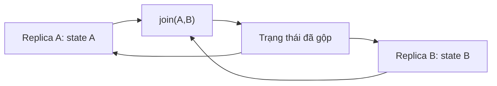
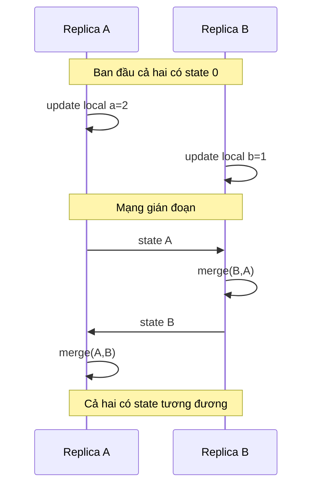

# CRDT và các điều kiện để thao tác hội tụ

## 1. Hai thiết bị sửa cùng một dữ liệu khi mất mạng

Một ứng dụng ghi chú chạy trên điện thoại và máy tính. Người dùng đang làm việc ngoại tuyến:

- Điện thoại A thêm nhãn `important` cho ghi chú `N42`.
- Máy tính B thêm nhãn `review` vào chính ghi chú đó.
- Trong vài phút, A và B không trao đổi được dữ liệu.
- Khi mạng phục hồi, hệ thống phải đồng bộ hai bản sao.

Nếu triển khai bằng cách “bản ghi nào có `updatedAt` lớn hơn thì ghi đè cả document”, hệ thống có thể giữ `review` nhưng làm mất `important`, hoặc ngược lại.

Một mô hình có thể giữ được cả hai nhãn bằng cách xem trường `tags` là **tập hợp tăng dần** và dùng phép hợp tập hợp:

\[
\{\text{important}\}\cup\{\text{review}\}
=\{\text{important},\text{review}\}
\]

Nếu gộp theo thứ tự ngược lại, kết quả vẫn như nhau:

\[
A\cup B=B\cup A
\]

Nếu nhận lại cùng một bản sao, kết quả cũng không đổi:

\[
A\cup A=A
\]

Những tính chất ấy là nền tảng của một họ cấu trúc dữ liệu gọi là **CRDT — Conflict-free Replicated Data Type**.

Tuy nhiên, nếu A và B đều đặt chỗ cho **chiếc vé cuối cùng**, không thể thay phép hợp tập hợp vào logic nghiệp vụ rồi cho cả hai đặt chỗ thành công. Dữ liệu cuối cùng có thể hội tụ thành “hai đặt chỗ” nhưng vẫn **vi phạm giới hạn chỉ một vé**.

Đây là vấn đề trung tâm của bài học **Database No SQL — Xung đột và đồng bộ**:

> **CRDT có thể khiến các bản sao hội tụ dù cập nhật đồng thời, thứ tự truyền khác nhau hoặc kết nối gián đoạn. Nhưng chỉ những thao tác có ngữ nghĩa và giao thức gộp phù hợp mới hội tụ đúng; hội tụ không đồng nghĩa bảo toàn mọi bất biến nghiệp vụ.**

### Mục tiêu học tập

Sau bài học, bạn có thể:

1. Phân biệt *eventual consistency*, *strong eventual consistency* và tính an toàn nghiệp vụ.
2. Giải thích **state-based**, **operation-based** và **delta-state CRDT**.
3. Nêu điều kiện đại số **kết hợp, giao hoán, lũy đẳng** đối với phép gộp trạng thái.
4. Mô tả **join-semilattice**, thứ tự bán phần và cập nhật đơn điệu.
5. Giải thích vì sao nhận message trùng, đảo thứ tự hoặc mất message tác động khác nhau tới mỗi loại CRDT.
6. Triển khai G-Counter và PN-Counter theo vector các thành phần trên replica.
7. Hiểu G-Set, 2P-Set, OR-Set, *add-wins*, *remove-wins*, LWW-Register và MV-Register.
8. Phân tích **causal context**, dots/tags, version vectors và tombstone garbage collection.
9. Đánh giá chi phí metadata, băng thông, anti-entropy, replica identity và offline recovery.
10. Thiết kế kiểm thử hội tụ dưới partition, reorder, duplicate delivery và replica restart.
11. Nhận diện giới hạn của CRDT đối với quota, uniqueness, tiền, tồn kho và authorization.
12. Xác định khi nào cần bổ sung escrow, transaction, conditional write, consensus hoặc compensation.

## 2. CRDT là gì và không phải là gì?

**CRDT** là một loại cấu trúc dữ liệu được thiết kế để các bản sao có thể nhận những cập nhật đồng thời và **hội tụ về trạng thái tương đương** theo những giả định rõ ràng, thường không cần một bước phân xử xung đột trung tâm trên từng cập nhật.

Tên gọi “conflict-free” **không** nghĩa là:

- Không có cập nhật đồng thời.
- Không có bất đồng tạm thời giữa các replicas.
- Mọi thao tác đều giữ được ý nghĩa người dùng mong muốn.
- Có ngay kết quả mới nhất trong lúc network partition.
- Tất cả writes luôn có thể thực hiện.
- Mọi business invariant được bảo vệ tự động.
- Không cần biết những cập nhật nào đã xảy ra.
- Không cần đồng bộ hoặc lưu metadata.
- Không có sự cố khi replica reset, mất trạng thái, hoặc nhận dữ liệu không đáng tin.

Một CRDT được thiết kế đúng có thể giải quyết **bất đồng về cách gộp dữ liệu**, nhưng toàn hệ vẫn cần xử lý **giao vận, lưu trữ bền vững, identity, phân quyền, lỗi phục hồi và yêu cầu nghiệp vụ**.

### 2.1. Bảng thuật ngữ

| Khái niệm | Giải thích |
|---|---|
| **Replica** | Một bản sao của trạng thái CRDT, có thể nhận cập nhật cục bộ |
| **Concurrent updates** | Hai cập nhật không có quan hệ nhân quả trước–sau |
| **Causal order** | Quan hệ “happened-before” giữa những sự kiện |
| **Merge/join** | Hàm gộp hai trạng thái theo quy tắc CRDT |
| **Inflationary update** | Cập nhật chỉ tiến lên theo thứ tự bán phần, không đi lùi |
| **Semilattice** | Cấu trúc có phép join xác định cận trên bé nhất |
| **Anti-entropy** | Cơ chế trao đổi/sửa đồng bộ trạng thái giữa các replicas |
| **Delta** | Một phần thay đổi có thể gộp thay vì gửi toàn bộ state |
| **Dot/tag** | Định danh duy nhất gắn với một sự kiện thêm/cập nhật |
| **Version vector** | Metadata phản ánh mức cập nhật đã quan sát theo nguồn |
| **Tombstone** | Dấu vết xóa/loại bỏ cần giữ để không hồi sinh dữ liệu cũ |
| **Causal stability** | Tình trạng một sự kiện đã đủ ổn định theo phạm vi replicas, hỗ trợ compaction |
| **Strong eventual consistency (SEC)** | Các replicas có cùng tập cập nhật sẽ có trạng thái tương đương, với các điều kiện giao vận/triển khai phù hợp |

## 3. Eventual consistency và strong eventual consistency

### 3.1. Eventual consistency

Một bảo đảm thông thường: nếu ngừng nhận writes mới và mạng/đồng bộ hoạt động trở lại, các bản sao cuối cùng có thể hội tụ.

Tuy vậy, cụm “eventually consistent” tự nó không chỉ rõ:

- Chính xác phép gộp nào được dùng.
- Có thể mất một cập nhật đồng thời không.
- Cập nhật được xem là thành công ở thời điểm nào.
- Hội tụ sau bao lâu.
- Có phiên bản nào được ưu tiên khi conflict không.
- Những phép toán nào có thể chạy khi offline.

### 3.2. Strong eventual consistency

Có thể diễn giải theo mô hình CRDT tiêu chuẩn như sau:

> Nếu hai replicas đã tích hợp **cùng một tập các cập nhật** của cùng đối tượng theo các quy tắc hợp lệ, chúng phải có **trạng thái tương đương quan sát được**, không phụ thuộc vào thứ tự tích hợp những cập nhật đồng thời.

Ngoài ra, để mọi replica cuối cùng nhận được cùng tập cập nhật còn cần **eventual dissemination** — những cập nhật hợp lệ đã được chấp nhận phải cuối cùng đến những replica cần đồng bộ, dưới giả định hệ không bị partition mãi và dữ liệu không bị mất vĩnh viễn.

**SEC không hứa độ trễ cố định, linearizability, snapshot đa đối tượng hoặc uniqueness toàn cục.**

### 3.3. Hai câu hỏi độc lập

1. **Convergence safety:** khi replicas nhận cùng thông tin, phép gộp có luôn cho cùng kết quả?
2. **Dissemination liveness:** liệu thông tin có thực sự đến mọi replica cần đến không?

Một phép join hoàn hảo vẫn không giúp B thấy cập nhật của A nếu hệ làm mất vĩnh viễn cả state và mọi bản sao của cập nhật đó.

### 3.4. Ví dụ hội tụ nhưng sai nghiệp vụ

```text
A offline: reserve ticket T42 for user X.
B offline: reserve ticket T42 for user Y.

Sau đồng bộ:
  reservations = {X, Y}
```

Tập đặt chỗ có thể **hội tụ hoàn hảo** và cả A/B cuối cùng đều có `{X,Y}`, nhưng một vé đã được hứa cho hai người. CRDT đáp ứng convergence nhưng không tự bảo vệ:

\[
\#confirmedReservations(T42)\le1
\]

## 4. Vì sao cách “ghi đè bản sao mới nhất” không luôn đủ?

Một chiến lược phổ biến là Last-Write-Wins (LWW). Mỗi bản ghi có timestamp hoặc version ordering, và replica chọn một bản ghi làm “thắng”.

Ví dụ:

```json
{
  "noteId": "N42",
  "tags": ["important"],
  "updatedAt": "2026-11-14T10:00:01Z"
}
```

Trong lúc offline, B có:

```json
{
  "noteId": "N42",
  "tags": ["review"],
  "updatedAt": "2026-11-14T10:00:02Z"
}
```

Nếu B thắng, tag `important` bị mất. Một hệ có quy tắc winner hoàn toàn deterministic vẫn có thể **loại bỏ ý định đồng thời**.

### 4.1. Hội tụ khác không mất cập nhật

LWW với comparator tổng và deterministic có thể hội tụ về cùng winner khi mọi replica thấy cùng candidates. Nhưng hội tụ đó có thể mang nghĩa “chấp nhận mất cập nhật thua cuộc”.

### 4.2. Đồng hồ vật lý gây rủi ro

`updatedAt` do client tự gửi có thể lệch do:

- Đồng hồ thiết bị sai.
- Khác múi giờ/clock skew.
- NTP step.
- Client offline nhiều giờ.
- Timestamp độ phân giải thấp.
- Cùng timestamp giữa hai writers.

Một LWW register cần quy tắc so sánh có **thứ tự quyết định rõ**, kể cả tie-break theo replica ID hoặc event ID phù hợp. Điều này bảo vệ convergence, **không chứng minh winner là hành động “mới nhất” theo thời gian thực**.

### 4.3. Chọn kiểu CRDT theo semantics

Với trường `tags` cần giữ cả hai additions, một OR-Set có thể hợp hơn LWW cả document. Với scalar preference mà product chủ động cho “một giá trị thắng”, LWW có thể đủ. Với concurrent edits cần giữ nhiều lựa chọn, MV-Register có thể phù hợp.

**Chọn CRDT bắt đầu từ cách sản phẩm muốn diễn giải hai thao tác đồng thời, không chỉ từ tốc độ đồng bộ.**

## 5. State-based CRDT: gộp trạng thái thay vì replay từng lệnh

Trong **state-based CRDT** (còn gọi là *convergent replicated data type*, CvRDT), mỗi replica lưu một trạng thái \(s\), cập nhật cục bộ tạo trạng thái mới, rồi các replicas trao đổi trạng thái hoặc phần đủ thông tin để gộp.



Điểm trung tâm là phép join \(\sqcup\) có tính chất đại số để những lịch truyền nhận khác nhau không tạo kết quả khác nhau.

### 5.1. Mô hình thứ tự bán phần

Gọi \(S\) là tập các trạng thái hợp lệ. Định nghĩa \(x\sqsubseteq y\) là “\(y\) đã chứa ít nhất thông tin cần thiết tương ứng với \(x\)” theo mô hình dữ liệu.

Ví dụ với grow-only set:

\[
A\sqsubseteq B \iff A\subseteq B
\]

Một update tăng dần:

\[
s\sqsubseteq update(s)
\]

không vứt bỏ thông tin cần để hòa giải.

### 5.2. Join-semilattice

Một **join-semilattice** cho mỗi cặp trạng thái \(a,b\) một cận trên bé nhất \(a\sqcup b\), tức trạng thái chứa thông tin của cả hai theo thứ tự đã định, nhưng không thừa hơn mức cần thiết trong tập trạng thái hợp lệ.

Phép join phải thỏa:

**Giao hoán (commutative):**

\[
a\sqcup b=b\sqcup a
\]

**Kết hợp (associative):**

\[
(a\sqcup b)\sqcup c=a\sqcup(b\sqcup c)
\]

**Lũy đẳng (idempotent):**

\[
a\sqcup a=a
\]

Nhờ ba tính chất này:

- Gộp A rồi B hay B rồi A cho cùng kết quả.
- Chia các lần gộp theo nhóm khác nhau không thay kết quả.
- Nhận lại cùng state/delta nhiều lần không làm state thay đổi thêm.

### 5.3. Mối quan hệ với thứ tự bán phần

Một cách viết:

\[
a\sqsubseteq b\iff a\sqcup b=b
\]

Nếu \(a\sqsubseteq b\), \(b\) đã bao hàm phần thông tin của \(a\), nên gộp \(a\) vào \(b\) không làm thay đổi \(b\).

### 5.4. Một số phép join phổ biến

| Dạng dữ liệu | Join | Ghi chú |
|---|---|---|
| Grow-only set | Hợp tập hợp \(\cup\) | Không hỗ trợ remove trực tiếp |
| G-Counter components | `max` từng phần tử | Mỗi replica tăng phần của mình |
| Boolean grow-only flag | OR logic | Khi đã true không quay lại false |
| Bit set đơn điệu | Bitwise OR | Phù hợp đánh dấu đã xảy ra |
| Version-vector entries | `max` từng actor | Metadata nhân quả, không là business counter |
| Một map của semilattices | Join theo từng key | Cần định nghĩa xóa key/tombstone |
| LWW register | Max theo comparator tổng | Có thể mất một concurrent value |
| OR-Set | Join add tags + causal remove metadata | Không thể chỉ union raw elements |

Không có quy tắc “dùng `max` cho mọi dữ liệu là CRDT”. Các phép toán phải phù hợp cấu trúc ngữ nghĩa của từng loại.

## 6. Ba điều kiện hay bị bỏ sót của state-based CRDT

Một triển khai state-based đúng không chỉ có hàm `merge` mang tên đẹp.

### 6.1. Mỗi local update phải inflationary

Nếu trạng thái hiện tại là \(s\) và cập nhật trả \(s'\), cần:

\[
s\sqsubseteq s'
\]

theo thứ tự của CRDT cụ thể.

Ví dụ G-Counter với component chỉ tăng. Nếu một node reset component của mình từ 100 về 0 khi restart rồi được coi là cùng replica identity, nó đã đi **ngược** thứ tự và có thể mất counts hoặc tạo inconsistency khi tiếp tục ghi.

### 6.2. Phép merge phải là join thật

Ví dụ với hai sets:

```text
A = {a}
B = {b}
```

Phép:

```text
merge(A,B) = A
```

không giao hoán. Phép:

```text
merge(A,B) = union(A,B)
```

có các tính chất mong muốn cho grow-only set.

### 6.3. Phải có khả năng trao đổi thông tin đã chấp nhận

Nếu A đã cập nhật, nhưng máy bị xóa sạch trạng thái và chưa từng có replica khác nhận cập nhật, không có phép join nào tự tái tạo lại thông tin từ hư vô.

Cần xác định durability, lưu delta, anti-entropy, replication health và recovery.

## 7. Anti-entropy: đưa thông tin giữa các replicas

State-based CRDT thường tận dụng trao đổi trạng thái định kỳ, qua gossip hoặc yêu cầu đồng bộ khi kết nối trở lại.



### 7.1. Thứ tự trao đổi không nên quan trọng

Vì join giao hoán/kết hợp/lũy đẳng, message A và B có thể đảo thứ tự hoặc truyền trùng mà không làm sai kết quả state-based merge.

### 7.2. Nhưng “eventual delivery” là giả định thật

Nếu replica bị partition vĩnh viễn, nó không thể nhận dữ liệu mới từ phần còn lại. SEC không bắt hệ “đoán” updates đã mất.

### 7.3. Anti-entropy cũng có chi phí

- Băng thông trao đổi state.
- CPU merge.
- Disk I/O khi persist.
- Causal metadata.
- Thời gian đồng bộ sau offline dài.
- Điều phối thành viên/định danh replica.
- Traffic tăng khi nhiều replicas trao đổi pairwise.

Cần tối ưu đúng theo kích thước state và pattern cập nhật.

## 8. Operation-based CRDT: gửi tác động thay vì gửi toàn bộ trạng thái

Trong **operation-based CRDT** (CmRDT), một replica tạo operation được chuẩn bị từ trạng thái cục bộ, sau đó phát **effect** để các replicas khác áp dụng.

```text
A: prepare(add("important")) -> effect E1
B: prepare(add("review"))    -> effect E2

Replica X áp dụng E1, E2.
Replica Y áp dụng E2, E1.
```

Để hội tụ, hiệu ứng của những operations **đồng thời** cần thỏa tính giao hoán theo mô hình, hoặc giao thức cần cung cấp trật tự/causal metadata để đạt cùng kết quả.

### 8.1. Khác biệt cốt lõi so với state-based

| Vấn đề | State-based | Operation-based |
|---|---|---|
| Trao đổi | State hoặc delta-state có thể join | Các operation/effects |
| Trùng message | Join idempotent có thể chịu trùng | Thường cần giao vận đúng contract hoặc dedup |
| Đảo thứ tự | Join chịu được | Cần commute với concurrent ops; causal dependencies phải được tôn trọng |
| Mất message | Anti-entropy có thể đồng bộ lại state | Cần retransmit/recovery log hoặc snapshot |
| Metadata | Có thể tăng theo replica/elements | Có thể giảm payload nhưng cần causal context/dedup |
| Phụ thuộc vận chuyển | Eventual dissemination | Thường yêu cầu reliable causal broadcast cho thiết kế chuẩn |
| Phù hợp | Đồng bộ state/offline snapshots | Stream operations khi hạ tầng hỗ trợ |

### 8.2. Vì sao `increment(1)` cần cân nhắc duplicate delivery?

Các increment cộng dồn có tính giao hoán:

\[
(x+1)+1=(x+1)+1
\]

và nhiều increments có thể áp dụng theo bất kỳ thứ tự. Nhưng nếu **một increment event** `E1` được giao hai lần:

```text
count=0
apply E1(+1) -> 1
apply E1(+1) -> 2
```

đây là duplicate effect. Giao hoán **không đồng nghĩa lũy đẳng**.

Một operation-based counter muốn chịu message duplicates cần delivery exactly-once trong phạm vi protocol, hoặc **unique op IDs + dedup** bền vững, hoặc biến operation thành một hiệu ứng có thể join idempotently theo cách được thiết kế.

### 8.3. Causal delivery và dependency

Một operation có thể phụ thuộc vào operation trước đó:

```text
E1: add element with tag t1
E2: remove observed tag t1
```

Nếu E2 được áp trước E1 mà không mang đủ causal context, replica có thể để tag t1 “sống lại”.

Một implementation có thể yêu cầu **causal delivery**, hoặc dùng metadata/buffering/thiết kế đặc biệt để bảo toàn semantics dù network reorder. Không tuyên bố mọi op-based CRDT chịu mọi permutation và duplication **không cần điều kiện**.

### 8.4. Cần nói rõ guarantee của giao vận

Khi thiết kế:

- Update có thể mất hay không?
- Có redelivery?
- Có durable operation log?
- Các messages cùng causal chain có được giữ thứ tự?
- Có unique actor/op ID?
- Replica offline nhiều tuần lấy log cũ ở đâu?
- Có bao giờ xóa dedup metadata?
- Có snapshot sync fallback?

Khả năng hội tụ của datatype **phụ thuộc** việc hệ thống bảo đảm những giả định cần thiết này.

## 9. Delta-state CRDT: trao đổi phần thay đổi nhưng giữ phép join

**Delta-state CRDT** kết hợp ưu điểm truyền dữ liệu nhỏ hơn với mô hình join semilattice: local update tạo một **delta state** \(\delta\), có thể join vào state.

\[
s' = s\sqcup \delta
\]

Ví dụ một map counter có 1.000 replicas nhưng chỉ A tăng thành phần của A từ 10 lên 11: thay vì gửi toàn bộ vector, có thể gửi delta mang thông tin cần gộp.

### 9.1. Delta không đơn giản là một lệnh `+1`

Nếu delta là:

```text
{A: 11}
```

và join theo `max`, nhận hai lần không tăng thêm.

Nếu delta chỉ là:

```text
increment 1
```

đó là operation, không tự là delta-state CRDT có join lũy đẳng.

### 9.2. Có điều kiện truyền delta

Một số delta-CRDT cần **causal delta-merging conditions** để giữ semantics, nhất là structures có removes hoặc causal context. Không phải mọi “gửi diff” bất kỳ đều là delta-state CRDT hợp lệ.

### 9.3. Ưu điểm và chi phí

- Ít bytes hơn khi thay đổi nhỏ.
- Có thể batch deltas.
- Cần delta buffer/compaction.
- Offline lâu có thể yêu cầu full state/snapshot.
- Cần biết đã nhận gì, version/causal context.
- Một số loại delta chứa metadata nhiều hơn payload nghiệp vụ.

## 10. Grow-only Counter (G-Counter): ví dụ CRDT cơ bản nhất

Giả sử có hai replicas A và B, cùng đếm lượt tương tác được phép tăng.

Thay vì giữ một số nguyên duy nhất, mỗi replica giữ vector:

\[
G=[g_A,g_B]
\]

Quy tắc:

- A chỉ tăng \(g_A\) của chính A.
- B chỉ tăng \(g_B\) của chính B.
- Join lấy `max` **theo từng thành phần**.
- Giá trị hiển thị là tổng các thành phần.

\[
merge(G,H)_i=\max(G_i,H_i)
\]

\[
value(G)=\sum_i G_i
\]

### 10.1. Ví dụ thực hiện offline

Ban đầu:

```text
A nhìn [0,0] -> value 0
B nhìn [0,0] -> value 0
```

A tăng hai lần:

```text
A = [2,0]
```

B tăng một lần:

```text
B = [0,1]
```

Sau gộp:

\[
merge([2,0],[0,1])=[2,1]
\]

Tổng:

\[
value([2,1])=2+1=3
\]

### 10.2. Vì sao không gộp bằng tổng vector?

Nếu định nghĩa:

```text
merge(A,B) = A+B
```

thì:

```text
merge([2,0],[0,1]) = [2,1]
merge([2,1],[0,1]) = [2,2]   // B bị tính lại!
```

Không lũy đẳng. Với `max`:

```text
merge([2,1],[0,1]) = [2,1]
```

### 10.3. Vì sao không lưu scalar rồi lấy max?

Nếu A có count 2, B có count 1, lấy `max(2,1)=2` sẽ mất increment độc lập của B.

Vector theo replica giữ **thông tin đóng góp độc lập**, do đó sum sau merge = 3.

### 10.4. Điều kiện sử dụng

- Replica ID độc nhất và ổn định trong phạm vi đồng bộ.
- Mỗi actor chỉ tăng component của mình theo mô hình.
- Giá trị component không giảm sau restart/restore.
- Không xóa component tùy tiện.
- Overflow được kiểm soát.
- Tập actor không tăng vô hạn không có kế hoạch compaction.
- Counts không tự mang ý nghĩa “đã cấp đúng một quyền” nếu hai replicas có thể cùng quyết định.

### 10.5. Đếm lượt tương tác hay tiền?

G-Counter rất hợp cho telemetry, view count với nghĩa “những increments được chấp nhận tại các actors” nếu duplicate operations đã được xử lý ở nguồn. Nó không tự ngăn hai replicas cùng cấp một số sê-ri duy nhất hoặc vượt ngân sách.

## 11. Java 17: triển khai G-Counter state-based đơn giản

Đoạn code minh họa merge `max` và tổng các thành phần. Nó **không** cài đặt lưu trữ bền vững, membership hoặc giao vận. Thực tế phải đảm bảo identity và recovery.

```java
import java.util.HashMap;
import java.util.Map;
import java.util.Objects;

public final class GCounter {
    private final String localReplicaId;
    private final Map<String, Long> components = new HashMap<>();

    public GCounter(String localReplicaId) {
        this.localReplicaId = Objects.requireNonNull(localReplicaId);
        if (localReplicaId.isBlank()) {
            throw new IllegalArgumentException("Replica ID is blank");
        }
    }

    // Chỉ local actor được tăng component của mình.
    public synchronized void increment(long amount) {
        if (amount <= 0) {
            throw new IllegalArgumentException("amount must be positive");
        }

        long current = components.getOrDefault(localReplicaId, 0L);
        components.put(localReplicaId, Math.addExact(current, amount));
    }

    // Trả về snapshot độc lập, không để caller sửa nội bộ.
    public synchronized Map<String, Long> snapshot() {
        return Map.copyOf(components);
    }

    // Join trạng thái theo pointwise max.
    public synchronized void merge(Map<String, Long> remoteState) {
        Objects.requireNonNull(remoteState);
        for (var entry : remoteState.entrySet()) {
            String actor = Objects.requireNonNull(entry.getKey());
            Long incoming = Objects.requireNonNull(entry.getValue());

            if (incoming < 0L) {
                throw new IllegalArgumentException(
                    "G-Counter component must be non-negative"
                );
            }

            components.merge(actor, incoming, Math::max);
        }
    }

    public synchronized long value() {
        long sum = 0L;
        for (long component : components.values()) {
            sum = Math.addExact(sum, component);
        }
        return sum;
    }

    public static void main(String[] args) {
        var a = new GCounter("replica-A");
        var b = new GCounter("replica-B");

        a.increment(2L); // A: {replica-A:2}
        b.increment(1L); // B: {replica-B:1}

        // A và B nhận dữ liệu theo hai thứ tự tùy ý.
        a.merge(b.snapshot());
        b.merge(a.snapshot());

        System.out.println(a.value()); // 3
        System.out.println(b.value()); // 3

        // Truyền lại cùng state không làm tăng lần nữa.
        a.merge(b.snapshot());
        a.merge(b.snapshot());
        System.out.println(a.value()); // vẫn 3
    }
}
```

### 11.1. Code chứng minh gì?

- Các replicas độc lập tăng thành phần riêng.
- Join dùng `max` nên duplicate state exchange an toàn.
- Hai replicas có cùng thông tin sẽ tính cùng tổng.
- `Math.addExact` phát hiện overflow số nguyên 64 bit thay vì lặng lẽ tràn.

### 11.2. Code chưa bảo vệ gì?

- Không lưu state trên disk.
- Không restore component sau restart.
- Hai processes có thể cấu hình trùng replica ID.
- Không chống client giả mạo remote component.
- Không giới hạn số actor trong map.
- Không có authentication/authorization.
- Không có anti-entropy retry.
- Không có dedup business request trước khi gọi `increment`.
- Không có snapshot schema version.
- Nếu nhiều device cùng dùng replica ID mà tự tăng từ state cũ, contributions có thể bị lẫn/mất.

Điều quan trọng là **thiết kế của CRDT nằm ở những invariant của state và merge, không chỉ vài dòng mã `Math.max`**.

## 12. PN-Counter: cho phép cả tăng và giảm

G-Counter chỉ tăng. Để hỗ trợ decrement, **PN-Counter** có hai G-Counters:

- \(P\): phần tăng.
- \(N\): phần giảm.

\[
value(P,N)=\sum_i P_i-\sum_i N_i
\]

Join độc lập theo từng vector:

\[
merge((P,N),(P',N'))=(P\sqcup P', N\sqcup N')
\]

### 12.1. Ví dụ

Ban đầu:

```text
A: P=[0,0], N=[0,0]
B: P=[0,0], N=[0,0]
```

A tăng 5:

```text
A: P=[5,0], N=[0,0]  -> value=5
```

B giảm 2 khi offline:

```text
B: P=[0,0], N=[0,2]  -> value=-2
```

Sau merge:

```text
P=[5,0], N=[0,2]
value=5-2=3
```

### 12.2. PN-Counter có thể âm

Nếu B giảm trước khi biết A tăng, B có thể đọc `-2`. Ngay cả sau merge, nếu các decrements nhiều hơn increments, giá trị cũng có thể âm.

Đây **không phải lỗi hội tụ**. PN-Counter được thiết kế để gộp tăng/giảm, không tự đảm bảo:

\[
value\ge0
\]

### 12.3. Sai lầm: dùng PN-Counter cho số ghế còn lại

Hai replicas đều nhìn thấy một ghế trống và mỗi bên decrement 1. Sau merge, giá trị có thể là -1. Hệ đã biết tổng chính xác của các decrements nhưng không bảo vệ giới hạn không âm.

Cần escrow/bounded counter hoặc một authority cho reservation.

## 13. Grow-only Set và Two-Phase Set

### 13.1. G-Set

Một **grow-only set** chỉ hỗ trợ `add(e)`.

State:

\[
S\subseteq Elements
\]

Update:

\[
add(S,e)=S\cup\{e\}
\]

Merge:

\[
merge(A,B)=A\cup B
\]

Đặc điểm:

- Đơn giản, join tốt.
- Không có delete.
- Phù hợp những facts không thể thu hồi trong mô hình, ví dụ “những message IDs đã quan sát”, nếu storage/retention phù hợp.
- Có thể lớn vô hạn; cần chọn vòng đời.

### 13.2. Two-Phase Set (2P-Set)

Một 2P-Set có:

- \(A\): tập những phần tử đã thêm.
- \(R\): tập phần tử đã xóa.

\[
contains(e)\iff e\in A\land e\notin R
\]

Merge:

\[
(A_1,R_1)\sqcup(A_2,R_2)
=(A_1\cup A_2,\ R_1\cup R_2)
\]

### 13.3. Hạn chế của 2P-Set

Nếu `e` từng bị thêm vào \(R\), nó **không thể được thêm lại** theo cùng identity trong 2P-Set, dù app gọi `add(e)` lần nữa.

Ví dụ “user có thể bỏ tag rồi gắn lại” là nhu cầu bình thường, vì thế 2P-Set có thể không hợp. Khi cần add–remove–readd với concurrency, cần một CRDT set có semantics phong phú hơn, như OR-Set.

## 14. Observed-Remove Set (OR-Set): xóa cái đã quan sát

OR-Set giải quyết bài toán:

- A thêm `important`.
- B cũng thêm `important` độc lập.
- A xóa lần thêm mà nó đã thấy.
- B thêm đồng thời khi chưa thấy hành động xóa.

Nếu chỉ lưu raw set `{important}`, khó phân biệt các lần thêm độc lập và ý nghĩa remove.

### 14.1. Dùng tag riêng cho từng lần thêm

Một lần add tạo **tag/dot duy nhất**:

```text
add("important", tag=A:7)
add("important", tag=B:3)
```

State có thể biểu diễn:

```json
{
  "adds": {
    "important": ["A:7", "B:3"]
  },
  "removedTags": []
}
```

### 14.2. Remove chỉ tác động những tag đã quan sát

Giả sử A chỉ thấy `A:7` và xóa `important`:

```text
remove("important") at A:
  mark tag A:7 as removed
```

Trong khi B thêm `B:3` đồng thời:

```text
B: add("important", B:3)
```

Sau merge:

```text
adds        = {A:7, B:3}
removedTags = {A:7}
visibleTags = {B:3}
contains("important") = true
```

Đây là một ví dụ của **add-wins semantics**: add đồng thời mà remove chưa quan sát được vẫn sống.

### 14.3. Vì sao không chỉ xóa key khỏi map?

Nếu A xóa local entry, còn B giữ bản add cũ, một merge theo union đơn giản sẽ đưa entry trở lại ngay cả khi B chỉ có **cùng tag cũ** mà A đã thực sự muốn xóa.

Muốn remove được ghi nhận, state cần giữ metadata giúp các replicas biết **tag nào đã bị remove**, hoặc một representation tương đương dựa vào causal context.

### 14.4. Thêm lại sau khi xóa

Sau khi tag `A:7` bị remove, A có thể add lần nữa bằng tag mới `A:8`. Tag mới không bị nhầm với lần thêm cũ:

```text
adds        = {A:7, A:8}
removedTags = {A:7}
visibleTags = {A:8}
```

### 14.5. Có nhiều biến thể implementation

Có OR-Set lưu explicit tombstones, có biến thể dùng causal context hoặc dotted version vectors để nén metadata. Không suy rằng mọi implementation đều lưu hai JSON fields `adds` và `removedTags` chính xác như ví dụ.

**Điều quan trọng là semantics của add/remove và quy tắc merge**, không phải một schema minh họa cụ thể.

## 15. Add-wins và remove-wins là hai lựa chọn nghiệp vụ khác nhau

Khi add và remove diễn ra **concurrently**:

| Kiểu | Kết quả đối với cùng element | Phù hợp khi |
|---|---|---|
| **Add-wins** | Add đồng thời được giữ | Nhãn, memberships không nhạy cảm |
| **Remove-wins** | Remove đồng thời được ưu tiên | Quy trình nơi xóa là quyết định mạnh hơn |
| **LWW-element-set** | Bên có timestamp/order thắng | Có thể chấp nhận mất update theo winner |
| **Multi-value resolution** | Giữ conflict cho người dùng xử lý | Cần tương tác khi conflict |

### 15.1. Remove-wins cần protocol khác

Không thể biến một OR-Set add-wins thành remove-wins chỉ bằng cách đổi tên hàm. Remove-wins thường cần metadata về removals/causal context hoặc rules khác để một add đồng thời bị xem là không hợp lệ.

### 15.2. Authorization không thể chỉ dựa vào “remove-wins” nếu yêu cầu thu hồi tức thì

Giả sử user bị revoke access ở vùng A nhưng vùng B offline. Dù datatype chọn remove-wins và cuối cùng converges sang “không còn quyền”, B vẫn có thể cho user truy cập trong lúc offline theo trạng thái cũ.

**Hội tụ cuối cùng không thay cho kiểm quyền có tính nhất quán đáp ứng chính sách bảo mật.** Cần token expiry/revocation authority/fail-closed tùy use case.

### 15.3. Cần đặt câu hỏi về intent

“Người dùng có thể thêm lại tag sau khi xóa” khác “đã bị cấm thì không thể tự vào lại nhóm”. Chọn data type theo nghiệp vụ chứ không chỉ muốn tự merge.

## 16. LWW-Register: hội tụ bằng cách chọn một người thắng

Một **register** giữ một giá trị scalar, ví dụ `displayName`. LWW-Register lưu value kèm một **order key**:

```text
(value, timestamp, tieBreaker)
```

Merge chọn giá trị có order key lớn hơn theo comparator được định nghĩa.

\[
join(a,b)=\max_{\prec}(a,b)
\]

Nếu comparator quyết định một thứ tự tổng ổn định, `max` có tính kết hợp/giao hoán/lũy đẳng theo semantics của representation.

### 16.1. Cùng timestamp cần tie-breaker

Nếu:

```text
A: (value="Mai", time=100, actor="A")
B: (value="Lan", time=100, actor="B")
```

và hai replicas chỉ so timestamp, một bên có thể chọn Mai, một bên chọn Lan theo arrival order.

Nên có quy tắc deterministic, chẳng hạn so tuple `(timestamp, actorId, operationId)`. Nếu cùng order key mà payload khác, schema cần xác định đó là invalid collision hay có comparator bổ sung.

### 16.2. Đồng hồ vật lý không quyết định nhân quả

Client B có đồng hồ chạy nhanh 10 phút, nên giá trị do B ghi sớm theo thời gian thật có thể thắng những writes sau. LWW chọn winner theo **order key**, không nhất thiết theo causal order hoặc real time.

Có thể dùng logical/hybrid clocks trong một số thiết kế, nhưng phải hiểu assumptions và tie-breaking.

### 16.3. LWW là một chính sách mất cập nhật được kiểm soát

Nếu product muốn “một giá trị thắng, các giá trị khác không cần giữ”, LWW phù hợp. Nếu muốn cùng người dùng xem hai thay đổi không tương thích và tự chọn, dùng MV-Register hay một workflow conflict resolution.

### 16.4. LWW không giải quyết giao dịch

Hai payments cùng chốt trạng thái `PAID` không có nghĩa chỉ có một lần charge; register hội tụ không bảo vệ side effect bên ngoài.

## 17. MV-Register: giữ các giá trị đồng thời

**Multi-Value Register (MV-Register)** không tự chọn một giá trị khi những writes thực sự concurrent. Nó giữ các values **chưa bị một write nhân quả sau ghi đè**.

Ví dụ:

```text
A offline: title = "Thiết kế A"
B offline: title = "Thiết kế B"
```

Hai writes concurrent:

```text
MVRegister = {"Thiết kế A", "Thiết kế B"}
```

Khi người dùng nhìn thấy cả hai rồi chọn:

```text
Causal write: title = "Thiết kế cuối"
```

nếu write mới đã quan sát cả hai versions và có causal context phù hợp, những versions trước bị supersede:

```text
MVRegister = {"Thiết kế cuối"}
```

### 17.1. Cần causal information

Chỉ nhìn hai timestamp không đủ biết A ghi trước B, hay A/B ghi đồng thời. Version vectors, dots hoặc metadata causal tương đương giúp phân biệt.

### 17.2. “Giữ nhiều values” không đồng nghĩa giữ từng bản sao trùng

Hai replicas có thể gửi cùng một operation nhiều lần. CRDT phải nhận diện cùng causal version để không sinh vô số copies. Một value giống nhau nhưng do hai operations độc lập tạo ra cũng cần được biểu diễn đúng causal history tùy semantics.

### 17.3. Chi phí sản phẩm

MV-Register có thể trả nhiều candidates. UI/backend phải quyết định:

- Có cho user chọn một?
- Có tự merge text?
- Có audit cả hai?
- Có thể để trạng thái conflict pending?
- Có được tự gửi side effect trước khi conflict resolved?

CRDT bảo tồn thông tin; nó không tự đưa ra quyết định nghiệp vụ thay con người.

## 18. Causal order, version vectors và dots

Để hiểu OR-Set/MV-Register, cần biết quan hệ nhân quả.

### 18.1. Happens-before

Một sự kiện \(e_1\) *happens-before* \(e_2\) nếu:

- Chúng xảy ra theo thứ tự trong cùng tiến trình, hoặc
- Thông tin của \(e_1\) đã đến trước khi \(e_2\) được tạo, hoặc
- Quan hệ bắc cầu qua những sự kiện khác.

Nếu cả hai không xảy ra trước nhau theo quan hệ này, chúng **concurrent**.

### 18.2. Ví dụ

```text
A: add(t1) -> send state to B
B: receive -> remove(t1)
```

Remove ở B biết add `t1`, vì thế về nhân quả remove xảy ra sau add ấy.

Ngược lại:

```text
A: add(t1)
B: remove(element) khi chưa thấy t1
```

Hai operations có thể concurrent. Add-wins OR-Set giữ `t1`.

### 18.3. Version vector

Một version vector:

```json
{
  "A": 7,
  "B": 3,
  "C": 0
}
```

có thể biểu thị mức updates theo từng actor mà replica đã quan sát trong một mô hình có sequence liên tục.

So sánh hai vectors \(V,W\):

\[
V\preceq W \iff \forall i: V_i\le W_i
\]

Nếu \(V\preceq W\) nhưng \(W\npreceq V\), \(W\) đã chứa tiến triển của \(V\). Nếu không vector nào trội vector nào, chúng có thể là concurrent contexts theo mô hình.

### 18.4. Dot/tag

Một *dot* thường có dạng:

```text
(actorId, sequenceNumber)
```

Ví dụ `(A,7)` xác định một event trong chuỗi của actor A. Dot phải **duy nhất theo phạm vi của hệ**; không thể để hai actor incarnation cùng phát `A:7` rồi coi là cùng event.

### 18.5. Vector clock không phải physical clock

Vector version dùng biểu diễn quan hệ nhân quả. Nó không cho biết “11:03:25 theo UTC” và không tự sắp mọi concurrent events theo một thứ tự tổng.

### 18.6. Causal context có thể được nén

Một số CRDT dùng dotted version vectors, interval representations hoặc context compaction. Cách nén chỉ đúng nếu không làm mất thông tin cần thiết để phân biệt add đã thấy và add concurrent.

## 19. Tombstones: xóa không có nghĩa biến mất hoàn toàn

Trong một CRDT set có remove, để tránh hồi sinh phần tử từ replica cũ, hệ thường giữ **dấu vết xóa** hoặc causal context tương đương.

Ví dụ:

```text
A: add x (tag A:1)
B: nhận add A:1
B: remove x (mark A:1 removed)
A: offline và còn bản add A:1
```

Khi A quay lại, B phải phân biệt `A:1` đã bị remove với một add mới chưa từng thấy.

Nếu B chỉ xóa phần tử khỏi state mà không giữ metadata, merge kiểu union từ A có thể khôi phục `x`.

### 19.1. Tombstones có thể tăng không giới hạn

Nếu một hệ chat có hàng triệu add/remove, tombstone metadata có thể vượt kích thước nội dung sống. Cần compaction nhưng **không được xóa bừa**.

### 19.2. Causal stability

Chỉ có thể loại metadata lịch sử khi giao thức chứng minh những thông tin bị xóa sẽ không còn cần thiết để chống replay từ các replicas hoặc update logs liên quan.

Khái niệm *causal stability* hỗ trợ điều đó, nhưng cách thực hiện phụ thuộc membership, offline replicas và anti-entropy protocol.

### 19.3. Replica ngoại tuyến rất lâu

Một laptop offline sáu tháng giữ state cũ. Server đã compact tombstones sau 30 ngày. Khi laptop quay lại, merge thiếu causal guard có thể làm những elements đã xóa được thêm lại.

Các cách thiết kế:

- Giữ tombstones đủ lâu theo offline horizon.
- Có protocol **full resync** khi replica quá cũ.
- Reset/rotate replica identity theo một quy trình được kiểm soát.
- Dùng causal context đã compact nhưng vẫn đủ thông tin.
- Chỉ cho old replica rebase local operations dựa vào state mới.
- Kiểm quyền nếu account/device đã bị thu hồi.

Không coi TTL metadata bằng 30 ngày là an toàn với mọi client offline sáu tháng.

### 19.4. Garbage collection là một phần correctness

Cơ chế CRDT merge có thể đúng tuyệt đối trong thử nghiệm 10 phút nhưng sai sau ba tháng vì compaction sai. Kiểm thử convergence phải bao gồm **offline dài, late messages và tombstone cleanup**, không chỉ happy path.

## 20. Định danh replica: một số nguyên nhỏ có thể gây lỗi lớn

Với G-Counter:

```text
A: component A=100
```

Nếu A crash rồi khởi động lại, làm mất state và dùng lại actor ID A từ 0:

```text
A' (vẫn ID A): component A=1
B còn giữ A=100
merge -> A=100
```

Increment mới ở A' có thể bị `max` nuốt, vì 1 không lớn hơn 100.

### 20.1. Khi nào dùng ID cố định?

Nếu state được persist/recover bền vững, actor ID ổn định có thể hợp lý. Nhưng phải đảm bảo counter sau restart không lùi.

### 20.2. Khi nào cần incarnation ID?

Một actor sau khi mất state hoàn toàn có thể cần một incarnation mới:

```text
A#incarnation-1
A#incarnation-2
```

Nhưng tạo incarnation mới liên tục làm vector metadata tăng. Cần quy trình membership retirement/compaction có chứng cứ, không chỉ tạo UUID mới trên mỗi request.

### 20.3. Device ID không tự là replica ID an toàn

Nếu hai tab trên một thiết bị cùng dùng actor ID và tăng component từ hai local snapshots, một increment có thể bị lost ở merge. Cần điều phối actor-local updates hoặc mỗi tab có actor identity phù hợp.

### 20.4. Replica identity cũng có yếu tố bảo mật

Một client không được phép giả mạo thành phần counter của client khác hoặc tạo vô hạn actors để làm cạn memory. Server cần authentication, authorization, limits và validation.

## 21. Hội tụ không có nghĩa mọi nơi đều thấy giá trị mới ngay

Tại thời điểm mạng phân hoạch:

```text
A: GCounter=[5,0] -> value=5
B: GCounter=[0,4] -> value=4
```

Cả hai replicas có thể nhận writes local. Trong lúc chưa đồng bộ, reads trả 5 hoặc 4 theo vị trí.

Sau merge:

```text
A: [5,4] -> 9
B: [5,4] -> 9
```

SEC đảm bảo cùng state sau khi nhận cùng thông tin, **không đảm bảo read-your-writes xuyên thiết bị tức thì, global latest read hoặc latency bound**.

### 21.1. Causal consistency là yêu cầu riêng

Một app có thể cần người dùng thấy cập nhật của mình ở thiết bị khác theo causal session. CRDT là nền tảng cho merge, nhưng session tokens/routing/sync completion vẫn có thể cần để đáp ứng UX ấy.

### 21.2. Snapshot đa đối tượng là yêu cầu riêng

Một dashboard đọc PN-Counter A và G-Set B trên hai replicas ở các mốc khác nhau có thể có góc nhìn không nhất quán giữa các aggregate. CRDT không tự tạo atomic snapshot trên nhiều objects.

### 21.3. Query indexes vẫn có thể stale

Source CRDT đã merge nhưng search index, materialized view hoặc cache chưa cập nhật. Endpoint query index vẫn có thể thiếu kết quả. Cần công bố freshness contract cho từng read path.

## 22. CRDT có thể bảo toàn những bất biến nào?

CRDT đặc biệt hữu ích khi các operations **có thể phối hợp mà không cần một quyết định độc quyền ngay lúc thực hiện**.

Ví dụ:

- Đếm tương tác với eventual total.
- Thêm tags vào tài liệu.
- Theo dõi một tập facts “đã xảy ra” không cần xóa.
- Cộng dồn telemetry.
- Hợp nhất cập nhật collaborative phù hợp CRDT.
- Ghi note/metadata offline có conflict semantics công bố.
- Đồng bộ draft hoặc shopping list với add/remove semantics đã chọn.

Nhưng một số bất biến không đóng dưới việc gộp local states.

### 22.1. Bất biến không âm

Giả sử:

\[
available\ge0
\]

Hai vùng độc lập đều thấy `available=1`, mỗi vùng giảm 1. Mỗi vùng local thấy 0, đều có vẻ hợp lệ. Sau merge một PN-Counter của những decrements, available có thể thành -1.

### 22.2. Uniqueness toàn cục

Hai vùng đồng thời cấp username `alice` cho hai tài khoản khác nhau. Một CRDT set chứa username không tự chọn một người “sở hữu hợp pháp” mà vẫn giữ mọi lời hứa.

### 22.3. Chuyển tiền

Các increments/decrements có thể hội tụ về tổng số dư. Nhưng việc chấp nhận hai lệnh rút vượt số dư trong lúc offline là vi phạm, dù cuối cùng tất cả replicas tính ra cùng một số âm.

### 22.4. Thu hồi quyền

Nếu một vùng vẫn đang phục vụ reads theo trạng thái ACL cũ, việc CRDT hội tụ sau này không tự loại bỏ truy cập trái quyền đã xảy ra.

### 22.5. Kết luận

> **Convergence là tính chất của cách gộp trạng thái. Invariant preservation là tính chất của việc cho phép và thực thi các operations. Chúng phải được đánh giá riêng.**

## 23. Invariant confluence và điều kiện không cần coordination

Một cách nhìn hữu ích là hỏi liệu những states đều hợp lệ khi sinh ra độc lập có còn hợp lệ sau merge hay không.

Gọi \(I(s)\) là một bất biến trên state \(s\). Trực giác của một điều kiện *invariant confluence*:

\[
I(a)\land I(b)\ \Longrightarrow\ I(a\sqcup b)
\]

đối với những trạng thái \(a,b\) có thể phát sinh từ **cùng một tiền trạng thái chung** bằng các hoạt động độc lập được hệ cho phép, cùng giả định về merge.

### 23.1. Trường hợp bất biến đóng dưới union

Nếu bất biến chỉ là “tập tags không chứa phần tử ngoài danh sách cho phép”, và mỗi add được validate vào danh sách ấy, merge union của hai tập hợp lệ vẫn có thể hợp lệ.

### 23.2. Trường hợp không đóng dưới merge

Hai reservations độc lập:

```text
a = {seat42 reserved for X}
b = {seat42 reserved for Y}
```

Mỗi state local có thể trông hợp lệ nếu chỉ có một reservation. Nhưng union có cả X và Y, vi phạm uniqueness.

### 23.3. Điều kiện này cần phân tích đúng model

Không dùng một công thức ngắn thay cho chứng minh protocol. Cần xác định:

- Tiền trạng thái chung.
- Các operations được phép.
- Merge chính xác.
- Invariant được kiểm trên state nào.
- Các ràng buộc liên quan nhiều records.
- Metadata và side effects.
- Quy tắc khi client offline hoặc không được quyền.

Invariant confluence giúp biết **lúc nào có thể tránh coordination** cho một lớp thao tác; không phải giấy phép bỏ consensus cho tất cả nghiệp vụ.

## 24. Escrow và bounded counters: giữ quyền giảm trong hạn mức

Một phương án bảo vệ invariant kiểu:

\[
used\le limit
\]

là **phân bổ sẵn một số quyền tiêu thụ hữu hạn** cho các replicas.

Giả sử còn 10 ghế:

```text
Replica A được quyền cấp tối đa 4 ghế.
Replica B được quyền cấp tối đa 3 ghế.
Replica C được quyền cấp tối đa 3 ghế.
Tổng quyền được cấp = 10.
```

Nếu mỗi replica chỉ xác nhận theo quyền còn lại của mình, các vùng có thể cấp ghế local trong giới hạn mà không vượt tổng 10.

### 24.1. Bounded counter/escrow CRDT

Một số thiết kế dùng CRDT biểu diễn cấp phát quyền, chuyển quyền và tiêu thụ, với invariants kiểu không âm được bảo vệ bởi protocol.

Nhưng không chỉ dùng PN-Counter thường rồi gọi là “bounded counter”. Phải có **rights accounting** rõ và bảo đảm không tạo/tiêu thụ cùng quyền hai lần.

### 24.2. Khi một vùng hết quota

B có thể còn khách nhưng đã dùng hết 3 ghế. Nó không thể tự lấy thêm từ A trong lúc partition nếu chưa có một transfer/allocation hợp lệ. Nó phải:

- Chờ đồng bộ/chuyển quyền.
- Từ chối hoặc đặt pending.
- Chuyển request đến vùng còn quyền nếu có đường.
- Dùng chính sách chấp nhận oversell **nếu nghiệp vụ thật sự cho phép**, không che giấu.

### 24.3. Chuyển quyền cũng cần chính xác

Một transfer 2 rights từ A sang B không được bị áp dụng hai lần khi message redelivery. Có thể dùng unique transfer IDs, CRDT rights matrix hoặc transaction phù hợp theo thuật toán đã chọn.

### 24.4. Khi nào dùng escrow?

Khi:

- Bất biến có thể biểu diễn bằng quyền hạn hữu hạn.
- Chấp nhận phân bổ quota trước.
- Có nhu cầu tiến triển offline ở nhiều vùng.
- Có giao thức chuyển rights đáng tin.
- Chi phí thiếu hụt tạm thời ở một vùng chấp nhận được.

Không dùng escrow nếu không có mô hình quyền phù hợp cho nghiệp vụ.

## 25. CRDT và idempotency của yêu cầu nghiệp vụ

Phép **join state** có tính lũy đẳng:

\[
s\sqcup\delta\sqcup\delta=s\sqcup\delta
\]

Nhưng điều này **không** đồng nghĩa toàn API nhận cùng user action hai lần sẽ tạo một event duy nhất.

### 25.1. Ví dụ một click bị retry

User bấm like một lần; request timeout và client gửi lại:

```text
POST /like operationId=L42
POST /like operationId=L42
```

Nếu server cho mỗi HTTP attempt tạo một local increment ở G-Counter:

```text
component A: 0 -> 1 -> 2
```

G-Counter hội tụ đúng tới 2 nhưng business intent chỉ là một like. Đó là **đếm trùng**, không phải lỗi merge.

### 25.2. Cần dedup ở lớp intent

Có thể dùng:

```text
(tenantId, userId, operationId)
```

làm unique claim/ledger. Chỉ khi operation lần đầu được chấp nhận mới làm counter increment.

Hoặc nếu business semantics là “user U đã like item I”, một OR-Set với element identity `(U,I)` có thể tự nhiên tránh thêm duplicate memberships theo cách được thiết kế. Nhưng add/remove và toggling vẫn cần rules.

### 25.3. Hai user actions thật sự khác nhau

Hai lần nhấn distinct mà sản phẩm muốn đếm hai lượt phải có IDs khác nhau. Không dedup tất cả actions của cùng user chỉ vì muốn loại retry.

### 25.4. Merge idempotency khác command idempotency

- State-based merge chịu trùng state.
- Op-based effects có thể cần dedup.
- Business retries cần stable intent ID.
- Side effects ngoài DB cần provider/consumer idempotency.

Bốn loại lũy đẳng không tự thay thế nhau.

## 26. CRDT và transaction/consensus không loại trừ nhau

Có thể dùng CRDT cho các trường phù hợp và consensus/transaction cho những trường đòi invariant.

Ví dụ đơn hàng:

```text
Order aggregate:
  paymentStatus -> transactionally controlled
  inventoryReservation -> conditional/transactional
  customerNotes -> CRDT text/map
  viewCount -> G-Counter/PN-Counter theo semantics
  collaborativeTags -> OR-Set
```

**Một document có nhiều field không buộc mọi field cùng consistency model.** Nhưng triển khai cần hiểu storage/API có hỗ trợ cập nhật độc lập và tương thích schema hay không.

### 26.1. Một operation có nhiều phần

Nếu “xác nhận đơn và thêm tag” cần atomic về nghiệp vụ, không thể tự suy từ việc tag CRDT merge tốt mà status có thể được cập nhật thiếu. Cần saga/transaction hoặc định nghĩa trạng thái trung gian.

### 26.2. CRDT không cung cấp linearizable read

Một CRDT state có thể là replica-local. Nếu API hứa read mới nhất theo real time, cần consistency protocol khác để phục vụ read.

### 26.3. CRDT không cung cấp global unique IDs

Dots phải unique theo phạm vi actor protocol; nhưng đó không tự là unique constraint cho tên người dùng, ghế, voucher hoặc số hóa đơn.

## 27. CRDT và Operational Transformation (OT)

Cả CRDT và **Operational Transformation** thường xuất hiện trong collaborative editing, nhưng cách giải quyết concurrent edits khác nhau.

| Chủ đề | CRDT | OT |
|---|---|---|
| Cốt lõi | Data type/operations thiết kế để hội tụ dưới giả định phù hợp | Biến đổi operations tương đối với operations khác |
| Offline | Có thể rất thuận lợi nếu protocol/data model cho phép | Có thể hỗ trợ, tùy thuật toán/server |
| Thứ tự | Dựa vào join/causal metadata/identifier order | Dựa vào transformation/context |
| Text insert/delete | Sequence CRDT có IDs và ordering | Transform vị trí insert/delete |
| Metadata | Có thể nhiều IDs/tombstones | Có operation history/transformation context |
| Correctness | Chứng minh convergence của CRDT | Chứng minh transformation properties/protocol |
| Product semantics | Còn phải định nghĩa concurrent behavior | Cũng cần định nghĩa concurrent behavior |

Không nói một cách tuyệt đối “CRDT luôn tốt hơn OT” hoặc “OT không offline được”. Cả hai cần xem độ phức tạp, storage, conflict UX, latency và correctness của implementation.

## 28. Sequence CRDT trong chỉnh sửa văn bản

Chỉnh sửa text phức tạp hơn grow-only set vì thứ tự phần tử quan trọng.

Hai người cùng chèn ký tự ở một vị trí:

```text
Ban đầu: "AC"
A chèn "B" giữa A và C.
B chèn "X" giữa A và C.
```

Một sequence CRDT cần xác định:

- Identity ổn định của mỗi ký tự/phần tử.
- Vị trí tương đối theo quan hệ đã biết.
- Quy tắc deterministic cho concurrent inserts cùng vị trí.
- Causal dependencies giữa insert/delete.
- Metadata để xóa mà không làm hồi sinh.
- Hành vi khi một operation đến muộn.

### 28.1. Các họ thuật toán

Một số tên thường gặp trong nghiên cứu/thực tiễn: **RGA**, **Logoot**, **LSEQ**, và những cấu trúc sequence khác, mỗi loại có trade-offs riêng về identifiers, ordering, storage/tombstones và tốc độ truy cập.

### 28.2. “Cùng text sau sync” không có nghĩa giống intent hoàn toàn

Nếu hai người cùng sửa một đoạn văn, sequence CRDT có thể hợp nhất mọi operations để hai thiết bị hiển thị cùng chuỗi, nhưng chuỗi cuối có thể khó đọc hoặc không giống ý định tác giả. Hệ vẫn cần undo semantics, conflict visualization, history và UX.

### 28.3. Rich text và cấu trúc lồng nhau

Bold, comments, ranges, embeds, blocks, mentions và tables đòi data types/operations phức tạp hơn một sequence ký tự. Không thể lấy G-Set rồi gọi là CRDT editor.

## 29. CRDT maps, nested objects và schema evolution

Một document có thể gồm nhiều CRDT fields:

```json
{
  "docId": "N42",
  "title": "<MVRegister>",
  "tags": "<ORSet>",
  "likes": "<GCounter>",
  "comments": "<SequenceCRDT>"
}
```

### 29.1. Map merge cần định nghĩa xóa key

Với map:

```text
A: key K -> GCounter 5
B: remove key K
```

Nếu merge dùng union key và merge value, `K` có thể hồi sinh. Phải có semantics của map entry lifecycle và causal remove.

### 29.2. Schema migration cũng cần hội tụ

Nếu client v1 dùng `title` là LWW scalar, client v2 dùng MV-register, merge tự động có thể không tương thích. Cần versioned codecs, migration protocol và compatibility window.

### 29.3. Unknown fields

Một client cũ không hiểu field mới có thể vô tình xóa nó nếu ghi full-document replacement. CRDT state cần được bảo toàn qua version skew; có thể dùng field-wise merge và giữ unknown metadata.

### 29.4. JSON không đủ diễn tả CRDT semantics

Thấy object cuối cùng giống JSON không cho biết causal tags, version vectors hoặc merge rules. Không được serialize chỉ visible value rồi làm mất metadata nếu cần tiếp tục hội tụ sau offline updates.

## 30. Tối ưu metadata, băng thông và storage

CRDT không có chi phí bằng 0.

### 30.1. Full state vs delta

- Full-state exchange đơn giản, chịu duplicate tốt, nhưng nhiều bytes.
- Delta-state giảm bytes khi state lớn và mỗi update nhỏ.
- Op-based gửi messages nhỏ, nhưng cần durable delivery/dedup/causal support.
- Snapshot + operation log có thể giúp client offline lâu mà không phải giữ toàn bộ history vô hạn.

### 30.2. Metadata growth

- G-Counter có thành phần theo actor.
- OR-Set có tags/causal context theo events.
- MV-Register có metadata để phân biệt causal writes.
- Sequence CRDT có stable IDs và tombstones/ordering metadata.

Một ứng dụng mở nhiều phiên online/offline cần quản lý actor lifecycle để tránh vector tăng mãi.

### 30.3. Merge cost

Đo:

- CPU/bytes cho mỗi merge.
- Số objects và kích thước metadata.
- Thời gian cold sync.
- Peak memory khi deserialize.
- Số deltas buffered.
- Băng thông giữa regions/devices.
- Tombstone GC duration.
- Index update amplification.
- Latency p95/p99 của queries dùng merged value.

### 30.4. Không compact chỉ theo size

Một quá trình GC metadata quá sớm có thể làm hệ sai convergence, dù storage giảm. Compaction phải dựa vào protocol và phạm vi replicas, không chỉ điều kiện “quá 1 MB thì xóa nửa tombstones”.

## 31. Phục hồi sau restart, mất dữ liệu và chia mạng kéo dài

Một CRDT cần quy trình phục hồi rõ:

1. Replica lưu local state/update log bền vững theo contract.
2. Nếu restart, load cùng state và actor identity hợp lệ.
3. Nếu đã mất state, tạo incarnation hoặc full-resync theo protocol.
4. Không tự phát updates dưới sequence numbers đã từng được sử dụng.
5. Reconcile local offline operations với snapshot mới.
6. Kiểm tra causal context/tombstones còn đủ hay không.
7. Không dùng replica quá cũ để cấp quyền truy cập đã bị thu hồi.
8. Chặn update từ actor không được xác thực.
9. Đo missing deltas/replay/backfill.
10. Xác nhận state sau recovery tương đương giữa replicas.

### 31.1. Một mạng có thể hồi phục nhưng dữ liệu vẫn thiếu

Nếu hệ đã xóa operation log của A và A mất local disk trước khi B nhận, mạng phục hồi không mang lại event cũ. Không đổ lỗi cho phép join; đây là lỗi **durability/dissemination assumption**.

### 31.2. Đồng bộ không chỉ “bật một socket”

Giao thức cần xác định:

- Ai trao đổi với ai?
- Lấy snapshot mới nhất từ đâu?
- Cách nhận biết thiếu updates?
- Replay có thể trùng không?
- Cách kiểm version/causal context?
- Khi nào có thể xác nhận sync done?
- Sau bao lâu một client offline phải full reset?
- Có lấy được chính sách quyền truy cập mới không?

## 32. Sản phẩm NoSQL nào dùng CRDT?

**Không phải mọi NoSQL replication đều là CRDT.** Những hệ khác nhau có thể chọn LWW, consensus, quorum, MVCC, custom conflict resolution hoặc CRDT ở tầng ứng dụng.

### 32.1. Redis

Redis OSS/Redis Cluster có replication/failover semantics riêng; không được nói mọi Redis key **tự trở thành CRDT** chỉ vì có replicas. Một số sản phẩm **Redis Enterprise Active-Active** có hỗ trợ các cơ chế CRDT cho những kiểu dữ liệu/phép toán cụ thể theo phiên bản. Phải kiểm tra khả năng của đúng sản phẩm/deployment.

### 32.2. Cassandra

Cassandra dùng replication, consistency levels, timestamp ordering và cơ chế reconcile riêng. LWW của cells và counters có những semantics cụ thể; không mặc định mọi collection/table là một state-based OR-Set hoặc PN-Counter chuẩn.

Nếu muốn business CRDT, có thể cần application-level encoding và update protocol; concurrent writes của Cassandra không tự cung cấp SEC cho mọi loại dữ liệu do ứng dụng định nghĩa.

### 32.3. DynamoDB

DynamoDB global tables có các mode multi-region replication/consistency khác nhau theo tính năng. Một mode dựa trên conflict resolution dạng LWW không tự bảo vệ concurrent increments, uniqueness hoặc quota. Cần hiểu **đúng mode** đang dùng, transaction/conditional writes scope và liệu ứng dụng có cần CRDT layer riêng.

### 32.4. MongoDB

MongoDB replica set/sharded cluster không tự cho phép nhiều replica cùng nhận ghi offline rồi merge như một generic CRDT. Các write concerns, read concerns và transaction semantics khác với CRDT convergence. Có thể lưu CRDT representation trong documents nhưng **application phải thực thi merge protocol** phù hợp.

### 32.5. Riak, AntidoteDB, Yjs, Automerge

Một số hệ thống và thư viện được biết đến nhờ hỗ trợ CRDT hoặc mô hình đồng bộ collaborative:

- **Riak** có những datatype dựa trên CRDT trong các phiên bản/sản phẩm tương ứng.
- **AntidoteDB** là hướng nghiên cứu/triển khai database có CRDT và consistency primitives.
- **Yjs** và **Automerge** là các thư viện đồng bộ cộng tác xây dựng trên các kỹ thuật CRDT tương ứng, thường đặt CRDT ở tầng ứng dụng hơn là chỉ một “NoSQL database server”.

Mỗi triển khai có model, metadata, transport, persistence, sync, API và limitations riêng. Không lấy một ví dụ datatype của thư viện này suy ra guarantee của database khác.

### 32.6. Đừng đánh đồng CRDT với multi-master

Một hệ có hai primary nhận writes rồi chọn winner theo timestamp có thể hội tụ về một giá trị, nhưng chưa chắc cung cấp rich CRDT semantics giữ nhiều concurrent contributions. “Active–active” là topology/operation model; **CRDT** là những thuộc tính cụ thể của data type/merge và giao thức.

## 33. Một ví dụ thiết kế ứng dụng shopping list offline

Ứng dụng cho nhiều thiết bị cùng sửa danh sách mua hàng:

```text
List: Groceries
Items: milk, bread, eggs
```

Các thao tác:

- Add item.
- Remove item.
- Mark bought.
- Rename item.
- Reorder items.
- Share list with family.

### 33.1. Chia theo loại dữ liệu

| Trường | Kiểu CRDT có thể cân nhắc | Semantics cần quyết định |
|---|---|---|
| Tập item IDs | OR-Set | Concurrent add/remove là add-wins hay remove-wins |
| Tên item | LWW/MV-Register | Có giữ hai tên khi sửa offline không? |
| Số lượng | PN-Counter hoặc register | Cộng/trừ hay set số lượng tuyệt đối? |
| Thứ tự | Sequence CRDT | Concurrent reorder giải quyết thế nào? |
| Ghi chú | Sequence CRDT/MV-Register | Merge text hay cho người dùng resolve? |
| Trạng thái mua | Boolean/register | Concurrent bought/unbought lấy gì? |
| Quyền thành viên | Không chỉ CRDT nếu cần revoke ngay | Authorization/fail-closed |
| Thanh toán hộ | Không chỉ CRDT | Transaction/payment authority |

### 33.2. Một timeline

```text
T0: A và B có item milk.
T1: A offline và xóa milk.
T2: B offline và thêm milk với một tag mới.
T3: Sync hai hướng.
```

Nếu chọn OR-Set add-wins, lần add concurrent của B có thể giữ milk hiện diện. Nếu UX muốn người xóa luôn thắng mọi add concurrent, cần remove-wins model hoặc một policy khác.

### 33.3. Không có lựa chọn “đúng tuyệt đối” cho mọi sản phẩm

Trong shopping list, việc milk tái xuất hiện sau remove có thể chấp nhận hoặc gây khó chịu. Trong ACL, việc membership tái xuất hiện là rủi ro bảo mật. Cùng một kiểu data operation nhưng domain khác nhau cần semantics khác.

## 34. Một ví dụ máy đếm tương tác đa vùng

Có ba vùng A, B, C; ứng dụng muốn đếm số event đã được chấp nhận và cuối cùng tổng bằng số unique logical events.

### 34.1. Dùng G-Counter cho totals

Mỗi vùng lưu component:

```text
A: [120, 0, 0]
B: [0, 90, 0]
C: [0, 0, 70]
```

Sau merge:

```text
[120, 90, 70] -> total 280
```

### 34.2. Vấn đề duplicates

Nếu event `E42` được xử lý hai lần ở vùng A, component A tăng hai, và mọi replicas cuối cùng cùng hiển thị **281**. Đây là convergence đúng trên **input đã bị đếm trùng**.

Cần:

- Stable event ID.
- Per-region/global dedup theo contract.
- Gắn nhận diện delivery và business operation.
- Chọn scope phân phối để cùng logical event không được “accept” độc lập nhiều lần ngoài mục tiêu.

### 34.3. Cross-region duplicate claim

Nếu cùng event ID được nhận ở A và B khi WAN partition, hai nơi có thể đều tăng component. G-Counter sẽ tính hai contributions. Muốn đếm unique events toàn cục, có thể dùng một grow-only set unique event IDs (đánh đổi metadata), một authoritative dedup service hoặc một approximate distinct counter nếu nghiệp vụ chấp nhận xấp xỉ.

**CRDT counter không tự biến at-least-once delivery thành exactly-once business counting.**

## 35. Khi nào không chọn CRDT làm nguồn sự thật duy nhất?

Cân nhắc kiến trúc khác hoặc bổ sung coordination khi:

- Chỉ được cấp đúng một username/voucher/ticket.
- Số dư không được âm theo real-time business rule.
- Một payment intent không được capture hai lần.
- Một document cần transaction đa trường với isolation mạnh.
- Quyền truy cập bị thu hồi phải có hiệu lực ngay.
- Mọi người phải đọc giá trị global mới nhất tại điểm quyết định.
- Operations không có merge semantics chấp nhận được.
- State phụ thuộc external side effect không thể idempotent.
- Regulatory/audit rules yêu cầu một canonical total order cho các thao tác.
- Replica lifecycle và tombstone compaction không thể quản lý an toàn.

CRDT vẫn có thể phục vụ một **projection**, dashboard, collaborative metadata hoặc telemetry. Không cần loại bỏ toàn bộ CRDT chỉ vì một phần nghiệp vụ đòi consensus.

## 36. Thiết kế giao thức cập nhật và đồng bộ

Một thiết kế CRDT hoàn chỉnh nên trả lời:

### 36.1. Data model

1. Tên datatype và operations.
2. Visible value là gì?
3. Metadata nào là bắt buộc?
4. Local update có inflationary không?
5. Merge có associative/commutative/idempotent không?
6. Concurrent add/remove semantics?
7. Có overflow/bounds/truncation không?

### 36.2. Replica lifecycle

1. Actor ID cấp ở đâu?
2. Duy trì sequence/dot sau restart thế nào?
3. Client cũ có thể online lại sau bao lâu?
4. Khi nào tạo incarnation mới?
5. Khi nào được retire actor?
6. Tombstone GC dựa trên chứng cứ nào?
7. Restore snapshot cũ có bị reintroduce stale state không?

### 36.3. Transport

1. Full state, delta hay operations?
2. Delivery guarantee là gì?
3. Có reorder và duplicate không?
4. Nếu op-based, causal delivery được đảm bảo thế nào?
5. Nếu mất log, snapshot fallback ra sao?
6. Làm sao biết sync đã bao gồm updates nào?
7. Có backpressure/rate limit và batch size không?

### 36.4. Business

1. Những invariants cần giữ sau mỗi local update?
2. Invariants có đóng dưới merge?
3. Có external side effects không?
4. Lặp cùng logical intent được dedup ra sao?
5. Trường nào cần authoritative transaction?
6. Có đọc stale gây rủi ro tài chính/security?
7. UI cần hiển thị conflict hoặc pending không?

## 37. Kiểm thử tính hội tụ bằng permutation và replay

### Test 1 — State merge giao hoán

Tạo hai states hợp lệ A và B, kiểm:

\[
merge(A,B)=merge(B,A)
\]

theo **semantic equality**, không nhất thiết byte serialization giống nhau nếu format có thứ tự không quan trọng.

### Test 2 — State merge kết hợp

Với A, B, C:

\[
merge(merge(A,B),C)=merge(A,merge(B,C))
\]

### Test 3 — State merge lũy đẳng

\[
merge(A,A)=A
\]

Thử nhận cùng snapshot/delta nhiều lần.

### Test 4 — Local inflation

Tạo chuỗi local updates và xác minh:

\[
s_i\sqsubseteq s_{i+1}
\]

theo thứ tự riêng của datatype.

### Test 5 — G-Counter offline

A tăng 2, B tăng 1, partition rồi heal. Kỳ vọng mọi replicas đạt tổng 3.

### Test 6 — G-Counter duplicate state

Gửi snapshot của B ba lần cho A. Tổng không được tăng thêm.

### Test 7 — G-Counter restart

A tăng đến 100, crash, restart từ state cũ 90. Xem protocol phải chặn/recover ra sao, không để component lùi.

### Test 8 — Op-based duplicate delivery

Gửi increment operation `E42` hai lần. Nếu contract cho at-least-once delivery, dedup phải đảm bảo business effect một lần hoặc datatype cần idempotent effect.

### Test 9 — Causal reorder

Gửi remove(t1) trước add(t1) ở một network path. Implementation phải buffer, dùng causal context hoặc một protocol khác để không hồi sinh sai element.

### Test 10 — OR-Set concurrent add/remove

A add(t1), B remove chỉ những tags đã quan sát, C add(t2) đồng thời. Kỳ vọng theo policy add-wins đã chọn.

### Test 11 — OR-Set re-add

Add(x) → remove(x) → add(x) với tag mới. Kỳ vọng x hiện diện, nếu datatype hỗ trợ re-add.

### Test 12 — LWW tie-break

Hai writes cùng timestamp nhưng khác actors/values. Đảo thứ tự giao nhận; tất cả replicas phải chọn cùng winner.

### Test 13 — MV-Register concurrent writes

A/B ghi hai values concurrent; merge giữ cả hai. Một write causal sau khi quan sát cả hai có thể supersede chúng theo protocol.

### Test 14 — Tombstone GC và thiết bị offline lâu

A offline 90 ngày, B xóa x và compact metadata. A trở lại mang add cũ. Kỳ vọng không hồi sinh x nếu semantics require remove thắng add cũ.

### Test 15 — Replica identity collision

Hai workers dùng cùng actor ID và sequence. Hệ phải phát hiện/định nghĩa recovery, không silently gộp mất một contribution.

### Test 16 — Network partition dài

Các replicas thực hiện cập nhật hợp lệ riêng; khi heal và anti-entropy hoàn tất, tất cả thấy cùng semantic state.

### Test 17 — Anti-entropy loss

Cho mất một số message nhưng còn cơ chế retransmit/full state. Kỳ vọng hội tụ sau recovery; nếu mọi bản sao của update bị mất vĩnh viễn, phải ghi nhận violation of delivery/durability assumption.

### Test 18 — Inventory invariant

Hai replicas đều có `available=1` và giảm 1 offline. Kỳ vọng plain PN-Counter **không** bảo vệ được không âm; escrow/authority cần xử lý theo contract.

### Test 19 — Double-count vì HTTP retry

Cùng business event ID được gửi lại và ghi lên G-Counter. Kỳ vọng dedup upstream để total phản ánh một unique intent, không phải chỉ test join.

### Test 20 — Version skew

Client schema cũ sync với client mới có field CRDT bổ sung. Kỳ vọng không mất causal metadata do full-document replacement.

## 38. Theo dõi hệ CRDT khi chạy production

| Metric | Ý nghĩa |
|---|---|
| `replica_state_version` | Mốc/version state đang quan sát theo scope |
| `anti_entropy_rounds` | Số vòng trao đổi |
| `anti_entropy_lag_seconds` | Thời gian kể từ lần sync hữu ích |
| `pending_delta_count` | Deltas chưa truyền/ack |
| `pending_operation_log_bytes` | Dung lượng ops chờ replay |
| `causal_dependency_wait_count` | Ops bị buffer vì thiếu dependencies |
| `duplicate_operation_drops` | Số op-based messages được dedup |
| `merge_duration_p99` | Tail latency của merge |
| `crdt_state_bytes` | Dung lượng state |
| `crdt_metadata_bytes` | Dung lượng tags/vectors/tombstones |
| `tombstone_count` | Nợ compaction xóa |
| `replica_offline_age_max` | Device/replica offline lâu nhất |
| `actor_identity_collision_count` | Trùng actor ID/dot |
| `repair_snapshot_requests` | Khi delta/op log không đủ |
| `convergence_probe_mismatches` | Replica đã sync nhưng state khác ngữ nghĩa |
| `lww_concurrent_writes_lost` | Số concurrent candidates bị chọn bỏ theo policy, nếu đo được |
| `mv_register_conflicts` | Số registers còn nhiều values |
| `invariant_violations` | Lỗi quota/uniqueness/security |
| `business_duplicate_effects` | Tác dụng bị lặp do request retry |

### 38.1. Đừng nhầm checksum khác với convergence failure

Nếu hai maps có keys serialize khác thứ tự nhưng semantic state tương đương, raw JSON bytes khác nhau không có nghĩa mất hội tụ. Cần canonical serialization hoặc semantic compare.

### 38.2. Dùng probes không gây side effect

Probe có thể tạo một G-Counter/test set riêng, ghi unique op IDs rồi kiểm mọi replicas cuối cùng thấy cùng kết quả. Không sử dụng dữ liệu tài chính/authorization để thử lỗi một cách không kiểm soát.

### 38.3. Phân biệt lỗi transport và lỗi datatype

- State không đến: delivery/sync problem.
- State đến đủ nhưng merge khác nhau: CRDT implementation error.
- State converge nhưng oversell: invariant/business model error.
- State converge nhưng search vẫn stale: index/projection lag.
- User thấy thay đổi lùi về version cũ: session/read routing issue.

## 39. Các sai lầm phổ biến

| Sai lầm | Vì sao sai | Hướng tiếp cận đúng |
|---|---|---|
| “CRDT không có xung đột” | Có concurrent updates; datatype định nghĩa merge | Mô tả rõ concurrent semantics |
| “Hội tụ = strong consistency” | SEC không hứa latest real-time read | Tách consistency levels |
| “Gửi state trùng làm count tăng” | Nếu state G-Counter đúng, join max không tăng | Tách state-based với op-based |
| “Op-based increment nhận trùng vẫn ổn” | Increment không idempotent | Reliable dedup/exact-once delivery contract |
| “Cùng value scalar lấy max là đủ” | Mất increments độc lập | Per-actor components |
| “Vector component có thể reset sau restart” | Mất monotonicity | Durable state/incarnation |
| “Hash actor ID mới mỗi request” | Metadata tăng vô hạn | Actor lifecycle |
| “Replica ID trùng vẫn không sao” | Hai đóng góp có thể bị gộp mất | Unique actor namespace |
| “OR-Set là raw set union” | Remove không biểu diễn đủ | Tags/causal context |
| “Delete entry là xóa vĩnh viễn” | Stale state có thể hồi sinh | Tombstone/causal remove |
| “Tombstone có thể TTL bừa” | Offline replica quay lại tạo resurrection | Causal stability/full resync |
| “Remove và add concurrent luôn remove thắng” | Phụ thuộc datatype | Chọn add-wins/remove-wins |
| “Timestamp lớn hơn là write sau” | Clock skew/offline | Causal metadata hoặc policy LWW rõ |
| “LWW không mất dữ liệu” | Losing concurrent value bị bỏ | MV-Register/conflict resolution khi cần |
| “MV-Register tự biết user muốn gì” | Chỉ giữ conflicts | UI/workflow resolve |
| “Thêm delta nào cũng an toàn” | Delta cần join/causal conditions | Delta-state protocol đúng |
| “Tất cả operations giao hoán là đủ” | Có dependencies, duplication, missing events | Causal delivery/dedup |
| “CRDT đảm bảo có mạng sau này” | Delivery/liveness là giả định hệ | Anti-entropy và recovery |
| “PN-Counter giữ count không âm” | Offline decrements có thể cộng dồn thành âm | Escrow/bounded counter |
| “CRDT đảm bảo không oversell” | Convergence khác invariant | Authority/escrow |
| “LWW để giải double-booking” | Chọn một record không thu hồi lời hứa | Reservation protocol/compensation |
| “Dùng G-Counter là không đếm retry” | Retry tạo increment mới | Business operation dedup |
| “CRDT bảo vệ external payment” | Provider effect không nằm trong merge | Idempotency/provider reconciliation |
| “Redis OSS replication là CRDT mặc định” | Replication semantics khác | Kiểm đúng sản phẩm/chức năng |
| “Cassandra counter là PN-Counter chuẩn” | Semantics khác tùy engine/driver | Đọc docs đúng version |
| “Mọi global table là CRDT” | Multi-writer/LWW chưa đủ | Phân biệt conflict modes |
| “CRDT miễn phí metadata” | IDs/tombstones/logs tăng | Budget, compaction, monitoring |
| “CRDT có snapshot đa object” | Mỗi object merge độc lập | Transaction/snapshot khi cần |
| “CRDT thích hợp ACL revoke tức thời” | Replica stale có thể tiếp tục cấp quyền | Authoritative revocation/fail-closed |
| “Một vài property tests đủ cho production” | Membership/GC/recovery phức tạp | Chaos tests dài hạn |

## 40. Bài tập thực hành

### Bài 1 — Chứng minh join

Cho phép:

\[
a\sqcup b=\max(a,b)
\]

trên các số nguyên không âm.

**Yêu cầu:** chứng minh giao hoán, kết hợp, lũy đẳng và xác định thứ tự bán phần đi kèm.

**Gợi ý:** thứ tự tự nhiên \(\le\).

### Bài 2 — G-Set

A thêm `x`, B thêm `y` khi offline. Cả hai gửi state nhiều lần và đảo thứ tự.

**Yêu cầu:** viết trạng thái cuối và giải thích vì sao không bị duplicate element.

**Gợi ý:** dùng phép hợp tập hợp.

### Bài 3 — Scalar counter sai

A increment 2, B increment 3. Developer dùng `merge=max(localCount,remoteCount)`.

**Yêu cầu:** kết quả cuối và lỗi logic. Thiết kế G-Counter đúng.

**Gợi ý:** vector đóng góp theo actor, `max` từng component rồi sum.

### Bài 4 — G-Counter

A đã tăng 3, B tăng 4, C tăng 2.

**Yêu cầu:** viết 3 vector local trước sync và vector sau sync. Nếu gửi lại state của B 10 lần, tổng có đổi không?

**Gợi ý:** final vector [3,4,2], total 9, merge lũy đẳng.

### Bài 5 — PN-Counter

A tăng 5, B giảm 7 khi offline. Sau merge:

**Yêu cầu:** tính value và nêu vì sao hội tụ vẫn có thể vi phạm invariant \(value\ge0\).

**Gợi ý:** -2, cần bounded counter/escrow nếu không được âm.

### Bài 6 — OR-Set

A thêm `milk` tag A:1; B thấy A:1 rồi xóa; C thêm `milk` tag C:1 concurrent.

**Yêu cầu:** state sau merge và hiện diện của `milk` trong add-wins OR-Set.

**Gợi ý:** remove A:1, tag C:1 còn sống.

### Bài 7 — Re-add

Một 2P-Set từng remove `x`. User gọi add(x) lần nữa.

**Yêu cầu:** giải thích vì sao 2P-Set không phù hợp và lựa chọn kiểu khác.

**Gợi ý:** OR-Set với tag mới.

### Bài 8 — LWW-Register

A và B ghi hai tên khác nhau, cùng timestamp=100.

**Yêu cầu:** đề xuất tie-breaker deterministic và nêu vì sao nó không bảo đảm giá trị được chọn là hành động muộn hơn theo thời gian thực.

**Gợi ý:** tuple (logical clock/physical time, actor ID, operation ID) với comparator rõ.

### Bài 9 — MV-Register

A/B concurrent viết title X/Y. C đọc cả hai rồi viết Z.

**Yêu cầu:** giải thích state trước và sau khi C write với causal context đầy đủ.

**Gợi ý:** {X,Y} → {Z} theo protocol.

### Bài 10 — Operation-based duplicate

Một hệ op-based nhận `increment(E42,+1)` hai lần vì broker redelivery.

**Yêu cầu:** vì sao giao hoán không giúp? Đề xuất cách dedup.

**Gợi ý:** unique operation ID/ledger hoặc thiết kế effect có join idempotent.

### Bài 11 — Causal delivery

B gửi `remove(tag=A:7)` trước khi receiver thấy `add(tag=A:7)`.

**Yêu cầu:** mô tả điều kiện để không làm hồi sinh phần tử. Phân biệt op-based và state-based representation.

**Gợi ý:** causal buffering/context/tombstones.

### Bài 12 — Tombstone GC

Client offline 6 tháng, server dọn toàn bộ remove metadata sau 1 tháng.

**Yêu cầu:** mô tả failure khi client online lại và ít nhất hai hướng xử lý.

**Gợi ý:** causal stability và full-resync policy.

### Bài 13 — Restart G-Counter

A có component 100, mất disk và khởi động với 0, vẫn giữ actor ID A. Sau 5 increments mới, merge với B còn A=100.

**Yêu cầu:** điều gì xảy ra với 5 increments? Đề xuất recovery.

**Gợi ý:** `max(100,5)=100`; durable state hoặc new incarnation có quản lý.

### Bài 14 — Shopping list

User A remove `milk`, user B add `milk` cùng lúc.

**Yêu cầu:** chọn add-wins/remove-wins và giải thích tác động UX, không có đáp án duy nhất.

### Bài 15 — Inventory

Hai cửa hàng offline cùng bán chiếc cuối.

**Yêu cầu:** chứng minh plain PN-Counter không đủ, thiết kế escrow 1 quyền hoặc single authoritative reservation.

### Bài 16 — Multi-region click counting

Một sự kiện bị HTTP retry và cùng event ID được xử lý ở hai regions.

**Yêu cầu:** vì sao G-Counter có thể hội tụ về 2 thay vì 1? Chọn dedup/unique IDs.

### Bài 17 — Sequence CRDT

Hai người cùng chèn ký tự tại một vị trí.

**Yêu cầu:** mô tả metadata tối thiểu cần có để tất cả replicas quyết định cùng thứ tự và không mất ký tự.

**Gợi ý:** stable element IDs, deterministic concurrent insert order, causal context.

### Bài 18 — Chọn kiểu dữ liệu

Với các trường `lastViewedAt`, `tags`, `likes`, `accountBalance`, `accessPolicy`, hãy đề xuất kiểu CRDT hoặc consistency primitive khác phù hợp.

**Gợi ý:** mỗi trường có semantics và invariant khác nhau; không cần ép dùng CRDT cho mọi trường.

### Bài 19 — Property-based testing

Viết pseudocode tạo random states/updates rồi xáo trộn thứ tự merge.

**Yêu cầu:** kiểm giao hoán, kết hợp, lũy đẳng, inflation và convergence; giải thích giới hạn của test ngẫu nhiên so với chứng minh/protocol test.

### Bài 20 — Thiết kế end-to-end

Ứng dụng note offline có tags OR-Set, title MV-Register và quyền chia sẻ có thể revoke.

**Yêu cầu:** xác định phần nào dùng CRDT, phần nào cần authoritative access control, cách xử lý client cũ sau revoke, và kế hoạch tombstone GC.

## 41. Checklist trước khi sử dụng CRDT

### Đại số và semantics

- [ ] Datatype có mô tả phép toán và visible state rõ?
- [ ] Merge có giao hoán, kết hợp và lũy đẳng?
- [ ] Local updates inflationary với state-based model?
- [ ] Concurrent writes có semantics được product chấp nhận?
- [ ] Có phân biệt add-wins/remove-wins/LWW/MV?
- [ ] Có test cùng timestamp/tie-break deterministic?
- [ ] Có phân biệt state-based và op-based duplicate handling?

### Giao vận và nguyên nhân

- [ ] Có eventual dissemination trong failure model?
- [ ] Nếu op-based, causal dependencies được truyền và tôn trọng?
- [ ] Có unique operation/dot IDs và dedup khi cần?
- [ ] Có recovery khi mất logs/deltas?
- [ ] Có full state snapshot/cold sync cho offline lâu?
- [ ] Có cơ chế nhận biết missing updates?
- [ ] Có thể chứng minh sync completion theo phạm vi?

### Vòng đời state

- [ ] Actor/replica ID không bị trùng?
- [ ] Counter components không giảm sau restart?
- [ ] Có incarnation/version protocol khi mất state?
- [ ] Tombstones/causal context được giữ đủ lâu?
- [ ] GC chỉ diễn ra khi có điều kiện an toàn?
- [ ] Có kiểm schema evolution và unknown fields?
- [ ] Có giới hạn metadata/CPU/bandwidth?
- [ ] Có xử lý overflow/negative values?

### Nghiệp vụ và bảo mật

- [ ] Những invariant nào phải đúng **ngay** sau mỗi local write?
- [ ] Invariant có đóng dưới merge không?
- [ ] Có uniqueness/stock/quota/tiền cần authority/escrow?
- [ ] Có kiểm quyền không dựa vào replica stale khi nhạy cảm?
- [ ] Có business idempotency khi retry đồng thời?
- [ ] Có side effects không nằm trong CRDT merge?
- [ ] Có audit/compensation khi conflict được chọn bỏ?
- [ ] Client không thể giả mạo actor ID, dots hoặc version vectors?
- [ ] Có rate-limit để ngăn metadata/actor exhaustion?

### Kiểm thử và vận hành

- [ ] Có property tests cho join và inflation?
- [ ] Có test reorder/duplicate/loss delivery?
- [ ] Có test partition nhiều ngày và late sync?
- [ ] Có test tombstone GC trước/sau offline recovery?
- [ ] Có test actor collision/restart/restore?
- [ ] Có đo convergence lag và state mismatches?
- [ ] Có kiểm business invariants sau merge?
- [ ] Có phân biệt lỗi merge với lỗi transport/index/cache?

## 42. Tài liệu tham khảo

Khi triển khai, đọc tài liệu nguyên bản và đối chiếu **loại CRDT cụ thể, phiên bản thư viện, transport, storage và failure model**:

- [Shapiro và cộng sự — Conflict-free Replicated Data Types](https://hal.inria.fr/inria-00609399/document) — tài liệu nền tảng về CRDT, state-based và operation-based.
- [CRDT.tech](https://crdt.tech/) — tài nguyên nghiên cứu và các họ CRDT.
- [A Comprehensive Study of Convergent and Commutative Replicated Data Types](https://hal.inria.fr/inria-00555588/document) — nghiên cứu về các điều kiện hội tụ và datatype.
- [Delta State Replicated Data Types](https://arxiv.org/abs/1410.2803) — delta CRDT và cơ chế merge.
- [Yjs Documentation](https://docs.yjs.dev/) — thư viện collaborative CRDT, providers, awareness và persistence.
- [Automerge Documentation](https://automerge.org/docs/) — local-first collaboration và CRDT APIs.
- [AntidoteDB](https://www.antidotedb.eu/) — hướng tiếp cận database có CRDT và consistency primitives.
- [Riak Data Types](https://docs.riak.com/riak/kv/latest/developing/data-types/index.html) — các datatype theo model Riak, chú ý phiên bản tài liệu.
- [Redis Enterprise Active-Active](https://redis.io/docs/latest/operate/rs/databases/active-active/) — tính năng multi-region CRDT trong sản phẩm phù hợp.
- [Apache Cassandra Documentation](https://cassandra.apache.org/doc/latest/) — consistency, timestamps, counters và LWT để tránh đánh đồng.
- [DynamoDB Global Tables](https://docs.aws.amazon.com/amazondynamodb/latest/developerguide/GlobalTables.html) — multi-region replication/consistency modes.
- [MongoDB Replication](https://www.mongodb.com/docs/manual/replication/) — leader/secondary replication, không tự đồng nghĩa CRDT.
- [Designing Data-Intensive Applications](https://dataintensive.net/) — concurrency, replication, conflict resolution và consistency.

Không có một “CRDT” duy nhất phù hợp mọi data type. Ngay cả khi thư viện hứa merge convergence, vẫn cần kiểm chứng actor identity, dedup, tombstone cleanup và external side-effect contract của ứng dụng.

## 43. Kết luận

**CRDT cho phép các bản sao hợp nhất cập nhật đồng thời theo cách có thể hội tụ, nhưng chỉ khi datatype và giao thức bảo đảm đúng những điều kiện tương ứng.**

Đối với **state-based CRDT**, nền tảng là trạng thái có thứ tự bán phần, local updates đơn điệu và phép **join kết hợp, giao hoán, lũy đẳng**. Đối với **operation-based CRDT**, cần những hiệu ứng được thiết kế giao hoán khi concurrent cùng một cơ chế giao vận đáng tin để xử lý nhân quả, trùng lặp và mất thông điệp. **Delta-state CRDT** giảm lưu lượng truyền nhưng vẫn phải giữ nghĩa của join và causal context cần thiết.

G-Counter, PN-Counter, OR-Set, LWW-Register, MV-Register hay sequence CRDT không có cùng semantics. Chúng khác nhau ở cách định nghĩa update, remove, concurrency, tie-breaking, metadata và chi phí đồng bộ. Replica restart, version skew, tombstone GC và thiết bị offline lâu có thể phá giả định nếu triển khai sơ sài.

Quan trọng hơn, **hội tụ không tự bảo vệ những bất biến như không oversell, không âm số dư, uniqueness hoặc thu hồi quyền ngay lập tức**. Nếu hai thao tác local đều hợp lệ nhưng phép gộp làm invariant sai, cần lựa chọn khác như escrow/bounded rights, conditional write, transaction, consensus hoặc workflow reconciliation.

Khi thiết kế một mô hình đồng bộ NoSQL, hãy luôn trả lời bốn câu hỏi:

1. **Cập nhật nào được phép chạy đồng thời, và khi gặp nhau chúng phải có nghĩa gì?**
2. **Phép merge/giao vận cần những tính chất nào để mọi bản sao nhận đủ thông tin sẽ hội tụ?**
3. **Metadata, actor identity và offline recovery có giữ được những điều kiện ấy theo thời gian hay không?**
4. **Sau khi đã hội tụ, những bất biến và lời hứa nghiệp vụ với người dùng có còn đúng không?**

Nếu cả bốn câu hỏi đều có câu trả lời cụ thể và kiểm chứng được, CRDT mới trở thành một công cụ đáng tin cậy cho dữ liệu phân tán — thay vì chỉ là một cách “merge tự động” có vẻ tiện lợi.

