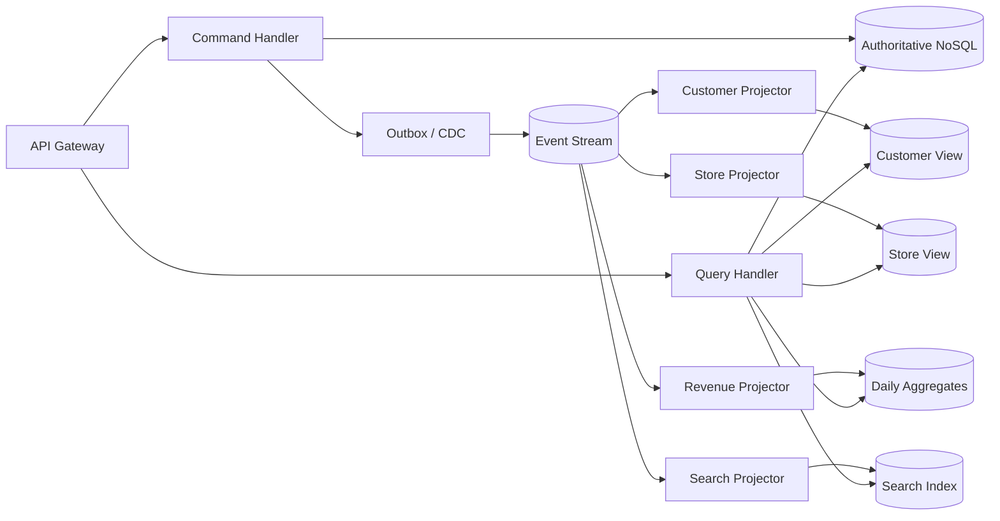
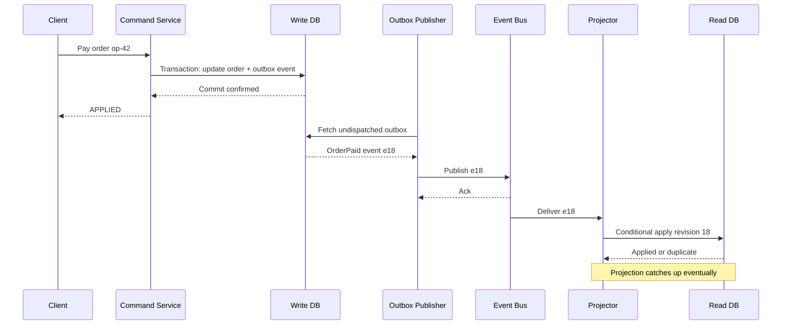

# Phân tách mô hình ghi/đọc khi nhu cầu của hai phía khác nhau

Một ứng dụng NoSQL thường bắt đầu bằng một collection hoặc table dùng chung cho cả **ghi dữ liệu nghiệp vụ** và **đọc dữ liệu phục vụ giao diện**. Cách làm này đơn giản và phù hợp với nhiều hệ thống nhỏ. Tuy nhiên, khi sản phẩm phát triển, yêu cầu của hai phía có thể trở nên khác nhau đến mức một mô hình không thể tối ưu đồng thời cho mọi thao tác.

Ví dụ, để xác nhận đơn hàng, ứng dụng cần kiểm tra **trạng thái hợp lệ, tồn kho, phiên bản, idempotency và giao dịch nguyên tử**. Nhưng để hiển thị trang “Đơn hàng của tôi”, nó cần **lọc theo khách hàng, tìm kiếm văn bản, sắp xếp theo ngày, phân trang và trả kết quả nhanh**. Cố ép một document cấu trúc theo nghiệp vụ ghi phục vụ toàn bộ truy vấn đọc có thể dẫn tới nhiều index đắt tiền, scan phân tán, join tại ứng dụng hoặc một partition quá lớn.

Một phương án là **phân tách mô hình ghi và mô hình đọc**: phần ghi có trách nhiệm bảo vệ dữ liệu có thẩm quyền (*write model*), còn một hoặc nhiều phần đọc được thiết kế theo access pattern cụ thể (*read models/projections*). Cách làm này có liên hệ với **CQRS — Command Query Responsibility Segregation**, nhưng không nhất thiết phải triển khai microservices, hai database hay event sourcing.

Bài học thuộc **Database No SQL → Tích hợp và kiến trúc**. Mục tiêu là hiểu **khi nào cần tách**, **cách chọn cấu trúc của mỗi bên**, **cách đồng bộ và xử lý độ trễ**, cũng như **đánh đổi về chi phí, độ phức tạp và tính đúng dữ liệu**.

> Nguyên tắc xuyên suốt: **tách mô hình ghi/đọc không đồng nghĩa mọi dữ liệu đọc đều được phép lỗi thời**. Một thao tác xác nhận thanh toán hay giữ chỗ vẫn phải đọc/ghi qua nguồn có thẩm quyền và bảo vệ invariant. Read model tối ưu tốc độ chỉ được dùng trong phạm vi hợp đồng freshness và consistency đã công bố.

## 1. Vì sao một mô hình thường không đủ cho cả hai phía?

Giả sử ứng dụng bán hàng có dữ liệu:

```json
{
  "tenantId": "T1",
  "orderId": "O-501",
  "customerId": "C-10",
  "storeId": "S-7",
  "status": "PAID",
  "items": [
    {
      "sku": "SKU-42",
      "quantity": 2,
      "unitPriceMinor": 149900
    }
  ],
  "totalMinor": 299800,
  "currency": "VND",
  "version": 18,
  "createdAt": "2026-11-14T08:00:00Z"
}
```

Phía ghi quan tâm:

- Chỉ cho phép những chuyển trạng thái hợp lệ: `PENDING → PAID → FULFILLED`.
- Một operation thanh toán không được ghi nhận hai lần.
- Không tạo hai reservation cho cùng đơn hàng.
- Số tiền phải được tính theo quy tắc nhất quán.
- Có thể kiểm tra đồng thời bằng `version`/CAS hoặc transaction.
- Có lịch sử thay đổi phục vụ kiểm toán.
- Chỉ một nguồn có quyền xác nhận trạng thái cuối cùng.

Phía đọc quan tâm:

- Trang chi tiết đơn theo `(tenantId, orderId)`.
- Danh sách đơn của khách theo `createdAt DESC`.
- Trang vận hành: đơn chưa giao theo `storeId`, trạng thái và thời gian.
- Tìm kiếm tên sản phẩm, mã vận đơn và số điện thoại đã chuẩn hóa theo chính sách.
- Tổng doanh thu theo ngày/chi nhánh.
- Thống kê số đơn theo trạng thái trong một khoảng thời gian.
- Pagination ổn định và p99 thấp khi số đơn tăng mạnh.

Không có lý do để mọi query đọc đều sử dụng **cùng một partition key và cùng một dạng document** như phần ghi.

## 2. Mô hình ghi và mô hình đọc có trách nhiệm khác nhau

| Khía cạnh | Write model | Read model |
| --- | --- | --- |
| Mục tiêu chính | Bảo vệ invariant và commit hợp lệ | Trả dữ liệu theo truy vấn nhanh, đúng độ tươi đã hứa |
| Đầu vào | Command có ý định và điều kiện | Query/filter/sort/pagination |
| Dữ liệu | Aggregate, state và metadata concurrency | Projection, index, summary hoặc document đã tổng hợp |
| Tính nhất quán | Theo contract của authoritative store | Có thể strong hoặc eventual tùy thiết kế |
| Định dạng | Tối ưu atomic boundary và các đường ghi | Tối ưu access path, có thể denormalize |
| Khóa | Theo identity và invariant | Theo customer, store, thời gian, search key |
| Index | Ít, đúng những gì phần ghi/lookup cần | Có thể nhiều cấu trúc đọc chuyên biệt |
| Cập nhật | Command được kiểm tra rồi commit | Cập nhật từ nguồn, event, log, transaction hoặc recompute |
| Xử lý lỗi | Có kết quả `APPLIED/REJECTED/UNKNOWN` phù hợp | Có lag, thiếu dữ liệu, replay, rebuild và reconciliation |
| Quyền ghi | Chỉ qua command authority | Thường chỉ projector/indexer có quyền cập nhật |

Đây là **phân chia trách nhiệm**, không nhất thiết là tách vật lý. Một ứng dụng có thể có hai class và hai index trong cùng database. Mức tách vật lý tăng khi chi phí, yêu cầu mở rộng hoặc semantics đòi hỏi.

## 3. CQRS là gì và không phải là gì?

**CQRS** là cách tách đường **command** (thay đổi trạng thái) và đường **query** (đọc trạng thái) khi nhu cầu của chúng khác nhau.

Mô hình khái niệm:

```text
                  [Client / API]
                      /     \
                     /       \
               Command      Query
                  |           |
                  v           v
             [Write side]  [Read side]
                  |           ^
                  v           |
          [Authoritative DB]  |
                  |           |
                  +-- events/CDC/outbox --> [Projection]
```

CQRS **không mặc định** yêu cầu:

- Hai microservices.
- Hai đội phát triển riêng.
- Hai loại database khác nhau.
- Event sourcing.
- Kafka hoặc một event broker cụ thể.
- Eventual consistency cho mọi query.
- Một read model cho từng endpoint.
- Bỏ transaction và chỉ dùng message queue.
- Sao chép toàn bộ dữ liệu sang mỗi nơi.

Có thể bắt đầu từ **tách command/query trong cùng codebase** và chỉ tạo projection khi có nhu cầu thật. Điều quan trọng là xác định rõ **ai có quyền sửa dữ liệu** và **đường đọc nào được phép lệch bao lâu**.

## 4. Phân biệt CQRS, denormalization, materialized view và event sourcing

Những khái niệm thường xuất hiện cùng nhau nhưng không đồng nghĩa:

**CQRS:** tách trách nhiệm đọc và ghi.

**Denormalization:** lưu trùng hoặc tổng hợp một phần dữ liệu để truy vấn nhanh hơn, ví dụ lưu `customerDisplayName` trong order summary.

**Materialized view/projection:** cấu trúc đọc được duy trì từ một nguồn dữ liệu khác; có thể cập nhật ngay trong transaction hoặc bất đồng bộ.

**Change Data Capture (CDC):** thu nhận thay đổi từ database/log để consumer biết có gì thay đổi.

**Transactional outbox:** ghi dữ liệu nghiệp vụ và record sự kiện trong cùng atomic transaction, rồi publish bất đồng bộ.

**Event sourcing:** trạng thái có thẩm quyền được tái tạo từ chuỗi domain events theo một mô hình cụ thể, thay vì chỉ lưu snapshot state hiện hành.

Có thể có **CQRS mà không event sourcing**, và có **denormalization mà không áp dụng CQRS đầy đủ**. Đừng thêm toàn bộ các mẫu kiến trúc chỉ vì một màn hình đọc chậm.

## 5. Khi nào nên cân nhắc tách?

Một số dấu hiệu:

1. Phần ghi phải duy trì invariant phức tạp, trong khi phần đọc cần nhiều kiểu lọc/sort.
2. Một truy vấn quan trọng liên tục scatter-gather qua nhiều shard.
3. Một màn hình phải join thủ công nhiều collections/tables và có p99 cao.
4. Báo cáo tổng hợp liên tục scan dữ liệu nguồn làm tranh CPU/I/O với giao dịch ghi.
5. Hệ cần full-text search hoặc vector/geospatial search mà authoritative store không phù hợp.
6. Số lần đọc lớn gấp nhiều lần số lần ghi; read scaling cần độc lập.
7. Định dạng write tối ưu update theo aggregate nhưng UI cần flattened documents.
8. Một phần dữ liệu đọc được phép trễ vài giây hoặc vài phút.
9. Các đội cần phát triển query model mà không thay invariants của write schema.
10. Cần rebuild/search index độc lập sau thay đổi mapping hoặc logic phân tích.

Dù vậy, việc tách phải giải quyết một **vấn đề đã đo hoặc yêu cầu cụ thể**, không chỉ làm kiến trúc “trông chuyên nghiệp”.

## 6. Khi nào không nên tách?

Nếu ứng dụng chủ yếu dùng:

```text
GET /entities/{id}
PUT /entities/{id}
```

và database hỗ trợ tốt đường truy vấn này, một schema với index thích hợp có thể là lựa chọn đơn giản nhất.

Nên cân nhắc giữ một mô hình khi:

- Truy vấn chủ yếu là point lookup theo primary key.
- Read và write có chung consistency/latency SLO.
- Dataset nhỏ, index hiện tại đáp ứng được tải.
- Tính nhất quán tức thời quan trọng với gần như mọi đọc.
- Đội chưa có năng lực vận hành CDC, queue, projection và reconciliation.
- Chi phí lưu bản sao hoặc độ phức tạp vượt lợi ích.
- Không có phương án phát hiện khi projection âm thầm thiếu dữ liệu.

Tách read/write thêm nhiều **trạng thái và đường thất bại**. Nếu không cần thiết, giữ thiết kế đơn giản sẽ dễ vận hành và dễ chứng minh tính đúng hơn.

## 7. Bắt đầu từ bảng access pattern, không từ công nghệ

Giả sử ứng dụng quản lý đơn:

| Operation | Input | Tần suất giả định | Consistency cần | Đường phù hợp |
| --- | --- | ---: | --- | --- |
| Create order | tenantId, orderId, items | 2.000/s | Commit có thẩm quyền | Write model |
| Pay order | orderId, payment operationId | 500/s | Không duplicate charge | Write authority + ledger |
| GET order detail | tenantId, orderId | 12.000/s | Read-your-writes ở một số luồng | Source hoặc view đủ bảo đảm |
| LIST orders by customer | customerId, time cursor | 8.000/s | Trễ tối đa vài giây | Customer read model |
| LIST pending by store | storeId, status | 3.000/s | Trễ ngắn, không để xác nhận sai | Store pending projection |
| Search order | keyword, filter | 1.000/s | Gần thời gian thực | Search index |
| Daily revenue | tenantId, day | 200/s | Có watermark, có thể trễ | Daily aggregate |
| Confirm stock | sku, quantity | 500/s | Atomic conditional authority | Inventory write model |

Con số chỉ minh họa.

Từ bảng này cần định nghĩa:

- Query nào cần dữ liệu **authoritative, ngay lập tức**?
- Query nào có thể trả projection **chưa bắt kịp**?
- Có những bộ lọc làm partition key hiện tại mất hiệu quả không?
- Có thể thêm index trong cùng database trước không?
- Projection nào thật sự cần tồn tại và duy trì?
- Với mỗi projection, ai chịu trách nhiệm khi dữ liệu lệch?

## 8. Chọn ranh giới aggregate ở write side

Write model nên được thiết kế quanh **invariant và atomicity boundary**.

Ví dụ một aggregate `Order`:

```text
Order
    orderId
    tenantId
    customerId
    items
    pricingSnapshot
    paymentStatus
    fulfillmentStatus
    aggregateRevision
    appliedOperations
```

Những bất biến:

- Trạng thái không chuyển ngược tùy tiện.
- Total của order phù hợp pricing snapshot tại thời điểm commit.
- Mỗi command có idempotency key trong scope.
- Một order không thể được xác nhận thanh toán hai lần cùng ý định.
- Chỉ chuyển sang fulfilled khi các điều kiện nghiệp vụ thỏa.

Tùy database, một aggregate có thể là **một document, một item, một partition** hoặc nhiều records trong một transaction được hỗ trợ.

Không nên gom mọi dữ liệu của một tenant vào cùng aggregate chỉ để có “một lần ghi”, vì:

- Document/partition có thể quá lớn.
- Mọi write cùng tranh một hot key.
- Concurrency conflicts tăng.
- Một transaction phải xử lý quá nhiều data.
- TTL/retention khác nhau bị trộn lẫn.

**Aggregate là ranh giới invariant**, không phải đơn vị nhóm tùy ý càng lớn càng tốt.

## 9. Phía đọc có thể có nhiều mô hình song song

Một sự kiện `OrderPaid` có thể cập nhật:

```text
orders_by_customer
pending_orders_by_store
daily_revenue
search_orders
customer_summary
```

Mỗi model có khóa khác nhau:

```text
orders_by_customer:
    PK = (tenantId, customerId, monthBucket)
    SK = (createdAt DESC, orderId)

pending_orders_by_store:
    PK = (tenantId, storeId, status, dayBucket)
    SK = (createdAt, orderId)

daily_revenue:
    PK = (tenantId, storeId, businessDay)
    fields = paidMinor, refundedMinor, orderCount

search_orders:
    documentId = tenantId + orderId
    fields = customerName, keywords, status, createdAt
```

Đây là thiết kế khái niệm: mỗi NoSQL có quy tắc khóa, sort và index khác nhau.

Đánh đổi:

- Đọc theo query chính thường nhanh.
- Ghi một order có thể kéo theo nhiều projection updates.
- Dữ liệu được lưu lặp ở nhiều nơi.
- Mỗi nơi có thể chậm cập nhật khác nhau.
- Cần quy trình rebuild và đối soát.
- Delete và permission changes phải lan tới mọi nơi đúng hạn.

## 10. Sơ đồ kiến trúc một nguồn ghi, nhiều projection đọc



Mũi tên từ `Query Handler` đến `Authoritative NoSQL` rất quan trọng: **một số read vẫn phải hỏi write source**. Tách mô hình không có nghĩa cấm mọi query đi vào nguồn.

## 11. Đừng nhầm một read model với một replica

**Replica của storage database** thường sao chép dữ liệu theo giao thức của engine với schema/semantics tương ứng.

**Read model** là biểu diễn dữ liệu đã được **biến đổi có chủ đích** để phục vụ truy vấn khác.

Ví dụ:

```text
Authoritative order:
    orderId, items, status, revision

Customer projection:
    customerId, orderId, createdAt, totalMinor, status

Revenue projection:
    day, paidMinor, refundMinor, transactionCount
```

Read model không chỉ là bản copy bit-by-bit của source. Do đó:

- Anti-entropy/read repair của storage engine không tự sửa projection sai.
- Replica lag khác với projector lag.
- Chuyển read tới một replica mạnh có thể khác với chuyển tới search index eventual.
- Một projection có thể cần **recompute theo logic nghiệp vụ** chứ không chỉ “copy bản mới nhất”.

## 12. Có ba mức tách kiến trúc

### Mức A — Tách code, dùng chung store

```text
CommandService -> Orders collection
QueryService   -> Orders collection + indexes
```

Ưu điểm: ít đồng bộ, ít vận hành. Phù hợp khi database vẫn xử lý tốt các truy vấn.

### Mức B — Cùng database, có bảng/collection đọc riêng

```text
CommandService -> orders_by_id
Projector      -> orders_by_customer
QueryService   -> orders_by_customer
```

Có thể cập nhật cùng transaction nếu engine hỗ trợ và cùng atomic boundary; nếu không, cần event/reconciliation.

### Mức C — Khác data stores hoặc khác service

```text
Command -> MongoDB / DynamoDB / Cassandra
CDC     -> Event bus
Query   -> OpenSearch / Redis / Cassandra read tables
```

Có thể scale và tối ưu truy vấn độc lập, nhưng thêm network, schema evolution, drift và vận hành distributed workflow.

**Nên tiến hóa từ mức đơn giản nhất đáp ứng nhu cầu**, không cần nhảy thẳng lên mức C.

## 13. Nguồn có thẩm quyền phải được nêu rõ

Mọi projection cần trả lời:

```text
Who owns the truth?
Who may write?
Who can derive a view?
What evidence proves commit?
```

Ví dụ:

| Dữ liệu | Source of truth | Projection |
| --- | --- | --- |
| Order lifecycle | Order aggregate | Customer order list, search |
| Inventory reserved | Inventory authority/ledger | Product availability badge |
| Payment result | Payment provider/ledger theo contract | Order payment status |
| Customer profile | Profile write store | Display name ở order summary |
| Permissions | Authorization authority | Cached claims có TTL/freshness |
| Revenue | Ledger/source transactions | Daily/monthly revenue view |

Không để query handler ghi ngược từ stale projection vào source như một hành động “tự sửa” khi chưa xác định nguồn thắng.

## 14. Command không phải là một thao tác CRUD tùy ý

Một command biểu diễn **ý định**:

```json
{
  "operationId": "pay-O-501-attempt-1",
  "orderId": "O-501",
  "expectedRevision": 17,
  "action": "CAPTURE_PAYMENT",
  "paymentReference": "PAY-781"
}
```

Write handler cần:

1. Xác thực identity, tenant và quyền.
2. Kiểm tra idempotency key và fingerprint.
3. Nạp state đủ mới từ authority.
4. Kiểm tra preconditions và business invariant.
5. Áp state transition trong atomic/transactional scope.
6. Lưu event/outbox hoặc mechanism đưa projection cập nhật.
7. Xác định commit result.
8. Trả `APPLIED`, `REJECTED` hay `UNKNOWN` đúng bằng chứng.

Không đơn giản cho mọi endpoint gửi:

```text
UPDATE any field = client input
```

vì điều đó khiến read side, API và business constraints trộn lẫn, khó audit.

## 15. Query không được âm thầm tạo side effect

Query handler lý tưởng:

```text
GET customer orders
    -> đọc projection
    -> paginate
    -> trả dữ liệu + freshness metadata
```

Không tự:

- Ghi lại trạng thái order authority từ bản đọc.
- Trigger payment.
- Decrement inventory.
- Xác nhận booking dựa vào cache.
- Cập nhật read model bằng kết quả chưa có authority.
- Khởi chạy một nghiệp vụ mới chỉ vì projection đang thiếu.

Nếu muốn **read-repair projection**, có thể enqueue một job hoặc cập nhật có điều kiện theo source version, nhưng đó là workflow kỹ thuật cần được kiểm soát, không phải quyền ghi nghiệp vụ ngầm của query.

## 16. Làm sao chuyển thay đổi từ write sang read?

Có các chiến lược chính:

| Cách | Luồng | Ưu điểm | Hạn chế |
| --- | --- | --- | --- |
| **Cùng transaction** | Write + projection update atomic | Ít lag trong phạm vi transaction | Transaction lớn, coupling và throughput cost |
| **Direct dual-write** | Service ghi source rồi ghi view | Dễ hình dung | Một bên commit, bên kia fail |
| **Transactional outbox** | Source + outbox atomic, consumer cập nhật view | Có durable intent to publish | Có duplicate delivery và lag |
| **CDC từ database log** | Đọc mutation stream của source | Không sửa từng command handler để publish | Retention, schema và ordering semantics |
| **Domain event log** | Domain events làm nguồn hoặc xuất từ nguồn | Giàu ngữ nghĩa nghiệp vụ | Event schema/governance phức tạp |
| **Scheduled reconciliation** | Quét nguồn, so và sửa view | Phát hiện drift, hỗ trợ rebuild | Không cho freshness ngay nếu dùng đơn lẻ |
| **Full refresh định kỳ** | Recompute toàn bộ view | Đơn giản với tập nhỏ | Tốn I/O, window stale, không phù hợp tập lớn |

Không có cách nào miễn phí. Nếu sử dụng dual-write trực tiếp, phải có **protocol bù và idempotency**; nếu không, đây là điểm phát sinh mismatch phổ biến.

## 17. Lỗi dual-write: ghi một nơi thành công, nơi còn lại thất bại

Ví dụ service làm:

```text
1. UPDATE orders_by_id.status = PAID  -> SUCCESS
2. UPDATE orders_by_customer.status -> TIMEOUT
3. Trả 500 cho client
```

Tại bước 3:

- Source có thể đã commit PAID.
- Read model có thể chưa được cập nhật hoặc đã áp nhưng response mất.
- Client không biết operation đã thành công hay chưa.
- Nếu gửi lại command mới, side effect payment có thể bị lặp.

**Hai câu lệnh database liên tiếp không tạo thành một transaction xuyên hai nơi**.

Một lựa chọn tốt hơn khi không có distributed atomic transaction:

```text
Atomic source commit:
    update authoritative order
    insert outbox event with eventId/revision

Asynchronous projector:
    consume event
    update read view conditionally
    checkpoint after safe application
```

## 18. Transactional outbox: mẫu đáng dùng



Lưu ý:

- Outbox publisher có thể publish **hai lần** nếu nhận ACK rồi crash trước checkpoint.
- Consumer cần idempotency/dedup.
- Event bus có thể không bảo đảm thứ tự toàn cục.
- Outbox có thể tích tụ khi broker hỏng.
- Atomic source+outbox chỉ có khi storage transaction/aggregate bảo vệ được.
- Một command được `APPLIED` không đồng nghĩa read projection đã cập nhật.

## 19. CDC: dùng khi không muốn hoặc không thể ghi outbox cho mọi mutation

Mô hình:

```text
Write DB mutation/log
     |
     v
CDC connector / change stream
     |
     v
Event processing
     |
     v
Read model
```

CDC có thể trích từ oplog, log sequence, DynamoDB Streams, change feed hoặc engine-specific stream. Bản ghi CDC thường mang thông tin **mutation ở tầng storage**, chưa chắc phản ánh một domain event đầy đủ.

Ví dụ:

```json
{
  "entityId": "O-501",
  "operation": "UPDATE",
  "newStatus": "PAID",
  "sourceRevision": 18
}
```

Consumer cần biết:

- Mutation này là final state hay chỉ thay đổi một field?
- Nó có thuộc transaction nhiều record không?
- Có đủ old/new values để cập nhật mọi projection?
- Event có thể duplicate/đến muộn/bị mất khi hết retention?
- Source schema thay đổi ảnh hưởng transformer thế nào?
- Có cần tham chiếu nguồn để làm giàu dữ liệu không?

CDC là một đường **vận chuyển sự thay đổi**, không tự giải quyết business semantics, ordering và idempotency.

## 20. Domain events và storage events không giống nhau

Một **domain event**:

```json
{
  "type": "OrderPaid",
  "orderId": "O-501",
  "paymentOperationId": "pay-O-501-1",
  "revision": 18
}
```

diễn đạt một sự kiện nghiệp vụ.

Một **storage event**:

```json
{
  "table": "orders",
  "op": "UPDATE",
  "key": "O-501",
  "fieldsChanged": ["paymentStatus", "updatedAt"]
}
```

diễn đạt một mutation dữ liệu.

Domain event có thể tốt cho projection tài chính vì sự kiện `OrderPaid` có semantics rõ hơn update field. Tuy nhiên, domain events vẫn phải được phát **theo đúng commit boundary**; phát event trước commit mà không có outbox/transaction có thể khiến consumer thấy sự kiện của lệnh đã rollback.

Không nhầm **event log được thiết kế làm source of truth** với log chỉ dùng thông báo thay đổi.

## 21. Độ trễ của read model phải là một hợp đồng

Một projection cập nhật bất đồng bộ có thể trễ:

```text
T0: OrderPaid commit ở nguồn.
T0 + 20ms: Outbox publisher đọc event.
T0 + 80ms: Broker deliver event.
T0 + 120ms: Projector áp.
T0 + 150ms: UI đọc view mới.
```

Đây là số giả định.

Nếu UI đọc tại `T0 + 50ms`, nó có thể vẫn thấy `PENDING`.

Cần định nghĩa rõ:

- **Freshness SLO:** bao lâu sau source commit, view phải bắt kịp?
- **Lag metric:** đo theo thời gian, sequence hoặc source revision?
- **Consistency fallback:** nếu view chưa theo kịp, có đọc source không?
- **User experience:** hiển thị đang đồng bộ hay sai thành công?
- **Monitoring:** lag vượt ngưỡng ở những tenant/key quan trọng ra sao?
- **Recovery:** khi queue trễ hoặc consumer lỗi, có backfill/replay không?

**Không giả định “eventual consistency = sẽ nhanh”** nếu chưa đo sự hội tụ.

## 22. Ba kiểu đọc sau khi ghi

### Eventual read

```text
POST order -> APPLIED.
GET order list -> có thể chưa hiển thị ngay.
```

Phù hợp với dashboard, search hoặc danh sách có freshness contract.

### Read-your-writes

```text
POST order -> sourceRevision=18.
GET order detail -> phải nhìn thấy ít nhất revision 18.
```

Có thể thực hiện bằng authoritative read hoặc cơ chế chờ/định tuyến đảm bảo watermark.

### Strong authoritative read

```text
POST reserve last stock item
    -> transaction/conditional write.

GET confirmed inventory
    -> read qua authority đúng contract.
```

Không được lấy projection eventual để quyết định có thể bán thêm sản phẩm cuối cùng.

## 23. Token để hỗ trợ read-your-writes

Response khi command commit:

```json
{
  "orderId": "O-501",
  "status": "APPLIED",
  "sourceRevision": 18
}
```

Client gửi query:

```text
GET /orders/O-501?minRevision=18
```

Query service có thể:

1. Kiểm tra projection có `sourceRevision >= 18` cho đúng entity/generation không.
2. Nếu có, trả projection.
3. Nếu chưa, chờ **có giới hạn** hoặc đọc nguồn có thẩm quyền.
4. Nếu không thể đáp ứng, trả một kết quả thể hiện rõ `PENDING`/`NOT_READY`, không giả trả bản cũ như đã đủ tươi.

### Không biến revision thành đồng hồ toàn cục

Revision 18 của order O-501 không thể so trực tiếp với revision 18 của O-502 nếu mỗi aggregate có sequence riêng. Nếu query tổng hợp nhiều orders, cần watermark theo partition/stream hoặc cơ chế snapshot tương thích, không chỉ so một số `18` chung.

## 24. Một ví dụ response có freshness metadata

```json
{
  "orders": [
    {
      "orderId": "O-501",
      "status": "PAID",
      "sourceRevision": 18
    }
  ],
  "readModel": {
    "name": "orders_by_customer",
    "watermark": "partition-12-offset-9081",
    "lastUpdatedAt": "2026-11-14T08:05:00Z",
    "freshnessMode": "EVENTUAL"
  }
}
```

Nếu source log được chia nhiều partitions, watermark đơn thường chỉ có nghĩa trong phạm vi partition đó. Không công bố độ tươi toàn bộ view chỉ từ **consumer offset của một partition**.

`lastUpdatedAt` cần phân biệt **thời điểm projector xử lý** với **thời điểm source commit**. Một projector vừa xử lý một event cũ có timestamp cập nhật rất mới nhưng dữ liệu vẫn trễ.

## 25. Dữ liệu đọc có thể denormalize có kiểm soát

Write model:

```json
{
  "orderId": "O-501",
  "customerId": "C-10",
  "sku": "SKU-42",
  "quantity": 2,
  "status": "PAID"
}
```

Profile source:

```json
{
  "customerId": "C-10",
  "displayName": "Minh"
}
```

Read projection:

```json
{
  "orderId": "O-501",
  "customerId": "C-10",
  "customerDisplayName": "Minh",
  "sku": "SKU-42",
  "quantity": 2,
  "status": "PAID",
  "createdAt": "2026-11-14T08:00:00Z"
}
```

UI đọc một document là đủ. Đổi lại, khi profile đổi tên hiển thị, có thể phải cập nhật nhiều order summaries.

Cần quyết định:

- Tên hiển thị là giá trị **snapshot tại lúc đặt hàng** hay luôn là tên hiện tại?
- Nếu snapshot theo thời điểm, có cần cập nhật khi profile đổi không?
- Nếu dùng tên mới, làm sao backfill các orders cũ?
- Có cần ẩn/xóa PII khi user yêu cầu xóa thông tin?
- Có yêu cầu quyền truy cập khác giữa order source và projection không?

**Denormalization không chỉ là thao tác kỹ thuật; nó mang theo ngữ nghĩa vòng đời dữ liệu.**

## 26. Một projection có thể dùng nhiều nguồn

Ví dụ trang đơn hàng hiển thị:

```text
Order data
Customer display name
Shipment tracking
Payment summary
```

Một projector có thể kết hợp nhiều nguồn:

```text
Order events ------+
Customer events ---+--> Enricher --> OrderCard projection
Shipping events ---+
Payment events ----+
```

Rủi ro:

- Các nguồn có sequence riêng, không có total order toàn cục.
- Payment cập nhật nhưng shipping chưa tới.
- Một nguồn không sẵn sàng khiến projection thiếu field.
- Delete của customer không được propagate.
- Read model có thể thể hiện một trạng thái kết hợp chưa từng tồn tại đồng thời ở các nguồn.

Cần định nghĩa **mức nhất quán của màn hình**: eventual composition có chấp nhận được không? Nếu cần “ảnh chụp tức thời nhất quán xuyên các nguồn”, có thể cần protocol/snapshot khác hoặc truy vấn authoritative có transaction.

## 27. Projection không được tạo invariant mới một cách tùy tiện

Giả sử từ `OrderPaid` projector tính:

```text
dailyRevenue += order.totalMinor
```

Event có thể bị phát lại. Nếu không chống duplicate, revenue bị cộng hai lần.

Một hệ tốt cần:

```text
eventId = e-18
aggregateRevision = 18
orderId = O-501
```

và kiểm tra nguyên tử:

```text
if eventId already processed:
    do nothing

else:
    apply revenue delta
    record eventId applied
    commit atomically
```

Nếu increment aggregate và insert marker vào hai nơi không nguyên tử, projector vẫn có thể crash ở giữa.

Lựa chọn khác: dùng **per-order contribution state** rồi aggregate từ các đóng góp, hoặc recompute định kỳ, để tránh cộng dồn không thể sửa khi event trùng.

## 28. Projection có tính toán khác projection chỉ lưu snapshot

**Snapshot/upsert projection**:

```text
order O-501 -> status PAID, revision 18
```

Có thể áp event phiên bản mới hơn nếu payload là **trạng thái đầy đủ**, theo contract.

**Delta projection**:

```text
revenue += 299800
```

Phụ thuộc vào việc event được xử lý **đúng một lần theo hiệu ứng**, hoặc có dedup/compensation.

Một bug hay gặp: dùng cùng một cơ chế `if incomingRevision > currentRevision` để xử lý delta có gap.

Ví dụ:

```text
revision 10: +100
revision 11: +200 (bị mất)
revision 12: +300
```

Nếu áp rev12 rồi bỏ rev11, tổng tiền thiếu 200. Cần **gap detection/replay** hoặc thiết kế aggregate có thể tính lại.

## 29. Idempotency của projector

Một projector thường nhận message ít nhất một lần trong nhiều nền tảng:

```text
Broker delivers e18.
Projector writes view.
Projector crashes before ACK.
Broker redelivers e18.
```

Thiết kế đúng phải cho phép replay mà không tạo:

- Order card duplicate.
- Revenue double count.
- Email gửi hai lần.
- Stale event ghi đè state mới.
- Delete được hồi sinh.

Có thể dùng:

- Unique event IDs được lưu cùng atomic mutation.
- Aggregate revision và conditional upsert.
- Per-entity sequence/checkpoint.
- Dedup inbox.
- State recomputation từ source với idempotent replace.
- Business key uniqueness.

**At-least-once delivery + idempotent apply** là lựa chọn thực dụng cho nhiều hệ. Không tự quảng bá exactly-once end-to-end chỉ vì broker có tính năng trong một phạm vi hẹp.

## 30. Xử lý event sai thứ tự

Một stream:

```text
O-501 revision 17: PENDING
O-501 revision 18: PAID
O-501 revision 19: FULFILLED
```

Consumer có thể thấy:

```text
rev19 đến trước rev18
```

Nếu event chứa **full snapshot**, có thể áp rev19 và bỏ rev18 nếu domain/projection semantics cho phép.

Nếu event chứa **delta** như:

```text
rev18: totalPaid += 299800
rev19: shipmentCount += 1
```

bỏ rev18 có thể làm view sai vĩnh viễn.

Cần:

1. Xác định ordering guarantee theo key/partition.
2. Phân biệt state snapshots và deltas.
3. Có sequence/generation rõ.
4. Detect gaps nếu cần mọi intermediate event.
5. Replay theo checkpoint hoặc recompute khi phát hiện thiếu.
6. Có TTL hợp lý cho buffer out-of-order.
7. Không làm tài nguyên vô hạn khi chờ một event đã mất.

## 31. Một projector Java dùng conditional revision

Ví dụ giả mã Java theo interface:

```java
public record OrderPaidEvent(
        String tenantId,
        String orderId,
        long generation,
        long revision,
        long totalMinor,
        String currency,
        String eventId
) {}

public interface CustomerOrderView {
    ApplyResult replaceIfNewer(
            String tenantId,
            String orderId,
            long generation,
            long revision,
            OrderCard card);
}

public final class CustomerOrderProjector {
    private final CustomerOrderView view;

    public CustomerOrderProjector(CustomerOrderView view) {
        this.view = view;
    }

    public ApplyResult onOrderPaid(OrderPaidEvent event) {
        OrderCard newCard = new OrderCard(
            event.orderId(),
            "PAID",
            event.totalMinor(),
            event.currency()
        );

        // Repository phải atomic compare-and-write.
        return view.replaceIfNewer(
            event.tenantId(),
            event.orderId(),
            event.generation(),
            event.revision(),
            newCard
        );
    }
}
```

Đây là giả mã minh họa; `ApplyResult` và `OrderCard` cần được định nghĩa và persistence adapter phải bảo đảm **atomicity**. Không được viết logic `GET revision` rồi `PUT` không điều kiện, vì hai consumers song song có thể ghi sai thứ tự.

### Khi nào không dùng ví dụ này?

Nếu `OrderPaidEvent` chỉ chứa một delta cần cộng vào total của nhiều orders, không thể sử dụng `replaceIfNewer` đơn thuần mà bỏ qua những revision bị mất. Khi đó cần dedup và aggregate protocol phù hợp.

## 32. Java command handler tập trung vào invariant

Ví dụ giả mã:

```java
public record PayOrderCommand(
        String tenantId,
        String orderId,
        String operationId,
        long expectedRevision,
        String paymentReference
) {}

public final class PayOrderHandler {
    private final OrderRepository orders;
    private final UnitOfWork unitOfWork;

    public CommandResult handle(PayOrderCommand cmd) {
        return unitOfWork.transaction(() -> {
            Order order = orders.loadAuthoritative(
                cmd.tenantId(), cmd.orderId()
            );

            if (order.hasApplied(cmd.operationId())) {
                return order.savedResult(cmd.operationId());
            }

            if (order.revision() != cmd.expectedRevision()) {
                return CommandResult.versionConflict();
            }

            order.applyPaymentConfirmation(
                cmd.operationId(),
                cmd.paymentReference()
            );

            // Save order state and outbox atomically when supported.
            orders.saveWithOutbox(
                order,
                order.toPendingEvents()
            );

            return CommandResult.applied(order.revision());
        });
    }
}
```

Ví dụ **không chạy ngay**, vì `OrderRepository`, `Order`, `UnitOfWork` và các type liên quan chưa có implementation. Đặc biệt, **không trả `APPLIED` cho client cho tới khi commit được xác nhận**; nếu transaction commit có outcome unknown, handler phải theo protocol của driver và giữ operationId để tra cứu.

## 33. Một cách tổ chức module trong Java

```text
orders/
    command/
        CreateOrderCommand.java
        PayOrderCommand.java
        OrderCommandHandler.java
        OrderAggregate.java
        OrderRepository.java

    events/
        OrderCreated.java
        OrderPaid.java
        OrderCancelled.java
        OutboxPublisher.java

    projection/
        CustomerOrderProjector.java
        StorePendingProjector.java
        RevenueProjector.java
        ProjectorCheckpoint.java

    query/
        OrderQueries.java
        CustomerOrderQueryService.java
        StorePendingQueryService.java
        SearchQueryService.java

    infrastructure/
        MongoOrderRepository.java
        DynamoCustomerViewRepository.java
        EventBusAdapter.java
```

Một codebase có thể chứa cả command/query. Package boundaries giúp giữ rõ trách nhiệm và tránh query service trực tiếp sửa aggregate source.

**Không tạo microservice mới chỉ vì có package `command` và `query`.** Tách deploy/process chỉ khi isolation, scale hoặc ownership thực sự cần.

## 34. MongoDB: write collection và read collection riêng

Ví dụ write collection:

```javascript
db.orders.insertOne({
  tenantId: "T1",
  orderId: "O-501",
  customerId: "C-10",
  status: "PENDING",
  totalMinor: 299800,
  version: 1,
  createdAt: new Date("2026-11-14T08:00:00Z")
});
```

Một conditional update:

```javascript
db.orders.updateOne(
  {
    tenantId: "T1",
    orderId: "O-501",
    version: 1,
    status: "PENDING"
  },
  {
    $set: { status: "PAID" },
    $inc: { version: 1 }
  }
);
```

Nếu `matchedCount = 0`, command cần xử lý conflict/not-found, không retry mù.

Read collection:

```javascript
db.orders_by_customer.find({
  tenantId: "T1",
  customerId: "C-10"
})
.sort({
  createdAt: -1,
  orderId: -1
})
.limit(20);
```

Index phù hợp tùy quy tắc phân mảnh/truy vấn:

```javascript
db.orders_by_customer.createIndex({
  tenantId: 1,
  customerId: 1,
  createdAt: -1,
  orderId: -1
});
```

### Những điều phải kiểm tra

- Đường ghi dùng conditional update và transaction khi cần.
- Read collection không phải nguồn để xác nhận nghiệp vụ.
- Query trên sharded collection có target đúng shard không?
- Có cursor pagination ổn định thay vì `skip` lớn không?
- Projection update từ change stream/outbox thế nào?
- Unique/index semantics có đổi theo shard key không?
- Delete/TTL có được propagate qua CDC không?
- Có giải pháp rebuild read collection không?

MongoDB hỗ trợ các cơ chế aggregation/materialized patterns; mức độ nhất quán và công cụ cập nhật cụ thể cần phù hợp phiên bản, topology và workload.

## 35. DynamoDB: nhiều bảng theo access pattern

Một thiết kế nguồn:

```text
OrdersById
    PK = TENANT#T1#ORDER#O-501
    attributes = status, version, totals, items
```

Read table:

```text
OrdersByCustomer
    PK = TENANT#T1#CUSTOMER#C-10
    SK = CREATED#2026-11-14T08:00:00Z#ORDER#O-501
    attributes = orderId, status, totalMinor
```

Query:

```text
PK = TENANT#T1#CUSTOMER#C-10
ScanIndexForward = false
Limit = 20
```

Ưu điểm: đọc danh sách khách hàng phù hợp key design, không scan toàn bảng.

Nhưng:

- DynamoDB base table primary key không đổi tại chỗ.
- GSI có thể đáp ứng một access pattern mà chưa cần bảng read riêng.
- GSI cập nhật theo semantics của dịch vụ và có thể eventual.
- Bảng phụ qua Streams/consumer có thể lag hoặc thiếu event.
- Một tenant/customer quá lớn có thể tạo hot partition key; cần time/bucket nếu cần.
- Query pagination phải dùng cursor/LastEvaluatedKey đúng.
- Với strong read cần kiểm tra khả năng của đúng API/table/index: không suy GSI cung cấp strong read như base table.

Khi cần transaction atomic trên nhiều items, xem phạm vi hỗ trợ của transaction API và conditional expressions. Dùng Streams/consumer cập nhật read table là **workflow asynchronous** cần idempotency/reconciliation, không phải same-table atomic update.

## 36. Cassandra/ScyllaDB: nhiều bảng đúng đường truy vấn

Trong wide-column NoSQL, một data model thường được thiết kế **query-first**:

```sql
CREATE TABLE orders_by_id (
    tenant_id text,
    order_id text,
    customer_id text,
    status text,
    total_minor bigint,
    version bigint,
    PRIMARY KEY ((tenant_id, order_id))
);
```

Read table:

```sql
CREATE TABLE orders_by_customer_month (
    tenant_id text,
    customer_id text,
    month_bucket text,
    created_at timestamp,
    order_id text,
    status text,
    total_minor bigint,
    PRIMARY KEY (
        (tenant_id, customer_id, month_bucket),
        created_at, order_id
    )
) WITH CLUSTERING ORDER BY (
    created_at DESC, order_id ASC
);
```

Query:

```sql
SELECT order_id, status, total_minor, created_at
FROM orders_by_customer_month
WHERE tenant_id = ?
  AND customer_id = ?
  AND month_bucket = ?
LIMIT 20;
```

Mục tiêu: truy vấn danh sách khách hàng trong một bucket không cần quét nhiều partition tùy tiện.

### Rủi ro

- Cập nhật `orders_by_id` và `orders_by_customer_month` **không tự là transaction serializable xuyên partitions**.
- CQL batch có semantics riêng, không phải phép màu thay distributed transaction.
- Một status transition cần cập nhật/remove entries của read tables phù hợp.
- Query qua nhiều month buckets cần merge/pagination.
- TTL/tombstone, large partition và repair phải được cân nhắc.
- LWT/CAS cho source aggregate có thể cần thiết để bảo vệ invariant.
- Projection cần nguồn event và replay, không mặc định storage anti-entropy tự sửa bảng khác schema.

Với ScyllaDB, CQL và storage/scheduling có những chi tiết khác Cassandra; phải đối chiếu tài liệu version khi cấu hình concurrency, repair và view mechanisms.

## 37. Redis: cache, read-through hoặc projection

Một view:

```text
customer:T1:C-10:recent-orders
```

có thể được lưu trong Redis để giảm latency của GET phổ biến.

Các mô hình:

**Cache-aside:**

```text
GET from Redis
    -> miss
    -> fetch authoritative/read DB
    -> populate cache with TTL
```

**Write-through:**

```text
Write authority
    -> update cache theo workflow
```

**Event-driven read projection:**

```text
OrderPaid event
    -> update Redis sorted set/hash
```

Đánh đổi:

- Cache miss và stampede.
- Stale entries sau update/delete.
- TTL làm dữ liệu biến mất nhưng không sửa nguồn.
- Key naming/hash slot và hot keys.
- Redis replication/persistence/failover semantics.
- Với một số workflows, cache chỉ là tối ưu **không có thẩm quyền**.

**Không dùng Redis cache stale để xác nhận payment, trừ tồn kho hoặc cấp quyền** khi business contract đòi strong authority.

## 38. Search engine là một read model đặc biệt

Search queries thường cần:

- Full-text relevance.
- Fuzzy matching.
- Facets và filter.
- Geospatial hoặc vector retrieval.
- Sort theo score/date.
- Aggregation trên nhiều documents.

Một source transactional NoSQL có thể không tối ưu cho các nhu cầu đó. Đồng bộ vào Elasticsearch/OpenSearch có thể hợp lý.

```text
MongoDB/DynamoDB/Cassandra source
     |
     v
Outbox/CDC
     |
     v
Search indexer
     |
     v
OpenSearch/Elasticsearch
     |
     v
Search API
```

Nhưng search index có:

- Refresh visibility delay.
- Mapping evolution.
- Reindex và alias cutover.
- Trùng/thiếu documents khi consumer lỗi.
- Delete handling.
- Replay ordering/version guard.
- Authorization filters và tenant isolation.

Search index là **query projection**, không phải database authority cho thanh toán, đơn hàng hoặc inventory.

## 39. Transactional read model không bắt buộc luôn eventual

Có những trường hợp phần ghi và đọc được duy trì **đồng bộ** trong một transaction có hỗ trợ:

```text
Atomic transaction:
    update order aggregate
    update order summary
    update unique business guard
```

Ưu điểm: read summary phản ánh transaction sau commit trong phạm vi database contract.

Nhược điểm:

- Transaction dài và nhiều participants.
- Write amplification.
- Conflict/lock/cost.
- Coupling giữa command và nhiều views.
- Một read model thay đổi có thể ảnh hưởng khả năng ghi.

Cân nhắc sử dụng đồng bộ với **rất ít projections trọng yếu** cần consistency mạnh, còn các dashboard/search có thể cập nhật bất đồng bộ.

Nếu hệ không hỗ trợ atomicity ở phạm vi các records liên quan, không được gọi hai writes liên tiếp là “transactional read model”.

## 40. Độ tươi của mỗi projection có thể khác nhau

| Read model | Ví dụ freshness target | Nếu chưa theo kịp |
| --- | --- | --- |
| Order detail | Read-your-writes sau command | Đọc nguồn hoặc chờ có giới hạn |
| Customer order list | Vài giây | Hiển thị đang cập nhật |
| Store operations queue | Trễ ngắn, có alert | Fallback hoặc chặn thao tác xác nhận |
| Search index | Vài giây đến phút | Trả freshness label nếu cần |
| Daily revenue | Theo watermark hoặc lịch tổng hợp | Hiển thị mốc dữ liệu gần nhất |
| Inventory availability badge | Stale có kiểm soát | Khi checkout vẫn phải kiểm tra authority |
| Access control | Thường cần mức mới phù hợp rủi ro | Không dùng cache cũ để cấp quyền bị thu hồi |

Các ngưỡng chỉ là ví dụ; SLO phải đến từ rủi ro và yêu cầu sản phẩm.

Không nên có một biến toàn cục:

```text
ALL_READ_MODELS_ARE_EVENTUAL
```

vì tính đúng của query phụ thuộc mục đích sử dụng nó.

## 41. Làm sao tránh UI “đã trả tiền nhưng danh sách vẫn PENDING”?

Một luồng:

```text
POST /orders/O-501/pay
    -> APPLIED, revision 18.

GET /customers/C-10/orders
    -> projection đang ở revision 17.
```

Các phương án:

1. **Optimistic UI:** cập nhật phần màn hình bằng receipt đã xác minh, đồng thời chờ projection.
2. **Min-revision query:** nếu projection chưa có rev18, trả `NOT_READY` hoặc đọc nguồn.
3. **Source-backed order detail:** sau payment, chi tiết order đọc authority, list vẫn eventual.
4. **Status indicator:** “Danh sách đang đồng bộ”.
5. **Push/WebSocket:** projector phát notification khi view bắt kịp, có reconnect/replay policy.

Không nên:

- Trả PAID ngay khi command còn `UNKNOWN`.
- Tự ghi lên source từ optimistic UI.
- Giả rằng projection đã cập nhật chỉ vì command response 200.
- Xóa order khỏi UI khi một view eventual chưa tìm thấy record.

## 42. Backfill khi tạo một read model mới

Khi thêm `orders_by_customer` vào hệ đã có hàng chục triệu orders, chỉ nghe events từ hôm nay sẽ thiếu dữ liệu lịch sử.

Cần:

```text
Source snapshot/backfill
    +
Changes xảy ra trong lúc backfill
    =
Đầy đủ dữ liệu target tới mốc cutover
```

Một workflow:

1. Tạo read model mới và schema/index.
2. Xác định mốc snapshot/CDC tương thích.
3. Bảo đảm change log được giữ đủ lâu.
4. Quét dữ liệu lịch sử có checkpoint theo range/tenant.
5. Nạp target bằng operation **idempotent**.
6. Replay events từ mốc thích hợp.
7. Chặn stale snapshot overwrite event mới hơn.
8. Theo dõi lag tới khi catch-up.
9. So key/version/hash và các query quan trọng.
10. Cutover query traffic theo protocol.
11. Theo dõi và chỉ retire view cũ khi đủ bằng chứng.

Nếu nguồn không cung cấp snapshot toàn cục, cần một thuật toán capture/replay có kiểm chứng thay thế, không coi một scan kéo dài là ảnh chụp nguyên tử.

## 43. Race giữa backfill và live event

Giả sử:

```text
T0: Backfill đọc O-501 revision 17.
T1: Event revision 18 = PAID tới projector.
T2: Projector ghi PAID revision 18 vào target.
T3: Backfill ghi snapshot PENDING revision 17.
```

Nếu backfill dùng blind upsert, target **đi lùi**.

Giải pháp:

```text
Apply snapshot revision 17
    only if target generation/revision is older.

Apply event revision 18
    only if it is newer and transition valid.
```

Những mutation compare-and-write phải **nguyên tử** tại target; thao tác đọc version rồi ghi không điều kiện vẫn có race.

Nếu event chỉ chứa delta, còn cần giữ đủ sự kiện trung gian và phát hiện gap.

## 44. CDC retention là giới hạn của quá trình rebuild

Giả sử:

```text
Backfill duration:    30 giờ.
CDC retention:        24 giờ.
```

Nếu hệ chỉ bắt đầu replay sau khi backfill hoàn tất và không giữ được stream từ mốc đầu, có thể đã mất những thay đổi xảy ra 6 giờ đầu.

Các lựa chọn:

- Tăng retention trước migration theo khả năng sản phẩm.
- Chạy concurrent CDC capture vào một durable log riêng.
- Rút thời gian backfill bằng tăng capacity mà vẫn giữ foreground SLO.
- Chia backfill theo ranges cùng checkpoint đúng.
- Dùng snapshot/stream API hỗ trợ consistent bootstrap.
- Khi stream gap không thể phục hồi, **rebuild lại từ mốc mới** hoặc dùng thuật toán đối soát an toàn thay vì giả tiếp tục được.

**Không cutover chỉ vì row count đã đủ** nếu change stream chưa có chứng cứ bao phủ toàn bộ khoảng cần thiết.

## 45. Delete và TTL phải được lan truyền chính xác

Một document bị xóa:

```text
Source:
    DELETE order O-501, revision 19.

Read models:
    orders_by_customer
    store_pending
    search_index
    daily_revenue
```

Mỗi nơi cần hành vi riêng:

- Danh sách khách: bỏ card hoặc hiển thị trạng thái deleted theo policy.
- Store pending: xóa entry khỏi tập pending.
- Search: xóa document khỏi index.
- Revenue: **không tự trừ doanh thu** trừ khi nghiệp vụ thực sự có refund/adjustment được ghi nhận.
- Audit: có thể phải giữ record theo retention/pháp lý.
- Cache: invalidate/version gate.

Một event `DELETE` ở storage không đủ thông tin để biết có nên trừ revenue hay không. Cần phân biệt **xóa representation** với **đảo một sự kiện kinh tế**.

### Tombstone và late replay

Nếu search đã xóa O-501 nhưng event cũ revision 18 đến muộn:

```text
rev19: deleted
rev18: paid snapshot
```

không được resurrect document. Target cần giữ generation/revision/deletion marker đủ lâu để từ chối event cũ.

## 46. Schema evolution: thay đổi write schema không được làm mọi projector hỏng

Ví dụ source trước:

```json
{
  "totalMinor": 299800
}
```

Sau đổi:

```json
{
  "pricing": {
    "grandTotalMinor": 299800,
    "currency": "VND"
  }
}
```

Một consumer cũ chờ `totalMinor` có thể tạo view amount=0 hoặc fail.

Cần:

- Event schema version.
- Backward/forward compatibility trong khoảng deploy.
- Upcaster/transformer nếu có lịch sử nhiều phiên bản.
- Tests với event cũ và mới.
- Rollout producer/consumer theo thứ tự an toàn.
- Dead-letter cho event không parse được.
- Rebuild read model nếu mapping cũ đã sai.
- Audit và quyền truy cập các field mới.

Không để consumer âm thầm default giá trị tiền bằng 0 khi thiếu field bắt buộc; đó là mất tính đúng dữ liệu.

## 47. Event version khác aggregate revision

Một message có thể mang:

```json
{
  "eventSchemaVersion": 2,
  "aggregateRevision": 18,
  "eventId": "e18",
  "type": "OrderPaid"
}
```

Ba trường có mục đích khác nhau:

- `eventSchemaVersion`: định dạng payload/meaning có đổi không?
- `aggregateRevision`: thứ tự nghiệp vụ của entity có tăng không?
- `eventId`: định danh message/event để dedup và trace.

Không dùng `eventSchemaVersion=2` để quyết định state mới hơn `aggregateRevision=18`. Không dùng `eventId` ngẫu nhiên làm thứ tự nếu không có contract.

## 48. Phân trang và thứ tự trong read model

Một UI danh sách thường cần:

```text
customerId=C-10
ORDER BY createdAt DESC, orderId DESC
LIMIT 20
```

Với data lớn, `offset=100000` có thể gây scan bỏ qua nhiều records. Nên cân nhắc **cursor/keyset pagination** theo key thực tế của read model.

Ví dụ cursor:

```json
{
  "lastCreatedAt": "2026-11-14T08:00:00Z",
  "lastOrderId": "O-501"
}
```

Cần lưu ý:

- Sort key phải ổn định, có tie-breaker.
- Eventual updates có thể làm item xuất hiện/biến mất giữa hai trang.
- Nếu sửa sort field, cùng item có thể được thấy lại hoặc bị bỏ qua.
- Có thể cần snapshot/watermark nếu yêu cầu phân trang không trùng trong một phiên đọc.
- Không lộ cursor chứa PII không cần thiết; có thể mã hóa/ký nếu client không được phép sửa.

Read model nên được thiết kế ngay từ **filter + sort + page semantics**, không chỉ từ cột hiển thị.

## 49. Thống kê tổng hợp phải dựa trên business event đúng

Ví dụ:

```text
Revenue daily:
    paidMinor
    refundedMinor
    netMinor = paidMinor - refundedMinor
```

Nếu projector chỉ cộng số tiền khi `Order.status=PAID`, rồi gặp order được cập nhật lại status=PAID nhiều lần, dễ double count.

Một hướng:

- Ghi nhận **unique payment operation/ledger entry**.
- Dedupe theo eventId/chargeId.
- Áp tổng hợp một lần.
- Phân biệt capture, refund, chargeback theo sự kiện nghiệp vụ.
- Recompute từ ledger source theo lịch để phát hiện drift.
- Ghi watermark của khoảng dữ liệu đã xử lý.
- Không coi việc xóa một order card là “hoàn tiền”.

Đối với doanh thu, consistency và audit thường quan trọng hơn việc bảng summary cập nhật ngay trong 10 ms.

## 50. Data freshness không chỉ đo bằng timestamp

Một projection có:

```text
lastUpdatedAt = now()
```

nhưng đang xử lý event đã trễ 30 phút, vì consumer vừa tỉnh lại. Timestamp này **không chứng minh view mới**.

Metrics hữu ích hơn:

```text
source_event_commit_time
event_broker_publish_time
projector_processed_time
applied_source_offset
source_high_watermark
oldest_unprocessed_event_age
per_entity_revision
```

Tùy sản phẩm, có thể đo:

\[
\mathrm{lag}_{time} =
t_{\mathrm{now}} - t_{\mathrm{oldestUnprocessedSourceEvent}}
\]

hoặc chênh lệch offset giữa head và checkpoint.

Cần phân biệt **độ tươi tối đa được bảo đảm** và **độ trễ trung bình quan sát**. Một số partitions có thể tụt hàng giờ dù trung bình cluster chỉ vài giây.

## 51. Bài toán nhiều stream partitions

Một event bus có:

```text
Partition P0: offset 1000 applied.
Partition P1: offset  800 applied.
Partition P2: offset 1200 applied.
```

Các offsets từ những partitions khác nhau **không có thứ tự so sánh chung**. Không thể lấy `max(1200)` để tuyên bố toàn bộ view đã bắt kịp.

Cần vector checkpoint, mốc nguồn có semantics phù hợp hoặc watermark được tính theo định nghĩa rõ. Với business query tổng hợp trên nhiều entities, có thể cần ghi:

```text
readyThroughBusinessDate
sourceTransactionWindow
allPartitionsReachedBarrier
```

tùy giao thức.

Một dashboard thống kê tài chính nên ghi “dữ liệu đến mốc nào” dựa trên chứng cứ đủ phạm vi, không chỉ một số offset đẹp mắt.

## 52. Reconciliation: read model cũng cần đối soát định kỳ

Ngay cả khi consumer không báo lỗi, có thể có:

- Event bị bỏ qua do bug.
- Consumer checkpoint trước target commit.
- Target write thành công rồi worker crash, event được replay trùng.
- Mapping schema sai.
- Delete event bị mất.
- Một field làm enrichment bị trễ.
- Concurrent backfill overwrite event mới.
- Stream retention bị vượt.
- Read model có stale rows do TTL bất đồng.

Một quy trình reconciliation:

1. Chọn snapshot/mốc so sánh hợp lệ.
2. So source và target theo key set.
3. So revision/generation/tombstone.
4. So canonical hash theo fields có nghĩa.
5. Với aggregate, recompute từ source events/ledger.
6. Khoanh vùng mismatch theo tenant/bucket.
7. Repair với conditional version update.
8. Ghi audit và kiểm tra sau sửa.
9. Theo dõi mismatch count/age/trend.

**Count bằng nhau không chứng minh hai tập bản ghi đúng như nhau.**

## 53. Một mô hình lỗi projection và xử lý

| Tình huống | Triệu chứng | Cách xử lý phù hợp |
| --- | --- | --- |
| Broker tạm ngừng | Projection lag tăng | Chờ/replay, alert freshness |
| Projector crash | Consumer không tiến checkpoint | Restart/replay idempotent |
| Event duplicate | Một record bị cập nhật lại | Dedup, conditional apply |
| Event out of order | Status đi lùi | Revision/generation guard, gap detection |
| Event missing | Key/view sai hoặc thiếu | Reconcile từ source, rebuild |
| Mapping bug | Các field đồng loạt sai | Fix transformer, rebuild/versioned projection |
| Delete missing | Đã xóa vẫn xuất hiện | Tombstone/replay/delete reconciliation |
| Backfill stale overwrite | View lùi revision | Atomic replaceIfNewer |
| Source not available | Query authoritative fallback fail | Trả degraded/not-ready theo contract |
| Search refresh lag | Document chưa xuất hiện trong search | Đo refresh/index visibility, không kết luận source fail |
| Redis eviction | Cache miss tăng | Refill có bounded concurrency, authority còn đúng |
| Schema incompatible | Poison event, dead-letter | Versioned consumer, replay sau fix |

## 54. Circuit breaker và fallback trên đường đọc

Khi read model lỗi, query service có thể:

- Đọc source authority nếu query/scope cho phép và có capacity.
- Trả cache stale có tuổi xác định cho API được phép.
- Trả `503/NOT_READY` cho query không thể đáp ứng an toàn.
- Giảm tính năng: tạm tắt search/facets nhưng vẫn cho GET order theo ID.
- Không tự chạy full scan trên source cho mọi request nếu điều đó gây quá tải write DB.

Ví dụ:

```text
Search index down:
    GET order by ID -> vẫn từ authority được.
    Full-text search -> unavailable/degraded.

Customer list projection down:
    Có thể trả stale cache trong giới hạn.
    Không tự scan all orders trên source ở tải 20.000 RPS.
```

**Read side độc lập phải giúp cô lập lỗi**, không biến một outage của projection thành bão truy vấn vào write authority.

## 55. Query side không được bỏ qua authorization

Một read projection thường denormalize dữ liệu từ nhiều nguồn và có thể dùng index search chia sẻ nhiều tenant.

Cần:

- Tenant ID là một phần query/index isolation theo policy.
- Authorization được kiểm tra theo identity hợp lệ.
- Không phụ thuộc một filter từ client mà có thể tự bỏ.
- Quyền bị thu hồi có cơ chế refresh/invalidate phù hợp.
- Dữ liệu nhạy cảm được mask hoặc không copy sang search.
- Audit về những query truy cập thông tin nhạy cảm.
- Encryption/retention cho mọi bản sao.
- Delete request được lan truyền tới cache, search, analytics theo policy.

Một projection tối ưu tốc độ nhưng **trả order của tenant khác** là vi phạm nghiêm trọng. Những constraints an toàn dữ liệu không được hạ chỉ vì source và query model tách nhau.

## 56. Privacy và vòng đời dữ liệu bị nhân lên

Khi có nhiều read models:

```text
Authoritative profile
    -> Orders view
    -> Search index
    -> Analytics table
    -> Redis cache
    -> Export snapshot
```

Một yêu cầu xóa/ẩn dữ liệu cần xác định:

- Những nơi nào chứa PII?
- Read model nào phải xóa cùng thời điểm hoặc trong deadline?
- Tombstone/delete event có bị đến muộn không?
- Backup/archival retention thế nào?
- Có legal hold hay yêu cầu nghiệp vụ giữ thông tin tối thiểu không?
- Ai chứng minh không còn dữ liệu xuất hiện trong query?
- Rebuild từ snapshot cũ có làm thông tin đã xóa **tái xuất hiện** không?

**Tách read/write làm tăng bề mặt lưu trữ dữ liệu**. Không chỉ ghi nghiệp vụ chính đúng, mà projection lifecycle cũng phải đúng.

## 57. Thay đổi bảng đọc có thể triển khai theo blue/green

Khi mapping query mới phức tạp:

```text
orders_by_customer_v1: đang phục vụ UI.
orders_by_customer_v2: đang backfill.
```

Tiến trình:

1. Tạo v2 với key/index/schema mới.
2. Bắt CDC/outbox từ mốc cần thiết.
3. Backfill toàn bộ dữ liệu hợp lệ.
4. Replay changes và chờ catch-up.
5. Shadow query v1/v2 để so key/order/content.
6. Đánh giá query latency và freshness.
7. Cutover alias/router cho query.
8. Quan sát error và mismatch.
9. Giữ v1 trong rollback window nếu có thể.
10. Retire v1 theo retention/permission policy.

**Rollback query router** thường dễ hơn rollback write authority, nhưng vẫn cần xem v1 có còn được cập nhật sau cutover hay không. Nếu v1 đã ngừng consume events, quay lại có thể trả dữ liệu cũ.

## 58. Một read model không nên tạo thành hot key mới

Ví dụ aggregate:

```text
daily_revenue[2026-11-14]
```

Mọi order trong ngày cùng cộng vào một item. Dù source order ghi phân tán đều, read projection này có thể thành **hot counter**.

Có thể cân nhắc:

- Aggregate theo `(tenantId, storeId, day, bucket)`.
- Per-order contribution rồi reduce định kỳ.
- Stream processing partitioned theo key phù hợp.
- Bounded micro-batching.
- Chia time windows.
- Một quyền ghi duy nhất cho logical aggregate nếu invariant đòi.
- Dùng primitive counter/aggregation được engine hỗ trợ đúng semantics.

Nhưng split counter làm query phải cộng nhiều buckets và cần reconciliation. **Tối ưu write side không được tạo bottleneck mới ở projector**.

## 59. Đo chi phí write amplification

Một order được ghi một lần ở authority nhưng tạo:

```text
1 authoritative write
1 outbox write
1 customer projection update
1 store projection update
1 search index update
1 daily aggregate update
1 cache invalidation
```

Khái niệm:

\[
A_{\mathrm{write}} =
\frac{\text{Tổng số mutation vật lý phục vụ một command}}
{\text{Số command hợp lệ}}
\]

Đây là metric mô hình; mutation của các hệ khác nhau có chi phí không đồng nhất.

Cần đo:

- Write QPS mỗi store.
- Storage bytes mỗi projection.
- Index update cost.
- Broker traffic và event payload.
- CPU/IO cho transform/enrichment.
- Network cross-region.
- Rebuild cost.
- Lượng write trùng do retries/duplicate events.
- Chi phí vận hành/giám sát.

**Thêm một projection là thêm một nghĩa vụ đồng bộ và tài nguyên**, không chỉ thêm table.

## 60. Cân đối độ trễ giữa write và read

Khi cập nhật mọi view trong command transaction:

```text
Command latency
    = write source + update views + transaction overhead.
```

Khi dùng outbox/CDC:

```text
Command latency
    ≈ source commit + durable event intent.

Query freshness lag
    ≈ publish delay + broker delay + projector delay + visibility delay.
```

Đây là mô hình khái niệm, chưa tính topology và retries.

Tách bất đồng bộ có thể giảm p99 write, nhưng tăng độ phức tạp đọc:

- UI có thể chưa thấy bản ghi.
- Operations dashboard có thể trễ.
- Consumer lag có thể lan rộng.
- Cần retry, checkpoint và reconciliation.
- Có thêm storage/network cost.

Quyết định phụ thuộc **write p99 SLO, read freshness SLO và invariant**, không phải nguyên tắc “mọi projection phải async”.

## 61. Khi nào dữ liệu phải đồng bộ trước khi ACK command?

Một yêu cầu:

```text
POST /orders/O-501/confirm
```

Nếu thành công chỉ khi **inventory reservation** đã commit, điều kiện đó thuộc **command workflow/authority**. Không thể trả CONFIRMED chỉ vì read projection “available=1”.

Ngược lại, việc `orders_by_customer` chưa kịp cập nhật không nhất thiết phải chặn ACK command nếu API hứa:

```text
Order đã commit ở authoritative source.
Danh sách của khách sẽ cập nhật trong freshness SLO.
```

Cần phân loại:

| Tác động | Có phải chờ trước business ACK? |
| --- | --- |
| Kiểm tra invariant của command | Có |
| Commit authoritative state | Có |
| Ghi durable intent để cập nhật view nếu contract yêu cầu | Có, theo protocol |
| Search index đã refresh | Thường không |
| Analytics aggregate đã tính xong | Thường không |
| Email xác nhận đã được gửi | Tùy hợp đồng, thường workflow riêng |
| Payment provider đã charge | Nếu ACK hứa “đã thanh toán”, phải có chứng cứ |
| Customer list đã hiện bản ghi | Tùy read-your-writes contract |

## 62. Khi command commit nhưng projector thất bại

Timeline:

```text
T0: Source order version 18 = PAID commit.
T1: Outbox event e18 được ghi.
T2: Publisher gửi e18.
T3: Projector gặp schema error.
T4: Read model vẫn version 17.
```

Không nên rollback order đã thanh toán chỉ vì UI projection lỗi. Đây là **sự cố đồng bộ read model**.

Xử lý:

1. Giữ source APPLIED.
2. Alert projection lag/poison event.
3. Đưa event vào retry/dead-letter có audit nếu cần.
4. Sửa schema consumer.
5. Replay e18 với idempotency.
6. Đối soát target.
7. Không thay source payment state bằng `PENDING` từ view cũ.

Một query quan trọng có thể fallback source để tránh hiển thị sai, với rate limit và freshness policy.

## 63. Khi một projection phát hiện trạng thái bất khả thi

Ví dụ:

```text
Order source revision 18 = PAID.
Search projection revision 19 = CANCELLED.
```

Có thể:

- Search đã nhận event mới còn source read đang stale.
- Event có generation khác.
- Mapping sai.
- Projection bị cập nhật ngoài projector.
- Một domain transition hợp lệ bị service chưa biết.
- Source đã rollback theo protocol và need reconciliation.

Đừng tự chọn “giá trị mới nhất theo timestamp”. Cần:

- Xác định source authority và read consistency.
- So `(entityId, generation, revision)`.
- Tra operation/event receipt.
- Kiểm tra stream checkpoint.
- Dùng rule nghiệp vụ cho transition.
- Nếu evidence conflict, mở case/incident và ngăn blind overwrite.

## 64. Đường rebuild phải là chức năng thiết kế ban đầu

Projection có thể bị hỏng hoàn toàn sau:

- Schema transform bug.
- Search index mapping sai.
- Corrupt cache.
- Nâng cấp consumer bỏ sót field.
- Event stream mất một đoạn.
- Một tenant bị misrouted.
- Thay shard key.
- Delete event không được áp.
- Tính tổng sai do duplicate.

Không đủ nếu hệ chỉ có:

```text
Run consumer again.
```

vì lịch sử event có thể không còn.

Cần xác định:

- Có thể dựng lại view từ **source state** không?
- Nếu view cần sự kiện lịch sử, source có giữ đủ **event/ledger** không?
- Snapshot/backfill có mốc tương thích với stream không?
- Có versioned transformer/backfill tool không?
- Có thể giới hạn tải và resume theo range không?
- Có thể rollback alias/read route không?
- Làm sao chứng minh delete/TTL/permissions đã được áp đúng?

**Rebuildability là một thuộc tính của kiến trúc read model**, không phải tính năng chỉ thêm khi xảy ra sự cố.

## 65. Một runbook khi projection lag tăng

**Bước 1 — Xác nhận tình trạng.**

- Lag đo theo thời gian hay offset?
- Chỉ một partition/tenant hay toàn bộ?
- Source write throughput có burst không?
- Có poison event hoặc schema incompatibility?
- Target có throttling/IOPS/CPU không?
- Broker retention còn đủ?

**Bước 2 — Bảo vệ correctness.**

- Không trả read model stale như authoritative.
- Có thể dùng source fallback có rate limit cho query nhạy cảm.
- Không retry event không giới hạn.
- Không để duplicate event tạo double count.
- Nếu gần hết retention, ưu tiên giữ stream/backfill plan.

**Bước 3 — Khôi phục.**

- Giảm pressure hoặc tăng worker theo khả năng thật.
- Sửa transformer, replay từ checkpoint đáng tin.
- Có gap thì dùng snapshot/rebuild phù hợp.
- Xác minh watermark và key/revision/content.
- Chỉ tuyên bố phục hồi sau khi freshness và correctness đạt contract.

**Bước 4 — Hậu kiểm.**

- Vì sao lag tăng?
- Có index/partition mới trở thành hot key không?
- Có queue offset bị commit sai trước target write không?
- Alert có phát hiện trước retention expiry không?
- SLO user-facing bị ảnh hưởng đến đâu?

## 66. Dashboard tối thiểu cho command và query side

```text
# Command side
command_attempts_total
command_applied_total
command_rejected_total
command_unknown_outcome_total
command_latency_p95_p99
write_conflicts_total
transaction_abort_total
outbox_records_pending
outbox_oldest_record_age_seconds

# Event transport
events_published_total
events_publish_failed_total
broker_lag_by_partition
event_delivery_retries_total
dead_letter_events_total

# Projection
projection_events_applied_total
projection_duplicates_suppressed_total
projection_gaps_detected_total
projection_apply_failures_total
projection_oldest_unapplied_age_seconds
projection_source_revision_lag
projection_missing_keys
projection_content_mismatches
projection_deleted_record_mismatches

# Query side
query_latency_p95_p99
query_error_rate
query_fallback_to_source_total
query_scatter_shard_count
query_cache_hit_rate
query_stale_response_count
query_min_revision_wait_duration
```

Tên metric chỉ là mẫu. Không dùng raw `orderId` hoặc customer ID làm metric label vô hạn; dùng operation class, tenant tier, projection và bounded region labels.

## 67. SLA/SLO cần tách cho hai bên

Ví dụ các mục tiêu minh họa:

| SLO | Command side | Query side |
| --- | --- | --- |
| p99 latency | Pay command dưới 300 ms khi authority khỏe | Order list dưới 120 ms |
| Availability | Không xác nhận sai khi mất quorum | Có thể degraded/cache nếu được phép |
| Data correctness | Không duplicate charge/reservation | Không lộ sai tenant, không resurrect delete |
| Freshness | Commit response phản ánh authority | 99,9% events tới view trong 5 giây |
| Recovery | Unknown outcomes được đối soát | Rebuild/replay trong recovery budget |
| Capacity | Write throughput trong SLO | Read throughput và scatter budget |

Một hệ có query side đạt 99,99% response success nhưng thường trả dữ liệu bị xóa là **không đạt correctness**, bất kể p99 đẹp.

SLO cần bao gồm **độ tươi và độ đúng**, không chỉ HTTP 2xx.

## 68. Benchmark một mô hình so với nhiều read projections

Một thí nghiệm:

```text
Dataset:
    50 triệu orders.
    20.000 customers.
    1% customers chiếm 40% queries.

Operations:
    30% GET by orderId
    30% LIST by customer
    20% SEARCH by keyword
    10% UPDATE status
    10% DAILY AGGREGATE
```

So sánh:

**Mô hình A:** một collection và indexes.

**Mô hình B:** authoritative orders + orders_by_customer + search + daily aggregate.

Đo:

- p95/p99 của từng operation.
- Write p99 và write amplification.
- Index/disk/network usage.
- CPU/cache và query fan-out.
- Projection lag p50/p95/p99.
- Rebuild duration và peak headroom.
- Count/hash/revision mismatches.
- Error khi failover/consumer outage.
- Cost vận hành/triển khai.

Một kiến trúc không phải tốt hơn chỉ vì GET nhanh hơn 30%; cần kiểm tra tăng chi phí ghi, freshness và recovery.

## 69. Kiểm thử theo hành vi: command và read khác nhau

Một ma trận:

| Kịch bản | Command expected | Read expected |
| --- | --- | --- |
| Create order thành công | Một authoritative order | Order list hội tụ trong freshness SLO |
| Payment timeout sau commit | OperationId tra được APPLIED | Projection không tạo double event |
| Version conflict | Command REJECTED/REVALIDATE | Không áp event không commit |
| Projector crash | Source vẫn đúng | View stale có metric/alert, replay sau restart |
| Event redelivered | Không tạo command mới | Projection idempotent |
| Event out-of-order | Source version không đổi | Không hạ revision |
| Delete sau snapshot | Source marker đúng | Không resurrect read model |
| CDC gap | Source không bị sửa | Phát hiện gap, rebuild/repair |
| Schema change | Source validation đúng | Consumer hỗ trợ version/migration |
| Read model outage | Command vẫn xử lý theo capacity | Query fallback/degraded đúng contract |
| Node failover | Không stale authority writes | Query freshness/RYW giữ bảo đảm |
| Tenant permission revoked | Authority enforcement đúng | Search/cache không lộ dữ liệu cũ trái policy |
| Hot customer | Write model không phải hot vì list | Read model bucketing/throughput đủ |
| Full rebuild | Source tiếp tục hoạt động | v2 bắt kịp rồi cutover an toàn |

## 70. Một case study: danh sách đơn hàng chậm khi dữ liệu lớn

### Bối cảnh

```text
Write source: orders_by_id
Primary lookup: (tenantId, orderId)
Dataset: 100 triệu orders
GET order by ID: 10 ms p99
LIST customer orders: 600 ms p99
```

Số liệu giả định. Query LIST phải scan/index nhiều phạm vi theo schema hiện có; thêm indexes làm write CPU tăng đáng kể.

### Giải pháp đề xuất

Tạo read model:

```text
orders_by_customer_month
    partition = (tenantId, customerId, month)
    sort = (createdAt DESC, orderId)
```

Pipeline:

```text
OrderCreated/Updated/Deleted events
   -> Projector
   -> Conditional upsert/delete read model
```

### Điều cần kiểm tra

1. Tháng có quá nhiều orders cho một customer không?
2. Query qua nhiều months paginate thế nào?
3. Status change có update đúng card không?
4. Delete có xóa card và chống late replay không?
5. Có cần read-your-writes sau checkout?
6. Event queue lag trong flash sale bao nhiêu?
7. Projector có thể backfill 100 triệu orders trong budget không?
8. Cost thêm index và storage là bao nhiêu?
9. Query p99 thật sự cải thiện trên traffic skew không?
10. Có khả năng manual reconciliation khi read model sai không?

### Kết luận thiết kế

Nếu read model giúp LIST nhanh nhưng làm source commit chậm quá SLO vì cập nhật đồng bộ, cân nhắc **outbox/CDC bất đồng bộ**. Với một màn hình cần kết quả ngay sau create, dùng receipt authoritative hoặc min-revision routing.

## 71. Case study: thống kê doanh thu làm nghẽn database ghi

### Bối cảnh

Báo cáo:

```text
SELECT SUM(total)
FROM all paid orders
GROUP BY businessDay, storeId;
```

Trong NoSQL, thực hiện quét lớn mỗi 10 giây có thể tranh disk/CPU với luồng ghi thanh toán.

### Thiết kế

Nguồn: payment/ledger events có authority.

Projection:

```text
revenue_by_store_day
    key=(tenantId, storeId, businessDay)
    paidMinor
    refundedMinor
    netMinor
    sourceWatermark
```

Vận hành:

- Chỉ tính từ business events đã commit.
- Dedup theo payment/operation ID.
- Dùng sharded contributions nếu một key aggregate quá nóng.
- Cho phép recompute từ ledger.
- Hiển thị watermark của số liệu.
- Quản lý refund/chargeback bằng sự kiện riêng.
- Đối soát source-projection định kỳ.

### Sai lầm nguy hiểm

Không sửa `paidMinor` bằng cách đếm mọi order có `status=PAID` khi domain có partial capture, refund hoặc duplicate status events mà không xác định semantics doanh thu.

## 72. Case study: tìm kiếm sản phẩm và tồn kho cuối cùng

Một cửa hàng dùng search index cho:

```text
Search "tai nghe"
Filter price, color, brand
```

Read model có thể chứa:

```text
productId, title, keywords, attributes, displayPrice
```

Nhưng search document có thể cập nhật sau inventory source vài giây. Một sản phẩm có thể xuất hiện “còn hàng” dù thực tế vừa hết.

Quy trình:

1. Search index trả danh sách gợi ý.
2. UI hiển thị freshness/cảnh báo hợp lý nếu cần.
3. Khi checkout, gọi **inventory authority**.
4. Dùng conditional reservation/idempotency để xác nhận.
5. Nếu hết hàng, trả rejection đúng business.
6. Read model được event cập nhật sau đó.

**Không lấy search index làm authority cho quyết định bán đơn vị hàng cuối cùng**.

## 73. Case study: thay đổi tên khách hàng trong nhiều đơn

Read model denormalize `customerDisplayName` để UI không phải join.

Một người đổi tên:

```text
Customer profile revision 9: "Minh"
Customer profile revision 10: "Minh Anh"
```

Có hai semantics hợp lệ khác nhau:

**Snapshot semantics:** order card hiển thị tên người mua tại thời điểm đặt. Không cập nhật orders cũ.

**Current profile semantics:** mọi order card hiển thị tên hiện tại. Cần cập nhật/backfill, nhưng chi phí fan-out cao.

Không thể quyết định chỉ từ câu “dữ liệu đang trùng”. Business requirement xác định việc cập nhật là đúng hay sai.

Nếu cần xóa PII theo yêu cầu, cả hai semantics vẫn cần xem retention/privacy obligations.

## 74. Phát hiện stale dashboard khi nguồn đã đúng

Một incident:

```text
Order service:
    Order O-501 = PAID, rev18.

Customer list:
    Order O-501 = PENDING, rev17.

Revenue dashboard:
    Chưa có contribution của O-501.

Search:
    O-501 không xuất hiện.
```

Không nên chạy:

```text
UPDATE order SET status=PENDING
```

để “làm cho mọi nơi giống nhau”.

Quy trình đúng:

1. Xác minh source commit và operation receipts.
2. Kiểm tra outbox có event e18 không.
3. Xem publisher/broker checkpoint.
4. Xem projector errors/lag/dead-letter theo từng view.
5. Replay hoặc rebuild projection lỗi.
6. Dùng conditional version và dedup.
7. So lại keysets, revisions và aggregate contributions.
8. Giám sát đến khi các SLO freshness trở lại.

**Cả ba read models có thể sai theo ba cách khác nhau**, đòi hỏi quan sát ở từng pipeline.

## 75. Cách chọn giữa thêm index và tạo projection

Một bảng quyết định:

| Tiêu chí | Thêm index | Tạo read projection |
| --- | --- | --- |
| Query filter/sort cùng entity | Thường phù hợp | Có thể dư thừa |
| Full-text/search relevance | Có thể tùy DB | Search index chuyên biệt có lợi |
| Tổng hợp nhiều records | Có thể tốn scan | Precomputed aggregate |
| Join nhiều sources | Hạn chế/tốn kém | Enriched view có thể hữu ích |
| Freshness rất mạnh | Dễ hơn nếu cùng authority | Phức tạp nếu async |
| Write amplification | Mỗi index tăng overhead | Thêm pipeline và write riêng |
| Rebuild | Rebuild index | Recompute data + replay |
| Operational complexity | Thường thấp hơn | Cao hơn |
| Independent scaling | Thường hạn chế theo DB | Có thể scale riêng |
| Drift risk | Thường thấp hơn trong engine | Có projection drift |

Điều nên làm là **đo query plan, write overhead, p99 và freshness requirements trước khi quyết định**.

## 76. Đừng tách chỉ vì muốn microservices

Một kiến trúc:

```text
OrderWriteService
OrderReadService
Kafka
Search
Redis
Analytics
Multiple databases
```

không tự tốt nếu nghiệp vụ chỉ có vài nghìn orders và một index đã giải quyết được vấn đề.

Những chi phí mới:

- Service ownership và on-call.
- Versioned events/contracts.
- Distributed tracing.
- Retry and dead-letter.
- Backfill/replay tools.
- Storage duplication.
- Network and operational security.
- Consumer lag alerts.
- Schema migrations.
- Integration test matrix.
- Incident runbooks.
- Data deletion propagation.

Mục tiêu là **giảm độ phức tạp trên mỗi yêu cầu nghiệp vụ quan trọng**, không phải tối đa số thành phần hệ thống.

## 77. Checklist thiết kế read/write separation

```text
[ ] Đã liệt kê command và query access patterns.
[ ] Đã xác định nguồn có thẩm quyền của mỗi dữ liệu.
[ ] Write model bảo vệ invariants và idempotency.
[ ] Có lý do đo được khi cần projection.
[ ] Query model có key/index phù hợp filter, sort, pagination.
[ ] Những read cần strong/RYW đã có đường xử lý riêng.
[ ] Mỗi projection có freshness SLO rõ ràng.
[ ] Outbox/CDC/transaction update có commit boundary đúng.
[ ] EventId, aggregateRevision, generation và schemaVersion rõ.
[ ] Consumer chịu được event trùng và sai thứ tự.
[ ] Với delta projection có gap detection/recompute.
[ ] Marker/tombstone chống late replay và delete resurrection.
[ ] Có snapshot+CDC backfill và rebuild protocol.
[ ] Có reconciliation theo key/revision/content/aggregate.
[ ] Có circuit breaker/fallback không làm bão source.
[ ] Tenant isolation, authorization và privacy được giữ.
[ ] Có metric về lag, mismatch, time-to-freshness.
[ ] Đo write amplification, storage và vận hành.
[ ] Test failover, consumer crash, poison event, retention expiry.
[ ] Có cutover/rollback plan cho projection version mới.
```

## 78. Acceptance criteria tham khảo

| Mã | Tiêu chí | Bằng chứng |
| --- | --- | --- |
| AC-01 | Command bảo vệ atomic invariant | Concurrent write/CAS test |
| AC-02 | Duplicate command không tạo effect lần hai | Stable operationId test |
| AC-03 | Source+outbox không mất event intent | Crash-after-commit test |
| AC-04 | Projector xử lý duplicate an toàn | Redelivery test |
| AC-05 | Stale event không ghi đè revision mới | Out-of-order test |
| AC-06 | Delta projector phát hiện event gap | Missing-sequence test |
| AC-07 | Read model xây được từ lịch sử/source | Full rebuild test |
| AC-08 | Backfill và CDC không bỏ live mutations | Concurrent-update migration test |
| AC-09 | Delete không bị resurrect | Tombstone/late-replay test |
| AC-10 | Query filter/sort có routing/index hiệu quả | Query-plan and load test |
| AC-11 | Read-your-writes đáp ứng contract | Immediate post-write query test |
| AC-12 | Dashboard/search stale được công bố đúng | Freshness API contract test |
| AC-13 | Projector outage không làm source mất tính đúng | Dependency isolation test |
| AC-14 | Reconciliation phát hiện thiếu/sai key | Keyset/revision/hash comparison |
| AC-15 | Revenue aggregate không double count | Duplicate payment event test |
| AC-16 | Permission/tenant boundary không rò rỉ | Security integration test |
| AC-17 | User deletion lan tới projections trong hạn | Data-lifecycle test |
| AC-18 | Projection v2 cutover/rollback an toàn | Versioned read-model migration test |
| AC-19 | Peak write p99 nằm trong ngân sách | Mixed read/write load test |
| AC-20 | Read p99 và freshness SLO cùng đạt | End-to-end benchmark |
| AC-21 | Khi CDC retention hết, recovery fail safe | Stream-gap test |
| AC-22 | Có dashboard và alert cho backlog/mismatch | Observability validation |

Các ngưỡng cụ thể cần do dự án xác định theo traffic, thời gian lưu dữ liệu, RPO/RTO, khả năng database và rủi ro nghiệp vụ.

## 79. Bài thực hành 1: chọn mô hình cho hai đường truy vấn

Cho ứng dụng:

```text
Write:
    update order by (tenantId, orderId)
    conditional on version.

Read:
    list last 100 orders by customer.
    filter by status.
```

Yêu cầu:

1. Xác định source identity và partition key write.
2. Đề xuất partition/sort key của read model.
3. Quyết định bucket theo tháng/ngày hay không dựa trên số liệu.
4. Mô tả event cập nhật khi order chuyển `PENDING→PAID`.
5. Xác định freshness SLO và read-your-writes behavior.
6. Thiết kế reconciliation nếu consumer bỏ lỡ event.

Gợi ý: read model nên target theo customer + time; write model giữ CAS/invariant. Nếu status thay đổi, read model phải cập nhật đúng key hoặc xóa/move entry liên quan.

## 80. Bài thực hành 2: duplicate revenue event

Events:

```text
e18: OrderPaid O-501 +299800
e18: OrderPaid O-501 +299800 (redelivery)
e19: OrderRefunded O-501 -100000
```

Một projector tính:

```text
dailyRevenue += amount
```

Yêu cầu:

- Thiết kế dedup theo eventId/chargeId.
- Giữ refund là sự kiện riêng.
- Bảo đảm update aggregate và marker nguyên tử hoặc có recompute strategy.
- Xử lý khi e19 đến trước e18.
- Kiểm tra kết quả tổng hợp bằng ledger.
- Phân biệt business day với processing day.

Gợi ý: không chỉ lưu `lastEventId` khi nhiều orders/partitions được trộn vào cùng aggregate; cần một cơ chế dedup đúng phạm vi.

## 81. Bài thực hành 3: backfill bị stale overwrite

Timeline:

```text
T0: Backfill snapshot O-501 rev17.
T1: Event O-501 rev18 tới.
T2: Projector ghi target rev18.
T3: Backfill ghi target rev17.
```

Yêu cầu:

1. Chỉ ra lỗi.
2. Thiết kế conditional upsert.
3. Vì sao read-check-write không nguyên tử vẫn sai?
4. Nếu revision 18 là delta, cần thêm gì?
5. Nếu DELETE rev19 đến ngay trước T3 thì sao?

Gợi ý: generation/revision guard và tombstone; nếu delta cần gap detection.

## 82. Bài thực hành 4: query cần tính nhất quán mạnh

Một màn hình checkout dùng:

```text
Product search view:
    SKU-42 available=1

Inventory source:
    SKU-42 available=0
```

Câu hỏi:

- Có thể tiếp tục hiển thị sản phẩm trong search không?
- Có được xác nhận order từ dữ liệu search không?
- Cần thao tác nào ở authoritative store?
- UI nên thông báo trường hợp không còn hàng thế nào?
- Khi source unavailable, có nên nhận PENDING hay fail closed?
- Dữ liệu search cần được cập nhật bằng event nào?

Gợi ý: search view phục vụ khám phá, inventory authority bảo vệ reservation.

## 83. Bài thực hành 5: lựa chọn mức tách

Ba hệ thống:

**A.** 50.000 records, query chủ yếu theo ID, tải nhỏ.

**B.** 100 triệu orders, query list/search phức tạp, write cần invariant mạnh.

**C.** 5 triệu events/s, dashboard real-time và write ingest append-only.

Với mỗi hệ:

1. Chọn một mô hình, thêm index hay CQRS/projections.
2. Định nghĩa write and read SLO.
3. Ước tính write amplification.
4. Xác định event transport và lag contract.
5. Lập kế hoạch recovery/rebuild.
6. Đánh giá khả năng vận hành của nhóm.

Gợi ý: A có thể không cần tách; B thường có lý do mạnh cho query projections; C cần đánh giá stream processing/time windows và hot aggregate, không mặc định một bảng summary là đủ.

## 84. Bài thực hành 6: dữ liệu khách hàng thay đổi

Đề bài:

```text
Source profile:
    customerId, displayName, address, version.

Read order cards:
    denormalized displayName and address.
```

Câu hỏi:

1. Field nào nên snapshot tại thời điểm đặt hàng?
2. Field nào phải luôn hiển thị giá trị hiện tại?
3. Nếu profile bị xóa theo privacy request, những projection nào cần thay đổi?
4. Có được rebuild order cards từ backup profile cũ không?
5. Nếu người dùng đổi địa chỉ giao hàng, command có cần update order source không?
6. Làm sao phân biệt thay đổi display data với shipping address được chốt tại lúc đặt?

Gợi ý: semantics business quyết định cách denormalize; không thể chỉ copy field mới nhất đến mọi nơi.

## 85. Runbook triển khai CQRS/projection từng bước

### Pha 1 — Chứng minh nhu cầu

1. Thu thập query inventory, p99, scan/fan-out và write overhead.
2. Phân loại strong vs eventual read.
3. Xác định invariant và command authority.
4. Đặt mục tiêu throughput, freshness, correctness và cost.
5. So sánh giải pháp thêm index với read projection.

### Pha 2 — Thiết kế

6. Chọn primary key/write atomic boundary.
7. Chọn read model keys, sort, pagination và index.
8. Định nghĩa eventId, revision, generation, schema version.
9. Chọn transactional outbox, CDC hoặc synchronous transaction.
10. Thiết kế idempotency, out-of-order và gap handling.
11. Xác định privacy/deletion và authorization contracts.

### Pha 3 — Xây dựng

12. Tạo target read model riêng.
13. Cấu hình durable event publishing/checkpoint.
14. Implement projector có conditional apply.
15. Implement query service với freshness handling.
16. Implement metrics, backlog alerts và reconciliation.
17. Viết backfill/rebuild workflow và snapshot+CDC protocol.

### Pha 4 — Kiểm thử

18. Chạy representative load và hot-key scenarios.
19. Chèn lỗi broker, projector crash và stale events.
20. So source-target key/revision/content.
21. Kiểm tra delete, TTL, duplicate và schema changes.
22. Kiểm tra request strong không dựa vào projection stale.
23. Thử cutover, rollback, read source fallback capacity.

### Pha 5 — Triển khai

24. Backfill v2, replay change stream và bắt kịp.
25. Shadow query để so kết quả và latency.
26. Canary đọc trên nhóm tenant/traffic có kiểm soát.
27. Giữ write authority không đổi trong giai đoạn này.
28. Chuyển query route khi đạt SLO và correctness gates.
29. Quan sát đủ chu kỳ tải/compaction/failover.
30. Retire mô hình đọc cũ sau khi hết rollback/retention obligations.

## Kết luận

**Phân tách mô hình ghi/đọc** là một lựa chọn hữu ích khi **phía ghi cần bảo vệ invariant, concurrency và commit đúng**, còn **phía đọc cần nhiều cách truy vấn, tìm kiếm, sắp xếp, tổng hợp và scale độc lập**. CQRS giúp phân định trách nhiệm này; read models có thể được tối ưu theo access pattern, còn write model giữ vai trò **source of truth** cho các quyết định nghiệp vụ.

Tuy vậy, việc tách mô hình không tự giải quyết consistency. Một projection bất đồng bộ cần **outbox/CDC đáng tin cậy, eventId và revision, áp dụng idempotent, xử lý sai thứ tự, backfill/replay, delete/tombstone, schema evolution, metrics về độ trễ và đối soát định kỳ**. Các query quan trọng như giữ chỗ, xác nhận tồn kho hay thanh toán phải tiếp tục dùng **authoritative read/conditional write hoặc transaction** theo hợp đồng. Read-your-writes và freshness cần được thiết kế rõ, không để UI xem dữ liệu cũ như trạng thái đã xác nhận.

Chọn mức tách phù hợp: **một mô hình với index** nếu đã đáp ứng nhu cầu; **một vài read tables** khi query khác nhau; **các projection hoặc search/analytics stores chuyên biệt** khi tải và chức năng thật sự yêu cầu. Mục tiêu cuối không phải có nhiều database hay event bus, mà là **giữ dữ liệu nghiệp vụ đúng, trả query nhanh trong mức độ tươi đã hứa và có khả năng phát hiện/khôi phục mọi sai lệch giữa hai phía**.
