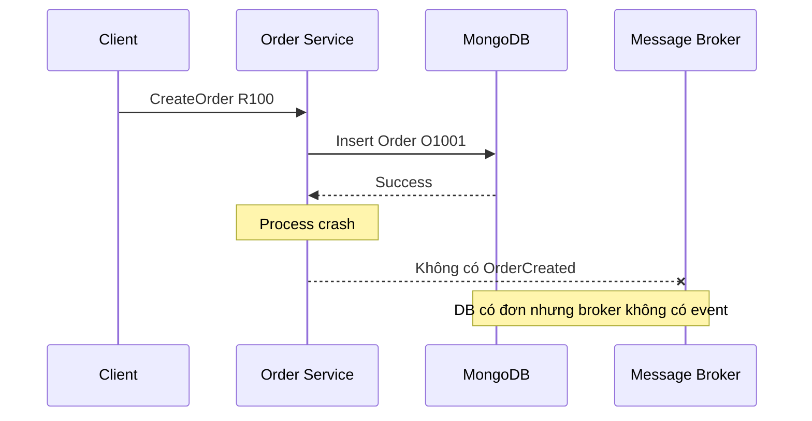
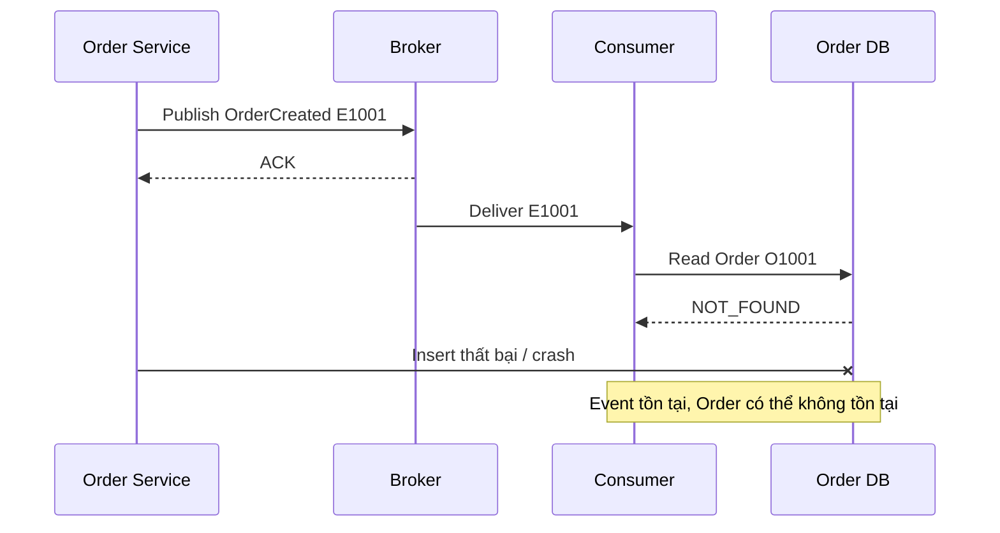
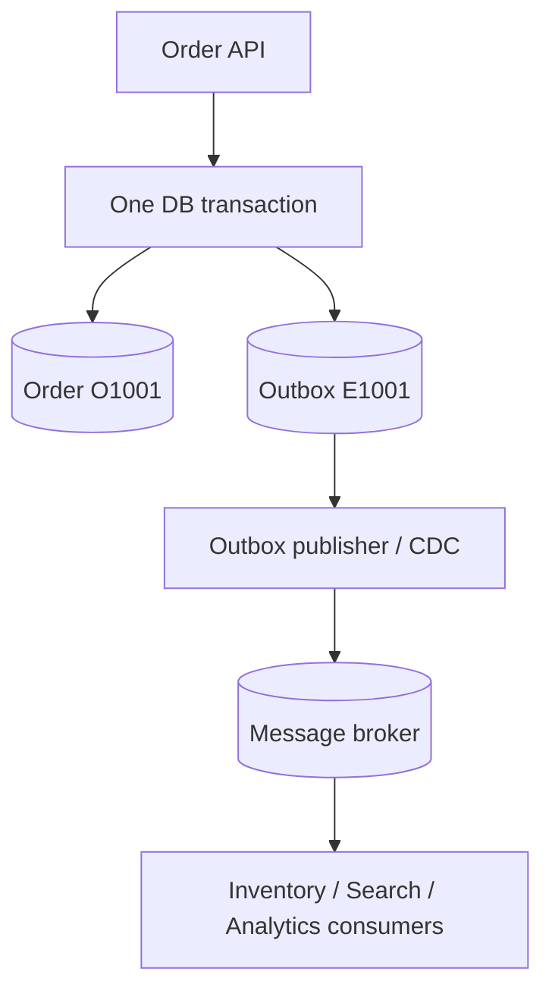
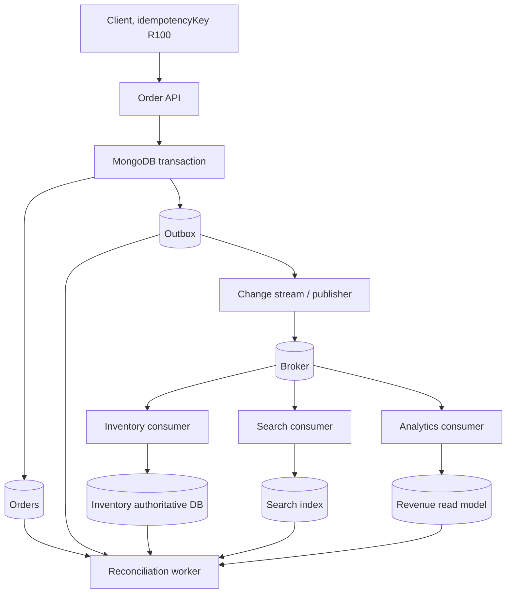

# Dual write, lỗi giữa hai lần ghi và nhu cầu đối soát

## 1. Tình huống mở đầu: đơn hàng đã tạo nhưng sự kiện không được phát

Một dịch vụ Java nhận lệnh tạo đơn hàng. Để các hệ khác biết có đơn mới, service cần thực hiện hai thao tác:

1. Ghi đơn hàng vào MongoDB.
2. Phát sự kiện `OrderCreated` lên message broker để kho hàng, email và công cụ phân tích xử lý.

Code nhìn có vẻ hợp lý:

```java
orderRepository.save(order);
eventPublisher.publish(new OrderCreated(order.getId()));
return CreateOrderResult.success(order.getId());
```

Nhưng điều gì xảy ra khi MongoDB đã xác nhận ghi thành công và process **crash trước khi publish**?



Dữ liệu tồn tại trong database nhưng subscriber không nhận thông báo. Search index có thể thiếu đơn, inventory không cập nhật, báo cáo không tính doanh thu, và người dùng có thể nhận trạng thái khác nhau ở những màn hình khác nhau.

Đổi thứ tự hai dòng không sửa được vấn đề:

```java
eventPublisher.publish(new OrderCreated(order.getId()));
orderRepository.save(order);
```

Nếu publish thành công nhưng DB insert thất bại, các consumer có thể xử lý **một sự kiện về đơn hàng không tồn tại**.

Đây là bài toán **dual write**: một thao tác nghiệp vụ muốn thay đổi hai hệ thống hoặc hai ranh giới commit **không được bảo vệ bởi một transaction chung**.

Bài học tập trung vào hai câu hỏi:

- Làm thế nào tránh hoặc kiểm soát **khoảng hở giữa hai lần ghi**?
- Khi dữ liệu hai hệ đã lệch, làm thế nào **phát hiện, phân loại và đối soát đúng** mà không tạo thêm lỗi?

## 2. Mục tiêu học tập

Sau bài này, bạn có thể:

1. Nhận diện dual write trong luồng NoSQL → broker, NoSQL → search, NoSQL → cache, NoSQL → database khác và database → dịch vụ bên ngoài.
2. Liệt kê các **cửa sổ lỗi**, kể cả commit thành công nhưng mất ACK.
3. Phân biệt **atomicity**, **durability**, **eventual consistency**, **delivery guarantee** và **business correctness**.
4. Hiểu vì sao **thay đổi thứ tự**, **retry đơn giản** hoặc **try/catch** không biến hai hệ thành transaction nguyên tử.
5. Thiết kế **transactional outbox**, **CDC**, **inbox/idempotent consumer**, **operation ID**, **version** và **retry có giới hạn**.
6. Lựa chọn giữa outbox, event log làm nguồn sự thật, saga, transaction đa tài nguyên hoặc đồng bộ lại theo snapshot.
7. Thiết kế đối soát dựa trên **nguồn có thẩm quyền, khóa định danh, watermark và so sánh phiên bản**.
8. Xử lý duplicate, out-of-order, delete/tombstone, schema evolution, backfill và failover.
9. Viết API thể hiện rõ `PENDING`, `COMPLETED`, `UNKNOWN`, thay vì khẳng định thành công quá sớm.
10. Đặt metric, alert, runbook và bài kiểm thử mô phỏng các loại lỗi thật.

## 3. Định nghĩa dual write chính xác

**Dual write** là việc một workflow ứng dụng cố làm hai hoặc nhiều thay đổi cần liên hệ logic nhưng nằm ở các **ranh giới commit độc lập**.

Ví dụ:

```text
Write 1: MongoDB Order
Write 2: Kafka OrderCreated event
```

hoặc:

```text
Write 1: DynamoDB Inventory
Write 2: Redis inventory cache
```

hoặc:

```text
Write 1: Cassandra Order
Write 2: Elasticsearch Order document
```

hoặc:

```text
Write 1: NoSQL payment record
Write 2: Payment provider capture
```

Hai writes có thể cùng được thực hiện trong một method Java, nhưng **cùng method không có nghĩa cùng atomic transaction**.

### 3.1. Phân biệt các trường hợp

| Tình huống | Có nguy cơ dual write không? | Vì sao |
| --- | --- | --- |
| Update hai fields trong cùng một document atomic | Thường không ở cấp hai writes | Engine xử lý trong cùng ranh giới atomic |
| Insert hai documents trong cùng transaction được hỗ trợ | Có phối hợp nhưng có thể được bao bởi một transaction | Phụ thuộc commit semantics và phạm vi transaction |
| Insert document rồi publish Kafka | Có | Hai hệ độc lập |
| Commit NoSQL rồi ghi Redis cache | Có | Không có atomic commit chung |
| Ghi MongoDB rồi ghi Elasticsearch | Có | Hai nguồn commit riêng |
| Gửi email rồi cập nhật `emailSent=true` | Có | SMTP/provider và DB riêng |
| DynamoDB base item được dịch vụ tự duy trì GSI | Không phải hai lời gọi ghi của ứng dụng | Tính nhất quán index theo contract của service |
| Ghi order cùng outbox trong một transaction NoSQL | Hai records, nhưng không còn hai commit độc lập trong DB | Việc publish ra broker vẫn là bước riêng |

**Điểm phân biệt là ranh giới nguyên tử**, không phải số dòng code hoặc số bảng/collection.

### 3.2. “Hai hệ thống đều ACID” vẫn chưa đủ

MongoDB có transaction phù hợp; broker cũng có cơ chế transaction phù hợp. Nhưng nếu ứng dụng commit MongoDB riêng rồi commit broker riêng, vẫn có **hai quyết định commit độc lập**.

Mỗi bên có transaction riêng **không tự tạo atomicity xuyên cả hai**.

## 4. Bốn trạng thái của hai lần ghi

Ký hiệu:

- `W1`: ghi nguồn chính.
- `W2`: ghi đích/broker.
- `✓`: đã commit theo policy tương ứng.
- `✗`: chưa commit.

| W1 | W2 | Kết quả quan sát | Tác động |
| --- | --- | --- | --- |
| ✗ | ✗ | Không bên nào có thay đổi | Có thể chỉ là request chưa xử lý |
| ✓ | ✓ | Cả hai có dữ liệu | Có vẻ đồng bộ, nhưng vẫn cần xét ordering và duplicate |
| ✓ | ✗ | Nguồn có, đích thiếu | Lost notification / missing projection |
| ✗ | ✓ | Đích có, nguồn thiếu | Phantom event / orphan projection |

Ngay cả hàng `✓/✓` cũng có thể sai:

- Event bị publish **hai lần**.
- Đích áp dụng event v8 **sau** v9 và ghi đè dữ liệu mới.
- Event đúng order ID nhưng **payload sai version**.
- DB write đã commit nhưng callback còn phát một email trùng.
- Hai writes thành công ở **hai ý định nghiệp vụ khác nhau** vì retry đã đổi operation ID.

Vì vậy tiêu chí đúng phải là **cùng một thao tác logic tạo một tập hiệu ứng phù hợp**, không chỉ kiểm tra hai endpoint đều từng trả success.

## 5. Timeline lỗi khi ghi database trước rồi publish

Giả sử thứ tự:

```text
W1 = commit Order
W2 = publish OrderCreated
```

Những cửa sổ lỗi:

| Thời điểm lỗi | Order DB | Event broker | Trường hợp |
| --- | --- | --- | --- |
| Trước W1 | Chưa chắc ghi | Chưa publish | Có thể retry an toàn nếu intent ổn định |
| Trong W1 | Chưa biết | Chưa publish | Ambiguous DB write |
| Sau W1 trước W2 | Đã commit | Thiếu | Lỗ hổng nổi tiếng của dual write |
| Trong W2 | Đã commit | Chưa biết | Publish có thể đã thành công nhưng mất ACK |
| Sau W2 trước HTTP response | Đã commit | Đã publish | Client có thể retry dù cả hai đã xong |

**Hai dạng không chắc chắn khác nhau**:

1. **Khoảng crash chắc chắn:** W1 được xác nhận, W2 chưa bắt đầu.
2. **Ambiguous outcome:** W2 có thể đã được broker lưu, nhưng publisher không nhận ACK.

Dùng retry thông thường mà không có identity/dedup có thể sửa kiểu thứ nhất nhưng gây **duplicate** ở kiểu thứ hai.

### 5.1. Khi W1 timeout

Ứng dụng gửi insert, bị timeout rồi quyết định vẫn publish:

```text
W1 timeout, outcome unknown
W2 publish
```

Nếu W1 thực ra thất bại, event thành “ma”. Nếu W1 thực ra thành công, event hợp lệ. Client không thể dựa vào timeout để phân biệt.

Cần giữ operation ID và xác minh nguồn theo contract trước khi công bố kết quả cuối.

### 5.2. Khi W2 timeout

Broker có thể đã persist event trước khi ACK mất:

```text
Publisher -> Broker Event E1001
Broker commits E1001
ACK lost
Publisher retries E1001
```

Broker hoặc consumer có thể thấy event trùng. **Retry publish không được mặc nhiên hiểu là exactly-once delivery**.

## 6. Đổi thứ tự publish trước rồi ghi nguồn

Thử:

```text
W1 = publish OrderCreated
W2 = insert Order
```

Một lịch lỗi:



Consumer có thể:

- Gửi email xác nhận đơn chưa có.
- Giữ tồn kho cho một order không được commit.
- Tạo search document “ma”.
- Thực hiện payment step sai thứ tự.

Chuyển W2 lên trước chỉ **đổi chiều lệch dữ liệu**, không loại bỏ nguy cơ.

### 6.1. “Consumer sẽ chờ DB xuất hiện” có đủ không?

Có thể phù hợp với một workflow được thiết kế rõ:

- Event có status `OrderCreationRequested` thay vì `OrderCreated`.
- Consumer biết đó chỉ là intent.
- Có timeout, retry, đối soát và terminal outcome.
- Không side effect irreversible trước khi source quyết định commit.

Nhưng nếu event mang nghĩa “đơn đã tạo”, phát trước commit là **vi phạm hợp đồng sự kiện**.

## 7. Vì sao try/catch không giải quyết atomicity?

Code sau vẫn có lỗ hổng:

```java
try {
    orderRepository.save(order);
    eventPublisher.publish(event);
} catch (Exception ex) {
    // Cố rollback bằng lệnh delete.
    orderRepository.deleteById(order.getId());
    throw ex;
}
```

Những vấn đề:

- Process có thể crash trước khi `catch` chạy.
- Xóa bù cũng có thể timeout hoặc thất bại.
- Publish có thể đã commit nhưng ACK mất; delete source tạo phantom event.
- Consumer có thể xử lý event và tạo side effect trước khi delete.
- Delete không đảo ngược email, payment, shipment.
- Nếu một write được ACK yếu, rollback/failover còn có semantics riêng.

**Compensation là một thao tác nghiệp vụ mới, không phải rollback nguyên tử**.

### 7.1. `finally` không cứu được process crash

Một `finally` block chỉ chạy trong những đường điều khiển phù hợp của process; không thể đảm bảo chạy khi mất điện, kill process, máy chết hoặc runtime gặp sự cố nghiêm trọng.

Do đó không dùng `finally` làm cơ chế duy nhất để đồng bộ hệ thứ hai.

### 7.2. Một distributed lock cũng không đủ

Lock có thể hạn chế hai request đồng thời, nhưng không làm hai remote commits trở thành atomic. Holder có thể crash giữa W1 và W2; lock hết hạn không tự hoàn tất W2.

Lock còn cần lease, fencing và timeout handling riêng.

## 8. Bốn cấp bảo đảm cần tách bạch

| Cấp | Câu hỏi | Ví dụ |
| --- | --- | --- |
| **Atomicity** | Các thay đổi liên quan có cùng commit boundary không? | Order + outbox trong MongoDB transaction |
| **Delivery** | Message có thể mất/trùng/đến muộn không? | At-least-once broker/CDC |
| **Ordering** | E8/E9 có đến đúng thứ tự cần thiết không? | Per-order sequence |
| **Business effect** | Một ý định có tạo đúng tác dụng nghiệp vụ không? | ReserveStock chỉ trừ một lần |

Một broker ghi được event không chứng minh consumer đã cập nhật search. Consumer ACK không nhất thiết chứng minh email provider đã nhận. Cần xác định **điểm xác nhận tại từng ranh giới**.

### 8.1. Eventual consistency khác mất sự kiện

Một projection chưa có Order trong 2 giây có thể là **lag bình thường**. Nhưng nếu event bị mất vĩnh viễn, chờ lâu hơn cũng không sửa được.

Đây là lý do phải có **watermark, lag metric, replay và reconciliation**, không chỉ nói “eventual”.

### 8.2. At-least-once không đồng nghĩa xử lý một lần

At-least-once delivery giúp event có thể được gửi lại. Nếu consumer cộng revenue mỗi lần nhận, duplicate có thể làm doanh thu tăng đôi.

Cần **idempotent business processing** tại đích.

## 9. Chọn một nguồn dữ liệu có thẩm quyền

Đối soát không thể quyết định đúng nếu hệ không biết **nguồn nào được phép quyết định**.

Ví dụ kiến trúc:

```text
Order DB:
  Source of truth cho Order status

Search index:
  Read projection phục vụ full-text search

Analytics store:
  Projection phục vụ báo cáo

Redis:
  Cache phục vụ read latency
```

Nếu Search không thấy Order nhưng Order DB có, source thắng và Search cần được sửa. Nếu Search còn Order đã bị xóa ở source, Search cần xóa/ẩn theo revision hợp lệ.

Nhưng không phải mọi hệ tích hợp đều một chiều. Nếu payment provider là nguồn xác nhận capture, DB nội bộ có thể cần **đối soát theo provider reference** thay vì ghi đè provider bằng trạng thái local.

### 9.1. Source of truth có thể theo từng thuộc tính

| Dữ liệu | Authority điển hình |
| --- | --- |
| Order lifecycle | Order service/database |
| Payment settlement | Payment provider/ledger theo hợp đồng |
| Inventory reservation | Inventory service |
| Search ranking | Search engine/index model |
| Email delivery | Email provider delivery records |
| Product description | Catalog service |
| Revenue accounting | Ledger/reporting close process |

Không có một “database chính” tự động có thẩm quyền trên mọi trạng thái bên ngoài.

### 9.2. Không đối soát bằng cách chọn bản có timestamp mới nhất

Hai hệ có clock lệch, retry và event đến muộn. Timestamp lớn hơn không tự chứng minh bản đúng.

Ưu tiên **operation ID, aggregate version, source sequence, authoritative status** và quy tắc xung đột nghiệp vụ.

## 10. Mẫu transactional outbox

Giải pháp thường dùng cho:

```text
Commit database change
+
Record event intent
```

là **transactional outbox**.

Thay vì ghi database rồi publish trong cùng request, ứng dụng **commit business record và outbox record trong một ranh giới atomic tại database nguồn**.



Nếu transaction commit, cả Order và outbox intent được lưu. Nếu transaction rollback, cả hai không xuất hiện theo semantics transaction.

Publisher chạy độc lập, đọc outbox và cố gắng gửi message đến broker.

### 10.1. Outbox giải quyết đúng phần nào?

Nó loại bỏ khoảng:

```text
Order committed
Process crash before event intent was recorded
```

nếu **Order và outbox cùng atomic commit**.

Nó **không** làm commit database và broker thành một atomic commit; publisher vẫn có thể gửi event hai lần khi ACK mất. Nhưng vì event intent đã lưu bền, hệ có thể **retry có kiểm soát**, giảm nguy cơ mất sự kiện sau khi source commit.

### 10.2. Outbox không phải một bảng cụ thể bắt buộc

Outbox có thể được lưu:

- Collection/table riêng trong cùng database transaction.
- Danh sách sự kiện/field trong cùng document/item với aggregate nếu update một document atomic.
- Database transaction log/CDC, khi source thay đổi và event intent được thể hiện chính xác theo contract.
- Event store làm authoritative log, với projections từ log.

Mỗi lựa chọn có giới hạn retention, throughput, transaction scope và replay.

## 11. Data model cho outbox

Một event nên có **ID cố định, ngữ nghĩa rõ và khả năng replay**.

Ví dụ:

```json
{
  "_id": "EVT-O1001-0001",
  "aggregateType": "ORDER",
  "aggregateId": "O1001",
  "aggregateVersion": 1,
  "eventType": "OrderCreated",
  "schemaVersion": 2,
  "operationId": "CREATE-T01-R100",
  "tenantId": "T01",
  "occurredAt": "2026-11-14T10:00:00Z",
  "payload": {
    "orderId": "O1001",
    "status": "PENDING"
  },
  "deliveryState": "PENDING",
  "createdAt": "2026-11-14T10:00:00Z"
}
```

### 11.1. Ý nghĩa các trường

| Trường | Tác dụng |
| --- | --- |
| `eventId` / `_id` | Dedup và tham chiếu replay |
| `aggregateId` | Key định tuyến/giữ thứ tự theo aggregate |
| `aggregateVersion` | Phát hiện event cũ hoặc gap |
| `eventType` | Hợp đồng ngữ nghĩa |
| `schemaVersion` | Consumer giải mã và migrate schema |
| `operationId` | Liên hệ cùng business intent |
| `tenantId` | Giữ boundary authorization |
| `occurredAt` | Thời gian quan sát, không phải global order |
| `deliveryState` | Publisher bookkeeping, không thay consumer outcome |
| `payload` | Dữ liệu tối thiểu cho consumer |

Event ID phải được sinh hoặc chọn **ổn định trước những retry có thể chạy lại callback**. Không tạo Event ID mới khi retry publish của cùng event.

### 11.2. Domain event khác command

`OrderCreated` phát biểu **một sự thật đã commit**. `CreateOrderRequested` chỉ biểu diễn **một yêu cầu**.

Không đổi ngữ nghĩa giữa hai loại chỉ để né khó khăn transaction. Consumer phải biết nó được quyền thực hiện điều gì khi nhận event.

### 11.3. Không lộ toàn bộ dữ liệu nhạy cảm

Outbox có thể được replicate rộng. Chỉ đưa fields cần thiết, tránh password, token, full card data và thông tin nhạy cảm không thuộc hợp đồng. Event versioning và access controls phải theo tenancy/security model.

## 12. Java + MongoDB: ghi Order và outbox trong cùng transaction

Ví dụ với MongoDB Java synchronous driver (minh họa API và cấu trúc, cần cấu hình deployment có hỗ trợ transactions):

```java
import com.mongodb.client.ClientSession;
import com.mongodb.client.MongoClient;
import com.mongodb.client.MongoCollection;
import org.bson.Document;

import java.time.Instant;
import java.util.Date;

public final class OrderWriter {
    private final MongoClient mongoClient;
    private final MongoCollection<Document> orders;
    private final MongoCollection<Document> outbox;

    public OrderWriter(
            MongoClient mongoClient,
            MongoCollection<Document> orders,
            MongoCollection<Document> outbox) {

        this.mongoClient = mongoClient;
        this.orders = orders;
        this.outbox = outbox;
    }

    public String createOrder(
            String tenantId,
            String requestId,
            String orderId) {

        // ID phải ổn định qua retry của cùng business intent.
        String operationId = tenantId + "#CREATE#" + requestId;
        String eventId = "ORDER_CREATED#" + orderId + "#1";
        Date now = Date.from(Instant.now());

        try (ClientSession session = mongoClient.startSession()) {
            return session.withTransaction(() -> {
                Document order = new Document("_id", orderId)
                    .append("tenantId", tenantId)
                    .append("operationId", operationId)
                    .append("status", "PENDING")
                    .append("version", 1)
                    .append("createdAt", now);

                Document event = new Document("_id", eventId)
                    .append("tenantId", tenantId)
                    .append("operationId", operationId)
                    .append("aggregateId", orderId)
                    .append("aggregateVersion", 1)
                    .append("eventType", "OrderCreated")
                    .append("deliveryState", "PENDING")
                    .append("createdAt", now);

                orders.insertOne(session, order);
                outbox.insertOne(session, event);

                return orderId;
            });
        }
    }
}
```

**Điều kiện và giới hạn cần hiểu:**

- Transaction chỉ atomic trong **phạm vi MongoDB deployment và loại thao tác hỗ trợ**; không bao trùm Kafka.
- `withTransaction` có thể thực thi lại callback theo xử lý lỗi của driver. Callback **không được gọi payment/email bên ngoài** và ID/payload phải ổn định.
- Nếu request đầu commit nhưng response bị mất, retry từ HTTP layer có thể gặp duplicate `_id`; cần **outcome lookup dựa trên operationId/request hash**, không tạo order mới.
- Nên có uniqueness phù hợp trên operation identity trong source, không chỉ `_id` order do client có thể đổi.
- Write concern/read concern, transaction timeout và retry labels cần được cấu hình/hiểu theo phiên bản.
- `now` chỉ là metadata; không tự cho global order. Sử dụng `aggregateVersion`/state machine cho ordering.
- Không đưa sự kiện có payload thiếu hoặc ID trùng khác nội dung vào outbox.

Đoạn code trình bày ranh giới atomic, **không phải một implementation production đầy đủ** của idempotency, retry, schema validation, audit và error mapping.

## 13. Publisher outbox: đọc, gửi, đánh dấu đã gửi

Một worker chạy:

```text
1. Tìm event PENDING (hoặc đang lease nhưng đã quá hạn).
2. Claim event theo điều kiện atomic/lease.
3. Publish tới broker với eventId cố định.
4. Chờ ACK broker theo policy.
5. Ghi trạng thái SENT hoặc checkpoint.
6. Nếu lỗi, retry với backoff và cùng eventId.
```

Pseudocode:

```text
while serviceRunning:
    events = fetchDueOutbox(limit=100)

    for event in events:
        if not claimLease(event.id, workerEpoch):
            continue

        try:
            broker.publish(
                key=event.aggregateId,
                eventId=event.id,
                payload=event.payload
            )
            markSentIfLeaseOwner(event.id, workerEpoch)
        catch transientError:
            scheduleRetry(event.id, backoff)
        catch permanentSchemaError:
            quarantine(event.id, reason)
```

### 13.1. Tại sao vẫn có duplicate?

```text
Broker commits E1001
Publisher chưa kịp mark SENT
Process crash
Publisher khác đọc E1001 PENDING
Publish lại E1001
```

Outbox cung cấp đường **at-least-once publication theo điều kiện vận hành**, không tự đảm bảo một event chỉ được broker nhận đúng một lần.

### 13.2. Lease và claim

Nhiều publisher có thể cùng quét outbox. Cần claim atomic, lease có hạn và nếu cần fencing/epoch để worker cũ không sửa status sai.

Lease hết hạn không chứng minh worker cũ đã dừng. Nếu hai workers cùng publish, consumer vẫn phải chịu được duplicate.

### 13.3. Khi nào mark SENT?

Mark trước publish:

```text
mark SENT -> crash -> event không được gửi
```

Mark sau ACK:

```text
publish -> broker commit -> ACK mất -> publish lại
```

Chọn mark sau ACK thường nghiêng về **không bỏ mất event**, chấp nhận duplicate để consumer xử lý. Cần nêu chính sách rõ.

### 13.4. SENT không có nghĩa consumer thành công

`SENT` có thể chỉ nói publisher đã nhận ACK broker. Nó không đồng nghĩa:

- Inventory đã reserve.
- Search đã index.
- Email đã gửi.
- Payment đã capture.

Trạng thái consumer/outcome cần tracking riêng nếu nghiệp vụ yêu cầu.

## 14. Polling outbox và CDC outbox

Có hai hình thức phổ biến.

### 14.1. Polling table/collection

Worker dùng query:

```text
deliveryState=PENDING
nextAttemptAt <= now
ORDER BY createdAt, eventId
LIMIT batchSize
```

Ưu điểm:

- Dễ hiểu và có thể triển khai với nhiều NoSQL stores.
- Chủ động rate limit và retry.
- Có thể xử lý schema poison events.

Đánh đổi:

- Cần index cho queue.
- Polling scan/index load có thể tăng.
- Nhiều workers cần claim semantics.
- Order theo `createdAt` không nhất thiết là commit order.
- TTL/xóa outbox sai có thể mất pending events.

### 14.2. CDC trên outbox

Một connector theo dõi database change log và publish các bản ghi outbox đã commit.

```text
Business transaction
   -> Order + Outbox commit
   -> Database change log
   -> CDC connector
   -> Broker
   -> Consumers
```

Ưu điểm:

- Hạn chế polling lặp.
- Có thể bám theo source log offsets.
- Nhiều connector hỗ trợ resume/checkpoint.

Đánh đổi:

- Connector có thể restart và replay.
- Change log retention hữu hạn.
- Failover hoặc partition movement có thể ảnh hưởng ordering.
- Schema/serialization chuyển đổi cần version.
- Cần bootstrap/backfill và xử lý khi connector chậm quá retention.

**CDC không loại bỏ yêu cầu idempotent consumer hoặc reconciliation**.

## 15. MongoDB Change Streams: điều có và không

MongoDB Change Streams có thể giúp theo dõi những thay đổi đã commit trong phạm vi hỗ trợ, với **resume token** để tiếp tục stream.

Ví dụ luồng kiến trúc:

```text
MongoDB transaction inserts Order + Outbox
    |
Change stream on Outbox collection
    |
Publisher stores resume token/checkpoint
    |
Kafka event E1001
```

### 15.1. Resume token là gì?

Một token opaque do source cung cấp để tiếp tục theo change stream contract. Không thay bằng `updatedAt` hay client timestamp.

Một connector nên lưu checkpoint theo cách chịu crash và biết xử lý duplicate sau restart.

### 15.2. Checkpoint quá sớm

Nếu connector lưu offset **trước khi broker ACK**:

```text
checkpoint -> crash before publish
```

event có thể bị bỏ sót khi restart.

### 15.3. Checkpoint sau publish

Nếu broker nhận event nhưng connector crash **trước checkpoint**, event có thể được phát lại.

Vì vậy vẫn cần stable eventId và consumer dedup.

### 15.4. Thay đổi schema outbox

Một deployment thay `OrderCreated v1` thành `v2` phải giữ khả năng đọc những events cũ còn trong log/outbox/replay. Không đổi payload theo cách consumer cũ không hiểu mà không có migration plan.

## 16. DynamoDB Streams và outbox trong DynamoDB

DynamoDB Streams có thể cung cấp một luồng thay đổi item trong phạm vi table/region và retention/service semantics được công bố. Có thể dùng Streams để xây projection/worker hoặc đưa events qua một pipeline.

### 16.1. Khi thay đổi một item là sự kiện nguồn

Nếu authoritative write là một `PutItem` hoặc `UpdateItem` atomic, stream record phản ánh thay đổi đã commit vào source theo semantics.

Ứng dụng không cần thực hiện lần ghi thứ hai chỉ để “báo item vừa đổi” nếu consumer có thể **suy đúng domain event** từ trạng thái thay đổi. Tuy nhiên một stream record dạng database mutation không luôn mang đủ ý nghĩa nghiệp vụ.

### 16.2. Outbox item và business item

Nếu cần lưu **business item + explicit outbox item** cùng commit, xem `TransactWriteItems` theo những giới hạn transaction thực tế.

Không được:

```text
PutItem Order
PutItem Outbox
```

rồi gọi đó là atomic chỉ vì cả hai dùng cùng DynamoDB client.

### 16.3. Stream duplicate và ordering

Consumer Lambda/worker có thể xử lý record hơn một lần do retry/restart. Ordering có phạm vi theo shard/stream protocol, không tự là global order qua mọi partition/table.

Dùng event ID/sequence/version cùng idempotent projection; không cộng doanh thu mỗi lần nhận record mà không dedup.

### 16.4. Global tables và multi-region

Replication mode khác nhau có conflict/consistency contract khác nhau. Không mặc định Streams ở Region A cho một **global transactional event order** giữa mọi region.

Nếu idempotency/uniqueness toàn hệ là yêu cầu, phải xác định owner/guarantee của mode, không dựa vào hai conditional writes local eventual.

## 17. Cassandra, Redis và những ranh giới transaction khác

### 17.1. Cassandra

Cassandra hỗ trợ các thao tác atomic trong những phạm vi nhất định, batch và Lightweight Transactions cho điều kiện ghi, nhưng **không có một transaction đa tài nguyên tùy ý kiểu SQL** để bao luôn broker và search.

Những lưu ý:

- `LOGGED BATCH` không phải thay thế cho giao dịch ACID tùy ý nhiều partitions.
- Batch còn có performance cost, không nên dùng để “gộp mọi write” theo cảm tính.
- LWT/CAS giúp xác nhận điều kiện trên phạm vi được hỗ trợ.
- CDC capability, log retention và vận hành tùy phiên bản/distribution.
- Nếu lưu business state và outbox riêng, cần chứng minh **atomic boundary** thật; nếu không, dùng state machine + recovery/reconciliation thay thế.

### 17.2. Redis

Redis có lệnh atomic, Lua scripts và một số transaction commands trên server/slot phù hợp.

Nhưng:

```text
Redis SET cache
MongoDB UPDATE order
```

vẫn là dual write xuyên hai hệ.

Cũng không thể coi `MULTI/EXEC` hoặc Lua trong Redis là transaction với Kafka/NoSQL khác.

### 17.3. Elasticsearch/OpenSearch

Search index thường là **derived read model**. Một direct dual write:

```text
MongoDB UPDATE product
Elasticsearch INDEX product
```

có các cửa sổ lỗi giống DB+broker, cộng thêm **refresh/visibility lag**.

Một HTTP 200 từ indexing API không nhất thiết đồng nghĩa tài liệu đã visible cho mọi search request tức thì. Cần xem refresh policy và read contract.

**Nguồn dữ liệu có thẩm quyền nên phát event/change stream cho indexing**, kèm replay và reconciliation.

## 18. Inbox: consumer áp dụng một event tối đa một lần về mặt logic

Outbox xử lý **không mất ý định publish từ nguồn**. Inbox/idempotent consumer bảo vệ **không áp business effect trùng** ở đích.

Một consumer nhận:

```json
{
  "eventId": "EVT-O1001-0001",
  "aggregateId": "O1001",
  "aggregateVersion": 1,
  "eventType": "OrderCreated"
}
```

có thể lưu:

```text
ConsumerName + EventId -> PROCESSED
```

Nhưng cần đặt ranh giới đúng.

### 18.1. Mẫu sai: marker trước effect

```text
Insert inbox E1001 = PROCESSED
Crash
Update search không xảy ra
```

Retry thấy đã processed và bỏ qua; projection thiếu dữ liệu.

### 18.2. Mẫu sai: effect trước marker

```text
Increment revenue +500.000
Crash
Insert inbox marker chưa xảy ra
```

Retry lại cộng thêm +500.000; số liệu sai.

### 18.3. Mẫu đúng hơn

Nếu đích hỗ trợ transaction:

```text
BEGIN TARGET TRANSACTION

IF eventId already processed:
    no-op
ELSE:
    apply projection/business effect
    insert inbox marker

COMMIT
ACK broker
```

Nếu đích không hỗ trợ atomic multi-item transaction, có thể:

- Đưa event ID/version vào cùng một document/item atomic.
- Dùng `upsert` trạng thái toàn phần kèm version guard thay vì tăng delta mù.
- Xây workflow có trạng thái để retry an toàn.
- Duy trì ledger và tiến trình reconcile.

Không có một mẫu inbox chung dùng đúng cho mọi NoSQL.

## 19. Consumer full-state projection và version guard

Đối với search hoặc cache-derived state, một giải pháp là phát event chứa **snapshot trạng thái authoritative** cùng revision:

```json
{
  "eventId": "EVT-O1001-V8",
  "orderId": "O1001",
  "version": 8,
  "state": {
    "status": "CONFIRMED"
  }
}
```

Consumer chỉ áp state nếu version mới hơn version đang lưu.

```text
Current projection: version=9, CANCELLED
Incoming event:     version=8, CONFIRMED

Result: bỏ event v8, giữ v9
```

### 19.1. Điều kiện atomic

Version check và cập nhật document đích phải atomic trong phạm vi phù hợp, tránh hai consumers cùng đọc version cũ rồi ghi sai thứ tự.

### 19.2. Full-state khác delta

Một event:

```json
{
  "orderId": "O1001",
  "sequence": 8,
  "deltaAmount": 500000
}
```

là **delta**. Không được tự bỏ seq8 chỉ vì seq9 đến trước nếu seq8 chưa được áp và tổng phụ thuộc cả hai.

Cần:

- Per-aggregate sequencing.
- Gap detection.
- Ordered replay.
- Event ID dedup.
- Hoặc một merge algorithm được chứng minh đúng.

### 19.3. Version theo aggregate, không phải toàn cụm

Version 10 của Order A không so trực tiếp với version 20 của Order B nếu chúng thuộc hai dãy độc lập. `createdAt` cũng không thay thế một global commit sequence.

## 20. Giao event theo thứ tự: key và partition

Khi publish tới broker, thường muốn những events của cùng `orderId` đi vào cùng partition/log nếu broker hỗ trợ key routing.

```text
key=O1001:
  OrderCreated v1
  OrderConfirmed v2
  OrderCancelled v3
```

Điều này giúp thứ tự trong phạm vi partition, nhưng vẫn cần:

- Cùng key routing qua các producers.
- Xử lý retry/producer sequence theo protocol.
- Không đổi partitioning tùy tiện giữa phiên bản.
- Consumer không áp event song song theo cách đảo thứ tự.
- Gap detection/replay khi consumer crash.

**Một broker có ordered log không tự tạo strict global order qua các partitions.**

### 20.1. Outbox polling có thể phá thứ tự

Nếu hai publishers claim:

```text
Publisher A lấy v2 nhưng chậm.
Publisher B lấy v3 và gửi trước.
```

Consumer có thể thấy v3 trước v2.

Cần quy tắc publish/consume theo aggregate, version guard hoặc serialization phù hợp. Chỉ `ORDER BY createdAt` trong câu query polling không tự bảo đảm **thứ tự commit** khi timestamps trùng, clock lệch hoặc workers song song.

## 21. Truyền qua nhiều projections

Một event nguồn có thể đi tới:

```text
Order DB
    |
    +--> Search
    +--> Cache invalidation
    +--> Analytics
    +--> Notifications
```

Mỗi projection có:

- Độ trễ riêng.
- Checkpoint riêng.
- Schema riêng.
- Retry/DLQ riêng.
- Đường phục hồi riêng.
- Mức consistency riêng.

Ví dụ một order v10:

| Đích | Revision đang có | Nhận xét |
| --- | ---: | --- |
| Order source | 10 | Authority |
| Search | 9 | Đang chậm một revision |
| Cache | 10 | Đã invalidate/update |
| Analytics | 8 | Backlog hoặc batch |
| Notification | v10 event đã nhận | Chưa chắc email delivered |

Không dùng một cờ `allSynced=true` chỉ vì publisher đã gửi tới broker. Muốn đo completeness, cần trạng thái/offset theo **từng consumer** và các side effects có ý nghĩa khác nhau.

## 22. Outbox và saga: hai bài toán liên quan nhưng không giống nhau

**Outbox** xử lý việc lưu **ý định phát thông điệp** cùng thay đổi nguồn.

**Saga** phối hợp nhiều bước nghiệp vụ mỗi bước có transaction riêng, thường có retry và hành động bù.

Ví dụ:

```text
Create Order
    -> Reserve Inventory
    -> Authorize Payment
    -> Confirm Order
```

Nếu inventory reserve thành công nhưng payment thất bại, cần hủy reservation. Đó là **compensation** có trạng thái, không phải một rollback xuyên mọi dịch vụ.

### 22.1. Saga vẫn cần outbox/inbox

Mỗi service có thể:

1. Commit local state + outbox event.
2. Gửi message at-least-once.
3. Consumer dedup và apply local effect.
4. Commit local state + outbox event kế tiếp.

Nhờ vậy không mất ý định tiếp tục workflow sau crash giữa DB write và publish.

### 22.2. Compensation có thể timeout

`ReleaseInventory` cũng là một operation có ID và outcome unknown:

```text
Release RES100 -> DB commit
ACK lost
Saga retries release
```

Nếu lệnh release không idempotent, hệ có thể hoàn stock hai lần. Mọi bước bù cũng cần identity, atomicity và reconciliation.

### 22.3. Không khẳng định COMPLETED quá sớm

`OrderCreated` không đồng nghĩa `PaymentCaptured`. API phải mô tả khi nào order được coi hoàn tất, có thể dùng `PENDING_PAYMENT`/`CONFIRMED`/`CANCELLED`.

## 23. Two-phase commit (2PC) có loại bỏ dual write không?

Một protocol như **two-phase commit** có thể phối hợp commit nhiều participants khi **tất cả đều tham gia đúng giao thức**, và transaction manager duy trì trạng thái phục hồi.

Nhưng:

- Nhiều NoSQL stores/brokers **không hỗ trợ** cùng một XA/2PC boundary.
- Có thể tạo blocking hoặc giảm availability khi coordinator lỗi trong những tình huống.
- Gây latency, lock/coordination, chi phí vận hành.
- Không tự bao gồm email, payment API hoặc search refresh.
- Nếu hệ thống không hỗ trợ chuẩn/phiên bản phù hợp, không thể “bật @Transactional” trong Java rồi có distributed atomicity.

### 23.1. Bảng chọn giải pháp

| Nhu cầu | Giải pháp thường cân nhắc | Giới hạn |
| --- | --- | --- |
| Hai thay đổi trong cùng một document/item | Atomic update/conditional write | Chỉ trong phạm vi item |
| Hai records trong một DB hỗ trợ transaction | Transaction | Phạm vi/version/capacity của engine |
| DB và broker | Transactional outbox + CDC/publisher | Delivery có thể trùng |
| DB và search | Source CDC/outbox + versioned projector | Index eventual và cần rebuild |
| DB và cache | Cache-aside / invalidation từ event | Có stale window |
| Nhiều service có side effects | Saga + idempotent steps/outbox | Compensation không phải rollback |
| Hai transactional resources hỗ trợ phối hợp commit | 2PC/XA nếu thực sự phù hợp | Độ phức tạp và availability |
| Event-first architecture | Durable log as source + projections | Cần log replay và evolution |
| Analytics báo cáo lớn | CDC/batch export + watermark/reconciliation | Độ trễ và snapshot semantics |

Không có một lựa chọn tối ưu cho mọi dữ liệu. Cần chọn theo invariant, freshness, RPO/RTO và chi phí vận hành.

## 24. “Exactly once” phải nói đúng phạm vi

Một hệ có thể quảng cáo:

- Exactly-once processing trong stream engine.
- Idempotent producer trong broker.
- Transactional processing giữa input và output topics.
- Atomic multi-document transaction trong NoSQL.

Những guarantee đó **có phạm vi được định nghĩa**.

Ví dụ:

```text
Kafka transaction commits output topic
MongoDB UpdateOrder ở hệ ngoài
```

Không mặc nhiên nằm trong cùng transaction. Crash giữa hai có thể tạo duplicate/missing effect theo cách triển khai.

Một cách diễn đạt có thể kiểm chứng hơn:

> “Sự kiện được giao theo at-least-once; consumer sử dụng eventId cùng atomic inbox/effect để một logical event không tạo double business effect trong phạm vi dữ liệu/retention đã cam kết.”

### 24.1. Exactly-once delivery và exactly-once effect

- **Delivery** là chuyện broker vận chuyển.
- **Processing** là chuyện một pipeline xác nhận offsets/state.
- **Business effect** là chuyện một Order, Payment hoặc Inventory thực sự được thay đổi bao nhiêu lần.

Đừng chuyển lời hứa cấp transport thành lời hứa nghiệp vụ nếu thiếu chứng minh.

## 25. Đối soát là gì?

**Reconciliation** là một quy trình định kỳ hoặc theo sự kiện để **phát hiện và sửa chênh lệch** giữa nguồn authoritative và các đích liên quan.

Ví dụ:

```text
Order DB:    O1001 version=8 status=CONFIRMED
Search:      O1001 version=7 status=PENDING
```

Đối soát có thể kết luận search cần được nâng tới version 8.

Nhưng nếu:

```text
Order DB:    O1001 deleted version=9
Search:      O1001 version=8 status=CONFIRMED
```

cần phát delete/tombstone để loại bỏ tài liệu ở search, không được phục hồi bản v8 từ cache cũ lên nguồn.

### 25.1. Đối soát không đồng nghĩa replay toàn bộ

Replay events là **một cách sửa**. Đối soát gồm:

- Xác định phạm vi cần so.
- Biết authority.
- Tính độ lệch.
- Phân loại lag bình thường hay mất dữ liệu.
- Chọn hành động sửa.
- Ghi audit.
- Xác minh sau sửa.

Nếu chưa biết điều gì là đúng, replay bừa có thể nhân lỗi.

### 25.2. Đối soát là một phần kiến trúc thường trực

Ngay cả khi đã có outbox, CDC và retry, hệ vẫn có thể lệch do:

- Consumer bug.
- Schema migration sai.
- Message retention hết trước khi xử lý.
- Manual update không phát event.
- Backup restore một phía.
- TTL/delete không propagate.
- Quyền truy cập hoặc filter routing sai.
- Mất checkpoint.
- Poison event bị đưa DLQ mà không được xử lý.
- Client write ngoài luồng tích hợp.

**“Có outbox” không loại bỏ nhu cầu đo và đối soát.**

## 26. Các loại chênh lệch cần phân biệt

| Loại | Ví dụ | Cách hiểu |
| --- | --- | --- |
| **Missing target** | Source có O1001, Search không có | Thiếu projection |
| **Orphan target** | Search có O1002, Source không có | Event trước commit, delete thiếu hoặc source read stale |
| **Stale target** | Source v8, target v6 | Chậm hoặc bỏ lỡ updates |
| **Future target** | Target v10, source v8 | Source read stale, rollback/restore, bug hoặc version scope sai |
| **Value mismatch** | Cùng version nhưng status khác | Mapper/schema/corruption hoặc sai authority |
| **Duplicate side effect** | Revenue cộng hai lần | Consumer không dedup |
| **Ordering gap** | Có v9 nhưng thiếu delta v8 | Event ordering/replay |
| **Delete mismatch** | Source tombstone, target còn document | Delete propagation thất bại |
| **Schema mismatch** | Consumer bỏ qua field mới | Schema evolution sai |
| **Authorization mismatch** | Tenant A nhìn thấy dữ liệu tenant B | Vừa inconsistency vừa security incident |
| **Lag within SLO** | Search chậm 1 giây, SLO 5 giây | Có thể bình thường |
| **Unresolved unknown** | Broker ACK mất, không rõ đã gửi | Cần lookup/retry có ID |

Một bản ghi bị missing trong target **chưa chắc là lỗi vĩnh viễn**. Cần xét watermark, TTL, tombstone và read consistency trước khi kết luận.

## 27. Chọn khóa đối soát và phiên bản

Đối soát theo khóa:

```text
tenantId + aggregateType + aggregateId
```

thường đáng tin hơn đối chiếu theo display name hoặc timestamp.

Ví dụ:

```json
{
  "tenantId": "T01",
  "orderId": "O1001",
  "sourceVersion": 8,
  "projectionVersion": 7
}
```

Cần có:

- Logical primary key ổn định.
- Tenant/ownership scope.
- Source revision/sequence.
- Hash của nội dung chuẩn hóa nếu cần.
- Mốc watermark/snapshot.
- Trạng thái delete/tombstone.
- Schema mapping version.

### 27.1. Hash chỉ hữu ích khi canonicalization nhất quán

Hai bản ghi có thể logic bằng nhau nhưng khác:

```json
{"amount":100,"currency":"VND"}
```

và:

```json
{"currency":"VND","amount":100}
```

Nếu hash raw JSON bytes, thứ tự property có thể làm hash khác. Cần chuẩn hóa kiểu dữ liệu, timezone, null/missing fields, số tiền, Unicode và field projection theo schema.

### 27.2. Bản chiếu cố ý bỏ fields

Search có thể không lưu `internalAuditNotes`, nên hash toàn document source rồi so với search document sẽ luôn khác. Chỉ so **các fields thuộc projection contract**.

### 27.3. Revision phải có cùng nguồn

Không so:

```text
MongoDB Order version=8
Search indexing attempt count=10
```

như hai version đồng nghĩa. Projection cần lưu **sourceVersion**, không chỉ số lần reindex.

## 28. Đối soát không dừng ở so sánh count

Một kiểm tra đơn giản:

```text
MongoDB orders count = 1.000.000
Search docs count = 1.000.000
```

vẫn có thể sai:

```text
Source có A nhưng Search thiếu A.
Search có B nhưng Source đã xóa B.
```

Hai sai lệch bù nhau khiến count bằng nhau.

### 28.1. Nhiều lớp kiểm tra

1. Tổng count theo vùng/tenant/time bucket.
2. Count theo trạng thái/version.
3. Hash/checksum theo bucket, khi canonicalization phù hợp.
4. Key-level comparison cho buckets mismatch.
5. Field-level comparison theo projection contract.
6. Kiểm tra delete/tombstone và dữ liệu orphan.
7. Verify sau repair.

### 28.2. Hash per bucket

Một kỹ thuật:

```text
Bucket = hash(orderId) modulo 256
```

Mỗi bên tính count và một digest hợp lệ trên tập `(orderId, sourceVersion, normalizedProjectedFields)` của bucket. Nếu digest khác, drill-down các keys của bucket đó.

Lưu ý digest của **tập không có thứ tự** phải dùng thuật toán canonical order/commutative summary phù hợp; cộng/xor hash tùy tiện có thể có collisions và không cung cấp chứng minh tuyệt đối.

### 28.3. Merkle tree và anti-entropy

Một số hệ dùng cây Merkle hoặc cấu trúc digest phân cấp để tìm range có dữ liệu khác nhau mà không tải mọi record. Cần nhất quán về:

- Key range.
- Snapshot/version.
- Cách hash.
- Delete/tombstone.
- Tree rebuild/caching.
- Failure/collision assumptions.

Kỹ thuật này hỗ trợ **tìm điểm lệch hiệu quả**, không tự quyết định bản nào đúng.

## 29. Watermark và consistency cut

Một hệ thống chạy liên tục có writes. Nếu đối soát đọc source lúc 10:00 nhưng target lúc 10:03, chênh lệch có thể là do **hai thời điểm khác nhau**.

Cần xác định mốc so:

```text
Source snapshot at revision R
Target applied through revision R
```

hoặc một hợp đồng tương đương.

### 29.1. Watermark không được tự bịa từ event mới nhất

Một consumer nhận event version 100 không chứng minh nó đã xử lý **mọi event 1..99** nếu có partition khác, gaps, retry hoặc out-of-order.

Một watermark đáng tin phải mô tả:

- Phạm vi: partition/shard/aggregate/region.
- Các offset đã xử lý liên tục.
- Chính sách xử lý gaps.
- Mốc nguồn đã commit đến đâu.
- Quy tắc transaction đa partition nếu có.

### 29.2. Tránh false positives

Nếu target đang lag 5 giây trong SLO cho phép, đối soát ngay những write dưới 5 giây có thể tạo hàng nghìn cảnh báo sai.

Một policy:

```text
Only compare records older than safe watermark/cutoff
AND with no pending in-flight projection
```

có thể giảm nhiễu, nhưng cut-off phải dựa trên dữ liệu về lag, completeness và business SLO, không chỉ một con số tùy ý.

### 29.3. Snapshot export và CDC catch-up

Một cách rebuild projection lớn:

1. Chọn snapshot hoặc mốc source phù hợp.
2. Export dữ liệu nguồn theo nhất quán được hỗ trợ.
3. Nạp vào projection mới.
4. Replay CDC từ checkpoint bắt đầu đúng theo protocol.
5. Dedup và áp revision guards.
6. Chờ projection bắt kịp watermark mục tiêu.
7. Verify và chuyển read traffic.

Bỏ bước replay giữa snapshot và lúc cut-over có thể làm mất mọi writes trong khoảng backfill.

## 30. Pseudocode đối soát một chiều

Giả sử Order DB là authority, Search là projection. Mỗi document Search giữ `sourceVersion`.

```text
for each sourceOrder in sourceSnapshotOrStableScan:
    target = search.getByBusinessId(sourceOrder.id)

    if sourceOrder.isDeleted:
        repairDeleteIfTargetOlder(
            id=sourceOrder.id,
            deletedAtVersion=sourceOrder.version
        )
        continue

    if target is missing:
        enqueueUpsert(sourceOrder, sourceOrder.version)
        continue

    if target.sourceVersion < sourceOrder.version:
        enqueueUpsert(sourceOrder, sourceOrder.version)
        continue

    if target.sourceVersion == sourceOrder.version:
        if normalizedProjection(target) !=
           normalizeForSearch(sourceOrder):
            flagMappingMismatch()
        continue

    if target.sourceVersion > sourceOrder.version:
        investigateSnapshotLagOrVersionScope()
```

Với một source scan riêng, còn cần **reverse scan** để tìm documents target có nhưng source đã xóa hoặc chuyển ownership.

### 30.1. Repair phải an toàn khi chạy đồng thời

Trong khi worker sửa target bằng source v8, một event v9 có thể vừa được consumer áp dụng.

Nếu repair v8 ghi đè không điều kiện, target bị **lùi phiên bản**.

Do đó sửa target bằng **version check ở đích**, hoặc đưa repair qua cùng đường xử lý có ordering guard.

### 30.2. Không sửa chỉ bằng thao tác xóa/insert mù

Một `DELETE` target vừa bị race với một `UPSERT` mới có thể xóa document hợp lệ. Cần versioned tombstone hoặc conditional semantics được engine hỗ trợ.

## 31. Reverse reconciliation và orphan documents

Một lượt chỉ duyệt source sẽ tìm được:

```text
Source exists -> Target missing/stale
```

nhưng không tìm đủ trường hợp:

```text
Source deleted -> Target still exists
```

nếu source đã xóa vật lý và không còn tombstone.

### 31.1. Hai chiều so sánh

```text
Forward:
  Source -> Target
  Find missing/stale target

Reverse:
  Target -> Source
  Find orphan target
```

Với reverse scan, **không xem NOT_FOUND từ replica stale là bằng chứng đủ để xóa ngay**. Cần authority/consistency, delete retention và thời điểm snapshot phù hợp.

### 31.2. Tombstone và delete ledger

Một thiết kế có thể lưu:

```json
{
  "aggregateId": "O1001",
  "version": 9,
  "deleted": true,
  "deletedAt": "2026-11-14T10:30:00Z"
}
```

và phát:

```text
OrderDeleted O1001 version=9
```

Consumer ghi nhận version 9, xóa hoặc ẩn projection. Nếu sau đó event `OrderUpdated v8` tới muộn, nó không được phục hồi dữ liệu.

Nếu tombstone bị xóa quá sớm trước các replay/restore windows, dữ liệu cũ có thể **hồi sinh**.

### 31.3. Soft delete và hard delete

- **Soft delete** giữ marker để bảo vệ semantic delete.
- **Hard delete** loại bỏ bytes theo retention/privacy policy.

Hai mục tiêu có thể xung đột khi hệ cần chống resurrection nhưng cũng phải xóa dữ liệu cá nhân. Có thể cần tombstone chỉ giữ ID băm/reference không nhạy cảm theo chính sách, metadata tối thiểu và hệ xác minh deletion.

Không giữ PII vô hạn dưới danh nghĩa “đối soát”.

## 32. Idempotency qua các bên

Một business operation:

```text
operationId = CREATE-T01-R100
```

được sử dụng ở:

```text
Order source
Outbox event
Broker envelope
Inventory consumer
Payment step
Search projection
```

Nhưng không phải mọi bên dùng cùng **một khóa có cùng ý nghĩa**.

| ID | Phạm vi | Công dụng |
| --- | --- | --- |
| `operationId` | Một ý định nghiệp vụ | Ngăn user retry tạo hai orders |
| `orderId` | Một aggregate | Định tuyến events, query state |
| `eventId` | Một domain event | Dedup event delivery |
| `paymentProviderKey` | Provider operation | Ngăn double capture ở provider |
| `reservationId` | Một reservation | Ngăn release/reserve sai |
| `sourceVersion` | Một aggregate version | Chặn stale update |
| `traceId` | Một trace | Chẩn đoán, **không** là dedup key |

**Trace ID thường thay đổi theo attempt và không nên dùng thay operation ID**. Một HTTP request được retry có thể có trace khác nhưng vẫn cùng ý định.

### 32.1. Same key, different payload

Nếu request R100 đầu tạo quantity=2, retry dùng R100 nhưng quantity=5, hệ phải phát hiện xung đột và không âm thầm trả kết quả của intent cũ như thể cả hai giống nhau.

Cần lưu request hash/canonicalized business fields theo tenant và operation type.

## 33. Retry và backoff: không nhân sự cố

Một request có thể được retry tại:

```text
HTTP client: 2 attempts
Gateway: 2 attempts
Service: 3 attempts
Database driver: 2 attempts
Broker publisher: 4 attempts
```

Những tầng phối hợp kém có thể nhân rất nhiều attempts cho một ý định.

### 33.1. Nguyên tắc

- Chỉ một tầng rõ ràng sở hữu một loại retry.
- Giữ operation ID/event ID qua mọi attempts.
- Có end-to-end deadline và retry budget.
- Exponential backoff + jitter khi phù hợp.
- Không retry validation/business rejection.
- Phân biệt conflict, throttle, network timeout và unknown commit.
- Có circuit breaker/admission control để tránh retry storm.
- Theo dõi `attempts / logical operation`.

### 33.2. Không xóa outbox event vì đã retry quá nhiều

Khi publish thất bại liên tục, có thể đưa event vào trạng thái quarantine/DLQ. Nhưng không được **quên event chưa phát** nếu business guarantee yêu cầu eventual delivery.

Một poison event cần:

- Error reason.
- Payload/schema reference.
- Manual/automatic repair procedure.
- Retry sau khi sửa consumer/serializer.
- Audit và checkpoint.
- Reconciliation với source.

### 33.3. Timeout sau commit

HTTP client có thể timeout sau khi source + outbox đã commit. Retry với ID mới tạo hai orders. **Outbox không thay thế idempotency của CreateOrder API**.

## 34. Hai lần ghi không phải lúc nào cũng có cùng độ quan trọng

Xét ba đường:

```text
A. Save Order -> Invalidate cache
B. Save Order -> Update search
C. Save Order -> Capture payment
```

Độ nghiêm trọng khác nhau:

- Cache stale trong vài giây có thể chấp nhận được theo contract.
- Search lag có thể được công bố và sửa qua replay.
- Payment double capture có tác động tài chính, cần idempotency/ledger và đối soát với provider.

### 34.1. Chọn bảo đảm theo dữ liệu

| Luồng | Nguồn authority | Có thể stale? | Biện pháp |
| --- | --- | --- | --- |
| Catalog → Cache | Catalog DB | Tùy field | TTL/invalidation/version |
| Order → Search | Order DB | Thường có thể trong SLO | Outbox/CDC, replay |
| Order → Analytics | Order DB hoặc ledger | Theo watermark | CDC/rollup/reconcile |
| Inventory → Reservation | Inventory authority | Không khi giữ hàng | Atomic conditional operation/owner |
| Payment → Order state | Provider/ledger theo step | PENDING được, không double charge | Saga + provider idempotency |
| User ACL → Search filter | Authorization source | Stale cấp quyền có thể nguy hiểm | Authoritative authz/fail-closed |
| Order → Email | Order status | Email có thể trễ | Outbox + send dedup |
| User delete → Derived stores | Privacy deletion authority | Theo policy hạn định | Tombstone, replay, audit |

Không dùng một mẫu “publish bất đồng bộ cho tất cả” nếu nghiệp vụ đòi **quyết định đồng bộ tại nguồn**.

## 35. Cache-aside và vấn đề dual write

Một ứng dụng dùng:

```text
1. Update Order DB
2. Delete cache key
```

Nếu DB update commit nhưng delete cache thất bại, cache có thể trả phiên bản cũ.

Một chuỗi khác nguy hiểm hơn:

```text
Reader misses cache
Reader fetches old DB state v7
Writer commits v8
Writer deletes cache
Reader fills cache with v7
```

Bất chấp writer đã invalidate cache, một reader trễ có thể **đưa dữ liệu cũ trở lại cache**.

### 35.1. Cơ chế giảm rủi ro

- Versioned cache entries.
- Cache write có điều kiện theo source version.
- Short TTL với freshness contract rõ.
- Invalidation qua CDC/outbox, có replay.
- Bypass cache cho thao tác cần read-your-writes.
- Coalesce cache misses và kiểm soát refresh race.
- Caching theo immutable/versioned key khi phù hợp.

### 35.2. Cache không là authority cho invariant

Một bản cache `stock=5` có thể stale. Không dựa vào nó để cho phép 5 reservations nếu source đã chỉ còn stock=1.

Luồng quyết định tồn kho/tiền/quyền nên dựa vào authoritative conditional operation theo yêu cầu nghiệp vụ.

## 36. Dual write với Elasticsearch/OpenSearch

Một catalog API:

```text
MongoDB Product
Elasticsearch Product document
```

Nếu API tự ghi cả hai:

```text
Mongo update success
Search index timeout
```

không rõ search đã nhận hay chưa. Retry index có thể an toàn hơn với **document ID ổn định và full-state update**, nhưng vẫn phải xử lý stale version.

### 36.1. Tình huống event đến ngược

```text
Source product version 7 -> Search update delayed
Source product version 8 -> Search update applied
Delayed version 7 arrives
```

Nếu không guard, search có thể lùi về v7.

Một pattern là mang `sourceVersion` và dùng cơ chế cập nhật có điều kiện/external versioning phù hợp theo version của Elasticsearch/OpenSearch. **Cú pháp và semantics phải kiểm tra theo phiên bản**; không gán `updatedAt` client làm version authoritative.

### 36.2. Search ACK và visibility

Một index request thành công chưa chắc search query lập tức thấy doc vì refresh policy. Phải phân biệt:

- Write accepted/persisted.
- Searchable visibility.
- Projection applied version.
- Query routing/replica freshness.

### 36.3. Rebuild không mất thay đổi mới

Khi rebuild toàn index, dùng snapshot + CDC catch-up/watermark, sau đó swap alias hoặc chuyển routing theo contract. Không xóa index đang phục vụ rồi build lại khi chưa có phương án rollback, security và consistency.

## 37. Đối soát aggregate/analytics: lỗi double count

Một event `OrderPaid` có amount 500.000 VND được broker giao hai lần.

Consumer:

```text
revenue[2026-11-14] += 500000
```

chạy hai lần, kết quả tăng 1.000.000 VND.

### 37.1. Dedupe theo event ID

Một cách:

```text
eventId E1001 unique
IF E1001 not processed:
    increment revenue
    mark E1001 processed
```

Nhưng check+increment+marker phải atomic hoặc dùng một giải pháp idempotent tương đương. Chỉ query marker rồi update riêng có race/crash gap.

### 37.2. Tính lại từ ledger

Với số liệu quan trọng, có thể đối soát:

```text
Source authoritative paid orders / ledger entries
    vs
Analytics aggregate by day/currency/tenant
```

Cần xử lý:

- Refunds và chargebacks.
- Duplicate event deliveries.
- Event đến muộn.
- Currency và exchange rate policy.
- Day boundary/timezone.
- Reversal/adjustment records.
- Snapshot/closing watermark.

### 37.3. Audit khác dashboard real-time

Dashboard có thể eventual/approximate. Báo cáo kế toán đã khóa sổ có thể yêu cầu snapshot, ledger và reconciliation chính xác.

Không lấy một counter cuối cùng ở search/analytics làm bằng chứng payment đã thanh toán.

## 38. Đối soát khi nguồn và đích ở nhiều vùng

Ví dụ:

```text
Order source Region A version=10
Projection Region B version=9
```

Một sự khác biệt có thể do **cross-region replication lag** theo contract chứ không phải event mất.

Trước khi sửa:

1. Kiểm tra phiên bản/mode replication.
2. Xem watermark per region.
3. Xác định authoritative writer/owner.
4. Phân biệt data migration/rebalance/failover.
5. Kiểm tra read path có stale replica không.
6. Chỉ repair khi biết target thiếu so với source ở mốc an toàn.

### 38.1. Active-active và conflict

Nếu cả Region A và Region B có thể chấp nhận writes cùng key, không thể tự so `updatedAt` rồi chọn bản mới nhất theo clock. Cần conflict/merge/ownership policy rõ.

### 38.2. Failover làm tăng ambiguity

Một write đã ACK local A nhưng chưa tới B; A mất, B được promote. Nếu client retry ở B, idempotency record có thể chưa tồn tại ở B.

Phải chọn durability/replication/ownership phù hợp với RPO và uniqueness toàn hệ, không chỉ rely on TTL marker ở vùng A.

### 38.3. Fencing

Khi owner chuyển từ A sang B:

```text
A ownerEpoch=41
B ownerEpoch=42
```

Nguồn dữ liệu phải từ chối thao tác của owner 41 nếu đã chuyển sang 42, theo một protocol có authority. Nếu không, worker cũ có thể ghi lại dữ liệu sau khi repair đã hoàn tất.

## 39. Công việc đối soát có thể gây tải lớn

Một job so toàn bộ 100 triệu documents và đọc search cùng lúc có thể gây:

- Read IOPS tăng mạnh.
- Cache hit ratio giảm.
- Cross-region egress lớn.
- Throttling đối với transaction traffic.
- GC/memory pressure.
- Search coordination quá tải.
- Timeouts khiến job tự retry và nhân tải.

### 39.1. Thiết kế bounded reconciliation

- Chia theo shard/tenant/key-range.
- Có checkpoint per range.
- Giới hạn concurrency/rate.
- Dùng pagination/cursor đúng API.
- Chỉ lấy fields cần thiết.
- So digest/bucket trước rồi drill-down.
- Tránh scan full cluster trong giờ cao điểm.
- Hỗ trợ pause/resume.
- Đo byte, items/sec, error và lag.

### 39.2. Checkpoint phải có tính tiến triển đáng tin

Nếu job mark checkpoint “đã xử lý qua key K” trước khi repair thực sự bền/được xác nhận, restart có thể bỏ qua key chưa sửa.

Ngược lại checkpoint sau repair có thể làm retry key, nên repair phải **idempotent**.

### 39.3. Đừng dùng offset pagination không ổn định

Nếu dữ liệu liên tục insert/delete, `offset=100000` có thể bỏ sót/trùng. Dùng key-range/keyset cursor/snapshot theo khả năng engine, và xử lý shard migration.

## 40. Một kiến trúc tích hợp thực tế

Thiết kế cho ứng dụng đặt hàng:



### 40.1. Luồng tạo đơn

1. Client tạo `R100` và giữ nguyên qua retry.
2. Order API xác thực tenant/payload.
3. DB transaction commit Order O1001 + event intent E1001.
4. API trả created/pending theo business state; không hứa inventory/payment đã hoàn tất nếu chưa được xác nhận.
5. Publisher gửi E1001 at-least-once.
6. Consumers dùng inbox/conditional writes để apply effects.
7. Mỗi consumer phát outcome/next event khi local transaction commit.
8. Order workflow chuyển trạng thái theo events và guards.
9. Reconciliation worker kiểm tra pending/missing/lag.
10. Search và analytics công bố freshness/watermark.

### 40.2. Sự cố có thể xảy ra

| Sự cố | Hành vi an toàn |
| --- | --- |
| API crash trước source commit | Client retry cùng R100 |
| API crash sau commit | Order+outbox còn, publisher tiếp tục |
| Publisher ACK mất | Publish lại E1001, consumer dedup |
| Consumer crash sau effect trước ACK | Redelivery, inbox/version guard |
| Event v9 tới trước v8 | Ordering/gap/full-state policy |
| Search index mất | Rebuild từ snapshot + CDC |
| Payment provider timeout | Lookup cùng provider operation key |
| Outbox backlog tăng | Alert, backpressure, capacity/replay |
| Data corruption trong projection | Reconcile source→target, version guard |
| Source failover | Kiểm tra durability/idempotency owner |

## 41. Observability và các SLO liên quan

Các metric nên phân biệt request, source commit, broker delivery và target application.

| Metric minh họa | Ý nghĩa |
| --- | --- |
| `business_operations_total` | Số logical intents |
| `source_commit_success_total` | Thao tác nguồn được xác nhận |
| `source_unknown_outcome_total` | Ghi source chưa rõ kết quả |
| `outbox_pending_count` | Event intent chưa được publish |
| `outbox_oldest_pending_age_seconds` | Event pending lâu nhất |
| `outbox_publish_attempts_total` | Các lần gửi broker |
| `outbox_publish_errors_total` | Lỗi theo loại |
| `broker_delivery_lag_seconds` | Lag theo consumer group |
| `consumer_duplicate_events_total` | Số event trùng được phát hiện |
| `consumer_apply_failures_total` | Lỗi áp dụng |
| `consumer_sequence_gap_total` | Gap revision/offset |
| `projection_source_lag_seconds` | Source→read model freshness |
| `reconciliation_scanned_total` | Số records đã so |
| `reconciliation_mismatches_total` | Số mismatch theo loại |
| `reconciliation_repairs_total` | Repairs đã xác minh |
| `reconciliation_unresolved_total` | Mismatch cần điều tra |
| `dead_letter_pending_count` | Poison events |
| `last_successful_checkpoint_age` | Chất lượng tiến triển |
| `duplicate_business_effect_total` | Phát hiện logical side effect trùng |
| `delete_propagation_lag` | Dữ liệu xóa chưa đến projections |

Metric names là ví dụ thiết kế, không phải tên API bắt buộc của MongoDB/DynamoDB/Kafka.

### 41.1. Phân biệt SLO

- **Source write SLO:** API commit source trong p99 100 ms.
- **Projection freshness SLO:** 99,9% thay đổi xuất hiện trong search trong 5 giây.
- **Outbox delivery SLO:** 99,99% event được broker nhận trong một thời hạn.
- **Reconciliation SLO:** mismatch lâu quá 15 phút được xác minh/sửa hoặc escalated.
- **Business completion SLO:** Order được xác nhận cuối trong thời hạn nghiệp vụ.

Những con số chỉ là ví dụ, không phải tiêu chuẩn chung.

### 41.2. Đừng chỉ đo events đã xử lý

Nếu connector chết và không nhận event mới, histogram lag của **events đã hoàn tất** có thể tiếp tục trông đẹp.

Cần đo:

- Tuổi event pending lâu nhất.
- Tuổi checkpoint cuối.
- Backlog size.
- Last source position vs consumer position.
- Event completeness theo phạm vi.

### 41.3. Giới hạn cardinality và PII

Không đưa `orderId`, `userId`, `eventId` thô vào metric labels. Giữ trong traces/logs có kiểm soát quyền và retention; metrics dùng operation type, consumer, result class, region, shard/tenant tier khi cardinality cho phép.

## 42. Cảnh báo và runbook khi đích lệch nguồn

Một alert có ích:

```text
ALERT OutboxStalled

IF oldestPendingEventAge > allowedDeliverySLO
AND pendingEventCount > 0
FOR 5 minutes
```

Một alert khác:

```text
ALERT ProjectionMismatchPersistent

IF mismatchesOlderThanSafeWatermark > threshold
FOR 10 minutes
```

Đây là pseudocode, không phải PromQL copy-paste.

### 42.1. Runbook: phát hiện mismatch

1. Xác định authority và projection bị ảnh hưởng.
2. Khoanh vùng tenant/time window/aggregate IDs có quyền.
3. Kiểm tra source commit evidence và phiên bản.
4. Kiểm tra outbox record/event ID.
5. Kiểm tra publisher ACK/offset/checkpoint.
6. Kiểm tra broker retention, delivery lag và DLQ.
7. Kiểm tra inbox/dedup và target apply version.
8. Kiểm tra delete/tombstone/schema mapping.
9. Phân loại lag trong SLO hay thiếu dữ liệu thực.
10. Chọn repair/replay theo version, không blind write.
11. Verify target theo mốc an toàn.
12. Ghi audit, nguyên nhân và phòng ngừa.

### 42.2. Khi nào phải ưu tiên cao?

- Phân quyền bị thu hồi nhưng projection còn cấp quyền.
- Payment/ledger sai hoặc double capture.
- Tồn kho bị reserve hai lần.
- Dữ liệu đã xóa theo yêu cầu privacy vẫn còn ở đích quá policy.
- Hệ tự trả kết quả COMPLETE trong khi một step bắt buộc chưa chạy.
- Mismatch tăng không giới hạn và CDC retention sắp hết.

Không coi mọi mismatch là “search hơi chậm”; mức nghiêm trọng phụ thuộc **invariant**.

## 43. Kiểm thử lỗi giữa hai lần ghi

Không thể xác minh hệ an toàn chỉ bằng happy-path integration test.

### 43.1. Ma trận fault injection

| Điểm gây lỗi | Mong đợi |
| --- | --- |
| Trước source commit | Không có event committed sai |
| Trong source commit, ACK mất | Retry cùng operation ID, không tạo hai Orders |
| Sau source commit trước outbox commit | Không có trạng thái tách rời nếu cùng transaction đúng |
| Sau outbox commit trước HTTP response | API retry vẫn dùng outcome cũ |
| Publisher trước broker send | Outbox pending tiếp tục |
| Broker commit, ACK publisher mất | Event có thể replay nhưng consumer idempotent |
| Publisher crash trước mark SENT | Không mất event, chấp nhận retry |
| Hai publishers claim cùng event | Không tạo double business effect |
| Event v9 nhận trước v8 | Không lùi projection hoặc bỏ delta cần thiết |
| Consumer commit effect, ACK broker mất | Redelivery không áp effect hai lần |
| Consumer mark inbox trước effect rồi crash | Test phát hiện thiết kế sai |
| Poison schema event | DLQ/quarantine, không biến mất |
| CDC checkpoint trước publish | Test phát hiện khả năng mất event |
| Source snapshot + change stream replay | Không mất khoảng giữa snapshot và live stream |
| Source delete, target lag | Tombstone đúng, không resurrection |
| Target khởi động lại từ backup cũ | Reconcile và replay |
| Source failover/cross-region lag | Giữ idempotency và owner semantics |
| Reconciliation race với event mới | Repair không ghi đè version mới |
| HTTP duplicate request song song | Một logical operation |
| Payment provider timeout | Không capture hai lần |

### 43.2. Chú ý kết quả kiểm thử

Chỉ chạy test được phê duyệt trong môi trường riêng, có rollback/recovery; không cố tình làm mất mạng của production database/broker để chứng minh bài học.

### 43.3. Test cả stale-read false positive

Source đã ghi O1001, target/search chưa index. Reconciliation chạy quá sớm và cố sửa.

Kết quả mong muốn: job nhận biết watermark/lag, sửa idempotently hoặc chờ mốc an toàn; không ghi đè phiên bản mới và không tạo báo động sai hàng loạt.

## 44. Các anti-pattern phổ biến

| Anti-pattern | Vì sao sai | Hướng đúng hơn |
| --- | --- | --- |
| DB write rồi publish trong cùng method là atomic | Hai commit boundary | Outbox + transaction tại nguồn |
| Publish trước DB sẽ an toàn | Có thể tạo phantom event | Event intent/commit semantics rõ |
| `try/catch` delete bù thay rollback | Crash/ACK mất/consumer đã chạy | Saga và idempotent compensation |
| `finally` luôn hoàn tất W2 | Process có thể chết | Durable outbox/recovery |
| Retry bằng ID mới | Duplicate business effect | Stable operation ID |
| Mark SENT trước broker ACK | Có thể mất event | Mark sau ACK, dedup downstream |
| Mark SENT sau broker ACK là exactly once | Crash có thể publish lại | Stable eventId + consumer dedup |
| Consumer ghi PROCESSED trước effect | Crash bỏ sót effect | Atomic effect+inbox |
| Consumer effect trước marker | Crash double effect | Atomic effect+inbox |
| Broker ACK nghĩa Search đã index | Hai công đoạn khác nhau | Consumer apply/watermark |
| Event `createdAt` là global order | Clock lệch, concurrent commits | Aggregate version/log offsets |
| Local top event v9 có nghĩa mọi v1..v8 đủ | Có gaps/out-of-order | Checkpoints liên tục |
| Search NOT_FOUND nghĩa DB chưa ghi | Projection eventual | Read authority |
| Source count=target count là đồng bộ | Missing/orphan bù nhau | Key/revision/digest compare |
| Repair source v8 ghi đè target v9 | Race làm stale state | Conditional versioned repair |
| Không cần reverse scan | Không tìm orphan docs | Hai chiều/reliable tombstones |
| Rebuild index từ snapshot là đủ | Bỏ sót writes trong lúc build | Snapshot + CDC catch-up |
| Xóa tombstone ngay khi source delete | Event cũ có thể resurrect | Retention và delete ledger |
| 2PC chỉ cần Java annotation | Participants có thể không hỗ trợ | Chọn protocol thực |
| Broker exactly-once tức payment exactly once | Scope guarantee khác | Provider idempotency/reconciliation |
| Outbox loại bỏ nhu cầu đối soát | Bugs, restore, TTL, manual writes vẫn tồn tại | Reconciliation định kỳ |
| Cứ thấy lag là phát sửa ngay | Có thể bình thường theo SLO | Watermark/safe cutoff |
| Reconciliation scan toàn production vô hạn | Gây tải/timeout | Rate limits/checkpoints |
| Cache invalidate luôn đủ | Cache refill race | Versioned cache/invalidation |
| Một Redis flag bảo vệ transaction DB khác | Không atomic hai hệ | Source atomicity/workflow |
| Lưu dữ liệu nhạy cảm toàn bộ trong event | Replication lan rộng | Minimize payload/access control |

## 45. Quy trình thiết kế tích hợp tránh dual write

### Bước 1 — Xác định business effect

Liệt kê mọi thay đổi cần có khi một operation được chấp nhận:

```text
Create Order
Reserve Inventory
Capture Payment
Search projection
Analytics
Email
```

Phân biệt bước **bắt buộc để xác nhận hoàn tất** với projection/eventual side effect.

### Bước 2 — Vẽ các ranh giới commit

Đối với từng thao tác, xác định nơi transaction kết thúc. Hai calls trong cùng method không mặc nhiên cùng transaction.

### Bước 3 — Chọn authority và operation ID

Đặt nguồn sự thật cho từng trạng thái. Gắn stable operation ID, aggregate ID và event ID cho retry/dedup.

### Bước 4 — Tận dụng atomicity trong một nguồn

Nếu database hỗ trợ, commit business state + outbox trong cùng transaction; nếu cùng document/item, cân nhắc embedded event intent.

### Bước 5 — Chọn cơ chế phát message

Polling outbox, CDC stream hoặc durable log. Thiết kế checkpoint, resume, retention, backoff, schema và publisher ownership.

### Bước 6 — Xây idempotent consumer

Event ID, inbox, version guard, atomic apply, failover và retry khi ACK mất.

### Bước 7 — Chọn thứ tự xử lý

Per-aggregate sequencing, partition key và quy tắc xử lý gaps/out-of-order.

### Bước 8 — Thiết kế workflow nhiều bước

Với payment/inventory/third-party APIs, xây saga state, idempotent provider references, terminal outcomes và compensation.

### Bước 9 — Xác định freshness contract

Mỗi projection có SLO/lag/watermark; UI không hứa đọc tức thì ở nơi eventual.

### Bước 10 — Thiết kế reconciliation ngay từ đầu

Nguồn, khóa, phiên bản, snapshot/cut-off, diff algorithm, forward/reverse scan, versioned repair, checkpoint và audit.

### Bước 11 — Bảo vệ privacy và tenancy

Event payload tối thiểu, authz tại consumer, tombstones, deletion propagation và log retention.

### Bước 12 — Giới hạn tải phục hồi

Batch size, bounded concurrency, rate limit, pause/resume, DLQ, retry budgets và alert.

### Bước 13 — Fault injection

Commit-success/ACK-lost, crash windows, duplicate delivery, out-of-order, restore và reconciliation races.

### Bước 14 — Đo đầu ra theo business outcomes

Một event được gửi 5 lần nhưng chỉ một logical order effect; p99 API đẹp mà payment pending không giới hạn thì workflow chưa khỏe.

## 46. Checklist trước khi đưa vào production

- **Có ranh giới commit nào nằm giữa hai hệ không?**
- **Nếu process chết giữa hai calls, dữ liệu có lệch không?**
- **Nếu W1 hoặc W2 timeout nhưng đã commit, retry thế nào?**
- **Operation ID có ổn định qua client retry/failover không?**
- **Business state và event intent có atomic không?**
- **Outbox publisher có thể mất/nhân event trong trường hợp nào?**
- **Khi broker ACK mất, event ID có giữ nguyên không?**
- **Inbox và business effect có atomic hoặc idempotent tương đương không?**
- **Consumer có xử lý event v9 đến trước v8 không?**
- **Target có lưu sourceVersion/metadata đủ để repair không?**
- **Delete/tombstone/TTL có được đồng bộ không?**
- **Lỗi schema và poison events có vào DLQ có thể replay không?**
- **Source of truth theo mỗi trạng thái là gì?**
- **Search/Cache có bị dùng để xác nhận write authoritative không?**
- **Reconciliation so theo snapshot/watermark hay dữ liệu bất kỳ thời điểm?**
- **Có cả forward và reverse reconciliation khi cần không?**
- **Repair có race với event live và có version guard không?**
- **Outbox/CDC retention đủ cho worst-case outage không?**
- **Có rebuild từ snapshot+CDC catch-up không?**
- **Cross-region failover có giữ uniqueness/ownership không?**
- **Metrics đo pending age, backlog, consumer lag, mismatch không?**
- **Retry/repair có bounded load và audit logs không?**
- **Privacy, tenant isolation và deletion policy được tuân thủ không?**
- **Business SLO có phân biệt source commit và end-to-end completion không?**

## 47. Bài tập thực hành

### Bài 1 — Hai lần ghi DB rồi Kafka

Code `saveOrder(); publishOrderCreated();`. Process crash ngay sau `saveOrder()`.

**Hỏi:** Trạng thái hai hệ? Có nên sửa bằng đổi thứ tự không?

**Gợi ý:** Source có Order, broker thiếu event. Đổi thứ tự tạo nguy cơ phantom event.

### Bài 2 — Publish timeout

Broker đã persist E1001 nhưng response mất, publisher retry E1001.

**Hỏi:** Consumer có thể nhận bao nhiêu lần? Cần cơ chế gì?

**Gợi ý:** Có thể nhận trùng; stable eventId + idempotent consumer/inbox.

### Bài 3 — Mark SENT sai thời điểm

Worker mark `SENT` trước khi gửi, rồi crash.

**Hỏi:** Rủi ro gì?

**Gợi ý:** Event bị quên vĩnh viễn nếu không có reconcile.

### Bài 4 — Outbox atomicity

Order và Outbox là hai collections MongoDB; app gọi hai `insertOne` không transaction.

**Hỏi:** Đây đã là transactional outbox chưa?

**Gợi ý:** Chưa; cần ranh giới atomic thực sự trong phạm vi engine.

### Bài 5 — Transaction callback retry

Callback tạo Order và gửi email, MongoDB driver có thể retry callback.

**Hỏi:** Điều gì có thể xảy ra?

**Gợi ý:** Email có thể gửi lặp; dùng outbox, tránh external side effect trong callback.

### Bài 6 — Stable event ID

Publisher tạo UUID event mới mỗi lần retry gửi cùng OrderCreated.

**Hỏi:** Consumer gặp khó khăn gì?

**Gợi ý:** Không dedup được cùng logical event theo eventId.

### Bài 7 — Inbox marker trước effect

Consumer ghi `E1001 PROCESSED`, crash trước cộng revenue.

**Hỏi:** Lỗi gì?

**Gợi ý:** Event được coi hoàn tất nhưng business effect thiếu.

### Bài 8 — Inbox effect trước marker

Consumer cộng revenue rồi crash trước lưu inbox.

**Hỏi:** Lỗi gì?

**Gợi ý:** Redelivery có thể double count.

### Bài 9 — Full-state version

Projection v9, consumer nhận snapshot v8.

**Hỏi:** Có nên áp v8?

**Gợi ý:** Không khi có authoritative aggregate version guard.

### Bài 10 — Delta gap

Consumer nhận delta seq9 trước seq8.

**Hỏi:** Có được bỏ seq8 sau này như snapshot cũ không?

**Gợi ý:** Không nếu delta cần cộng đủ; cần gap/replay/order.

### Bài 11 — Count bằng nhau

Source và Search cùng 100 documents, nhưng Source có A thiếu ở Search, Search có B đã bị xóa.

**Hỏi:** Count có phát hiện lỗi không?

**Gợi ý:** Không; cần key/revision comparison và reverse reconciliation.

### Bài 12 — Reconciliation false positive

Source v10, Search v9; Search đang lag 2 giây trong SLO 5 giây.

**Hỏi:** Có nên báo incident ngay không?

**Gợi ý:** Chưa chắc; xét watermark, lag policy và safe cutoff.

### Bài 13 — Repair race

Reconciler đọc source v8. Live consumer đã áp Search v9. Reconciler ghi v8 không điều kiện.

**Hỏi:** Lỗi gì?

**Gợi ý:** Projection bị lùi version; cần conditional/versioned repair.

### Bài 14 — Delete đã mất tombstone

Source hard-deleted Order, target còn v5; event v4 được replay sau restore.

**Hỏi:** Rủi ro gì?

**Gợi ý:** Dữ liệu có thể hồi sinh; cần delete ledger/tombstone và replay-safe semantics.

### Bài 15 — Snapshot + CDC

Đội export snapshot lúc 10:00, build index xong 10:20 rồi switch traffic nhưng không replay CDC.

**Hỏi:** Mất gì?

**Gợi ý:** Những writes 10:00–10:20 có thể thiếu.

### Bài 16 — Event source vs target hash

Source có field `privateNote` mà Search không lưu.

**Hỏi:** So hash toàn source document với target có đúng không?

**Gợi ý:** Không; canonicalize đúng projection contract.

### Bài 17 — CDC checkpoint

Connector checkpoint offset trước broker publish rồi crash.

**Hỏi:** Có thể bỏ lỡ event không?

**Gợi ý:** Có; phải thiết kế checkpoint sau ACK và chấp nhận duplicate.

### Bài 18 — Outbox backlog

Event publisher dừng 30 phút; histogram lag của events đã publish vẫn đẹp.

**Hỏi:** Metric nào phát hiện tốt?

**Gợi ý:** Oldest pending event age, checkpoint age, backlog.

### Bài 19 — GSI và dual write

Ứng dụng ghi base item DynamoDB, GSI cập nhật eventual bởi dịch vụ.

**Hỏi:** Có phải app tự thực hiện hai independent writes không?

**Gợi ý:** Không. Đây là managed index propagation với consistency contract riêng.

### Bài 20 — DynamoDB Streams duplicate

Lambda xử lý cùng Stream record hai lần.

**Hỏi:** Phải xử lý ở đâu?

**Gợi ý:** Consumer idempotency/inbox/version guard; không assume at-most-once.

### Bài 21 — Cassandra batch

Đội dùng `LOGGED BATCH` để ghi Cassandra và Kafka rồi gọi là distributed transaction.

**Hỏi:** Có đúng không?

**Gợi ý:** Không. Cassandra batch không bao trùm Kafka.

### Bài 22 — Cache invalidation

Writer update DB v8 rồi delete cache, reader chậm điền lại v7 sau delete.

**Hỏi:** Giải pháp giảm rủi ro?

**Gợi ý:** Versioned cache, conditional fill/invalidation, TTL và freshness policy.

### Bài 23 — Payment timeout

Provider capture thành công nhưng ACK mất; service tạo provider request ID mới.

**Hỏi:** Có thể xảy ra gì?

**Gợi ý:** Double charge. Retry/lookup cùng provider idempotency reference.

### Bài 24 — Saga compensation

Inventory reserve thành công, payment fail; service gửi release nhưng response mất.

**Hỏi:** Có thể gửi release bằng intent mới mù quáng không?

**Gợi ý:** Cần reservationId/operationId ổn định và lookup/conditional release.

### Bài 25 — Active-active

Hai vùng cùng chấp nhận `CreateUsername("an")` trên stores eventual.

**Hỏi:** Outbox ở mỗi vùng có bảo vệ global uniqueness không?

**Gợi ý:** Không; cần global owner/constraint hoặc conflict policy có guarantee phù hợp.

### Bài 26 — Reconciliation job tải lớn

Job đối soát scan 100 triệu records vào giờ cao điểm làm DB throttling.

**Hỏi:** Cách khắc phục kiến trúc vận hành?

**Gợi ý:** Bucketing, snapshot, bounded concurrency, checkpoints, rate limits, staged diff.

### Bài 27 — Producer và consumer metrics

Một event được publish 3 lần và consumer dedup 2 lần.

**Hỏi:** Có ba Orders không?

**Gợi ý:** Không suy từ publish attempts; đo logical business operations.

### Bài 28 — GDPR/delete propagation

User được xóa ở source nhưng Search và Analytics còn record cũ.

**Hỏi:** Cần quy trình nào?

**Gợi ý:** Delete/tombstone events, per-target tracking, reconciliation, audit và retention/privacy policy.

### Bài 29 — Xác định source of truth

Payment provider báo CAPTURED, Order DB còn PAYMENT_PENDING.

**Hỏi:** Có nên cập nhật provider thành PENDING để hai bên giống nhau?

**Gợi ý:** Không. Xác định payment authority, đối soát internal state theo provider evidence.

### Bài 30 — Thiết kế hệ thống hoàn chỉnh

Thiết kế `POST /orders` dùng MongoDB, Kafka, Elasticsearch và một Inventory service.

**Yêu cầu:** Nêu operation IDs, outbox schema, atomic boundary, publish retry, consumer inbox, versioning, cache, partial failure, reconcile và SLO.

**Gợi ý:** Source Order + outbox transaction; at-least-once publish; consumer idempotency; per-aggregate version; CDC/polling; inventory saga; snapshot+CDC rebuild; reconcile target theo authority/watermark.

## 48. Kết luận

**Dual write không phải lỗi cú pháp hay thiếu một `try/catch`; đó là rủi ro kiến trúc khi một ý định nghiệp vụ phải ghi vào hai hệ thống có các quyết định commit độc lập.** Hệ có thể chết giữa W1 và W2; ACK của W1 hoặc W2 có thể bị mất sau commit; retry có thể tạo duplicate; event có thể đến ngược thứ tự hoặc chỉ một projection bị trễ.

Giải pháp thường bắt đầu bằng **xác định nguồn có thẩm quyền, gắn operation/event IDs ổn định, lưu business change cùng outbox intent trong một ranh giới atomic được hỗ trợ**, rồi publish/replay theo at-least-once và áp dụng ở consumer bằng **inbox, conditional writes, version guards và ordering policy**. Với các bước nghiệp vụ trải nhiều services, cần saga/compensation cùng idempotency; không lấy broker transaction làm bằng chứng payment hay search đã hoàn tất.

Ngay cả kiến trúc outbox/CDC tốt vẫn cần **đối soát liên tục**: so theo key và source revision, dùng watermark/snapshot đúng phạm vi, phát hiện missing/orphan/stale/delete mismatch, sửa theo version để không ghi đè dữ liệu mới và xác minh sau repair. Hệ thống đáng tin không chỉ cố gắng tránh lệch dữ liệu; nó còn **biết phát hiện khi hai hệ đã lệch, xác định bản nào có thẩm quyền và đưa chúng trở về trạng thái đúng một cách có thể kiểm chứng**.
