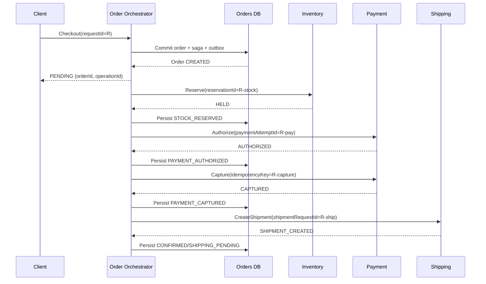
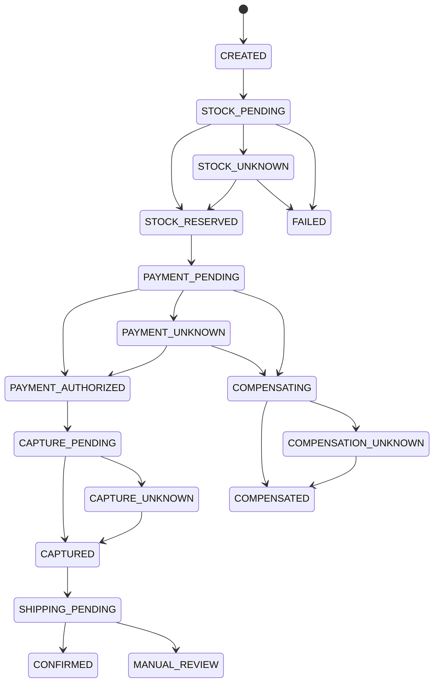
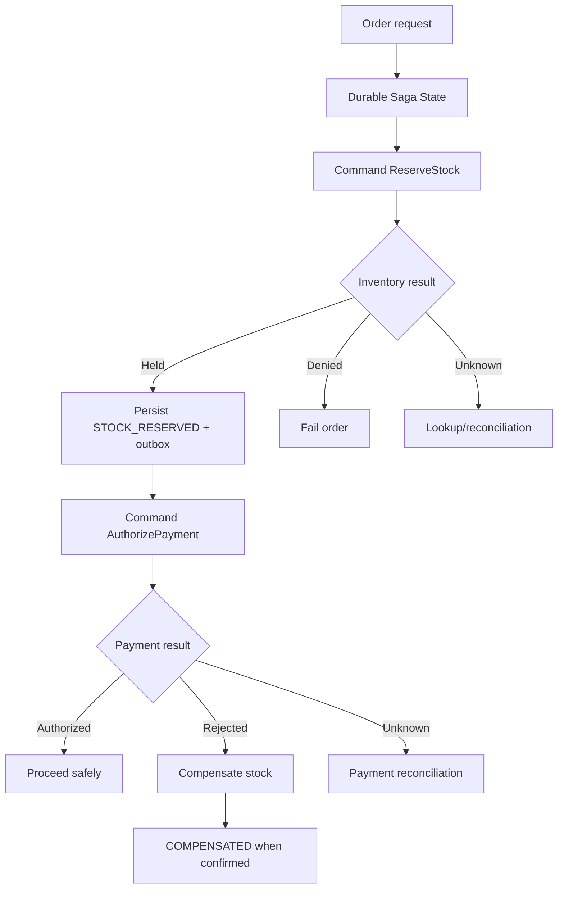

# Saga, bước bù và điều kiện nghiệp vụ có thể khôi phục

Một đơn hàng trong hệ NoSQL có thể cần phối hợp **Orders DB**, **Inventory Service**, **Payment Provider** và **Shipping Service**. Mỗi hệ sở hữu dữ liệu, transaction, mạng và chính sách retry riêng. Nếu ghi đơn hàng thành công nhưng giữ kho thất bại, hoặc cổng thanh toán đã thu tiền nhưng ứng dụng nhận timeout, **không có một lệnh rollback trong Orders DB nào tự hoàn tác toàn bộ thế giới bên ngoài**.

**Saga** là cách tổ chức một nghiệp vụ dài thành những **bước giao dịch cục bộ**, gắn với các hành động bù (*compensating actions*), quy tắc tiến tiếp, trạng thái bền và cơ chế phục hồi sau lỗi. Saga không biến các dịch vụ độc lập thành một transaction ACID; nó giúp quy trình **có đường đi rõ ràng từ trạng thái dở dang tới trạng thái cuối được chấp nhận về nghiệp vụ**.

Bài học thuộc chương **Tích hợp và kiến trúc** của module **Database No SQL**. Trọng tâm không chỉ là vẽ chuỗi “đặt hàng → thanh toán → vận chuyển”, mà là xác định:

1. Bước nào được phép chạy trước, điều kiện tiền đề là gì?
2. Bước nào có thể hoàn tác về mặt nghiệp vụ, và hoàn tác có thể thất bại không?
3. Khi lệnh timeout, ta biết chắc thất bại hay **chưa biết kết quả**?
4. Bằng chứng nào cho phép chuyển trạng thái `CONFIRMED`, `CANCELLED` hoặc `REFUNDED`?
5. Ai chịu trách nhiệm retry, đối soát và đưa workflow dở dang tới trạng thái cuối?
6. Những bất biến nào **tuyệt đối không được đánh đổi** để “hệ vẫn chạy”?

> **Nguyên tắc:** một saga có thể khôi phục không phải saga “không bao giờ lỗi”, mà là saga **lưu được tiến độ, biết rõ ai đang giữ quyền điều phối, có cách kiểm chứng kết quả từng side effect và có đường xử lý an toàn cho mọi trạng thái chưa hoàn tất**.

---

## 1. Bài toán xuất phát: một nghiệp vụ nhiều hệ

Xét workflow mua một chiếc vé sự kiện:

```text
                           Checkout API
                                |
                +---------------+----------------+
                |               |                |
                v               v                v
            Orders DB      Seat Service      Payment API
             (NoSQL)      (reservation)     (third party)
                |               |                |
                +---------------+----------------+
                                |
                                v
                         Ticket Service
                                |
                                v
                       Email/Notification
```

Mục tiêu nghiệp vụ:

- Không xác nhận hai vé cho cùng một chỗ.
- Không báo “đã thanh toán” nếu chưa có bằng chứng từ provider.
- Không cấp vé sử dụng được khi chưa đủ điều kiện.
- Không thu tiền hai lần chỉ vì timeout/retry.
- Nếu bước cuối thất bại, khách phải biết tình trạng và có đường hỗ trợ.

Một đoạn code trông đơn giản:

```java
saveOrder();
reserveSeat();
chargeCard();
issueTicket();
sendEmail();
```

không cung cấp những bảo đảm đó. Mỗi lệnh có thể **đã thực hiện tác động nhưng response bị mất**, hoặc có thể thất bại trước khi thực hiện. Giữa hai lệnh luôn có khả năng process crash.

### 1.1. Có thể dừng ở đâu?

```text
Orders DB: order CREATED
Seat Service: seat RESERVED
Payment API: charge SUCCESS
Ticket Service: chưa phát vé
```

Đây không phải trạng thái ACID rollback tự nhiên. Ứng dụng phải quyết định:

- **Đi tiếp:** retry cấp vé.
- **Bù trừ:** yêu cầu hoàn tiền, giải phóng chỗ, đánh dấu thất bại.
- **Đối soát/chờ xử lý:** nếu chưa biết payment outcome.
- **Chuyển xử lý thủ công:** nếu quyền hoàn tiền hay cấp vé không còn chắc chắn.

Sự lựa chọn phải được định nghĩa **trước sự cố**, không phó mặc cho một `catch` chung.

---

## 2. Transaction cục bộ và saga khác nhau thế nào?

| Đặc điểm | Local DB transaction | Saga |
| --- | --- | --- |
| Phạm vi | Các tài nguyên mà database giao dịch quản lý | Nhiều dịch vụ/hệ độc lập |
| Cách cam kết | Commit/abort theo transaction engine | Các bước local commit nối tiếp nhau |
| Tác động bên ngoài | Không tự bao trùm HTTP/provider khác | Được điều phối như các bước có outcome |
| Trạng thái trung gian | Thường được che theo mức isolation | Có thể được quan sát; phải quản lý |
| Khi lỗi | Rollback local trước commit; xử lý unknown commit | Retry tiến tiếp, bù trừ hoặc đối soát |
| Tính nguyên tử đầu-cuối | Có trong đúng phạm vi transaction | **Không tự có** |
| Chi phí | Lock/MVCC/transaction coordination trong DB | State machine, outbox/inbox, retry, monitoring |
| Phù hợp | Cập nhật nhiều document được engine hỗ trợ | Inventory + payment + shipping + DB |

Một local transaction có thể là **một bước của saga**, nhưng saga không thay thế atomicity của bước đó.

### 2.1. NoSQL không đồng nghĩa không có transaction

MongoDB có multi-document transactions trong những deployment hỗ trợ; DynamoDB có transaction APIs trong phạm vi hỗ trợ; Cassandra có semantics riêng cho batches, conditional operations và lightweight transactions; Redis có atomic commands/Lua/transaction semantics theo kiến trúc.

Điều không được suy là các cơ chế đó **tự bao trùm một HTTP payment API độc lập**.

### 2.2. Quorum/consensus vẫn chỉ nằm trong phạm vi engine

Orders DB đạt majority write không khiến Inventory Service hoặc Payment Provider cùng commit. Mỗi participant có nguồn thẩm quyền riêng.

---

## 3. Thuật ngữ cốt lõi của saga

- **Saga instance:** một lần thực thi workflow, ví dụ `sagaId=checkout-order-1001`.
- **Step / local transaction \(T_i\):** thao tác có ranh giới commit tại một participant.
- **Compensation \(C_i\):** thao tác nghiệp vụ nhằm xử lý tác động của \(T_i\) khi workflow không thể hoàn tất theo đường ban đầu.
- **Orchestrator:** thành phần lưu trạng thái và quyết định bước tiếp theo.
- **Choreography:** các participant phản ứng bằng event theo các hợp đồng phối hợp.
- **Pivot:** điểm quyết định nghiệp vụ mà sau đó thường ưu tiên **forward recovery** hơn quay lùi.
- **Forward recovery:** tiếp tục/khôi phục các bước sau để hoàn thành kết quả.
- **Backward recovery/compensation:** kích hoạt các bước bù để đưa hệ tới trạng thái kinh doanh chấp nhận được.
- **Idempotency key:** định danh một logical operation để retry không tạo tác động trùng.
- **Unknown outcome:** tác động có thể đã xảy ra nhưng chưa có bằng chứng xác nhận.
- **Reconciliation:** đối chiếu sự thật ở các hệ để giải quyết trạng thái không nhất quán.

### 3.1. Không nhầm bước bù với transaction rollback

`ROLLBACK` trong DB có thể bỏ các thay đổi chưa commit trong cùng transaction.

`REFUND` là **một giao dịch tiền mới**. `CancelShipment` là một yêu cầu mới gửi nhà vận chuyển; nếu kiện hàng đã giao thì không thể “xóa việc đã giao” khỏi thực tế.

### 3.2. Không phải mọi bước đều có bước bù hoàn hảo

Một số tác động không thể đảo ngược: email đã nhận, thông báo công khai, kiện hàng đã rời kho, chương trình khuyến mãi đã sử dụng. Saga phải mô hình hóa **hạn chế này thay vì hứa rollback tuyệt đối**.

---

## 4. Vì sao không có transaction ACID xuyên mọi hệ?

Giả sử ta làm:

```text
BEGIN Orders DB transaction
  Create order
  Call Payment API
COMMIT Orders DB
```

Có các cửa sổ lỗi:

1. Provider thu tiền nhưng DB transaction abort.
2. Provider thu tiền, response timeout, app không biết kết quả.
3. DB commit sau provider success nhưng app crash trước khi cập nhật client.
4. Transaction giữ resource lâu do HTTP chậm.
5. Retry transaction có thể gọi provider lần nữa.

**Đặt HTTP call bên trong DB transaction không đưa HTTP API vào transaction.**

### 4.1. Có thể dùng two-phase commit không?

**2PC** yêu cầu các participant hỗ trợ chuẩn bị/commit/abort theo một giao thức phối hợp. Một số hệ dữ liệu tương thích có thể dùng distributed transactions, nhưng nhiều SaaS API, email, shipping hoặc payment endpoints **không có khả năng `PREPARE` và `ROLLBACK` nguyên tử**.

Saga phù hợp khi chấp nhận **trạng thái trung gian và eventual resolution** theo các điều kiện nghiệp vụ. Không nên tuyên bố 2PC luôn sai hay saga luôn tốt hơn: lựa chọn phụ thuộc participant, availability, latency và yêu cầu atomicity thực.

---

## 5. Mô hình toán học đơn giản: bước tiến và bước bù

Một saga có các bước:

\[
T_1 \rightarrow T_2 \rightarrow T_3 \rightarrow T_4.
\]

Nếu \(T_3\) thất bại **chắc chắn** sau khi \(T_1,T_2\) đã thực hiện, một đường bù có thể là:

\[
C_2 \rightarrow C_1.
\]

Nhưng đó chỉ là sơ đồ khái niệm. Để thật sự đúng:

- \(C_2\) phải áp dụng cho **đúng tài nguyên đã được \(T_2\) tạo**.
- Kết quả của \(T_2\) phải biết rõ, hoặc phải được tra cứu trước khi bù.
- \(C_2\) có thể timeout, bị từ chối hoặc cần retry.
- Có thể có sự kiện khác thay đổi tài nguyên giữa \(T_2\) và \(C_2\).
- \(C_1\) chỉ hợp lệ khi những phụ thuộc giữa các bước cho phép.
- Một số bước không thể bù; workflow buộc phải đi tiếp hoặc xử lý thủ công.

### 5.1. Bù theo thứ tự ngược có phải luật tuyệt đối?

Nhiều ví dụ saga bù theo thứ tự ngược vì bước sau phụ thuộc bước trước. Nhưng trong workflow có các nhánh song song, thứ tự bù cần được thiết kế theo **đồ thị phụ thuộc**, không phải chỉ đảo ngược một danh sách.

### 5.2. “Khôi phục” được định nghĩa theo điều kiện kinh doanh

Nếu khách đã bị thu tiền rồi được refund, trạng thái kinh doanh cuối có thể là `CANCELLED_REFUNDED`. Nó **không giống hệt trạng thái lịch sử trước khi charge**: ledger vẫn có capture và refund, audit vẫn còn, có thể phát sinh phí.

---

## 6. Điều kiện để một bước bù khả thi

Trước khi gọi một step là *compensatable*, hỏi:

| Câu hỏi | Ví dụ giữ kho | Ví dụ thanh toán |
| --- | --- | --- |
| Có nhận diện tài nguyên gốc không? | `reservationId` | `paymentAttemptId/providerChargeId` |
| Có API bù được hỗ trợ không? | `release(reservationId)` | `voidAuthorization/refund(chargeId)` |
| Có giới hạn thời gian không? | Hold hết hạn sau 15 phút | Void chỉ trước settlement; refund có điều kiện |
| Có thể kiểm tra outcome không? | Lookup reservation | Lookup payment/refund |
| Retry có idempotent không? | Release cùng ID không double-release | Refund cùng refund ID không hoàn hai lần |
| Có sự kiện sau khiến bù bất hợp lệ không? | Seat đã phát hành/chuyển quyền | Charge đã settled/disputed |
| Nếu bù cũng timeout thì sao? | `RELEASE_UNKNOWN` | `REFUND_UNKNOWN` |
| Ai quyết định kết quả cuối? | Inventory authority | Provider/ledger có thẩm quyền |

**Một bước có API `cancel()` chưa chắc bù được**. Nó còn phụ thuộc state hiện tại, deadline, quyền thực thi và bằng chứng kết quả.

### 6.1. Tính khả thi không phải thuộc tính cố định

Một shipment còn trạng thái `LABEL_CREATED` có thể hủy. Khi `IN_TRANSIT`, “hủy” có thể trở thành yêu cầu hoàn hàng rất khác.

Một authorization payment có thể void trước capture. Sau capture, cần refund. Cùng một nghiệp vụ nhưng **cửa sổ bù trừ thay đổi theo thời gian**.

### 6.2. Nên thiết kế step theo cặp ngay từ đầu

Trước khi tích hợp provider, viết:

```text
Step: ReserveInventory
Input: orderId, sku, quantity, reservationId
Success evidence: reservation.status = HELD
Compensation: ReleaseInventory(reservationId)
Compensation success evidence: status = RELEASED / EXPIRED
Idempotency: reservationId ổn định
Deadline: holdExpiresAt
Unknown resolution: GET /reservations/{reservationId}
```

Nếu không trả lời được phần **success evidence** và **unknown resolution**, hệ khó khôi phục dưới lỗi mạng.

---

## 7. Phân loại bước: compensatable, pivot và retryable

Một cách phân tích saga trong tài liệu kiến trúc là phân nhóm:

1. **Compensatable steps:** có thể thực hiện tác động bù theo điều kiện đã xác định.
2. **Pivot step:** điểm lựa chọn mà sau đó workflow cam kết sẽ đi tiếp hoặc phải xử lý ngoại lệ có kiểm soát.
3. **Retryable/forward steps:** các thao tác sau pivot được thiết kế để **tiến tiếp và retry an toàn**, không dựa vào rollback toàn bộ.

Ví dụ minh họa:

```text
Reserve inventory (compensatable)
        |
        v
Authorize payment (void được trong một cửa sổ)
        |
        v
Commit business decision / pivot
        |
        v
Issue ticket (idempotent/retryable)
        |
        v
Send notification (retryable với giới hạn)
```

### 7.1. Pivot không phải lệnh cơ sở dữ liệu

Pivot là **ranh giới quyết định của nghiệp vụ**, không phải một opcode chung của NoSQL. Trong workflow khác, capture payment hoặc giao kiện hàng có thể là bước khiến cách xử lý đổi hẳn.

### 7.2. Sau pivot không có nghĩa mọi lỗi sẽ tự hết

Nếu ticket provider ngừng hoạt động nhiều ngày, workflow có thể cần escalation/manual resolution. “Retryable step” chỉ an toàn khi nó có **idempotency, quan sát kết quả, backoff, deadline và chính sách xử lý khi không thể tiến tiếp**.

### 7.3. Đừng chọn pivot quá sớm

Nếu capture payment trước khi chắc chắn có vé, saga có thể phải refund nhiều. Nếu phát vé trước khi có bằng chứng payment, có thể cấp tài nguyên miễn phí. Cần chọn thứ tự theo **giá rủi ro bù trừ và bất biến quan trọng**.

---

## 8. Ví dụ xuyên suốt: đặt hàng với kho và thanh toán

Ta dùng hệ giả định:

- **Order Service:** MongoDB lưu order và saga state.
- **Inventory Service:** giữ/release tồn kho bằng reservation ID, có database riêng.
- **Payment Provider:** authorize/capture/void/refund theo API/hợp đồng.
- **Shipping Service:** tạo shipment và quản lý bàn giao.
- **Notification Service:** gửi thông báo, có thể giao trùng.
- **Broker:** chuyển event, không thuộc transaction MongoDB.

Một order:

```json
{
  "_id": "order-1001",
  "tenantId": "tenant-a",
  "clientRequestId": "checkout-req-1001",
  "status": "CREATED",
  "amountMinorUnits": 125000,
  "currency": "VND",
  "version": 1
}
```

**Các ID trong ví dụ là giả định; không phải định dạng bắt buộc của sản phẩm.**

### 8.1. Những bất biến phải bảo vệ

- Một `clientRequestId` tạo tối đa một logical order.
- Kho không xác nhận bán quá số lượng khả dụng.
- Một logical payment attempt không bị capture hai lần ngoài ý muốn.
- Order không được `CONFIRMED` trước khi có bằng chứng điều kiện quan trọng.
- Không tạo shipment có hiệu lực cho order đang chờ điều kiện thanh toán.
- Callback cũ không được đưa state từ `REFUNDED` trở về `PAID`.
- Bất kỳ `UNKNOWN/PENDING` nào cũng phải có đường truy vấn và xử lý.
- Mọi thao tác bù có thể được retry mà không bù trùng sai.

### 8.2. Không có sự kiện “thành công duy nhất”

Các mốc khác nhau:

```text
ORDER_ACCEPTED
STOCK_RESERVED
PAYMENT_AUTHORIZED
PAYMENT_CAPTURED
ORDER_CONFIRMED
SHIPMENT_CREATED
SHIPMENT_IN_TRANSIT
ORDER_FULFILLED
```

Trả `ORDER_CONFIRMED` cho khách khi mới chỉ `STOCK_RESERVED` là hứa quá mức.

---

## 9. Luồng thành công (happy path)



Đây là **sơ đồ logic**, không có nghĩa orchestrator giữ một kết nối HTTP và một transaction DB trong suốt toàn bộ chuỗi. Thực tế nên dùng **durable state và commands/events** giữa các bước.

### 9.1. Chưa có capture thì chưa thu tiền

`AUTHORIZED` và `CAPTURED` là hai mốc khác nhau nếu provider hỗ trợ phân biệt. Không được đánh dấu doanh thu đã thu chỉ vì authorize thành công.

### 9.2. Thứ tự bước có thể thay đổi

Có nghiệp vụ phù hợp giữ hàng → authorize → confirm → capture; nghiệp vụ khác cần capture trước phát vé. Mỗi thứ tự đem theo rủi ro compensation khác; không dùng một sơ đồ cho mọi provider.

---

## 10. Ma trận lỗi của saga đặt hàng

| Điểm lỗi | Có thể đã xảy ra | Đường khôi phục phù hợp |
| --- | --- | --- |
| Tạo order thất bại chắc chắn | Chưa có order | Trả lỗi hoặc retry có ID ổn định |
| Orders DB commit timeout | Có thể đã commit | Đọc theo `clientRequestId`/reconcile |
| Reserve stock bị từ chối | Chưa giữ kho | Đánh dấu `OUT_OF_STOCK` |
| Reserve stock timeout | Có thể đã giữ | Tra reservation ID, không giữ thêm bằng ID mới |
| Payment authorize bị từ chối | Stock đang held | Release stock, đánh dấu thất bại |
| Payment authorize timeout | Có thể authorized | Query provider/giữ `PAYMENT_UNKNOWN` |
| Capture thành công, ghi state DB lỗi | Tiền có thể đã thu | Tra charge bằng stable ID, cập nhật state đúng |
| Capture đã xác nhận, shipment lỗi tạm thời | Đã có tài chính | Retry tạo shipment cùng request ID hoặc escalation |
| Shipment tạo rồi nhưng callback mất | Có thể đã có vận đơn | Lookup theo shipment ID, không tạo lần hai mù |
| Release stock timeout | Có thể đã release | Tra trạng thái, retry idempotent |
| Refund timeout | Có thể đã refund | `REFUND_UNKNOWN`, reconciliation |
| Saga worker crash | Step dở dang | Resume từ persisted state, không chạy lại mù |
| Broker giao event lặp | Consumer nhận hai lần | Inbox/dedupe + idempotent commands |

### 10.1. Hai loại thất bại phải tách

- **Definitive failure:** participant từ chối chắc chắn theo hợp đồng.
- **Unknown outcome:** client không có đủ thông tin về việc tác động đã xảy ra hay chưa.

Bước bù không nên được phát ra chỉ vì một **request timeout chưa được giải quyết**. Nếu payment đã thành công mà ứng dụng tưởng thất bại, việc release tồn kho có thể tạo tình trạng “đã thu tiền nhưng không còn hàng”.

---

## 11. Saga state machine bền

Thay vì lưu một boolean `success`, dùng trạng thái rõ ràng:



Sơ đồ chỉ là tập con trạng thái. Một hệ thực còn cần cancellation, expiry, partial shipment, refund, disputes và nghiệp vụ cụ thể.

### 11.1. Đừng chỉ lưu trạng thái tổng

Bên cạnh `sagaStatus`, lưu outcome từng bước:

```json
{
  "_id": "saga-order-1001",
  "orderId": "order-1001",
  "revision": 5,
  "status": "PAYMENT_UNKNOWN",
  "steps": {
    "reserveStock": {
      "operationId": "reserve-order-1001",
      "status": "SUCCEEDED",
      "externalId": "resv-777"
    },
    "authorizePayment": {
      "operationId": "auth-order-1001",
      "status": "UNKNOWN",
      "externalId": null
    },
    "createShipment": {
      "operationId": "shipment-order-1001",
      "status": "NOT_STARTED"
    }
  },
  "nextRetryAt": "2026-11-14T10:01:00Z"
}
```

### 11.2. Một bước nên có status riêng

Các trạng thái có thể là:

- `NOT_STARTED`
- `REQUESTED`
- `IN_FLIGHT`
- `SUCCEEDED`
- `FAILED_FINAL`
- `UNKNOWN`
- `COMPENSATION_REQUESTED`
- `COMPENSATED`
- `COMPENSATION_UNKNOWN`

Không nên chuyển thẳng từ `REQUESTED` sang `FAILED` chỉ vì gọi HTTP bị timeout.

### 11.3. Kết thúc phải có định nghĩa

Ví dụ trạng thái terminal:

- `COMPLETED`
- `CANCELLED_COMPENSATED`
- `FAILED_NO_EFFECT`
- `MANUAL_RESOLUTION_REQUIRED` (vẫn còn obligation vận hành)

Nếu saga chuyển `MANUAL_RESOLUTION_REQUIRED`, không được coi đã giải quyết toàn bộ nếu còn payment/refund/stock chưa biết.

---

## 12. Tính bền của tiến độ: process crash không được xóa lịch sử

Worker có thể chết giữa hai bước. Khi khởi động lại, nó cần biết:

1. Saga nào còn pending?
2. Bước nào đã được commit nội bộ?
3. External operation ID là gì?
4. Có lệnh đã gửi nhưng response chưa lưu không?
5. Ai đang giữ quyền xử lý?
6. Đã tới deadline nào?
7. Đường tiếp theo là tiến tiếp, bù hay đối soát?

Không nên giữ tất cả trong RAM:

```java
boolean stockReserved = true;
boolean paid = false;
// process chết -> trạng thái biến mất
```

Thay vào đó, lưu **state transition bền** trong NoSQL, với revision/compare-and-set để ngăn nhiều workers thay đổi state trái nhau.

### 12.1. Saga instance là dữ liệu nghiệp vụ

Bản ghi state nên được backup, giám sát, có retention đủ dài và có version/schema evolution. Đây không chỉ là log debug có thể xóa bất kỳ lúc nào.

### 12.2. Log là công cụ hỗ trợ, không phải state bền duy nhất

Application logs có thể thiếu, reorder hoặc được rotate. Audit/tracing rất hữu ích nhưng phải có **nguồn sự thật có thể truy vấn và phục hồi** cho tiến độ workflow.

---

## 13. Tính nguyên tử giữa state transition và lệnh bước tiếp theo

Một lỗi quen thuộc:

```text
1. Update order = STOCK_RESERVED trong DB.
2. Publish PaymentRequested lên broker.
```

Nếu process crash sau bước 1, saga có thể bị kẹt ở `STOCK_RESERVED` mãi vì không có event.

Đảo thứ tự cũng có lỗi:

```text
1. Publish PaymentRequested.
2. Update order = STOCK_RESERVED.
```

Consumer có thể xử lý thanh toán trước khi trạng thái nội bộ hợp lệ.

### 13.1. Transactional outbox

Trong **cùng một local transaction** được NoSQL hỗ trợ:

```text
BEGIN LOCAL TRANSACTION
  CAS saga STOCK_PENDING -> STOCK_RESERVED
  INSERT outbox PaymentRequested(E2)
COMMIT
```

Khi commit:

- Nếu transition không hợp lệ, không có event mới được commit.
- Nếu commit thành công, ý định gửi tồn tại bền cùng tiến độ saga.
- Relay có thể publish sau, retry khi lỗi.

### 13.2. Outbox không hứa broker nhận đúng một lần

Relay có thể publish thành công rồi crash trước khi đánh dấu sent. Broker có thể nhận event lặp. Consumer vẫn cần dedupe/idempotency.

### 13.3. Nếu database không hỗ trợ transaction nhiều bản ghi?

Có thể dùng **một aggregate document chứa state và pending commands** nếu thao tác update một document đủ atomic theo engine, hoặc dùng event log/CDC với thiết kế phù hợp. Nhưng cần chứng minh tính bền và điều kiện tách command theo storage API; không tự coi hai writes liên tiếp là atomic.

---

## 14. Mã MongoDB: chuyển saga và ghi outbox cùng transaction

Ví dụ dùng `mongosh` trên một MongoDB replica set hoặc sharded cluster **có hỗ trợ transaction**. Chỉ thực hành trên database lab; code chưa bao gồm toàn bộ retry cho production.

### 14.1. Dữ liệu khởi tạo

```javascript
const lab = db.getSiblingDB("saga_lesson_lab");

lab.sagas.insertOne({
  _id: "saga-order-1001",
  orderId: "order-1001",
  status: "STOCK_RESERVED",
  revision: 2,
  stockReservationId: "resv-order-1001",
  paymentAttemptId: "auth-order-1001"
});

lab.outbox.createIndex({
  status: 1,
  nextAttemptAt: 1
});
```

Đây là dữ liệu lab cho một lần chạy; nếu chạy lại cần xóa hoặc dùng ID khác theo cách có kiểm soát.

### 14.2. Transaction có điều kiện

```javascript
const session = db.getMongo().startSession();
const sdb = session.getDatabase("saga_lesson_lab");

try {
  session.startTransaction({
    readConcern: { level: "snapshot" },
    writeConcern: { w: "majority" }
  });

  const changed = sdb.sagas.updateOne(
    {
      _id: "saga-order-1001",
      status: "STOCK_RESERVED",
      revision: 2
    },
    {
      $set: { status: "PAYMENT_PENDING" },
      $inc: { revision: 1 }
    }
  );

  if (changed.matchedCount !== 1) {
    throw new Error("Saga state changed concurrently");
  }

  sdb.outbox.insertOne({
    _id: "event-order-1001-authorize-v3",
    sagaId: "saga-order-1001",
    step: "AUTHORIZE_PAYMENT",
    operationId: "auth-order-1001",
    status: "READY",
    attempts: 0,
    nextAttemptAt: new Date(),
    createdAt: new Date()
  });

  session.commitTransaction();
  print("Saga state + outbox committed");
} catch (error) {
  print("Transaction requires resolution: " + error.message);
  // Trong production: xử lý TransientTransactionError,
  // UnknownTransactionCommitResult và retry/lookup đúng protocol.
  // Không tự suy transaction chắc chắn abort sau commit timeout.
  try { session.abortTransaction(); } catch (_) {}
} finally {
  session.endSession();
}
```

**Lưu ý:** nếu commit outcome không rõ, không gửi thêm một payment attempt mới chỉ vì transaction return timeout. Phải tra saga/outbox theo ID ổn định hoặc retry commit theo hướng dẫn driver/version.

### 14.3. Outbox record không phải bằng chứng đã thanh toán

`PAYMENT_PENDING` và event `AUTHORIZE_PAYMENT` chỉ chứng minh có **ý định** gọi payment provider. Chuyển `PAYMENT_AUTHORIZED` phải dựa vào xác nhận/đối soát provider.

---

## 15. Dedupe ở consumer: inbox và idempotent step

Broker/event delivery thường có thể lặp. Với mỗi logical step cần ID ổn định:

```text
sagaId: saga-order-1001
stepId: authorize-payment
operationId: auth-order-1001
messageId: event-order-1001-authorize-v3
```

### 15.1. Local inbox

Consumer có thể lưu:

```json
{
  "_id": "payment-worker|event-order-1001-authorize-v3",
  "consumer": "payment-worker",
  "eventId": "event-order-1001-authorize-v3",
  "status": "DONE",
  "processedAt": "2026-11-14T10:00:00Z"
}
```

Nếu consumer thay đổi database của chính nó, có thể commit inbox record cùng business mutation trong local transaction.

### 15.2. Inbox không đủ cho HTTP provider

Nếu consumer:

```text
Call provider -> SUCCESS
Crash trước lưu inbox DONE
```

lần nhận lại event có thể gọi provider lần nữa. Cần **idempotency tại provider, lookup/reconciliation hoặc gateway thật sự có authority**.

Nếu lưu `DONE` trước khi gọi provider rồi crash, lại có nguy cơ **bỏ mất external effect**.

### 15.3. Các loại ID phải khác vai trò

- `eventId`: dedupe một sự kiện đã publish.
- `operationId`: dedupe một side effect logic ở participant.
- `attemptId`: có thể nhận diện mỗi lần gửi network để trace, không nên tạo payment mới.
- `sagaId`: gom toàn bộ quy trình.
- `resourceId`: đối tượng thực như reservation/charge/shipment.

Một step có thể được gửi bằng nhiều event/retry attempts nhưng **cùng operationId**.

---

## 16. Idempotency của bước bù

Nhiều nhóm chú ý giữ `ChargePayment` không thu trùng nhưng quên rằng `Refund` cũng có thể bị gửi lặp.

Ví dụ:

```text
Capture operation ID: capture-order-1001
Refund operation ID:  refund-capture-order-1001-cancel-v1
```

Khi refund timeout, retry **cùng refund operation ID** nếu provider cho phép.

### 16.1. Không tạo refund mới vô hạn

Nếu mỗi retry sinh một `refundId` mới, provider có thể xử lý nhiều refund/partial refund, gây sai số tiền, ledger và audit.

### 16.2. Bù lặp phải có kết quả nhất quán

Một command `ReleaseReservation(reservationId=R)` nên trả success-equivalent khi reservation đã được release/expired theo policy, thay vì làm số lượng khả dụng tăng thêm lần thứ hai.

### 16.3. Kiểm tra payload cho cùng key

Nếu cùng `refundOperationId` được gửi với hai amount khác nhau, participant nên báo conflict hoặc xử lý theo hợp đồng rõ, không im lặng nhận cả hai.

### 16.4. Thời gian lưu key phải đủ

Provider có thể chỉ nhớ idempotency key trong một khoảng giới hạn. Saga kéo dài nhiều ngày cần tra cứu external IDs, audit/ledger và reconciliation, không dựa vào dedupe TTL ngắn như một lời hứa vĩnh viễn.

---

## 17. Orchestration: một nguồn điều phối bền

Trong **orchestration**, coordinator quyết định bước tiếp theo theo saga state:



### 17.1. Ưu điểm

- Có nơi quan sát toàn bộ progress.
- Dễ quy định timeout, pivot và compensation order.
- Thuận tiện debug, audit và hỗ trợ khách.
- Dễ phát hiện saga stuck.

### 17.2. Chi phí

- Coordinator cần state durable và recovery.
- Có thể thành điểm nóng nếu một node duy nhất xử lý tất cả.
- Phải tránh hai orchestrators cùng điều khiển một saga.
- Có phụ thuộc điều phối giữa services.

### 17.3. Orchestrator không bắt buộc là một process độc nhất

Có thể chạy nhiều replicas với claim/lease/CAS và phân vùng saga IDs. Phải bảo vệ **độc quyền chuyển trạng thái**, nhưng không được quên worker cũ có thể tỉnh lại sau lease expiry và vẫn phát external call.

---

## 18. Choreography: các service phản ứng theo event

Một thiết kế khác:

```text
OrderCreated
  -> Inventory consumes -> StockReserved
  -> Payment consumes   -> PaymentAuthorized
  -> Order consumes     -> OrderConfirmed
  -> Shipping consumes  -> ShipmentCreated
```

Các service tự phát event khi local step thành công.

### 18.1. Ưu điểm

- Giảm phụ thuộc vào một coordinator trung tâm.
- Có thể phù hợp workflow đơn giản và các bounded contexts tương đối độc lập.
- Participant dễ sở hữu local transaction và event của mình.

### 18.2. Rủi ro

- Logic nghiệp vụ bị rải trong nhiều consumer.
- Dễ hình thành event loops hoặc trạng thái dở dang khó nhìn.
- Compensation chain phải được quy định rõ, không tự xuất hiện.
- Thay workflow có thể đòi sửa nhiều dịch vụ.
- Một event thiếu/đến muộn có thể khiến workflow stuck.

### 18.3. Choreography vẫn cần nơi quan sát toàn saga

Dù không có orchestrator ra lệnh, có thể cần **workflow projection/audit state** và reconciliation để phát hiện những saga không còn event nào thúc đẩy.

### 18.4. Không lạm dụng event semantics

`PaymentRequested` và `PaymentSucceeded` khác nhau. Một command nêu **ý định**, một event nêu **sự kiện đã xảy ra**. Đặt tên nhầm khiến consumer coi yêu cầu gửi đi là kết quả đã xác nhận.

---

## 19. Chọn orchestration hay choreography?

| Tiêu chí | Orchestration | Choreography |
| --- | --- | --- |
| Logic nhiều nhánh/compensation | Thường rõ hơn tại coordinator | Có thể phân tán khó theo dõi |
| Thay đổi flow | Một vị trí điều phối chính | Có thể phải sửa nhiều consumers |
| Service autonomy | Coordinator nắm trình tự | Service tự phản ứng event |
| Observability | Có saga state trung tâm | Cần projection/tracing tốt |
| Điểm lỗi | Coordinator phải durable/recoverable | Event pipeline và phối hợp phức tạp |
| Phù hợp | Checkout nhiều bước, pivot, manual review | Side effects phụ trợ, pipeline đơn giản |

Có thể kết hợp:

- **Orchestrator** cho reserve/payment/confirm.
- **Choreography** cho analytics, search indexing, email không chặn kết quả chính.

Chọn theo độ phức tạp của **điều kiện nghiệp vụ và bước bù**, không theo xu hướng “mọi thứ phải event-driven”.

---

## 20. Forward recovery và backward recovery

Khi một bước thất bại, có hai chiến lược lớn.

### 20.1. Forward recovery

Tiếp tục hoàn tất bước còn thiếu:

```text
Payment captured
Shipment creation temporarily unavailable
       |
       v
Keep SHIPPING_PENDING
Retry CreateShipment with same operationId
       |
       v
Shipment created -> continue
```

Phù hợp nếu:

- Bước còn lại có thể retry idempotently.
- Nghiệp vụ cho phép trì hoãn.
- Dữ liệu trước đó đã đúng.
- Không có deadline cứng đã qua.
- Có đường escalation khi trì hoãn quá lâu.

### 20.2. Backward recovery bằng bù trừ

```text
Stock reserved
Payment definitively rejected
       |
       v
Release stock
       |
       v
Order FAILED / CANCELLED_COMPENSATED
```

Phù hợp nếu:

- Bước đã thực hiện có compensation hợp lệ.
- Có thể truy vấn outcome của compensation.
- Trạng thái kinh doanh cho phép quay về nhánh hủy.
- Bù không gây vi phạm mới.

### 20.3. Hybrid

Một saga có thể retry vài lần để tiến tiếp, sau timeout nghiệp vụ chuyển sang bù; nếu bù thất bại, giữ `COMPENSATION_PENDING` và đối soát.

Không nên xem tất cả lỗi kỹ thuật là tín hiệu phải bù. Một provider 503 tạm thời có thể chỉ yêu cầu forward retry có kiểm soát.

---

## 21. Timeout không được đổi thành kết luận sai

Ví dụ:

```text
Orchestrator -> Payment Provider: Capture(P)
Provider ghi CAPTURED thành công
Provider -> Orchestrator: response mất
Orchestrator thấy timeout
```

Hệ **không biết chắc** capture thành công hay chưa, nếu không có cơ chế lookup.

### 21.1. Ba trạng thái cần thiết

- `SUCCEEDED`: có bằng chứng thành công theo hợp đồng provider.
- `FAILED_FINAL`: có bằng chứng provider không áp dụng và không thể/không nên retry.
- `UNKNOWN`: chưa đủ bằng chứng ở cả hai hướng.

### 21.2. Khi UNKNOWN phải làm gì?

1. Giữ stable operation ID.
2. Đánh dấu trạng thái chưa xác định bền.
3. Truy vấn provider theo operation ID/external transaction ID.
4. Nếu provider hỗ trợ idempotent retry, thử lại **cùng key** theo policy.
5. Đối chiếu callback/webhook.
6. Khi đủ bằng chứng, chuyển saga theo state machine.
7. Nếu không thể chứng minh trong SLA, chuyển manual review.

### 21.3. Không bù nhầm khi chưa biết kết quả

Nếu capture đã thành công nhưng chưa xác nhận, vội giải phóng stock có thể tạo order “đã thu tiền, không còn hàng”. Saga có thể phải **đóng băng bước tiếp theo** và ưu tiên xác minh.

---

## 22. Reservation và TCC giúp bước bù dễ hơn

Một nguồn gốc khó bù là thực hiện **side effect cuối cùng quá sớm**.

Với tồn kho, thay vì giảm kho vĩnh viễn ngay, có thể dùng reservation:

```text
AVAILABLE
   |
   v
HELD(reservationId=R, expiresAt=T)
   |
   +--> CONFIRMED
   |
   +--> RELEASED
   |
   +--> EXPIRED
```

### 22.1. Try–Confirm–Cancel (TCC)

- `Try`: giữ quyền sử dụng tài nguyên.
- `Confirm`: cam kết sử dụng sau khi điều kiện đạt.
- `Cancel`: giải phóng hold.

TCC là một phương thức phối hợp có thể dùng **trong saga**. Nhưng mọi participant phải thực sự hỗ trợ hold/confirm/cancel; không thể áp TCC lên API chỉ cho “gửi SMS ngay”.

### 22.2. Hold phải chống double allocation

Hệ inventory cần bảo đảm hai reservation còn hiệu lực không cùng chiếm một đơn vị tài nguyên duy nhất. Có thể dùng atomic conditional write/transaction/escrow, không chỉ kiểm tra `available > 0` bằng read rồi ghi ở một service khác.

### 22.3. Expiry làm thay đổi trạng thái

Nếu reservation hết hạn lúc 10:15 nhưng payment response đến 10:16, không được confirm order dựa trên status cũ. Cần xác thực hold còn hợp lệ hoặc thực hiện lại một workflow hợp pháp.

### 22.4. Cancel không được tăng kho hai lần

Một `Release(R)` lặp phải được xử lý idempotently. Nếu mỗi retry cộng `+quantity` không có guard, inventory có thể tăng ảo.

---

## 23. Semantic lock: trạng thái trung gian ngăn thao tác xung đột

Trong saga không có transaction dài khóa tất cả dữ liệu. Vì vậy có thể dùng **semantic lock**: trạng thái nghiệp vụ cho biết tài nguyên đang được xử lý và những hành động khác bị hạn chế.

Ví dụ:

```text
Order status:
PENDING_PAYMENT
CONFIRMED
CANCEL_PENDING
CANCELLED
```

Nếu order đang `PENDING_PAYMENT`, API `shipOrder` phải từ chối vì chưa đủ điều kiện. Nếu đã `CANCEL_PENDING`, một callback payment cũ không được biến order thành `CONFIRMED` mà bỏ qua lệnh hủy.

### 23.1. Semantic lock khác mutex

Một field `status=PENDING` chỉ bảo vệ khi **mọi command kiểm tra nó bằng precondition được thực thi nguyên tử** tại source of truth.

### 23.2. Conditional transition

Trong MongoDB:

```javascript
const result = db.orders.updateOne(
  {
    _id: "order-1001",
    status: "PENDING_PAYMENT",
    version: 5
  },
  {
    $set: { status: "CONFIRMED" },
    $inc: { version: 1 }
  }
);

if (result.matchedCount !== 1) {
  print("Transition rejected or state already changed");
}
```

Đoạn này minh họa CAS. **Trong hệ thật phải xác minh bằng chứng payment/stock trước khi chuyển `CONFIRMED`**, và nếu cần event tiếp theo thì ghi outbox trong local transaction.

### 23.3. Không giữ semantic lock vô hạn

Nếu worker chết, trạng thái PENDING phải có deadline và một reconciliation job để tiếp tục hoặc bù. Nếu không, semantic lock biến thành dữ liệu mắc kẹt.

---

## 24. Những bước không thể bù: thiết kế đường tiến tiếp và xử lý ngoại lệ

### 24.1. Gửi email

Email đã vào hộp thư không thể thu hồi chắc chắn. Nếu gửi nhầm, chỉ có thể gửi **thư đính chính**, không “rollback” việc người dùng đã đọc email.

Nên thực hiện email sau khi business state được xác nhận, và coi nó là side effect không chặn fulfillment nếu nghiệp vụ cho phép.

### 24.2. Chuyển kiện hàng

Sau khi kiện đã được bàn giao, `CancelShipment` có thể chỉ là yêu cầu hoàn trả, không phải phục hồi trạng thái trước vận chuyển.

Nên có trạng thái `SHIPMENT_CANCEL_REQUESTED`, `RETURN_IN_PROGRESS`, `RETURN_COMPLETED` và cơ chế nhân viên hỗ trợ.

### 24.3. Capture tiền

Refund là một transaction mới, có phí/độ trễ và có thể lỗi. Nếu payment provider không hỗ trợ idempotency/lookup đúng mức, cần giới hạn retry và manual resolution.

### 24.4. Gọi hệ legacy

Nếu API không cung cấp operation ID, không hỗ trợ tra kết quả và có tác động không đảo ngược, **không thể bảo đảm tự động khôi phục hoàn hảo dưới mọi network partition**. Kiến trúc phải thừa nhận giới hạn thay vì “catch rồi retry”.

---

## 25. Fencing và stale worker: lease không đảm bảo quyền tác động bên ngoài

Một orchestrator có thể dùng lease để phân chia saga giữa các workers:

```text
T0: Worker A giữ lease saga-1001, epoch=41
T1: A pause vì GC/network
T2: Lease hết hạn
T3: Worker B lấy lease, epoch=42
T4: A tỉnh lại, gọi Payment API
```

Nếu chỉ kiểm tra lease khi bắt đầu, A vẫn có thể phát HTTP ở T4.

### 25.1. Fencing token

Một token tăng đơn điệu như epoch/claim version có thể giúp hệ đích từ chối lệnh của worker cũ:

```text
B: command(resource, fence=42) -> ACCEPT
A: command(resource, fence=41) -> REJECT_STALE
```

**Điều kiện:** đích phải kiểm tra token **nguyên tử cùng side effect**. Chỉ lưu token ở Orders DB không tự ngăn provider độc lập nhận lệnh từ A.

### 25.2. Provider không có fencing?

Dùng stable idempotency key, một gateway có authority nếu thiết kế phù hợp, hạn chế xử lý song song và reconciliation. Đừng tuyên bố một lease trong Redis/MongoDB đủ tạo exactly-once external effects.

### 25.3. CAS bảo vệ trạng thái nội bộ

Dù không thể fence provider, thao tác cập nhật saga state sau external call phải có `expectedRevision`, `ownerEpoch` hoặc `claimVersion` đúng; worker cũ không được ghi đè một state mới.

---

## 26. Callback, webhook và kết quả đến sai thứ tự

Payment/shipping provider có thể gửi callbacks:

- Nhiều lần cùng một event.
- Đến sau API response.
- Đến trước response.
- Đảo thứ tự tương đối.
- Đến sau khi saga đã chuyển trạng thái vì timeout.

Ví dụ:

```text
T0: API authorize timeout -> PAYMENT_UNKNOWN
T1: Webhook AUTHORIZED -> PAYMENT_AUTHORIZED
T2: Webhook PROCESSING cũ đến muộn
T3: Webhook AUTHORIZED gửi lại
```

### 26.1. Quy tắc xử lý

1. Xác thực chữ ký/nguồn webhook theo provider.
2. Dedupe `providerEventId` nếu được cung cấp.
3. Correlate `paymentAttemptId`/external ID với saga.
4. Kiểm tra transition hợp lệ theo state machine.
5. Đừng dùng thời gian **nhận** để suy một event là mới nhất.
6. Khi mâu thuẫn, lookup trạng thái có thẩm quyền từ provider.
7. Chỉ ACK callback sau khi lưu được outcome đủ bền theo hợp đồng.
8. Không phát bước tiếp theo nếu chưa đáp ứng điều kiện kinh doanh.

### 26.2. Sự kiện cũ không được đảo trạng thái

Nếu saga đã `REFUND_CONFIRMED`, một callback `CAPTURED` cũ không được tự trả về `PAID` và tạo shipment.

### 26.3. Auth không phải idempotency

Chữ ký hợp lệ chỉ chứng minh nguồn callback theo hợp đồng; nó không ngăn callback bị gửi lại. Cần cả authentication, dedupe và version guard.

---

## 27. Retry policy và deadline cho saga

Saga thường dài hơn một HTTP request: có thể mất giây, phút hoặc ngày.

### 27.1. Phân loại lỗi

| Loại lỗi | Hành động |
| --- | --- |
| Validation lỗi vĩnh viễn | Không retry mù; bù hoặc báo thất bại |
| Insufficient stock được xác minh | Chuyển hướng thất bại, không retry vô hạn |
| Provider 429/throttling | Backoff+jitter, giới hạn concurrency |
| Provider 5xx/network lỗi | Retry theo policy với operationId ổn định |
| Timeout có thể đã thực thi | `UNKNOWN` và lookup/idempotent retry |
| Callback duplicate | Dedupe, ACK theo hợp đồng |
| Conflict do saga state đã đổi | Đọc lại state, không ép transition cũ |
| Event thiếu schema | Quarantine/DLQ, không công bố hoàn tất |
| Compensation lỗi | Giữ compensation pending, retry/đối soát |
| Hard deadline nghiệp vụ đã qua | Đánh giá chuyển nhánh bù/expiry/manual |

### 27.2. Backoff cấp số nhân

Một công thức minh họa:

\[
d_k = \min(d_{\max}, b \cdot 2^k) + \text{jitter}.
\]

Không sử dụng công thức như bảo đảm kết quả. Cần **retry budget, deadline và rate limit** để tránh làm provider đang lỗi càng quá tải.

### 27.3. Deadline kỹ thuật và deadline nghiệp vụ

- **Request deadline:** API phải trả response trong một khoảng thời gian.
- **Step deadline:** một lần gọi provider/DB có timeout.
- **Reservation deadline:** hold kho/vé hết hiệu lực lúc nào.
- **Saga SLA:** thời gian tối đa cho trạng thái chưa giải quyết trước escalation.
- **Provider idempotency retention:** khoảng mà key còn được dedupe.

Các mốc này không được đánh đồng. API trả `202 PENDING` trước timeout không có nghĩa toàn saga đã hoàn tất.

---

## 28. Một bước bù có thể thất bại: compensation saga

Giả sử:

```text
Reserve stock -> SUCCESS
Authorize payment -> REJECTED
Release stock -> TIMEOUT
```

Không được ghi `CANCELLED_COMPENSATED` ngay. Trạng thái đúng có thể là:

```text
PAYMENT_REJECTED
RELEASE_PENDING
RELEASE_UNKNOWN
RELEASE_CONFIRMED
CANCELLED_COMPENSATED
```

### 28.1. Ai sở hữu phần bù?

Orchestrator hoặc participant phải tiếp tục giữ trách nhiệm. Một event `ReleaseRequested` đã publish **không chứng minh reservation được release**.

### 28.2. Bù cũng cần idempotency và outbox

Lệnh bù nên có operation ID riêng, được lưu bền cùng transition quyết định hủy. Nó có thể được giao lặp và cần tra kết quả.

### 28.3. Hết hạn tự động có phải bù?

Một reservation TTL hết hạn **có thể đạt mục tiêu giải phóng kho**, nhưng chỉ khi participant có hợp đồng expiry đáng tin và không còn khả năng confirm. Không suy expired từ timestamp của app mà không hỏi nguồn authority.

### 28.4. Khi bù không thực hiện được

Có thể phải:

- Điểm dừng kiểm soát/manual review.
- Gửi cảnh báo đội vận hành.
- Trích lập/liệt kê nghĩa vụ tài chính chờ xử lý.
- Đưa ra giải pháp khác cho khách.
- Giữ lịch sử đối soát và audit.

Mục tiêu là một **trạng thái cuối được thừa nhận** chứ không che lỗi bằng `status=DONE`.

---

## 29. Một ví dụ riêng: hệ đặt phòng và race giữ chỗ

Có một phòng cuối cùng. Hai saga A/B cùng muốn giữ phòng.

```text
Saga A: read availability = 1
Saga B: read availability = 1
Saga A: create order
Saga B: create order
```

Nếu cả hai dựa trên read cũ để xác nhận, có thể double-booking, dù mỗi saga có các bước bù.

### 29.1. Bất biến phải đặt tại authority

Inventory/Room Service cần một thao tác atomic kiểu:

```text
Reserve(roomId, timeRange, reservationId)
    IF resource is still available
```

Chỉ một yêu cầu hợp lệ được cấp theo mô hình cạnh tranh và transaction/isolation của participant.

### 29.2. Compensation không thay uniqueness

Nếu hai booking được xác nhận rồi bù cho một khách, nghiệp vụ vẫn đã vi phạm cam kết ở thời điểm xác nhận. **Bảo vệ bất biến trước**, saga xử lý các bước liên hệ thống sau.

### 29.3. Reservation time window

Một reservation phải gắn thời hạn. Nếu payment không hoàn tất trước expiry, hệ phải xử lý lại. Cần bảo vệ callback payment đến muộn không tự biến booking expired thành confirmed.

---

## 30. Multi-tenant và dữ liệu nhạy cảm trong saga

Một sai lầm khác là dùng một operation ID dễ trùng giữa các tenants:

```text
paymentAttemptId = "order-1001"
```

Nếu nhiều tenant có `order-1001`, phạm vi idempotency có thể không đủ rõ.

### 30.1. Key scope

Một key an toàn nên có **namespace** theo participant/account/tenant/operation type, theo hợp đồng provider:

```text
tenant-a|capture|order-1001|attempt-1
```

Nếu provider tự quản lý account-level namespaces, cần thống nhất cách map; đừng tự suy payload field được provider dùng làm dedupe key.

### 30.2. Không tiết lộ secrets trong outbox

Outbox thường được đọc bởi nhiều workers, có thể đi qua broker/log. Không lưu raw payment card data, access tokens hoặc thông tin nhạy cảm không cần thiết.

### 30.3. Phân quyền khi bù

Một admin/user không được tự tạo refund hoặc release của tenant khác chỉ bằng cách đoán `sagaId`. Các lệnh internal phải xác thực service authority và kiểm tra resource scope.

### 30.4. Xóa dữ liệu cá nhân và audit tài chính

Có thể cần hạn chế/xóa payload nhạy cảm nhưng vẫn giữ những audit records theo yêu cầu kế toán. Thiết kế retention cần phân biệt event payload, operation ID, saga state và external evidence.

---

## 31. Java: một khung orchestration rõ các loại kết quả

Mã sau là **khung Java 17 rút gọn**, tập trung vào việc không nhầm `UNKNOWN` với `REJECTED`. Nó không bao gồm storage, broker hoặc SDK cụ thể; triển khai thật phải bổ sung durable transition, lease/claim, outbox và retry.

```java
import java.util.Objects;

public final class SagaDecisionExample {

    enum Outcome {
        SUCCEEDED,
        REJECTED,
        UNKNOWN
    }

    enum SagaStatus {
        STOCK_PENDING,
        PAYMENT_PENDING,
        PAYMENT_UNKNOWN,
        COMPENSATION_PENDING,
        SHIPPING_PENDING,
        COMPLETED,
        FAILED
    }

    record StepResult(
        Outcome outcome,
        String externalId,
        String reason
    ) {}

    record Decision(
        SagaStatus nextStatus,
        String command,
        String note
    ) {}

    static Decision afterReserve(StepResult result) {
        Objects.requireNonNull(result);
        return switch (result.outcome()) {
            case SUCCEEDED -> new Decision(
                SagaStatus.PAYMENT_PENDING,
                "AUTHORIZE_PAYMENT",
                "Stock hold confirmed"
            );
            case REJECTED -> new Decision(
                SagaStatus.FAILED,
                "NONE",
                "Reservation definitively rejected"
            );
            case UNKNOWN -> new Decision(
                SagaStatus.STOCK_PENDING,
                "QUERY_RESERVATION",
                "Do not create a new reservation ID"
            );
        };
    }

    static Decision afterPayment(StepResult result) {
        Objects.requireNonNull(result);
        return switch (result.outcome()) {
            case SUCCEEDED -> new Decision(
                SagaStatus.SHIPPING_PENDING,
                "CONTINUE_AFTER_PAYMENT",
                "Verify provider evidence and business preconditions"
            );
            case REJECTED -> new Decision(
                SagaStatus.COMPENSATION_PENDING,
                "RELEASE_STOCK",
                "Payment conclusively rejected"
            );
            case UNKNOWN -> new Decision(
                SagaStatus.PAYMENT_UNKNOWN,
                "QUERY_PAYMENT",
                "Do not charge with a new operation ID"
            );
        };
    }

    public static void main(String[] args) {
        StepResult timeout = new StepResult(
            Outcome.UNKNOWN, null, "network timeout"
        );

        System.out.println(afterPayment(timeout));
        // Decision[nextStatus=PAYMENT_UNKNOWN,
        //   command=QUERY_PAYMENT, ...]
    }
}
```

### 31.1. Đây là quyết định, chưa phải thực thi bền

Một orchestrator production không nên:

```text
decision = afterPayment(...)
callExternal(decision.command)
saveSaga(decision.nextStatus)
```

vì có crash window giữa external call và persist. Cần lưu **state + pending command** trong local transaction/outbox, sau đó worker xử lý theo operation ID ổn định.

### 31.2. Domain `SUCCEEDED` cần bằng chứng

Một HTTP 202 accepted có thể không chứng minh side effect đã hoàn tất. `StepResult(SUCCEEDED)` chỉ hợp lệ nếu tầng adapter đã kiểm tra đúng tiêu chí thành công của participant.

### 31.3. `UNKNOWN` có thể lưu thêm metadata

Sản xuất cần lưu request ID, provider transaction ID nếu có, thời điểm gửi, lookup deadline và số lần đối soát để không mất dấu một lệnh mơ hồ.

---

## 32. Chống race khi hai workers xử lý cùng saga

Giả sử A/B đều thấy `PAYMENT_AUTHORIZED` và cùng muốn chuyển sang capture.

### 32.1. Claim có version

Một worker claim bước bằng điều kiện:

```javascript
const lab = db.getSiblingDB("saga_lesson_lab");

const claimed = lab.sagas.findOneAndUpdate(
  {
    _id: "saga-order-1001",
    status: "PAYMENT_AUTHORIZED",
    leaseUntil: { $lt: new Date() }
  },
  {
    $set: {
      claimedBy: "worker-A",
      leaseUntil: new Date(Date.now() + 30000)
    },
    $inc: { claimVersion: 1 }
  },
  { returnDocument: "after" }
);
```

Đây là ví dụ **mô hình lease**: cần khởi tạo `leaseUntil` hợp lệ, xử lý `null/missing`, chọn time source và có expiry policy cụ thể. Trong lab có thể dùng một record đã có `leaseUntil` quá khứ.

### 32.2. Mark done có CAS

Sau xử lý, update nên match:

```javascript
lab.sagas.updateOne(
  {
    _id: "saga-order-1001",
    claimedBy: "worker-A",
    claimVersion: claimed.claimVersion,
    status: "PAYMENT_AUTHORIZED"
  },
  {
    $set: { status: "CAPTURE_PENDING" }
  }
);
```

Nếu worker B đã takeover claimVersion mới, A không được ghi đè state của B.

### 32.3. CAS không chặn external double-call

A có thể đã gọi capture trước khi biết mất lease. Vì vậy cần **stable capture idempotency key** hoặc fencing tại đích nếu provider hỗ trợ. Chỉ có lease và CAS nội bộ là chưa đủ.

---

## 33. Thực hiện saga trên các loại NoSQL khác nhau

### 33.1. MongoDB

- Có thể lưu saga state dưới dạng document.
- Atomic update một document phù hợp cho CAS.
- Multi-document transactions hỗ trợ local transition + outbox khi deployment/phiên bản hỗ trợ.
- Change streams có thể phục vụ CDC, nhưng cần resume/replay/retention và consumer idempotency.
- Replica set write concern không mở rộng tới provider ngoài.

### 33.2. DynamoDB

- Conditional writes có thể bảo vệ transition theo version/state.
- `TransactWriteItems` hỗ trợ transaction nhiều items trong phạm vi API/region được hỗ trợ.
- Streams có thể làm nguồn thay đổi cho worker/projection.
- TTL và streams có thời gian, ngữ nghĩa riêng; không tự thay reservation expiry protocol.
- Transaction local không làm payment provider trở thành participant.

### 33.3. Cassandra

- Chọn partition key để state/command access patterns được định tuyến hiệu quả.
- LWT/conditional operations có thể bảo vệ một số precondition với chi phí và scope riêng.
- Logged batch không đồng nghĩa serializable multi-service transaction.
- Materialized tables và event processing cần thiết kế idempotency, consistency, replay.
- Không coi consistency `QUORUM` là bảo đảm payment/shipping toàn hệ.

### 33.4. Redis

- Có thể dùng keys/atomic operations/scripts trong phạm vi được hỗ trợ để lưu progress, queue/locks hoặc rate limits.
- Redis Cluster có ràng buộc hash slots đối với một số multi-key operations.
- Khi dùng Redis làm **nguồn trạng thái saga chính**, phải xem persistence, replica failover và durability chứ không chỉ performance.
- Một lease trong Redis không tự fence payment provider.

### 33.5. Managed workflow engine

Có thể dùng Temporal, Step Functions hoặc một engine workflow có durable execution/timeout/retry semantics. Nhưng vẫn cần hiểu:

- Activity có thể được gọi lại.
- External API có thể có unknown outcome.
- Idempotency và compensation là trách nhiệm thiết kế nghiệp vụ.
- Engine lưu history không khiến email/payment tự có ACID rollback.

Không nên giả định một framework có tên “durable” đảm bảo tất cả side effects exactly once.

---

## 34. Backpressure và giới hạn số saga cùng chạy

Nếu Payment Provider lỗi một giờ, hàng chục nghìn saga có thể kẹt `PAYMENT_PENDING`.

### 34.1. Hậu quả

- Outbox/queue phình to.
- Worker retry storm.
- Reservation sắp hết hạn.
- Database lưu nhiều state trung gian.
- Khách không biết kết quả.
- Provider vừa hồi phục lại bị burst request.

### 34.2. Biện pháp

- Circuit breaker cho provider, giảm calls vô ích.
- Retry budget, exponential backoff với jitter.
- Per-tenant/per-provider concurrency limit.
- Bounded in-flight saga count, admission control.
- Quản lý reservation expiry và đặt trần chờ hợp lệ.
- Phân biệt request mới và retry cũ theo ưu tiên.
- Có capacity cho reconciliation jobs.
- Gradual ramp khi dependency hồi phục.

### 34.3. Không giữ hold vô hạn

Một reservation có TTL 15 phút không thể giữ như chưa từng hết hạn sau nhiều giờ provider outage. Saga phải chuyển sang trạng thái phù hợp và giải quyết bất cứ payment nào đến muộn.

### 34.4. Dùng circuit breaker không thay state machine

Breaker chỉ ngừng gửi request tới provider đang lỗi; **không quyết định** cần bù, chờ hay xác minh kết quả. Đó là logic của saga.

---

## 35. Reconciliation: điều kiện để saga có thể khôi phục sau khoảng mù

Một saga đáng tin cần chạy được sau khi mất trace, worker restart hoặc callback thất lạc.

### 35.1. Đối soát theo ID

```text
Orders saga:
  payment status = UNKNOWN
  paymentAttemptId = auth-order-1001
           |
           v
Provider lookup(paymentAttemptId)
           |
      +----+----+
      |         |
      v         v
 AUTHORIZED   REJECTED/NOT_FOUND/UNKNOWN
      |         |
      v         v
 Progress     Check contract/retention,
              retry or escalate
```

**`NOT_FOUND` không luôn chứng minh “chưa hề xử lý”** nếu provider có lookup eventual hoặc retention giới hạn.

### 35.2. Đối soát hai chiều

Không chỉ tìm orders PENDING và tra provider. Cần tìm:

- Provider có charge nhưng Orders DB chưa ghi nhận.
- Orders DB có PAID nhưng provider chưa capture.
- Duplicate captures/refunds với một logical order.
- Reservation còn held sau order cancelled.
- Shipment có thật nhưng order vẫn `SHIPPING_PENDING`.
- Outbox event không còn consumer progress.
- Callback đã được nhận nhưng failed state transition.

### 35.3. Đối soát theo mốc

Có thể scan các saga không có progress quá một cửa sổ thời gian, nhưng cần phân biệt **step deadline và whole-saga deadline**.

### 35.4. Tăng cường bằng event reconciliation

Event logs, ledger IDs và provider reports hỗ trợ xác minh, nhưng **nguồn thẩm quyền cho từng side effect** vẫn là participant tương ứng.

---

## 36. Observability: đo nghĩa vụ còn dở dang, không chỉ tỷ lệ HTTP 200

Một dashboard saga cần quan sát:

| Nhóm | Metric | Ý nghĩa |
| --- | --- | --- |
| Tiến độ | Số saga theo state | Bao nhiêu workflow PENDING/UNKNOWN |
| Tuổi chờ | Oldest pending saga | Có workflow bị kẹt lâu |
| Thành công | Time-to-complete p95/p99 | Thời gian đạt trạng thái nghiệp vụ cuối |
| Thất bại | Final business rejection rate | Từ chối thật, không nhầm timeout |
| Retry | Attempts per step | Có retry storm không |
| External | Provider timeout/5xx/429 | Dependency đang lỗi |
| Unknown | Count/age of UNKNOWN outcomes | Nghĩa vụ đối soát |
| Compensation | Requested/succeeded/failed/pending | Bù có thật sự hoàn tất |
| Dedupe | Duplicate event/operation rate | Retry và broker redelivery |
| Concurrency | Active claims, stale-claim rejects | Quyền xử lý step |
| Outbox | Lag và oldest event age | Ý định gửi còn tồn |
| Inbox | Duplicate discard và retention | Consumer có xử lý lặp |
| Finance | Unmatched charges/refunds | Sai lệch sổ cái |
| Inventory | Held reservations past expiry | Resource có rò rỉ |
| Routing | Failed/late callbacks | Tình huống sai thứ tự |
| Security | Cross-tenant rejects | Bảo vệ scope của IDs |

### 36.1. SLO đầu-cuối khác component SLO

Broker publish 99,9% trong một giây không chứng minh 99,9% orders được xác nhận trong một phút. **Đo từ checkout đến kết quả thực**.

### 36.2. Trace/correlation IDs

Nên liên kết:

```text
clientRequestId
orderId
sagaId
stepId
outboxEventId
operationId
providerTransactionId
traceId
```

Không log dữ liệu thẻ hoặc access tokens chỉ để điều tra.

### 36.3. Alert cho trạng thái không thể tự giải quyết

Ví dụ `REFUND_UNKNOWN` quá ngưỡng, `COMPENSATION_PENDING` không tiến, hoặc `MANUAL_REVIEW` tăng là dấu hiệu cần hành động, dù API thành công về mặt HTTP.

---

## 37. Kiểm thử lỗi: cách chứng minh “có thể khôi phục”

Một saga chạy đúng trên happy path không chứng minh được recoverability.

### 37.1. Ma trận thử

| Vị trí fault | Giả lập | Điều phải quan sát |
| --- | --- | --- |
| Trước local commit | Kill worker | Không có state nửa commit |
| Sau DB commit, trước outbox publish | Kill relay | Outbox vẫn còn để publish |
| Sau broker publish, trước mark sent | Kill relay | Có thể duplicate event, consumer dedupe |
| Sau reserve stock, trước lưu response | Drop network | Lookup by reservationId, không giữ thêm |
| Sau payment capture, trước lưu state | Kill worker | Không double charge khi replay |
| Trong release stock | Timeout | Không release thêm lần hai |
| Trong refund | Timeout | Không double refund |
| Callback gửi hai lần | Duplicate webhook | Inbox/version guard giữ state đúng |
| Callback sai thứ tự | Send old event late | Không chuyển state lùi |
| Lease hết hạn khi A pause | B takeover | CAS nội bộ, provider idempotency/fencing |
| Reservation hết hạn giữa payment | Delay callback | Không confirm tài nguyên đã mất |
| Provider outage dài | HTTP 503/429 | Backoff, pending state, không storm |
| DB primary failover | Commit timeout | Unknown outcome/retry transaction đúng |
| Broker partition | Event giao chậm | Không công bố business completion giả |
| Worker restart sau vài ngày | Resume persisted state | Retention/idempotency/reconciliation hoạt động |

### 37.2. Kiểm tra ở tất cả participants

Không chỉ assert `orders.status=FAILED`. Cần xác nhận:

- Inventory thực đã release hoặc reservation hết hạn hợp lệ.
- Provider không có duplicate capture.
- Provider refund thực sự hoàn tất nếu đã yêu cầu.
- Ticket/shipment không tồn tại trái kỳ vọng.
- Outbox/inbox/audit không mất bản ghi cần thiết.
- Saga terminal state có bằng chứng phù hợp.

### 37.3. Thử nghiệm vượt TTL

Nếu idempotency record chỉ giữ 24 giờ nhưng saga có thể retry sau một tuần, cần có test. Trường hợp này có thể phá hỏng bảo đảm dedupe đã ngầm giả định.

### 37.4. Thử eventual read

Một participant có read replica lag có thể trả state cũ. Các conditional commands tại authority phải ngăn double reservation/refund, không chỉ dựa vào read trước đó.

---

## 38. Một mẫu thiết kế saga step có thể dùng trong tài liệu kỹ thuật

Mỗi bước nên được mô tả bằng một hợp đồng:

```yaml
# Mẫu tài liệu thiết kế, không phải cấu hình của MongoDB.
step: AUTHORIZE_PAYMENT
owner: PaymentService
preconditions:
  - saga.state == STOCK_RESERVED
  - stockReservation.status == HELD
command:
  type: AuthorizePayment
  operationId: "auth-{orderId}-v1"
  amount: from_canonical_order
  currency: from_canonical_order
successEvidence:
  - providerPaymentId recorded
  - provider state == AUTHORIZED
outcomes:
  - SUCCEEDED
  - REJECTED_FINAL
  - UNKNOWN
onSuccess: CAPTURE_OR_CONFIRM
onRejected: RELEASE_STOCK
onUnknown: QUERY_PROVIDER
compensation:
  command: VoidAuthorization
  operationId: "void-{providerPaymentId}-v1"
  onlyWhen: provider state allows void
retry:
  stableIdempotencyKey: true
  exponentialBackoffWithJitter: true
reconciliation:
  lookupBy: operationId
  deadline: business_defined
```

### 38.1. Phần cần được kiểm chứng

- Provider thực hỗ trợ `operationId`/idempotency ở phạm vi nào?
- Có API lookup hay callback đáng tin?
- `Void` và `Refund` khác nhau thế nào?
- Một authorization có thể expire tự động không?
- Retry sau deadline có còn hợp lệ?
- Khi provider không đáp ứng, ai quyết định manual review?

Không nên sao chép cấu hình mẫu như thể đó là các tùy chọn chính thức của một SDK.

---

## 39. Những sai lầm dễ làm saga “không thể khôi phục”

### 39.1. “Mọi bước đều có hàm undo”

Hàm có tên `undo` không chứng minh việc đã xảy ra ngoài đời có thể đảo ngược.

### 39.2. “Có compensation nên không cần local transaction”

Sai. Mỗi bước cục bộ vẫn phải bảo vệ atomicity/invariant của chính nó.

### 39.3. “Timeout có nghĩa chắc chắn thất bại”

Sai. Cần giữ `UNKNOWN` và reconciliation.

### 39.4. “Retry với ID mới là an toàn”

Sai với payment, reservation và shipment. Cần stable logical operation ID.

### 39.5. “Đã publish event là đã hoàn tất bước”

Publish chỉ là sự kiện broker nhận message; participant có thể chưa thực hiện side effect.

### 39.6. “Transactional outbox đảm bảo exactly once toàn hệ”

Outbox giúp không mất ý định gửi trong local transaction; publish/delivery có thể lặp.

### 39.7. “Inbox đã DONE trước provider call thì không thể trùng”

Có thể **mất hẳn effect** khi worker crash trước call.

### 39.8. “Bù xong mọi thứ trở lại trạng thái vật lý ban đầu”

Refund vẫn là giao dịch mới; email đã đọc và hàng đã giao không biến mất.

### 39.9. “Compensation không cần idempotency”

Bù cũng bị timeout/retry, có thể gây double refund hoặc cộng kho hai lần.

### 39.10. “Quorum của Orders DB bảo vệ mọi hệ”

Không. Provider ngoài có commit/failure model riêng.

### 39.11. “Chỉ có một orchestrator thì không có race”

Orchestrator có thể restart, lease hết hạn, callback đến muộn và events đến lặp.

### 39.12. “Distributed lock đủ ngăn worker cũ gọi API”

Không nếu đích không kiểm tra fencing/idempotency và worker cũ tỉnh lại sau pause.

### 39.13. “Saga hoàn tất khi order được đánh dấu DONE”

Chỉ đúng nếu mọi nghĩa vụ và bằng chứng cần thiết đã được kiểm chứng; `DONE` không che `REFUND_UNKNOWN`.

### 39.14. “State machine không cần version”

Hai callbacks đồng thời có thể ghi đè nhau; cần CAS/revision và validation.

### 39.15. “Reservation hết hạn nên chắc chắn đã giải phóng”

Cần xác nhận theo authority/protocol của reservation; đồng hồ app không tự chứng minh effect.

### 39.16. “Callback mới đến thì luôn mới hơn”

Webhook có thể đến sai thứ tự. Cần provider sequence/state và state machine.

### 39.17. “Một saga bị lỗi có thể bỏ qua và xóa state”

Nếu còn tiền đã thu, stock held hoặc shipment, xóa state làm mất khả năng khôi phục/audit.

### 39.18. “Không cần manual review vì đã retry vô hạn”

Có những external effects không thể xác minh/rollback tự động. Cần giới hạn và escalation.

### 39.19. “Chỉ cần test happy path”

Những cửa sổ crash giữa hai writes mới là nơi saga hỏng; phải fault inject.

### 39.20. “Eventual consistency được phép vi phạm mọi invariant”

Không. Có thể chấp nhận trạng thái trung gian, nhưng uniqueness, số tiền, quyền sử dụng tài nguyên cần guard tại authority.

---

## 40. Bài tập thực hành

### Bài 1 — Phân biệt local transaction và saga

Orders DB tạo order trong transaction, sau đó gọi Inventory API. Transaction Orders DB có rollback reservation đã thực hiện ở Inventory không?

**Gợi ý:** Không, Inventory không tự thuộc transaction.

### Bài 2 — Phân loại bước

Cho các hành động `ReserveSeat`, `AuthorizePayment`, `CapturePayment`, `SendEmail`, `HandOverParcel`. Hãy phân loại mức có thể bù và giải thích điều kiện.

**Gợi ý:** Hold có thể release; authorize có thể void; capture cần refund; email và bàn giao hàng không có rollback hoàn hảo.

### Bài 3 — Dual write

Service commit `STOCK_RESERVED` rồi crash trước `PaymentRequested`. Transactional outbox giúp gì?

**Gợi ý:** Lưu transition và event intention trong cùng local commit.

### Bài 4 — At-least-once

Relay publish event rồi crash trước khi lưu `SENT`. Điều gì xảy ra?

**Gợi ý:** Event có thể publish lặp; cần consumer dedupe/idempotency.

### Bài 5 — Unknown outcome

Payment Provider đã capture nhưng response mất. Có được chuyển order sang `FAILED` rồi charge lại bằng ID mới không?

**Gợi ý:** Không; giữ UNKNOWN, lookup/idempotent retry cùng ID.

### Bài 6 — Bước bù gặp timeout

`ReleaseStock` timeout. Vì sao không được coi đã release thất bại chắc chắn?

**Gợi ý:** Release có thể đã áp dụng. Tra state hoặc retry idempotent.

### Bài 7 — Double refund

Một saga cancel hai lần vì event duplicate. Cần bảo vệ gì?

**Gợi ý:** Stable refund operation ID, provider idempotency, inbox/CAS.

### Bài 8 — Reservation expiry

Reservation hết hạn lúc 10:15, payment authorized lúc 10:16. Có được phát vé không?

**Gợi ý:** Không mặc nhiên; kiểm tra quyền giữ chỗ còn hiệu lực.

### Bài 9 — Điểm pivot

Trong hệ bán vé, bạn muốn giảm xác suất phải refund. Nên cân nhắc thứ tự reserve, authorize, capture, issue ticket như thế nào?

**Gợi ý:** Chọn thời điểm thu tiền sau khi có bằng chứng tài nguyên; xác định forward recovery nếu issue ticket lỗi.

### Bài 10 — Bù theo đồ thị

Hai bước `ReserveStock` và `ReserveShippingSlot` chạy song song, sau đó `CapturePayment` thất bại. Có nhất thiết bù đúng thứ tự ngược một danh sách cố định không?

**Gợi ý:** Bù theo dependency graph và điều kiện từng participant.

### Bài 11 — Semantic lock

Order đang `CANCEL_PENDING`; webhook `PaymentAuthorized` tới. Có được chuyển ngay `CONFIRMED` không?

**Gợi ý:** Không; cần state machine và chính sách xử lý callback muộn.

### Bài 12 — CAS

Hai workers cùng nhận event cho saga revision 5. Viết ý tưởng filter bảo đảm chỉ một chuyển state sang revision 6.

**Gợi ý:** Match `_id`, `status`, `revision:5` trong atomic conditional update.

### Bài 13 — Stale worker

Worker A lease hết hạn nhưng vẫn gửi `CreateShipment`. Worker B đã tiếp quản. Lease ở Orders DB có đủ bảo vệ không?

**Gợi ý:** Không; cần stable shipment ID và fencing nếu đích hỗ trợ.

### Bài 14 — Choreography

Một hệ có 8 services tự nghe events, khi lỗi không ai biết saga đang ở đâu. Vấn đề kiến trúc là gì?

**Gợi ý:** Thiếu state projection/correlation, recovery owner và compensation path rõ.

### Bài 15 — Orchestration

Nếu orchestrator down 30 phút, saga có mất tiến độ không?

**Gợi ý:** Không nên; state/commands cần durable, có worker takeover và reconciliation.

### Bài 16 — SLO

Một event publish trong 100 ms nhưng payment xác minh sau 30 phút. SLO nào phản ánh trải nghiệm checkout?

**Gợi ý:** Time-to-business-completion và age pending, không chỉ broker latency.

### Bài 17 — 2PC

Một người muốn dùng `BEGIN Orders DB` để bao trùm `POST /payment`. Vì sao chưa phải distributed transaction?

**Gợi ý:** Provider không phải transaction participant có prepare/commit/abort.

### Bài 18 — TCC

Thiết kế `Try/Confirm/Cancel` cho một phòng khách sạn.

**Gợi ý:** Hold ID, expiry, atomic uniqueness, confirm guard, cancel idempotency.

### Bài 19 — Multi-tenant IDs

Hai tenant cùng có `order-1001`. Có nên dùng `order-1001` làm payment idempotency key chung không?

**Gợi ý:** Phải xét namespace/account/tenant/scope.

### Bài 20 — Retention

Provider chỉ giữ dedupe key trong 24 giờ, saga có thể retry sau 3 ngày. Cần thêm gì?

**Gợi ý:** External transaction ID, lookup/audit, hạn chế retry và manual review.

### Bài 21 — Chuyển forward hay compensate

Payment đã capture, Shipping API trả 503 trong 5 phút. Nên refund ngay hay retry shipment?

**Gợi ý:** Phụ thuộc SLA/điểm pivot, năng lực idempotent retry, quyền lợi khách và deadline; không có đáp án chung.

### Bài 22 — Ledger

Refund thành công có xóa được dòng capture cũ trên ledger không?

**Gợi ý:** Không. Hai transaction cần được audit riêng.

### Bài 23 — Đối soát hai chiều

Đề xuất ba truy vấn/job tìm sai lệch giữa Orders DB, Payment Provider và Inventory.

**Gợi ý:** Có charge chưa gắn order, order PAID nhưng provider chưa capture, stock held sau cancellation.

### Bài 24 — Test crash

Kill worker sau khi provider `SUCCEEDED` nhưng trước khi Orders DB lưu outcome. Kết quả đúng cần kiểm gì?

**Gợi ý:** Resume cùng operation ID, lookup provider và không tạo side effect mới.

### Bài 25 — Test callback

Gửi `REFUNDED`, sau đó gửi callback `CAPTURED` cũ. State phải xử lý thế nào?

**Gợi ý:** Không đi lùi; kiểm tra provider state/version.

### Bài 26 — NoSQL scope

DynamoDB TransactWriteItems có làm Payment Provider tham gia cùng commit không?

**Gợi ý:** Không. Chỉ các items/resources trong phạm vi API transaction được hỗ trợ.

### Bài 27 — Thiết kế failure matrix

Một saga có ba bước T1, T2, T3. Với mỗi bước, liệt kê lỗi trước, trong và sau khi side effect diễn ra; vẽ bù/lookup/forward recovery.

**Gợi ý:** Đặc biệt chú ý lỗi sau effect trước khi ACK được lưu.

### Bài 28 — Bài thiết kế cuối khóa

Thiết kế saga đặt phòng gồm Booking DB, Availability, Payment, Notification. Hãy nêu:

1. Bất biến duy nhất của phòng.
2. Logical IDs cho booking/hold/payment/refund.
3. Local transactions/conditional writes cần thiết.
4. Outbox và inbox.
5. State machine có UNKNOWN và COMPENSATING.
6. Điểm pivot.
7. Bước bù và điều kiện có thể bù.
8. Reservation expiry.
9. Chính sách retry/backoff và deadline.
10. Reconciliation và manual review.
11. Dashboard/alerts.
12. Ít nhất năm fault-injection cases.

**Gợi ý:** Mọi bước có thể kết thúc không rõ đều phải có đường tra kết quả hoặc quy trình xử lý ngoại lệ.

---

## 41. Checklist triển khai saga có thể khôi phục

### A. Định nghĩa nghiệp vụ

1. Mô tả kết quả **thực sự** cần giao cho người dùng.
2. Phân biệt `ACCEPTED`, `PENDING`, `AUTHORIZED`, `CAPTURED`, `CONFIRMED`, `FULFILLED`.
3. Viết invariant cần bảo vệ tại từng authority.
4. Xác định những trạng thái trung gian được phép hiển thị.
5. Chọn điểm pivot và điều kiện chuyển forward/backward.
6. Chỉ rõ tác động nào không thể bù hoàn toàn.

### B. Thiết kế từng bước

7. Mỗi bước có owner, preconditions và success evidence.
8. Mỗi external operation có stable idempotency key theo scope.
9. Có API/đường lookup khi outcome UNKNOWN.
10. Compensation có ID riêng, idempotency và success evidence.
11. Reservation có TTL, confirm/cancel guards và expiry policy.
12. Với side effect khó đảo ngược, có alternative/triage procedure.
13. Tôn trọng deadline của provider và SLA nghiệp vụ.

### C. Tính bền và cạnh tranh

14. Saga state được lưu bền với revision.
15. State transition dùng CAS/conditional write/transaction phù hợp.
16. State transition và ý định gửi command nằm cùng local commit/outbox.
17. Broker redelivery không tạo side effect trùng.
18. Worker claims có lease/epoch và không ghi đè khi stale.
19. External system kiểm tra fencing nếu hỗ trợ; nếu không, dùng idempotency/đối soát.
20. Không dựa trên thời điểm nhận callback để suy state mới nhất.

### D. Phục hồi và vận hành

21. Có retry budget/backoff/jitter và circuit breaker khi dependency outage.
22. Có reconciliation jobs định kỳ theo IDs và bước dở dang.
23. Trạng thái UNKNOWN/COMPENSATION_PENDING có alert theo tuổi.
24. Có manual resolution owner và audit trail.
25. Không xóa saga state/outbox/inbox trước replay/retention horizon.
26. Có dashboard đầu-cuối: time-to-complete, compensation success, unmatched effects.
27. Test process crash ở từng cửa sổ dual write.
28. Test callback lặp/sai thứ tự, stale workers, TTL expiry, provider outage.
29. Kiểm tra theo đúng nguồn authority của từng side effect.
30. Chỉ công bố kết quả cuối khi đủ bằng chứng theo hợp đồng nghiệp vụ.

### Bảng quyết định cuối

| Tình huống | Hướng xử lý | Điều cần tránh |
| --- | --- | --- |
| Step bị từ chối chắc chắn, các bước trước bù được | Bù theo dependency và theo dõi kết quả | Chỉ xóa trạng thái ở Orders DB |
| Step timeout, outcome chưa biết | UNKNOWN + lookup/idempotent retry | Gọi lại bằng operation ID mới |
| Step thành công, bước sau lỗi tạm thời | Forward recovery có deadline | Refund ngay không cần đánh giá |
| Đã qua pivot, side effect khó đảo ngược | Tiến tiếp/escalation/corrective action | Hứa rollback tuyệt đối |
| Compensation timeout | COMPENSATION_UNKNOWN + reconcile | Đánh dấu đã bù khi chưa có bằng chứng |
| Hai workers cùng xử lý | CAS/claim version + idempotency/fencing | Chỉ tin một lease |
| Broker giao lại event | Inbox/dedupe và stable command ID | Coi mỗi delivery là operation mới |
| Reservation hết hạn trước confirm | Revalidate/expired branch | Xác nhận từ cache/trạng thái cũ |
| Provider không có lookup/idempotency | Quản lý rủi ro, manual review | Hứa exactly once bên ngoài |
| Saga stuck sau restart | Durable state + recovery scheduler | Dựa vào biến RAM hoặc log text |
| NoSQL đạt quorum nhưng provider lỗi | Giữ local correctness; xử lý saga | Suy provider cũng đã commit |
| Một bù thành công nhưng ledger vẫn có effect cũ | Ghi trạng thái và audit đúng | Tuyên bố không có lịch sử tác động |

**Kết luận:** Saga là mô hình tổ chức **quy trình nhiều giao dịch cục bộ** trong kiến trúc NoSQL và dịch vụ phân tán. Một bước bù không phải phép `ROLLBACK` kỳ diệu; nó là **một nghiệp vụ mới**, có điều kiện áp dụng, định danh, thời hạn, lỗi và bằng chứng thành công riêng. Để saga thật sự **có thể khôi phục**, cần lưu bền state và ý định bước tiếp theo, dùng **outbox/inbox**, kiểm soát race bằng CAS/epoch, đặt **idempotency ở participant**, phân biệt `UNKNOWN` với `FAILED`, hỗ trợ **forward recovery, compensation, reconciliation và manual review**, đồng thời giữ những **bất biến nghiệp vụ** tại nguồn có thẩm quyền. Chỉ khi mọi trạng thái dở dang đều có chủ sở hữu và một đường xử lý hợp lệ, ta mới có thể nói workflow được thiết kế để phục hồi sau lỗi.
