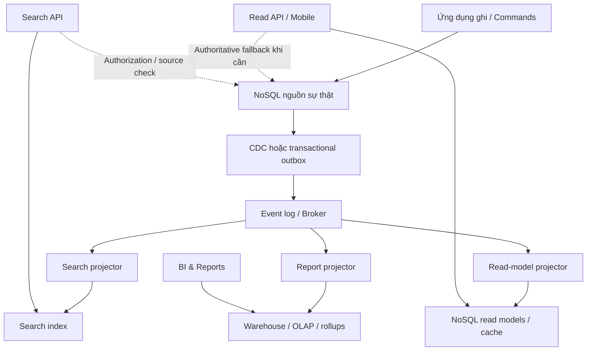
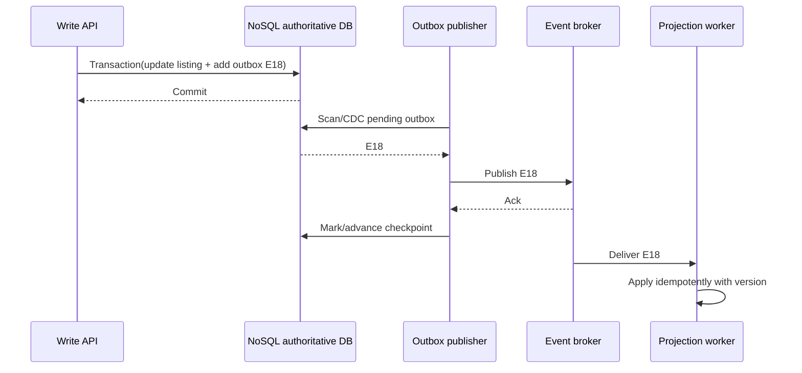

# Tổng hợp dữ liệu cho báo cáo, tìm kiếm và ứng dụng đọc

## 1. Một dữ liệu nguồn, ba nhu cầu đọc rất khác nhau

Giả sử một ứng dụng quản lý danh sách sản phẩm/dịch vụ lưu thông tin trong cơ sở dữ liệu NoSQL vận hành. Người dùng có thể tạo một bản đăng, đổi giá, cập nhật trạng thái và xóa bản đăng. Bộ phận vận hành cần báo cáo doanh thu và số bản đăng theo ngày. Người mua cần tìm kiếm toàn văn bằng từ khóa, lọc khu vực và sắp xếp. Màn hình di động muốn hiển thị ngay một thẻ gồm tên, ảnh, giá, chủ sở hữu và trạng thái.

Ba nhu cầu đều dùng **cùng dữ liệu nghiệp vụ**, nhưng cách đọc rất khác:

- **Giao dịch vận hành:** “Cập nhật giá của bản đăng L42 nếu phiên bản hiện tại vẫn là 17.”
- **Báo cáo:** “Trong 30 ngày gần đây, mỗi khu vực có bao nhiêu bản đăng hoạt động và tổng giá trị giao dịch?”
- **Tìm kiếm:** “Tìm bản đăng chứa từ khóa ‘căn hộ có ban công’, lọc theo khoảng giá và sắp theo mức phù hợp.”
- **Ứng dụng đọc:** “Hiển thị 20 thẻ bản đăng của một người dùng, kèm tên chủ, ảnh đại diện và số lượt yêu thích.”

Nếu cố dùng một collection/table cùng một sơ đồ khóa, index và consistency cho mọi truy vấn, hệ thống có thể gặp:

1. Những truy vấn báo cáo quét hàng triệu document làm nghẽn đường ghi giao dịch.
2. Tìm kiếm từ khóa đòi cấu trúc inverted index, analyzer, relevance ranking mà khóa chính NoSQL không cung cấp đầy đủ.
3. Một màn hình phải gọi hàng chục truy vấn riêng để ghép các trường, tạo latency cao và query fan-out.
4. Cache và bản sao dữ liệu có thể cũ, khiến người dùng nhìn thấy giá hoặc trạng thái chưa cập nhật.
5. Ghi dữ liệu sang hai hệ riêng lẻ có thể thành công một nửa, tạo trạng thái không nhất quán.

Một thiết kế phổ biến là **giữ một nguồn sự thật cho từng dữ liệu nghiệp vụ**, rồi xây những **mô hình dữ liệu dẫn xuất (derived data, projections, materialized views)** phục vụ từng loại truy vấn.

Bài học thuộc **Database No SQL — Tích hợp và kiến trúc**, tập trung vào cách xây, đồng bộ, vận hành và phục hồi các mô hình đọc cho **báo cáo, tìm kiếm và ứng dụng** mà không đánh mất tính đúng đắn của dữ liệu nguồn.

### Mục tiêu học tập

Sau bài này, bạn có thể:

- Phân biệt nguồn sự thật, projection, materialized view, cache, search index và analytical store.
- Lựa chọn giữa query trực tiếp, API composition, batch ETL, CDC, application events và transactional outbox.
- Thiết kế luồng snapshot + CDC không bỏ sót hoặc nhân đôi hiệu ứng.
- Định nghĩa event envelope, schema version, định danh và thứ tự cập nhật theo aggregate.
- Xây projector lũy đẳng, chống update trùng và update đến muộn.
- Mô hình hóa báo cáo tổng hợp, late events, time windows và điều chỉnh dữ liệu lịch sử.
- Thiết kế search document, inverted index, relevance/filter/facet và quy trình reindex.
- Xây read model phục vụ một màn hình với chi phí truy vấn dự đoán được.
- Định nghĩa freshness, read-your-writes, deletion và authorization trên bản sao dẫn xuất.
- Đo projection lag, completeness, correctness, dead-letter backlog và khả năng phục hồi.
- Lập kế hoạch backfill, rebuild, migration và rollout có đối soát.
- Phân biệt “đã ghi thành công vào nguồn” với “đã xuất hiện ở mọi projection”.

## 2. Phân biệt bốn dạng dữ liệu trong kiến trúc

| Dạng | Chức năng | Ví dụ | Độ tin cậy dùng cho nghiệp vụ |
|---|---|---|---|
| **Operational source of truth** | Lưu trạng thái authoritative; thực thi invariant | Collection `listings`, ledger giao dịch | Quyết định ghi/uniqueness/quota trong phạm vi consistency đã chọn |
| **Read projection** | Tái cấu trúc dữ liệu cho màn hình hoặc API | `listing_cards_by_owner` | Có thể trễ; chỉ dùng làm authority nếu có contract riêng |
| **Search index** | Full-text, filter, relevance, autocomplete | Elasticsearch/OpenSearch index | Có thể trễ và có lỗi index riêng |
| **Analytical/reporting store** | Aggregate, group-by, chuỗi thời gian, history | Daily facts/warehouse/OLAP | Có độ trễ/correction; thích hợp báo cáo, không tự là guard giao dịch |

Một hệ có thể dùng MongoDB/Cassandra/DynamoDB cho operational data, OpenSearch hoặc Elasticsearch cho search, Redis cho cache, và ClickHouse/BigQuery/warehouse cho báo cáo. Đây là **ví dụ kiến trúc đa công nghệ**, không phải quy định bắt buộc.

### 2.1. Nguồn sự thật không nhất thiết là một database duy nhất

Một hệ lớn có thể có:

- Service Listings sở hữu tên, mô tả và trạng thái bản đăng.
- Service Pricing sở hữu quy tắc giá.
- Service Identity sở hữu hồ sơ người dùng.
- Service Payments sở hữu payment records.

Mỗi field/aggregate cần **quy định rõ nơi nào được phép quyết định thay đổi của nó**. Một read projection có thể ghép nhiều nguồn, nhưng không nên trở thành một nguồn ghi độc lập cho những field đã có owner.

### 2.2. Derived data có thể xóa và dựng lại hay không?

Lý tưởng, projection được coi là **có thể tái tạo** từ nguồn và nhật ký thay đổi, trong giới hạn dữ liệu/retention còn sẵn.

Nhưng nếu projector tự sinh thêm thông tin mà nguồn không lưu (ví dụ user đánh dấu thủ công trực tiếp trong search index), projection không còn thuần dẫn xuất. Khi ấy cần gán ownership riêng hoặc đưa hành động đó trở lại hệ nguồn.

### 2.3. Không nhầm projection với replica

- **Replica** thường sao chép một tập dữ liệu theo mô hình replication của engine.
- **Projection** thay đổi hình dạng, khóa, index, aggregate, hoặc dữ liệu liên kết để phục vụ truy vấn khác.

Một replica có thể có bản sao đầy đủ của collection cũ nhưng vẫn không phù hợp để truy vấn toàn văn hay báo cáo theo vùng. Một projection có thể chỉ giữ một tập con dữ liệu đã biến đổi.

## 3. Ba workload cần ba kiểu tối ưu khác nhau

| Tiêu chí | Báo cáo/OLAP | Tìm kiếm | Ứng dụng đọc/API |
|---|---|---|---|
| Truy vấn | Group-by, aggregate, time window | Text relevance, filter, facets | Point lookup, list theo owner, feed |
| Kích thước kết quả | Ít hàng tổng hợp, quét nhiều dữ liệu đầu vào | Top-K documents | 1–100 thẻ/details |
| Tổ chức | Columnar/facts/rollups | Inverted index, analyzers | Denormalized documents, lookup keys |
| Độ mới thường chấp nhận | Phút/giờ/ngày tùy báo cáo | Giây/phút tùy UX | Có thể cần ngay sau ghi ở một số màn hình |
| Thay đổi lịch sử | Backfill, correction, late event | Reindex, delete | Upsert/recompute |
| Thước đo hiệu quả | Query time, freshness, cost | Recall, precision, p99, index lag | p99, fan-out, read-your-writes |
| Nguy cơ | Sai tổng khi event trùng hoặc sửa | Stale results và lộ quyền xem | Giao diện giá/trạng thái không đồng bộ |

**Không có SLA mặc định** cho cả ba. Một dashboard doanh số theo ngày có thể chấp nhận trễ 15 phút, trong khi màn hình “đặt hàng vừa thành công” cần thấy kết quả ngay. Độ mới là một **hợp đồng sản phẩm**, không phải đặc tính tự động của công nghệ.

## 4. Bức tranh kiến trúc tổng thể



**Mũi tên từ DB sang CDC không có nghĩa mọi database tự tạo đúng “event nghiệp vụ”**. CDC thường biểu diễn thay đổi dữ liệu lưu trữ; muốn có event như `ListingPublished`, cần quy ước chuyển đổi hoặc ghi event nghiệp vụ một cách có kiểm soát.

Trong một triển khai khác, projector có thể đọc CDC trực tiếp, không cần broker trung gian. Có hệ dùng managed streaming service, có hệ dùng batch. Mục tiêu của sơ đồ là chỉ ra **nguồn, đường đồng bộ và các đích dẫn xuất**, không áp đặt một stack.

### 4.1. Các câu hỏi quan trọng trước khi bắt đầu

1. Field nào là nguồn sự thật? Ai sở hữu?
2. Dữ liệu sẽ chảy theo hướng một chiều hay hai chiều?
3. Đích có cần nhận mọi thay đổi, hay chỉ trạng thái cuối?
4. Một update cần xuất hiện ở đích trong bao lâu?
5. Có thể rebuild từ nguồn nếu index bị hỏng không?
6. Trong lúc rebuild, API phục vụ thế nào?
7. Những bản ghi bị xóa có thể còn nằm ở đích/cache bao lâu?
8. Mỗi đích cần những quyền truy cập và quy tắc retention nào?
9. Nếu event bị gửi trùng hoặc đảo thứ tự, projector xử lý ra sao?
10. Dùng phép đo nào để biết projection đang **đúng và đầy đủ**?

## 5. CQRS: tách mô hình ghi khỏi mô hình đọc

**CQRS** (*Command Query Responsibility Segregation*) là cách tách trách nhiệm xử lý thay đổi state (**commands**) khỏi cách phục vụ truy vấn (**queries**).

Ví dụ:

```text
Write model:
  listings_by_id
  PK = listingId

Read model:
  listing_cards_by_owner
  PK = ownerId
  SK = updatedAt#listingId

Search model:
  listing_search_index
  fields = title, description, location, filters...

Analytics:
  daily_listing_fact
  keys = day, region, status...
```

### 5.1. CQRS không bắt buộc có hai databases

Một ứng dụng nhỏ có thể dùng:

- Cùng MongoDB, khác collections và indexes.
- Cùng DynamoDB, khác tables/GSIs.
- Cùng Cassandra cluster, các tables theo access patterns.
- Một source DB và một search service.
- Một source DB cùng cache được rebuild khi cần.

Đừng thêm Kafka, search cluster và warehouse nếu truy vấn hiện tại có thể chạy tốt với indexes đơn giản và workload nhỏ.

### 5.2. CQRS không đồng nghĩa Event Sourcing

**Event Sourcing** coi event history là nguồn sự thật chính để tái dựng state. **CQRS** chỉ nói về tách mô hình command/query. Có thể:

- CQRS với state database + CDC.
- CQRS với transactional outbox.
- CQRS với event sourcing.
- Event sourcing không tách read database nếu nhu cầu đơn giản.

Không giả định thay một document snapshot bằng event log là yêu cầu của CQRS.

### 5.3. Lợi ích và đánh đổi

**Lợi ích:** mỗi mô hình dữ liệu tối ưu theo truy vấn, tải đọc tách khỏi tải ghi, dễ tăng throughput cho search/report.

**Đánh đổi:** thêm pipeline, event schemas, lag, reconciliation, rebuild, monitoring và quản trị phân quyền. Hệ có thể có **nhiều phiên bản đúng ở những thời điểm khác nhau**, phải giải thích cho người dùng.

## 6. Những lựa chọn tích hợp và khi nào dùng

| Cách | Cơ chế | Ưu điểm | Hạn chế |
|---|---|---|---|
| **Truy vấn trực tiếp nguồn** | API đọc DB vận hành | Ít hệ nhất, dễ strong read trong phạm vi engine | Scan/join nặng ảnh hưởng OLTP, search hạn chế |
| **API composition** | Read API gọi nhiều services rồi ghép | Không cần copy toàn bộ data | N+1, network fan-out, latency/availability phụ thuộc nhiều services |
| **Batch ETL/ELT** | Snapshot/export theo lịch | Đơn giản cho báo cáo không cần realtime | Độ trễ theo chu kỳ, correction/rebuild |
| **CDC** | Đọc nhật ký thay đổi của DB | Không cần sửa mọi đường ghi ứng dụng | Định dạng thấp tầng, ordering/retention/resume phức tạp |
| **Transactional outbox** | Business state + event intent trong cùng transaction | Tách publish khỏi commit, giảm dual-write gap | Thêm outbox, polling/CDC, duplicates cần xử lý |
| **Application events** | Service phát event sau thao tác | Event giàu ngữ nghĩa nghiệp vụ | Nếu publish rời DB write có thể mất/nhân đôi |
| **Cache-aside** | Read miss lấy nguồn và cache | Giảm tải point reads, dễ thêm | Cache invalidation, stale/read race |
| **Materialized view engine** | Engine tự duy trì view trong phạm vi hỗ trợ | Giảm code projector | Giới hạn query, consistency, chi phí/view restrictions |

### 6.1. Batch không phải lỗi thời

Nếu người dùng cần báo cáo tháng trước, snapshot mỗi đêm và SQL/OLAP được kiểm chứng có thể phù hợp hơn CDC realtime phức tạp. Chọn theo SLA và chi phí, không theo mức độ “thời gian thực” hấp dẫn.

### 6.2. Truy vấn nguồn vẫn có chỗ đứng

Đọc lại trạng thái authoritative cho:

- Thanh toán/quyền truy cập.
- Tình trạng giữ chỗ trước khi xác nhận.
- Lệnh đổi giá có CAS.
- Trạng thái ngay sau khi cập nhật nếu API hứa read-your-writes.

Một search index có thể trả danh sách candidates, nhưng quyết định “còn hàng hay không” có thể cần điều kiện nguyên tử ở source of truth.

## 7. Vấn đề dual-write: hai hệ thành công một nửa

Giả sử code:

```text
1. update MongoDB listing L42
2. index L42 vào OpenSearch
3. return 200
```

Một timeline:

```text
T0 MongoDB update thành công
T1 Process crash
T2 OpenSearch chưa nhận update
T3 API/worker restart
```

Đích tìm kiếm vẫn có giá cũ. Đổi thứ tự:

```text
1. update search index
2. update MongoDB
```

cũng có khoảng trống: search index hiển thị giá mới, nhưng source vẫn chưa commit.

### 7.1. Vì sao retry đơn thuần không đủ?

Retry có ích khi biết một bước đã thất bại. Nhưng sau timeout:

- OpenSearch có thể đã index, ACK mất.
- DB có thể commit, response mất.
- Retry có thể mang version cũ tới sau event mới.
- Một thao tác delete bị gửi trễ có thể xóa dữ liệu vừa tái tạo.

Cần operation IDs, version và idempotent projection, không chỉ vòng lặp `try/catch`.

### 7.2. Không có atomic transaction chung theo mặc định

MongoDB transaction không tự commit đồng thời vào OpenSearch hoặc warehouse. Hai dịch vụ riêng không chia sẻ một commit point nếu không có giao thức phân tán được hỗ trợ thật sự.

**Nguyên tắc:** ghi dữ liệu nghiệp vụ vào authority, ghi ý định đồng bộ có thể phục hồi, rồi xây projection bất đồng bộ với reconciliation.

## 8. Transactional outbox: ghi dữ liệu và ý định phát sự kiện cùng commit

Một pattern phổ biến:

```text
BEGIN DB TRANSACTION
  Update Listing L42: price=2_400_000, version=18
  Insert Outbox E18: ListingUpdated(L42, version=18)
COMMIT
```

Sau đó worker/CDC publisher phát outbox event tới broker.



### 8.1. Outbox giải quyết lỗi gì?

Nó đảm bảo trong phạm vi transaction đã chọn, **không có cập nhật nghiệp vụ đã commit mà hoàn toàn không có bản ghi ý định publish**. Nếu process crash sau commit, publisher khác có thể tiếp tục.

### 8.2. Outbox không bảo đảm chỉ publish một lần

Publisher có thể:

1. Publish E18.
2. Broker nhận E18.
3. ACK tới publisher bị mất.
4. Publisher retry E18.
5. Broker nhận lại E18.

Consumer phải chịu **at-least-once delivery**, trừ khi có một guarantee rõ và phù hợp hơn cho phạm vi cụ thể.

### 8.3. Điều kiện dùng outbox

- Source DB hỗ trợ ghi business state và outbox atomically trong transaction/aggregate scope phù hợp.
- Outbox có event ID và metadata cho retry.
- Publisher có checkpoint/ownership và backoff.
- Outbox retention đủ dài để xử lý sự cố.
- Có DLQ/poison-event strategy hoặc cách quarantine.
- Consumer idempotent.
- Có cleanup outbox sau khi chắc chắn replay policy được đáp ứng.

Nếu source DB không có multi-document transactions, có thể đặt outbox marker trong cùng authoritative document/item, hoặc dùng một mô hình event log làm authority. Không suy rằng hai `PutItem` rời nhau là transaction chỉ vì chúng cùng service.

### 8.4. Event nghiệp vụ khác mutation cơ sở dữ liệu

Outbox có thể lưu:

```json
{
  "eventType": "ListingPublished",
  "listingId": "L42",
  "version": 18
}
```

Trong khi raw CDC của update có thể nói field `status` đổi từ `DRAFT` sang `PUBLISHED`. Event nghiệp vụ diễn tả intent, không nhất thiết đồng nhất với một row mutation. Một transaction có thể sửa nhiều documents để thực hiện một intent.

## 9. CDC: quan sát thay đổi đã commit từ nguồn

**Change Data Capture (CDC)** đọc những thay đổi của hệ lưu trữ và chuyển tới downstream systems.

Một số kiểu triển khai:

- Database change stream/log subscription.
- Connector đọc transaction log/oplog/binlog.
- Managed streams gắn với table.
- Polling cột `updatedAt`/`version` — chỉ là một phương án thay thế, có giới hạn đáng kể.
- Snapshot + incremental log tail.

### 9.1. CDC giúp gì?

- Đẩy updates đã commit tới search/read/OLAP.
- Giảm coupling giữa writer API và các đích.
- Hỗ trợ rebuild hoặc materialization.
- Có thể ghi lại lịch sử thay đổi trong retention window.
- Cho phép nhiều consumers xử lý độc lập.

### 9.2. CDC không tự biết business intent

Một transaction:

```text
update listing.price
insert audit row
increment owner.stats
```

có thể tạo ba mutation events. Nếu projector báo cáo số lần “người bán đổi giá” bằng cách đếm mọi mutation, kết quả sai. Cần schema/logic hiểu loại operation và quan hệ giữa các changes.

### 9.3. Quan sát thứ tự nào?

CDC có thể đảm bảo thứ tự trong một stream/partition/aggregate theo tài liệu. **Không mặc định có tổng thứ tự toàn cục** trên mọi shards, collections hoặc services.

Nếu hai services cập nhật cùng read model, cần quy định owner/version per field hoặc một sequencing protocol phù hợp.

### 9.4. Resume token và retention

Một consumer có thể ngừng hai ngày. Nếu log retention chỉ một ngày, nó có thể **không còn tiếp tục từ checkpoint cũ**. Cần phát hiện gap và chạy snapshot/rebuild; không âm thầm bắt đầu từ head mới rồi coi projection đầy đủ.

### 9.5. MongoDB và DynamoDB là ví dụ, không là giao thức giống nhau

- MongoDB Change Streams phụ thuộc khả năng deployment/oplog, resume tokens và quyền đọc.
- DynamoDB Streams có record types, stream views và retention/ordering scope riêng.
- Cassandra CDC, Redis Streams, Kafka Connect/Debezium và các service khác có contract riêng.

Không lấy tên “stream” hoặc “CDC” để suy cùng một semantics về commit, reordering, deletes và retention.

## 10. Snapshot ban đầu rồi nối CDC: bài toán không bỏ sót event

Khi dựng search index cho 20 triệu bản ghi, không thể chỉ subscribe từ “bây giờ” vì sẽ thiếu 20 triệu bản ghi cũ. Cũng không thể snapshot một lần rồi subscribe sau đó mà không có ranh giới đồng bộ.

### 10.1. Race thường gặp

```text
T0 Bắt đầu export tất cả listings.
T1 Export tới listing L42 bản version 17.
T2 Listing L42 được cập nhật version 18.
T3 Export tiếp những records còn lại.
T4 Export xong.
T5 CDC mới bắt đầu từ thời điểm T5.
```

Event version 18 ở T2 không có trong snapshot cũ và cũng không được CDC bắt từ T5. Search index giữ version 17 mãi.

### 10.2. Cần ranh giới snapshot và log

Một kế hoạch đúng về mặt nguyên tắc:

1. Xác định một **change-log offset/watermark** \(W\) có thể làm điểm nối.
2. Tạo snapshot nhất quán tương ứng với \(W\), **hoặc** dùng protocol snapshot + buffered CDC có thể chứng minh không bỏ sót trong lúc scan.
3. Subscribe/read log từ offset phù hợp **không muộn hơn** ranh giới cần thiết.
4. Nạp snapshot vào đích với version/source position.
5. Replay các changes có thể trùng, idempotently.
6. Cập nhật checkpoint chỉ sau khi records tương ứng đã được áp dụng bền vững.
7. Xác minh source/target completeness và lag.
8. Chuyển traffic khi projection đạt acceptance criteria.

### 10.3. Snapshot không nhất quán vẫn có thể được dùng, nhưng phải có protocol

Một số connector scan từng partition trong khi vẫn tail CDC. Những records quét sau có thể chứa version mới hơn records quét trước, và CDC cũng có thể chứa changes ấy.

Nếu tất cả source changes có một ordering/identity thích hợp và projector áp dụng version guard, có thể đạt end-state đúng theo thiết kế. Nhưng không có một “snapshot time” chung thì **không được tự suy ra** snapshot thể hiện trạng thái của toàn DB tại đúng một thời điểm.

### 10.4. Một đường nạp ví dụ

```text
Source listing L42 v17
Snapshot projector writes v17.
CDC delivers L42 v18 -> writes v18.
CDC duplicate L42 v18 -> ignored.
Late snapshot task tries L42 v17 -> rejected.
```

Điều kiện là sink phải có **atomic compare-by-version/conditional update** hoặc protocol tương đương, không chỉ client kiểm version trước rồi update rời nhau.

### 10.5. Không dùng thời gian máy làm log offset

`createdAt` hoặc `updatedAt` không tự là vị trí transaction log. Đồng hồ lệch, nhiều cập nhật cùng timestamp hoặc cập nhật document với timestamp cũ có thể gây gap. Dùng cursor/offset/LSN/resume token và version theo contract của nguồn.

## 11. Chọn thông điệp sự kiện cho nhiều projection

Một event envelope minh họa:

```json
{
  "eventId": "listings-L42-v18",
  "eventType": "ListingUpdated",
  "schemaVersion": 2,
  "aggregateType": "Listing",
  "aggregateId": "L42",
  "tenantId": "t17",
  "aggregateVersion": 18,
  "sourceCommitPosition": "opaque-source-token",
  "occurredAt": "2026-11-14T09:10:00Z",
  "committedAt": "2026-11-14T09:10:01Z",
  "correlationId": "req-8842",
  "payload": {
    "title": "Căn hộ có ban công",
    "priceMinor": 2400000,
    "currency": "VND",
    "regionCode": "HCM",
    "status": "PUBLISHED",
    "ownerId": "U71"
  }
}
```

**Đây là schema minh họa**, không phải message được tự động mọi DB phát ra.

### 11.1. Tối thiểu event nên trả lời

- **What:** loại sự kiện/change.
- **Who owns:** aggregate/source service.
- **Which object:** tenant + aggregate ID.
- **Which version:** generation/revision để nhận biết trùng và cũ.
- **Which schema:** event schema version.
- **When:** event time và commit/processing time khi thích hợp.
- **Where from:** source stream/position hoặc tracing context.
- **Which payload:** thông tin tối thiểu để consumer xử lý, hoặc pointer để fetch state.
- **Deletion:** marker hoặc event type để xóa/cập nhật projection đúng.

### 11.2. Event ID và aggregate version khác nhau

- `eventId` nhận diện một event cho dedup/trace.
- `aggregateVersion` thể hiện thứ tự cập nhật hợp lệ **trong một aggregate** nếu source cấp monotonic versions.
- `sourceCommitPosition` có thể hỗ trợ checkpoint toàn stream/partition và không nhất thiết so được trên mọi streams.
- `occurredAt` theo nghiệp vụ không tự tương đương commit order.

Không dùng một trường cho mọi mục đích chỉ vì giá trị đều là số/timestamp.

### 11.3. Event payload là snapshot hay delta?

**After-state event:**

```json
{ "listingId": "L42", "version": 18, "priceMinor": 2400000 }
```

Nếu chỉ có field giá, đây có thể là *partial after-state*, không đủ tự rebuild toàn document. Định nghĩa contract rõ.

**Change event:**

```json
{
  "listingId": "L42",
  "version": 18,
  "changes": { "priceMinor": { "old": 2300000, "new": 2400000 } }
}
```

**Domain event:**

```json
{
  "eventType": "ListingPriceChanged",
  "listingId": "L42",
  "version": 18,
  "newPriceMinor": 2400000
}
```

Mỗi loại có trade-off về kích thước, privacy, khả năng rebuild, yêu cầu thứ tự và phụ thuộc schema.

### 11.4. Tránh “event mang mọi PII”

Search/report thường không cần địa chỉ riêng, số điện thoại, token hay lịch sử thanh toán chi tiết. Event schemas cần data minimization; downstream thường khó xóa dữ liệu nhạy cảm nếu đã lan vào nhiều hệ/backup.

## 12. Thứ tự event: scope nào mới có ý nghĩa?

Một aggregate có:

```text
L42 v17 -> price=2_300_000
L42 v18 -> price=2_400_000
L42 v19 -> status=UNPUBLISHED
```

Giả sử search worker nhận:

```text
v19, v17, v18
```

Nếu cứ ghi đè theo arrival order, search index cuối cùng giữ `v18` và còn hiện một listing đã bị unpublish ở `v19`.

### 12.1. Quy tắc per-aggregate version

Mỗi target document giữ `sourceVersion`. Một incoming event chỉ được áp dụng nếu:

\[
incomingVersion>storedVersion
\]

khi event chứa **đủ after-state** hoặc có replay/recompute semantics phù hợp. Với delta phụ thuộc quá khứ, chỉ kiểm “lớn hơn” mà bỏ qua các versions giữa có thể làm mất thay đổi.

### 12.2. Khi có một khoảng version bị thiếu

Nếu current target `v17` và nhận delta `v19` nhưng chưa nhận `v18`:

- Nếu v19 là **toàn bộ trạng thái hiện hành**, có thể replace bằng v19 nếu contract cho phép.
- Nếu v19 chỉ nói `status=UNPUBLISHED`, có thể cần buffer/replay v18 hoặc fetch authoritative snapshot để biết đầy đủ price/title hiện tại.
- Nếu v19 là “tăng lượt xem +1”, bỏ qua v18 có thể làm mất một increment.

**Version guard không tự tái tạo những deltas đã mất.**

### 12.3. Multi-aggregate joins

Order v12 và User v7 đến read model theo hai streams không có một total order. Một card có thể tạm kết hợp thông tin mới của order với profile cũ của user. Điều đó có thể đúng theo eventual contract, nhưng không phải atomic cross-service snapshot.

### 12.4. Partition key cho broker

Nếu cần giữ thứ tự trong cùng aggregate, thường chọn event partitioning key bằng `tenantId#aggregateId` và đảm bảo **một producer sequencing policy** phù hợp. Việc chọn key giống nhau có thể đưa records vào cùng broker partition, nhưng retries, producer failover và CDC connector vẫn cần xét guarantees thực tế.

## 13. At-least-once, exactly-once và projection lũy đẳng

Nhiều pipelines cố ý dùng **at-least-once delivery** để giảm nguy cơ mất event:

```text
Consumer nhận E18.
Consumer ghi target thành công.
Consumer crash trước commit offset/ACK.
Broker giao E18 lần nữa.
```

### 13.1. Điều cần đạt

Hai deliveries của **một logical event** không được tạo hai hậu quả ngoài ý định.

Với after-state upsert:

```text
UPSERT listing L42 to sourceVersion=18
```

lặp lại có thể giữ một document với version 18, nếu target update được bảo vệ.

Với report increment:

```text
daily_count += 1
```

lặp lại làm count tăng hai lần. Cần dedup/transaction hoặc mô hình báo cáo có thể recompute.

### 13.2. Phạm vi exactly-once có giới hạn

Một broker có thể hỗ trợ transactional processing của các input/output nằm trong phạm vi nền tảng. Điều đó **không tự làm** một write sang search index, warehouse, email hoặc payment gateway đúng một lần.

Để đạt *effectively once* trong business read projection, thường cần:

- Stable event ID.
- Idempotent/conditional target mutation.
- Transaction hoặc checkpoint protocol thích hợp.
- Replay recovery.
- Reconciliation khi còn trường hợp outcome không rõ.

### 13.3. ACK/checkpoint trước hay sau target commit?

**ACK trước target commit:**

```text
ACK event E18 -> process crash -> target không có E18
```

Có nguy cơ mất effect.

**Target commit trước ACK:**

```text
Target commit E18 -> process crash -> E18 redeliver
```

Cần dedup nhưng có thể bảo toàn dữ liệu.

Nếu offset và target mutation không nằm trong cùng transaction, pipeline phải chọn quy trình xử lý duplicate an toàn sau commit.

### 13.4. Một inbox riêng không luôn là atomicity

```text
Write inbox(E18) -> crash -> không update search
```

Lần redelivery thấy inbox và bỏ qua E18 → mất update. Vì vậy, nếu inbox được coi là “đã áp dụng”, marker và target effect cần atomic ở cùng consistency domain, hoặc có recoverable state machine để hoàn tất.

## 14. Java 17: mô phỏng projector chống duplicate, reorder và stale delete

Ví dụ sau mô phỏng một **read projection** theo listing ID trong một JVM. Mỗi event mang trạng thái sau cập nhật đầy đủ và source version tăng đơn điệu trên cùng listing. Việc `compute` là atomic **trong ConcurrentHashMap cục bộ**; code không có durable persistence, broker hoặc transaction phân tán.

```java
import java.util.Map;
import java.util.Objects;
import java.util.concurrent.ConcurrentHashMap;

public final class ListingProjection {
    enum Kind { UPSERT, DELETE }

    record Key(String tenantId, String listingId) {
        Key {
            Objects.requireNonNull(tenantId);
            Objects.requireNonNull(listingId);
        }
    }

    record Change(
        Key key,
        long sourceVersion,
        Kind kind,
        String title,
        long priceMinor
    ) {
        Change {
            Objects.requireNonNull(key);
            Objects.requireNonNull(kind);
            if (sourceVersion <= 0L) {
                throw new IllegalArgumentException("Invalid version");
            }
            if (kind == Kind.UPSERT && (title == null || priceMinor < 0L)) {
                throw new IllegalArgumentException("Invalid listing");
            }
        }
    }

    record Document(
        long sourceVersion,
        boolean deleted,
        String title,
        long priceMinor
    ) {}

    private final Map<Key, Document> documents =
        new ConcurrentHashMap<>();

    public void apply(Change incoming) {
        documents.compute(incoming.key(), (key, previous) -> {
            if (previous != null &&
                incoming.sourceVersion() < previous.sourceVersion()) {
                return previous; // Event cũ tới muộn.
            }

            if (previous != null &&
                incoming.sourceVersion() == previous.sourceVersion()) {
                // Một version phải có một giá trị after-state bất biến.
                Document expected = from(incoming);
                if (!previous.equals(expected)) {
                    throw new IllegalStateException(
                        "SAME_VERSION_DIFFERENT_PAYLOAD"
                    );
                }
                return previous; // Delivery trùng.
            }

            return from(incoming);
        });
    }

    private static Document from(Change change) {
        if (change.kind() == Kind.DELETE) {
            // Giữ tombstone/version để chặn update cũ hồi sinh.
            return new Document(
                change.sourceVersion(), true, null, 0L
            );
        }

        return new Document(
            change.sourceVersion(),
            false,
            change.title(),
            change.priceMinor()
        );
    }

    public Document find(Key key) {
        return documents.get(key);
    }

    public static void main(String[] args) {
        ListingProjection projection = new ListingProjection();
        Key key = new Key("t17", "L42");

        Change oldPrice = new Change(
            key, 17, Kind.UPSERT, "Căn hộ", 2_300_000
        );

        Change newPrice = new Change(
            key, 18, Kind.UPSERT, "Căn hộ", 2_400_000
        );

        Change removed = new Change(
            key, 19, Kind.DELETE, null, 0L
        );

        projection.apply(newPrice);
        projection.apply(oldPrice);  // Bỏ qua bản cũ.
        projection.apply(newPrice);  // Trùng, không đổi.
        projection.apply(removed);   // Tombstone v19.
        projection.apply(oldPrice);  // Không hồi sinh.

        System.out.println(projection.find(key));
        // Document[sourceVersion=19, deleted=true, ...]
    }
}
```

### 14.1. Bài học từ ví dụ

- Một source revision đủ tin cậy giúp bảo vệ document khỏi events cũ.
- Delete phải giữ một dấu phiên bản (tombstone/ledger hoặc cơ chế tương đương) nếu update cũ có thể đến sau.
- Một event cùng version nhưng payload khác là dấu hiệu **vi phạm contract của nguồn**; không nên âm thầm coi là duplicate.
- Key phải bao gồm tenant/namespace nếu ID không unique toàn hệ.
- Code hoạt động khi mỗi UPSERT mang đủ **toàn bộ fields mà projection cần** và một version duy nhất phản ánh thay đổi state ấy.

### 14.2. Những điều code chưa giải quyết

- Hai application instances có hai maps khác nhau; `compute` không atomic xuyên processes.
- Restart làm mất toàn bộ trạng thái.
- Không có checkpoint event log.
- Không có transaction với warehouse/search.
- Không xử lý multi-entity join và version của owner profile.
- Không có validation cho authorization.
- Không tự giữ đúng UI order khi đổi `updatedAt`.
- Không biết source event đã mất hoàn toàn hay chưa.
- Tombstones cần retention/GC protocol.
- Nếu nguồn phát delta thay vì full after-state, thuật toán sẽ cần logic khác.

Production nên dùng target-side atomic conditional upsert/version guard, unique event ledger hoặc stream processor state store với guarantees và durable recovery rõ.

## 15. Report projector: aggregate không thể cộng mù mọi event

Giả sử báo cáo `published_listing_count_by_region`.

Nếu consumer nhận:

```text
E1: Listing L42 published in region HCM.
E1: Redelivery of E1.
```

Một thuật toán:

```text
count[HCM] += 1
```

sẽ tính L42 hai lần.

### 15.1. Đếm bằng trạng thái đóng góp gần nhất

Một cách an toàn hơn là lưu **last contribution** của từng entity và điều chỉnh aggregate khi state thay đổi.

Ví dụ:

```text
Before:
  Listing L42: status=DRAFT, region=HCM
  Contribution: none

After publish:
  Listing L42: status=PUBLISHED, region=HCM
  Contribution: (HCM, +1)
```

Khi đổi khu vực từ HCM sang HN:

```text
Old contribution: HCM +1
New contribution: HN +1

Apply correction:
  HCM -= 1
  HN += 1
```

Nếu unpublish:

```text
Remove contribution from current region.
```

### 15.2. Điều kiện atomic

Để không trừ/cộng lại khi retry:

1. Lưu sourceVersion và contribution cũ.
2. Nếu event version không mới hơn, bỏ qua.
3. Tính delta từ old contribution đến new contribution.
4. Ghi contribution mới và cập nhật aggregates trong **một transaction hoặc recoverable protocol**.
5. Checkpoint message sau khi effect bền vững.

Nếu contribution ledger và aggregate ở hai hệ không thể transaction cùng nhau, có thể:

- Ghi canonical per-entity fact rồi batch/recompute rollup.
- Dùng outbox/change log cho aggregate updates.
- Dùng một stream processing engine với state/checkpoint guarantees phù hợp.
- Đối soát và sửa aggregate từ source facts.

**Một phép cộng/trừ có thể đảo ngược về mặt toán học nhưng không tự idempotent khi event bị giao hai lần.**

### 15.3. Mô hình dữ liệu cho báo cáo

Một per-listing fact:

```json
{
  "tenantId": "t17",
  "listingId": "L42",
  "sourceVersion": 19,
  "regionCode": "HN",
  "status": "PUBLISHED",
  "publishedAt": "2026-11-14T09:15:00Z",
  "ownerId": "U71"
}
```

Một daily rollup:

```json
{
  "tenantId": "t17",
  "reportDay": "2026-11-14",
  "regionCode": "HN",
  "publishedListings": 2481,
  "sourceWatermark": "opaque-position",
  "computedAt": "2026-11-14T09:16:00Z"
}
```

Chọn reports theo **số lượng event được sinh trong ngày** khác với **số listing đang active ở thời điểm cuối ngày**. Phải định nghĩa phép đếm trước khi thiết kế aggregate.

## 16. Các loại chỉ số không được gộp nhầm

| Chỉ số | Ý nghĩa | Cách tính gợi ý |
|---|---|---|
| Số listing tạo mới trong ngày | Sự kiện create theo event time/commit time đã chọn | Count distinct create operations |
| Listing đang active hiện tại | Một trạng thái tại mốc đọc | Sum contribution từ current facts |
| Listing active cuối ngày | Snapshot/temporal state ở cutoff | As-of snapshot hoặc bitemporal model |
| Giao dịch thành công | Số business commitments duy nhất | Dedup theo transaction/operation ID |
| Tổng giá trị giao dịch | Tổng amounts của committed transactions | Chỉ authoritative payment/ledger facts |
| Giá trung bình đang niêm yết | Average trên current published listings | Tính theo facts hiện hành, không cộng mọi price update |
| Search clicks | Số user events hợp lệ | At-least-once ingestion + idempotent event ID |
| Unique viewers | Số distinct user/device theo policy | Exact set, distinct aggregate hoặc approximate sketch nếu cho phép |

### 16.1. Dùng “event count” để suy state count có thể sai

Một listing được publish 3 lần, unpublish 2 lần. Có 3 events `Published` nhưng current active listings chỉ là 1. Report phải thể hiện đúng business definition.

### 16.2. Các phép tính tiền

Tiền nên dùng integer minor units hoặc decimal có precision xác định, cùng currency. Không dùng floating point nhị phân rồi cộng dồn giá trị tiền một cách tùy tiện; cần quy định rounding/currency conversion/time rate và correction.

### 16.3. Report “đúng” cần có thời điểm hiệu lực

Một báo cáo trạng thái “cuối ngày 13/11” không được tùy tiện dùng current source state ngày 14/11. Cần snapshot/time-travel/history hoặc event-time processing có corrections và cutoff.

## 17. Event time, processing time và watermark

Một sự kiện có thể phát sinh lúc 23:58 nhưng chỉ đến pipeline lúc 00:10 hôm sau do thiết bị mất mạng.

- **Event time:** thời điểm hành động xảy ra theo business semantics.
- **Ingestion time:** lúc hệ nhận event.
- **Processing time:** lúc projector xử lý event.
- **Commit time:** lúc source authoritative commit.
- **Report cutoff:** thời điểm/điều kiện dùng để kết sổ báo cáo.

### 17.1. Ví dụ cửa sổ theo ngày

```text
Event E42:
  occurredAt  = 2026-11-13T23:58:00Z
  committedAt = 2026-11-14T00:07:00Z
  processedAt = 2026-11-14T00:10:00Z
```

Nếu chỉ tiêu là “sự kiện xảy ra ngày 13/11”, E42 thuộc ngày 13/11 theo event time. Nếu KPI là “được hệ chấp nhận ngày 14/11”, E42 có thể thuộc ngày 14/11 theo commit time.

Không trộn các định nghĩa trong một dashboard.

### 17.2. Watermark nói gì?

Một **event-time watermark** thể hiện ước lượng/đảm bảo của stream processor về mức tiến triển của event time, theo chiến lược và assumptions của engine.

Watermark không phải bản thân `now()`, cũng không tự đảm bảo sẽ không còn event trễ vô hạn. Cần định nghĩa allowed lateness và hành động khi event đến sau cutoff.

### 17.3. Late events

Một event tới sau khi dashboard đã công bố báo cáo:

- **Correct/retract:** cập nhật số cũ và gắn version/correctedAt.
- **Late bucket:** ghi vào phần “late adjustments”.
- **Hold finalization:** chờ một độ trễ phù hợp trước khi đóng báo cáo.
- **Reject/quarantine:** chỉ khi business contract cho phép.
- **Period close:** sau khi khóa sổ, dùng journal adjustment trong kỳ hiện tại thay vì sửa quá khứ, nếu chính sách kế toán yêu cầu.

Chọn theo bản chất báo cáo, không đơn thuần theo khả năng kỹ thuật.

### 17.4. Backfill và corrections

Nếu lỗi ingestion làm thiếu 1.000 transactions của ngày trước, backfill phải dùng operation IDs và correction protocol để tránh ghi trùng số tiền/tổng. Không tăng aggregate mù lần nữa nếu một phần dữ liệu đã có.

## 18. Dimension joins và snapshot theo thời gian

Một báo cáo thường kết hợp facts với dimensions, chẳng hạn khu vực, loại sản phẩm, chủ sở hữu hoặc nhãn nhóm người dùng.

### 18.1. Thay đổi dimension làm báo cáo lịch sử biến dạng

Giả sử một shop chuyển từ Region A sang Region B hôm nay. Nếu báo cáo doanh số năm trước join với **khu vực hiện tại**, doanh số lịch sử của Region A có thể bị chuyển sang Region B.

Có hai định nghĩa khác nhau:

- **As-of fact:** khu vực ở thời điểm giao dịch.
- **Current attribution:** khu vực hiện tại của shop, dù giao dịch cũ.

Phải chọn trước khi build warehouse.

### 18.2. Slowly Changing Dimension (SCD)

Một cách là lưu lịch sử version/effective interval của dimensions:

```text
shopId=U71, region=HCM, validFrom=2025-01-01, validTo=2026-06-01
shopId=U71, region=HN,  validFrom=2026-06-01, validTo=∞
```

Khi làm report as-of, join theo event time/commit time đã định. Cần xử lý overlapping intervals, correction và timezone.

### 18.3. Snapshot và lịch sử là hai dữ liệu khác nhau

Nếu nguồn chỉ lưu region hiện tại mà không giữ history, không thể suy chắc region cách đây một năm từ snapshot hiện tại. Đừng hứa tái dựng báo cáo lịch sử chính xác nếu event log/temporal data đã bị xóa.

## 19. Tìm kiếm: vì sao một index đặc biệt cần thiết?

Query:

```text
"Căn hộ có ban công gần trường học"
```

cần tokenization, xử lý tiếng Việt, nhiều terms, filters và relevance. Một operational database với index khóa chính thường mạnh ở point reads/ordered scans, nhưng không mặc nhiên hỗ trợ full-text quality tương đương search engine.

Một search index thường cung cấp:

- **Inverted index:** từ token tới danh sách documents.
- **Analyzer:** tokenize, normalize, lowercase, language rules.
- **Relevance scoring:** xếp kết quả theo mức liên quan.
- **Keyword fields:** lọc exact như `regionCode`, `status`, `tenantId`.
- **Numeric/date range filters:** giá, diện tích, ngày.
- **Facets/aggregations:** số lượng theo vùng, loại, giá.
- **Autocomplete/suggest:** tìm nhanh khi người dùng gõ.
- **Highlight:** vị trí kết quả khớp trong text.
- **Pagination/sort:** thứ tự ổn định với tie-breaker.
- **Geo filtering:** tùy nhu cầu và khả năng engine.

### 19.1. Search document tối ưu cho truy vấn

```json
{
  "id": "t17:L42",
  "tenantId": "t17",
  "listingId": "L42",
  "sourceVersion": 18,
  "title": "Căn hộ có ban công",
  "description": "Đầy đủ ánh sáng, gần trường",
  "regionCode": "HCM",
  "category": "APARTMENT",
  "priceMinor": 2400000,
  "currency": "VND",
  "status": "PUBLISHED",
  "ownerPublicName": "Người đăng A",
  "photoUrls": ["/images/listing-L42-cover.webp"],
  "visibility": "PUBLIC"
}
```

Đây là **read-optimized document**, không nhất thiết chứa toàn bộ fields operational. Mỗi field được thêm có chi phí indexing, update, storage, bảo mật và migration.

### 19.2. Denormalization có giá

Nếu owner đổi tên, hàng nghìn listing search documents có thể cần update. Nếu mỗi listing lookup owner profile qua API mỗi query, search throughput có thể giảm.

Có thể chọn:

- Lưu ownerPublicName đã denormalize và reindex khi đổi.
- Chỉ lưu ownerId rồi batch hydrate ở read API.
- Lưu phần tối thiểu, fetch live cho trường cần độ mới cao.

Quyết định theo **độ thường xuyên thay đổi, fan-out, SLA và freshness**.

### 19.3. Analyzer là một phần behavior sản phẩm

Tìm tiếng Việt có dấu/không dấu, dấu gạch nối, số nhà, thương hiệu và từ ghép là những vấn đề search schema. Không chỉ đổi `text` field là search đạt chất lượng; cần kiểm độ chính xác (precision), độ đầy đủ (recall), ranking, synonyms và typo tolerance trong phạm vi được hỗ trợ.

## 20. Tính đúng đắn của search index

Search index thường bất đồng bộ. Một listing đã được unpublish ở source có thể còn xuất hiện trong vài giây.

### 20.1. Read contract cho tìm kiếm

Có thể công bố:

- Kết quả tìm kiếm **có thể trễ tối đa theo SLO**.
- Mỗi search hit có `sourceVersion`/`indexedAt` nếu hữu ích.
- Thao tác quan trọng (đặt chỗ/checkout) luôn **revalidate** ở authority.
- Các trường nhạy cảm cần kiểm quyền tại serving time.

### 20.2. Permission filter không được chỉ dựa vào index stale

Nếu tài liệu vừa bị đổi từ PUBLIC sang PRIVATE, một index chưa cập nhật vẫn có thể trả kết quả cho user không được phép.

Một số cách:

- Chỉ index nội dung public và tránh chứa thông tin bí mật.
- Search hit chỉ là **candidate ID**, API kiểm authorization trên nguồn hoặc một authority có revocation contract đủ mạnh.
- Duy trì security filter/capability có chính sách cache và revocation riêng.
- Fail closed nếu không xác minh được quyền đối với dữ liệu nhạy cảm.

Không sử dụng eventual search index như cơ sở duy nhất để cấp quyền truy cập nhạy cảm.

### 20.3. Ẩn khỏi kết quả không đồng nghĩa đã xóa vật lý

Một delete/unpublish event cần:

- Gỡ hoặc cập nhật search document.
- Xóa/expire cache entries.
- Ngăn stale upsert event tái đưa listing trở lại.
- Xử lý copies/snapshots/backup theo retention policy.
- Đối soát index sau lỗi/khởi động lại.

Một `DELETE` target gặp timeout không tự chứng minh chưa xóa. Dùng event ID/version và idempotent delete.

### 20.4. Search index có thể chậm ở lúc refresh

Một document đã nhận write vào index nhưng chưa searchable ngay tùy refresh semantics. Không coi index ACK = query đã nhìn thấy ngay nếu engine là near-real-time và contract không cam kết điều ấy.

## 21. Reindex và schema change của search

Một thay đổi analyzer/mapping có thể yêu cầu tạo index mới và nạp lại dữ liệu.

### 21.1. Quy trình index version hóa

```text
listings-search-v1   <-- alias listings-search
listings-search-v2   <-- đang backfill
```

Quy trình:

1. Định nghĩa mapping/analyzer v2.
2. Tạo index v2, chưa phục vụ traffic chính.
3. Snapshot/backfill dữ liệu nguồn vào v2.
4. Replay các events từ điểm nối phù hợp.
5. Áp dụng source version guards và tombstones.
6. So sánh counts, field coverage, sample relevance, permissions.
7. Đảm bảo v2 theo kịp lag SLO.
8. Chuyển alias/read routing sang v2 theo cơ chế hỗ trợ.
9. Theo dõi p99, errors và kết quả tìm kiếm.
10. Giữ v1 đủ lâu để rollback, rồi xóa theo quy trình.

### 21.2. Alias swap không thay toàn bộ hệ thống nguyên tử

Một alias swap có thể atomic trong search cluster theo API engine. Nhưng những clients dùng index name cũ, caches và read services có thể vẫn giữ state cũ. Cần rollout plan end-to-end.

### 21.3. Search relevance cần acceptance tests riêng

Count documents bằng nhau không chứng minh relevance giống nhau. Cần một tập truy vấn đại diện để kiểm:

- Search hit chính xác.
- Bộ lọc tenant/status.
- Giá/khoảng ngày.
- Synonym/diacritics.
- Facet counts.
- Sort tie-breaker.
- Không hiển thị nội dung đã bị thu hồi.

### 21.4. Update event v19 tới trước snapshot v17

Nếu v19 là tombstone và v17 tới muộn, index mới không được hồi sinh listing. Sink phải bảo vệ version/tombstone khi backfill, không chỉ xóa document rồi quên phiên bản.

## 22. Một projection cho thẻ bản đăng trên ứng dụng

Màn hình hiển thị:

```text
[Ảnh đại diện]
Tên bản đăng
Giá
Khu vực
Tên chủ đăng
Trạng thái
Số lượt thích
```

Dữ liệu gốc có thể nằm ở nhiều owners:

```text
Listings: listingId, title, price, region, ownerId
Users: ownerId, publicName, avatar
Reactions: listingId, likeCount
Images: listingId, coverUrl
```

Một API composition đồng bộ có thể:

1. Query 20 listings.
2. Query 20 owner profiles.
3. Query 20 images.
4. Query 20 like counts.

Nếu gọi tuần tự 60 requests, latency/cost có thể cao. Có thể batch các yêu cầu thành một vài calls, hoặc dùng read projection có sẵn các fields:

```json
{
  "PK": "OWNER#U71",
  "SK": "UPDATED#2026-11-14T09:10:01Z#LISTING#L42",
  "listingId": "L42",
  "title": "Căn hộ có ban công",
  "priceMinor": 2400000,
  "currency": "VND",
  "regionCode": "HCM",
  "coverUrl": "/images/L42.webp",
  "ownerPublicName": "Người đăng A",
  "likeCount": 85,
  "listingVersion": 18,
  "ownerVersion": 7,
  "reactionVersion": 28
}
```

### 22.1. Một read model cần hiểu nhiều source versions

Không tồn tại một `version=18` chung cho toàn bộ dữ liệu nếu mỗi service có riêng sequence. Có thể lưu:

- `listingVersion`.
- `ownerVersion`.
- `reactionVersion`.
- `imageVersion`.

Đích phải áp dụng versions **theo đúng source entity/field ownership**, không lấy một timestamp mới nhất để bỏ qua mọi event nguồn khác.

### 22.2. Field nào cần live lookup?

- Title/cover có thể chấp nhận trễ vài giây.
- Like count có thể chấp nhận trễ hơn.
- Giá/availability ở bước xác nhận phải kiểm tại source.
- Permission/private status nhạy cảm cần guard phù hợp.

Không đồng nhất freshness SLO cho mọi field trong một card.

### 22.3. Sắp xếp bằng field thay đổi

Nếu read key là `updatedAt#listingId`, một listing đổi giá có thể chuyển vị trí trong danh sách. Projector phải xóa/move entry cũ khi key thay đổi, không chỉ insert entry mới; nếu không sẽ có hai card của cùng listing.

Một mapping `listingId -> currentReadKey` hoặc idempotent delete/insert protocol có thể cần, với atomicity/recovery phù hợp.
## 23. Thiết kế khóa và index cho read model

Một projection chỉ hữu ích khi phù hợp với **access pattern thực tế**.

Ví dụ hai API:

```http
GET /v1/users/U71/listings?limit=20
GET /v1/listings/L42
```

Chúng có thể cần hai cấu trúc truy vấn khác nhau:

```text
ByListingId:
  PK = tenantId#listingId
  value = full listing card

ByOwner:
  PK = tenantId#ownerId
  SK = updatedAt#listingId
  value = compact listing card
```

### 23.1. Một bảng không nhất thiết đáp ứng mọi truy vấn

- Point lookup theo listing ID hợp với key unique.
- Danh sách theo owner cần grouping/index theo owner.
- Feed theo category/region cần các secondary keys hoặc một read model khác.
- Search relevance cần index riêng.
- Báo cáo thời gian cần facts/OLAP model.

Đừng ép một shard/partition key thành “khóa đa năng” nếu làm query khác phải scan toàn bộ cluster.

### 23.2. Chi phí denormalization

Một thay đổi `ownerPublicName` có thể phải cập nhật hàng trăm card documents. Cần cân nhắc:

- Giữ tên trực tiếp trong card và chấp nhận update fan-out.
- Chỉ giữ `ownerId`, batch-hydrate khi đọc.
- Giữ snapshot owner name tại thời điểm đăng nếu đúng nghiệp vụ.
- Cache profile riêng với TTL/freshness contract.
- Materialize owner/card join bằng stream processor có state.

### 23.3. Cross-service event không có một phiên bản duy nhất

`ListingUpdated(L42,v18)` và `UserUpdated(U71,v7)` là hai chuỗi độc lập. Read projector không nên từ chối `UserUpdated(v7)` chỉ vì `listingVersion=18` lớn hơn 7.

Có thể lưu một map nguồn/version:

```json
{
  "listingId": "L42",
  "versions": {
    "Listing:L42": 18,
    "User:U71": 7,
    "Reaction:L42": 28
  }
}
```

Tuy vậy, khi source changes quan hệ (listing đổi owner từ U71 sang U72), projector còn phải xác định owner version/ownership join mới và xóa dữ liệu từ owner cũ. Không chỉ compare từng số mà bỏ qua **membership changes**.

### 23.4. Materialized joins có thể bị lệch tạm thời

Nếu nhận event đổi owner trước event cập nhật profile, card có thể tạm thiếu tên chủ mới. Một read model tốt định nghĩa:

- Cho hiển thị placeholder hay không?
- Khi nào fetch từ authority?
- Có cần trì hoãn publish tới khi join đủ?
- Có thể đọc stale trong bao lâu?
- Làm sao phát hiện card thiếu dependency để retry?

**Eventual consistency là trạng thái cần thiết kế trong UX**, không phải chỉ một dòng trong tài liệu database.

## 24. Cache: tăng tốc đọc nhưng mang một lớp bất đồng bộ nữa

Cache như Redis, in-process cache hoặc CDN có thể phục vụ read nhanh hơn, nhưng **tính đúng đắn của cache cũng là bài toán đồng bộ**.

### 24.1. Cache-aside

```text
GET listing L42:
  1. Đọc cache.
  2. Nếu miss, đọc source/read model.
  3. Set cache với TTL.
  4. Trả dữ liệu.
```

**Ưu điểm:** đơn giản, ít đường ghi.

**Hạn chế:** cache miss stampede, stale entries, race giữa read fill và invalidation.

### 24.2. Write-through

Write path cập nhật DB và cache theo một protocol. Nhưng nếu hai hệ không có transaction chung, “write-through” đơn giản vẫn gặp dual-write gap. Phải xác định cache là derivative và có cách recover từ source.

### 24.3. Write-behind

Ứng dụng ACK sau khi ghi cache/queue rồi mới flush vào authoritative store. Đây có thể là một mô hình ghi được chọn, nhưng **không được nhầm ACK cache với commit DB bền vững** nếu failure model không cho phép.

### 24.4. Race giữa cache fill và invalidation

```text
T0 Request R1 cache miss, đọc source v17.
T1 Update source tới v18.
T2 Invalidation cho L42 chạy, cache empty.
T3 R1 chậm và SET cache=L42 v17.
```

Cache vừa được invalidate nhưng bị lấp lại bằng bản cũ.

Các biện pháp có thể dùng:

- Cache entry lưu `sourceVersion`; chỉ chấp nhận version mới hơn.
- Conditional cache fill/compare-and-set nếu engine hỗ trợ.
- Short TTL và fallback nếu contract cho phép.
- Cache key theo version: `listing:L42:v18` cùng pointer có kiểm soát.
- Read source hoặc session watermark cho endpoint cần freshness.

### 24.5. Cache TTL không là SLO freshness mặc định

TTL 60 giây không bảo đảm dữ liệu chỉ trễ tối đa 60 giây nếu cache fill nguồn cũng stale, invalidation/queue chậm hoặc client giữ cache lâu hơn. Cần đo **độ trễ end-to-end từ commit tới khi API đọc đúng phiên bản**.

### 24.6. Cache không được giữ quyền truy cập cũ vô hạn

Cache response có thông tin cá nhân hoặc private listing phải scope theo tenant/user/permission, giới hạn TTL và có cơ chế revoke/fail closed khi nhạy cảm.

## 25. Độ mới: từ source commit đến lúc truy vấn thấy dữ liệu

Một write request thành công tại \(T_c\), nhưng projection xử lý xong tại \(T_p\).

\[
PropagationLag=T_p-T_c
\]

Đây là độ trễ xử lý cho **một change cụ thể** nếu hai timestamps đáng tin và cùng clock model. Trong thực tế, đo lag theo stream position/commit watermark có thể chính xác hơn so việc trừ timestamps giữa nhiều máy với clock skew.

### 25.1. Một API nên công bố consistency contract

| Contract | Ý nghĩa | Cách phục vụ thường gặp |
|---|---|---|
| **Authoritative point read** | Đọc theo mức nhất quán DB đã cam kết | Query source |
| **Read-your-writes** | User vừa update phải thấy version tương ứng | Source fallback, session token, wait-for-projection |
| **Bounded staleness** | Độ trễ nằm trong ngưỡng được định nghĩa | Giám sát lag, fallback/reject khi vượt |
| **Eventually consistent search** | Kết quả có thể trễ, cuối cùng cập nhật | Search index, async projector |
| **As-of report** | Báo cáo đúng tại cutoff được xác định | Snapshot/fact history + watermark |
| **Best effort cache** | Không hứa data mới tức thì | Cache-aside/TTL, warnings nếu cần |

### 25.2. Ví dụ read-your-writes bằng source version

Sau cập nhật:

```http
HTTP/1.1 200 OK
Content-Type: application/json

{
  "listingId": "L42",
  "sourceVersion": 18,
  "status": "PUBLISHED",
  "searchVisibility": "PENDING_INDEX"
}
```

Khi user mở trang:

```http
GET /v1/listings/L42?minVersion=18
```

Read API có thể:

1. Đọc projection.
2. Nếu `projection.sourceVersion >= 18`, trả projection.
3. Nếu nhỏ hơn, đợi bounded đến khi projection bắt kịp.
4. Nếu hết deadline, đọc source authoritative hoặc trả trạng thái có thể phân biệt như `PENDING_SYNCHRONIZATION` theo contract.
5. Không trả v17 như v18 mà không nói rõ.

**Đừng nhầm `minVersion` với phiên bản của mọi source** nếu view kết hợp nhiều nguồn; cần session token/watermark có cấu trúc tương ứng.

### 25.3. Search có thể chưa tìm được ngay sau publish

Sau `POST /listings/L42/publish` được commit, user tìm kiếm ngay có thể chưa thấy L42. UX có thể hiển thị:

> “Bản đăng đã được lưu và đang được cập nhật lên kết quả tìm kiếm.”

Không cần nói “xuất bản thất bại” nếu authoritative update đã thành công.

### 25.4. Hard invariants không đọc từ projection stale

Bước checkout/giữ chỗ không nên quyết định tình trạng còn hàng chỉ bằng search/read cache. Dùng conditional mutation ở nguồn authority:

```text
RESERVE listing L42
WHERE currentStatus=PUBLISHED
  AND availableSlots>=1
  AND sourceVersion matches business precondition
```

Read projection có thể giúp khám phá đối tượng, còn **quyết định ghi** phải tuân rule ở nguồn.

## 26. Sự khác nhau giữa “nhanh” và “đúng” của báo cáo

Một dashboard có thể trả truy vấn trong 100 ms nhưng dữ liệu trễ 3 ngày. Một dashboard khác tính trong 20 giây nhưng có thể kiểm soát exactness tới watermark hôm qua.

Cần phân biệt ít nhất ba chiều:

1. **Query latency:** mất bao lâu để trả số liệu.
2. **Freshness:** đã bao gồm changes tới mốc nào.
3. **Correctness/completeness:** đã tính đúng, đủ, không duplicate và đúng định nghĩa KPI hay chưa.

### 26.1. Báo cáo cần metadata đi kèm

```json
{
  "report": "dailyPublishedListings",
  "reportDay": "2026-11-13",
  "generatedAt": "2026-11-14T01:10:00Z",
  "sourceCutoff": "2026-11-14T00:00:00Z",
  "sourceWatermark": "opaque-stream-position",
  "isFinal": false,
  "correctionsPending": 3,
  "data": [
    {"regionCode": "HCM", "count": 2481},
    {"regionCode": "HN", "count": 1202}
  ]
}
```

### 26.2. Không gọi báo cáo là final khi còn dữ liệu chưa đến

Một event-time window có late-arrival allowance hoặc một batch reconciliation chưa hoàn tất. Báo cáo có thể được dán trạng thái `PROVISIONAL` thay vì `FINAL`.

### 26.3. Một business fact có thể thay đổi

Refund sau khi báo cáo doanh thu tháng được công bố có thể cần:

- Adjustment trong tháng gốc.
- Adjustment kỳ hiện tại.
- Hai cột gross/refund/net.
- Chú thích revision/cutoff.

Không “xóa” refund để giữ số cũ đẹp, cũng không sửa báo cáo lịch sử tùy tiện nếu nghiệp vụ cần audit trail.

## 27. Không để projector hỏng làm hỏng đường ghi giao dịch

Nếu search engine chậm, một writer API không nên mặc định đợi search index hoàn tất rồi mới commit transaction, trừ khi đó là contract được yêu cầu.

### 27.1. Tách failures theo boundary

```text
Operational DB: healthy.
Event broker: 30 phút backlog.
Search index: đang throttle.
Report warehouse: offline.
Read model: theo kịp nguồn.
```

Trong trạng thái này:

- Core writes có thể tiếp tục nếu outbox/log còn dung lượng.
- Search results có thể trễ và API cần degraded mode.
- Báo cáo có thể tạm chưa cập nhật.
- Read model phục vụ UI có thể còn hoạt động.
- Backlog phải có giới hạn để không làm source hết disk.

### 27.2. Retry và backoff

Projectors cần:

- Exponential backoff với jitter.
- Retry budgets/deadlines.
- Điều chỉnh batch/concurrency.
- Circuit breaker/admission control khi sink throttle.
- Idempotent apply khi retry.
- Checkpoint đúng sau commit.
- Alert khi lag/retention gap vượt SLO.

### 27.3. Poison events

Một event mang schema unknown hoặc payload lỗi có thể khiến consumer chết rồi retry vô hạn, chặn cả partition.

Chiến lược:

1. Phân biệt lỗi transient với lỗi schema/data.
2. Quarantine event và metadata đủ debug.
3. Tùy thứ tự/contract, dừng partition hoặc đi qua có ghi nhận gap.
4. Gửi vào DLQ nếu phù hợp; **DLQ không tự là giải pháp đầy đủ**.
5. Có runbook sửa schema, replay hoặc backfill.
6. Không mark stream “hoàn tất” nếu còn missing business changes.

### 27.4. Không skip event quan trọng rồi chỉ tăng offset

Nếu bỏ qua event `ListingDeleted(v19)` mà vẫn cho v18 hiển thị, source đã xóa nhưng search vẫn phục vụ record cũ. Với data privacy/security, có thể phải fail closed cả tài liệu hoặc dừng serving affected partition.

## 28. Reconciliation: chứng minh projection phản ánh nguồn

Bất đồng bộ làm dữ liệu **có thể** trễ; không có nghĩa hệ được phép lệch mãi.

Cần một quy trình đối soát (*reconciliation*) định kỳ hoặc theo cảnh báo.

### 28.1. So sánh ở cùng một mốc logic

Nếu source ở \(W_2\), target mới theo tới \(W_1\), việc so count trực tiếp có thể khác vì target trễ chứ chưa sai.

Cần:

- Một consistent snapshot/as-of watermark của source.
- Target đã tích hợp mọi relevant changes tới watermark ấy.
- Cùng filter, tenant, deletion rule, timezone và KPI definition.
- Một phương pháp so sánh chịu được khác biệt schema/serialization.

### 28.2. Các cấp đối soát

**Cấp 1 — Count:** số records active per tenant/category. Dễ đo nhưng có thể che sai khi một record thiếu và một record trùng.

**Cấp 2 — Sample:** kiểm ngẫu nhiên/có trọng số các records, fields và sourceVersion.

**Cấp 3 — Partition checksum:** canonical hash/summaries theo buckets và một cutoff. Cần định nghĩa canonicalization để tránh khác bytes nhưng same semantics.

**Cấp 4 — Full scan/rebuild:** khi cần độ tin cậy cao hoặc phát hiện skew lớn.

### 28.3. Mẫu thuật toán reconciliation

```text
for each tenant and data range:
    source = snapshotOfAuthoritativeState(cutoff)
    target = queryProjectionAtEquivalentWatermark(cutoff)

    missing = source.keys - target.keys
    unexpected = target.keys - source.keys
    mismatched = compareFieldsAndVersions(source, target)

    enqueueRepair(missing, unexpected, mismatched)
```

Pseudocode cần hiện thực đặc biệt nếu target không hỗ trợ as-of query. Có thể tạm ngừng event apply cho partition, dùng shadow index hoặc so với snapshot đã xuất có source revisions rõ.

### 28.4. Repair cũng cần idempotent

Một repair task có thể chạy trùng trong lúc CDC vẫn đẩy events mới. Nó phải áp dụng sourceVersion guard hoặc chiến lược read-from-current-source; không được dùng bản snapshot v17 ghi đè update v19.

### 28.5. KPI chất lượng dữ liệu

- Tỷ lệ thiếu records.
- Tỷ lệ fields sai.
- Số records không nên tồn tại.
- Số deletes chưa được áp dụng.
- Số records có version thấp hơn source.
- Corrected events và thời gian sửa.
- Tỷ lệ report aggregate lệch quá tolerance.
- Reconciliation backlog và tuổi lâu nhất.

## 29. Ma trận lỗi trong pipeline và cách phục hồi

| Sự cố | Dấu hiệu | Cách xử lý |
|---|---|---|
| API commit, publish chưa xảy ra | Outbox backlog | Publisher replay |
| Broker nhận event, publisher mất ACK | Event trùng | Consumer idempotent |
| Projector crash trước target commit | Checkpoint chưa advance | Redelivery/retry |
| Projector commit target, ACK broker mất | Event trùng | Dedup/version guard |
| Events đảo thứ tự | Stale target overwrite | Per-aggregate version/CAS |
| Snapshot task đến sau CDC | Regress v18→v17 | Version-aware backfill |
| CDC log hết retention | Resume failed/gap | Full rebuild + catch-up protocol |
| Mapping search đổi | Incompatible index | Build versioned index, alias cutover |
| Warehouse chậm | Report freshness tăng | Scale/batch/backpressure |
| Cache invalidate rồi stale fill | Bản cũ quay lại | Version-aware cache fill |
| Delete event bị mất | Record vẫn xuất hiện | Delete reconciliation, fail closed khi cần |
| Event schema unknown | Poison consumer | Quarantine, schema migration, replay |
| Owner/profile đổi | Card stale | Reproject fan-out hoặc live hydrate |
| Duplicate report increment | Count lớn hơn đúng | Atomic fact ledger/recompute |
| Customer retry cùng command | Nhiều business writes | Idempotency at source |
| Multi-region write conflicts | Hai owner cập nhật cùng field | Ownership/consistency/conflict policy |
| Restore index snapshot cũ | Mất hoặc hồi sinh dữ liệu | Snapshot+CDC/cutoff, tombstones |
| DLQ backlog không xử lý | Projection thiếu lâu dài | Alert, runbook, repair |

### 29.1. Hai loại “đã xong” cần khác nhau

Một message được **broker ACK** không nhất thiết nghĩa toàn bộ business projection thành công nếu consumer ACK nhầm. Một projection có data mới nhất cũng chưa chắc đã có đủ dữ liệu lịch sử.

Cần theo dõi riêng *lag*, *completeness* và *semantic correctness*.

## 30. Event schema evolution và backward compatibility

Khi nguồn thay đổi từ:

```json
{
  "eventType": "ListingUpdated",
  "schemaVersion": 1,
  "price": 2400000
}
```

sang:

```json
{
  "eventType": "ListingUpdated",
  "schemaVersion": 2,
  "priceMinor": 2400000,
  "currency": "VND"
}
```

consumer cũ có thể không hiểu `priceMinor`.

### 30.1. Phải định nghĩa schema compatibility

Có thể:

- Consumer hỗ trợ nhiều event versions.
- Producer dual-publish trong giai đoạn chuyển nếu semantics được thiết kế an toàn.
- Upcaster chuyển event v1 thành internal canonical event v2.
- Schema registry/contract test kiểm field types và required/optional.
- Shadow consumers build read model mới trước khi cutover.

### 30.2. “Thêm một field optional” cũng có thể ảnh hưởng

Một field optional mới có thể làm consumer:

- Ghi đè default không đúng.
- Bỏ dữ liệu vì full-document replacement.
- Index PII ngoài ý định.
- Tạo trường mapping sai type.
- Thay đổi dimensions báo cáo.

Phải kiểm **ngữ nghĩa và privacy**, không chỉ JSON parse được.

### 30.3. Old event có thể sống lâu hơn bản code cũ

Nếu cần replay lịch sử năm trước, event schema năm trước vẫn phải đọc được hoặc có migration. Không gỡ mọi decoder v1 ngay khi tất cả producers đã sang v2 nếu log/backups chứa v1.

### 30.4. Event IDs và revisions qua migration

Nếu rebuild producer mới phát lại event đã từng được xử lý dưới một ID khác, projection có thể tính hai lần. Cần business identity và replay strategy đúng; schema version không được tự biến một logical event thành một event mới vô tình.

## 31. Xóa dữ liệu khỏi mọi hệ dẫn xuất

Một lệnh xóa dữ liệu ở nguồn có thể phải lan tới:

- Search index.
- Read projections.
- Cache Redis/in-process/CDN.
- Warehouse/BI.
- Object storage và exports.
- Offline mobile clients.
- Reprocessing logs.
- Backups theo retention policy.
- External analytics vendors đã nhận dữ liệu.

### 31.1. Xóa nguồn không tự xóa projection

```text
Source: Listing L42 deleted v19.
Search: vẫn có L42 v18.
Read model: vẫn có L42 v18.
Cache: L42 v17.
Report: còn L42 trong daily counts.
```

Cần **deletion propagation** và một chính sách riêng cho số liệu tổng hợp/history (xóa record PII không nhất thiết xóa tất cả aggregate không còn định danh, tùy yêu cầu pháp lý/nghiệp vụ).

### 31.2. Tombstone/version chống hồi sinh

Nếu delete v19 xử lý trước update v18, sink không được áp dụng v18 sau đó. Lưu tombstone hoặc deletion ledger ít nhất trong cửa sổ có thể replay stale updates, hoặc dùng cơ chế version hiện hành từ authority.

### 31.3. TTL của tombstone là quyết định correctness

Xóa tombstone trước khi old CDC event hoặc snapshot có thể replay khiến record cũ được tái tạo.

### 31.4. Quyền quên và backup

Quy trình xóa dữ liệu cá nhân có thể cần bảo vệ khỏi resurrection sau restore. Cần deletion ledger, suppression policy hoặc backup restore workflow áp dụng lại deletions theo retention/quy định.

**Một sự kiện `Deleted` đã publish** không phải bằng chứng tất cả external sinks đã thực thi xóa. Có thể cần per-sink acknowledgments, audit và reconciliation.

### 31.5. Search snippets cũng có thể lộ data đã xóa

Index/cached highlights, autocomplete suggestions và faceted terms có thể còn chứa từ khóa nhạy cảm sau khi document gốc biến mất. Kiểm đầy đủ các đường phục vụ, không chỉ point lookup.

## 32. Multi-tenant isolation, phân quyền và bảo mật

Một projection ghép nhiều tenants có thể nhanh nhưng dễ tạo lỗi lộ dữ liệu nếu query quên `tenantId`.

### 32.1. Mỗi record cần scope rõ

Một key:

```text
listingId = L42
```

có thể chưa đủ nếu IDs không globally unique hoặc đọc theo user/tenant. Dùng:

```text
(tenantId, listingId)
```

ở source, event, projection và index filters theo contract. Không ghép tenant bằng chuỗi mơ hồ dễ collision.

### 32.2. Query-time authorization

Search API có thể thêm filter:

```text
tenantId=t17 AND visibility=PUBLIC
```

nhưng đây chưa đủ nếu quyền xem còn phụ thuộc membership/group và thay đổi tức thì. Có thể cần revalidate permission bằng một authority, không tin hoàn toàn stale indexed ACL.

### 32.3. Data minimization

Nếu search chỉ cần tên công khai và giá, không index số điện thoại/ID định danh/ngân hàng. Các fields nhạy cảm nên bị loại từ pipeline sớm nhất có thể.

### 32.4. Các bản copy có lifecycle riêng

- Encryption at rest/in transit.
- RBAC/ABAC và access logs.
- Backup retention.
- Data residency/region constraints.
- Deletion compliance.
- Secret handling.
- Schema audit.
- Lineage và third-party export controls.

**Dữ liệu dẫn xuất vẫn là dữ liệu thật**, dù có thể rebuild được về kỹ thuật.

## 33. Multi-region: replication và projection qua nhiều vùng

Một source có thể chạy trong một vùng, nhưng read projection ở nhiều vùng để giảm latency.

```text
Source region A
  -> event stream
    -> Search region A
    -> Search region B
    -> Read model region C
```

### 33.1. Latency và freshness thay đổi theo vùng

WAN delay, broker availability và partition có thể khiến Region B chậm hơn Region A. API cần biết liệu user có thể đọc stale và khi nào phải fallback về vùng authoritative.

### 33.2. Multi-writer cần conflict policy trước

Nếu Region A và B đều được phép ghi Listing L42 khi offline:

- Có một authoritative ordering toàn cục không?
- Có ownership theo tenant/key?
- LWW hay merge custom?
- Có business invariants không thể merge?
- Event versions từ hai regions có so được không?

Một projection không thể tự tạo ra global total order khi source không cung cấp, bằng cách so hai timestamps client. **Giải xung đột nguồn trước, hoặc định nghĩa merge protocol riêng**.

### 33.3. Không đẩy side effect chỉ từ tentative state

Một listing “đã bán” ở region A có thể là tentative trong mô hình multi-writer. Nếu hệ phát email xác nhận toàn cục từ tentative event, sau conflict resolution có thể phải xin lỗi/compensate. Cần phân biệt authoritative committed events với tentative local events.

### 33.4. Data residency

Không sao chép toàn bộ PII sang mọi search region chỉ để giảm 20 ms latency nếu business/legal policy không cho phép.

## 34. Tính toán dung lượng và throughput cho pipeline

Giả sử nguồn tạo:

- 4.000 change events/giây ở giờ cao điểm kéo dài.
- Trung bình 1,5 KB payload/event (đơn vị 1 KB = 1.000 byte, bỏ metadata).
- Có ba consumers: search, report, read model.
- Broker giữ raw events 3 ngày theo policy giả định.

Khối lượng event payload mỗi ngày:

\[
4.000 \times 1.500 \times 86.400
=518.400.000.000\text{ bytes}
\]

Tức khoảng **518,4 GB/ngày** (đơn vị thập phân), trước compression, headers, replication, indexes và overhead.

Ba consumers đọc cùng tập events có tổng input payload danh nghĩa khoảng:

\[
3\times518{,}4=1.555{,}2\text{ GB/ngày}
\]

Đây không phải đương nhiên là network bytes thực: caching, compression, broker placement và topology có thể thay đổi số liệu.

### 34.1. Backlog sau sự cố 2 giờ

Nếu incoming 4.000 events/s nhưng sink ngừng xử lý hai giờ:

\[
Backlog=4.000\times7.200=28.800.000\text{ events}
\]

Khi phục hồi, sink phải xử lý incoming **và** backlog. Nếu worker chỉ xử lý 4.000/s, backlog **không giảm** khi traffic nguồn vẫn 4.000/s.

Nếu sink đạt 10.000/s ổn định và source tiếp tục 4.000/s, tốc độ giảm backlog ròng là 6.000/s, bỏ qua retry/other overhead:

\[
28.800.000/6.000=4.800\text{ s}=80\text{ phút}
\]

Điều này cho thấy phải có **catch-up capacity** và giữ log đủ lâu, chứ không chỉ đáp ứng steady-state input rate.

### 34.2. Fan-out do update dimension

Một user đổi tên nhưng có 50.000 listings. Nếu mỗi listing search card nhúng tên, một event có thể tạo **50.000 index updates**. Phải tính amplification theo owner change, không chỉ theo listing updates.

### 34.3. Quyền lực của batch

Ghi 100 index documents bằng một bulk API có thể hiệu quả hơn 100 HTTP requests riêng, nhưng mỗi item trong batch có thể có outcome khác. Cần parse kết quả từng item, retry đúng failures và giữ version/idempotency.

### 34.4. Tránh tăng concurrency vô giới hạn

Nếu search đang `429`/throttle, tăng threads vô hạn chỉ làm backlog trong memory và p99 tăng. Cần bounded queues, rate limiting, adaptive concurrency và backpressure.

## 35. Các điểm cần chú ý theo công nghệ

### 35.1. MongoDB

Một topology có thể dùng:

- Collection nguồn với version/updatedAt.
- Change Streams đọc thay đổi.
- Transactional outbox cho domain events.
- Read collections denormalized.
- External search/warehouse consumers.

**Lưu ý:** read concern, write concern, Change Stream resume tokens, oplog retention và transaction phạm vi deployment. Một update MongoDB và một write OpenSearch không thành atomic chỉ vì cùng API handler.

Một giao dịch outbox dạng **pseudocode**:

```javascript
await session.withTransaction(async () => {
  const update = await listings.updateOne(
    {
      _id: "L42",
      tenantId: "t17",
      version: 17
    },
    {
      $set: { priceMinor: 2400000 },
      $inc: { version: 1 }
    },
    { session }
  );

  if (update.matchedCount !== 1) {
    throw new Error("VERSION_CONFLICT");
  }

  await outbox.insertOne({
    _id: "Listing-L42-v18",
    tenantId: "t17",
    aggregateId: "L42",
    aggregateVersion: 18,
    eventType: "ListingPriceChanged",
    priceMinor: 2400000
  }, { session });
});
```

Đoạn trên minh họa hai changes trong một transaction; thực tế cần xử lý duplicate operation ID, transient transaction retry và unknown commit. **Không publish broker event hoặc gọi HTTP ngoài trong callback transaction có thể bị retry.**

### 35.2. DynamoDB

Có thể dùng:

- Base table với `PK/SK` theo command access patterns.
- `TransactWriteItems` để kết hợp những writes có điều kiện trong transaction scope.
- DynamoDB Streams để quan sát thay đổi.
- GSIs hoặc tables khác cho read patterns.
- External consumers cập nhật search/OLAP.

Streams có retention, ordering và replay semantics riêng; không mặc định một consumer offline tùy ý lâu vẫn recover từ stream. ConditionExpression và transaction không tự mở rộng sang search engine.

### 35.3. Cassandra

Có thể thiết kế nhiều tables theo query:

```text
listings_by_id
listings_by_owner
listings_by_region
```

Những tables chứa duplicated data cần được cập nhật/reconcile theo một giao thức rõ. Cassandra partitioning và CL không tự cho atomic multi-partition writes ở mọi tình huống. Batch statement không nên bị hiểu sai là distributed ACID transaction chung.

CDC feature của Cassandra phụ thuộc deployment/version và cách consumer xử lý. Cần phân biệt CDC events, materialized views và application-maintained read tables.

### 35.4. Redis

Redis phù hợp cho caching, counters và nhiều read patterns theo giới hạn thiết kế. Nhưng:

- Cache-aside cần invalidation/version strategy.
- Redis Streams có consumer group/pending entries và durability phụ thuộc persistence/configuration.
- Redis Pub/Sub không phải một durable replay log tương đương Kafka.
- Redis Cluster hash slots ảnh hưởng multi-key atomic operations.
- Một key lớn/hot key vẫn có throughput limits.

Không dùng Redis cache làm authoritative payment/order ledger chỉ vì response latency thấp.

### 35.5. Kafka và stream processors

Kafka thường dùng làm event log, consumer groups và partition-based ordering. Lưu ý:

- Ordering được định nghĩa theo partition, không mặc định toàn topic.
- Consumer offsets không tự chứng minh external sink đã commit.
- Broker transaction/exactly-once processing có scope cụ thể.
- Topic retention/compaction và tombstone semantics ảnh hưởng rebuild.
- Schema compatibility và key partitioning quan trọng khi nâng cấp.
- Stream processing state stores cũng cần checkpoint/recovery.

### 35.6. Elasticsearch/OpenSearch

Search indices thích hợp inverted search, range filters, relevance và faceting. Nhưng:

- Index thường near-real-time chứ không phải ngay lập tức searchable.
- Bulk writes có thể partial failure.
- Cần điều khiển stale/out-of-order updates.
- Mapping/analyzer changes có thể cần reindex.
- Deep pagination/search-after và PIT có rules riêng.
- Security trimming và deletion propagation bắt buộc khi search chứa dữ liệu kiểm soát truy cập.

### 35.7. Warehouse/OLAP

Một target dạng ClickHouse, BigQuery hoặc analytical warehouse thường tối ưu scan/group-by trên dữ liệu lớn. Nhưng không nên dùng chúng như transactional source of truth cho đặt chỗ hoặc kiểm stock nếu chúng không được thiết kế để giữ những invariants đó.

## 36. SQL ví dụ cho facts và daily report

Mặc dù nguồn vận hành là NoSQL, đích báo cáo có thể dùng SQL/OLAP. Dữ liệu fact được tạo từ authoritative events có dedup và version semantics.

Một bảng canonical **đơn giản hóa**:

```sql
CREATE TABLE listing_facts (
    tenant_id       VARCHAR(100) NOT NULL,
    listing_id      VARCHAR(100) NOT NULL,
    source_version  BIGINT NOT NULL,
    region_code     VARCHAR(20),
    status          VARCHAR(30),
    published_day   DATE,
    PRIMARY KEY (tenant_id, listing_id)
);
```

Bảng này chỉ lưu **trạng thái hiện tại** của listing, không phải toàn bộ lịch sử. Nếu muốn report as-of từng ngày, cần history/snapshot với mốc hiệu lực.

Query current published counts:

```sql
SELECT
    tenant_id,
    region_code,
    COUNT(*) AS published_listing_count
FROM listing_facts
WHERE status = 'PUBLISHED'
GROUP BY tenant_id, region_code;
```

### 36.1. Vì sao COUNT trên current facts khác event count?

Một listing publish rồi unpublish rồi publish lại vẫn là **một listing đang published** ở current state. Nếu chỉ đếm ba `ListingPublished` events, sẽ sai.

### 36.2. As-of history

Với report “có bao nhiêu listing published ở cuối mỗi ngày”, cần temporal records hoặc snapshot đúng mốc:

```text
listing_id, valid_from, valid_to, status, region_code
```

Các intervals phải có semantics rõ khi commit source đến muộn, event-time correction và retroactive changes.

### 36.3. SQL dialect có thể khác

DDL và date functions khác nhau giữa các analytical engines; code minh họa logic. Khi dùng production, chọn type/partition/cluster keys phù hợp, đặc biệt với ingestion tốc độ cao, updates và dedup.

## 37. Phân trang, sắp xếp và tìm kiếm trong read projection

Một danh sách bản đăng:

```text
ORDER BY updatedAt DESC, listingId DESC
```

cần **thứ tự tổng ổn định** bằng tie-breaker unique `listingId`. Nếu chỉ sort `updatedAt` và có nhiều records cùng timestamp, phân trang dễ duplicate/missing.

### 37.1. Offset và keyset

- Offset `skip 1000 limit 20` dễ bị thay đổi vị trí khi có insert/delete.
- Keyset/seek cursor dựa trên `(updatedAt, listingId)` thường ổn định hơn cho feeds.
- Nếu sort key bản thân được sửa giữa requests, items vẫn có thể di chuyển qua cursor.
- Cần định nghĩa live-feed vs snapshot-paginated contract.

### 37.2. Search-specific pagination

Search engines có thể dùng `search_after` và point-in-time/snapshot search contexts để ổn định quá trình phân trang theo khả năng hỗ trợ. Không dùng một raw offset sâu rồi mặc định kết quả không đổi khi index refresh.

### 37.3. Query fan-out khi dữ liệu được shard

Một query không có shard/partition key có thể phải gửi tới nhiều nodes. Search relevance có thể cần merge Top-K; read models có thể cần target query keys để tránh scatter-gather.

### 37.4. Cursor cũng có version/authorization

Một API cursor nên gắn với:

- Tenant/principal scope.
- Query/filter/sort.
- Last returned key(s).
- Projection/index version hoặc PIT reference nếu cần.
- Expiry.
- Signature/opaque encoding.

Không để client tự thay cursor để đọc tenant khác hoặc vượt authorization.

## 38. Một luồng nghiệp vụ đầy đủ: tạo, sửa và xóa bản đăng

Xét listing `L42` thuộc tenant `t17`.

### 38.1. Tạo bản đăng

```text
1. Client POST /listings (operationId=create-L42).
2. Write service tạo source record L42 v1 theo transaction/condition.
3. Outbox lưu ListingCreated(L42,v1).
4. API trả 201 với sourceVersion=1.
5. Publisher phát E1.
6. Search projector index L42.
7. Read projector tạo card L42.
8. Reporting projector ghi canonical fact L42.
```

Nếu API response mất, client retry với cùng operation ID; không tạo L43. Nếu broker redeliver E1, consumers không tạo hai cards hoặc tăng count hai lần.

### 38.2. Đổi giá

```text
1. Source version v7 -> v8, price=2_400_000.
2. Events E8 được phát tới ba consumers.
3. Search index áp dụng giá mới nếu version mới hơn.
4. Read projection cập nhật card v8.
5. Report fact cập nhật price ở v8 nếu KPI cần.
```

Nếu snapshot rebuild ghi v7 sau khi E8 đã áp, target version guard chặn ghi lùi.

### 38.3. Đổi trạng thái sang private

```text
1. Source v9: visibility=PRIVATE.
2. Search có thể vẫn giữ public v8 trong một khoảng.
3. Search API phải bảo vệ nội dung nhạy cảm theo quyền của source.
4. Projectors loại/cập nhật index và cache.
5. Metrics đo revoke propagation lag.
```

### 38.4. Xóa

```text
1. Source commit delete v10, lưu deletion marker theo policy.
2. Outbox/CDC phát delete v10.
3. Search xóa/index tombstone, không cho v9 đến muộn hồi sinh.
4. Read model xóa card và cập nhật owner listing index.
5. Report tính correction cho current counts.
6. Cache invalidated hoặc version-bounded.
7. Reconciliation tìm copies còn tồn tại.
8. Backup/retention process xử lý theo policy.
```

### 38.5. Failover đúng lúc consumer commit

```text
Consumer A apply E10 -> search confirms delete.
Consumer A crash before broker ACK.
Consumer B receives E10.
```

B phải nhận ra E10 đã áp hoặc delete lũy đẳng theo source version. Không tạo lại listing cũ hoặc làm hỏng counters.

## 39. Rebuild projection và rollout không gián đoạn

Dựng lại projection là một năng lực **thiết yếu**, không chỉ cứu hỏa.

### 39.1. Lý do rebuild

- Index mapping/analyzer đổi.
- Sai bug projector khiến fields thiếu.
- CDC gap vượt retention.
- Dữ liệu mới cần backfill.
- Thay cách tính KPI.
- Đổi denormalization strategy.
- Xóa PII sau thay đổi retention.
- Di chuyển search provider/warehouse.

### 39.2. Chu trình shadow rebuild

1. Ghi lại schema/projection version.
2. Tạo target mới `read-model-v2` hoặc `search-v2`.
3. Bắt offset/point nối CDC theo protocol.
4. Backfill từ source snapshot.
5. Catch-up updates và deletes.
6. Dùng same-key source version guards.
7. Đối soát counts và field-level samples.
8. Kiểm read/search query correctness, p99, security.
9. Shadow reads/traffic nhỏ nếu phù hợp.
10. Chuyển routing/alias.
11. Có rollback và giám sát after-cutover.
12. Retire model cũ sau khi chắc chắn không còn readers.

### 39.3. Backfill có thể làm nguồn nghẽn

Quét 100 triệu records cùng lúc có thể tăng CPU/IO của transactional DB. Cần throttle, checkpoints theo ranges, off-peak scheduling hoặc export/snapshot feature phù hợp.

### 39.4. Replay không được phát side effect mới ngoài ý định

Nếu projector lưu báo cáo và đồng thời gửi email “Listing published”, replay toàn event log có thể gửi lại email của hai năm trước.

**Rebuild projection** và **thực hiện business side effect** cần là hai luồng phân biệt, có idempotency/feature guard rõ.

### 39.5. Đổi thuật toán KPI cần version hóa

Báo cáo v1 tính revenue theo `OrderPaid`, v2 theo `PaymentCaptured`. Hai số có thể khác. Phải ghi định nghĩa, schema, cutoff và từ khi nào dashboard chuyển sang logic mới, không âm thầm thay số mà không giải thích.

## 40. Metrics và SLO cho hệ dữ liệu dẫn xuất

| Metric | Câu hỏi |
|---|---|
| `source_committed_events_per_sec` | Nguồn phát bao nhiêu thay đổi? |
| `outbox_oldest_unpublished_age` | Ý định publish nào đang kẹt lâu nhất? |
| `consumer_lag_offsets` | Consumer đứng sau stream bao nhiêu positions? |
| `projection_last_applied_source_position` | Đích theo kịp nguồn tới đâu? |
| `projection_freshness_age` | Độ trễ version đang phục vụ so với nguồn? |
| `projector_error_rate` | Bao nhiêu events xử lý lỗi? |
| `dlq_oldest_age` | Event lỗi cũ nhất tồn tại bao lâu? |
| `events_replayed_or_duplicate` | Redelivery/duplicates xảy ra bao nhiêu? |
| `stale_version_rejected` | Bao nhiêu update cũ bị guard chặn? |
| `missing_source_versions` | Có gap trong những streams cần đầy đủ không? |
| `source_target_count_delta` | Chênh lệch số record ở cùng cutoff? |
| `source_target_field_mismatch` | Tỷ lệ field lệch ở mẫu/scan? |
| `deletion_propagation_lag` | Xóa/revoke xuất hiện ở sinks sau bao lâu? |
| `search_refresh_lag` | Index write xong tới khi searchable mất bao lâu? |
| `search_result_revalidation_fail` | Bao nhiêu hit không còn hợp lệ? |
| `read_projection_p99_ms` | API đọc có đạt latency SLO? |
| `report_completion_lag` | Report tới watermark dự kiến chưa? |
| `late_event_adjustments` | Có bao nhiêu corrections sau cutoff? |
| `backfill_remaining_bytes` | Dựng lại còn bao nhiêu? |
| `index_bulk_item_failure_rate` | Bulk partial failures bao nhiêu? |
| `materialization_write_amplification` | Một source change tạo bao nhiêu sink writes? |
| `cache_stale_fill_rejections` | Bao nhiêu cache fills cũ được chặn? |
| `privacy_delete_incomplete_count` | Bao nhiêu deletion chưa tới mọi required sink? |

### 40.1. Đo lag không chỉ bằng “last event processed”

Một source im lặng một giờ có thể làm `now-lastEventTime` tăng dù consumer đã theo kịp. Ngược lại, consumer xử lý một event mới nhưng vẫn có một partition cũ bị kẹt; timestamp mới không chứng minh toàn bộ stream đã hoàn tất.

Cần đo **lag theo mỗi partition/stream**, source high-water marks và độ cũ của event chưa xử lý lớn nhất.

### 40.2. SLO nên gắn với trường hợp sử dụng

Ví dụ giả định:

```text
Search visibility: 99% published listings visible trong 30 giây.
Read cards:       99.9% updates reflected trong 5 giây.
Daily reports:    Complete tới cutoff trước 02:00 UTC.
Sensitive delete: Không phục vụ record trái quyền sau revoke.
```

Đây chỉ là **SLO minh họa**. Một SLO về privacy/security có thể cần đường bảo vệ đồng bộ và không được diễn giải như eventual target.

### 40.3. Freshness không được che correctness

Một index có độ trễ 0 giây nhưng chứa thiếu 5% listings do CDC gap là sai. Dashboard phải hiển thị cả **latency, freshness, completeness và business invariant violations**.

## 41. Chọn kiến trúc theo mức độ phức tạp cần thiết

| Quy mô/yêu cầu | Một hướng thực dụng |
|---|---|
| Ứng dụng nhỏ, ít truy vấn | Query nguồn và indexes phù hợp |
| Vài màn hình cần dữ liệu ghép | API composition có batching và cache |
| Danh sách cần targeted reads nhanh | Denormalized read table/collection |
| Search full-text/geo/facets nghiêm túc | Search engine với async index projector |
| Dashboard theo ngày | Batch ETL/ELT sang OLAP/warehouse |
| Gần realtime, nhiều sinks | Outbox/CDC + broker + projectors |
| Backfill/rebuild thường xuyên | Versioned projections + snapshot/log protocol |
| Báo cáo lịch sử chính xác | Temporal facts/snapshots, event time và corrections |
| Multi-region offline conflict | Ownership/conflict resolution/CRDT tùy invariant |
| Phân quyền thay đổi tức thì | Authoritative check/fail closed, không chỉ stale index |

### 41.1. Đừng thêm công nghệ chỉ vì có thể

Cần ước lượng:

- Số source writes/second.
- Số query/read patterns.
- Dataset và retention.
- Freshness SLA.
- Khả năng chịu mất/đảo event.
- Chi phí vận hành Kafka/search/warehouse.
- Yêu cầu backup/recovery/observability.
- Đội ngũ có thể vận hành hệ được không?

Một hệ có 10.000 listings và 5 reports mỗi ngày có thể chưa cần một distributed stream platform riêng.

## 42. Phản mẫu và cách khắc phục

| Phản mẫu | Rủi ro | Hướng tốt hơn |
|---|---|---|
| Một collection cho cả OLTP, search, BI | Scan/index ảnh hưởng writes | Chia access patterns |
| Ghi DB rồi search trong hai lệnh rời | Dual-write partial failure | Outbox/CDC + repair |
| Dùng Kafka nhưng không lưu business event atomically | Commit source không publish | Transactional outbox |
| Outbox rồi tưởng broker không phát trùng | Duplicate delivery | Idempotent consumers |
| ACK message trước sink commit | Mất projection update | Checkpoint sau durable apply |
| Đếm `Published` events bằng cộng mù | Trùng/đổi trạng thái gây sai KPI | Canonical facts + corrections |
| Dùng client `updatedAt` làm log position | Missing/reorder | Source CDC offset/version |
| Snapshot xong mới subscribe CDC | Missing writes trong scan | No-gap snapshot+stream |
| Backfill v17 ghi đè event v19 | Stale regression/resurrection | Atomic version guard |
| Delta v19 được áp khi thiếu v18 | Mất field/update | Buffer/replay/fetch snapshot |
| Một version dùng cho nhiều aggregate sources | Bỏ event hợp lệ | Per-source/aggregate versions |
| Lưu owner name vào mọi card nhưng không nghe owner updates | Tên chủ mãi stale | Join projector/TTL/hydrate |
| Đổi sort key mà không xóa entry cũ | Hai cards cùng listing | Move/delete old key protocol |
| Search cho checkout dùng stale stock | Oversell | Conditional authoritative write |
| Search ACL stale dùng để cấp quyền | Lộ dữ liệu | Serving-time auth/fail closed |
| Xóa ở source rồi coi đã xóa hết | Copies còn tồn tại | Deletion propagation + audit |
| TTL tombstone tùy tiện | Event cũ hồi sinh | Retention/causal recovery |
| DLQ nhưng không xử lý | Permanent data gap | Runbook/replay/reconciliation |
| Consumer restart từ head khi token hết hạn | Bỏ sót lịch sử | Rebuild + catch-up |
| Chỉ so source/target counts hiện tại | Khác vì lag, che field lỗi | Same-cutoff checksums/sampling |
| Cache invalidate rồi stale fill | Giá cũ quay lại | Version-aware cache fill |
| Index ACK = search query thấy ngay | Near-real-time refresh lag | Freshness contract |
| Query sâu bằng offset không ổn định | Duplicate/missing pages | Keyset/search-after/PIT |
| Report dùng current dimensions cho lịch sử | Sai khu vực/nhóm cũ | As-of dimensions/SCD |
| Rebuild projection phát lại email | Side effects trùng | Tách projection replay với action dispatcher |
| Event chứa mọi PII | Rò rỉ/retention khó | Data minimization |
| Chỉ đo consumer lag trung bình | Một partition bị kẹt lâu | Per-partition oldest backlog |
| Scale sink bằng thêm workers không xét key ordering | Reordered per aggregate | Partitioning/version guards |
| Gọi “eventual” để bỏ qua correctness | Projection sai vĩnh viễn | Reconciliation và SLO |
| Không quản lý schema version | Consumer cũ vỡ khi deploy | Contract/upcasters/compatibility |

## 43. Bài tập thực hành

### Bài 1 — Chọn kiến trúc

Một ứng dụng có 50.000 listings, 10 báo cáo cuối tháng và 200 yêu cầu tìm kiếm/giây.

**Yêu cầu:** đề xuất cấu trúc source/read/search/report đơn giản nhất đáp ứng nhu cầu. Khi nào chưa cần broker riêng?

### Bài 2 — Phân biệt ba workload

Cho API `GET /listings/L42`, query toàn văn `balcony apartment` và dashboard group-by theo tháng.

**Yêu cầu:** chỉ ra index/data model phù hợp, vì sao một partition key duy nhất khó tối ưu cả ba.

### Bài 3 — Dual-write

DB cập nhật L42 v18 thành công, OpenSearch lỗi.

**Yêu cầu:** vẽ failure timeline, giải thích vì sao đổi thứ tự hai lệnh không đủ, thiết kế outbox.

### Bài 4 — Outbox idempotency

Publisher gửi E18, broker nhận rồi ACK mất. E18 được gửi lại.

**Yêu cầu:** consumer đảm bảo không tạo hai search docs hoặc cộng report count hai lần thế nào?

### Bài 5 — Snapshot+CDC

Snapshot L42 v17, v18 commit trong lúc scan, CDC consumer bắt đầu quá muộn.

**Yêu cầu:** nhận diện gap và thiết kế ranh giới log/snapshot để không bỏ sót.

### Bài 6 — Out-of-order updates

Search nhận L42 v19, sau đó v17, rồi v18.

**Yêu cầu:** nếu mỗi event chứa full after-state, quy tắc apply gì? Nếu chỉ là delta, phải làm thêm gì?

### Bài 7 — Delete đến trước update

Listing v19 bị delete, sau đó một v17 backfill tới.

**Yêu cầu:** vì sao xóa hẳn document và không giữ version có thể làm nó hồi sinh? Thiết kế tombstone guard.

### Bài 8 — Report event count

Listing L42 được publish ba lần và unpublish hai lần.

**Yêu cầu:** phân biệt `publishEventCount` và `currentPublishedListings`, nêu cách tính đúng hai metric.

### Bài 9 — Điều chỉnh region

L42 đang published ở HCM, chuyển sang HN.

**Yêu cầu:** nếu báo cáo đếm current listings per region, aggregate delta nào phải xảy ra? Làm sao tránh thực hiện hai lần khi redelivery?

### Bài 10 — Late event

Một giao dịch xảy ra 23:58 hôm qua nhưng được ingest 00:10 hôm nay.

**Yêu cầu:** định nghĩa kỳ báo cáo theo event time và commit time; nêu correction policy.

### Bài 11 — Dimension history

Chủ shop U71 đổi khu vực HCM→HN. Báo cáo năm trước có cần di chuyển doanh số sang HN không?

**Yêu cầu:** đưa ra hai định nghĩa báo cáo và temporal dimension design.

### Bài 12 — Search security

Một bản đăng đổi PUBLIC→PRIVATE ở source, nhưng search index stale.

**Yêu cầu:** bảo đảm người dùng trái quyền không đọc được nội dung trong khoảng lag, kể cả snippet/cache.

### Bài 13 — Index reversion

Search v2 backfill, CDC v20 đã áp, sau đó scan task v18 đến.

**Yêu cầu:** xác định cơ chế chặn stale và mô tả cutover alias an toàn.

### Bài 14 — Owner join fan-out

Một chủ đổi displayName, có 100.000 listings. Mỗi search document đang nhúng tên chủ.

**Yêu cầu:** so sánh reindex fan-out với hydrate khi đọc, cân nhắc freshness và p99.

### Bài 15 — Cache race

R1 đọc source v17, source lên v18 rồi invalidation, R1 set cache v17.

**Yêu cầu:** đưa ra hai chiến lược khắc phục và tình huống chúng vẫn không đủ cho strong read.

### Bài 16 — Read-your-writes

Update L42 trả sourceVersion=18 nhưng read projection còn v17.

**Yêu cầu:** thiết kế `GET?minVersion=18` với bounded wait, fallback và response semantics.

### Bài 17 — CDC retention

Consumer ngừng hai ngày, nguồn chỉ giữ log một ngày.

**Yêu cầu:** giải thích vì sao tiếp tục từ head là sai và lập kế hoạch snapshot/rebuild.

### Bài 18 — Tính backlog

Nguồn phát 4.000 events/s, sink downtime 2 giờ, khi hồi phục sink xử lý tối đa 10.000/s, nguồn vẫn 4.000/s.

**Yêu cầu:** tính backlog và thời gian catch-up lý tưởng. Gợi ý: 28,8 triệu events và 80 phút trước overhead.

### Bài 19 — Reconciliation

Source có 100.000 active listings; target có 100.000 docs nhưng một listing thiếu và một listing không nên có.

**Yêu cầu:** vì sao count match không đủ? Nêu sample, checksum, same-cutoff strategy.

### Bài 20 — Multi-source card

Thẻ L42 chứa `listingVersion=18`, `ownerVersion=7`, `reactionVersion=28`.

**Yêu cầu:** khi OwnerUpdated version 8 đến, projector không được so version 8 với 18 như thế nào?

### Bài 21 — Bulk partial failure

Bulk 1.000 OpenSearch updates trả 900 successes và 100 errors.

**Yêu cầu:** làm sao retry đúng 100 records nhưng không làm lùi version hoặc bỏ sót 900 records nếu ACK client mất?

### Bài 22 — Privacy delete

Một user yêu cầu xóa thông tin cá nhân; dữ liệu đang tồn tại trong source, search, report export, Redis và backup.

**Yêu cầu:** lập bảng các nơi nhận lệnh, quy trình kiểm chứng và cách chống resurrection khi restore.

### Bài 23 — SLO

Search có p99 80 ms nhưng 5% documents thiếu do CDC gap.

**Yêu cầu:** nêu những metrics/SLO nào cần thêm để biết hệ có hoạt động đúng.

### Bài 24 — Kế hoạch triển khai

Thiết kế hệ từ MongoDB operational, CDC/outbox, OpenSearch, NoSQL read tables và warehouse.

**Yêu cầu:** vẽ pipeline, định nghĩa source owner, event schema, target keys, failure recovery, reconciliation, privacy, rollout, rollback và runbook.

## 44. Checklist xây hệ thống dữ liệu dẫn xuất

### Truy vấn và ownership

- [ ] Đã liệt kê query patterns, latency và freshness SLO?
- [ ] Có xác định từng field/aggregate thuộc source of truth nào?
- [ ] Đã chọn trường nào cần denormalize, trường nào hydrate live?
- [ ] Đã phân biệt search, report, read-card và transactional guard?
- [ ] Không dùng eventual projection làm nguồn quyết định ghi quan trọng?
- [ ] Có ownership và transaction boundary rõ cho lệnh cập nhật?

### Đồng bộ và thứ tự

- [ ] Có tránh dual-write rời hoặc có cơ chế recover hợp lệ?
- [ ] Outbox và business state được commit atomically trong phạm vi phù hợp?
- [ ] Có stable event ID, tenant scope, aggregate version?
- [ ] Có snapshot+CDC protocol không mất đoạn?
- [ ] Biết log retention và checkpoint/resume behavior?
- [ ] Consumer chịu được duplicates, retries và out-of-order?
- [ ] Có phân biệt full after-state với delta events?
- [ ] Sink dùng target-side version/conditional mutation khi cần?
- [ ] Có transaction hoặc recoverable protocol cho aggregate increments?
- [ ] Có xử lý event unknown schema/poison event không?

### Báo cáo

- [ ] KPI định nghĩa cụ thể theo event/state/as-of?
- [ ] Có phân biệt event-time và commit-time?
- [ ] Có watermark/late-arrival/correction policy?
- [ ] Có per-entity fact, dedup và reconciliation?
- [ ] Có history/dimension as-of khi cần?
- [ ] Báo cáo có cutoff, version và provisional/final status?
- [ ] Có bảo đảm units/precision cho tiền và currency?

### Search và ứng dụng đọc

- [ ] Mapping/analyzer/filter/facets phù hợp domain?
- [ ] Có security/tenant filters và authorization serving-time?
- [ ] Có delete/unpublish propagation và tombstones?
- [ ] Có kế hoạch reindex với versioned target và alias cutover?
- [ ] Có read-your-writes strategy cho luồng UX cần tức thì?
- [ ] Có version-aware cache fill/invalidation?
- [ ] Có targeted keys, tránh fan-out/N+1 quá lớn?
- [ ] Có pagination cursor ổn định và permission scope?

### Vận hành và compliance

- [ ] Có đo lag theo partition và oldest unprocessed change?
- [ ] Có đối soát source/target tại cùng cutoff?
- [ ] Có DLQ runbook và không âm thầm skip missing events?
- [ ] Có backfill/rebuild/catch-up capacity?
- [ ] Có test source/sink crash, lost ACK và schema version skew?
- [ ] Có tính write amplification của joins và indexes?
- [ ] Có deletion ledger/retention/backup restore policy?
- [ ] Event payload chỉ chứa dữ liệu tối thiểu cần thiết?
- [ ] Có metrics completeness, field mismatch và privacy deletion lag?
- [ ] Có rollout/rollback và khả năng dựng lại từ nguồn đã xác minh?

## 45. Tài liệu tham khảo

Các liên kết sau là điểm xuất phát; khi triển khai thực tế phải kiểm tra **phiên bản, topology, retention, consistency mode và transaction scope** của công nghệ đang dùng:

- [MongoDB Change Streams](https://www.mongodb.com/docs/manual/changeStreams/) — thay đổi đã commit, resume tokens, change stream behavior.
- [MongoDB Transactions](https://www.mongodb.com/docs/manual/core/transactions/) — phạm vi transaction và callback retry.
- [DynamoDB Streams](https://docs.aws.amazon.com/amazondynamodb/latest/developerguide/Streams.html) — record types, stream consumers và retention.
- [DynamoDB Transactions](https://docs.aws.amazon.com/amazondynamodb/latest/developerguide/transaction-apis.html) — atomic multi-item operations trong phạm vi hỗ trợ.
- [Apache Cassandra Documentation](https://cassandra.apache.org/doc/latest/) — partitioning, tables theo query, CDC, consistency và batch semantics.
- [Apache Kafka Documentation](https://kafka.apache.org/documentation/) — topics, partitions, log retention, consumers và transactions.
- [Debezium Documentation](https://debezium.io/documentation/) — CDC connectors, snapshots và đồng bộ log theo nguồn.
- [Elasticsearch Documentation](https://www.elastic.co/guide/en/elasticsearch/reference/current/index.html) — indexing, analyzers, aliases, refresh, PIT và search-after.
- [OpenSearch Documentation](https://docs.opensearch.org/latest/) — search/index APIs, mappings, bulk và reindex.
- [Redis Documentation](https://redis.io/docs/latest/) — caching, key expiration, Redis Streams và Cluster semantics.
- [ClickHouse Documentation](https://clickhouse.com/docs) — analytical storage/query và materialized view patterns.
- [BigQuery Documentation](https://cloud.google.com/bigquery/docs) — warehouse, ingestion, query và data governance.
- [Microservices Patterns — Transactional Outbox](https://microservices.io/patterns/data/transactional-outbox.html) — publish intent cùng transaction nguồn.
- [Microservices Patterns — CQRS](https://microservices.io/patterns/data/cqrs.html) — tách write model và query/read models.
- [Microservices Patterns — Idempotent Consumer](https://microservices.io/patterns/communication-style/idempotent-consumer.html) — duplicate delivery handling.
- [Designing Data-Intensive Applications](https://dataintensive.net/) — derived data, batch/stream processing, transactions và consistency.

Không có bảo đảm chung rằng một connector có tên “CDC”, một broker hỗ trợ “exactly once”, hoặc một index search có “near-real-time” sẽ tự tạo **end-to-end strong consistency** giữa nguồn và tất cả các read destinations.

## 46. Kết luận

**Tổng hợp dữ liệu cho báo cáo, tìm kiếm và ứng dụng đọc là quá trình xây nhiều biểu diễn dẫn xuất từ các nguồn nghiệp vụ authoritative, mỗi biểu diễn tối ưu cho một kiểu truy vấn và có hợp đồng cập nhật riêng.**

Một kiến trúc dữ liệu phân tán tốt không chỉ đưa records từ NoSQL sang search, warehouse và cache, mà phải trả lời rõ:

1. **Ai sở hữu dữ liệu gốc?** Những quyết định ghi/uniqueness/quota phải được bảo vệ ở đâu?
2. **Lấy thay đổi từ đâu?** Query trực tiếp, batch ETL, CDC hay transactional outbox?
3. **Có bỏ sót dữ liệu khi rebuild không?** Snapshot nối change log ở điểm nào và log retention ra sao?
4. **Consumer chịu được lỗi không?** Duplicates, out-of-order events, timeout, partial bulk failure và restart.
5. **Độ mới đến đâu?** Projection version/watermark, read-your-writes, report cutoff, search refresh và cache semantics.
6. **Đã đúng và đủ chưa?** Reconciliation tại cùng cutoff, field-level checks, late-event corrections và completeness metrics.
7. **Xóa và thu hồi quyền ra sao?** Search, cache, read models, exports, backups và offline clients phải tuân quy tắc riêng.
8. **Có thể dựng lại khi hỏng không?** Versioned projections, backfill, CDC catch-up, shadow validation và rollback.

Nếu chỉ tối ưu số mili giây của read API mà quên event gap, stale update, duplicate aggregate, quyền truy cập hoặc dữ liệu đã xóa còn trong index, hệ thống có thể **đọc nhanh nhưng đọc sai**. Ngược lại, thiết kế đúng nguồn sự thật, đường đồng bộ có thể phục hồi, projectors lũy đẳng, thước đo độ mới và reconciliation sẽ giúp tận dụng ưu điểm NoSQL theo từng access pattern mà vẫn kiểm soát được tính đúng đắn.

Câu hỏi quan trọng nhất khi tạo thêm một read store không phải **“đồng bộ dữ liệu sang hệ này bằng công cụ nào?”** mà là **“projection này đại diện cho trạng thái nào, mới tới mốc nào, có thể thiếu hoặc sai trong tình huống gì, và hệ sẽ phát hiện rồi sửa nó thế nào?”**


