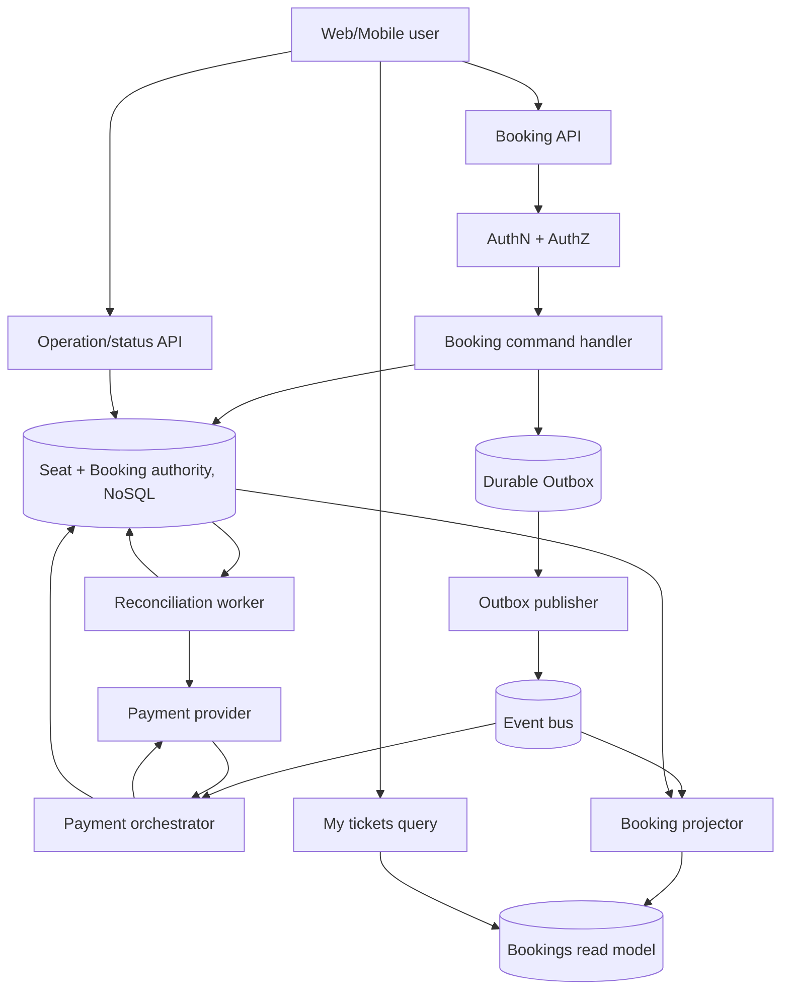
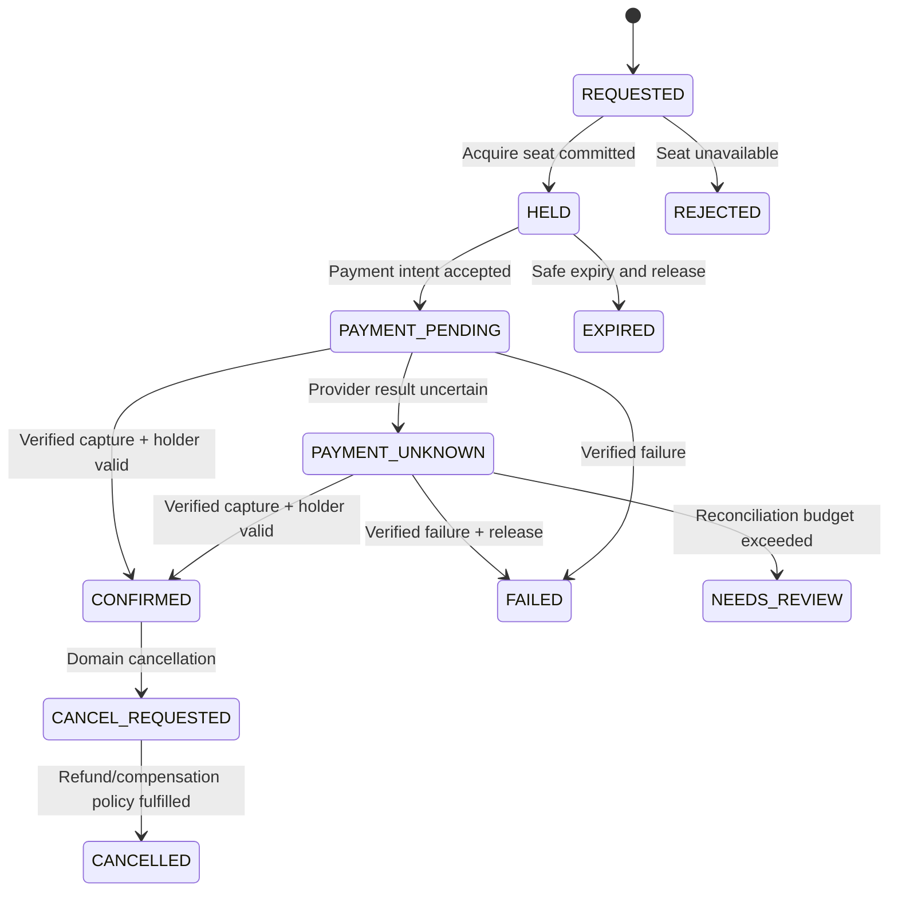
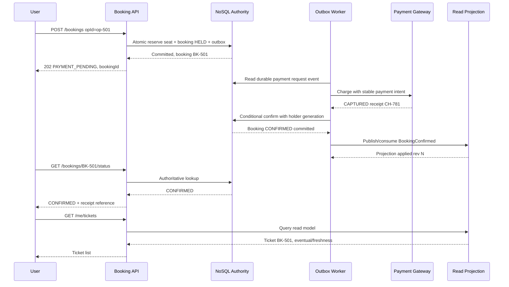
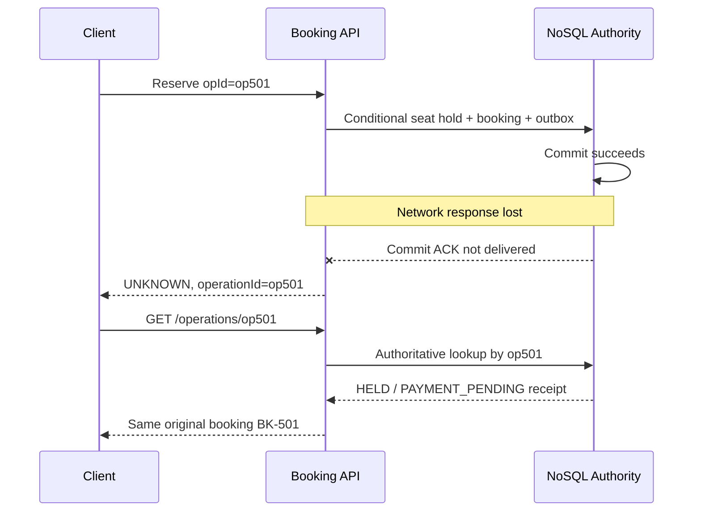
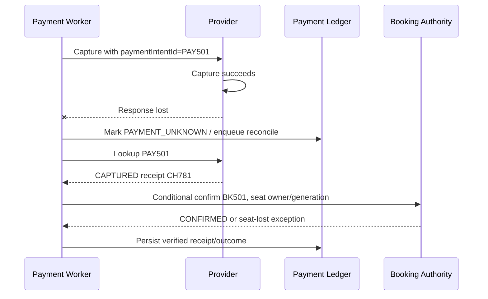

# Kiểm chứng kiến trúc bằng một luồng nghiệp vụ từ đầu đến cuối

Một sơ đồ kiến trúc NoSQL có thể nhìn hợp lý: API ghi vào database, outbox phát sự kiện, consumer cập nhật read model, cache giúp truy vấn nhanh và dashboard hiển thị kết quả. Tuy nhiên, **các thành phần chạy được riêng lẻ chưa chứng minh toàn bộ luồng nghiệp vụ đúng**. Sự cố thường xuất hiện ngay giữa các ranh giới: database đã commit nhưng HTTP phản hồi mất; hai request giữ cùng một ghế; payment gateway đã thu tiền nhưng callback đến muộn; event bị phát trùng; read model trả dữ liệu cũ; hoặc người dùng thuộc tenant khác đọc được bản ghi do query thiếu điều kiện phân quyền.

Vì vậy, cách kiểm chứng kiến trúc có giá trị nhất là chọn **một luồng nghiệp vụ cụ thể từ yêu cầu đầu vào đến kết quả cuối cùng**, rồi chứng minh bằng dữ liệu, trạng thái và quan sát rằng tất cả những bảo đảm quan trọng được giữ vững — cả khi mọi thứ bình thường lẫn khi một phần hệ thống thất bại.

Bài học thuộc **Database No SQL → Tích hợp và kiến trúc**, với đề bài **Kiểm chứng kiến trúc bằng một luồng nghiệp vụ từ đầu đến cuối**. Ta dùng ví dụ **giữ một ghế xem sự kiện và thanh toán vé**, đi qua API, mô hình ghi NoSQL, cơ chế chống đặt trùng, outbox/worker, payment provider, mô hình đọc và màn hình khách hàng. Sau đó ta thiết kế test, fault injection, quan sát và tiêu chí nghiệm thu đủ để trả lời: *Kiến trúc có thật sự bảo vệ nghiệp vụ không?*

> Các lệnh, endpoint, dữ liệu và chỉ số trong bài là ví dụ học tập, không phải hệ thống sản xuất hay kết quả đo có thật. Khả năng giao dịch, consistency, retry và CDC thay đổi theo database, driver, phiên bản và topology. Cần xác minh API thực tế trước khi triển khai.

## 1. “Từ đầu đến cuối” nghĩa là đến tận đâu?

Một unit test của `BookingService` có thể chứng minh một hàm Java trả `CONFIRMED` cho input hợp lệ. Nhưng nghiệp vụ khách hàng cần nhiều hơn:

```text
Khách chọn ghế
    -> gửi yêu cầu giữ chỗ
    -> hệ xác thực tenant và người dùng
    -> NoSQL ghi quyền giữ ghế nguyên tử
    -> tạo booking intent / outbox
    -> worker gọi payment provider
    -> xử lý success, failure hoặc kết quả chưa rõ
    -> xác nhận hoặc giải phóng ghế
    -> cập nhật read model
    -> API trạng thái trả kết quả đúng
    -> khách nhìn thấy trạng thái cuối cùng
```

Một bài kiểm chứng **end-to-end (E2E)** phải đi qua các ranh giới phù hợp với hệ thống thật, không chỉ gọi một method được mock.

Từ “end” có thể là:

- **Business end:** vé đã xác nhận hợp lệ, tiền đã thu đúng một lần.
- **Data end:** authoritative records và read projection nhất quán theo hợp đồng.
- **User end:** API/UI hiển thị chính xác, không khuyến khích người dùng thanh toán lặp khi kết quả chưa rõ.
- **Operational end:** nếu một bước hỏng, có đủ trace, retry, reconciliation và manual-review để tiếp tục xử lý.

Không phải E2E nào cũng phải chạy trình duyệt. Một bài kiểm chứng API + database thật + event bus + provider sandbox có thể bao phủ nhiều rủi ro quan trọng hơn một UI test chỉ bấm qua happy path.

## 2. Tình huống xuyên suốt: mua một ghế xem sự kiện

Giả sử có:

```text
Tenant:       T1
Show:         SHOW-42
Seat:         A-12
Buyer:        USER-100
Price:        150000 VND
Hold duration: 5 phút
Payment:      gateway bên ngoài
```

Khách muốn mua một vé ghế A-12. Hệ thống có thể có nhiều người đồng thời chọn cùng ghế.

### Một kết quả hợp lệ khi thành công

```text
Booking BK-501: CONFIRMED
Seat SHOW-42/A-12: thuộc booking BK-501
Payment intent PAY-501: CAPTURED một lần
Read model: hiển thị vé BK-501 trong freshness SLO
```

### Một kết quả hợp lệ khi không thành công

```text
Booking BK-501: REJECTED / CANCELLED
Seat SHOW-42/A-12: không còn bị BK-501 chiếm giữ
Payment: không có charge đã capture, hoặc charge đã được xử lý hoàn tiền theo workflow
```

### Trạng thái trung gian hợp lệ

```text
Booking BK-501: PAYMENT_UNKNOWN
Seat: vẫn được bảo vệ theo policy trong lúc đối soát
Payment: chưa có bằng chứng cuối cùng để báo thành công/thất bại
```

Trạng thái trung gian **không được nói dối người dùng**. Một payment timeout sau khi gửi charge không chứng minh khách chưa bị trừ tiền.

## 3. Giới hạn phạm vi để bài kiểm chứng có ý nghĩa

Một bài E2E cần ghi rõ *phạm vi kiểm thử*, tránh tuyên bố quá mức.

Trong ví dụ này, ta kiểm tra:

1. API xác thực và ủy quyền đúng tenant/user.
2. Một ghế chỉ có tối đa một booking được xác nhận còn hiệu lực.
3. Hai request cạnh tranh không cùng giành được quyền giữ chỗ.
4. Một ý định thanh toán không bị charge hai lần khi retry.
5. Một lệnh đã commit nhưng mất phản hồi vẫn có thể tra lại kết quả.
6. Booking không được xác nhận khi chưa có chứng cứ payment phù hợp.
7. Payment thành công sau khi ghế không còn thuộc booking phải được đưa vào compensation, không xác nhận vé trái phép.
8. Sự kiện outbox không mất sau source commit và consumer xử lý trùng an toàn.
9. Read model hội tụ theo freshness SLO nhưng không được dùng làm authority giữ ghế.
10. Khi một thành phần lỗi, hệ tiến triển hoặc chuyển manual review có audit.

Ngoài phạm vi bài ví dụ có thể là tính thuế, giao vé qua bên vận chuyển, đối soát kế toán toàn doanh nghiệp hoặc vé nhóm nhiều ghế. Những phạm vi đó cần test riêng trước khi cam kết vận hành.

## 4. Bắt đầu bằng invariant, không bắt đầu bằng sơ đồ

**Invariant** là điều phải luôn đúng trong phạm vi và thời điểm đã định nghĩa, kể cả khi concurrent requests, retry hoặc failover.

| Mã | Invariant | Nguồn chứng minh |
| --- | --- | --- |
| I-01 | Một `(tenantId, showId, seatId)` không có hai booking xác nhận hợp lệ đồng thời | Seat authority và booking commit history |
| I-02 | Một payment intent không tạo hai charge capture độc lập | Payment provider + payment ledger/idempotency key |
| I-03 | `CONFIRMED` chỉ được ghi khi payment có bằng chứng hợp lệ và booking đang sở hữu ghế | Booking state machine + provider receipt |
| I-04 | `CANCELLED/REJECTED` không thể tự chuyển thành `CONFIRMED` nhờ webhook cũ | Version/generation và transition guard |
| I-05 | Cùng operationId và fingerprint tạo tối đa một business effect | Dedup ledger và atomic boundary |
| I-06 | Không phát vé cho tenant/user khác | Authentication/authorization và scoped keys |
| I-07 | Source commit sinh ra durable intent cập nhật những projection cần thiết | Atomic source/outbox commit hoặc protocol tương đương |
| I-08 | Event trùng hoặc sai thứ tự không đưa read model lùi trạng thái | Conditional apply, dedup, gap detection |
| I-09 | Lệnh `UNKNOWN` không tự được kết luận thất bại khi timeout | Operation-status authority/reconciliation |
| I-10 | Không có lịch sử dữ liệu bị xóa được hồi sinh do replay cũ | Tombstone/generation và retention policy |

Một invariant phải có **cách quan sát hoặc chứng minh bằng test**. Câu “hệ đáng tin cậy” không phải một acceptance criterion có thể thực thi.

## 5. Phân biệt safety, liveness và trải nghiệm

**Safety:** điều xấu không xảy ra.

Ví dụ:

```text
Không bán hai vé cùng ghế.
Không charge hai lần một ý định.
Không trả CONFIRMED nếu payment chưa có chứng cứ.
```

**Liveness:** hệ có thể tiếp tục tiến triển khi điều kiện phục hồi.

Ví dụ:

```text
Sau khi gateway trở lại, PAYMENT_UNKNOWN cuối cùng được đối soát.
Sau khi consumer restart, outbox backlog được xử lý.
```

**Experience:** người dùng nhận được thông tin đúng và hữu ích.

Ví dụ:

```text
Trong lúc không biết kết quả payment:
    UI hiển thị "Đang xác minh".
    Không buộc người dùng phát một payment intent mới.
```

Một hệ có thể giữ safety bằng cách ngừng hết mọi thao tác, nhưng không đạt liveness. Hoặc đạt throughput tốt bằng cách ghi ở cả hai phía khi mất quorum, nhưng phá safety. Bài E2E cần đánh giá riêng từng nhóm.

## 6. Hợp đồng nghiệp vụ và giả định bắt buộc

Trước khi thiết kế, cần thống nhất những câu hỏi không thể suy ra từ công nghệ:

- Ghế được giữ bao lâu? 5 phút tính từ thời điểm nào?
- Khi hết hạn giữ chỗ nhưng payment đang UNKNOWN, có tiếp tục gia hạn quyền giữ không?
- Một khách được tạo bao nhiêu payment attempts cho một booking?
- Payment provider hỗ trợ idempotency key và status lookup ra sao?
- `AUTHORIZED` có đủ để xác nhận vé hay phải `CAPTURED`?
- Có cho đổi ghế sau khi thanh toán không?
- Refund là tự động hay cần phê duyệt?
- Sau bao lâu phải đưa case UNKNOWN sang manual review?
- Read model được phép trễ bao lâu?
- Một booking có thể bị cancel sau confirmation không?
- Vé xác nhận thuộc tenant nào, ai có quyền đọc?

**Giả định cho bài học:** việc bán ghế chỉ được xác nhận khi provider báo **CAPTURED** có receipt tin cậy; đặt chỗ tồn tại trong một authority kiểm soát duy nhất; khi payment chưa kết luận thì không giải phóng ghế một cách mù; nếu quyền giữ đã mất trước khi provider xác nhận thành công, workflow sẽ ghi nhận ngoại lệ và thực hiện compensation/refund phù hợp, không tự xác nhận chồng ghế.

Nếu sản phẩm thực dùng auth-only rồi capture sau, state machine và test phải thay theo hợp đồng đó.

## 7. Kiến trúc mục tiêu cho một luồng booking



Sơ đồ biểu diễn **luồng trách nhiệm**, không ngụ ý rằng command handler tự ghi source và outbox bằng hai write tách biệt. Cần có **một commit boundary được hỗ trợ** hoặc một protocol durable tương đương.

### Vì sao có hai đường đọc?

- `GET /operations/{operationId}` cần biết kết quả có thẩm quyền hoặc `UNKNOWN`; nó không nên dựa riêng vào read projection eventual.
- `GET /me/tickets` cần trả danh sách nhanh; có thể đọc projection theo freshness contract.

Đường quan sát trạng thái thanh toán không phải là một tìm kiếm full-text thông thường.

## 8. Xác định nguồn có thẩm quyền cho từng dữ liệu

| Dữ liệu | Source of truth | Không được lấy từ |
| --- | --- | --- |
| Ai đang sở hữu quyền giữ ghế | Seat authority | Search cache/listing |
| Booking đã CONFIRMED hay chưa | Booking authority và điều kiện commit | Email hoặc UI local state |
| Payment đã CAPTURED hay chưa | Payment provider/verified ledger | HTTP timeout hoặc read model |
| OperationId đã được thực thi chưa | Atomic dedup/operation ledger | Một index eventual `NOT_FOUND` |
| Vé hiển thị ở danh sách | Booking read projection | Không được dùng làm authority giữ ghế |
| Đã gửi notification chưa | Notification delivery status/outbox | Booking status đơn thuần |
| Refund đã hoàn tất chưa | Provider refund record + ledger | Booking CANCELLED đơn thuần |

Nguồn có thẩm quyền có thể khác nhau theo miền. **Không dùng “dữ liệu mới nhất theo timestamp” để tự chọn nguồn thắng** khi provider và booking DB có chứng cứ mâu thuẫn.

## 9. Chọn dữ liệu và khóa để bảo vệ tính duy nhất

Ví dụ logic:

```text
SeatAuthority:
    PK = TENANT#T1#SHOW#SHOW-42#SEAT#A-12
    currentHolderBookingId
    holdExpiresAt
    holderGeneration
    seatStatus
    revision

Booking:
    PK = TENANT#T1#BOOKING#BK-501
    showId, seatId, userId
    status
    paymentIntentId
    operationId
    revision

PaymentLedger:
    PK = TENANT#T1#PAYMENT#PAY-501
    bookingId
    providerChargeId
    providerStatus
    idempotencyKey
    revision

Outbox:
    eventId
    aggregateId
    sourceRevision
    eventType
    payload
    dispatchStatus
```

Trong triển khai thật, tính duy nhất của seat identity phải được bảo vệ bởi **một authority hoặc transaction có điều kiện nguyên tử**. Không được chỉ có hai docs booking rồi hy vọng query `COUNT(CONFIRMED)=0` trước khi insert là đủ, vì hai writers có thể cùng đọc `0`.

### Thiết kế guard cho một ghế

```text
Seat key = (tenantId, showId, seatId).

Acquire:
    chỉ thành công khi quyền sở hữu không tồn tại/hết hạn
    theo chính sách và atomic condition.

Confirm:
    chỉ thành công nếu holderBookingId = booking hiện tại,
    holderGeneration khớp và provider receipt hợp lệ.

Release:
    chỉ giải phóng nếu vẫn đúng owner/generation.
```

`holderGeneration` chống một worker cũ giải phóng quyền giữ của booking mới sau khi ghế đã đổi chủ.

## 10. Một state machine cho booking



Đây là **state machine giản lược**. Một luồng sản xuất có thể thêm `REFUND_PENDING`, `REFUNDED`, `CAPTURED_BUT_SEAT_LOST`, `HOLD_RENEWING`, `CANCEL_UNKNOWN` hoặc những trạng thái tách biệt cho payment và booking.

### Hai nguyên tắc

1. **Không hạ `CONFIRMED` thành `PENDING`** chỉ vì webhook cũ tới muộn.
2. **Không giải phóng seat khi payment đang UNKNOWN** nếu như vậy tạo nguy cơ cùng một ghế được xác nhận cho hai người. Cần quy tắc timeout/hold renewal và compensation được thiết kế rõ.

Một state machine đẹp trên giấy chưa đủ; mọi transition quan trọng phải có **atomic compare-and-write** với source authority.

## 11. Payment có state machine riêng

```text
NOT_STARTED
    -> REQUESTED
    -> AUTHORIZED
    -> CAPTURED

Hoặc:
REQUESTED -> DECLINED
REQUESTED -> UNKNOWN -> CAPTURED
REQUESTED -> UNKNOWN -> DECLINED

Sau CAPTURED:
    REFUND_REQUESTED -> REFUNDED
```

Không nên ép booking và payment dùng cùng một cột `status` rồi gắn tất cả sự kiện vào đó. Một payment có thể đã `CAPTURED` nhưng booking vẫn `NEEDS_REVIEW` vì seat không còn hợp lệ. Hai miền phải được đối soát.

**Refund là một giao dịch nghiệp vụ mới**, không làm cho payment đã `CAPTURED` trở thành “chưa từng xảy ra”.

## 12. Dòng happy path từ request đến vé



Trong sequence trên, **payment worker không trực tiếp chứng minh read model đã cập nhật**; bước cập nhật projection có thể trễ và phải được đo riêng. `202 PAYMENT_PENDING` chỉ được trả nếu việc giữ chỗ/command đã được tiếp nhận bền vững theo contract.

## 13. Đặt ra bảng “bước → bằng chứng → hậu quả khi lỗi”

| Bước | Thao tác | Bằng chứng hoàn tất | Nếu thất bại/không rõ |
| --- | --- | --- | --- |
| 1 | Authenticate user | Identity/tenant scope được kiểm chứng | Reject; không side effect |
| 2 | Authorize show/seat | Policy decision rõ | Reject |
| 3 | Reserve seat | Atomic guard commit receipt | Reject concurrent request hoặc UNKNOWN |
| 4 | Create booking intent | Booking record versioned trong commit boundary | Recover từ operationId |
| 5 | Persist outbox | Event intent durable gắn với source commit | Không ACK trước khi có cơ chế đảm bảo |
| 6 | Publish event | Broker ACK/checkpoint | Retry publish; consumer dedup |
| 7 | Create/capture payment | Provider receipt/idempotency status | UNKNOWN và reconcile, không tạo charge ID mới |
| 8 | Confirm booking | Conditional state+seat owner check | Retry/reconcile hoặc compensation |
| 9 | Project booking | Target revision >= committed revision | Lag/replay/rebuild |
| 10 | Expose status | Authoritative operation/booking state | Unknown/not-ready đúng semantics |
| 11 | Show ticket | Read model hoặc source-backed view | Freshness handling |
| 12 | Reconcile audit | Invariants không lệch | Escalation có chứng cứ |

Đây là bảng nền tảng để viết integration tests: **mỗi bước có một dấu hiệu có thể kiểm chứng và đường hồi phục**, không chỉ một checkbox “service hoạt động”.

## 14. API command: payload và idempotency

Ví dụ:

```http
POST /v1/bookings
Authorization: Bearer <token>
Idempotency-Key: book-T1-U100-SHOW42-A12-intent01
Content-Type: application/json

{
  "showId": "SHOW-42",
  "seatId": "A-12",
  "paymentMethodRef": "pm-12"
}
```

Ở backend, tenant/user phải được lấy từ **identity đã xác thực**, không tin một `tenantId` tùy ý do client gán.

Khi tiếp nhận command, server:

- Tạo hoặc đọc `bookingOperationId` từ idempotency key.
- So fingerprint của request.
- Xác định nguồn dữ liệu seat bằng route có thẩm quyền.
- Thực hiện acquire có điều kiện.
- Lưu booking intent và outbox nếu invariant đòi.
- Trả status/receipt phù hợp commit outcome.

### Ba loại phản hồi

**Đã nhận bền vững, payment đang xử lý:**

```http
HTTP/1.1 202 Accepted

{
  "operationId": "book-T1-U100-SHOW42-A12-intent01",
  "bookingId": "BK-501",
  "status": "PAYMENT_PENDING",
  "statusUrl": "/v1/operations/book-T1-U100-SHOW42-A12-intent01"
}
```

**Ghế đã có người giữ/bán:**

```http
HTTP/1.1 409 Conflict

{
  "status": "REJECTED",
  "code": "SEAT_UNAVAILABLE"
}
```

**Không xác định commit do timeout:**

```http
HTTP/1.1 503 Service Unavailable

{
  "operationId": "book-T1-U100-SHOW42-A12-intent01",
  "status": "UNKNOWN",
  "nextAction": "CHECK_OPERATION_STATUS"
}
```

Các HTTP codes chỉ minh họa. Không trả `202` nếu chưa có chứng cứ command được nhận bền vững; không trả “chưa giữ được ghế” chỉ vì response của storage mất.

## 15. Idempotency key phải bao phủ ý định, không bao phủ từng HTTP attempt

Hai lần gửi:

```text
Attempt 1:
    Idempotency-Key = intent01
    POST booking SHOW-42/A-12
    Timeout

Attempt 2:
    Idempotency-Key = intent01
    POST booking SHOW-42/A-12
```

phải được hiểu là **một ý định**.

Nếu attempt 2 dùng key khác, backend có thể coi là ý định mới.

Khi cùng key nhưng payload khác:

```text
intent01 + seat A-12
intent01 + seat A-13
```

cần trả **key reuse conflict**, không tự sửa booking cũ.

Một fingerprint nên bao gồm những trường semantic ổn định và scope tenant/user; không chỉ hash bytes JSON thô nếu thứ tự field, representation hoặc default có thể thay đổi.

## 16. Atomicity: chỗ không được phép “ghi hai lần rồi hy vọng”

Thiết kế sai:

```text
1. Update seat.status = HELD.
2. Insert booking BK-501.
3. Insert outbox PaymentRequested.
```

Nếu process crash giữa các bước:

```text
Seat = HELD.
Booking record = absent.
Outbox = absent.
```

Không có worker thanh toán và người dùng không tra được booking. Dữ liệu có thể mắc kẹt tới khi hết hạn hoặc phải sửa thủ công.

Một cách tốt hơn khi database hỗ trợ transaction phù hợp:

```text
Atomic transaction:
    acquire seat guard conditionally
    create booking BK-501
    store operation marker
    append outbox event
COMMIT
```

Nếu engine không hỗ trợ atomicity ở phạm vi trên, phải đổi data layout hoặc thiết kế **workflow nhiều bước có trạng thái trung gian và recovery**, không gọi ba ghi riêng lẻ là một transaction.

## 17. Một single-aggregate design có thể giảm nhu cầu distributed transaction

Giả sử mỗi seat là một aggregate:

```json
{
  "tenantId": "T1",
  "showId": "SHOW-42",
  "seatId": "A-12",
  "status": "HELD",
  "holderBookingId": "BK-501",
  "holderGeneration": 9,
  "holdExpiresAt": "2026-11-14T08:05:00Z",
  "lastOperationId": "book-intent01",
  "revision": 34
}
```

Một atomic conditional update trên **một document/item** có thể bảo vệ tính duy nhất của quyền giữ chỗ. Tuy nhiên, booking record và outbox nằm ở nơi khác vẫn cần:

- Transaction nếu muốn atomic đủ phạm vi.
- Hoặc ledger-first/seat-as-authority protocol có durable intent và recovery scanner.
- Idempotency để retry sau unknown commit.
- Cleanup/reconciliation cho trạng thái dở dang.
- Không trả confirmed trước khi bước nghiệp vụ cần thiết hoàn tất.

**Giảm số records tham gia invariant** có thể làm chứng minh dễ hơn, nhưng đừng nhét toàn bộ sự kiện và booking history vô hạn vào một document/partition.

## 18. Kiểm tra giữ chỗ đồng thời: bài test quan trọng nhất

Cho 100 clients đồng thời giữ ghế A-12:

```text
All clients start at barrier B.
Each calls POST /bookings with different operationId.
```

Kết quả mong đợi:

```text
At most one booking owns active seat guard.
At most one booking can reach CONFIRMED.
Other attempts receive SEAT_UNAVAILABLE,
or UNKNOWN that is later reconciled correctly.
```

Điều cần kiểm tra:

- Sau tất cả requests, authoritative seat record chỉ có một owner hợp lệ.
- Không có hai booking confirmed cho cùng `(tenantId, showId, seatId)`.
- Những timeouts được tra theo operationId chứ không đếm là thất bại chắc chắn.
- Không có side effect payment cho booking không đạt quyền giữ theo policy.
- Mỗi client được tính riêng latency và outcome.
- Sau failover/restart, kết quả vẫn giữ invariant.

**Không chỉ kiểm tra rằng có 99 HTTP 409 và 1 HTTP 202.** Nếu một client timeout sau khi thực sự giữ ghế, số response có thể khác nhưng safety vẫn cần được chứng minh từ authority.

## 19. Đừng dùng “đếm số booking rồi insert” làm uniqueness

Một mẫu nguy hiểm:

```text
Request A:
    SELECT count(confirmed bookings for seat A-12) -> 0

Request B:
    SELECT count(confirmed bookings for seat A-12) -> 0

Request A:
    INSERT booking confirmed

Request B:
    INSERT booking confirmed
```

Hai request đều đọc trạng thái cũ trước khi ghi.

Muốn chống double booking, cần:

- Unique guard trên key seat identity với semantics thực.
- Conditional insert/update nguyên tử.
- Transaction serializable hoặc isolation được thiết kế.
- LWT/CAS trên cùng authority nếu database phù hợp.
- Fencing khi có thay owner/lease.
- Bảo vệ kể cả khi request qua hai API pods và hai Regions.

Một lock trong RAM của một service instance **không bảo vệ được tất cả writers**.

## 20. MongoDB: minh họa conditional update và transaction

Một cách tiếp cận có thể dùng MongoDB transaction khi topology/phiên bản hỗ trợ và cấu trúc không vi phạm giới hạn sharding/uniqueness:

```javascript
await session.withTransaction(async () => {
  const seat = await db.collection("seats").findOneAndUpdate(
    {
      tenantId: "T1",
      showId: "SHOW-42",
      seatId: "A-12",
      status: "AVAILABLE"
    },
    {
      $set: {
        status: "HELD",
        holderBookingId: "BK-501",
        holderGeneration: 9
      },
      $inc: { revision: 1 }
    },
    { session, returnDocument: "after" }
  );

  if (!seat) {
    throw new SeatUnavailableError();
  }

  await db.collection("bookings").insertOne(
    {
      tenantId: "T1",
      bookingId: "BK-501",
      seatId: "A-12",
      status: "HELD",
      operationId: "intent01",
      revision: 1
    },
    { session }
  );

  await db.collection("outbox").insertOne(
    {
      eventId: "e-BK-501-1",
      bookingId: "BK-501",
      type: "PaymentRequested",
      revision: 1
    },
    { session }
  );
});
```

Đây là **mẫu cấu trúc**; cần bổ sung stable identity, unique indexes, request fingerprint, expiry, recovery, xử lý transaction errors và session lifecycle trước production.

### Ràng buộc cần xác nhận

- Khóa seat identity phải unique theo scope mong muốn, với shard-key/unique-index semantics tương ứng.
- `withTransaction` có thể retry callback theo chính sách driver; **không gọi payment gateway bên trong callback**.
- Transaction return/callback completion phải được xác nhận commit; unknown commit result cần protocol riêng.
- Nếu seat đang HELD nhưng đã hết hạn, predicate/transition phải xử lý đúng business policy; ví dụ trên chỉ nhận AVAILABLE.
- Không dùng read projection để kiểm tra ghế trống rồi bỏ qua conditional guard ở source.

## 21. DynamoDB: conditional update và TransactWriteItems

Trong DynamoDB, một mô hình có thể dùng item key:

```text
PK = SEAT#SHOW-42#A-12
```

và atomic `UpdateItem`/`ConditionExpression`, hoặc `TransactWriteItems` khi cần ghi nhiều items thuộc transaction hỗ trợ:

```text
Transaction:
    Condition: seat AVAILABLE hoặc được phép chuyển ownership.
    Update: seat -> HELD with holder and generation.
    Put: booking intent BK-501 with no existing identity.
    Put: operation receipt/dedup marker.
    Put: outbox event intent, nếu nằm trong giới hạn transaction.
```

Đây là pseudo-transaction, không phải AWS request JSON đầy đủ. Cần kiểm tra:

- Các transaction actions có hợp lệ trong API/giới hạn hiện hành không.
- Không tham chiếu cùng item bằng những actions mâu thuẫn nếu API cấm.
- Idempotency token của transaction có phạm vi và thời hạn cụ thể.
- Condition failures là business conflict, không retry mù.
- Timeout sau dispatch có thể là unknown outcome.
- Global Secondary Index thường eventual; **không dùng absence từ GSI để chứng minh chưa có booking**.
- Global Tables/multi-region có consistency/replication semantics riêng; không suy cross-region uniqueness từ conditional write ở một Region nếu contract không bảo đảm.

## 22. Cassandra/ScyllaDB: LWT bảo vệ một key, workflow vẫn cần recovery

Một bảng guard theo seat:

```sql
CREATE TABLE seat_ownership (
    tenant_id text,
    show_id text,
    seat_id text,
    booking_id text,
    generation bigint,
    status text,
    PRIMARY KEY ((tenant_id, show_id, seat_id))
);
```

Một conditional operation có thể dựa trên LWT/CAS ở partition guard:

```sql
INSERT INTO seat_ownership (
  tenant_id, show_id, seat_id,
  booking_id, generation, status
)
VALUES (?, ?, ?, ?, ?, 'HELD')
IF NOT EXISTS;
```

Trong thực tế cần xử lý lease/expiry, update CAS với phiên bản và lifecycle. Ví dụ này chỉ cho thấy **điểm chốt quyền giữ**.

### Không được suy rộng

- LWT trên seat không làm một insert booking ở partition khác và publish event trở thành transaction serializable toàn hệ.
- CQL batch không tự thay thế transaction business nhiều partitions.
- Nếu LWT timeout, kết quả có thể chưa rõ, cần operation identity/authoritative lookup.
- Cassandra/Scylla có consistency levels và cơ chế Paxos/LWT cụ thể theo version; phải dùng đúng contract.
- TTL tự xóa row không đủ bảo đảm workflow payment/cancel đã được kết luận.

Một thiết kế có thể giữ command/operation marker trong cùng partition guard khi phù hợp, hoặc dùng ledger/outbox ở source khác với saga recovery rõ. Điều kiện không thể bỏ qua là **không xác nhận hai booking cùng ghế**.

## 23. Redis: cache/search availability khác quyền giữ ghế có thẩm quyền

Redis có các atomic operations và Lua scripts; Redis Cluster còn có ràng buộc hash-slot cho multi-key operations. Có thể dùng Redis cho:

- Danh sách ghế hiển thị nhanh.
- Rate limiting.
- Short-lived UI hold hints.
- Cache dữ liệu show.
- Một số workload có seat authority Redis nếu durability/failover/consistency contract được thiết kế và chấp nhận rõ.

Nhưng **không mặc định `SET NX EX` đủ bảo đảm bán vé chính xác xuyên failover**:

- TTL là thời gian tồn tại của key, không phải giao thức payment.
- Replica promotion có thể có write durability/visibility caveats tùy cấu hình.
- Một lock Redis hết hạn có thể để worker cũ vẫn chạy.
- Hai key khác slot không được xử lý như một transaction tùy ý.
- Một user nhìn thấy `AVAILABLE` trong Redis cache không được bỏ qua source conditional reserve.

Nếu Redis chỉ là read cache, seat authority phải ở nơi có write fencing/uniqueness phù hợp; cache được invalidated theo sự kiện hoặc TTL với freshness rõ.

## 24. Payment provider là một ranh giới không có chung transaction

Dù database hỗ trợ multi-document transaction, API gọi provider bên ngoài thường **không nằm trong cùng transaction ACID**.

Mẫu nguy hiểm:

```text
Begin DB transaction
    update seat HELD
    call provider charge
    update booking CONFIRMED
Commit DB
```

Nếu provider charge thành công nhưng DB rollback, người dùng đã bị trừ tiền mà booking không tồn tại. Nếu DB driver retry transaction callback, provider có thể bị charge lại.

Một mô hình **saga/orchestration** an toàn hơn:

```text
Step 1. Reserve seat and persist command/outbox.
Step 2. Commit local transaction.
Step 3. Payment worker calls provider with stable paymentIntentId.
Step 4. Reconcile provider response/status.
Step 5. Confirm booking conditionally when capture verified.
Step 6. On verified failure or expiry, release/compensate safely.
```

Saga không tạo ra distributed atomic commit thần kỳ. Nó làm **trạng thái trung gian, quyền điều phối và recovery** trở nên rõ ràng.

## 25. Payment idempotency khác booking idempotency

Hai IDs có thể liên quan nhưng không đồng nghĩa:

```text
bookingOperationId = book-T1-U100-SHOW42-A12-intent01
bookingId          = BK-501
paymentIntentId    = pay-BK-501-attempt01
providerChargeId   = CH-781
```

Booking command được client retry với cùng `bookingOperationId`. Payment worker retry một provider request với cùng `paymentIntentId` theo provider contract.

Tạo `paymentIntentId` mới chỉ vì worker nhận socket timeout có thể phát sinh charge mới.

Cần tra provider/ledger:

```text
provider.lookup(paymentIntentId)
    -> CAPTURED(receipt)
    -> DECLINED(final reason)
    -> PROCESSING
    -> UNKNOWN_UNAVAILABLE
```

Không tự biến `UNKNOWN_UNAVAILABLE` thành `DECLINED`.

## 26. Lỗi sau khi provider đã charge

Timeline:

```text
T0: Seat BK-501 HELD.
T1: Worker gọi charge với paymentIntentId PAY-501.
T2: Provider CAPTURED 150000 VND.
T3: Provider response bị mất.
T4: Worker nhận READ_TIMEOUT.
```

Sai:

```text
Retry with paymentIntentId PAY-502.
```

Đúng hơn:

```text
Mark/keep PAYMENT_UNKNOWN.
Lookup provider by PAY-501.
If CAPTURED:
    verify amount/currency/merchant/booking reference;
    attempt conditional CONFIRMED;
    if seat no longer valid -> exception/compensation.
If DECLINED:
    release according to policy.
If still unknown:
    schedule bounded reconciliation.
```

**Một response timeout là lỗi quan sát, không phải bằng chứng một giao dịch tài chính thất bại.**

## 27. Giữ chỗ hết hạn và payment đến muộn

Tình huống khó:

```text
10:00 Booking A holds seat A-12 until 10:05.
10:04 Payment for A requested.
10:05 Hold expires.
10:05+ Reservation B attempts same seat.
10:06 Payment A is reported CAPTURED.
```

Phải có chính sách trước khi hệ gặp tình huống đó:

- Trong thời gian payment đang xử lý, hold có được gia hạn không?
- Ai có quyền gia hạn và trong giới hạn nào?
- Có timer/fencing để worker cũ không giữ ghế vĩnh viễn?
- Nếu payment A CAPTURED nhưng seat đã chuyển sang B, A có được xác nhận không? **Không**, nếu B đã có quyền hợp lệ và invariant cấm hai confirmed bookings.
- A được refund hay phải manual review?
- Làm sao tránh cả A và B đều trả CONFIRMED?

### Một protocol phù hợp ở mức khái niệm

```text
Hold generation 9 belongs to BK-501.

Confirm A:
    require owner=BK-501 and generation=9,
    and permitted state, plus verified payment receipt.

Release A:
    require owner=BK-501 and generation=9.

Acquire B:
    require no valid holder according to authoritative lease policy;
    allocate generation 10.
```

Nếu A đến trễ với generation 9 sau khi B đã sở hữu generation 10, conditional confirm phải **thất bại**, rồi A đi vào compensation/reconciliation. Một TTL tự động xóa record không cung cấp toàn bộ protocol này.

## 28. Đồng hồ và TTL không tự xác định nghiệp vụ

Nhiều hệ có thời gian từ:

```text
Client wall clock
API node clock
Database server clock
Payment provider clock
Queue event timestamp
```

Các đồng hồ có thể lệch. Nếu source authority dựa trên thời gian hết hạn, cần xác định rõ **thời gian và điều kiện nào có giá trị quyết định**.

Không dùng:

```text
if client.now() > holdExpiresAt:
    blindly release seat
```

rồi ghi xóa không điều kiện. Cần kiểm tra owner/generation và policy trên source.

Các lưu ý:

- TTL có thể dọn bản ghi bất đồng bộ, không thực thi đúng thời khắc nghiệp vụ.
- Payment trong trạng thái UNKNOWN cần policy gia hạn/hold hoặc compensation.
- Recovery sau restart cần xác định thời điểm còn quyền gia hạn.
- Timer job trễ phải được fence.
- Chỉ được trả ghế `AVAILABLE` khi trạng thái authority cho phép.

## 29. Outbox bảo vệ phần “đã commit nhưng chưa publish”

Một race:

```text
T0: Booking BK-501 được giữ ghế, DB commit.
T1: Service crash trước khi gọi payment worker.
```

Nếu service chỉ publish event từ RAM:

```text
Seat đã bị giữ.
Payment worker không bao giờ nhận.
```

Với outbox được commit nguyên tử cùng booking:

```text
Atomic source commit:
    seat HOLD
    booking HELD
    outbox PaymentRequested(eventId=e1)
```

Sau restart, outbox publisher có thể lấy lại e1 và publish.

Lưu ý:

- Publisher có thể phát **trùng** nếu broker ACK nhưng process crash trước checkpoint.
- Consumer phải idempotent theo `eventId`/paymentIntentId.
- Đừng xóa outbox trước khi có bằng chứng về delivery theo protocol.
- Giữ retention/checkpoint đủ để retry hoặc rebuild.
- Outbox đưa ra một **durable intent to publish**, không đảm bảo provider đã charge.

## 30. BookingConfirmed đến read model như thế nào?

Giả sử source đã commit:

```json
{
  "bookingId": "BK-501",
  "status": "CONFIRMED",
  "revision": 7,
  "generation": 9
}
```

Projector nhận:

```json
{
  "eventId": "evt-BK-501-r7",
  "eventType": "BookingConfirmed",
  "bookingId": "BK-501",
  "sourceRevision": 7,
  "generation": 9,
  "tenantId": "T1",
  "userId": "USER-100"
}
```

Read view:

```text
tickets_by_user:
    PK = TENANT#T1#USER#USER-100
    SK = SHOW#SHOW-42#BOOKING#BK-501
    status = CONFIRMED
    sourceRevision = 7
    generation = 9
```

Một query:

```text
GET /me/tickets
```

đọc projection này. Đổi lại:

- Event có thể đến trễ.
- Event có thể được phát trùng.
- Một event cũ có thể đến sau event cancel/refund.
- Projection có thể mất/thiếu record.
- Rebuild từ snapshot cũ có thể resurrect booking đã hủy.

Read model cần **conditional apply + replay/reconciliation**, không chỉ `INSERT` khi thấy message.

## 31. Idempotent projection: bản snapshot và delta khác nhau

Ví dụ snapshot event:

```text
BookingRevision=7, status=CONFIRMED
```

Target có thể áp theo quy tắc:

```text
if event.generation is valid
   and event.revision > target.revision:
       replace state atomically
```

nếu payload là **trạng thái đầy đủ**, không thiếu một sự kiện trung gian bắt buộc.

Nhưng event delta:

```text
TicketSold: dailySoldCount += 1
```

không an toàn nếu phát trùng. Phải:

- Dedupe `eventId` trong atomic scope với increment; hoặc
- Lưu một contribution row theo `bookingId` rồi aggregate; hoặc
- Recompute từ authoritative ledger khi cần.

Không thể chỉ dùng **last-write-wins timestamp** để bảo vệ các biến đếm tiền/vé khi events out-of-order.

## 32. Read-your-writes và trạng thái khách hàng

Sau khi nhận:

```json
{
  "bookingId": "BK-501",
  "status": "CONFIRMED",
  "sourceRevision": 7
}
```

client có thể vào trang “Vé của tôi” ngay, trong khi projection còn `revision=6`.

Có vài lựa chọn:

1. API chi tiết booking đọc authority.
2. Query chấp nhận `minRevision=7`, chờ projection có giới hạn.
3. Nếu chưa đủ fresh, trả `NOT_READY`/metadata rõ.
4. UI sử dụng verified receipt để hiển thị thông tin đã confirm và chờ list sync.
5. Push event khi projection bắt kịp nếu có replay sau reconnect.

**Không trả `CONFIRMED` từ UI khi nguồn chỉ `PAYMENT_UNKNOWN`**, và không kết luận booking không tồn tại chỉ vì list projection chưa hiển thị.

## 33. Freshness của read model phải đo được

Ví dụ mục tiêu giả định:

```yaml
readModel:
  targetP99FreshnessSeconds: 5
  maxAllowedLagForMyTicketsSeconds: 15
  fallbackForBookingDetail: "authoritative"
  onLagExceeded: "show_syncing_or_not_ready"
```

Cần đo đúng:

- Source commit timestamp/sequence.
- Outbox publish delay.
- Broker lag.
- Consumer processing delay.
- Target index visibility delay.
- End-to-end lag cho từng booking/partition.

Không chỉ lấy `projector.lastUpdatedAt = now()` để báo view tươi: projector có thể vừa xử lý một event cũ hàng giờ.

Nếu nhiều stream partitions, **offset của mỗi partition có phạm vi riêng**; không lấy offset lớn nhất làm chứng cứ toàn bộ projections đã bắt kịp.

## 34. Failure boundaries cần được vẽ rõ

Một luồng có các ranh giới:

```text
Boundary A:
    HTTP client <-> API

Boundary B:
    API/driver <-> NoSQL source

Boundary C:
    NoSQL source <-> outbox publisher

Boundary D:
    Outbox publisher <-> message broker

Boundary E:
    Broker <-> payment worker

Boundary F:
    Payment worker <-> provider

Boundary G:
    Payment/booking authority <-> read projector

Boundary H:
    Read projector <-> read model

Boundary I:
    Query API <-> UI
```

Mỗi ranh giới có thể:

- Không gửi được request.
- Gửi xong nhưng response mất.
- Timeout sau khi phía nhận đã commit.
- Xử lý trùng khi retry.
- Nhận message sai thứ tự.
- Bị partition theo một chiều.
- Phục hồi với checkpoint cũ.

Một kiến trúc E2E đúng không cần ngăn được mọi lỗi vật lý; nó phải **không phá invariant và có đường xác định lại trạng thái**.

## 35. Bảng phân loại trạng thái commit khi thấy lỗi

| Quan sát | Có thể suy kết quả ghi? | Hành động |
| --- | --- | --- |
| Validation chắc chắn bị từ chối trước ghi | REJECTED | Trả lỗi, không retry mù |
| CAS condition không khớp và response rõ | Không áp mutation đó | Đọc lại, đánh giá business |
| Connect failure chắc chắn trước dispatch và không có attempt khác | Chưa gửi qua attempt này | Retry an toàn nếu policy cho phép |
| Read timeout sau dispatch | UNKNOWN | Tra operationId, giữ identity |
| Database đã commit, HTTP response mất | Caller UNKNOWN, source APPLIED | Trả receipt từ authority |
| Outbox publisher crash sau broker ACK | Event có thể publish rồi | Retry publish với eventId cũ, consumer dedup |
| Provider charge response timeout | Provider outcome UNKNOWN | Query by paymentIntentId; không tạo charge mới |
| Read projector trả NOT_FOUND | Chưa chứng minh source absent | Kiểm tra freshness/authority |
| Leader failover giữa transaction | Có thể UNKNOWN | Dùng driver commit recovery + operation ledger |

Đừng gom hết thành một `catch(Exception) { retry(); }`.

## 36. Một sequence cho timeout sau source commit



Nếu API server crash trước khi trả UNKNOWN, client phải giữ operationId và có thể chủ động query status sau network failure. **Mất HTTP response không được tạo booking khác khi user reload**.

## 37. Một sequence cho payment timeout và đối soát



Cần lưu ý: ghi payment ledger và confirm booking ở hai stores riêng có thể tạo thêm partial failures. Chính workflow phải có trạng thái, operationId và quy tắc replay để không xác nhận sai; **sơ đồ không tự bảo đảm atomicity xuyên hai stores**.

## 38. Rủi ro đặc biệt: payment đã capture nhưng confirm thất bại

Tình huống:

```text
Provider: CAPTURED.
Booking source: confirm conditional check failed.
```

Không được:

```text
force update booking CONFIRMED
```

vì seat có thể đã được cấp cho booking khác.

Thay vào đó:

1. Xác minh provider receipt/amount/currency và booking identity.
2. Xác định lý do guard thất bại: seat owner thay đổi, generation mismatch, booking cancelled hay lỗi routing?
3. Ghi state `CAPTURED_BUT_NOT_CONFIRMED`/`NEEDS_REVIEW`.
4. Bảo vệ không phát vé hay double sell.
5. Tạo refund/compensation với **operationId riêng** theo policy.
6. Theo dõi refund tới kết luận cuối, không coi yêu cầu hoàn tiền là đã hoàn tất.
7. Thông báo trung thực cho user và có audit trail.

**Compensation không phải rollback ACID**; nó là nghiệp vụ mới với side effects và failure handling riêng.

## 39. Authorization là một phần của bài E2E

Không chỉ kiểm tra booking logic. Ví dụ API:

```text
GET /v1/bookings/BK-501/status
```

phải xác minh:

- Người dùng thuộc tenant T1.
- Người dùng là chủ booking hoặc có vai trò được phép.
- BookingId không được cho phép enumeration/access qua tenant khác.
- Query key bao gồm tenant scope.
- Read model cũng thực thi quyền tương ứng.
- Thay đổi quyền bị thu hồi được phản ánh theo security contract.
- Log và event không vô tình lộ payment token, PII hoặc secrets.

Một end-to-end test cần **test cross-tenant access**. Hệ thống trả nhanh nhưng cho USER-200 đọc receipt của USER-100 là thất bại kiến trúc nghiêm trọng.

## 40. Xác định test environment đại diện

Có những cấp môi trường:

| Môi trường | Kiểm chứng tốt | Giới hạn |
| --- | --- | --- |
| Unit tests với mocks | Business transition logic, validation | Không chứng minh atomicity/failover |
| Local container/integration | Driver, schema, transaction APIs, queue | Topology có thể khác production |
| Staging gần production | Sharding, replica count, CDC, load, failover | Có thể khác dataset/traffic thực |
| Provider sandbox | Payment contract/idempotency/status | Provider sandbox đôi khi không có mọi behavior |
| Controlled production canary | Traffic và latency thật | Không nên fault-inject phá dữ liệu người dùng |
| Synthetic audit trên production | Phát hiện drift và freshness theo policy | Không chứng minh mọi khả năng lỗi |

Một E2E test chỉ chạy với in-memory fake DB **không chứng minh NoSQL conditional write thật sự atomic**.

## 41. Dữ liệu thử nghiệm phải có phạm vi và isolation

Ví dụ cố định:

```yaml
tenantId: "T-TEST-401"
showId: "SHOW-TEST-42"
seatId: "A-12"
userA: "USER-TEST-A"
userB: "USER-TEST-B"
bookingOperationA: "book-test-401-A"
bookingOperationB: "book-test-401-B"
paymentIntentA: "pay-test-401-A"
```

Các nguyên tắc:

- Dùng tenant/show/test keys riêng.
- Không dùng thẻ thanh toán thật hoặc PII thật.
- Không để worker production quét nhầm dữ liệu test nếu sandbox không được cô lập.
- Có cách reset dữ liệu và hậu kiểm uniqueness.
- Không reuse operation IDs giữa các lần test độc lập trừ khi đang cố thử dedup.
- Ghi seed, topology, schema version và thời điểm test.
- Với concurrency, dùng barrier để tăng xác suất race chứ không trông chờ “hai thread tình cờ chạy cùng lúc”.

## 42. Test oracle: nhìn đâu để biết đúng?

**Test oracle** là nguồn quy tắc/bằng chứng để kết luận pass/fail.

Không nên dùng:

```text
UI hiển thị CONFIRMED.
=> E2E pass.
```

Vì UI có thể cache sai.

Một oracle tốt hơn:

```text
Seat authority:
    one rightful owner, generation matches.

Booking source:
    CONFIRMED with valid transition history.

Payment provider:
    one CAPTURED charge for intended payment key.

Payment ledger:
    matches provider receipt.

Outbox:
    durable event for committed state.

Read projection:
    converged to expected revision within freshness SLO.

API/UI:
    honest status at each phase, tenant authorization correct.
```

Cần tránh oracle tuần hoàn: không dùng chính read projection đang được kiểm tra làm bằng chứng rằng source ghi đúng.

## 43. Kiểm tra theo lịch sử thao tác, không chỉ trạng thái cuối

Giả sử hai users mua cùng ghế:

```text
T0 A receives CONFIRMED.
T1 B receives CONFIRMED.
T2 Repair job cancels B.
```

Tại cuối test, chỉ còn một booking confirmed. Nhưng **người B đã từng nhận một confirmation sai**, nên invariant về xác nhận cho khách đã bị vi phạm.

Cần lưu:

- Invocation time.
- Response time.
- OperationId và bookingId.
- Commit receipts.
- State transitions/version.
- Seat ownership epochs.
- Provider charge histories.
- Read responses sau khi write được xác nhận.

**Final-state equality không đủ chứng minh safety của một hệ concurrent**. Những yêu cầu linearizable hoặc unique commit cần test histories/ordering tương ứng.

## 44. Các loại kiểm thử cần phối hợp

1. **Contract test:** API request/response và event schema.
2. **Repository integration test:** conditional write/transaction thật.
3. **Service integration test:** command+outbox+worker.
4. **E2E functional test:** từ API đến kết quả người dùng.
5. **Concurrency test:** tranh cùng ghế/cùng operation.
6. **Fault injection test:** mất ACK, crash, partition, failover.
7. **Recovery test:** restart worker/replay/checkpoint.
8. **Projection consistency test:** event duplicate/out-of-order/gap.
9. **Security test:** tenant/user isolation.
10. **Load/latency test:** p95/p99 và resource headroom.
11. **Data reconciliation test:** source/provider/view consistency.
12. **Disaster recovery drill:** restore từ backup không resurrect state sai.

Không kỳ vọng một test “đặt vé thành công” bao phủ hết các tầng. Mục tiêu là kết hợp các phép chứng minh thành **một bộ bằng chứng xuyên luồng**.

## 45. Test đầu tiên: happy path có bằng chứng

Các bước:

```text
Given:
    Seat SHOW-42/A-12 AVAILABLE.
    Payment provider sandbox returns CAPTURED for PAY-501.
    Read model consumer running.

When:
    USER-100 POST booking with operationId=op-501.

Then:
    Booking intent committed.
    Exactly one active seat holder BK-501.
    Provider has exactly one captured payment for PAY-501.
    Booking reaches CONFIRMED.
    Outbox BookingConfirmed has durable evidence.
    Read projection reaches sourceRevision >= confirmed revision.
    GET status returns CONFIRMED from authority.
    GET my tickets shows BK-501 inside freshness SLO.
```

Test nên ghi **cả receipt, source version, event ID, projection watermark, user response**. Không chỉ assert HTTP 200.

## 46. Test thứ hai: concurrent contenders

```text
Given:
    One available seat A-12.
    Users U1 and U2 with distinct valid credentials.

When:
    Both call reserve simultaneously,
    one hundred iterations with fresh seat IDs.

Then:
    No run has two valid confirmed bookings for same seat.
    Only the rightful holder can confirm.
    Loser receives conflict or reconcileable unknown.
    Provider is not charged for loser without a corresponding compensating protocol.
```

Một test lặp nhiều lần vẫn không phải chứng minh hình thức mọi execution. Nhưng nó có thể phát hiện race trong guard, routing, unique index và retry.

## 47. Test thứ ba: response lost after commit

```text
Given:
    operationId=op-501.
    Seat available.

When:
    Database commits seat/booking/outbox.
    Proxy drops DB->API response.

Then:
    API/client outcome may be UNKNOWN.
    Re-query by op-501 finds same BK-501.
    No second booking created.
    No duplicate payment intent produced.
    Outbox event remains durable.
```

Cần mô phỏng đúng **response loss sau commit**, không chỉ làm mock repository ném exception **trước khi ghi**. Hai tình huống có kết quả nghiệp vụ khác nhau.

## 48. Test thứ tư: provider captured nhưng response mất

```text
Given:
    Booking HELD with valid seat owner.
    paymentIntentId=PAY-501.

When:
    Provider captures payment.
    Response is dropped.
    Worker retries/reconciles.

Then:
    Provider has one charge for PAY-501.
    Worker reuses PAY-501, does not generate PAY-502.
    Final booking status follows verified capture + guard check.
    No double charge or duplicate confirmation event.
```

Nếu sandbox không mô phỏng chính xác lost-response, cần một **fault proxy hoặc provider emulator** có khả năng commit rồi drop response. Mock thuần không chứng minh network semantics.

## 49. Test thứ năm: duplicate events và worker crash

```text
Given:
    Outbox event e-501 = BookingConfirmed revision 7.

When:
    Consumer applies e-501.
    Consumer crashes before broker ACK.
    Broker redelivers e-501.

Then:
    Read model contains one ticket BK-501.
    No duplicate count or notification.
    Consumer advances checkpoint only after safe apply.
```

Nếu notification gửi email ở cùng event handler, email cũng phải có **dedup delivery key** hoặc một nguồn ghi trạng thái gửi, không chỉ bảo vệ read model.

## 50. Test thứ sáu: event đảo thứ tự và xóa

```text
e7:  booking CONFIRMED, rev7
e8:  booking CANCELLED, rev8
e6:  booking HELD, rev6 (arrives last)
```

Kỳ vọng:

- Target không chuyển về HELD sau khi đã thấy CANCELLED rev8.
- Vé đã hủy không xuất hiện trở lại như vé còn hiệu lực.
- Nếu event payload là delta, consumer phát hiện gap và không bỏ qua các mutations cần thiết.
- Tombstone/generation marker được giữ đủ lâu.
- Rebuild từ snapshot cũ không resurrect booking đã xóa/hủy trái policy.

### Một câu hỏi cần phân biệt

`CANCELLED` có nghĩa hủy quyền sử dụng vé; `DELETE` có thể là xóa biểu diễn dữ liệu. Hai hành động có retention và audit semantics khác nhau, không được đồng nhất.

## 51. Test thứ bảy: lỗi đọc projection sau commit

```text
Given:
    Booking source = CONFIRMED rev7.
    Read model = PAYMENT_PENDING rev6.

When:
    User immediately opens My Tickets.

Then:
    UI không báo "không tồn tại" như kết quả chắc chắn.
    Source-backed status trả CONFIRMED.
    Read model lag được theo dõi.
    Projection eventually reaches rev7 trong freshness SLO.
```

Nếu freshness SLO bị vượt, test phải ghi **FAIL về freshness**, dù authority đã đúng. Một bài E2E có thể có nhiều mức nghiệm thu: safety PASS nhưng performance/freshness FAIL.

## 52. Test thứ tám: tenant/user isolation

```text
Given:
    BK-501 belongs to tenant T1, USER-100.

When:
    A valid user from tenant T2 queries BK-501.
    Another user in T1 without booking access queries BK-501.

Then:
    No booking/payment PII leaks.
    Authorization is checked on status and list paths.
    Source and read projection use tenant-scoped query.
    Error response does not reveal sensitive existence details contrary to policy.
```

**Authentication thành công không có nghĩa authorization được cấp cho mọi booking**.

## 53. Test thứ chín: partial network partition

```text
Client/API zone A can reach NoSQL authority.
Payment worker zone B cannot reach provider.
Read projector is healthy.

When:
    User starts a valid booking.

Then:
    Seat can be HELD if authority allows.
    Payment remains PENDING/UNKNOWN, not CONFIRMED.
    Retry budget prevents provider request storm.
    Hold policy remains safe during uncertainty.
    After network recovery, worker reconciles same paymentIntentId.
```

Không thay đổi mạnh hay giảm consistency ngầm chỉ để trả `CONFIRMED` khi thiếu provider receipt.

## 54. Test thứ mười: node failover vào lúc giữ ghế

```text
Request acquire seat sent to current leader.
Leader commits or may commit.
Response is lost during failover.
Client retries with same operationId.
```

Kỳ vọng:

- Không hai leaders cùng nhận authoritative owner mâu thuẫn.
- Request outcome được tra bằng source/operation record.
- Không duplicate booking/payment.
- New leader/replicas phục vụ đúng durability/consistency contract.
- Stale writer bị fence nếu protocol dùng term/epoch.

Cần test với topology replica gần production; single-node mock không cho ra hành vi election, quorum hoặc replication lag thực.

## 55. Một bảng tổng hợp rủi ro cần bao phủ

| Failure point | Có thể xảy ra | Bằng chứng/an toàn cần có |
| --- | --- | --- |
| Trước API authentication | Reject | Không side effect |
| Sau auth, trước DB write | Timeout | Reuse same operationId |
| DB commit, ACK mất | Unknown outcome | Authoritative operation lookup |
| DB transaction conflict | Một command bị từ chối | CAS/business revalidation |
| Outbox publish thành công, ACK mất | Duplicate event | EventId dedup |
| Payment capture thành công, ACK mất | Unknown provider outcome | Same paymentIntentId lookup |
| Payment DECLINED | Không được CONFIRMED | Verified final rejection |
| Hold hết hạn lúc payment đang UNKNOWN | Race | Lease/fencing, compensation |
| Booking confirm sau seat ownership change | Conditional reject | Không double sell |
| Projection update fail | Stale UI | Replay, alert, source fallback |
| Event cũ đến sau cancellation | Resurrection risk | Generation/revision guard |
| Worker crash trước checkpoint | Redelivery | Idempotent apply |
| One node down | Reduced capacity | Failover/quorum headroom |
| Một AZ bị network partition | Partial availability | Authority/consistency policy |
| Tenant khác query booking | Data leak | Scoped authorization |
| Restore snapshot cũ | Stale/resurrected data | CDC/ledger/tombstone reconciliation |

## 56. Một bài kiểm chứng cần quan sát được

Các ID nên đi xuyên luồng:

```text
traceId
requestId
bookingOperationId
bookingId
seatKey
holderGeneration
paymentIntentId
providerChargeId
outboxEventId
aggregateRevision
projectionRevision
reconciliationCaseId
```

Không phải mọi ID đều cần public; một số chỉ dùng nội bộ có phân quyền.

Gợi ý trace:

```text
Trace root: BookingRequest op-501
  Span: authenticate/authorize
  Span: seat-conditional-acquire
  Span: booking-source-transaction
  Span: outbox-publish e-501
  Span: payment-attempt PAY-501
  Span: provider-status-lookup PAY-501
  Span: booking-confirm-CAS
  Span: projection-apply rev7
  Span: status-api-read
```

Các spans bất đồng bộ có thể liên kết bằng **trace links/correlation IDs**, không luôn là cây parent-child đơn giản vì worker có thể chạy nhiều giờ sau.

Không log raw card tokens, secrets hay dữ liệu người dùng nhạy cảm.

## 57. Metrics xuyên nghiệp vụ

```text
booking_commands_received_total
booking_commands_applied_total
booking_commands_rejected_total
booking_commands_unknown_total

seat_acquire_conflicts_total
seat_double_owner_violations_total
seat_hold_expired_total
seat_hold_renewal_failures_total

payment_requests_total
payment_captured_total
payment_declined_total
payment_unknown_total
payment_duplicate_suppressed_total
payment_provider_lookup_failures_total

outbox_pending_count
outbox_oldest_age_seconds
event_redeliveries_total
projector_lag_seconds
projection_revision_mismatches_total
projection_deleted_record_mismatches_total

booking_confirmation_latency_p95_p99
booking_time_to_final_state_seconds
unknown_outcome_age_seconds
manual_review_backlog
refund_pending_age_seconds
cross_tenant_access_denials_total
```

Tên metric minh họa, không phải các tên đã được một NoSQL engine cung cấp sẵn.

**Không gắn raw bookingId, paymentIntentId hoặc userId làm metric label** vì cardinality và rủi ro dữ liệu; dùng trace/log/ledger để tra một operation cụ thể.

## 58. SLO mẫu cho một luồng E2E

| Nhóm | Mục tiêu minh họa | Cách chứng minh |
| --- | --- | --- |
| Safety | 0 double-confirmed seat trong phạm vi test | Histories + authoritative guard audit |
| Payment | 0 duplicate capture cho một intent | Provider sandbox/ledger receipts |
| Idempotency | 1 business effect dù 20 retries | Retry fault test |
| Latency | p99 command-accept dưới ngưỡng dự án | End-to-end histograms |
| Business completion | 99% bookings terminal trong X giây | Time-to-final-state distribution |
| Freshness | 99,9% projection update trong Y giây | Source-to-view lag measurement |
| Availability | N-1 node vẫn giữ consistency contract | Controlled failover |
| Recovery | Outbox backlog được xử lý sau worker restart | Recovery drill |
| Security | 0 unauthorized booking disclosure trong test | Cross-tenant integration test |
| Observability | Mọi operation có correlation trail | Trace/ledger audit |

`X`, `Y` và các mục tiêu p99 là **biến cần do sản phẩm định nghĩa**. Không áp một threshold chung cho mọi hệ hoặc mọi provider.

## 59. Khi load test, phải dùng phân bố thực tế

Một workload giả định:

```text
100.000 seats across shows.
95% requests for available unrelated seats.
5% requests concentrate on one popular show.
During a burst, 1000 clients contend for 20 seats.
```

Đo:

- Per-seat contention và CAS conflict rate.
- Top show/tenant traffic skew.
- p95/p99 command latency.
- Payment worker queue age.
- Retry amplification.
- Database CPU/IOPS/locks/transactions.
- Outbox publishing throughput.
- Projection lag under load.
- Provider API rate limits.
- Saga completion time và manual-review backlog.

Một bài load test chỉ tạo ngẫu nhiên seat IDs, khiến không ai tranh ghế, sẽ **không kiểm chứng được điểm rủi ro chính của kiến trúc bán vé**.

## 60. Không nhầm throughput API với số booking hợp lệ

Giả sử hệ báo:

```text
10.000 requests/s
99.9% HTTP 2xx
```

Nhưng một số requests trả `202 PENDING` vô thời hạn, projection luôn chậm và payment unknown backlog tăng.

Để đánh giá thực:

```text
Booking intents admitted/s
Seat holds committed/s
Bookings confirmed/s
Bookings terminal/s
Payment captures verified/s
Unknown cases reconciled/s
Refund backlog growth
```

Một hệ xử lý nhiều HTTP requests nhưng không đưa được nghiệp vụ tới trạng thái cuối là **chưa đạt end-to-end liveness**.

## 61. Data reconciliation phải so từng nguồn theo vai trò

Sau test, thu thập:

```text
Seat authority:
    owner, generation, revision, active status.

Booking authority:
    operationId, state, paymentIntentId, revision.

Payment provider:
    charge status, amount, currency, idempotency key.

Payment ledger:
    receipt/last verified status.

Outbox:
    event IDs, published checkpoint.

Read model:
    booking state, source revision, delete marker.
```

Một số tiêu chí:

- Mọi confirmed booking tham chiếu tới rightful seat owner theo policy.
- Mỗi payment captured có một booking/reconciliation case tương ứng.
- Không có charge trùng cho cùng payment intent.
- Read model không thiếu booking confirmed quá freshness deadline.
- Không còn outbox event pending quá hạn đã cam kết.
- Refund/compensation có trạng thái và audit đầy đủ.
- Không có cross-tenant projection entry.

**Không chỉ so `COUNT(bookings)` với `COUNT(payments)`**: một booking có thể có retry/declined attempts, partial refunds hoặc nhiều ledger entries hợp lệ.

## 62. Hậu kiểm sau một đợt lỗi

Giả sử provider mất kết nối 10 phút:

```text
1000 bookings HELD/PAYMENT_UNKNOWN.
No confirmed booking without provider receipt.
Network recovers.
Reconciler resumes.
```

Một báo cáo có giá trị cần nêu:

- 1.000 operations có bao nhiêu case vẫn UNKNOWN?
- Có case nào charge thành công nhưng seat không còn hợp lệ?
- Có bao nhiêu refunds/compensations cần làm?
- Time-to-terminal p50/p95/p99 ra sao?
- Retry có tăng tải provider vượt giới hạn không?
- Có seat bị giữ vĩnh viễn không?
- Có user nào được báo thất bại dù provider đã capture không?
- Có projection nào chưa bắt kịp?
- Có một tenant bị ảnh hưởng nhiều hơn các tenant khác không?

**“Tất cả services đều xanh trở lại” không chứng minh nghiệp vụ đã được phục hồi đầy đủ.**

## 63. Một ví dụ về Java interfaces cho kiểm chứng xuyên luồng

Các interface sau chỉ thể hiện **hợp đồng**, không phụ thuộc framework cụ thể:

```java
public interface SeatAuthority {
    AcquireResult acquire(
        String tenantId,
        String showId,
        String seatId,
        String bookingId,
        String operationId);

    ConfirmResult confirmIfOwner(
        String tenantId,
        String showId,
        String seatId,
        String bookingId,
        long holderGeneration,
        String verifiedPaymentReceipt);

    ReleaseResult releaseIfOwner(
        String tenantId,
        String showId,
        String seatId,
        String bookingId,
        long holderGeneration);
}

public interface PaymentProvider {
    PaymentResult capture(
        String paymentIntentId,
        long amountMinor,
        String currency);

    PaymentStatus queryByIntentId(String paymentIntentId);
}

public interface BookingAuthority {
    BookingStatus findByOperationId(
        String tenantId, String operationId);
}

public interface TicketReadModel {
    TicketView find(
        String tenantId, String userId, String bookingId);
}
```

Một test E2E cần thực hiện bằng **adapters thật** hoặc môi trường có semantics tương đương. Interface đúng tên không chứng minh `acquire()` là atomic; adapter phải dùng conditional write/transaction đúng.

## 64. Java: orchestrator không được tạo payment intent mới khi timeout

Giả mã:

```java
public PaymentWorkflowResult process(
        Booking booking,
        PaymentProvider provider,
        BookingAuthority bookings,
        SeatAuthority seats) {

    String intentId = booking.paymentIntentId();

    PaymentResult attempt =
        provider.capture(intentId, booking.amountMinor(),
                         booking.currency());

    if (attempt.isVerifiedCaptured()) {
        return confirmWithSeatGuard(
            booking, attempt.receipt(), bookings, seats
        );
    }

    if (attempt.isVerifiedDeclined()) {
        return releaseAndReject(booking, seats);
    }

    // Timeout/network error không phải DECLINED.
    // Không tạo một intentId mới.
    scheduleReconciliation(booking.id(), intentId);

    return PaymentWorkflowResult.unknown(intentId);
}
```

Ví dụ chưa định nghĩa các types/helpers và không xử lý toàn bộ races. Nó minh họa đúng một nguyên tắc quan trọng: **mất response không tạo quyền charge lại như một intent độc lập**.

Trong production, `capture` có thể ném exception, worker phải ghi durable reconcile task, giữ lease/fencing và không xác nhận booking thiếu receipt.

## 65. Java: test concurrency với barrier

Một mẫu khái niệm Java 17+ dùng `ExecutorService` và `CountDownLatch`:

```java
int workers = 100;
ExecutorService executor =
    Executors.newFixedThreadPool(workers);

CountDownLatch ready = new CountDownLatch(workers);
CountDownLatch start = new CountDownLatch(1);

List<Future<BookingAttempt>> futures =
    new ArrayList<>();

for (int i = 0; i < workers; i++) {
    final int index = i;
    futures.add(executor.submit(() -> {
        ready.countDown();
        start.await();

        return bookingClient.reserve(
            "T-TEST-401",
            "SHOW-TEST-42",
            "A-12",
            "test-op-" + index
        );
    }));
}

ready.await();
start.countDown();

for (Future<BookingAttempt> future : futures) {
    BookingAttempt result = future.get();
    recordHistory(result);
}

executor.shutdown();

// Sau khi các in-flight operations được đối soát:
// assert authoritative unique-owner invariant.
// Không chỉ assert số HTTP successes.
```

Đây là **khung code**, còn thiếu imports, `bookingClient`, `BookingAttempt` và `recordHistory`. `Future.get()` trong ví dụ cần timeout ở môi trường thật để test không treo. Quan trọng là **cùng tranh một key**, có start barrier và kiểm chứng authority/histories.

## 66. Test harness nên kiểm soát thời gian và lỗi

Một harness có thể đưa vào:

```text
Clock:
    simulated hold expiry / clock skew

Network:
    delay/drop response after commit
    disconnect provider
    asymmetric partition between zones

Process:
    restart outbox publisher
    kill projector after target commit
    pause worker past lease expiry

Database:
    inject transient transaction conflicts
    simulate leader election
    throttle target writes

Messages:
    duplicate event
    reorder event
    delay event
    drop event within test harness

Read:
    lagging replica
    projection not updated
    cache invalidation failure
```

Cần xác định trước **khoảnh khắc chèn lỗi**. “Kill service ngẫu nhiên” có thể hữu ích cho chaos testing nhưng không thay thế deterministic race tests khi muốn chứng minh một failure window cụ thể.

## 67. Test dữ liệu bị xóa và replay cũ

Ví dụ:

```text
Booking BK-501 confirmed rev7.
Booking cancellation committed rev8.
Read model removes ticket.
A delayed BookingConfirmed rev7 arrives.
```

Kỳ vọng:

- Projection không resurrect vé.
- Cancellation/refund status được giữ.
- Tombstone hoặc generation/revision marker ngăn event cũ.
- Rebuild từ backup cũ phải replay deletion/cancellation events.
- Cached/search records bị dọn theo retention policy.
- Nếu user yêu cầu xóa PII, các bản sao được xử lý theo chính sách.

Đây là một trong những dạng regression dễ bị bỏ qua nếu E2E chỉ test “tạo rồi xem”.

## 68. Testing read-your-writes cần theo thứ tự thực

Một lịch sử:

```text
Client A:
    POST booking -> confirmed response at T1.

Client A:
    GET booking detail starts at T2 > T1.
```

Nếu API **hứa read-your-writes/strong detail**, GET không được trả một trạng thái cũ trái contract.

Nếu `GET /me/tickets` được công bố eventual, có thể tạm không thấy vé nhưng phải hội tụ trong freshness SLO; UI nên dùng receipt hoặc trạng thái đang đồng bộ.

Đừng so hai API có **consistency contract khác nhau** rồi kết luận một API sai chỉ vì chúng không cùng trạng thái tại một thời điểm.

## 69. Routing và shard placement phải được đưa vào test

Nếu seat authority shard theo `(showId, seatId)`:

```text
SHOW-42/A-12 -> partition P7
```

hai clients phải đi tới cùng authoritative guard, bất kể router/node nào nhận request.

Các tình huống:

- Router cache shard map cũ.
- Một key range đang chuyển owner.
- Leader đổi trong lúc conditional reserve.
- Một shard bị hotspot vì flash sale.
- Retry gửi tới node mới sau timeout ở node cũ.
- Hai Regions có thể nhận command cùng lúc.

Bài test cần chứng minh **không có hai owner có quyền commit mâu thuẫn**, và mọi retry giữ operation identity qua route change.

## 70. Khi nào một E2E test được phép dùng mocks?

Nên dùng mocks để:

- Tạo các response business xác định.
- Mô phỏng provider sandbox thiếu một scenario.
- Phát event trùng/sai thứ tự trong consumer test.
- Đo business state transition logic.

Không đủ nếu mocks che mất rủi ro chính:

- Fake database không có transaction/conditional write semantics.
- Fake queue luôn exactly-once dù production at-least-once.
- Fake provider trả fail ngay trong khi production timeout có outcome unknown.
- In-memory lock che race giữa nhiều API pods.
- Single-node environment không có failover/quorum.

Một tập test tốt **dùng mocks có mục đích** nhưng vẫn có những test xuyên adapter và topology thật hoặc sát thật cho các bảo đảm quan trọng.

## 71. Mẫu báo cáo kiểm chứng kiến trúc

```markdown
# E2E Architecture Verification — Ticket Booking

## Scope and assumptions
- Tenant/show/seat:
- Data stores and versions:
- Replication/consistency configuration:
- Payment provider sandbox and guarantees:
- Read model freshness contract:

## Invariants
- Unique confirmed seat:
- One charge per payment intent:
- Idempotency and commit evidence:
- Cross-tenant authorization:
- Delete/cancellation and retention:

## Test execution
- Start/end time:
- Environment/topology:
- Dataset and workload:
- Fault scenarios and injection points:
- Request/operation IDs and trace links:

## Results
- Happy path:
- Concurrent contention:
- Lost ACK after commit:
- Provider unknown outcome:
- Worker crash and event redelivery:
- Out-of-order/delete replay:
- Leader failover/network partition:
- Projection freshness:
- Security:
- p95/p99 and capacity:

## Evidence
- Seat authority state and revisions:
- Booking/operation receipts:
- Provider capture IDs:
- Outbox/consumer checkpoints:
- Projection versions:
- Reconciliation and refund cases:

## Decision
- PASS / FAIL / INCONCLUSIVE:
- Unverified assumptions:
- Known residual risks:
- Owner and remediation:
```

Một báo cáo có **các bằng chứng cụ thể và giới hạn rõ** tốt hơn dòng “E2E tests 100% pass” mà không biết môi trường có thật sự test mất ACK hoặc failover không.

## 72. Phân loại PASS, FAIL, INCONCLUSIVE

**PASS trong phạm vi được kiểm chứng** khi:

- Không có invariant violation trong các histories đã thử.
- End-to-end business states đúng.
- Unknown commit được đối soát bằng nguồn có thẩm quyền.
- Payment không duplicate.
- Read model đúng và hội tụ theo SLO.
- Security/tenant isolation đạt yêu cầu.
- Latency/capacity đáp ứng target.
- Recovery chạy được sau những lỗi đã thử.

**FAIL** khi:

- Hai clients nhận confirmed cho cùng một ghế.
- Một intent bị charge hai lần.
- Booking confirmed không có receipt hợp lệ.
- Timeout bị map thành rejected chắc chắn rồi gây duplicate.
- Projection trả dữ liệu bị xóa như còn hợp lệ quá deadline.
- Tenant khác xem được booking/payment PII.
- Reconciliation backlog không giảm.
- p99/freshness vượt SLO bắt buộc.

**INCONCLUSIVE** khi:

- Test chỉ dùng mock DB nên không kiểm tra atomicity.
- Không có lịch sử operation hoặc provider receipts.
- Không tạo được lỗi sau-commit-trước-ACK.
- Không kiểm tra concurrency.
- Chỉ kiểm tra final state, bỏ qua responses từng trả.
- Chưa có load tương tự production.
- Không biết consistency contract của read path.
- Không có dữ liệu để đối soát source và projection.

Không ép một báo cáo thiếu bằng chứng thành PASS chỉ vì pipeline CI có màu xanh.

## 73. Các sai lầm dễ xảy ra khi kiểm chứng E2E

**“API trả 200 là đã xong toàn bộ.”** HTTP response không chứng minh payment receipt, read projection, security và recovery.

**“Hai unit tests đều pass nên tích hợp chắc đúng.”** Race và partial failure thường xuất hiện tại ranh giới giữa chúng.

**“Một ghế có một booking ở cuối test là đủ.”** Có thể trước đó đã xác nhận sai cho hai người rồi repair.

**“Read model không có record nên source không commit.”** Projection có thể eventual.

**“Timeout tức đã thất bại.”** Source/provider có thể commit trước khi ACK mất.

**“Retry bằng payment intent mới.”** Có thể charge trùng.

**“Dùng transaction cho database là đủ atomic cả payment provider.”** External API không nằm trong transaction đó.

**“Lock trong RAM ngăn hai service instances tranh ghế.”** Không bảo vệ writers ở node khác.

**“TTL hết thì ghế chắc chắn được trả an toàn.”** Timer không tự giải quyết payment unknown và stale worker.

**“Event bus có thể giao trùng nhưng code chỉ insert nên không sao.”** Duplicate events có thể làm tăng count/email/side effects.

**“Outbox publish một lần là xong.”** Publisher có thể crash sau broker ACK, cần idempotent consumer.

**“Nâng consistency bằng cách retry nhiều lần.”** Retry không tạo quorum bị mất và có thể gây bão tải.

**“Chỉ load test random keys.”** Không mô phỏng tranh một ghế hoặc hot show.

**“UI hiển thị ticket là oracle của database.”** UI có thể dùng cache hoặc optimistic state.

**“Gateway trả decline trong sandbox, production sẽ không có unknown outcome.”** Mạng luôn có thể mất response sau side effect.

**“Một lần không thấy lỗi chứng minh mọi lịch sử concurrent đều an toàn.”** Test coverage có giới hạn; cần code/protocol review và các phương pháp kiểm chứng bổ trợ.

## 74. Bài thực hành 1: vẽ luồng và khoanh commit boundary

Cho:

```text
Booking API
MongoDB
Outbox publisher
Kafka
Payment gateway
Search index
```

Yêu cầu:

1. Vẽ hai đường: command và query.
2. Đánh dấu nơi dữ liệu có authority.
3. Đánh dấu transaction boundary.
4. Chỉ ra nơi không thể commit atomically cùng MongoDB.
5. Xác định 5 điểm có thể mất response sau commit.
6. Đề xuất operationId/eventId cho từng điểm.
7. Viết một đường recovery khi provider unknown.

Đáp án tốt phải phân biệt **write source commit** với **provider capture** và **projection freshness**.

## 75. Bài thực hành 2: tranh một ghế

Hai clients:

```text
A reserve A-12 at revision 10.
B reserve A-12 at revision 10.
```

Câu hỏi:

- Vì sao read-then-insert không an toàn?
- Dùng conditional CAS/unique guard như thế nào?
- Nếu A commit nhưng mất ACK, A phải làm gì?
- Nếu B nhận timeout, có được kết luận B thua không?
- Nếu coordinator failover giữa hai writes, oracle nào cần quan sát?
- Test cần ghi response history ra sao?

Mục tiêu: một authority bảo vệ seat identity và xử lý unknown outcomes.

## 76. Bài thực hành 3: payment thành công, booking thất bại

Tình huống:

```text
Booking A holds seat generation 9.
Provider CAPTURED.
Holder generation became 10 for B.
Confirm A condition fails.
```

Câu hỏi:

1. Có được force-confirm A không?
2. Có được giả payment A thất bại không?
3. Cần state/reconciliation nào?
4. Compensation nào hợp lý?
5. Làm sao bảo đảm refund không chạy trùng khi worker retry?
6. Khách A và B nên nhìn thấy gì?

Mục tiêu: bảo vệ uniqueness, giữ audit và dùng refund như một workflow độc lập.

## 77. Bài thực hành 4: outbox và projector

Tình huống:

```text
e7: BookingConfirmed BK-501
e7: duplicated
e8: BookingCancelled BK-501
e7: arrives again
```

Hãy thiết kế:

- Idempotent apply.
- Revision/generation guard.
- Tombstone retention.
- Dedupe notification.
- Query status source vs read model.
- Rebuild strategy từ snapshot+events.
- Test chứng minh không resurrect vé.

## 78. Bài thực hành 5: acceptance test theo Gherkin

```gherkin
Feature: Một ghế chỉ được xác nhận một lần

  Scenario: Hai khách tranh cùng ghế
    Given ghế "A-12" của sự kiện "SHOW-42" đang khả dụng
    And có hai khách hợp lệ thuộc tenant "T1"
    When cả hai yêu cầu giữ ghế cùng lúc với operationId khác nhau
    Then không quá một booking có quyền giữ hợp lệ
    And không quá một booking được xác nhận
    And mọi payment đã capture nhưng không thể xác nhận có quy trình đối soát
```

Bổ sung các scenarios:

- Database commit rồi response mất.
- Provider captured rồi response mất.
- Event bị phát hai lần.
- Projector đảo thứ tự cancellation/confirmation.
- User tenant khác xem booking.
- Worker chết khi đang giữ lease.
- Read model chậm quá freshness SLO.

Mỗi scenario cần **bằng chứng quan sát được**, không chỉ mock return value.

## 79. Bài thực hành 6: thiết kế dashboard cho cùng trace

Một trace có:

```text
bookingOperationId=op-501
bookingId=BK-501
paymentIntentId=PAY-501
outboxEventId=e7
sourceRevision=7
```

Yêu cầu:

1. Chỉ ra các spans cần có qua API, DB, broker, provider và read side.
2. Đề xuất metric nào để đo time-to-confirmation.
3. Phân biệt provider timeout với database timeout.
4. Đo projection lag theo source revision/commit.
5. Không đưa raw IDs thành metric labels.
6. Thiết kế một truy vấn log giúp tìm case payment CAPTURED nhưng booking chưa CONFIRMED.

## 80. Acceptance criteria cho bài kiểm chứng kiến trúc

| Mã | Tiêu chí | Cách chứng minh |
| --- | --- | --- |
| AC-01 | Một seat không có hai confirmed owners | Concurrent history + source guard audit |
| AC-02 | Giữ chỗ là atomic/conditional | Real NoSQL repository test |
| AC-03 | Same booking operationId không tạo intent thứ hai | Lost-response/retry test |
| AC-04 | Same ID/different payload bị chặn | Fingerprint conflict test |
| AC-05 | Commit source sinh durable outbox intent | Crash-after-commit test |
| AC-06 | Publisher redelivery không tạo duplicate effect | Broker duplicate test |
| AC-07 | Payment cùng intent không capture hai lần | Provider sandbox receipt audit |
| AC-08 | Payment timeout không được coi là decline | Unknown-outcome test |
| AC-09 | Booking confirmed chỉ với verified receipt | State transition test |
| AC-10 | Stale holder/generation không confirm/release sai | Expiry/fencing race test |
| AC-11 | Late capture sau mất seat đi vào compensation | Delayed provider response test |
| AC-12 | Compensation idempotent và có audit | Refund duplicate test |
| AC-13 | Projector duplicate không nhân đôi vé/counter | Redelivery test |
| AC-14 | Out-of-order events không hạ state | Revision test |
| AC-15 | Delete/cancel không bị resurrect | Tombstone and replay test |
| AC-16 | My Tickets hội tụ trong freshness SLO | End-to-end watermark measurement |
| AC-17 | Status API không dùng stale projection làm authority | Immediate post-write test |
| AC-18 | API phân quyền đúng tenant và user | Cross-tenant authorization test |
| AC-19 | Node failover không tạo split-brain booking | Leader/route fault test |
| AC-20 | Retry budget bảo vệ hệ khi provider outage | Load + network fault test |
| AC-21 | UNKNOWN operations được đối soát hoặc escalate | Recovery scanner test |
| AC-22 | Rebuild read model từ nguồn/replay được | Snapshot+CDC rebuild test |
| AC-23 | Business completion p99 đạt target | Mixed load benchmark |
| AC-24 | Hệ có trace xuyên các ranh giới | Correlation/audit drill |
| AC-25 | Không tạo data leak ở read/cache/search | Security/privacy tests |
| AC-26 | Kết quả nghiệm thu nêu scope và residual risks | Review report |

Các mốc thời gian, số lần retry và ngưỡng performance phải xuất phát từ business SLO, data shape và giới hạn của engine/provider.

## 81. Runbook kiểm chứng kiến trúc theo từng pha

### Pha A — Chọn luồng và chốt hợp đồng

1. Chọn **một luồng kinh doanh có giá trị và rủi ro rõ**, chẳng hạn đặt ghế có thanh toán.
2. Liệt kê actors, request IDs, entities và nguồn dữ liệu.
3. Ghi các business invariants và trạng thái terminal/intermediate.
4. Chốt consistency, durability, expiry và freshness contracts.
5. Xác định external provider behaviors và refund policy.

### Pha B — Vẽ các ranh giới

6. Vẽ API→command→write source→outbox→worker→provider→read model→UI.
7. Đánh dấu mỗi atomic/transaction boundary.
8. Xác định ranh giới không thể commit đồng thời.
9. Chọn operationId/eventId, version/generation và fencing semantics.
10. Chọn source of truth, status lookup và reconciliation mechanism.

### Pha C — Lập bằng chứng

11. Tạo bảng bước→nguồn evidence→failure recovery.
12. Thiết kế oracle trực tiếp từ authority/provider, không chỉ UI cache.
13. Chuẩn bị test tenant và dữ liệu có thể reset.
14. Chuẩn bị traces, metrics, log correlation và audit.
15. Xác định test harness chèn lỗi ở đúng thời điểm.

### Pha D — Chạy các luồng

16. Chạy happy path và business rejection.
17. Chạy concurrency tranh một key.
18. Chạy lost-ACK sau source commit.
19. Chạy payment capture rồi response loss.
20. Chạy worker crash, duplicate/out-of-order events.
21. Chạy expiry/late provider result và compensation.
22. Chạy failover, partial network fault và stale router.
23. Chạy cross-tenant authorization và privacy/delete.
24. Chạy load có hot keys và burst thực tế.

### Pha E — Đối soát và ra quyết định

25. So seat authority, booking status, provider receipts và event logs.
26. So projection revisions và freshness.
27. Kiểm tra không duplicate business effects.
28. Phân biệt safety PASS với latency/freshness FAIL.
29. Ghi rõ các cases UNKNOWN còn tồn đọng.
30. Lập báo cáo PASS/FAIL/INCONCLUSIVE có bằng chứng.
31. Xử lý residual risks trước khi mở rộng rollout.
32. Theo dõi canary và thêm acceptance tests khi workload thay đổi.

## Kết luận

**Kiểm chứng kiến trúc bằng một luồng nghiệp vụ từ đầu đến cuối** là cách nối những quyết định thiết kế NoSQL thành một lời cam kết có thể quan sát và thử nghiệm. Với bài toán đặt ghế có thanh toán, cần đi qua **xác thực, quyền giữ ghế nguyên tử, booking authority, idempotency, outbox, payment provider, saga/reconciliation, read projection và trạng thái mà khách hàng nhìn thấy**. Không một unit test, một sơ đồ sequence hay một HTTP 200 riêng lẻ đủ chứng minh toàn bộ luồng đúng.

Điều phải chứng minh là **business invariants**: không bán hai vé cùng ghế, không charge hai lần một ý định, không xác nhận khi thiếu chứng cứ, không xóa trạng thái chưa rõ thành thất bại giả, không resurrect dữ liệu do event cũ và không rò rỉ dữ liệu giữa tenant. Song song là **liveness và freshness**: sau khi sự cố phục hồi, worker có thể replay, payment được đối soát, read model bắt kịp và người dùng nhận kết quả có thể tin cậy.

Một quy trình kiểm chứng tốt bắt đầu bằng **hợp đồng rõ ràng**, vẽ **ranh giới commit/authority**, ghi **bằng chứng cho mỗi bước**, rồi thử **happy path, cạnh tranh đồng thời, mất phản hồi sau commit, node/network failure, duplicate/out-of-order events, dữ liệu xóa và load lệch**. Kết quả phải có trace, source/provider receipts, histories, metrics và đối soát theo business key. Mục tiêu không phải tuyên bố kiến trúc “không bao giờ lỗi”, mà là chứng minh rằng **khi một phần hạ tầng lỗi, dữ liệu vẫn đúng, kết quả chưa rõ được xử lý trung thực và luồng nghiệp vụ có đường phục hồi đáng tin cậy**.
