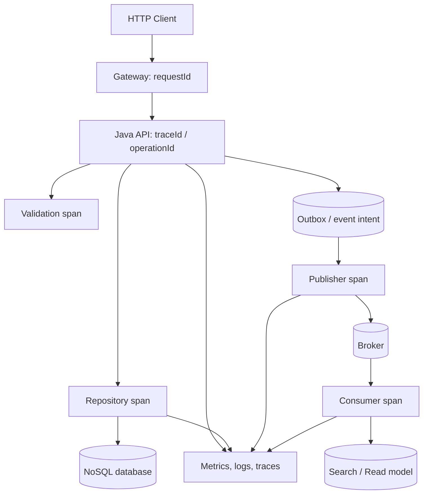

# Gắn định danh yêu cầu, metric và log phục vụ chẩn đoán

## 1. Tình huống mở đầu: cùng một timeout nhưng không biết request nào đã ghi dữ liệu

Một API Java nhận yêu cầu tạo đơn hàng. Người dùng nhấn nút “Đặt hàng” một lần, nhưng gateway trả `504 Gateway Timeout`. Trong database lại có một đơn hàng, đồng thời hệ thống ghi nhận hai lần gọi `insert`.

Nhóm vận hành có các dòng log rời rạc:

```text
17:00:00.100 INFO  POST /orders
17:00:00.300 WARN  Mongo write timeout
17:00:00.450 INFO  retry attempt
17:00:00.610 INFO  order created
17:00:00.700 WARN  gateway timeout
```

Không có request ID, operation ID hay trace chung, họ không biết:

- Dòng `retry attempt` thuộc request nào.
- `order created` là kết quả attempt đầu hay attempt thứ hai.
- Timeout xảy ra trước commit hay chỉ mất ACK sau commit.
- Thời gian chờ nằm ở connection pool, network hay database.
- Hai `insert` là hai thao tác nghiệp vụ khác nhau hay một ý định bị gửi lại.
- Một lỗi ở Search/Redis có liên hệ với đơn hàng vừa tạo hay không.

Để chẩn đoán, ứng dụng nên phát sinh một chuỗi telemetry có mối liên hệ:

```text
Request R-7f2d
  Operation CREATE_ORDER O-92c1
    Trace 4d8e...
      HTTP span
      ValidateOrder span
      MongoDB insert attempt=1
      MongoDB lookup after timeout
      Outbox write
      Publish event E-1001
```

Những định danh này **không thay thế nhau**. `requestId` gắn với một HTTP attempt; `operationId` gắn với một ý định nghiệp vụ cần idempotency; `traceId` nối các spans của luồng xử lý; `eventId` nhận diện một sự kiện được phát lại; và `db request ID` thường do driver hoặc engine cấp trong phạm vi riêng.

Bài học này hướng dẫn **thiết kế observability cho kết nối Java tới NoSQL**: gắn định danh đúng phạm vi, phát hành metric có ý nghĩa, log có cấu trúc, truyền context qua các tầng, và sử dụng chúng để điều tra sự cố.

## 2. Mục tiêu học tập

Sau bài này, người học có thể:

1. Phân biệt `requestId`, `traceId`, `spanId`, `correlationId`, `operationId`, `idempotencyKey`, `eventId`, `resourceId` và định danh driver/database.
2. Tạo request ID ở biên hệ thống, xử lý ID do client gửi một cách an toàn và truyền ID qua HTTP.
3. Dùng **SLF4J MDC** cho structured logging trong luồng đồng bộ, hiểu rủi ro khi chuyển sang async/reactive.
4. Dùng **OpenTelemetry** để liên kết spans giữa API, repository, database và event consumer.
5. Instrument **Micrometer** cho counter, timer, histogram, retries và các trạng thái giao dịch.
6. Thiết kế metric labels có cardinality giới hạn; giữ IDs chi tiết ở log/traces thay vì làm labels.
7. Phân biệt latency của client, connection pool, mạng, database, cache và queue.
8. Ghi query fingerprints và error classes mà không log raw query chứa dữ liệu nhạy cảm.
9. Quan sát MongoDB, DynamoDB, Cassandra, Redis, Elasticsearch/OpenSearch theo tính năng driver.
10. Xây dashboard, alert, runbook và fault tests để tìm nguyên nhân của timeout, hot partition, scan, retry storm và dữ liệu chưa đồng bộ.

## 3. Ba câu hỏi telemetry phải trả lời

Một hệ observability hữu ích phải cho phép hỏi:

**“Điều gì xảy ra với một thao tác cụ thể?”**

Cần request/correlation ID, trace spans, operation status và timestamps.

**“Điều gì xảy ra với cả hệ thống?”**

Cần request rate, error rate, latency distribution, saturation, retry rate và backlog.

**“Tại sao việc đó xảy ra?”**

Cần log/trace chi tiết có scope, query shape, driver metrics, database diagnostics, deployment events và những bằng chứng có quan hệ thời gian.

Ba câu hỏi tương ứng một phần với:

```text
Log:    Một sự kiện đã được ghi nhận với các fields cụ thể.
Metric: Một phân phối hoặc số đếm tổng hợp theo cửa sổ thời gian.
Trace:  Đường thực thi/quan hệ cha-con giữa các công đoạn.
```

Chỉ log mọi request mà không có metric tổng sẽ khó thấy sự cố quy mô lớn. Chỉ có histogram p99 mà không có trace sẽ khó biết request bị chậm ở đâu. Chỉ có trace ID mà không có business operation ID sẽ khó xác minh kết quả sau khi client retry.

## 4. Phân biệt các loại định danh

| Định danh | Phạm vi | Tạo bởi ai | Dùng để làm gì |
| --- | --- | --- | --- |
| **Request ID** | Một lần đi qua API/gateway | Gateway hoặc API | Tìm log của một HTTP request |
| **Correlation ID** | Một workflow được chọn | Gateway/app/orchestrator | Nối nhiều thông điệp theo quy ước |
| **Trace ID** | Một distributed trace | Tracing system | Nối các spans ở nhiều service |
| **Span ID** | Một span | Tracing system | Phân biệt một công đoạn trong trace |
| **Operation ID** | Một ý định nghiệp vụ | Client hoặc server | Theo dõi tiến trình/khôi phục outcome |
| **Idempotency key** | Một intent không được áp hai lần | Client hoặc server | Dedup retry theo business contract |
| **Event ID** | Một domain event | Event producer/source | Dedup khi publish/consume |
| **Resource ID** | Một document/item/aggregate | Business/data layer | Tìm dữ liệu đã tạo |
| **Driver request ID** | Một lời gọi protocol/connection | Driver | Ghép command started/succeeded/failed |
| **Transaction ID** | Một transaction trong phạm vi engine | Driver/server | Điều tra commit/abort |
| **Log offset/sequence** | Một stream/partition | Broker/CDC | Replay, thứ tự trong phạm vi xác định |
| **Tenant ID** | Một khách hàng/tổ chức | Domain/auth layer | Authorization/isolation; có thể nhạy cảm |

### 4.1. Request ID không phải idempotency key

Một người dùng gửi một intent tạo order. Browser timeout rồi retry:

```text
HTTP request 1: requestId=REQ-A, operationId=ORDER-100
HTTP request 2: requestId=REQ-B, operationId=ORDER-100
```

Hai HTTP requests khác nhau có thể cùng là một **logical business operation**.

Nếu dùng request ID mới của mỗi lần gửi làm idempotency key, hệ có thể tạo hai orders.

### 4.2. Trace ID không mặc định ổn định qua retry

Một trình duyệt có thể tạo HTTP request mới, trace mới. Vì thế:

```text
traceId=T1, operationId=R100
traceId=T2, operationId=R100
```

là bình thường. Có thể dùng **trace links** hoặc operation lookup để nối các traces nhưng không nên ép mọi retry độc lập dùng cùng trace context vô thời hạn.

### 4.3. Event ID không phải span ID

Một event được broker gửi ba lần vẫn là `eventId=E1001`, nhưng mỗi lần xử lý tạo một span khác:

```text
E1001 attempt 1 -> trace T1 / span S1
E1001 attempt 2 -> trace T2 / span S2
E1001 attempt 3 -> trace T3 / span S3
```

Dùng event ID để dedup; dùng trace/span IDs để chẩn đoán tiến trình.

## 5. Mô hình từ HTTP tới NoSQL và event consumer



Ví dụ cùng một intent:

```text
operationId = OP-1001

  requestId = REQ-1
  traceId   = TRACE-A
  dbAttempt = 1
  result    = TIMEOUT_UNKNOWN

  requestId = REQ-2
  traceId   = TRACE-B
  dbAttempt = 2
  result    = ALREADY_COMPLETED

  eventId   = EVT-1001
  consumer  = search-indexer
  outcome   = APPLIED
```

Việc nối hai traces bằng operationId phải tuân thủ **bảo mật và quyền truy cập**. Không coi ID là token cấp quyền truy cập hay mặc định nó an toàn để hiển thị cho mọi tenant.

## 6. Định danh được tạo ở đâu?

Thiết kế một chính sách tại **ingress boundary**:

1. Gateway nhận HTTP request.
2. Nếu header request ID do client đưa lên hợp lệ theo quy định, có thể bảo tồn hoặc thay thế.
3. Nếu thiếu hoặc không hợp lệ, server tạo ID.
4. API đưa ID đã chấp nhận vào structured logs và response header.
5. API tiếp tục trace context theo quy tắc tin cậy.
6. Khi ghi business operation, dùng `operationId` ổn định theo intent.
7. Khi xuất event, dùng `eventId` ổn định qua các lần publish.

### 6.1. UUID là một lựa chọn

```java
import java.util.UUID;

String requestId = UUID.randomUUID().toString();
```

UUID ngẫu nhiên đủ phù hợp cho nhiều use case correlation. Nhưng một ID được tạo ngẫu nhiên **không tự bảo đảm duy nhất bằng atomic constraint** nếu dùng nó làm business unique key.

### 6.2. ULID, UUIDv7 và sortable IDs

Những định dạng có thành phần thời gian có thể giúp **sắp xếp gần theo thời điểm sinh**. Tuy nhiên:

- Clock có thể lệch giữa máy.
- Request sinh trước chưa chắc commit trước.
- Hai process có thể sinh IDs cùng thời điểm.
- Sắp xếp ID không thay commit order hoặc causal order.

Đừng dùng lexical order của ID làm bằng chứng chính xác tuyệt đối về thứ tự giao dịch giữa nhiều shards.

### 6.3. ID từ client là dữ liệu không tin cậy

Không đưa nguyên một header tùy ý vào logs:

```http
X-Request-ID: a-very-long-string-with-control-characters-...
```

Có rủi ro log injection, tốn storage, cardinality và nhầm lẫn. Nên validate **độ dài, charset, format**, hoặc thay bằng ID do server cấp; nếu cần giữ ID đối tác, lưu ở field riêng sau kiểm soát.

## 7. W3C Trace Context và truyền qua HTTP

Với distributed tracing, header phổ biến là:

```http
traceparent: 00-4bf92f3577b34da6a3ce929d0e0e4736-00f067aa0ba902b7-01
```

Cấu trúc khái niệm:

```text
version - trace-id - parent-id - trace-flags
```

Các bên có thể dùng W3C Trace Context để nối parent/child spans. Khi outbound HTTP call được instrument, tracer có thể inject context vào headers; inbound service extract và tiếp tục trace.

### 7.1. Ba việc khác nhau

- **Trace context propagation:** gửi identifiers và sampling flags.
- **MDC propagation:** đưa một số fields vào logging context ở luồng hiện hành.
- **Business context propagation:** đưa operation/tenant identity tới đúng service có quyền.

Không gộp ba việc thành một `Map<String,String>` không giới hạn rồi truyền mọi thông tin cho mọi service.

### 7.2. Tracing context không phải authorization

Một request bên ngoài có thể tự tạo `traceparent`. Hệ có thể tiếp nhận để hỗ trợ tracing, nhưng không được coi trace ID, baggage hoặc header bất kỳ là bằng chứng user đã xác thực.

### 7.3. Tracestate và baggage

- `tracestate` lưu dữ liệu phục vụ vendor/tracing theo chuẩn và giới hạn.
- `baggage` có thể lan truyền key-value tùy instrumentation.

Baggage có thể tới nhiều downstream services. Không đưa API token, email, session secret hoặc thông tin nhạy cảm vào baggage chỉ để dễ debug.

## 8. Thiết kế hợp đồng request ID ở API

Ví dụ HTTP:

```http
POST /orders
X-Request-ID: 1692ca50-cc0e-4dc8-9c93-d1c835af9209
Idempotency-Key: ORDER-T01-R100
Content-Type: application/json

{"sku":"P100","quantity":2}
```

Response có thể trả:

```http
HTTP/1.1 202 Accepted
X-Request-ID: 1692ca50-cc0e-4dc8-9c93-d1c835af9209
Location: /operations/ORDER-T01-R100
Content-Type: application/json

{
  "operationId": "ORDER-T01-R100",
  "status": "PENDING"
}
```

Ở ví dụ, `202` chỉ phù hợp nếu server **đã ghi nhận yêu cầu để xử lý theo contract**. Nếu ngay cả bước lưu intent cũng có ambiguous outcome, server không nên nói chắc “đã chấp nhận” khi chưa có bằng chứng.

### 8.1. Request ID trong response giúp làm gì?

Khi khách hàng báo lỗi, họ có thể cung cấp request ID để support tìm trace/log tương ứng. Nhưng support vẫn phải kiểm tra quyền trước khi truy xuất dữ liệu chi tiết; ID không phải credential.

### 8.2. Khi gateway đã cấp request ID

Nếu một reverse proxy đã gắn ID theo policy đáng tin, API có thể bảo tồn để thống nhất. Tuy nhiên vẫn cần biết request ID ấy phân biệt **một HTTP hop**, **một client request** hay **một trace**, vì các gateway khác nhau có quy tắc khác nhau.

## 9. Structured logging: mỗi log line là một bản ghi dữ liệu

Một log thuần văn bản:

```text
Timeout when creating order
```

khó phân tích hơn một bản ghi có fields rõ:

```json
{
  "timestamp": "2026-11-14T10:02:30.123Z",
  "level": "WARN",
  "service": "order-api",
  "environment": "production",
  "requestId": "REQ-7F2D",
  "traceId": "4bf92f3577b34da6a3ce929d0e0e4736",
  "spanId": "00f067aa0ba902b7",
  "operationRef": "hash-or-masked-reference",
  "operation": "CreateOrder",
  "dbSystem": "mongodb",
  "dbCollection": "orders",
  "dbQueryShape": "insertOne_by_stable_id",
  "attempt": 1,
  "elapsedMs": 842,
  "outcome": "UNKNOWN_AFTER_TIMEOUT",
  "errorType": "NETWORK_TIMEOUT",
  "message": "DB write outcome not confirmed"
}
```

### 9.1. Lợi ích

- Filter theo operation và result class.
- Group logs theo trace/request.
- So latency trước/sau deploy.
- Tìm mọi attempts của một business operation.
- Dựng lại timeline khi nhiều service tham gia.
- Tổng hợp error reason mà không phải phân tích câu thông báo tự do.

### 9.2. Có schema log cũng cần consistency

Nếu một service ghi `request_id`, service khác `correlationId` và service thứ ba `req`, công cụ tra cứu phải map ba tên. Hãy chuẩn hóa field names và version hóa logging conventions khi cần.

### 9.3. Không bắt buộc mọi log đều chứa mọi field

Một startup log có thể không có `requestId`. Một background compaction log có thể chỉ có `node` và `jobId`. Không thêm ID giả chỉ để làm đầy schema.

## 10. Mức log: ERROR, WARN, INFO, DEBUG

| Level | Cách dùng điển hình | Ví dụ |
| --- | --- | --- |
| **ERROR** | Sự cố ảnh hưởng outcome hoặc cần hành động | Không thể khôi phục commit outcome sau retry budget |
| **WARN** | Bất thường có thể hồi phục | Retry lần 2 do throttling |
| **INFO** | Chuyển trạng thái nghiệp vụ quan trọng | Operation accepted/completed |
| **DEBUG** | Chi tiết kỹ thuật khi cần | Query fingerprint, chosen route |
| **TRACE** | Chi tiết sâu/volume lớn | Driver protocol diagnostics có kiểm soát |

### 10.1. Không biến timeout tạm thời thành hàng nghìn ERROR

Nếu SDK tự retry một lần khi gặp failover rồi thành công, có thể log một event hữu ích với `retryReason`, nhưng không nhất thiết phát ERROR cho từng attempt tạm thời.

Ngược lại, nếu cuối cùng `UNKNOWN`, đó là kết quả vận hành quan trọng cần ghi nhận.

### 10.2. Một sự kiện, nhiều nơi ghi log

Nếu repository, service, controller và gateway đều log **cùng exception** ở ERROR, incident có thể tạo bốn lỗi giả cho một request.

Nên quy định tầng sở hữu **terminal error logging**, tầng dưới bổ sung span events/metrics theo phạm vi cần thiết.

## 11. SLF4J MDC trong Java: cơ sở của log correlation

**Mapped Diagnostic Context (MDC)** lưu một số fields gắn với ngữ cảnh logging trên luồng xử lý. Với SLF4J:

```java
import org.slf4j.MDC;

public final class MdcExample {
    public void handle(String requestId) {
        try (MDC.MDCCloseable ignored =
                 MDC.putCloseable("requestId", requestId)) {

            // Logs trong phạm vi này có thể nhận requestId
            // nếu logging backend và pattern/encoder được cấu hình.
            doWork();
        }
    }

    private void doWork() {
        // Logic minh họa.
    }
}
```

MDC chỉ hỗ trợ nếu backend logging đang dùng có semantics tương ứng và encoder thực sự xuất field. **Đặt MDC không tự làm JSON log xuất hiện** nếu chưa cấu hình Logback/Log4j/structured encoder.

### 11.1. Vì sao phải cleanup?

Servlet container tái sử dụng threads:

```text
Thread-17 xử lý Request A
Thread-17 được tái sử dụng cho Request B
```

Nếu request A không xóa `requestId`, log của B có thể bị gắn nhầm ID A, nguy hiểm cả cho chẩn đoán lẫn privacy/tenant isolation.

### 11.2. Dùng try/finally

```java
MDC.put("requestId", requestId);
try {
    processRequest();
} finally {
    MDC.remove("requestId");
}
```

`finally` cần chạy đúng cả đường exception. Với nested scopes, phải cẩn thận **khôi phục MDC cũ** thay vì xóa toàn bộ context không thuộc mình.

## 12. Ví dụ Servlet Filter tự gắn request ID

Trong ứng dụng dùng Jakarta Servlet API, có thể tạo filter khái niệm:

```java
import jakarta.servlet.Filter;
import jakarta.servlet.FilterChain;
import jakarta.servlet.ServletException;
import jakarta.servlet.ServletRequest;
import jakarta.servlet.ServletResponse;
import jakarta.servlet.http.HttpServletRequest;
import jakarta.servlet.http.HttpServletResponse;

import org.slf4j.MDC;

import java.io.IOException;
import java.util.UUID;

public final class RequestIdFilter implements Filter {

    @Override
    public void doFilter(
            ServletRequest request,
            ServletResponse response,
            FilterChain chain
    ) throws IOException, ServletException {

        HttpServletRequest req = (HttpServletRequest) request;
        HttpServletResponse res = (HttpServletResponse) response;

        String inbound = req.getHeader("X-Request-ID");
        String requestId = isAcceptedId(inbound)
            ? inbound
            : UUID.randomUUID().toString();

        String previous = MDC.get("requestId");
        MDC.put("requestId", requestId);

        try {
            res.setHeader("X-Request-ID", requestId);
            chain.doFilter(request, response);
        } finally {
            if (previous == null) {
                MDC.remove("requestId");
            } else {
                MDC.put("requestId", previous);
            }
        }
    }

    private static boolean isAcceptedId(String id) {
        return id != null
            && id.length() >= 8
            && id.length() <= 64
            && id.matches("[A-Za-z0-9_-]+");
    }
}
```

**Giới hạn của ví dụ:**

- Cần đăng ký filter theo framework/container đang dùng.
- Ví dụ áp dụng dispatch đồng bộ thông thường; nếu servlet xử lý async hoặc request dispatch lại, phải xem cách gắn và cleanup context theo vòng đời thật.
- Header từ client có thể cần **thay thế hoàn toàn** tại trust boundary; cho phép header tùy ý chỉ là một policy có điều kiện.
- Nên phát trace ID từ OpenTelemetry instrumentation, không tự tái tạo trace semantics bằng một UUID trong Filter.
- `X-Request-ID` không phải chuẩn thay thế cho W3C `traceparent`.

## 13. MDC qua ExecutorService: ranh giới thread rất dễ làm mất context

Trong ứng dụng:

```java
executor.submit(() -> repository.save(order));
```

task có thể chạy ở thread khác. MDC lưu trong thread ban đầu **không được bảo đảm tự chuyển** qua tất cả executor implementations.

Một cách truyền snapshot có kiểm soát:

```java
import org.slf4j.MDC;

import java.util.Map;
import java.util.concurrent.ExecutorService;

public final class MdcExecutor {
    private final ExecutorService executor;

    public MdcExecutor(ExecutorService executor) {
        this.executor = executor;
    }

    public void executeWithMdc(Runnable task) {
        Map<String, String> captured =
            MDC.getCopyOfContextMap();

        executor.execute(() -> {
            Map<String, String> previous =
                MDC.getCopyOfContextMap();

            try {
                if (captured == null) {
                    MDC.clear();
                } else {
                    MDC.setContextMap(captured);
                }
                task.run();
            } finally {
                if (previous == null) {
                    MDC.clear();
                } else {
                    MDC.setContextMap(previous);
                }
            }
        });
    }
}
```

### 13.1. Tại sao restore context?

Executor thread có thể được tái sử dụng. Nếu chỉ `MDC.setContextMap(captured)` mà không restore/clear, task khác có thể bị gắn nhầm request ID.

### 13.2. MDC không truyền trace context đầy đủ

Đoạn code chỉ sao chép **logging fields**. OpenTelemetry context còn chứa span hiện hành và các thành phần khác; cần API/instrumentation propagation của tracer hoặc executor instrumentation được hỗ trợ.

Nếu copy `traceId` string bằng MDC nhưng không truyền span context, log có trace ID mà spans con có thể nằm ở trace khác.

### 13.3. Context propagation có chi phí

Không copy toàn bộ request body, auth token hoặc tenant-sensitive payload qua task chỉ để log; chỉ truyền thông tin tối thiểu. Khi task chạy lâu sau khi HTTP request kết thúc, cần quyết định liệu nó có còn thuộc trace hiện tại hay nên tạo trace mới kèm link.

## 14. Java async, CompletableFuture, virtual threads và Reactor

Các mô hình concurrency khác nhau đòi cách truyền context khác nhau.

### 14.1. CompletableFuture

Một lambda `thenApplyAsync` có thể chạy trên executor khác; không giả định MDC từ thread ban đầu còn nguyên. Sử dụng executor wrapper/instrumentation tương ứng và xem cả error/cancellation path.

### 14.2. Virtual threads

Virtual threads hữu ích cho concurrency blocking nhưng không biến một `ThreadLocal` hoặc MDC thành context toàn cục giữa các logical requests. Cần quản lý scope như với threads thông thường, không đưa secret/context sống lâu vượt nhiệm vụ.

### 14.3. Reactor/WebFlux

Trong reactive pipeline, công việc có thể chuyển threads nhiều lần. MDC thuần `ThreadLocal` không phải nơi duy nhất đáng tin để giữ request context.

Cần dùng **Reactor Context** và instrumentation bridge được framework/observability stack hỗ trợ, rồi chuyển sang MDC tại những điểm log tương thích nếu cần.

Pseudocode:

```java
return reactiveRepository.findById(orderId)
    .contextWrite(ctx ->
        ctx.put("requestId", acceptedRequestId)
    );
```

Đoạn này chỉ minh họa lưu context trong Reactor, **không tự biến field thành MDC hoặc span attribute**. Cách tích hợp cụ thể phụ thuộc phiên bản Reactor, Micrometer Context Propagation, OpenTelemetry và Spring.

### 14.4. Đừng `.block()` trên event loop chỉ để ghi log đầy đủ

Block reactive chain có thể gây head-of-line blocking. Instrumentation phải tương thích execution model; quan sát hệ không nên trở thành nguyên nhân chính làm API chậm.

## 15. OpenTelemetry: trace, span, context, attributes

OpenTelemetry cung cấp API/SDK và hệ thống instrumentation giúp ghi nhận distributed traces.

Một trace có thể có:

```text
TRACE-1
  span: HTTP POST /orders             500 ms
    span: ValidateRequest               5 ms
    span: CreateOrder                   470 ms
      span: MongoDB insertOne           390 ms
        event: retry
      span: MongoDB findOne              60 ms
    span: SerializeResponse              3 ms
```

Span có:

- Trace ID và Span ID.
- Parent span hoặc links.
- Start/end time.
- Attributes mô tả operation.
- Events trong quá trình xử lý.
- Status/error information.

### 15.1. Một ví dụ OTel Java API

```java
import io.opentelemetry.api.trace.Span;
import io.opentelemetry.api.trace.SpanKind;
import io.opentelemetry.api.trace.Tracer;
import io.opentelemetry.context.Scope;

public final class TracedOrderService {
    private final Tracer tracer;

    public TracedOrderService(Tracer tracer) {
        this.tracer = tracer;
    }

    public void createOrder(String operationType) {
        Span span = tracer.spanBuilder("orders.create")
            .setSpanKind(SpanKind.INTERNAL)
            .startSpan();

        try (Scope scope = span.makeCurrent()) {
            span.setAttribute("app.operation", operationType);
            performCreate();
        } catch (RuntimeException ex) {
            span.recordException(ex);
            span.setAttribute("app.error.type",
                ex.getClass().getSimpleName());
            throw ex;
        } finally {
            span.end();
        }
    }

    private void performCreate() {
        // Service/repository call.
    }
}
```

Ví dụ giả định `Tracer` đã được cấu hình từ SDK/agent và version tương thích. Không chép nguyên stack trace chứa secret vào span attributes; `recordException` vẫn cần policy về dữ liệu nhạy cảm và sampling.

### 15.2. Automatic vs manual instrumentation

**Automatic instrumentation** có thể tạo HTTP/database spans theo thư viện và môi trường được hỗ trợ.

**Manual instrumentation** bổ sung các business spans không thể suy từ network:

```text
ReserveInventory
AuthorizePayment
ReconcileUnknownWrite
ApplySourceVersion
```

Không tạo span cho từng phép gán biến đơn giản; span có overhead và nên đại diện hoạt động có giá trị điều tra.

## 16. Parent-child, trace links và request khởi tạo job nền

Một HTTP request có thể ghi job vào queue rồi kết thúc. Job xử lý sau 30 phút.

Có hai chiến lược tùy telemetry protocol:

- Consumer span tiếp nối trace context nhận từ producer nếu ngữ nghĩa và retention hợp lý.
- Consumer tạo trace mới rồi **link** tới producer context, đặc biệt khi batch xử lý nhiều messages hoặc công việc sống rất lâu.

Quan trọng là mô hình quan hệ rõ và context được bảo vệ.

### 16.1. Một message xử lý lại nhiều lần

```text
Event E1001 published once
Consumer attempt 1: timeout
Consumer attempt 2: success
```

Có thể tạo hai consumer spans riêng, cùng `eventId` nhưng khác attempt, và ghi `messaging.operation`, `retry.attempt` theo semantic conventions/version của stack.

### 16.2. Batch nhận nhiều messages

Một batch chứa events từ nhiều traces. Không tùy tiện chọn trace đầu tiên làm cha cho mọi event rồi tuyên bố tất cả thuộc cùng một request. Span links phù hợp khi có nhiều nguồn.

## 17. Sampling traces: giữ được giá trị khi lượng request lớn

Nếu traffic 100.000 requests/s, giữ tất cả detailed traces có thể rất tốn chi phí.

Các cách sampling:

- **Head-based probability sampling** ở đầu trace.
- **Parent-based** theo quyết định upstream.
- **Tail-based** ở collector, giữ traces có lỗi/tail latency theo policy.
- **Rule-based** giữ route hoặc operation quan trọng.
- **Targeted temporary sampling** khi điều tra.

### 17.1. Vấn đề của sample rate 1%

Một lỗi rất hiếm có thể không xuất hiện trong traces được giữ. **Không thấy trace không chứng minh không có lỗi**.

Metrics phải đo số lượng tổng đầy đủ hoặc coverage được biết rõ; traces giải thích những mẫu đã thu.

### 17.2. Tail sampling có độ trễ và chi phí

Collector phải giữ/quan sát một phần spans trước khi quyết định. Nó có memory, buffering và latency cost. Nếu hệ mất collector lúc incident, telemetry có thể bị hụt.

### 17.3. Business critical spans

Với payment, stock reservation, permission revocation và unknown commit, có thể cần thêm **audit trail bền theo policy** ngoài distributed tracing được sampling. Traces không thay thế sổ giao dịch authoritative.

## 18. Metrics: đo theo phân phối, không chỉ đếm một request

Một database call có thể nhanh ở p50 nhưng chậm ở p99. Chỉ ghi average latency không đủ cho SLO.

Những nhóm cơ bản:

| Nhóm | Câu hỏi | Metric minh họa |
| --- | --- | --- |
| Traffic | Bao nhiêu request/giây? | `app_db_operations_total` |
| Errors | Lỗi loại nào? | `app_db_failures_total` |
| Duration | Phân phối latency? | `app_db_duration_seconds` |
| Saturation | Pool/node/queue có nghẽn? | `db_pool_pending`, `db_queue_depth` |
| Retries | Mỗi intent gọi DB mấy lần? | `app_db_retries_total` |
| Correctness | Outcome unknown/dedup? | `app_operation_unknown_total` |
| Freshness | Projection lag? | `projection_lag_seconds` |

Tên metric chỉ minh họa, không mặc định driver/exporter cung cấp sẵn.

### 18.1. Counter

Một counter tăng khi sự kiện xảy ra:

```text
app_db_operations_total{db_system="mongodb",operation="insert",outcome="ok"}
```

Để tính request rate cần xem **delta/rate trên cửa sổ**, không so giá trị counter tích lũy của hai instances có uptime khác nhau.

### 18.2. Gauge

Gauge biểu diễn trạng thái tức thời:

```text
db_pool_in_use
db_pool_pending
outbox_backlog
```

Nó có thể tăng và giảm. Dùng gauge để thấy mức bão hòa hiện tại, nhưng phải xét sampling/aggregation và label lifecycle.

### 18.3. Timer/histogram

Một timer đo duration. Histogram hỗ trợ ước lượng quantiles từ bucket counts khi cấu hình đúng. Không lấy trung bình p99 của từng instance/shard làm p99 toàn hệ.

## 19. Micrometer: instrument thao tác NoSQL

Ví dụ Java dùng Micrometer:

```java
import io.micrometer.core.instrument.Counter;
import io.micrometer.core.instrument.MeterRegistry;
import io.micrometer.core.instrument.Timer;

import java.util.concurrent.Callable;

public final class DbMetering {
    private final MeterRegistry registry;

    public DbMetering(MeterRegistry registry) {
        this.registry = registry;
    }

    public <T> T measure(
            String operation,
            String dbSystem,
            Callable<T> action
    ) throws Exception {

        Timer.Sample sample = Timer.start(registry);
        String outcome = "success";

        try {
            return action.call();
        } catch (Exception error) {
            outcome = classify(error);
            throw error;
        } finally {
            Timer timer = Timer.builder("app.db.operation.duration")
                .description("Application-observed DB operation time")
                .tag("operation", operation)
                .tag("db_system", dbSystem)
                .tag("outcome", outcome)
                .publishPercentileHistogram()
                .register(registry);

            sample.stop(timer);

            Counter.builder("app.db.operation.attempts")
                .tag("operation", operation)
                .tag("db_system", dbSystem)
                .tag("outcome", outcome)
                .register(registry)
                .increment();
        }
    }

    private static String classify(Exception error) {
        // Placeholder: map SDK-specific exceptions to a
        // finite, reviewed set of outcome classes.
        return "error";
    }
}
```

### 19.1. Đây là latency gì?

Timer bao quanh `action.call()` đo **thời gian ứng dụng thấy**, có thể gồm:

- Chờ connection pool.
- Serialization.
- Network RTT.
- Server execution.
- Retry bên trong SDK.
- Deserialization.

Nó **không tự là database server execution time**.

### 19.2. Số lượng tag phải hữu hạn

Không truyền raw query string, `userId`, `orderId`, `tenantId` hay key thô vào `operation`/`dbSystem`. Chỉ cho phép danh sách cố định như `findOrder`, `reserveStock`, `searchProducts`.

### 19.3. Phân biệt attempt và business operation

`app.db.operation.attempts` đếm mỗi lần gọi wrapper. Một `CreateOrder` có thể retry ba lần. Cần metric khác để đếm **một logical intent** đã hoàn tất hoặc chưa rõ.

### 19.4. Micrometer không tự có metric server

Micrometer có thể instrument tại ứng dụng. MongoDB/Cassandra/DynamoDB/Redis còn có server/service metrics riêng. Hai nhóm cần đặt chung timeline nhưng không giả định dùng cùng đơn vị hay độ phân giải.

## 20. Histogram, p95/p99 và PromQL

Giả sử exporter công bố histogram:

```text
app_db_operation_duration_seconds_bucket
app_db_operation_duration_seconds_sum
app_db_operation_duration_seconds_count
```

Một truy vấn PromQL minh họa tính p99 theo database operation:

```promql
histogram_quantile(
  0.99,
  sum by (le, operation) (
    rate(app_db_operation_duration_seconds_bucket[5m])
  )
)
```

Request rate:

```promql
sum by (operation) (
  rate(app_db_operation_attempts_total[5m])
)
```

Error ratio minh họa:

```promql
sum(
  rate(app_db_operation_attempts_total{outcome!="success"}[5m])
)
/
sum(
  rate(app_db_operation_attempts_total[5m])
)
```

**Các tên Prometheus trên là ví dụ**, cần đối chiếu cấu hình Micrometer, naming conventions, labels và histogram backend thực tế trước khi copy.

### 20.1. Vì sao không trung bình p99?

Giả sử shard A xử lý 100 requests, shard B xử lý 100.000 requests. Lấy trung bình hai p99 sẽ cân bằng sai trọng số và không phục hồi được phân phối toàn hệ.

Khi có histograms compatible, gom bucket counts theo đúng dimensions rồi tính quantile; không lấy trung bình quantiles.

### 20.2. Histogram bucket phải có độ phân giải phù hợp

Nếu SLO là 100 ms nhưng buckets nhảy từ 50 ms lên 1 s, p99 suy ra gần ngưỡng SLO sẽ thiếu độ phân giải. Chọn buckets theo SLO và phân phối latency, không chỉ dùng mặc định không xem xét.

### 20.3. Tính sai số và sampling

Histograms là ước lượng theo buckets, và high-cardinality dimensions làm số series tăng. Đặt histogram cho các operation quan trọng và cân nhắc footprint.

## 21. Metric cardinality và rủi ro nổ time series

Không nên dùng:

```text
db_requests_total{order_id="O1001",tenant_id="T01"}
db_requests_total{order_id="O1002",tenant_id="T01"}
...
```

Nếu có hàng triệu orders, số series tăng theo số ID, còn nhân với labels như region, operation, outcome và instance.

### 21.1. Ví dụ bùng nổ

Giả sử metric có:

```text
10.000 order IDs
20 tenant IDs
5 operations
3 results
```

Nếu những tổ hợp đều xuất hiện, số series có thể lên tới:

\[
10.000 \times 20 \times 5 \times 3 = 3.000.000
\]

Chỉ một metric có thể tạo hàng triệu series. Trong thực tế combinations có thể ít hơn, nhưng số này minh họa rủi ro.

### 21.2. Labels nên dùng

| Nên cân nhắc | Không nên đưa trực tiếp |
| --- | --- |
| `db_system` | `raw_query` |
| `operation` từ enum | `orderId` |
| `collection` từ danh sách nhỏ | `userId` |
| `region` | `email` |
| `result_class` | `phone` |
| `retry_reason` từ enum | `accessToken` |
| `service` | `sessionId` |
| `shard` nếu số lượng hữu hạn và kiểm soát | `idempotencyKey` |
| `tenant_tier` | `tenantId` hàng triệu giá trị |

Không phải `shard` luôn low-cardinality; trong hệ tạo/xóa shards liên tục, phải tính churn.

### 21.3. Tìm hot key mà không làm nổ labels

Dùng:

- Sampled logs/traces có bảo mật.
- Key frequency sketches/Top-N bounded data.
- Contributor analytics của database nếu có.
- Hash buckets cardinality cố định.
- Offline query log aggregation trong hệ phân tích có kiểm soát.

Một hash bucket nóng không tự chứng minh **một key duy nhất** nóng; có thể có nhiều keys cùng bucket.

## 22. Thiết kế query fingerprint thay vì log raw query

Hai MongoDB queries:

```javascript
db.orders.find({
  tenantId: "T01",
  status: "PAID"
}).sort({ createdAt: -1 }).limit(20);
```

```javascript
db.orders.find({
  tenantId: "T02",
  status: "PAID"
}).sort({ createdAt: -1 }).limit(20);
```

có thể có query shape chung:

```text
orders.find({tenantId:?,status:?})
.sort({createdAt:-1}).limit(?)
```

Fingerprint giúp:

- So tần suất và tổng chi phí cùng một loại truy vấn.
- Tìm query shape tạo nhiều timeouts.
- Phát hiện deploy làm đổi pattern từ targeted sang scan.
- So hiệu năng giữa server versions.
- Giảm rò PII so với raw query values.

### 22.1. Fingerprint phải giữ cấu trúc có ý nghĩa

Không cần bỏ mọi thứ. Ví dụ khác nhau giữa:

```text
where tenantId=? and status=?
```

và:

```text
where status=?
```

là rất quan trọng khi database sharded theo tenant. Việc thiếu shard key có thể làm scatter–gather.

### 22.2. Đừng làm fingerprint quá chi tiết

Nếu fingerprint chứa actual `tenantId`, `userId` hoặc request JSON, nó mất tác dụng nhóm và có thể lộ dữ liệu.

### 22.3. Query plan vẫn cần xem riêng

Fingerprint giống nhau không bảo đảm cùng query cost: index availability, key selectivity, partition size và node load khác nhau. Kết hợp fingerprint với `keysExamined`, `documentsExamined`, read bytes, capacity units và execution plan theo công cụ database.

## 23. Không log payload và credentials tùy tiện

Ví dụ nguy hiểm:

```java
log.debug("Executing query {}", rawQueryDocument);
log.error("Connection failed for URI {}", connectionUri);
```

Raw query có thể chứa email, địa chỉ hoặc token; connection URI có thể chứa username/password.

### 23.1. Tối thiểu hóa dữ liệu

Thay vì:

```text
creditCard=4111111111111111
email=user@example.com
```

có thể lưu:

```text
paymentProviderRef=masked-reference
dbQueryShape=payment.findByReference
resultClass=TIMEOUT_UNKNOWN
```

Dữ liệu phục vụ chẩn đoán phải theo chính sách phân loại, quyền truy cập, retention, encryption và audit.

### 23.2. Logging PII dưới dạng hash không mặc nhiên an toàn

Hash không khóa trên một tập email/phone có thể bị brute-force bằng từ điển. Nếu cần pseudonymization, cân nhắc HMAC với khóa được quản lý, rotating IDs hoặc access-controlled mapping. Không quảng cáo hash thô là “đã ẩn danh hoàn toàn”.

### 23.3. SQL/NoSQL injection qua log

Một input chứa newline/control characters có thể làm log text bị giả mạo nếu logger/encoder không escape đúng. Structured JSON encoder và header validation giúp giảm rủi ro.

## 24. Chia nhỏ latency trên đường gọi database

Một request mất 800 ms có thể bao gồm:

```text
HTTP admission / app queue:   100 ms
Validation:                     5 ms
Connection pool wait:         400 ms
Network + DB server + codec:  250 ms
Serialization/response:        45 ms
                              -------
Total:                        800 ms
```

Nếu chỉ thấy `dbCallDuration=650 ms`, chưa biết server có chậm không.

### 24.1. Cần instrument những boundary nào?

```text
incoming request
  -> application queue
  -> business logic
  -> connection acquisition
  -> outbound request
  -> server execution
  -> response receive
  -> retry/backoff
  -> final business status
```

Không phải SDK nào cũng xuất đủ thời điểm. Nếu thiếu, ghi rõ số đo là **application-observed latency**, không tự đặt tên “server execution”.

### 24.2. Không cộng p99 của từng tầng

P99 của HTTP, pool wait và server execution **không cộng được để ra p99 end-to-end**. Các quantiles được lấy trên tập requests khác nhau; tương quan có thể mạnh hoặc yếu.

Để tính critical path của một request, xem spans cụ thể. Để tính phân phối toàn bộ, dùng histogram end-to-end thực sự được đo.

### 24.3. Queue time là thời gian thật

Nếu request chờ pool 500 ms và server xử lý 10 ms, tối ưu index có thể không làm API p99 cải thiện đáng kể. Cần xem pool size, concurrency, retries và các lệnh giữ connection lâu.

## 25. Connection pool metrics

Với nhiều NoSQL drivers, pool là nơi giữ connections tới nodes/endpoints.

Các chỉ số nên có nếu SDK cung cấp:

```text
connections_in_use
connections_available
connections_created_total
connection_acquire_wait
connection_acquire_timeout_total
pool_max_size
pool_pending_requests
```

### 25.1. Pool quá nhỏ

Một pool ít connections có thể tạo queue dài dù DB còn capacity. Nhưng tăng pool không có giới hạn có thể làm backend quá tải, gây nhiều concurrent expensive queries hơn.

### 25.2. Leak resources

Một cursor/session không được đóng có thể giữ connection/resource lâu hơn cần thiết. Quan sát pool in-use, active cursors, memory/GC và request lifecycle.

### 25.3. Pool theo node

Một client có thể giữ nhiều pools cho từng replica/shard/endpoint. Tổng số connections có thể lớn hơn một `maxPoolSize` duy nhất nhân số nodes; phải hiểu contract thật của driver.

## 26. Retries: mỗi attempt phải có dấu vết

Ví dụ:

```text
operationId=R100

attempt=1:
  dbWrite=TIMEOUT
  result=UNKNOWN

attempt=2:
  dbWrite=CONDITION_FAILED
  lookup=EXISTING_OPERATION_MATCHED

final business status=COMPLETED
```

Nếu chỉ nhìn exception attempt 1, bạn tưởng đơn hàng thất bại. Nếu chỉ nhìn success của attempt 2, bạn không biết đã có timeout. Cần cả **attempt metrics** và **logical outcome metrics**.

### 26.1. Những fields có ích

```text
operation_type
attempt_number
retry_reason
backoff_ms
remaining_deadline_ms
db_request_ref
db_region
result_class
final_outcome
```

ID chi tiết nên ở traces/logs; metric labels chỉ dùng reason/outcome finite categories.

### 26.2. Retry storm

Nếu mỗi client retry 3 lần, gateway retry 2 lần, driver retry 3 lần, một intent có thể tạo nhiều attempts khi layers nhân nhau.

Ghi:

```text
business_intents_total
db_attempts_total
retry_attempts_total
timeout_total
throttle_total
unknown_outcomes_total
```

Một tỷ lệ `db attempts / business intents` tăng mạnh cùng p99 là tín hiệu retry amplification.

### 26.3. Timeout không bằng thất bại chắc chắn

Ghi result class phân biệt:

```text
SUCCESS_ACKNOWLEDGED
CONDITIONAL_REJECTED
VALIDATION_REJECTED
THROTTLED
TIMEOUT_UNKNOWN
COMMIT_UNKNOWN
```

Không dùng `success=false` cho mọi exception rồi để dashboard hiểu tất cả là operation thất bại.

## 27. Idempotency và telemetry bổ trợ nhau, không thay nhau

Request ID và trace ID giúp **tìm hiểu điều gì đã xảy ra**. Chúng không ngăn dữ liệu ghi trùng.

Một API có:

```text
requestId=REQ-A
traceId=TRACE-A
```

vẫn có thể tạo hai khoản payment nếu dùng hai provider IDs khác nhau khi retry.

Để chống duplicate business effect, cần:

- Stable business operation ID/idempotency key.
- Unique/conditional write tại nguồn.
- Atomic dedup + side effect hoặc workflow an toàn.
- Authoritative outcome lookup.
- Retry policy theo error class.
- Retention phù hợp.

Telemetry nên ghi trạng thái của cơ chế đó, nhưng **không biến trace ID thành idempotency key**.

## 28. Quan sát MongoDB Java Driver

MongoDB Java Driver có thể hỗ trợ command monitoring và connection pool monitoring tùy phiên bản.

Ví dụ khung command monitoring với các loại sự kiện của driver:

```java
import com.mongodb.ConnectionString;
import com.mongodb.MongoClientSettings;
import com.mongodb.client.MongoClient;
import com.mongodb.client.MongoClients;
import com.mongodb.event.CommandEvent;
import com.mongodb.event.CommandFailedEvent;
import com.mongodb.event.CommandListener;
import com.mongodb.event.CommandStartedEvent;
import com.mongodb.event.CommandSucceededEvent;

import org.slf4j.Logger;
import org.slf4j.LoggerFactory;

public final class MongoMonitoring {
    private static final Logger log =
        LoggerFactory.getLogger(MongoMonitoring.class);

    public static MongoClient create(String uri) {
        CommandListener listener = new CommandListener() {
            @Override
            public void commandStarted(CommandStartedEvent e) {
                log.debug("mongo command start name={} request={}",
                    e.getCommandName(), e.getRequestId());
            }

            @Override
            public void commandSucceeded(CommandSucceededEvent e) {
                log.debug("mongo command ok name={} request={}",
                    e.getCommandName(), e.getRequestId());
            }

            @Override
            public void commandFailed(CommandFailedEvent e) {
                log.warn("mongo command failed name={} request={}",
                    e.getCommandName(), e.getRequestId());
            }
        };

        MongoClientSettings settings = MongoClientSettings.builder()
            .applyConnectionString(new ConnectionString(uri))
            .addCommandListener(listener)
            .build();

        return MongoClients.create(settings);
    }
}
```

Ví dụ minh họa API command monitoring của dòng driver có các types tương ứng. Trước khi triển khai cần đối chiếu version đang dùng, loại events và overhead.

### 28.1. Driver command request ID có phạm vi riêng

`getRequestId()` phục vụ ghép lifecycle **một command** ở driver. Không mặc định nó là HTTP request ID hay unique ID toàn cluster.

Nếu nhiều commands chạy trong cùng một HTTP request, chúng có những driver request IDs khác nhau.

### 28.2. Listener không mặc nhiên chạy trong MDC của HTTP thread

Driver có thể dispatch callbacks trên threads khác nhau. Nếu log command event mà không có requestId trong MDC, không có nghĩa instrumentation hỏng; có thể thiếu context propagation theo SDK.

Không tự lấy MDC tại callback rồi giả định luôn đúng HTTP request. Kết hợp tracing instrumentation, operation metadata hoặc correlation mechanisms được thư viện hỗ trợ.

### 28.3. Không log toàn bộ BSON command

Command payload có thể chứa:

- User identifiers.
- Password-like fields.
- Search input.
- Personal data.
- Query conditions.
- Tokens trong command options.

Chỉ log command name, duration, result class và query fingerprint được chuẩn hóa; bật sâu có kiểm soát khi cần và tuân policy redaction.

### 28.4. Kết hợp server-side diagnostics

Một lệnh chậm có thể do:

```text
COLLSCAN
Blocking sort
High documentsExamined
Hot shard
Lock contention
Compaction/IO
Pool wait ngoài DB
```

Dùng `explain`, profiler, slow-operation logs và per-shard metrics theo version/permissions để xác định nguyên nhân. Driver command duration riêng chưa chứng minh server chậm.

## 29. Quan sát DynamoDB AWS SDK for Java v2

AWS SDK for Java v2 có cơ chế metrics/instrumentation/interceptors phù hợp các phiên bản được hỗ trợ. Với DynamoDB, còn cần xem **CloudWatch service metrics**.

Các chiều chẩn đoán quan trọng:

```text
Table / GSI
Operation: GetItem, Query, PutItem, UpdateItem
HTTP status / SDK exception class
Attempt count
Retry reason
Consumed read/write capacity
Throttling
Latency
Region / endpoint
```

### 29.1. AWS request ID

Một service response có thể cung cấp **service request ID** phục vụ support và điều tra. Nó khác:

- HTTP request ID của API Java.
- Logical idempotency key.
- SDK execution attempt.
- DynamoDB item primary key.

Giữ request ID của service trong log/trace khi có, nhưng đừng dùng nó làm key dedup cho nghiệp vụ.

### 29.2. Retry và metrics

Nếu SDK retry nội bộ, `DynamoDbClient.putItem()` có thể bao gồm nhiều HTTP attempts. Phân biệt:

```text
one application-level call
multiple SDK HTTP attempts
one logical business operation
```

Khi SDK cung cấp attempt-level metric, dùng để giải thích latency và throttling. Không nhân đôi attempts bằng cách log mỗi retry ở nhiều tầng mà không xác định scope.

### 29.3. Throttling reason là thông tin hữu ích

Một table có tổng capacity còn dư vẫn có thể bị throttle do một partition key/GSI nóng. Dùng metric đúng table/index/operation và những thông tin throttle reason có sẵn.

Không suy “DynamoDB chậm” chỉ từ 429/exception mà không phân biệt partition load, GSI, API shape và SDK retry.

### 29.4. Tương tác với IAM và payload

SDK signing và credential chain không phải dữ liệu nên log. Tránh xuất request headers chứa authorization hoặc session tokens. Region, table name và operation class thường hữu ích hơn nhiều cho dashboard.

## 30. Cassandra: tracing, driver metrics và consistency

Apache Cassandra drivers có thể cung cấp metrics theo request, node, connection pool và speculative execution tùy version.

Các field hữu ích:

```text
queryShape=orders_by_tenant_day.select_recent
consistency=LOCAL_QUORUM
localDatacenter=dc1
coordinatorNode=<controlled-ref>
pagingStatePresent=true
attempt/retry reason
requestLatency
```

### 30.1. Không đưa CQL values thô vào metric labels

Prepared query:

```sql
SELECT order_id, status
FROM orders_by_tenant_day
WHERE tenant_id = ?
  AND order_day = ?
LIMIT 20;
```

Fingerprint có thể là:

```text
orders_by_tenant_day.select_recent
```

Không đưa raw `tenant_id` (có thể rất nhiều giá trị) vào metric labels.

### 30.2. Query tracing có overhead

Cassandra hỗ trợ tracing cho những use case/version phù hợp. Bật trên mọi query production có thể tạo thêm dữ liệu và tải. Chọn targeted/sampled tracing có quyền, đo overhead và không lộ khóa nhạy cảm.

### 30.3. LWT conflict vs timeout

Một `IF NOT EXISTS` trả `applied=false` rõ ràng khác với `WriteTimeoutException` hoặc lỗi không có final outcome. Metric nên phân loại:

```text
CONDITION_FALSE
TIMEOUT_UNKNOWN
UNAVAILABLE
SUCCESS
```

Không retry mù một conditional business operation như một normal read.

### 30.4. Đo theo node và partition

Một logical partition nóng có thể tập trung tải dù token ranges cân bằng. Kết hợp per-node driver metrics, server-side latency/compaction, top-partition diagnostics khi khả dụng và request sampling.

## 31. Redis Lettuce/Jedis: đơn giản ở protocol, phức tạp ở workload

Redis clients có thể hỗ trợ command latency, connection/reconnect và event-loop diagnostics theo thư viện.

Hãy phân biệt:

- `GET` rất thường xuyên trên hot key.
- Một `HGETALL` với big key.
- `SLOWLOG` ghi lệnh chậm tại server.
- Application latency do mạng/pool.
- Cluster redirection/MOVED/ASK.
- Cache miss dẫn tới load nguồn.
- Lua/script chặn server lâu.

### 31.1. Redis big key khác hot key

```text
Key A = 20 MB, đọc 1 lần/ngày
Key B = 1 KB, đọc 50.000 lần/giây
```

A lớn, B nóng. Cần metric khác nhau: memory/serialization cost và access frequency.

### 31.2. Hạn chế log raw key

Redis keys có thể chứa user email, session ID hoặc token. Không log toàn bộ key trong shared observability.

Nếu cần tìm hot keys, dùng sampling/top-key tooling trong giới hạn tính năng và policy, hoặc hash reference có kiểm soát.

### 31.3. Cache miss correlation

Một chuỗi log có thể là:

```text
GET cache P100 -> MISS
DB GET product P100 -> slow
Cache SET -> success
```

Nên ghi `cache_result`, source call latency và query class, không cần đưa raw SKU vào mọi metric label.

### 31.4. TTL expiry và stampede

Nếu cache key hết hạn, hàng nghìn requests cùng miss có thể tạo spike tại MongoDB/DynamoDB. Trace giúp nối cache miss với DB calls; metric cache hit ratio theo route cho thấy sự thay đổi trên diện rộng.

## 32. Elasticsearch/OpenSearch: search request và query diagnostics

Java client tới search engine cần quan sát:

```text
index / alias
operation: search, bulk, index, delete
query fingerprint
shards contacted
request duration
timeout / partial failure
bulk item errors
search phase / fetch phase
```

### 32.1. HTTP header correlation

Một số sản phẩm/phiên bản có hỗ trợ header như `X-Opaque-Id` để gắn một ID do client chọn vào một số log/task diagnostics.

Nếu dùng, cần:

- Xác minh sản phẩm/phiên bản thực.
- Tạo giá trị ngắn, đã kiểm soát.
- Không đưa PII/secret.
- Không coi header là authorization.
- Không mặc định mọi OpenSearch/Elasticsearch version xử lý giống nhau.

### 32.2. Bulk request có nhiều kết quả

Một bulk HTTP response thành công không chứng minh **tất cả items** đã index thành công. Cần phân loại per-item failures, retries và document IDs ổn định.

Metric:

```text
bulk_requests_total
bulk_items_total
bulk_item_failures_total
bulk_retry_attempts_total
```

Một request có 1.000 items và 5 item failures không nên được ghi như “all success”.

### 32.3. Profile API và slow logs

Search profile và slow logs giúp tìm shard/query phases tốn thời gian, nhưng có overhead. Dùng cho điều tra có mục tiêu, không bật đại trà vô điều kiện.

### 32.4. Refresh visibility khác indexing ACK

Sau source write, search index có thể trễ vì CDC/queue/refresh. Dùng source version và projection lag metric để phân biệt “event chưa tới” với “index đã nhận nhưng chưa searchable”.

## 33. Event broker và CDC: giữ correlation qua đường bất đồng bộ

Một event envelope có thể là:

```json
{
  "eventId": "EVT-O1001-V1",
  "aggregateId": "O1001",
  "aggregateVersion": 1,
  "operationRef": "masked-or-controlled-reference",
  "eventType": "OrderCreated",
  "schemaVersion": 2,
  "traceContext": {
    "traceparent": "00-4bf92f3577b34da6a3ce929d0e0e4736-00f067aa0ba902b7-01"
  },
  "payload": {
    "orderId": "O1001",
    "status": "PENDING"
  }
}
```

Có thể truyền trace context trong **message headers** thay vì payload nếu broker/SDK hỗ trợ. Ví dụ chỉ minh họa ý tưởng, không bắt buộc một schema chung cho mọi broker.

### 33.1. Một event ID cố định qua retry

Publisher có thể gửi cùng E1001 ba lần. Consumer nên ghi:

```text
eventId=E1001
deliveryAttempt=3
result=DUPLICATE_IGNORED
```

và metric `consumer_deduplicated_total` tăng, nhưng **không áp business effect lần thứ ba**.

### 33.2. Parent trace và consumer trace

Consumer có thể tiếp tục context hoặc tạo span mới kèm link, tùy thời gian và instrumentation. Quan trọng: giữ quan hệ truy vết được mà không biến eventId thành trace ID.

### 33.3. Kafka/stream offset

Offset có ý nghĩa trong **partition/log cụ thể**, không so offset 200 ở partition A với offset 900 ở partition B như một global timeline.

Đối với CDC nhiều shards, log sequence/resume token có scope; không suy thứ tự toàn cục từ wall timestamps của client.

## 34. Logs chẩn đoán mà không làm sai nghiệp vụ

Một log line nên mô tả chính xác **điều quan sát được**.

Sai:

```text
ERROR: Order creation failed
```

khi thực tế chỉ có network timeout sau write.

Đúng hơn:

```text
WARN: Write response not received; outcome unknown
```

Sau khi tra cứu:

```text
INFO: Existing order located for operation; outcome confirmed
```

### 34.1. Unknown commit

Khi timeout, database có thể đã commit. Không đưa `FAILED` vào status chỉ vì client deadline hết.

Metric nên tách:

```text
write_timeout_total
write_unknown_outcome_total
unknown_reconciled_success_total
unknown_reconciled_rejection_total
```

### 34.2. Lỗi validation

Một request bị từ chối trước DB có outcome rõ hơn. Không log nó như “database timeout”.

### 34.3. Thứ tự log có thể gây hiểu nhầm

Logs từ nhiều hosts có clock skew hoặc pipeline ingestion lag. `timestamp` lớn hơn không nhất thiết là sự kiện xảy ra muộn hơn.

Muốn dựng lại thứ tự nghiệp vụ, dùng `operationId`, `sourceVersion`, event sequence, transaction metadata và trace parent-child khi phù hợp. Logs không thay consensus commit order.

## 35. Audit log và diagnostic log khác nhau

**Diagnostic logs** phục vụ điều tra latency, lỗi và resource usage. Có thể sampling và retention ngắn theo policy.

**Audit logs** phục vụ bằng chứng ai làm gì, quyền nào được dùng, kết quả nào được xác nhận và thay đổi nào đã được commit. Thường có yêu cầu lưu trữ, tamper-evidence và phân quyền nghiêm ngặt hơn.

Ví dụ:

```text
Diagnostic:
  "MongoDB write timeout after 800 ms"

Audit:
  "Operation R100 terminal state COMPLETED,
   Order O1001 version 1,
   authorized actor reference A..."
```

Không dùng `DEBUG` log được sampling để thay authoritative financial/security audit trail.

### 35.1. Audit cũng không được lưu bí mật thô

Không cần lưu password, card number hoặc token để biết một actor được xác thực. Dùng controlled reference và policy về retention/privacy.

### 35.2. Sampling audit có thể làm mất bằng chứng

Với các nghiệp vụ thuộc diện audit bắt buộc, không tự áp tracing sample rate 1% lên audit trail.

## 36. Một bộ metric đầy đủ theo logical operation

Trong Order API, nên phân biệt:

```text
HTTP Requests
Business Intents
DB Attempts
DB Acknowledged Writes
Business Outcomes
Event Publications
Consumer Applies
```

Ví dụ một intent với retry:

```text
HTTP requests:       2
Business intents:    1
DB write attempts:   2
DB ACK successes:    1
Order created:       1
Outbox event:        1
Broker deliveries:   3
Consumer applies:    1
```

Những số này **không cần bằng nhau**.

### 36.1. Metrics minh họa

| Metric | Đơn vị logic |
| --- | --- |
| `http_server_requests_total` | HTTP requests |
| `business_operations_total` | Unique intents |
| `business_completed_total` | Terminal business success |
| `business_rejected_total` | Terminal business rejection |
| `business_unknown_current` | Số intent chưa xác minh outcome |
| `db_attempts_total` | Driver/application DB attempts |
| `db_timeout_total` | Timeout observations |
| `db_retry_total` | Retry attempts |
| `outbox_pending_current` | Events chưa publish |
| `events_published_total` | Publish attempts/success theo contract |
| `consumer_event_dedup_total` | Duplicate deliveries bị bỏ qua |
| `projection_applied_total` | Target updates thành công |

Mỗi metric cần tài liệu định nghĩa **scope và thời điểm tăng**, nếu không dashboard dễ double count.

## 37. Dashboard chẩn đoán NoSQL trong Java

Một dashboard nên có các panels trong cùng cửa sổ thời gian:

```text
[1] HTTP request rate, error rate, p50/p95/p99
[2] Business operation outcomes: completed/pending/unknown
[3] DB operations/s theo operation/collection/table
[4] DB client duration p95/p99
[5] Driver retries/throttling/connection errors
[6] Connection pool in-use/pending/acquire wait
[7] Query fingerprints theo tổng cost và tail
[8] Database server CPU, IO, queue, slow queries
[9] Per-shard/partition load distribution
[10] Cache hit/miss và Redis latency
[11] Outbox/CDC lag và consumer backlog
[12] Deploy/failover/rebalance/config-change annotations
```

### 37.1. Không lấy cluster average làm chỉ số duy nhất

Một shard có thể CPU 98% trong khi cluster average 40%. Cần xem max/median, p99 per shard và top-key share có phạm vi kiểm soát.

### 37.2. Tương quan không bằng nguyên nhân

Nếu p99 và CPU cùng tăng sau deploy, có thể do:

- Query shape mới gây full scan.
- Connection pool mới tạo nhiều requests.
- Retry policy thay đổi.
- GC pause.
- Concurrent batch job.
- Network/cross-region routing.

Cần trace và plan để quyết định.

### 37.3. Những panel là tương đối

Không có một dashboard “đúng tuyệt đối” cho mọi NoSQL. DynamoDB cần capacity units/index throttling; Cassandra cần compaction/thread pools; Redis cần command latency/evictions; MongoDB cần shard targeting/locks; Search cần coordinating/merge metrics.

## 38. Case study: một request chậm nhưng database server rất nhanh

Incident:

```text
POST /orders p99:          1.200 ms
MongoDB server execution:    18 ms
Pool acquisition p99:       950 ms
Retry rate:                bình thường
```

### 38.1. Giả thuyết

Đường chờ ở ứng dụng/driver pool, không phải bản thân query scan chậm.

### 38.2. Cách xác minh

- HTTP trace span bao request.
- Driver pool acquisition timer.
- Database server query duration.
- Số connections in-use/pending.
- Thread dumps và synchronous blocking operations.
- Số cursors/transactions giữ connection quá lâu.
- Deploy changes trong concurrency/pool settings.

### 38.3. Hướng xử lý

- Đóng đúng cursors/sessions.
- Giới hạn concurrent expensive operations.
- Điều chỉnh pool theo benchmark và server capacity.
- Tìm connection leak.
- Điều tiết request burst.
- Giữ timeout budget rõ.

Không tăng số shards chỉ vì thấy log “Mongo query latency 1.2s” khi phần lớn thời gian là pool wait.

## 39. Case study: hot key gây retry storm

Một flash sale có 8.000 conditional updates/s cùng SKU. Metrics:

```text
ReserveStock p99:         850 ms
Conditional conflicts:    tăng 12x
DB attempt / intent:      tăng 4x
One shard write queue:    gần giới hạn
```

Logs/traces cho thấy nhiều attempts cùng `operationId` hoặc nhiều operations khác nhau cùng chạm một resource hotspot.

### 39.1. Phải phân biệt hai loại trùng

- **Cùng operation ID retry:** cần idempotency, không áp lại.
- **Nhiều operation IDs cùng SKU:** cần conditional stock invariant, queue/admission control hoặc escrow quotas.

### 39.2. Cần những tín hiệu nào?

```text
requestId/traceId
operationId reference
dbAttempt
result=CONDITION_FAILED/TIMEOUT_UNKNOWN
hot-key contributor analysis
shard load
retries per intent
business successful reservations
```

### 39.3. Không cho raw SKU vào metric label hàng triệu giá trị

Có thể dùng logs/traces targeted/top-N với quyền và privacy controls. Tần suất một key ở sample cần xét sampling bias.

### 39.4. Không tăng retry vô hạn

Retry storm làm shard nóng hơn. Cần bounded retry, backoff, phân biệt stock-out vs conflict và giữ invariant.

## 40. Case study: tìm kiếm không thấy dữ liệu vừa tạo

Luồng:

```text
Order API: MongoDB Order committed
Outbox: Event E1001 pending
Broker: chưa nhận
Search: không có Order O1001
```

Người dùng thấy Order được tạo ở màn hình chi tiết nhưng Search chưa thấy.

### 40.1. Telemetry nên nối được

```text
operationId=R100
  Order committed version=1
  Outbox eventId=E1001
  Publisher attempt=0
  Outbox pending age=120s
  Search sourceVersion=missing
```

Từ đó thấy nguyên nhân là publisher/CDC backlog, không phải Order DB mất ghi.

### 40.2. Tránh suy từ Search `NOT_FOUND`

Search là derived projection eventual; không dùng `NOT_FOUND` làm bằng chứng nguồn chưa commit. Outcome lookup phải dựa trên authoritative data store.

### 40.3. Metrics freshness

Dùng:

```text
outbox_oldest_pending_age_seconds
cdc_checkpoint_age_seconds
projection_source_lag_seconds
consumer_apply_failures_total
```

Đừng chỉ đo events đã xử lý: khi consumer chết hoàn toàn, histogram latency của “events đã xong” có thể vẫn đẹp.

## 41. Case study: log không nối được sau async boundary

Một HTTP API:

```java
log.info("Start order");
return CompletableFuture.supplyAsync(() -> {
    log.info("Save order");
    return repository.save(...);
});
```

Dòng log đầu có `requestId`, dòng log thứ hai không có.

### 41.1. Nguyên nhân khả dĩ

MDC được đặt ở HTTP thread nhưng không được truyền qua executor. Nếu app dùng Reactor, ngữ cảnh có thể nằm trong Reactor Context thay vì ThreadLocal.

### 41.2. Giải pháp

- Dùng context propagation integration phù hợp framework.
- Khôi phục/cleanup context ở mọi task.
- Truyền trace context đúng API, không chỉ copy string.
- Giới hạn số fields.
- Thử với thread reuse, cancellation và exceptions.

### 41.3. Chẩn đoán bằng tests

Tạo hai requests song song với IDs khác nhau, cho mỗi request sinh async task, rồi xác minh logs/spans không bị thiếu hoặc gắn nhầm ID. Trong production, tránh xem request ID như bằng chứng authorization.

## 42. Alert có hành động rõ ràng

Một alert đơn giản:

```text
DB latency p99 > 1s
```

có thể phát hiện ảnh hưởng nhưng không khoanh vùng.

Một alert hữu ích hơn có thể kết hợp:

```text
ALERT DbPoolSaturation

IF
  connection_acquire_p99 > threshold
AND
  pending_requests > 0
FOR 5 minutes
```

Hoặc:

```text
ALERT AmbiguousWrites

IF
  unknown_outcome_count > 0
AND
  oldest_unknown_age > operational_SLO
```

Đây là pseudocode, cần điều chỉnh theo metric thực và SLO.

### 42.1. Khi alert nổ, cần có gì?

- Dashboard link.
- Runbook link.
- Service, region và operation.
- Error class và thời điểm bắt đầu.
- Trace/log query pattern không chứa PII.
- Owner/on-call.
- Cách giảm tải tạm thời an toàn.
- Điều kiện escalation.

### 42.2. Alert không nên chứa raw data

Đừng gửi access token hoặc full order payload trong thông báo Slack/email để “dễ điều tra”. Dùng controlled reference và link đến hệ logs có phân quyền.

### 42.3. Alert theo user impact

Nếu throughput tăng nhưng p99 vẫn trong SLO và capacity đủ, có thể là cảnh báo capacity planning chứ chưa phải incident. Nếu payment outcome unknown tăng, mức ưu tiên có thể cao dù số lượng thấp.

## 43. Runbook điều tra một NoSQL timeout

### Bước 1 — Xác nhận phạm vi ảnh hưởng

Endpoint nào, tenant tier nào, vùng nào và SLO nào bị ảnh hưởng? Xem tần suất, p95/p99, errors và business success rate.

### Bước 2 — Lấy request/trace ID đáng tin

Từ response, gateway logs hoặc support ticket. Truy xuất logs với quyền phù hợp; không tin một ID lạ như chứng cứ người gửi có quyền xem dữ liệu.

### Bước 3 — Tìm logical operation ID

Nếu request thuộc CreateOrder/ReserveStock, xác định operation ID từ log/source record để xem retry có tạo nhiều HTTP requests không.

### Bước 4 — Dựng timeline spans

Xem HTTP, service, pool acquire, driver command, retry/backoff, database response và downstream event.

### Bước 5 — Phân loại lỗi

Connection refused, auth, throttle, transient failover, conditional conflict, network timeout sau write hoặc unknown commit? Không dồn mọi lỗi vào “DB failed”.

### Bước 6 — So metrics cùng thời gian

HTTP p99, driver attempts, pool wait, server CPU/IO, hot shard, network, GC và queue.

### Bước 7 — Xem query fingerprint

Targeted query, scan, sort, aggregation, batch, partition key? Có deploy đổi filter hoặc index không?

### Bước 8 — Kiểm tra nguồn authoritative

Nếu write outcome ambiguous, không tạo intent mới. Lookup/conditional retry cùng key theo protocol và tính nhất quán hỗ trợ.

### Bước 9 — Kiểm tra downstream

Outbox, broker, CDC, Search, Redis, Analytics. Phân biệt lag bình thường với event missing.

### Bước 10 — Mitigation an toàn

Rate limit, bounded retries, pause batch job, restore capacity, adjust pool hoặc revert deploy dựa trên bằng chứng. Không hạ consistency một cách tùy tiện cho dữ liệu tiền/stock/quyền.

### Bước 11 — Verify

So trước/sau: latency, error rate, unknown outcomes, retry amplification, backlog, resource saturation và correctness.

### Bước 12 — Tổng kết

Ghi root-cause evidence, missing instrumentation, runbook changes, query/schema changes và test cần thêm.

## 44. Bốn lỗi phổ biến làm telemetry sai

### 44.1. Double counting

Một request thất bại được log ở controller, repository, gateway và SDK rồi dashboard cộng tất cả như bốn lỗi độc lập.

**Sửa:** định nghĩa metric scope và owner rõ. Có thể có `http_errors_total` và `db_attempt_failures_total`, nhưng không cộng chúng như cùng đơn vị.

### 44.2. Misleading timestamps

Hai hosts lệch giờ; logs bị sắp sai thứ tự.

**Sửa:** đồng bộ clock, ghi trace relationship, operation IDs, source revision/sequence và uncertainty. Không coi UTC timestamp là commit order tuyệt đối.

### 44.3. Missing async context

Child task không có trace parent hoặc gắn MDC của request trước.

**Sửa:** context propagation theo executor/reactive framework, cleanup và concurrency tests.

### 44.4. Instrumentation quá nặng

Log mọi DB command payload và tạo trace cho từng row khiến CPU, storage và latency tăng.

**Sửa:** bounded labels, selective spans, sampling, structured event classes, capacity planning và access controls.

## 45. Anti-patterns và hướng sửa

| Anti-pattern | Vì sao nguy hiểm | Hướng đúng |
| --- | --- | --- |
| Một ID dùng cho mọi khái niệm | Nhầm HTTP attempt với business intent | Tách request/trace/operation/event IDs |
| Tạo idempotency key mới mỗi retry | Dễ double write | Giữ stable operation key |
| Dùng trace ID làm authorization | Không phải credential | Kiểm tra auth riêng |
| Tin `X-Request-ID` bất kỳ | Header injection/PII | Validate/replace at ingress |
| Không cleanup MDC | Rò ID giữa requests | Scoped MDC + finally |
| Copy MDC rồi nghĩ trace tự lan | Trace context độc lập | OTel context propagation |
| Dùng ThreadLocal thuần cho WebFlux | Async threads thay đổi | Reactor Context/instrumentation |
| Metric label theo `orderId` | Cardinality bùng nổ | Log/traces và bounded tags |
| Log raw query/connection URI | Lộ PII/credentials | Fingerprint và redaction |
| Log HTTP 504 là “DB chưa commit” | ACK có thể mất sau commit | Unknown outcome + lookup |
| Mỗi retry ghi ERROR | Noise/alert amplification | Error classes + terminal outcome |
| Chỉ đo mean latency | Che tail | Histogram p95/p99 |
| Trung bình p99 từng shard | Sai phân phối | Merge histograms đúng |
| Gán mọi client latency cho server | Pool/network có thể chiếm chính | Layered spans/metrics |
| Dùng debug logs làm audit | Sampling/retention không đủ | Authoritative audit trail |
| Bật profiler vô hạn trên production | Overhead/privacy | Targeted/sampled diagnostics |
| Không giữ service request ID | Khó trao đổi với vendor | Log controlled provider request ref |
| Xem raw HTTP requests như orders | Retry làm số đếm sai | Business operation counters |
| `GET Search NOT_FOUND` kết luận DB fail | Projection eventual | Authoritative lookup |
| Đồng hồ log lớn hơn nghĩa commit muộn hơn | Clock skew | Source sequence/revision |
| Alert không kèm runbook | Khó hành động | SLO-linked alert + diagnostic pointers |
| Monitoring chỉ toàn cluster average | Che hotspot | Per-shard/partition distribution |
| Giữ mọi traces vô hạn | Chi phí/privacy | Sampling và retention policy |
| Không đo telemetry overhead | Observability có thể gây tải | Budget và review cardinality |
| Một bộ label chung cho mọi backend | Semantics khác | Backend-specific operational metrics |

## 46. Kiểm thử instrumentation theo nhiều cấp

### 46.1. Unit test cho request ID

- Header thiếu → server tạo ID.
- Header hợp lệ → áp policy bảo tồn/thay thế.
- Header dài hoặc chứa ký tự điều khiển → từ chối/thay.
- ID trả trong response bằng ID thực dùng khi log.
- Exception path cleanup MDC.

### 46.2. Integration test cho context propagation

- Hai requests đồng thời không bị gắn nhầm context.
- `CompletableFuture` hoặc Reactor path có trace propagation.
- Cancellation và timeout không để lại context trên reused thread.
- Không có token/PII trong span/log attributes.

### 46.3. Test cho metrics

- Một DB attempt tăng `db_attempts_total` đúng một lần theo wrapper contract.
- Một business operation retry ba lần vẫn chỉ tăng business intent một lần.
- Error class phân biệt conditional reject và timeout.
- Histogram có buckets đúng vùng SLO.
- Các tag values thuộc set có cardinality giới hạn.

### 46.4. Fault injection

| Tình huống | Điều cần thấy trong telemetry |
| --- | --- |
| Pool bị saturate | Pool pending/wait tăng, server time có thể bình thường |
| Network timeout trước response | `TIMEOUT_UNKNOWN`, span error có scope |
| DB commit nhưng ACK mất | Lookup/dedup nối cùng operation ID |
| Replica failover | Topology/retry reason và affected operations |
| DynamoDB throttle | Throttle reason, retries, capacity |
| Cassandra LWT conflict | Condition false khác timeout |
| Redis cache stampede | Cache miss tăng, source read spike |
| Search partial bulk failure | Per-item failures, không chỉ HTTP status |
| Event redelivery | Same eventId, consumer dedup |
| Outbox publisher dừng | Pending age/checkpoint age tăng |
| Driver auth rotate | Auth errors, refresh/reconnect |
| Deployment đổi query shape | Fingerprint/cost thay đổi |
| Clock skew | Không suy thứ tự commit từ raw timestamp |

Chỉ chạy fault injection được phép trong môi trường cô lập hoặc theo quy trình kiểm thử được phê duyệt.

## 47. Một ví dụ log timeline end-to-end

Giả sử một request tạo order timeout ở lần ghi đầu, nhưng tra cứu xác nhận đã commit:

```json
{
  "timestamp": "2026-11-14T10:00:00.000Z",
  "level": "INFO",
  "requestId": "REQ-A",
  "traceId": "TRACE-A",
  "operationRef": "OP-REF-100",
  "stage": "ORDER_ACCEPTED"
}
```

```json
{
  "timestamp": "2026-11-14T10:00:00.200Z",
  "level": "WARN",
  "requestId": "REQ-A",
  "traceId": "TRACE-A",
  "operationRef": "OP-REF-100",
  "dbSystem": "mongodb",
  "queryShape": "orders.insertStableId",
  "attempt": 1,
  "stage": "DB_RESPONSE_TIMEOUT",
  "outcome": "UNKNOWN"
}
```

```json
{
  "timestamp": "2026-11-14T10:00:00.270Z",
  "level": "INFO",
  "requestId": "REQ-A",
  "traceId": "TRACE-A",
  "operationRef": "OP-REF-100",
  "stage": "AUTHORITATIVE_LOOKUP",
  "result": "EXISTING_ORDER_FOUND"
}
```

```json
{
  "timestamp": "2026-11-14T10:00:00.330Z",
  "level": "INFO",
  "requestId": "REQ-A",
  "traceId": "TRACE-A",
  "operationRef": "OP-REF-100",
  "stage": "BUSINESS_COMPLETED",
  "resourceRef": "ORDER-REF-1001"
}
```

### 47.1. Điều có thể suy

- Có một request với request ID REQ-A.
- Có một write attempt nhận timeout response.
- Nguồn authoritative sau đó trả record tương ứng operation reference.
- Ứng dụng kết luận business operation completed theo logic đã thực thi.

### 47.2. Điều chưa thể suy chỉ từ log

- Replicas khác đã thấy thay đổi.
- Search index đã cập nhật.
- Email đã gửi.
- Payment đã capture.
- Bản ghi không bao giờ có thể rollback trong mọi failure mode.
- Đồng hồ các services đồng bộ tuyệt đối.

Cần evidence từ các nguồn/consistency contracts tương ứng.

## 48. Quy trình thiết kế observability từ đầu

### Bước 1 — Định nghĩa identity scopes

Quyết định request, trace, operation, resource, event và provider request IDs khác nhau thế nào.

### Bước 2 — Xác định trust boundaries

Gateway, public API, internal service, queue consumer, database. Chính sách validate, generate và forward IDs.

### Bước 3 — Thống nhất log schema

Timestamp, severity, service, environment, route/operation, IDs, outcome, error class, query fingerprint và duration.

### Bước 4 — Instrument ở đúng vị trí

HTTP ingress, service operation, repository, driver, publisher, consumer, authoritative outcome lookup.

### Bước 5 — Dùng metric theo đơn vị đúng

HTTP requests, business intents, DB attempts, retry attempts, event deliveries và consumer applies.

### Bước 6 — Kiểm soát cardinality

Chỉ expose tags từ danh sách hữu hạn, xem tenant/shard churn và query fingerprint counts.

### Bước 7 — Bảo vệ dữ liệu

Redaction, HMAC/reference, IAM/RBAC, retention và encryption cho telemetry.

### Bước 8 — Chọn sampling

Trace sampling theo traffic và error importance; audit không sampling bừa bãi.

### Bước 9 — Phân tách latency

Pool wait, driver/client duration, server time, retry delay và user-visible total.

### Bước 10 — Kết hợp backend diagnostics

Mongo, DynamoDB, Cassandra, Redis, Elasticsearch/OpenSearch cần thêm metric riêng theo capability.

### Bước 11 — Thiết kế alerts gắn với SLO

p99, errors, throttles, unknown outcomes, backlog, freshness; alert phải có runbook.

### Bước 12 — Test concurrency và fault

MDC isolation, async trace, timeout after commit, retry, failover, event redelivery, cache stampede.

### Bước 13 — Kiểm soát chi phí và vòng đời

Telemetry volume, exporter throughput, storage retention và data access; không để hệ observability gây sự cố cho source.

### Bước 14 — Đưa vào quy trình incident

Từ ID tới trace, từ trace tới query fingerprint, từ fingerprint tới server metrics và bằng chứng nghiệp vụ.

## 49. Mẫu một bảng chuẩn hóa event log

| Field | Bắt buộc khi nào | Ví dụ | Ghi chú |
| --- | --- | --- | --- |
| `timestamp` | Mọi log | UTC ISO timestamp | Không chứng minh global order |
| `severity` | Mọi log | WARN | Hệ thống logging quyết định |
| `service.name` | Mọi log | order-api | Ít giá trị |
| `service.version` | Khi triển khai | build-2026-11 | Hữu ích so deploy |
| `deployment.environment` | Mọi log | production | Không chứa secrets |
| `requestId` | HTTP scope | REQ-A | Validated ID |
| `traceId` | Span scope | hex trace ID | Theo tracing system |
| `spanId` | Span scope | hex span ID | Optional nếu không có span |
| `operationRef` | Business write | opaque ref | Không làm metric label thô |
| `eventId` | Event processing | E1001 | Dedup reference |
| `db.system` | DB operation | mongodb | Bounded |
| `db.operation` | DB operation | insertOne | Bounded |
| `db.collection` | DB operation | orders | Bounded |
| `db.query.fingerprint` | Query diagnostics | orders.insertStableId | Bounded nếu có thể |
| `attempt` | Retry path | 2 | Giá trị trong log |
| `durationMs` | Timed span/event | 842 | Đơn vị nhất quán |
| `resultClass` | Operation result | TIMEOUT_UNKNOWN | Enum được quản lý |
| `errorType` | Error | NETWORK_TIMEOUT | Tránh exception message chứa PII |
| `region` | Distributed deployment | ap-southeast-1 | Có thể nhạy cảm policy |
| `sourceVersion` | CDC/projection | 17 | Theo aggregate |
| `checkpointRef` | Stream processor | opaque offset | Theo scope |

Đây là thiết kế gợi ý. Các fields cần được mapping vào conventions thật của OpenTelemetry, logging backend và schema của tổ chức.

## 50. Checklist vận hành

Trước khi phát hành một Java service kết nối NoSQL:

- **Request ID có được tạo/validate tại ingress không?**
- **Response có cung cấp ID để support tra cứu không?**
- **Trace ID có được truyền qua HTTP và async boundaries không?**
- **Có phân biệt operation ID/idempotency key với request/trace ID không?**
- **Không dùng IDs quan sát làm authorization token chứ?**
- **Log fields có schema thống nhất và escape đúng không?**
- **MDC được dọn sau request và không rò giữa threads không?**
- **Executor/Reactor context propagation đã được thử không?**
- **Metrics có operation rate, latency histogram, errors và saturation không?**
- **Metrics có phân biệt DB attempts và logical business operations không?**
- **Có label nào chứa ID thô hoặc query values không?**
- **Histogram buckets có phù hợp SLO không?**
- **Có pool wait/retry/backoff breakdown không?**
- **Có driver/server metrics riêng theo NoSQL product không?**
- **Timeout sau write có được ghi là UNKNOWN khi phù hợp không?**
- **Có authoritative lookup cho ambiguous outcome không?**
- **Query fingerprints có giữ filter/index/shard-key shape không?**
- **Logging có che credentials, token, PII và payload nhạy cảm không?**
- **Tracing sampling có policy và không thay thế audit không?**
- **Outbox/CDC/consumer có event IDs và lag metrics không?**
- **Alert có runbook và escalation theo SLO không?**
- **Clock skew và timestamp semantics có được hiểu đúng không?**
- **Có load test telemetry volume và exporter failure không?**
- **Có canary/rollback khi thay instrumentation library không?**

## 51. Bài tập thực hành

### Bài 1 — Request ID và operation ID

Một người dùng tạo Order R100, HTTP timeout rồi gửi lại. Gateway cấp `REQ-A` và `REQ-B`.

**Hỏi:** ID nào phải giữ nguyên nếu đây vẫn là một ý định mua?

**Gợi ý:** Business `operationId`/idempotency key. Request IDs có thể khác.

### Bài 2 — Span ID

Một trace có ba spans: API, repository và DB command.

**Hỏi:** Chúng có cùng `spanId` không?

**Gợi ý:** Không. Thường cùng trace ID nhưng span IDs riêng.

### Bài 3 — ID do client cung cấp

Client gửi `X-Request-ID` dài 20.000 ký tự.

**Hỏi:** Có nên ghi nguyên vào logs không?

**Gợi ý:** Không. Validate độ dài/charset hoặc tạo ID mới.

### Bài 4 — Hậu quả quên clear MDC

Hai HTTP requests chạy kế tiếp trên cùng thread, A đặt requestId, B không đặt.

**Hỏi:** Log của B có thể bị gì?

**Gợi ý:** Gắn nhầm request ID A.

### Bài 5 — Executor

Một task `CompletableFuture.supplyAsync` không có `requestId` trong log.

**Hỏi:** Điều tra đâu?

**Gợi ý:** Async context propagation/MDC thread boundary.

### Bài 6 — Reactor

Service WebFlux dùng ThreadLocal MDC nhưng đổi scheduler liên tục.

**Hỏi:** Nên dùng context kiểu nào?

**Gợi ý:** Reactor Context/instrumentation bridge được hỗ trợ.

### Bài 7 — Metric cardinality

Một metric gắn `orderId` có một triệu giá trị.

**Hỏi:** Có nguy cơ gì?

**Gợi ý:** Nổ time series, tăng chi phí; chuyển IDs sang logs/traces.

### Bài 8 — Hash PII

Developer hash email bằng SHA-256 rồi đưa vào log.

**Hỏi:** Đã chắc ẩn danh an toàn chưa?

**Gợi ý:** Chưa; email có thể bị dò; cân nhắc HMAC/pseudonymization có policy.

### Bài 9 — Timer scope

Micrometer Timer bao quanh driver call, server time chỉ 10 ms, client time 700 ms.

**Hỏi:** Có thể kết luận server query chậm 700 ms không?

**Gợi ý:** Không. Pool wait, retry, network, codec có thể chiếm thời gian.

### Bài 10 — Quantile

Hai shards có p99 là 10 ms và 100 ms.

**Hỏi:** P99 toàn hệ có là 55 ms không?

**Gợi ý:** Không. Phải tính từ phân phối/histogram phù hợp.

### Bài 11 — Counter reset

DB operations counter tăng tích lũy rồi reset sau restart.

**Hỏi:** Truy vấn throughput nên dùng gì?

**Gợi ý:** `rate`/`increase` với xử lý reset, không lấy giá trị tuyệt đối.

### Bài 12 — Fingerprint

Hai queries khác tenant ID nhưng cùng filter shape.

**Hỏi:** Có nên là hai fingerprints không?

**Gợi ý:** Thường nhóm cùng query shape; ID thô không nên nằm trong fingerprint.

### Bài 13 — Shard key

Một deploy bỏ điều kiện tenantId, query chuyển từ một shard sang scatter toàn cụm.

**Hỏi:** Telemetry nào phát hiện?

**Gợi ý:** Query fingerprint, shards contacted, bytes/keys examined, CPU/latency.

### Bài 14 — Mongo driver event

Command listener cung cấp driver request ID.

**Hỏi:** Có dùng nó thay HTTP request ID không?

**Gợi ý:** Không, scope khác.

### Bài 15 — DynamoDB request ID

Service trả AWS request ID cho một PutItem attempt.

**Hỏi:** Nó có ngăn double business write không?

**Gợi ý:** Không. Cần operation ID/idempotent conditional write.

### Bài 16 — Cassandra conflict

LWT rõ ràng trả condition false, một lần khác timeout.

**Hỏi:** Nên dùng cùng error class không?

**Gợi ý:** Không. Condition false biết outcome, timeout có thể unknown.

### Bài 17 — Redis cache

Cache hit ratio toàn service 95%, riêng endpoint P100 chỉ 10%.

**Hỏi:** Số trung bình có che vấn đề không?

**Gợi ý:** Có. Phân đoạn theo route/class bounded và so source reads.

### Bài 18 — Search bulk

HTTP bulk request thành công nhưng 3 trong 1.000 items bị lỗi.

**Hỏi:** Đếm thành công thế nào?

**Gợi ý:** Đo cả request và per-item outcomes, không coi HTTP status là all success.

### Bài 19 — Broker replay

Event E1001 giao ba lần.

**Hỏi:** Consumer nên lưu gì để không áp hiệu ứng ba lần?

**Gợi ý:** Event ID cùng atomic inbox/idempotent effect.

### Bài 20 — Outbox pending

Publisher chết hoàn toàn; histogram của events đã publish vẫn bình thường.

**Hỏi:** Alert nào tốt hơn?

**Gợi ý:** Pending count, oldest pending age, checkpoint age.

### Bài 21 — Unknown commit

DB write commit, ACK mất, API thấy timeout.

**Hỏi:** Log nên ghi gì?

**Gợi ý:** `TIMEOUT_UNKNOWN`, tra cứu outcome; không tự ghi FAILED.

### Bài 22 — Retry amplification

Một business intent có 8 driver attempts.

**Hỏi:** Dashboard nên xem những mẫu số nào?

**Gợi ý:** Business intents, DB attempts, retries per intent và terminal outcomes.

### Bài 23 — Pool wait

API p99=900 ms, pool wait p99=800 ms, server query=12 ms.

**Hỏi:** Hướng điều tra đầu tiên?

**Gợi ý:** Connection pool saturation, concurrency, leak/retry, không vội reshard.

### Bài 24 — Clock skew

Log máy A là 10:00:09, B là 10:00:03.

**Hỏi:** Có chứng minh A xảy ra sau B không?

**Gợi ý:** Không nếu không có clock bounds; dùng trace causal/source sequence.

### Bài 25 — Trace sampling

Sample 1%, không thấy trace lỗi payment.

**Hỏi:** Có thể kết luận không có lỗi?

**Gợi ý:** Không. Metrics/audit và sampling policy.

### Bài 26 — Audit

Hệ thanh toán chỉ giữ sampled traces 7 ngày.

**Hỏi:** Có nên coi đó là audit ledger?

**Gợi ý:** Không. Cần authoritative audit/ledger theo retention và bảo mật riêng.

### Bài 27 — Log injection

Client gửi request ID có newline và chuỗi giả `ERROR`.

**Hỏi:** Giải pháp?

**Gợi ý:** Validate/reject hoặc thay ID; structured encoder escape đúng.

### Bài 28 — Test context leak

Hai requests concurrent ở cùng pool, một kết thúc bằng exception.

**Hỏi:** Test phải xác minh gì?

**Gợi ý:** MDC/trace context đúng request, cleanup trên exception/cancellation.

### Bài 29 — Metric label `tenant_id`

Ứng dụng đa tenant có hàng trăm nghìn tenant IDs.

**Hỏi:** Có nên tạo histogram p99 mỗi tenant ID không?

**Gợi ý:** Không mặc định; nguy cơ cardinality lớn. Dùng tiers/bounded analysis và sampled detail.

### Bài 30 — Bài thiết kế end-to-end

Thiết kế observability cho Java Order API dùng MongoDB, Redis, outbox/Kafka và OpenSearch.

**Yêu cầu:** Ghi rõ ID scopes, schema logs, Micrometer metrics, OpenTelemetry spans, data redaction, error classes, latency breakdown, dashboard, alert và test plan.

**Gợi ý:** Phân biệt request/trace/operation/event IDs; client reuse/pool metrics; query fingerprint; retry unknown outcome; event ID dedup; projection lag; bounded labels; targeted traces và audit có quyền.

## 52. Tài liệu tham khảo và hướng đào sâu

Các nguồn sau hữu ích khi triển khai thật; cần chọn phiên bản tài liệu tương ứng với stack:

- OpenTelemetry Java: https://opentelemetry.io/docs/languages/java/
- OpenTelemetry context propagation: https://opentelemetry.io/docs/concepts/context-propagation/
- W3C Trace Context: https://www.w3.org/TR/trace-context/
- Micrometer concepts/documentation: https://docs.micrometer.io/micrometer/reference/
- Prometheus histograms: https://prometheus.io/docs/practices/histograms/
- SLF4J MDC documentation: https://www.slf4j.org/manual.html
- MongoDB Java driver monitoring: https://www.mongodb.com/docs/drivers/java/sync/current/logging-monitoring/monitoring/
- AWS SDK for Java v2 developer guide: https://docs.aws.amazon.com/sdk-for-java/latest/developer-guide/home.html
- Apache Cassandra documentation: https://cassandra.apache.org/doc/latest/
- Redis observability and command docs: https://redis.io/docs/latest/
- Elasticsearch API documentation: https://www.elastic.co/docs/
- OpenSearch documentation: https://docs.opensearch.org/

Các đường dẫn chỉ để tra cứu thêm; feature/event names, SDK behavior và semantic conventions có thể thay đổi theo phiên bản. Code của bài là ví dụ minh họa, không thay thế integration tests với deployment thực.

## 53. Kết luận

**Định danh, metric, log và tracing chỉ hữu ích khi mỗi công cụ mang đúng ngữ nghĩa và có thể nối với nhau bằng bằng chứng.** `requestId` tìm một HTTP request; `traceId` nối đường xử lý; `operationId` nhận diện một ý định nghiệp vụ; `eventId` hỗ trợ dedup khi phát lại; driver request ID hỗ trợ chẩn đoán command trong phạm vi riêng. Trộn chúng có thể khiến hệ nhìn thấy nhiều attempts nhưng không biết có bao nhiêu thao tác thực sự hoàn tất.

Trong Java, cần **structured logging với MDC được cleanup đúng**, context propagation qua executor/reactive boundaries, Micrometer counters/timers/histograms với cardinality giới hạn và OpenTelemetry spans có parent/link rõ. Kết hợp chúng với server metrics của từng NoSQL, query fingerprints, connection pool wait, retry reason và outcome lookup để phân biệt DB thực sự chậm với pool saturation, hot key, cache stampede, failover hoặc mất ACK sau commit.

Một hệ vận hành tốt không chỉ có dashboard đẹp. Nó phải **tìm được request, giải thích được đường đi và các lần retry, bảo vệ dữ liệu nhạy cảm, phát hiện sự cố theo SLO và kiểm chứng được tác dụng nghiệp vụ cuối cùng** mà không biến hệ telemetry thành nguồn gây nghẽn mới.
