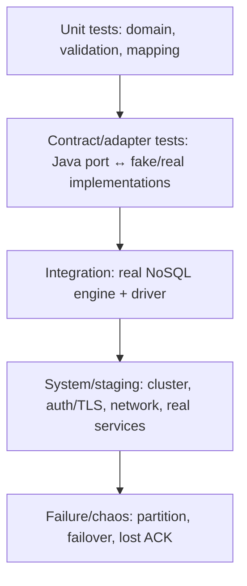
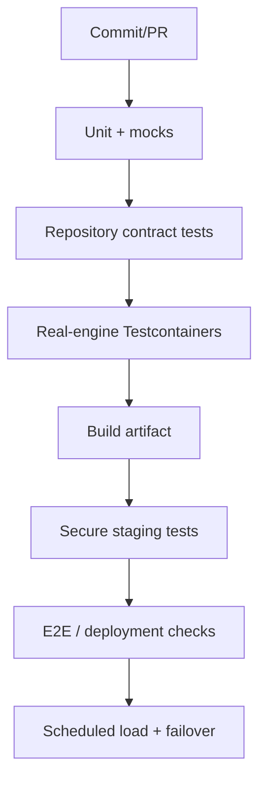

# Kiểm thử tích hợp với hệ thật và khác biệt của giả lập/mock

## 1. Test xanh nhưng production vẫn lỗi: vì sao?

Giả sử một ứng dụng Java dùng NoSQL để xử lý yêu cầu đặt hàng. Một lớp repository nhận lệnh:

```text
reserve(productId="P42", operationId="R100", quantity=1)
```

Trong unit test, ta dùng một `HashMap` giả lập database. Test gọi repository hai lần với cùng `operationId` rồi xác nhận chỉ có một bản ghi reservation. Mọi test đều xanh.

Sau triển khai, hai API instances nhận cùng yêu cầu đồng thời. Cả hai đọc “chưa có reservation”, cùng trừ số tồn, rồi mỗi bên ghi lên database qua driver. Sản phẩm bị giữ chỗ hai lần. Ở một trường hợp khác, query chạy được trên `HashMap` nhưng thất bại vì thiếu compound index hoặc vì consistency level của cluster không giống giả lập.

**Sai lầm nằm ở việc coi một test với đối tượng giả là bằng chứng rằng cơ sở dữ liệu thật sẽ hoạt động đúng.**

Một mock có thể trả chính xác những kết quả mà lập trình viên đã cài đặt vào nó. Một fake in-memory có thể mô phỏng hành vi đơn giản. Nhưng database thật còn có:

- Protocol và phiên bản driver.
- Codec/serialization và kiểu dữ liệu.
- Primary/partition/shard key, indexes và giới hạn kích thước.
- Atomicity và transaction isolation.
- Write concern, read concern và consistency.
- Retryable errors, timeout, unknown commit outcome.
- Connection pooling, DNS, TLS, authentication.
- Concurrent writes từ nhiều processes.
- Replication, failover, tombstone, TTL và compaction.
- Query planner, latency và giới hạn tài nguyên.

Bài học thuộc **Database No SQL — Kết nối Java**, giải thích **kiểm thử tích hợp trên database thật**, khi nào dùng mock/fake/emulator, cách viết test có tính lặp lại và cách tổ chức quy trình từ laptop tới CI và staging.

> **Nguyên tắc:** Dùng mock để kiểm logic ứng dụng và cách gọi collaborator; dùng hệ lưu trữ thật để kiểm những điều chỉ hệ lưu trữ thật có quyền quyết định.

### Mục tiêu học tập

Sau bài học, bạn có thể:

1. Phân biệt unit test, mock, stub, fake, emulator, integration test, contract test và end-to-end test.
2. Xác định các giới hạn của `HashMap`, embedded DB và service emulator so với NoSQL thật.
3. Chọn mức kiểm thử cho driver, schema/index, consistency, transaction, timeout và failover.
4. Viết JUnit 5 integration tests với một MongoDB thực chạy trong container.
5. Dùng Testcontainers theo vòng đời, resource cleanup và isolation phù hợp.
6. Hiểu khác biệt giữa Redis thật và fake, DynamoDB Local và DynamoDB managed, Cassandra single-node và multi-node.
7. Kiểm tra retries, duplicate requests, lost ACK, optimistic concurrency và idempotency.
8. Viết tests ổn định không phụ thuộc sleep cố định hoặc thứ tự chạy.
9. Tách tests cần Docker với tests cần credentials/môi trường managed.
10. Thiết kế CI gates, test matrix, observability, failure injection và checklist bảo mật.
11. Biết test nào chỉ xác nhận local engine semantics, test nào mới là chứng cứ về hệ thống phân tán.

## 2. Câu hỏi đầu tiên: đang muốn chứng minh điều gì?

Ví dụ service Java có logic:

```text
POST /orders
  -> validate payload
  -> check tenant
  -> build order
  -> save to NoSQL
  -> publish event
  -> return response
```

Một test “`OrderService.create()` gọi `repository.save()` đúng một lần” chỉ chứng minh một thuộc tính **của orchestration trong test**. Nó không chứng minh:

- `repository.save()` thực sự ghi dữ liệu đúng.
- Unique index đã được tạo.
- Write concern đủ mạnh.
- Codec serialize tiền/thời gian chính xác.
- Một retry sau timeout không tạo order thứ hai.
- Hai JVM chạy đồng thời không gây race.
- Event được phát khi DB commit.
- Production database user có đủ quyền.

**Test assertion phải khớp với phạm vi bảo đảm của môi trường.**

### 2.1. Ma trận câu hỏi và loại test

| Câu hỏi | Mức test thường phù hợp |
|---|---|
| Validation chặn quantity âm? | Unit với pure function |
| Service gọi repository khi hợp lệ? | Unit + mock |
| Codec Java ↔ BSON/JSON đúng? | Codec test và integration DB |
| Unique constraint hoạt động? | Integration với engine thật |
| `updateOne` + condition có atomic? | Integration DB, concurrency test |
| Retry sau unknown outcome có an toàn? | Integration + fault injection |
| Đọc từ replica có stale theo contract? | Multi-node integration/staging |
| Authentication/TLS có hoạt động? | Environment integration/staging |
| GSI/managed throughput throttling đúng? | Managed-service staging |
| Một node down, quorum có an toàn? | Multi-node fault/chaos test |
| Người dùng thấy thông báo đúng? | API/E2E theo user contract |
| Rebuild index không lộ dữ liệu? | E2E + staging/rehearsal |

### 2.2. Không có một bài test kiểm được tất cả

Dùng một MongoDB container để kiểm query/index là rất hữu ích, nhưng nó không tự chứng minh **hành vi của production sharded cluster gồm nhiều vùng**, vì topology và failure modes khác.

Ngược lại, nếu chỉ test trên managed staging thì feedback chậm và tốn tiền; những quy tắc tính toán thuần Java vẫn nên được test nhanh bằng unit tests.

## 3. Phân biệt mock, stub, spy, fake, emulator và real engine

### 3.1. Stub

**Stub** trả dữ liệu được chuẩn bị trước:

```java
when(repository.findById("O42"))
    .thenReturn(Optional.of(order));
```

Nó giúp kiểm logic branch, ví dụ nếu order đã `CANCELLED` thì controller trả `409`.

Stub không nhất thiết kiểm lời gọi hay mô phỏng một database thực.

### 3.2. Mock

**Mock** thường xác minh tương tác với dependency:

```java
verify(repository).save(any(Order.class));
verify(eventPublisher, never()).publish(any());
```

Mock hữu ích để kiểm:

- Service có gọi đúng collaborator?
- Branch lỗi có tránh gọi gateway?
- Timeout/failure được map thành mã lỗi mong muốn?
- Có truyền stable operation ID tới repository không?

Nhưng mock dễ tạo **implementation-coupled tests**: đổi cách thực thi hợp lệ có thể khiến test hỏng dù behavior vẫn đúng.

### 3.3. Spy

Spy quan sát/ghi nhận hành vi của object thật hoặc một phần thật. Spy không tự tạo semantics của database bên ngoài.

### 3.4. Fake in-memory

Một `InMemoryOrderRepository` dùng `Map<String,Order>` có thể cung cấp implementation đơn giản chạy thật.

```java
public final class InMemoryOrderRepository {
    private final Map<String, Order> orders = new HashMap<>();

    public void save(Order order) {
        orders.put(order.id(), order);
    }

    public Optional<Order> find(String id) {
        return Optional.ofNullable(orders.get(id));
    }
}
```

Fake có ích cho:

- Test use case không cần mở socket.
- Test domain rules nhanh.
- Demo API layer.
- Test offline algorithms.
- Test dependency injection.

Fake **không phải MongoDB, DynamoDB, Cassandra hoặc Redis** chỉ vì class implement cùng interface.

### 3.5. Emulator/local implementation

Một emulator có thể triển khai một phần public API của dịch vụ, ví dụ DynamoDB Local. Nó hữu ích để test HTTP/client SDK wiring và một phần data semantics, nhưng thường không tái tạo đầy đủ:

- IAM/service permission policies.
- Autoscaling/capacity/throttling.
- Multi-region replication.
- Physical partitions.
- Operational quotas/latency.
- Backup/PITR và disaster recovery.
- Một số background tasks/TTL behavior.

Mức tương đồng phụ thuộc **từng emulator, phiên bản và feature**.

### 3.6. Real database engine trong container

Container MongoDB/Redis/Cassandra chứa **phần mềm database thật** (nếu dùng official hoặc tương thích đúng image), nên test được nhiều vấn đề mà mock không thấy: protocol, codecs, indexes, command semantics, server errors.

Nhưng một container đơn lẻ không đại diện cho cluster sharded/multi-AZ/managed features. Cần phân biệt **real engine** với **production-equivalent topology**.

### 3.7. Managed staging environment

Dịch vụ NoSQL thật do cloud provider vận hành có thể giúp xác minh IAM, TLS, network, throughput controls, consistency modes và managed features. Đổi lại, nó tốn tiền, có quota, chạy chậm, dễ gặp drift và cần isolation.

### 3.8. Bảng so sánh

| Đặc tính | Mock/Stub | Fake memory | Emulator | Real engine container | Managed staging |
|---|---|---|---|---|---|
| Feedback nhanh | Rất nhanh | Rất nhanh | Nhanh | Trung bình | Chậm hơn |
| Java domain logic | Tốt | Tốt | Có thể | Có thể | Có thể |
| Driver protocol | Không | Không | Thường có API mô phỏng | Có | Có |
| Query/index semantics | Không | Có thể khác | Một phần | Khá sát engine | Sát môi trường đích |
| Atomicity/races | Do tác giả mock | Dễ thiếu | Theo emulator | Theo engine/topology | Theo service |
| IAM/TLS thật | Không | Không | Thường hạn chế | Cần cấu hình | Có thể kiểm đầy đủ |
| Failover/distributed behavior | Không | Không | Thường thiếu | Chỉ khi lập cluster | Phụ thuộc staging topology |
| Managed-specific behavior | Không | Không | Không đủ | Không đủ | Có |
| Chi phí/độ phức tạp | Thấp | Thấp | Vừa | Vừa | Cao |
| Bảo đảm “giống production” | Không | Không | Không hoàn toàn | Không hoàn toàn | Cũng cần kiểm config/topology |

## 4. Phân tầng bài test theo tốc độ và mục tiêu

Không cần tranh luận “mock xấu hay Testcontainers tốt”; mỗi lớp trả lời một câu hỏi khác.



### 4.1. Unit tests

Kiểm tra domain invariant không phụ thuộc database:

```java
public static long calculateTotal(long unitPriceMinor, int quantity) {
    if (unitPriceMinor < 0L || quantity <= 0) {
        throw new IllegalArgumentException();
    }
    return Math.multiplyExact(unitPriceMinor, quantity);
}
```

Test số âm, overflow, rounding policies. Không cần container.

### 4.2. Adapter contract tests

Cùng một tập tests mô tả behavior của interface repository, chạy với fake để feedback nhanh và với DB thật để kiểm semantics thực.

Ví dụ contract:

- `saveIfAbsent(id, value)` không overwrite record đã tồn tại.
- `find(id)` trả dữ liệu sau commit theo contract.
- `compareAndSet(id, expectedVersion, next)` chỉ một concurrent writer thắng.
- `delete(id)` tuân deletion semantics.
- Một retry cùng operation ID không tạo duplicate.

### 4.3. Integration tests

Chạy driver + repository + database engine thật, thường trong container, để kiểm:

- Schema/index setup.
- Insert, query, update, delete.
- Codec and result mapping.
- Atomic conditions.
- Transactions theo topology.
- Error codes.
- Connection lifecycle.

### 4.4. System/staging tests

Kiểm kết nối thực:

- Cloud IAM credentials.
- TLS certificate/CA và hostname.
- Firewall/VPC/DNS/service discovery.
- Credential rotation.
- Replica consistency/quorum.
- Driver failover discovery.
- Service quotas/rate limits.

### 4.5. Failure injection/chaos tests

Tập trung vào race và lỗi khó mô phỏng bằng mock:

- DB commit nhưng ACK mất.
- Replica bị cô lập.
- Primary election.
- Driver timeouts.
- Transaction conflict.
- Network latency/packet loss.
- Restart giữa migration.
- Duplicate event delivery.

Không đưa mọi chaos test vào vòng unit chạy sau mỗi edit; chúng thường là suite riêng có thời gian/permission phù hợp.

## 5. Thiết kế Java để test cả fake và real adapter

Một cấu trúc hướng ports-and-adapters giúp giữ domain logic độc lập với driver:

```text
Application / Domain
    |
    v
OrderRepository interface
    |                   |
    v                   v
FakeOrderRepository    MongoOrderRepository
(in-memory)            (MongoClient)
```

Interface:

```java
import java.util.Optional;

public interface OrderRepository {
    Optional<Order> find(String tenantId, String orderId);

    // Chỉ một caller được tạo record cho cùng logical key.
    boolean insertIfAbsent(Order order);

    // Trả true khi version match và update hợp lệ đã commit.
    boolean updateIfVersion(
        String tenantId,
        String orderId,
        long expectedVersion,
        Order next
    );
}
```

### 5.1. Domain service không tạo MongoClient trực tiếp

```java
public final class OrderService {
    private final OrderRepository repository;

    public OrderService(OrderRepository repository) {
        this.repository = repository;
    }

    public boolean create(Order order) {
        // Kiểm domain rules, rồi giao atomic uniqueness
        // cho repository/nguồn dữ liệu.
        return repository.insertIfAbsent(order);
    }
}
```

Nếu constructor tự kết nối DB, unit tests khó chạy và logic phụ thuộc môi trường.

### 5.2. Không để interface giấu sự khác nhau quá mức

`insertIfAbsent` cần đặc tả:

- Uniqueness theo trường nào? Tenant + orderId?
- Có được retry sau timeout không?
- Nếu request trùng payload khác thì xử lý sao?
- Khi replica không còn quorum thì trả gì?
- “Trả true” xảy ra sau mức commit nào?
- Có trạng thái outcome unknown không?

Một interface đẹp nhưng contract mơ hồ dễ khiến fake và real implementations không tương thích.

### 5.3. Fake có thể tuân contract ở mức cơ bản

Ví dụ fake dùng `ConcurrentHashMap.putIfAbsent` để mô phỏng tính atomic cục bộ. Tuy nhiên nó không tái tạo database network, persistence, transaction failure và distributed write concern.

### 5.4. Contract tests tránh quá gắn với implementation

Một test tốt kiểm hiệu ứng quan sát được:

```text
Given no order O42,
When two callers insert O42 concurrently,
Then exactly one insert is accepted
And one authoritative record exists.
```

Một test kém chỉ kiểm:

```text
verify(mongoCollection).insertOne(...)
```

vì có thể method được gọi nhưng DB từ chối, hoặc driver callback bị mock sai.

## 6. Trạng thái test fixture phải là dữ liệu có chủ đích

Một integration test cần biết:

- Database/namespace thuộc test nào.
- Schema/index đang ở trạng thái nào.
- Dữ liệu seed có ID gì.
- Test có quyền insert/delete/drop những gì.
- Dọn cleanup khi lỗi ra sao.
- Tests có thể chạy song song không.

### 6.1. Mỗi test có namespace độc lập

Ví dụ:

```text
test_4c2a/orders
test_7a11/orders
```

Hoặc mỗi test dùng tenant ID riêng, đủ để không đụng nhau.

Ưu điểm:

- Không phụ thuộc thứ tự chạy.
- Không phải dự đoán record còn lại.
- Có thể chạy parallel trong giới hạn nguồn.
- Cleanup xác định.

### 6.2. Không dùng một DB staging chung tùy tiện

Một test chạy `dropDatabase()` trên database dùng chung có thể xóa dữ liệu của người khác. CI/staging cần **allowlist tên tài nguyên**, credentials riêng, resource tags và guard trước cleanup.

### 6.3. Seed qua API hay trực tiếp DB?

- Seed qua repository/public API khi muốn test đường hành vi.
- Seed trực tiếp ở DB khi cần đặt một trạng thái đặc biệt mà API không cho tạo.
- Không dùng cách seed làm test bỏ qua index/schema không có ở production.
- Test migrations bằng schema versions thật, không chỉ inject objects in-memory.

### 6.4. Fixture sau test

Dù assertion fail, tài nguyên vẫn phải được dọn trong `finally` hoặc test lifecycle hooks. Container được Testcontainers dừng sau suite; nhưng staging data không tự biến mất trừ khi cleanup được đảm bảo.

### 6.5. Dùng timeouts để chặn test treo

Một DB unreachable có thể làm test đợi rất lâu nếu driver socket/server-selection timeouts mặc định cao. Cấu hình hợp lý cho suite và có error message chứa endpoint/phase, **không dùng timeout quá thấp để kiểm load/performance production**.

## 7. Chuẩn bị các phụ thuộc và Docker/Testcontainers

Có thể dùng:

- Java 17+.
- JUnit Jupiter 5.
- MongoDB Java Sync Driver.
- Testcontainers core + MongoDB module + JUnit Jupiter integration.
- Docker Engine hoặc môi trường container runtime tương thích.
- Gradle hoặc Maven.

Ví dụ khai báo dependency Gradle **về mặt ý tưởng** (hãy ghim phiên bản tương thích thực tế theo BOM/build của dự án):

```kotlin
dependencies {
    testImplementation("org.junit.jupiter:junit-jupiter:<pin-version>")
    testImplementation("org.testcontainers:junit-jupiter:<pin-version>")
    testImplementation("org.testcontainers:mongodb:<pin-version>")
    testImplementation("org.mongodb:mongodb-driver-sync:<pin-version>")
}

tasks.test {
    useJUnitPlatform()
}
```

`<pin-version>` là placeholder, **không phải version chạy được**. Tên artifact/packages giữa các major versions có thể thay đổi; cần tra documentation của phiên bản được chốt và giữ các Testcontainers modules đồng bộ phiên bản.

### 7.1. Tại sao không dùng tag `latest` cho image?

Image `mongo:latest` ngày mai có thể chạy major server mới, khiến test không còn lặp lại. Hãy ghim version/tag cụ thể, có thể ghim digest nếu quy trình cung ứng yêu cầu.

### 7.2. Khoảng cách phiên bản cần kiểm

- Driver và server có tương thích nhau?
- Test container có major/minor bằng production không?
- Feature nào chỉ có trên server mới?
- Authentication mechanism có hỗ trợ ở cả hai?
- Query planner/index semantics có khác version?
- Có migration khi nâng version?

Một test local trên MongoDB 7 không đủ chứng minh production MongoDB 8 không có thay đổi behavior. Tạo **version matrix** khi đang nâng cấp.

### 7.3. Không hard-code port

CI có thể có nhiều jobs đồng thời. Dùng mapped port do Testcontainers cung cấp thay vì giả định local server luôn ở `localhost:27017`.

### 7.4. Không phụ thuộc Docker local đang có dữ liệu

Container mới giúp tạo môi trường sạch; các test cần tự seed và tạo indexes, không dựa trên một database phát triển đã được tạo bằng tay nhiều tháng trước.

## 8. Ví dụ JUnit 5 + MongoDB Testcontainers thực

Đây là ví dụ **theo API Testcontainers MongoDBContainer kiểu 1.x** để minh họa cấu trúc. Khi dùng major Testcontainers mới, import/module/image compatibility có thể thay đổi; hãy chọn phiên bản được dự án chốt. MongoDBContainer thường thiết lập một MongoDB có replica-set mode phù hợp cho một số test, nhưng **không** tương đương production replica set ba nodes hay sharded cluster.

```java
import com.mongodb.MongoWriteException;
import com.mongodb.client.MongoClient;
import com.mongodb.client.MongoClients;
import com.mongodb.client.MongoCollection;
import com.mongodb.client.MongoDatabase;
import com.mongodb.client.model.IndexOptions;
import com.mongodb.client.model.Indexes;
import com.mongodb.client.model.Filters;
import com.mongodb.client.model.Updates;
import org.bson.Document;
import org.junit.jupiter.api.AfterEach;
import org.junit.jupiter.api.BeforeEach;
import org.junit.jupiter.api.Test;
import org.testcontainers.containers.MongoDBContainer;
import org.testcontainers.junit.jupiter.Container;
import org.testcontainers.junit.jupiter.Testcontainers;
import org.testcontainers.utility.DockerImageName;

import java.util.UUID;

import static org.junit.jupiter.api.Assertions.*;

@Testcontainers
public class MongoRepositoryIntegrationTest {
    @Container
    static MongoDBContainer mongo =
        new MongoDBContainer(
            DockerImageName.parse("mongo:7.0")
        );

    private MongoClient client;
    private MongoDatabase database;
    private MongoCollection<Document> orders;

    @BeforeEach
    void setUp() {
        // Testcontainers cấp endpoint sau khi container sẵn sàng.
        client = MongoClients.create(mongo.getReplicaSetUrl());

        String uniqueDatabase =
            "orders_it_" + UUID.randomUUID().toString().replace("-", "");

        database = client.getDatabase(uniqueDatabase);
        orders = database.getCollection("orders");

        // Test fixture phải tạo đúng index của ứng dụng.
        orders.createIndex(
            Indexes.ascending("tenantId", "operationId"),
            new IndexOptions().unique(true)
        );
    }

    @AfterEach
    void tearDown() {
        try {
            if (database != null) {
                database.drop();
            }
        } finally {
            if (client != null) {
                client.close();
            }
        }
    }

    @Test
    void uniqueIndexRejectsDuplicateBusinessOperation() {
        orders.insertOne(
            new Document("_id", "order-A")
                .append("tenantId", "tenant-17")
                .append("operationId", "create-42")
                .append("status", "CREATED")
        );

        MongoWriteException duplicate = assertThrows(
            MongoWriteException.class,
            () -> orders.insertOne(
                new Document("_id", "order-B")
                    .append("tenantId", "tenant-17")
                    .append("operationId", "create-42")
                    .append("status", "CREATED")
            )
        );

        assertEquals(11000, duplicate.getError().getCode());
        assertEquals(
            1L,
            orders.countDocuments(
                Filters.eq("tenantId", "tenant-17")
            )
        );
    }

    @Test
    void conditionalDecrementIsAtomicForOneDocument() {
        orders.insertOne(
            new Document("_id", "SKU-42")
                .append("available", 1)
                .append("revision", 7)
        );

        var predicate = Filters.and(
            Filters.eq("_id", "SKU-42"),
            Filters.eq("revision", 7),
            Filters.gte("available", 1)
        );

        var mutation = Updates.combine(
            Updates.inc("available", -1),
            Updates.inc("revision", 1)
        );

        assertEquals(
            1L,
            orders.updateOne(predicate, mutation).getModifiedCount()
        );

        // Một request cũ dựa trên revision 7 không thể trừ nữa.
        assertEquals(
            0L,
            orders.updateOne(predicate, mutation).getMatchedCount()
        );

        Document latest =
            orders.find(Filters.eq("_id", "SKU-42")).first();

        assertNotNull(latest);
        assertEquals(0, latest.getInteger("available"));
        assertEquals(8, latest.getInteger("revision"));
    }
}
```

### 8.1. Điều test unique index chứng minh

- Driver có thể kết nối tới MongoDB thật trong container.
- Lệnh tạo compound unique index hoạt động.
- Server áp dụng uniqueness cho hai documents có cùng `tenantId` và `operationId` dù `_id` khác nhau.
- Driver phát lỗi duplicate key thật, không phải lỗi do mock tự trả.
- Chỉ một document thuộc tenant được tạo theo fixture.

### 8.2. Điều test atomic decrement chứng minh

- Filter và update trên một document được server xử lý trong một atomic document mutation theo contract.
- Lần thứ hai với expected revision 7 không match sau khi revision đã tăng.
- Value cuối có đúng `available=0` và `revision=8`.

**Lưu ý:** nó **không** chứng minh hai requests với **hai operation IDs khác nhau** luôn giữ invariant trong workflow nhiều documents. Nó cũng không chứng minh cùng logical command retry sau timeout sẽ trả kết quả idempotent; cần một operation ledger/transaction hoặc protocol tương ứng.

### 8.3. Điều hai tests vẫn không chứng minh

- MongoDB production authentication/TLS.
- Failover của 3-node replica set.
- Unique index migration trên dữ liệu đã có trùng.
- Retry trong điều kiện network partition.
- Cross-shard transaction behavior.
- Read concern/replica lag.
- Performance dưới tải lớn.
- Cấu hình role/permission của service account.
- Các dữ liệu đã xóa được backup/restore ra sao.

Một integration test là **bằng chứng trong môi trường và điều kiện test**, không là chứng minh phổ quát.

### 8.4. Vì sao unique index quan trọng hơn một fake `containsKey`?

Một fake dùng:

```java
if (!map.containsKey(key)) {
    map.put(key, value);
}
```

có race nếu hai threads cùng check trước khi put. Database unique index thực thi constraint tại source. Thậm chí nếu fake dùng `putIfAbsent`, ta vẫn cần integration test xác minh **schema index đã thực sự được tạo ở môi trường DB**.

## 9. Không chỉ tạo container: test phải kiểm đúng cấu hình database

Một test chạy trên real engine nhưng **bỏ qua cấu hình quan trọng của production** có thể vẫn tạo cảm giác an toàn giả.

### 9.1. Indexes

Test nên biết:

- Unique index có mặt không?
- Compound index có đúng field order?
- Sparse/partial index có làm thay đổi uniqueness không?
- TTL index có được tạo?
- Index đã ready khi test bắt đầu?
- Query có thể chạy tốt dưới dữ liệu lớn không?

Một test trên collection 10 records không cho biết planner sẽ dùng index gì ở 10 triệu records.

### 9.2. Collation và string comparison

Case sensitivity, locale, Unicode normalization và ordering có thể khác Java `String.equals` hoặc Java `Collator`. Ví dụ hai email có được coi trùng hay không phải dựa trên business normalization và index collation thật.

### 9.3. Null, missing và empty

NoSQL documents có thể phân biệt:

- Field không tồn tại.
- Field tồn tại nhưng `null`.
- Empty string.
- Empty array.
- Field với kiểu khác, ví dụ number so string.

Fake POJO có thể chuyển tất cả thành Java `null` hoặc một giá trị mặc định, khiến query/filter khác server.

### 9.4. Number types và precision

`Document("amount", 100)` có thể lưu một kiểu số BSON khác `Document("amount", 100L)`. Các driver có thể map sang `Integer`, `Long`, `Decimal128` theo encoding. Tiền phải có representation/currency/rounding contract.

### 9.5. Time và timezone

- Java `Instant`, `LocalDateTime`, `OffsetDateTime` khác nhau.
- Date serialization thường cần quy ước UTC.
- TTL index có background deletion, không bảo đảm delete tức thì tại giây TTL.
- Client clock khác server clock.
- Query range liên quan DST/timezone.

Không viết test chỉ với các timestamps “đẹp” giữa trưa; cần boundary cases.

### 9.6. Nested arrays và query semantics

Filter “array contains” ở engine có thể khác tìm một object Java bằng `equals`. Compound/array indexes cũng có giới hạn riêng. Dữ liệu nested với missing/null nên có fixtures rõ.

## 10. Test serialization/codec Java ↔ NoSQL

Một test chỉ mock repository trả `Order` sẽ bỏ qua toàn bộ quá trình:

```text
Order Java
  -> codec/serializer
  -> driver protocol
  -> database persisted fields
  -> query response
  -> codec/deserializer
  -> Order Java
```

### 10.1. Những trường nên kiểm

| Trường | Rủi ro |
|---|---|
| `UUID` | Binary subtype, string representation, provider type |
| `Instant` | Millisecond/nanosecond precision và timezone |
| `BigDecimal` | Decimal128 vs string/double, rounding |
| `enum` | Rename enum làm lỗi dữ liệu cũ |
| `null` | Missing vs explicit null |
| `List<T>` | Mixed types, ordering và generic codec |
| `Map<String, ?>` | Field names và key restrictions |
| `boolean` | Default false khi field absent |
| Nested object | Schema evolution/unknown fields |
| ID | `ObjectId` vs string, stable business ID |
| Binary payload | Size, encoding, compression |

### 10.2. Round-trip không đủ nếu cả encoder và decoder sai giống nhau

Một codec có thể lưu số tiền thành double, rồi đọc lại thành BigDecimal mà vẫn so gần đúng ở test nhỏ. Cần kiểm cả **persisted representation** hoặc query từ raw driver, không chỉ so Java object trước/sau.

### 10.3. Version cũ và version mới

Production lưu documents lâu. Test nên seed bản ghi schema v1:

```json
{
  "_id": "O42",
  "schemaVersion": 1,
  "totalPrice": 120000
}
```

rồi kiểm reader v2/upcaster có thể đọc và ghi tiếp mà không phá dữ liệu cũ.

### 10.4. Test không nên mặc định thứ tự field trong JSON

Object field ordering không có ý nghĩa nghiệp vụ nếu schema không hứa. So canonical fields hoặc structural equality, tránh raw string equality dễ brittle.

## 11. Transaction tests: engine thật nhưng topology vẫn quan trọng

Một mock có thể thực thi:

```text
save(order)
decrement(stock)
return success
```

và tự giả định cả hai là atomic.

Database thật có thể:

- Chỉ atomic trong một item/document.
- Hỗ trợ transaction một số items/partitions, có giới hạn.
- Yêu cầu replica set hoặc deployment feature.
- Có transaction timeout/conflict.
- Có retries hoặc commit outcome chưa rõ.

### 11.1. Một transaction có hai writes

Pseudo-code:

```text
BEGIN TRANSACTION
  INSERT operation(op=R42)
    condition not_exists
  UPDATE inventory(SKU42)
    condition available>=1
    decrement available
  INSERT reservation(R42)
COMMIT
```

Integration test cần kiểm:

1. Khi đủ tồn, cả ba effects xuất hiện.
2. Khi hết tồn, không có partial committed effect.
3. Hai concurrent reservations khác IDs không oversell.
4. Retry cùng ID không trừ tồn lần hai.
5. Unknown commit được đối soát bằng operation ledger.
6. Transaction callbacks không tạo external side effect trùng.

### 11.2. Một container single-node replica set không bằng cluster thật

Có thể đủ để test transaction API và local atomic semantics. Nó không chứng minh hành vi khi:

- Primary bị cô lập.
- Replica lag.
- Election xảy ra giữa commit.
- Có cross-shard transaction.
- Một availability zone bị mất.

Phải có test thêm ở topology tương ứng hoặc staging.

### 11.3. Isolation levels không được đoán

Một database có transaction không có nghĩa isolation = serializable hoặc mọi đọc đều linearizable. Test phải đưa ra anomaly mà nghiệp vụ quan tâm (lost update, write skew, phantom, stale read) và kiểm theo contract của engine.

## 12. Test concurrent writes: nhiều requests khác kiểm nhiều retries

Hai tình huống khác nhau:

**Cùng logical operation ID gửi lại:**

```text
R42 attempt A
R42 attempt B
```

Mục tiêu: một business effect.

**Hai logical operations khác nhau cùng tranh tài nguyên:**

```text
R42 reserve 1 seat
R43 reserve 1 seat
available seats = 1
```

Mục tiêu: nhiều nhất một reservation thành công.

### 12.1. Bất biến cần assert

\[
confirmedReservations\le initialAvailable
\]

\[
stockFinal=stockInitial-\sum confirmedQuantities
\]

Dưới định nghĩa trạng thái committed và refunds/cancellations phù hợp.

### 12.2. Test đồng thời có ý nghĩa phải bắt đầu gần nhau

Có thể dùng `CountDownLatch` để tạo hai workers chạy tại cùng thời điểm. Tuy nhiên điều này chỉ tăng khả năng tranh chấp; một test chạy một lần **không chứng minh không có race** trong mọi interleavings.

### 12.3. Loop nhiều seed/interleavings

Dùng nhiều iterations, đa dạng request mixes, faults và áp lực tài nguyên. Cần giữ test durations có kiểm soát và không tự làm nghẽn CI.

### 12.4. Đừng lấy server response 2xx làm phép đếm duy nhất

Sau mất ACK, một write có thể commit dù client nhận timeout. Cần đọc ledger/status authoritative trước khi kết luận test đã có bao nhiêu committed operations.

## 13. Test lỗi mất ACK, timeout và unknown commit outcome

Một unit mock thường làm:

```java
when(repository.save(any())).thenThrow(new TimeoutException());
```

Điều này mô phỏng exception, nhưng không chứng minh timeout xảy ra **trước hay sau commit**.

### 13.1. Hai điểm inject khác nhau

**Trước DB commit:**

```text
Client -> API -> [network fails] -> DB never receives write.
```

**Sau DB commit, trước ACK:**

```text
Client -> API -> DB commits
                   -> [response lost]
Client sees timeout.
```

App có thể xử lý hai tình huống cùng một cách: **same logical ID, query or retry idempotently**. Nhưng test cần mô phỏng cả hai.

### 13.2. Failure injection proxy

Trong system integration, có thể đặt một **network proxy** giữa Java driver và DB, inject latency/disconnect/toxics vào đúng giai đoạn. Tuy vậy, chặn kết nối không tự đảm bảo timing ở sau commit; muốn kiểm chính xác một hậu điều kiện phải có log/commit evidence hoặc hook/instrumentation.

### 13.3. Dùng operation ledger

```text
R42:
  status=COMMITTED
  resultId=RSV42
```

Khi client timeout, retry với same `R42` có thể tra kết quả và không tạo thêm reservation.

### 13.4. Test external side effects riêng

DB commit một payment intent không chứng minh payment provider chỉ charge một lần. Cần provider test sandbox/idempotency contract, webhook duplicates và reconciliation.

## 14. Một bài kiểm thử repository contract có thể chạy với fake và real

Giả sử interface:

```java
interface KeyValueStore {
    boolean createIfAbsent(String key, String value);
    String get(String key);
}
```

Một abstract contract test có thể mô tả behavior chung:

```java
import org.junit.jupiter.api.Test;
import static org.junit.jupiter.api.Assertions.*;

abstract class KeyValueStoreContractTest {
    abstract KeyValueStore newStore();

    @Test
    void createIfAbsentDoesNotOverwrite() {
        KeyValueStore store = newStore();

        assertTrue(store.createIfAbsent("K1", "first"));
        assertFalse(store.createIfAbsent("K1", "second"));
        assertEquals("first", store.get("K1"));
    }
}
```

Hai subclass có thể tạo fake và real adapter.

### 14.1. Contract phải được mô tả đủ rõ

Nếu production adapter coi empty value là hợp lệ nhưng fake không, test cần bao phủ. Nếu real adapter có TTL hoặc read eventual, một interface `get()` chung với hợp đồng “ngay lập tức mới nhất” có thể là abstraction sai.

### 14.2. Khi nào không dùng cùng một contract?

Nếu có feature thật sự khác nhau:

- Strongly consistent vs eventual read.
- Multi-region replication.
- Transaction across items.
- Server-side TTL.
- Binary search.
- Query planner.

Hãy có **capability-specific integration tests** thay vì ép fake giả tất cả.

## 15. Redis thật so với fake in-memory

Redis thường được dùng cho cache, rate limit, distributed locks hoặc queues.

Một fake dạng Map có thể lưu key-value, nhưng Redis thật có:

- Các lệnh `SET NX PX`, `INCR`, `HSET`, `EXPIRE`, `TTL`.
- Atomic Lua scripts và transaction constraints.
- Serialization và byte/string encoding.
- Key expiration theo server/background processing.
- Memory eviction policy.
- Pub/Sub, Streams, consumer groups.
- Persistence (RDB/AOF), replication/failover.
- Redis Cluster hash slots, cross-slot limits.
- Network timeouts, reconnect và pool behavior.

### 15.1. Rate-limit counter

Fake:

```java
int count = map.getOrDefault(key, 0) + 1;
map.put(key, count);
```

không kiểm tính atomic của Redis `INCR` với nhiều clients và TTL/lifecycle cùng lúc.

### 15.2. TTL test dễ sai

Sai:

```java
Thread.sleep(1000);
assertNull(redis.get("K1"));
```

Nếu TTL đúng 1 giây, sleep 1 giây có race do scheduling/network. TTL deletion cũng có thể xảy ra theo cơ chế lazy/active expiration.

Tốt hơn: dùng **eventually assertion** trong một deadline rộng hơn, kiểm contract “sau khi expiry hiệu lực thì key không được đọc thấy” thay vì đòi đúng từng millisecond.

### 15.3. Lock test với Redis container không đủ chứng minh distributed fencing

`SET NX PX` có thể giúp acquire lease, nhưng worker cũ bị GC pause sau hết TTL vẫn có thể ghi sang DB khác. Test đó cần **tài nguyên đích thực và fencing** hoặc external operation idempotency.

### 15.4. Redis Cluster

Một single Redis container không bắt được lỗi `CROSSSLOT` do ứng dụng dùng multiple keys nằm trên hai slots khác nhau. Nếu production dùng Cluster, cần ít nhất một suite chạy Redis Cluster topology tương ứng.

## 16. DynamoDB Local so với DynamoDB managed

**DynamoDB Local** là công cụ rất hữu ích để thử Java AWS SDK, tables, keys, basic expressions và một số transaction behavior. Nhưng nó **không phải** một bản thu nhỏ đầy đủ của dịch vụ managed.

### 16.1. Những gì có thể thử local

- SDK endpoint override.
- Put/Get/Query/Scan trong phạm vi tính năng được hỗ trợ.
- Key schema và nhiều condition expressions.
- Serialization của AttributeValue.
- Một số transaction API usage.
- Query logic theo partition/sort key.
- Application mapping và contract.

### 16.2. Những gì cần managed-service tests

- IAM policies và role assumptions.
- TLS/VPC endpoints/network restrictions.
- Service quotas và throughput throttling.
- Provisioned/on-demand capacity.
- Adaptive capacity/hot partitions.
- Global table replication/consistency modes.
- Point-in-time recovery/backups.
- Một số background TTL/stream behaviors.
- Error/latency under real service load.
- Cross-region failover và operational constraints.

Không suy từ “unit test chạy trên DynamoDB Local thành công” rằng code không bao giờ gặp `ProvisionedThroughputExceededException` hoặc hot partition ở cloud.

### 16.3. Java AWS SDK 2.x: endpoint local

Ví dụ kết nối **mang tính cấu hình**:

```java
import java.net.URI;
import software.amazon.awssdk.auth.credentials.AwsBasicCredentials;
import software.amazon.awssdk.auth.credentials.StaticCredentialsProvider;
import software.amazon.awssdk.regions.Region;
import software.amazon.awssdk.services.dynamodb.DynamoDbClient;

DynamoDbClient dynamo = DynamoDbClient.builder()
    .endpointOverride(URI.create("http://localhost:8000"))
    .region(Region.US_EAST_1)
    .credentialsProvider(
        StaticCredentialsProvider.create(
            AwsBasicCredentials.create("dummy", "dummy")
        )
    )
    .build();
```

Ở đây `localhost:8000` chỉ là **ví dụ** nếu emulator được bind đúng port; khi chạy Testcontainers/CI cần dùng host + mapped port. Credentials `dummy` **chỉ dùng emulator**, không phải credentials production.

Đối với managed staging, không dùng `endpointOverride` giả và credentials tĩnh trong source code. Dùng credential provider chain/role với quyền tối thiểu.

### 16.4. Đừng khẳng định TTL local tự xóa đúng hạn

TTL có thể được hỗ trợ khác nhau giữa emulator và dịch vụ thật; ngay trong managed service, TTL expiration/deletion không đồng nghĩa xóa tức thời tại timestamp. Cần test ứng dụng không phụ thuộc hard guarantee sai.

## 17. Cassandra thật và giả lập query map

Cassandra có partitioning, consistency levels, clustering rows, tombstones, LWT và compaction. Một fake Java Map khó bắt được:

- CQL type compatibility.
- Primary key / clustering order.
- Query restrictions và indexes.
- Paging state.
- TTL/tombstone behavior.
- Batch semantics.
- Driver async/reactive execution.
- Protocol/session lifecycle.
- Multi-datacenter consistency.
- Replication và repair.

### 17.1. CQL schema ví dụ

```sql
CREATE TABLE orders_by_customer (
    tenant_id text,
    customer_id text,
    created_at timestamp,
    order_id uuid,
    status text,
    total_minor bigint,
    PRIMARY KEY (
        (tenant_id, customer_id),
        created_at,
        order_id
    )
) WITH CLUSTERING ORDER BY (created_at DESC, order_id ASC);
```

Một fake có thể trả “tất cả orders theo customer” dễ dàng, nhưng Cassandra chỉ truy vấn hiệu quả khi partition key và clustering/query phù hợp. Test thật sẽ phát hiện query sử dụng `ALLOW FILTERING` hoặc không phù hợp model, thay vì giấu lỗi.

### 17.2. LWT khác normal write

```sql
INSERT INTO order_claims (
    tenant_id, operation_id, status
) VALUES (
    't17', 'create-O42', 'COMMITTED'
)
IF NOT EXISTS;
```

Một test real cần kiểm `[applied]`/driver result và behavior cạnh tranh, thay vì fake `containsKey`.

### 17.3. Một container Cassandra không kiểm multi-node quorum

Single-node test có thể bắt lỗi CQL/codec/driver, nhưng không chứng minh:

- CL=QUORUM khi mất replicas.
- Read repair/consistency under partition.
- Cross-datacenter replication.
- Repair/compaction trong trạng thái tải thật.
- Token ring rebalance.

Hãy tách **CQL compatibility tests** và **distributed topology tests**.

## 18. MongoDB thật nhưng deployment khác production

MongoDB chạy bằng Testcontainers là engine thật, nhưng cần chú ý:

### 18.1. Standalone vs replica set

Transactions và change streams có yêu cầu deployment mode nhất định. Một MongoDB standalone không nhất thiết hỗ trợ mọi behavior của replica set. Dùng container setup phù hợp feature cần kiểm.

### 18.2. Read/write concerns

Test dùng defaults có thể khác production `majority`/`linearizable`/read preference. Nếu invariant cần majority write, test nên cấu hình/quan sát concern tương ứng, không vô tình dùng defaults rồi kết luận.

### 18.3. Sharding

Một single replica set container không bắt lỗi:

- Missing shard key.
- Scatter-gather queries.
- Cross-shard transactions.
- Hot shard due range key.
- Shard key update/migration constraints.
- Zone/shard routing differences.

Để kiểm sharded behavior, cần sharded environment hoặc staging test tương ứng.

### 18.4. Search/index

MongoDB query/index support khác search engine chuyên dụng. Nếu production dùng Atlas Search hoặc managed-specific feature, một MongoDB Community container không chắc cung cấp tính năng ấy.

## 19. Sai lệch về consistency, transaction và error semantics

Một fake có thể làm mọi reads tức thì:

```text
write(key,v2)
read(key) -> v2
```

Trong một eventual read path:

```text
write to leader/source -> ACK
read from lagging replica -> v1
```

Điều này **có thể hợp lệ** nếu API chỉ hứa eventual consistency. Test phải chọn assertion theo contract:

- Nếu cần read-your-writes, cấu hình session/routing/consistency phù hợp hoặc fallback authoritative.
- Nếu eventual read, dùng bounded eventual assertion hoặc watermark khi test trạng thái sau sync.
- Nếu yêu cầu linearizable read, dùng đúng primitive/mode, không coi một test đọc local là chứng minh.

### 19.1. “Nhìn thấy cuối cùng” không dùng sleep mù

Một helper:

```java
static void awaitUntil(
        java.time.Duration timeout,
        java.util.function.BooleanSupplier condition
) {
    long deadline =
        System.nanoTime() + timeout.toNanos();

    while (System.nanoTime() < deadline) {
        if (condition.getAsBoolean()) {
            return;
        }
        try {
            Thread.sleep(50);
        } catch (InterruptedException interrupted) {
            Thread.currentThread().interrupt();
            throw new AssertionError(
                "Interrupted while awaiting condition",
                interrupted
            );
        }
    }

    throw new AssertionError(
        "Condition did not become true before deadline"
    );
}
```

Đây là **polling tối giản cho ví dụ**, không phải cách xử lý tất cả exceptions. Với test framework, có thể dùng Awaitility hoặc polling helper hỗ trợ exception filtering/cancellation. Nếu condition query source có lỗi permission, không nên nuốt lỗi như “chưa kịp eventual”.

### 19.2. Đừng dùng eventual wait cho một thuộc tính cần atomic

Nếu hai reservations cùng thắng trong thời điểm đầu, rồi hệ tự sửa dữ liệu, một test chỉ đợi state cuối = 1 có thể che vi phạm: cả hai khách đã được ACK success.

Test hard invariant cần kiểm **lịch sử operation outcomes** và side effects, không chỉ đếm documents sau cùng.

## 20. Connection pooling và resource lifecycle

Một mock không mở TCP socket và không có connection pool. Production Java drivers có:

- Pool size.
- Connection establishment timeouts.
- Socket/read timeouts.
- Server selection timeout.
- Idle connection cleanup.
- DNS discovery và topology updates.
- Credential refresh.
- Heartbeats.
- Reactive/backpressure queues.
- Thread/event-loop lifecycle.

### 20.1. Không tạo client cho mỗi request

Một handler:

```java
public Order load(String id) {
    try (var client = MongoClients.create(uri)) {
        return query(client, id);
    }
}
```

tạo client/network pool cho từng request, thường tốn overhead và khó scale. Thông thường quản lý `MongoClient`/SDK client như một dependency có vòng đời application, đóng lúc shutdown; sessions/transactions có vòng đời ngắn riêng.

### 20.2. Integration test cần kiểm close/shutdown

- Client tạo được pool.
- Khi test/application shutdown, clients/sessions được đóng.
- Không để thread/pool rò rỉ.
- Không khởi tạo 100 clients khi concurrent requests đến.
- Kết nối hỏng được driver xử lý theo cấu hình.

### 20.3. Cẩn thận dùng singleton trong tests

Một static client có thể tiết kiệm startup nhưng đồng thời lưu cache/connection state giữa tests. Tách namespace dữ liệu, tránh thay global settings trong một test làm test khác fail.

### 20.4. Pool exhaustion test

Tạo concurrency cao hơn `maxPoolSize` rồi quan sát wait queue, timeout và backpressure. Một mock trả response tức thì sẽ không bộc lộ pool exhaustion.

## 21. Bảo mật: local test dễ che sai cấu hình

Một test engine local thường không bật authentication/TLS. Production có thể yêu cầu:

- DB username/password hoặc IAM role.
- Certificate CA.
- Client cert mTLS.
- SASL/Kerberos/OIDC.
- Secret rotation.
- VPC/firewall/security groups.
- RBAC với quyền tối thiểu.
- Audit logs.
- Encryption in transit.
- Tenant isolation.

### 21.1. Hai tầng test

**Local container:** kiểm query/index/schema và có thể thêm auth/TLS test riêng khi phù hợp.

**Secure staging:** kiểm service account thật chỉ được đọc/ghi collections/tables cho phép, kết nối TLS hostname hợp lệ và rotation/reconnect.

### 21.2. Test phải thất bại khi certificate sai

Nếu Java config bỏ qua TLS validation trong test rồi production cũng dùng, đó là lỗ hổng. Không dùng insecure trust manager làm mặc định hoặc để “chạy được trên CI”.

### 21.3. Không để secrets trong test code/logs

Dùng secret manager/CI secret injection, credentials có quyền tối thiểu và thời gian sống hạn chế. Test logs phải ẩn passwords, tokens và PII.

### 21.4. Tenant isolation là integration concern

Hai tenants có `orderId=O42` giống nhau. Câu query:

```text
findById("O42")
```

không scope `tenantId` có thể đọc nhầm dữ liệu khách hàng khác. Mock chỉ có một tenant sẽ không bắt lỗi. Integration test nên seed **nhiều tenants với IDs trùng**, xác minh mọi reads/updates/deletes đều bị scope đúng.

## 22. Cấu hình môi trường phải được kiểm rõ

Một integration test cần công bố:

```text
DB engine:
  product/version/image digest

Driver:
  Java runtime/version
  SDK/driver version

Topology:
  single node / replica set / cluster
  replication factor / zones

Consistency:
  write concern / read concern / CL

Security:
  auth/TLS enabled?
  test credentials scope?

Data:
  indexes, schema migration version
  seed dataset size

Faults:
  none / latency / disconnect / failover

Assertions:
  business outcomes, count, invariants
```

### 22.1. Đừng tạo giả lập theo ý muốn rồi coi là “giống production”

Nếu production dùng transaction, test fake phải mô phỏng contract ở mức tối thiểu nhưng integration mới có quyền chứng minh behavior engine. Nếu production dùng eventual reads, fake có thể luôn trả latest; domain tests vẫn hữu ích nhưng không được suy production read-your-writes từ chúng.

### 22.2. Test data không cần bằng production về kích thước ở mọi suite

Functional integration có thể dùng 10–100 records để kiểm semantics. Riêng performance/index/rebalance tests cần dataset và distribution đại diện để tránh query planner/caching khác nhau.

### 22.3. Tách hành vi chuẩn và behavior phụ thuộc cấu hình

Một error code do unique key là contract của engine; một độ trễ 50 ms là thuộc tính môi trường. Không viết test flaky `assertTrue(latency < 10ms)` trong shared CI trừ khi đó là suite benchmark có môi trường kiểm soát.
## 23. Chọn mức “hệ thật” theo rủi ro cần kiểm

Không phải integration test nào cũng phải chạy trên một cluster sản xuất thu nhỏ. Cần **map rủi ro → môi trường**.

| Rủi ro | Môi trường test phù hợp | Vì sao |
|---|---|---|
| POJO/JSON/BSON mapping sai | Real engine container | Codec thực chạy với driver |
| Thiếu index, sai unique key | Real engine container | Server mới enforce index |
| Query CQL sai partition key | Cassandra container | Query restrictions thực |
| DynamoDB ConditionExpression sai | DynamoDB Local, rồi managed test quan trọng | Local test expression, managed xác minh feature |
| IAM deny trong cloud | Managed staging | Emulator thường không áp IAM đầy đủ |
| TLS rotation | Secure staging | Cần chứng chỉ, trust chain, lifecycle |
| Redis hash slots | Redis Cluster test | Single Redis không có cluster rules |
| Cross-shard transaction | Sharded cluster | Single-node không mô phỏng |
| Quorum dưới partition | Multi-node cluster + faults | Cần nhiều replicas/quorum |
| Managed throttling | Real cloud staging | Emulator không tái hiện capacity policies |
| High-cardinality index performance | Benchmark với dữ liệu đại diện | Dataset nhỏ không đủ |
| Delete/TTL trong background | Real engine + bounded eventual tests | Timing không deterministic |
| Lost ACK sau commit | Fault-injection + operation ledger | Exception mock không biết commit boundary |
| Reconnect khi primary đổi | Multi-node failover test | Topology discovery thật |
| Data residency, privacy & grants | Secure staging/review | Không chỉ là response từ driver |

### 23.1. Một quy tắc thực dụng

- **Nhanh nhất:** unit + fake cho logic không phụ thuộc persistence.
- **Tin cậy về lệnh DB:** container real engine.
- **Tin cậy về triển khai:** staging với auth/TLS/topology/managed feature thực tế.
- **Tin cậy về phục hồi:** fault/chaos tests.
- **Tin cậy về SLA:** performance/load/capacity tests với workload đại diện.

Nếu một invariant chỉ được kiểm trên giả lập, đừng để trạng thái test “PASS” làm giảm nhu cầu kiểm tại authority thực.

### 23.2. Test coverage không bằng coverage failure modes

Một nghìn unit tests có thể không kiểm được duy nhất một failure window:

```text
DB commit succeeded.
ACK lost.
Client retried.
Business side effect duplicated.
```

Nên liệt kê failure modes rồi chọn test phù hợp, thay vì chỉ tối đa hóa số dòng code được chạy.

## 24. Tổ chức lifecycle Testcontainers để vừa nhanh vừa cô lập

Testcontainers thường làm:

1. Chọn image.
2. Khởi động container.
3. Đợi health/readiness.
4. Cấp endpoint động.
5. Kết nối driver.
6. Tạo schema/fixtures.
7. Chạy tests.
8. Cleanup/dispose.

### 24.1. Container một lần mỗi test method?

Khởi động DB cho mỗi method giúp cô lập mạnh nhưng chậm. Có thể dùng **một container cho test class** rồi mỗi method tạo database/namespace riêng, như ví dụ MongoDB.

### 24.2. Container một lần mỗi suite?

Nhanh hơn nữa, nhưng cần quản lý:

- Test isolation.
- Schema migrations.
- Connection pool state.
- Parallel test data.
- Cleanup khi test abort.
- Resource contention.
- Order-independent setup.

Không bật reusable container mode một cách mặc định trong CI nhiều jobs nếu mode đó có thể để trạng thái giữa runs; lựa chọn reuse phải phù hợp với hướng dẫn từng phiên bản và security policy.

### 24.3. Readiness không phải “port mở”

Một process mở TCP port chưa chắc đã:

- Join xong cluster.
- Elect primary.
- Tạo xong indexes.
- Apply xong migrations.
- Ready cho command cần thiết.

Wait strategy nên kiểm điều kiện đủ cho test, ví dụ ping, replica primary availability hay API health theo feature. Không dùng một `Thread.sleep(10_000)` cố định để đoán server đã ready.

### 24.4. Pin image digest khi cần repeatability

Tag `redis:7.2` vẫn có thể trỏ đến image được cập nhật. Nếu tổ chức yêu cầu tái lập nghiêm ngặt, dùng digest và quy trình cập nhật dependencies có kiểm soát.

### 24.5. Resource limits

CI host có giới hạn RAM/CPU. Chạy 20 MongoDB/Cassandra containers song song có thể gây out-of-memory và test flaky, không phải lỗi code. Dùng concurrency controls phù hợp và đo resource pressure của runner.

### 24.6. Network names và host mapping

- Java test chạy trên host: dùng `container.getHost()` + `getMappedPort(...)`.
- Java test chạy trong container khác: network alias nội bộ có thể thích hợp.
- Không dùng `localhost` trong một application container để trỏ sang DB container khác nếu chúng không chia network namespace.

### 24.7. Test data cleanup không xóa mọi thứ

Nếu staging database chia sẻ bởi nhiều teams, cleanup phải giới hạn vào prefix/tenant/test run ID đã cấp. Cần guard tránh lệnh `dropDatabase` đối với non-test environment.

## 25. Ví dụ JUnit 5 + Redis container cho command semantics

Ví dụ dưới đây dùng Testcontainers `GenericContainer` và Jedis-like client API. Cần ghim version tương thích trong dự án; constructor/connection API của Jedis có thể thay đổi theo major versions.

```java
import org.junit.jupiter.api.Test;
import org.testcontainers.containers.GenericContainer;
import org.testcontainers.junit.jupiter.Container;
import org.testcontainers.junit.jupiter.Testcontainers;
import org.testcontainers.utility.DockerImageName;
import redis.clients.jedis.JedisPooled;
import redis.clients.jedis.params.SetParams;

import static org.junit.jupiter.api.Assertions.*;

@Testcontainers
class RedisCommandIntegrationTest {
    @Container
    static GenericContainer<?> redis =
        new GenericContainer<>(
            DockerImageName.parse("redis:7.2-alpine")
        ).withExposedPorts(6379);

    @Test
    void setNxProtectsClaimOnOneRedisPrimary() {
        String host = redis.getHost();
        int port = redis.getMappedPort(6379);

        try (JedisPooled jedis = new JedisPooled(host, port)) {
            String key = "it:claim:R42";

            String first = jedis.set(
                key,
                "worker-A",
                SetParams.setParams().nx().px(10_000)
            );

            String duplicate = jedis.set(
                key,
                "worker-B",
                SetParams.setParams().nx().px(10_000)
            );

            assertEquals("OK", first);
            assertNull(duplicate);
            assertEquals("worker-A", jedis.get(key));
        }
    }
}
```

### 25.1. Test này chứng minh gì?

Nó xác minh command `SET key value NX PX` được Redis thực thi theo semantics trên **một Redis server** và Java client gửi/đọc đúng response trong cấu hình đó.

### 25.2. Test này không chứng minh gì?

- Claim vẫn tồn tại sau primary failover bất đồng bộ.
- Worker A mất TTL thì tự dừng.
- Một external MongoDB/payment target từ chối stale worker.
- `SET NX` tạo fencing token tăng đơn điệu.
- Redis Cluster có cùng behavior với multi-key atomic scripts.
- TTL biến mất tại một millisecond chính xác.

Nếu business yêu cầu distributed lock bảo vệ external state, cần **fencing/CAS tại đích** hoặc protocol khác. Không lấy bài test `NX` làm chứng minh “không bao giờ có hai actors ghi”.

### 25.3. Test lệnh trùng và TTL

Có thể thêm tests:

- `INCR` gọi hai lần tăng hai.
- `SET` cùng value không tăng giá trị.
- `SET EX` lặp lại có thể làm expiry đổi.
- `EXPIRE` và `TTL` phản ánh giới hạn timestamp.
- Lua compare-and-delete không xóa lock của owner mới.
- Multi-key scripts thỏa hash-slot constraints trong Cluster.

Chính các khác biệt này là lý do fake Map không được dùng làm oracle của Redis semantics.

## 26. Kiểm thử TTL: đừng chỉ kiểm đồng hồ

TTL thường gây nhầm lẫn vì “đã hết hạn” và “đã xóa vật lý” không nhất thiết là một thời điểm.

### 26.1. Ba hành vi khác nhau

1. **Không còn được đọc thấy:** expired item không xuất hiện ở API đọc hợp lệ.
2. **Đã bị xóa vật lý:** background cleanup đã giải phóng storage.
3. **Đã phát deletion event:** stream/CDC đã nhận notification.

Ba thời điểm có thể khác nhau tùy engine, service và index.

### 26.2. Test tối thiểu

- Seed record với TTL ngắn có ý nghĩa.
- Kiểm record hiện diện trước hạn nếu contract cho phép.
- Poll bounded đến khi không còn đọc thấy sau expiry.
- Không assert server xóa vật lý ngay tại mốc.
- Nếu workflow dựa vào delete event, test event stream riêng.
- Không dùng TTL làm primary guard cho nghiệp vụ tài chính/uniqueness lâu dài.

### 26.3. Clock injection cho domain, engine thực cho TTL semantics

Nếu business rule “hết hạn sau 30 phút” được tính trong Java, inject `Clock` để unit test deterministic:

```java
import java.time.Clock;
import java.time.Duration;
import java.time.Instant;

public final class ExpirationPolicy {
    private final Clock clock;

    public ExpirationPolicy(Clock clock) {
        this.clock = clock;
    }

    public boolean isExpired(Instant createdAt) {
        return !Instant.now(clock).isBefore(
            createdAt.plus(Duration.ofMinutes(30))
        );
    }
}
```

Trong integration test, vẫn cần kiểm encoding timestamp, server-side TTL và read semantics. **Fake Clock chỉ điều khiển logic Java, không điều khiển đồng hồ hoặc sweeper của DB container.**

## 27. Kiểm thử optimistic concurrency và lost update

Hai clients đọc order version 7. A đổi trạng thái thành `PAID`, B đổi thành `CANCELLED`.

Nếu repository update không có version condition:

```text
A: SET status=PAID
B: SET status=CANCELLED
```

B có thể ghi đè A; một fake chạy tuần tự sẽ không tạo interleaving này.

### 27.1. CAS với version

```text
UPDATE order
WHERE id=O42 AND version=7
SET status=PAID, version=8
```

Sau khi A commit, update của B dựa version 7 phải thất bại hoặc cần conflict resolution theo contract.

### 27.2. Integration test concurrent

Pseudocode:

```java
CountDownLatch ready = new CountDownLatch(2);
CountDownLatch go = new CountDownLatch(1);

// Hai tasks đợi cùng một tín hiệu để cố cạnh tranh.
Callable<Boolean> pay = () -> {
    ready.countDown();
    go.await();
    return repository.updateIfVersion(
        tenantId, orderId, 7L, paidOrder
    );
};

Callable<Boolean> cancel = () -> {
    ready.countDown();
    go.await();
    return repository.updateIfVersion(
        tenantId, orderId, 7L, cancelledOrder
    );
};

// Chạy hai tasks trong ExecutorService với >=2 workers,
// đợi ready, mở go, lấy cả hai results và verify:
//   successfulUpdates == 1
//   authoritative order.version == 8
//   status bằng state của writer thắng.
```

Đây là khung test, không phải một class compile đầy đủ. Trong thực tế dùng `ExecutorService`/`Future` với timeout và cleanup, không để thread sống sau test.

### 27.3. Cùng version nhưng hai hành động đều đáng giữ?

Có domain yêu cầu merge thay vì chọn một winner, ví dụ cộng hai số liệu telemetry. CAS giúp chặn lost update nhưng có thể cần retry theo latest state hoặc datatype commutative/CRDT. Test phải thể hiện **business semantics**, không chỉ ép “một writer luôn thắng” nếu sản phẩm muốn cả hai đóng góp.

### 27.4. Test transaction write skew

Nếu invariant trải qua hai records, CAS mỗi record có thể chưa đủ. Hai transactions cập nhật hai items khác nhau nhưng cùng đọc điều kiện có thể cùng commit dưới một số isolation models. Cần một test cụ thể cho write skew và transaction/isolation mức engine.

## 28. Idempotency: lệnh lưu trữ không đủ bảo vệ cả workflow

Ví dụ service:

```text
1. INSERT order O42
2. DECREMENT inventory
3. PUBLISH OrderCreated
4. SEND email
```

Một mock chỉ `verify(orderRepository).insertOne(...)` không nói gì về lỗi giữa các bước.

### 28.1. Test operation ID ổn định

Khi cùng logical request được gửi hai lần:

```text
operationId = "create-O42-v1"
```

Phải xác minh:

- Cùng key + payload → cùng business result.
- Cùng key + payload khác → conflict.
- Hai attempts đồng thời → một effect.
- Crash sau claim nhưng trước side effect → recoverable.
- DB commit, ACK mất → retry không tạo second order.
- Broker redelivery → không duplicate downstream effect.

### 28.2. Operation ledger

Một ledger:

```json
{
  "tenantId": "t17",
  "operationId": "create-O42-v1",
  "fingerprint": "sha256:<digest>",
  "state": "COMMITTED",
  "resultId": "O42"
}
```

phải có atomicity phù hợp với business mutation. Nếu ledger và mutation nằm ở hai stores khác nhau, integration test cần thử crash giữa hai bước.

### 28.3. Outbox và inbox

- **Outbox:** ghi business state và event intent cùng commit; publisher có thể retry.
- **Inbox/dedup:** consumer xử lý event cùng ID một lần theo effect contract.
- **Không** coi outbox đồng nghĩa broker không bao giờ giao event hai lần.
- **Không** coi một message đã ACK nghĩa database target đã commit nếu consumer ACK sai thứ tự.

### 28.4. Test trong một JVM chưa đủ

Nếu dedup lock là `synchronized` hoặc một `ConcurrentHashMap` local, hai API instances vẫn có thể thực hiện trùng. Integration test với hai independent clients/processes giúp lộ giả định sai.

## 29. Fault-injection: kiểm đường phục hồi, không chỉ happy path

Một test có thể “làm hỏng mạng” bằng nhiều cách:

- Chặn kết nối mới.
- Cắt TCP đang dùng.
- Tăng latency.
- Giảm bandwidth.
- Inject packet loss.
- Pause container/process.
- Kill và restart node.
- Cô lập một replica khỏi quorum.
- Dừng broker giữa publish và ACK.
- Chặn response chỉ sau khi DB ghi.

Không phải tất cả đều tương đương.

### 29.1. Toxiproxy hoặc network proxy

Testcontainers có module/cách kết hợp network proxy tùy phiên bản, cho phép ứng dụng kết nối DB qua proxy. Có thể inject toxic như latency hoặc cut connection.

**Điểm mạnh:** mô phỏng transport error thật ở driver.

**Giới hạn:** chưa chắc biết write đã commit trước khi response mất. Phải xác minh authoritative state và operation ledger.

### 29.2. Một bảng điều kiện pass/fail

| Fault | Kỳ vọng an toàn | Điều còn phải đo |
|---|---|---|
| Socket đứt trước gửi | Không có business effect nếu chưa tới source | Retry same ID |
| Socket đứt sau commit | Không tạo effect thứ hai | Unknown outcome resolution |
| Primary election | Không có divergent committed state theo contract | Driver retry/selection |
| Follower lag | API không hứa mới hơn thực tế | Read routing/session |
| Broker redelivery | Consumer dedup effect | Inbox/ledger |
| Duplicate HTTP requests | Một logical operation | Atomic claim |
| DB restart giữa index build | Không phục vụ schema chưa ready | Migration state |
| Redis lock TTL hết | Stale worker không ghi được target | Fencing |
| CDC lag | Read model stale trong SLO hoặc degraded | Watermark/reconcile |
| Cloud `429`/throttle | Backoff/jitter không retry storm | Latency/error budget |

### 29.3. Safety và availability cần tách

Một cluster minority từ chối ghi có thể là **hành vi đúng** nếu giữ consistency. Không đánh dấu test “thất bại” chỉ vì request không luôn 2xx trong network partition, khi contract yêu cầu fail closed.

### 29.4. Khởi động lại không đủ kiểm partition

Kill một process khác với việc process vẫn sống nhưng mất mạng đến quorum, hoặc chỉ nhìn thấy một chiều. Split-brain/stale lease có thể xuất hiện chỉ trong partial reachability.
## 30. Kiểm thử multi-node, replication và failover

Một container single-node có thể dùng database engine thật nhưng **không đủ để kiểm chứng các bảo đảm phụ thuộc replication hoặc quorum**.

### 30.1. Replica set

Một thử nghiệm failover cần:

1. Khởi tạo topology nhiều members theo phiên bản/deployment đang dùng.
2. Dùng API phát hiện primary thay vì giả định hostname.
3. Gửi writes với write concern cần thiết.
4. Cắt kết nối hoặc dừng primary có kiểm soát.
5. Đợi election theo điều kiện và deadline rõ.
6. Xác minh driver reconnect/topology refresh.
7. Đối soát các writes đã ACK và những outcomes không rõ.
8. Khôi phục member, kiểm dữ liệu và kết quả retry.

### 30.2. Sharded cluster

Kiểm tra shard key, targeted query vs scatter-gather, hot partition/range, migration, query/index restrictions và transaction xuyên shard. Không suy từ một bộ dữ liệu 100 records trên một shard ra hiệu năng trong cluster lớn.

### 30.3. Consistency level

Một test Cassandra RF=1, CL=ONE không chứng minh behavior của RF=3, CL=QUORUM lúc mạng chia. Một test MongoDB standalone không chứng minh automatic primary election. Đối với một API có invariant mạnh, chạy ít nhất một suite theo topology và consistency thực tế.

### 30.4. Mạng bất đối xứng

Kill process không giống việc process vẫn sống và còn đường tới một vài services nhưng không tới quorum. Các tình huống split-brain/stale owner thường cần fault injection dạng network partition, không chỉ restart container.

### 30.5. Safety guard

Chaos/failover chỉ được chạy trên môi trường được phép. Test phải xác nhận cluster ID/account/environment trước khi ngắt mạng, kill node hoặc dọn dữ liệu; **mặc định từ chối** nếu có khả năng ảnh hưởng production.

## 31. Functional integration test không phải performance benchmark

Một test:

```text
INSERT 1 record
GET record
assertEqual(...)
```

chứng minh một chức năng nhỏ, không chứng minh p99 dưới 100 ms với 100 triệu records.

### 31.1. Dataset nhỏ che các vấn đề thật

- Mọi dữ liệu fit cache.
- Query planner chọn scan thay vì index.
- Không có compaction hoặc tombstone pressure.
- Chưa có hot shard.
- Không thấy write amplification/index contention.
- Không có read/write concurrency thực.

### 31.2. Tách suite performance

Benchmark cần dataset và access distribution gần thực tế, warm-up/steady state, read/write mix, offered load, bytes, driver pool, hardware, index, consistency và p95/p99/errors.

Không viết `assertTrue(queryLatencyMs < 20)` trong một shared CI runner rồi coi đó là performance SLO. Sử dụng test environment có kiểm soát và thống kê nhiều lần.

### 31.3. Kiểm query plan riêng

Có thể xem `explain`/execution metrics trên engine thật để phát hiện document scans, sorting, query fan-out hoặc index không phù hợp. Format query plan có thể khác phiên bản; tránh hard-code toàn bộ raw output làm assertion mong manh.

## 32. Test migration và dữ liệu cũ

Production không phải database trắng. Integration suite nên thử:

- Database chưa có schema, migration tới phiên bản hiện tại.
- Database ở phiên bản N-1, migration lên N.
- Documents v1 với missing fields, schema v2 reader.
- Legacy duplicate records trước khi tạo unique index.
- Chạy migration lại sau restart.
- Migration timeout ở giữa, recovery/retry.
- Hai app versions hoạt động đồng thời trong rolling deployment.
- Xóa/đổi tên index không làm query hiện tại fail.
- Khôi phục từ backup cũ và áp dụng lại tombstones/deletions.

### 32.1. Unique index migration

Một fake không thể diễn tả đầy đủ lỗi index build trên dữ liệu trùng. Hãy seed một collection thật có hai records cùng unique business key, rồi chạy migration và xác minh cleanup/rollback strategy.

### 32.2. Schema v1/v2

Nếu v1 ghi `totalPrice` còn v2 dùng `totalMinor` và `currency`, test phải kiểm backward reader compatibility, upcasting, mixed-version writes và thời điểm có thể bỏ field cũ.

### 32.3. Giao dịch migration

Nhiều cơ chế DDL/index build không nằm trong cùng transaction như một document update. Không giả định mọi thay đổi schema có thể rollback atomically; xem contract cụ thể của engine.

## 33. Đưa integration tests vào CI

Một chiến lược chia tầng:



### 33.1. Chạy cái gì ở mỗi commit?

- Unit và domain tests.
- Driver/codec/index/repository tests quan trọng.
- Critical transaction and idempotency scenarios trên engine thật.

### 33.2. Chạy cái gì khi release?

- Staging IAM/TLS/network.
- Deployment health, driver compatibility.
- Source/target consistency/read API.
- Migration từ dữ liệu cũ.
- Authentication và tenant isolation.

### 33.3. Chạy theo lịch hoặc trước thay đổi lớn

- Leader election/partition/chaos.
- Load, capacity và hot-key skew.
- Backup/restore/reconciliation.
- Major driver/server version matrix.

### 33.4. CI runner cần gì?

Testcontainers cần container runtime tương thích, khả năng pull image, CPU/RAM/disk, cổng mạng và quyền phù hợp. Dùng test resource names riêng mỗi job, cleanup có guard và image versions ghim cố định.

**Không thay real-engine test bằng mock rồi vẫn báo mức coverage như cũ** nếu runner thiếu Docker. Gắn job là skipped/blocked rõ ràng hoặc chạy trên runner thích hợp.

### 33.5. Bảo mật trong CI

Sử dụng test credentials, least privilege, secrets injection, log masking. Không sử dụng production connection string cho test có `dropDatabase` hoặc fault injection.

## 34. Xác minh kết nối Java trong staging

Một kết nối có nhiều tầng:

```text
Configuration
  -> DNS / routing
  -> TLS handshake / CA validation
  -> Authentication
  -> Server selection / primary discovery
  -> Authorization
  -> Write / read / conditional update
  -> Commit / response
```

### 34.1. Ping chưa đủ

Một `ping` thành công không chứng minh user có quyền ghi hoặc tạo index. Có thể chạy một canary trong namespace test cô lập: insert, read theo consistency contract, conditional update, delete, cleanup.

### 34.2. Không đụng dữ liệu kinh doanh

Canary không được tạo payment hoặc gửi email thật. Nếu health test có side effect nghiệp vụ, cần thiết kế lại.

### 34.3. Phân loại lỗi

- DNS/network route.
- TLS certificate/hostname.
- Authentication.
- Authorization.
- Server selection/timeout.
- Connection pool exhaustion.
- No quorum/primary unavailable.
- Unique/conditional conflict.
- Unknown commit outcome.

Không map tất cả thành một `DB_DOWN` nếu application cần phân biệt retryable vs permanent vs unknown.
## 35. Flaky tests: những nguồn nhiễu thường gặp

**Flaky test** là test cùng logic có thể pass/fail không ổn định vì timing, shared state, môi trường hoặc race.

### 35.1. Sleep cố định

Sai:

```java
Thread.sleep(200);
assertEquals("READY", loadState());
```

CI chậm có thể khiến điều kiện chưa đạt. Dùng bounded polling chờ điều kiện thật, với deadline và error detail. Nếu contract cần strong read, không dùng eventual polling để che inconsistency.

### 35.2. Test dùng chung ID

Hai tests cùng tạo `orderId=O42` trên database chung rồi chạy song song có thể conflict. Dùng ID/namespace độc lập và cleanup có giới hạn.

### 35.3. Phụ thuộc thứ tự tests

`testUpdate()` không được giả định `testCreate()` đã chạy trước. Từng test tự chuẩn bị trạng thái ban đầu, hoặc một scenario test thể hiện toàn workflow trong cùng test.

### 35.4. TTL/background work

Đừng assert một key bị xóa vật lý tại chính xác giây TTL. Kiểm API contract và window hợp lý; engine có lazy/background expiry.

### 35.5. Runner quá tải

Cassandra/MongoDB khởi động chậm vì thiếu RAM/CPU không đồng nghĩa adapter logic sai. Thu thập startup logs, giới hạn concurrent containers và đo runner resources.

### 35.6. Retry toàn bộ test cho đến khi xanh

Đây là cách che bug. Retry chỉ nên áp dụng cho các thao tác transient hoặc điều kiện eventual đã định, không tự rerun toàn bộ assertion an toàn mà không điều tra race.

### 35.7. Lỗi hiếm sau restart

Test thường xanh nếu container mới sạch, nhưng restart cùng persisted volume có thể xuất hiện migration/version/tombstone issues. Có thể cần suite riêng giữ dữ liệu qua restart/upgrade, không chỉ ephemeral clean startup.

## 36. Dữ liệu thử cần phản ánh sự phức tạp của NoSQL

Một vài fixtures “hợp lệ bình thường” chưa đủ. Hãy seed:

- Hai tenants cùng business ID.
- Null, missing, empty string, empty list.
- Unicode tiếng Việt, dấu, emoji, tên trường đặc biệt.
- Integer lớn, Decimal128/BigDecimal, currency representation.
- Timestamp UTC, offset, leap day, DST nếu domain dùng.
- Duplicate logical operation ID.
- Hai clients cùng sửa một version.
- Low-cardinality và hot partition keys.
- Monotonic keys trên range-sharded systems.
- Document nhiều nested arrays.
- Record gần size limit và bulk partial failures.
- TTL gần hết hạn, deletion/tombstone.
- Schema v1/v2 cùng tồn tại.
- Retry với payload khác cùng idempotency key.
- Stale data ở một replica/read model.

### 36.1. Property-based testing

Có thể sinh nhiều payloads thỏa schema rồi kiểm:

1. Serialize Java → engine thật.
2. Read → Java và so semantic equality.
3. Verify persisted fields/types.
4. Query theo business key.
5. Enforce tenant isolation.
6. Conditional update bảo vệ revision.

Generator cần tôn trọng constraints; random strings không hợp lệ hết sẽ chỉ test validation error path.

### 36.2. Metamorphic testing

Khi kết quả chính xác khó viết sẵn, dùng quan hệ:

- Hai `createIfAbsent` cùng key → nhiều nhất một record.
- Retry cùng event → không có second business effect.
- Áp update v19 rồi v17 → không regress nếu contract versioned projection.
- Delete rồi replay update cũ → không hồi sinh nếu tombstone guard tồn tại.
- Pagination trên snapshot cố định → không lặp/thiếu IDs.
- Một callback transaction chạy lại → không gửi provider charge lần thứ hai.

### 36.3. Functional dataset khác performance dataset

Giữ integration tests nhỏ/nhanh, còn query-plan/load suite có data size và distribution đại diện. Không yêu cầu CI PR tạo hàng triệu records cho mỗi commit.

## 37. Error taxonomy và retry classification

| Lỗi | Xử lý hợp lý |
|---|---|
| Duplicate key | Có thể là prior success hoặc conflict; tra operation ID |
| Conditional check failed | Kiểm business state/revision; không retry nóng vô hạn |
| Invalid schema | Lỗi payload/migration, không retry nguyên trạng |
| Authentication denied | Kiểm credentials, không retry dồn dập |
| Authorization denied | Kiểm role/policy, không tự đổi quyền |
| Timeout sau khi gửi | **Outcome unknown**; idempotent retry/status lookup |
| No primary/quorum | Fail closed hoặc retry bounded theo contract |
| Throttling/429 | Backoff/jitter, retry budget |
| Transaction transient conflict | Retry theo SDK contract, không side effect ngoài callback |
| TTL/index not ready | Chờ readiness hoặc fail deployment |
| Quota/disk exhausted | Operational intervention/backpressure |
| Unknown commit result | Query ledger, không xem là aborted |
| Poison event/schema unknown | Quarantine/DLQ + replay after fix |

### 37.1. Test mapping của adapter trên driver errors thật

Mock ném `IllegalStateException` nhưng driver thật có exception class, code và error labels riêng. Một integration test cần kiểm adapter map đúng failure categories và giữ cause/tracing thông tin quan trọng.

### 37.2. Driver retry khác business retry

Driver có thể tự retry một command theo khả năng. Application có thể retry toàn use case gồm ba commands và payment call. Không coi tính retryable của một lệnh là giấy phép lặp toàn transaction nghiệp vụ.

### 37.3. Không thay đổi consistency để khiến test chạy được

Nếu production bắt buộc majority/quorum, test dùng cấu hình yếu hơn chỉ xác minh semantics yếu hơn. Cần topology tương ứng hoặc ghi rõ suite không bao phủ strong commit.

## 38. Observability của integration suites

Một suite đáng tin nên giúp trả lời:

- Nó đã chạy trên engine nào và version nào?
- Driver Java phiên bản nào?
- Single-node hay multi-node?
- Auth/TLS có bật?
- Index/migration versions nào?
- Test ID/namespace nào?
- Error nào do driver, engine, networking hoặc assertion?
- Có test nào bị skipped?
- Cleanup thành công không?

Ví dụ metadata:

```json
{
  "suite": "MongoRepositoryIntegrationTest",
  "test": "uniqueIndexRejectsDuplicateBusinessOperation",
  "engine": "MongoDB",
  "engineVersion": "pinned-by-image",
  "driverVersion": "pinned-by-build",
  "topology": "testcontainers-replica-set",
  "testRunId": "it-7eaf",
  "result": "PASS"
}
```

### 38.1. Tài liệu lỗi

Lưu container logs/DB error codes, timings, retry attempts, transaction result, pool stats, relevant trace IDs, nhưng **che passwords, tokens và dữ liệu cá nhân**.

### 38.2. Trạng thái pipeline cần trung thực

Một pipeline báo xanh vì integration suite bị skip do không có Docker không chứng minh hệ thật đã được kiểm. Phân biệt:

- PASS — suite đã chạy và đạt.
- FAIL — có assertion hoặc infrastructure failure.
- BLOCKED — không có tài nguyên để chạy.
- SKIPPED — chủ động không chạy theo policy.

### 38.3. Flake rate là metric quan trọng

Theo dõi số tests có pass/fail không ổn định, startup timeout, image pull failures, resource leak và test cleanup failures. Không để flake kéo dài khiến team bỏ qua failures thật.

## 39. Một kịch bản tổng hợp: giữ chỗ sản phẩm bằng Java và NoSQL

### 39.1. Yêu cầu

Một mặt hàng có `available=1`. Hai users khác nhau không được cùng nhận `CONFIRMED`. Một user retry cùng `operationId` không bị trừ tồn lần hai.

### 39.2. Domain API

```text
reserve(tenantId, sku, quantity, operationId)

Kết quả:
  CONFIRMED(reservationId)
  OUT_OF_STOCK
  IN_PROGRESS
  CONFLICT_DIFFERENT_PAYLOAD
  RETRYABLE_ERROR
  OUTCOME_UNKNOWN
```

### 39.3. Unit/mock tests

- Quantity >0.
- IDs và tenant có format hợp lệ.
- Request fingerprint ổn định.
- Mapping error domain đúng.
- Retry giữ nguyên operation ID.
- Event publisher không bị gọi khi validation fail.

### 39.4. Fake repository tests

- `insertIfAbsent` không overwrite.
- Same operation replay cùng result.
- Same ID khác quantity bị conflict.
- Đã COMMITTED thì handler không chạy side effect lại.

### 39.5. Real-engine integration tests

- Unique index `(tenantId, operationId)` tồn tại.
- Condition `available>=quantity` atomic.
- Transaction nếu được hỗ trợ không có partial effects khi một bước fail.
- Hai writers khác IDs concurrent, nhiều nhất một thành công.
- Cùng ID concurrent, chỉ một reservation có hiệu lực.
- Stored result/codec mapping đúng.
- Duplicate/conditional failure mapping chính xác.

### 39.6. Failure tests

- Commit xong mất ACK: retry không trừ lần hai.
- Crash sau claim: operation có recovery policy.
- Failover khi commit: đối soát confirmed vs unknown.
- Event redelivery: không tạo duplicate downstream effect.
- Stale worker: target fencing/conditional update.
- Provider timeout: stable payment intent/lookup, không tạo charge mới.

### 39.7. Assertion thật

\[
confirmedReservations \le initialAvailable
\]

\[
availableFinal
=
initialAvailable-\sum confirmedQuantities
\]

theo định nghĩa business state tại authoritative source. Ngoài trạng thái cuối, kiểm **lịch sử ACK** để không có hai khách từng được xác nhận khi chỉ có một món.

### 39.8. Kết luận của scenario

Unit tests cho biết service biết gọi đúng method. Real-engine integration cho biết DB cưỡng chế uniqueness/CAS/transaction. Failure tests cho biết retry và failover không phá business contract. Không mức nào tự thay thế toàn bộ mức còn lại.

## 40. Ma trận test cho một dịch vụ Java–NoSQL

| Hạng mục | Mock/Fake | Engine container | Multi-node/managed staging |
|---|---|---|---|
| Validation/domain calculations | Chính | Không bắt buộc | Không |
| Service orchestration | Chính | Có thể | Không |
| Codec/serialization | Không đủ | Chính | Version compatibility |
| Query/index | Không đủ | Chính | Performance/managed features |
| Unique key/CAS | Không đủ | Chính | Topology critical cases |
| Transaction | Không đủ | Trong supported mode | Cross-shard/failover |
| TTL behavior | Fake Clock cho Java | Real TTL API semantics | Managed/background behavior |
| Retry after timeout | Mock exception branch | Fault proxy | Unknown commit/failover |
| Client pool/socket timeouts | Không đủ | Có thể | Nên kiểm |
| Redis Cluster slots | Không | Cluster setup | Production-like Cluster |
| DynamoDB IAM/throttle | Không | Local emulator hạn chế | Managed service |
| Cassandra quorum/multi-DC | Không | Single node không đủ | Multi-node topology |
| Schema migration | Unit upcaster | Real DB | Staging rehearsal |
| End-to-end idempotency | Domain logic | Business effects | Failure matrix |
| Availability/throughput SLA | Không | Smoke | Dedicated load/chaos |
## 41. Các phản mẫu thường gặp

| Phản mẫu | Vì sao nguy hiểm | Giải pháp |
|---|---|---|
| “Mock xanh là database đúng” | Mock chỉ trả output đã lập trình | Test driver/engine thật |
| Fake Map xem như transaction | Không có crash/network/isolation | Real-engine transaction tests |
| Emulator xem như cloud managed | Thiếu IAM, autoscale, multi-region | Managed staging |
| Một container xem như cluster | Không có failover/quorum | Multi-node test |
| Không tạo index trong setup | Bỏ lỡ uniqueness/query plan | Migration/index fixture |
| Dùng standalone để test tính năng replica set | Không đúng deployment mode | Chọn topology đúng |
| Redis standalone để kiểm Cluster multi-key | Không có cross-slot rules | Redis Cluster suite |
| DynamoDB Local để kết luận throughput | Không mô phỏng capacity managed đầy đủ | Cloud capacity test |
| CQL fake query mọi field | Che giới hạn partition-key query | Test CQL trên Cassandra |
| Chỉ kiểm successful request | Không biết state sau timeout | Operation ledger/authoritative read |
| Mất ACK thì retry bằng ID mới | Tạo operation mới | Stable idempotency key |
| Cho rằng CAS là idempotency đầy đủ | Retry conflict không biết prior success | Ledger/status lookup |
| Callback transaction gửi email/charge | Callback có thể chạy lại | Outbox/intent workflow |
| Chỉ assert final row count | Không biết hai khách từng được ACK | Operation history/invariants |
| Hard-code port localhost | Container CI khác topology | Dynamic mapped endpoints |
| Sleep 100 ms thay readiness | Flaky | Health/condition wait |
| Tests dùng chung DB state | Flaky và order dependence | Namespace/fixtures riêng |
| Cleanup toàn database staging | Xóa dữ liệu không thuộc test | Scoped deletion guard |
| Thử only happy path | Không thấy retry/failover | Fault matrix |
| Bỏ qua schema cũ | Migration production lỗi | Mixed-version fixtures |
| Ghim `latest` image | Version drift | Pin tags/digests |
| Chỉ test một tenant | Lộ dữ liệu qua query thiếu scope | Two-tenant isolation tests |
| Chạy CI thiếu Docker rồi báo PASS | Test engine thật chưa chạy | BLOCKED/skip minh bạch |
| Test TTL đúng mili giây | Background expiry không cố định | Bounded eventual assertions |
| Chỉ so object Java round-trip | Codec có thể lưu sai physical type | Inspect persisted representation |
| Test performance trên 10 records | Không có skew/cache/compaction | Representative benchmark |
| Hạ consistency để test pass | Không kiểm cùng business guarantee | Đúng RF/CL/concerns |
| Dùng admin account cho mọi test | Che quyền production | Least-privilege staging role |
| Logs chứa password/PII | Lộ bí mật/dữ liệu | Mask + synthetic fixtures |
| Chỉ test no-network happy path | Không kiểm unknown commit | Proxy fault injection |
| Không kiểm client close | Pool/thread/resource leak | Lifecycle assertions |
| Bật retries toàn suite tới khi xanh | Che race và regression | Tìm nguyên nhân cụ thể |

## 42. Bài tập thực hành

### Bài 1 — Chọn test double

Một lớp `OrderService` dùng `OrderRepository`. Có ba test: Mockito stub trả Order, fake dùng `HashMap`, MongoDBContainer chạy engine thật.

**Yêu cầu:** nêu mỗi test kiểm được gì và không kiểm được gì. Vì sao không nên xóa unit test khi đã có integration test?

### Bài 2 — Unique business key

Đơn hàng có `(tenantId, operationId)` là khóa chống trùng.

**Yêu cầu:** thiết kế MongoDB index và JUnit integration test khiến hai documents khác `_id` nhưng cùng business key không thể cùng insert.

### Bài 3 — Race trong fake

Fake thực thi:

```java
if (!map.containsKey(id)) {
    map.put(id, value);
    return true;
}
return false;
```

**Yêu cầu:** đưa ra interleaving hai threads cùng trả true. Đề xuất atomic primitive trong fake; giải thích vì sao vẫn cần DB thật.

### Bài 4 — Codec decimal

Một Java `BigDecimal("19.99")` đại diện cho tiền.

**Yêu cầu:** xác định representation lưu trữ, kiểm round-trip và persisted physical type; giải thích rủi ro double precision.

### Bài 5 — Null và missing

Document A thiếu `nickname`, B có `nickname:null`, C có `nickname:""`.

**Yêu cầu:** viết test mapper/query bảo toàn ý nghĩa theo contract. Có được mặc định cả ba là `Optional.empty()` không?

### Bài 6 — Lost ACK sau commit

Một write đã commit nhưng Java driver timeout.

**Yêu cầu:** mô tả test bằng operation ID, đọc lại authoritative ledger rồi retry. Tại sao `assertThrows(TimeoutException.class)` trên mock chưa chứng minh protocol?

### Bài 7 — Atomic conditional update

Inventory còn một sản phẩm. Hai concurrent requests khác operation IDs muốn trừ một.

**Yêu cầu:** viết điều kiện cập nhật nguyên tử và assertions trên business outcomes, không chỉ final stock.

### Bài 8 — Transaction nhiều documents

Workflow ghi reservation, trừ inventory và ghi operation ledger.

**Yêu cầu:** thiết kế tests cho happy path, transaction abort, duplicate ID và unknown commit.

### Bài 9 — Redis lease

`SET NX PX` thành công trên một Redis primary.

**Yêu cầu:** giải thích vì sao worker cũ vẫn có thể ghi sau khi lease hết và cách test target-side fencing.

### Bài 10 — Redis Cluster

Ứng dụng dùng Lua script trên hai keys có hash slots khác nhau.

**Yêu cầu:** vì sao single-node test xanh không đủ? Dùng Cluster suite và thiết kế key tags thế nào?

### Bài 11 — TTL timing

Một test dùng `Thread.sleep(2000)` và `assertNull(get(key))` cho TTL 2 giây.

**Yêu cầu:** chuyển thành bounded eventual assertion. Phân biệt trạng thái đọc và physical deletion.

### Bài 12 — Cassandra consistency

Test CQL trên một node RF=1, production RF=3 CL=QUORUM.

**Yêu cầu:** test nào cần thêm để quan sát behavior khi một hoặc hai replicas mất liên lạc?

### Bài 13 — DynamoDB Local

Test condition expression thành công local, deployment cloud bị throttled vì một hot key.

**Yêu cầu:** nêu những tính năng emulator không bảo đảm và cách benchmark managed staging.

### Bài 14 — IAM/TLS

Local MongoDB không cần credentials, production yêu cầu TLS và role chỉ được đọc/ghi collection đã cấp.

**Yêu cầu:** thiết kế secure staging test phát hiện cert invalid, auth denied, insufficient privilege và allowed CRUD.

### Bài 15 — Cấu hình Testcontainers

Hai CI jobs chạy đồng thời, cả hai hard-code `localhost:27017` và database `test`.

**Yêu cầu:** giải thích failure modes và thiết kế mapped endpoint + per-run namespace.

### Bài 16 — Connection pool

Một Java API tạo `MongoClient` cho từng request.

**Yêu cầu:** đề xuất lifecycle mới; test pool exhaustion và việc đóng client khi application shutdown.

### Bài 17 — Query plan

Một query với 20 records được trả trong 3 ms, production có 10 triệu records phải scan toàn collection.

**Yêu cầu:** thiết kế query-plan và benchmark suite tách khỏi functional integration.

### Bài 18 — Migration

DB cũ có duplicate values; deployment mới muốn tạo unique compound index.

**Yêu cầu:** viết fixture tái tạo tình trạng dữ liệu thật, phát hiện index build failure, kiểm migration cleanup/rollback.

### Bài 19 — Broker redelivery

Java consumer ghi projection thành công nhưng crash trước ACK broker.

**Yêu cầu:** kiểm duplicate event không khiến report counter tăng hai lần. Outbox/inbox/target guard đóng vai trò gì?

### Bài 20 — Retry storm

Driver bị timeout do DB quá tải; Java service retry ngay lập tức ba lần.

**Yêu cầu:** đánh giá tác động lên DB và thiết kế backoff/jitter/retry budget, giữ operation ID.

### Bài 21 — Schema evolution

Client v1 ghi `totalPrice`; v2 đọc `totalMinor`.

**Yêu cầu:** test mixed versions và định nghĩa khi nào được xóa backward compatibility code.

### Bài 22 — CI thiếu Docker

Job skip toàn bộ Testcontainers tests khi Docker không khả dụng nhưng dashboard tổng thể xanh.

**Yêu cầu:** cách biểu diễn `BLOCKED` và release gate để không báo sai chất lượng.

### Bài 23 — Multi-tenant isolation

Hai tenants cùng có `orderId=O42`.

**Yêu cầu:** test `find/update/delete` không được đọc hoặc sửa record tenant khác, trên database thật.

### Bài 24 — Kế hoạch đầy đủ

Một hệ Java dùng MongoDB source, Redis cache, Kafka events và OpenSearch projection.

**Yêu cầu:** lập ma trận unit/mock, real-engine integration, secure staging, chaos và load tests cho CRUD, unique index, TTL, outbox, retry, stale cache, authentication, index rebuild và privacy deletion.

## 43. Checklist thực hành cho Java–NoSQL integration testing

### Phạm vi kiểm thử

- [ ] Đã xác định behavior cần chứng minh trước khi chọn công cụ?
- [ ] Đã phân biệt mock, stub, fake, emulator, engine container và staging?
- [ ] Test nào đòi database semantic thực?
- [ ] Test nào cần topology multi-node/managed features?
- [ ] Có nêu rõ những guarantee chưa được test?
- [ ] Có tách functional, performance và chaos suites?

### Java driver và cấu hình

- [ ] Java/driver/server versions được ghim và tương thích?
- [ ] URI/endpoint được inject theo môi trường?
- [ ] Container port lấy từ mapped port?
- [ ] Auth/TLS được test ở nơi tương ứng?
- [ ] Driver connection pool/session lifecycle đúng?
- [ ] Có kiểm retry/error classification và timeout settings?
- [ ] Không dùng insecure TLS trust manager ngoài môi trường được phép?
- [ ] Credentials/secrets không nằm trong code/log?

### Schema và dữ liệu

- [ ] Index/unique/TTL được tạo trong fixture hoặc migration đúng?
- [ ] Có test null vs missing, number types, time và UUID?
- [ ] Có test schema cũ và mixed-version records?
- [ ] Có nhiều tenants/duplicate business IDs?
- [ ] Có test partition/query restrictions?
- [ ] Có test migrations với dữ liệu legacy/trùng?

### Correctness và concurrency

- [ ] Có test conditional update/CAS và transactions?
- [ ] Có test hai logical operations cạnh tranh invariant?
- [ ] Có test same operation ID retry đồng thời?
- [ ] Có test lost ACK/unknown commit outcome?
- [ ] Có test external side effects khi callback retry?
- [ ] Có test TTL semantics trong hệ thật?
- [ ] Có test retries không ghi đè phiên bản mới?
- [ ] Có test delete/tombstone/restore khi cần?

### Test lifecycle và CI

- [ ] Test fixtures độc lập và không phụ thuộc thứ tự?
- [ ] Readiness dựa vào health condition?
- [ ] Không dùng sleep cố định cho eventual behavior?
- [ ] Có timeout/deadline hữu hạn?
- [ ] Có cleanup scoped dù test fail?
- [ ] Không có khả năng xóa dữ liệu production?
- [ ] CI runner có container resources?
- [ ] Skipped/blocked suite được báo minh bạch?
- [ ] Có logs/metrics masked để debug?
- [ ] Có runbook khi staging/chaos test fail?
- [ ] Có quan sát flakiness và resource leaks?

## 44. Tài liệu tham khảo

Khi sử dụng ví dụ, cần đối chiếu **major version Testcontainers, driver, engine, deployment mode và SDK APIs** mà dự án đã chốt:

- [JUnit 5 User Guide](https://junit.org/junit5/docs/current/user-guide/) — test lifecycle, assertions và extensions.
- [Testcontainers for Java](https://java.testcontainers.org/) — containers, networking và JUnit integration.
- [Testcontainers MongoDB](https://java.testcontainers.org/modules/databases/mongodb/) — MongoDB integration module.
- [Testcontainers Toxiproxy](https://java.testcontainers.org/modules/toxiproxy/) — mô phỏng lỗi mạng.
- [MongoDB Java Sync Driver](https://www.mongodb.com/docs/drivers/java/sync/current/) — connection, codecs, queries, transactions.
- [MongoDB Atomicity](https://www.mongodb.com/docs/manual/core/write-operations-atomicity/) — single-document atomicity.
- [MongoDB Transactions](https://www.mongodb.com/docs/manual/core/transactions/) — transaction semantics, retries và deployment requirements.
- [MongoDB Indexes](https://www.mongodb.com/docs/manual/indexes/) — indexes, uniqueness và query design.
- [Redis Commands](https://redis.io/docs/latest/commands/) — `SET`, `INCR`, `EXPIRE`, `TTL`.
- [Redis Cluster Specification](https://redis.io/docs/latest/operate/oss_and_stack/reference/cluster-spec/) — slots và multi-key restrictions.
- [Redis Java Clients](https://redis.io/docs/latest/develop/clients/) — clients và connectivity.
- [DynamoDB Local](https://docs.aws.amazon.com/amazondynamodb/latest/developerguide/DynamoDBLocal.html) — phạm vi và giới hạn emulator.
- [AWS SDK for Java 2.x](https://docs.aws.amazon.com/sdk-for-java/latest/developer-guide/home.html) — endpoint, credentials và service clients.
- [DynamoDB Transactions](https://docs.aws.amazon.com/amazondynamodb/latest/developerguide/transaction-apis.html) — transaction limits/semantics.
- [DynamoDB Partition Key Design](https://docs.aws.amazon.com/amazondynamodb/latest/developerguide/bp-partition-key-design.html) — access patterns và hot-key implications.
- [Apache Cassandra Documentation](https://cassandra.apache.org/doc/latest/) — CQL, replication, consistency levels và LWT.
- [Apache Cassandra Java Driver](https://docs.datastax.com/en/developer/java-driver/latest/) — session, paging và driver behavior; kiểm phiên bản đang sử dụng.
- [Awaitility](https://github.com/awaitility/awaitility) — bounded waiting trong async tests.
- [Mockito](https://site.mockito.org/) — mock/stub cho unit tests.
- [Jepsen Analyses](https://jepsen.io/analyses) — fault scenarios và distributed correctness.
- [Designing Data-Intensive Applications](https://dataintensive.net/) — replication, transactions, consistency và fault tolerance.

Ví dụ Java/Testcontainers trong bài là mẫu dạy học, không phải tuyên bố tương thích mọi major version hoặc là một production-ready test harness. Các thử nghiệm thật cần chọn dependency/version và cấu hình tương ứng với hệ triển khai.

## 45. Kết luận

**Mock, fake, emulator và real database không cạnh tranh để xem cái nào “tốt nhất”; chúng giải quyết những câu hỏi khác nhau.**

Một mock có thể xác nhận service đã gọi đúng method và xử lý exception theo ý định. Một fake Map có thể cho domain workflow chạy cực nhanh. Một emulator giúp xác minh một phần client SDK và API. Nhưng khi cần biết **database thật có nhận lệnh, cưỡng chế unique index, thực thi cập nhật có điều kiện, lưu kiểu dữ liệu đúng, giao tiếp với Java driver và xử lý lỗi thật không**, phải kiểm bằng engine/service phù hợp.

Ngay cả một database engine thật trong container cũng chỉ chứng minh những gì topology/configuration đó hỗ trợ. Quorum, multi-region replication, IAM, managed throttling, leader failover, cross-shard transactions và production latency cần những thử nghiệm có môi trường tương ứng.

Một chiến lược hiệu quả thường kết hợp:

1. **Unit tests** cho quy tắc nghiệp vụ và xử lý lỗi.
2. **Contract tests** mô tả interface repository và kỳ vọng nhất quán.
3. **Real-engine integration tests** cho driver, codec, index, transaction và concurrency.
4. **Secure staging tests** cho credentials, TLS, network và managed-service features.
5. **Fault/chaos tests** cho timeout, lost ACK, retries, failover và stale writers.
6. **Benchmark tests** cho query planner, hot keys và throughput/latency theo workload.
7. **Observability và CI gates** để biết suite nào thực sự đã chạy, bỏ sót gì và gặp sự cố ở đâu.

Khi đọc một kết quả test xanh, đừng chỉ hỏi **“bao nhiêu test đã pass?”**. Hãy hỏi **“môi trường này có thực thi đúng cơ chế mà nghiệp vụ đang trông cậy hay không, và failure mode nào của hệ NoSQL thật vẫn chưa được kiểm?”**


