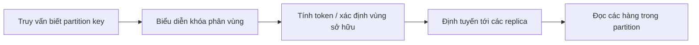
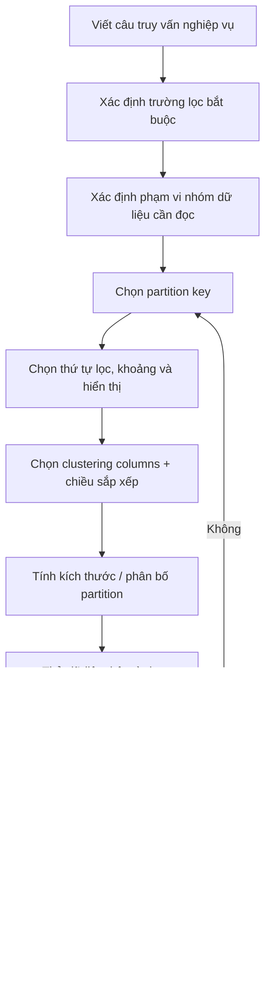

# Cột rộng: phân vùng, hàng và sắp xếp trong nhóm dữ liệu

Trong nhóm cơ sở dữ liệu NoSQL, **wide-column store** (cơ sở dữ liệu họ cột rộng, thường được gọi là *column-family database*) được thiết kế để lưu và truy cập lượng dữ liệu lớn theo **khóa phân vùng** và, tùy hệ quản trị, theo **thứ tự các hàng bên trong từng phân vùng**. Cách tổ chức này phù hợp với các trường hợp có mẫu truy vấn được xác định trước: lịch sử sự kiện theo thiết bị, dòng thời gian hoạt động theo người dùng, log theo dịch vụ, trạng thái theo khách hàng hoặc dữ liệu đo theo khoảng thời gian.

Điểm quan trọng nhất khi học mô hình cột rộng là phân biệt ba câu hỏi:

1. **Phân vùng (partition):** dữ liệu nào được đặt chung trong một nhóm có thể định vị bằng khóa?
2. **Hàng (row):** điều gì phân biệt từng bản ghi bên trong nhóm đó?
3. **Sắp xếp trong nhóm (clustering order):** các hàng của cùng phân vùng được tổ chức theo trật tự nào để đọc theo khoảng, lấy phần tử mới nhất hoặc phân trang hiệu quả?

Bài viết sử dụng **Apache Cassandra và cú pháp CQL** để minh họa cụ thể. Các khái niệm tương tự tồn tại ở nhiều hệ wide-column, nhưng không được mặc định rằng Apache HBase, Cassandra, ScyllaDB và mọi sản phẩm cùng họ có cú pháp, cơ chế phân phối hay bảo đảm nhất quán giống nhau.

## 1. Wide-column là mô hình gì?

Một cơ sở dữ liệu quan hệ thường được dạy từ bảng, cột, khóa và quan hệ, với khả năng xây dựng nhiều truy vấn linh hoạt. Trong mô hình wide-column, việc chọn **khóa truy cập và cách gom dữ liệu** trở thành phần trung tâm của thiết kế. Ứng dụng thường phải biết trước mình cần truy cập theo tiêu chí nào và tổ chức bảng phục vụ trực tiếp những truy vấn ấy.

Tên gọi *cột rộng* dễ gây hiểu nhầm. Nó **không đồng nghĩa với kho phân tích lưu cột** (*columnar analytical database*) như một hệ tối ưu cho việc quét và tổng hợp toàn bộ một cột. Ở đây, “rộng” xuất phát từ lịch sử mô hình họ cột, nơi một hàng/nhóm có thể chứa rất nhiều cột hoặc ô dữ liệu; còn các hệ dùng CQL hiện đại thường biểu diễn dữ liệu bằng **nhiều hàng có cùng khóa phân vùng và các cột khóa sắp xếp**.

| Khái niệm | Ý nghĩa thực hành trong Cassandra/CQL | Điều cần tránh nhầm |
|---|---|---|
| Table | Tập dữ liệu có định nghĩa trường, khóa và thuộc tính lưu trữ | Không phải bảng SQL có khả năng JOIN tùy ý |
| Partition | Nhóm các hàng chia sẻ cùng giá trị *partition key* | Không đồng nhất với một máy chủ vật lý |
| Row | Một bản ghi được nhận diện bằng toàn bộ *primary key* | Không chỉ có partition key là đã nhận diện duy nhất một hàng |
| Clustering column | Thành phần khóa xác định và sắp xếp các hàng trong phân vùng | Không phải một chỉ mục tổng quát để sắp xếp mọi phân vùng |
| Regular column | Thuộc tính thông thường của từng hàng | Không tham gia mặc định vào định vị/sắp xếp khóa |
| Static column | Thuộc tính được chia sẻ ở cấp partition trong CQL | Không phải giá trị riêng của từng hàng |

Không nên áp mô hình “đặt tất cả vào một bảng lớn rồi lọc tự do” từ SQL sang wide-column. Đường truy cập tốt thường được xây sẵn trong *primary key*, và một màn hình mới có thể đòi hỏi một bảng dữ liệu được tổ chức theo khóa khác.

## 2. Khóa phân vùng: dữ liệu nào nằm cùng một nhóm?

**Partition key** là một hoặc nhiều cột dùng để xác định phân vùng logic. Mọi hàng có cùng giá trị partition key thuộc cùng một phân vùng; các partition key khác nhau xác định các nhóm khác nhau.

Ví dụ hệ thống ghi nhận nhiệt độ từ nhiều thiết bị. Nếu tổ chức dữ liệu theo `(tenant_id, device_id, bucket_day)`, một phân vùng có thể được hiểu là: “tất cả số đo của thiết bị D07 thuộc tenant T01 trong ngày 14/11/2026”.

```text
Table: readings_by_device_day

Partition key = (tenant_id=T01, device_id=D07, bucket_day=2026-11-14)
┌──────────────────────────────────────────────────────────────────────┐
│ event_time (giảm dần) │ event_id │ temperature_c │ quality         │
├──────────────────────────────────────────────────────────────────────┤
│ 09:25:00               │ ...003   │ 26.8          │ OK              │
│ 09:20:00               │ ...002   │ 26.5          │ OK              │
│ 09:10:00               │ ...001   │ 26.1          │ OK              │
└──────────────────────────────────────────────────────────────────────┘

Partition key = (tenant_id=T01, device_id=D08, bucket_day=2026-11-14)
┌──────────────────────────────────────────────────────────────────────┐
│ 09:24:00               │ ...014   │ 27.3          │ OK              │
│ 09:11:00               │ ...013   │ 27.1          │ OK              │
└──────────────────────────────────────────────────────────────────────┘
```

Đối với một truy vấn có đủ khóa phân vùng, hệ cơ sở dữ liệu có thể định vị nhóm cần đọc. Đây là lý do partition key thường được chọn từ những trường **luôn xuất hiện trong điều kiện truy vấn quan trọng**.

### Phân vùng logic và phân phối lên các node

Trong Cassandra, giá trị partition key được đưa qua một **partitioner** để tạo token; token giúp xác định vị trí và các replica phụ trách dữ liệu trên cụm. Khi đọc hoặc ghi, coordinator định tuyến yêu cầu tới các replica phù hợp. Phần mềm quản lý việc đặt các partition và bản sao theo cấu hình topology/replication.



**Một partition không có nghĩa là một node.** Một node quản lý rất nhiều partition, và tùy replication factor, dữ liệu của một partition có thể có bản sao trên nhiều node. Cũng không nên suy ra rằng toàn bộ partition luôn là một tệp liền mạch trên đĩa: engine có thể lưu dữ liệu qua nhiều cấu trúc và tệp khác nhau. Mô hình logic dùng để thiết kế truy vấn; cơ chế lưu trữ vật lý phụ thuộc sản phẩm và quá trình compaction.

### Khóa đơn và khóa ghép

Khóa phân vùng chỉ một cột là khóa đơn, chẳng hạn `device_id`. Khóa phân vùng gồm nhiều cột là khóa ghép (*composite partition key*), chẳng hạn `(tenant_id, device_id, bucket_day)`.

Khóa ghép không có nghĩa rằng mỗi trường tự trở thành một khóa truy vấn độc lập. Với partition key gồm ba thành phần, ứng dụng thường phải cung cấp đầy đủ các thành phần để truy cập chính xác một phân vùng theo đường truy vấn chính.

## 3. Hàng và clustering key: điều gì phân biệt các bản ghi?

Trong CQL, **primary key** có hai phần:

```text
PRIMARY KEY ((partition_key_1, partition_key_2, ...),
             clustering_key_1, clustering_key_2, ...)
```

- Phần trong **ngoặc kép `((...))`** là các cột của partition key ghép.
- Các cột nằm **sau** partition key là clustering columns.
- Toàn bộ partition key và clustering columns kết hợp lại xác định duy nhất một hàng.

Ví dụ:

```sql
PRIMARY KEY ((tenant_id, device_id, bucket_day), event_time, event_id)
```

Cách đọc là: `(tenant_id, device_id, bucket_day)` quyết định **nhóm hàng**; trong nhóm đó, cặp `(event_time, event_id)` xác định **hàng nào**. Nếu hai bản ghi có cùng toàn bộ giá trị primary key, thao tác ghi cập nhật dữ liệu tại cùng khóa logic thay vì tự động tạo thêm một bản ghi riêng biệt.

Lưu ý cú pháp CQL khác với cách dùng dấu ngoặc trong nhiều ngôn ngữ:

```sql
-- Partition key là user_id; created_at là clustering column.
PRIMARY KEY (user_id, created_at)

-- Partition key gồm (user_id, month); created_at là clustering column.
PRIMARY KEY ((user_id, month), created_at)

-- Partition key gồm (user_id, month); sau đó là hai clustering columns.
PRIMARY KEY ((user_id, month), created_at, event_id)
```

Sự khác biệt giữa `PRIMARY KEY (a, b)` và `PRIMARY KEY ((a, b))` rất lớn. Trường hợp đầu có partition key `a`, còn `b` giúp phân biệt/sắp xếp các hàng trong partition. Trường hợp sau, **cả `a` và `b` cùng tạo thành partition key**, không còn clustering column. Cấu trúc dấu ngoặc phải được hiểu trước khi thử bất kỳ câu truy vấn nào.

## 4. Thứ tự các hàng trong một phân vùng

Clustering columns không chỉ là phần còn lại của primary key. Chúng xác định **trật tự có thể khai thác khi truy cập trong một partition**. Với hai clustering columns `(event_time, event_id)`, cách so sánh khóa theo thứ tự từ trái sang phải: ưu tiên `event_time`, rồi dùng `event_id` để phân biệt/so sánh khi thời điểm bằng nhau.

Khi tạo bảng Cassandra, có thể chỉ rõ thứ tự tăng/giảm qua `CLUSTERING ORDER BY`:

```sql
WITH CLUSTERING ORDER BY (event_time DESC, event_id ASC)
```

Trong ví dụ trên, bản ghi mới nhất theo `event_time` xuất hiện trước trong thứ tự clustering; nếu cùng thời điểm, `event_id` tăng dần là tiêu chí phụ. Điều này hữu ích cho truy vấn lấy 20 số đo mới nhất mà không cần quét và sắp xếp một tập bản ghi lớn ở phía ứng dụng.

Hãy so sánh hai cách sắp xếp:

| Clustering columns | Thứ tự logic trong một partition | Truy vấn thích hợp |
|---|---|---|
| `(event_time DESC, event_id ASC)` | Ưu tiên thời gian mới nhất trên toàn thiết bị/ngày | Lấy N sự kiện gần nhất |
| `(event_type ASC, event_time DESC)` | Gom theo loại sự kiện, rồi mới xếp thời gian trong từng loại | Lấy N sự kiện gần nhất **của một loại** |

Mô hình thứ hai **không cung cấp sẵn thứ tự thời gian toàn cục** trong phân vùng khi bỏ qua `event_type`, vì các hàng trước tiên đã được gom theo loại. Vị trí của một clustering column thay đổi ý nghĩa và hiệu quả của truy vấn, không chỉ thay đổi cách trình bày dữ liệu.

## 5. Dựng một bảng CQL từ yêu cầu truy cập

Giả sử một dịch vụ IoT có các yêu cầu:

- Mỗi tenant có nhiều thiết bị đo nhiệt độ.
- Mỗi thiết bị gửi nhiều số đo theo thời gian, đôi khi hai số đo trùng timestamp.
- Giao diện chính lấy **20 số đo mới nhất của một thiết bị trong một ngày**, hoặc xem một khoảng giờ của ngày đó.
- Dữ liệu có thể tích lũy lâu dài; không muốn một partition tăng vô hạn.
- Một truy vấn khác có thể cần tổng hợp dữ liệu nhiều thiết bị, nhưng chưa phải đường đọc chính của bảng này.

Từ yêu cầu đó, chọn partition key `(tenant_id, device_id, bucket_day)` và clustering key `(event_time, event_id)`. Ngày đóng vai trò *time bucket* để chia chuỗi dữ liệu dài của một thiết bị thành các partition có biên rõ ràng.

### 5.1. Tạo keyspace và bảng phục vụ thực hành

Ví dụ sau dành cho **môi trường học Cassandra một node**; `SimpleStrategy` với replication factor 1 chỉ giúp chạy thử cục bộ, **không phải cấu hình production**. Môi trường nhiều datacenter cần thiết kế topology và replication strategy tương ứng.

```sql
CREATE KEYSPACE IF NOT EXISTS nosql_lab
WITH replication = {
  'class': 'SimpleStrategy',
  'replication_factor': 1
};

USE nosql_lab;

CREATE TABLE IF NOT EXISTS sensor_readings_by_device_day (
    tenant_id text,
    device_id text,
    bucket_day date,
    event_time timestamp,
    event_id uuid,
    temperature_c double,
    quality text,
    PRIMARY KEY (
        (tenant_id, device_id, bucket_day),
        event_time,
        event_id
    )
) WITH CLUSTERING ORDER BY (
    event_time DESC,
    event_id ASC
);
```

Với bảng này:

| Cột | Vai trò | Giải thích |
|---|---|---|
| `tenant_id` | Partition key, phần 1 | Phân tách không gian tenant trong đường truy cập |
| `device_id` | Partition key, phần 2 | Truy vấn theo thiết bị |
| `bucket_day` | Partition key, phần 3 | Chia chuỗi thời gian thành các partition theo ngày |
| `event_time` | Clustering column, phần 1 | Sắp theo thời điểm mới nhất trước |
| `event_id` | Clustering column, phần 2 | Phân biệt sự kiện có cùng timestamp |
| `temperature_c`, `quality` | Regular columns | Dữ liệu số đo và trạng thái chất lượng |

Tại đây `event_id` được giả định do ứng dụng cấp và ổn định khi retry cùng một sự kiện. Nếu mỗi lần gửi lại sinh một UUID mới, bản ghi trùng nghiệp vụ có thể biến thành hai hàng riêng. Cần thiết kế idempotency độc lập với việc có `uuid` trong primary key.

### 5.2. Ghi dữ liệu và quan sát nhóm hàng

```sql
INSERT INTO sensor_readings_by_device_day
    (tenant_id, device_id, bucket_day, event_time, event_id,
     temperature_c, quality)
VALUES
    ('T01', 'D07', '2026-11-14', '2026-11-14T09:10:00Z',
     550e8400-e29b-41d4-a716-446655440001, 26.1, 'OK');

INSERT INTO sensor_readings_by_device_day
    (tenant_id, device_id, bucket_day, event_time, event_id,
     temperature_c, quality)
VALUES
    ('T01', 'D07', '2026-11-14', '2026-11-14T09:20:00Z',
     550e8400-e29b-41d4-a716-446655440002, 26.5, 'OK');

INSERT INTO sensor_readings_by_device_day
    (tenant_id, device_id, bucket_day, event_time, event_id,
     temperature_c, quality)
VALUES
    ('T01', 'D07', '2026-11-14', '2026-11-14T09:25:00Z',
     550e8400-e29b-41d4-a716-446655440003, 26.8, 'OK');
```

Cả ba hàng chia sẻ `(T01, D07, 2026-11-14)`. Việc chèn theo thứ tự thời gian nào không quyết định thứ tự clustering: các hàng được truy cập theo thứ tự khóa đã khai báo, trong phạm vi của cùng partition.

Lấy dữ liệu mới nhất:

```sql
SELECT event_time, event_id, temperature_c, quality
FROM sensor_readings_by_device_day
WHERE tenant_id = 'T01'
  AND device_id = 'D07'
  AND bucket_day = '2026-11-14'
ORDER BY event_time DESC
LIMIT 20;
```

Lọc theo khoảng thời gian trong **chính phân vùng đó**:

```sql
SELECT event_time, temperature_c
FROM sensor_readings_by_device_day
WHERE tenant_id = 'T01'
  AND device_id = 'D07'
  AND bucket_day = '2026-11-14'
  AND event_time >= '2026-11-14T09:00:00Z'
  AND event_time <  '2026-11-14T10:00:00Z';
```

Trong CQL, các giá trị string thời gian trên được chuyển theo kiểu cột `timestamp`. Ứng dụng nên thống nhất UTC và cách tính `bucket_day` theo một múi giờ quy định, đặc biệt quanh thời điểm đổi ngày; nếu lấy ngày ở múi giờ khác với cách truy vấn, sự kiện có thể nằm trong partition ngoài dự kiến.

### 5.3. Kết quả dự kiến của đường đọc

```text
Partition (T01, D07, 2026-11-14)

09:25:00Z  | ...003 | 26.8 | OK
09:20:00Z  | ...002 | 26.5 | OK
09:10:00Z  | ...001 | 26.1 | OK

Đọc LIMIT 2 theo event_time DESC:
  -> 09:25:00Z, 09:20:00Z
```

Trong thực tế, truy vấn có thể cần paging khi có nhiều hàng. `LIMIT` chỉ giới hạn số hàng trả về cho một lần truy vấn; việc duyệt các trang tiếp theo cần tuân theo cơ chế paging của driver, bảo toàn điều kiện truy vấn, và không mặc định rằng phân trang là ảnh chụp dữ liệu bất biến nếu có ghi mới đồng thời.

## 6. Vì sao clustering key cần đi theo tiền tố?

Trong Cassandra, truy vấn thường phát huy lợi thế khi biết **đầy đủ partition key**, rồi giới hạn các clustering columns theo thứ tự của khóa. Mô hình hai clustering columns `(event_time, event_id)` cho phép lọc khoảng `event_time` trong partition. Nhưng một điều kiện chỉ dựa trên `event_id`, bỏ qua `event_time`, không khai thác trực tiếp trình tự clustering từ trái sang phải như vậy.

Ví dụ khác:

```sql
CREATE TABLE activity_by_user_month (
    user_id text,
    bucket_month text,
    activity_type text,
    happened_at timestamp,
    activity_id uuid,
    payload text,
    PRIMARY KEY (
        (user_id, bucket_month),
        activity_type,
        happened_at,
        activity_id
    )
) WITH CLUSTERING ORDER BY (
    activity_type ASC,
    happened_at DESC,
    activity_id ASC
);
```

Cấu trúc này thuận lợi khi truy vấn của ứng dụng là “lấy các hoạt động `LOGIN` mới nhất của user U trong tháng M”: biết partition, biết `activity_type`, rồi lấy theo `happened_at`. Nếu màn hình thật lại yêu cầu “lấy 50 hoạt động mới nhất **mọi loại**”, khóa trên không được tổ chức ưu tiên theo thời gian toàn cục. Phương án hợp lý có thể là bảng khác với clustering bắt đầu bằng `happened_at`.

| Mẫu truy vấn | Có phù hợp với bảng `activity_by_user_month` không? | Vì sao |
|---|---|---|
| User, tháng, loại; lấy các hoạt động gần nhất | Phù hợp | Đi qua partition và tiền tố `activity_type` |
| User, tháng, loại; lọc khoảng `happened_at` | Phù hợp | Có thể giới hạn clustering column sau điều kiện bằng trên tiền tố |
| User, tháng; lấy hoạt động gần nhất của mọi loại | Không tối ưu | Thứ tự đầu tiên là `activity_type`, không phải thời gian toàn cục |
| Chỉ biết `activity_id`, tìm trong mọi user | Không phù hợp với đường khóa này | Không có partition key để định vị nhóm |
| Chỉ biết tháng; thống kê tất cả user | Không phù hợp cho truy vấn tương tác trên một partition | Phải truy cập nhiều partition hoặc dùng mô hình/tầng phân tích khác |

Cú pháp và giới hạn chính xác của `WHERE`, `ORDER BY`, `IN` và chỉ mục phụ thay đổi theo phiên bản sản phẩm. Nguyên tắc thiết kế vẫn là: **kiểm tra query path bằng khóa thực sự được cung cấp**, không giả định có thể lọc trên bất kỳ cột nào với cùng chi phí.

## 7. Kích thước partition và bài toán hot partition

Partition key là quyết định về cả **định tuyến** lẫn **phân bố tải**. Có ba tình huống cần tránh:

1. **Partition không có biên tăng trưởng:** `PRIMARY KEY (device_id, event_time)` làm mọi sự kiện suốt vòng đời thiết bị chung một partition. Nó có thể trở nên quá lớn và làm chậm đọc, sửa chữa hay thao tác nền.
2. **Khóa phân phối lệch:** một tenant hoặc thiết bị nhận lưu lượng gấp hàng nghìn lần các khóa khác, tạo hot partition dù tổng tải toàn cụm chưa cao.
3. **Partition quá nhỏ và quá nhiều:** bucket quá ngắn khiến một truy vấn lịch sử phải chạm vào hàng trăm hoặc hàng nghìn partition, tăng round trip và công điều phối.

### Bucketing theo thời gian

Thay partition key `device_id`, có thể thêm `bucket_day` hoặc `bucket_hour`. Ví dụ một thiết bị gửi một bản ghi/giây:

| Cách chia | Số sự kiện ước tính trong một partition | Khi đọc lịch sử 7 ngày |
|---|---:|---|
| Không bucket | Tăng liên tục theo tuổi thiết bị | Ít partition, nguy cơ partition rất lớn |
| Theo ngày | Khoảng 86.400 bản ghi/ngày | Khoảng 7 partition của thiết bị |
| Theo giờ | Khoảng 3.600 bản ghi/giờ | Khoảng 168 partition của thiết bị |

Đây là phép tính theo tần suất giả định **liên tục 1 sự kiện/giây**, không phải ngưỡng kỹ thuật của Cassandra. Kích thước thực phụ thuộc kích thước giá trị, overhead, tombstone, compression, số phiên bản cell và đặc điểm engine. Không có ngưỡng “mỗi partition luôn an toàn dưới X MB” áp dụng cho mọi workload; cần đo theo phiên bản và môi trường thực.

Ước lượng sơ bộ:

```text
Số hàng/partition ≈ tốc độ ghi của một khóa × thời lượng bucket

Kích thước logic ≈ số hàng × kích thước trung bình một hàng
                 + overhead của khóa, metadata và dữ liệu phụ
```

Giả sử mỗi hàng trung bình 250 byte, một thiết bị 1 bản ghi/giây tạo khoảng 21,6 MB dữ liệu hàng/ngày trước các chi phí phụ. Con số này chỉ giúp so sánh day/hour; không thể suy ra kích thước thực trên đĩa hoặc hiệu năng read/compaction từ phép nhân đơn giản.

### Khi một tenant quá lớn

Một bảng partition theo `(tenant_id, bucket_day)` có thể dồn toàn bộ sự kiện trong ngày của tenant lớn vào một nhóm và một tập replica. Thêm `device_id` có thể chia nhỏ tải theo thiết bị nếu truy vấn chủ yếu đọc theo thiết bị. Nếu một thiết bị vẫn có lưu lượng rất cao, có thể cần thêm bucket ngắn hơn hoặc một shard định danh có tính toán. Mọi thay đổi phải xét chiều ngược lại: dữ liệu bị chia qua nhiều partition sẽ đòi hỏi nhiều lần đọc và ghép kết quả.

Để chọn kích thước bucket, hãy trả lời đồng thời:

- Mỗi giá trị partition key ghi bao nhiêu hàng mỗi giây và mỗi ngày?
- Khoảng thời gian điển hình mà màn hình yêu cầu là bao lâu?
- Khi gặp partition đông dữ liệu nhất, p95/p99 và tài nguyên thay đổi thế nào?
- Một truy vấn thường phải đọc bao nhiêu partition, và có thể giới hạn fan-out không?
- Khi đổi thiết kế bucket, dữ liệu lịch sử cũ được đọc và di chuyển như thế nào?

## 8. Truy vấn qua nhiều partition: trách nhiệm của ứng dụng

Bảng `sensor_readings_by_device_day` tối ưu cho **một thiết bị trong một ngày**. Khi người dùng chọn 30 ngày, truy vấn phải xử lý **30 partition theo ngày**, sau đó giới hạn hoặc ghép kết quả phù hợp. Không nên mong `ORDER BY event_time DESC` trong một query biết mỗi `device_id` mà tự sắp đúng tất cả các partition như một bảng SQL tổng quát.

Một cách thực hiện ở mức ứng dụng:

```text
Đầu vào: tenant T01, thiết bị D07, [start, end), pageSize=20

1. Tính danh sách bucket_day mà khoảng [start, end) giao nhau.
2. Với mỗi bucket cần thiết, truy vấn bằng đầy đủ partition key
   và giới hạn event_time bên trong bucket.
3. Đọc theo thứ tự bucket mới nhất trước, hoặc merge các luồng
   nếu truy vấn song song và cần sắp xếp toàn cục.
4. Trả đúng pageSize; giữ cursor chứa đủ thông tin để tiếp tục.
5. Giới hạn số bucket/độ rộng thời gian, timeout và mức song song.
```

Nếu quy tắc ngày theo UTC được giữ nhất quán và dữ liệu đến đúng bucket tương ứng `event_time`, có thể tối ưu bằng cách quét các bucket mới nhất trước. Tuy nhiên, dữ liệu đến trễ và chỉnh sửa timestamp là những tình huống phải xét khi xác định tính đầy đủ và tính ổn định của phân trang.

Với dashboard toàn tenant, quét mọi thiết bị và mọi bucket có thể quá tốn kém. Thường cần **một bảng đọc khác**, một luồng tổng hợp hoặc cơ sở dữ liệu chuyên phân tích. Wide-column khuyến khích thiết kế theo từng nhu cầu đọc, không đòi hỏi một bảng duy nhất phục vụ mọi yêu cầu.

## 9. Một sự kiện, nhiều cách truy cập: mô hình bảng theo truy vấn

Giả sử cần thêm màn hình “20 số đo mới nhất của tất cả thiết bị trong một tenant/ngày”. Bảng theo thiết bị không có thứ tự thời gian chung giữa các thiết bị. Ta có thể thiết kế một **projection** riêng:

```sql
CREATE TABLE IF NOT EXISTS sensor_readings_by_tenant_day (
    tenant_id text,
    bucket_day date,
    event_time timestamp,
    device_id text,
    event_id uuid,
    temperature_c double,
    PRIMARY KEY (
        (tenant_id, bucket_day),
        event_time,
        device_id,
        event_id
    )
) WITH CLUSTERING ORDER BY (
    event_time DESC,
    device_id ASC,
    event_id ASC
);
```

Ở bảng mới, partition key là `(tenant_id, bucket_day)`; hàng được sắp ưu tiên theo `event_time`. Có thể dùng nó để lấy các sự kiện mới nhất trong một ngày của tenant:

```sql
SELECT event_time, device_id, event_id, temperature_c
FROM sensor_readings_by_tenant_day
WHERE tenant_id = 'T01'
  AND bucket_day = '2026-11-14'
LIMIT 20;
```

Nhưng mô hình này có đánh đổi rõ: tenant lớn có thể có **partition nóng và rất lớn** khi nhận dữ liệu từ mọi thiết bị. Với quy mô vượt ngưỡng thực nghiệm, có thể chia thêm bucket theo giờ hoặc shard, rồi giải quyết việc merge kết quả. Nếu yêu cầu chính là báo cáo aggregate theo giờ, một bảng số liệu tổng hợp định kỳ có thể hợp lý hơn lưu bản sao toàn bộ sự kiện.

Hai bảng phục vụ hai truy vấn khác nhau:

| Bảng | Partition key | Clustering key | Truy vấn chính |
|---|---|---|---|
| `sensor_readings_by_device_day` | Tenant + thiết bị + ngày | Thời gian + id | Lịch sử một thiết bị |
| `sensor_readings_by_tenant_day` | Tenant + ngày | Thời gian + thiết bị + id | Các sự kiện gần nhất trên tenant |

Thiết kế dữ liệu trùng lặp có chủ đích giúp đọc hiệu quả, nhưng ứng dụng phải xử lý **đồng bộ, retry, idempotency và sửa sai khi một projection cập nhật thiếu**. Ghi vào hai partition/bảng không tự nhiên trở thành một giao dịch toàn cục với đầy đủ tính cô lập. Nếu yêu cầu dữ liệu hoàn toàn chính xác theo thời gian thực, phải thiết kế bảo đảm phù hợp, thay vì chỉ dựa vào việc gọi hai lệnh `INSERT` liên tiếp.

## 10. Hàng thưa, cột thường và cột static

Trong các mô hình wide-column lịch sử, các hàng có thể có tập cột rất khác nhau. Ở CQL, table định nghĩa các cột, nhưng nhiều giá trị thường có thể không được ghi. Cách biểu diễn bên trong engine, tương tác với null/delete và chi phí dữ liệu phụ thuộc triển khai; không thể kết luận rằng thêm vô hạn cột tùy ý là miễn phí.

Trong CQL, ngoài partition key và clustering columns, có hai loại cột cần phân biệt:

- **Regular column:** giá trị thuộc về một hàng cụ thể, ví dụ `temperature_c` hay `quality`.
- **Static column:** giá trị dùng chung cho cả một partition, ví dụ nhãn của nhóm dữ liệu hoặc metadata chỉ thay đổi theo partition.

Ví dụ một bảng nhỏ khác:

```sql
CREATE TABLE reports_by_team_month (
    team_id text,
    bucket_month text,
    report_time timestamp,
    report_id uuid,
    month_owner text static,
    report_title text,
    PRIMARY KEY ((team_id, bucket_month), report_time, report_id)
) WITH CLUSTERING ORDER BY (report_time DESC, report_id ASC);
```

`month_owner` gắn với một partition `(team_id, bucket_month)` và không phải bản sao độc lập trên mỗi hàng báo cáo. Một static column chỉ phù hợp khi giá trị thật sự có cùng phạm vi sống với partition. Nếu chủ sở hữu được xác định trên từng báo cáo, đặt nó thành regular column; nếu chủ sở hữu áp dụng cho toàn bộ team qua nhiều tháng, có thể phù hợp hơn với thực thể/bảng riêng.

Đừng coi static column là cách thay thế JOIN hay cơ chế lưu metadata toàn cục. Nó chỉ đổi phạm vi của một giá trị bên trong mô hình partition.

## 11. Không phải mọi `WHERE` và `ORDER BY` đều tương đương

Trong cơ sở dữ liệu quan hệ, một câu `SELECT` có thể dùng nhiều điều kiện tùy ý, rồi optimizer chọn phương án như index scan, full scan hoặc sort. CQL của Cassandra buộc truy vấn phải tôn trọng những đường truy cập mà table và index hỗ trợ; nhiều trường hợp lọc không phù hợp sẽ bị từ chối hoặc có chi phí rất lớn nếu buộc quét.

Xét bảng theo thiết bị/ngày:

```sql
-- Hợp với đường khóa: biết toàn bộ partition và lọc khoảng clustering.
SELECT event_time, temperature_c
FROM sensor_readings_by_device_day
WHERE tenant_id = 'T01'
  AND device_id = 'D07'
  AND bucket_day = '2026-11-14'
  AND event_time >= '2026-11-14T09:00:00Z';
```

Một yêu cầu như “tìm mọi bản ghi có `quality='ERROR'` của tất cả thiết bị trong tháng” **không được phục vụ hiệu quả chỉ bởi primary key hiện tại**. Các lựa chọn cần cân nhắc gồm: tạo bảng truy cập theo loại lỗi/ngày, duy trì một projection sự kiện lỗi, dùng chỉ mục phù hợp nếu engine/version/workload hỗ trợ, hoặc chuyển xử lý phân tích sang hệ chuyên dụng.

Không nên thêm `ALLOW FILTERING` chỉ để query chạy được rồi mặc định hiệu năng sẽ ổn định. Tùy điều kiện, việc lọc có thể vẫn cần đọc rất nhiều hàng hoặc nhiều partition. `ORDER BY` theo clustering columns cũng không biến Cassandra thành dịch vụ sắp xếp toàn cục trên mọi partition.

Nếu một nhóm truy vấn phải quét gần toàn bộ dataset, hãy hỏi lại liệu wide-column là dữ liệu gốc tốt cho nhóm truy vấn đó hay chỉ nên cung cấp sự kiện cho hệ phân tích.

## 12. Ghi, cập nhật, xóa và dữ liệu cũ ảnh hưởng đến partition thế nào?

Thiết kế partition cần tính đến cả vòng đời của dữ liệu, không chỉ lúc tạo hàng.

### Ghi trùng khóa

Trong mô hình CQL, một hàng được nhận diện bởi **toàn bộ primary key**. Ghi cùng primary key có thể cập nhật giá trị các cột ở cùng hàng. Điều này giúp một số dạng ghi idempotent nếu cùng sự kiện luôn ánh xạ tới cùng khóa và quy tắc cập nhật là phù hợp. Tuy nhiên, cơ chế cập nhật last-write-wins, timestamp ghi, retry và cạnh tranh vẫn cần được xem xét theo công nghệ/độ nhất quán được chọn. Một UUID mới cho cùng sự kiện lại tạo khóa khác và có thể gây nhân đôi dữ liệu.

### Cập nhật theo thời gian

Nếu thiết bị gửi lại số đo nhưng sửa `event_time`, khóa clustering thay đổi. Đó **không còn là cập nhật cùng hàng**: ứng dụng cần xác định có phải xóa khóa cũ và tạo khóa mới, hay lưu bản ghi chỉnh sửa riêng. Nếu sự kiện chuyển qua ngày khác, partition key cũng đổi, nên việc di chuyển càng cần quy trình rõ ràng.

### TTL, delete và tombstone

Cassandra cho phép cấu hình thời hạn sống cho dữ liệu trong nhiều trường hợp. Khi dữ liệu hết hạn hoặc bị xóa, engine dùng **tombstone** để biểu diễn thao tác xóa trong môi trường replica và lưu trữ LSM; không nên nghĩ xóa tức là dữ liệu lập tức biến mất khỏi mọi tệp trên đĩa. Nhiều tombstone có thể ảnh hưởng đọc, compaction và bảo trì.

Với bảng dữ liệu thời gian, cần thiết kế chính sách retention cùng cơ chế xóa theo bucket hoặc TTL tùy khả năng sản phẩm, hiểu tác động đến repair và vòng đời tombstone. Tránh một quy trình “xóa hàng loạt dữ liệu cũ” mà không thử nghiệm chi phí.

### Batch không có nghĩa là tùy ý dùng như SQL transaction

CQL có thao tác `BATCH`, nhưng mục tiêu, bảo đảm atomicity và hiệu quả phụ thuộc phạm vi các partition và loại batch. Batch nhiều partition không phải cách tăng tốc hàng loạt INSERT hay thay thế một transaction quan hệ nhiều bảng với mọi mức cô lập. Trước khi dùng batch để đồng bộ nhiều projection, phải đọc bảo đảm cụ thể của engine/phiên bản và thử lỗi từng phần, retry, idempotency.

## 13. Quan hệ giữa partition, clustering và replication

Ba cơ chế này giải quyết ba câu hỏi khác nhau:

```text
Partition key       -> dữ liệu thuộc nhóm logic nào?
Clustering key      -> hàng nào và thứ tự trong nhóm?
Replication         -> nhóm dữ liệu có bao nhiêu bản sao, ở đâu?
Consistency level   -> thao tác đọc/ghi cần phản hồi từ bao nhiêu replica?
```

Ví dụ cùng một partition có thể có ba replica nếu keyspace và topology được cấu hình tương ứng. Việc chọn partition key tốt không tự bảo đảm một lần ghi có độ bền hoặc một lần đọc luôn thấy giá trị mới nhất trong mọi trường hợp. Cần xem xét consistency level, replication factor, thời điểm failover, cơ chế repair và yêu cầu nghiệp vụ.

Một lỗi tư duy thường gặp là “dữ liệu nằm cùng partition nên mọi cập nhật của nhóm đương nhiên là giao dịch toàn cục”. Cassandra có các bảo đảm riêng cho từng loại thao tác, conditional update và lightweight transaction; cần phân biệt cập nhật một hàng, ghi nhiều hàng trong partition, ghi liên partition và yêu cầu cô lập/tuần tự hóa của nghiệp vụ. Không thể suy từ vị trí dữ liệu ra toàn bộ bảo đảm ACID.

## 14. Phương pháp chọn partition key và clustering columns từ access pattern

Một trình tự thực hành hữu ích là bắt đầu từ **câu truy vấn**, sau đó mới viết định nghĩa table:



Với một tính năng đọc, ghi phiếu thiết kế như sau:

| Câu hỏi | Ví dụ với số đo thiết bị |
|---|---|
| Truy vấn gốc cần gì? | 20 số đo mới nhất của thiết bị D07 hôm nay |
| Người gọi luôn biết trường nào? | `tenant_id`, `device_id`, ngày hiện tại |
| Nhóm dữ liệu hợp lý? | Một thiết bị trong một ngày |
| Partition key? | `(tenant_id, device_id, bucket_day)` |
| Phải sắp theo gì? | `event_time DESC`; thêm `event_id` để phân biệt trùng timestamp |
| Một nhóm tăng đến đâu? | Ước lượng sự kiện/ngày × kích thước trung bình |
| Truy vấn phụ nào khó? | Truy vấn nhiều ngày, toàn tenant, lọc theo `quality` |
| Cách xử lý truy vấn phụ? | Đọc nhiều bucket có giới hạn; projection hoặc hệ phân tích riêng |
| Cần xác thực điều gì? | p95/p99, số partition được đọc, hot key, tombstone, chi phí ghi |

Cách thiết kế này có thể dẫn đến nhiều bảng có dữ liệu trùng nhau vì mỗi bảng phục vụ một truy vấn cụ thể. Khi vậy, cần ghi rõ bảng nào là nguồn chuẩn, ai cập nhật các projection, cách phát hiện sai lệch và cách tái tạo bảng đọc.

## 15. Thực nghiệm: hai phương án cùng một truy vấn

Đừng kết luận một partition key “đúng” chỉ vì truy vấn demo có ba bản ghi chạy nhanh. Hãy đối chiếu ít nhất hai phương án trong cùng môi trường và workload.

**Phương án A:** `PRIMARY KEY (device_id, event_time, event_id)` với toàn bộ lịch sử thiết bị nằm trong một partition.

**Phương án B:** `PRIMARY KEY ((tenant_id, device_id, bucket_day), event_time, event_id)` với phân vùng theo thiết bị/ngày.

Giả sử dữ liệu mô phỏng có 10.000 thiết bị, mỗi thiết bị gửi một sự kiện mỗi giây; một số thiết bị gửi nhanh hơn 100 lần, và các màn hình thường đọc từ 30 phút đến 7 ngày gần nhất. Đây chỉ là dữ liệu đầu vào **giả định để thiết kế thí nghiệm**.

| Chỉ số cần đo | Vì sao quan trọng |
|---|---|
| Phân bố số hàng/dung lượng theo partition | Tìm partition quá lớn và độ lệch giữa các khóa |
| Throughput ghi ở giờ đỉnh | Xác định hot partition hoặc bottleneck do node/replica |
| p50, p95, p99 của truy vấn một ngày | Kiểm tra đường đọc mục tiêu |
| p95 và số request con của truy vấn 7 ngày | Đo chi phí truy cập nhiều bucket ở phương án B |
| Latency và tài nguyên khi tăng tải | Đánh giá khả năng mở rộng của cả hai phương án |
| CPU, I/O, network, compaction, tombstone | Phát hiện chi phí nền mà latency đơn lẻ bỏ sót |
| Lỗi, timeout, retry, replica lag | Đánh giá mức ổn định và đúng đắn trong các điều kiện tải khác nhau |

Chạy phép thử có warm-up, đủ dữ liệu cho từng partition, và cố định cấu hình node/driver/consistency level. Lặp lại để thấy độ biến thiên; kiểm tra tải thật sự đạt được bên cạnh tải yêu cầu. So sánh khi **một biến chính thay đổi**, đồng thời ghi mọi biến phụ bắt buộc khác (ví dụ A và B có tập khóa khác nhau do cách bucket).

Nếu B làm truy vấn một ngày nhanh hơn nhưng truy vấn 7 ngày phải ghép nhiều partition, đó là **đánh đổi có lý do**. Nếu thiết bị cực lớn vẫn gây nghẽn một partition trong một ngày, cần thử bucket ngắn hơn hoặc chiến lược shard có giới hạn fan-out. Không có mô hình nào tối ưu độc lập với mẫu truy cập và phân bố khóa.

## 16. Một số lỗi thiết kế thường gặp

| Lỗi | Biểu hiện | Cách khắc phục |
|---|---|---|
| Chọn `tenant_id` làm khóa phân vùng duy nhất cho mọi sự kiện | Tenant lớn trở thành một partition khổng lồ hoặc nóng | Thêm chiều dữ liệu và bucket phù hợp với truy vấn |
| Đổi `(user_id, month)` thành `(user_id)` vì muốn query ngắn hơn | Một partition tăng suốt vòng đời user | Tính giới hạn tăng trưởng; dùng bucket và cơ chế đọc nhiều bucket |
| Đưa `status` trước `created_at` khi cần danh sách thời gian toàn cục | Các hàng nhóm theo status trước, không theo thời gian | Đặt clustering theo thứ tự truy vấn thực sự hoặc làm bảng đọc riêng |
| Nghĩ `PRIMARY KEY ((a, b))` giống `PRIMARY KEY (a, b)` | Partition key/clustering key thay đổi hoàn toàn | Vẽ rõ ranh giới partition và row cho từng khóa |
| Chỉ dùng `ORDER BY` để chữa mô hình | Muốn sắp xếp qua nhiều partition tùy ý | Thiết kế lại khóa/bảng truy cập, merge có giới hạn hoặc chuyển tầng phân tích |
| Sử dụng `ALLOW FILTERING` cho mọi điều kiện | Query quét rộng, latency khó dự đoán | Thiết kế bảng theo truy vấn, đánh giá index/projection riêng |
| Phân vùng ngày quá nhỏ hoặc quá lớn | Fan-out nhiều hoặc hot/large partition | Đo kích thước, tải, thời gian truy vấn rồi chỉnh bucket |
| Trộn mọi projection trong một batch lớn | Chi phí ghi và ngữ nghĩa lỗi khó kiểm soát | Định nghĩa nguồn chuẩn, idempotency, retry và reconciliation |
| Quên retention/TTL và tác động tombstone | Đọc chậm theo thời gian dù lượng dữ liệu hữu ích không tăng | Thiết kế vòng đời, thử compaction/repair và khả năng khôi phục |
| Chọn khóa mà không tính khóa “nóng” | Benchmark tải đều đẹp nhưng production nghẽn | Kiểm tra phân bố lệch và các tenant/device cực lớn |

## 17. Bài thực hành: thiết kế theo hai màn hình

Một nền tảng có sự kiện người dùng gồm `user_id`, `event_time`, `event_id`, `event_type` và `payload`. Dữ liệu tăng mỗi ngày. Hai màn hình:

- **Màn hình A:** xem 30 hoạt động mới nhất của một user trong tháng được chọn.
- **Màn hình B:** xem 30 lần đăng nhập (`event_type = 'LOGIN'`) mới nhất của user trong tháng.

Hãy tự thực hiện các nhiệm vụ:

1. Đề xuất partition key có giới hạn tăng trưởng; giải thích chọn bucket ngày, tuần hay tháng dựa trên tần suất phát sinh sự kiện.
2. Với màn hình A, viết `PRIMARY KEY` và `CLUSTERING ORDER BY` đủ để lấy các sự kiện theo thời gian mới nhất. Nếu timestamp trùng nhau, giải thích vai trò `event_id`.
3. Với màn hình B, thử phương án đặt `event_type` trước `event_time` trong clustering key. Phân tích vì sao phương án đó có thể ảnh hưởng màn hình A; chọn dùng một hay hai bảng và nêu chi phí đồng bộ.
4. Viết hai câu `SELECT` chỉ sử dụng điều kiện có thể được phục vụ trực tiếp bởi khóa đã thiết kế, kèm `LIMIT 30`.
5. Tính số bản ghi ước tính trong partition cho user thường và user cực lớn. Ước tính số partition phải đọc để truy vấn lịch sử ba tháng.
6. Đề xuất kịch bản benchmark so sánh phương án một bảng và hai bảng: tỷ lệ đọc mỗi màn hình, throughput ghi, p95/p99, kích thước partition và số lần lỗi đồng bộ projection.
7. Mô tả cách xử lý một sự kiện gửi hai lần, một sự kiện đến trễ và một lần xóa dữ liệu theo chính sách retention.

**Câu hỏi tự kiểm tra:**

- Vì sao biết `event_time` chưa đủ để đọc nhanh một hàng nếu thiếu partition key?
- `PRIMARY KEY ((tenant_id, user_id), created_at)` và `PRIMARY KEY (tenant_id, user_id, created_at)` tổ chức partition khác nhau thế nào?
- Khi clustering là `(event_type, event_time)`, truy vấn “mới nhất của mọi loại” gặp khó khăn gì?
- Việc giảm kích thước một partition bằng bucket ngắn hơn sẽ tăng chi phí nào khi người dùng xem lịch sử dài?
- Vì sao replication factor không thể thay thế việc thiết kế partition key cân bằng tải?
- Nếu một sự kiện phải xuất hiện ở hai bảng truy cập khác nhau, thành phần nào chịu trách nhiệm khử trùng và đối soát khi ghi thiếu?

## 18. Kết nối mô hình logic với quyết định kỹ thuật

Mỗi khi thiết kế một bảng wide-column, hãy đọc định nghĩa khóa từ ngoài vào trong: **partition key xác định nhóm được định vị và phân phối, clustering columns xác định hàng và thứ tự bên trong nhóm, còn regular/static columns lưu dữ liệu ở phạm vi phù hợp**. Sau đó đọc ngược từ từng truy vấn của ứng dụng: liệu đã biết đầy đủ khóa phân vùng, liệu điều kiện trên clustering columns đi theo thứ tự hợp lý, và liệu số hàng/partition có giới hạn tăng trưởng chấp nhận được?

Tính đúng đắn của một mô hình không chỉ được xác nhận khi chạy được câu `SELECT`. Cần kiểm chứng cả phân bố khóa, kích thước partition, fan-out giữa nhiều bucket, xử lý dữ liệu đến trễ, xóa/TTL, tính nhất quán và chi phí đồng bộ các bảng truy cập. Khi thay đổi yêu cầu, nên viết lại đường truy cập và đo lại các đánh đổi, thay vì chỉ thêm điều kiện lọc hoặc thêm cột vào bảng hiện có.
