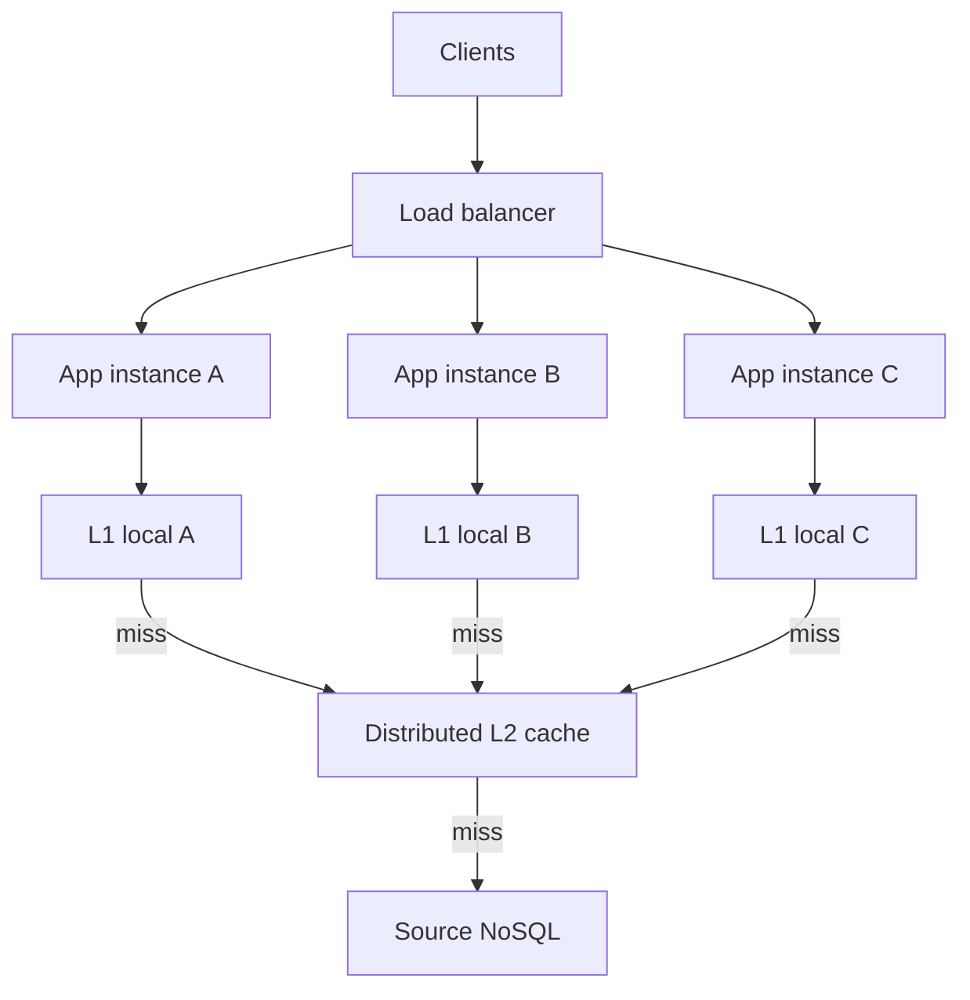
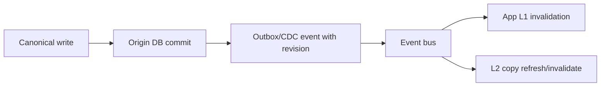
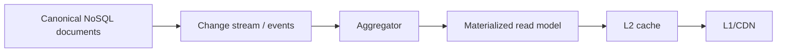
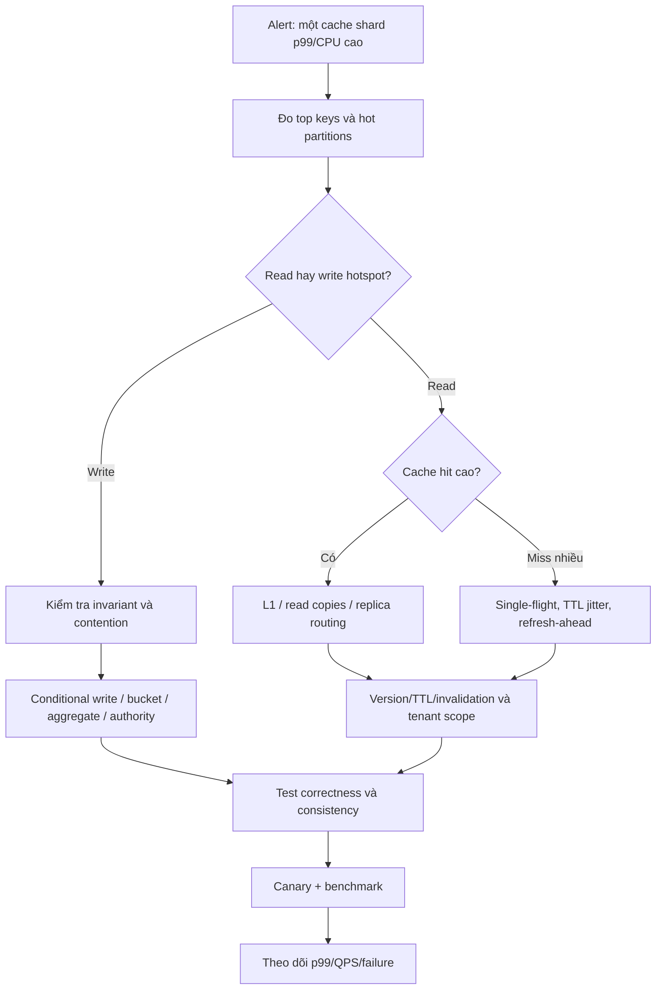

# Hot key, phân phối tải và sao chép dữ liệu được đọc nhiều

Trong một hệ NoSQL, dữ liệu có thể được chia thành hàng trăm shard và cụm cache có nhiều node, nhưng **một khóa duy nhất** vẫn có thể nhận phần lớn lưu lượng. Một sản phẩm vừa được quảng bá, một bài viết lan truyền, tỷ giá được mọi giao dịch tham chiếu hoặc một cấu hình chung có thể tạo ra hàng chục nghìn lượt đọc mỗi giây vào cùng một key.

Nếu mọi request được định tuyến tới cùng một cache shard hoặc một database partition, node giữ khóa đó có thể quá tải dù các node còn lại rất rảnh. Đây là vấn đề **hot key**. Giải pháp không chỉ là thêm node: phải hiểu **điểm nóng nằm ở khóa, partition, đường mạng, cache tier hay nguồn dữ liệu**, rồi chọn phương án như **L1 cache trong ứng dụng, sao chép bản đọc sang nhiều cache shards, CDN, request coalescing, chủ động refresh và kiểm soát consistency**.

Bài học thuộc chương **Bộ nhớ đệm dữ liệu**, module **Database No SQL**. Sau khi học, bạn cần có khả năng:

- Phân biệt **hot key**, **hot partition**, **hot shard** và **cache stampede**.
- Định lượng tải tập trung, đánh giá **khả năng thực sự cần bao nhiêu bản sao**.
- Hiểu khi nào có thể sao chép dữ liệu đọc nhiều mà **không làm sai nghiệp vụ**.
- Thiết kế **L1 local cache – L2 distributed cache – origin NoSQL** và cơ chế làm mới.
- Biết vì sao **read replication không phải lời giải tự động cho hot write**.
- Triển khai những ví dụ Java, Redis và các NoSQL liên quan.
- Xây dashboard, benchmark, runbook khi một khóa bỗng nhiên trở nên quá nóng.

> **Nguyên tắc trung tâm:** với một **hot read key**, cần phân tán **những lần đọc có thể phục vụ từ bản sao hợp lệ**, không nhất thiết phân tán dữ liệu nguồn có thẩm quyền. Với một **hot write key**, cần giải quyết **quyền ghi, invariant và contention** trước khi nghĩ tới chia khóa hoặc tăng bản sao.

---

## 1. Hot key là gì?

Một khóa được coi là *hot* khi lượng thao tác dành cho nó **lớn đến mức gây áp lực đáng kể lên tài nguyên đang chịu trách nhiệm phục vụ khóa đó**.

Ví dụ:

```text
product:sku-001       35.000 GET/s
product:sku-002          120 GET/s
product:sku-003           90 GET/s
product:sku-004           75 GET/s
...
```

`sku-001` nóng không phải vì bản ghi lớn hơn. Nó nóng vì **tần suất truy cập** và chi phí phục vụ mỗi lần truy cập.

Trong Redis Cluster, một cache key được gán vào một hash slot; slot thuộc một primary cụ thể. Nếu tất cả `GET product:sku-001` tới một primary, node đó có thể bị nghẽn trong khi những primary khác còn dư tài nguyên.

Trong một database phân vùng, truy vấn point-read cho một partition key cụ thể cũng thường có một nhóm node/replicas chịu phần lớn tải.

### 1.1. Định nghĩa phụ thuộc vào tài nguyên

Một key 3.000 QPS có thể không đáng chú ý nếu là giá trị 100 byte được phục vụ từ RAM, nhưng lại nguy hiểm nếu mỗi lượt đọc đòi truy vấn chéo shards, tải payload 2 MiB hoặc giải mã/phân quyền nặng.

**Không có ngưỡng QPS chung** để kết luận một key nóng trong mọi NoSQL.

### 1.2. Phân biệt tần suất và chi phí

Có thể dùng một chỉ số khái niệm:

\[
\operatorname{Pressure}(k)
\approx \operatorname{Rate}(k)
\times \operatorname{CostPerOperation}(k).
\]

`CostPerOperation` có thể biểu diễn CPU, IOPS, network bytes, thời gian giữ connection hoặc một tổ hợp có trọng số. Cần đo trong thực tế; công thức chỉ là khung phân tích.

---

## 2. Hot key, hot partition và hot shard khác nhau thế nào?

| Hiện tượng | Mức độ tập trung | Ví dụ | Lối xử lý thường gặp |
| --- | --- | --- | --- |
| **Hot key** | Một logical key | `product:sku-001` | L1 cache, replicated read copies, coalescing |
| **Hot partition** | Một partition/range chứa nhiều keys hoặc một key lớn | `tenant:mega-customer` | Đổi partition key, bucket, cache, phân tích query |
| **Hot shard** | Một node/shard nhận tải lớn | Nhiều hot partitions cùng shard | Rebalance, thêm capacity, chọn placement |
| **Hot replica** | Một replica được client ưu tiên quá mức | Tất cả reads đổ vào replica gần nhất | Replica-aware load balancing, giới hạn concurrency |
| **Hot endpoint** | Một API có request rate lớn | `/api/products/sku-001` | CDN, cache, rate limit, điều chỉnh payload |
| **Hot field/atomic value** | Một counter/document bị cập nhật liên tục | `likes:video-1` | Sharded counter, aggregation, escrow nếu hợp lệ |
| **Cache stampede** | Nhiều request đồng thời tái tạo cùng dữ liệu | Key hết TTL | Single-flight, refresh-ahead, TTL jitter |

Một hot key **có thể gây** hot partition và hot shard, nhưng một hot shard cũng có thể do **rất nhiều keys vừa phải** tập trung về cùng node.

### 2.1. Tại sao thêm shard không chắc giải quyết hot key?

```text
Trước: 3 cache shards
  Shard A: HOT KEY + 300 keys lạnh
  Shard B: 500 keys lạnh
  Shard C: 500 keys lạnh

Sau: 6 cache shards
  Shard A: HOT KEY + ít keys lạnh hơn
  B,C,D,E,F: phần lớn rảnh
```

Nếu hash/route của hot key vẫn dẫn mọi request đến A, **tải của A cho key đó không giảm**.

### 2.2. Di chuyển hot key không phải chia tải hot key

Chuyển một hot slot từ A sang D có thể giải phóng A nhưng làm D trở thành điểm nóng. Việc **di chuyển ownership** khác việc **phục vụ cùng logical read từ nhiều bản sao**.

---

## 3. Dữ liệu nóng không nhất thiết là “hot key”

Trong caching, từ *hot data* đôi khi chỉ **tập dữ liệu được dùng thường xuyên**, ví dụ 5% sản phẩm chiếm 80% truy cập. Nhưng hot key hẹp hơn: **một hoặc vài keys có tải vượt khả năng của owner**.

Ví dụ:

```text
1 triệu product keys
  30.000 keys thường được đọc
  1 key duy nhất chiếm 28% GET/s
```

Cách giải quyết cho toàn bộ “working set” có thể là thêm RAM và tối ưu eviction. Cách giải quyết cho **một key duy nhất** là phân tán những lần đọc của key đó.

### 3.1. LRU/LFU làm gì?

- **LRU** ưu tiên giữ những thứ được dùng gần đây.
- **LFU** ưu tiên giữ những thứ được sử dụng thường xuyên.

Nếu hot key đã nằm trong cache và hit rate gần 100%, tăng retention bằng LFU **không chắc giúp**: bottleneck lúc này có thể là network/CPU của node cache, không phải cache miss.

### 3.2. Cache hit rate cao vẫn có thể overload

```text
Cache hit ratio = 99.9%
One hot key = 40.000 GET/s
One cache node capacity under SLO = 15.000 GET/s
```

Cache đang “rất hiệu quả” theo hit ratio nhưng **không đủ capacity tại đúng node**.

---

## 4. Phân phối truy cập lệch: Zipf và heavy tail

Trong nhiều hệ thực tế, truy cập không đều giữa các keys. Một mô hình khái niệm là **Zipf distribution**:

\[
P(k)=\frac{k^{-s}}{\sum_{j=1}^{N}j^{-s}},
\]

với \(k\) là thứ hạng phổ biến và \(s>0\) thể hiện mức lệch. Mô hình này mô tả một số workload, **không phải mọi ứng dụng**.

### 4.1. Hệ quả

Nếu các keys phổ biến đứng đầu thu hút phần lớn requests, việc hash key đều lên shards chỉ giúp chia **số keys**, không đảm bảo chia đều **QPS**.

### 4.2. Bursty popularity

Một key có thể không nóng bình thường nhưng đột nhiên nóng khi:

- Người nổi tiếng chia sẻ một bài viết.
- Có flash sale hoặc mở bán vé.
- Một API client có bug lặp request.
- Dashboard liên tục hỏi một config dùng chung.
- Nhiều process restart làm mất L1 caches.
- Một chương trình livestream có hàng triệu người xem cùng trạng thái.

Capacity planning phải xét cả **thời gian tăng tải** và khả năng tự phục hồi, không chỉ trung bình QPS theo ngày.

### 4.3. Một key có thể nóng theo từng tenant/region

`settings:global` có thể nóng ở region A nhưng không nóng ở region B. Một key có prefix tenant có thể nóng ở tenant lớn. Vì vậy phải đo theo **failure domain và đường mạng**, không chỉ top keys toàn cụm.

---

## 5. Điểm nghẽn của một hot read key nằm ở đâu?

Một lần đọc qua nhiều lớp:

```text
Client
   |
   v
API gateway / authentication
   |
   v
App instance (local L1 cache)
   |
   v
Distributed cache cluster (L2)
   |
   v
Source NoSQL / materialized view
```

Hot key có thể gây bão hòa ở mỗi lớp:

| Lớp | Điểm nghẽn có thể gặp | Biểu hiện |
| --- | --- | --- |
| API gateway | Connection/QPS per route | 429/503, queue dài |
| App instance | JSON serialization, deserialization, GC | CPU cao, p99 tăng |
| L1 cache | Lock contention, eviction, memory | Dù local vẫn chậm |
| L2 cache | NIC, event loop, CPU, hot slot | Một node Redis 100% tải |
| Network | Cross-AZ bandwidth/RTT | Egress tăng, latency spikes |
| Origin NoSQL | Hot partition, IOPS, index/read amplification | Database read p99 tăng |
| Replica path | Một replica quá tải, lag | Read latency hoặc stale data |
| Refresh worker | Nhiều concurrent recompute | Stampede và refresh storm |

### 5.1. Không suy nguyên nhân từ một metric

Một Redis node CPU cao không luôn vì hot key: có thể do Lua script lớn, key scan, payload rất lớn hoặc compaction/persistence tùy triển khai.

### 5.2. Đo phục vụ thực tế

Cần biết `GET/s` của key, kích thước payload, cache hit rate, CPU/cycles, network MB/s và latency theo node. **Tối ưu đúng tài nguyên đang chạm trần** mới có lợi.

---

## 6. Định lượng tải trên một hot key

Giả sử một dịch vụ có:

- Tổng lưu lượng đọc: 100.000 requests/s.
- Hot key chiếm 36%.
- Một cache node phục vụ bền vững khoảng 9.000 reads/s đối với payload và p99 này.
- Muốn chỉ dùng tối đa 70% năng lực node để giữ headroom.

Tải hot key:

\[
Q_{\mathrm{hot}}=100\,000\times 0.36
=36\,000\ \mathrm{reads/s}.
\]

Năng lực mục tiêu cho mỗi bản sao:

\[
Q_{\mathrm{copy}}=9\,000\times0.70
=6\,300\ \mathrm{reads/s}.
\]

Số bản sao đọc cần theo mô hình chia đều:

\[
N_{\min}
=
\left\lceil \frac{36\,000}{6\,300}\right\rceil
=6.
\]

**Đây là bài tính giả định**, không phải hướng dẫn cứ tạo sáu Redis keys trong mọi hệ. Nó chỉ cho thấy cần tính số bản sao từ **tải hiệu dụng, capacity dưới SLO và headroom**, không từ dung lượng cluster.

### 6.1. Tải không chia đều tuyệt đối

Nếu router dùng random selection hoặc hash theo caller, số request giữa các copies có thể lệch. `N=6` tính theo trung bình gần đều; thực tế nên đo p95/p99 mỗi copy và có dự phòng cho skew.

### 6.2. Copy có thể làm nguồn phát sinh tải ghi

Nếu mỗi update phải cập nhật sáu bản sao, hệ tạo **write fan-out** và nguy cơ lệch version. Với update tần suất cao, sao chép có thể làm tổng tải tệ hơn.

### 6.3. Không quên dữ liệu nóng khác trên node

Một node có thể đã chứa vài hot keys khác. Giới hạn an toàn cho **mỗi copy** phải giảm theo tải nền hiện có, không chỉ lấy throughput benchmark của node rỗng.

---

## 7. Little's Law giải thích vì sao độ trễ bùng lên

Trong trạng thái ổn định:

\[
L=\lambda W,
\]

với:

- \(L\): trung bình số request đang ở trong hệ.
- \(\lambda\): throughput ổn định.
- \(W\): thời gian trung bình request nằm trong hệ.

Nếu 10.000 reads/s có latency 2 ms:

\[
L=10\,000\times0.002=20
\]

khoảng 20 requests đồng thời trong đường gọi tương ứng.

Nếu độ trễ tăng lên 50 ms ở cùng arrival rate:

\[
L=10\,000\times0.05=500.
\]

Số in-flight tăng mạnh, queue/connection pool có thể đầy và tail latency tăng thêm.

### 7.1. Một điểm nóng ảnh hưởng endpoint khác

Cache node giữ nhiều keys. Hot key đẩy queue cao làm các keys lạnh trên cùng node **cũng chậm**, dù bản thân chúng chỉ vài QPS.

### 7.2. Chia reads cần giảm queue, không chỉ nhìn QPS tổng

Nếu tạo bản sao nhưng router tiếp tục ưu tiên copy A, tải có thể không phân tán. Cần theo dõi **in-flight, p99 và actual routing share** mỗi đích.

---

## 8. Đo và phát hiện hot keys mà không làm metric bùng nổ

Một cách đơn giản là đếm số truy cập từng key. Nhưng trong hệ có hàng chục triệu keys, gắn `key` làm label cho metric `requests_total` sẽ làm **cardinality explosion**, chiếm RAM và tốn chi phí lưu metrics.

### 8.1. Những nguồn đo nên dùng

- Cache/server key-level statistics nếu engine hỗ trợ và chi phí chấp nhận được.
- Sampled access logs, loại bỏ hoặc hash identifiers nhạy cảm.
- Heavy-hitter sketch: Space-Saving, Count-Min Sketch kết hợp candidate tracking.
- Tracing mẫu theo endpoint/shard/partition.
- Client-side instrument: top-K key groups hoặc route categories.
- Cache node CPU, QPS, hit/miss, bytes egress, p99.
- Origin hot partition metrics và throttling.
- Network/link utilization theo AZ/region.

### 8.2. Heavy hitters

Ví dụ hệ theo dõi top 100 keys tại mỗi cache shard, xuất ra dashboard số **requests/s ước tính** và cost, thay vì một time series cho mỗi key.

Count-Min Sketch có thể giúp ước lượng tần suất với bộ nhớ giới hạn nhưng **có sai số và collision**. Space-Saving giữ ứng viên heavy hitters nhưng cũng cần hiểu điều kiện thuật toán.

### 8.3. Phân biệt đọc và ghi

Một key có:

```text
GET/s = 50.000
SET/s = 1
```

khác hẳn key:

```text
GET/s = 500
INCR/s = 50.000
```

Trường hợp đầu có tiềm năng phục vụ từ nhiều read copies. Trường hợp sau cần bảo vệ **atomic writes và contention**.

### 8.4. Không log key nhạy cảm

Cache key có thể chứa user ID, email, session token hoặc tenant ID. Khi xác định hot keys, dùng pseudonymization/hashing có quản trị, access control và retention phù hợp.

---

## 9. Trước khi tối ưu, kiểm tra “điểm nóng thật” hay “đo sai”

Các dấu hiệu có thể gây hiểu nhầm:

- Đo toàn endpoint thay vì logical cache key.
- Một client retry quá nhiều, nhân QPS.
- Cache miss rate tăng vì key bị eviction, không phải hot-hit CPU.
- Một payload lớn gây network saturation dù request rate thấp.
- Key không có index ở origin, mỗi miss quá đắt.
- Một shard bị compaction/backup, không phải hot key.
- Connection pool gắn với một node do client routing lỗi.
- Một hot key là symptom của infinite polling ở frontend.

### 9.1. Checklist điều tra ngắn

1. **Top keys nào** gây bao nhiêu QPS?
2. Hit/miss và cache fill rate từng key?
3. CPU/network/IO trên node chủ?
4. P95/p99 của request tới key đó và keys khác?
5. Có sudden burst, retry loop hoặc bot traffic?
6. Origin chịu bao nhiêu request khi cache bỏ qua?
7. Có vấn đề consistency khiến ứng dụng liên tục reload?
8. Thay key layout hay TTL gần đây có khiến router cùng nhắm một slot?

Cần xác định **nguyên nhân** trước khi áp dụng thêm copies hoặc shards.

---

## 10. Các chiến lược phân phối tải đọc

| Chiến lược | Điểm mạnh | Điểm cần trả giá | Phù hợp |
| --- | --- | --- | --- |
| **Local L1 cache** | Mỗi app instance trả reads từ RAM của mình | Staleness, memory per instance, invalidation | Hot key đọc nhiều, ít update |
| **Distributed L2 cache** | Chia cache giữa instances, hạn chế origin reads | Key vẫn có một owner/shard | Working set lớn, sharing |
| **Nhiều logical read copies** | Một hot key có nhiều owners, chia GETs | Update fan-out, versioning, routing | Hot key riêng lẻ, payload nhỏ |
| **Read replicas** | Nhiều DB nodes phục vụ reads | Lag, consistency, routing, replication cost | Read-only/eligible eventual reads |
| **CDN/edge cache** | Lưu content gần người dùng | Purge/TTL, public/private cache control | Nội dung công khai, có thể cache |
| **Materialized read model** | Tạo dữ liệu phù hợp một pattern truy vấn | Sync lag, thêm storage và pipeline | Read-heavy aggregate |
| **Single-flight** | Nhiều misses chỉ tạo một origin fetch | Waiters, timeout, cross-instance gaps | Stampede khi miss/refresh |
| **Prewarming/refresh-ahead** | Tránh burst misses | Refresh cost, stale on failure | Các keys đã biết chắc sẽ nóng |
| **Rate limit/load shedding** | Bảo vệ hệ khi vượt capacity | Một phần client bị chậm/từ chối | Incident, traffic không hợp lệ |

Các kỹ thuật không loại trừ nhau. Một kiến trúc thường kết hợp **L1 + L2 + single-flight + bounded fallback**, rồi chỉ tạo nhiều logical copies cho vài keys cực nóng.

---

## 11. Kiến trúc cache nhiều tầng: L1 – L2 – origin



### 11.1. L1 local cache

Mỗi app instance giữ một bản hot value trong bộ nhớ cục bộ. Nếu có 40 app instances, những requests được load balancer chia đều và đều L1 hit, load L2 cho hot key có thể **giảm rất nhiều**.

### 11.2. L2 distributed cache

L2 chia sẻ dữ liệu giữa instances; tránh mỗi instance phải tự truy vấn origin mỗi khi L1 miss hoặc restart. L2 thường có dung lượng lớn hơn L1 nhưng mỗi GET cần một network hop.

### 11.3. Origin

Origin là NoSQL database hoặc một read model có thẩm quyền phù hợp. Nó phải có khả năng khôi phục cache sau eviction hoặc failure, với chính sách consistency rõ.

### 11.4. Tỷ lệ miss tổng hợp

Nếu \(Q\) reads/s và L1 hit rate \(h_1\), số requests tới L2 xấp xỉ:

\[
Q_{\mathrm{L2}}=Q(1-h_1).
\]

Nếu L2 tiếp tục có hit rate \(h_2\) **trên những requests đã miss L1**:

\[
Q_{\mathrm{origin}}=Q(1-h_1)(1-h_2).
\]

Đây là mô hình xác suất đơn giản. Trong production, sự phụ thuộc giữa requests và keys, stampede, refresh-ahead và retries có thể làm traffic khác đi.

### 11.5. Một ví dụ

Hot key 30.000 GET/s, L1 hit 98%:

\[
Q_{\mathrm{L2}}=30\,000\times0.02=600\ \mathrm{GET/s}.
\]

Nếu L2 hit 99% trên 600 requests, origin chỉ còn khoảng:

\[
600\times0.01=6\ \mathrm{GET/s}.
\]

**Đây là phép tính minh họa**, không phải bảo đảm hit rate khi app mới khởi động hoặc khi cache invalidation.

---

## 12. Local replication: nhân bản hot value vào mỗi app instance

Khi một giá trị nhỏ, ít thay đổi và được đọc liên tục, L1 local cache là dạng **sao chép dữ liệu phục vụ đọc** gần computation.

Ví dụ:

```text
L2 Redis có product:sku-001
    |
    +--> App A giữ bản L1 trong 10 giây
    +--> App B giữ bản L1 trong 10 giây
    +--> App C giữ bản L1 trong 10 giây
    +--> ...
```

Trong khoảng TTL hợp lệ, một GET không phải đi tới Redis.

### 12.1. Ưu điểm

- Tránh network hop.
- Giảm áp lực lên một hot Redis key/slot.
- Giảm tail latency.
- Tăng throughput theo số app instances.
- Không cần nhân nhiều logical copies trên Redis cho trường hợp vừa phải.

### 12.2. Chi phí

- Mỗi instance dùng thêm RAM.
- Update/invalidation có thể đến khác thời điểm.
- Instance vừa restart bị cold cache.
- Những requests liên tiếp có thể gặp các app instances giữ version khác nhau.
- Cache key phải gắn scope tenant/permission khi cần.

### 12.3. Một key thật sự nóng có thể hợp với L1 trước tiên

Nếu hot value nhỏ và có freshness SLA vài giây, tối ưu L1 thường đơn giản hơn việc tăng số bản sao L2. Nhưng với dữ liệu phải chính xác ngay sau mỗi update, local TTL có thể không đáp ứng contract.

---

## 13. Chọn TTL cho L1: độ tươi và tải refresh

TTL điều khiển **khoảng thời gian một bản sao có thể được dùng** sau khi được đưa vào cache.

Một ví dụ:

```text
Product title/description
  L1 TTL = 5 giây
  L2 TTL = 2 phút
  Origin = canonical product document
```

Các số trên **chỉ là giả định**, không phải ngưỡng chuẩn. Cần dựa trên:

- Mức tối đa chấp nhận dữ liệu cũ.
- Tần suất cập nhật.
- Hậu quả nếu người dùng nhìn bản cũ.
- Origin/L2 capacity khi refresh.
- Rủi ro cache stampede và việc invalidation bị mất.
- Tính chất read-your-writes/monotonic reads theo session.

### 13.1. TTL không cung cấp strong consistency

Nếu bản L1 được cache ở T0, nguồn đổi ở T0+1 ms, L1 có thể trả dữ liệu cũ đến lúc refresh. **TTL ngắn chỉ giới hạn tuổi theo giả định cache, không tạo giao dịch nhất quán xuyên tất cả instances.**

### 13.2. TTL và phiên bản

Có thể lưu:

```json
{
  "productId": "sku-001",
  "revision": 82,
  "payload": {"title": "Sản phẩm A"},
  "fetchedAt": "2026-11-14T08:00:00Z"
}
```

Revision giúp chặn update cũ ghi đè bản mới nếu giao thức cấp revision đơn điệu theo key. Nhưng nếu không biết **đã có revision 83 ở origin**, revision 82 vẫn có thể là bản cũ được phép dùng theo TTL.

---

## 14. TTL jitter: tránh các bản sao hết hạn cùng lúc

Giả sử 500 app instances cùng start lúc 09:00 và đặt TTL đúng 60 giây. Đến 09:01, 500 L1 entries có thể hết hạn đồng thời, gây spike tới L2.

**TTL jitter** thêm dao động ngẫu nhiên có kiểm soát:

\[
TTL_{\mathrm{effective}}
=
TTL_{\mathrm{base}}\times(1+J),
\]

trong đó \(J\) được chọn từ một phân phối giới hạn, chẳng hạn khoảng \([-0.1,0.1]\) trong ví dụ.

```text
App A expire after 54 s
App B expire after 58 s
App C expire after 63 s
App D expire after 66 s
```

### 14.1. Jitter phải tôn trọng freshness SLO

Nếu dữ liệu chỉ được cũ tối đa 60 giây, không được thêm jitter khiến bản sao sống 66 giây mà vẫn coi là hợp lệ.

Có thể chọn **jitter chỉ giảm TTL** hoặc tách soft-refresh time và hard-expiry time.

### 14.2. Jitter không giải quyết stampede trong một instance

Nhiều threads cùng miss **một key trên một app instance** vẫn có thể đồng thời truy vấn L2. Cần single-flight/request coalescing.

### 14.3. Jitter không ngăn L2/DB bị cold start

Khi toàn bộ cluster cache bị flush/restart, mọi L1 đều miss bất kể TTL trước đó. Cần kế hoạch prewarm, rate limit và origin protection.

---

## 15. Single-flight: cùng một key, một lượt tải nguồn

**Single-flight** gộp các requests đang chờ **cùng một key** thành một thao tác fetch/refresh trong một phạm vi.

```text
100 requests đọc product:sku-001
               |
               v
       Local L1 cache MISS
               |
               v
       Single-flight group
           |         |
           |         +--> 99 callers chờ kết quả
           v
      1 query L2/origin
           |
           v
       Điền L1 cache
           |
           v
      Trả tới 100 callers
```

### 15.1. Phạm vi quan trọng

Single-flight trong một process chỉ gộp các request trên process đó. Nếu có 100 instances đồng thời cold, origin vẫn có thể nhận tới khoảng 100 fetches.

Có thể bổ sung distributed refresh coordination hoặc shared L2, nhưng phải xét lease expiry, stale locks, timeouts và kết quả không rõ.

### 15.2. Phải có timeout và giới hạn waiters

Nếu leader fetch bị treo, không được để vô hạn callers cùng chờ. Cần deadline, cancellation, concurrency budget và xử lý exception rõ.

### 15.3. Single-flight khác replicated hot value

- **Single-flight:** giảm **số fetch khi miss/refresh**.
- **Read copies:** giảm **tải cho một owner khi hit nhiều**.

Có thể cần cả hai nếu một hot key rất nóng và cũng thường bị invalidation.

---

## 16. Cache stampede và hot key là hai bài toán khác nhau

### 16.1. Hot-key hit pressure

```text
GET 40.000/s -> cùng một Redis shard
Hit rate 99.9%
Cache node nghẽn CPU/network
```

Giải pháp: L1 caches, nhiều read copies, load balancing, capacity.

### 16.2. Stampede

```text
Hot key hết hạn
  2.000 concurrent requests thấy MISS
  2.000 origin DB queries trong cùng thời điểm
```

Giải pháp: single-flight, refresh-ahead, stale-while-revalidate, TTL jitter, admission.

### 16.3. Có thể cùng xảy ra

Một key rất nóng có thể làm cache shard nghẽn khi hit và làm database nghẽn khi TTL hết. Phải bảo vệ **cả hit path lẫn miss path**.

### 16.4. Không dùng khóa phân tán một cách ngây thơ

Một Redis lock với TTL có thể hết trong khi refresher bị pause, dẫn tới hai refreshes. Nếu refresh chỉ là read idempotent thì duplicate refresh có thể chấp nhận; nếu refresh có side effect hoặc publish version, cần CAS/fencing phù hợp.

---

## 17. Stale-while-revalidate: trả bản cũ trong một cửa sổ được phép

Với dữ liệu hiển thị cho phép cũ ngắn hạn, *stale-while-revalidate* (SWR) phân biệt:

- **Fresh:** trả ngay.
- **Soft expired:** trả bản cũ tạm thời, chỉ một worker làm mới nền.
- **Hard expired:** không còn được dùng; chờ/tải lại hoặc trả lỗi.

```text
Cache entry
   |
   +-- freshWindow ----------> Return cached
   |
   +-- staleWindow ----------> Return stale + refresh async
   |
   +-- beyondHardExpiry -----> Block/try origin/fail
```

### 17.1. Không giấu dữ liệu cũ

Nếu API có thể trả stale, contract nên mô tả hoặc trả metadata:

```json
{
  "productId": "sku-001",
  "title": "Sản phẩm A",
  "meta": {
    "source": "cache",
    "stale": true,
    "lastUpdatedAt": "2026-11-14T08:00:00Z"
  }
}
```

### 17.2. Hard expiry là điều kiện bảo vệ

Nếu giá đang được dùng để **chốt thanh toán**, read-only cached display price có thể khác **giá có thẩm quyền khi tạo order**. Không xác nhận giao dịch dựa trên bản stale chỉ vì SWR giữ UI nhanh.

### 17.3. Stale-if-error

Một số endpoint công khai có thể cho phép phục vụ bản cũ khi origin lỗi, trong một giới hạn dài hơn bình thường. Cần định nghĩa rõ thời gian, cách báo stale và điều kiện phải fail-closed.

---

## 18. Refresh-ahead và prewarming

Với key đã biết thường xuyên nóng, có thể refresh **trước khi TTL hết**, tránh chờ request đầu tiên sau expiry.

### 18.1. Refresh-ahead

Một worker kiểm tra thời điểm refresh:

```text
cache.createdAt = T0
softRefreshAt    = T0 + 40 s
hardExpireAt     = T0 + 60 s
```

Tại khoảng `T0+40s`, worker tải bản mới nhưng các requests có thể tiếp tục dùng bản cũ nếu policy cho phép.

### 18.2. Prewarming sau deploy/restart

Nếu một deployment làm restart 100% app instances, các L1 cùng lạnh. Có thể:

1. Xác định top hot keys từ telemetry cũ.
2. Nạp trước một tập giới hạn theo batches.
3. Có global rate limit để không đánh sập origin.
4. Ưu tiên những keys có hiệu quả caching cao.
5. Giám sát hit rate khi rollout.

### 18.3. Không preload toàn bộ database

Một triệu keys được nạp trước có thể tiêu tốn RAM và tạo I/O lớn hơn giá trị thu được. Dùng hot-set detection, size/cost caps và kiểm soát eviction.

### 18.4. Refresh cũng phải hợp lệ theo phiên bản

Nếu worker refresh bản revision 81 hoàn thành sau worker revision 82, cần tránh **ghi đè lùi** bản cache mới. Có thể dùng revision/CAS khi cache API cho phép.

---

## 19. Read replicas trong NoSQL: thêm nơi đọc nhưng không miễn phí

Một database có nhiều replicas có thể cho phép một số reads đi tới nhiều nodes. Điều này **khác** việc tạo nhiều logical cache keys.

```text
                Source shard
           /         |         \
      Replica A   Replica B   Replica C
           \         |         /
             Read router
```

### 19.1. Điều có thể cải thiện

- Phân tán read QPS giữa replicas được phép.
- Tăng locality khi có replicas gần người dùng.
- Có thêm lựa chọn khi một replica bị lỗi.
- Bớt áp lực reads trên leader trong một số engine/topology.

### 19.2. Điều không tự giải quyết

- Replication fan-out của writes.
- Hot partition CPU tại mỗi replica nếu query quá đắt.
- Read freshness/lag và quorum requirements.
- Cấu hình client có thực sự chia requests giữa replicas.
- Network link/coordination bottleneck dùng chung.
- Capacity khi một replica fail và requests dồn về các replicas còn lại.

### 19.3. Quorum reads không nhân linearly throughput

Nếu một operation cần liên hệ nhiều replicas để đạt consistency, tăng replicas không có nghĩa có thể phục vụ \(N\) lần reads độc lập như các eventual/cache hits.

### 19.4. Đọc mới nhất là hợp đồng riêng

Read replica có thể trễ. Nếu API đòi **read-your-writes**, **monotonic reads** hay giao dịch về tài chính/quyền truy cập, chọn route/read consistency phù hợp thay vì tự động chuyển mọi read sang replica chậm hơn.

---

## 20. Redis Cluster: vì sao một hash slot có thể rất nóng?

Redis Cluster chia keyspace thành các hash slots và định tuyến mỗi slot tới một primary owner tại một thời điểm. Một key có slot tương ứng, nên nhiều client đọc cùng key thường đi tới cùng primary nếu không dùng read replica/client policy khác.

Ví dụ logic:

```text
GET catalog:sku-001 ---> slot S ---> Primary P1
GET catalog:sku-002 ---> slot T ---> Primary P2
GET catalog:sku-003 ---> slot U ---> Primary P3
```

Nếu `sku-001` chiếm 40% traffic, P1 có thể nóng.

### 20.1. Thêm Redis nodes không tự chia một key

Key vẫn gắn với một slot owner; nếu chỉ reshard slot S sang node khác, hotspot **dịch chỗ**.

### 20.2. Hash tags có thể cố tình gom keys

Redis Cluster dùng dấu `{...}` để hash theo phần tag trong key trong những trường hợp hợp lệ. Ví dụ:

```text
cart:{user-42}:header
cart:{user-42}:items
```

Có thể cùng slot để hỗ trợ thao tác multi-key theo ràng buộc cluster.

Nhưng **gom rất nhiều hot keys vào cùng hash tag** có thể tạo một slot nóng. Khi muốn phân tán read copies, không nên vô tình dùng **cùng tag** cho tất cả copies.

### 20.3. Đo slot thực thay vì đoán

Có thể kiểm tra slot assignment bằng lệnh quản trị phù hợp:

```redis
CLUSTER KEYSLOT catalog:sku-001:copy:0
CLUSTER KEYSLOT catalog:sku-001:copy:1
```

Hai suffix khác nhau có thể ánh xạ đến slots khác, nhưng không bảo đảm luôn đặt ở hai primaries khác nhau. **Phải kiểm tra mapping và routing thực.**

### 20.4. Multi-key operation có giới hạn

Nếu các copies được phân tán qua hash slots, một lệnh multi-key hoặc Lua script đòi cùng slot có thể không hoạt động như kỳ vọng. Đây là **đánh đổi giữa đồng vị trí dữ liệu và phân phối tải**.

---

## 21. Đọc từ Redis replicas: khả năng mở rộng và consistency

Một số client/topology Redis Cluster có thể đọc từ replicas theo hỗ trợ của phiên bản và chế độ `READONLY`.

### 21.1. Có thể tăng read capacity

Một primary có replica đọc có thể phục vụ thêm một số GETs nếu client thực sự phân luồng đọc. Khi dữ liệu thường ít thay đổi, đây là lựa chọn đáng cân nhắc trước khi tạo nhiều logical copies.

### 21.2. Replication thường bất đồng bộ

Replica có thể chưa nhận write mới hoặc có trạng thái thay đổi trong failover. Vì thế không dùng replica reads cho endpoint yêu cầu nhìn ngay mọi update mà không hiểu consistency contract.

### 21.3. Không xem replicas như nhiều cache shards độc lập

Replicas duy trì cùng tập dữ liệu, có chi phí bộ nhớ và replication. Chúng không tạo thêm ownership partitions; thay vào đó cung cấp thêm nơi đọc cùng dữ liệu với độ trễ đồng bộ.

### 21.4. Một số yêu cầu phải đọc primary

Tùy key/operation và SLO, ứng dụng có thể cần đọc primary hoặc nguồn có thẩm quyền khác. Routing đọc tới replicas phải có **policy theo loại dữ liệu**.

---

## 22. Nhiều logical read copies: phân tán hot key qua nhiều cache shards

Khi một key vượt năng lực của một cache shard và L1/replica routing chưa đủ, có thể giữ **nhiều copies của cùng một giá trị đọc** với những keys khác nhau.

```text
Canonical product in origin DB
             |
             v
          Copy maker
        /     |      \
       v      v       v
  product:X:0  product:X:1  product:X:2
       |         |           |
    Shard A    Shard B     Shard C
        \        |          /
         \       |         /
            Read router
```

Trong hệ thực, phải đảm bảo ba copies rơi vào **những cache node/slots khác nhau ở mức hữu ích**. Một suffix ngẫu nhiên không tự bảo đảm phân tán vật lý.

### 22.1. Định danh logical và physical keys

- Logical key: `product:sku-001`.
- Physical read copies: `product:sku-001:copy:0`, `...:1`, `...:2`.
- Origin record: document sản phẩm `sku-001`.

Tất cả copies cùng đại diện một logical object tại một revision cụ thể.

### 22.2. Router chọn copy

Một phương pháp:

\[
i = h(\text{requestId}) \bmod N.
\]

Hoặc dùng random/weighted selection có quan sát. Nếu hash theo **productId** thì mọi GET của cùng product lại cùng chọn một copy — **không giải quyết** hot key.

### 22.3. Chọn theo caller có thể lệch

Nếu hash theo `userId`, một user rất nóng vẫn có thể gửi nhiều requests vào một copy. Request-level random/round-robin có thể chia đều hơn, đổi lại thiếu locality và cần đo.

### 22.4. Copy count động

Khi tăng từ \(N=3\) lên \(N=6\), router/refresh pipeline phải biết **thế hệ cấu hình**. Không để một nhóm clients tiếp tục dùng keys cũ không còn được cập nhật, trừ khi có compatibility/expiry policy.

---

## 23. Điều khó nhất của read copies là cập nhật

Giả sử revision 7 đã được copy tới ba shards:

```text
copy:0 -> revision 7
copy:1 -> revision 7
copy:2 -> revision 7
```

Origin được cập nhật thành revision 8. Copy maker có thể cập nhật các shards theo thời điểm khác nhau:

```text
copy:0 -> revision 8
copy:1 -> revision 7
copy:2 -> revision 8
```

Nếu router chọn `copy:1`, client đọc dữ liệu cũ.

### 23.1. Ba chính sách cập nhật

1. **TTL-only:** copies tự hết hạn; đơn giản nhưng chấp nhận stale trong cửa sổ TTL.
2. **Invalidate-on-write:** gửi event xóa copies; phụ thuộc delivery và race.
3. **Update-on-write/refresh:** ghi payload revision mới tới tất cả copies; có write fan-out, xử lý partial failure.

Có thể kết hợp invalidation và TTL làm lớp phòng thủ.

### 23.2. Không có atomic multi-copy commit mặc định

Nếu copies nằm trên các Redis Cluster primaries khác nhau, không nên giả định một lệnh Redis transaction/Lua script có thể atomically cập nhật tất cả keys như một transaction đa shard tổng quát.

### 23.3. Update fan-out cost

Nếu hot key được cập nhật \(u\) lần/s và có \(N\) copies:

\[
W_{\mathrm{replica\ updates}}\approx u\times N.
\]

Khi \(u\) lớn, write load có thể tăng nhanh. Phải tính chi phí refresh và network cùng read benefit.

### 23.4. Dữ liệu có tính thời điểm

Một bảng tỷ giá cập nhật mỗi vài giây có thể cần TTL rất ngắn hoặc versioned reads. Sản phẩm chi tiết thay đổi vài lần mỗi ngày có thể hợp với copies nhiều hơn.

---

## 24. Versioned cache entries để tránh cập nhật lùi

Một bản sao nên mang version/revision từ nguồn có thẩm quyền:

```json
{
  "logicalKey": "product:sku-001",
  "revision": 82,
  "payload": {
    "title": "Tai nghe A",
    "displayPrice": 125000
  },
  "loadedAt": "2026-11-14T08:00:00Z"
}
```

Khi nhận một refresh revision 81 sau revision 82, sink nên **không ghi đè** bản mới bằng bản cũ.

### 24.1. Local monotonic version guard

Một cache client có thể chỉ chấp nhận `candidate.revision >= current.revision` nếu revision có thứ tự rõ theo logical key.

### 24.2. Version và freshness khác nhau

Một bản copy revision 82 có thể là đúng lúc T0 nhưng đã cũ khi origin ở revision 84. Version guard chống **update lùi khi nhận out-of-order messages**, không tự biết mọi update mới chưa được nhận.

### 24.3. Write-through không tự giải quyết race

Nếu app ghi origin rồi đồng thời ghi cache, một request cũ có thể hoàn tất cache update sau request mới. Dùng CAS/revision hoặc invalidate đúng thứ tự, không chỉ “set cache sau DB write”.

### 24.4. Versioned key generation

Một cách khác:

```text
product:sku-001:rev:82
product:sku-001:rev:83
```

Bản dữ liệu cho mỗi revision trở thành immutable. Nhưng router cần một **con trỏ có thẩm quyền tới revision hiện hành**, và cleanup/TTL cho các versions cũ.

Một con trỏ bị stale vẫn dẫn đến dữ liệu cũ, nên versioned keys không tự tạo linearizability.

---

## 25. Không để các bản sao làm sai read-your-writes

Giả sử người quản trị sửa tên sản phẩm từ `"A"` sang `"B"`, origin commit revision 83, nhưng L1/L2 copies còn revision 82.

### 25.1. Mức hợp đồng có thể khác nhau

- **Public catalog:** có thể cho phép trả revision 82 trong vài giây với cache policy rõ ràng.
- **Màn hình quản trị vừa lưu:** thường cần nhìn lại revision 83 hoặc một phiên bản không cũ hơn.
- **Pricing/checkout:** quyết định giá cuối phải dựa trên authority/transaction, không chỉ public cache.
- **Permissions:** thu hồi quyền phải được áp dụng theo chính sách bảo mật; không dùng bản quyền truy cập cũ vô điều kiện.

### 25.2. Session minimum version

Một cách thiết kế là sau khi write, API trả:

```json
{
  "productId": "sku-001",
  "committedRevision": 83
}
```

Client theo session có thể yêu cầu read **không cũ hơn revision 83**. Cache router bỏ qua copies có version thấp, đọc nguồn đủ mới hoặc chờ theo policy.

### 25.3. Không làm giả revision

Revision phải được cấp/được thẩm quyền xác nhận. Không tạo version từ `System.currentTimeMillis()` ở các app instances rồi cho rằng toàn hệ có thứ tự tuyến tính nếu đồng hồ lệch.

---

## 26. Cache invalidation: xóa, phát sự kiện hay dùng epoch?

*Cache invalidation* cần đảm bảo các bản sao không phục vụ dữ liệu sai lâu hơn policy.

### 26.1. Direct invalidation

Sau khi origin commit, application cố xóa:

```text
L1 copy A/B/C
L2 copies 0..N-1
```

Nhưng nếu một instance đang offline, nó có thể không nhận message. Vì vậy thường cần **hard TTL** hoặc version/epoch check như hàng rào bảo vệ bổ sung.

### 26.2. Event-driven invalidation



Outbox/CDC có thể giảm cửa sổ “DB commit rồi crash trước khi publish”, nhưng consumer vẫn có thể nhận event lặp/đảo thứ tự. Cần **idempotency, ordering/versions và monitoring**.

### 26.3. Epoch/generation

Một cache namespace có thể có generation:

```text
catalog:epoch:9:product:sku-001
```

Khi đổi epoch, router chuyển sang namespace mới. Cách này giảm yêu cầu xóa tất cả keys ngay, nhưng cần **thẩm quyền và độ tươi của epoch pointer**, quản lý chi phí storage cũ.

### 26.4. Không thay đổi correctness bằng “xóa cache trước write”

Nếu xóa cache trước rồi write origin, trong khoảng giữa, một request có thể cache miss và điền lại **dữ liệu cũ** trước khi write commit. Sau commit, bản cũ có thể tiếp tục tồn tại. Cần protocol invalidation/ordering rõ.

---

## 27. Cache-aside, write-through và write-behind

Ba mẫu thường gặp:

### 27.1. Cache-aside (lazy loading)

```text
Read:
  L1 -> L2 -> origin on miss
Write:
  Update origin -> invalidate cache
```

Đơn giản, linh hoạt nhưng có race giữa read miss và write/invalidation.

### 27.2. Write-through

```text
Write:
  Update origin + update cache theo orchestration
```

Nếu hai hệ không cùng transaction, vẫn có **partial failure**. Cần bảo vệ cache consistency bằng version, outbox và retry/invalidation policy.

### 27.3. Write-behind

```text
Write:
  Cache accepts mutation -> persist origin later
```

Có thể tăng tốc write nhưng đặt ra vấn đề durability, ordering, mất dữ liệu khi cache hỏng và ownership. Không dùng cho dữ liệu tài chính/booking quan trọng nếu không có giao thức bảo đảm phù hợp.

### 27.4. Bảng lựa chọn

| Mẫu | Điểm mạnh | Rủi ro với hot key |
| --- | --- | --- |
| Cache-aside | Dễ thêm vào read path | Stampede và stale fill race |
| Write-through | Cache được cập nhật gần thời điểm write | Fan-out chậm và partial writes |
| Write-behind | Ghi nhanh vào cache | Mất/đảo mutation nếu durability kém |
| Event-driven update | Tách write API khỏi fan-out | Consumer lag, duplicate/out-of-order |
| Immutable versioned keys | Không overwrite payload cũ | Current-version pointer và cleanup |

---

## 28. Negative caching: khóa không tồn tại cũng có thể nóng

Một bot hoặc client lỗi có thể hỏi liên tục:

```text
GET product:unknown-abc
GET product:unknown-abc
GET product:unknown-abc
```

Nếu cache không lưu kết quả **NOT_FOUND**, mỗi request có thể đi tới origin.

### 28.1. Negative cache entry

```json
{
  "key": "product:unknown-abc",
  "result": "NOT_FOUND",
  "expiresInSeconds": 10
}
```

Giá trị và TTL là ví dụ. Negative caching có thể giảm miss amplification.

### 28.2. Không làm cache “chưa tồn tại” vô thời hạn

Một product vừa được tạo có thể vẫn bị hiển thị NOT_FOUND nếu negative cache chưa hết hạn. Cần TTL/invalidation và hợp đồng độ tươi.

### 28.3. Không leak existence qua tenants

Nếu một tenant không được xem resource, API nên có chính sách trả lỗi và cache key scoped phù hợp. Một cache toàn cục của `NOT_FOUND`/`FORBIDDEN` không được làm lộ sự tồn tại tài nguyên giữa tenants.

### 28.4. Cần chống key-space explosion

Bot có thể gửi hàng triệu IDs không tồn tại, khiến negative cache chứa hàng triệu entries. Dùng bounded cache, admission/rate limits và eviction để tránh chính cache trở thành nguồn DoS.

---

## 29. CDN và edge caching: đẩy bản sao gần người dùng

Nếu hot key là nội dung **công khai, ít thay đổi**, CDN có thể giảm tải API và cache trung tâm:

```text
Users in multiple regions
        |
        v
 CDN edges / edge caches
        |
        v
 Origin API / object storage / NoSQL
```

### 29.1. Hợp với

- Ảnh và file tĩnh.
- Bài viết công khai.
- Trang sản phẩm đã render/HTTP GET.
- Dữ liệu cấu hình không nhạy cảm và có cache policy.

### 29.2. Không hợp mặc định với

- Số dư tài khoản.
- Authorization decisions.
- Shopping cart cá nhân.
- Địa chỉ/PII trong response.
- Trạng thái thanh toán/booking yêu cầu source mới.

### 29.3. Cache-Control, ETag và purge

HTTP cache có thể dùng directives và validators phù hợp. Nhưng một CDN purge không đồng nghĩa mọi edge xóa dữ liệu ngay lập tức, nên cần hiểu SLA của provider và policy khi nội dung được cập nhật/thu hồi quyền.

### 29.4. Nhân bản nhiều tầng làm tăng surface invalidation

Một thay đổi phải đi qua origin → L2 → L1 → CDN có thể có độ trễ khác nhau. Cần sở hữu **end-to-end freshness contract**, không coi TTL ở từng lớp là lời hứa tổng hợp tự động.

---

## 30. Hot write key: đọc nhiều và ghi nhiều là bài toán khác nhau

Ví dụ:

```text
GET product:sku-001  40.000/s
```

có thể phân tán qua read copies.

Nhưng:

```text
INCR views:video-1  40.000/s
```

hoặc:

```text
UPDATE inventory:sku-001  40.000/s
```

là **tải ghi** lên một logical object có quy tắc atomicity riêng.

### 30.1. Tăng bản sao không tạo thêm write authority

Nếu mỗi update phải commit ở một authority, replication thường **thêm chi phí ghi**. Nhiều bản sao không tự cho nhiều writers độc lập mà vẫn bảo toàn thứ tự/bất biến.

### 30.2. Sharded counter cho phép một số phép gộp

Với `views` có thể chấp nhận đếm gần đúng/trễ:

```text
views:video-1:bucket:0
views:video-1:bucket:1
views:video-1:bucket:2
...
```

Các writers chọn bucket và reader cộng các buckets.

Nhưng điều đó thay đổi **data model và consistency**; nếu cần số tuyệt đối real-time, phải thiết kế read aggregation hoặc background materialization phù hợp.

### 30.3. Inventory không phải view counter

Không được chia `available=1` thành mười counters độc lập rồi để mười writers cùng xác nhận bán chiếc cuối. Nếu invariant không oversell, cần reservation authority, escrow, conditional write hoặc protocol phân bổ quyền rõ ràng.

### 30.4. Thay đổi mô hình ghi có chi phí đọc

Sharded counters giảm contention ở writes nhưng tăng số fragments cần đọc/aggregate, có thể cần read model tổng hợp với lag và error budget.

---

## 31. Sao chép read model thay vì sao chép mọi dữ liệu gốc

Một hot key có thể đại diện một **kết quả tổng hợp** chứ không phải document nguồn:

```text
Top 10 sản phẩm bán chạy
Thời tiết khu vực công khai
Tổng số lượt xem
Danh mục ưu đãi trong ngày
```

Nếu mỗi GET chạy một aggregation tốn kém, tạo **materialized read model** rồi cache kết quả có thể hiệu quả hơn.



### 31.1. Read model có source revision/watermark

Gắn thời điểm xử lý và mốc dữ liệu:

```json
{
  "key": "trending:category:electronics",
  "payload": ["sku-001", "sku-058"],
  "sourceWatermark": "event-offset-10020",
  "updatedAt": "2026-11-14T08:00:00Z"
}
```

Watermark là mốc theo hệ event thực; không tự chế một số thay cho bảo đảm commit.

### 31.2. Rebuild và backfill

Read model có thể cần khôi phục từ nguồn khi event bị mất hoặc schema đổi. Tránh phụ thuộc hoàn toàn vào cache không bền để tái tạo kết quả không thể tính lại.

### 31.3. Tách read path khỏi write path

Một endpoint chỉ cần hiển thị số lượt xem gần đúng có thể đọc materialized counter; một endpoint thanh toán phải đọc nguồn có quyền quyết định giá/tồn kho.

---

## 32. Java: L1 cache và single-flight cho hot product

Ví dụ Java 17 sau cho thấy cách **gộp các lần tải cùng key trên một app instance**. Nó cố ý dùng Java standard library để làm rõ cơ chế. Trong production, hãy cân nhắc thư viện cache có **max-size eviction, expiration, stats, bounded loading và refresh policy** như Caffeine.

```java
import java.time.Duration;
import java.util.Objects;
import java.util.concurrent.CompletableFuture;
import java.util.concurrent.ConcurrentHashMap;
import java.util.concurrent.Executor;
import java.util.concurrent.RejectedExecutionException;
import java.util.function.Function;

public final class LocalHotProductCache {
    public record Key(String tenantId, String productId) {}

    public record ProductSnapshot(
        String title, long revision
    ) {}

    private record Entry(
        ProductSnapshot value, long expiresAtNanos
    ) {}

    private final ConcurrentHashMap<Key, Entry> cache =
        new ConcurrentHashMap<>();

    private final ConcurrentHashMap<
        Key, CompletableFuture<ProductSnapshot>
    > inFlight = new ConcurrentHashMap<>();

    private final Function<Key, ProductSnapshot> loader;
    private final Executor executor;
    private final long ttlNanos;

    public LocalHotProductCache(
            Function<Key, ProductSnapshot> loader,
            Executor executor,
            Duration ttl
    ) {
        this.loader = Objects.requireNonNull(loader);
        this.executor = Objects.requireNonNull(executor);
        this.ttlNanos = ttl.toNanos();
        if (ttlNanos <= 0) {
            throw new IllegalArgumentException("TTL must be positive");
        }
    }

    public CompletableFuture<ProductSnapshot> get(Key key) {
        Objects.requireNonNull(key);

        Entry current = cache.get(key);
        long now = System.nanoTime();
        if (current != null && now - current.expiresAtNanos() < 0) {
            return CompletableFuture.completedFuture(current.value());
        }

        CompletableFuture<ProductSnapshot> mine =
            new CompletableFuture<>();

        CompletableFuture<ProductSnapshot> previous =
            inFlight.putIfAbsent(key, mine);

        if (previous != null) {
            return previous; // Join cùng lượt tải đang chạy.
        }

        try {
            executor.execute(() -> {
                try {
                    ProductSnapshot fresh = loader.apply(key);

                    cache.compute(key, (ignored, old) -> {
                        if (old != null
                                && old.value().revision()
                                   > fresh.revision()) {
                            return old;
                        }
                        return new Entry(
                            fresh,
                            System.nanoTime() + ttlNanos
                        );
                    });

                    mine.complete(fresh);
                } catch (Throwable failure) {
                    mine.completeExceptionally(failure);
                } finally {
                    inFlight.remove(key, mine);
                }
            });
        } catch (RejectedExecutionException overloaded) {
            inFlight.remove(key, mine);
            mine.completeExceptionally(overloaded);
        }

        return mine;
    }
}
```

### 32.1. Ý nghĩa

- `cache` lưu bản L1 có TTL.
- `inFlight` chỉ giữ một `CompletableFuture` cho mỗi key đang fetch.
- `putIfAbsent` quyết định một caller là người khởi tạo fetch.
- Các callers khác nhận cùng future thay vì gửi thêm query.
- `revision` giúp giảm nguy cơ refresh cũ ghi đè revision mới **trong một process**.
- `Executor` có thể được cấu hình bounded để tránh unlimited background work.

### 32.2. Những giới hạn cần biết

Đây **không phải cache production hoàn chỉnh**:

- `ConcurrentHashMap` chưa có max-size eviction và memory cap.
- Không có distributed invalidation giữa các instances.
- Không có cancellation/deadline/waiter limits trong bản thân `get()`.
- Loader có thể treo nếu database driver không có timeout.
- Không có metric, TTL jitter, hard/soft expiry, negative caching.
- Khi một refresh cũ kết thúc sau bản mới, method vẫn trả `fresh` của lượt tải đó cho những callers chờ; code chỉ chặn **cache storage** bị downgrade. Nếu client cần monotonic read, phải kiểm tra minimum version và trả bản đủ mới.
- Nếu source revision không đơn điệu hoặc bị tái sử dụng sau migration, so sánh `long` không đủ.
- Nếu TTL rất lớn, cộng nano time cần xử lý tràn số/clock policy.

### 32.3. Tách security khỏi cache mechanics

`Key` chứa `tenantId`, nhưng tầng gọi vẫn phải lấy tenant từ **auth context**, không dùng giá trị do client tự khai. Đồng thời cần scope theo quyền đọc nếu một tenant có nhiều nhóm quyền khác nhau.

### 32.4. Caffeine cho production

Một thư viện cache chuyên dụng có thể cung cấp `maximumSize`, `expireAfterWrite`, async loading, statistics và eviction hiệu quả. Vẫn phải đặt **freshness, authorization và origin protection** riêng; thư viện không tự hiểu business invariants.

---

## 33. Java và Redis: chọn một read copy có kiểm soát

Ví dụ với Jedis và Redis keys đã được tạo bởi một **refresh pipeline**. Code dùng hash của request ID để phân phối đọc, không phải để tạo dữ liệu nguồn.

```java
import java.util.Objects;
import redis.clients.jedis.JedisPooled;

public final class RedisHotKeyReader {
    private final JedisPooled redis;
    private final int readCopies;

    public RedisHotKeyReader(JedisPooled redis, int readCopies) {
        this.redis = Objects.requireNonNull(redis);
        if (readCopies <= 0) {
            throw new IllegalArgumentException("readCopies > 0");
        }
        this.readCopies = readCopies;
    }

    public String read(
            String productId, String requestId) {
        Objects.requireNonNull(productId);
        Objects.requireNonNull(requestId);

        int copyIndex = Math.floorMod(
            requestId.hashCode(), readCopies
        );

        String cacheKey =
            "catalog:product:" + productId
            + ":copy:" + copyIndex;

        return redis.get(cacheKey);
    }
}
```

### 33.1. Đây chưa phải một giải pháp hoàn chỉnh

- `productId` cần validation/encoding và namespace/tenant scope nếu private.
- `requestId` cần có độ phân tán đủ; nếu mọi caller dùng cùng ID, router vẫn bị skew.
- `hashCode()` không bảo đảm lựa chọn copy cân bằng chính xác trong mọi workload.
- `redis.get` có thể trả null nếu copy miss/chưa được seed.
- Chưa kiểm tra revision/freshness; phải xác minh payload và minimum version.
- Chưa có fallback/single-flight/rate limit/timeout.
- Chưa bảo đảm các `copy:*` được phân bố trên Redis nodes khác nhau.

### 33.2. Không tự động phát tán write vào N copies trong request

Nếu mỗi write từ ứng dụng đồng bộ `SET` vào 20 copies, write latency và rủi ro partial failure có thể tăng. Cần **cache update protocol riêng**, thường dựa trên event/version và có quan sát lag.

### 33.3. Copy routing khi N thay đổi

Nếu tăng `readCopies` từ 3 lên 5, cần tạo trước copies mới, cập nhật cấu hình router có version và thu hồi bản cũ an toàn. Không rollout cấu hình khiến một nửa instances đọc chưa có dữ liệu.

---

## 34. Pseudocode làm mới read copies theo revision

Một refresh worker nhận event:

```text
ProductUpdated(productId, revision, payload)
```

Worker nên:

1. Kiểm tra event ID và quyền truy cập nguồn.
2. Tái tạo payload đọc theo schema hiện tại.
3. Ghi từng copy với guard **không ghi lùi revision**.
4. Theo dõi copies nào đã cập nhật và retries.
5. Khi incomplete, không tuyên bố toàn bộ copies đã fresh.
6. Có TTL/rebuild và cơ chế đối soát.

### 34.1. Lua Redis minh họa guard trên một key

```lua
-- KEYS[1]: một cache key
-- ARGV[1]: revision mới (số nguyên không âm)
-- ARGV[2]: payload đã serialize
-- ARGV[3]: TTL seconds

local previous = redis.call('HGET', KEYS[1], 'revision')
local incoming = tonumber(ARGV[1])

if incoming == nil then
    return redis.error_reply('invalid revision')
end

if previous ~= false and tonumber(previous) > incoming then
    return 0
end

redis.call(
    'HSET', KEYS[1],
    'revision', ARGV[1],
    'payload', ARGV[2]
)
redis.call('EXPIRE', KEYS[1], tonumber(ARGV[3]))

return 1
```

Đây là **script minh họa**, không có đủ validation, error handling và version overflow policy cho production.

### 34.2. Một key atomic không bằng cả cụm atomic

Script chạy nguyên tử trong phạm vi một Redis server/đối tượng key theo semantics engine. Nếu copies nằm trên những Redis Cluster shards khác nhau, **không có bảo đảm các scripts trên mọi shards cùng commit tại một thời điểm**.

### 34.3. Consistency policy cần phân tầng

- **Public catalog:** cho phép copies tạm lệch revision trong vài giây theo freshness SLO.
- **Admin read-after-write:** bỏ qua copies stale, truy vấn authority/minimum revision.
- **Booking/payment:** không dùng bản sao cache để quyết định invariant.

---

## 35. MongoDB: cache trước hot document và chọn read preference

MongoDB hỗ trợ point reads trên documents và các chính sách read concern/read preference theo topology. Nếu một document được đọc cực nhiều, caching có thể giảm áp lực lên document access path.

### 35.1. Đường đọc minh họa

```text
App L1 -> Redis L2 -> MongoDB collection
```

Ứng dụng chỉ dùng MongoDB khi cache miss hoặc khi cần bản đủ mới theo contract.

### 35.2. Index point read

Ví dụ:

```javascript
db.products.findOne({
  _id: "sku-001",
  tenantId: "tenant-a"
});
```

Nếu `_id` dùng index phù hợp và tenant scope được bảo vệ, đây là đường point read thông thường. Dù truy vấn có index, hàng chục nghìn reads/s vẫn có thể tiêu tốn CPU, network và cache nội bộ.

### 35.3. Đọc từ secondary

Read preference cho phép ứng dụng chọn secondary trong những tình huống được hỗ trợ, nhưng có **replication lag** và semantics read concern khác nhau. Không tự suy secondary read cung cấp bản mới nhất sau một write vừa commit.

### 35.4. Invalidation bằng change streams

Một pipeline có thể dùng change streams/outbox để phát sự kiện invalidation. Cần theo dõi resume token, retention/recovery, event ordering và những khoảng thời gian consumer tạm ngừng.

### 35.5. Hot document được ghi liên tục

Nếu cùng một document bị cập nhật 20.000 lần/s, cache đọc không tự giảm write contention. Cần xem **cách cập nhật document, conditional write, dữ liệu phân vùng và workload**, không chỉ thêm Redis copies.

---

## 36. Cassandra: replicas, partition hot và caching

Trong Cassandra, partition key xác định nhóm dữ liệu được replica placement quản lý. Với một hot partition, những replicas sở hữu partition đó có thể nhận tải lớn.

### 36.1. Read consistency ảnh hưởng khả năng chia tải

Đọc ở những consistency levels khác nhau có số replica/coordination và freshness/availability semantics khác nhau. Không tự đổi `LOCAL_QUORUM` sang `ONE` chỉ để tăng QPS nếu nghiệp vụ yêu cầu consistency mạnh hơn.

### 36.2. Client-side caching

Một L1 cache tại Java service có thể giảm number of reads tới Cassandra cho key cực nóng, nhất là khi giá trị ít thay đổi.

### 36.3. Data bucketing cho write hotspot

Nếu partition chứa một feed lớn liên tục ghi, có thể cần bucket theo ngày/hour hoặc key bổ sung. Nhưng đó là **thay đổi mô hình dữ liệu**, khác với replicated read cache. Bucketing có thể tăng fan-out khi đọc nhiều buckets.

### 36.4. Materialized projections

Có thể tạo một bảng read model theo access pattern được hỗ trợ, rồi cache kết quả. Cần bảo đảm event/update ordering và không kỳ vọng mọi read model có strong consistency tự động.

---

## 37. DynamoDB và managed NoSQL: adaptive capacity vẫn có giới hạn

Một hot partition key trong managed key-value NoSQL có thể tạo throttling ngay cả khi bảng có tổng capacity lớn. Một số dịch vụ có **adaptive capacity/partition splitting** theo điều kiện sản phẩm, nhưng không nên mặc định mọi single-key workload đều được chia vô hạn.

### 37.1. Caching layer

Dữ liệu đọc nhiều, ít thay đổi có thể được cache bằng L1, distributed cache hoặc dịch vụ cache tương thích. Cần xác định có dùng consistent reads hay eventual reads; cache không tự mang bảo đảm strong read.

### 37.2. Hot GSI key

Một GSI hoặc read model với partition key thấp cardinality có thể tạo hotspot dù table chính được phân phối đều. Phải xét **tất cả access paths**, không chỉ primary key của bảng.

### 37.3. Read capacity và item size

Mỗi lần đọc có cost phụ thuộc item size, API và consistency mode. Một hot key lớn có thể tốn throughput hơn hot key nhỏ. Dùng consumed capacity/throttling metrics thay vì chỉ QPS.

### 37.4. Không dùng cache làm source of truth cho conditional writes

Một DynamoDB conditional write có thể bảo vệ bất biến ở nguồn; một cache stale báo “còn hàng” không thay thế điều kiện này.

---

## 38. Những trường hợp không nên nhân bản dữ liệu đọc

### 38.1. Dữ liệu phân quyền nhạy cảm

Một authorization decision cached ở nhiều nơi có thể không nhận kịp revocation. Nếu không có policy bảo đảm phù hợp, fail-closed hoặc kiểm tra authority ở thời điểm hành động quan trọng.

### 38.2. Số dư và trạng thái thanh toán

Không dùng cache stale để quyết định có thu tiền tiếp, hoàn tiền hay cho phép rút số dư. Sử dụng authority/idempotency/transaction semantics cần thiết.

### 38.3. Tồn kho cuối cùng

Một bản sao read-only có thể hiển thị sản phẩm “có sẵn”, nhưng lệnh giữ hàng phải dùng conditional write tại authority. Nếu UI yêu cầu phản ánh ngay tình trạng đã đặt, cần policy freshness mạnh hơn.

### 38.4. Dữ liệu được cập nhật gần như liên tục

Nếu update rate cao và hợp đồng đòi bản mới nhất tuyệt đối, write fan-out/invalidation của N copies có thể quá tốn hoặc không đủ consistency.

### 38.5. Payload khổng lồ, ít reused

Nhân nhiều copies của object 100 MiB chỉ để phục vụ ít GET có thể tốn RAM/network hơn lợi ích. Có thể thay bằng object storage/CDN hoặc cache từng phần.

### 38.6. Dữ liệu mang scope riêng từng user

Một key toàn cục cho private response là rủi ro cross-user/cross-tenant. Mọi cache tier cần bảo vệ scope từ authentication và authorization.

---

## 39. Cache key và quyền truy cập đa tenant

Một logical key có thể phải gồm:

```text
tenant:{tenantId}:product:{productId}:revision:{r}
```

Nhưng `tenantId` phải lấy từ **ngữ cảnh đã xác thực**; chỉ nối chuỗi từ request không đủ.

### 39.1. Những yếu tố ảnh hưởng cache identity

- Tenant/organization.
- Locale và currency.
- Permission level hoặc role.
- Feature flags/A-B experiment.
- Data residency/region.
- Representation/schema version.
- Tình trạng nhạy cảm và response projection.

### 39.2. Không dùng một copy chung khi payload khác theo người dùng

Ví dụ `GET /me/profile` phải cache theo caller scope và quyền đọc. Dùng một hot global key cho tất cả callers có thể gây lộ dữ liệu.

### 39.3. Key cardinality và memory

Nếu key gồm quá nhiều chiều, cache hit ratio giảm và bộ nhớ phình to. Cần phân tách phần **public invariant** khỏi phần user-specific để cache hiệu quả mà không trộn quyền.

### 39.4. Không dùng hash key như bảo mật

Hash/encode một user ID trong cache key không tự mang quyền truy cập hay ẩn danh chắc chắn. ACL phải được thực thi độc lập.

---

## 40. Rate limiting và chống lạm dụng hot key

Một hot key có thể là dấu hiệu sử dụng hợp lệ (livestream) hoặc hành vi bất thường (bot, retry loop).

### 40.1. Phân loại nguồn

- User traffic thật.
- Partner integration gửi polling dày.
- Batch job.
- Bot/abusive clients.
- Frontend retry bug.
- Monitoring probes quá thường xuyên.

### 40.2. Các biện pháp

- Request coalescing và client caching.
- Per-tenant/user/API-key rate limit.
- Exponential backoff cho lỗi tạm.
- Circuit breaker cho nguồn khi overload.
- `429` với retry guidance theo API.
- CDN/edge caching cho public content.
- Giảm payload và refresh interval ở client.

### 40.3. Không từ chối đều những request quan trọng

Nếu một cache node chịu cả booking và analytics, ưu tiên duy trì đường critical operations. Chia bulkhead/connection pools và read/write budgets theo SLA.

### 40.4. Không giải quyết vấn đề bằng cách thêm retry

Khi cache node nóng, retry ngay lập tức có thể khuếch đại QPS. Cần retry budget, jitter và chọn fallback an toàn.

---

## 41. Sự cố cache node và bản sao: không tạo thundering herd

Một key có sáu read copies, mỗi copy chịu 6.000 GET/s. Nếu một shard chết:

```text
6 copies -> 5 copies
36.000 GET/s / 5 = 7.200 GET/s per copy
```

Nếu capacity an toàn là 6.300 GET/s/copy trong ví dụ trước, hệ **vượt headroom mục tiêu** dù các copies còn lại vẫn hoạt động.

### 41.1. Capacity N-1

Phải tính khả năng phục vụ khi mất một node/copy/failure domain. Không dùng số copies tối thiểu dưới trạng thái khỏe để suy hệ chịu được failure.

### 41.2. Routing failover

Client cần biết copy nào khả dụng; không lặp retry vô hạn tới copy chết. Có thể dùng health-aware routing, giới hạn attempts và fallback L1 stale phù hợp.

### 41.3. Không đổ toàn bộ load về origin

Nếu L2 cache fail, mọi app instances chuyển đồng thời sang NoSQL có thể gây **cache avalanche**. Cần origin bulkhead, single-flight, rate limit và stale-if-error nếu endpoint cho phép.

### 41.4. Tiến độ warm-up

Khi shard/cache mới phục hồi, không lập tức đổ 100% traffic vào nó. Prewarm hot set, kiểm tra revision và tăng tải có kiểm soát.

---

## 42. Đo lợi ích bằng benchmark đúng bài toán

Một thí nghiệm có thể so:

| Phương án | Hot-key p99 | Cache-node CPU | Origin QPS | Memory cost | Max stale age | Recovery behavior |
| --- | --- | --- | --- | --- | --- | --- |
| Một L2 key | Đo | Đo | Đo | Đo | Đo | Đo |
| L1 + L2 | Đo | Đo | Đo | Đo | Đo | Đo |
| L2 với 4 logical copies | Đo | Đo | Đo | Đo | Đo | Đo |
| L1 + 4 copies | Đo | Đo | Đo | Đo | Đo | Đo |
| Thêm SWR/single-flight | Đo | Đo | Đo | Đo | Đo | Đo |
| Read replicas phù hợp | Đo | Đo | Đo | Đo | Đo | Đo |

**Không điền kết quả giả**. Đo với payload size, read/write ratio, hot-key concentration và node capacity đại diện production.

### 42.1. Workload phải có skew

Benchmark key uniform có thể không phát hiện hotspot. Nên gồm:

- Một key chiếm 20–40% reads.
- Top 10 keys chiếm phần lớn reads.
- Cold keys phân bố rộng.
- Burst như flash sale.
- Update song song với reads.
- Traffic multi-tenant.
- Cache instances restart đồng loạt.

### 42.2. Thử cả cache hit lẫn cache miss

Một thiết kế chỉ đo steady-state hit p99 có thể rất đẹp nhưng sập khi key hết hạn hoặc L2 restart.

### 42.3. Thử failure domains

Mất một cache primary, một AZ, một replica, network chập chờn, event invalidation chậm và origin bị overload.

### 42.4. Mục tiêu gồm correctness

Ngoài throughput, cần test:

- Không thấy bản cũ quá freshness SLO.
- Minimum revision của session được giữ.
- Không rò dữ liệu qua tenant/ACL.
- Không double-booking/double-charge do stale cache.
- Không update lùi revision sau replay event.
- Không phát sinh unbounded memory/in-flight queue.

---

## 43. Sơ đồ vận hành từ phát hiện tới xử lý điểm nóng



### 43.1. Ưu tiên chữa nguyên nhân

Nếu hot key phát sinh từ polling bug ở frontend, sửa interval hoặc dùng event push có thể giảm hàng chục nghìn GET/s, rẻ hơn nhân nhiều cache copies.

### 43.2. Không bỏ qua sự thay đổi khách hàng

Một hot key có thể nguội sau chiến dịch. Chính sách dynamic replication cần giảm copies và dọn dữ liệu không còn cần thiết để tránh chi phí lâu dài.

### 43.3. Không bật nhiều tối ưu cùng lúc

Nếu vừa bật L1, vừa đổi TTL, vừa tạo 10 Redis copies, khó biết giải pháp nào có ích và yếu tố nào làm stale data tăng. Nên canary từng thay đổi có đo đạc.

---

## 44. Runbook khi hot key gây sự cố

### Giai đoạn A — Xác nhận

1. Xác định node/shard/slot có p95/p99 cao.
2. Đo top hot keys theo read/write QPS và payload bytes.
3. So sánh cache hit/miss, evictions, network và origin traffic.
4. Kiểm tra retry storm, bot traffic, frontend polling.
5. Xác nhận có phải một hot key hay cả partition/shard.
6. Kiểm tra dữ liệu có được phép phục vụ stale/copy không.

### Giai đoạn B — Giảm áp lực tức thời

7. Giảm retry vô hạn và đặt per-client/tenant rate limit phù hợp.
8. Bảo vệ origin bằng bulkhead, single-flight và bounded concurrency.
9. Nếu có L1 cache đã được phê duyệt, tăng hiệu quả local hits có kiểm soát.
10. Dùng stale-if-error cho endpoint công khai nếu hợp đồng cho phép.
11. Chặn scan/batch/analytics không thiết yếu tranh tài nguyên.
12. Không hạ consistency/write authority để “cho qua” booking/payment.

### Giai đoạn C — Phân tán đọc bền vững

13. Chọn L1, read replicas, CDN hay logical copies theo workload.
14. Tính số copies từ QPS/capacity/headroom, tính cả N-1.
15. Kiểm tra physical placement của copies.
16. Xác định router/selection strategy và version rollout.
17. Thiết kế TTL, invalidation, refresh-ahead, source revision.
18. Kiểm soát update fan-out và event lag.
19. Dùng canary và đo p99 theo node/copy/tenant.

### Giai đoạn D — Phục hồi và đánh giá

20. Thử L1 cold start, cache failover và origin overload.
21. Kiểm tra stale data, read-your-writes và authorization.
22. Theo dõi capacity sau khi một bản sao mất.
23. Giảm copies khi popularity giảm, có cleanup.
24. Ghi lại key, owner, traffic pattern và thiết kế giải pháp.
25. Cập nhật SLO/read freshness và kế hoạch capacity.

---

## 45. Những sai lầm phổ biến

### 45.1. “Có nhiều shards thì một hot key tự chia tải”

Không. Một logical key thường được route về một owner/partition theo mapping. Thêm shards có thể chỉ phân tán **các keys khác**.

### 45.2. “Chuyển hot key sang shard khác là giải quyết xong”

Có thể chỉ chuyển hotspot sang node mới. Cần **nhiều nơi phục vụ đọc** hoặc sửa nguyên nhân request.

### 45.3. “Cache hit 99% nghĩa là không quá tải”

Một cache node vẫn có thể nghẽn CPU/NIC vì phải phục vụ quá nhiều hits cho cùng key.

### 45.4. “Dùng LFU sẽ làm một key xử lý được mọi QPS”

LFU có thể giữ key trong RAM, không nhân năng lực xử lý requests tại node.

### 45.5. “Tạo ba copy keys chắc chắn nằm trên ba Redis nodes”

Không. Key hash slots có thể map về cùng primary. Phải kiểm tra slot placement thực.

### 45.6. “Hash theo hot key để chọn copy sẽ chia đều”

Nếu đầu vào hash là **chính hot key cố định**, mọi requests vẫn chọn cùng copy. Phải phân phối theo request/caller phù hợp.

### 45.7. “Dùng cùng hash tag cho mọi copy là tốt”

Nó có thể cố định tất cả vào cùng slot, ngược mục tiêu read distribution.

### 45.8. “Bản sao đọc nên cập nhật đồng thời bằng một Redis transaction toàn cụm”

Redis Cluster không tự hỗ trợ atomic transaction đa slot tùy ý. Phải chấp nhận/cấu hình consistency và versioned update protocol.

### 45.9. “Version guard nghĩa là luôn đọc bản mới nhất”

Version guard ngăn ghi lùi so với bản cache đã biết, không cho biết origin đã commit một revision mới mà cache chưa nhận.

### 45.10. “TTL 60 giây đảm bảo dữ liệu không bao giờ cũ quá 60 giây”

Cần định nghĩa thời điểm tuổi bắt đầu, freshness tại source, lag từ read replica/CDC và cách refresh. TTL đơn độc không chứng minh end-to-end staleness bound.

### 45.11. “TTL jitter là đủ chống stampede”

Không. Requests cùng miss trong một instance vẫn cần coalescing; cold start toàn cluster vẫn có thể overload origin.

### 45.12. “Single-flight phân tán tải những cache hits”

Single-flight chủ yếu gộp **misses/refreshes**, không giảm 30.000 hits/s mà cùng tới một remote owner khi L1 không có.

### 45.13. “L1 cache không có rủi ro vì chỉ trong RAM”

Nó có thể phục vụ dữ liệu cũ, bỏ qua thu hồi quyền hoặc tốn RAM quá mức; cần TTL/invalidation/size cap.

### 45.14. “Đọc từ replica luôn tuyến tính và mới nhất”

Replica có thể lag; read consistency phụ thuộc engine, role, session và hợp đồng API.

### 45.15. “Nhân bản hot write key giúp tăng throughput như hot read key”

Không tự động. Writes cần authority/order/invariant; replication có thể làm write fan-out tăng.

### 45.16. “Bộ đếm lượt xem và tồn kho có thể shard cùng kiểu”

Lượt xem có thể chấp nhận tổng hợp trễ; tồn kho cuối cùng phải bảo vệ uniqueness/không oversell.

### 45.17. “Cache invalidation event luôn tới đúng thứ tự”

Broker/consumer có thể retry hoặc nhận event đảo thứ tự. Dùng revision/idempotency/retention và đối soát.

### 45.18. “Cache miss thì gọi origin vô hạn”

Khi cache node chết, fallback 100% sang origin có thể khiến database sập. Cần bulkhead/admission/stale policy.

### 45.19. “Mọi dữ liệu nên đưa lên CDN”

Private profile, authorization, payment và dữ liệu nhạy cảm có ranh giới quyền, cache-control và consistency khác public assets.

### 45.20. “Không cần N-1 vì đang có đủ copies”

Khi một copy/node/AZ chết, tải chuyển sang các copies còn lại. Phải tính capacity và routing khi failure.

### 45.21. “Log metric theo mọi raw key là cách duy nhất tìm hot key”

Nó gây cardinality explosion và có thể lộ dữ liệu. Dùng sampling/heavy-hitter sketches và nhãn kiểm soát.

### 45.22. “Miễn p50 ổn thì hot key không đáng lo”

Hot key có thể gây queue spikes, p99 và các endpoints khác trên node cùng bị chậm.

### 45.23. “Cứ tạo thêm copies dù update hàng nghìn lần/s”

Write fan-out/invalidation lag có thể vượt lợi ích đọc. Cần đo read/write ratio và freshness requirement.

### 45.24. “Update origin xong xóa cache là không có race”

Read miss có thể điền lại giá trị cũ tại thời điểm cạnh tranh. Cần protocol versioned writes/invalidation.

### 45.25. “Cache key encode/hash là đã bảo vệ quyền”

Không. Tenant/authorization phải được kiểm tra ở request và phản ánh trong cache identity đúng phạm vi.

---

## 46. Bài tập thực hành

### Bài 1 — Nhận biết điểm nóng

Một Redis cluster có 8 primary nodes. Một key nhận 25.000 GET/s, mỗi key khác dưới 200 GET/s. Node giữ hot key có p99 tăng mạnh.

**Hỏi:** Thêm 4 primary có chắc giảm tải key đó không?

**Gợi ý:** Không; logical key vẫn ở một slot/owner, trừ khi có read replica/L1/read-copy strategy.

### Bài 2 — Phân biệt hot key và hot partition

Một Cassandra partition chứa 5 triệu records, mỗi request đọc một range dài. Đây có nhất thiết là một key đơn lẻ bị GET quá nhiều không?

**Gợi ý:** Không. Có thể là hot partition do large partition/range read và access pattern.

### Bài 3 — Tính hot QPS

Tổng 80.000 reads/s, key A chiếm 25%. Tính QPS key A.

**Gợi ý:** 20.000 reads/s.

### Bài 4 — Số bản sao tối thiểu

Key A 20.000 reads/s. Mỗi copy phục vụ tối đa 6.000 reads/s dưới SLO. Cần ít nhất bao nhiêu copies khi chia đều lý tưởng?

**Gợi ý:** \(\lceil20\,000/6\,000\rceil=4\).

### Bài 5 — Headroom

Mỗi node có benchmark 10.000 GET/s, chỉ muốn dùng 60%. Hot key 25.000 GET/s. Tính số copies tối thiểu theo budget.

**Gợi ý:** \( \lceil25\,000/6\,000\rceil=5\).

### Bài 6 — N-1 failure

Có 5 copies, mỗi copy chịu an toàn 5.000 GET/s. Tổng hot key 25.000 GET/s. Mất một copy thì sao?

**Gợi ý:** Bốn copies còn lại phải gánh trung bình 6.250 GET/s, vượt ngưỡng an toàn.

### Bài 7 — L1 hit rate

Hot key 40.000 GET/s, L1 hit 97,5%. Bao nhiêu GET/s tới L2 theo mô hình gần đúng?

**Gợi ý:** 1.000 GET/s.

### Bài 8 — L2 hit rate

1.000 GET/s tới L2, L2 hit 99%. Origin nhận khoảng bao nhiêu GET/s?

**Gợi ý:** 10 GET/s nếu không có refresh/retry khác.

### Bài 9 — Little's Law

15.000 GET/s, latency trung bình 4 ms. Ước lượng in-flight requests trong trạng thái ổn định.

**Gợi ý:** 60.

### Bài 10 — L1 cold start

Sau rollout 200 app instances, tất cả cache miss cùng hot key. Vì sao có thể gây stampede dù trước đó L1 hit 99%?

**Gợi ý:** Cùng khởi tạo lại, chưa có entries; cần prewarming/coalescing/origin rate limit.

### Bài 11 — Single-flight scope

Một ứng dụng có 50 instances, mỗi instance gộp 100 misses thành một fetch. Origin còn có thể nhận bao nhiêu concurrent fetches?

**Gợi ý:** Khoảng 50 trong tình huống một fetch mỗi instance; single-flight không tự gộp toàn cụm.

### Bài 12 — TTL jitter

100 copies có TTL cố định 60 giây và hết hạn gần như đồng thời. Cách giảm burst nào?

**Gợi ý:** Jitter, refresh-ahead, SWR và single-flight; không chỉ jitter.

### Bài 13 — Consistency

Admin vừa sửa sản phẩm từ revision 9 lên 10. L1 ở máy khác còn revision 9. Khi nào có thể trả bản 9?

**Gợi ý:** Tùy freshness contract; nếu session yêu cầu min rev10 thì phải bypass/wait/fetch đủ mới.

### Bài 14 — Version race

Event rev11 tới cache trước event rev10. Nếu dùng `SET` vô điều kiện, chuyện gì xảy ra?

**Gợi ý:** Bản rev10 có thể ghi đè lùi rev11; dùng version guard/ordering.

### Bài 15 — Redis hash tags

Ba copies có keys chứa cùng `{sku-001}` hash tag. Rủi ro gì trong Redis Cluster?

**Gợi ý:** Cùng hash slot nên không phân tán tải như mong muốn.

### Bài 16 — Redis physical placement

Ba copy keys khác nhau có chắc ở ba primaries khác nhau không?

**Gợi ý:** Không. Kiểm tra actual slots/owners.

### Bài 17 — Router chọn copy

Nếu tính `copyIndex=hash(productId)%N`, có chia GETs của một hot product không?

**Gợi ý:** Không, vì productId không đổi giữa các requests.

### Bài 18 — Write fan-out

Một hot key có 12 copies và origin được cập nhật 200 lần/s. Nếu mỗi update phải refresh mọi copy, khoảng bao nhiêu copy writes/s?

**Gợi ý:** 2.400 copy writes/s, chưa kể retry.

### Bài 19 — Hot counter

Một key đếm view nhận 100.000 increments/s. Tăng read replicas có giải quyết write authority không?

**Gợi ý:** Không. Cần chia counter/aggregation hoặc đổi mô hình ghi có kiểm soát.

### Bài 20 — Tồn kho

Chỉ còn một chiếc hàng nhưng hai cache copies cùng hiển thị `available=1`. Có thể bán hai chiếc không?

**Gợi ý:** Không nếu checkout có conditional write/reservation authority; không dựa vào cache để cấp hàng.

### Bài 21 — Negative caching

Một ID không tồn tại bị hỏi 30.000 lần/s. Negative caching giúp gì và cần lưu ý gì?

**Gợi ý:** Giảm DB misses; TTL/size/tenant scope và dữ liệu mới có thể được tạo.

### Bài 22 — Cache avalanche

Redis L2 sập, app chuyển toàn bộ 100.000 GET/s sang MongoDB. Cơ chế nào bảo vệ origin?

**Gợi ý:** L1 stale nếu hợp lệ, bulkhead, rate limit, single-flight, load shedding và gradual recovery.

### Bài 23 — CDN

Một bài viết công khai bị đọc hàng triệu lần. Khi nào CDN hợp hơn nhân 10 Redis keys?

**Gợi ý:** Khi nội dung cacheable public, cần edge locality và có purge/TTL policy phù hợp.

### Bài 24 — Phân quyền

Hai tenants có cùng product ID `sku-001` nhưng giá khác nhau. Dùng một global cache key có được không?

**Gợi ý:** Không; key/scope và authorization phải phân biệt tenants hoặc public data được tách rõ.

### Bài 25 — Heavy hitters

Vì sao metric label `cacheKey` cho hàng triệu keys có thể nguy hiểm?

**Gợi ý:** Cardinality explosion và rò rỉ identifiers; dùng top-K/sampling/sketch.

### Bài 26 — Benchmark

Đề xuất một thí nghiệm so L1-only, L2-only, L1+L2 và 4-copy L2 với skewed traffic. Cần đo gì?

**Gợi ý:** p95/p99, origin QPS, cache node CPU/NIC, bytes, memory, hit/miss, freshness và failover.

### Bài 27 — Rủi ro event invalidation

Worker invalidation mất kết nối 3 phút. Làm sao bảo đảm cache không phục vụ bản cũ vô hạn?

**Gợi ý:** Hard TTL, source revision/min-version gate, resync/reconciliation và alert lag.

### Bài 28 — Thiết kế tổng hợp

Một ứng dụng Java phục vụ danh mục sản phẩm có 200.000 reads/s, 60% tập trung vào 20 products, một product chiếm 25%. Redis Cluster gồm 6 primary, MongoDB là origin, update sản phẩm vài phút một lần. Thiết kế:

1. Cách đo top hot keys và phân biệt reads/writes.
2. L1/L2 cache hierarchy.
3. TTL, jitter, SWR, refresh-ahead.
4. Single-flight phạm vi instance và distributed origin protection.
5. Khi nào cần multiple Redis read copies.
6. Cách đặt keys/routing và kiểm tra slot placement.
7. Versioned entries và invalidation/CDC/outbox.
8. Read-your-writes cho admin; checkout source authority.
9. Tính capacity N-1.
10. Bảo vệ tenant/ACL.
11. Load test/chaos test.
12. Monitoring và rollback.

**Gợi ý:** Không chọn một số TTL/bản sao “đẹp” trước khi có baseline về p99, capacity và freshness SLO.

---

## 47. Checklist thiết kế hot-key read scaling

### A. Chẩn đoán

1. Đo top keys theo QPS **và** cost per operation.
2. Phân biệt hot key/partition/shard và loại read/write.
3. Đo hit/miss, payload bytes, CPU, network, disk và p99.
4. Phân tích traffic skew, bursts và retry behavior.
5. Xác định hot key thật hay lỗi routing/frontend polling.
6. Đo nguồn authority và khả năng cache failover.

### B. Chọn chiến lược

7. Ưu tiên giảm request không cần thiết từ client hoặc API.
8. Cân nhắc L1 local caches cho data nhỏ, ít update.
9. Duy trì L2 distributed cache để bảo vệ origin.
10. Dùng single-flight/coalescing cho miss và refresh.
11. Dùng TTL jitter, refresh-ahead hoặc SWR khi freshness cho phép.
12. Cân nhắc read replicas/CDN/materialized read model theo workload.
13. Chỉ tạo multiple read copies khi bottleneck thực sự ở một hot owner.
14. Phân phối selection theo request/caller, không hash lại logical key cố định.
15. Xác minh physical cache-node/slot placement.
16. Tính read copies theo QPS/capacity/headroom và failure N-1.

### C. Giữ dữ liệu đúng

17. Xác định TTL/maximum staleness theo business contract.
18. Phân biệt stale display reads với authoritative decisions.
19. Có revision/epoch và chặn old refresh overwrite.
20. Thiết kế invalidation/update fan-out và partial failure.
21. Dùng hard TTL/resync để tránh invalidation mất làm stale vô hạn.
22. Giữ read-your-writes/minimum version khi endpoint yêu cầu.
23. Scope cache keys theo tenant/ACL/locale phù hợp.
24. Không dùng read copies thay atomic writes/unique reservation.
25. Chọn consistency/read preference của NoSQL theo nghiệp vụ.

### D. Bảo vệ hệ thống

26. Hạn chế cache stampede, cold start và origin avalanche.
27. Đặt concurrency/rate limit/bulkhead cho L2 và origin.
28. Đặt memory cap/eviction cho L1 và L2.
29. Giữ metrics top-K có cardinality kiểm soát và không lộ PII.
30. Thử hot skew, update races, cache restart, node loss và AZ failure.
31. Quan sát update lag, revision skew và stale results.
32. Có runbook rollback và giảm copies khi hotness giảm.
33. Đo lợi ích thực về p99, cost, availability và correctness.

### Bảng quyết định cuối

| Tình huống | Hướng ưu tiên | Điều cần chú ý |
| --- | --- | --- |
| Một hot key có L2 hit cao nhưng shard CPU/NIC bão hòa | L1 cache, read replicas hoặc logical read copies | Đừng chỉ tăng RAM |
| Hot key bị miss đồng loạt | Single-flight, jitter, SWR, refresh-ahead | Bảo vệ origin |
| Hash slot Redis bị nóng | Đo slot/owner và chọn replication/read copies | Move slot đơn thuần có thể chuyển hotspot |
| Nhiều keys cùng nóng trên một shard | Rebalance, placement, shard key và cache sizing | Không cần nhân bản từng key |
| L1 data cũ sau admin write | Minimum revision/bypass/refresh | TTL không tự là read-your-writes |
| Read replicas bị lag | Read consistency/session policy | Không dùng cho invariant-critical reads |
| Hot key đổi liên tục | Cân nhắc bỏ copy/fan-out lớn | Write amplification và stale copies |
| Hot counter bị INCR liên tục | Sharded counter hoặc aggregate model | Không áp như inventory |
| Catalog công khai viral | CDN/edge và L1/L2 | Purge/freshness đúng hợp đồng |
| Key không tồn tại bị hỏi quá nhiều | Negative caching + rate limits | Bounded size, TTL, tenant scope |
| Redis L2 chết | L1 stale nếu hợp lệ, origin bulkhead, shedding | Tránh cache avalanche |
| Một copy chết | N-1 capacity + health-aware routing | Không retry vô hạn |
| Multi-tenant private data | Scope key và authorization | Không dùng một global copy |
| Nghi ngờ bottleneck | Top-K telemetry + per-node profiling | Tránh metric cardinality explosion |

**Kết luận:** Một **hot key** là điểm tập trung truy cập khiến một tài nguyên cụ thể quá tải, không chỉ là “dữ liệu được đọc thường xuyên”. Với các giá trị đọc nhiều, ít thay đổi, có thể tăng năng lực phục vụ bằng **L1 local replication, L2 read copies, read replicas, CDN và read models**; đồng thời dùng **single-flight, TTL jitter, refresh-ahead và SWR** để chống stampede và bảo vệ nguồn. Mỗi bản sao mang theo chi phí **bộ nhớ, update fan-out, invalidation lag, cache consistency và failover capacity**. Vì vậy phải tính theo **QPS, tài nguyên, p99 và freshness contract**, giữ tenant/authorization scope và không bao giờ cho cache stale quyết định bất biến quan trọng như tồn kho hoặc thanh toán. Với **hot write**, bài toán là quyền ghi và contention — cần kiến trúc dữ liệu phù hợp chứ không chỉ sao chép thêm keys. Một thiết kế tốt phân tán được **tải đọc hợp lệ** mà vẫn biết rõ bản nào có thẩm quyền, bản nào có thể cũ và cách hệ thống phục hồi khi cache gặp lỗi.
