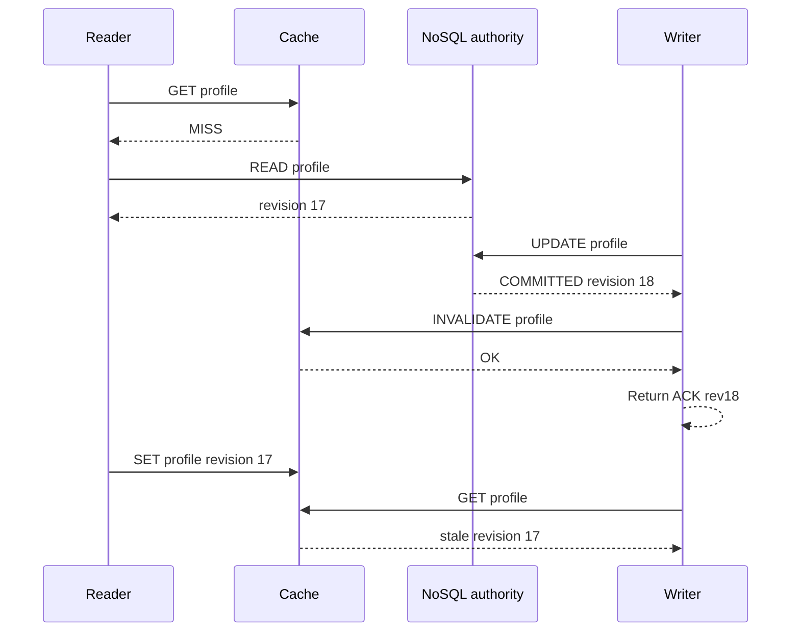

# Read-after-write qua cache và phạm vi bảo đảm quan sát

Một người dùng đổi tên hiển thị từ `Minh` thành `Minh Anh`. API cập nhật hồ sơ trả `200 OK`, nhưng ngay sau đó trang cá nhân vẫn hiển thị `Minh`. Một quản trị viên đổi trạng thái đơn hàng thành `PAID`, nhưng API đọc từ Redis hoặc CDN vẫn trả `PENDING`. Database có thể đã ghi thành công; vấn đề là **đường đọc qua cache chưa quan sát được thay đổi đã được xác nhận**.

Đó là bài toán **read-after-write** hay chính xác hơn, tùy phạm vi, **read-your-writes consistency (RYW)**. Trong chương **Database No SQL → Bộ nhớ đệm dữ liệu**, ta sẽ xác định đâu là lời hứa có thể đưa ra cho người dùng, điều gì cache làm được hoặc không làm được, và cách xây một đường đọc an toàn khi hệ có nhiều cache, database replicas, CDC, chỉ mục bất đồng bộ và nhiều phiên truy cập đồng thời.

Ví dụ xuyên suốt:

```text
POST /users/U-101/profile
    { "displayName": "Minh Anh" }

Response:
    200 OK
    { "userId": "U-101", "revision": 18 }

Ngay sau đó:

GET /users/U-101/profile
    -> nên thấy revision >= 18
       nếu API hứa read-your-writes.
```

Không thể chỉ nói “đã ghi vào NoSQL, vậy người dùng chắc chắn đọc được ngay”. Cần xem **write acknowledgment nói gì**, **read đang đi qua tầng nào**, và **bằng chứng nào cho thấy dữ liệu đọc đủ mới**.

> Tên cấu hình, mức nhất quán và kỹ thuật invalidation cụ thể khác nhau giữa MongoDB, DynamoDB, Cassandra/ScyllaDB, Redis, application cache và CDN. Các pseudo-code trong bài mô tả giao thức, không khẳng định mọi database đều có cùng API. Khi triển khai, phải dùng đúng version, consistency level, transaction và failure semantics của sản phẩm.

---

## 1. Xác định thuật ngữ trước khi thiết kế

Trong thực tế, “read-after-write” có thể bị dùng để chỉ nhiều lời hứa khác nhau:

- **Read-your-writes (RYW):** một phiên đã ghi thành công thì những lần đọc sau của chính phiên đó phải quan sát được ghi ấy hoặc một trạng thái về sau phù hợp.
- **Strong/linearizable read-after-write:** mọi client thực hiện đọc **sau khi một write đã hoàn tất** đều nhìn thấy trạng thái phản ánh write đó hoặc ghi mới hơn theo thứ tự tuyến tính hóa. Đây là bảo đảm mạnh hơn RYW của một phiên.
- **Monotonic reads:** một phiên không đọc lùi về trạng thái cũ hơn những gì nó đã quan sát.
- **Causal consistency:** những thao tác có quan hệ nhân quả được quan sát theo thứ tự nguyên nhân–kết quả trong phạm vi bảo đảm của hệ.
- **Eventual consistency:** nếu không còn ghi mới và các thành phần phục hồi, các bản sao có thể hội tụ; **không có mốc tức thì cố định** chỉ từ tên gọi này.
- **Bounded staleness/freshness SLO:** giới hạn độ trễ quan sát theo định nghĩa và số liệu, không đồng nghĩa tuyệt đối với RYW cho mọi trường hợp.

Ví dụ, một hệ có thể đáp ứng:

```text
Người vừa sửa hồ sơ:
    thấy revision 18 ngay.

Người dùng khác:
    tạm thấy revision 17 trong 2 giây.

Sau đó:
    các cache hội tụ về revision 18.
```

Hệ này có thể cung cấp **RYW theo phiên** mà **không hứa linearizable reads cho toàn bộ khách hàng**.

## 2. Định nghĩa RYW bằng quan hệ thứ tự

Giả sử phiên \(S\) đã thực hiện ghi \(W\), và \(W\) được xác nhận hoàn tất tại thời điểm \(t_1\). Một lần đọc \(R\) trong cùng phiên bắt đầu sau \(t_1\) phải phản ánh \(W\) hoặc trạng thái hợp lệ sau \(W\) nếu API hứa RYW.

```text
Session S:

W: SET profile.name = "Minh Anh"
    |
    v
ACK committed, revision=18
    |
    v
R: GET profile
    |
    v
Observed revision >= 18
```

Khi có concurrent writers, **không phải mọi read đều phải trả đúng giá trị `"Minh Anh"` mãi mãi**. Ví dụ:

```text
W1: Minh -> Minh Anh, revision 18
W2: Minh Anh -> Mai, revision 19
R:  read revision 19 = Mai
```

Nếu revision 19 là một update hợp lệ sau W1, đọc revision 19 có thể thỏa RYW: read đã thấy lịch sử tiến qua W1. Điều phải tránh là **đọc lùi về revision 17** như thể W1 chưa từng được ghi.

Bảo đảm này cần một quan hệ thứ tự đáng tin cậy. Một số lớn hơn không có nghĩa mới hơn nếu đó là version của một entity khác, generation khác hoặc epoch khác.

## 3. “Đã ghi thành công” phải có nghĩa rõ

Các mốc khác nhau:

```text
REQUEST_RECEIVED
COMMAND_ACCEPTED
WRITE_APPLIED_ON_ONE_NODE
COMMIT_ACKNOWLEDGED_BY_REQUIRED_QUORUM
TRANSACTION_COMMITTED
REPLICATED_TO_READ_REGION
CACHE_UPDATED
CLIENT_RECEIVED_ACK
```

Chúng **không đồng nhất**.

Ví dụ API trả:

```http
HTTP/1.1 202 Accepted

{
  "operationId": "profile-change-101",
  "status": "PENDING"
}
```

Điều này có thể chỉ có nghĩa lệnh đã được lưu bền vững vào workflow. Chưa được phép yêu cầu mọi `GET profile` trả thay đổi cuối cùng nếu business command chưa commit.

Ngược lại:

```http
HTTP/1.1 200 OK

{
  "status": "APPLIED",
  "revision": 18
}
```

nếu contract nói `APPLIED` là commit hoàn tất, thì mọi GET trong cùng phiên được công bố là RYW phải quan sát revision tương thích. Nếu server chỉ cập nhật cache còn durable store chưa ghi, không được dùng nhãn `APPLIED` với nghĩa đã commit bền vững.

**Bài toán cache bắt đầu từ contract của write ACK, không bắt đầu từ TTL.**

## 4. Những tầng cache có thể tham gia một lần đọc

Một request có thể đi qua:

```text
Browser / mobile local state
          |
          v
HTTP cache / CDN / edge
          |
          v
API gateway cache
          |
          v
Application in-memory cache (Caffeine, local map...)
          |
          v
Distributed cache (Redis/Memcached)
          |
          v
NoSQL read replica / query projection
          |
          v
NoSQL authoritative data
```

Khi có nhiều tầng, sửa đúng Redis **chưa đủ**:

- Browser có thể giữ dữ liệu cũ trong state hoặc HTTP cache.
- CDN còn response theo `Cache-Control`.
- Pod A đã invalidated local cache, pod B chưa nhận.
- Redis mới nhưng application L1 cache vẫn cũ.
- Redis miss rồi đọc một secondary đang replication lag.
- Database source mới nhưng search index hoặc materialized read model chưa bắt kịp.

Vì vậy một RYW contract cần nêu **đường đọc và các tầng nó bao phủ**, không chỉ “cache có TTL ngắn”.

## 5. Bảng các mức bảo đảm quan sát

| Phạm vi | Lời hứa có thể đưa ra | Điều cần thiết |
| --- | --- | --- |
| Cùng HTTP response | Caller nhận trạng thái đã commit trong write response | Commit receipt hợp lệ |
| Cùng tiến trình Java | Các reads tại một pod không lùi so với write | Cập nhật/kiểm tra local cache và source |
| Cùng session đăng nhập | Reads sau write đáp ứng revision đã nhận | Session token/watermark truyền qua các request |
| Cùng thiết bị | Client giữ version tối thiểu qua chuyển trang | Bảo toàn token, không chỉ local optimistic state |
| Nhiều thiết bị cùng user | Thiết bị khác cũng thấy ngay | Server-side watermark hoặc strong read path, nếu hứa |
| Mọi client ở một Region | Reads sau commit đều mới | Region-wide consistency/authority + cache coherence |
| Mọi Region | Cross-region global freshness/linearizability | Protocol phân tán đủ mạnh, không chỉ async replication |
| Search/list/report | Query có kết quả đầy đủ tới một mốc commit | Projection coverage/watermark, không chỉ version của một item |

Không mặc định một thiết kế đáp ứng dòng trên cùng thì tự đáp ứng mọi dòng dưới.

## 6. Ví dụ timeline gây “ghi xong vẫn thấy cũ”

```text
T0  Source profile revision 17: "Minh"
T1  Redis cache = rev17
T2  Client POST update
T3  Source commit rev18: "Minh Anh"
T4  Server trả 200, revision=18
T5  Client GET profile
T6  Cache hit rev17: "Minh"
```

Nếu API hứa RYW cho client này, request GET tại T5 đã vi phạm lời hứa.

Nguyên nhân trực tiếp: read path **không kiểm tra dữ liệu cache có mới đủ so với write mà client vừa nhận**.

## 7. Cache-aside hoạt động như thế nào?

Cache-aside hay lazy-loading:

```text
GET:
    cache.get(key)
    if hit:
        return cached
    source.get(key)
    cache.set(key, result, TTL)
    return result

WRITE:
    source.update(key)
    cache.invalidate(key)
```

Đây là mẫu phổ biến vì cache đơn giản và source vẫn là authority. Nhưng tính đúng phụ thuộc vào thứ tự, lỗi và concurrency.

### Bảo đảm thực tế

- Cache hit có thể cũ.
- Cache miss đọc từ source có thể cũ nếu source path là eventual replica.
- Invalidation có thể thất bại.
- Invalidation đến muộn so với event hoặc write khác.
- Một reader đang xử lý cache miss có thể nạp lại bản cũ **sau** khi writer invalidated.

**Cache-aside mặc định không hứa RYW**, kể cả khi writer xóa cache ngay sau commit.

## 8. Race quan trọng: stale cache fill sau invalidation

Timeline:

```text
Source lúc đầu: revision 17.

Reader R:
  R1: cache miss.
  R2: đọc source rev17 (bản copy đã lấy về).
                    Writer W:
                      W1: commit source rev18.
                      W2: invalidate cache key.
                      W3: return ACK rev18.
  R3: set cache = rev17.

Session của W:
  W4: GET profile -> cache hit rev17.
```

Cache đã bị xóa **trước khi** R ghi lại bản cũ. Nếu R3 diễn ra sau W2, invalidation không còn tác dụng.

Sơ đồ:



Đây là một trong những lý do **“ghi DB xong xóa cache” không tự tạo bảo đảm mạnh** khi có in-flight reads.

## 9. Vì sao “xóa cache hai lần” chưa phải chứng minh đúng?

Một số hệ dùng:

```text
Update database
Delete cache
Sleep một khoảng
Delete cache lần nữa
```

Cách này có thể giảm xác suất stale fill ở một số workload nhưng không phải bảo đảm tổng quát:

- Reader có thể chậm hơn khoảng sleep.
- Queue/invalidation có thể đến muộn.
- Network partition làm một lần delete mất.
- Application L1, CDN hoặc edge cache có TTL riêng.
- Reader có thể nạp từ replica stale **sau cả lần delete thứ hai**.
- Khi reconnect, event cũ có thể cập nhật lại projection/cache.

Nếu cần RYW theo phiên, nên dùng **min-version validation và authoritative fallback**, thay vì chỉ dựa vào delay đoán trước.

## 10. Thiết kế với version/revision trên mỗi entity

Một bản ghi authoritative:

```json
{
  "tenantId": "T1",
  "userId": "U-101",
  "displayName": "Minh Anh",
  "revision": 18,
  "generation": 1
}
```

Cache entry nên mang metadata tương ứng:

```json
{
  "key": "T1:profile:U-101",
  "payload": {
    "displayName": "Minh Anh"
  },
  "revision": 18,
  "generation": 1,
  "cachedAt": "2026-11-14T10:00:00Z"
}
```

Write response trả:

```json
{
  "status": "APPLIED",
  "userId": "U-101",
  "revision": 18,
  "generation": 1
}
```

Read request trong cùng phiên truyền phiên bản tối thiểu:

```http
GET /profiles/U-101
X-Min-Revision: 18
```

Server chỉ được trả cache hit nếu bản cache thỏa quan hệ phiên bản tương ứng.

### Không dùng timestamp tùy ý thay revision

`updatedAt` từ các máy khác nhau có thể không tạo một thứ tự đáng tin. Nếu version được tạo bởi source authority, CAS/transaction hoặc một protocol nhất quán, nó phù hợp hơn cho min-version read.

## 11. Thuật toán đọc đáp ứng RYW cho một key

Một thuật toán khái niệm:

```text
readProfile(userId, minVersion):
    cacheEntry = cache.get(key)

    if cacheEntry exists and
       cacheEntry.generation matches expected generation and
       cacheEntry.revision >= minVersion:
        return cacheEntry

    sourceRecord = authoritativeRead(key)

    if sourceRecord satisfies minVersion:
        optionally populate cache safely
        return sourceRecord

    if sourceRecord cannot satisfy minVersion:
        WAIT within budget, or return NOT_READY/UNKNOWN

    if source unavailable:
        return UNAVAILABLE, not stale success
```

Nếu `minVersion` không có, read path có thể dùng cache theo **freshness contract** của endpoint. Nếu có token rev18, cache rev17 phải được bỏ qua.

Điều kiện kỹ thuật quan trọng: **authoritativeRead thật sự phải cung cấp độ nhất quán cần thiết**, chứ không thể là một eventual replica đang lag rồi so version nhiều lần vô hạn.

## 12. Điểm mạnh và giới hạn của min-version token

Với một key có source revision tăng đơn điệu theo generation, token giúp:

- Bỏ qua cache rev17 sau khi đã thấy write rev18.
- Không cần invalidated mọi layer trong cùng một microsecond.
- Có thể route sang source nếu cache chưa kịp cập nhật.
- Cho client quan sát update của chính nó ngay.
- Cho phép nền read model cập nhật bất đồng bộ.

Nhưng token **không tự tạo global linearizability**:

- Client khác không có token vẫn có thể thấy rev17.
- Một query nhiều entities cần mốc cho nhiều keys/partitions.
- Revision từ các aggregates khác nhau không so sánh trực tiếp.
- Nếu client bỏ mất token, lời hứa RYW theo client có thể không còn được thực thi.
- Nếu chỉ số `revision` được tái sử dụng sau delete/recreate, có thể so sai.
- Nếu authority đã rollback một ghi chưa durable, token có thể chỉ tới revision không còn hợp lệ; phải xem commit contract.

## 13. Tách `generation` và `revision`

Giả sử entity được xóa và tạo lại:

```text
Generation 5:
    revision 100, status DELETED.

Generation 6:
    revision 1, status ACTIVE.
```

So sánh:

```text
100 > 1
```

không có nghĩa generation 5 mới hơn generation 6.

Cần dùng:

```text
(entityId, generation, revision)
```

theo quy tắc authority, hoặc một commit sequence/opaque token mà database định nghĩa rõ.

Một cache entry từ generation 5 không được thỏa `minRevision=1` của generation 6, chỉ vì `100 >= 1`.

**Generation/fencing giúp tránh late retries và stale cache entries từ một đời entity trước.**

## 14. Khi có nhiều writers, token cần biểu diễn lịch sử đúng

Hai người sửa profile:

```text
A commits rev18: "Minh Anh"
B commits rev19: "Mai"
A reads.
```

Read rev19 có thể thỏa RYW vì nó sau rev18. Nếu client A **cần xác nhận chính lệnh A đã commit**, không nên chỉ nhìn profile hiện tại, vì writer B có thể tạo cùng/khác giá trị.

Nên phân biệt:

- **RYW:** thấy trạng thái mới đủ trong một thứ tự đã định nghĩa.
- **Operation outcome lookup:** tra `operationId`/receipt để biết *chính command A* đã được áp.
- **Business correctness:** liệu update rev19 có hợp lệ với invariant/authorization không?

Một response `revision=19` **không tự chứng minh** operation A đã thành công nếu A chỉ nhận timeout và chưa có receipt.

## 15. Unknown write outcome: trước khi nói RYW phải biết đã ghi chưa

Timeline:

```text
Client sends UPDATE profile.
Database commits rev18.
Network drops response.
Client receives TIMEOUT.
```

Client chưa nhận commit receipt, nên không có bằng chứng để nói update được xác nhận.

Một lựa chọn:

```text
POST /profile with operationId=change-101
    -> TIMEOUT

GET /operations/change-101
    -> APPLIED, revision=18

GET /profile with minRevision=18
    -> revision >=18
```

Nếu operation lookup cũng lỗi:

```text
status=UNKNOWN
```

Không lấy cache `rev17` rồi suy write thất bại; cũng không tự tạo một operation ID mới để gửi lại side effect.

**RYW bắt đầu sau một điểm xác nhận ghi có semantics rõ**, còn xử lý write outcome chưa xác định là một bài toán liên quan nhưng khác.

## 16. Cache policy cần tôn trọng commit/ACK boundary

Một write-through pattern sai:

```text
Update cache rev18
Return 200
Async update database later
```

Nếu database update thất bại hoặc crash, caller đã nhận “committed” trong khi dữ liệu chưa có authority.

Nếu product hứa durable commit, thứ tự an toàn hơn thường là:

```text
Commit authoritative source.
Get durable commit receipt rev18.
Update/invalidate cache theo policy.
Return successful response with rev18.
```

Nhưng như đã thấy, **invalidate đơn lẻ vẫn có race**; RYW chính thức nên được bảo vệ ở read path bằng token/authority.

Nếu cần cache update trước source vì một workflow đặc biệt, API phải nói đúng đó là **accepted/pending**, không được gắn nhãn committed nếu contract không bảo đảm.

## 17. Write-through, write-around và write-behind

| Chiến lược | Cách hoạt động | Ảnh hưởng tới RYW |
| --- | --- | --- |
| Cache-aside | Đọc miss từ source; ghi source rồi invalidate | Cần version gating để tránh stale hit/fill |
| Write-through | Ghi cache và source theo luồng đồng bộ được định nghĩa | Hai nguồn không atomic có failure window; ACK cần rõ |
| Write-around | Ghi thẳng source, không cập nhật cache, dùng invalidation | RYW cần bypass stale cache |
| Write-behind/write-back | Ghi cache trước, đẩy xuống source sau | Nếu ACK là durable commit thì không hợp trừ khi cache/write log có contract bền vững đủ |
| Event-driven cache | Source commit -> outbox/CDC -> consumer cập nhật cache | Có lag, duplicate, reorder; cần revision guard |
| Read-through | Cache layer tự load source trên miss | Vẫn có read-before-write/invalidation race |

**Write-behind không mặc định sai**, nhưng phải định nghĩa nguồn có thẩm quyền và độ bền của write ACK. Nếu cache là authority theo một protocol được thiết kế, đây là bài toán khác với “cache dữ liệu từ một NoSQL authority”.

## 18. Eventual propagation qua outbox/CDC

Một hệ:

```text
Command API
   |
   v
NoSQL authority commit rev18
   |
   +--> Outbox / Change Stream
             |
             v
        Event broker
             |
             v
        Cache updater
             |
             v
     Redis/cache rev18
```

Lợi ích:

- Không chặn write response tới khi mọi cache cập nhật.
- Có đường replay và quan sát lag.
- Nhiều views có thể cập nhật từ cùng source.
- Có thể tách scale write và read.

Đổi lại:

- Cache có thể tạm ở rev17.
- Event có thể trùng.
- Consumer có thể xử lý sai thứ tự.
- Một event có thể bị giữ lại quá lâu hoặc mất khi hết retention.
- Rebuild có thể nạp snapshot cũ.
- Cache updater có thể bị partition khỏi một nhóm nodes.

Nếu API vẫn hứa RYW ngay, **session read phải bypass/wait/fallback**, không đợi CDC “thường chỉ mất 50ms”.

## 19. Event sai thứ tự làm cache lùi phiên bản

Timeline:

```text
Event E18: profile rev18, displayName="Minh Anh"
Event E19: profile rev19, displayName="Mai"
```

Consumer nhận:

```text
1. E19
2. E18 (đến muộn)
```

Nếu blind overwrite:

```text
Cache rev19 -> rev18
```

Một guard:

```text
Apply incoming only if:
    same generation and incomingRevision > cachedRevision,
    or generation is a valid successor.

On duplicate/outdated event:
    do nothing.
```

Điều kiện phải **atomic tại cache key**, không làm `GET revision` rồi `SET` không điều kiện giữa nhiều consumers.

Với **delta events**, bỏ qua event rev18 chỉ vì đã nhận rev19 có thể làm mất một thay đổi cần tích lũy. Phải phân biệt snapshot/upsert với delta/counter events, phát hiện sequence gaps và có replay/recompute.

## 20. Một Redis Lua script cập nhật cache theo revision

Giả sử cùng một Redis hash:

```text
KEYS[1] = cache:profile:T1:U-101
ARGV[1] = incomingGeneration
ARGV[2] = incomingRevision
ARGV[3] = JSON payload
ARGV[4] = TTL seconds
```

Một script minh họa **so sánh và thay thế trong một lần thực thi Redis**:

```lua
local key = KEYS[1]

local oldGen = tonumber(redis.call("HGET", key, "generation"))
local oldRev = tonumber(redis.call("HGET", key, "revision"))
local newGen = tonumber(ARGV[1])
local newRev = tonumber(ARGV[2])
local ttl = tonumber(ARGV[4])

if not newGen or not newRev or not ttl or ttl <= 0 then
    return { "INVALID" }
end

if oldGen and oldRev then
    if newGen < oldGen then
        return { "STALE_GENERATION" }
    end
    if newGen == oldGen and newRev <= oldRev then
        return { "OLD_OR_DUPLICATE" }
    end
end

redis.call("HSET", key,
    "generation", ARGV[1],
    "revision", ARGV[2],
    "payload", ARGV[3])
redis.call("EXPIRE", key, ttl)
return { "APPLIED" }
```

### Phạm vi an toàn của script

Script ngăn event cũ ghi đè **một cache entry mới hơn đang tồn tại**. Nhưng nếu cache bị evict/expired, thông tin version cũ cũng mất. Khi đó một event rev17 vẫn có thể điền lại key trống nếu không có source/version fence bên ngoài.

Ngoài ra:

- Script không bảo vệ nguồn dữ liệu authoritative.
- Redis Cluster có ràng buộc hash slot nếu thao tác nhiều keys.
- Redis failover/persistence có thể thay đổi durability của cache theo cấu hình.
- Nếu generation không phải thứ tự có nghĩa, không thể dùng `newGen > oldGen` như một rule toàn cục.
- Read-your-writes cần **min-version check khi đọc**, kể cả script cập nhật cache có revision guard.

## 21. Metadata fence để chặn stale fill sau invalidation

Một kỹ thuật mạnh hơn cache-aside thông thường là lưu **minimum allowable revision** hoặc **invalidation epoch** cho key.

Sau source commit rev18:

```text
cacheFence[key] = minRevision 18
invalidate cached payload rev17
```

Reader R đã đọc rev17 trước đó, khi muốn fill cache phải kiểm tra nguyên tử:

```text
if loadedRecord.revision < cacheFence[key]:
    reject cache fill
else:
    allow write if version not older
```

Điều này có thể chặn race stale fill **nếu**:

1. Fence được cập nhật chắc chắn trước khi write ACK hứa coherence.
2. Fence không bị mất/evict trước khi stale fill diễn ra.
3. Compare-and-write với fence là nguyên tử.
4. Fence có đúng generation/version scope.
5. All writers/invalidation paths tuân thủ cùng protocol.
6. Source read nhận version có nghĩa và không đọc sai thế hệ.

Nếu fence là một cache key có TTL và nó biến mất đúng lúc reader trễ trở lại, race vẫn tồn tại. Không được coi một marker dễ mất là bằng chứng mạnh nếu business cần global coherence.

**Trong nhiều hệ, RYW theo phiên bằng min-version + authoritative fallback rẻ và dễ bảo đảm hơn global cache coherence.**

## 22. Nếu không thể chờ cache bắt kịp, làm gì?

Một read có `minRevision=18`, cache chỉ có rev17.

Có ba lựa chọn hợp lệ theo contract:

**A. Bypass cache để đọc authoritative source**

```text
Cache rev17 < 18
  -> authoritative read
  -> source rev18
  -> return rev18
```

**B. Chờ bounded cho projection/cache bắt kịp**

```text
Cache rev17 < 18
  -> wait for revision >=18, tối đa 200ms
  -> nếu đạt thì return
  -> nếu không thì fallback hoặc NOT_READY
```

**C. Trả trạng thái chưa sẵn sàng**

```http
HTTP/1.1 503 Service Unavailable

{
  "code": "READ_MODEL_NOT_CAUGHT_UP",
  "requiredRevision": 18,
  "observedRevision": 17
}
```

Đây chỉ là mã HTTP minh họa; API có thể dùng `202`, `409`, `425` hoặc status envelope riêng theo contract. Quan trọng là **không trả rev17 như thể đã đáp ứng revision 18**.

Không nên chờ vô hạn vì consumer có thể chết hoặc bị network partition.

## 23. Bounded wait và thời gian đáp ứng

Ví dụ:

```text
GET latency budget: 300ms

Cache lookup:          2ms
Wait for projector:   80ms
Authority fallback:  100ms
Response serialization: 5ms
```

Trong tình huống này đường fallback có thể nằm trong budget. Nhưng nếu `wait` đã chiếm 280ms rồi mới bắt đầu source lookup 200ms, GET vượt SLO.

Một flow:

```text
remaining = requestDeadline - elapsed

if cache >= minRevision:
    return

if projection likely to catch up and sufficient budget:
    wait short bounded interval

if authoritative read fits remaining budget:
    fallback

otherwise:
    return NOT_READY/UNAVAILABLE with explicit semantics
```

**Đặt deadline tổng** thay vì nhiều per-layer timeouts có thể cộng dồn vượt thời gian người dùng chờ.

## 24. Session token lưu ở đâu?

Một số lựa chọn:

- **Response header hoặc body:** write trả `minRevision`, client gửi nó trong các reads sau.
- **Cookie/session token:** backend hoặc client giữ watermark theo phiên đăng nhập.
- **Server-side session store:** nhiều thiết bị hoặc API servers truy cập một watermark có quyền quản lý.
- **Causal token của database:** nếu sản phẩm hỗ trợ session/causal consistency đúng nghĩa.
- **Request-local context:** phục vụ chuỗi read sau write trong cùng một request/workflow.

Ví dụ:

```http
HTTP/1.1 200 OK
X-Entity-Revision: 18
```

Client:

```http
GET /profiles/U-101
X-Min-Entity-Revision: 18
```

### Bảo mật và tính toàn vẹn

Không cho client dùng token để:

- Đọc dữ liệu tenant khác.
- Buộc server tra một entity mà user không có quyền.
- Tạo phiên bản cực lớn tùy ý gây chờ vô hạn.
- Giả mạo receipt rằng write đã commit.

Token có thể cần ràng buộc với tenant/entity/session, ký hoặc được xác thực bằng source metadata. **Min-version là yêu cầu độ tươi, không phải bằng chứng quyền truy cập hoặc bằng chứng ghi thành công**.

## 25. Nếu client mất token thì sao?

Khách làm:

```text
POST update -> response rev18.
Reload page -> JavaScript state mất rev18.
GET profile without minRevision -> cache rev17.
```

Hệ chỉ giữ revision trong component RAM có thể không duy trì lời hứa qua reload.

Cần định nghĩa RYW scope:

- Chỉ trong một request?
- Trong một browser tab?
- Trong toàn phiên đăng nhập?
- Qua app restart?
- Qua nhiều thiết bị của cùng user?
- Qua Region failover?

Nếu promise là “người vừa đổi hồ sơ luôn thấy thay đổi trên mọi thiết bị”, client-carried token cục bộ **không đủ**. Có thể cần server-side per-user/per-entity watermark hoặc globally consistent read path.

**Không quảng bá RYW theo user nếu chỉ implement RYW theo một tab trong RAM.**

## 26. Read-your-writes và monotonic reads khác nhau

Giả sử:

```text
Client đã đọc profile revision 20 từ Pod A.
Sau đó gọi Pod B và đọc revision 18.
```

Không có write mới của client, nhưng lần đọc thứ hai đã **đi lùi**. Đó là vi phạm **monotonic reads**, không nhất thiết là vi phạm một RYW dựa trên lần ghi cụ thể.

Một session watermark có thể duy trì:

```text
minimumObservedRevision = max(
    lastSuccessfulWriteRevision,
    lastReadRevision)
```

theo đúng phạm vi entity/generation.

Sau mỗi read/write, client hoặc server nâng watermark. Lần đọc sau phải thỏa watermark ấy hoặc trả không sẵn sàng. **Monotonic reads** hữu ích cho ứng dụng chuyển giữa pods/replicas/Regions.

## 27. RYW không đảm bảo atomic snapshot nhiều keys

Một API dashboard trả:

```text
Order status
Payment status
Inventory reservation
```

Một source transaction có thể cập nhật nhiều records hoặc các services có state độc lập.

Nếu chỉ kiểm tra:

```text
order.revision >= 18
```

không bảo đảm:

```text
payment = CAPTURED
inventory = RESERVED
```

đều thuộc cùng một snapshot logic.

Cần xem:

- Có transaction atomic cross-key thực sự không?
- Có commit/causal token chung được database hỗ trợ không?
- Read model đã áp đủ mọi sự kiện liên quan chưa?
- Domain cho phép trạng thái trung gian nào?
- Có thể hiển thị từng status với freshness riêng không?
- Có cần authoritative composite read hoặc saga state?

**RYW theo một key không tự cung cấp snapshot consistency cho nhiều nguồn.**

## 28. Truy vấn danh sách: không thấy item mới là một dạng stale khó xử lý

Ví dụ:

```text
POST /orders -> creates O-501, commit revision 18.

GET /customers/C-10/orders
  -> kết quả không có O-501.
```

Một item cache có `revision` riêng, nhưng **query result là một tập các items**. Làm sao biết “danh sách đã cập nhật đủ” nếu item mới không có trong danh sách?

Không thể chỉ nhìn revision của item O-500 đã tồn tại.

Các lựa chọn:

1. **Projection watermark** có khả năng chứng minh đã xử lý source event tạo O-501.
2. **Query-scoped generation/version** được cập nhật nhất quán với source.
3. **Query authoritative** cho một số trường hợp nếu database hỗ trợ.
4. **Client merge** verified write receipt vào danh sách tạm thời, giữ semantics rõ.
5. **Bounded wait** tới khi index đã qua mốc liên quan.
6. **Trả `SYNCING`/stale marker** nếu chưa thể chứng minh.

**Absence là bằng chứng khó hơn presence**, nhất là khi query dựa trên GSI, search index hoặc cache của cả trang.

## 29. Projection watermark: hiểu đúng phạm vi

Một stream chia partitions:

```text
Partition P0: applied offset 2100
Partition P1: applied offset 1800
Partition P2: applied offset 2400
```

Offsets không so sánh trực tiếp giữa các partitions. Một watermark duy nhất `2400` không có nghĩa toàn bộ projection đã xử lý mọi event tới một mốc toàn cục.

Nếu O-501 nằm ở P1 offset 1900, projector P1 mới tới 1800 thì list chưa thể cam kết chứa O-501.

Cần metadata như:

```json
{
  "streamPartition": "P1",
  "requiredOffset": 1900,
  "appliedOffset": 1800
}
```

hoặc một barrier/commit token theo contract của stream. Với query gom nhiều partitions, cần chứng cứ coverage trên mọi partition liên quan.

**Consumer offset là thông tin tiến độ trong phạm vi stream partition, không mặc định là revision của một record.**

## 30. Query-cache cho trang danh sách cần invalidation riêng

Ví dụ:

```text
cache key:
  orders:T1:C-10:first-page:PAID:sort-desc
```

Một order chuyển `PENDING → PAID` phải làm mới:

- Query `PENDING` (bỏ item).
- Query `PAID` (thêm item).
- Các trang chịu ảnh hưởng bởi thứ tự.
- Count/summary theo status.
- Có thể cache cho store/admin khác.

Xóa cache của **order detail** không tự cập nhật các caches của **query result**.

Nếu có hàng trăm filter combinations, chủ động invalidate mọi query cache có thể tốn kém. Có thể dùng:

- Query/tenant scoped generation.
- Short TTL có freshness SLO thực tế.
- Event-driven invalidation theo index dependencies.
- Chỉ cache một số query phổ biến.
- Projection được thiết kế query-first.
- Min-watermark hoặc authoritative fallback cho những query bắt buộc RYW.

## 31. Negative caching: `NOT_FOUND` cũng có phiên bản

Một cache có thể lưu:

```text
profile:T1:U-101 -> NOT_FOUND, TTL=60s
```

Sau đó một user mới được tạo thành công. GET ngay sau create vẫn nhận `NOT_FOUND` từ negative cache.

Nếu API hứa RYW cho create, phải xử lý **negative cache entry** giống dữ liệu stale:

```text
Create committed rev1/generation1.
Client GET with min token.
Cached NOT_FOUND cannot satisfy token.
Bypass/fetch authoritative record.
```

Đối với toàn hệ, cần invalidation/fence hoặc policy đảm bảo negative cache hội tụ theo SLA.

**`NOT_FOUND` là một kết quả có tính thời điểm và scope**, không phải một sự thật vĩnh viễn.

## 32. Delete và tombstone: đừng hồi sinh dữ liệu đã xóa

Ví dụ:

```text
Source revision 21: profile DELETED.
Cache invalidated.
Delayed event revision 20: profile ACTIVE.
```

Nếu consumer ghi event rev20 vào cache key trống, profile bị xóa có thể **xuất hiện trở lại**.

Giải pháp:

- Tombstone/versioned deletion receipt.
- Generation/revision guard.
- Retention của tombstone đủ lâu để chống late replay.
- Consumer dedup/ordering.
- Rebuild từ source có áp các delete events.
- Cache keys gắn tenant/entity/generation.
- Verify deletion trong L1/L2/CDN/search theo policy.

**Delete không đơn giản là `DEL key` rồi bỏ mọi metadata** nếu hệ có asynchronous replay và privacy requirements.

## 33. Vòng đời TTL và freshness SLO

Một hiểu lầm:

```text
Cache TTL = 30 giây
=> read sau write chắc chắn nhìn dữ liệu mới trong 30 giây.
```

Thực tế:

- TTL có thể bắt đầu tại một lần refill sau write bằng bản replica stale.
- Một tầng L1/CDN có TTL dài hơn.
- Cache có thể gia hạn TTL khi refresh nhưng nguồn vẫn chậm.
- Expiry chính xác là semantics của cache engine, không phải committed-state guarantee.
- Negative cache có thời hạn riêng.
- Event consumer lỗi có thể khiến refill vẫn lấy data chưa cập nhật.

TTL thường dùng để **giới hạn tuổi một entry trong điều kiện phù hợp**, không tạo RYW tại thời điểm write ACK.

Một freshness SLO cần đo end-to-end theo source commit, không chỉ nhìn TTL cấu hình.

## 34. Nhiều tầng cache: version phải được kiểm tra tại biên trả response

Giả sử:

```text
L1: rev17
Redis L2: rev18
Source: rev18
```

Nếu API trả L1 rev17 trước khi truy Redis, việc Redis đã đúng không giúp RYW.

Một policy:

```text
Request carries minRevision=18.

L1 entry rev17 -> reject
L2 entry rev18 -> accept
Return rev18
```

Nếu L2 cũng rev17, fallback source.

Với CDN/HTTP cache, server có thể cần phân loại endpoints:

- Public, không có private RYW requirements: có thể cache theo freshness contract.
- Private user/session-specific: cache key và authorization đúng; có thể `private`/`no-store` khi cần.
- Strong status endpoint: bypass CDN hoặc dùng revalidation semantics phù hợp.
- GET profile với min-token: CDN cache cần phân biệt token hoặc không được phục vụ entry không đủ mới.

Không để một cache public dùng chung key chỉ theo URL khi response phụ thuộc tenant hoặc quyền truy cập.

## 35. HTTP cache-control và ETag

Một server có thể trả:

```http
HTTP/1.1 200 OK
ETag: "profile-U101-g1-r18"
Cache-Control: private, max-age=30
```

Sau đó client gửi:

```http
If-None-Match: "profile-U101-g1-r18"
```

ETag giúp conditional revalidation/tiết kiệm payload, nhưng **không tự bảo đảm RYW** nếu cache/revalidation được thực hiện bởi một nguồn stale hoặc API không gắn ETag với authority đúng.

Một `304 Not Modified` phải được phát theo đúng representation validators và freshness policy. Nếu server không thể xác minh có bản mới hơn minRevision, không được trả `304` chỉ vì một local cache cũ trùng ETag với client.

Một endpoint cập nhật dữ liệu nhạy cảm có thể dùng `Cache-Control: no-store` thay vì phức tạp hóa token; cần đánh đổi latency và tải nguồn.

## 36. CDN và regional edge: phạm vi quan sát thường hẹp

Một write ở Region A:

```text
Authoritative Region A: rev18.
Edge Singapore:         rev18.
Edge Frankfurt:         rev17.
```

Một người cùng session đổi mạng/địa điểm có thể được route sang edge khác.

Nếu lời hứa là **RYW qua mọi edge**, phải:

- Mang causal/min-version token qua request.
- Có edge bypass/route tới authority hoặc replica đủ mới.
- Có protocol global invalidation với coverage đủ mạnh nếu muốn không dùng token.
- Không mặc định purge CDN hoàn tất đồng bộ trên mọi địa điểm.
- Giới hạn chờ và phản hồi rõ nếu edge chưa thể đáp ứng.

**Global cache purge request accepted** khác với **mọi edge đã ngừng phục vụ bản cũ**.

## 37. Cross-region replication và failover

Ví dụ:

```text
Write committed ở Region A, revision 18.
Replication A -> B async.
Ngay sau đó client được route sang Region B.
B mới có revision 17.
```

Nếu Region B phục vụ cache rev17, RYW bị phá.

Lựa chọn tùy contract:

- Sticky routing về Region A cho một khoảng thời gian hoặc tới watermark.
- Session token/minVersion và **wait for B catch-up**.
- Fallback về Region có authority, nếu mạng cho phép.
- Strong cross-region commit/read protocol nếu hệ yêu cầu.
- Trả `NOT_READY`/unavailable thay vì dữ liệu cũ với API bắt buộc RYW.

Trong failover, còn phải hỏi: revision 18 được ACK theo mức **durability/replication guarantee** nào? Nếu write chưa có bảo đảm bền vững qua failover, chỉ mang token 18 không tự làm dữ liệu quay lại. **Consistency và durability là hai trục khác nhau.**

## 38. Session token không phải một global sequence miễn phí

Có những dữ liệu:

```text
Order A revision 18
Order B revision 6
Profile P revision 100
```

Không thể áp:

```text
GET Order B?minRevision=100
```

chỉ vì session vừa thấy Profile P revision 100. Những số version được cấp theo từng entity không cùng một trục so sánh.

Cần thiết kế token:

```json
{
  "scope": "profile",
  "entityId": "U-101",
  "generation": 1,
  "minRevision": 18
}
```

hoặc một **opaque causal token** của database có semantics về phạm vi rộng hơn.

Nếu session có hàng nghìn entities, không nhất thiết lưu map mọi key vô hạn; có thể giữ các token quan trọng theo workflow, giới hạn dung lượng, expiry và định nghĩa khi nào phải đọc source.

## 39. Một hợp đồng API RYW rõ ràng

Ví dụ:

```http
PATCH /v1/profiles/U-101
Content-Type: application/json
If-Match: "g1-r17"

{
  "displayName": "Minh Anh"
}
```

Response:

```http
HTTP/1.1 200 OK
ETag: "g1-r18"
X-Read-Min-Token: "opaque-authority-token"

{
  "userId": "U-101",
  "displayName": "Minh Anh",
  "revision": 18
}
```

GET:

```http
GET /v1/profiles/U-101
X-Read-Min-Token: "opaque-authority-token"
```

Response khi thỏa:

```json
{
  "userId": "U-101",
  "displayName": "Minh Anh",
  "revision": 18,
  "readConsistency": "READ_YOUR_WRITES"
}
```

Response khi chưa đủ:

```json
{
  "code": "MIN_VERSION_NOT_AVAILABLE",
  "status": "NOT_READY",
  "retryAfterMs": 150
}
```

`If-Match`/expectedVersion bảo vệ **cạnh tranh ghi**; `X-Read-Min-Token` bảo vệ **mốc quan sát**. Hai token có thể liên quan nhưng không nên nhầm vai trò.

## 40. Mã Java: một policy đọc theo min-version

Giả sử có các type:

```java
public record EntityVersion(
        long generation,
        long revision
) {}

public record VersionedProfile(
        String userId,
        String displayName,
        EntityVersion version
) {}

public interface ProfileCache {
    VersionedProfile get(String cacheKey);
    void putIfNewer(String cacheKey, VersionedProfile value);
}

public interface ProfileSource {
    VersionedProfile readAuthoritative(
        String tenantId, String userId);
}
```

Service:

```java
public final class ProfileReadService {
    private final ProfileCache cache;
    private final ProfileSource source;

    public ProfileReadService(
            ProfileCache cache,
            ProfileSource source) {
        this.cache = cache;
        this.source = source;
    }

    public VersionedProfile get(
            String tenantId,
            String userId,
            EntityVersion minVersion) {

        String key = tenantId + ":profile:" + userId;

        VersionedProfile cached = cache.get(key);

        if (satisfies(cached, minVersion)) {
            return cached;
        }

        VersionedProfile authoritative =
                source.readAuthoritative(tenantId, userId);

        if (!satisfies(authoritative, minVersion)) {
            throw new ReadNotReadyException(
                "Authority cannot satisfy requested version");
        }

        cache.putIfNewer(key, authoritative);
        return authoritative;
    }

    private boolean satisfies(
            VersionedProfile profile,
            EntityVersion minVersion) {

        if (profile == null) return false;
        if (minVersion == null) return true;

        EntityVersion actual = profile.version();

        return actual.generation() == minVersion.generation()
            && actual.revision() >= minVersion.revision();
    }
}
```

Đây là **mẫu thiết kế**, chưa có class `ReadNotReadyException` và adapters; không phải chương trình hoàn chỉnh. Trong hệ có delete/recreate, việc `generation()` lớn hơn token có thỏa “đọc sau ghi” hay không phải theo domain/protocol; ví dụ cố tình yêu cầu cùng generation. `putIfNewer` phải được implement bằng **atomic compare-and-write**; thao tác GET rồi SET độc lập trong Redis có race.

Đặc biệt, `ProfileSource.readAuthoritative` phải thật sự đáp ứng **read consistency** cần thiết. Gắn tên `readAuthoritative` vào một eventual read không làm nó trở thành strong read.

## 41. Java: ví dụ runnable mô phỏng cache cũ và token

Đoạn Java 17 độc lập sau minh họa: source đã commit revision 18; cache còn revision 17; read có min token bỏ qua cache và trả từ source.

```java
import java.util.Map;
import java.util.concurrent.ConcurrentHashMap;

public final class ReadYourWritesDemo {
    record Profile(String name, long revision) {}

    static final class Store {
        private volatile Profile source =
                new Profile("Minh", 17);

        private final Map<String, Profile> cache =
                new ConcurrentHashMap<>();

        void seedOldCache() {
            cache.put("U-101", new Profile("Minh", 17));
        }

        synchronized Profile commitUpdate(String newName) {
            Profile previous = source;
            source = new Profile(
                    newName, previous.revision() + 1);
            return source;
        }

        Profile read(String key, long minRevision) {
            Profile entry = cache.get(key);
            if (entry != null
                    && entry.revision() >= minRevision) {
                return entry;
            }

            Profile authoritative = source;
            if (authoritative.revision() < minRevision) {
                throw new IllegalStateException(
                        "Required revision unavailable");
            }

            // Trong ví dụ này cache chỉ có một key.
            // Production cần atomic put-if-newer.
            cache.compute(key, (ignored, previous) ->
                    previous == null
                      || previous.revision()
                            < authoritative.revision()
                    ? authoritative
                    : previous);

            return authoritative;
        }
    }

    public static void main(String[] args) {
        Store store = new Store();
        store.seedOldCache();

        Profile committed =
                store.commitUpdate("Minh Anh");

        System.out.println(
                "Write ACK revision=" + committed.revision());

        Profile result =
                store.read("U-101", committed.revision());

        System.out.println("Read=" + result);
    }
}
```

Output dự kiến:

```text
Write ACK revision=18
Read=Profile[name=Minh Anh, revision=18]
```

**Giới hạn minh họa:** `ConcurrentHashMap.compute` chỉ atomic trong một JVM. Nó không bảo vệ nhiều pods, Redis failover, CDN, replica lag, delete generations hay unconfirmed writes. `volatile`/`synchronized` tạo khả năng quan sát trong JVM này, không tương đương distributed commit. Ví dụ chỉ làm rõ **minVersion read path**.

## 42. Nhiều cache nodes phải dùng compare-and-set tại nơi lưu

Giả sử hai projector nhận:

```text
P1: event revision 18
P2: event revision 19
```

Cả hai làm:

```text
GET cachedRevision
if incoming > cachedRevision:
    SET payload
```

Có thể:

```text
P1 đọc rev17
P2 đọc rev17
P2 SET rev19
P1 SET rev18
```

Cache đi lùi.

Phải chuyển so sánh vào **atomic operation** của cache, ví dụ:

- Redis Lua script trên cùng key/slot.
- CAS primitive/transaction được engine hỗ trợ.
- Version-aware write condition.
- Single keyed worker với ordering **cộng** thêm guard nếu cần chống replay.
- Snapshot replace đi kèm source version, không blind overwrite.

Ngay cả khi cache writes đã được version-gated, **các GET có RYW** vẫn cần kiểm tra minRevision vì cache có thể chưa bắt kịp.

## 43. Một read-only fast path không nên âm thầm ghi ngược source

Một API đọc `GET /profile` có thể phát hiện cache stale và tự làm:

```text
cache <- source
```

Đây là **repair cache**, hợp lý nếu có authorization, version check và bounded load. Nhưng không được từ cache stale mà làm:

```text
source <- cache
```

vì stale cache sẽ ghi đè dữ liệu đã commit.

Nếu read path cần cập nhật source vì một migration/protocol đặc biệt, phải thiết kế như một **business write có điều kiện**, không gọi là read repair vô hại.

**Nguồn có thẩm quyền phải được xác định và không bị projection/cache chiếm quyền chỉ vì read tiện lợi.**

## 44. RYW qua local cache nhiều pod

Một ứng dụng Java dùng Caffeine L1:

```text
Pod A:
    GET profile -> cache rev17

Pod B:
    PATCH profile -> source rev18
    publish invalidation

Pod A:
    chưa nhận invalidation
    GET profile -> rev17
```

Nếu session sau PATCH được load balancer chuyển từ B sang A, RYW bị phá.

Có các hướng:

- Min-version token đi theo request tới bất kỳ pod nào.
- L1 cache hit phải được kiểm version.
- Distributed invalidation giúp các pods cập nhật nhanh hơn nhưng không thay contract.
- Session affinity chỉ là tối ưu, không đảm bảo khi pod chết hoặc deploy lại.
- Invalidation event có thể duplicate/reorder/mất, cần replay hoặc TTL/fallback.

**“Cùng user” không đồng nghĩa “cùng process”** trong ứng dụng nhiều replicas.

## 45. Nếu client giữ optimistic state, có cần RYW ở server không?

Một UI có thể làm:

```text
User đổi tên -> local state = "Minh Anh"
API trả success -> UI giữ tên mới.
```

Điều này cải thiện trải nghiệm, nhưng:

- Reload trang có thể mất local state.
- Chuyển thiết bị không giữ state.
- Một API khác có thể đọc bản cũ và ghi đè local state.
- Sau timeout/UNKNOWN, UI có thể hiển thị thành công giả.
- Concurrent writer hợp lệ có thể thay tên.
- Danh sách/search vẫn có thể trễ.

Optimistic UI không phải bằng chứng **database/cache RYW**. Nó nên dùng verified write receipt và phối hợp với status/minVersion read.

## 46. Cache có thể cố tình eventual mà vẫn đúng sản phẩm

Không phải mọi truy vấn cần RYW tức thì.

Ví dụ:

```text
Search product catalog:
    cho phép cập nhật trễ vài giây.

Public article view count:
    chấp nhận approximate.

Personal profile detail:
    cần thấy thay đổi của chính mình ngay.

Payment status:
    cần authoritative outcome.

Inventory last unit:
    conditional write ở authority.
```

Phân loại theo **nghiệp vụ và rủi ro**, không bật một policy toàn cục cho mọi endpoint.

Một hệ có thể rất tốt nếu cam kết:

```text
- Sau PATCH profile: GET detail trong cùng session có RYW.
- Search người dùng: eventual, freshness p99 <= 5s.
- Trang analytics: watermark và refresh theo phút.
```

Điểm quan trọng là **lời hứa được ghi rõ và có kiểm thử**, không phải tất cả views đồng bộ tức thì.

## 47. MongoDB: read concern, write concern, session và cache

MongoDB có read/write concerns, read preferences và cơ chế session/causal consistency theo các điều kiện cụ thể. Những khía cạnh cần xác định:

- ACK write cần mức write concern nào?
- GET sau đó đang đọc primary hay secondary?
- Read concern có hỗ trợ yêu cầu mới đủ không?
- Có session/causal token hay operation time có thể sử dụng không?
- Read có bị trả qua Redis/Caffeine/CDN trước khi tới MongoDB không?
- Dữ liệu có nằm trong transaction nhiều documents không?

Một driver session/causal guarantee (khi sử dụng đúng contract) **không tự đi xuyên Redis cache**. Nếu cache hit trả rev17 trước khi MongoDB được gọi, causal session của driver không có cơ hội bảo vệ response.

### Một pattern

```text
MongoDB update committed revision 18.
API response includes revision 18.
GET carries minRevision 18.
Redis entry rev17 -> bypass.
Read via MongoDB path satisfying required consistency.
Return rev18.
```

Không mặc định đọc secondary với `readPreference=secondary` là RYW chỉ vì write ACK trên primary thành công.

## 48. MongoDB: watch/change stream và invalidation

Một luồng:

```text
MongoDB source
    -> change stream
    -> cache invalidation/update
```

Các điều cần xử lý:

- Resume token/checkpoint và retention.
- Duplicate event delivery.
- Ordering phù hợp phạm vi collection/shard/transaction.
- Reconnect sau stream interruption.
- Cache updater không ghi đè version mới hơn.
- Delete/replace/rename/schema evolution.
- Event đã nhìn thấy ở consumer chưa đồng nghĩa mọi local/edge cache đã xử lý.

Change stream giúp cache **eventually catch up**; để đảm bảo RYW ngay sau write ACK, cần thêm minVersion/source read hoặc một protocol invalidate đồng bộ có scope rõ.

## 49. DynamoDB: base table, GSI, Streams và cache

Trong DynamoDB, query/read semantics khác nhau giữa:

- Base table `GetItem/Query` với read-consistency option được hỗ trợ.
- Global Secondary Index có propagation bất đồng bộ.
- DynamoDB Streams dùng để cập nhật projection/cache.
- Một cache layer như Redis hoặc application cache.
- Global Tables/multi-region với replication và consistency semantics theo chế độ cụ thể.

Ví dụ:

```text
UpdateItem base table:
    profile revision 18 committed.

GSI:
    chưa phản ánh revision 18.

Redis:
    đang giữ revision 17.
```

`GetItem` qua đường authority và consistency phù hợp có thể hỗ trợ đọc đủ mới trong phạm vi cho phép. Nhưng query GSI `NOT_FOUND` hoặc Redis rev17 **không là bằng chứng** write chưa commit.

Nếu dùng cache/projection từ Streams, cần event IDs/sequence đúng phạm vi, idempotent consumer, checkpoint, replay/rebuild và minRevision fallback.

Không suy rằng mọi API DynamoDB, GSI, Global Table Region đều có cùng strong read guarantee.

## 50. Cassandra/ScyllaDB: CL và cache không độc lập

Với CQL, read/write consistency level ảnh hưởng tới dữ liệu có thể quan sát.

Một câu nói chung như:

```text
WRITE QUORUM
READ ONE
```

không tự bảo đảm read luôn thấy write mới nhất trong mọi topology/concurrency. Có những điều kiện liên quan replica overlap, timestamps, concurrent writes, hinted handoff, repair, topology và read path.

Khi thêm Redis/Caffeine cache:

```text
CQL read theo CL phù hợp
    -> cache
```

việc GET hit cache rev17 **không còn thực hiện một CQL read**; mọi lập luận về CL của query bị bỏ qua nếu cache không kiểm version.

Để thiết kế RYW:

- Xác định consistency contract cần thiết tại authoritative read.
- Lưu ứng dụng revision/generation có ý nghĩa.
- Truyền min token sau write.
- Bypass stale cache.
- Nếu replica path không đáp ứng min token, chọn CL/authority phù hợp hoặc trả not-ready.
- Với LWT/conditional write, phân biệt `[applied] = false` và timeout outcome UNKNOWN.

Không nâng/hạ CL một cách mù để “chữa” cache stale; phải theo capacity, latency và correctness contract của ứng dụng.

## 51. Redis: tốc độ cache cao không tương đương global RYW

Redis thường làm distributed cache, nhưng:

- Đường đọc có thể tới replica bị trễ, tùy client/config.
- Eviction có thể xóa cả payload lẫn version fence.
- TTL expiry không tự cập nhật authoritative source.
- Failover có thể thay đổi cache visibility/durability.
- Redis Cluster slot routing, `MOVED/ASK` và client topology cache có thể gây điều kiện lỗi.
- Hai Java pods có thể còn local L1 cũ dù Redis mới.
- Cache scripts atomic theo phạm vi key/instance, không phải transaction toàn hệ với NoSQL source.

Một Redis key có `revision=18` giúp server **kiểm tra** mốc quan sát khi đọc; nó không chứng minh các key khác hoặc CDN đều ở revision tương ứng.

## 52. Trường hợp phụ thuộc nhiều entities

Ví dụ khách đổi tên, rồi mở trang đơn hàng:

```text
Profile source:
    U-101 displayName="Minh Anh", rev18.

Order read model:
    orderCard.customerName="Minh", rev7.
```

Nếu read model denormalize tên khách, việc profile đã commit rev18 không tự đảm bảo order card được cập nhật.

Có hai semantics khác nhau:

**Snapshot semantics:** order card cố ý giữ tên lúc đặt hàng. Khi đó `"Minh"` là đúng, không phải stale.

**Current-profile semantics:** order card phải hiển thị tên hiện tại. Khi đó cần propagation từ profile tới orders projection hoặc join/read hợp lệ.

Khi đặt RYW, phải nói rõ:

```text
RYW của entity Profile?
Hay RYW của mọi view phụ thuộc Profile?
```

Lời hứa thứ hai rộng hơn nhiều, có thể đòi query dependency tokens, composite snapshots hoặc source-backed enrichment.

## 53. Quyền truy cập thay đổi là trường hợp cache đặc biệt

Một user bị thu hồi quyền admin:

```text
Authority:
    role ADMIN -> USER, rev18.

Authorization cache:
    vẫn ADMIN, rev17.
```

Đây không chỉ là UX stale; nó có thể là **lỗ hổng bảo mật**.

Không dùng freshness policy của catalog cho authorization:

- Đặt revocation policy/SLO riêng.
- Có thể yêu cầu authority check hoặc token revocation/version.
- Đừng để client tự nâng quyền qua version header.
- Cache key phải gắn tenant, role, permission scope.
- Có invalidation protocol và fail-closed behavior khi không thể xác minh.
- JWT dài hạn chứa claims cũ cần chiến lược thu hồi/session version phù hợp.

**RYW của người sửa quyền không thay thế yêu cầu mọi subject bị thu hồi không còn sử dụng quyền cũ**. Đây là một dạng global/security consistency requirement, không chỉ một session guarantee.

## 54. Tính nhất quán của cache và tính đúng của business command

Đối với một hành động:

```text
POST /inventory/reserve
```

không được:

```text
cache.available > 0
    -> return CONFIRMED
```

vì cache có thể lag.

Đúng hơn:

```text
Read/display cache stock for UX.
At reservation:
    conditional write on inventory authority.
    verify commit/result.
    return CONFIRMED only with receipt.
```

Sau đó cache cập nhật bằng event/invalidation.

Ngay cả khi GET của cùng khách có RYW, **RYW không thay thế atomic conditional write** khi hai người cùng tranh sản phẩm cuối.

## 55. RYW và cache stampede

Khi writer invalidates một hot key:

```text
1000 clients GET cùng key -> cache miss.
1000 requests tới NoSQL source.
```

Hệ có thể quá tải, dẫn đến tăng latency, thậm chí stale fallback không được kiểm soát.

Biện pháp:

- Per-key single-flight/coalescing.
- Bounded concurrency và admission control.
- Short wait cho một cache fill chung.
- Negative caching có kiểm soát.
- Jitter/soft TTL cho eventual endpoints.
- Cache warming với version guard.
- Bảo vệ source fallback budget.
- Rate limit theo tenant/key.

Nhưng **single-flight không tự tạo RYW**. Nếu fill leader đọc rev17 từ replica stale, 1000 clients cùng nhận dữ liệu sai. Cần kiểm version của fill với min token hoặc watermark.

## 56. Stale-while-revalidate chỉ phù hợp nếu contract cho phép

Một cache có thể trả:

```text
Cached rev17 ngay.
Background refresh sang rev18.
```

Đây là **stale-while-revalidate** — hữu ích cho dữ liệu công khai ít nhạy cảm.

Không phù hợp nếu endpoint hứa:

```text
Sau PATCH profile rev18, GET trong session không trả rev17.
```

Trừ khi cache kiểm:

```text
if cachedRevision >= minRevision:
    allow stale-while-revalidate
else:
    bypass/wait/fail
```

Một `stale` response có thể công bố `dataRevision`, `staleAge`, `freshnessMode` để người dùng/consumer không hiểu sai.

## 57. Tránh read-your-writes bằng cách pin session vô hạn

Một phương án đơn giản là **sticky session**: sau write luôn đưa client tới pod hoặc Region vừa xử lý.

Nó có thể giảm stale reads nhưng không phải chứng minh đầy đủ:

- Pod có thể crash.
- Load balancer đổi route trong deploy.
- L1 cache của chính pod có thể không invalidated đúng.
- Source replica có thể failover.
- Mobile app đổi network/Region.
- Token/session có thể hết.
- CDN đứng trước pod vẫn trả cache cũ.

Sticky routing có thể là **tối ưu**, còn minVersion/authority là **cơ chế kiểm chứng độ mới**.

## 58. Đo freshness bằng thời điểm commit và quan sát

Gọi:

- \(t_w\): thời điểm source write được xác nhận commit theo contract.
- \(t_v\): thời điểm một đường đọc được quan sát trả revision mới tương ứng.

Độ trễ quan sát:

\[
L_{\mathrm{visibility}} = t_v - t_w
\]

Trong distributed system, đo thời gian bằng đồng hồ hai máy có thể lệch; nên dùng instrumentation cùng clock domain, trace có tương quan, hoặc nguồn commit/event timestamps với giới hạn sai số.

Một ví dụ giả định:

```text
Source commit:           T0
Outbox publish:         +40 ms
Broker delivery:       +70 ms
Projector apply:        +30 ms
Redis visible:         +10 ms

End-to-end visibility: ~150 ms
```

Đây là **độ trễ hội tụ** của một đường bất đồng bộ, không phải lời hứa RYW tức thì. Một GET tại T0+20ms phải bypass/wait nếu cần revision mới.

## 59. Metrics tối thiểu

```text
# Source và write
write_committed_total
write_unknown_outcome_total
source_commit_latency_p95_p99
source_revision_current

# Cache
cache_hit_total
cache_miss_total
cache_entry_revision_lag
cache_stale_hit_rejected_total
cache_min_version_bypass_total
cache_fill_rejected_old_version_total
cache_negative_hit_total
cache_invalidation_failures_total
cache_local_l1_staleness_total
cache_evictions_total

# Read guarantee
ryw_read_requests_total
ryw_read_satisfied_from_cache_total
ryw_read_satisfied_from_authority_total
ryw_read_not_ready_total
ryw_read_violation_detected_total
read_min_revision_wait_seconds
read_your_writes_latency_p95_p99
monotonic_read_regression_total

# Event/projection
cdc_source_to_cache_lag_seconds
projector_checkpoint_lag
projector_duplicate_events_suppressed_total
projector_out_of_order_events_total
projection_reconciliation_mismatches_total

# Capacity
source_fallback_qps
singleflight_waiters
read_timeout_total
cache_stampede_events_total
```

Tên metric là ví dụ, không phải metric sẵn có của mọi engine. Không dùng raw `userId`/`orderId` làm label có cardinality lớn; chi tiết operation nên vào log/trace có phân quyền.

## 60. Tracing một GET trả dữ liệu cũ

Một trace hữu ích:

```yaml
traceId: req-789
tenantScope: T1
entityKeyHash: profile-hash-101
request:
  operation: GET_PROFILE
  minGeneration: 1
  minRevision: 18
l1Cache:
  hit: true
  generation: 1
  revision: 17
  accepted: false
redis:
  hit: true
  generation: 1
  revision: 17
  accepted: false
source:
  readMode: authoritative
  generation: 1
  revision: 18
result:
  revision: 18
  satisfiedReadYourWrites: true
```

Trace giúp biết **tầng nào stale** và server có bỏ qua cache đúng không. Nhưng không ghi payload hồ sơ/PII nhạy cảm vào trace không cần thiết.

## 61. Kiểm thử 1: update rồi GET ngay

```text
Given:
    Source = rev17.
    Cache L1/L2 = rev17.

When:
    PATCH profile -> committed rev18.
    Same session GET profile with token rev18.

Then:
    GET returns rev18 or later valid revision.
    No cache rev17 is returned.
```

Đo:

- Đường đọc được chọn.
- Latency so với SLO.
- Cache bypass count.
- Authority version.
- User-visible value.
- Response correctness nếu một writer khác đã tạo rev19.

Đây là bài test đầu tiên nhưng không đủ; còn các race liên quan in-flight fill.

## 62. Kiểm thử 2: stale fill sau invalidation

Dùng barrier/harness:

```text
Reader R:
    1. cache miss.
    2. read source rev17.
    3. PAUSE before cache.set().

Writer W:
    4. commit rev18.
    5. invalidate/cache fence.
    6. return ACK rev18.

Reader R:
    7. resume cache.set(rev17).

Writer W:
    8. GET with minRev18.
```

Kỳ vọng:

- `GET` của W không trả rev17.
- Nếu dùng fence, stale fill bị từ chối.
- Nếu không có fence và cache tạm chứa rev17, minVersion read vẫn bypass đúng.
- Không “pass” chỉ vì có một delay may mắn làm race khó xảy ra.

**Test deterministic race** có giá trị hơn chạy 10.000 requests ngẫu nhiên mà không kiểm soát vị trí pause.

## 63. Kiểm thử 3: sự kiện đến sai thứ tự

```text
Event rev18 -> cache updated.
Event rev19 -> cache updated.
Event rev17 -> delayed duplicate.
```

Kỳ vọng:

- Cache không hạ về rev17.
- `putIfNewer` atomic qua nhiều consumers.
- Khi cache key vừa bị evict, hệ vẫn không vi phạm RYW cho client có minRev19.
- Nếu event chứa delta, hệ không bỏ qua dữ liệu cần thiết khi thấy gap.

Test nên xác minh cả **stored cache revision** và **read path response**.

## 64. Kiểm thử 4: negative cache trước create

```text
T0: GET user U-NEW -> NOT_FOUND cached.
T1: CREATE user -> source generation1 revision1 committed.
T2: Same session GET U-NEW.
```

Kỳ vọng: GET không trả cached NOT_FOUND nếu client yêu cầu token của create; source record được đọc theo authority.

Nếu một API dành cho người dùng khác chấp nhận eventual read, có thể có freshness SLO riêng cho negative cache. Cần test cả hai contract thay vì dùng một assertion chung.

## 65. Kiểm thử 5: delete và recreate

```text
Generation 2 rev99: deleted.
Generation 3 rev1: recreated.
Old cache event gen2 rev98 arrives late.
Old DELETE retry arrives late.
```

Kỳ vọng:

- Cache không resurrect gen2.
- Delete retry không xóa gen3.
- GET có min token gen3 rev1 không chấp nhận gen2 rev99.
- Quá trình rebuild vẫn giữ tombstone/generation semantics.

## 66. Kiểm thử 6: di chuyển giữa pods và Regions

```text
PATCH request -> Pod A / Region A.
GET request   -> Pod B / Region B.
```

Kỳ vọng tùy lời hứa:

- Nếu RYW theo session cross-region: token được mang theo; GET thỏa token hoặc trả NOT_READY/route hợp lệ.
- Nếu chỉ hứa RYW trong một Region: contract/API phải nêu rõ scope và routing phải phù hợp.
- Nếu strong global read: không được trả stale từ Region B.
- Nếu session token mất sau reload: test có phát hiện lỗ hổng so với scope công bố không?

Không kiểm thử chỉ trên cùng một JVM nếu production có nhiều pods.

## 67. Kiểm thử 7: projection của danh sách chưa chứa bản ghi mới

```text
POST create order O-501 -> source committed.
GET list orders (via read model) -> event chưa áp.
```

Kỳ vọng:

- Nếu list được hứa eventual: có thể trễ trong freshness SLO, cần đo.
- Nếu list được hứa RYW: có token/barrier/query fallback để không bỏ qua O-501.
- Một existing item revision mới không đủ chứng minh tập kết quả đầy đủ.
- Khi CDC consumer chết, API phản ứng theo budget/contract, không chờ mãi.

## 68. Kiểm thử 8: auth role bị thu hồi

```text
T0: Authorization cache says ADMIN.
T1: Authority commits role revoked.
T2: Session/API attempts protected operation.
```

Kỳ vọng theo **revocation security contract**: không dựa vào cache stale để cấp quyền đã bị thu hồi. Đây có thể yêu cầu fail closed hoặc authoritative check, mạnh hơn một RYW chỉ cho admin vừa thay đổi quyền.

Cần test cả user bị thu hồi (subject), admin thực hiện thao tác (writer) và mọi API dùng authorization cache.

## 69. Ma trận kiểm thử tổng hợp

| Mã | Kịch bản | Kỳ vọng |
| --- | --- | --- |
| T01 | Update rev18 rồi GET cùng session | Không trả rev17 |
| T02 | Cache-aside stale fill | Min-token bảo vệ; fence nếu có hoạt động |
| T03 | Redis update event đảo thứ tự | Không ghi đè rev mới |
| T04 | L1 rev17, L2 rev18 | Không trả L1 stale cho minRev18 |
| T05 | CDN edge A mới, edge B cũ | Scope RYW/global được thực hiện đúng |
| T06 | Negative cache trước create | Session GET không trả NOT_FOUND sai |
| T07 | Delete rồi recreate entity | Generation/tombstone đúng |
| T08 | Client mất token khi reload | Không phá lời hứa scope đã công bố |
| T09 | Cross-region replication lag | Chờ/route/not-ready, không stale success |
| T10 | Authority read timeout | Không fallback stale khi endpoint đòi RYW |
| T11 | Projection list thiếu item | Watermark/fallback hoặc explicit eventual |
| T12 | Concurrent writer rev19 | Read rev19 hợp lệ theo thứ tự |
| T13 | Cache eviction mất fence | Không lầm rằng global coherence vẫn đúng |
| T14 | Projector crash/replay | Cache hội tụ, RYW read path vẫn đúng |
| T15 | Outbox/CDC gap | Phát hiện và rebuild |
| T16 | Cache stampede sau invalidate | Bounded source fallback và SLO |
| T17 | HTTP 304 từ edge stale | Revalidation đúng revision/validator |
| T18 | Auth role revoked | Không cấp quyền dựa trên cache cũ |
| T19 | Write timeout sau commit | Operation UNKNOWN được đối soát |
| T20 | Write ACK chỉ là ACCEPTED | Không hứa committed RYW sai |
| T21 | Multi-key dashboard | Không suy snapshot toàn cục từ một token |
| T22 | Cache key thiếu tenant scope | Không cross-tenant data leakage |
| T23 | Slow read after cache bypass | Deadline và not-ready đúng |
| T24 | Cache TTL refresh kéo dài stale | Freshness SLO được đo từ source |
| T25 | Stale event sau privacy deletion | Không resurrect dữ liệu nhạy cảm |

Các test cần chạy trên topology đủ đại diện: ứng dụng nhiều pods, cache phân tán, replica/Region và stream processing khi production có những thành phần đó.

## 70. Acceptance criteria thiết kế RYW

| Mã | Tiêu chí | Cách xác minh |
| --- | --- | --- |
| AC-01 | Định nghĩa rõ RYW scope (session, entity, Region, device) | API contract review |
| AC-02 | Write ACK có commit semantics rõ | Transaction/driver contract test |
| AC-03 | Có revision/generation hoặc causal token hợp lệ | Source write/read test |
| AC-04 | Session mang mốc write qua các GET sau | HTTP/API integration test |
| AC-05 | Cache hit được kiểm min-version | Rev17 vs minRev18 test |
| AC-06 | Source fallback đủ consistency | Authoritative read test |
| AC-07 | Hết budget không trả stale như success | Deadline/NOT_READY test |
| AC-08 | Stale fill sau invalidation được xử lý | Deterministic race test |
| AC-09 | Cache update không bị event cũ ghi đè | Concurrent projector test |
| AC-10 | Cache eviction/fence loss không phá RYW | Redis eviction test |
| AC-11 | Negative cache không che entity mới của chính session | Create/read test |
| AC-12 | Delete/recreate có generation/tombstone | Late replay test |
| AC-13 | L1/L2/CDN tuân thủ cùng request freshness | Multi-layer cache test |
| AC-14 | Cross-pod/session routing không làm mất token | Load-balancer test |
| AC-15 | Cross-region behavior khớp lời hứa | Replication lag/failover test |
| AC-16 | Query list có coverage/watermark hoặc contract eventual rõ | Create then list test |
| AC-17 | Read-my-writes không suy operation commit từ timeout | Unknown-outcome test |
| AC-18 | Authorization checks không dựa vào cache sai policy | Revocation security test |
| AC-19 | Cache stale bypass không làm quá tải source | Load/soak test |
| AC-20 | Có metric phát hiện stale response và lag | Observability test |
| AC-21 | Rebuild và CDC replay không resurrect delete | Backfill/repair test |
| AC-22 | Java code không dùng read-then-write cache guard có race | Concurrent fill test |
| AC-23 | Consistency và latency SLO được đo riêng | End-to-end benchmark |
| AC-24 | Cache key và token không gây cross-tenant leak | Security isolation test |

## 71. Bài thực hành 1: xác định phạm vi bảo đảm

Một dịch vụ có:

```text
Write API -> MongoDB primary.
GET detail -> Redis.
GET list -> search index.
GET stats -> daily aggregate.
```

Sau khi user đổi trạng thái đơn hàng từ `PENDING` thành `PAID`, hãy trả lời:

1. Endpoint nào có thể dùng RYW theo item revision?
2. Endpoint nào cần projection watermark vì kết quả là một tập?
3. Nếu chỉ Redis bị invalidated, search có cập nhật ngay không?
4. Nếu user chuyển sang thiết bị khác, RYW theo browser token còn không?
5. Khi payment status quan trọng, nên đọc từ nguồn nào?
6. Nếu API quảng bá “mọi GET thấy mới ngay”, cần thêm giao thức gì?

**Gợi ý:** mỗi đường đọc có consistency/freshness contract riêng; một token theo item không chứng minh toàn bộ chỉ mục/search.

## 72. Bài thực hành 2: vẽ interleaving gây stale cache

Cho:

```text
Reader R: cache MISS, source GET rev5, cache SET rev5.
Writer W: source SET rev6, cache INVALIDATE.
```

Yêu cầu:

- Viết một thứ tự các bước khiến cache cuối cùng là rev5 dù source rev6.
- Giải thích vì sao invalidate trước ACK vẫn chưa đủ.
- Thêm minRev6 trên request của W và mô tả đường fallback.
- Đề xuất version fence và điều kiện tồn tại của fence.
- Nếu fence bị evict, RYW theo W vẫn giữ bằng cách nào?

**Gợi ý:** R đọc rev5 trước commit, nhưng cache SET rev5 sau invalidate; read path kiểm token là hàng rào cuối.

## 73. Bài thực hành 3: profile deletion và negative cache

Kịch bản:

```text
T0 GET U-NEW -> NOT_FOUND cached.
T1 CREATE U-NEW -> committed generation1 rev1.
T2 GET same session -> ?
T3 DELETE U-NEW -> generation1 rev2 tombstone.
T4 RECREATE U-NEW -> generation2 rev1.
T5 Late event generation1 rev1 arrives.
```

Thiết kế:

- Contract token sau create/delete/recreate.
- Xử lý negative cache ở T2.
- Tombstone/invalidation tại T3.
- Generation guard tại T5.
- Cache key/tenant isolation.
- Tests bảo đảm không lộ thông tin bị xóa.

## 74. Bài thực hành 4: nhiều tầng cache

```text
Browser cache: rev10
CDN:           rev11
Java L1:       rev12
Redis L2:      rev13
Source:        rev13
Client needs:  rev13
```

Câu hỏi:

1. Tầng nào có thể thỏa minRev13?
2. Làm sao ngăn browser/CDN trả rev10/rev11 trước khi Java kiểm tra?
3. Nếu client không gửi token, contract có thay đổi không?
4. Nếu Redis bị evict, source read cần semantics gì?
5. Có nên dùng `no-store` cho operation status API?

Gợi ý: request freshness phải được thực thi ở **mọi tầng có quyền trả response**, không chỉ tầng dưới cùng.

## 75. Bài thực hành 5: RYW cho query danh sách

Một lệnh tạo order:

```text
POST /orders -> O-501 committed.
```

Search index cập nhật sau 3 giây.

Yêu cầu:

- Làm sao để list hiển thị O-501 ngay nếu UI yêu cầu?
- Min-version của O-500 có chứng minh tập kết quả chứa O-501 không?
- Dùng event stream offset/watermark ra sao?
- Nếu query phủ nhiều stream partitions, mốc nào đủ?
- Client có thể merge receipt vào danh sách theo UX policy nào?
- Cần kiểm thử thứ tự pagination khi order mới chen vào không?

## 76. Bài thực hành 6: thiết kế Java profile read

Tạo các interfaces:

```java
interface CacheReader {
    VersionedProfile get(String key);
}

interface SourceReader {
    VersionedProfile readAuthoritative(String tenant, String id);
}
```

Hãy viết `get(tenant, id, minVersion)` với:

1. Cache entry kiểm generation/revision.
2. Source fallback khi cache stale.
3. Deadline tổng và response `NOT_READY` rõ nếu source chưa đáp ứng.
4. Atomic version-aware cache fill.
5. Logging của min version, observed version, cache layer.
6. Authorization theo tenant/user.
7. Tests với stale fill, local cache cross-pod và source outage.

Không giả rằng có thể dùng một biến `volatile` để đồng bộ mọi JVM.

## 77. Một ví dụ runbook khi khách vừa lưu nhưng GET trả cũ

### Pha A — Xác định lời hứa bị vi phạm

1. Endpoint có hứa RYW hay chỉ eventual freshness?
2. Scope là một tab, session, account, Region hay mọi client?
3. Write ACK là `APPLIED` hay `PENDING`?
4. Write có receipt/version/generation không?
5. GET sau write bắt đầu khi nào và mang min token nào?

### Pha B — Khoanh vùng đường đọc

6. Browser có trả từ local cache không?
7. CDN có trả response cũ trước API không?
8. Java L1 của pod đích ở revision nào?
9. Redis L2 ở revision nào?
10. Replica/read projection nào được truy vấn?
11. Source authority đang ở revision nào?
12. Cache key có đúng tenant/entity/generation không?

### Pha C — Kiểm tra concurrency và propagation

13. Có stale fill sau invalidation không?
14. Consumer có nhận event sai thứ tự/duplicate không?
15. CDC/outbox/checkpoint có lag hoặc hết retention không?
16. Có delete/recreate và tombstone bị mất không?
17. Một Region khác đã bắt kịp chưa?
18. Min-version token có bị mất khi reload/route không?

### Pha D — Phục hồi mà không làm sai dữ liệu

19. Với RYW request, bypass stale cache sang authority đủ nhất quán.
20. Không force write source từ cache cũ.
21. Điều tiết fallback QPS để tránh stampede.
22. Replay/repair projection có version guard.
23. Sửa invalidation/fence nếu nguyên nhân thuộc race.
24. Nếu authority unavailable, trả trạng thái không sẵn sàng thay vì stale success cho API strong.
25. Kiểm tra quyền truy cập và dữ liệu nhạy cảm sau invalidate.

### Pha E — Hậu kiểm

26. Chạy lại deterministic stale-fill test.
27. Đo tỷ lệ cache stale bị từ chối.
28. Đo source-to-cache visibility lag p95/p99.
29. Kiểm tra token propagation cross-pod và cross-region.
30. Cập nhật contract để người dùng biết đường nào eventual.
31. Bổ sung alert khi freshness/RYW violation vượt ngưỡng.
32. Ghi rõ runbook khi cache/CDC/source lần lượt không khả dụng.

## 78. Các hiểu nhầm cần loại bỏ

**“Đã xóa Redis sau khi ghi nên GET chắc chắn mới.”** Sai: stale cache fill sau invalidation và L1/CDN có thể trả cũ.

**“TTL ngắn = read-your-writes.”** Sai: TTL chỉ ảnh hưởng tuổi entry, không bảo đảm ngay sau commit.

**“Read cache nhanh là read đúng.”** Latency và consistency là hai thuộc tính khác nhau.

**“RYW nghĩa mọi user thấy cùng một version ngay.”** RYW thường là bảo đảm theo phiên; global visibility mạnh hơn.

**“Cùng session luôn có cùng pod.”** Load balancer, deploy và failover có thể đổi pod.

**“Đọc revision lớn hơn của một entity khác là đủ.”** Revision per-entity không so sánh toàn cục.

**“Một GET từ eventual replica xác nhận source đã commit.”** Nó có thể stale hoặc thiếu dữ liệu; cần đúng source/consistency contract.

**“Một `NOT_FOUND` từ cache nghĩa lệnh create chưa xảy ra.”** Negative cache có thể còn cũ.

**“Read model đã cập nhật order detail nên order list chắc đúng.”** List cần coverage cho query result/index, không chỉ một item.

**“Invalidate mọi query cache là miễn phí.”** Nhiều filter combinations, pages và hot keys làm tăng fan-out/cost.

**“`ETag` tạo strong consistency.”** ETag là validator; phải revalidate với nguồn phù hợp.

**“Redis Lua giải quyết luôn stale-fill, eviction và cross-region.”** Script chỉ atomic trong phạm vi thao tác của Redis; còn các ranh giới khác.

**“Lệnh update trả timeout nên GET cũ chứng minh update thất bại.”** Có thể commit rồi response mất; cần operation outcome lookup.

**“Client optimistic UI cho thấy dữ liệu mới nên backend đã RYW.”** UI state không phải bằng chứng server/NoSQL read.

**“Cache auth stale cũng giống catalog stale.”** Dữ liệu quyền truy cập có rủi ro bảo mật, cần contract mạnh hơn.

**“Stale-while-revalidate có thể dùng cho mọi API.”** Với strong/RYW reads, không được trả entry dưới minVersion.

**“Bỏ cache trong mọi tình huống là tốt nhất.”** Bypass có thể làm NoSQL quá tải; cần selective fallback, bounded concurrency và capacity planning.

## 79. Checklist trước khi tuyên bố API hỗ trợ RYW

```text
[ ] Write response có commit semantics rõ.
[ ] Mỗi entity có revision/generation hoặc causal token hợp lệ.
[ ] Có minVersion được giữ qua các reads trong scope đã hứa.
[ ] Token không bị mất khi chuyển pod/Region trong scope.
[ ] Token không bị client dùng để vượt authorization.
[ ] L1/L2/CDN không trả stale trước khi kiểm freshness.
[ ] Source fallback dùng read consistency thích hợp.
[ ] Nếu source không thỏa, API trả NOT_READY/UNAVAILABLE rõ.
[ ] Cache-aside stale-fill race đã được test.
[ ] Cache updater dùng atomic version-aware apply.
[ ] Eviction không làm giả tính đúng của version fence.
[ ] Negative cache được xét khi create.
[ ] Delete/tombstone/generation chống resurrection.
[ ] List/search query có watermark/coverage nếu hứa RYW.
[ ] CDC/outbox replay có dedup, ordering/gap handling.
[ ] Có freshness SLO cho những view eventual.
[ ] Authorization cache có revocation policy riêng.
[ ] Cache bypass/fallback có capacity budget.
[ ] Có metric cache-stale-hit và RYW read failures.
[ ] Fault tests chạy với multi-pod, multi-layer cache.
[ ] Product/API documentation mô tả scope bảo đảm quan sát.
```

## Kết luận

**Read-after-write qua cache** không chỉ là thao tác xóa một key sau khi ghi NoSQL. Nó là một **hợp đồng về điều được phép quan sát sau một write đã xác nhận**, và hợp đồng ấy cần nêu rõ **phạm vi phiên, entity, thiết bị, pod, Region, loại truy vấn và mức nhất quán của nguồn**. Read-your-writes theo một session là lời hứa hẹp hơn việc mọi người đọc đều thấy dữ liệu mới tức thì; một read model/eventual index có thể phục vụ tốt các truy vấn không yêu cầu mạnh, nhưng không được âm thầm thay thế authoritative read trong luồng cần tính đúng nghiêm ngặt.

Một thiết kế bền vững thường dựa trên **commit receipt có version/generation, min-version token truyền qua các reads, kiểm tra phiên bản ở mọi cache layer có thể trả response, authoritative fallback hoặc bounded wait**, kết hợp với invalidation/event propagation, atomic version-aware cache updates, tombstone, replay và reconciliation. Cần đặc biệt chú ý các race như **stale fill sau invalidate, event đến sai thứ tự, negative caching, delete/recreate, mất token khi đổi pod/Region và danh sách query thiếu item mới**.

Cuối cùng, phải kiểm chứng bằng **histories và fault injection** chứ không chỉ một happy path: commit rồi đọc ngay, pause reader trước cache fill, replay event cũ, consumer crash, source outage và cross-region lag. Mục tiêu là **trả dữ liệu đủ mới khi đã hứa, công bố trung thực khi chưa đủ chứng cứ, và giữ cache là lớp tối ưu hiệu năng chứ không biến nó thành nguồn sự thật sai lệch**.
