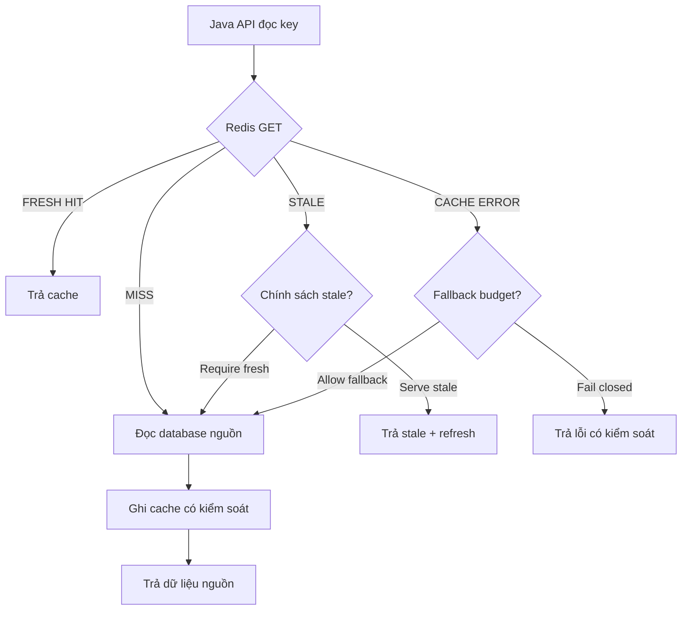
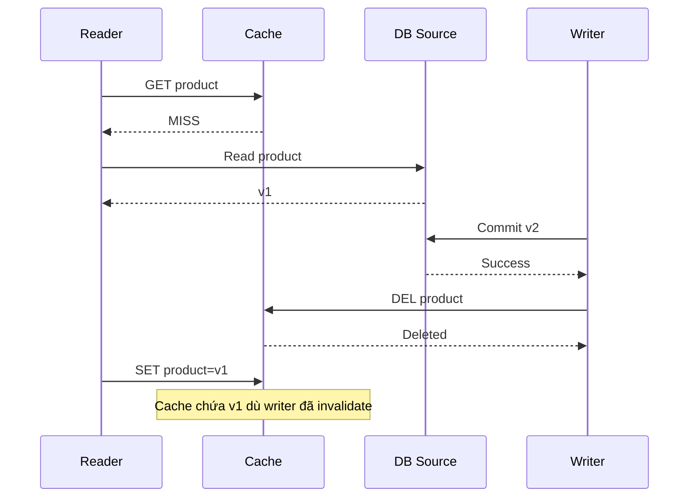
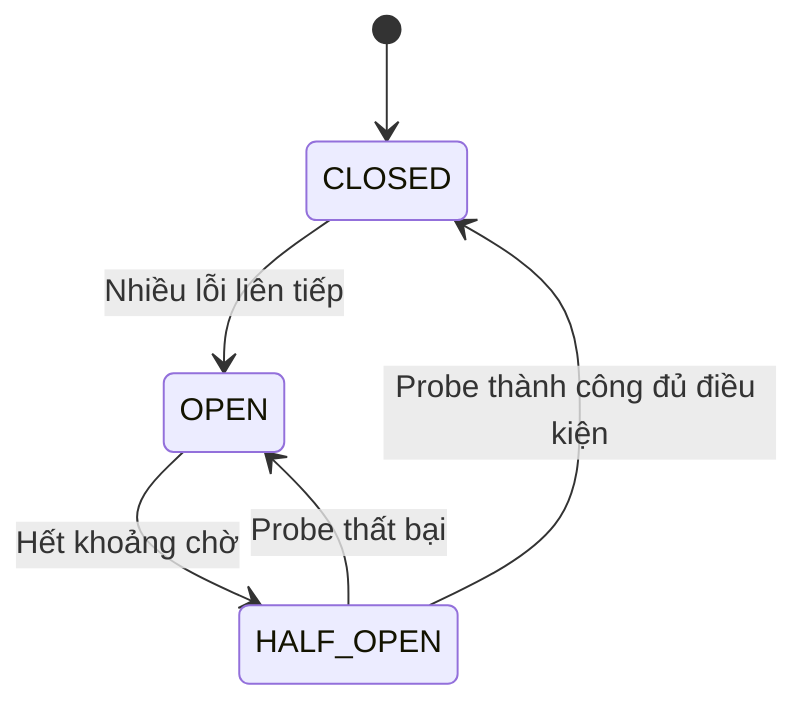

# Thử nghiệm cache cũ, cache mất kết nối và nạp lại đồng loạt

## 1. Tình huống mở đầu: cache giúp API nhanh nhưng tạo ba loại lỗi khó thấy

Một dịch vụ Java trả thông tin sản phẩm từ MongoDB, phía trước có Redis cache:

```text
Client
  |
  v
Product API (Java)
  |-- GET product:P100 --> Redis
  |                         |
  |                         +-- HIT: trả dữ liệu cache
  |
  +-- MISS: GET Product P100 --> MongoDB
                                |
                                +-- SET product:P100 --> Redis
```

Trong giờ thấp điểm, hầu hết request trả trong vài millisecond. Nhưng đến ngày mở bán, ba sự cố xảy ra:

1. **Cache cũ:** quản trị viên thay giá từ 100.000 thành 90.000 đồng ở nguồn, trong khi Redis vẫn trả giá cũ. API xử lý thanh toán theo giá cache và ghi nhận sai số tiền.
2. **Cache mất kết nối:** Redis không thể truy cập trong 90 giây. API chờ timeout dài rồi gửi hàng loạt truy vấn tới MongoDB, khiến cả cache lẫn database nguồn cùng quá tải.
3. **Nạp lại đồng loạt:** 10.000 request cùng đọc một sản phẩm nổi bật đúng lúc key hết hạn. Tất cả thấy MISS và cùng truy vấn nguồn, dù chỉ cần một kết quả.

Ba lỗi đều có chung bài học: **cache là thành phần vận hành có trạng thái riêng, không phải phép tăng tốc vô hại**. Thử nghiệm cache cần xác minh không chỉ latency khi HIT, mà còn cách ứng dụng xử lý dữ liệu quá cũ, Redis bị lỗi và tải tăng đột ngột khi nhiều mục cùng hết hạn.

Bài này thuộc module **Database No SQL → Bộ nhớ đệm dữ liệu**, tập trung vào phương pháp kiểm thử có thể lặp lại, phân biệt chính sách dữ liệu theo nghiệp vụ và những cơ chế giúp dịch vụ suy giảm có kiểm soát khi cache không khỏe.

---

## 2. Mục tiêu học tập

Sau bài học, bạn có thể:

1. Phân biệt **cache HIT**, **MISS**, **STALE**, **EXPIRED**, **NEGATIVE HIT** và **BYPASS**.
2. Xác định **độ mới cần thiết** của dữ liệu bằng giới hạn stale, version và yêu cầu nhất quán.
3. Thiết kế kiểm thử cache cũ sau update/delete, delayed invalidation, out-of-order event và replication lag.
4. Mô phỏng cache connection timeout, connection refused, packet loss, latency cao, partial outage và failover.
5. Phân biệt **cache stampede**, **cache avalanche**, **cache penetration** và **hot key**.
6. Thử và so sánh TTL jitter, single-flight, refresh-ahead, stale-while-revalidate và rate limiting.
7. Xác minh cơ chế fallback không chuyển toàn bộ tải sang database nguồn trong một lần.
8. Phân biệt invariant nghiệp vụ cần đọc nguồn có thẩm quyền với dữ liệu được phép hiển thị stale.
9. Thiết kế metric cho HIT/MISS/STALE, fill concurrency, backend amplification, p99 và thời gian phục hồi.
10. Viết kịch bản Java/JUnit/load test/fault injection an toàn với kết quả mong đợi rõ ràng.

## 3. Mô hình thử nghiệm: cache không chỉ có HIT và MISS

Một entry trong cache có thể chứa:

```json
{
  "key": "product:T01:P100",
  "value": {
    "name": "Bình giữ nhiệt",
    "displayPrice": 90000
  },
  "sourceVersion": 42,
  "loadedAt": "2026-11-14T09:00:00Z",
  "freshUntil": "2026-11-14T09:01:00Z",
  "staleUntil": "2026-11-14T09:05:00Z"
}
```

Giải thích:

- `sourceVersion`: phiên bản do nguồn có thẩm quyền cấp, không phải số lần đọc cache.
- `loadedAt`: thời điểm entry được nạp, phục vụ quan sát.
- `freshUntil`: mốc hết thời gian dữ liệu được coi là tươi.
- `staleUntil`: mốc giới hạn cuối có thể phục vụ dữ liệu cũ, **chỉ nếu chính sách cho phép**.
- TTL vật lý của Redis: thời điểm Redis loại key; có thể đặt khác ngưỡng freshness để vẫn giữ stale entry trong một khoảng dự phòng.

Đây là mô hình logic minh họa. Redis không tự hiểu `freshUntil` hay `sourceVersion` bên trong JSON; **ứng dụng phải triển khai quy tắc đọc/ghi tương ứng**.

### 3.1. Những trạng thái quan sát

| Trạng thái | Cách nhận biết | Hành vi tùy chính sách |
| --- | --- | --- |
| HIT / FRESH | Entry tồn tại và còn trong freshness window | Trả nhanh |
| HIT / STALE | Entry còn nhưng vượt hạn tươi | Refresh, serve stale có giới hạn hoặc đọc nguồn |
| MISS | Không có entry | Nạp từ source, có điều tiết |
| EXPIRED | TTL vật lý đã xóa key | Tương đương MISS ở đường đọc thông thường |
| NEGATIVE HIT | Cache lưu bằng chứng chưa tìm thấy | Trả `NOT_FOUND` trong phạm vi policy |
| BYPASS | Có chủ đích không dùng cache | Đọc authoritative |
| CACHE ERROR | GET/SET timeout, disconnect hoặc protocol error | Degrade theo chính sách |
| FILL IN PROGRESS | Một worker đang nạp dữ liệu | Wait/coalesce/serve stale |
| SOURCE ERROR | Không đọc được DB nguồn | Fail safely hoặc serve stale nếu được phép |

Không dùng một Boolean `cacheHit` để biểu diễn tất cả tình huống trên nếu cần điều tra lỗi vận hành.

## 4. Trước khi test phải xác định hợp đồng dữ liệu

Không có một chiến lược stale chung phù hợp với mọi loại dữ liệu.

| Dữ liệu | Cho phép stale? | Rủi ro | Kiểm thử quan trọng |
| --- | --- | --- | --- |
| Ảnh đại diện, mô tả sản phẩm | Thường có thể trong thời hạn ngắn | Hiển thị chậm cập nhật | Freshness SLO |
| Trang danh mục phổ thông | Có thể eventual | Nội dung cũ | SWR, revalidation |
| Giá hiển thị | Tùy domain và cam kết | Giá không khớp checkout | Price/version guard |
| Giá được dùng tính tiền | Thường cần xác minh nguồn/quote authority | Tính sai tiền | Bypass/authoritative decision |
| Tồn kho để gợi ý | Có thể stale | Trải nghiệm sai | Thông báo “ước tính” |
| Tồn kho để giữ hàng | Không nên quyết định từ cache stale | Oversell | Atomic reservation ở nguồn |
| Quyền truy cập đã thu hồi | Có thể cần fail-closed/đường kiểm tra mạnh | Lộ dữ liệu | Revocation propagation |
| Session/token status | Phụ thuộc security contract | Chấp nhận session đã khóa | TTL và fail-closed |
| Top sellers/trending | Có thể stale lâu hơn | Giảm chất lượng | Stale-if-error |
| Search suggestions | Có thể stale | Gợi ý không mới | Negative caching và refresh |

### 4.1. Phân biệt đọc để hiển thị và đọc để ra quyết định

Ví dụ:

```text
GET /products/P100:
  Có thể hiển thị "còn khoảng 5 sản phẩm" theo cache.

POST /reservations:
  Phải kiểm tra và reserve bằng atomic conditional write
  trên inventory authoritative source.
```

Cache có thể cải thiện UX nhưng không tự được quyền **quyết định invariant** như `available >= 0`.

### 4.2. Một SLA về stale phải có định nghĩa

Không đủ khi nói “cache được cũ chút”. Nên nêu:

```text
Đối tượng: product catalog display
Khi source update version v tại t0:
  99,9% các lần đọc qua API phải thấy version >= v
  trong vòng 10 giây, nếu hệ thống và điều kiện thử
  nằm trong phạm vi hợp đồng.
```

Đây chỉ là ví dụ SLO, không phải ngưỡng chuẩn cho mọi cache. Cần định nghĩa cả đọc ở những vùng nào, có tính request đang chạy không và cách đo thời điểm source commit.

## 5. Cache-aside: luồng phổ biến và những điểm lỗi



Các điểm lỗi cần kiểm thử:

- GET cache trả giá trị sai phiên bản.
- Redis key đã tồn tại nhưng serializer không đọc được.
- Redis timeout, mất kết nối hoặc trả lỗi.
- Source đọc chậm/timeout.
- Nhiều requests cùng đọc source lúc MISS.
- Cache SET thất bại sau source read.
- Reader điền cache bằng dữ liệu cũ sau writer invalidation.
- Một worker fill cũ ghi đè phiên bản mới.
- Cache service khôi phục nhưng quá nhiều requests cùng warm lại.
- Một node ứng dụng còn L1 cache cũ trong khi Redis L2 đã mới.

**Không test riêng `GET`/`SET`; hãy test vòng đời đọc–nạp–cập nhật–mất kết nối–phục hồi.**

## 6. Cache cũ là gì? Ba thước đo cần phân biệt

Giả sử source có revision 15 nhưng cache trả revision 12.

**Version lag:**

\[
L_v = V_{\text{source}} - V_{\text{cache}} = 15 - 12 = 3
\]

Chỉ có ý nghĩa khi hai revision thuộc **cùng một dãy version authoritative**.

**Time lag:**

\[
L_t = t_{\text{read}} - t_{\text{latest relevant source commit}}
\]

Cần đồng hồ/commit metadata đáng tin. Nếu đồng hồ các máy lệch, không dùng raw timestamp chênh nhau để khẳng định thời lượng chính xác.

**Stale read ratio:**

\[
R_s=\frac{\text{số reads trả phiên bản cũ theo oracle}}{\text{tổng reads trong phạm vi đo}}
\]

Ba thước đo phục vụ những mục tiêu khác nhau:

- Version lag nói dữ liệu đã qua bao nhiêu revisions.
- Time lag nói độ trễ hội tụ theo một mô hình thời gian.
- Ratio nói mức ảnh hưởng tới người dùng.

Một record ít cập nhật có thể có version lag 1 nhưng cũ nhiều ngày. Một record rất nóng có thể lag 5 versions dù mới vài millisecond.

## 7. Cần một nguồn xác minh độc lập với cache

Nếu kiểm thử bằng cách:

```text
GET API trả price=90000
GET API lần nữa trả price=90000
=> Cache đúng
```

thì chỉ chứng minh API tự nhất quán trong hai lần gọi, không biết nguồn đã thay giá chưa.

Một oracle tốt hơn:

```text
1. Ghi authoritative product v42 tại source.
2. Đợi write được xác nhận theo policy.
3. Kích hoạt đường đọc API.
4. Quan sát value/sourceVersion API trả về.
5. So theo freshness/ordering contract.
```

Test có thể kiểm tra trực tiếp source dưới quyền thử nghiệm và lưu expected version. Nếu nguồn cho phép eventual reads, chọn **read consistency đủ mạnh** hoặc cơ chế version/commit marker phù hợp để không lấy một replica stale làm oracle sai.

### 7.1. Không nên “đọc search để xác minh cache”

Search index/analytics có thể là derived store và cũng stale. Nếu lấy hai projection để xác minh lẫn nhau, test có thể báo PASS trong khi cả hai đều khác source.

### 7.2. Bổ sung phiên bản vào response thử nghiệm

Trong môi trường test có thể thêm diagnostic fields/header:

```http
X-Source-Version: 42
X-Cache-Status: HIT
X-Cache-Age-Ms: 812
```

Nếu expose trên production, phải xét security/caching policy và giá trị version có nhạy cảm không. Không phát nội bộ schema/key đến người dùng nếu không cần.

## 8. Ma trận kiểm thử cache cũ

| Kịch bản | Tiền điều kiện | Hành động | Kỳ vọng |
| --- | --- | --- | --- |
| Update trong TTL | Cache chứa v1 | Source chuyển v2 | Không stale vượt SLO |
| Delete trong TTL | Cache có item | Source xóa v2 | Không tiếp tục phục vụ sau ngưỡng |
| Invalidating event trễ | Cache v1 | Update v2, giữ event | Stale được kiểm soát |
| Event đến ngược thứ tự | Cache v2 | Event v3 rồi v2 | Không lùi về v2 |
| Reader fill race | Reader đọc v1 | Writer commit v2, invalidate | Reader không phục hồi v1 sai |
| Negative cache stale | Cache `NOT_FOUND` | Source tạo item | Tìm thấy trong giới hạn |
| TTL quá dài | Entry sống 1 giờ | Source update liên tục | Phát hiện vi phạm freshness |
| TTL quá ngắn | Entries expire sớm | Load tăng | Không quá tải nguồn |
| L1 stale, L2 fresh | JVM cache v1, Redis v2 | API GET | L1 phải tuân invalidation |
| Multi-region lag | Region A v2, B v1 | Đọc B | Theo hợp đồng consistency vùng |
| Delete replay | Source tombstone v4 | Event update v3 đến muộn | Không hồi sinh dữ liệu |
| Cache deserialize error | Format cũ sau deploy | API read | Fallback/migrate an toàn |
| Cache partial update | Một field cũ | Source có fields mới | Không tạo object tự mâu thuẫn |
| Redis failover | Primary đổi | Reads sau failover | Không vượt durability/freshness policy |

Đây là **ma trận test**, không phải cam kết mọi trường hợp đều cần kết quả strongly consistent. Kỳ vọng phải được xác định trước theo business contract.

## 9. Kiểm thử update–invalidate–read

Với cache-aside thông thường:

```text
T0: GET source v1; fill Redis v1
T1: UPDATE source -> v2, commit
T2: INVALIDATE Redis key
T3: GET -> MISS -> source v2 -> fill v2
```

Test cần quan sát cả đường **T1 đến T2**:

- Nếu invalidation đồng bộ trong request, T1 và T2 có hai commit boundaries; crash có thể để cache v1.
- Nếu invalidation qua outbox/CDC, T1–T2 là eventual window có giới hạn lag và retry.
- Nếu TTL chỉ là cơ chế duy nhất, freshness worst-case gần TTL còn lại, tùy read paths và expiry semantics.

### 9.1. Một test tối thiểu

```text
Arrange:
  Seed source P100 revision=1.
  Warm cache P100 revision=1.

Act:
  Update source P100 revision=2.
  Trigger invalidation flow (nếu có).
  Poll API với deadline thử nghiệm.

Assert:
  Trong SLO, API trả revision>=2.
  Không có regression về revision=1 sau khi đã ổn định ở v2.
  Không có lỗi serialization/cache fill.
```

### 9.2. Không dùng sleep cố định làm bằng chứng

```java
Thread.sleep(5000);
assertEquals(2, readApi().version());
```

Test này có thể chậm và flaky; không đo được freshness thực. Nên dùng **eventually assertion với deadline** và ghi thời điểm phiên bản v2 xuất hiện, đồng thời có điều kiện fail rõ.

## 10. Cuộc đua “reader fill lại cache cũ”

Đây là lỗi tinh vi ngay cả khi writer đã delete cache:



Một lời khuyên “update DB rồi DEL cache” **không loại bỏ hoàn toàn race**. DEL có thể chạy trước khi reader đang chờ source thực hiện SET.

### 10.1. Cách thử race có chủ đích

Dùng barrier trong fake source/adapter test:

1. Reader GET cache MISS.
2. Reader đọc source v1 nhưng bị **chặn trước SET cache**.
3. Writer commit source v2 rồi invalidate key.
4. Thả reader tiếp tục SET v1.
5. Đọc cache/API lại.
6. Kiểm tra chính sách có ngăn regression không.

Nếu test trả v1 vô hạn tới TTL, thiết kế vi phạm freshness khi business không cho phép.

### 10.2. Những phương án cải thiện

- **Version-aware cache write:** chỉ ghi nếu incoming version mới hơn hoặc bằng version đang lưu.
- **Generation/epoch marker:** writer tăng generation, reader fill chỉ được set nếu generation chưa đổi.
- **Key versioning:** dùng key bao gồm source version, nếu đường đọc biết version authoritative.
- **Short bounded TTL:** giảm thời gian lỗi tồn tại, không xóa race.
- **SWR + version guard:** stale được hiển thị giới hạn, refresh cũ không được override mới.
- **Single-writer projection/CDC:** một đường publish updates có sequencing theo aggregate.

### 10.3. Chỉ so với entry hiện tại chưa đủ trong mọi trường hợp

Nếu writer đã `DEL` entry v1, rồi reader ghi v1 vào **key trống**, CAS “chỉ ghi nếu không có giá trị mới hơn” vẫn có thể chấp nhận v1 vì không còn marker v2.

Muốn bảo vệ race này, cần **metadata version/generation tồn tại độc lập hoặc nguồn authoritative**, hoặc một protocol khác đảm bảo fill không bị lùi. Test phải bao gồm khoảng cache vừa bị DEL.

## 11. Cache trên nhiều lớp: L1 JVM và L2 Redis

Nhiều Java services dùng:

```text
L1: Caffeine trong từng JVM
L2: Redis dùng chung
Source: MongoDB/DynamoDB
```

Một luồng:

```text
Node A L1 v1
Node B L1 v1
Redis L2 v1
Source update v2
Redis L2 invalidated
Node A L1 vẫn v1
```

Nếu chỉ test Redis, bạn có thể thấy Redis v2 rồi kết luận hệ đã mới, trong khi node A trả v1 nhiều phút.

### 11.1. Test từng lớp

- Cập nhật source rồi kiểm tra invalidation L2.
- Kiểm tra node A/B/C có nhận event invalidation L1 không.
- Cố tình cho một node bỏ lỡ event; nó có TTL fallback không?
- Kiểm tra restart node, warming L1 từ L2 và cache version.
- Kiểm tra vùng địa lý khác còn L2 replica cũ.
- Kiểm tra cache key schema đổi giữa deployment versions.

### 11.2. Quản lý TTL khác nhau

Ví dụ:

```text
L1 TTL = 10s
L2 TTL = 120s
```

L1 ngắn **không** giúp freshness dưới 10 giây nếu mỗi lần hết hạn nó lại điền v1 từ L2 còn cũ. Cần xét chuỗi end-to-end.

### 11.3. Thử với load balancer

Một test gọi liên tiếp cùng một node có thể bỏ qua lỗi chỉ xảy ra ở node khác. Dùng canary/probes trên từng instance hoặc kiểm thử qua load balancer với khả năng ghi nhận node xử lý.

## 12. Negative caching: cache cả kết quả không tồn tại

Nếu một product ID không tìm thấy, ứng dụng có thể cache marker:

```json
{
  "kind": "NOT_FOUND",
  "sourceVersionOrLookupEpoch": "controlled",
  "expiresAt": "2026-11-14T10:00:20Z"
}
```

Mục tiêu: giảm các truy vấn lặp vào nguồn cho IDs không tồn tại.

Nhưng khi product được tạo ngay sau đó, negative cache có thể tiếp tục trả `NOT_FOUND`.

### 12.1. Test đúng

```text
T0: GET P999 -> source NOT_FOUND -> negative cache.
T1: CREATE P999 -> source committed.
T2: GET P999 -> ?
```

Kỳ vọng phụ thuộc consistency/freshness policy:

- Nếu create phải read-your-writes, phải bypass/invalidate negative cache khi cần.
- Nếu eventual được phép, negative cache có TTL ngắn/giới hạn stale.
- Nếu search eventual, không coi search NOT_FOUND là nguồn xác minh product chưa tạo.

### 12.2. Negative cache không đồng nghĩa cache error

`NOT_FOUND` từ source có bằng chứng khác với `REDIS_TIMEOUT` hoặc `DB_UNAVAILABLE`. Không biến lỗi kết nối thành marker `NOT_FOUND` — việc đó có thể che dữ liệu thật.

## 13. Cache lỗi serialization/schema

Một bản deploy mới thay đổi JSON/codec:

```json
{
  "price": "90000"
}
```

thành:

```json
{
  "priceMinorUnits": 90000,
  "currency": "VND",
  "schemaVersion": 2
}
```

Node chạy code cũ có thể không hiểu entry mới; node mới có thể không hiểu entry cũ.

### 13.1. Ma trận test schema

| Entry | Reader | Kỳ vọng |
| --- | --- | --- |
| v1 | Code v1 | Đọc được |
| v1 | Code v2 | Backward compatibility hoặc controlled MISS |
| v2 | Code v1 | Tùy rolling-upgrade contract |
| Corrupted bytes | Mọi code | Không crash toàn request |
| Unknown enum | Code cũ | Policy rõ: fallback/default/reject |
| Missing field | Code mới | Không hiểu nhầm thành giá trị 0 |

### 13.2. Cache không phải nơi lưu dữ liệu duy nhất

Nếu cache chỉ là projection có thể xây lại, đọc một entry hỏng có thể xử lý như cache MISS và báo metric, rồi nạp từ nguồn. Nhưng cần **rate limit** vì một deploy phá serializer có thể làm toàn cache thành MISS và gây avalanche.

### 13.3. Key namespace/versioning

Ví dụ:

```text
v1:product:T01:P100
v2:product:T01:P100
```

Thay namespace giúp không đọc nhầm schema nhưng sẽ **làm cache v2 lạnh đồng loạt**. Cần warmup và phân phối rollout; không đổi prefix cho toàn bộ traffic trong một phút mà không load test.

## 14. Cache mất kết nối: nhiều dạng lỗi khác nhau

“Redis down” là mô tả quá rộng. Cần thử ít nhất:

| Lỗi | Client có thể quan sát | Rủi ro |
| --- | --- | --- |
| Connection refused | Không mở được TCP | Fallback đột ngột |
| DNS resolution error | Không tìm thấy endpoint | Lỗi tất cả connections mới |
| TLS handshake error | Không thiết lập TLS | Retry vô ích nếu config sai |
| Packet loss / silent drop | Timeout dù socket đã mở | Giữ threads/connection lâu |
| RTT tăng cao | GET mất hàng trăm ms | Tail latency |
| Server trả error | Operation fail fast hoặc retry | Error handling |
| Connection pool exhausted | Chờ acquire | Request queue |
| Redis primary failover | Reconnect/topology change | Các request lỗi tạm thời |
| Redis Cluster slot redirection | MOVED/ASK handling | Redirect loops nếu cấu hình sai |
| Mất một node | Một tập keys lỗi | Partial outage |
| Auth/token rotation sai | Unauthenticated | Không retry nóng vô hạn |
| Cache memory eviction | Tỷ lệ MISS tăng | Source read spike |
| Redis restart với dữ liệu trống | Mất warm cache | Cold-start avalanche |

### 14.1. Lỗi cache khác lỗi nguồn

Nếu Redis GET lỗi nhưng MongoDB vẫn khỏe, hệ **có thể** fallback đọc nguồn.

Nếu cả Redis và MongoDB đều lỗi, “fallback cache” không cứu được. Có thể cho stale L1 nếu nghiệp vụ cho phép, còn với stock/payment/permissions cần fail safely.

### 14.2. GET lỗi nhưng SET cũng lỗi

Một fallback điển hình:

```text
Redis GET timeout
  -> DB read succeeds
  -> Redis SET timeout
  -> Return DB response
```

Ứng dụng không nên coi `SET` thất bại là bằng chứng DB read thất bại. Nhưng cần chặn **retry SET vô hạn** và bảo đảm không kéo dài response quá deadline.

## 15. Fallback đúng nghĩa: degrade nhưng không làm sập nguồn

Một anti-pattern:

```java
try {
    return redis.get(key);
} catch (Exception e) {
    return database.get(key);
}
```

Nếu Redis down và 20.000 requests/s cùng fallback, database nhận đột ngột 20.000 reads/s thay vì chỉ 200 reads/s lúc HIT rate 99%.

Tỷ lệ khuếch đại nguồn xấp xỉ:

\[
A=\frac{R_{\text{source during cache outage}}}
        {R_{\text{source before outage}}}
\]

Ví dụ:

\[
A=\frac{20.000}{200}=100
\]

**Fallback vô giới hạn có thể tạo sự cố dây chuyền.**

### 15.1. Fallback phải có ngân sách

Một thiết kế tốt hơn có thể gồm:

- Redis connect/read timeout ngắn, dựa trên latency budget.
- Circuit breaker để không tiếp tục đợi Redis đang lỗi nặng.
- Bulkhead/concurrency limit cho fallback tới source.
- Single-flight theo key trong process.
- Bounded queue hoặc fail-fast khi source chạm ngưỡng.
- Serve stale có deadline khi dữ liệu được phép.
- Admission control/rate limit cho traffic ưu tiên thấp.
- Cache recovery warmup trước khi nhận lại 100% traffic.

### 15.2. Fail-open và fail-closed

**Fail-open** trong bài toán đọc cache có thể hiểu “cho phép đọc nguồn trực tiếp hoặc hiển thị stale khi cache lỗi”, nếu business chấp nhận.

**Fail-closed** nghĩa “từ chối thao tác cần dữ liệu mới khi không xác minh được nguồn”.

Ví dụ:

- Mô tả sản phẩm: có thể serve stale 30 giây.
- Kiểm tra quyền truy cập bị thu hồi: có thể phải fail-closed khi đường authoritative không truy cập được.
- Chốt thanh toán: không dựa vào giá stale tùy ý.

Thuật ngữ fail-open/fail-closed phải đặt trong **quyết định cụ thể**, tránh nhầm “cache lỗi nên cho phép mọi giao dịch”.

## 16. Thiết kế thử nghiệm outage theo pha

Đừng chỉ giết Redis rồi kiểm tra một HTTP response.

```text
PHASE A: Baseline (cache khỏe, warm)
PHASE B: Fault onset (mất kết nối)
PHASE C: Sustained outage (30–120s)
PHASE D: Recovery/reconnect
PHASE E: Cache warming / stabilization
```

Ở từng pha, đo:

| Chỉ số | Câu hỏi |
| --- | --- |
| API success rate | Người dùng còn nhận kết quả hợp lệ? |
| P50/P95/P99 | Tail latency thay đổi thế nào? |
| Cache GET attempts | Có còn thử Redis vô hạn? |
| Cache timeout count | Driver mất thời gian bao nhiêu? |
| Circuit breaker state | Có giảm tải tới cache lỗi? |
| Source QPS | Database tăng tải bao nhiêu? |
| Source CPU/IO | Nguồn có còn dư capacity? |
| Fallback queue/rejected | Bounded hay vô hạn? |
| Stale read count | Dữ liệu nào được phép serve cũ? |
| Unknown writes | Có nhầm timeout với thất bại? |
| Redis reconnect attempts | Có reconnection storm? |
| Cache fill rate | Warmup có giới hạn? |
| Recovery duration | Sau khi Redis khỏe, bao lâu mới bình thường? |

### 16.1. Recovery là một pha độc lập

Một hệ có thể chịu outage tốt nhưng bị sập **khi Redis sống lại** vì tất cả instances đồng thời reconnect, resubscribe, refill hoặc quét keys.

Cần test cả **fault injection lẫn fault removal**.

## 17. Mô phỏng lỗi bằng dependency boundary

Thử nghiệm có nhiều cấp:

1. **Unit test:** cache adapter giả lập trả timeout/exception.
2. **Integration test:** Redis thật trong môi trường test; chặn network qua proxy.
3. **Service test:** API Java + Redis + MongoDB giả lập hoặc test deployment.
4. **Load test:** nhiều clients/keys, đo áp lực nguồn.
5. **Staging chaos experiment:** lỗi cluster/failover/partial outage trong phạm vi có phê duyệt.

Không nên sửa code production thành:

```java
if (Math.random() < 0.2) throw new Exception();
```

rồi coi đó là coverage đủ. Lỗi ở đúng **vị trí trước hoặc sau khi Redis đã xử lý command**, delay/reconnect, pool behavior và load thực cũng quan trọng.

### 17.1. Fault injection boundary

Một cách dùng proxy điều khiển:

```text
Java API -> Fault Proxy -> Redis
                        -> TCP reset / delay / loss / cutoff
```

Công cụ như Toxiproxy có thể hỗ trợ mô phỏng những lỗi truyền thông cụ thể trong test. Cần định nghĩa những hành động fault theo capability của công cụ đang dùng; không suy rằng một delay rule tái hiện chính xác mọi network partition.

### 17.2. Không chạy chaos trên cache production tùy tiện

Network chaos có thể làm mất dữ liệu cache nóng, tạo stampede tới source và ảnh hưởng người dùng thật. Chỉ thử theo quy trình phê duyệt, có giới hạn traffic, monitoring, rollback và kill switch.

## 18. Circuit breaker cho đường cache

Một circuit breaker có thể:



- **CLOSED:** cho calls đi qua cache.
- **OPEN:** ngừng gọi cache lỗi trong khoảng thời gian, giảm timeout amplification.
- **HALF_OPEN:** cho một số probes có kiểm soát để phát hiện phục hồi.

### 18.1. Những điều cần thử

- Nhiều requests đồng thời làm circuit mở.
- Khi mở, chỉ một số probes đi vào Redis.
- Khi hồi phục, không cho tất cả traffic quay lại đột ngột nếu warmup chưa đủ.
- Phân biệt timeout kết nối với cache MISS hợp lệ.
- `NOT_FOUND` không được tính là Redis failure.
- Circuit breaker quanh Redis không bảo vệ nguồn nếu fallback vẫn vô hạn.

### 18.2. Circuit breaker không thay timeout

Nếu mỗi request chờ Redis 20 giây trước khi circuit mở, những requests đầu tiên vẫn làm p99 xấu. Cần cấu hình timeout và failure threshold theo budget.

### 18.3. Điều cần đo

```text
cache_circuit_state
cache_circuit_open_total
cache_circuit_rejected_calls_total
cache_probe_success_total
cache_probe_failure_total
```

Metric names là ví dụ, không phải API mặc định.

## 19. Bulkhead: không cho fallback chiếm hết tài nguyên

Giả sử application có tối đa 200 đồng thời DB reads an toàn. Nếu cache lỗi, 2.000 threads gọi DB cùng lúc có thể gây pool wait dài, timeout và retry storm.

Bulkhead có thể giới hạn:

```text
max concurrent source-fallback reads = 100
queue capacity = 200
queue wait budget = 30 ms
```

Giá trị chỉ là minh họa, cần tính theo throughput, SLO và capacity nguồn.

### 19.1. Kỳ vọng trong test

- Số concurrent fallback không vượt ngưỡng định nghĩa.
- Requests không được xếp hàng vô hạn.
- Thao tác ưu tiên thấp có thể bị từ chối trước khi source quá tải.
- Source p99 và error rate không vượt ngưỡng chấp nhận của experiment.
- Không có infinite retry giữa app, SDK và gateway.

### 19.2. Bulkhead theo operation type

Đường đọc catalog có thể được giới hạn chặt khi outage, nhưng thanh toán/ủy quyền cần một ngân sách tách riêng. Một pool dùng chung cho mọi fallback có thể khiến requests ít quan trọng chặn business-critical operations.

## 20. Ba loại “nạp lại đồng loạt” thường bị trộn lẫn

| Hiện tượng | Tên thường gọi | Nguyên nhân | Ví dụ |
| --- | --- | --- | --- |
| Một key nóng hết hạn và nhiều readers cùng fill | **Cache stampede / thundering herd** | Concurrent MISS cùng key | Product P100 có 10.000 req/s |
| Nhiều keys hết hạn gần cùng lúc | **Cache avalanche** | TTL đồng bộ, Redis restart hoặc flush | 500.000 keys TTL=3600s |
| Rất nhiều requests cho keys không tồn tại | **Cache penetration** | Chưa cache negative / attacker hoặc dữ liệu lỗi | GET random product IDs |
| Một key có request frequency quá cao | **Hot key** | Phân bố không đều, dù vẫn HIT | Một SKU chiếm 70% GET |
| Cache trống sau deploy/flush | **Cold start** | Keys chưa được warm | New cluster với zero entries |

Một sự cố có thể gồm nhiều hiện tượng cùng lúc. Ví dụ Redis restart làm cache cold, rất nhiều keys MISS (avalanche), trong đó một key top seller còn stampede.

## 21. Stampede một key: timeline

Giả sử:

```text
Redis key product:P100 TTL=60s
Source lookup latency=100ms
Traffic=10.000 req/s cho P100
```

Tại thời điểm key hết hạn, xấp xỉ:

\[
N_{\text{concurrent misses}}
\approx \lambda \times T_{\text{fill}}
\]

Trong mô hình đơn giản:

\[
10.000\ \text{req/s}\times0,1\ \text{s}=1.000
\]

Có thể có khoảng **1.000 requests cùng MISS** trước khi key được fill. Con số thực phụ thuộc concurrency, request arrival distribution, local cache và hệ có coalescing hay không.

### 21.1. Điều test cần đo

- `source_reads_per_cache_key_miss_wave`.
- `max_concurrent_fills_for_same_key`.
- `fill_queue_wait`.
- `cache_fill_success/error`.
- `p95/p99` quanh expiry boundary.
- Tỷ lệ requests đồng thời được trả stale.
- Backend source QPS trước/trong/sau một key hết hạn.

Một assertion hữu ích:

```text
Given 500 concurrent callers for key P100,
the source loader should execute <= bound times
within one coalescing window.
```

Bound có thể là 1 trong một JVM với single-flight đúng, nhưng **không mặc nhiên là 1 trên cả cluster**.

## 22. Single-flight trong một JVM

**Single-flight** gom các requests cùng key thành một lần load đang chạy. Những requests khác cùng đợi một `Future`.

Ý tưởng:

```text
Request A: MISS P100 -> starts DB load
Request B: MISS P100 -> awaits same future
Request C: MISS P100 -> awaits same future

DB loads P100 once
All waiting requests receive same result.
```

### 22.1. Ví dụ Java kiểu đơn giản

```java
import java.util.concurrent.CompletableFuture;
import java.util.concurrent.ConcurrentHashMap;
import java.util.concurrent.Executor;
import java.util.function.Supplier;

public final class SingleFlightLoader<K, V> {
    private final ConcurrentHashMap<K, CompletableFuture<V>> inFlight =
        new ConcurrentHashMap<>();

    private final Executor executor;

    public SingleFlightLoader(Executor executor) {
        this.executor = executor;
    }

    public CompletableFuture<V> load(
            K key,
            Supplier<V> sourceLoader) {

        return inFlight.computeIfAbsent(key, k -> {
            CompletableFuture<V> future =
                CompletableFuture.supplyAsync(sourceLoader, executor);

            future.whenComplete((value, error) ->
                inFlight.remove(k, future)
            );
            return future;
        });
    }
}
```

Đoạn code trên **mang tính minh họa** cho cách tổ chức futures; trong production cần đặc biệt chú ý callback có thể hoàn tất rất nhanh, cleanup trong khi `computeIfAbsent` đang tính, cancellation, executor rejection, việc nhiều người chờ cùng future và failure fan-out. Có thể dùng cache library có sẵn cơ chế atomic loading/async cache để tránh tự triển khai sai cạnh tranh.

### 22.2. Các góc test bắt buộc

1. 100 concurrent callers cùng key → chỉ một load trong một JVM.
2. Hai keys khác nhau → có thể load song song nếu ngân sách cho phép.
3. Source loader lỗi → tất cả callers nhận error có kiểm soát.
4. Sau lỗi, key không bị kẹt trong `inFlight` mãi mãi.
5. Sau success, future được dọn, cache có dữ liệu.
6. Một caller cancel → không tự hủy load đang được nhiều callers sử dụng nếu chưa có policy rõ.
7. Source quá chậm → deadline/waiters không tăng vô hạn.
8. In-flight map không tăng mãi với các keys ngẫu nhiên.

### 22.3. Single-flight không phải idempotency của write

Gom cùng một read load giảm tải, không tự bảo vệ `POST CreateOrder` hay payment retries. Không dùng read single-flight như thay thế atomic business idempotency.

## 23. Single-flight trên nhiều JVM: giới hạn của giải pháp local

Giả sử 20 instances Java, mỗi instance có local single-flight. Khi Redis key P100 hết hạn, mỗi instance vẫn có thể gọi source một lần:

```text
20 Java instances x 1 load = 20 source loads
```

Điều đó có thể đủ tốt so với 10.000 loads, nhưng không phải “mỗi key chỉ load đúng một lần toàn cluster”.

### 23.1. Lựa chọn distributed coordination

- Shared cache lock/lease per key có timeout.
- Redis `SET key:lock token NX PX ...` theo semantics server.
- Request coalescing tại gateway hoặc một dedicated cache-filler tier.
- Stale-while-revalidate để giảm số request thực cần chờ.
- Source capacity limit và jitter.
- Probabilistic early refresh hoặc refresh-ahead.

### 23.2. Distributed lock có lỗi riêng

Một lock TTL 2 giây:

```text
Worker A lấy lock, load mất 5 giây.
Lock hết hạn.
Worker B lấy lock và load.
A hoàn tất muộn, có thể ghi cache cũ sau B.
```

Cần lease renewal/fencing/versioned cache writes hoặc dựa vào source revision. **Lock hết hạn không chứng minh worker cũ đã dừng**.

### 23.3. Không giữ lock khi gọi nguồn quá lâu

Một distributed lock toàn cục hoặc theo quá ít buckets có thể biến cache thành bottleneck. Chọn granularity theo key và giới hạn waiters; test lock contention và recovery.

## 24. TTL jitter: tránh avalanche do expiry đồng bộ

Nếu mọi key có TTL đúng 3600 giây và được nạp trong cùng một đợt, rất nhiều key có thể hết hạn gần cùng lúc.

Một kỹ thuật là:

\[
TTL=TTL_{\text{base}}+J
\]

với \(J\) là jitter ngẫu nhiên trong phạm vi xác định.

Ví dụ:

```text
baseTTL = 300s
jitter  = random(0..60s)

Key A expires after 308s
Key B expires after 353s
Key C expires after 317s
```

Jitter làm phân tán các lần hết hạn; không làm cache luôn đúng phiên bản mới.

### 24.1. Java helper

```java
import java.time.Duration;
import java.util.concurrent.ThreadLocalRandom;

public final class TtlPolicy {
    public static Duration withJitter(
            Duration base,
            Duration maxJitter) {

        long baseMs = base.toMillis();
        long jitterMs = maxJitter.toMillis();

        if (baseMs <= 0 || jitterMs < 0) {
            throw new IllegalArgumentException("Invalid TTL");
        }

        long extra = ThreadLocalRandom.current()
            .nextLong(jitterMs + 1);

        return Duration.ofMillis(baseMs + extra);
    }
}
```

Đây là ví dụ cấu hình nhỏ với giả định `jitterMs + 1` không tràn số; production helper cần giới hạn đầu vào đủ chặt hoặc dùng thư viện/implementation đã kiểm tra.

### 24.2. Kiểm thử jitter bằng phân phối

Không chỉ test rằng TTL nằm trong khoảng:

```text
300s <= TTL <= 360s
```

Mà cần tạo nhiều keys, quan sát histogram expiry và tỷ lệ MISS theo thời gian. Nếu tất cả keys vẫn được reset TTL cùng lúc sau deploy hoặc hot reload, cơ chế jitter có thể bị dùng sai.

### 24.3. Jitter và freshness bound

Nếu dữ liệu chỉ được phép stale tối đa 300 giây, đặt TTL từ 300 tới 360 giây **có thể vi phạm hợp đồng**.

Một lựa chọn là:

```text
TTL = baseTTL - random(0..jitter)
```

để không vượt giới hạn freshness, hoặc dùng invalidation/version guard/SWR đúng semantics. Jitter phải nằm **trong các ràng buộc nghiệp vụ**, không chỉ nhằm làm đẹp biểu đồ QPS.

## 25. Stale-while-revalidate (SWR)

**SWR** cho phép ứng dụng trả một entry đã hết freshness window nhưng **chưa vượt giới hạn stale**, đồng thời làm mới bất đồng bộ.

```text
Cache value v1
freshUntil = t0 + 60s
staleUntil = t0 + 5m

t=t0+80s:
  Return stale v1 (nếu được phép)
  Trigger one background refresh

t=t0+90s:
  Source returns v2
  Cache becomes v2
```

### 25.1. Điều kiện phải làm rõ

- Những endpoints nào được phép stale.
- Stale tối đa bao lâu.
- Dữ liệu có security-critical không.
- Có hiển thị nhãn/metadata “dữ liệu có thể chưa mới” không.
- Background refresh có bounded concurrency không.
- Làm gì khi source cũng down.
- Làm gì khi refresh cũ đến sau refresh mới.
- Có dùng version guard để tránh regression không.

### 25.2. Test cho SWR

| Kịch bản | Kỳ vọng |
| --- | --- |
| Entry FRESH | Trả nhanh, không cần refresh |
| Entry STALE nhưng trong stale window | Trả stale theo contract, chỉ bounded refresh |
| Entry quá `staleUntil` | Không phục vụ stale nếu policy cấm |
| 1.000 requests cùng STALE | Không khởi tạo 1.000 refresh |
| Refresh success v2 | Từ các lần đọc mới, thấy v2 |
| Refresh thất bại | Stale giữ đến giới hạn, sau đó fail/bypass |
| Source returns old v1 | Không ghi đè v2 mới |
| Shutdown trước refresh complete | Có đường hồi phục/next access refresh |
| Cache error | Có thể dùng L1 stale nếu policy cho phép |
| Authorization revoked | Không serve stale trái policy |

### 25.3. SWR không dành cho mọi dữ liệu

Không nên trả quyền truy cập “ACTIVE” đã hết hạn hoặc giá được dùng capture payment chỉ vì SWR cải thiện p99. Mọi cơ chế stale phải được nghiệp vụ phê duyệt.

## 26. Stale-if-error (SIE)

**Stale-if-error** chỉ cho phục vụ bản cũ khi đường đọc/refresh mới gặp lỗi, trong khoảng giới hạn.

Ví dụ:

```text
Fresh TTL:         60s
Stale-on-error:    120s
Source DB:         unavailable 30s
```

Nếu cache còn bản đã được xác minh trước đó và operation được phép stale, API có thể trả v1 cùng metadata stale thay vì lỗi.

### 26.1. Hai chính sách khác nhau

- SWR: serve stale để giữ latency thấp trong khi refresh đang chạy.
- SIE: serve stale khi refresh/source gặp lỗi.

Có hệ dùng cả hai. Test phải phân biệt **nguyên nhân serve stale** (`STALE_REFRESHING`, `STALE_SOURCE_ERROR`, `STALE_CACHE_ERROR`) để đo vận hành.

### 26.2. Không biến lỗi xác thực thành stale-if-error

Nếu nguồn báo user đã bị khóa hoặc policy thay đổi, không được coi đây là “lỗi nguồn” để giữ quyền cũ. Chỉ một tập lỗi đã được phân loại rõ mới được phép SIE.

### 26.3. Giới hạn stale tuyệt đối

Nếu stale window đã kết thúc, không tự kéo dài vô hạn mỗi lần source lỗi bằng cách reset TTL. Cần kiểm thử nguồn down lâu hơn `staleUntil` và xác nhận ứng dụng từ chối hoặc dùng một đường authoritative khác theo contract.

## 27. Refresh-ahead: chủ động nạp trước khi hết hạn

Với keys rất nóng, hệ có thể nạp mới trước TTL:

```text
TTL 5 phút
Refresh at age 4 phút
```

Nếu refresh hoàn tất trước phút thứ năm, readers không thấy MISS khi TTL cũ hết.

### 27.1. Lợi ích và chi phí

- Giảm stampede trên hot keys.
- Đổi tài nguyên sang background refresh có dự đoán.
- Có thể tạo **write load vào cache và source ngay cả khi không ai đọc**.
- Cần giới hạn hot-key set và refresh rate.
- Cần xử lý source errors để không ghi đè value tốt bằng value hỏng.

### 27.2. Test refresh-ahead

- Key được truy cập liên tục → có background refresh trong budget.
- Key lạnh → không refresh vô ích.
- Nhiều instances cùng dùng key → không refresh toàn cluster quá nhiều.
- Source chậm → không tạo overlapping refreshes vô hạn.
- Event update xảy ra đồng thời → version guard không cho stale overwrite.
- Cache restart → warmup không phát hàng loạt refresh không kiểm soát.

### 27.3. Jitter trong refresh schedule

Nếu mọi key cùng refresh lúc 4/5 TTL, avalanche có thể chỉ **dời từ thời điểm expiry sang thời điểm refresh**. Có thể thêm jitter có giới hạn và rate cap.

## 28. Probabilistic early refresh

Một kỹ thuật khác: một phần request trước TTL chủ động làm mới theo xác suất tăng dần khi gần hết hạn, để tránh cùng đợi key expire.

Ý tưởng:

```text
Key còn 60s -> rất ít request refresh.
Key còn 10s -> xác suất refresh tăng.
Key gần 0s -> nhiều cơ hội refresh nhưng được coalesce.
```

Test quan trọng:

- Tổng refresh rate bounded.
- Không tạo nguồn đọc quá nhiều cho hot keys.
- Không refresh keys không ai dùng.
- Tỷ lệ cache stale/expired được giảm.
- Không vi phạm freshness SLO.
- Khi source down, backoff và stale policy vẫn hoạt động.

Không khẳng định một công thức xác suất luôn phù hợp mọi workload. Phải đo trên phân bố traffic/TTL thực.

## 29. Cache warming: nạp trước khi mở traffic

Một cluster Redis mới hoặc namespace cache v2 bắt đầu trống. Nếu chuyển 100% traffic ngay, nguồn sẽ hứng toàn bộ MISS.

Chiến lược warmup:

1. Xác định top keys theo workload đã được phép phân tích.
2. Lấy dữ liệu từ source bằng **bounded batch/rate**.
3. Ghi cache theo key schema mới và version guard.
4. Đo hit ratio và cache fill completion.
5. Chuyển traffic theo từng bước.
6. Theo dõi source QPS, p99 và error rate.
7. Có rollback nếu source bão hòa.

### 29.1. Không warm mọi key vô điều kiện

Một cache chứa nhiều keys lạnh. Warm hàng trăm triệu keys có thể tốn IOPS và memory hơn lợi ích. Cần ưu tiên hot set, giới hạn thời gian và rate.

### 29.2. Warmup có thể làm dữ liệu stale

Nếu chụp snapshot source lúc T0 rồi warm tới T10, những keys đã thay đổi trong khoảng đó có thể bị nạp bằng version cũ.

Cần revision/CDC catch-up hoặc version-aware writes; test update xảy ra trong khi warm.

### 29.3. Canaries khi chuyển cache namespace

Đừng cho 100% traffic vào namespace mới trước khi đo:

```text
1% -> 5% -> 20% -> 50% -> 100%
```

Các tỷ lệ là ví dụ. Có thể áp dụng từng vùng hoặc từng tenant tier, tránh gây tải đồng loạt.

## 30. Cache penetration: nhiều keys không tồn tại

Một workload:

```text
GET product:random-id-1
GET product:random-id-2
...
```

mỗi request là cache MISS, rồi truy vấn source và nhận NOT_FOUND.

Giải pháp cân nhắc:

- Negative cache TTL ngắn.
- Input validation trước cache/source.
- Rate limiting trên endpoint/actor.
- Key existence filter (ví dụ Bloom filter) khi phù hợp.
- API pagination/search contract thay vì đoán IDs.
- Authentication và abuse protection.

### 30.1. Bloom filter không xác minh tồn tại tuyệt đối

Bloom filter có thể có **false positive** (nói có thể tồn tại dù không có), và với thiết kế chuẩn không có false negative khi dữ liệu/updates được quản lý đúng theo assumptions. Nhưng khi items được thêm/xóa mà filter chưa cập nhật, tính chất vận hành có thể bị phá theo cách triển khai.

Không dùng Bloom filter làm nguồn sự thật để quyết định thanh toán hay quyền truy cập.

### 30.2. Test penetration

- Nhiều IDs ngẫu nhiên không có.
- Cùng một ID không có lặp lại.
- ID được tạo ngay sau negative cache.
- Filter stale sau source update.
- Abusive burst từ một actor.
- Redis lỗi trong khi nhiều misses.

Kỳ vọng: source không bị scan vô hạn, và item mới vẫn có thể được tìm thấy trong freshness contract.

## 31. Thiết kế cache adapter để dễ kiểm thử

Tách kết nối cache, nguồn và policy:

```java
public interface ValueCache<K, V> {
    CacheLookup<V> get(K key);
    void put(K key, V value);
    void invalidate(K key);
}

public sealed interface CacheLookup<V>
        permits CacheLookup.Hit,
                CacheLookup.Miss,
                CacheLookup.Error {

    record Hit<V>(V value, boolean stale)
        implements CacheLookup<V> {}

    record Miss<V>()
        implements CacheLookup<V> {}

    record Error<V>(RuntimeException cause)
        implements CacheLookup<V> {}
}

public interface SourceLoader<K, V> {
    V loadAuthoritative(K key);
}
```

Đây là ví dụ **mô hình API**, có thể phát triển thêm `sourceVersion`, age, expiration và async behavior.

### 31.1. Vì sao tách adapter?

Unit test có thể điều khiển:

```text
Cache = timeout
Source = success
Policy = allow fallback
```

hoặc:

```text
Cache = stale v1
Source = unavailable
Policy = forbid stale for payment
```

mà không cần điều chỉnh Redis/DB mỗi lần.

### 31.2. Không che tất cả lỗi bằng một exception chung

Một `CacheLookup.Error` nên giữ cause class. Driver timeout, deserialization, ACL error và circuit-open có hành vi vận hành khác nhau; telemetry cần phân loại.

### 31.3. Không để source loader gọi lại cache vô tình

Một recursion:

```text
Cache miss -> sourceLoader -> repository -> same cache -> miss ...
```

có thể gây vòng lặp hoặc deadlock. Phân ranh giới cache adapter với authoritative repository.

## 32. Java Clock injection: test TTL không phụ thuộc sleep

Một cách giúp test deterministic là inject `Clock` cho những quy tắc freshness cấp ứng dụng:

```java
import java.time.Clock;
import java.time.Instant;

public record CachedValue<T>(
    T value,
    long sourceVersion,
    Instant freshUntil,
    Instant staleUntil
) {
    public boolean isFresh(Clock clock) {
        return clock.instant().isBefore(freshUntil);
    }

    public boolean canServeStale(Clock clock) {
        return clock.instant().isBefore(staleUntil);
    }
}
```

Trong test:

```java
import static org.junit.jupiter.api.Assertions.*;

import java.time.Clock;
import java.time.Instant;
import java.time.ZoneOffset;

import org.junit.jupiter.api.Test;

public final class CachedValueTest {
    @Test
    void freshnessBoundary() {
        Instant t0 = Instant.parse("2026-11-14T09:00:00Z");

        CachedValue<String> value = new CachedValue<>(
            "v1",
            1,
            t0.plusSeconds(60),
            t0.plusSeconds(180)
        );

        Clock at30 = Clock.fixed(
            t0.plusSeconds(30), ZoneOffset.UTC
        );

        Clock at90 = Clock.fixed(
            t0.plusSeconds(90), ZoneOffset.UTC
        );

        Clock at180 = Clock.fixed(
            t0.plusSeconds(180), ZoneOffset.UTC
        );

        assertTrue(value.isFresh(at30));
        assertFalse(value.isFresh(at90));
        assertTrue(value.canServeStale(at90));
        assertFalse(value.canServeStale(at180));
    }
}
```

### 32.1. Đây là app TTL, không phải Redis TTL thật

Fake `Clock` giúp test logic Java, nhưng không làm Redis key tự expire. Cần integration test riêng với Redis để kiểm tra TTL server, serializer, network và eviction semantics.

### 32.2. Wall clock có thể bị điều chỉnh

Nếu `freshUntil` dựa trên wall clock, cần xét clock skew/clock jump và nguồn thời gian. Trong một process, đo duration/timeout bằng monotonic time khi phù hợp; không gửi `System.nanoTime()` sang máy khác để so thời điểm.

## 33. JUnit: kiểm thử stale fallback bằng fake cache/source

Pseudocode có thể mô phỏng:

```java
@Test
void servesStaleForCatalogWhenSourceFails() {
    FakeCache cache = new FakeCache();
    FakeSource source = new FakeSource();

    cache.put("P100",
        staleProduct("P100", 1, 90000));

    source.failWithTimeout();

    CatalogReadService service = new CatalogReadService(
        cache, source, CATALOG_STALE_POLICY
    );

    CatalogResult result = service.read("P100");

    assertEquals(1, result.sourceVersion());
    assertEquals(CacheStatus.STALE_SOURCE_ERROR,
        result.cacheStatus());
}
```

Trong ví dụ `FakeCache`, `FakeSource`, `CatalogReadService` và `CATALOG_STALE_POLICY` là **fixtures minh họa** do test suite của dự án cần định nghĩa.

### 33.1. Test đối lập

```java
@Test
void doesNotServeStaleForAuthorization() {
    FakeCache cache = new FakeCache();
    FakeSource source = new FakeSource();

    cache.put("permission:U01", staleActivePermission());
    source.failWithTimeout();

    AuthorizationService service = ...;

    assertThrows(AuthorizationUnavailableException.class,
        () -> service.checkAccess("U01"));
}
```

Test này xác minh một policy **fail-closed** theo yêu cầu bảo mật; không khẳng định mọi hệ xác thực đều phải có implementation y hệt.

### 33.2. Test phải ghi nhận source calls

Ngoài response, kiểm tra số calls xuống source để phát hiện stampede:

```text
Expected:
  100 concurrent GET same key
  source.load calls <= budget
```

Nếu chỉ assert response value, 100 requests có thể đều thành công nhưng database bị gọi 100 lần.

## 34. JUnit concurrency test: đồng loạt vượt qua MISS

Dùng `CountDownLatch` hoặc barrier để bắt nhiều threads khởi động cùng nhau.

Ví dụ skeleton:

```java
import java.util.ArrayList;
import java.util.List;
import java.util.concurrent.*;
import java.util.concurrent.atomic.AtomicInteger;

public final class ConcurrentMissScenario {

    public static void runExample() throws Exception {
        int clients = 100;
        AtomicInteger sourceReads = new AtomicInteger();

        ExecutorService executor =
            Executors.newFixedThreadPool(clients);

        CountDownLatch start = new CountDownLatch(1);

        // Subject under test: a real cache-loading component.
        CacheReadService service = createServiceWithLoader(() -> {
            sourceReads.incrementAndGet();
            return "VALUE";
        });

        List<Future<String>> futures = new ArrayList<>();

        try {
            for (int i = 0; i < clients; i++) {
                futures.add(executor.submit(() -> {
                    start.await();
                    return service.get("HOT_KEY");
                }));
            }

            start.countDown();

            for (Future<String> f : futures) {
                f.get(5, TimeUnit.SECONDS);
            }

            System.out.println("Source reads=" +
                sourceReads.get());
        } finally {
            executor.shutdownNow();
        }
    }

    // Fixtures to be implemented in the actual test project:
    interface CacheReadService {
        String get(String key);
    }

    interface Loader {
        String get();
    }

    private static CacheReadService createServiceWithLoader(
            Loader loader) {
        throw new UnsupportedOperationException(
            "Bind this to the actual cache implementation");
    }
}
```

Đây là **test harness skeleton**, không phải test chạy nguyên trạng vì fixture chưa được triển khai. Nó minh họa cách tạo burst đồng thời và đếm source calls.

### 34.1. Bẫy thử nghiệm concurrency

Nếu loader quá nhanh, requests đến sau có thể thấy cache HIT và test vô tình PASS. Hãy **chặn loader** cho đến khi đủ callers cùng đang đợi để tạo race có chủ đích.

### 34.2. Test nên có timeout

Nếu single-flight deadlock, test không nên treo vô hạn. Dùng deadline per future, dọn executor và báo trạng thái failure rõ.

### 34.3. Không dùng kết quả một lần chạy để khẳng định không có race

Concurrent tests có thể phụ thuộc scheduling. Kết hợp deterministic barriers, nhiều seeds, repeated runs và stress test riêng.

## 35. Tích hợp Redis thật trong môi trường thử nghiệm

Một unit test có fake cache không chứng minh:

- Redis server TTL đúng.
- Serializer tương thích.
- Cluster redirections hoạt động.
- Connection pool/reconnect.
- Lua script atomicity.
- TLS/auth.
- Eviction dưới giới hạn memory.
- Network partitions.

Có thể dùng Redis trong container thử nghiệm và một Java application tương ứng.

### 35.1. Các bước integration test

```text
1. Khởi động Redis test instance.
2. Seed MongoDB/source fixtures.
3. Khởi động service với endpoint test.
4. Warm keys theo kịch bản.
5. Inject latency, loss, disconnect tại proxy.
6. Sinh traffic có giới hạn.
7. Đo API/source/cache metrics.
8. Khôi phục Redis connection.
9. Đo reconnect và warmup.
10. Dọn test data và environment.
```

### 35.2. Không lạm dụng Testcontainers để thay managed topology

Testcontainers hữu ích cho integration tests nhưng một Redis standalone local không đại diện đầy đủ cho Redis Cluster/Sentinel/managed failover. Thêm staging test đúng topology khi kiến trúc yêu cầu.

### 35.3. Thử lỗi mạng cần tách lỗi server

Khi muốn tạo timeout nhưng Redis vẫn xử lý GET, dùng fault proxy ở vị trí cho phép. Khi muốn Redis thật sự down, dừng process/container. Hai tình huống có retry/connection pool behavior khác nhau.

## 36. Load test: mô hình workload phải gần thực tế

Một kịch bản chỉ có 100.000 GET đến **100.000 keys khác nhau** không tái hiện stampede một hot key.

Cần phân biệt ít nhất:

- **Uniform distribution:** keys có xác suất gần nhau.
- **Zipf-like distribution:** một số keys rất nóng.
- **Single hot key:** phần lớn requests vào cùng key.
- **Burst arrivals:** requests đến dồn ở thời điểm expiry.
- **Synchronized TTL cohort:** nhiều keys expire cùng giây.
- **Cold start:** cache trống.
- **Negative-key attack-like:** nhiều keys không tồn tại.
- **Mixed writes/reads:** nguồn liên tục update trong khi GET.
- **Multi-tenant hot partition:** một tenant tạo phần lớn traffic.

### 36.1. Tham số load test

```yaml
duration: 10m
rampUp: 2m
requestRate: 5000_rps
keys:
  total: 100000
  topKeyTrafficShare: 0.30
cache:
  ttlBase: 60s
  jitter: 0..15s
source:
  medianLatency: 20ms
  p99Latency: 150ms
fault:
  type: redis_disconnect
  startsAt: 4m
  duration: 60s
```

Đây là file cấu hình **minh họa**. Trong test thật phải thay các giá trị phù hợp môi trường và giới hạn an toàn; không áp 5.000 RPS lên production chỉ vì ví dụ.

### 36.2. Đừng chỉ nhìn throughput

Nếu GET throughput vẫn 5.000 RPS nhưng source read QPS tăng 100 lần, hệ có thể đang dùng hết dự phòng và sắp mất khả năng xử lý writes quan trọng.

Cần đo **backend amplification** và saturation.

## 37. Các chỉ số cần đo cho ba nhóm sự cố

| Metric minh họa | Đơn vị/cách hiểu |
| --- | --- |
| `cache_requests_total` | Số cache lookup attempts |
| `cache_hits_total` | Lookup trả entry dùng được |
| `cache_misses_total` | Lookup không có entry |
| `cache_stale_served_total` | Đã trả dữ liệu cũ theo policy |
| `cache_stale_age_seconds` | Phân phối tuổi stale |
| `cache_fallback_source_reads_total` | Đọc source vì cache MISS/error |
| `cache_errors_total` | Lỗi theo class |
| `cache_connection_timeouts_total` | Timeout tầng cache |
| `cache_pool_pending` | Chờ connection |
| `cache_fill_inflight` | Fills đang thực hiện |
| `cache_fill_coalesced_total` | Callers cùng đợi một load |
| `cache_fill_failures_total` | Fill thất bại |
| `cache_refresh_attempts_total` | Số refresh |
| `cache_refresh_failures_total` | Refresh lỗi |
| `cache_circuit_open_total` | Circuit breaker mở |
| `cache_key_evictions_total` | Keys bị eviction nếu có số đo |
| `source_reads_total` | Reads vào DB nguồn |
| `source_read_latency_seconds` | Latency nguồn |
| `source_throttle_total` | Source throttling |
| `api_request_duration_seconds` | Phân phối p50/p95/p99 end-to-end |
| `api_errors_total` | Lỗi theo class |
| `cache_recovery_seconds` | Thời gian ổn định sau outage |
| `cache_version_regressions_total` | Source revision bị lùi khi trả |
| `cache_data_mismatch_total` | Mismatch so với oracle |

Các tên trên là ví dụ thiết kế; Redis client, Micrometer hay managed service không mặc nhiên export đúng những metric này.

### 37.1. Metric là aggregate, không phải nơi để raw keys

Không tạo:

```text
cache_miss_total{productId="P100",userId="U100"}
```

cho mọi IDs nếu cardinality không có giới hạn. Dùng labels như `cache_name`, `operation`, `result`, `region`, `tenant_tier`, `error_class`. Với hot-key analysis, dùng sampled traces hoặc top-N bounded diagnostics có bảo mật.

### 37.2. Histogram phải khớp SLO

Nếu SLO API là p99 dưới 200 ms, histogram buckets cần đủ độ phân giải quanh 200 ms. Không cộng p99 cache, p99 source và p99 API để ước lượng end-to-end p99.

## 38. Phân biệt cache HIT ratio với hiệu năng thật

Một cache HIT ratio 99% có thể trông đẹp, nhưng 1% MISS vào hot key tại thời điểm nhạy cảm có thể đủ làm source quá tải.

Giả sử:

```text
RPS toàn service = 100.000
HIT ratio = 99%
Source reads tối thiểu do MISS = 1.000 RPS
```

Nếu 1.000 MISS dồn trong 100 ms, tức burst tương đương 10.000 RPS trong khoảng ngắn. Mean HIT ratio theo 5 phút không cho thấy burst đó.

### 38.1. Các metric bổ sung

- Peak MISS RPS ở cửa sổ ngắn.
- Concurrent fill.
- Source utilization.
- Hot-key share.
- p99 API gần TTL boundary.
- Age distribution của entries được trả.
- Error rate trong outage/recovery.
- Recovery time sau cache restart.

### 38.2. Đừng làm đẹp HIT ratio bằng cách serve stale vô hạn

Một giải pháp giữ mọi entry vô hạn có thể tạo HIT ratio rất cao nhưng trả dữ liệu sai. Dashboard phải xem **freshness correctness** song song với HIT ratio.

## 39. Chạy baseline và so sánh có kiểm soát

Trước fault injection:

1. Seed cùng một tập source data.
2. Warm cache theo một kịch bản xác định.
3. Ổn định load và pool.
4. Ghi baseline p50/p95/p99, HIT ratio, source QPS.
5. Ghi versions của app/cache/driver.
6. Chụp capacity/topology và config TTL.
7. Chỉ thay một biến giữa các lần test, khi có thể.

### 39.1. Vì sao cần baseline warm/cold riêng?

Một warm cache và một cold cache có latency profile khác nhau. Nếu một lần test bắt đầu warm và lần khác bắt đầu cold, kết quả không trực tiếp so sánh được.

### 39.2. Chạy lặp lại

Network scheduling, GC và server background tasks khiến kết quả có nhiễu. Chạy nhiều lần, báo phân phối kết quả và giới hạn tin cậy khi cần. Không lấy một p99 đẹp nhất làm đại diện.

## 40. Kịch bản A: cache cũ sau cập nhật giá

**Mục tiêu:** đo thời gian hội tụ và chặn việc dùng dữ liệu cũ cho quyết định tiền.

### 40.1. Setup

```text
Product P100 source price=100000, version=1.
Cache warm value version=1.
Clients GET product at fixed RPS.
```

### 40.2. Fault/event

```text
T0: Source update price=90000, version=2.
T1: Invalidation event bị giữ 5 giây.
T2: Thả event.
```

### 40.3. Assertions

- API catalog tuân freshness SLO đã công bố.
- Không có response với version 1 **sau mốc hết stale budget**.
- API checkout lấy giá từ nguồn/quote authority theo contract, không tin cache catalog stale.
- Event invalidation v1 đến muộn không làm cache lùi sau khi đã có v2.
- Mọi instance L1/L2 được bao phủ.
- `stale_served_total` và `stale_age` khớp behavior quan sát.

### 40.4. Kết quả minh họa

| Chỉ số | Baseline | Inject delay | Đánh giá |
| --- | ---: | ---: | --- |
| Catalog p99 | 18 ms | 22 ms | Không đáng lo nếu trong SLO |
| Max observed stale age | 0,5 s | 5,8 s | Cần so với freshness SLO |
| Checkout wrong-price decisions | 0 | 0 | Bất biến bắt buộc |
| Version regressions after v2 | 0 | 0 | Đúng kỳ vọng |

Các giá trị chỉ là ví dụ đo, **không phải kết quả thực nghiệm đã chạy**.

## 41. Kịch bản B: Redis bị mất kết nối 60 giây

**Mục tiêu:** dịch vụ degrade có kiểm soát, source không bị nhấn chìm.

### 41.1. Setup

```text
API: 2.000 RPS
Warm Redis HIT ratio: 98%
Source baseline: 40 reads/s
Redis outage: 60 seconds
```

Nếu mọi GET fallback thẳng nguồn:

\[
2.000 / 40 = 50
\]

source read load tăng có thể tới 50 lần.

### 41.2. Thực hiện

1. Đo baseline ít nhất một chu kỳ ổn định.
2. Proxy cắt kết nối Redis, hoặc tắt Redis test container.
3. Giữ API traffic theo kịch bản.
4. Quan sát circuit breaker, source bulkhead và stale fallback.
5. Khôi phục Redis.
6. Theo dõi reconnect/warmup cho tới khi ổn định.

### 41.3. Assertions

- API requests không bị treo vô hạn.
- Redis timeout nằm trong ngân sách của một request.
- Source concurrent fallback không vượt limit đã định.
- Những endpoints không cho phép stale trả fail-safe result rõ.
- Những endpoints cho stale không vượt stale age tối đa.
- Không xuất hiện duplicate business writes do retry.
- Redis hồi phục không tạo reconnect/refill storm.
- p99 và source utilization trở về baseline trong recovery SLO.

### 41.4. Một kết quả thất bại cần nhận diện

```text
Cache error: 100%
API p99: 15 seconds
Source CPU: 99%
Source error: 35%
```

Nếu implementation chỉ `catch(cacheError) -> source.get()`, đó là **cache outage lan thành source outage**. Test cần chỉ ra điểm nghẽn và ngân sách fallback, không chỉ log Redis disconnect.

## 42. Kịch bản C: một hot key hết TTL cùng lúc

**Mục tiêu:** kiểm tra stampede và effectiveness của single-flight/SWR.

### 42.1. Setup

```text
Product P100: 90% traffic
Other keys:   10% traffic
Cache P100 fresh TTL: 60s
Source load latency: 150ms
Concurrent clients: 500
```

### 42.2. Fault

Dùng barrier để 500 clients cùng GET ngay sau khi P100 hết hạn.

### 42.3. Assertions

- Tất cả responses đúng theo policy.
- Tối đa bounded source loads cho P100.
- Không có request backlog vô hạn.
- Không có double cache fill với stale overwrite.
- p99 trong budget.
- Nếu source chậm, mọi request không lập tức tạo một source call.
- Nếu loader fail, in-flight state không kẹt vĩnh viễn.
- Cache recover/warm sau một successful load.

### 42.4. So sánh phương án

| Chính sách | Source load amplification | Latency | Freshness trade-off |
| --- | --- | --- | --- |
| Cache-aside ngây thơ | Có thể rất cao | p99 tăng mạnh | Không tự giữ stale |
| Local single-flight | Giảm theo instance | Waiters chờ một load | Giống source khi fill |
| Cluster-wide coordination | Có thể giảm thêm | Thêm lock/coordination | Cần fencing/expiry |
| SWR | Ít foreground wait | Thường thấp | Có thể trả stale |
| Refresh-ahead | Có thể tránh miss | Tốt khi refresh thành công | Dùng background source load |
| TTL jitter | Ít hiệu quả với **một key** | Không giải quyết single hot key | Phù hợp avalanche nhiều keys |

TTL jitter **không chữa stampede một key nóng** nếu tất cả readers cùng thấy key đó hết hạn.

## 43. Kịch bản D: hàng loạt keys cùng TTL

**Mục tiêu:** phát hiện cache avalanche.

### 43.1. Setup

```text
100.000 product keys
TTL 600s
All warmed within 10s
Mixed reads 10.000 RPS
```

### 43.2. Test 1: không có jitter

Đo `source QPS`, `cache misses/sec`, `API p99` trong cửa sổ 10 giây quanh expiry.

### 43.3. Test 2: có jitter

Phân tán TTL theo một khoảng hợp lệ với freshness budget; giữ workload và source capacity không đổi.

### 43.4. Kết quả cần đối chiếu

- Peak misses/sec.
- Peak source QPS.
- Source p99/throttle/errors.
- Cache hit ratio theo cửa sổ ngắn.
- Time-to-rewarm.
- Max stale age/version mismatch.
- Tổng số source reads, không chỉ peak.

Nếu jitter làm peak giảm nhưng tổng source reads tăng mạnh, phải đánh giá chi phí. Nếu jitter làm stale vượt business max, không đạt dù p99 đẹp.

## 44. Kịch bản E: Redis khôi phục nhưng vẫn lạnh

Một outage kéo dài khiến Redis restart và keyspace mất nhiều entries. Sau network reconnect:

```text
Redis available = true
Cache useful entries = 0
```

Nếu health check chỉ xác nhận PING, load balancer có thể gửi toàn traffic và gây source overload.

### 44.1. Readiness phải phản ánh điều gì?

Có thể cần tách:

- **Liveness:** process còn hoạt động.
- **Connectivity:** Redis có trả lời không.
- **Readiness:** service có đủ khả năng xử lý traffic theo policy không.
- **Warmth:** những hot keys/working set đã được nạp tới mức chấp nhận chưa.

Một service có thể READY dù cache cold nếu fallback capacity đủ; ngược lại có thể cần traffic ramp nếu source hạn chế.

### 44.2. Test phục hồi

1. Bắt đầu từ warm baseline.
2. Dừng Redis, xóa dữ liệu **trong môi trường test** hoặc tạo instance mới.
3. Khôi phục kết nối.
4. Tăng traffic theo từng bậc.
5. Warm top keys với rate limit.
6. Đo source capacity và p99.
7. Đảm bảo không đẩy 100% traffic khi chưa đủ budget.

### 44.3. Reconnect storm

Hàng trăm JVM clients có thể đồng thời reconnect, subscribe, fetch topology và refresh keys. Thử jittered reconnect/backoff, max concurrent connections, warmup throttle và breaker half-open probes.

## 45. Kịch bản F: source chậm và cache cũng lỗi

Một lỗi kép:

```text
Redis: timeout / unavailable
MongoDB: p99 2 seconds
API deadline: 500ms
```

Không có policy, API có thể chờ Redis 1 giây rồi DB 2 giây, vượt deadline 6 lần.

### 45.1. Cách thử

- Cắt Redis.
- Inject latency vào source.
- Gửi workload có concurrency giới hạn.
- So elapsed total với HTTP deadline.
- Đo abandoned downstream requests/connection usage.
- Xác minh stale policy.
- Xác minh circuit breaker của cả cache/source nếu có.
- Theo dõi in-flight count khi client cancel.

### 45.2. Những kết quả hợp lệ

- Catalog: serve bounded stale nếu có và được phép.
- Auth: fail closed nếu không thể xác minh quyền.
- Checkout: trả PENDING/UNAVAILABLE đúng contract, không dùng giá/tồn kho stale để thực hiện side effect.

Không có một fallback duy nhất đạt yêu cầu cho cả ba loại thao tác.

## 46. Test Redis Cluster, Sentinel và multi-region

Một Redis standalone integration test không bao phủ đầy đủ các mô hình:

- Redis Cluster: hash slots, MOVED/ASK redirects, topology refresh.
- Sentinel-based deployment: master discovery và failover.
- Managed cluster: TLS, credentials, endpoint routing, maintenance events.
- Cross-region cache replication: eventual data visibility, regional failure.
- L1 + L2 cache: local JVM entries và shared Redis có lifecycle riêng.

### 46.1. Cluster failover test

- Ngắt một node với một tập keys đang nóng.
- Quan sát clients có định tuyến lại đúng không.
- Kiểm tra lỗi transient có vượt timeout budget không.
- Kiểm tra cache writes gần failover có thể bị mất theo durability contract.
- Kiểm tra ứng dụng có thể fill an toàn và version-aware không.
- Đo reconnect, retries, source load và latency.

### 46.2. Không coi Redis replication là transaction đa vùng

Một write được cache server ACK chưa chắc có ở mọi replica trước failover. Cần nhìn **dữ liệu cache như projection có thể tái tạo** trừ khi thiết kế thực sự dùng Redis làm authoritative state với durability policy khác.

### 46.3. Không chấp nhận hai vùng tự xác nhận invariant

Đọc cache tại Region B không chứng minh reservation ở Region A chưa xảy ra. Thao tác tiền, tồn kho và quyền phải dựa trên đường authoritative có consistency phù hợp.

## 47. Kiểm thử hit rate dưới cạnh tranh ghi/đọc

Một workload có:

```text
Readers: 1000 RPS
Writers: 20 updates/s
One hot product
```

Những lỗi thường gặp:

- Reader A thấy v1, Reader B thấy v2, Reader C lại thấy v1.
- Cache refreshed v2 rồi update event v1 đến muộn.
- Source v3 nhưng SWR refresh còn v1.
- Invalidation bị bỏ qua do consumer restart.
- Negative cache tồn tại sau CREATE.
- DELETE nguồn không truyền tới L1.
- Cache fill làm mất một field mới.

### 47.1. Assertion monotonic read theo session

Nếu business yêu cầu **monotonic reads** cho một user/session, sau khi client đã quan sát v2, không nên bị trả v1 trong các reads sau của cùng session theo contract.

Một hướng là client/session giữ `minimumVersion=2`, và API phải bypass/đợi cache khi entry chỉ có v1.

### 47.2. Không suy mỗi client luôn thấy global latest

Monotonic reads và linearizable reads là những guarantee khác nhau. Với eventual cache, hãy nêu policy chính xác. Không tuyên bố strong read nếu chỉ có TTL.

### 47.3. Đo version regression

```text
seenVersions for session:
  1, 1, 2, 2, 1  <-- regression
```

Ghi metric `version_regression_total` theo operation type hoặc route, không đưa raw user/session ID làm metric label.

## 48. Tối ưu source read path khi cache MISS

Một cache outage thường lộ ra source query kém hiệu quả:

```text
Redis GET HIT -> 2ms
Redis MISS -> MongoDB aggregation scan 3s
```

Vì bình thường HIT cao, đường MISS ít được kiểm thử dưới tải.

Cần:

- Index cho query thường dùng khi MISS.
- Partition/shard key đúng.
- Pagination/bounds.
- Projection chỉ lấy fields cần thiết.
- Không tạo `findAll()` cho một cache fill.
- Giới hạn cursor/batch size và đóng tài nguyên.
- Định nghĩa source read consistency.
- Bảo vệ hot partitions.
- Load test đường MISS độc lập.

### 48.1. Có nên cache một truy vấn quá đắt?

Cache giúp giảm tần suất nhưng không sửa query plan. Khi cache outage xảy ra, query xấu trở lại. Kiến trúc nên có **read model/materialized projection**, precompute hoặc API giới hạn dữ liệu nếu hợp lý.

### 48.2. Cache loader cần bounded parallelism

Không tạo hàng nghìn DB futures đồng thời vì cache MISS. Kết hợp bulkhead, per-key coalescing và source capacity budget.

## 49. Dữ liệu cache đã xóa, TTL và quyền riêng tư

Một user yêu cầu xóa hồ sơ:

```text
Source user record removed/tombstoned.
Redis user cache còn entry.
L1 cache ở một JVM vẫn giữ JSON cũ.
Search index chưa xóa.
```

Đây có thể là **privacy/correctness incident**, không chỉ “stale vài giây”.

### 49.1. Cần kiểm thử delete propagation

- Source delete commit được xác nhận.
- Invalidation event có stable event ID/source version.
- Redis key bị xóa/hủy theo contract.
- L1 caches ở mọi nodes được invalidated hoặc hết TTL trong policy.
- Derived stores được theo dõi riêng.
- Event cũ đến muộn không tái tạo dữ liệu đã xóa.
- Mất cache connection không khiến service lấy bản PII cũ không giới hạn từ fallback L1.

### 49.2. TTL không tự đáp ứng yêu cầu xóa

Nếu privacy policy yêu cầu xóa trước thời hạn cụ thể, TTL dài hơn không thể được biện minh bằng “cuối cùng nó cũng hết hạn”. Cần kế hoạch propagation, retention, key deletion và audit theo policy.

### 49.3. Tombstone và race với refresh

Một reader đang load profile v1 có thể điền lại cache sau khi nguồn xóa v2. Cần delete version/tombstone guard hoặc một protocol không cho stale refresh phục hồi dữ liệu.

## 50. Observability: tương quan lỗi cache và tác động người dùng

Một trace có thể cho thấy:

```text
HTTP GET /products/P100  500ms
  Redis GET               50ms -> timeout
  Circuit breaker         opened
  Fallback source queue   120ms
  MongoDB findOne         300ms
  Response serialize       30ms
```

Dữ liệu này giúp giải thích vì sao request chậm mà MongoDB execution chỉ 20ms — phần còn lại có thể nằm ở queue/network.

### 50.1. Structured logging fields

```json
{
  "service": "catalog-api",
  "requestId": "REQ-100",
  "traceId": "TRACE-100",
  "cacheName": "product-details",
  "cacheOperation": "GET",
  "cacheResult": "TIMEOUT",
  "cachePolicy": "SOURCE_FALLBACK",
  "sourceQueryShape": "products.byIdAndTenant",
  "sourceVersion": 42,
  "fallback": true,
  "elapsedMs": 250,
  "outcome": "SUCCESS"
}
```

Không log raw product keys, user IDs, tokens hoặc full payload vô tội vạ. Có thể dùng controlled hash reference trong traces nếu cần chẩn đoán hot key với quyền.

### 50.2. Đừng đưa key thô thành label

Một metric:

```text
cache_miss_total{cache="products",key="product:P100"}
```

sẽ có cardinality tăng theo số keys. Dùng label hữu hạn cho metric và sampled top-key diagnostics riêng.

### 50.3. Log clock skew

Timestamps từ hai hosts có thể lệch. Để dựng timeline, dùng trace relations, source revisions, event sequences và metrics cùng window; không coi wall timestamp là commit order tuyệt đối.

## 51. Dashboard thử nghiệm cache

Một dashboard hữu ích nên có:

```text
[1] API traffic, success/error, p50/p95/p99
[2] HIT/MISS/STALE/BYPASS ratio theo endpoint
[3] Cache connection errors và driver timeout
[4] Circuit breaker states, half-open probes
[5] Source read QPS và p95/p99
[6] Source CPU/IO/connection saturation
[7] Fill attempts, coalesced waiters, in-flight fills
[8] Top hot-key contributors (bounded diagnostics)
[9] Cache TTL age distribution và evictions
[10] SourceVersion lag và regression
[11] Refresh-ahead/SWR attempts and failures
[12] Redis reconnect, cache warming progress
[13] GC/thread pool/executor queue
[14] Deploy, failover và chaos fault markers
```

### 51.1. So đúng những khoảng thời gian

Khi inject fault lúc phút thứ 4, cần đánh dấu marker trong dashboard để phân biệt baseline, fault, sustained outage và recovery.

### 51.2. Max chứ không chỉ average

Cache hit ratio 99% toàn vùng có thể che một node bị invalidation hỏng và trả stale lâu. Xem per-instance/per-region histogram và worst-case stale age.

## 52. Chỉ tiêu PASS/FAIL nên được viết trước khi chạy

Ví dụ cho catalog endpoint:

```text
Given:
  2000 RPS và Redis mất kết nối 60s

Requirements:
  API p99 < 500ms trong fault phase.
  Source read concurrency <= 100.
  Max served stale age <= 120s.
  Source error rate < 1%.
  Cache reconnect within 30s sau khi fault removed.
  No version regression after a newer version observed.
```

**Các ngưỡng trên chỉ minh họa**. Mỗi hệ cần xác định theo SLO và capacity thực.

### 52.1. Đừng thay mục tiêu sau khi nhìn kết quả

Nếu bài test p99 = 800ms và sau đó nhóm đổi tiêu chí từ 500ms lên 1s mà không có business review, khó biết hệ thực sự cải thiện. Ghi acceptance criteria trước, và tách baseline/observations khỏi quyết định điều chỉnh SLO.

### 52.2. Một bài test PASS về performance có thể FAIL correctness

Ví dụ:

```text
API p99 = 5ms
HIT ratio = 100%
Price cache stale 30 phút sau source update
```

Performance rất đẹp nhưng correctness có thể sai hoàn toàn.

## 53. Kiểm thử degradation có thứ tự ưu tiên

Khi cache bị outage, ứng dụng có thể quyết định:

```text
Priority 1: authorization and committed checkout
Priority 2: order status
Priority 3: product details
Priority 4: recommendations
```

Chính sách:

- Không cho recommendation fallback vô hạn gây nghẽn order status.
- Catalog có thể serve stale trong giới hạn.
- Order status cần lookup authoritative khi yêu cầu.
- Payment/stock cần source invariant.
- Ưu tiên rate limiting cho traffic ít quan trọng.
- Đảm bảo metrics/alerts phản ánh user impact.

### 53.1. Bulkhead theo workload

Có thể tách pools/queues cho:

```text
source-fallback-catalog
source-authoritative-checkout
background-cache-refresh
cache-warmup
```

Nếu tất cả dùng chung một unlimited executor, background warmup có thể chiếm connections của checkout.

## 54. Tác động của retry từ nhiều tầng

Một source read có thể bị retry bởi:

```text
Browser: 2
Gateway: 2
Java service: 3
NoSQL driver: 2
```

Trong trường hợp xấu một intent có thể tạo khoảng:

\[
2\times2\times3\times2=24
\]

attempts trước nguồn, tùy implementation thực tế.

Khi cache outage, retry amplification đặc biệt nguy hiểm.

### 54.1. Retry policy gợi ý

- Cache GET lỗi: fail fast/circuit theo budget; không retry hàng chục lần.
- Source read transient: bounded retries, backoff và admission control.
- Source write timeout: **outcome có thể unknown**, không tự retry tạo ID mới.
- Cache SET lỗi: không làm business write thất bại nếu cache không authoritative; ghi metric và bỏ/retry nền có kiểm soát.
- Refresh background: backoff, jitter và max concurrent refresh.
- HTTP gateway retry: phối hợp với application để không nhân attempts.

### 54.2. Đo attempts/intent

Metric hữu ích:

```text
cache_attempts_total
source_attempts_total
logical_read_requests_total
business_operations_total
retry_reason_total
```

Không cộng các counter khác đơn vị như cùng là số Orders.

## 55. Những anti-pattern cần tránh

| Anti-pattern | Vì sao sai | Hướng thay thế |
| --- | --- | --- |
| Chỉ test HIT path | Không thấy outage/stampede | Test MISS/STALE/ERROR/recovery |
| Đọc lại cache để xác minh cache | Cùng nguồn sai | Source oracle/version |
| TTL ngắn là bảo đảm nhất quán | Race và lag vẫn tồn tại | Invalidation/version guard |
| DEL cache là giải quyết mọi race | Reader fill cũ sau DEL | Generation/version protocol |
| L1 không cần invalidate vì Redis đã xóa | JVM có entry riêng | Multi-layer tests |
| Negative cache không có TTL | Item mới có thể bị che | Bounded negative TTL/invalidate |
| Cache error = NOT_FOUND | Che dữ liệu thật | Error class riêng |
| Redis lỗi thì tất cả đọc DB | Source bị nhân tải | Bulkhead/circuit/SWR/rate limit |
| Redis PING khỏe nghĩa cache warm | Keyspace có thể trống | Readiness và warmup metrics |
| Redis vừa phục hồi là mở 100% traffic | Reconnect/refill storm | Gradual ramp |
| Một key có TTL jitter sẽ hết stampede | Vẫn có herd theo hot key | Single-flight/SWR |
| Single-flight local bảo đảm cluster-wide once | Mỗi JVM vẫn load | Distributed coordination/capacity |
| Distributed lock TTL là fencing | Worker cũ vẫn có thể ghi | Version/fencing |
| Mọi stale đều được phép | Giá, tiền, quyền có invariant | Policy theo domain |
| SWR kéo dài stale vô hạn | Dữ liệu sai không có bound | Absolute stale deadline |
| Refresh trước TTL không giới hạn | Background overload | Bounded refresh/jitter |
| Test bằng `Thread.sleep` duy nhất | Flaky/không đo freshness | Fake clock/eventually assertions |
| Load test uniform keys | Không mô phỏng hot-key herd | Skewed/hot-key scenarios |
| Chỉ đo HIT ratio | Che burst/MISS amplification | Source QPS/fill concurrency |
| Chỉ đo p99 | Che wrong-version responses | Correctness metrics |
| Metrics label dùng raw keys | High cardinality/PII | Bounded tags |
| Fallback dùng dữ liệu giá stale để thu tiền | Sai nghiệp vụ | Authoritative quote/payment |
| Retry write bằng ID mới sau timeout | Duplicate effect | Idempotency/outcome lookup |
| Cache warmup chạy không giới hạn | Làm nghẽn source | Rate cap/staged rollout |
| Cache invalidation từ Search | Search có thể stale | Authoritative event/version |
| Delete nguồn nhưng giữ L1 PII mãi | Vi phạm privacy | Delete propagation policy |
| Test Redis standalone rồi suy Cluster failover | Topology khác | Staging/cluster tests |
| Cache serializer lỗi thì cache MISS toàn bộ cùng lúc | Avalanche source | Rollout/backoff/warm |
| Recovery SLO chỉ tính tới PING | Chưa phản ánh API đã ổn định | Full service recovery metrics |

## 56. Runbook: cache stale vượt giới hạn

**Triệu chứng:** API vẫn trả phiên bản cũ nhiều phút sau source update.

1. Xác định record/aggregate và version authoritative.
2. Đọc source qua consistency/read path phù hợp.
3. Kiểm tra L1/L2 caches, TTL và key namespace.
4. Xem pipeline invalidation: outbox/CDC/broker/consumer.
5. Kiểm tra DLQ, resume offset, retry và delivery lag.
6. Dựng lại race reader fill sau writer delete.
7. Kiểm tra version guard và schema/serialization.
8. Phân biệt clock skew và source version ordering.
9. Nếu dữ liệu nhạy cảm/critical, giảm rủi ro bằng bypass/disable stale theo policy.
10. Sửa thông qua targeted invalidation/versioned repair.
11. Verify tất cả nodes/regions trả version đúng.
12. Bổ sung test lỗi đã tìm ra.

Không xóa toàn bộ Redis cache một cách bừa bãi trên production để sửa **một key stale** nếu điều đó có thể gây avalanche.

## 57. Runbook: Redis connection outage

**Triệu chứng:** cache timeouts tăng, p99 xấu, source QPS tăng.

1. Xác định lỗi kết nối, DNS, TLS, auth, pool hay Redis server.
2. Xem cache circuit breaker và timeout budgets.
3. Kiểm tra source fallback concurrency và queue.
4. Bảo vệ source bằng rate limits/bulkhead nếu đang bão hòa.
5. Cho phép stale có thời hạn ở endpoints hợp lệ.
6. Xem cluster topology/failover và retry behavior.
7. Kiểm tra driver reconnect loop và DNS cache.
8. Khi Redis khỏe, bật lại traffic có kiểm soát.
9. Warm hot keys theo rate budget.
10. Xác nhận source QPS/p99 và cache hit ratio ổn định.
11. Xác minh invalidation/version chưa bị bỏ lỡ.
12. Ghi lại nguyên nhân, time-to-detect và time-to-recover.

**Không tuyên bố phục hồi hoàn toàn** ngay khi Redis PING trả OK nếu API vẫn liên tục MISS hoặc source đã throttle.

## 58. Runbook: stampede và cache avalanche

**Triệu chứng:** tại một mốc TTL, backend read QPS tăng đột ngột, cache MISS spike, p99 tăng.

1. Kiểm tra tỷ lệ hot-key vs nhiều keys.
2. Xem TTL distribution và sự kiện deploy/flush/restart.
3. Đo max concurrent fill per key.
4. Xem source read amplification.
5. Kiểm tra local/distributed single-flight.
6. Xem background refresh có chồng lấn không.
7. Với hot key, cân nhắc SWR/single-flight/refresh-ahead.
8. Với nhiều keys, cân nhắc TTL jitter/staged warmup.
9. Giới hạn source concurrency và queue.
10. Thêm bounded cache rebuild/backfill policy.
11. Test lỗi refresh failure và stale overwrite.
12. Re-run load test với workload hot set thực tế.

### 58.1. Khi nào tránh distributed lock?

Nếu chỉ vài instances, source read rẻ và local single-flight đã giảm amplification đủ, thêm distributed lock có thể tăng độ phức tạp và introduce lease races không cần thiết. Chọn giải pháp dựa trên đo tải và correctness.

## 59. Quy trình thiết kế bài kiểm thử đầy đủ

### Bước 1 — Phân nhóm dữ liệu

Đánh dấu endpoint nào cho phép stale và ngưỡng tối đa; endpoint nào yêu cầu authoritative check.

### Bước 2 — Vẽ các tầng cache

L1 JVM, L2 Redis, CDN/edge, source và derived stores. Phân biệt TTL/invalidation từng tầng.

### Bước 3 — Xác định test oracle

Source version/commit evidence, API headers và correctness rules. Không lấy cache tự xác minh cache.

### Bước 4 — Chọn lỗi

Update/delete race, cache timeout, partial disconnect, restart/cold state, TTL synchronized, hot key, negative key burst.

### Bước 5 — Chọn workload

RPS, concurrency, key distribution, read/write ratio, source latency, số instances và regions.

### Bước 6 — Chọn chính sách bảo vệ

Single-flight, SWR/SIE, TTL jitter, version guard, cache warming, circuit breaker, bulkhead.

### Bước 7 — Định nghĩa PASS/FAIL trước

Source QPS bound, p99, stale age, version regression, error rate và recovery time.

### Bước 8 — Chạy baseline warm/cold

Ghi đủ trạng thái cache trước khi inject.

### Bước 9 — Inject và gỡ lỗi có kiểm soát

Đo trước/trong/sau fault, bao gồm recovery.

### Bước 10 — Phân tích correctness và capacity riêng

Một test PASS performance có thể FAIL correctness, và ngược lại.

### Bước 11 — Thử concurrency/race

Dùng barriers và version guards, không chỉ ngẫu nhiên sleep.

### Bước 12 — Đối soát sau test

Kiểm tra cache/source mismatch, tombstone, pending refresh/locks và tài nguyên còn rò.

### Bước 13 — Ghi cấu hình có thể tái lập

App version, driver/server versions, TTL policy, key distribution, test fixtures, fault timing và resource limits.

### Bước 14 — Xử lý hồi quy

Nếu sau thay đổi tỷ lệ MISS giảm nhưng stale tăng, phải xem trade-off domain; không tự đánh giá tốt chỉ bằng HIT ratio.

## 60. Checklist trước khi phát hành

- **Có tài liệu phân loại dữ liệu được phép stale hay không?**
- **Giới hạn freshness/stale được định nghĩa theo phiên bản hoặc thời gian?**
- **Cache entry có source version/generation khi cần không?**
- **Có test reader fill lại v1 sau invalidation v2 không?**
- **Cache L1/L2 và các vùng đều được kiểm thử không?**
- **Negative cache có TTL và invalidation phù hợp không?**
- **Cache serializer/schema evolution có rolling-upgrade tests không?**
- **Redis GET lỗi và Redis SET lỗi được xử lý khác nhau không?**
- **Cache outage có bounded source fallback không?**
- **Circuit breaker và bulkhead có cấu hình hợp lý không?**
- **Có kiểm thử cả fail onset và recovery không?**
- **Redis hồi phục nhưng cache cold có được warm có kiểm soát không?**
- **Hot-key stampede có single-flight/SWR/refresh-ahead nếu cần không?**
- **Avalanche nhiều keys có TTL jitter/staged expiry không?**
- **TTL jitter không vi phạm freshness bound chứ?**
- **Distributed lock có fencing/version protection khi cần không?**
- **Không có refresh overlap làm stale overwrite không?**
- **Một cache MISS không thực hiện source full scan vô hạn không?**
- **Có test Redis Cluster/Sentinel/failover đúng topology không?**
- **Giao dịch tiền/tồn kho/quyền không dựa vào cache stale không?**
- **Source deletes/tombstones không bị cache refresh hồi sinh không?**
- **Metric có HIT/MISS/STALE, source amplification và fill concurrency không?**
- **Có metric cho stale age/version regression không?**
- **Dashboard hiển thị p99 và backend saturation cùng lúc không?**
- **Không dùng raw cache key/user ID làm metric label không?**
- **Có fault-injection tests cho network timeout, packet loss, crash không?**
- **Có test concurrent burst ngay tại TTL boundary không?**
- **Có acceptance criteria theo SLO và runbook phục hồi không?**
- **Có kế hoạch rollback/disable stale/bypass nếu deployment lỗi không?**

## 61. Bài tập thực hành

### Bài 1 — TTL và freshness

Một entry sống TTL 10 phút, nhưng sản phẩm phải phản ánh source update trong 30 giây.

**Hỏi:** TTL 10 phút đơn độc có đáp ứng không?

**Gợi ý:** Không. Cần invalidation/refresh/version policy đảm bảo freshness trong giới hạn.

### Bài 2 — Cache stale có thể chấp nhận

Ứng dụng hiển thị gợi ý bài viết. Source down 20 giây, cache còn snapshot 15 giây tuổi.

**Hỏi:** Có thể serve stale không?

**Gợi ý:** Phụ thuộc business stale-if-error window; cần giới hạn và observability.

### Bài 3 — Quyền truy cập

Một account vừa bị revoke, cache vẫn giữ `ACTIVE` trong 5 phút.

**Hỏi:** Có nên cho truy cập vì cache HIT?

**Gợi ý:** Không nếu security contract yêu cầu thu hồi có hiệu lực; cần authoritative check/fail-closed hoặc revocation protocol.

### Bài 4 — Race fill

Reader lấy v1 từ source, writer commit v2 rồi DEL cache, reader mới SET v1.

**Hỏi:** Tại sao DEL không đủ?

**Gợi ý:** Reader fill lại cache cũ sau invalidation; cần generation/version guard hoặc protocol khác.

### Bài 5 — Version check khi key trống

Cache entry v1 đã bị DEL, reader cũ ghi v1 vào key trống.

**Hỏi:** “Chỉ ghi nếu version >= entry hiện tại” có ngăn được không?

**Gợi ý:** Không nhất thiết, vì marker v2 không còn; cần generation/version metadata độc lập.

### Bài 6 — Negative cache

P999 trả NOT_FOUND và được cache. Ngay sau đó source tạo P999.

**Hỏi:** Điều gì cần test?

**Gợi ý:** Negative cache invalidation/TTL và read-your-writes nếu bắt buộc.

### Bài 7 — L1/L2

Redis v2 nhưng JVM L1 vẫn v1.

**Hỏi:** Test Redis alone có chứng minh API fresh không?

**Gợi ý:** Không. Phải kiểm tra đường đọc đầy đủ trên mọi node.

### Bài 8 — Cache outage

Redis mất kết nối, source baseline 100 RPS, API 10.000 RPS.

**Hỏi:** Fallback unbounded có thể tăng source tải bao nhiêu lần?

**Gợi ý:** Xấp xỉ tới 100 lần trong mô hình mọi request đọc nguồn.

### Bài 9 — Error vs MISS

Redis timeout; app gán marker `NOT_FOUND`.

**Hỏi:** Sai gì?

**Gợi ý:** Lỗi kết nối không chứng minh item không tồn tại; sẽ làm cache sai.

### Bài 10 — Circuit breaker

Redis down nhưng app thử GET 10 giây cho mỗi request trước khi breaker mở.

**Hỏi:** Breaker có tự sửa latency request đầu không?

**Gợi ý:** Không; cần cache timeout phù hợp và failure thresholds.

### Bài 11 — Bulkhead

1000 requests đồng thời fallback source, pool an toàn tối đa 100.

**Hỏi:** Cần bảo vệ gì?

**Gợi ý:** Bounded concurrency/queue/rate limit, ưu tiên traffic quan trọng.

### Bài 12 — Stampede

Hot key 5.000 req/s, source load 200ms, không coalescing.

**Hỏi:** Ước lượng số concurrent misses theo mô hình đơn giản?

**Gợi ý:** Khoảng `5000 × 0.2 = 1000`.

### Bài 13 — Single-flight

100 calls cùng key trên một JVM, source loader chạy một lần.

**Hỏi:** Có bảo đảm toàn 20 JVM chỉ một source load không?

**Gợi ý:** Không, local single-flight chỉ theo instance.

### Bài 14 — TTL jitter

100.000 keys được SET cùng giây TTL 600s.

**Hỏi:** Vì sao source QPS có thể tăng ở giây thứ 600?

**Gợi ý:** Synchronized expiry/avalanche; phân tán TTL trong giới hạn stale cho phép.

### Bài 15 — Jitter và correctness

Business max stale=60s, TTL jitter tạo TTL 60–90s.

**Hỏi:** Có vấn đề gì?

**Gợi ý:** TTL có thể vượt bound; dùng invalidation hoặc jitter không làm dài hơn max.

### Bài 16 — SWR

Entry stale 30 giây, 1000 readers, refresh source mất 200ms.

**Hỏi:** Cần kỳ vọng gì?

**Gợi ý:** Serve stale nếu policy cho phép, bounded refresh; không tạo 1000 loaders.

### Bài 17 — SWR hết hạn

Entry đã quá `staleUntil`, source unavailable.

**Hỏi:** Có được reset stale deadline vô hạn không?

**Gợi ý:** Không nếu hợp đồng có giới hạn; fail/bypass theo policy.

### Bài 18 — Refresh-ahead

Key không ai đọc nhưng worker refresh mỗi giây.

**Hỏi:** Vấn đề gì?

**Gợi ý:** Lãng phí source reads; ưu tiên hot keys và giới hạn schedule.

### Bài 19 — Cold cache

Redis vừa restart, PING trả OK nhưng HIT ratio=0%.

**Hỏi:** Có thể coi hệ phục hồi hoàn toàn không?

**Gợi ý:** Chưa; cần kiểm tra warmup, source load và API p99.

### Bài 20 — Redis Cluster

Một node Redis Cluster mất kết nối, 80% keys vẫn đọc được.

**Hỏi:** Có nên mô tả outage là 100% Redis down?

**Gợi ý:** Không; đây là partial outage, cần test routing/slot/failover theo topology.

### Bài 21 — Load test uniform vs hot key

Bài load test có một triệu unique keys, mỗi key chỉ được gọi một lần.

**Hỏi:** Có kiểm tra stampede của P100 không?

**Gợi ý:** Không; cần skewed traffic và burst cùng một key.

### Bài 22 — HIT ratio

HIT ratio 99,9% nhưng những misses tạo 30.000 source reads trong 1 giây.

**Hỏi:** Dashboard còn thiếu gì?

**Gợi ý:** Peak miss RPS, source QPS, fill concurrency, p99 và saturation.

### Bài 23 — Performance vs correctness

Cache API p99=5ms nhưng giá cũ 20 phút sau update.

**Hỏi:** Test PASS không?

**Gợi ý:** Không nếu freshness contract nhỏ hơn 20 phút.

### Bài 24 — Clock fake

Test dùng `Clock.fixed` để đưa thời gian qua `freshUntil`.

**Hỏi:** Redis TTL có tự expire theo fake Clock không?

**Gợi ý:** Không; phải integration test TTL server riêng.

### Bài 25 — Loader lỗi

Single-flight loader phát exception, `inFlight` entry không xóa.

**Hỏi:** Hậu quả?

**Gợi ý:** Các request sau có thể mãi nhận failure cũ; cần cleanup/retry policy.

### Bài 26 — Source quá tải

Redis down, fallback requests làm MongoDB CPU 100%.

**Hỏi:** Ưu tiên sửa ở đâu?

**Gợi ý:** Admission control/bulkhead/circuit và miss-path query optimization; không chỉ tăng Redis reconnect.

### Bài 27 — Source update trong warmup

Snapshot v1 được warm vào Redis sau khi source commit v2.

**Hỏi:** Nguy cơ?

**Gợi ý:** Warmup viết stale; cần versioned writes/CDC catch-up.

### Bài 28 — Delete propagation

User record xóa ở source, cache L1 vẫn giữ PII.

**Hỏi:** Cần kiểm thử gì?

**Gợi ý:** Invalidation mọi lớp, TTL/retention và không hồi sinh sau refresh cũ.

### Bài 29 — Recovery metrics

Redis đã reconnect nhưng source QPS còn cao và p99 chưa hồi phục.

**Hỏi:** Có đạt recovery SLO chưa?

**Gợi ý:** Không nhất thiết; cần tiêu chí ổn định end-to-end, không chỉ PING.

### Bài 30 — Thiết kế end-to-end

Một Java API có Caffeine L1, Redis L2, MongoDB source, 20 instances và 10.000 req/s; 60% traffic vào 20 sản phẩm nóng. Một chiến dịch có thể đổi giá và hết hàng trong vài giây.

**Hỏi:** Hãy đề xuất chính sách freshness, authoritative checkout, test stale update/delete, Redis outage, stampede, jitter, source fallback budget, metrics và canary rollout.

**Gợi ý:** Tách giá hiển thị và giá chốt; version-aware L1/L2; stable source revisions; invalidation qua CDC/outbox; SWR chỉ cho dữ liệu phù hợp; local single-flight và bounded source reads; TTL jitter không vượt stale bound; Redis failover test; dashboard backend amplification/p99/version regression và replay-safe delete.

## 62. Tài liệu tham khảo và hướng đào sâu

Khi triển khai trong dự án, tra cứu tài liệu chính thức **đúng phiên bản cache, client và framework**:

- Redis key expiration: https://redis.io/docs/latest/commands/expire/
- Redis `SET` và tùy chọn `NX`/`PX`: https://redis.io/docs/latest/commands/set/
- Redis `SCAN`: https://redis.io/docs/latest/commands/scan/
- Redis Cluster specification: https://redis.io/docs/latest/operate/oss_and_stack/reference/cluster-spec/
- Redis monitoring: https://redis.io/docs/latest/operate/oss_and_stack/management/optimization/latency/
- Caffeine Java caching library: https://github.com/ben-manes/caffeine
- Spring caching abstraction: https://docs.spring.io/spring-framework/reference/integration/cache.html
- Lettuce Redis Java client: https://redis.github.io/lettuce/
- Testcontainers Java: https://java.testcontainers.org/
- Toxiproxy project: https://github.com/Shopify/toxiproxy
- Micrometer observability: https://docs.micrometer.io/micrometer/reference/
- OpenTelemetry Java: https://opentelemetry.io/docs/languages/java/
- HTTP cache control background: https://developer.mozilla.org/en-US/docs/Web/HTTP/Headers/Cache-Control

Những liên kết là nguồn tra cứu thêm. Code của bài là ví dụ thiết kế kiểm thử, không thay thế việc kiểm tra version, license, topology và security policy trong dự án thật.

## 63. Kết luận

**Thử nghiệm cache phải kiểm tra cách hệ thống thất bại, không chỉ cách nó tăng tốc khi mọi thứ khỏe.** Dữ liệu cache có thể cũ sau update hoặc delete; Redis có thể mất kết nối nhưng nguồn vẫn hoạt động; và một đợt TTL hết hạn có thể khiến hàng nghìn requests cùng truy vấn lại nguồn.

Ba hướng kiểm thử cốt lõi là:

1. **Cache cũ:** dùng nguồn authoritative và revision làm oracle, thử invalidation trễ, reader-fill race, L1/L2 stale và giới hạn freshness theo nghiệp vụ.
2. **Cache mất kết nối:** inject timeout/disconnect/failover theo pha, đo p99 và source amplification, kiểm tra stale fallback, circuit breaker, bulkhead và quá trình phục hồi.
3. **Nạp lại đồng loạt:** tạo burst hot-key và TTL cohort, xác minh single-flight/SWR/refresh-ahead/TTL jitter giảm tải mà không gây dữ liệu sai hoặc stale vô hạn.

Một thiết kế cache đáng tin phải **giữ đúng bất biến nghiệp vụ, giới hạn stale khi được phép, ngăn lỗi lan sang database nguồn, và phục hồi có kiểm soát ngay cả khi toàn bộ cache vừa trở thành MISS**. Tỷ lệ HIT cao là kết quả tốt, nhưng không quan trọng hơn việc API trả dữ liệu đúng và hệ còn đứng vững khi cache không còn giúp đỡ.
