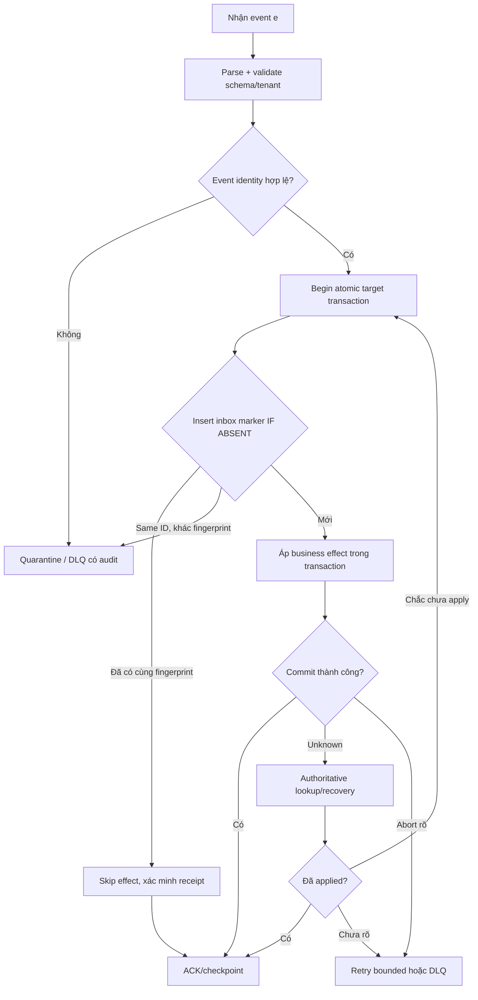
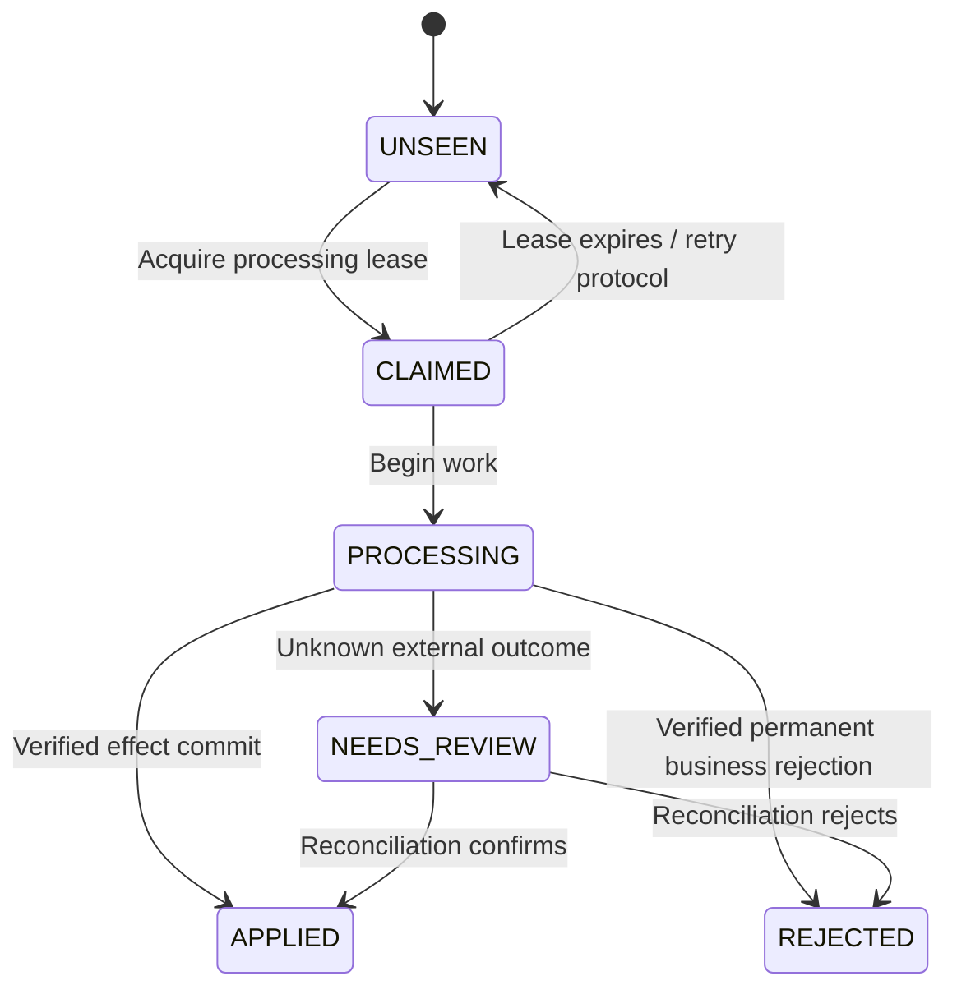
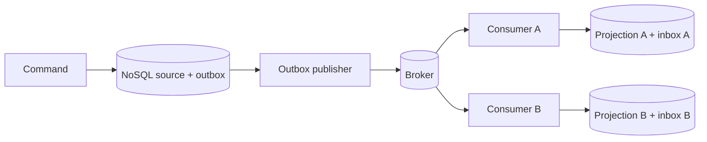

# Consumer idempotent và nhận diện sự kiện đã xử lý

Trong một kiến trúc NoSQL sử dụng **sự kiện và Change Data Capture (CDC)**, một thay đổi đã commit ở nguồn có thể được chuyển qua outbox, change stream, message broker, worker và nhiều read models. Luồng này giúp tách phần ghi khỏi các hệ đọc/tích hợp, nhưng tạo ra một câu hỏi: **nếu cùng một sự kiện được giao hai lần, consumer có làm cùng một việc hai lần không?**

Ví dụ một sự kiện:

```json
{
  "eventId": "evt-order-501-paid-v18",
  "type": "OrderPaid",
  "aggregateId": "O-501",
  "aggregateRevision": 18,
  "amountMinor": 299800,
  "currency": "VND"
}
```

Consumer nhận sự kiện để cộng doanh thu:

```text
revenueByDay[2026-11-14] += 299800
```

Lần đầu, phép cộng đã commit. Ngay sau đó worker crash **trước khi ACK message**. Broker phát lại cùng sự kiện; nếu consumer cộng thêm lần nữa, doanh thu bị tăng thành **599600 VND**, dù chỉ có **một** giao dịch thanh toán.

Cách giải quyết là thiết kế **consumer idempotent**: xử lý lại cùng một sự kiện trong phạm vi đã định nghĩa không tạo thêm hiệu ứng nghiệp vụ, kể cả khi lệnh được giao trùng, worker đổi máy, ACK mất hoặc hệ phục hồi từ checkpoint cũ. Điều này đòi hỏi một **danh tính sự kiện ổn định**, **trạng thái đã xử lý đáng tin cậy**, và **cơ chế nguyên tử hoặc phục hồi** giữa việc đánh dấu sự kiện và áp tác động.

Bài thuộc **Database No SQL → Sự kiện và CDC**, đi từ định nghĩa đến các thiết kế cho MongoDB, DynamoDB, Cassandra/ScyllaDB, Redis, Java consumers, lỗi phổ biến, kiểm thử và vận hành.

> Khả năng giao dịch, tính nhất quán, retention, transaction/CDC APIs và tính năng “exactly-once” khác nhau giữa từng sản phẩm, phiên bản, topology và cấu hình. Các đoạn lệnh minh họa là mẫu thiết kế; cần đối chiếu giao thức và tài liệu của hệ đang dùng trước khi triển khai production.

## 1. Consumer idempotent là gì?

Một consumer nhận sự kiện \(e\) và làm thay đổi trạng thái \(s\) qua hàm \(F(s,e)\).

Với **cùng một sự kiện** \(e\), mong muốn:

\[
F(F(s,e),e)=F(s,e)
\]

trong phạm vi hiệu ứng nghiệp vụ cần bảo vệ.

Ví dụ:

```text
Event e18 = OrderPaid(O-501, 299800 VND)

First delivery:
    create revenue contribution for e18.

Second delivery:
    detect e18 already applied.
    no second contribution.

Third delivery:
    still no second contribution.
```

Từ “idempotent” không có nghĩa message chỉ được gửi một lần. Nó có nghĩa **giao lại không làm sai hiệu ứng**.

Cần phân biệt:

- **Idempotent state update:** cùng một snapshot được ghi nhiều lần và cho kết quả dữ liệu cuối giống nhau.
- **Idempotent business processing:** các hiệu ứng khác như email, thanh toán, tăng counter, gọi API và tạo sự kiện tiếp theo không bị nhân đôi.
- **Idempotency theo phạm vi:** một event ID được xử lý một lần **cho mỗi projection/consumer purpose**; không có nghĩa chỉ được một consumer trên toàn hệ xử lý sự kiện.

Ví dụ hai consumers hợp lệ cùng đọc `OrderPaid`: một tạo order card, một tính doanh thu. Không được dùng một marker “đã xử lý toàn hệ” khiến consumer thứ hai bỏ qua event cần thiết.

## 2. Vì sao sự kiện có thể xuất hiện nhiều lần?

Những nguyên nhân thường gặp:

1. Broker dùng **at-least-once delivery**, phát lại message khi chưa có ACK.
2. Consumer ghi target thành công rồi crash trước khi commit offset/checkpoint.
3. ACK gửi đi nhưng broker không nhận được vì network partition.
4. Consumer group rebalance, một partition chuyển chủ.
5. CDC connector restart từ checkpoint cũ.
6. Outbox publisher publish thành công rồi crash trước khi đánh dấu đã publish.
7. Retry do throttling/timeout; request target đã commit nhưng client không nhận response.
8. Dead-letter queue (DLQ) được replay thủ công hoặc tự động.
9. Backfill từ snapshot chạy đồng thời với CDC stream.
10. Một migration phát lại lịch sử hoặc rebuild projection.
11. Webhook từ bên ngoài được gửi lại với cùng event ID.
12. Producer phát hai bản sao do lỗi code hoặc tạo event khác ID cho cùng business transition.

Bất kỳ kiến trúc nào cho phép phục hồi nhờ retry/replay đều phải dự kiến **delivery trùng**.

## 3. At-most-once, at-least-once và exactly-once

| Mô hình | Đặc điểm | Đánh đổi |
| --- | --- | --- |
| **At-most-once delivery** | Không cố phát lại sau điểm quyết định | Có thể mất xử lý |
| **At-least-once delivery** | Phát lại cho tới khi được xác nhận theo policy | Có thể giao trùng |
| **Exactly-once trong một phạm vi giao dịch** | Hiệu ứng được áp đúng một lần trong phạm vi giao thức hỗ trợ | Cần transaction/dedup/commit phối hợp |
| **Exactly-once end-to-end** | Một business effect qua mọi hệ ngoài chỉ xảy ra một lần | Không tự có nếu DB, broker, HTTP và provider không chia sẻ protocol |

Một broker quảng bá exactly-once semantics **không tự làm** phép `UPDATE revenue += amount` trong một NoSQL khác exactly-once. Nếu transaction của broker không bao phủ target database, consumer vẫn cần idempotency.

Một mục tiêu thực tế và có thể chứng minh:

```text
At-least-once event delivery
    +
Atomic deduplication and effect
    =
At-most-once application of each recognized event
within the target's defined authority and retention window.
```

Để có **liveness** (cuối cùng phải áp thành công), còn cần retry, error handling, recovery và quan sát; chỉ chống trùng không bảo đảm event không bị bỏ sót.

## 4. Các loại ID không được nhầm với nhau

Một hệ có thể có nhiều định danh:

| ID | Ví dụ | Dùng để |
| --- | --- | --- |
| `businessOperationId` | `pay-O-501-1` | Nhận diện một ý định nghiệp vụ |
| `eventId` | `evt-O-501-r18` | Nhận diện một domain event đã được phát |
| `aggregateId` | `O-501` | Nhận diện entity nguồn |
| `aggregateRevision` | `18` | Sắp thứ tự thay đổi của một aggregate |
| `transactionId` | `tx-781` | Nhận diện transaction trong phạm vi định nghĩa |
| `sourceLogPosition` | `partition/P0/offset42` | Tiến độ đọc source stream |
| `brokerMessageId` | ID do broker tạo | Nhận diện một message/delivery tùy broker |
| `deliveryAttempt` | `3` | Quan sát số lần giao |
| `consumerName` | `revenue-v2` | Nhận diện một mục đích xử lý |
| `projectionVersion` | `2` | Phân biệt logic/schema của read model |

**Không có một ID luôn thay thế được tất cả ID còn lại.**

Một `OrderPaid` có thể tạo **nhiều** domain events hợp lệ khác nhau cho các tác vụ, trong khi cùng một event có thể được broker delivery nhiều lần.

## 5. Phân biệt event identity và business identity

Giả sử có lỗi producer:

```text
evt-100: OrderPaid(O-501, paymentIntent PAY-501, 299800)
evt-101: OrderPaid(O-501, paymentIntent PAY-501, 299800)
```

Hai `eventId` khác nhau, nhưng đều biểu diễn **cùng payment intent** và cùng chuyển trạng thái.

Dedup chỉ theo `eventId` sẽ cho phép consumer cộng doanh thu hai lần. Điều này đòi hỏi hai tầng bảo vệ:

- **Delivery dedup:** cùng `eventId` không áp lặp.
- **Business dedup:** cùng `paymentIntentId`/`chargeId`/`orderRevision` không tạo hai hiệu ứng thuộc cùng invariant.

Ngược lại, cùng `aggregateId=O-501` có thể có nhiều sự kiện hợp lệ:

```text
OrderCreated r1
OrderPaid r18
OrderRefunded r22
```

Dedup chỉ theo `aggregateId` sẽ bỏ nhầm những sự kiện khác nhau. **Key đúng phải bám vào identity và semantics của điều được áp.**

## 6. Một sự kiện tối thiểu nên mang gì?

Một envelope minh họa:

```json
{
  "eventId": "evt-O-501-r18",
  "eventType": "OrderPaid",
  "eventSchemaVersion": 2,
  "tenantId": "T1",
  "aggregateType": "Order",
  "aggregateId": "O-501",
  "aggregateGeneration": 1,
  "aggregateRevision": 18,
  "businessOperationId": "pay-O-501-1",
  "occurredAt": "2026-11-14T08:00:00Z",
  "payload": {
    "paymentIntentId": "PAY-501",
    "amountMinor": 299800,
    "currency": "VND"
  }
}
```

Ý nghĩa:

- `eventId` ổn định qua mọi lần publish/retry/replay.
- `tenantId` ràng buộc phạm vi dữ liệu, quyền truy cập.
- `aggregateGeneration` bảo vệ xóa/tạo lại identity nếu domain cho phép.
- `aggregateRevision` biểu diễn thứ tự trong một aggregate khi source cấp đúng.
- `businessOperationId` hỗ trợ dedup ở mức nghiệp vụ.
- `eventSchemaVersion` dùng để diễn giải payload lịch sử.
- `occurredAt` phục vụ audit; **không mặc định là thứ tự toàn cục**.

**Producer không được cấp event ID mới mỗi lần nó retry cùng một committed event.** ID nên được tạo/lưu cùng source event hoặc outbox record có thẩm quyền.

## 7. Định danh consumer phải có phạm vi

Một sự kiện `OrderPaid` cần được xử lý bởi:

```text
Consumer A: orders-by-customer
Consumer B: daily-revenue
Consumer C: fraud-evaluation
Consumer D: notification-outbox
```

Mỗi consumer có **đích và hiệu ứng riêng**.

Nếu dùng một bảng `processed_events` chung:

```text
PK = (consumerId, eventId)
```

trong đó `consumerId` phải nhận diện **logical consumer purpose** bền vững, không phải tên pod ngẫu nhiên:

```text
("orders-by-customer-v2", "evt-O-501-r18")
("daily-revenue-v1", "evt-O-501-r18")
```

Khi worker của `daily-revenue-v1` được scale từ một lên mười pods, `consumerId` không được thay đổi theo từng pod; các pods phải chia sẻ một kho dedup nhất quán.

Một migration từ `daily-revenue-v1` sang `v2` cần quyết định rõ: có **replay và recompute toàn bộ** cho v2 hay không? Không chỉ xóa marker cũ và cho consumer áp lại vào cùng một aggregate tiền đang phục vụ production.

## 8. Inbox/processed-events ledger

Một record:

```json
{
  "consumerId": "daily-revenue-v1",
  "eventId": "evt-O-501-r18",
  "tenantId": "T1",
  "eventFingerprint": "sha256:...",
  "status": "APPLIED",
  "sourceStream": "orders",
  "sourcePartition": "P3",
  "sourceOffset": 98172,
  "aggregateId": "O-501",
  "aggregateRevision": 18,
  "effectReference": "revenue-contribution-O-501-PAY-501",
  "processedAt": "2026-11-14T08:00:01Z"
}
```

`APPLIED` nên có nghĩa **hiệu ứng trong phạm vi consumer đã commit**, không chỉ “worker nhận được message”.

Một bảng/collection kiểu này thường gọi là:

- Inbox.
- Processed event ledger.
- Deduplication store.
- Consumer receipt table.
- Message handling journal.

Không nhất thiết phải tạo một record riêng cho mọi event nếu target có thể lưu chính **event identity như một unique contribution key**, nhưng phải có bằng chứng tương đương về việc hiệu ứng đã được áp.

## 9. Điều kiện cơ bản để dedup đáng tin

Một ledger có ích khi:

1. Key `(consumerId, eventId)` được bảo vệ **uniqueness/conditional insert nguyên tử**.
2. Đọc và ghi ledger theo consistency đủ mạnh để nhận diện một xử lý đã commit.
3. Ledger được ghi **trong cùng atomic scope với hiệu ứng cần bảo vệ** hoặc có recovery protocol rõ ràng.
4. Cùng eventId nhưng payload khác bị phát hiện qua fingerprint/payload semantics.
5. Marker sống đủ lâu cho cửa sổ replay thực tế.
6. Concurrent workers không cùng áp một event do race đọc trước ghi.
7. Target hỗ trợ resume/recovery khi commit ACK bị mất.
8. Ledger ghi cả kết luận business reject khi cần để không xử lý lại như event mới.
9. Tenant và consumer scope không bị xung đột.
10. Có audit/reconciliation để phát hiện marker và business effect mâu thuẫn.

Nếu chỉ có `HashSet<String>` trong bộ nhớ của một Java pod, sau restart hoặc khi có pod khác, tính an toàn không còn.

## 10. Sai lầm: check rồi apply rồi mark

Một mã giả nguy hiểm:

```java
if (!processedEvents.exists(event.eventId())) {
    revenueRepository.increment(event.amountMinor());
    processedEvents.insert(event.eventId());
}
```

Race:

```text
Worker A: EXISTS e18 -> false
Worker B: EXISTS e18 -> false

Worker A: INCREMENT revenue
Worker B: INCREMENT revenue

Worker A: INSERT marker e18
Worker B: INSERT marker e18 -> duplicate
```

Dù marker có unique constraint, **B đã cộng tiền trước khi insert bị từ chối**.

Giải pháp là đặt **condition và hiệu ứng vào một atomic commit**, hoặc thay cách lưu effect để idempotent theo business key.

## 11. Sai lầm ngược lại: mark trước rồi apply

Một cách tưởng an toàn:

```java
if (processedEvents.insertIfAbsent(eventId)) {
    revenue.increment(amount);
}
```

Nếu hai thao tác không chung commit boundary:

```text
T0: INSERT marker e18 -> success.
T1: Process crash.
T2: Revenue chưa tăng.
T3: Broker redelivers e18.
T4: Marker tồn tại -> consumer bỏ qua.
```

Kết quả: event bị **mất hiệu ứng vĩnh viễn** dù ledger nói đã xử lý.

Điều kiện “insert marker thành công” chỉ chứng minh đã **claim**, không chứng minh effect đã hoàn tất. Cần phân biệt `CLAIMED/PENDING` với `APPLIED` khi dùng workflow hai giai đoạn.

## 12. Atomic effect + marker: mô hình dễ chứng minh nhất

Trong phạm vi transaction của target database:

```text
BEGIN TRANSACTION

    INSERT processed_events(
        consumerId,
        eventId,
        fingerprint,
        status=APPLIED
    )
    IF ABSENT

    APPLY business effect:
        insert revenue contribution
        or update projection

COMMIT TRANSACTION
```

Khi transaction commit:

```text
marker exists AND effect applied
```

Khi transaction abort:

```text
marker absent AND effect not applied
```

Nếu response commit bị mất, consumer không được giả transaction thất bại; nó phải **tra ledger/read source hoặc retry theo transaction protocol**. Khi broker redelivers, `insert-if-absent` chỉ cho một processing path thành công.

Điều này phụ thuộc database **thực sự hỗ trợ transaction nguyên tử trong phạm vi records cần ghi**. Nếu source không hỗ trợ transaction across partitions, phải thiết kế lại storage/identity hoặc workflow.

## 13. Sơ đồ consumer có dedup nguyên tử



Một consumer có thể được gọi là idempotent **theo hiệu ứng** khi những nhánh duplicate, commit unknown và worker crash đều không tạo lần áp thứ hai.

## 14. Crash window: commit target trước broker ACK

Timeline điển hình:

```text
T0 Broker delivers e18.
T1 Worker starts processing.
T2 Target transaction commits:
      inbox[e18] = APPLIED
      revenue += 299800
T3 Worker crashes before ACK.
T4 Broker redelivers e18.
T5 Worker finds inbox[e18] = APPLIED.
T6 Worker ACKs; no revenue increment.
```

Đây là hành vi **mong muốn**.

Nếu offset được commit **trước** T2:

```text
T1 Commit broker offset.
T2 Process crash.
T3 Target chưa có effect.
T4 Broker cho rằng message đã xử lý.
```

Event có thể mất hiệu ứng. Vì vậy, với at-least-once processing, **không ACK/checkpoint trước khi target effect và marker được xác nhận bền vững**.

## 15. ACK/checkpoint là tiến độ đọc, không phải business receipt

Các khái niệm khác nhau:

```text
ACK:
    Broker có thể ngừng gửi một delivery cụ thể.

OFFSET:
    Consumer đã tiến đến vị trí nào trong stream partition.

PROCESSED MARKER:
    Consumer/target ghi nhận một event đã có hiệu ứng.

BUSINESS RECEIPT:
    Một thao tác nghiệp vụ đã commit theo contract.
```

Có thể có:

```text
Offset P0=500 committed.
Inbox e18=APPLIED.
Read projection revision=18.
```

Cả ba dấu vết hữu ích nhưng không thay thế nhau.

Offset thay đổi khi:

- Repartitioning.
- Rebalance.
- Reset consumer group.
- Recreate topic/stream.
- Replay từ DLQ.
- Bootstrap/backfill từ snapshot.
- Export/import dữ liệu.

**Chỉ dùng offset để dedup toàn vòng đời có thể không đủ**, đặc biệt khi sự kiện được republish hoặc đổi nguồn/partition.

## 16. Offset phải commit theo phạm vi partition

Giả sử một consumer xử lý song song:

```text
Partition P1:
    offset 100 processing slow
    offset 101 completed
    offset 102 completed
```

Nếu commit checkpoint `103` (offset tiếp theo) khi `100` chưa hoàn tất, việc crash có thể khiến `100` không được phát lại.

Cần một cơ chế đảm bảo:

```text
Only advance contiguous committed offsets.
```

Hoặc bắt buộc xử lý tuần tự trong mỗi partition nếu workload/ordering cho phép.

Đừng dùng một biến `lastSeenOffset=max(...)` khi xử lý song song mà bỏ qua những messages chưa áp xong. Với nhiều partitions, offsets không có một thứ tự toàn cục.

## 17. Consumer group rebalance và lease ownership

Một partition chuyển từ Worker A sang Worker B:

```text
A is processing e18.
Group rebalance happens.
B receives e18.
A resumes late.
```

Nếu không có atomic dedup, A và B cùng có thể ghi business effect.

Broker partition assignment giúp hạn chế concurrency bình thường, nhưng **không thể dùng nó thay cho target-side idempotency** vì in-flight attempts vẫn có thể overlap.

Khi dùng lease/epoch:

```text
workerEpoch=21
workerEpoch=22
```

đích nhận write cần kiểm tra fencing/version khi cần chặn worker cũ. Lease hết hạn **không tự khiến mọi requests đã gửi từ A biến mất**.

## 18. Hai khóa dedup có thể cần thiết

Ví dụ:

```text
Delivery ID:
    eventId = evt-100

Business ID:
    paymentIntentId = PAY-501
```

Một projection doanh thu có thể cần:

```text
processed_events:
    (consumerId, eventId) unique

revenue_contributions:
    (tenantId, providerChargeId) unique
```

Lý do:

- Broker duplicate cùng eventId: inbox chặn.
- Producer phát hai events khác eventId cho cùng charge: unique contribution chặn.
- Một event hợp lệ có refund khác: dùng refund transaction ID riêng, không dedup theo orderId chung.

**Dedup business key phải dựa trên invariant**. Không dùng `orderId` để chặn mọi events về order nếu order có nhiều payment/refund hợp lệ.

## 19. Phân biệt idempotent upsert và idempotent increment

### Snapshot projection

```json
{
  "orderId": "O-501",
  "sourceRevision": 18,
  "status": "PAID"
}
```

Nếu payload mô tả **đầy đủ trạng thái cần thiết**, projection có thể:

```text
replace if incoming revision > current revision
```

trong đúng generation và với atomic compare-and-write.

### Delta projection

```json
{
  "eventId": "evt-O-501-r18",
  "type": "RevenueCaptured",
  "deltaMinor": 299800
}
```

Với:

```text
totalRevenue += deltaMinor
```

retry không lũy đẳng. Cần unique event/business identity hoặc per-event contribution.

Một cơ chế `lastRevision` theo một order **không luôn bảo vệ** aggregate doanh thu chứa events từ nhiều orders.

## 20. Cách mạnh: contribution row theo business identity

Thay vì trực tiếp:

```text
dailyRevenue[T1,2026-11-14] += 299800
```

có thể lưu một record có identity:

```json
{
  "contributionId": "charge-CH-781",
  "tenantId": "T1",
  "businessDay": "2026-11-14",
  "amountMinor": 299800,
  "currency": "VND",
  "kind": "CAPTURE"
}
```

Và unique key:

```text
(tenantId, contributionId)
```

Khi cùng charge được phát qua hai events:

```text
INSERT contribution if absent
    -> only one row.
```

Bảng tổng có thể được tính lại từ contributions hoặc được cập nhật bằng một pipeline riêng có dedup. Phương án này thường dễ đối soát hơn một counter tăng dồn không có lịch sử.

Nhưng cần cân nhắc volume, partitioning, query capacity và retention; không phải mọi use case đều cần một ledger dài hạn.

## 21. Cùng eventId nhưng payload thay đổi

Hai messages:

```json
{
  "eventId": "evt-18",
  "amountMinor": 299800
}
```

và:

```json
{
  "eventId": "evt-18",
  "amountMinor": 399800
}
```

Nếu consumer thấy marker và bỏ qua luôn, nó có thể che giấu sự cố producer/schema/corruption.

Nên lưu **fingerprint hoặc semantic payload signature**:

```text
same eventId + same meaning:
    ALREADY_PROCESSED

same eventId + different meaning:
    IDENTITY_COLLISION / CONFLICTING_PAYLOAD
    quarantine + incident
```

Fingerprint nên được tính từ **canonical semantic representation** theo schema version và policy, không chỉ hash bytes JSON ngẫu nhiên nếu thứ tự fields, defaults hoặc metadata giao nhận thay đổi.

Không biến cùng eventId nhưng payload khác thành một event mới một cách tự động, vì như vậy dedup bị phá.

## 22. Consumer states: RECEIVED, CLAIMED, APPLIED, FAILED

Một hệ có thể dùng:

```text
UNSEEN
CLAIMED
PROCESSING
APPLIED
REJECTED
NEEDS_REVIEW
```

Nhưng phải định nghĩa:

- `CLAIMED`: đã lấy quyền xử lý, **chưa chứng minh effect**.
- `PROCESSING`: đang làm; có lease/expiry/recovery.
- `APPLIED`: có bằng chứng effect commit.
- `REJECTED`: event được xử lý và business rule xác nhận không áp; cần xác định terminal semantics.
- `NEEDS_REVIEW`: không đủ chứng cứ tự động, chờ điều tra.

Sơ đồ:



Nếu `CLAIMED` được commit riêng trước effect, worker phải có **resume/reclaim protocol**. Không được coi `CLAIMED` là `APPLIED` khi thấy duplicate.

## 23. Khi xử lý lâu, không giữ DB transaction quá lâu

Một consumer có thể phải gọi payment gateway vài giây hoặc chờ approval. Không nên giữ một NoSQL transaction mở suốt lúc đợi mạng ngoài:

```text
BEGIN DB TRANSACTION
    write inbox marker
    call external provider (may timeout)
    write effect
COMMIT
```

Rủi ro:

- Transaction timeout/locks/conflict.
- Provider charge thành công nhưng DB rollback.
- Callback transaction bị chạy lại.
- Worker crash sau external effect.
- DB không thể atomic commit với provider.

Thay bằng:

```text
Phase 1:
    durably register command/intent with stable operationId

Phase 2:
    call external provider idempotently

Phase 3:
    reconcile provider outcome

Phase 4:
    commit local effect and terminal receipt
```

Cần lease/fencing, stable provider idempotency key và **không ACK như hoàn tất nghiệp vụ** khi chỉ mới claim mà không có durable workflow tiếp tục xử lý.

## 24. Idempotency xuyên outbox và inbox

Một kiến trúc:



Tính chất cần được chứng minh:

1. Source commit và outbox event intent thuộc cùng atomic boundary hoặc recovery protocol.
2. Publisher có thể publish trùng; **eventId không đổi**.
3. Consumer A và B có inbox riêng theo mục đích.
4. Mỗi consumer ghi inbox marker cùng effect trong target transaction hoặc idempotent replacement.
5. Consumer ACK sau khi đã có durable processing result.
6. Khi broker/topic replay, consumer giữ business effect đúng.
7. Có reconciliation nếu một event bị mất hoặc target khác source.

Outbox giải quyết **dual-write source→broker**; inbox giải quyết **duplicate delivery broker→consumer**. Hai mẫu thường cần phối hợp.

## 25. Vì sao “exactly-once” trên Kafka không tự giải quyết NoSQL?

Một Kafka transaction có thể hỗ trợ atomicity đối với **records xuất ra Kafka và consumer offsets trong phạm vi giao thức của Kafka**. Nhưng một consumer làm:

```text
Read Kafka event
Update MongoDB revenue
Commit Kafka offset
```

không tự có transaction atomic giữa MongoDB và Kafka.

Crash windows:

```text
MongoDB commit -> Kafka offset chưa commit:
    event được phát lại.

Kafka offset commit -> MongoDB chưa commit:
    event có thể bị bỏ qua.
```

Cần target-side idempotency hoặc giao thức tích hợp được chứng minh. Kafka Streams và một số connectors có semantics riêng; phải giới hạn tuyên bố theo chính xác **systems được bao phủ**, không suy rộng tới email, Redis, DynamoDB hay payment provider.

## 26. CDC connector có thể tạo bản ghi khác domain event

CDC từ database log thường cho biết:

```json
{
  "table": "orders",
  "operation": "UPDATE",
  "key": "O-501",
  "before": { "status": "PENDING" },
  "after": { "status": "PAID" }
}
```

Một storage mutation **không nhất thiết** tương đương với một domain event duy nhất:

- Một transaction có thể thay nhiều records.
- Một domain transition có thể tạo nhiều mutations.
- Một update có thể chỉ thay `lastSeenAt` mà không phải business event.
- Debezium/change stream/update event có metadata khác nhau theo connector.
- Re-snapshot có thể phát record “hiện tại” sau khi đã xử lý CDC updates.
- Trường before image không luôn có sẵn theo cấu hình.

Consumer phải biết nó đang xử lý:

1. **Domain event** với identity nghiệp vụ ổn định.
2. **Storage change event** có source position/transaction identity.
3. **Snapshot row** dùng để materialize current state.
4. **Tombstone/delete** để xóa projection.
5. **Operational metadata event** không gây business effect.

Không áp luật “mọi message là một lần thanh toán” khi stream chỉ là CDC của một bảng order.

## 27. Tạo event ID cho CDC khi source không lưu eventId

Một số source CDC cung cấp:

```text
sourcePartition
logSequence
transactionId
table
primaryKey
operationIndex
```

Có thể xây dedup key từ **một tập metadata có uniqueness và stability được tài liệu bảo đảm trong phạm vi stream**.

Cần hỏi:

- Vị trí log có duy nhất trong một source generation không?
- Sau connector restart, identity có còn giống không?
- Sau resnapshot/recreate topic, identity còn ổn định không?
- Một transaction có nhiều row events cùng log position không?
- Source partition có đổi khi reshard không?
- Event có thể republish sang topic khác với metadata mới không?
- Consumer dedup có cần theo *business operation* thay vì storage mutation không?

**Không tự giả `(topic,partition,offset)` là business event ID vĩnh viễn**. Nó có thể phù hợp để nhận diện delivery trong một log generation, nhưng không bền qua mọi migration/replay.

Nếu business cần dedup lâu dài, cách tốt thường là **producer/source lưu durable domain eventId hoặc business operationId ngay lúc commit**.

## 28. Event identity phải sống qua retry của publisher

Một lỗi producer:

```text
Source commit OrderPaid.
Publisher attempt 1:
    eventId = random-101
    send -> broker ACK lost.

Publisher attempt 2:
    eventId = random-102
    send -> success.
```

Consumer thấy hai event IDs và không thể biết chúng là cùng một committed transition nếu không có business key.

Thiết kế tốt:

```text
Outbox row:
    eventId = evt-O-501-r18

Publisher attempt 1:
    send same eventId.

Publisher attempt 2:
    send same eventId.
```

Một eventId nên được **tạo trước và lưu bền vững với event intent**; không cấp ID mới mỗi lần gọi `publish()`.

## 29. Event ordering không được bảo đảm toàn cục

Một aggregate:

```text
O-501:
    rev18 PAID
    rev19 REFUND_REQUESTED
    rev20 REFUNDED
```

Consumer có thể nhận:

```text
rev20, rev18, rev19
```

tùy routing, retry, DLQ hoặc reprocess.

Nếu event là **full state snapshot** và revision được cấp bởi authority, một projection có thể dùng `replace-if-newer` theo cùng `(aggregateId,generation)`.

Nếu event chứa **deltas**:

```text
rev18: paidMinor += 299800
rev20: refundedMinor += 299800
```

bỏ rev18 vì đã thấy rev20 có thể khiến tổng tiền sai. Cần bảo toàn mọi event cần thiết, dedup và **gap detection**.

**Idempotency chống trùng; ordering/gap handling chống mất và đảo thứ tự. Chúng không thay thế nhau.**

## 30. `lastProcessedRevision` có đủ không?

Một đơn giản hóa:

```text
state[O-501].lastProcessedRevision = 20

if incoming.revision <= 20:
    skip
```

Phù hợp hơn khi:

- Mọi event là full replacement snapshot.
- Revision có thứ tự tin cậy trên cùng aggregate/generation.
- Không cần áp mọi intermediate delta.
- Compare-and-replace nguyên tử.
- Delete/tombstone được bảo vệ.
- No-source identity collisions.

Không phù hợp khi:

- Event có delta cần tính đủ.
- Mỗi aggregate phát nhiều loại event với side effects độc lập.
- Có nhiều payment/refund events trong một revision.
- Source revision không tăng như giả định.
- Có snapshot/bootstrap xen lẫn CDC.
- Một consumer aggregate từ nhiều source partitions.

**Không dùng lastRevision như dedup key đa dụng nếu event semantics không chứng minh nó đúng.**

## 31. Snapshot và CDC đồng thời: một nguồn tạo duplicate hợp lệ

Khi bootstrap read model từ dữ liệu cũ:

```text
T0: Take/identify source snapshot.
T1: Backfill O-501 state rev17.
T2: Live CDC event O-501 rev18 arrives.
T3: Snapshot rev17 is applied late.
```

Nếu snapshot dùng blind upsert, read model đi lùi từ rev18 về rev17.

Cần:

- Snapshot và stream có mốc ranh giới tương thích.
- Idempotent write vào target.
- Version/generation guard.
- Replay từ source position phù hợp.
- Gap detection khi stream retention hết.
- Snapshot row được nhận diện khác với domain event.
- Không double-add aggregate từ snapshot và cùng change event.

Một kế hoạch bootstrap có thể cần **catch-up phase** trước khi cutover traffic. “Backfill đã đủ số dòng” không chứng minh CDC changes không bị mất.

## 32. Delete, tombstone và resurrection

Timeline:

```text
rev7:  Profile ACTIVE
rev8:  Profile DELETED
replay: rev7 arrives after delete
```

Nếu target chỉ xóa key rồi không lưu metadata:

```text
consumer receives rev7:
    target key absent
    insert ACTIVE
```

Dữ liệu đã xóa **tái xuất hiện**.

Cần:

- Tombstone hoặc deletion generation/revision.
- Conditional apply để sự kiện cũ không ghi đè delete.
- Retention đủ cho late replay/rebuild.
- Không dùng một `NOT_FOUND` từ cache eventual làm proof chưa từng tồn tại.
- Ràng buộc privacy/retention cho read models và log.
- Có test rebuild từ snapshot cũ sau deletion.

Dedup cùng eventId không tự chặn revival nếu rev7 và rev8 là **hai events khác nhau**. Đây là bài toán **version/order/delete**, ngoài idempotency.

## 33. TTL của processed markers là một giới hạn an toàn

Ví dụ:

```text
Dedup marker TTL = 24 giờ
Broker retention = 7 ngày
DLQ replay = 30 ngày
Manual backfill = bất kỳ lúc nào
```

Một event cũ có thể trở lại sau khi marker đã hết hạn; consumer sẽ áp lại.

Cần đặt retention dựa trên:

- Broker/message retention.
- DLQ retention và replay policy.
- Webhook provider redelivery window.
- Thời gian consumer có thể ngừng vì outage.
- Khả năng restore backup/checkpoint cũ.
- Các replay phục vụ migration/rebuild.
- Business identity lifetime.
- Khả năng đối soát từ authoritative ledger.
- Security, privacy và chi phí lưu trữ.

Không chọn TTL chỉ vì muốn giảm kích thước processed-events table. Với nghiệp vụ tài chính, thường cần **business transaction identity/ledger** lâu hơn một cache marker ngắn hạn.

## 34. Tránh ledger dedup trở thành điểm nóng

Một thiết kế xấu:

```text
processed_events:
    partitionKey = "ALL_EVENTS"
```

Hàng triệu consumers cùng ghi vào một partition, tạo hot key và giới hạn throughput.

Có thể chọn:

```text
partition = hash(consumerId, eventId) / sharded key
logicalKey = (consumerId, eventId)
```

theo khả năng uniqueness/conditional write của engine.

Hoặc dùng:

- Per-aggregate idempotent state trong cùng partition.
- Per-event contribution rows có primary key tự phân tán.
- Bucketing theo tenant/consumer và thời gian nếu identity/lookup hỗ trợ.
- Archive/compaction sau thời gian bảo vệ được chứng minh.
- Tách projection state và audit history.

**Partitioning không được phá uniqueness**. Nếu cùng logical event có thể rơi vào hai shards khác nhau do một routing function không ổn định, duplicate sẽ lọt qua.

## 35. Một consumer idempotent cần ACK trường hợp duplicate thế nào?

Đầu vào e18:

```text
Inbox e18 = APPLIED, fingerprint matches.
```

Consumer có thể:

```text
skip business effect
ACK message
```

Vì target đã có bằng chứng hoàn tất.

Nhưng nếu:

```text
Inbox e18 = PROCESSING
```

không thể ACK như terminal **trừ khi đã có một durable workflow khác chắc chắn tiếp tục xử lý và ACK semantics cho phép**.

Nếu:

```text
Inbox e18 = APPLIED nhưng payload khác fingerprint
```

không được im lặng bỏ qua; cần quarantine và điều tra vì event identity không đáng tin.

Nếu:

```text
Inbox lookup timeout
```

không được coi là `NOT_FOUND`. Hãy để broker redeliver theo policy hoặc thực hiện authoritative retry trong budget.

## 36. Java: cấu trúc sự kiện có danh tính rõ ràng

Ví dụ Java 17:

```java
public record DomainEvent(
        String eventId,
        String tenantId,
        String aggregateId,
        long aggregateGeneration,
        long aggregateRevision,
        String eventType,
        int schemaVersion,
        String canonicalFingerprint,
        String payloadJson) {
}
```

Kiểm tra input:

- `eventId`, `tenantId` không rỗng.
- Schema version được hỗ trợ hoặc có upcaster.
- Payload thỏa định dạng và validation.
- Event type chỉ được consumer này xử lý nếu có mapping.
- Fingerprint được xác minh với canonical payload.
- Aggregate identity và generation hợp lệ.
- Không log payload chứa PII hoặc payment secrets.

Đừng tin mọi field do một producer ngoài tổ chức gửi lên; có thể cần authentication/signature, source-topic authorization và validation.

## 37. Java: repository abstraction cho atomic inbox + effect

Một interface thể hiện hợp đồng:

```java
public interface EventTransactionRepository {
    ProcessResult applyOnce(
            String consumerId,
            DomainEvent event,
            DomainEffect effect);
}

@FunctionalInterface
public interface DomainEffect {
    void apply(TxContext transaction, DomainEvent event);
}

public sealed interface ProcessResult
        permits NewlyApplied, AlreadyApplied, EventConflict {
}

public record NewlyApplied(String eventId)
        implements ProcessResult {}

public record AlreadyApplied(String eventId)
        implements ProcessResult {}

public record EventConflict(String eventId, String reason)
        implements ProcessResult {}
```

`TxContext` là một abstract type cần adapter cụ thể, không phải API có sẵn của MongoDB/DynamoDB/Cassandra/Redis.

**Contract quan trọng của `applyOnce`:**

```text
Marker unique insert + effect:
    one atomic transaction or proven equivalent.

If duplicate same fingerprint:
    no effect and ALREADY_APPLIED.

If same ID different meaning:
    EVENT_CONFLICT.

If commit outcome UNKNOWN:
    do not claim newly applied or safely absent.
```

Tên method không phải bằng chứng nguyên tử; integration tests và database transaction semantics mới là bằng chứng.

## 38. Java: consumer xử lý và ACK đúng thứ tự

Pseudo-code gần với thiết kế thực:

```java
public final class RevenueConsumer {
    private final EventTransactionRepository repository;
    private final MessageAcknowledger acknowledger;

    public void onMessage(BrokerMessage message) {
        DomainEvent event = parseAndValidate(message.payload());

        ProcessResult result =
                repository.applyOnce(
                    "revenue-v1",
                    event,
                    (tx, e) -> tx.insertRevenueContribution(
                        e.tenantId(),
                        e.eventId(),
                        e.payloadJson()
                    )
                );

        if (result instanceof EventConflict) {
            quarantineWithEvidence(message, result);
            return;
        }

        // NewlyApplied / AlreadyApplied chỉ sau khi chắc commit.
        acknowledger.ack(message);
    }
}
```

Đây là ví dụ cấu trúc, chưa có `BrokerMessage`, `TxContext`, parsing, exception handling và provider adapters. Trong production:

- `repository.applyOnce` phải xử lý transaction conflicts.
- Nếu commit outcome unknown, không ACK cho tới khi xác minh bằng receipt theo policy.
- Nếu lỗi transient, bounded retry/backoff hoặc để broker redeliver.
- Nếu parse không được, có DLQ/quarantine policy trước khi ACK.
- Nếu xử lý song song trên partition, phải commit contiguous offsets.
- `quarantineWithEvidence` cũng cần durable handling; không để poison event giữ partition vô hạn mà không có giải pháp vận hành.

## 39. Java runnable demo: crash sau apply trước ACK

Ví dụ Java 17 này **có thể chạy trong một JVM** để hiểu nguyên tắc. Nó mô phỏng một target bảo vệ effect và marker trong cùng một `synchronized` method, rồi cố tình giao event hai lần.

```java
import java.util.HashMap;
import java.util.Map;

public class IdempotentConsumerDemo {
    record Event(String id, long amountMinor) {}
    record Receipt(String eventId, long amountMinor) {}

    static final class ToyTarget {
        private final Map<String, Receipt> processed =
                new HashMap<>();
        private long revenueMinor;

        synchronized String applyOnce(Event event) {
            Receipt previous = processed.get(event.id());

            if (previous != null) {
                if (previous.amountMinor() != event.amountMinor()) {
                    throw new IllegalArgumentException(
                            "Same event ID, different payload");
                }
                return "DUPLICATE";
            }

            // Cùng critical section trong demo:
            // production cần durable atomic DB operation.
            revenueMinor += event.amountMinor();
            processed.put(event.id(),
                    new Receipt(event.id(), event.amountMinor()));
            return "APPLIED";
        }

        synchronized long revenueMinor() {
            return revenueMinor;
        }
    }

    public static void main(String[] args) {
        ToyTarget target = new ToyTarget();
        Event event = new Event("e18", 299800L);

        System.out.println(target.applyOnce(event));

        // Giả lập worker crash trước khi broker ACK.
        System.out.println("Broker redelivers e18");

        System.out.println(target.applyOnce(event));
        System.out.println("Revenue = "
                + target.revenueMinor());
    }
}
```

Output:

```text
APPLIED
Broker redelivers e18
DUPLICATE
Revenue = 299800
```

**Giới hạn quan trọng:** `synchronized` và `HashMap` không durable, không bảo vệ nhiều Java pods, replica failover hoặc external payment. Ví dụ mô tả atomicity về mặt thuật toán; adapter NoSQL thực phải dùng condition/transaction phù hợp.

## 40. Java và transaction commit UNKNOWN

Một trường hợp:

```text
Java calls target transaction.
Target commits marker + effect.
Network drops commit response.
Java receives timeout.
```

Java không được:

```text
catch(timeout):
    assume transaction rollback
    increment revenue again
```

Cần:

1. Giữ eventId/consumerId.
2. Sử dụng recovery/retry transaction protocol của driver nếu có.
3. Tra processed-event receipt bằng đường authoritative.
4. Nếu `APPLIED` và fingerprint khớp, ACK.
5. Nếu chưa thể kết luận, giữ UNKNOWN hoặc để message redeliver theo budget.
6. Không biến `NOT_FOUND` từ eventual replica thành bằng chứng không commit.
7. Có alert khi UNKNOWN không thể kết luận lâu.

Một consumer idempotent phải an toàn **ngay cả khi quá trình kiểm tra kết quả cũng timeout**.

## 41. MongoDB: inbox và projection trong transaction

MongoDB có thể dùng multi-document transaction khi topology và phiên bản hỗ trợ. Một thiết kế:

```text
db.processed_events:
    unique (consumerId, eventId)

db.revenue_contributions:
    unique (tenantId, providerChargeId)

Transaction:
    INSERT processed_events marker.
    INSERT contribution or update projection.
COMMIT
```

Cần unique indexes đúng phạm vi sharding/tenant; không giả mọi unique index xuyên shards đều có semantics giống nhau.

### Giả mã MongoDB Java driver

```java
try (ClientSession session = client.startSession()) {
    session.withTransaction(() -> {
        Document marker = new Document()
            .append("consumerId", "revenue-v1")
            .append("eventId", event.eventId())
            .append("fingerprint", event.canonicalFingerprint())
            .append("status", "APPLIED");

        processedEvents.insertOne(session, marker);

        Document contribution = new Document()
            .append("tenantId", event.tenantId())
            .append("contributionId", businessChargeId)
            .append("amountMinor", amountMinor);

        revenueContributions.insertOne(
            session, contribution);

        return null;
    });
}
```

Đây là mẫu ý tưởng, còn thiếu objects/imports/exception policy. Bắt duplicate key phải xác minh **marker thuộc cùng payload** hoặc **contribution đã có đúng business meaning**; không tự coi mọi duplicate key là success. Unknown transaction commit result cần driver protocol đúng.

**Không gọi email/payment provider trong transaction callback** nếu callback có thể được driver retry.

## 42. MongoDB: dùng aggregate revision cho snapshot projection

Một consumer cập nhật `orders_by_customer` với event full-state:

```javascript
db.orders_by_customer.updateOne(
  {
    tenantId: "T1",
    orderId: "O-501",
    generation: 1,
    revision: { $lt: 18 }
  },
  {
    $set: {
      status: "PAID",
      revision: 18
    }
  }
);
```

Đây là điều kiện minh họa; nó **không tự insert khi record chưa tồn tại** và không tự xử lý generation/delete. Một upsert đúng cần thiết kế predicate/index/duplicate-key conflict kỹ, đặc biệt khi nhiều writers cùng insert và target sharded.

Nguyên tắc:

- Conditional replace/upsert atomic.
- Không giảm revision.
- Phân biệt full snapshot với delta.
- Giữ tombstone/generation.
- Có đường bootstrap/reconciliation nếu event thiếu.
- Không dùng optimistic projection state để xác nhận thanh toán ở authority.

## 43. DynamoDB: TransactWriteItems cho marker và effect

Một mô hình:

```text
ProcessedEvents table:
    PK = CONSUMER#revenue-v1#EVENT#e18

RevenueContributions table:
    PK = TENANT#T1#CHARGE#CH-781
```

Một `TransactWriteItems` theo phạm vi API hỗ trợ có thể chứa:

```text
Put marker with condition attribute_not_exists(PK).
Put contribution with condition attribute_not_exists(PK).
```

Hai puts commit cùng transaction hoặc cùng thất bại theo contract, nếu không có conflicts/giới hạn bị vi phạm.

Khi transaction condition failed:

- Có thể eventId đã được xử lý.
- Có thể business contribution cho chargeId đã tồn tại do event khác.
- Có thể payload khác nhưng ID trùng.
- Có thể một writer khác đang xử lý.

Do đó phải tra authoritative items và so fingerprint/identity trước khi quyết định ACK.

### Lưu ý DynamoDB

- Transaction token có một cửa sổ idempotency được dịch vụ định nghĩa, **không thay business ledger lâu dài**.
- `GetItem` trên base table với consistency option thích hợp khác với eventual GSI read.
- DynamoDB Streams có retention và consumer checkpoint semantics riêng.
- Global Tables/multi-region uniqueness/transaction semantics phải xét đúng chế độ.
- Hot partition theo consumerId duy nhất không phù hợp để xử lý hàng triệu events; thiết kế key phân tán nhưng deterministic.

## 44. Cassandra/ScyllaDB: conditional guard không tự bảo vệ nhiều partitions

Với Cassandra/ScyllaDB, một consumer có thể dùng LWT/CAS để claim một marker trong một partition:

```sql
INSERT INTO processed_events (
  consumer_id, event_id, fingerprint, status
)
VALUES (?, ?, ?, 'CLAIMED')
IF NOT EXISTS;
```

Nhưng cần lưu ý:

```text
LWT insert marker in partition A
+
UPDATE revenue in partition B
```

**không tự trở thành một atomic serializable transaction** chỉ vì bước đầu có LWT. Nếu worker crash giữa hai bước, marker `CLAIMED` có thể tồn tại nhưng revenue chưa cập nhật.

Các hướng:

- Thiết kế effect và marker trong **cùng logical aggregate/partition** với primitive được engine hỗ trợ và semantics kiểm chứng được.
- Lưu unique contribution record theo event/business key, rồi materialize aggregate.
- Xây durable inbox state machine `CLAIMED → APPLIED` có recovery/fencing.
- Dùng outbox/reconciliation để sửa partial effects.
- Nếu cần cross-partition strict atomicity mà engine không cung cấp, cân nhắc đổi source authority hoặc transaction design.

Không coi CQL `BATCH` là SQL transaction tùy ý xuyên nhiều partitions. LWT timeout có thể cho caller UNKNOWN, cần lookup/retry theo semantics phiên bản driver và consistency.

## 45. Cassandra counters, TTL và timestamps

Các rủi ro đặc thù:

- Counter mutations không lũy đẳng khi bị thực hiện hai lần.
- TTL có thể làm dedup marker biến mất trước cửa sổ replay.
- Một retry dùng timestamp khác có thể thay precedence của mutation.
- Tombstone và delete history ảnh hưởng resurrection.
- Replica/consistency level ảnh hưởng cách lookup marker/đọc dữ liệu.
- LWT/CAS có latency và contention cost.
- Partition quá rộng làm query/checkpoint nặng.
- CDC format/retention và tooling phụ thuộc hệ/phiên bản.

Nếu một event đóng góp 299800 VND vào revenue, **không dùng counter increment mà không có dedup được chứng minh**. Có thể chọn contribution table rồi tính tổng theo batch/window để đơn giản hóa recovery.

## 46. Redis: Lua cho một hiệu ứng và marker trong cùng slot

Một ví dụ Redis với counter và dedup marker được thực hiện trong một Lua script:

```lua
-- KEYS[1] = revenue counter key
-- KEYS[2] = processed marker key for eventId
-- ARGV[1] = amount in minor units
-- ARGV[2] = canonical event fingerprint
-- ARGV[3] = dedup TTL seconds

local prior = redis.call("GET", KEYS[2])
if prior then
    if prior ~= ARGV[2] then
        return { "CONFLICT" }
    end
    return { "DUPLICATE" }
end

local amount = tonumber(ARGV[1])
local ttl = tonumber(ARGV[3])

if not amount or amount <= 0 or not ttl or ttl <= 0 then
    return { "INVALID" }
end

redis.call("INCRBY", KEYS[1], amount)
redis.call("SET", KEYS[2], ARGV[2], "EX", ttl)

return { "APPLIED" }
```

Trong một Redis instance, script thực thi nguyên tử tương ứng với thao tác Redis được hỗ trợ. Nhưng:

- Với Redis Cluster, multi-key script phải tuân thủ ràng buộc cùng hash slot.
- Marker TTL hết thì late replay có thể cộng lần nữa.
- Replication/persistence/failover có durability caveats.
- Tài chính cần source of truth/ledger mạnh hơn một cache counter thuần.
- Event ID phải ổn định và fingerprint chính xác.
- Nếu Redis chỉ là cache, authority của revenue nằm ở DB/ledger khác; không coi Redis marker là bảo đảm cuối cùng.

## 47. Redis Stream IDs và consumer groups

Redis Streams có stream entry IDs và consumer group pending entries. Điều này hỗ trợ replay/claim nhưng không xóa nhu cầu dedup nếu consumer:

```text
XREADGROUP event
APPLY external/NoSQL effect
Crash before XACK
Another consumer XCLAIM/XAUTOCLAIM and handles again
```

Để an toàn:

- Sử dụng stream entry ID hoặc domain eventId trong phạm vi phù hợp.
- Ghi target-side processing receipt với effect.
- Chỉ `XACK` sau khi xử lý đạt tiêu chí bền vững.
- Có recovery cho pending entries.
- Không đồng nhất stream entry ID với business operation identity khi republish sang stream khác.
- Kiểm soát stream trimming/retention và pending messages.
- Không quên các operations có UNKNOWN commit outcome.

## 48. Event external: webhook và payment provider

Một webhook:

```json
{
  "providerEventId": "evt-provider-781",
  "paymentIntentId": "PAY-501",
  "providerChargeId": "CH-781",
  "type": "PaymentCaptured"
}
```

Provider có thể giao webhook nhiều lần; thậm chí một số providers có thể phát **nhiều event IDs** cho cùng một business state theo contract.

Cần:

1. Xác thực webhook signature/authorization.
2. Dedupe `providerEventId` khi event ID có tính ổn định.
3. Dedupe business effect theo `providerChargeId`/payment intent nếu invariant đòi.
4. Xác minh amount/currency/merchant/tenant.
5. Tra provider authority khi event mâu thuẫn hoặc out-of-order.
6. Cập nhật order/payment ledger theo state machine hợp lệ.
7. Không coi `AUTHORIZED` giống `CAPTURED` nếu business phân biệt.
8. Khi refund xảy ra, xử lý như event/operation mới với ID khác.
9. Có audit về callbacks, acknowledgments và reconciliation.

Không để duplicate webhook làm tăng doanh thu hoặc gửi hàng lần thứ hai.

## 49. Consumer tạo event tiếp theo cũng cần outbox

Một consumer không chỉ cập nhật target mà còn phát sự kiện:

```text
OrderPaid event
    -> update order view
    -> publish IssueTicket command
```

Nếu publish thành công rồi consumer crash trước ACK message, lần redelivery có thể phát `IssueTicket` lần nữa.

Một giải pháp:

```text
Atomic consumer transaction:
    insert processed event marker
    update local effect
    insert outbox IssueTicket with stable commandId
COMMIT
```

Outbox publisher có thể publish trùng, nhưng `IssueTicket` consumer cũng idempotent theo commandId. Đây là **chuỗi các ranh giới có idempotency riêng**, không phải một magic exactly-once flag.

## 50. Poison events và DLQ: không đánh dấu APPLIED để bỏ lỗi

Một event không parse được hoặc vi phạm schema:

```json
{
  "eventId": "e18",
  "type": "OrderPaid",
  "amountMinor": "not-a-number"
}
```

Có những lựa chọn:

- Reject/quarantine với nguyên nhân.
- DLQ có bản gốc, event ID, source position, schema version và metadata an toàn.
- Alert nếu event quan trọng.
- Dừng partition hoặc dùng policy skip có kiểm soát để bảo toàn ordering.
- Sửa consumer/schema rồi replay.
- Nếu business event thật sự invalid, cần upstream correction theo nghiệp vụ.

Không được viết:

```text
processed_events[e18] = APPLIED
```

chỉ để consumer group tiến offset, nếu revenue effect chưa được xử lý. Có thể ghi **REJECTED/QUARANTINED** với semantics riêng, nhưng điều đó không tương đương hoàn thành nghiệp vụ.

## 51. Retry budget, backoff và dead-letter

Không nên:

```text
Event e18 fails -> retry instantly forever.
```

Một event bị lỗi tạm thời có thể gây hot loop và làm cả partition chậm.

Nên có:

- Max concurrent processing per key/partition.
- Exponential backoff với jitter.
- Retry budget theo dependency/tenant.
- Distinguish transient errors vs permanent schema/business errors.
- Overall processing deadline hoặc escalation threshold.
- DLQ/quarantine có audit, owner và replay policy.
- Circuit breaker khi target database/provider unavailable.
- Không bỏ qua ordering khi đưa một delta event vào DLQ.
- Durable checkpoints và rollback/replay plan.

Hết retry budget **không chứng minh event đã APPLIED hay bị business REJECTED**. Trạng thái có thể `NEEDS_REVIEW` với bằng chứng chưa đủ.

## 52. Read model idempotent vẫn có thể stale

Một consumer lưu full snapshot:

```text
Order O-501 revision 18 = PAID.
```

Nếu update idempotent và event đến hai lần, target không tạo duplicate. Nhưng nếu rev19 đã commit ở source mà CDC bị trễ, view vẫn ở rev18.

Vì thế cần phân biệt:

- **Idempotency:** không nhân đôi event effect.
- **Freshness:** target có bắt kịp source không?
- **Ordering:** target có áp đúng thứ tự/causality không?
- **Completeness:** tất cả events cần thiết có được nhận không?
- **Authorization:** view có lộ thông tin sai tenant/quyền không?

Một projection đạt idempotency nhưng thiếu event là **vẫn sai**. Metrics phải đo nhiều thuộc tính, không chỉ số duplicate bị chặn.

## 53. Trạng thái source và target có thể mâu thuẫn

Ví dụ:

```text
Source:
    O-501 status PAID, rev18.

Read model:
    O-501 status PENDING, rev17.

Processed ledger:
    evt-r18 = APPLIED.
```

Nếu marker nói APPLIED nhưng view không phản ánh rev18, có thể:

- Marker và effect không commit atomically.
- Một stale event rev17 đã ghi đè view sau đó.
- View bị rebuild từ snapshot cũ.
- Worker ghi sai tenant/partition.
- Dữ liệu bị xóa/TTL.
- Query đang đọc replica lag.
- Event schema transformer tạo payload sai.
- Marker được copy nhưng effect không được restore cùng snapshot.

Cần **đối soát nguồn, marker, effect và target revision**; không chỉ kết luận event đã xử lý vì ledger nói APPLIED.

## 54. Reconciliation và rebuild

Một cơ chế đối soát định kỳ có thể:

```text
For a window/tenant:
    scan authoritative source states / domain ledger
    compare target keyset
    compare generation, revision, canonical hashes
    verify deleted/tombstoned entities absent where needed
    repair conditional state
```

Với aggregate delta:

```text
Recompute expected revenue from unique payment ledger.
Compare with projection daily revenue.
Repair through a controlled rebuild, not blind increment.
```

Khi rebuild:

- Chọn target version mới hoặc reset state có kiểm soát.
- Chụp snapshot và bắt change stream từ mốc tương thích.
- Replay cùng event IDs/identities.
- Không nhân đôi effects đã có trong target production.
- Chặn snapshot cũ ghi đè event mới.
- Kiểm tra gaps/retention.
- Shadow-query hoặc so source-target.
- Cutover traffic sau correctness/freshness gates.

**Replaying lịch sử vào một aggregate tiền hiện hành không có dedup** là cách nhanh để tạo sai lệch nghiêm trọng.

## 55. Schema evolution và processed fingerprint

Một event v1:

```json
{
  "eventId": "e18",
  "type": "OrderPaid",
  "amount": 299800
}
```

Event v2:

```json
{
  "eventId": "e18",
  "type": "OrderPaid",
  "amountMinor": 299800,
  "currency": "VND",
  "schemaVersion": 2
}
```

Nếu v1 và v2 có cùng **semantic meaning**, raw JSON hashes sẽ khác nhưng không nhất thiết là conflict. Cần:

- Schema versioned decoder/upcaster.
- Canonical semantic representation.
- Định nghĩa field nào thuộc business meaning.
- Migration strategy cho ledger fingerprints cũ.
- Không default thiếu amount thành 0.
- Không bỏ event do consumer không hiểu schema nếu business quan trọng.
- Test replay event từ nhiều versions.

Tuy nhiên, nếu amount thay đổi thật từ 299800 thành 399800 với cùng eventId, đó là conflict cần audit, không thể coi chỉ là schema migration.

## 56. Thời điểm event và thứ tự causal

Một consumer có thể thấy:

```text
Event A occurredAt=10:00:02
Event B occurredAt=10:00:01
```

Hai máy có clock skew; `occurredAt` không mặc định phản ánh commit order.

Các thứ tự có ích tùy phạm vi:

- Source aggregate revision.
- Source transaction sequence/log position.
- Per-partition broker order.
- Explicit causal dependency IDs.
- Database cluster/session commit token.
- Provider authoritative sequence/status.

Không tự áp “latest timestamp wins” cho payment status hoặc delete/tombstone khi correctness quan trọng.

## 57. Nhiều event types từ một aggregate

Ví dụ:

```text
Order O-501 rev18:
    OrderPaid

Order O-501 rev19:
    OrderAddressUpdated

Order O-501 rev20:
    OrderCancelled
```

Consumer revenue có thể chỉ quan tâm `OrderPaid` và `OrderRefunded`.

Consumer shipping có thể cần `OrderAddressUpdated` nhưng chỉ trước khi shipment được tạo.

Consumer search có thể cần cả ba để giữ state mới.

Vì vậy mỗi consumer phải định nghĩa:

```text
Which event types?
What business effect?
What stable dedup key?
What ordering requirement?
What conflict behavior?
What retention/replay policy?
```

Một “base consumer” chung có thể hỗ trợ envelope, nhưng **không được áp một idempotency policy giống hệt cho mọi domain effects**.

## 58. Metrics cho consumer idempotency

```text
consumer_events_received_total
consumer_events_applied_total
consumer_events_already_applied_total
consumer_events_identity_conflict_total
consumer_events_rejected_total
consumer_events_quarantined_total

consumer_transaction_commits_total
consumer_transaction_aborts_total
consumer_unknown_commit_total
consumer_inbox_lookup_failures_total
consumer_processing_latency_seconds

consumer_retry_attempts_total
consumer_rebalance_inflight_total
consumer_lease_fencing_rejections_total
consumer_dlq_size
consumer_oldest_unprocessed_age_seconds

consumer_offset_lag_by_partition
consumer_gap_detected_total
consumer_out_of_order_events_total
consumer_duplicate_business_effect_total

projection_source_revision_lag
projection_missing_entities_total
projection_content_mismatch_total
projection_deleted_entity_mismatch_total
reconciliation_cases_open
reconciliation_time_to_terminal_seconds
```

Đây là tên metric đề xuất, không phải tên mặc định của một sản phẩm.

Không dùng `eventId`, `orderId` hoặc `userId` làm metric labels vì cardinality cao và nguy cơ lộ dữ liệu; lưu chi tiết trong logs/traces/audit có kiểm soát.

## 59. Cách tính duplicate rate

Với một cửa sổ đo:

- \(N_{\mathrm{received}}\): số deliveries consumer nhận.
- \(N_{\mathrm{duplicate}}\): số deliveries đã có receipt cùng eventId/fingerprint.

Một tỷ lệ:

\[
D = \frac{N_{\mathrm{duplicate}}}{N_{\mathrm{received}}}
\]

Ví dụ:

```text
100.000 deliveries.
8.000 recognized duplicates.

D = 8%.
```

Tỷ lệ cao không tự có nghĩa dữ liệu sai; có thể đang replay sau outage. Nhưng nó giúp:

- Phát hiện publisher retry storm.
- Phát hiện consumer commit offset lỗi.
- Ước lượng write amplification.
- Theo dõi spike sau rebalance/recovery.
- Đánh giá chi phí dedup lookups.

Chỉ số quan trọng hơn là **duplicate business effects** — số lần dữ liệu/tiền bị áp trùng — phải bằng 0 theo invariant tương ứng.

## 60. Đánh giá dung lượng processed-events ledger

Giả sử:

```text
Events/s:             5.000
Marker size average:  220 bytes
Retention:            7 days
```

Ước lượng số markers:

\[
5.000 \times 86.400 \times 7 = 3.024.000.000
\]

Khoảng **3,024 tỷ records** trong bảy ngày; raw payload tương đương:

\[
3.024.000.000 \times 220
 \approx 665.280.000.000 \text{ bytes}
\]

xấp xỉ **665 GB raw**, chưa tính indexes, replication, storage overhead, compaction hoặc backup.

Đây là số liệu minh họa. Nó cho thấy dedup ledger có thể rất lớn. Cần:

- Chọn dedup key/index tối thiểu.
- Khớp retention với actual replay risk.
- Dùng contribution identity khi phù hợp.
- Archive/partition theo engine.
- Compaction/storage tiering.
- Idempotent full-state apply thay vì marker riêng cho mọi snapshot nếu có thể chứng minh đúng.
- Không xóa markers trước replay window để giảm chi phí một cách tùy tiện.

## 61. Kiểm thử 1: crash sau target commit trước ACK

```text
Given:
    revenue total = 0
    event e18 amount 299800

When:
    consume e18
    target marker+effect commit
    kill consumer before broker ACK
    restart consumer
    broker redelivers e18

Then:
    revenue total = 299800
    marker e18 = APPLIED
    no extra contribution
    broker eventually ACK/checkpoint
```

Test này phải chèn lỗi **sau target commit**, không chỉ mock throw trước write.

## 62. Kiểm thử 2: hai workers nhận cùng event

```text
Worker A and Worker B:
    same consumerId=revenue-v1
    same eventId=e18
    start simultaneously
```

Kỳ vọng:

- Một transaction/conditional insert thắng.
- Worker còn lại xác minh duplicate cùng fingerprint.
- Một business effect.
- Không có lost update hoặc double increment.
- Không dựa vào mutex trong một JVM để bảo vệ hai pods.

Dùng concurrency barrier và target database thật hoặc môi trường gần production.

## 63. Kiểm thử 3: marker ghi riêng trước effect

Chèn lỗi vào một **thiết kế có chủ đích sai**:

```text
1. Insert processed event marker.
2. Crash before updating target.
3. Redeliver.
```

Nếu hệ bỏ qua event, test phát hiện **effect missing**. Thiết kế phải chuyển sang atomic transaction hoặc claim-state/recovery protocol có liveness rõ.

Không đánh dấu `APPLIED` trước effect.

## 64. Kiểm thử 4: effect ghi riêng trước marker

```text
1. Increment revenue.
2. Crash before insert marker.
3. Redeliver.
```

Nếu revenue tăng lần hai, test phát hiện **duplicate effect**.

Đây là phiên bản ngược của test 3. Cả hai chứng minh rằng đổi thứ tự hai writes **không đủ**; cần atomicity hoặc mô hình idempotent khác.

## 65. Kiểm thử 5: duplicate IDs có payload khác

```text
First:
    e18 amount=299800 -> APPLIED

Second:
    e18 amount=399800
```

Expected:

- Không tăng thêm doanh thu.
- Không trả `ALREADY_APPLIED` im lặng như thể payload hợp lệ.
- Ghi conflict/quarantine/incident.
- Giữ đủ metadata để điều tra producer/source.
- Không lộ dữ liệu nhạy cảm trong log.

## 66. Kiểm thử 6: hai events khác ID cùng business operation

```text
evt-100:
    PaymentCaptured charge=CH-781 amount=299800

evt-101:
    PaymentCaptured charge=CH-781 amount=299800
```

Expected:

- Inbox có thể xem là hai distinct events.
- Business contribution unique theo `CH-781` được áp **một lần**.
- Consumer phân biệt duplicate business effect với identity conflict.
- Có audit cảnh báo producer duplication nếu cần.
- Không bỏ qua một refund hợp lệ có refundId khác.

## 67. Kiểm thử 7: event sai thứ tự

```text
rev19 = OrderCancelled
rev18 = OrderPaid
```

Expected tùy domain:

- Snapshot view không đi lùi từ CANCELLED sang PAID.
- Revenue consumer vẫn ghi nhận capture/refund đúng unique business IDs.
- Nếu delta event rev18 là bắt buộc và đến sau rev19, không được skip mù.
- Gap detection/replay hoặc source reconciliation hoạt động.
- Terminal transitions của payment/order được bảo vệ riêng.

## 68. Kiểm thử 8: bootstrap snapshot cùng CDC

```text
Snapshot: O-501 rev17
Live CDC: O-501 rev18
Apply CDC rev18 first
Apply snapshot rev17 later
```

Expected:

- Projection cuối không bị hạ về rev17.
- Không nhân đôi contribution từ snapshot và CDC.
- Mốc snapshot/stream được ghi nhận.
- Consumer phát hiện retention gap trước cutover.
- Rebuild chạy lại vẫn cho cùng business state.

## 69. Kiểm thử 9: TTL marker hết và replay cũ

```text
e18 processed and marker stored.
Advance time past marker TTL.
Redeliver e18 from DLQ.
```

Expected:

- Thiết kế còn một business-level unique guard hoặc archive lookup cần thiết; **hoặc** test ghi rõ giới hạn bảo đảm đã hết và policy không cho replay mù.
- Không double charge/revenue trong vòng đời business mà hệ đã cam kết.
- Alert nếu replay vượt cửa sổ dedup.

## 70. Kiểm thử 10: broker offset commit quá sớm

```text
Partition offsets:
    100 processing slow
    101 completed
    102 completed
```

Chèn crash sau khi hệ định commit offset 103.

Expected: không mất event 100; checkpoint chỉ tiến qua **những offsets liên tục đã xử lý** hoặc consumer có một protocol recovery khác đáng tin.

## 71. Ma trận fault injection

| Mã | Tình huống | Kiểm chứng bắt buộc |
| --- | --- | --- |
| F01 | Target commit, ACK lost | Redelivery không double apply |
| F02 | Worker crash trước target commit | Event được xử lý sau restart |
| F03 | Marker commit trước effect | Không mất effect nhờ recovery/atomicity |
| F04 | Effect commit trước marker | Không duplicate effect |
| F05 | Hai workers cùng event | Unique/conditional guard đúng |
| F06 | Consumer rebalance khi in-flight | Stale owner không ghi sai |
| F07 | Offset commit quá sớm | Không bỏ event chưa xử lý |
| F08 | Publisher retry cùng eventId | Consumer nhận duplicate |
| F09 | Producer tạo eventId mới cho same charge | Business dedup chặn |
| F10 | EventId reuse với payload khác | Quarantine conflict |
| F11 | Poison schema event | Không đánh dấu APPLIED giả |
| F12 | Event cũ tới sau event mới | Snapshot không đi lùi |
| F13 | Delta event có gap | Gap được phát hiện |
| F14 | Source snapshot xen live CDC | Backfill/replay không ghi đè |
| F15 | Marker TTL hết | Replay policy vẫn an toàn |
| F16 | Redis failover | Không hứa durability quá contract |
| F17 | GSI/secondary stale | Không nhận định absence sai |
| F18 | Delete rồi late replay | Không resurrect entity |
| F19 | Downstream provider timeout | Same operation ID + reconcile |
| F20 | Inbox lookup timeout | Không coi là not-found |
| F21 | Consumer DLQ replay | Same identity + expected result |
| F22 | Cross-tenant same eventId | Composite key scope đúng |
| F23 | Schema v1→v2 replay | Canonical semantic fingerprint đúng |
| F24 | Stream retention expiry | Phát hiện gap/rebuild hoặc fail safe |
| F25 | Multiple consumer purposes | Không dùng global marker chặn consumer khác |
| F26 | Target transaction commit unknown | Receipt readback/driver recovery |

## 72. Acceptance criteria

| Mã | Tiêu chí | Bằng chứng |
| --- | --- | --- |
| AC-01 | EventId ổn định qua publisher retry | Outbox publish/replay test |
| AC-02 | Consumer ID ổn định theo logical purpose | Multi-pod deployment test |
| AC-03 | Duplicate same event không tạo effect lần hai | Redelivery test |
| AC-04 | Event ID khác nhưng cùng business intent không double effect | Business unique test |
| AC-05 | Same ID/different semantic payload bị phát hiện | Fingerprint conflict test |
| AC-06 | Marker và effect cùng atomic commit hoặc recovery | Crash-window test |
| AC-07 | Marker `CLAIMED` không bị nhầm là `APPLIED` | Lease/restart test |
| AC-08 | Consumer ACK sau durable outcome | Fail-after-commit test |
| AC-09 | Checkpoint per partition không bỏ event pending | Parallel offset test |
| AC-10 | Transaction UNKNOWN không bị coi là abort | Commit ACK-loss test |
| AC-11 | Concurrent workers không double apply | Race/concurrency test |
| AC-12 | Stale worker bị fence khi chuyển owner | Rebalance/lease test |
| AC-13 | Full snapshot projection không đi lùi revision | Reorder test |
| AC-14 | Delta projection không bỏ event cần thiết | Gap test |
| AC-15 | CDC bootstrap/backfill không bỏ/multiply change | Snapshot+stream test |
| AC-16 | Delete/tombstone chống resurrection | Late-event test |
| AC-17 | Dedup retention đáp ứng replay contract | Delayed DLQ replay test |
| AC-18 | Source/target reconciliation phát hiện drift | Key/revision/hash test |
| AC-19 | Poison event có DLQ và owner | Schema corruption test |
| AC-20 | External API effect dùng idempotency của provider | Gateway timeout test |
| AC-21 | NoSQL read consistency đủ xác minh receipt | Stale replica test |
| AC-22 | Multi-tenant không xung đột ID và không rò rỉ dữ liệu | Authorization isolation test |
| AC-23 | Có logs/traces theo eventId và business key | Observability drill |
| AC-24 | Retry/backoff không gây dependency storm | Load/outage test |
| AC-25 | Replay vào projection version mới được kiểm soát | Blue-green rebuild test |
| AC-26 | Phạm vi “exactly-once” được ghi đúng | Architecture review |
| AC-27 | Target capacity chịu được inbox write overhead | Benchmark |
| AC-28 | Không có duplicate business effect theo invariant | Source/ledger audit |

Các ngưỡng cụ thể (tốc độ, retention, time-to-terminal và lag) phải do workload và yêu cầu nghiệp vụ xác định.

## 73. Bài tập 1: phân biệt các ID

Cho:

```text
OrderId:             O-501
PaymentIntentId:     PAY-501
ChargeId:            CH-781
OutboxEventId:       evt-100
BrokerPartition:     3
BrokerOffset:        901
DeliveryAttempt:     2
ConsumerId:          daily-revenue-v1
```

Yêu cầu:

1. Chọn key để chống redelivery cùng message.
2. Chọn key chống ghi nhận cùng charge hai lần dù eventId khác.
3. Giải thích vì sao `orderId` không đủ khi có partial payments/refunds.
4. Giải thích vì sao broker offset không phải global business key.
5. Đề xuất record processed-events và contribution record.
6. Nêu retention và replay policy.

**Gợi ý:** `(consumerId,eventId)` và `(tenantId,chargeId)` bảo vệ hai phạm vi khác nhau.

## 74. Bài tập 2: sửa consumer Java nguy hiểm

Code:

```java
void onEvent(Event e) {
    if (!inbox.exists(e.eventId())) {
        revenue.increment(e.amountMinor());
        inbox.insert(e.eventId());
    }
    broker.ack(e);
}
```

Hãy sửa để:

- Không có check-then-act race giữa hai pods.
- Marker và effect nằm cùng atomic transaction nếu engine hỗ trợ.
- Same ID/different fingerprint bị chặn.
- Không ACK nếu commit outcome UNKNOWN.
- Có backoff cho transient errors.
- Có DLQ cho poison event.
- Không double apply nếu broker redelivers sau process crash.

**Gợi ý:** `transaction(insert marker IF ABSENT + apply effect)`; commit xong mới ACK.

## 75. Bài tập 3: snapshot vs delta

Hai event types:

```json
{
  "type": "OrderSnapshot",
  "orderId": "O-501",
  "revision": 18,
  "status": "PAID"
}
```

và:

```json
{
  "type": "RevenueDelta",
  "eventId": "e18",
  "deltaMinor": 299800
}
```

Yêu cầu:

1. Với snapshot, khi nào `replace-if-newer` đủ?
2. Với delta, cần những IDs nào để dedup?
3. Nếu rev19 đến trước rev18, có thể bỏ rev18 không?
4. Nếu snapshot rev17 đến sau rev18, xử lý ra sao?
5. Nếu source record đã DELETE rev20, làm sao chặn rev18 resurrect?

## 76. Bài tập 4: CQL/LWT và cross-partition

Một consumer làm:

```text
INSERT processed_events IF NOT EXISTS
UPDATE revenue_by_day += amount
```

Hai records nằm ở partitions khác nhau.

Yêu cầu:

- Nêu hai crash windows.
- Giải thích vì sao LWT của marker không tự tạo transaction xuyên hai partitions.
- Thiết kế inbox state machine hoặc contribution ledger.
- Chọn consistency/readback khi LWT timeout.
- Thử concurrent workers và marker TTL expiry.
- Nêu cách đối soát doanh thu từ nguồn có thẩm quyền.

## 77. Bài tập 5: webhook payment

Gateway gửi:

```text
evt-100 PaymentCaptured CH-781
evt-100 PaymentCaptured CH-781 (duplicate)
evt-101 PaymentCaptured CH-781 (different eventId)
evt-102 PaymentRefunded RF-51 for CH-781
```

Hãy:

1. Định nghĩa dedup delivery IDs.
2. Định nghĩa business unique keys cho capture/refund.
3. Phân biệt `CAPTURED` và `REFUNDED` trong ledger.
4. Giữ amount/currency/merchant/tenant validation.
5. Đề xuất state machine chống event cũ hạ trạng thái mới.
6. Thiết kế provider reconciliation khi chứng cứ mâu thuẫn.
7. Nêu test chứng minh không double count.

## 78. Bài tập 6: CDC migration và replay

Một read model `orders_by_customer_v1` đang chạy; cần tạo `v2` từ snapshot và stream.

Yêu cầu:

- Chọn snapshot/CDC boundary.
- Đặt `consumerId` riêng cho v2.
- Giữ event IDs khi republish.
- Thiết kế idempotent snapshot upsert.
- Chống backfill revision cũ ghi đè live update mới.
- Phát hiện retention gap.
- So source-target key/revision/tombstone.
- Đặt cutover/rollback gates.
- Không áp lại revenue delta vào cùng production aggregate nếu đã tính từ v1.

## 79. Một runbook khi số duplicate tăng đột ngột

### Pha 1 — Xác nhận triệu chứng

1. Duplicate delivery rate tăng ở consumer nào?
2. Có nhiều events cùng `eventId` hay khác ID nhưng cùng business key?
3. Có broker rebalance/consumer restart/outbox publisher retry không?
4. Có một source partition lag nhiều hơn nơi khác?
5. Có DLQ replay hoặc CDC snapshot khởi động lại không?
6. Marker lookup có timeout hoặc inconsistent read không?

### Pha 2 — Bảo vệ tính đúng

7. Kiểm tra business uniqueness và atomic dedup còn hoạt động không.
8. Nếu có duplicate effect, hạn chế downstream actions nhạy cảm.
9. Không xóa ledger để “làm sạch”.
10. Không commit offset trước effect chỉ để giảm lag.
11. Không đánh dấu poison events là APPLIED giả.
12. Giữ operation IDs và receipts cho đối soát.

### Pha 3 — Điều tra commit boundary

13. Target marker+effect có cùng transaction không?
14. Có crash giữa marker và effect không?
15. Có commit ACK-loss gây UNKNOWN không?
16. Có consumer group rebalance và in-flight overlap không?
17. Có checkpoint vượt qua offset chưa xử lý không?
18. Có eventId bị producer thay đổi qua retry không?

### Pha 4 — Khôi phục

19. Dùng authoritative ledger để xác định effects đã commit.
20. Replay từ checkpoint an toàn, giữ event IDs.
21. Dùng version-aware apply và dedup.
22. Quarantine event ID conflict.
23. Recompute projection/aggregate nếu marker và effect lệch.
24. Xử lý missing events do gap bằng rebuild/repair.
25. Theo dõi backlog và time-to-terminal.

### Pha 5 — Hậu kiểm

26. Bổ sung deterministic crash-window tests.
27. Đánh giá dedup retention so với replay window.
28. Kiểm tra consumer identities/schema evolution.
29. Đo duplicate suppression và business mismatch.
30. Giảm retry amplification và hot partitions.
31. Cập nhật runbook/cutover policy.
32. Chỉ tuyên bố phục hồi khi reconciliation chứng minh source-target đúng.

## 80. Những hiểu nhầm thường gặp

**“Kafka gửi một lần thì consumer chỉ chạy một lần.”** Không; ACK-loss/rebalance/retry có thể redeliver.

**“Bật exactly-once của broker là MongoDB/Redis tự exactly-once.”** Không; phải xem transaction scope.

**“Lưu eventId trong HashSet đủ rồi.”** Không qua restart/nhiều pods.

**“Tìm eventId trước rồi insert sau sẽ chặn trùng.”** Không; hai workers có thể cùng check false.

**“Insert marker trước effect luôn an toàn.”** Crash giữa hai bước làm mất effect.

**“Apply effect trước marker luôn an toàn.”** Crash giữa hai bước làm double effect.

**“Offset đã ACK chứng minh side effect đã commit.”** Không trừ khi checkpoint protocol bảo đảm điều đó.

**“Một consumer xử lý event nghĩa mọi consumer khác bỏ qua.”** Mỗi logical consumer purpose có effect riêng.

**“EventId là orderId.”** Một order có nhiều events và nhiều transitions.

**“Một timestamp mới nhất đủ để dedup.”** Clock skew và nhiều events cùng timestamp làm sai identity.

**“`INSERT IF NOT EXISTS` trên marker bảo vệ một counter ở partition khác.”** Không tự có cross-partition atomicity.

**“Redis Lua script bảo đảm durability khi failover.”** Atomic execution không đồng nghĩa durable global commit.

**“Đã có lastRevision thì không cần eventId.”** Chưa đủ với delta/multiple events/gap.

**“Snapshot có revision cao có thể bỏ mọi delta trước đó.”** Chỉ khi semantics thực sự là full replacement và không cần intermediate effects.

**“Event cùng ID nhưng amount khác là duplicate bình thường.”** Đây là identity conflict cần điều tra.

**“TTL 1 giờ đủ vì broker retry ngay.”** DLQ/manual replay có thể đến sau nhiều ngày.

**“Consumer không exception nghĩa projection đã đúng.”** Mapping bug, event loss hoặc stale overwrite vẫn có thể xảy ra.

**“Xóa target khi rebuild rồi replay cũ tự phục hồi đúng.”** Delete/tombstone/retention và event ordering có thể gây resurrection.

**“Khi target timeout, cứ giả effect thất bại rồi áp tiếp.”** Commit có thể đã xảy ra, phải tra receipt.

**“Một API gọi payment là event processing bình thường.”** Provider phải có idempotency/reconciliation riêng.

## 81. Checklist triển khai

```text
[ ] Mỗi event có identity ổn định qua publish/replay.
[ ] Consumer purpose/ID được định nghĩa bền vững.
[ ] EventId và businessOperationId không bị nhầm.
[ ] Same ID/different payload được phát hiện.
[ ] Có unique/conditional guard nguyên tử trên dedup key.
[ ] Marker và effect chung atomic boundary hoặc recovery protocol.
[ ] CLAIMED/PENDING không bị coi là APPLIED.
[ ] ACK/checkpoint sau durable result.
[ ] Không commit offset vượt qua messages chưa xử lý.
[ ] Rebalance/stale workers không tạo duplicate effects.
[ ] Snapshot vs delta có policy ordering riêng.
[ ] Aggregate revision/generation được kiểm đúng phạm vi.
[ ] Gap detection và out-of-order handling hoạt động.
[ ] CDC source identity/retention được nêu rõ.
[ ] EventId giữ nguyên qua outbox publisher retry.
[ ] Marker TTL đủ cửa sổ replay thực tế.
[ ] Delete/tombstone không bị resurrect.
[ ] Full rebuild và DLQ replay không nhân đôi business effects.
[ ] Ngoại tác payment/email/webhook có idempotency riêng.
[ ] Tenant isolation, event authorization và privacy được kiểm.
[ ] Có metrics duplicate, conflicts, gaps, drift và lag.
[ ] Có fault tests commit-before-ACK và hai crash windows.
[ ] Có reconciliation/source-target comparison.
[ ] “Exactly-once” luôn kèm phạm vi bảo đảm thực tế.
```

## Kết luận

**Consumer idempotent và nhận diện sự kiện đã xử lý** là nền tảng để NoSQL event pipelines và CDC có thể **retry, redeliver, rebalance và replay an toàn**. Khi một event được giao hai lần, điều cần bảo vệ không phải số lượng network messages, mà là **business effect chỉ được áp một lần trong phạm vi đã cam kết**.

Thiết kế đáng tin cậy bắt đầu từ **eventId ổn định, consumer identity đúng phạm vi và business operation key khi cần**, rồi bảo vệ `processed_events` bằng **conditional uniqueness** và **atomic commit cùng target effect**, hoặc một state machine/recovery protocol nếu nhiều hệ không thể có transaction chung. Consumer chỉ ACK khi có bằng chứng xử lý bền vững. Trường hợp commit timeout phải được xem là **UNKNOWN** cho tới khi có receipt, không được tự coi là thất bại. Broker offset giúp theo dõi tiến độ nhưng không thay thế business ledger.

Cuối cùng, **idempotency không thay ordering, completeness hay freshness**. Với CDC và event sourcing, phải phân biệt snapshot và delta, xử lý duplicate/out-of-order/gap, giữ tombstone chống dữ liệu đã xóa tái xuất hiện, đặt dedup retention phù hợp replay window và có reconciliation/rebuild. Những phương án trên MongoDB, DynamoDB, Cassandra/ScyllaDB hay Redis phải dựa vào atomicity và consistency thật của từng engine.

Một consumer tốt không phải là consumer “không bao giờ nhìn thấy sự kiện trùng”. Đó là consumer có thể **nhìn thấy, nhận diện, ghi nhận và bỏ qua đúng sự kiện đã áp**, tiếp tục an toàn sau crash, và cung cấp đủ chứng cứ để kết luận hệ không làm tăng tiền, không tạo đơn/notification trùng và không làm mất dữ liệu nghiệp vụ khi luồng sự kiện được phát lại.
