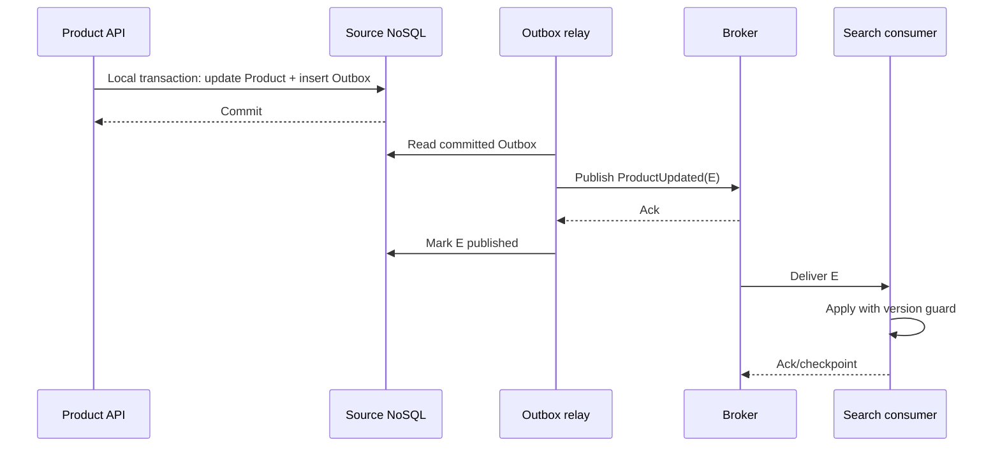

# Đồng bộ chỉ mục tìm kiếm, cache hoặc bảng đọc dẫn xuất

Trong một hệ NoSQL, dữ liệu chính thường được thiết kế để **ghi đúng và bảo vệ bất biến nghiệp vụ**, còn người dùng lại cần nhiều cách đọc khác nhau: tìm kiếm toàn văn, lọc sản phẩm theo thuộc tính, lấy danh sách đơn hàng theo khách, xem thống kê hoặc đọc một kết quả đã tổng hợp trong vài mili-giây.

Ta có thể xây các **bản đọc dẫn xuất** (*derived read models*) từ dữ liệu nguồn:

- **Chỉ mục tìm kiếm**: Elasticsearch/OpenSearch, MongoDB Search, hoặc một vector/full-text index chuyên dụng.
- **Cache**: Redis, local Java cache, CDN/edge cache.
- **Bảng/collection đọc dẫn xuất**: `orders_by_customer`, `product_catalog_view`, `sales_daily`, `inventory_public_view`, materialized projections.
- **Bản sao phục vụ hệ khác**: analytics, recommendation, notification preference hoặc reporting store.

Vấn đề là dữ liệu nguồn có thể đã commit nhưng chỉ mục/cache/bảng đọc chưa kịp cập nhật. Một event có thể bị gửi lặp, đến sai thứ tự, bị mất do retention, hoặc được xử lý thành công ngay trước khi worker chết. Khi thay schema, triển khai index mới hoặc xóa dữ liệu nhạy cảm, khó khăn còn lớn hơn.

**Change Data Capture (CDC)** và các **domain events** là hai con đường đưa thay đổi đã commit từ nguồn sang các bản đọc. Muốn đường này đáng tin, không chỉ cần “nghe event rồi update Redis”, mà phải thiết kế **hợp đồng event, checkpoint, idempotency, version guard, initial snapshot, replay, tombstone, backpressure, monitoring và reconciliation**.

Bài học thuộc chương **Sự kiện và CDC**, module **Database No SQL**. Mục tiêu là tự thiết kế và đánh giá một pipeline **source of truth → event stream → search/cache/read model**, đồng thời phân biệt rõ **đã ghi ở nguồn** với **đã hiển thị ở projection**.

> **Nguyên tắc cốt lõi:** dữ liệu dẫn xuất là **một bản chiếu có thể trễ và có thể xây lại** từ nguồn có thẩm quyền. Không được dùng thành công của việc publish event làm bằng chứng rằng bản đọc đã cập nhật, và không được dùng một bản đọc stale để quyết định bất biến giao dịch.

---

## 1. Vì sao phải có bản đọc dẫn xuất?

Một collection NoSQL phục vụ ghi đơn hàng có thể được thiết kế theo `orderId`:

```json
{
  "_id": "order-1001",
  "tenantId": "tenant-a",
  "customerId": "customer-42",
  "status": "PAID",
  "totalMinorUnits": 125000,
  "createdAt": "2026-11-14T08:00:00Z"
}
```

Đường ghi point-update theo `_id` nhanh và dễ bảo vệ CAS/transaction. Nhưng sản phẩm còn muốn:

1. Tìm đơn theo tên sản phẩm hoặc nội dung ghi chú.
2. Liệt kê 20 đơn mới nhất của một khách.
3. Xem tổng doanh thu theo ngày.
4. Hiển thị trạng thái đơn trên một bảng điều khiển nhiều người dùng.
5. Gợi ý sản phẩm liên quan.

Một schema/index duy nhất có thể không tối ưu cho mọi đường đọc; nhiều queries còn yêu cầu join/aggregation hoặc hệ tìm kiếm khác.

### 1.1. Các bản đọc được tổ chức theo access pattern

```text
              Orders / Products NoSQL
                   source of truth
                         |
                  committed change
                         |
                  event / CDC stream
                   /       |        \
                  v        v         v
             Search      Redis     Read tables
              index      cache      / views
                  \        |         /
                   \       |        /
                        APIs
```

Mỗi đích tối ưu cho một nhu cầu khác nhau. Đổi lại, ta phải chịu chi phí **nhân bản thông tin và đồng bộ cập nhật**.

### 1.2. Đừng gọi tất cả là “replica” theo cùng một nghĩa

Replica của database thường tham gia một giao thức replication có semantics cụ thể. Một search index hoặc Redis cache được cập nhật bất đồng bộ là **projection của ứng dụng**, không mặc nhiên tham gia quorum/transaction của database nguồn.

---

## 2. Nguồn sự thật và những bản chiếu

Một thiết kế cần nêu rõ **nguồn có thẩm quyền** (*source of truth*) cho từng dữ kiện.

| Dữ kiện | Nguồn có thẩm quyền thường gặp | Bản dẫn xuất có thể có |
| --- | --- | --- |
| Order được thanh toán chưa? | Orders/payment ledger/provider theo hợp đồng | Customer order list, dashboard |
| Tồn kho thật | Inventory authority | Product listing cache |
| Tên/mô tả sản phẩm | Product database | Search index, CDN, Redis |
| Quyền đọc tài liệu | Authorization/document source | Search filter/index, local cache |
| Số đơn trong ngày | Events/Orders source hoặc ledger | Daily reporting table |
| Embedding tài liệu | Nội dung canonical + model/version | Vector index |

Một bản dẫn xuất có thể là nguồn phục vụ **một API đọc cụ thể**, nhưng không có nghĩa nó được phép quyết định mọi thao tác nghiệp vụ.

### 2.1. Hợp đồng độ tươi

Một product search có thể chấp nhận trễ vài giây, còn thu hồi quyền đọc một tài liệu có thể yêu cầu hiệu lực tức thời tại lúc truy cập. Không đặt **một eventual consistency policy** cho mọi field.

### 2.2. Source availability khác projection availability

Search index có thể offline trong khi nguồn vẫn ghi đúng; ngược lại nguồn lỗi nhưng cache còn bản cũ. API phải xác định trả stale, pending, unavailable hay truy vấn source theo business contract.

---

## 3. Bốn cách đồng bộ thường gặp

| Cách | Nguồn tín hiệu | Ưu điểm | Giới hạn |
| --- | --- | --- | --- |
| **Dual write trực tiếp** | App ghi DB rồi gọi search/cache | Dễ bắt đầu | Có cửa sổ mất/thừa cập nhật |
| **Domain event + transactional outbox** | App commit state và outbox event cùng local transaction | Ghi ý nghĩa nghiệp vụ, tránh mất ý định khi commit | Relay có thể publish lặp |
| **CDC từ log/change stream** | Connector quan sát mutation đã commit | Giảm coupling với write code, theo dõi dữ liệu nguồn | Schema/raw changes, retention, resume, snapshot |
| **Periodic full rebuild/polling** | Truy vấn lại dữ liệu nguồn | Dễ đối soát, sửa lệch | Trễ và tốn scan; có thể bỏ sót thay đổi giữa snapshots nếu thiết kế sai |

Có thể kết hợp: **outbox + CDC relay + consumer**, hoặc **CDC trực tiếp + rebuild định kỳ để đối soát**.

### 3.1. Domain event khác raw database change

`OrderCancelledByCustomer` mang ý nghĩa nghiệp vụ; một CDC update như `status: PENDING → CANCELLED` không chắc biết nguyên nhân: khách hủy, quản trị hủy hay chống gian lận.

Nếu consumer cần **ngữ nghĩa nghiệp vụ**, dùng domain event được ghi bền cùng transaction có thể rõ hơn. Nếu chỉ cần đồng bộ trường dữ liệu, CDC có thể đủ.

---

## 4. Dual write: cửa sổ mất đồng bộ

Cách nguy hiểm:

```java
orderRepository.updateStatus(orderId, "PAID");
searchClient.updateOrder(orderId, "PAID");
```

Nếu ứng dụng crash giữa hai lệnh:

```text
Orders DB commit: PAID
           |
           X  process crash
           |
Search index vẫn: PENDING
```

Đảo thứ tự cũng có lỗi:

```text
Search index: PAID
           |
           X  DB write abort
           |
Orders DB vẫn: PENDING
```

Thêm try/catch hoặc majority write của Orders DB **không tạo atomicity xuyên hệ thống**.

### 4.1. Hai lệnh không tạo thành một transaction

Ngay cả khi search và Orders DB đều có replicas, chúng **không cùng commit protocol**. Một transaction chỉ bảo vệ những tài nguyên thực sự được enlist trong phạm vi được hỗ trợ.

### 4.2. Không thể suy từ HTTP ACK

`searchClient.update` trả thành công có thể chỉ có nghĩa engine đã chấp nhận write; lúc nào index mới searchable, replicas nào nhìn thấy và refresh interval ra sao là **hợp đồng riêng của đích**.

---

## 5. Transactional outbox: commit dữ liệu và ý định đồng bộ cùng nhau

**Transactional outbox** lưu sự kiện trong cùng giao dịch cục bộ với thay đổi nghiệp vụ:



**Bảo đảm chính**: trong phạm vi transaction được database hỗ trợ, một thay đổi nguồn đã commit có **ý định gửi event tương ứng** được lưu bền.

### 5.1. Vì sao event có thể được gửi lặp?

Relay có thể publish thành công rồi chết trước khi ghi `published=true`. Khi chạy lại, nó thấy event chưa hoàn tất và publish lần nữa.

Do đó outbox thường cho **at-least-once publication**, không tự cho exactly-once effect ở mọi đích.

### 5.2. Khi local transaction không có nhiều records

Một số NoSQL có thể update nguyên tử một document nhưng không hỗ trợ cùng kiểu multi-document transaction cho topology hiện tại. Có thể cân nhắc **nhúng pending events vào cùng aggregate update**, dùng log/CDC phù hợp hoặc giao thức khác. Phải chứng minh trạng thái và ý định nằm trong **một commit thực sự**.

### 5.3. Outbox event không cần chứa mọi PII

Event nên mang data tối thiểu cần thiết, ID và version. Không copy token, thẻ thanh toán hoặc toàn bộ profile nhạy cảm vào broker chỉ để consumer dễ viết.

---

## 6. CDC: đọc thay đổi đã commit thay vì tự publish

**Change Data Capture** thu nhận sự kiện từ thay đổi trong database nguồn.

Các dạng thường gặp:

- MongoDB change streams trên deployment được hỗ trợ.
- DynamoDB Streams với record về các mutation theo cấu hình.
- Cassandra CDC ở phiên bản/cấu hình có hỗ trợ, thường cần một pipeline xử lý log/commitlog.
- Relational database log-based CDC (để đối chiếu kiến trúc).
- Tích hợp connector chuyển changelog tới Kafka hoặc broker tương tự.

### 6.1. Những thông tin CDC thường cung cấp

Tùy engine và cấu hình:

- Loại mutation: insert, update, replace, delete.
- Namespace/bảng/collection.
- Khóa định danh document/item.
- Log position, offset hoặc resume token.
- Một số trường đã thay đổi.
- Before/after image nếu khả năng lưu trữ và API hỗ trợ.
- Transaction metadata, timestamp hoặc sequence.

**Không phải mọi hệ trả đầy đủ before/after image, một thứ tự toàn cục, hay khả năng replay vô hạn.**

### 6.2. CDC là nguồn dữ liệu, không tự là công cụ nghiệp vụ

Nếu order đổi `status` thành `PAID`, connector nhìn thấy mutation đó; nhưng nó có thể không biết payment đã được capture hay mới authorize. Consumer phải hiểu schema và domain contract.

### 6.3. CDC cũng cần resume và checkpoint

Nếu connector crash sau khi áp dụng event sang search nhưng chưa commit offset, event sẽ được replay. Cần idempotency/version guard ở sink như với broker.

---

## 7. Bản đồ pipeline: nhiều tầng có nhiều điểm ACK

```text
Source commit
    |
    v
CDC connector nhận change
    |
    v
Broker ghi message
    |
    v
Consumer nhận message
    |
    v
Search/Redis/read-model nhận update
    |
    v
Index searchable / cache visible
    |
    v
API thực sự đọc được bản mới
```

Mỗi mốc là một sự thật khác nhau:

1. **Committed source**: dữ liệu canonical có hiệu lực.
2. **Captured**: connector quan sát thay đổi.
3. **Published**: broker nhận event.
4. **Consumed**: worker nhận event.
5. **Applied**: sink xác nhận mutation bền theo contract.
6. **Visible**: query tìm kiếm/read thấy mutation, có thể trễ so với applied.
7. **Business-ready**: kết quả phù hợp quyền truy cập/freshness của API.

### 7.1. Gọi đúng tên metric

`time-to-publish` không bằng `time-to-search-visible`; `consumer lag=0` không chắc index đã refresh searchable.

### 7.2. Không trả “đã cập nhật chỉ mục” khi mới ghi event

Nếu khách yêu cầu “sửa sản phẩm rồi tìm ngay”, API phải dùng canonical read/minimum version/wait for index visibility theo contract, hoặc trả rõ trạng thái **indexing pending**.

---

## 8. Một event envelope đủ để replay và đối soát

Ví dụ event **mang trạng thái sau cập nhật**:

```json
{
  "eventId": "evt-product-001-v82",
  "eventType": "ProductUpserted",
  "schemaVersion": 2,
  "tenantId": "tenant-a",
  "aggregateType": "Product",
  "aggregateId": "sku-001",
  "aggregateRevision": 82,
  "occurredAt": "2026-11-14T08:00:00Z",
  "correlationId": "req-339",
  "payload": {
    "name": "Tai nghe không dây",
    "categoryId": "audio",
    "publicPriceMinorUnits": 125000,
    "isPublic": true
  }
}
```

### 8.1. Vai trò từng trường

| Trường | Vai trò |
| --- | --- |
| `eventId` | Dedupe một logical event |
| `eventType` | Consumer xác định upsert/delete và ngữ nghĩa |
| `schemaVersion` | Phân biệt phiên bản schema event |
| `tenantId` | Phạm vi dữ liệu và routing, phải được xác thực ở nguồn |
| `aggregateId` | Key của logical object cần projection |
| `aggregateRevision` | Chống event cũ ghi lùi theo cùng aggregate |
| `occurredAt` | Thời điểm mô tả/sự kiện, không luôn là thứ tự đáng tin |
| `correlationId` | Truy vết request/workflow |
| `payload` | Snapshot hoặc delta được định nghĩa rõ |

### 8.2. EventId không thay aggregateRevision

Cùng một event có thể được giao lại nhiều lần → `eventId` giúp dedupe.

Hai events khác nhau cho cùng một product có thể đến sai thứ tự → `aggregateRevision` giúp xác định event nào mới hơn khi version authority cấp đơn điệu.

### 8.3. Không tự dựng revision từ clock client

Nếu các node có clock lệch, `updatedAt` không đủ bảo đảm thứ tự. Với trạng thái cần last-write-wins theo nguồn, nên dùng revision/log sequence có authority và điều kiện write phù hợp.

### 8.4. Key phải có namespace

Trong multi-tenant, `sku-001` có thể tồn tại ở hai tenants. Sink key và version guard cần định nghĩa rõ `(tenantId, aggregateId)` hoặc ID toàn cục được bảo vệ.

---

## 9. Snapshot event và delta event

Có hai kiểu cập nhật dẫn xuất:

### 9.1. Full-state/snapshot event

```json
{
  "type": "ProductUpserted",
  "revision": 82,
  "payload": {
    "name": "Tai nghe A",
    "category": "audio",
    "isPublic": true
  }
}
```

Consumer có thể **replace projection** nếu revision mới hơn.

Ưu điểm: dễ idempotent theo version, dễ xử lý out-of-order khi bản chiếu chỉ cần trạng thái mới nhất.

Chi phí: payload lớn; event cũ có thể chứa PII; cần schema compatibility.

### 9.2. Delta event

```json
{
  "type": "ProductPriceChanged",
  "revision": 82,
  "payload": {
    "oldPriceMinorUnits": 130000,
    "newPriceMinorUnits": 125000
  }
}
```

Ưu điểm: nhỏ, rõ operation, hữu ích cho audit và aggregation.

Nhược điểm: nếu thiếu revision 81, áp revision 82 có thể không đủ để tái tạo đúng state. Consumer cần **gap detection, replay hoặc fetch canonical snapshot**.

### 9.3. Không tùy tiện trộn hai kiểu

Một event `OrderIncremented` cần phép cộng; một event `OrderSnapshot` cần replace. Nếu consumer coi cả hai như replace/upsert, dữ liệu dẫn xuất có thể sai dù không có exception.

---

## 10. Semantics giao nhận: at-most-once, at-least-once, exactly-once

| Mô hình | Ý nghĩa | Ảnh hưởng tới projection |
| --- | --- | --- |
| At-most-once | Không chắc thử lại khi mất ACK | Có thể thiếu cập nhật |
| At-least-once | Gửi lại khi chưa chắc đã xử lý | Có thể nhận cùng event nhiều lần |
| Exactly-once trong một phạm vi hỗ trợ | Producer/stream/state có protocol giảm/tránh xử lý trùng trong phạm vi ấy | Không tự bao trùm mọi Redis/search/HTTP side effect |

### 10.1. Vòng lỗi kinh điển

```text
Consumer nhận E82
      |
      v
Search upsert rev82 thành công
      |
      X  Worker crash trước ACK broker
      |
      v
Broker giao lại E82
```

Consumer phải có thể chạy lại E82 mà không làm dữ liệu sai.

### 10.2. Cách thực tế thường là at-least-once + idempotent sink

Dùng:

- Event ID dedupe.
- Revision guard khi thay snapshot.
- Transaction/conditional update ở sink nếu hỗ trợ.
- Replay và reconciliation.

Không cần tạo ảo tưởng rằng mạng sẽ chỉ giao đúng một lần.

---

## 11. Thứ tự event: theo key chứ không mặc định toàn cụm

Một product thay đổi:

```text
v80 -> v81 -> v82 -> v83
```

Nếu broker có nhiều partitions, workers xử lý song song hoặc retries độc lập, sink có thể nhận:

```text
v80, v82, v81, v83
```

### 11.1. Chọn partition key

Với projection một product, broker key thường nên dựa vào:

```text
tenantId + ":" + productId
```

để các events của cùng aggregate có cơ hội giữ thứ tự trong **phạm vi partition và producer protocol**. Tuy nhiên reconnect, retries, cross-topic và nhiều producers vẫn cần xét ordering semantics riêng.

### 11.2. Không lẫn thứ tự nhận và thứ tự commit

`receivedAt` của consumer cho biết lúc message tới worker, không cho biết mutation nào xảy ra trước trong một database phân tán.

### 11.3. Có cần global ordering?

Phần lớn read projections chỉ cần thứ tự **trong một aggregate**. Global total order giữa mọi product có thể tạo bottleneck và không cần thiết.

---

## 12. Chặn update cũ ghi đè mới

Giả sử index đã chứa:

```json
{
  "productId": "sku-001",
  "sourceRevision": 83,
  "name": "Tai nghe đời mới"
}
```

Một event cũ E82 đến muộn:

```json
{
  "productId": "sku-001",
  "sourceRevision": 82,
  "name": "Tai nghe cũ"
}
```

Nếu worker ghi `name` vô điều kiện, search bị **downgrade**.

### 12.1. Quy tắc cho snapshot projection

```text
IF incomingRevision > storedSourceRevision:
    replace projected state
ELSE IF incomingRevision == storedSourceRevision:
    accept as duplicate only if same logical content/event
ELSE:
    ignore stale event
```

### 12.2. Guard phải thực thi tại sink

Một worker đọc `storedVersion=81`, thấy E82 mới hơn rồi định ghi, nhưng worker khác đã ghi E83. Nếu guard chỉ nằm ở **client-side check trước HTTP call**, E82 vẫn có thể ghi lùi sau E83.

Cần **atomic compare-and-set, external versioning, scripted update hoặc một cơ chế serialization thực sự** tại đích.

### 12.3. Revisions không tự tạo khi đọc CDC

Nếu source document không chứa revision hoặc stream không cung cấp thứ tự phù hợp, phải thiết kế **commit sequence/operation ordering** theo nguồn, không tự suy version từ process-local counter.

---

## 13. Java 17: projection idempotent theo revision

Ví dụ Java thuần sau mô tả **một in-memory projection** để hiểu version guard. Production cần database/search sink hỗ trợ guard **nguyên tử trên storage**, không chỉ trong map của một worker.

```java
import java.util.Objects;
import java.util.concurrent.ConcurrentHashMap;

public final class VersionedProjectionDemo {
    record Key(String tenantId, String productId) {}
    record Event(
        String eventId,
        Key key,
        long revision,
        boolean deleted,
        String title
    ) {}
    record State(
        long sourceRevision,
        boolean deleted,
        String title,
        String lastEventId
    ) {}

    private final ConcurrentHashMap<Key, State> view =
        new ConcurrentHashMap<>();

    public State apply(Event event) {
        Objects.requireNonNull(event);
        if (event.revision() <= 0) {
            throw new IllegalArgumentException(
                "Revision must be positive"
            );
        }

        return view.compute(event.key(), (key, current) -> {
            if (current != null
                    && current.sourceRevision() > event.revision()) {
                return current; // Event cũ.
            }
            if (current != null
                    && current.sourceRevision() == event.revision()) {
                if (!current.lastEventId().equals(event.eventId())) {
                    throw new IllegalStateException(
                        "Same revision, different event"
                    );
                }
                return current; // Giao lại cùng event.
            }

            return new State(
                event.revision(),
                event.deleted(),
                event.deleted() ? null : event.title(),
                event.eventId()
            );
        });
    }

    public static void main(String[] args) {
        var store = new VersionedProjectionDemo();
        var key = new Key("tenant-a", "sku-001");

        store.apply(new Event("e83", key, 83, false, "Mới"));
        store.apply(new Event("e82", key, 82, false, "Cũ"));
        store.apply(new Event("e83", key, 83, false, "Mới"));

        System.out.println(store.view.get(key));
        // sourceRevision=83, title=Mới.
    }
}
```

### 13.1. Ý nghĩa đúng

- Events cùng logical object được so bằng revision.
- Event cũ bị bỏ qua.
- Event lặp cùng ID không làm thay đổi state.
- Event cùng revision nhưng ID khác được coi là **vi phạm invariant của ví dụ**, cần điều tra.

### 13.2. Giới hạn

- `ConcurrentHashMap` không bền, không dùng làm projection production.
- Không có broker checkpoint.
- Không có xử lý gaps cho delta events.
- Không có TTL/ACL/index refresh.
- Một database có thể dùng composite version/epoch, không luôn chỉ là `long`.
- Nếu source cho phép nhiều concurrent branches, không được giả định một revision scalar tạo total order hợp lệ trước khi conflict resolution.

---

## 14. Deletes và tombstones: phần dễ sai nhất

Xóa một product ở nguồn phải khiến product **không còn xuất hiện** trong search/cache/read model theo policy. Nhưng delete event có thể tới trước một old upsert.

```text
T0: Product v15 tồn tại.
T1: ProductDeleted v16 được apply, index xóa.
T2: ProductUpserted v15 từ DLQ replay tới.
```

Nếu worker thấy target **không có document** và upsert v15 vô điều kiện, bản đã xóa bị **sống lại**.

### 14.1. Tombstone

Thay vì chỉ xóa metadata revision, lưu:

```json
{
  "tenantId": "tenant-a",
  "productId": "sku-001",
  "sourceRevision": 16,
  "deleted": true
}
```

Một event cũ v15 sẽ bị chặn bởi guard `sourceRevision=16`.

### 14.2. Xóa vật lý và chặn resurrection

Search index có thể cần xóa vật lý vì privacy/cost. Trong trường hợp đó, giữ **high-watermark/version ledger** tại nơi bền/authority khác hoặc bảo đảm replay horizon không vượt retention tombstone.

### 14.3. Tombstone retention

Nếu event từ sáu tháng trước vẫn có thể replay nhưng tombstone chỉ giữ 24 giờ, rủi ro resurrect còn. Chọn thời gian giữ tombstone và dedupe state **theo replay, backup/restore, DLQ và CDC retention**.

### 14.4. Delete event nên có ID và version

Một delete chỉ chứa `{"productId":"sku-001"}` khó so với các upserts sau này. Nên có `aggregateRevision`, tenant scope và delete reason/category khi cần.

### 14.5. Quyền và pháp lý

Delete có thể xuất phát từ yêu cầu quyền riêng tư; việc chậm xóa ở search/cache có thể không thể chấp nhận. Cần **suppression/denylist tại read path hoặc authoritative permission check** trong lúc index cleanup chưa xong.

---

## 15. Khi chỉ có delta event: xử lý gap

Giả sử consumer đã apply revision 20 của một counter, rồi nhận revision 22 nhưng chưa có revision 21.

Nếu event 22 là:

```json
{
  "type": "CounterIncremented",
  "delta": 1,
  "revision": 22
}
```

Áp 22 trước 21 có thể gây sai khi transaction sau phụ thuộc trạng thái trước hoặc khi event 21 bị mất hẳn.

### 15.1. Gap detection

```text
expectedRevision = storedRevision + 1

incomingRevision == expectedRevision -> apply
incomingRevision > expectedRevision  -> gap; buffer/replay/refetch
incomingRevision <= storedRevision  -> duplicate/stale
```

### 15.2. Snapshot replacement khác delta accumulation

Nếu event 22 mang **toàn bộ trạng thái sau commit**, có thể áp v22 trực tiếp theo version guard và bỏ v21 (với những projections chỉ cần latest state). Nếu event 22 là **delta**, không được bỏ v21 nếu nó có tác động cần tính.

### 15.3. Dedupe khi aggregate nhiều keys

Một bảng `sales_daily` cộng tiền từ nhiều orders không thể chỉ giữ `lastRevision` của **một order** rồi cộng tổng tùy ý. Cần dedupe **event ID/order transition ID** và atomic update tổng, hoặc recompute từ source.

---

## 16. Khởi tạo projection mới: snapshot + live stream

Một chỉ mục search mới ban đầu trống trong khi source có hàng triệu documents. Nếu chỉ nghe CDC từ thời điểm bây giờ, index **thiếu dữ liệu lịch sử**. Nếu chỉ quét toàn bộ source, index **bỏ sót cập nhật mới sau lúc quét**.

Cần quy trình **snapshot + streaming catch-up**.

### 16.1. Cửa sổ race nguy hiểm

```text
T0: Snapshot scanner đọc product P = revision 7
T1: Source commit P = revision 8
T2: CDC consumer bắt đầu từ "bây giờ"
T3: Scanner ghi P v7 vào search
```

Event v8 xảy ra trước khi CDC bắt đầu nên **không được đọc lại**. Index giữ v7 sai vô thời hạn.

### 16.2. Một chiến lược an toàn về ý tưởng

1. Thiết lập một **stream position/checkpoint** đủ sớm để không bỏ sót writes trong thời gian snapshot.
2. Quét snapshot dữ liệu nguồn theo cách nhất quán hoặc xác định được version/watermark.
3. Ghi các rows/docs từ snapshot với revision và guard.
4. Replay mọi changes từ checkpoint đã lưu.
5. Chỉ khi consumer đuổi kịp mốc/lag SLO, mới công bố projection có thể phục vụ.
6. Chuyển sang streaming liên tục.

### 16.3. Nguồn phải hỗ trợ handoff đúng

Không có một cách duy nhất cho mọi NoSQL. Việc lấy snapshot nhất quán cùng log offset có thể cần:

- Connector hỗ trợ initial snapshot + catch-up.
- Snapshot timestamp/log position được engine bảo đảm.
- Chạy stream trước khi scan và lưu đủ events để replay.
- Một giao thức phối hợp giữa snapshot và CDC có version guards.

**Chỉ lấy `Date.now()` làm offset không đủ**, nếu log position/visibility của engine không được liên kết với timestamp đó.

### 16.4. Retention phải đủ dài

Nếu snapshot mất 8 giờ nhưng CDC log chỉ giữ 3 giờ, connector có thể mất đoạn cần replay. Phải tăng retention, giảm thời gian snapshot, dùng partitioned snapshot hoặc chạy lại từ mốc an toàn.

---

## 17. Bootstrap không trùng, không thiếu: ba chiến lược

| Chiến lược | Ý tưởng | Điểm phải chứng minh |
| --- | --- | --- |
| **Connector native snapshot** | Connector tự phối hợp snapshot + log | Version support, consistency, offset, restart |
| **Stream-before-scan** | Bắt/log changes trước rồi quét source | Có thể replay/merge theo revision, không bỏ khoảng thời gian |
| **Rebuild từ immutable log** | Replay toàn event history để tái tạo | Log đủ dữ liệu, retention và schema evolution |

### 17.1. Trùng event không nguy hiểm bằng thiếu event nếu sink idempotent

Trong snapshot + replay, cùng một product có thể được apply hai lần. Có version guard thì trùng tương đối dễ xử lý. Một update **bị bỏ sót** thì không có tín hiệu tự chữa nếu không có reconciliation.

### 17.2. Source snapshots có thể không nguyên tử giữa partitions

Một scan trên nhiều shards trong nhiều phút có thể nhìn các thời điểm khác nhau. Phải có cách nhận diện revision per row và áp changes đúng, hoặc yêu cầu snapshot nhất quán theo khả năng engine.

### 17.3. Không chấp nhận service traffic quá sớm

Một index mới mới chứa 20% sản phẩm nhưng API đã chuyển toàn bộ search sang nó có thể làm phần lớn kết quả biến mất. Cần **coverage/watermark/lag gate** trước cutover.

---

## 18. CDC change events có đủ payload không?

Một CDC update có thể chỉ cho biết field nào thay đổi, ví dụ:

```json
{
  "operationType": "update",
  "documentKey": {"_id": "sku-001"},
  "updateDescription": {
    "updatedFields": {"price": 125000}
  }
}
```

Nếu search projection còn cần `title`, `category`, `isPublic`, chỉ một patch chưa chắc đủ khi consumer chưa có state cũ.

### 18.1. Ba lựa chọn

1. **Full-document events** từ outbox/source.
2. **Patch đúng thứ tự** nếu có baseline và gap handling.
3. **Fetch canonical document** theo ID khi xử lý event, với kiểm tra version/visibility.

### 18.2. Fetch latest không giống after-image tại thời điểm event

Nếu consumer nhận event revision 7 nhưng truy vấn nguồn lúc revision 9, fetch có thể trả **state revision 9**. Đây có thể ổn cho projection latest-state, nhưng không ổn nếu cần tái hiện từng chuyển trạng thái hay tạo số liệu audit.

### 18.3. Delete không fetch được after document

Khi record đã bị xóa, consumer cần event metadata/tombstone hoặc lookup ở event log. Không thể luôn query source để lấy document đã biến mất.

---

## 19. MongoDB change streams: một ví dụ thực hành

Ví dụ dùng `mongosh` trên **replica set hoặc sharded cluster hỗ trợ change streams**, trong một môi trường lab riêng.

```javascript
const lab = db.getSiblingDB("cdc_projection_lab");
const collection = lab.products;

const stream = collection.watch(
  [],
  {
    fullDocument: "updateLookup"
  }
);

while (stream.hasNext()) {
  const change = stream.next();

  printjson({
    resumeToken: change._id,
    operationType: change.operationType,
    documentKey: change.documentKey,
    fullDocument: change.fullDocument,
    updateDescription: change.updateDescription
  });

  // Đây chỉ là consumer minh họa, chưa ghi sang sink.
  // Ứng dụng thật phải persist checkpoint theo API phù hợp.
}
```

### 19.1. Thử thay đổi từ một session khác

```javascript
const lab = db.getSiblingDB("cdc_projection_lab");

lab.products.insertOne({
  _id: "sku-001",
  tenantId: "tenant-a",
  revision: 1,
  title: "Tai nghe A"
});

lab.products.updateOne(
  { _id: "sku-001", revision: 1 },
  {
    $set: { title: "Tai nghe B" },
    $inc: { revision: 1 }
  }
);

lab.products.deleteOne({ _id: "sku-001" });
```

### 19.2. Giới hạn của ví dụ

- `watch()` là stream lâu dài; không chạy trên terminal production không có lifecycle/cancellation.
- `updateLookup` có thể nhìn **phiên bản hiện tại ở thời điểm lookup**, không nhất thiết là after-image của đúng mutation event.
- Resume token có semantics và thời hạn sử dụng gắn với oplog/change stream history; phải quản lý restart/retention.
- Một sự kiện delete thường không có current `fullDocument` để dùng như upsert.
- Nếu worker crash, cần resume từ token đã **lưu bền sau khi sink apply**.
- `operationType` và payload có thể khác theo loại change và phiên bản engine.
- Không nên suy toàn bộ collection scan và change stream tự tạo snapshot/stream handoff an toàn nếu chưa có protocol.

### 19.3. Tách observability và business effect

Dòng `printjson()` chỉ chứng minh stream client **nhìn thấy thay đổi**, không chứng minh search/cache/read table đã cập nhật.

---

## 20. MongoDB outbox: một transaction nguồn và event

Ví dụ tiếp theo giả định product đã tồn tại với `revision: 7`. MongoDB deployment phải hỗ trợ multi-document transactions.

```javascript
const session = db.getMongo().startSession();
const sdb = session.getDatabase("cdc_projection_lab");

try {
  session.startTransaction({
    readConcern: { level: "snapshot" },
    writeConcern: { w: "majority" }
  });

  const updated = sdb.products.updateOne(
    {
      _id: "sku-001",
      revision: 7
    },
    {
      $set: {
        title: "Tai nghe A phiên bản mới"
      },
      $inc: { revision: 1 }
    }
  );

  if (updated.matchedCount !== 1) {
    throw new Error("Version conflict");
  }

  sdb.outbox.insertOne({
    _id: "product-sku-001-rev8",
    eventType: "ProductUpdated",
    aggregateId: "sku-001",
    aggregateRevision: 8,
    status: "READY",
    createdAt: new Date(),
    payload: {
      title: "Tai nghe A phiên bản mới"
    }
  });

  session.commitTransaction();
  print("Committed product + outbox");
} catch (error) {
  // Demo rút gọn: production xử lý lỗi transaction/commit
  // với nhãn TransientTransactionError và
  // UnknownTransactionCommitResult theo hướng dẫn driver.
  print(error.message);
  try { session.abortTransaction(); } catch (_) {}
} finally {
  session.endSession();
}
```

### 20.1. Điều phải đảm bảo thêm

- Source document có `revision:7` và event ID chưa tồn tại.
- Idempotency ở API để retry request sau unknown commit không tạo update logic mới.
- Publisher/CDC relay chỉ đọc committed outbox records.
- Event schema/version nhất quán với mutation.
- Đích có guard chống event cũ và xử lý deletion.
- Không tự hiểu transaction commit timeout là thất bại chắc chắn.

### 20.2. Nếu source version được cấp trong nhiều writers

Phải bảo đảm `revision` tăng bằng **atomic conditional update** hoặc giao thức writer authority. Nếu hai writers tự tính `newRevision = oldRevision + 1` từ stale read rồi ghi vô điều kiện, event version không còn là bằng chứng đáng tin.

---

## 21. Đồng bộ chỉ mục tìm kiếm: projection nào cần cho search?

Một product document nguồn:

```json
{
  "_id": "sku-001",
  "tenantId": "tenant-a",
  "name": "Tai nghe không dây",
  "description": "Khử ồn, pin lâu",
  "categoryId": "audio",
  "status": "ACTIVE",
  "priceMinorUnits": 125000,
  "revision": 82
}
```

Một search document dẫn xuất:

```json
{
  "id": "tenant-a|sku-001",
  "tenantId": "tenant-a",
  "displayName": "Tai nghe không dây",
  "searchText": "Tai nghe không dây Khử ồn pin lâu",
  "categoryId": "audio",
  "isVisible": true,
  "sourceRevision": 82
}
```

Search document có thể **phi chuẩn hóa**, chỉ mang những fields cần filter/rank/hiển thị. Nó không nhất thiết lưu toàn bộ source record.

### 21.1. Projection code phải ổn định

Event cùng payload/schema/version nên tạo cùng search representation. Tránh mapping phụ thuộc dữ liệu ngoài không có version, thời gian hiện tại tùy ý hoặc random trong quá trình replay.

### 21.2. Search schema có thể thay đổi

Khi đổi analyzer, field mapping, tokenizer hoặc embedding model, có thể cần **reindex** chứ không chỉ apply event mới.

### 21.3. Bản ghi search không là authority cho giá và tồn kho

Search có thể hiển thị thông tin tham khảo; checkout phải xác minh **giá/tồn kho/phân quyền** tại nguồn thích hợp. Một search hit tốt không phải bằng chứng tài nguyên còn khả dụng.

---

## 22. Search index: upsert, delete và visibility

Các thao tác sink thường là:

```text
ProductUpserted -> Index/Upsert document by stable ID
ProductDeleted  -> Delete/Suppress document by stable ID
```

### 22.1. Chỉ mục có một độ trễ riêng

Một search engine có thể nhận write nhưng chưa mở snapshot/index segment mới cho truy vấn ngay lập tức. Phải phân biệt:

- Write ACK.
- Durable index state theo API.
- Search refresh/visibility.
- Replication/snapshot consistency.

### 22.2. Dùng versioning tại sink nếu được hỗ trợ

Một số search engines có cơ chế external versioning hoặc conditional updates. Khi dùng, version phải do source cấp và update/delete phải có semantics phù hợp. **Không ghép một `if sourceRevision > storedRevision` ở ứng dụng rồi gọi index không điều kiện** nếu có nhiều consumers.

### 22.3. Cẩn thận với delete rồi event cũ

Nếu đích xóa record và mất version ledger, old upsert có thể tạo lại document. Xem tombstone và retention để không resurrect.

### 22.4. Tìm kiếm có thể dùng prefilter và hậu kiểm quyền

Khi search index trễ quyền truy cập, cần thiết kế **authoritative authorization** trước khi trả dữ liệu nhạy cảm, không chỉ dựa vào ACL field chưa được cập nhật trong index.

---

## 23. Vector index và embedding được cập nhật bất đồng bộ

Nếu một sản phẩm/ghi chú có embeddings, pipeline có thêm bước:

```text
Canonical content update
       |
       v
Event (contentRevision = 82)
       |
       v
Embedding worker
       |
       v
Model M creates vector
       |
       v
Index vector with sourceRevision=82 and modelVersion=M
```

### 23.1. Job cũ có thể xong sau job mới

```text
W82 đang embed revision 82.
W83 embed revision 83 xong trước.
W82 xong muộn và cố ghi đè W83.
```

Guard phải so `contentRevision` và `embeddingModelVersion` theo đúng **index generation**. Không để vector của nội dung cũ thay nội dung mới.

### 23.2. Model version là chiều khác revision

Đổi model từ M1 sang M2 không đồng nghĩa content thay đổi. Có thể duy trì hai vector indexes song song trong giai đoạn migration.

### 23.3. Similarity score không là version

Cosine/dot/L2 chỉ dùng ranking, không xác định event nào mới hơn. Để đồng bộ embeddings, phải dùng source revision/operation ID, không so similarity giữa vectors để chọn version.

### 23.4. Delete và privacy

Xóa tài liệu phải xóa/suppress cả vector embedding và cached search results. Embedding không tự là dữ liệu vô hại hay không nhạy cảm.

---

## 24. Đồng bộ cache: invalidate hay cập nhật giá trị?

Hai kiểu thường gặp:

**Invalidate-on-change:**

```text
ProductUpdated v82
       |
       v
DEL cache product:sku-001
       |
       v
Next read -> fetch source -> repopulate
```

**Update-on-change:**

```text
ProductUpdated v82
       |
       v
SET cache product:sku-001 = projected v82
```

### 24.1. Invalidation đơn giản nhưng có race

```text
T0: Reader cache miss, đang fetch source rev81.
T1: Source commit rev82.
T2: Invalidation v82 xóa cache.
T3: Reader T0 ghi rev81 vào cache.
```

Cache bị **điền lại bằng dữ liệu cũ sau khi invalidate**.

### 24.2. Update-on-change cũng có race

Nếu update v83 đến trước v82, bản cũ có thể ghi lùi. Cần revision guard.

### 24.3. TTL là tuyến phòng thủ bổ sung

Dù event invalidation bị mất, TTL/hard-expiry có thể giới hạn thời gian cache cũ tồn tại theo policy. Tuy nhiên TTL không chứng minh freshness đầu-cuối nếu load từ một replica vốn đã cũ hoặc refresh bị kẹt.

### 24.4. Lựa chọn theo loại dữ liệu

| Loại dữ liệu | Cách đồng bộ thường cân nhắc |
| --- | --- |
| Product catalog công khai | Update/invalidate + TTL/SWR |
| Recommendation feed | Rebuild định kỳ + event delta |
| Session/user profile | Scope theo user/tenant, TTL và version |
| Authorization/ACL | Authoritative gate hoặc invalidation chặt; fail closed khi cần |
| Inventory availability | Cache hiển thị, authority conditional write khi xác nhận |
| Payment status | Không dựa cache stale để thu thêm tiền |

---

## 25. Redis: cập nhật cache có version guard nguyên tử

Giả sử mỗi logical key được lưu dưới dạng Redis hash có `sourceRevision` và `payload`. Có thể dùng Lua để so và set **trên một key tại một Redis server**, theo khả năng của phiên bản Redis.

```lua
-- KEYS[1] = cache hash key
-- ARGV[1] = revision được nguồn cấp
-- ARGV[2] = serialized projected payload
-- ARGV[3] = TTL seconds
local rev = tonumber(ARGV[1])
local ttl = tonumber(ARGV[3])

if rev == nil or rev < 1 or ttl == nil or ttl < 1 then
    return redis.error_reply("invalid revision or ttl")
end

local current = redis.call("HGET", KEYS[1], "sourceRevision")

if current ~= false and tonumber(current) >= rev then
    return 0  -- duplicate/stale; không ghi lùi
end

redis.call(
    "HSET", KEYS[1],
    "sourceRevision", ARGV[1],
    "payload", ARGV[2]
)
redis.call("EXPIRE", KEYS[1], ttl)
return 1
```

### 25.1. Lợi ích và giới hạn

- Check revision và update cùng một key được thực thi nguyên tử theo script semantics.
- Không tự làm toàn bộ nhiều Redis Cluster shards cập nhật nguyên tử.
- Có thể bỏ event đến muộn với revision thấp.
- `>=` coi cùng revision là duplicate; ứng dụng cần kiểm tra conflict nếu **hai payload khác nhau cùng revision** là tình huống có thể xảy ra.
- Nếu key hết TTL, revision guard biến mất; event cũ được replay vẫn có thể ghi một bản cũ. Muốn chặn hoàn toàn, cần high-watermark/tombstone bền hoặc nguồn/retention contract phù hợp.
- `tonumber` trên Lua có giới hạn biểu diễn số nguyên chính xác ở những biên lớn; production cần quy định revision type/overflow rõ.

### 25.2. Xóa cache cũng phải có logic

`DEL key` không giữ lại revision delete. Nếu old upsert replay, dữ liệu bị tạo lại. Có thể lưu `deleted=1` và revision như tombstone với TTL phù hợp, hoặc dùng ledger ngoài cache.

### 25.3. Tenant key

Key nên bao gồm tenant/role scope nếu payload khác nhau theo quyền:

```text
catalog:tenant-a:product:sku-001
```

Giá trị tenant phải đến từ context đã xác thực; chỉ mã hóa ID không tạo authorization.

---

## 26. Bảng đọc dẫn xuất: vì sao không chỉ dùng search/cache?

Một *read table* hoặc *materialized projection* lưu dữ liệu được bố trí riêng cho một access pattern.

Ví dụ nguồn `orders` keyed theo `orderId`. API cần:

```text
GET /customers/{customerId}/orders?sort=newest
```

Có thể xây:

```text
orders_by_customer
partition key: (tenantId, customerId)
sort key: createdAt DESC, orderId
value: status, amount, display fields, sourceRevision
```

### 26.1. Lợi ích

- Truy vấn một customer có thể định tuyến đúng partition.
- Không cần scan toàn orders.
- Response có thể được phi chuẩn hóa theo UI.
- Có thể tách tải đọc khỏi nguồn ghi.

### 26.2. Giá phải trả

- Event upsert/delete phải duy trì read rows.
- Nếu `customerId` đổi, phải xóa row cũ và tạo row mới.
- Nếu sort key (`createdAt`) đổi, phải di chuyển record.
- Dedupe/ordering phải xét nhiều row/index keys.
- Read table có eventual lag và schema migration riêng.

### 26.3. Định nghĩa nguồn của mỗi field

Đừng đưa dữ liệu từ nhiều service vào một bảng mà không nêu rõ mỗi field đến từ authority nào và cập nhật/đối soát ra sao.

---

## 27. Một order thay đổi khóa của read model

Giả sử đơn hàng chuyển từ customer A sang customer B do gộp tài khoản.

Nguồn:

```text
order-1001:
  oldCustomer = customer-A
  newCustomer = customer-B
  revision = 10
```

Nếu consumer chỉ **upsert row cho B**, bảng `orders_by_customer` vẫn có row cũ cho A. Một record xuất hiện ở hai danh sách.

### 27.1. Event cần old key hoặc khả năng tra cứu nó

Có thể dùng:

```json
{
  "eventType": "OrderCustomerChanged",
  "orderId": "order-1001",
  "revision": 10,
  "oldCustomerId": "customer-A",
  "newCustomerId": "customer-B"
}
```

Consumer có thể:

1. Delete/suppress row cũ ở A.
2. Upsert row mới ở B.
3. Persist progress/idempotency.
4. Đối soát để phát hiện row mồ côi.

### 27.2. Hai đích có thể không commit cùng nhau

Nếu A/B nằm ở các partitions khác nhau, delete + insert có thể thất bại một phần. Cần local transaction nếu engine hỗ trợ, hoặc state machine/repair/replay.

### 27.3. Không chỉ relying on latest read

Nếu consumer lookup source ở revision 12, field oldCustomer của revision 10 có thể đã biến mất. Bản ghi change phải cung cấp đủ dữ liệu để xóa key cũ, hoặc index phụ ánh xạ hiện tại.

---

## 28. Bảng tổng hợp: delta events cần chống đếm lặp

Ví dụ bảng `daily_sales`:

```text
(tenantId, saleDate) -> totalMinorUnits
```

Khi nhận `OrderPaid(order-1001, amount=125000)`, consumer cộng tiền.

Nếu event được giao hai lần:

```text
total = total + 125000
total = total + 125000
```

bảng bị đếm hai lần.

### 28.1. Dedupe theo contribution ID

Trong một local transaction phù hợp:

```text
IF contributionId=order-1001-paid-v1 chưa ghi nhận:
    INSERT contribution ledger
    INCREMENT daily total
COMMIT
```

Không chỉ dựa vào “eventId đã thấy trong RAM” vì worker crash sẽ mất thông tin.

### 28.2. Payment thay đổi trạng thái không đơn giản là cộng

Nếu order từ `PENDING` → `PAID` → `REFUNDED`, daily sales policy cần định nghĩa **gross vs net**, refund date hay original sale date và audit. Không dùng một generic `+amount` cho mọi event.

### 28.3. Recompute có thể an toàn hơn delta

Với bảng tổng hợp quan trọng, có thể xây từ một **contribution table** bền hoặc ledger events, rồi định kỳ recompute để đối soát, thay vì chỉ cộng trực tiếp vào một counter duy nhất.

---

## 29. Khi projection cần kết hợp nhiều nguồn

Ví dụ `product_catalog_view` chứa:

- Product description từ Product Service.
- Giá theo tenant từ Pricing Service.
- Hình ảnh từ Media Service.
- Tồn kho hiển thị từ Inventory Service.

Mỗi nguồn có **độ trễ và revision riêng**.

### 29.1. Không có một version scalar tự nhiên cho mọi nguồn

Có thể lưu watermark theo source:

```json
{
  "productId": "sku-001",
  "productRevision": 82,
  "priceRevision": 15,
  "inventoryRevision": 301,
  "mediaRevision": 7
}
```

Một trường `viewRevision=99` do consumer tự tăng không chứng minh mọi source đã bắt kịp.

### 29.2. Causal dependencies

Nếu price event tham chiếu product variant chưa xuất hiện trong projection, consumer có thể cần buffer/refetch hoặc xử lý missing dependency. Đừng mặc định events từ hai topics có global ordering.

### 29.3. Invariant vẫn ở authority

Read model có thể hiển thị `available=true` dựa trên inventory mới nhất đã nhận; checkout vẫn cần atomic reservation/conditional write ở Inventory Service.

### 29.4. Thiết kế SLO theo từng trường

Có thể chấp nhận description trễ 30 giây nhưng không chấp nhận hiển thị nội dung đã bị cấm do policy revocation. Field-level semantics giúp quyết định fallback và suppress.

---

## 30. Consumer checkpoint: khi nào được ACK?

Một consumer xử lý event E và muốn lưu vị trí đã đọc:

```text
Read E
  |
  v
Apply E to sink
  |
  v
Persist/checkpoint offset for E
```

### 30.1. ACK trước khi sink bền là nguy hiểm

```text
Broker ACK E
   |
   X worker crash
   |
Sink chưa apply E
```

Broker có thể không giao lại E, gây **mất update**.

### 30.2. Sink trước, ACK sau tạo duplicate có kiểm soát

```text
Sink apply E thành công
   |
   X worker crash
   |
Broker giao lại E
```

Dedupe/version guard tại sink làm replay an toàn.

### 30.3. Offset cũng có commit semantics

Một số systems hỗ trợ transaction giữa consumer offsets và state nội bộ của chính stream framework. Nhưng không được suy Kafka offset commit làm cho một HTTP call tới Redis/search tự nguyên tử.

### 30.4. Partial batch

Nếu xử lý batch 100 events và event thứ 40 lỗi, không được checkpoint qua 100 nếu các events 40–100 chưa được áp dụng an toàn. Chính sách retry/skip/DLQ phải bảo toàn nghĩa vụ cập nhật từng key.

---

## 31. Một flow consumer thực tế

```text
Poll events
     |
     v
Validate schema/tenant/version
     |
     v
Check event id, aggregate revision
     |
     v
Build deterministic projection
     |
     v
Apply sink conditionally
     |
     +--> SUCCESS / ALREADY_APPLIED
     |            |
     |            v
     |        checkpoint
     |
     +--> RETRYABLE_FAILURE
     |            |
     |            v
     |        backoff / retry
     |
     +--> PERMANENT_INVALID_EVENT
                  |
                  v
           quarantine / alert
```

### 31.1. Validation phải bảo vệ schema

Một consumer nhận event có `schemaVersion=999` không nên âm thầm bỏ field lạ rồi checkpoint như thành công. Cần transform hỗ trợ hoặc quarantine, tùy policy.

### 31.2. Quarantine không phải đã đồng bộ

Nếu event quan trọng vào DLQ, hệ phải có alert và kế hoạch replay/repair. Không công bố projection healthy chỉ vì main queue đã empty.

### 31.3. Idempotent side effects

Nếu consumer vừa update search vừa gửi email, hai effects có đường retry khác nhau. Nên tách consumers hoặc bền hóa lệnh tiếp theo; không giả định một ACK bao trùm mọi sink.

---

## 32. Event filtering và ảnh hưởng của dữ liệu không cần index

Không phải mutation nào cũng cần đưa sang mọi đích.

Ví dụ:

```text
ProductViewed -> Analytics
ProductNameChanged -> Search index, catalog cache
InventoryReserved -> Inventory read model
InternalAuditUpdated -> Audit store
```

### 32.1. Filter ở publisher hay consumer?

- **Publisher/outbox:** có thể chỉ phát domain events quan trọng.
- **CDC connector:** có thể lọc namespace/table/operation trong khả năng hỗ trợ.
- **Consumer:** quyết định projection cụ thể cần fields nào.

### 32.2. Tránh mất dependency

Nếu `ProductUpdated` đổi `isPublic=false`, search consumer phải biết để suppress dù chỉ đọc tên/mô tả. Một filter “chỉ index khi name thay đổi” có thể bỏ sót thay đổi quyền hiển thị.

### 32.3. Không dựa vào partial updates mù

Khi chỉ một field đổi nhưng projection dùng nhiều fields, cần tính dependency graph của projection. Một thay đổi ở category label có thể đòi update hàng nghìn product documents trong search.

---

## 33. Schema evolution: producer cũ và consumer mới

Event streams có thể được replay nhiều tháng sau. Trong thời gian đó schema đã đổi.

### 33.1. Ví dụ schema

**V1:**

```json
{
  "eventType": "ProductUpdated",
  "schemaVersion": 1,
  "payload": {
    "price": 125000
  }
}
```

**V2:**

```json
{
  "eventType": "ProductUpdated",
  "schemaVersion": 2,
  "payload": {
    "priceMinorUnits": 125000,
    "currency": "VND"
  }
}
```

### 33.2. Consumer cần version-aware decode

Một cách:

```text
decode(event):
  case schemaVersion == 1:
      migrate V1 -> internal canonical event
  case schemaVersion == 2:
      decode V2
  else:
      quarantine with alert
```

### 33.3. Tương thích không chỉ là thêm field tùy chọn

Đổi nghĩa `price` từ đồng sang cent, thay enum status, đổi ID hoặc timestamp units có thể làm projection sai dù JSON vẫn parse được.

### 33.4. Rebuild phải đọc được lịch sử

Khi xây lại index từ log cũ, consumer mới phải hiểu các schema versions được giữ lại hoặc có job chuyển đổi/recompute từ canonical source.

### 33.5. Schema registry hữu ích nhưng không đủ

Registry giúp kiểm soát định dạng/tương thích; **semantic evolution** vẫn cần hợp đồng nghiệp vụ và tests.

---

## 34. Reindex: thay index generation mà không gián đoạn truy vấn

Khi đổi analyzer, mapping, model embeddings hoặc fields, thường nên xây một index **thế hệ mới** thay vì sửa trực tiếp index đang phục vụ.

```text
Source DB
   |
   +----> Index products_v1 (đang phục vụ)
   |
   +----> Index products_v2 (snapshot + catch-up)
                         |
                         v
                 readiness validation
                         |
                         v
                   Switch alias
```

### 34.1. Quy trình blue/green

1. Tạo `products_v2` với schema/index settings mới.
2. Lấy checkpoint/stream position an toàn.
3. Backfill dữ liệu nguồn vào v2.
4. Replay changes từ checkpoint tới v2.
5. Tiếp tục consume live changes.
6. Kiểm chứng coverage/count/field correctness, recall/ranking nếu search.
7. Đợi lag/visibility đạt readiness SLO.
8. Chuyển read alias/router sang v2.
9. Giữ v1 để rollback trong một cửa sổ xác định.
10. Dọn v1 khi v2 ổn định và rollback window kết thúc.

### 34.2. Alias switch không thay CDC coordination

Một alias switch có thể diễn ra nhanh ở search engine, nhưng nếu v2 mới bắt đầu nhận changes **sau** thời điểm chuyển, vẫn có gap. Consumer v2 cần đuổi kịp và tiếp tục không bỏ event.

### 34.3. Reindex không làm mọi query cùng kết quả

Tokenizer/ranking/model mới có thể thay đổi search results ngay cả khi dữ liệu đầy đủ. Cần quality/AB/canary đánh giá riêng ngoài dữ liệu correctness.

### 34.4. Rollback cần xem write schema compatibility

Nếu producer đã chuyển sang event schema mà consumer v1 không hiểu, bật lại v1 không đơn giản. Cần dual-write events hoặc compatibility window khi thiết kế migration.

---

## 35. Backfill có thể quá tải nguồn

Quét hàng triệu documents và đồng thời consume CDC có thể làm:

- NoSQL CPU/IO cao.
- Replication lag tăng.
- Query p99 của foreground traffic xấu đi.
- CDC retention không đủ vì tốc độ replay thấp.
- Search index write queue đầy.
- S3/object storage hoặc network egress tăng.

### 35.1. Giới hạn tải

- Phân batch theo partition/key range.
- Đọc theo snapshot/scan semantics phù hợp.
- Rate limit theo shard/tenant.
- Tách worker pool backfill và live updates.
- Ưu tiên foreground writes và không làm cạn DB pool.
- Theo dõi checkpoint lag và capacity headroom.

### 35.2. Live-stream và backfill phải xử lý race

Backfill ghi v7 sau khi live CDC đã ghi v8 là một tình huống bình thường. **Version guard tại sink** phải ngăn v7 ghi lùi.

### 35.3. Không chia batch bằng offset không ổn định

Nếu dataset thay đổi trong lúc phân trang, `skip/offset` có thể bỏ/đọc trùng records. Chọn keyset/range scan hoặc snapshot API phù hợp; duplicate có thể xử lý, missing records thì nguy hiểm hơn.

---

## 36. Retention, replay và dead-letter queues

Một pipeline cần biết:

```text
CDC log retention = ?
Broker retention = ?
Outbox retention = ?
Inbox/dedupe retention = ?
Tombstone retention = ?
Backup/rebuild horizon = ?
Max offline consumer duration = ?
```

### 36.1. Ràng buộc quan trọng

Nếu consumer có thể offline 48 giờ nhưng changelog chỉ giữ 24 giờ, resume có thể thất bại. Cần **cơ chế phát hiện gap và full rebuild/resnapshot**.

### 36.2. Replay từ sớm hơn dự kiến

Một worker đọc lại event v10 sau khi sink ở v25 phải không làm state lùi. Với delete v20, tombstone/ledger cần còn để chặn v10 resurrect.

### 36.3. DLQ phải có owner

Một event vào DLQ cần:

- Error class và event ID.
- Schema/version.
- Số attempts.
- Correlation/tenant scope.
- Thời gian lỗi.
- Quy trình sửa/replay và bảo đảm thứ tự khi quay lại.

Không để người vận hành “bấm replay tất cả” làm vỡ invariant do events cũ hoặc expired idempotency state.

### 36.4. Reconciliation là lớp an toàn cuối

Ngay cả khi pipeline có ACK và retry tốt, vẫn có thể xảy ra bug mapping, schema migration, missing event hoặc sai dữ liệu nguồn. Nên có **job so sánh periodic** source và projection.

---

## 37. Reconciliation: phát hiện và sửa lệch có kiểm soát

Một job có thể:

1. Quét một tập source records theo partition/time window.
2. Đọc projection theo stable ID.
3. So `sourceRevision`, hash fields cần projection hoặc watermark.
4. Nếu target thiếu/cũ/sai schema, ghi **repair event** hoặc rebuild row.
5. Kiểm tra tombstones/obsolete rows không còn ở source.
6. Ghi báo cáo mismatch và độ trễ khắc phục.

### 37.1. Không chỉ so row count

Hai index đều có 100.000 documents nhưng một bên thiếu 2.000 keys và thừa 2.000 keys khác vẫn có cùng count.

### 37.2. Không chỉ so revision

Nếu consumer mapping bug tạo sai `displayPrice` nhưng gắn đúng `sourceRevision`, revision bằng nhau không chứng minh payload đúng. Có thể dùng **projection hash** được tính từ input canonical/transform version.

### 37.3. Một lỗi permanent cần sửa code trước replay

Nếu mapper V2 sai currency units, replay lại cùng code sẽ tiếp tục sai. Reconciliation không thay việc sửa transform/schema contract.

### 37.4. Kiểm tra chi phí

Đối soát toàn bảng mỗi phút có thể quá tải NoSQL. Có thể sampling, phân vùng, incremental checksums, daily full scan hoặc controlled backfill, tùy SLO và chi phí.

---

## 38. Chỉ mục tìm kiếm và quyền truy cập: khi eventual là không đủ

Một document được đổi từ `PUBLIC` sang `PRIVATE` ở source revision 10. Search index vẫn ở revision 9 và hiển thị document cho người không có quyền.

Nếu API trả snippet đầy đủ từ search mà không kiểm tra quyền, có thể rò dữ liệu.

### 38.1. Phân quyền tại điểm trả kết quả

Có thể chọn:

- Authoritative ACL check cho từng candidate trước khi trả sensitive data.
- Deny/suppression list cập nhật nhanh theo đường khác.
- Chỉ index nội dung đã được phép công khai trong collection tách biệt.
- Fail-closed khi chưa thể xác minh permission.

### 38.2. Search filter không luôn đủ

Filter `isPublic=true` trong index chỉ tốt bằng **độ mới của index**. Với yêu cầu thu hồi quyền ngay, phải có một guard không lệ thuộc vào stale projection.

### 38.3. Multi-tenant

`tenantId` phải nằm trong query scope, sink key và read authorization. Một event thiếu/sai tenant scope có thể đưa document vào index của tenant khác; cần validation/authorization ở producer và consumer.

### 38.4. Delete thực sự có nhiều nơi

Nguồn NoSQL, cache, search index, vector index, logs và backup có retention khác nhau. Quy trình xóa phải nêu **phạm vi và thời gian hoàn tất**, không chỉ publish `DocumentDeleted`.

---

## 39. Dữ liệu thay đổi liên tục và coalescing events

Với product rất nóng:

```text
price v100
price v101
price v102
price v103
...
```

Nếu projection chỉ cần **trạng thái hiện tại** và events là full snapshots, có thể bỏ qua các trạng thái trung gian đã bị thay thế trong một số điều kiện.

### 39.1. Khi coalescing hợp lệ

Một search document latest-state có thể được cập nhật thẳng tới v103 nếu v103 chứa đủ trạng thái và sink guard chặn downgrade.

### 39.2. Khi coalescing không hợp lệ

- Ledger/payment audit cần mọi giao dịch.
- Counter deltas phải được cộng/dedupe chính xác.
- Email/notification side effects có thể yêu cầu từng event.
- Workflow transition có invariants theo thứ tự.

Không gộp các domain events chỉ vì cùng `aggregateId` nếu ý nghĩa của chúng không được phép bỏ.

### 39.3. Update storms

Với một key được update hàng nghìn lần/s, index refresh mỗi lần có thể tốn kém. Có thể dùng batching/coalescing/watermark theo latency SLO, giữ latest-state đúng trong giới hạn cho phép.

---

## 40. Backpressure, retry và circuit breaker ở consumer

Khi search cluster quá tải, consumer vẫn tiếp tục nhận và gửi batch ồ ạt có thể khiến cả pipeline mất ổn định.

### 40.1. Cơ chế bảo vệ

- Bounded in-flight requests.
- Batch size thích hợp.
- Retry với exponential backoff và jitter.
- Circuit breaker cho sink bị lỗi.
- Rate limits theo tenant/partition.
- Pause/slow consumption khi backlog tăng.
- Priority cho deletes/security changes nếu kiến trúc yêu cầu.
- DLQ/quarantine cho schema errors.

### 40.2. Không ACK sớm chỉ để giảm lag hiển thị

Một dashboard broker lag đẹp vì đã checkpoint events chưa apply không nghĩa projection khỏe. Phải đo **sink-applied/visible lag** riêng.

### 40.3. Không retry mọi lỗi

- Invalid schema/payload: quarantine.
- Version conflict expected: skip theo guard và ghi metric.
- Sink 429/503: backoff, retry.
- Auth failure của connector: alert và dừng có kiểm soát.
- Missing index/mapping: sửa cấu hình rồi replay.
- Unknown sink write outcome: lookup/conditional retry, không phỏng đoán.

### 40.4. Poison event và thứ tự

Nếu một event liên tục lỗi nhưng những events sau vẫn đi tiếp, cần biết có được skip theo key hay không. Với delta/order-dependent projection, skip có thể làm trạng thái sai. Với full snapshot, có thể áp bản mới hơn và quarantine bản cũ theo policy.

---

## 41. Observability: đo đầu-cuối từ commit tới visible

| Chỉ số | Phát hiện điều gì? |
| --- | --- |
| Source write rate | Tốc độ mutations |
| CDC capture lag | Khoảng cách source commit → connector |
| Outbox pending count/age | Events chưa publish |
| Broker backlog/consumer lag | Consumer theo kịp nguồn không |
| Sink apply latency/error rate | Search/cache/read table có nhận writes? |
| Search visibility lag | Khi nào query thực sự thấy bản mới |
| Cache stale hit rate | Bao nhiêu reads dùng dữ liệu cũ |
| Source-to-visible p50/p95/p99 | SLO độ tươi đầu-cuối |
| Version downgrade rejects | Tần suất event cũ đến muộn |
| Duplicate event rate | Redelivery/replay |
| Gap detection count | Nguy cơ thiếu events |
| Tombstone/resurrection rejects | Delete được bảo vệ? |
| Reconciliation mismatch count | Projection sai với nguồn |
| DLQ size/oldest age | Nghĩa vụ sửa lỗi đang chờ |
| Snapshot coverage/completion | Index mới đã đầy đủ chưa? |
| Index generation adoption | Có clients còn đọc generation cũ? |
| ACL/deletion propagation lag | Rủi ro bảo mật |
| Per-tenant throttling | Tenant lớn có chiếm pipeline không? |

### 41.1. Độ trễ phải có định nghĩa

Có thể đo:

\[
L_{\mathrm{visible}}
=
t_{\mathrm{query\ visible}}
-
t_{\mathrm{source\ commit}}.
\]

Nhưng hai mốc phải được đo/truyền theo một cơ chế timestamp/watermark đáng tin; đồng hồ các hệ lệch có thể gây sai số. Một cách khác là theo dõi **source offset được consumer/index xác nhận** và time-to-observe bằng probe kiểm chứng.

### 41.2. Không đánh đồng event age và version lag

Một event xảy ra 1 phút trước nhưng xử lý trong 100 ms có age khác pipeline lag; cần chọn metric đúng.

### 41.3. SLO có thể khác theo projection

- Catalog search: chấp nhận độ trễ đã công bố.
- Product recommendation: có thể trễ lâu hơn.
- Admin read-your-writes: cần min revision/read source.
- Permission revocation: cần phản ứng chặt hơn và authoritative gate.

Đặt mục tiêu theo business harm, không chọn một con số duy nhất cho toàn cluster.

---

## 42. Kiểm thử lỗi: ép cửa sổ crash và event đảo thứ tự

| Tình huống thử | Điều phải xác minh |
| --- | --- |
| Crash sau source commit trước publish | Outbox/CDC còn thay đổi để phát |
| Publish rồi crash trước mark SENT | Event có thể lặp; sink idempotent |
| Sink apply xong nhưng trước offset commit | Replay không làm dữ liệu sai |
| v12 đến trước v11 | Không downgrade snapshot state |
| Delete v13 rồi replay upsert v12 | Không resurrect data |
| Event delta v15 khi thiếu v14 | Detect gap/replay hoặc refetch |
| Backfill v8 hoàn tất sau CDC v9 | Không ghi lùi |
| CDC connector offline lâu hơn retention | Phát hiện unrecoverable gap, resnapshot |
| Sink trả 429/503 | Backoff, không retry storm |
| Event schema mới consumer chưa biết | Quarantine/alert, không ACK như applied |
| Permission revoke khi search lag | Không lộ document |
| Tenant ID sai trong event | Validate scope, không route chéo |
| Reindex v2 chỉ 50% coverage | Không chuyển read alias quá sớm |
| Offset commit thất bại | Replay an toàn, không bỏ update |
| Duplicate `OrderPaid` | Daily total không cộng hai lần |
| Customer ID đổi | Old read row được remove, new row xuất hiện |
| Cache invalidation rồi stale refill | Version/TTL/protocol chặn hoặc sửa |
| Embedding rev8 job xong sau rev9 | Search không bị ghi lùi |
| Cache/search primary failover | Target vẫn xử lý replay và consistency |
| DLQ replay sau tombstone TTL | Không resurrect hoặc có repair protocol |

### 42.1. Kiểm tra ở nơi người dùng đọc

Không chỉ assert broker nhận event. Phải query search API, Redis cache hoặc read table để xác minh dữ liệu thực sự visible và đúng quyền/freshness.

### 42.2. Kiểm thử nhiều tenants và revisions

Cần tạo hai tenants có cùng `productId`, đồng thời update/delete/snapshot/replay để phát hiện collision hoặc thiếu ACL.

---

## 43. Một runbook khi search/cache/read model bị lệch

### Giai đoạn A — Xác định phạm vi

1. Xác định source có đúng chưa.
2. Xác định đích nào sai: search, Redis, read table hay nhiều đích.
3. Kiểm tra thời điểm/aggregate revision kỳ vọng.
4. Đọc CDC/outbox/broker checkpoint theo công cụ vận hành.
5. Xác định gap, duplicate, out-of-order, transform bug hay index refresh lag.
6. Kiểm tra quyền truy cập/deletes có rủi ro cao không.

### Giai đoạn B — Giảm thiệt hại

7. Với sensitive data, bật authoritative gate/suppression, không chờ eventual sync.
8. Tránh tiếp tục ghi lùi bằng cách chặn consumer lỗi hoặc bật version guard.
9. Giới hạn retry/traffic tới sink đang quá tải.
10. Ghi incident correlation IDs, không đưa secrets/PII vào logs.

### Giai đoạn C — Khôi phục dữ liệu

11. Nếu log còn đủ, replay từ checkpoint an toàn với idempotent consumer.
12. Nếu gap vượt retention, resnapshot/rebuild theo protocol.
13. Nếu mapping bug, sửa transform trước khi replay.
14. Với delete, kiểm tra tombstones và stale-index resurrection.
15. Đối soát sample/full range có kiểm soát theo source revision và payload hash.
16. Chờ index refresh/readiness trước khi chuyển traffic.

### Giai đoạn D — Phòng ngừa tái diễn

17. Bổ sung metric source-to-visible lag.
18. Điều chỉnh retention/snapshot time và DLQ ownership.
19. Test crash windows và schema migration.
20. Kiểm tra các index generations/clients còn cũ.
21. Ghi rõ SLO và business fallback cho từng projection.
22. Có lịch reconciliation định kỳ và audit kết quả.

---

## 44. Những sai lầm thường gặp

### 44.1. “Ghi DB rồi cập nhật Redis ở dòng kế tiếp là đủ”

Không. Có crash window giữa hai lệnh. Outbox/CDC giúp lưu ý định/thay đổi đã commit.

### 44.2. “Đã publish event tức là search đã cập nhật”

Không. Broker ACK, consumer apply và query visibility là những mốc khác nhau.

### 44.3. “Outbox đảm bảo một event chỉ tới một lần”

Không. Relay crash sau publish có thể làm event lặp.

### 44.4. “Chỉ lưu offset vào RAM rồi restart là tiếp tục đúng”

Không. Checkpoint cần bền và đồng bộ với sink apply semantics.

### 44.5. “Commit offset trước sink write để tránh duplicate”

Có thể làm mất cập nhật nếu worker crash.

### 44.6. “Tìm thấy document trong source nghĩa là nó đã searchable”

Không. Search có refresh/indexing lag.

### 44.7. “Một `updatedAt` từ client đủ sắp thứ tự mọi writes”

Không chắc. Clock skew và concurrent writers làm sai ordering.

### 44.8. “Version guard ở Java trước HTTP call đủ chống race”

Không. Hai workers vẫn có thể gửi writes sai thứ tự; guard cần ở sink hoặc protocol serialization phù hợp.

### 44.9. “Delete là `DEL` rồi không cần lưu gì nữa”

Event cũ có thể resurrect dữ liệu. Cần tombstone/high-watermark và retention phù hợp.

### 44.10. “Có thể xóa tombstone bất kỳ lúc nào”

Không nếu replay/DLQ/backup cũ còn có thể đưa upsert cũ trở lại.

### 44.11. “Snapshot toàn bảng rồi bắt CDC từ bây giờ”

Có thể bỏ các mutations xảy ra trong lúc scan. Cần snapshot/stream handoff an toàn.

### 44.12. “Snapshot connector nào cũng nguyên tử trên mọi shard”

Không mặc nhiên. Phải hiểu snapshot/offset semantics của engine/connector.

### 44.13. “Log có retention ngắn vẫn replay mọi lúc”

Không. Gap vượt retention cần resnapshot hoặc nguồn log bền khác.

### 44.14. “Delta event có thể bỏ qua version bị thiếu”

Không nếu delta mang effect cộng/trừ hoặc phụ thuộc lịch sử.

### 44.15. “Read table đổi customer chỉ cần insert row mới”

Cần remove row cũ để tránh một order xuất hiện ở hai customers.

### 44.16. “Một bảng tổng cộng tiền cứ `+amount` mỗi event”

Redelivery có thể double-count. Cần contribution ledger/dedupe nguyên tử.

### 44.17. “Search filter `isPublic` đủ cho revocation tức thời”

Không nếu index stale. Cần guard quyền tại điểm đọc hoặc suppression nhanh.

### 44.18. “Cache TTL là linearizability”

Không. TTL chỉ là cơ chế tuổi và có thể không đo được freshness thật của nguồn.

### 44.19. “Index mới chứa một nửa dữ liệu có thể switch alias”

Có nguy cơ mất kết quả hiển thị. Cần coverage và catch-up gate.

### 44.20. “Backfill có thể chạy unlimited concurrency”

Có thể làm nguồn ghi và search cluster nghẽn, khiến CDC lag vượt retention.

### 44.21. “Schema event chỉ cần parse được JSON”

Thay đổi nghĩa field/units vẫn có thể làm sai số liệu.

### 44.22. “Embedding model version là cùng một thứ với content revision”

Không. Hai chiều thay đổi độc lập; migration có thể cần index generation riêng.

### 44.23. “DLQ rỗng là chắc chắn pipeline đúng”

Có thể có bug transformation hoặc events bị skip rồi checkpoint. Cần reconciliation và test.

### 44.24. “Metrics broker lag=0 chứng minh search fresh”

Không. Apply, refresh visibility, permission và source-watermark là các mốc khác.

### 44.25. “Replica/source quorum làm cache/search có cùng transaction”

Không. Đây là các bản dẫn xuất ngoài transaction nguồn.

---

## 45. Bài tập thực hành

### Bài 1 — Xác định source và projections

Một hệ đặt xe có `Bookings DB`, Redis availability cache, search xe theo vị trí và bảng `bookings_by_customer`.

**Hỏi:** Dữ kiện nào phải được xác minh tại nguồn khi khách xác nhận đặt xe?

**Gợi ý:** Quyền giữ chỗ và bất biến không double-booking; không tin availability cache stale.

### Bài 2 — Dual write

Orders DB commit thành công rồi process crash trước cập nhật search.

**Hỏi:** Có thể sửa bằng cơ chế gì?

**Gợi ý:** Outbox hoặc CDC từ mutation đã commit, consumer idempotent.

### Bài 3 — Outbox lặp

Relay publish E rồi crash trước mark sent.

**Hỏi:** Consumer phải xử lý sao?

**Gợi ý:** Stable eventId, version guard và safe replay.

### Bài 4 — Visibility

Broker lag bằng 0 nhưng search chưa thấy document.

**Hỏi:** Tại sao?

**Gợi ý:** Search apply/refresh visibility lag hoặc sai mapping/index alias.

### Bài 5 — Event envelope

Hãy nêu tối thiểu sáu fields cần cho event `ProductUpdated`.

**Gợi ý:** eventId, tenantId, productId, type, schemaVersion, aggregateRevision, payload, correlationId.

### Bài 6 — Snapshot vs delta

Một event có `delta=+1`, một event mang `total=200`.

**Hỏi:** Loại nào có thể áp latest revision mà bỏ qua intermediate versions trong projection trạng thái hiện tại?

**Gợi ý:** Full-state total, nếu đáp ứng điều kiện phiên bản và business semantics.

### Bài 7 — Đảo thứ tự

Sink đã ở v9, event v8 đến muộn.

**Hỏi:** Guard nào cần?

**Gợi ý:** Apply only if incoming revision > stored source revision, nguyên tử tại sink.

### Bài 8 — Tombstone

Delete v10 đã được áp nhưng upsert v9 replay tới.

**Hỏi:** Nếu delete xóa hết mọi metadata, rủi ro gì?

**Gợi ý:** Resurrection. Giữ tombstone/version ledger đủ retention.

### Bài 9 — Snapshot race

Full scan bắt đầu lúc T0, product update lúc T1, CDC chỉ subscribe lúc T2.

**Hỏi:** Điều gì có thể mất?

**Gợi ý:** Mutation giữa scan và subscribe; cần stream-before-scan/native handoff.

### Bài 10 — CDC retention

Snapshot mất 6 giờ, stream log chỉ giữ 2 giờ.

**Hỏi:** Có thể đảm bảo catch-up từ đầu scan không?

**Gợi ý:** Không; điều chỉnh retention, snapshot plan hoặc kiến trúc capture.

### Bài 11 — Update lookup

Change event MongoDB v7 được xử lý sau khi nguồn lên v9.

**Hỏi:** `fullDocument` lookup có thể trả phiên bản nào và ảnh hưởng gì?

**Gợi ý:** Có thể là state mới hơn v7; dùng source revision đúng, không giả snapshot là after-image đúng event.

### Bài 12 — Cache race

Reader tải v5, writer commit v6 rồi invalidate, reader điền cache v5 sau invalidate.

**Hỏi:** Cần phương án gì?

**Gợi ý:** Versioned writes/CAS, source min version, TTL, ordering protocol.

### Bài 13 — Redis TTL

Cache key có version v6 rồi hết TTL, event v4 được replay.

**Hỏi:** Redis Lua guard chỉ kiểm tra version trong key có đủ không?

**Gợi ý:** Không khi key mất; cần durable high-watermark/tombstone hoặc replay policy.

### Bài 14 — Customer read table

Order chuyển customer A sang B.

**Hỏi:** Consumer phải làm gì với row A?

**Gợi ý:** Delete/suppress old row; event cần old key hoặc durable mapping.

### Bài 15 — Daily sales

Broker gửi lặp `OrderPaid` với amount 125000.

**Hỏi:** Làm sao tránh cộng hai lần?

**Gợi ý:** Contribution/event ledger và aggregate update trong cùng local atomic boundary.

### Bài 16 — Schema evolution

V1 dùng `price` theo đồng, V2 dùng `priceMinorUnits` theo đơn vị nhỏ nhất.

**Hỏi:** Parser JSON hợp lệ đã đủ không?

**Gợi ý:** Không; cần transform đúng units và schemaVersion.

### Bài 17 — Reindex

Muốn đổi full-text analyzer mà không downtime.

**Hỏi:** Những bước nào phải diễn ra trước switch alias?

**Gợi ý:** Create v2, snapshot, stream catch-up, validate coverage/schema/visibility.

### Bài 18 — Search ACL

Source đổi document thành private nhưng search vẫn public.

**Hỏi:** Tại điểm trả kết quả nên làm gì?

**Gợi ý:** Authoritative ACL check/suppression, không chỉ tin index.

### Bài 19 — Embedding jobs

W12 hoàn tất sau W13.

**Hỏi:** Điều kiện nào ngăn embedding cũ ghi lùi?

**Gợi ý:** Content revision/model version và atomic sink guard.

### Bài 20 — ACK order

Consumer ACK event rồi mới update DynamoDB read table, sau đó crash.

**Hỏi:** Rủi ro gì?

**Gợi ý:** Mất event, source và read table lệch vĩnh viễn nếu không reconciliation.

### Bài 21 — Replay

Một consumer bị offline lâu hơn broker retention.

**Hỏi:** Có nên tự resume bằng offset gần nhất còn tồn tại và coi dữ liệu đầy đủ?

**Gợi ý:** Không; phát hiện gap và resnapshot/rebuild.

### Bài 22 — Multi-source projection

Một product view tổng hợp product v8, pricing v4 và inventory v51.

**Hỏi:** Có dùng một `viewRevision=52` để chứng minh tất cả nguồn đều mới không?

**Gợi ý:** Không; giữ watermark/revisions theo source hoặc consistency contract rõ.

### Bài 23 — Hot partition

Một `daily_sales` counter bị cập nhật 100.000 lần/s.

**Hỏi:** Event-driven read table có thể tạo hot write key không?

**Gợi ý:** Có; cần phân vùng contribution, aggregation buckets hoặc batch updates theo invariant.

### Bài 24 — Metrics

Nêu bốn metrics phân biệt source commit, CDC capture, consumer apply và search visibility.

**Gợi ý:** Capture lag, broker lag, apply lag, source-to-visible latency và mismatch count.

### Bài 25 — Reconciliation

Row count source và search bằng nhau nhưng kết quả search vẫn sai.

**Hỏi:** Cần so thêm gì?

**Gợi ý:** Key coverage, source revision, payload/projection hash, permissions, deletes.

### Bài 26 — Fault injection

Kill worker ngay sau khi Redis `HSET` thành công nhưng trước broker ACK.

**Hỏi:** Điều gì phải đúng sau restart?

**Gợi ý:** Event có thể replay; cache vẫn đúng revision, không phát sinh lỗi hoặc downgrade.

### Bài 27 — Thiết kế cuối khóa

Một ứng dụng Java có MongoDB làm nguồn, Redis cache, OpenSearch index và `orders_by_customer` trong DynamoDB. Hãy thiết kế:

1. Source-of-truth ownership và business invariants.
2. Outbox/CDC strategy.
3. Event envelope với revision, IDs, schemaVersion và tombstone.
4. Bootstrap snapshot + stream handoff.
5. Sink-specific idempotency/version guard.
6. Search visibility/ACL gate.
7. Cache invalidation vs update-on-event và TTL.
8. Customer read table khi key thay đổi.
9. Checkpoint/ACK/DLQ/replay.
10. Blue/green reindex.
11. Source-to-visible SLO và metrics.
12. Reconciliation/repair jobs.
13. Kiểm thử fault windows và security.
14. Kế hoạch xử lý CDC log retention gap.

**Gợi ý:** Một luồng “DB change → broker → consumers” chỉ là sơ đồ truyền dữ liệu; thiết kế đúng cần thêm **failure semantics và khả năng xây lại tất cả projections**.

---

## 46. Checklist triển khai đồng bộ bản đọc dẫn xuất

### A. Nguồn và hợp đồng dữ liệu

1. Xác định **source of truth** của từng field.
2. Chỉ rõ API nào đọc source và API nào được đọc projection.
3. Viết freshness SLO, read-your-writes/minimum revision và ACL policy.
4. Định nghĩa event snapshot hay delta, ID và ordering domain.
5. Chọn source revision/log sequence được cấp có thẩm quyền.
6. Tách domain events và raw CDC mutation theo nhu cầu semantic.
7. Có event schema version và quy tắc tương thích.

### B. Thu nhận thay đổi

8. Tránh dual write không có protocol.
9. Dùng transactional outbox khi cần commit ý định cùng business state.
10. Với CDC, hiểu snapshot, log position, resume token và retention.
11. Thiết kế snapshot/stream handoff không có gap.
12. Tính đủ log retention cho thời gian backfill/recovery.
13. Giám sát outbox/connector lag và lỗi capture.

### C. Consumer và sink

14. Hỗ trợ at-least-once delivery, duplicates và out-of-order.
15. Đặt idempotency/version guard **tại nơi dữ liệu đích được commit**.
16. Với delta events, phát hiện missing revisions và xử lý gap.
17. Với tổng hợp, dedupe contributions atomically.
18. Với read table key changes, xóa key cũ và tạo key mới.
19. Xử lý delete/tombstone và chặn replay resurrection.
20. Checkpoint/ACK sau sink apply đủ bền.
21. Có retry/backoff, bounded concurrency và DLQ ownership.
22. Quản lý TTL/invalidation/versioned cache fill races.
23. Theo dõi index visibility sau write ACK.

### D. Schema, migration, bảo mật

24. Định nghĩa source-to-sink schema transform rõ.
25. Rebuild/reindex qua generation mới và catch-up gate.
26. Kiểm tra model/index version khi xử lý embeddings.
27. Scope tenant/ACL tại event, sink key và read API.
28. Có authoritative permission/suppression khi revocation không thể chờ index.
29. Có delete propagation/retention policy cho dữ liệu nhạy cảm.
30. Không log raw PII/secrets trong outbox/tracing.

### E. Vận hành và kiểm chứng

31. Đo source commit → captured → applied → visible.
32. Theo dõi backlog age, tombstone rejects, gap detection, DLQ.
33. Reconcile key/revision/payload, không chỉ so số dòng.
34. Test crash sau sink apply trước offset commit.
35. Test snapshot race, replay after delete, old event và hot key.
36. Test multi-tenant leakage và ACL updates.
37. Kiểm thử connector offline vượt retention.
38. Có runbook resnapshot, repair, reindex và cutover rollback.
39. Điều chỉnh worker/batch/concurrency dựa trên SLO và tải nguồn.
40. Không coi event sent, broker lag=0 hay source quorum là bằng chứng projection đã đúng.

### Bảng lựa chọn nhanh

| Bài toán | Cơ chế ưu tiên | Cảnh báo |
| --- | --- | --- |
| Nguồn commit nhưng search không cập nhật | Outbox/CDC | Có thể publish lặp |
| Khởi tạo index từ hàng triệu records | Snapshot + CDC catch-up | Không bắt CDC quá muộn |
| Event cũ đến sau event mới | Source revision + sink CAS/version | Guard ở client không đủ |
| Delete rồi replay old upsert | Tombstone/high-watermark | Retention phải đủ |
| Cache invalidation bị race | Versioned fill/update, TTL, event order | TTL không là linearizability |
| Search có index refresh lag | Visible watermark/refresh policy | Write ACK không bằng searchable |
| Tổng doanh thu bị cộng hai lần | Dedupe contribution ledger + atomic aggregate | Không chỉ skip bằng RAM set |
| Read table đổi partition/sort key | Delete old row + upsert new row | Partial failure cần repair |
| Event schema đổi | Version-aware decode/migration | Parse được JSON chưa đủ |
| Reindex không downtime | Blue/green generation + snapshot/stream | Validate coverage trước cutover |
| Permission bị thu hồi | Authoritative gate/suppress | Stale index có thể rò dữ liệu |
| Connector vượt log retention | Detect gap + resnapshot | Không resume lặng lẽ |
| Projection nhiều nguồn | Watermark/version theo từng source | Không suy global revision |
| Worker crash sau sink write | Replay idempotently, ACK sau apply | At-least-once là bình thường |
| Sink overload | Backpressure, retry budget, DLQ | Đừng checkpoint như thành công |
| Không chắc projection đúng | Reconciliation + targeted repair | Row count bằng nhau chưa đủ |

**Kết luận:** Đồng bộ **search index, cache và bảng đọc dẫn xuất** là một bài toán **duy trì trạng thái nhất quán có kiểm soát qua nhiều ranh giới hệ thống**, không chỉ là gửi message. Outbox/CDC giúp đưa thay đổi đã commit vào luồng, nhưng hệ đáng tin còn cần **snapshot + stream handoff**, event envelope có identity/version, **idempotent consumers**, guard chống stale writes, **tombstones**, checkpoint đúng sau sink apply, quản lý schema/reindex, bảo vệ ACL, giới hạn tải và **reconciliation**. Mỗi bản đọc phải có **source-of-truth, freshness và failure contract** rõ. Chỉ khi có thể xây lại, replay và chứng minh độ tươi/độ đúng ở chính nơi người dùng đọc, projection mới là một thành phần bền vững của kiến trúc NoSQL.
