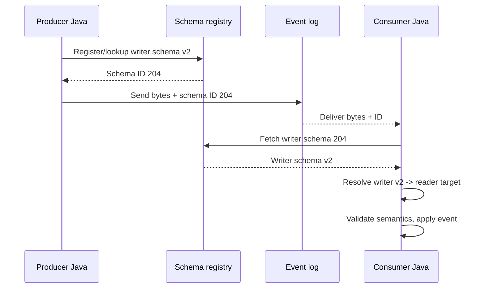
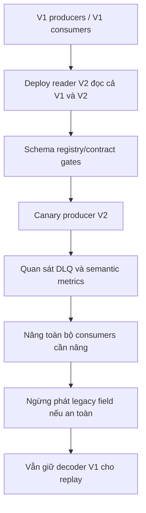

# Schema evolution trong sự kiện và khả năng đọc dữ liệu cũ

## 1. Một event lưu từ năm trước có thể làm ứng dụng mới ngừng chạy

Giả sử hệ thống quản lý đơn hàng dùng NoSQL để lưu trạng thái hiện tại và một event stream phục vụ tìm kiếm, báo cáo và các ứng dụng đọc. Năm đầu tiên, service phát:

```json
{
  "eventType": "OrderPlaced",
  "schemaVersion": 1,
  "eventId": "evt-100",
  "orderId": "O42",
  "customerId": "U9",
  "total": 125000
}
```

Trong năm tiếp theo, ứng dụng thêm tiền tệ, thay tên trường giá và chuyển thông tin thành một object:

```json
{
  "eventType": "OrderPlaced",
  "schemaVersion": 2,
  "eventId": "evt-100",
  "orderId": "O42",
  "customerId": "U9",
  "totalMinor": 125000,
  "currency": "VND"
}
```

Một consumer v2 có thể đọc được event mới, và mọi bài kiểm thử với event mới đều xanh. Nhưng khi đội dữ liệu **xây lại báo cáo từ event log cũ**, event v1 vẫn mang trường `total`. Nếu deserializer v2 đòi `totalMinor` mà không có đường tương thích, nó có thể:

- Ném exception và làm dừng cả partition của consumer.
- Âm thầm gán `totalMinor=0`, báo cáo doanh thu sai.
- Bỏ qua event, tạo lỗ hổng dữ liệu lịch sử.
- Đọc dữ liệu sai đơn vị (đồng so với xu, cent hoặc minor units).
- Đẩy vào dead-letter queue mà không có quy trình replay.
- Tạo ra trạng thái ứng dụng không thể tái dựng sau khi reset read model.

**Vấn đề không nằm ở Java có parse được JSON hay không.** Vấn đề là: trong suốt vòng đời hệ phân tán, những producers, consumers, messages và dữ liệu được lưu lâu dài có thể sử dụng **nhiều hợp đồng dữ liệu khác nhau cùng một lúc**.

Bài học thuộc chương **Sự kiện và CDC** trong module **Database No SQL**. Mục tiêu là làm chủ cách thay đổi schema mà vẫn đọc được **event cũ, CDC record cũ và dữ liệu lịch sử**, đồng thời không làm thay đổi âm thầm ý nghĩa nghiệp vụ.

> **Nguyên tắc trung tâm:** Event đã được chấp nhận và lưu lâu dài là một phần của giao diện công khai theo thời gian. Khi nâng cấp schema, hãy thiết kế cả **người ghi mới**, **người đọc cũ**, **người đọc mới** và **khả năng phát lại lịch sử** — không chỉ mẫu JSON mới nhất.

### Mục tiêu học tập

Sau bài học, bạn có thể:

1. Phân biệt **event schema**, **database record schema**, **CDC envelope**, **wire format** và **business semantics**.
2. Giải thích backward, forward, full compatibility và compatibility transitive.
3. Thiết kế quy tắc thêm/xóa/đổi tên/đổi kiểu fields có thể triển khai an toàn.
4. Đánh giá khác biệt của JSON Schema, Avro và Protocol Buffers.
5. Hiểu vai trò schema registry, schema ID, subject và validation tại producer/consumer.
6. Viết Java consumer có **versioned decoder/upcaster** để đọc event v1, v2 và phiên bản mới.
7. Phân biệt đổi schema trong serialization với đổi **ý nghĩa nghiệp vụ**.
8. Xử lý unknown fields, null/missing/default, enum, số tiền, thời gian và precision.
9. Xây quy trình rolling upgrade khi producers và consumers không đổi phiên bản cùng lúc.
10. Giữ đúng compatibility khi backfill, replay, rebuild projection hoặc restore từ backup.
11. Đánh giá CDC record schema, before/after images, delete events và tombstones.
12. Thực hiện contract tests, compatibility gates, shadow consumers và migration metrics.
13. Biết khi nào cần event type mới thay vì cố sửa một event cũ.
14. Nhận diện giới hạn của retention, privacy deletion và quyền đọc dữ liệu lịch sử.

## 2. Bốn loại “schema” thường bị trộn lẫn

Trong một hệ NoSQL có event integration, ít nhất bốn cấu trúc có thể khác nhau.

| Loại | Chức năng | Ví dụ |
|---|---|---|
| **Schema bản ghi nguồn** | Cách lưu document/item/row trong database | `orders` có `totalMinor`, `status`, `revision` |
| **Schema domain event** | Hợp đồng ý nghĩa sự kiện nghiệp vụ | `OrderPlaced`, `PaymentCaptured` |
| **Schema CDC record** | Hình thức connector mô tả thay đổi DB | `before`, `after`, `op`, `source`, `ts_ms` |
| **Schema projection/read model** | Cách consumer lưu dữ liệu đã biến đổi | `orders_by_customer`, search index, daily reports |

Một thay đổi ở source record **không nhất thiết** yêu cầu đổi domain event. Ngược lại, một thay đổi ý nghĩa event có thể xảy ra dù database vẫn lưu cùng các trường.

### 2.1. Source schema thay đổi nhưng event contract có thể ổn định

Ví dụ repository chuyển từ:

```json
{ "total": 125000 }
```

sang:

```json
{ "money": { "minor": 125000, "currency": "VND" } }
```

Nếu service tiếp tục phát `OrderPlaced` theo event contract đã công bố, consumer không cần biết cách tổ chức document trong NoSQL thay đổi.

Đây là lợi ích của việc **không để consumer phụ thuộc trực tiếp vào database storage model** khi không cần.

### 2.2. CDC không phải domain event

Một CDC connector có thể phát:

```json
{
  "op": "u",
  "before": { "status": "PENDING" },
  "after": { "status": "CONFIRMED" },
  "source": { "collection": "orders" }
}
```

Trong khi domain event tương ứng có thể là:

```json
{
  "eventType": "OrderConfirmed",
  "orderId": "O42",
  "confirmationId": "C100"
}
```

Một transaction có thể sửa nhiều documents nhưng biểu diễn một business intent. Do đó **một CDC record không tự tương đương một domain event**, và việc thay đổi CDC envelope/connector config cũng khác với thay đổi business-event schema.

### 2.3. Projection schema còn có version riêng

Search index v2 có thể đổi field `price` sang `priceMinor`, trong khi events vẫn ổn định. Schema migration ở consumer target cần được quản lý độc lập: backfill, reindex, compatibility, rollback và read routing.

### 2.4. Version của schema không phải revision của aggregate

```json
{
  "schemaVersion": 3,
  "aggregateVersion": 71,
  "eventId": "evt-100"
}
```

- `schemaVersion=3`: hình thức/contract của message.
- `aggregateVersion=71`: thứ tự state transitions của một aggregate theo model nguồn.
- `eventId`: danh tính sự kiện, dùng dedup/tracing.
- `sourceOffset`: vị trí trong log/partition; có thể không so được trên các partitions.

**Không tăng `schemaVersion` chỉ vì một order được sửa lần thứ 72.** Và không dùng `aggregateVersion` để chọn decoder JSON.

## 3. Vì sao schema evolution là điều không thể tránh?

Các nguyên nhân phổ biến:

- Thêm field mới: loại tiền tệ, phí vận chuyển, source channel.
- Tách field: `fullName` thành `givenName` và `familyName`.
- Đổi tên: `total` sang `totalMinor`.
- Đổi kiểu: số floating-point sang decimal/string integer.
- Thêm enum value: `PAID`, `REFUNDED`, `PARTIALLY_REFUNDED`.
- Gộp hoặc tách event types theo domain.
- Chuyển từ một item sang multi-item representation.
- Thay cách lưu thời gian: ISO string sang epoch milliseconds.
- Đưa PII ra khỏi event stream vì policy.
- Đổi key/partitioning để tăng throughput.
- Thay connector/version của CDC engine.
- Thêm nullable hoặc nested object.
- Loại field đã deprecated.
- Chuẩn hóa đơn vị của quantity, price hoặc distance.
- Thêm thông tin để projector mới tính metrics chính xác hơn.

### 3.1. Tuổi thọ dữ liệu khác tuổi thọ bản deploy

Một phiên bản ứng dụng có thể chỉ chạy hai tuần. Một event log/backups có thể giữ nhiều năm. Nếu consumer chỉ biết schema hiện tại, **mỗi lần rebuild projection sẽ trở thành một bài toán migration lịch sử**.

### 3.2. Các consumer không nâng cấp đồng thời

Ví dụ hệ có:

```text
Order service v3
Search consumer v2
Report consumer v1
Notification consumer v3
Offline batch reader v1
```

Producer không thể mặc định mọi consumer đều hiểu field mới ngay ngày deploy.

### 3.3. “Đang chạy” không có nghĩa “đang đọc được lịch sử”

Một consumer v3 chỉ đọc events mới ở tail của stream có thể chạy ổn nhiều tháng. Khi cần khôi phục từ đầu log hoặc chạy migration, nó có thể gặp v1 mà chưa từng được test.

**Replay compatibility** phải được đo riêng với **live compatibility**.

## 4. Writer schema và reader schema

Hai phía có thể nhìn cùng message theo hợp đồng khác nhau:

- **Writer schema:** schema được dùng khi mã hóa message.
- **Reader schema:** schema mà consumer muốn làm việc sau khi giải mã.

Với format có schema resolution như Avro, hệ có quy tắc cụ thể để ánh xạ writer schema sang reader schema. Với JSON tự do, application phải tự chuẩn hóa hoặc dùng validator/deserializer có logic tương đương.

### 4.1. Ví dụ writer cũ, reader mới

Writer v1 phát:

```json
{ "orderId": "O42", "total": 125000 }
```

Reader v2 muốn:

```json
{ "orderId": "O42", "totalMinor": 125000, "currency": "VND" }
```

Không thể tự suy:

- `total` đã là minor unit hay đơn vị lớn?
- Có phải mọi event v1 đều là VND?
- Có từng giao dịch ngoại tệ trước v2 không?
- Số âm có nghĩa refund hay error?
- Có rounding không?

Nếu không có business evidence, một default `currency="VND"` là **đoán nghiệp vụ**, không phải giải quyết schema.

### 4.2. Quy tắc quan trọng

Một migration chỉ an toàn khi **có phép biến đổi đúng cho toàn bộ tập dữ liệu cũ thuộc scope**. Nếu một phần events v1 có đơn vị khác, phải dùng migration logic theo version/tenant/time period/metadata hoặc quarantine những trường hợp không đủ thông tin.

## 5. Backward, forward, full compatibility

Những thuật ngữ này dễ bị hiểu ngược. Trong bài, định nghĩa ở mức producer/consumer:

- **Backward compatibility:** reader **mới** có thể đọc dữ liệu do writer **cũ** tạo.
- **Forward compatibility:** reader **cũ** có thể đọc dữ liệu do writer **mới** tạo, trong giới hạn hợp đồng.
- **Full compatibility:** cả hai hướng trên đều đáp ứng.

### 5.1. Ma trận phiên bản đơn giản

| Writer | Reader | Câu hỏi |
|---|---|---|
| v1 | v1 | Baseline, hợp đồng ban đầu |
| v1 | v2 | Backward: reader mới đọc old events? |
| v2 | v1 | Forward: reader cũ đọc new events? |
| v2 | v2 | New release hoạt động với new data? |

### 5.2. Thêm field optional thường dễ backward, nhưng không tự full

V1:

```json
{ "orderId": "O42", "totalMinor": 125000 }
```

V2:

```json
{ "orderId": "O42", "totalMinor": 125000, "channel": "MOBILE" }
```

Reader mới có thể chấp nhận v1 nếu `channel` có ý nghĩa default hoặc nullable hợp lệ. Reader cũ **chỉ** đọc v2 nếu nó cho phép bỏ qua unknown `channel`, không có validator strict cấm extra fields, và feature mới không đòi consumer v1 hiểu `channel` để xử lý đúng.

### 5.3. Thêm required field dễ gây lỗi

Nếu reader v2 đòi `currency` bắt buộc và v1 writer chưa từng ghi, reader v2 không đọc v1 được nếu không có default/upcaster có chứng cứ đúng.

Nếu v2 writer dùng feature mà v1 reader bắt buộc hiểu nhưng chưa có, forward compatibility cũng có thể hỏng dù JSON parser không báo lỗi.

### 5.4. Đổi tên không giống thêm field

V1:

```json
{ "total": 125000 }
```

V2:

```json
{ "totalMinor": 125000 }
```

V1 reader tìm `total` sẽ thiếu; v2 reader tìm `totalMinor` cũng thiếu trên old events. Đây là **breaking change** nếu không có alias, dual-field transition hoặc upcaster.

### 5.5. Full compatibility khó hơn nhìn bề ngoài

Dù reader v1 có thể bỏ qua field mới, nó có thể xử lý sai **ngữ nghĩa** nếu field quyết định một nghiệp vụ quan trọng. Ví dụ v2 thêm `isTestPayment`, nhưng v1 consumer báo cáo doanh thu không kiểm tra và đếm test payments là tiền thật.

**Parser compatibility không đảm bảo semantic compatibility.**

## 6. Compatibility transitive và bài toán nhiều đời schema

Một registry có thể kiểm tương thích chỉ với version ngay trước hoặc kiểm với **toàn bộ các schema cũ**.

Giả sử:

```text
v1 -> v2 -> v3 -> v4
```

Nếu reader v4 chỉ tương thích với v3, nó vẫn có thể hỏng khi replay event v1.

### 6.1. Non-transitive check

Một chính sách kiểu `BACKWARD` thường được diễn giải là schema mới phải đọc dữ liệu theo schema trước đó theo phép kiểm cụ thể của registry.

Nó **không mặc nhiên chứng minh** reader mới nhất đọc được mọi version lịch sử nếu chỉ kiểm một bước.

### 6.2. Transitive check

Một chính sách kiểu `BACKWARD_TRANSITIVE` có thể yêu cầu schema mới tương thích với mọi phiên bản trước trong cùng subject, tùy định nghĩa và implementation registry.

### 6.3. Chọn theo retention và replay

| Lịch sử cần đọc | Gợi ý kiểm tương thích |
|---|---|
| Chỉ messages mới trong một cửa sổ rất ngắn | Có thể đủ compatibility với vài versions đã xác nhận |
| Replay 2 năm dữ liệu | Kiểm với tất cả versions có thể tồn tại trong log |
| Event sourcing giữ lịch sử lâu dài | Reader/upcasters phải phục vụ toàn bộ lịch sử còn khả dụng |
| Schema có breaking semantic changes | Event type/subject mới và migration rõ |
| Offline client nhiều versions | Có thêm forward-compatibility testing ở giao thức client |

### 6.4. Không gán ý nghĩa cố định xuyên mọi registry

Tên và quy tắc của `BACKWARD`, `FORWARD`, `FULL` hay `TRANSITIVE` có thể được registry triển khai theo định nghĩa cụ thể. Khi bật compatibility mode, đọc tài liệu của **registry và serializer đang dùng** và kiểm bằng producer/consumer contract tests thực, thay vì chỉ dựa vào nhãn.

## 7. Ba hướng tiến hóa: add, deprecate, remove

Một lộ trình an toàn thường là **expand → migrate → contract**.

### 7.1. Expand: thêm field mới

Thay vì xóa ngay `total`:

```json
{
  "orderId": "O42",
  "total": 125000,
  "totalMinor": 125000,
  "currency": "VND"
}
```

Trong giai đoạn chuyển tiếp, producer có thể xuất cả hai fields **nếu biết chắc chúng cùng ngữ nghĩa**.

### 7.2. Migrate: cho readers hiểu cả hai

Reader mới:

```text
if totalMinor present:
    use totalMinor
else if total present and legacy unit known:
    convert to totalMinor
else:
    quarantine
```

Quan trọng:

- Không cho phép hai fields mâu thuẫn âm thầm.
- Có metrics đếm events dùng legacy fallback.
- Phân biệt missing và zero.
- Tài liệu hóa khi nguồn nào còn gửi field cũ.

### 7.3. Contract: dừng ghi field cũ

Chỉ loại field cũ ở new events khi **mọi readers còn chạy cần forward compatibility** đã được nâng cấp hoặc pipeline có adapter. Việc ngừng ghi field cũ **không** có nghĩa được xóa decoder để đọc old events, nếu old events vẫn nằm trong log/backup.

### 7.4. Không kéo dài dual-field mãi không quản lý

Ghi hai fields có thể làm tăng payload và rủi ro divergence. Cần:

- Quy định field authoritative.
- Đồng bộ giá trị qua một code path.
- Contract tests không cho hai fields khác nhau.
- Có ngày/điều kiện deprecation.
- Chính sách cho lịch sử đã phát.

## 8. JSON event: linh hoạt nhưng dễ “linh hoạt quá mức”

JSON không mang bắt buộc một schema formal. Nếu Java consumer dùng Jackson để parse vào POJO, behavior phụ thuộc cấu hình.

### 8.1. Unknown fields

V2 producer thêm `channel`. Một reader cũ có thể:

- Bỏ qua field mới.
- Từ chối unknown field.
- Lưu vào map mở rộng.
- Deserialize thành `JsonNode` và xử lý chọn lọc.

Ví dụ Jackson:

```java
import com.fasterxml.jackson.annotation.JsonIgnoreProperties;

@JsonIgnoreProperties(ignoreUnknown = true)
public record OrderPlacedV1(
    String eventId,
    String orderId,
    long totalMinor
) {}
```

Cách này giúp parser **không fail khi xuất hiện field phụ**, nhưng không có nghĩa business logic của v1 hiểu một điều kiện mới quan trọng.

### 8.2. Missing vs null vs zero

```json
{}
```

```json
{ "totalMinor": null }
```

```json
{ "totalMinor": 0 }
```

Đây có thể là ba trạng thái khác nhau:

- Missing: writer chưa hỗ trợ hoặc field không có.
- Null: writer chủ động biểu diễn “không có giá trị”.
- Zero: giá trị hợp lệ bằng không.

Một Java primitive `long` có thể khiến thiếu trường/null bị đọc thành 0 theo cách deserializer/cấu hình, che lỗi mất dữ liệu. Với event quan trọng, hãy kiểm field presence và validate trước khi chuyển thành domain type.

### 8.3. JSON number không đủ diễn tả đơn vị

`125000` có thể là VND, cents hoặc số nguyên minor units. Schema cần mô tả **unit** và phạm vi. `125000.0` hoặc số vượt giới hạn `long` cần validation.

### 8.4. Unknown enum values

V1 reader:

```java
enum OrderStatus { PLACED, PAID }
```

V2 writer thêm `PARTIALLY_REFUNDED`. Reader cũ có thể throw khi parse enum. Nếu dùng fallback `UNKNOWN`, business workflow phải biết xử lý bảo thủ: **không tự xem UNKNOWN là PAID**.

### 8.5. JSON Schema có lợi nhưng không đủ

JSON Schema giúp validate cấu trúc như required properties, types, additionalProperties và constraints. Nó không tự biết rằng `totalMinor` là số tiền đã capture hay chỉ tổng giỏ hàng. Cần thêm semantic contracts/invariants.

## 9. Apache Avro: writer/reader schema resolution

Avro thường xuất hiện trong Kafka/CDC ecosystems do binary encoding kết hợp schema. Một điểm quan trọng là **reader cần có writer schema tương ứng để giải mã đúng**.

### 9.1. Ví dụ schema v1

```json
{
  "type": "record",
  "name": "OrderPlaced",
  "namespace": "example.events",
  "fields": [
    { "name": "orderId", "type": "string" },
    { "name": "totalMinor", "type": "long" }
  ]
}
```

### 9.2. Schema v2 thêm field có default hợp lệ

```json
{
  "type": "record",
  "name": "OrderPlaced",
  "namespace": "example.events",
  "fields": [
    { "name": "orderId", "type": "string" },
    { "name": "totalMinor", "type": "long" },
    { "name": "channel", "type": "string", "default": "UNKNOWN" }
  ]
}
```

Khi reader dùng v2 đọc dữ liệu writer v1, có thể áp dụng default `channel="UNKNOWN"` cho field writer cũ không có, theo Avro schema resolution rules.

### 9.3. Default không tự khiến field optional trên đường ghi

Trong Avro, default được dùng trong **schema resolution** khi reader cần một field writer không chứa; nó không phải giấy phép producer bỏ tùy ý field required khi serialize writer schema ấy. Cách dùng default và union phải tuân quy tắc Avro, không suy từ JSON POJO.

### 9.4. Field rename và aliases

Avro có cơ chế **aliases** để hỗ trợ một số đổi tên khi resolver phù hợp. Ví dụ reader schema có trường mới `totalMinor` với alias `total` có thể là một phần lộ trình đọc writer cũ; cần thử với đúng tooling, namespace và compatibility mode đang sử dụng.

**Alias không giải quyết đổi ngữ nghĩa/đơn vị.** Nếu field `total` từng là decimal major units mà `totalMinor` là integer minor units, việc đổi tên không đủ.

### 9.5. Thay đổi type

Một số kiểu promotions trong Avro được cho phép (ví dụ một số numeric promotions), nhưng **không được suy rằng mọi chuyển kiểu đều an toàn**. Chuyển `double` tiền sang `long` tiền minor units đòi conversion nghiệp vụ và validation.

### 9.6. Union với null

Một field nullable theo Avro cần khai báo union thích hợp như:

```json
{
  "name": "couponCode",
  "type": ["null", "string"],
  "default": null
}
```

Thứ tự union/default và cách serialize phải phù hợp Avro spec và tooling; đừng chỉ nhìn Java type `Optional<String>` để đoán schema.

### 9.7. Tại sao lưu schema ID?

Binary Avro không tự đủ để biết mọi field theo encoding nếu không có writer schema. Một envelope/confluent-style serializer có thể đưa **schema identifier** trong message bytes, cho phép consumer lấy đúng writer schema từ registry.

Nếu registry hoặc schema history bị xóa, log bytes có thể không còn đủ thông tin để giải mã chính xác.

## 10. Protocol Buffers: field number quan trọng hơn tên hiển thị

Trong Protobuf, field numbers là một phần của wire compatibility. Ví dụ:

```proto
syntax = "proto3";

package example.events;

message OrderPlaced {
  string order_id = 1;
  int64 total_minor = 2;
}
```

Producer mới thêm:

```proto
syntax = "proto3";

package example.events;

message OrderPlaced {
  string order_id = 1;
  int64 total_minor = 2;
  string channel = 3;
}
```

Một reader cũ có thể không hiểu `channel` nhưng parser có thể xử lý unknown field theo protocol/runtime. Tuy nhiên behavior giữ/trả lại unknown fields có khác biệt theo ngôn ngữ, format conversion và cách ứng dụng xử lý.

### 10.1. Không tái sử dụng field numbers

Nếu field `total_minor = 2` bị loại, **không dùng số 2 cho field khác**. Older serialized messages vẫn chứa tag 2, và reader mới có thể diễn giải sai với ý nghĩa mới.

Dùng `reserved`:

```proto
message OrderPlaced {
  string order_id = 1;
  reserved 2;
  reserved "total_minor";
  int64 amount_minor = 4;
}
```

Ví dụ này minh họa cách giữ số/tên của field đã xóa; trong migration thật phải xác định cách đọc dữ liệu cũ, không chỉ reserve tag là xong.

### 10.2. Đổi tên và đổi số

Đổi tên trong source code nhưng **giữ nguyên field number và wire type** có thể binary-compatible, nhưng code/application contract/JSON mapping vẫn có thể bị ảnh hưởng. Đổi field number như một cách rename thường làm reader coi đó là field mới.

### 10.3. Presence và defaults

Proto3 có các quy tắc presence/default khác nhau theo loại field và syntax/features. Không mặc định `int64 amount_minor=0` nghĩa writer đã chủ động gửi số 0. Khi business cần phân biệt absent với zero, dùng presence-supporting field/`optional`, wrapper hoặc oneof theo schema/API tương ứng.

### 10.4. Enum evolution

Thêm enum value có thể ảnh hưởng application cũ dù wire format vẫn parse. Test logic khi nhận unknown numeric enum; không map unknown payment state thành “approved”.

### 10.5. Không đổi type bừa bãi

Một số thay đổi wire-compatible trong điều kiện cụ thể nhưng **không semantic-compatible**. Thay `int64` sang `string`, thay signed/unsigned, dùng lại oneof hoặc thay map representation cần đọc Protobuf migration guidance và test với dữ liệu cũ thật.

## 11. Schema registry: chính sách cần đi cùng dữ liệu

Một registry có thể lưu:

- Schema versions.
- Subject/name-space.
- Schema ID/fingerprint.
- Compatibility level.
- Referenced schemas.
- Metadata, ownership và policy.
- Những quy tắc enforce khi producer đăng ký schema mới.

### 11.1. Một đường đi minh họa



Đây là sơ đồ conceptual; wire format, cache và registry API tùy stack. Không phải mọi schema registry dùng cùng header.

### 11.2. Registry kiểm hình thức, không thay kiểm nghiệp vụ

Schema registry có thể cho phép thêm field optional. Nhưng nếu logic cũ dùng `totalMinor` mà phiên bản mới chuyển ý nghĩa sang “giá chưa thuế”, schema có thể vẫn hoàn toàn compatible về kỹ thuật trong khi báo cáo sai.

Cần **semantic contract tests** và review domain.

### 11.3. Quản lý subject

Có thể chọn subject theo topic, event type, record name hoặc tổ hợp. Nếu nhiều event types chia cùng subject nhưng compatibility quá chặt hoặc quá lỏng, schema review trở nên khó. Cần định nghĩa naming/ownership nhất quán.

### 11.4. Registry availability và caching

Consumer có thể cache schema theo ID. Nếu registry unreachable, data đã có schema cached có thể đọc được, schema mới có thể không. Cần retry/backoff, cache bounds và vận hành registry; không để unknown schema bị diễn giải thành empty object.

### 11.5. Lưu schema history là một phần phục hồi

Một snapshot của broker chứa bytes và schema IDs không đủ nếu registry history đã bị dọn hoặc schema IDs được gán lại không đúng namespace. Backup/restore event system cần bao gồm schema registry và mapping ID/subject theo cách có thể phục hồi.

## 12. Phiên bản ở đâu: header, envelope hay payload?

Một event envelope:

```json
{
  "eventId": "evt-100",
  "eventType": "OrderPlaced",
  "schemaVersion": 2,
  "aggregateId": "O42",
  "aggregateVersion": 5,
  "occurredAt": "2026-11-14T10:00:00Z",
  "payload": {
    "totalMinor": 125000,
    "currency": "VND"
  }
}
```

Có thể mang version trong:

- Payload field.
- Message headers.
- Registry schema ID.
- File/table metadata khi lưu event history.
- Combination, nếu có phân biệt mục đích.

### 12.1. Schema ID không phải business event version

Registry schema ID xác định cấu trúc writer. Một eventType semantic change vẫn có thể cần `eventVersion` hoặc event type mới để định nghĩa behavior dù serializer schema thay đổi ít.

### 12.2. Header có thể mất khi chuyển hệ

Một ETL export chỉ lưu JSON payload mà quên headers có thể làm mất schema metadata. Nếu reader phụ thuộc header để xác định version, phải giữ thông tin ấy trong storage contract.

### 12.3. Mọi đường replay phải giữ đủ metadata

Một event được ghi vào Kafka, xuất Parquet, tải về object storage rồi replay vào consumer Java cần biết:

- Original event ID.
- Original event type.
- Original schema/writer identity.
- Aggregate/source ordering nếu cần.
- Payload bytes/fields.
- Thời điểm/tenant/source context.
- Deletion/tombstone semantics.

Không tự tái tạo eventId mới khi replay rồi coi đó là cùng event.

## 13. Phân biệt thay đổi cấu trúc và thay đổi ý nghĩa

Hai thay đổi có thể giống nhau trên giấy JSON nhưng rất khác về risk.

### 13.1. Structural additive change

Thêm `clientPlatform` làm metadata quan sát:

```json
{ "clientPlatform": "ANDROID" }
```

Nếu consumers cũ có thể bỏ qua trường mà không ảnh hưởng business contract, đây thường là thay đổi tương đối nhẹ.

### 13.2. Semantic change

Đổi `totalMinor` từ “tổng đã bao gồm thuế” thành “tổng chưa thuế” mà vẫn giữ cùng field name/type:

```json
{ "totalMinor": 125000 }
```

Schema validator sẽ không phát hiện, nhưng báo cáo, payment và billing có thể bị sai.

### 13.3. Một field cùng tên nhưng khác đơn vị là breaking

Giá trị `100` có thể chuyển từ USD cents sang VND, từ metres sang centimetres, từ seconds sang milliseconds. Cần:

- Field mới có tên mang đơn vị.
- Event version/type mới.
- Conversion biết chính xác điều kiện.
- Historic backfill khi có dữ liệu nguồn.
- Contract tests với examples từ nhiều thời kỳ.
- Metadata tracking nếu conversion không thể suy từ event.

### 13.4. Event type mới khi business fact mới

Nếu trước đây `OrderPaid` nghĩa “provider đã authorize”, còn nay muốn nghĩa “tiền đã capture”, **không giữ cùng event type rồi sửa documentation**. Cân nhắc hai events rõ:

```text
PaymentAuthorized
PaymentCaptured
```

Những consumers cũ đếm `OrderPaid` sẽ không tự hiểu semantic split. Thiết kế migration/chuyển tiếp và version contract tường minh.

### 13.5. Immutability của event

Một event đã lưu là ghi nhận một fact được phát theo hợp đồng tại thời điểm đó. Đổi consumer để **diễn giải** event cũ theo representation mới có thể hợp lệ, nhưng **không viết lại ý nghĩa lịch sử** mà không có migration/audit trail. Nếu cần correction, cân nhắc correction/reversal event thay vì sửa ngầm raw history.

## 14. Khi nào dùng event type mới thay vì thêm schemaVersion?

Dùng cùng type qua versions nếu ý nghĩa cốt lõi vẫn giống nhau và có phép nâng cấp rõ.

Cân nhắc event type mới khi:

- Business fact đã thay đổi căn bản.
- Event cũ bị tách thành hai milestones không tương đương.
- Consumer cũ sẽ xử lý sai một trường dù parse thành công.
- Payload cũ không có đủ thông tin để upcast đúng.
- Một action từ “request attempted” đổi thành “committed”.
- Đơn vị, accounting semantics hoặc authorization contract thay đổi không thể bảo toàn.
- Nhiều consumers cần chấp nhận cả hai facts trong giai đoạn chuyển.

### 14.1. Đừng dùng quá nhiều versions chỉ để né thiết kế domain

Một chuỗi `OrderUpdatedV1`, `OrderUpdatedV2`, `OrderUpdatedV3` cho mọi thay đổi nhỏ sẽ tăng complexity cho consumers. Có thể dùng schema evolution trên cùng event type khi semantic fact ổn định.

### 14.2. Nhưng đừng giữ một type mọi giá

Nếu v1 và v2 về bản chất là hai sự kiện khác nhau, cố viết một upcaster “biến A thành B” có thể tạo dữ liệu giả. **Semantics được ưu tiên hơn tiết kiệm số event types.**

## 15. Trường nào có thể bỏ qua và trường nào phải hiểu?

Một policy hữu ích:

| Loại field mới | Reader cũ có thể bỏ qua? | Ví dụ |
|---|---|---|
| Analytics tag thuần metadata | Có thể, nếu không ảnh hưởng quyết định | `clientPlatform` |
| Display-only optional | Có thể, nếu có fallback hợp lệ | `campaignLabel` |
| Business discriminator | Thường không nếu consumer thực thi action | `isTestPayment` |
| Tiền/currency/tax rule | Không nên mặc định | `currency`, `taxIncluded` |
| Authorization/visibility | Không khi có nguy cơ lộ dữ liệu | `visibility`, `tenantId` |
| Dedup/ordering identity | Không khi cần invariant | `eventId`, `aggregateVersion` |
| Tombstone/deletion marker | Không khi xóa dữ liệu cần lan truyền | `deleted`, `op=d` |

### 15.1. Safe defaults phải bảo thủ

Nếu field `visibility` mới chỉ rõ PRIVATE, reader cũ không biết field này mà mặc định PUBLIC có thể gây lộ dữ liệu.

Nếu không thể hiểu quyền, hệ phục vụ nên **fail closed** hoặc chuyển qua authorization authority, không tự suy rằng metadata lạ là công khai.

### 15.2. Field thuộc business contract cần dấu mốc

Tài liệu event schema nên nêu:

- Required/optional.
- Default có ý nghĩa gì.
- Có thể bỏ qua khi unknown không.
- PII classification.
- Unit/precision.
- Enum unknown policy.
- Retention/replay support.
- Source of truth.
- Producer/consumer owners.

### 15.3. Không tất cả consumer cần cùng reader model

Search projector có thể chỉ cần `orderId`, `status`. Accounting projector cần đầy đủ `amount`, `currency`, `tax` và chính sách bù trừ. Có thể xây các DTO/consumer contracts riêng, nhưng chúng vẫn phải được test với mọi writer version có thể xuất hiện.
## 16. Upcaster: đọc event cũ và chuẩn hóa thành mô hình mới

Một cách phổ biến để reader mới đọc được sự kiện lịch sử là sử dụng **upcaster**: nhận representation cũ, chuyển thành một representation mà domain handler hiện tại hiểu.

```text
Raw v1 -> decode writer v1 -> upcast v1→v2 -> upcast v2→v3 -> Domain DTO
Raw v2 -> decode writer v2 -----------------> upcast v2→v3 -> Domain DTO
Raw v3 -> decode writer v3 ---------------------------------> Domain DTO
```

### 16.1. Decoder và upcaster không giống nhau

Decoder đọc bytes dựa trên đúng wire format, writer schema và serialization settings. Upcaster thay đổi cấu trúc hoặc semantics được chứng minh của object đã decode.

Nếu data Avro cần schema ID để decode, không thể gọi Jackson JSON parser trực tiếp trên binary rồi hy vọng upcaster sửa được.

### 16.2. Upcaster lý tưởng là hàm thuần

\[
upcast_v(event_v) \longrightarrow event_{v+1}
\]

Nên:

- Cho cùng input thì cùng output.
- Không gọi HTTP/payment/email.
- Không tạo random event ID.
- Không gán event time bằng `now()`.
- Không đọc tỷ giá tiền tệ hiện tại để sửa giao dịch cũ.
- Không ghi đè raw event gốc.
- Throw/quarantine khi không đủ thông tin.
- Giữ ID, ordering và attribution cần thiết.

### 16.3. Vì sao dùng chuỗi liên tiếp?

Ví dụ v1→v2 đổi tên field, v2→v3 thay representation; reader v3 có thể compose hai bước. Có thể compact các bước nếu cần tối ưu replay nhưng phải kiểm tương đương bằng golden fixtures.

### 16.4. Không tự bịa dữ liệu lịch sử

Nếu event v1 thiếu `currency`, chỉ được mặc định `VND` nếu có chứng cứ hợp đồng lịch sử rằng **mọi** event trong scope đó dùng VND. Nếu không, có thể phải tra nguồn as-of, tạo giá trị `UNKNOWN_LEGACY` hoặc đưa vào queue cần xử lý, chứ không âm thầm áp currency hiện tại của customer.

## 17. Java 17 + Jackson: đọc OrderPlaced v1, v2 và v3

Giả sử hợp đồng lịch sử đã được xác minh:

- **V1:** trường `total` là số nguyên minor units, luôn VND.
- **V2:** trường `totalMinor` và `currency`, vẫn cùng fact nghiệp vụ.
- **V3:** object `money: {minor, currency}`.
- `eventId` và `orderId` giữ nguyên qua các versions.

**V1:**

```json
{
  "eventType": "OrderPlaced",
  "schemaVersion": 1,
  "eventId": "evt-100",
  "orderId": "O42",
  "total": 125000
}
```

**V2:**

```json
{
  "eventType": "OrderPlaced",
  "schemaVersion": 2,
  "eventId": "evt-100",
  "orderId": "O42",
  "totalMinor": 125000,
  "currency": "VND"
}
```

**V3:**

```json
{
  "eventType": "OrderPlaced",
  "schemaVersion": 3,
  "eventId": "evt-100",
  "orderId": "O42",
  "money": {
    "minor": 125000,
    "currency": "VND"
  }
}
```

### 17.1. Canonical Java records

```java
public record Money(long minor, String currency) {
    public Money {
        if (minor < 0L) {
            throw new IllegalArgumentException(
                "OrderPlaced amount cannot be negative"
            );
        }
        if (currency == null ||
            !currency.matches("[A-Z]{3}")) {
            throw new IllegalArgumentException(
                "Invalid currency code"
            );
        }
    }
}

public record OrderPlaced(
    String eventId,
    String orderId,
    Money money
) {
    public OrderPlaced {
        if (eventId == null || eventId.isBlank()) {
            throw new IllegalArgumentException("eventId");
        }
        if (orderId == null || orderId.isBlank()) {
            throw new IllegalArgumentException("orderId");
        }
        java.util.Objects.requireNonNull(money);
    }
}
```

Mô hình này đơn giản hóa business rules: `OrderPlaced` có total không âm. Không dùng invariant ấy nguyên xi cho refunds hoặc reversal events.

### 17.2. Upcaster trên `JsonNode`

```java
import com.fasterxml.jackson.databind.JsonNode;
import com.fasterxml.jackson.databind.ObjectMapper;
import com.fasterxml.jackson.databind.node.ObjectNode;

public final class OrderPlacedReader {
    private static final ObjectMapper JSON = new ObjectMapper();

    private OrderPlacedReader() {}

    public static OrderPlaced read(String rawJson)
            throws Exception {
        JsonNode input = JSON.readTree(rawJson);
        ObjectNode normalized = normalize(input);

        if (!"OrderPlaced".equals(
                text(normalized, "eventType"))) {
            throw new IllegalArgumentException("Wrong event type");
        }

        JsonNode moneyNode = normalized.path("money");
        if (!moneyNode.isObject()) {
            throw new IllegalArgumentException("Missing money");
        }

        return new OrderPlaced(
            text(normalized, "eventId"),
            text(normalized, "orderId"),
            new Money(
                requiredLong(moneyNode, "minor"),
                text(moneyNode, "currency")
            )
        );
    }

    public static ObjectNode normalize(JsonNode input) {
        if (input == null || !input.isObject()) {
            throw new IllegalArgumentException("Expected object");
        }

        // Giữ input và raw event gốc không bị đột biến.
        ObjectNode current = ((ObjectNode) input).deepCopy();
        int version = requiredVersion(current);

        if (version < 1 || version > 3) {
            throw new IllegalArgumentException(
                "Unsupported schema version: " + version
            );
        }

        while (version < 3) {
            current = switch (version) {
                case 1 -> fromV1ToV2(current);
                case 2 -> fromV2ToV3(current);
                default -> throw new IllegalArgumentException(
                    "Missing upcaster: " + version
                );
            };
            version = requiredVersion(current);
        }
        return current;
    }

    private static ObjectNode fromV1ToV2(ObjectNode v1) {
        if (requiredVersion(v1) != 1 ||
            !"OrderPlaced".equals(text(v1, "eventType"))) {
            throw new IllegalArgumentException("Not OrderPlaced v1");
        }

        long amount = requiredLong(v1, "total");

        // CHỈ hợp lệ bởi hợp đồng lịch sử đã xác minh:
        // toàn bộ OrderPlaced v1 đều là VND minor units.
        ObjectNode v2 = v1.deepCopy();
        v2.remove("total");
        v2.put("totalMinor", amount);
        v2.put("currency", "VND");
        v2.put("schemaVersion", 2);
        return v2;
    }

    private static ObjectNode fromV2ToV3(ObjectNode v2) {
        if (requiredVersion(v2) != 2) {
            throw new IllegalArgumentException("Not v2");
        }

        long amount = requiredLong(v2, "totalMinor");
        String currency = text(v2, "currency");

        ObjectNode v3 = v2.deepCopy();
        v3.remove("totalMinor");
        v3.remove("currency");
        ObjectNode money = v3.putObject("money");
        money.put("minor", amount);
        money.put("currency", currency);
        v3.put("schemaVersion", 3);
        return v3;
    }

    private static int requiredVersion(JsonNode node) {
        JsonNode value = node.path("schemaVersion");
        if (!value.isIntegralNumber() ||
            !value.canConvertToInt()) {
            throw new IllegalArgumentException(
                "schemaVersion must be an integer"
            );
        }
        return value.intValue();
    }

    private static long requiredLong(
            JsonNode node, String name) {
        JsonNode value = node.path(name);
        if (!value.isIntegralNumber() ||
            !value.canConvertToLong()) {
            throw new IllegalArgumentException(
                "Required integer field: " + name
            );
        }
        return value.longValue();
    }

    private static String text(
            JsonNode node, String name) {
        JsonNode value = node.path(name);
        if (!value.isTextual() ||
            value.textValue().isBlank()) {
            throw new IllegalArgumentException(
                "Required text field: " + name
            );
        }
        return value.textValue();
    }
}
```

Mẫu hướng tới Java 17 và Jackson với APIs thích hợp; dependency/package cụ thể cần chốt theo major version dự án. Các records `Money` và `OrderPlaced` nên nằm trong files/class organization đúng quy tắc Java.

### 17.3. Những quyết định thiết kế đáng chú ý

- Không dùng `asLong(0)`: missing amount không được biến thành amount=0.
- Kiểm `canConvertToLong()`: số vượt giới hạn không được silently truncate.
- Kiểm version trước khi upcast; unknown future versions phải báo rõ.
- Không tạo eventId mới.
- Không gán timestamp theo lúc replay.
- Không đột biến `JsonNode` input.
- Upcaster không gọi database hay provider.
- Giá trị default VND chỉ được dùng vì có **sự thật lịch sử** hỗ trợ.
- V1/v2/v3 mang cùng business fact; không dùng kỹ thuật này để làm biến dạng fact khác.

### 17.4. Nếu dữ liệu gốc có thêm fields?

Upcaster hiện giữ unknown fields trong `ObjectNode`, nhưng domain DTO chỉ trích các fields cần thiết. Với dữ liệu nhạy cảm, cần có policy kiểm/loại unknown fields trước khi log hoặc xuất sang hệ ngoài. Với strict schemas, có thể validate các fields không nằm trong expected contract.

## 18. JUnit 5: golden fixtures cho schema cũ

Một consumer chỉ test JSON v3 sẽ không biết có đọc được v1 hay không. Nên lưu một bộ **fixtures đã ẩn PII** từ mỗi version từng phát trên production.

```java
import org.junit.jupiter.api.Test;
import static org.junit.jupiter.api.Assertions.*;

class OrderPlacedReaderTest {

    @Test
    void v1IsReadableByNewReader() throws Exception {
        String v1 = """
            {
              "eventType":"OrderPlaced",
              "schemaVersion":1,
              "eventId":"evt-100",
              "orderId":"O42",
              "total":125000
            }
            """;

        OrderPlaced actual = OrderPlacedReader.read(v1);
        assertEquals(
            new Money(125000L, "VND"),
            actual.money()
        );
        assertEquals("evt-100", actual.eventId());
    }

    @Test
    void v2AndV3HaveSameBusinessMeaning() throws Exception {
        String v2 = """
            {
              "eventType":"OrderPlaced",
              "schemaVersion":2,
              "eventId":"evt-100",
              "orderId":"O42",
              "totalMinor":125000,
              "currency":"VND"
            }
            """;

        String v3 = """
            {
              "eventType":"OrderPlaced",
              "schemaVersion":3,
              "eventId":"evt-100",
              "orderId":"O42",
              "money":{"minor":125000,"currency":"VND"}
            }
            """;

        assertEquals(
            OrderPlacedReader.read(v2),
            OrderPlacedReader.read(v3)
        );
    }

    @Test
    void unknownFutureVersionIsRejected() {
        String future = """
            {
              "eventType":"OrderPlaced",
              "schemaVersion":99,
              "eventId":"evt-100",
              "orderId":"O42"
            }
            """;

        assertThrows(
            IllegalArgumentException.class,
            () -> OrderPlacedReader.read(future)
        );
    }

    @Test
    void missingAmountIsNotSilentlyZero() {
        String broken = """
            {
              "eventType":"OrderPlaced",
              "schemaVersion":1,
              "eventId":"evt-100",
              "orderId":"O42"
            }
            """;

        assertThrows(
            IllegalArgumentException.class,
            () -> OrderPlacedReader.read(broken)
        );
    }
}
```

### 18.1. Những cases cần bổ sung

- V1 số tiền rất lớn/tràn `long`.
- V1 âm khi business không cho phép.
- V2 currency khác VND.
- V2 thiếu/null `currency`.
- V3 `money` missing/null/không phải object.
- V3 `minor` là số thực/string thay vì integer.
- Unknown enum; unknown optional fields.
- JSON duplicate field names và parser strictness.
- Giữ eventId, orderId, original timestamp, aggregate version.
- Deserialize bằng Avro/Protobuf writer schema thật khi dùng binary.
- Replay cùng raw event nhiều lần tạo cùng normalized output.
- Raw bytes trước/sau upcast không bị sửa.

### 18.2. Không chỉ kiểm deserialize không throw

Một decoder đọc v1 mà gán `amount=0` vẫn “thành công” về kỹ thuật nhưng sai nghiệp vụ. Test phải assert **semantic equality**: tổng tiền, đơn vị, identity và quyết định consumer.

### 18.3. Ma trận writer–reader

Với versions v1/v2/v3, kiểm các cặp quan trọng:

| Writer | Reader | Thuộc tính cần kiểm |
|---|---|---|
| v1 | v2/v3 | Backward compatibility |
| v2 | v3 | Upgrade trung gian |
| v3 | v2 | Forward nếu rolling policy hứa |
| v3 | v1 | Có thể không được hỗ trợ, phải có plan |
| v1 | latest | Replay lịch sử |
| future unknown | latest | Reject/quarantine an toàn |

Dùng **bytes/fixtures do writer thật tạo**, không chỉ deserialize JSON mới do reader tự tạo.

## 19. Các chiến lược migration

| Chiến lược | Khi nào chọn | Rủi ro |
|---|---|---|
| **Read-time upcast** | Raw event history bất biến, reader mới hỗ trợ legacy | Giữ migration code lâu dài |
| **Dual-field producer** | Consumer cũ vẫn cần field cũ | Divergent fields/payload lớn |
| **Side-by-side event types** | Business fact thay đổi rõ | Double counting nếu nghe cả hai |
| **Canonical adapter service** | Nhiều consumers cần một interface ổn định | Thêm hop/availability/lag |
| **Archive rewrite** | Có nhu cầu chuẩn hóa history có audit | Dễ mất provenance nếu làm vội |
| **Projection rebuild** | Schema đích/search/warehouse đổi | Cần replay no-gap, dedup |
| **Legacy decoder** | Old format tồn tại hiếm nhưng bắt buộc | Tăng maintenance/security burden |

### 19.1. Read-time upcaster phù hợp event sourcing

Raw event giữ nguyên; reader vN đọc mọi writer versions bằng chuỗi chuyển đổi. Ưu điểm audit/rebuild tốt, đổi lại tốn CPU và phải maintain code migration.

### 19.2. Rewrite archive phải có provenance

Khi chuyển old archive sang canonical:

- Giữ original event ID/source position.
- Lưu checksum và migration run ID.
- Giữ writer schema identifier hoặc record original schema.
- Có mapping từ old bytes sang new record.
- Kiểm số records/correctness/deletions.
- Không phát external side effects khi replay.
- Có rollback/old archive retention theo policy.

### 19.3. Không coi projection là source tự động

Một normalized search index có thể là dữ liệu dẫn xuất. Nó không trở thành authoritative event log chỉ vì chứa schema mới, trừ khi kiến trúc có quy trình chuyển ownership và bảo đảm đầy đủ history.

## 20. Rolling upgrade an toàn giữa producers và consumers

Một lộ trình thường dùng khi thay đổi **có thể tương thích**:



### 20.1. Tại sao reader thường nâng trước?

Nếu producer v2 phát event không được reader v1 hiểu, các consumers cũ sẽ lỗi. Reader được triển khai trước để chấp nhận cả hai versions giúp giảm thời gian incompatibility.

Nhưng third-party/offline consumers không luôn được nâng cùng lịch. Khi đó cần dual-field/adapter hoặc versioned public contract.

### 20.2. Canary và shadow

Cho một tập events v2 giới hạn vào pipeline mới; so:

- Serialization/registry rejects.
- Unknown-field/version errors.
- DLQ backlog.
- Consumer lag.
- Correctness của financial totals/counts.
- Event size.
- Visibility/permission semantics.
- Latency của upcaster.

### 20.3. Rollback không xóa đã phát

Nếu producer v2 rollback về v1 nhưng events v2 đã lưu trong log, consumer vẫn phải đọc v2 khi replay hoặc resume. Không được rollback code reader về bản chỉ hiểu v1 nếu vẫn còn bytes v2 hợp lệ.

### 20.4. Ngừng ghi field cũ không đồng nghĩa gỡ reader cũ

Khi không còn producer v1 nào hoạt động, log/backup vẫn có thể chứa event v1 trong nhiều năm. Chỉ gỡ decoder sau khi đã chứng minh **không còn dữ liệu v1 cần đọc**, hoặc có migration archive đã được xác minh.

## 21. Event sourcing: replay là bài kiểm tra nghiêm ngặt nhất

Trong event sourcing, trạng thái aggregate có thể được dựng từ lịch sử:

```text
OrderPlaced(v1)
ItemAdded(v1)
PaymentAuthorized(v2)
OrderConfirmed(v3)
    -> Current state of Order O42
```

### 21.1. Version hiện tại không đủ

Một projection mới chỉ nghe live events v3 có thể ổn, nhưng khi rebuild lại từ đầu, nó phải đọc:

- Event type cũ.
- Fields cũ đã rename.
- Enum values đã bỏ.
- Snapshot state v1/v2.
- Historical corrections.
- Deletion/tombstones.
- Events từng có domain semantics khác.

### 21.2. Snapshot schema khác event schema

```json
{
  "snapshotSchemaVersion": 2,
  "aggregateVersion": 100,
  "aggregateId": "O42",
  "state": { "legacyTotal": 125000 }
}
```

Snapshot decoder/migration là một đường riêng. Nếu không còn snapshot decoder, hệ có thể phải rebuild từ raw events nếu log đủ; nếu log cũng bị truncate, có thể không phục hồi được.

### 21.3. Không replay side effect ngoài

Đọc lại `PaymentCaptured` để dựng báo cáo **không** được gọi gateway và capture tiền lần nữa. Đọc lại `OrderConfirmed` để dựng search index không được gửi lại email xác nhận. Rebuild mode và business action dispatch phải tách, có idempotency ở ngoại vi.

### 21.4. Replay cần metadata gốc

- Event ID.
- Aggregate/source version.
- Event/commit timestamps.
- Original writer schema.
- Tenant/account scope.
- Deletion state.
- Causal/partition position nếu contract cần.

Không tạo event ID mới trong upcaster rồi coi nó vẫn là cùng message.

### 21.5. Missing event không được xem là harmless

Nếu snapshot aggregateVersion=100, stream sau đó bắt đầu ở version 102 vì mất version 101, schema migration thành công vẫn không bảo đảm aggregate đúng. Cần phát hiện gap và recovery theo contract.

## 22. CDC schema evolution trong NoSQL: envelope và payload

Một CDC record có thể trông như:

```json
{
  "op": "u",
  "source": {
    "database": "app",
    "collection": "orders"
  },
  "before": {
    "_id": "O42",
    "total": 125000
  },
  "after": {
    "_id": "O42",
    "money": {
      "minor": 125000,
      "currency": "VND"
    }
  }
}
```

Đây là ví dụ minh họa. Không phải connector nào cũng có đầy đủ before/after images.

### 22.1. Hai schema có thể tiến hóa độc lập

1. **Connector envelope schema:** các fields `op`, `source`, metadata, timestamps.
2. **Source payload schema:** các fields của document/item/row cũ và mới.

Nâng connector có thể thay envelope mà source document không đổi. Nâng document có thể thay payload mà connector không đổi.

### 22.2. Full after-state vs change description

MongoDB change stream update có thể mang những fields đã thay đổi, **không phải toàn document**. Nếu consumer lấy partial update làm full replacement, nó có thể xóa vô tình các fields không được gửi.

Cần kiểm loại event, snapshot/lookup semantics, và khi nào có đủ field để rebuild target.

### 22.3. Schema-less source không làm downstream schema biến mất

NoSQL document có thể chứa cả:

```json
{ "amount": 125000 }
```

và:

```json
{ "amount": "125000" }
```

Cùng tên field, nhưng type/semantics khác; consumer Java phải xác định quy tắc phân biệt, không xem hai dạng tương đương chỉ vì object có key giống nhau.

### 22.4. Delete và tombstone

CDC có thể biểu diễn deletion qua:

- Delete operation với key.
- Old/new image theo engine/config.
- Null-valued tombstone trong compacted log.
- Soft-delete status.
- TTL expiration event nếu hỗ trợ.

Không bỏ qua null message chỉ vì “không có payload” nếu null là tombstone. Cũng không coi mọi TTL delete là user-initiated delete.

### 22.5. Đổi identity sau delete

Nếu một record bị xóa rồi ID được tái sử dụng, consumer có tombstone sourceVersion=100 có thể từ chối entity mới version=1. Cần quy tắc incarnation/generation hoặc non-reusable business IDs; schema version không giải quyết reset aggregate revision.
## 23. Tiến hóa schema của message key có thể nguy hiểm hơn value

Một event stream có thể partition theo key:

```text
key = tenantId#orderId
```

Nếu producer mới đổi thành:

```text
key = orderId
```

thì event mới của cùng order có thể đi tới partition khác với event cũ. Điều này ảnh hưởng:

- Ordering per aggregate.
- State locality của stream processor.
- Độ phân phối tải.
- Dedup/compaction keys.
- Tenant isolation.
- Replay consumer checkpoints.
- Đường lookup canonical state.

### 23.1. Key là một phần của protocol

Đừng xem việc đổi key như đổi tên một field JSON thông thường. Khi có stateful consumer, cần lộ trình migration, dual-read/routing hoặc versioned topic được chứng minh đúng.

### 23.2. Compacted log

Trong một compacted topic, các updates theo cùng key có thể được giữ lại dưới dạng bản mới nhất theo compaction rules. Đổi key khiến cả old key và new key cùng tồn tại như hai logical identities.

Cần có mapping/tombstone phù hợp để tránh “hai bản ghi đại diện cho một order” khi rebuild.

### 23.3. Tenant scope

Nếu IDs chỉ duy nhất trong mỗi tenant, việc bỏ `tenantId` khỏi key có thể khiến hai records của tenants khác nhau va chạm. Consumer không được chỉ dùng `orderId` cho unique identity nếu nguồn không đảm bảo global uniqueness.

### 23.4. Chuyển region/partitioner

Không giả định offset hay thứ tự số nguyên ở hai partitions có thể so trực tiếp. Một change source ordering phải có protocol version/aggregate sequence đủ để consumer phát hiện stale updates.

### 23.5. Event ID vẫn phải ổn định

Một bản message được republish khi migration không nên được coi là một business event thứ hai. Giữ `eventId`/business operation ID hoặc lưu ánh xạ dedup khi cần.

## 24. Schema evolution ảnh hưởng báo cáo và projection thế nào?

Một consumer báo cáo không chỉ deserialize sự kiện; nó còn tổng hợp dữ liệu theo ý nghĩa business.

Ví dụ:

```text
V1: OrderPlaced.total = gross amount including tax
V2: OrderPlaced.totalMinor = gross amount including tax
V3: OrderPlaced.money.minor = gross amount including tax
```

Một migration representation đúng phải cho ba versions cùng một giá trị gross. Nếu consumer v3 cộng thêm `taxMinor` vào `money.minor`, báo cáo sẽ double-count thuế dù parser hoàn toàn hợp lệ.

### 24.1. Event count và entity state count

Một order có thể `Placed` một lần nhưng `StatusChanged` nhiều lần. Nếu sau schema migration hệ thay một type bằng nhiều events tương đương một intent, consumer phải tránh đếm một order hai lần.

### 24.2. Retractions và corrections

Một refund hoặc reversal là business fact mới, không phải lý do sửa số tiền của raw `PaymentCaptured` đã phát trong quá khứ mà không lưu dấu.

Report có thể ghi adjustment event hoặc recompute theo canonical facts, nhưng phải có audit và thời điểm hiệu lực.

### 24.3. Không tạo metadata chưa từng có

Nếu báo cáo mới cần `marketingChannel` và events v1 không lưu, upcaster không được tự gán mọi record cũ bằng `ORGANIC`. Có thể hiển thị `UNKNOWN_LEGACY`, ghi coverage theo kỳ hoặc dùng dữ liệu lịch sử khác đủ tin cậy.

### 24.4. Replay cần idempotency ở target

Upcaster chạy lại cùng raw event phải tạo cùng canonical representation. Tuy nhiên projector vẫn cần cơ chế không tăng aggregate hai lần khi broker redeliver cùng event. Cần stable event ID, per-aggregate version guard, atomic fact ledger hoặc recompute.

### 24.5. Migration đến lúc target mới đang nhận event sống

Khi source events v1/v2/v3 cùng tồn tại:

1. Build target v4 từ event history.
2. Normalize mỗi event theo writer schema đúng.
3. Join live stream bằng checkpoint/no-gap protocol.
4. Apply versioned, idempotent projections.
5. So counts và business totals tại cùng watermark.
6. Chuyển read routing khi đủ điều kiện.
7. Có rollback và giữ versions cũ trong phạm vi cần.

## 25. Unknown schema version: từ chối an toàn thay vì đoán

Consumer nhận:

```json
{
  "eventType": "PaymentCaptured",
  "schemaVersion": 999,
  "eventId": "evt-unknown",
  "amount": 125000
}
```

Không có reader v999. Nếu hệ dùng logic “không biết version thì parse như latest”, nó có thể **tạo business effect sai**.

### 25.1. Các loại lỗi cần phân biệt

| Lỗi | Tính chất | Xử lý thường phù hợp |
|---|---|---|
| Unknown future schema | Chưa hỗ trợ contract | Quarantine/deploy consumer thích hợp |
| Old unsupported schema | Thiếu legacy decoder | Khôi phục upcaster/migration |
| Writer schema ID thiếu | Không có schema resolution | Registry recovery, không decode đoán |
| Bytes corrupt | Dữ liệu không hợp lệ | DLQ và evidence |
| Required field missing | Contract violation | Quarantine/producer fix |
| Semantic invalid | Parse được nhưng business sai | Không apply side effect |
| Registry network timeout | Có thể transient | Backoff/retry có deadline |
| Database target unavailable | Có thể transient | Retry idempotently |
| Authorization denied | Policy/config | Fail closed |
| CDC retention gap | Missing history | Snapshot/rebuild, không skip |

### 25.2. Stop hay DLQ rồi tiếp tục?

Nếu consumer là search index của một entity và lỗi một update có thể sửa bằng backfill current-state, đôi khi có thể quarantine rồi tiếp tục với cơ chế reconciliation.

Nếu consumer là accounting ledger cần mọi event theo thứ tự, skip event rồi advance offset có thể làm tổng sai. Có thể phải **block partition** đến khi sửa lỗi hoặc có protocol compensating.

Lựa chọn phụ thuộc **semantic invariant và ordering**, không chỉ muốn giảm consumer lag.

### 25.3. DLQ phải chứa đủ dữ liệu phục hồi

- Raw message bytes hoặc secure pointer.
- Original schema ID/version/event type.
- Topic/partition/offset hoặc source position.
- Event ID/aggregate ID/tenant.
- Error class/stack trace đã che secrets.
- Timestamp và consumer version.
- Retry count/last attempt.
- Retention/deletion policy.
- Replay workflow.

### 25.4. Không retry vô hạn malformed event

Nếu lỗi deterministic do missing required field, retry nóng cùng bytes chỉ tăng CPU/lag và có thể chặn pipeline. Quarantine và alert; không ngầm drop event quan trọng.

## 26. Thời hạn lưu event, schema và khả năng đọc cũ

Khả năng replay không chỉ phụ thuộc việc còn raw event bytes.

| Thành phần | Nếu mất quá sớm |
|---|---|
| Event log/archive | Không còn facts lịch sử |
| Writer schemas/registry ID map | Binary bytes không decode được |
| Legacy decoders/upcasters | Code mới không hiểu old representation |
| Snapshot schemas | Không đọc được checkpoint cũ |
| CDC log/resume tokens | Consumer không resume từ offset cũ |
| Encryption keys | Archive còn nhưng không giải mã được |
| Historical reference data | Không convert chính xác đơn vị/ID |
| Deletion/tombstone ledger | Replay có thể hồi sinh dữ liệu đã xóa |
| Stable event IDs | Dedup sai, tính lặp business effects |
| Schema/semantic documentation | Không biết default có đúng lịch sử không |

### 26.1. Retention phải có sự phối hợp

Một topic có retention 7 ngày, warehouse cần rebuild báo cáo 2 năm, nhưng raw event archive không tồn tại. Không thể hứa “replay toàn bộ” chỉ dựa trên Kafka 7 ngày.

Có thể lưu immutable archive/snapshots có schema metadata, hợp đồng backup và migration rõ ràng.

### 26.2. Không giữ PII vô hạn chỉ để tiện replay

Privacy/legal retention có thể yêu cầu xóa hoặc ẩn dữ liệu cá nhân. Khi đó cần thiết kế:

- Event data minimization.
- Pseudonymization/anonymization khi phù hợp.
- Encryption và key lifecycle.
- Deletion/tombstone ledger.
- Derived data suppression.
- Backups/restores không resurrect dữ liệu trái chính sách.
- Rebuild projection từ nguồn đã làm sạch theo policy.

### 26.3. Registry backup quan trọng như event backup

Nếu binary event mang schema ID nhưng registry đã bị xóa, một bản backup broker không thể tự bảo đảm khả năng deserialize. Cần recovery test kết hợp log, registry/ID mapping, codec và upcaster.

### 26.4. Dữ liệu có thể đủ bytes nhưng thiếu nghĩa

Raw event `total=100` mà không biết đơn vị là một ví dụ. Không thể tạo một số tiền “chính xác” chỉ bằng thêm default ngẫu nhiên. Retain semantic contracts và reference data lịch sử là một phần dữ liệu.

## 27. Khi producer và consumer thuộc nhiều đội hoặc tổ chức

Event public contract thường sống lâu hơn một nhóm phát triển.

### 27.1. Cần một quy trình công bố

- Danh sách event types/owners.
- Versions đang được hỗ trợ.
- Compatibility policy.
- Deprecation schedule.
- Consumer notification.
- Changelog và examples.
- Data sensitivity classification.
- Retention/replay commitments.
- Unknown enum/default handling.
- Rollback và incident contact.

### 27.2. Offline clients

Một mobile client có thể offline hàng tháng và chỉ hiểu v1. Producer v3 không thể giả định đã nâng mọi clients. Có thể đặt versioned API/sync adapter ở server, thay vì gửi raw CDC/internal Kafka events cho mobile.

### 27.3. Consumer-driven contract tests

Consumers có thể cung cấp examples và invariants mà producer phải giữ:

```text
Given writer v2 OrderPlaced,
reader accounting-v1 must still obtain:
  eventId
  amount in minor units
  currency or a proven legacy default
```

Producer CI kiểm contracts của những consumers còn được support, ngoài schema registry validation.

### 27.4. Dual-publish không được tạo hai logical events

Nếu producer phát `OrderPlacedLegacy` và `OrderPlacedV2` cho cùng order:

- Hai records phải được định nghĩa là **hai representations của cùng fact**, không phải hai orders.
- Có business correlation/event identity.
- Consumer không subscribe cả hai rồi cộng doanh thu hai lần.
- Migration có kế hoạch dừng legacy publish.
- Không dùng hai independent payment side effects.

## 28. Kiểm semantic fidelity, không chỉ cấu trúc

Một bản nâng v1→v3 cần giữ:

- Event ID, aggregate ID và tenant scope.
- Event type/meaning.
- Giá trị số, unit, currency và precision.
- Event time/commit order/aggregate revision.
- Fields quan trọng cho authorization.
- Delete/tombstone semantics.
- Stable operation/dedup identity.
- Correct report business totals.
- Không tạo side effect mới khi replay.
- Deterministic output qua nhiều lần chạy.

### 28.1. Canonical semantic checksum

Có thể so các tuples dạng:

```text
(eventType, tenantId, eventId, orderId, amountMinor, currency)
```

sau canonicalization. Cùng tuple sau upcast có thể mang bytes JSON khác nhau nhưng cùng business meaning.

### 28.2. Shadow consumer và target

Trong giai đoạn migration:

1. V1 consumer tiếp tục phục vụ.
2. V2 consumer ghi vào shadow database/index.
3. Cả hai xử lý cùng event stream hoặc snapshot+live.
4. So tại **cùng source watermark**.
5. Phân loại diff do lag, schema, logic hay data loss.
6. Chỉ cutover sau khi đạt criteria.
7. Giữ đường rollback và legacy decoder.

### 28.3. Report mới có thể khác số cũ vì sửa bug

Không phải mọi diff đều là regression. Nếu v1 tính gross sai, v2 sửa đúng, cần tài liệu hóa thay đổi KPI và baseline đúng; không ép hai numbers bằng nhau khi semantic definition cố ý thay đổi.

## 29. CDC theo các NoSQL engines: không có envelope chung bắt buộc

### 29.1. MongoDB Change Streams

- Insert/update/replace/delete có shapes khác nhau.
- Update description có thể chỉ chứa changed fields.
- Full-document lookup và resume tokens phụ thuộc mode/config.
- Thay document fields/types có thể phá Java DTO cũ.
- Retention/oplog và invalidated resume tokens cần recovery.

### 29.2. DynamoDB Streams

- Stream view quyết định key/new/old images.
- AttributeValue types phân biệt `S`, `N`, `M`, `L`, `NULL`, sets/binary.
- Một field từ `N` sang `S` có thể phá deserializer dù tên field giữ nguyên.
- TTL/global tables/replication events cần hiểu đúng contract của service.
- Retention hữu hạn; rebuild sau downtime quá lâu có thể cần snapshot.

### 29.3. Cassandra CDC

- Dựa trên engine/version/connector và schema metadata.
- Lệnh CQL và tombstones có semantics khác domain event.
- Migration schema nguồn có thể tác động connector decoder.
- Không coi mọi row mutation là một business event với đủ context.

### 29.4. Redis Streams

- Stream entries có fields/values ứng dụng tự quy định, không có schema registry bắt buộc.
- Consumer groups/pending entries/redelivery cần dedup.
- `XTRIM`/retention có thể xóa history cũ.
- Redis Pub/Sub không thay thế persisted log nếu mục tiêu là replay.
- Một producer đổi tên field làm Java consumer cũ lỗi nếu không có adapter.

### 29.5. Kafka Connect và Debezium

- Envelope thường có `before`, `after`, `source`, `op`, timestamps/transaction metadata.
- Snapshot event, incremental event và tombstone có semantics riêng.
- Converter và Single Message Transform (SMT) có thể thay shape hoặc registry subject.
- Nâng version connector không tự đảm bảo mọi consumers hiểu schema mới.
- Test bằng fixture thực từ connector version trước và sau.

### 29.6. Chốt ý

**Tính tương thích phải được định nghĩa tại đúng boundary: source storage, CDC connector, serializer/registry, broker transport và business consumer.** Tên gọi “CDC” không tạo một quy chuẩn JSON duy nhất giữa các NoSQL engines.

## 30. Migration không an toàn khi thay semantics của event type

Ví dụ ban đầu:

```text
OrderPaid = payment authorized
```

Một team muốn đổi thành:

```text
OrderPaid = payment captured
```

Đây không chỉ là schema evolution. Hai facts khác nhau: authorization có thể thất bại ở bước capture, bị hủy, hết hạn hoặc partial capture.

### 30.1. Nếu cứ giữ tên cũ

Consumer accounting v1 có thể đếm mọi `OrderPaid` như captured revenue; từ sau deploy thì một phần events có nghĩa khác. Một upcaster “thêm field status” không cứu được sự khác biệt nếu dữ liệu v1 không biết capture outcome.

### 30.2. Thiết kế event mới

```text
PaymentAuthorized
PaymentCaptured
PaymentCaptureFailed
PaymentRefunded
```

Và xác định migration của existing consumers theo use case:

- Search/read: có thể quan tâm authorized/confirmed status.
- Revenue: chỉ tính captured events.
- Notifications: mỗi milestone có template riêng.
- Fraud: cần full sequence.

### 30.3. Khi không thể dựng fact cũ thành fact mới

Không gọi bản ghi `PaymentAuthorized` cũ là `PaymentCaptured` bằng rename. Có thể viết một migration bổ sung từ authoritative payment ledger nếu còn dữ liệu, hoặc đánh dấu historical coverage khác. **Không thay đổi lịch sử nghiệp vụ để đạt type compatibility.**

## 31. Versioning strategy và boundaries

Có nhiều cấp version khác nhau:

| Trường | Thuộc phạm vi | Ví dụ |
|---|---|---|
| API version | Public request/response | `/v2/orders` |
| Domain event type/version | Ý nghĩa fact được phát | `PaymentCaptured` v2 |
| Serializer schema ID | Định dạng bytes | Registry schema 204 |
| CDC connector version | Envelope và conversion | Connector 3.x |
| Source document schema | Item/document cũ mới | `schemaVersion=5` |
| Aggregate revision | State transition order | `aggregateVersion=71` |
| Projection schema | Read target/index layout | `search-v4` |
| Snapshot format version | State checkpoint | `snapshotSchemaVersion=3` |

### 31.1. Không gộp thành “version” duy nhất

`schemaVersion=3` và `aggregateVersion=71` không cùng nghĩa. Tăng revision vì cập nhật trạng thái không phải tiến hóa schema.

### 31.2. Consumer đọc nhiều tầng

Một consumer Java đọc event từ Kafka có thể cần:

1. Registry schema ID để decode bytes.
2. Domain event version để upcast semantics.
3. Aggregate revision để chặn stale/reordered events.
4. Projection version để ghi đúng target schema.

Thiếu một tầng có thể gây lỗi khác nhau.

### 31.3. Migration ownership

Một đội chịu trách nhiệm source document, đội khác CDC connector, đội khác search projection. Cần owner/review cho mỗi compatibility boundary; không để nâng driver tự động làm thay đổi public event contract ngoài kế hoạch.

## 32. Các bước nâng cấp an toàn trên pipeline thực

Giả sử đang chuyển `OrderPlaced` v1→v2 để thêm currency.

### Giai đoạn A — Khảo sát

1. Liệt kê mọi producers, consumer groups, batch readers, exports và offline clients.
2. Tìm mọi raw writer versions còn trong log/backup.
3. Xác minh hợp đồng lịch sử của `total` và currency.
4. Xác định retention/cutoff và data ownership.
5. Kiểm schema ID mapping và backup registry.
6. Phân loại breaking vs additive vs semantic change.

### Giai đoạn B — Hợp đồng

1. Chọn canonical `totalMinor` và `currency`.
2. Định nghĩa required/optional/default có nghĩa.
3. Kiểm v1 historical data có thể convert chính xác.
4. Chọn compatibility mode registry.
5. Chuẩn bị golden fixtures và consumer contract tests.
6. Công bố migration guide.

### Giai đoạn C — Đọc trước

1. Deploy consumer hiểu cả v1/v2.
2. Quan sát tỷ lệ upcast từ v1.
3. Có unknown-version/error alerts.
4. Shadow replay v1 historical samples.
5. Xác minh report totals không sai.
6. Đợi rollout thực tế hoàn tất.

### Giai đoạn D — Ghi mới

1. Canary producer v2.
2. Kiểm registry/serializer.
3. Kiểm consumer lag và DLQ.
4. Kiểm unexpected unknown fields.
5. Theo dõi cross-version metrics.
6. Tăng dần rollout.

### Giai đoạn E — Thu gọn có kiểm

1. Dừng producer v1 khi không còn cần.
2. Loại legacy field chỉ sau khi đảm bảo forward readers.
3. Giữ v1 decoder cho replay horizon.
4. Cập nhật schema docs/deprecation.
5. Thử rebuild target từ old archive.
6. Xác minh backups và deletion policy.

## 33. Những lỗi hiếm xảy ra sau rollback/restore

### 33.1. Producer rollback nhưng messages v2 vẫn còn

Nếu code v1 chỉ hiểu v1, rollback consumer cùng producer có thể làm pipeline dừng ở một event v2 đã được phát trước rollback. **Readers cần giữ khả năng đọc mọi version đã vào log**, kể cả khi writer rollback.

### 33.2. Restore event log nhưng không restore registry

Raw Avro bytes mang schema ID 204, registry mới chưa có ID đó hoặc ID bị gán cho schema khác. Decoder có thể fail hoặc nguy hiểm hơn là diễn giải sai. Backup/restore registry mapping phải nhất quán.

### 33.3. Rebuild từ snapshot cũ rồi nối stream mới

Nếu snapshot chụp tại aggregate version 100, stream bắt đầu từ 120, không phải schema migration issue mà là **data gap**. Cần checkpoint/offset validation và rebuild protocol không bỏ sót.

### 33.4. Delete event biến mất sau compaction/migration

Một record đã xóa có thể hồi sinh từ backup cũ hoặc old event nếu tombstone/deletion ledger bị bỏ. Upcaster cho old update không được ghi đè new deletion/version.

### 33.5. Replay tạo ID mới

Nếu migration job tạo UUID mới cho mỗi old event, consumer dedup theo event ID có thể cộng tổng hai lần. Giữ original identity hoặc mapping deterministic được xác nhận.

### 33.6. Hai nguồn phát cùng event type nhưng khác nghĩa

Nếu Service A và B cùng phát `OrderUpdated` với cùng version nhưng khác semantics, registry shape validation có thể không phát hiện. Cần namespace/owner rõ, event type contracts và domain validation.

## 34. Các thước đo vận hành cho schema migration

| Metric | Giải thích |
|---|---|
| `events_by_schema_version` | Tỷ lệ writers v1/v2/v3 đang xuất hiện |
| `consumer_upcast_count` | Số old events được nâng |
| `upcast_error_count` | Lỗi migration từng version |
| `unknown_writer_schema_count` | Schema ID không giải mã được |
| `unknown_event_version_count` | Domain schema version chưa hỗ trợ |
| `schema_registry_fetch_errors` | Lỗi truy vấn schema |
| `schema_registry_cache_hit_ratio` | Cache writer schemas |
| `contract_violation_count` | Dữ liệu vi phạm schema hoặc semantics |
| `malformed_event_dlq_age` | Tuổi event lỗi cũ nhất |
| `replay_oldest_event_age` | Oldest event vẫn được reader phục vụ |
| `projection_rebuild_mismatch_count` | Chênh lệch source-target cùng cutoff |
| `missing_cdc_offsets` | Gap trong change stream cần đầy đủ |
| `duplicate_event_drops` | Dedup khi replay/redelivery |
| `late_old_schema_events` | Old schema xuất hiện sau deprecation |
| `legacy_default_usage` | Số lần dùng historical default |
| `field_conflict_count` | Dual-field mang hai giá trị khác nhau |
| `semantic_checksum_mismatch` | Raw/canonical migration khác baseline |
| `consumer_version_skew` | Instances còn chạy code versions cũ |
| `deletion_replay_rejection_count` | Event cũ bị tombstone/version guard chặn |
| `privacy_redaction_coverage` | Đích nào đã xóa/ẩn dữ liệu theo policy |

### 34.1. Log có chọn lọc

Một log migration có thể chứa:

```json
{
  "eventType": "OrderPlaced",
  "eventId": "evt-100",
  "writerSchemaVersion": 1,
  "normalizedSchemaVersion": 3,
  "consumerVersion": "orders-read-v7",
  "migrationPath": "v1-v2-v3",
  "status": "UPCASTED",
  "sourcePosition": "opaque-token"
}
```

Không log toàn bộ card numbers, email, PII hoặc sensitive payloads chỉ để debug compatibility.

### 34.2. Alert khi version mới xuất hiện ngoài lịch

Một consumer nhận v4 khi chưa deploy decoder, hoặc v1 xuất hiện sau thời điểm producer đã tuyên bố ngừng hoàn toàn có thể là dấu hiệu cấu hình sai, worker cũ, replay hoặc hệ đối tác chưa nâng cấp.

### 34.3. Lag và completeness phải tách

Một consumer có lag nhỏ nhưng silently skip những events old schema chưa đọc được vẫn sai. Theo dõi success/error/quarantine counts, event positions và consistency/correctness cùng lúc.
## 35. Kiểm thử compatibility và replay theo failure model

Một suite schema-evolution có giá trị phải kiểm các **dữ liệu cũ có thể tồn tại thật**, **đường vận chuyển** và **hậu quả downstream**.

### Test 1 — Reader mới đọc writer v1

Giữ raw fixture v1 từ serialization thật và dùng reader mới. Kỳ vọng canonical business fields đúng; không thiếu/cấu hình default giả.

### Test 2 — Reader cũ gặp writer v2

Nếu API hứa forward compatibility, dùng reader cũ thực tế để đọc v2. Kỳ vọng có thể bỏ qua field optional mà không ảnh hưởng logic; nếu không hỗ trợ, rollout phải chặn old reader/v2 overlap.

### Test 3 — Compatibility transitive

Có versions v1→v2→v3→v4. Kiểm latest reader đọc **v1 cũ nhất còn được giữ**, không chỉ v3.

### Test 4 — Unknown future version

Reader v3 nhận event schemaVersion 99. Kỳ vọng quarantine/unsupported version rõ ràng, không parse đoán thành v3.

### Test 5 — Missing vs null vs zero

Event v1 thiếu `total`, event khác `total=null`, event khác `total=0`. Kỳ vọng hai trường hợp đầu bị từ chối nếu required; trường hợp 0 theo business contract.

### Test 6 — Đổi tên field

Old event có `total`, new có `totalMinor`. Kỳ vọng upcaster v1→v2 giữ nguyên số và unit; không bỏ field hoặc double-count.

### Test 7 — Dual-field conflict

Event chuyển tiếp chứa `total=125000` nhưng `totalMinor=130000`. Kỳ vọng producer/consumer phát hiện conflict thay vì lặng lẽ chọn một trường.

### Test 8 — Enum mới

V1 reader gặp `PARTIALLY_REFUNDED`. Kỳ vọng fallback an toàn hoặc reject; không biến unknown thành `PAID`.

### Test 9 — Precision và overflow

Giá trị tiền vượt `Integer.MAX_VALUE`, JSON number dạng decimal, Protobuf unsigned/signed boundary, Avro numeric promotion. Kỳ vọng giữ chính xác theo contract, không truncate/wrap.

### Test 10 — Event time giữ nguyên khi replay

Replay event năm trước. Kỳ vọng `occurredAt` và date bucket không chuyển sang ngày hiện tại do upcaster dùng `now()`.

### Test 11 — Event ID giữ nguyên

Lặp decode/upcast cùng raw event nhiều lần. Kỳ vọng stable eventId, không sinh IDs mới làm sai dedup.

### Test 12 — Writer schema thiếu khỏi registry

Một Avro message tham chiếu schema ID không có. Kỳ vọng error phân loại đúng, không decode bằng schema khác theo phỏng đoán.

### Test 13 — Registry tạm thời unavailable

Schema đã cache và chưa cache; kiểm retry/backoff/cache policy, không đưa lỗi transient vào DLQ sai.

### Test 14 — Rollback producer nhưng v2 vẫn còn trong log

Producer v2 phát events rồi rollback về v1. Kỳ vọng consumer hiện tại đọc được **cả v1 và v2**, không giả định mọi message đang là v1.

### Test 15 — Rebuild report từ old archive

Dựng lại bảng revenue từ mọi writer versions. Kỳ vọng totals đúng theo accounting facts và cùng cutoff, không double-count.

### Test 16 — CDC partial update

Connector phát change description chỉ có một field. Kỳ vọng consumer không hiểu nhầm đó là full after-state rồi xóa các fields khác.

### Test 17 — Delete/tombstone sau upgrade

Old update v17 đến sau delete v19. Kỳ vọng target không hồi sinh deleted record; tombstone/version check còn hiệu lực.

### Test 18 — Schema key thay đổi

Producer đổi message partition key; các events cùng aggregate đi tới partitions khác nhau. Kỳ vọng migration strategy đảm bảo ordering/dedup hoặc consumer chịu reorder đúng.

### Test 19 — Consumer bị kẹt quá CDC retention

Resume token hết hạn. Kỳ vọng phát hiện gap và snapshot+CDC rebuild; không khởi động từ “now” rồi coi đầy đủ.

### Test 20 — Semantic change không đổi JSON type

Field `totalMinor` vẫn là long nhưng từ gross chuyển sang net. Kỳ vọng semantic contract test hoặc architecture review chặn, dù registry structural compatibility pass.

### Test 21 — PII retention và replay

Một event cũ chứa PII phải được xóa theo policy. Kỳ vọng restore/rebuild không phát tán lại thông tin đã bị suppression.

### Test 22 — Two consumer versions trong rolling deployment

Một producer mới phát v2 khi còn consumer v1 chạy. Kỳ vọng compatible branch được test hoặc rollout chặn producer đến khi reader đạt đủ coverage.

### Test 23 — Snapshot schema khác event schema

Reader mới load snapshot v2 rồi replay events v3/v4. Kỳ vọng hai decoder/migration paths hoạt động độc lập và không thiếu aggregate revisions.

### Test 24 — Unknown event type

Consumer accounting nhận `PaymentReversed` trước khi có handler. Kỳ vọng xử lý theo contract nghiêm ngặt; không coi đó là payment captured.

### Test 25 — Schema converter thay đổi

Nâng connector/converter JSON→Avro hoặc đổi SMT. Kỳ vọng downstream hiểu đúng envelope, schema IDs và key; không silent drop tombstone.

### Test 26 — Concurrent replay và live updates

Shadow projector đang nạp archive v1, live stream đã tới v3. Kỳ vọng state không regress theo aggregate version; nếu sự kiện là delta, có cơ chế nhận đủ các dependencies.

### Test 27 — Canary schema migration

Bật producer mới cho một phần traffic. Kỳ vọng error metrics, DLQ, lag và semantic checks dưới ngưỡng acceptance; rollback không phá historical readability.

### Test 28 — Mất metadata ở export

ETL xuất JSON raw payload nhưng bỏ header schema ID. Kỳ vọng recovery pipeline phát hiện thiếu thông tin, không đoán schemaVersion sai.

## 36. Những phản mẫu thường gặp

| Phản mẫu | Vì sao sai | Hướng xử lý |
|---|---|---|
| “JSON parse được là tương thích” | Ý nghĩa field có thể đổi | Semantic contract tests |
| “Schema mới chỉ cần đọc events mới” | Replay lịch sử dùng old versions | Golden fixtures và upcasters |
| Đổi tên field trực tiếp | Cả readers cũ/mới có thể thiếu field | Expand–migrate–contract |
| Thêm required field không default | Old writer không có dữ liệu | Optional/default có nghĩa hoặc upcaster |
| Default amount bằng 0 khi missing | Doanh thu sai âm thầm | Presence validation |
| Mặc định currency theo account hiện tại | Lịch sử có thể khác | Historical contract/as-of data |
| Đổi gross thành net nhưng giữ field | Registry không phát hiện | Event type/semantic version mới |
| Cho old reader bỏ qua security flag mới | Có thể lộ dữ liệu | Fail closed/authority |
| Unknown enum map thành success | Workflow sai | Unknown explicit, quarantine |
| Bỏ qua schema registry history | Avro bytes có thể không decode | Backup/restore registry |
| Dùng schema ID làm aggregate revision | Hai loại version khác nhau | Tách metadata |
| Đổi Protobuf field number khi rename | Phá wire compatibility | Giữ tag, reserved old |
| Reuse Protobuf tag đã xóa | Old bytes mang nghĩa mới | `reserved` |
| Nghĩ Avro default cho phép writer bỏ required field | Resolution khác writer validation | Đọc spec/contract |
| Xóa legacy decoder khi producer nâng xong | Log vẫn chứa old events | Giữ tới hết replay horizon |
| Upcaster gọi database current state | Replay nondeterministic | Pure, versioned migration |
| Upcaster tạo UUID/timestamp mới | Dedup/time analytics sai | Giữ original metadata |
| Dual-publish hai versions không correlation | Double counting | Stable fact identity |
| Quarantine rồi skip mọi event quan trọng | Mất nghiệp vụ/report gap | Replay/repair protocol |
| Retry nóng event malformed | Poison loop | DLQ + triage |
| CDC partial change coi như full document | Xóa field trong projection | Apply delta/fetch full state |
| Bỏ qua tombstone vì payload null | Hồi sinh record sau rebuild | Delete semantics |
| Đổi partition key mà không migrate ordering | Version lùi/reorder | Key migration protocol |
| Compare target counts khác watermark | Nhầm lag thành migration lỗi | Same-cutoff comparison |
| Rebuild projection gọi payment gateway | Side effects lặp | Tách pure replay |
| Restore log không registry | Mất decode metadata | Combined recovery |
| Xóa archive PII nhưng còn exports | Không đạt privacy policy | Full data lifecycle |
| Rollback reader không hỗ trợ v2 đã phát | Pipeline lỗi dù writer rollback | Sticky compatibility |
| Chỉ test Avro/Proto schema validator | Không kiểm account/report meaning | Business integration tests |
| Tất cả teams dùng event name “Updated” | Ownership và semantics mơ hồ | Domain-specific types/contracts |

## 37. Case study: chuyển OrderPlaced từ v1 sang v3 khi có nhiều consumers

Giả sử có:

```text
Source:        NoSQL Orders
Producer:      Orders Service
Event log:     Kafka
Consumers:     Search, Billing, BI, Notifications
Archive:       Object storage (2 năm)
Schema format: JSON với version envelope
```

V1 ghi `total` là VND minor units. V2 thêm currency. V3 gom thành Money.

### 37.1. Khảo sát trước khi deploy

- Search chỉ cần order ID và status.
- Billing cần amount/currency chính xác.
- BI cần revenue theo commit day và currency.
- Notifications cần buyer language và event ID.
- Archive có v1/v2.
- Consumer Java cũ có thể strict JSON deserialization.
- Dịch vụ có rolling deployment nên v1/v2 instances tồn tại đồng thời.

### 37.2. Tạo canonical model

```java
record OrderPlaced(
    String eventId,
    String orderId,
    Money money
) {}
```

Upcasters v1→v2→v3 giữ original IDs và metadata. Chỉ cho v1 default VND vì đã xác minh v1 contract.

### 37.3. Thử replay và agreement

Replay một tập Golden v1/v2, so canonical money; sau đó shadow BI consumer tính cùng kỳ ở watermark cố định. Nếu totals khác, phân loại:

- Missing event.
- Currency conversion.
- Duplicate event.
- Temporal bucket.
- Field migration bug.
- KPI definition change.

### 37.4. Nâng readers trước

Deploy v3-capable readers, kiểm metrics upcast và unknown schema. Nếu có consumer v1 không được nâng, producer phải tiếp tục phát shape tương thích hoặc có adapter.

### 37.5. Bật producer v3

Canary một phần traffic; validate:

- New event v3 có schemaVersion=3.
- Writer đúng `Money.minor` và `Money.currency`.
- Không đồng thời phát legacy v1 như event thứ hai.
- Registry/contract gates pass.
- Search/BI/Billing outputs đúng.
- DLQ không tăng bất thường.

### 37.6. Chuyển đổi và deprecation

Sau khi mọi consumers đang hoạt động hiểu v3 và business SLO ổn, ngừng phát v1/v2. **Giữ code đọc v1/v2** vì archive hai năm vẫn chứa old messages.

### 37.7. Một năm sau cần rebuild báo cáo

Dùng archive v1/v2 và live v3. Pipeline lấy writer schema đúng, upcast, apply idempotently rồi đối soát tại cùng watermark. Không phát lại email/charge từ replay, không sửa event time.

### 37.8. Khi không thể giả định VND ở v1

Nếu khảo sát phát hiện một số v1 events thực ra đã dùng USD, **dừng migration mặc định VND**. Cần tìm source evidence, phân loại affected events, dùng correction events hoặc hiển thị unknown coverage. Một serializer schema-compatible không chữa được thông tin thiếu.

## 38. Bộ quy tắc cho một event contract bền vững

Một event definition nên chứa:

```yaml
eventType: OrderPlaced
owner: OrdersService
semanticMeaning: "Đơn hàng được ghi nhận thành công"
schemaVersion: 3
identity:
  eventId: "duy nhất theo logical event"
  aggregateId: "orderId"
ordering:
  aggregateVersion: "tăng theo order"
fields:
  money.minor:
    type: int64
    unit: "minor currency unit"
    required: true
  money.currency:
    type: ISO-4217-like code
    required: true
compatibility:
  historicalReaders: [1, 2, 3]
  unknownVersion: quarantine
retention:
  policy: "theo hợp đồng lưu trữ và privacy"
```

Đây là **mẫu mô tả contract**, không phải một file cấu hình chuẩn cho mọi registry.

### 38.1. Mọi required field cần nguồn gốc

Khi thêm required field, hỏi:

- New writer lấy nó từ đâu?
- Old writer có thể tạo nó không?
- Reader mới lấy default từ đâu?
- Nếu thiếu, có phải từ chối?
- Privacy/classification ra sao?
- Có khác giữa tenants/regions/time periods?

### 38.2. Một public event cần change process

- Schema PR và owner approval.
- Compatibility check.
- Consumer contract tests.
- Historical fixtures.
- Canary rollout.
- Registry backup/version.
- Metrics and rollback.
- Deprecation announcement.
- Recovery rehearsal.

### 38.3. Không để schema registry là nơi duy nhất chứa business meaning

Registry giữ field structure, còn semantic contract cần được phiên bản hóa và giải thích rõ. Một long type không nói là cents hay VND, một string không nói PUBLIC/PRIVATE có nghĩa gì.

## 39. Checklist triển khai schema evolution

### Thiết kế event

- [ ] Event type biểu diễn một fact nghiệp vụ ổn định?
- [ ] Có owner/producer và danh sách consumers?
- [ ] Phân biệt schemaVersion, aggregateVersion, eventId và source position?
- [ ] Fields ghi type, unit, required/default/nullable rõ?
- [ ] Có unknown enum/field policy?
- [ ] Có phân biệt event schema với CDC payload/envelope?
- [ ] Có biết event key/partitioning là phần contract?
- [ ] Có đánh giá semantics khi thêm security hoặc payment fields?

### Compatibility

- [ ] Reader mới đọc được oldest retained writer version?
- [ ] Reader cũ có phải đọc writer mới trong rolling period?
- [ ] Có chọn backward/forward/full/transitive phù hợp?
- [ ] Có kiểm đúng rules của JSON/Avro/Protobuf runtime?
- [ ] Protobuf field tags không tái sử dụng?
- [ ] Avro default/alias/schema resolution được hiểu đúng?
- [ ] Không dùng parser permissive để che semantic mismatch?
- [ ] Có golden fixtures ở từng version lịch sử?

### Java upcaster

- [ ] Chỉ dùng writer schema đúng để decode bytes?
- [ ] Upcaster deterministic và không side effects?
- [ ] Không thay event ID, timestamp và aggregate order?
- [ ] Không dùng now/current state làm historical default?
- [ ] Missing/null/zero được phân biệt?
- [ ] Numeric overflow/type/currency được validate?
- [ ] Unknown schema bị reject/quarantine?
- [ ] Có semantic equality tests v1→latest?
- [ ] Có metrics cho mỗi migration path?

### Rollout, replay và dữ liệu cũ

- [ ] Readers được nâng trước khi bật producer breaking shape?
- [ ] Có canary/shadow consumer?
- [ ] Có monitoring version skew, DLQ, lag và semantic totals?
- [ ] Có rollback giữ khả năng đọc versions đã phát?
- [ ] Archive và schema registry được backup cùng nhau?
- [ ] Snapshot schemas có migration riêng?
- [ ] CDC log retention/offset gap được phát hiện?
- [ ] Rebuild không phát payment/email side effects?
- [ ] Replayed events giữ stable dedup identity?
- [ ] Delete/tombstones và privacy suppression được replay đúng?
- [ ] Legacy decoder chỉ gỡ khi không còn dữ liệu cần đọc?

### Vận hành và bảo mật

- [ ] Registry cache/failure policy rõ?
- [ ] Có alert unknown schema/type?
- [ ] DLQ đủ metadata và có runbook replay?
- [ ] Data minimization và PII retention đúng?
- [ ] Consumer authorization không default permit unknown flags?
- [ ] Query/reconciliation so cùng cutoff?
- [ ] Có operational ownership cho từng compatibility boundary?
- [ ] Có thử restore event log + registry + upcasters?

## 40. Bài tập thực hành

### Bài 1 — Backward vs forward

Reader v2 đọc event v1, reader v1 đọc event v2.

**Yêu cầu:** xác định test nào là backward, forward và khi nào gọi full compatibility.

### Bài 2 — Required field

V2 thêm required `currency`, trong khi v1 không có.

**Yêu cầu:** đưa ra ba cách xử lý và điều kiện nào khiến default hợp lệ.

### Bài 3 — Đổi tên

V1 có `total`, v2 dùng `totalMinor`.

**Yêu cầu:** thiết kế expand–migrate–contract và kế hoạch rollback producer.

### Bài 4 — Semantic change

V1 `amount` là gross, v2 `amount` là net nhưng cùng long.

**Yêu cầu:** giải thích vì sao schema registry có thể pass mà business sai; đề xuất event type mới hoặc field mới.

### Bài 5 — Null/missing/zero

Cho ba JSON records với `totalMinor` missing, null, zero.

**Yêu cầu:** xác định policy của OrderPlaced và cách Java validator phân biệt.

### Bài 6 — Enum mới

Producer phát `PARTIALLY_REFUNDED`, consumer cũ chỉ có `PAID`/`REFUNDED`.

**Yêu cầu:** thiết kế unknown-enum behavior an toàn cho accounting.

### Bài 7 — JSON unknown fields

V1 Jackson POJO dùng strict unknown-field validation, v2 thêm `channel`.

**Yêu cầu:** có forward compatibility không? Cách sửa reader và bài test cần thiết.

### Bài 8 — Avro default

V2 reader schema thêm `channel` default UNKNOWN.

**Yêu cầu:** giải thích default được dùng khi nào và vì sao không đồng nghĩa writer luôn được bỏ field.

### Bài 9 — Avro rename

V1 `total` đổi sang v2 `totalMinor`.

**Yêu cầu:** dùng aliases/reader schema resolution ở đâu và tại sao đổi unit cần upcaster semantic riêng.

### Bài 10 — Protobuf tag reuse

Một field `total_minor=2` bị xóa rồi dùng tag 2 cho `is_test_payment`.

**Yêu cầu:** giải thích nguy cơ và vai trò của `reserved`.

### Bài 11 — Protobuf presence

Một int64 field trả 0; không biết writer đã gửi hay field absent.

**Yêu cầu:** đề xuất presence-supporting representation khi nghiệp vụ cần phân biệt.

### Bài 12 — Schema registry

Kafka message mang schema ID 204, registry bị restore thiếu ID 204.

**Yêu cầu:** failure mode và backup/recovery plan.

### Bài 13 — Java upcaster

Từ ba payloads v1, v2, v3 trong bài, viết một decoder tạo cùng `OrderPlaced` DTO.

**Yêu cầu:** không dùng `now()`, không tạo ID mới và không mặc định amount 0 khi thiếu.

### Bài 14 — Golden fixtures

Consumer v4 phải đọc events đã lưu từ v1.

**Yêu cầu:** xây test fixtures và version matrix để không chỉ kiểm v3→v4.

### Bài 15 — Rollback

V2 producer phát events trong 10 phút, sau đó rollback về v1.

**Yêu cầu:** reader cần hỗ trợ versions nào và vì sao code rollback không xóa messages đã phát.

### Bài 16 — Event sourcing snapshots

Snapshot `snapshotSchemaVersion=2`, event stream hiện là v4.

**Yêu cầu:** thiết kế snapshot decoder + event upcaster; xử lý missing event giữa snapshot và stream.

### Bài 17 — Delete/tombstone

Một CDC delete v19 đã áp, sau đó backfill gửi old update v17.

**Yêu cầu:** thiết kế target-side guard không hồi sinh record.

### Bài 18 — CDC partial update

Connector chỉ phát `updatedFields.price` nhưng projector dùng replace toàn document.

**Yêu cầu:** chỉ ra bug và phương án apply delta/full-document lookup.

### Bài 19 — Event key

Key đổi từ `tenantId#orderId` thành `orderId`.

**Yêu cầu:** nêu rủi ro ordering, dedup và tenant isolation; thiết kế migration.

### Bài 20 — Unknown schema

Consumer gặp schemaVersion 999.

**Yêu cầu:** chọn stop/quarantine/DLQ có lý do; khi nào có thể continue?

### Bài 21 — BI report rebuild

Dữ liệu v1 thiếu marketing channel nhưng v3 có.

**Yêu cầu:** thiết kế report không bịa `ORGANIC` cho lịch sử; thể hiện coverage.

### Bài 22 — Payment semantics

Một team muốn đổi `OrderPaid` từ authorized thành captured.

**Yêu cầu:** đề xuất event types mới và migration accounting consumers.

### Bài 23 — Retention

Event log giữ 30 ngày, archive 2 năm, registry chỉ backup 90 ngày.

**Yêu cầu:** phân tích rủi ro mất khả năng đọc archive và cải thiện backup contract.

### Bài 24 — Shadow migration

V1 và v3 projectors cùng xử lý events, totals khác nhau.

**Yêu cầu:** thiết kế same-watermark reconciliation và phân loại lỗi.

### Bài 25 — Kế hoạch đầy đủ

Một hệ dùng MongoDB → CDC/Outbox → Kafka Avro/registry → Java consumers → OpenSearch/warehouse.

**Yêu cầu:** lập migration plan đổi price field và thêm currency, gồm consumer inventories, writer/reader compatibility, golden fixtures, schema registry, CDC envelope, Java upcaster, rolling deploy, rollback, replay, deletion, observability và privacy.

## 41. Tài liệu tham khảo

Khi áp dụng thật, cần đối chiếu **phiên bản cụ thể** của serializer, schema registry, database, connector và Java SDK. Các nguồn chính thức dưới đây giúp kiểm những quy tắc chi tiết:

- [Apache Avro Specification](https://avro.apache.org/docs/current/specification/) — writer/reader schema resolution, defaults, unions, aliases và encoding.
- [Protocol Buffers Language Guide](https://protobuf.dev/programming-guides/proto3/) — field numbers, syntax, enums và presence.
- [Protocol Buffers Updating a Message Type](https://protobuf.dev/programming-guides/proto3/#updating) — lưu ý tương thích khi thay đổi message.
- [JSON Schema](https://json-schema.org/learn) — validation và schema composition.
- [Confluent Schema Registry Compatibility](https://docs.confluent.io/platform/current/schema-registry/fundamentals/schema-evolution.html) — backward/forward/full và transitive policy theo registry.
- [Apache Kafka Documentation](https://kafka.apache.org/documentation/) — topics, partitions, retention và consumer processing.
- [Debezium Documentation](https://debezium.io/documentation/) — CDC envelope, snapshots, schema history và change events.
- [MongoDB Change Streams](https://www.mongodb.com/docs/manual/changeStreams/) — change event types, resume tokens và full-document options.
- [DynamoDB Streams](https://docs.aws.amazon.com/amazondynamodb/latest/developerguide/Streams.html) — stream views, records và retention.
- [Apache Cassandra Documentation](https://cassandra.apache.org/doc/latest/) — CQL/schema/CDC semantics.
- [Redis Streams](https://redis.io/docs/latest/develop/data-types/streams/) — stream entries, consumer groups và retention.
- [Jackson Databind](https://github.com/FasterXML/jackson-databind) — `JsonNode`, `ObjectMapper`, Java mapping.
- [JUnit 5 User Guide](https://junit.org/junit5/docs/current/user-guide/) — tests và fixtures.
- [Microservices Patterns — Transactional Outbox](https://microservices.io/patterns/data/transactional-outbox.html) — lưu intent phát sự kiện cùng commit.
- [Microservices Patterns — Idempotent Consumer](https://microservices.io/patterns/communication-style/idempotent-consumer.html) — duplicate delivery handling.
- [Designing Data-Intensive Applications](https://dataintensive.net/) — change streams, event logs, schema evolution và derived data.

Một schema registry có thể kiểm một số thay đổi về structure, nhưng **không thể thay trách nhiệm của đội nghiệp vụ trong việc chứng minh ý nghĩa event vẫn đúng**. Đặc biệt với tiền, quyền truy cập, xóa dữ liệu và history replay, test phải đi xa hơn việc deserialize thành công.

## 42. Kết luận

**Schema evolution trong sự kiện là khả năng thay đổi hợp đồng dữ liệu theo thời gian mà vẫn diễn giải đúng những messages đã tồn tại.** Vì một event có thể sống lâu hơn nhiều phiên bản ứng dụng, câu hỏi quan trọng không chỉ là “producer mới ghi gì?”, mà còn là “reader mới hiểu lại lịch sử ra sao, reader cũ có bị phá không, và consumers downstream còn giữ đúng lời hứa nghiệp vụ không?”.

Cần phân biệt:

1. **Event schema** với **schema nguồn NoSQL**, **CDC envelope** và **projection schema**.
2. **Backward compatibility** (reader mới đọc writer cũ) với **forward compatibility** (reader cũ đọc writer mới) và **transitive guarantees**.
3. **Wire-format compatibility** với **semantic compatibility**.
4. **Schema version** với **event ID, aggregate revision và source log offset**.
5. **Read-time upcasting** với **viết lại raw event history**.
6. **Rebuild projection** với **thực hiện lại side effect nghiệp vụ**.
7. **Dữ liệu còn lưu** với **khả năng giải mã và hiểu đúng dữ liệu đó**.

Với JSON, Avro hoặc Protobuf, hãy chọn quy tắc evolve phù hợp từng format, giữ writer schema/registry history, không tái sử dụng field numbers sai, và không dùng default che mất thông tin lịch sử. Trong Java, một **upcaster thuần, deterministic, có validation chặt và golden fixtures từ mọi version cũ** thường là công cụ hữu ích để bảo toàn khả năng đọc.

Khi rollout, **nâng readers trước khi bật writers có khả năng phá**, theo dõi version skew, canary, DLQ và semantic metrics, có rollback không làm mất khả năng đọc những messages đã phát. Khi replay từ CDC/event archive, giữ event IDs, ordering, tombstones, schema metadata và privacy policy.

Sau cùng, hãy thử đặt câu hỏi này cho mọi thay đổi:

> **Nếu ba năm nữa một Java consumer hoàn toàn mới phải đọc lại event đầu tiên của hệ thống, nó có biết chính xác bytes ấy được ghi theo schema nào, facts nghiệp vụ nào đã xảy ra, cách chuyển dữ liệu cũ mà không bịa thông tin, và cách dựng lại projection mà không gây tác dụng phụ trùng hay không?**

Nếu câu trả lời có quy trình và bài kiểm thử chứng minh được, schema evolution mới thực sự an toàn — thay vì chỉ là một JSON mới được deploy thành công.


