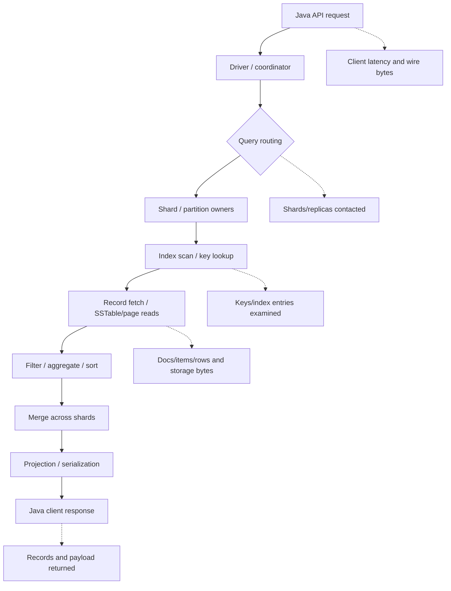

# Đo số bản ghi, phân vùng và byte phải đọc cho mỗi truy vấn

Một truy vấn NoSQL trả về 20 bản ghi trong 30 ms có thể là một truy vấn rất hiệu quả. Nhưng cũng có thể database đã kiểm tra 200.000 bản ghi, chạm vào hàng trăm phân vùng và đọc hàng trăm MiB rồi mới tìm được 20 kết quả. Khi dữ liệu còn nhỏ hoặc nằm trong RAM, vấn đề này dễ bị che khuất. Khi tải tăng, truy vấn có thể gây **read amplification**, làm nghẽn I/O, CPU, network và tăng độ trễ p95/p99 của cả cluster.

Ngược lại, một truy vấn trả ít bản ghi không chắc rẻ: một document chứa trường nhị phân 15 MiB có thể làm lượng byte truyền đi lớn dù chỉ trả một document. Một truy vấn `COUNT` trả về một con số có thể đã phải xử lý rất nhiều records. `LIMIT 20`, cache hit và câu lệnh được chuẩn bị sẵn **không tự chứng minh** hệ thống chỉ làm việc tương ứng với 20 bản ghi.

Để đo đúng, cần trả lời ba câu hỏi độc lập:

1. **Bao nhiêu bản ghi, index entries, cells hoặc items đã được kiểm tra?**
2. **Bao nhiêu logical partitions, database shards và storage nodes đã tham gia?**
3. **Bao nhiêu byte đã được đọc từ storage, qua cache và qua mạng, ở từng lớp?**

Bài học thuộc chương **Hiệu năng và đo tải** của module **Database No SQL**. Ta sẽ xây mô hình đo thống nhất, tính các hệ số khuếch đại, xem công cụ quan sát của MongoDB, Cassandra, DynamoDB, Redis và search engines, rồi thiết kế benchmark và tối ưu schema/index dựa trên bằng chứng.

> **Thông điệp chính:** đừng chỉ đo `latency` và `results.size()`. Hãy đo **công việc phải làm để tạo ra kết quả**; luôn ghi rõ **đơn vị, phạm vi đo, tầng đo và mức độ chính xác** của mỗi con số.

---

## 1. Một truy vấn có hai mặt: kết quả và công việc bên trong

Giả sử API:

```http
GET /api/orders?tenantId=t1&status=PAID&limit=20
```

Kết quả:

```json
{
  "items": [
    {"orderId": "o-1001", "status": "PAID"},
    {"orderId": "o-1002", "status": "PAID"}
  ],
  "nextPageToken": "..."
}
```

API có thể trả đúng 20 bản ghi. Nhưng phía dưới có nhiều bước:

```text
Client request
      |
      v
Query router / coordinator
      |
      +----> Shard A -> index entries -> documents / SSTables
      |
      +----> Shard B -> index entries -> documents / SSTables
      |
      +----> Shard C -> index entries -> documents / SSTables
      |
      v
Filter -> sort -> merge -> project -> serialize
      |
      v
20 results
```

Mỗi đường đọc có chi phí riêng: tìm index, truy cập bản ghi gốc, đọc nhiều SSTables hoặc pages, lọc điều kiện, gom kết quả giữa các shards, giải mã và truyền response.

### 1.1. Đo đầu ra

- Số bản ghi trả về.
- Số byte payload của kết quả.
- Thời gian phản hồi client nhận được.
- Status code và pagination token.
- Số lần gọi để lấy toàn bộ danh sách.

### 1.2. Đo công việc

- Index entries hoặc documents được xem xét.
- Logical partitions/physical shards được truy cập.
- Storage blocks/pages/SSTables phải đọc.
- Logical bytes và physical bytes được đọc.
- Inter-node network bytes và bytes gửi về client.
- CPU, heap, disk I/O, cache misses.
- Rows bị loại bởi filter hoặc phân trang.

**Kết quả giống nhau không có nghĩa chi phí giống nhau.**

---

## 2. Trước tiên phải định nghĩa “bản ghi đã đọc”

Các engine dùng đơn vị khác nhau:

| Thuật ngữ | Ý nghĩa thường gặp | Không nên suy rằng |
| --- | --- | --- |
| Returned row/document/item | Record được trả cho caller sau lọc | Đó là toàn bộ record đã xem xét |
| Examined document | Document được query executor xem/đọc ở một bước | Luôn tương ứng một physical disk read |
| Index entry/key examined | Entry trong index được kiểm tra | Luôn phải tải document gốc |
| Scanned item | Item được database xét trước/sau các bước theo API | Luôn được trả về |
| Live row | Row còn hiệu lực sau áp dụng deletion/TTL | Bằng toàn bộ cells/tombstones được đọc |
| Cell/column value | Thành phần dữ liệu trong wide-column store | Bằng một business record |
| Search document candidate | Ứng viên được engine xếp hạng/lọc | Bằng số search hits cuối |
| Physical storage block | Đơn vị I/O và cache của engine | Bằng kích thước document |
| Page of query results | Một đợt trả dữ liệu của API/driver | Bằng một database partition |

**Không gom những số đếm khác ngữ nghĩa thành một cột `rowsRead` rồi so ngang các engine.**

### 2.1. Một câu CQL có thể đọc nhiều cells

Một row trong wide-column database có thể chứa nhiều columns, tombstones và phiên bản lưu trữ. Đọc một logical row không đồng nghĩa chỉ đọc một physical record.

### 2.2. Covered query có thể không fetch document gốc

Với một index phù hợp, MongoDB có thể trả dữ liệu từ index. Khi ấy số `totalDocsExamined` có thể bằng 0 dù `totalKeysExamined` dương. Nếu chỉ xem document count, ta có thể đánh giá nhầm query không tốn gì.

### 2.3. `COUNT` là ví dụ đặc biệt

Một query trả **một kết quả là số đếm**, nhưng phải đọc metadata/index/range hoặc tập records nào đó tùy engine và loại query. `nReturned=1` không đo lượng dữ liệu đã xét.

---

## 3. Phân biệt partition key, logical partition và physical shard

Trong NoSQL, chữ *partition* bị dùng cho nhiều thứ.

- **Logical partition:** nhóm dữ liệu được xác định bởi partition key, chẳng hạn tất cả đơn hàng của `customer-42`.
- **Physical shard/tablet/token range:** đơn vị phân phối dữ liệu trong cụm, có thể chứa nhiều logical partitions.
- **Replica:** bản sao của dữ liệu phân vùng trên một node khác theo giao thức replication.
- **Coordinator/router:** node nhận request và định tuyến tới những nơi sở hữu dữ liệu.
- **Broker partition:** phân vùng log sự kiện Kafka hoặc broker tương tự, **không phải** database partition.

### 3.1. Ví dụ

```text
Logical partitions
  tenant=t1, customer=c1
  tenant=t1, customer=c2
  tenant=t1, customer=c3
                   |
                hash/range
                   |
           Physical shards
          /       |       \
       Shard 1  Shard 2  Shard 3
          |        |       |
       replicas  replicas replicas
```

Một query có thể:

- Chạm **1 logical partition** trên **1 shard**, đọc từ **1 replica**.
- Chạm **100 logical partitions** nằm trên **3 shards**.
- Quét **1 logical partition lớn** trên nhiều SSTables và có chi phí rất cao.
- Gửi **1 scatter-gather request tới 20 shards** dù mỗi shard trả rất ít.

### 3.2. Tại sao cần đếm nhiều cấp?

Nếu chỉ nói “đọc 1 partition”, một partition quá rộng vẫn rất đắt. Nếu chỉ nói “đọc 20 shards”, ta chưa biết mỗi shard kiểm tra bao nhiêu records.

**Tốt nhất báo riêng**: `logicalPartitionsTouched`, `shardsTargeted`, `replicasContacted`, `rowsOrEntriesExamined`.

---

## 4. “Byte đã đọc” cũng có nhiều định nghĩa

Một query có thể liên quan ít nhất năm loại byte:

1. **Logical data bytes:** tổng kích thước dữ liệu/cells/fields được query engine xử lý theo representation của nó.
2. **Storage/cache bytes:** số byte lấy từ buffer cache hoặc các data blocks.
3. **Physical disk bytes:** I/O thực tế từ thiết bị; có thể là các pages nén hoặc read-ahead.
4. **Inter-node network bytes:** dữ liệu giữa coordinator, shards, replicas, search nodes.
5. **Response wire bytes:** số byte ứng dụng thực nhận qua network/protocol, có thể đã nén.

Ví dụ minh họa:

```text
Disk:                40 MiB compressed blocks
Buffer/page cache:   12 MiB hits
Logical decoded:     90 MiB data examined
Inter-node traffic:   8 MiB
Client response:     24 KiB JSON
```

Các số này **không nhất thiết cộng lại** vì đo các tầng khác nhau, và cache/disk bytes có thể cùng phục vụ các logical records.

### 4.1. Có cache không có nghĩa số bản ghi xét giảm

Cùng một query có thể xét 20.000 records cả khi cold và warm. Warm query chỉ giảm **physical disk reads**, không nhất thiết giảm scan work hay CPU.

### 4.2. Nén làm byte chênh lệch

Một document 100 KiB chưa nén có thể dùng ít hơn 100 KiB trên disk nhưng vẫn được giải nén và chuyển đổi trước khi filter/projection.

### 4.3. Chỉ đo kích thước response là không đủ

Nếu client nhận 5 KiB nhưng storage phải đọc 100 MiB, endpoint có amplification lớn. Response nhỏ không chứng minh chi phí phía database nhỏ.

### 4.4. Không suy storage bytes từ `nReturned × recordSize` một cách mù

Query có thể dùng index-only access, fetch nhiều records bị loại, đọc page chứa nhiều items hoặc đọc lại block do cache miss. Cần telemetry hoặc mô hình có giả định được ghi rõ.

---

## 5. Đường dữ liệu của một truy vấn và điểm đo



### 5.1. Cần phân biệt số đo trực tiếp và suy luận

- `totalDocsExamined` được engine cung cấp: **số đo trực tiếp theo định nghĩa engine**.
- `partitionKeysTouched` đếm từ query planning: có thể là **ước lượng**.
- `networkBytes` đo bằng APM hoặc network counters: có thể **gộp requests khác**, không chắc per-query.
- `responseBody.length`: **byte của response ở một representation nhất định**, không phải disk bytes.

Mỗi metric nên kèm `source`, `scope` và `estimated=true/false` nếu hệ thống hỗ trợ.

### 5.2. Không có một driver API chung cho mọi NoSQL

Không thể trông chờ method `query.getBytesRead()` trả cùng semantics trên MongoDB, Cassandra, DynamoDB và Redis. Cần **adapter đo lường theo engine**.

---

# Phần I — Các phép đo và công thức nền tảng

## 6. Hệ số khuếch đại đọc theo bản ghi

Khi query trả ít nhất một record, định nghĩa khái niệm:

\[
A_{\mathrm{records}}
=
\frac{N_{\mathrm{examined}}}{N_{\mathrm{returned}}}.
\]

Ví dụ:

```text
Examined: 20.000
Returned: 20
A_records = 1.000
```

Database đã xét trung bình 1.000 records để trả một record.

### 6.1. Trường hợp không trả bản ghi

Nếu `N_returned = 0`, tỷ số trên **không xác định**. Không nên thay 0 bằng 1 rồi công bố “amplification=20.000” mà không ghi chú đó là một heuristic.

Hãy báo:

```text
examined = 20.000
returned = 0
emptyResult = true
recordAmplification = N/A
```

Một query trả rỗng nhưng quét 20.000 records vẫn đáng điều tra.

### 6.2. Có thể cần nhiều hệ số

Với engine có index:

\[
A_{\mathrm{index}}=
\frac{N_{\mathrm{indexEntriesExamined}}}{N_{\mathrm{returned}}}.
\]

\[
A_{\mathrm{document}}=
\frac{N_{\mathrm{docsExamined}}}{N_{\mathrm{returned}}}.
\]

Một index-covered query có thể có `A_document=0`, nhưng `A_index>0`; không gọi nó là “free query”.

### 6.3. Đừng so raw ratio giữa hai engine mà bỏ qua semantics

`ScannedCount` trong DynamoDB và `totalDocsExamined` trong MongoDB không nhất thiết đếm cùng một loại công việc. So sánh **xu hướng trong cùng API/engine/query shape** thường đáng tin hơn.

---

## 7. Hệ số khuếch đại theo byte

Định nghĩa khi response không rỗng:

\[
A_{\mathrm{byte,storage}}
=
\frac{B_{\mathrm{storageRead}}}{B_{\mathrm{response}}}.
\]

Ví dụ:

```text
Storage bytes read:     48 MiB
Response wire payload:   8 KiB
```

Với \(1\ \mathrm{MiB}=1024\ \mathrm{KiB}\):

\[
A_{\mathrm{byte,storage}}
=
\frac{48\times1024}{8}=6144.
\]

Tỷ số này **chỉ có nghĩa** nếu ta ghi rõ storage read đo ở đâu và response bytes đo ở đâu; nó không tự là một metric chuẩn của mọi database.

### 7.1. Cảnh báo so apples và oranges

- Storage bytes có thể đã nén.
- Response có thể nén gzip.
- Cùng data có thể được đọc từ cache, không từ disk.
- Aggregation có thể xử lý nhiều bytes rồi trả một số.
- Các storage counters có thể bao gồm background work.

Vì thế ratio hữu ích khi **đo ổn định cùng phương pháp**, không phải một chuẩn tuyệt đối chung cho mọi workload.

### 7.2. Cẩn thận khi trả rất ít byte

Response rỗng có thể làm ratio vô hạn/không xác định. Giữ **absolute bytesRead** và `resultCount=0` bên cạnh tỷ số.

---

## 8. Hệ số phân tán theo partition/shard

Giả sử một truy vấn theo `orderId` lý tưởng chỉ cần tìm một logical partition, nhưng thực tế query fan-out tới 16 shards.

Có thể ghi:

```text
targetShards = 16
idealTargetShards = 1
shardFanoutRatio = 16
```

Ký hiệu:

\[
A_{\mathrm{fanout}}
=
\frac{S_{\mathrm{targeted}}}{S_{\mathrm{necessary}}}.
\]

Nhưng `necessary` là **giả định phụ thuộc schema và câu hỏi**. Một truy vấn “top sản phẩm toàn hệ” có thể hợp pháp cần nhiều shards; không kết luận fan-out lớn là sai chỉ vì ratio cao.

### 8.1. Số logical partitions có thể khác shards

```text
Logical partitions touched: 250
Physical shards contacted: 8
Replica nodes contacted: 8 hoặc nhiều hơn
```

Một báo cáo chỉ có `partitions=8` rất dễ đánh lừa người đọc về chi phí thực.

### 8.2. Work distribution quan trọng như tổng

Hai query cùng chạm 8 shards:

- Query A: mỗi shard đọc 100 records.
- Query B: một shard đọc 1.000.000 records, bảy shard khác đọc 100.

Tổng shard count giống nhau, nhưng B có **skew** và tail latency nghiêm trọng. Nếu có thể, lấy **per-shard examined/bytes/latency**.

---

## 9. Đọc ít bản ghi không đồng nghĩa đọc ít byte

Ví dụ giả lập:

| Query | Docs examined | Returned | Storage data read | Response bytes |
| --- | ---: | ---: | ---: | ---: |
| A: point lookup | 1 | 1 | 8 KiB | 1 KiB |
| B: index-covered list | 0 docs, 30 keys | 20 | 12 KiB | 3 KiB |
| C: large document | 1 | 1 | 18 MiB | 18 MiB |
| D: broad scan | 100.000 | 20 | 160 MiB | 4 KiB |

Bảng là **dữ liệu minh họa**, không phải kết quả đo một engine cụ thể.

### 9.1. Query C

Không có read amplification theo số docs nhưng có **payload size** lớn. Nếu response chỉ cần `title`, chọn projection để giảm bytes trả; storage bytes có giảm hay không phụ thuộc engine/index/column layout.

### 9.2. Query D

Query trả ít nhưng làm việc rất nhiều. Cần xem predicate, index, sort và access pattern.

### 9.3. Query B

`docsExamined=0` không có nghĩa query không đọc index hay không tốn CPU/I/O. Cần xét `keysExamined` và storage/cpu metrics.

---

## 10. `LIMIT`, `pageSize` và `returned` không phải ngân sách đọc

Những câu như:

```sql
SELECT ... LIMIT 20;
```

hoặc:

```javascript
db.orders.find(filter).limit(20);
```

chỉ đặt một giới hạn liên quan đến **số kết quả hiển thị/được trả trong query operation**, theo semantics engine. Chúng không bảo đảm engine chỉ **xét 20 records** trong mọi trường hợp.

Lý do:

- Filter có selectivity thấp.
- Sort phải xét nhiều candidates.
- Query thiếu index.
- Predicate bị áp sau một bước đọc.
- Có tombstones/expired cells.
- Có scatter-gather từ nhiều shards.
- Một page có giới hạn theo bytes, không chỉ số records.
- Có bước aggregation duyệt một tập lớn.

### 10.1. Ví dụ

Một filter match 1% dữ liệu. Để tìm 20 results, engine có thể phải xét xấp xỉ 2.000 candidates trong điều kiện phân phối đơn giản. Đây chỉ là **ước lượng**, không phải bảo đảm.

### 10.2. Phân trang làm tổng đọc lớn hơn một lần gọi

Một request của user có thể tải 10 pages. Nếu mỗi page trả 20 items, đo per-page mà không cộng lại sẽ bỏ qua tổng 200 items, các page scans và network overhead.

### 10.3. `skip/offset` sâu

Với một số engine, pagination kiểu `skip(100000)` có thể phải đi qua một lượng lớn index entries trước khi trả 20 results. Keyset/cursor pagination thường hiệu quả hơn với access path phù hợp.

---

## 11. Độ chọn lọc của predicate

*Selectivity* mô tả tỷ lệ records phù hợp điều kiện trong một tập dữ liệu.

Một cách định nghĩa:

\[
s = \frac{N_{\mathrm{matched}}}{N_{\mathrm{candidate}}}.
\]

Ví dụ:

```text
status = PAID:         80% orders
customerId = c42:       0.01% orders
tenantId = tenant-a:     5% orders
```

Điều kiện `status=PAID` một mình có thể ít chọn lọc; `tenantId + customerId` có thể chọn lọc hơn nhiều nếu index/partition layout tận dụng được.

### 11.1. Tính chọn lọc không tự quyết định hiệu năng

Ngay cả một predicate chọn lọc cao vẫn chậm nếu **không có index phù hợp** và phải scan lớn. Ngược lại, một query trả nhiều rows có thể hiệu quả nếu xử lý tuần tự trong một range liên tiếp.

### 11.2. Cardinality khác frequency skew

Một `tenantId` có 1 triệu values vẫn có thể chứa một tenant cực lớn. Benchmark cần dữ liệu phân phối lệch, không chỉ uniform random.

### 11.3. Xác định rows bị loại ở tầng nào

Nếu engine đọc 100.000 records từ storage rồi filter 99.900, chi phí khác với engine dùng index chỉ lấy 100 matches. Phân biệt **filter pushdown**, **index lookup** và **application-side filtering**.

---

# Phần II — Quy trình đo thực tế

## 12. Chuẩn hóa một “query measurement record”

Một lần chạy query nên được ghi dưới dạng:

```json
{
  "queryName": "orders-by-customer",
  "queryShapeId": "q-orders-customer-v3",
  "engine": "MongoDB",
  "dataset": "loadtest-2026-11",
  "tenantTier": "large",
  "readMode": "configured-policy",
  "limit": 20,
  "pagesFetched": 1,
  "returnedRecords": 20,
  "indexKeysExamined": 24,
  "documentsExamined": 20,
  "logicalPartitionsTouched": null,
  "shardsTargeted": 1,
  "storageBytesRead": null,
  "responseBytes": 5480,
  "clientLatencyMs": 15,
  "serverElapsedMs": 9,
  "measuredAt": "2026-11-14T08:00:00Z"
}
```

Các số là **giả lập**. Giá trị `null` nghĩa metric **không có nguồn đo đủ tin cậy**, không được tự ghi 0.

### 12.1. Query shape là gì?

Hai truy vấn:

```text
tenant=t1 AND customer=c1
tenant=t2 AND customer=c5
```

có thể cùng *shape*, tức cùng fields/operators/sort/limit, khác values. Nhóm theo shape giúp phát hiện pattern đắt mà không đưa ID nhạy cảm vào metrics.

### 12.2. Vẫn cần phân nhóm workload

Cùng shape có thể rẻ cho tenant nhỏ nhưng đắt cho tenant lớn. Theo dõi phân nhóm `tenantTier`, `partitionSizeBucket`, `payloadSizeBucket` hoặc `hot/cold`, không phải chỉ trung bình chung.

### 12.3. Không dùng mỗi raw key làm metric label

Nếu gắn `orderId`/`customerId` lên mọi time series, hệ metric có thể bị **cardinality explosion** và lộ thông tin. Dùng sampling, top-K heavy hitters hoặc hash/token hóa có quản trị.

---

## 13. Đo từng trang hay cả truy vấn nghiệp vụ?

Cần phân biệt hai phạm vi:

**Một database request/page:**

```text
Query page 1
Count=20, ScannedCount=500, latency=30 ms
```

**Một thao tác nghiệp vụ của user:**

```text
API fetch 5 DB pages
Returned total = 100
Scanned total = 2.500
Client latency total = 180 ms
```

### 13.1. Quy tắc cộng

Với các số đếm cộng được qua các pages:

\[
N_{\mathrm{examined,total}}
=
\sum_{p=1}^{P}N_{\mathrm{examined},p}.
\]

\[
B_{\mathrm{read,total}}
=
\sum_{p=1}^{P}B_{\mathrm{read},p}.
\]

`latency` có thể cộng cho các calls tuần tự, nhưng nếu calls song song thì wall-clock elapsed không bằng tổng thời lượng.

### 13.2. Không cộng sai distinct partitions

Tổng `partitionsTouched` theo page có thể **đếm trùng cùng một partition** ở nhiều pages. Nếu muốn distinct partitions cho cả request, cần tập ID hoặc hợp nhất ước lượng có semantics phù hợp.

### 13.3. Phân biệt retry

Nếu driver thử query hai lần vì timeout, cả hai attempts có thể tạo work tại server. APM per-request ở client chỉ ghi request cuối thành công có thể **đánh giá thấp backend work**. Theo dõi attempts và replay nếu API cho phép.

---

## 14. Công cụ quan sát: từ application đến engine

Các nguồn bổ sung cho nhau:

1. **Java client instrumentation:** thời gian, số records thực nhận, số pages, kích thước payload theo representation, retries.
2. **Database query plan/profiling:** indexes, scanned/examined counts, scan/filter/sort stages, per-shard work nếu có.
3. **Storage/node telemetry:** disk bytes, cache hit/miss, SSTables/pages, IOPS, network.
4. **Tracing:** request đi qua coordinator/replicas/shards nào và mất bao lâu ở từng bước.
5. **Load-test harness:** phân phối query shapes, key skew, concurrency, cold/warm runs, p95/p99.
6. **Reconciliation of measurements:** kiểm tra cùng request ID/query shape/time window để tránh so các mốc không tương ứng.

### 14.1. Instrumentation có overhead

`explain`, full tracing, profiler và detailed logging có thể tăng tải hoặc đổi kế hoạch thực thi. Không bật **full tracing cho mọi query production** khi không hiểu chi phí.

### 14.2. Những số không có per-query API

Nếu engine chỉ cung cấp bytes read ở cấp node trong 1 phút, không nên chia số đó đều cho mọi queries rồi tuyên bố “mỗi query đọc đúng X byte”. Có thể báo **estimate** với điều kiện workload isolate.

---

# Phần III — MongoDB

## 15. `explain("executionStats")`: đo docs và keys examined

MongoDB cung cấp giải thích kế hoạch thực thi và một số counters quan trọng.

Ví dụ trong `mongosh`, trên database lab:

```javascript
const lab = db.getSiblingDB("performance_lab");

lab.orders.find({
  tenantId: "tenant-a",
  customerId: "customer-42",
  status: "PAID"
})
.sort({ createdAt: -1, _id: 1 })
.limit(20)
.explain("executionStats");
```

Những trường cần tìm trong kết quả, tùy query/topology/version:

```text
queryPlanner.winningPlan
executionStats.nReturned
executionStats.totalKeysExamined
executionStats.totalDocsExamined
executionStats.executionTimeMillis
executionStats.executionStages
```

### 15.1. `nReturned`

Số documents query executor trả trong scope được thống kê. Với pipeline/sharding, cần đọc đúng **vị trí stage và cấu trúc kết quả** thay vì lấy một trường `nReturned` bất kỳ.

### 15.2. `totalKeysExamined`

Số index keys được kiểm tra trong execution stats. Không đồng nghĩa số **distinct documents**: một document có thể có nhiều index entries khi index multikey.

### 15.3. `totalDocsExamined`

Số document examinations theo định nghĩa engine. Có thể khác số distinct documents và khác physical reads trên disk.

### 15.4. `executionTimeMillis`

Hữu ích để hiểu một lần thực thi nhưng không nên lấy nó làm benchmark latency duy nhất: caching, explain overhead, tải node và network/client behavior có thể khác traffic thật.

### 15.5. Query có thể không trả nhiều nhưng kiểm tra rất nhiều

Nếu:

```text
nReturned = 20
totalKeysExamined = 80.000
totalDocsExamined = 20.000
```

đó là tín hiệu cần xem index prefix, filters sau fetch và sort, dù endpoint trả chỉ 20 records.

---

## 16. Một index cụ thể giúp giảm lượng xét

Giả sử access pattern là:

```text
tenantId = ?
customerId = ?
status = ?
SORT BY createdAt DESC, _id ASC
LIMIT 20
```

Một compound index cần cân nhắc:

```javascript
db.orders.createIndex({
  tenantId: 1,
  customerId: 1,
  status: 1,
  createdAt: -1,
  _id: 1
});
```

Cách đánh giá:

1. Chạy query với dữ liệu đại diện.
2. Ghi `nReturned`, `keysExamined`, `docsExamined`, plan, p95/p99.
3. Tạo/đổi index trong môi trường test.
4. Chạy lại cùng workload và cache conditions.
5. So sánh query work và **write/storage overhead** của index mới.

### 16.1. Không chỉ so elapsed time

Nếu latency giảm từ 15 ms xuống 12 ms nhưng `docsExamined` giảm 100.000 xuống 20, đó có thể là cải thiện rất lớn về capacity khi traffic tăng.

### 16.2. Không tự tin index luôn “covered”

Một index chỉ covered nếu fields query cần có thể được phục vụ từ index theo điều kiện plan và projection. `SELECT *`/đọc toàn document thường đòi fetch. Hãy xác nhận bằng `explain()`.

### 16.3. Index không miễn phí

Thêm index tăng storage và write amplification, có thể chậm bulk writes. Lợi ích đọc phải được cân bằng theo workload.

### 16.4. Thứ tự index phụ thuộc access patterns

Đặt equality fields trước range/sort thường là một điểm xuất phát hữu ích, nhưng không thay thử nghiệm plan trên dữ liệu/phiên bản thật.

---

## 17. Collection scan, index scan và sort

Một explain plan có thể chứa những stage như:

- `COLLSCAN`: quét collection.
- `IXSCAN`: quét index.
- `FETCH`: lấy document theo index.
- `SORT`: sắp xếp khi không đủ dùng order từ index.
- `LIMIT`: giới hạn output ở giai đoạn phù hợp.
- `SHARD_MERGE` hoặc các cấu trúc phân tán khác, tùy topology/version.

### 17.1. `COLLSCAN` không tự là lỗi trong mọi tình huống

Quét một collection 50 documents có thể đơn giản hơn index lookup. Nhưng quét một collection 100 triệu documents cho endpoint point-read là rủi ro lớn.

### 17.2. `IXSCAN` vẫn có thể đắt

Một index scan 1 triệu entries để trả 10 documents cũng tạo read amplification. Đừng đánh giá bằng việc thấy tên `IXSCAN` rồi dừng phân tích.

### 17.3. In-memory sort

Sort có thể cần giữ nhiều candidates trong RAM/disk theo điều kiện engine và configuration. `LIMIT 20` không chắc làm source scan giảm nếu sort cần xét tập lớn.

---

## 18. MongoDB sharding: đo fan-out và từng shard

Một query có shard key đầy đủ có thể được router gửi tới một shard cần thiết; query thiếu thông tin định tuyến có thể fan-out tới nhiều shards.

Ví dụ logic:

```text
Shard key = { tenantId: 1, orderId: 1 }

Query A:
  tenantId=t1, orderId=o1001 -> targeted route theo metadata

Query B:
  status=PAID -> có thể scatter-gather trên nhiều shards
```

Định tuyến thực tế phụ thuộc loại shard key, chunk distribution, query planner và cluster version; **không kết luận chỉ từ tên field**.

### 18.1. Điều cần đo

- Số shards được targeted.
- Execution stats từng shard nếu explain/profiler cung cấp.
- Docs/keys examined trên từng shard.
- Thời gian chờ shard chậm nhất.
- Inter-shard/merger traffic nếu có telemetry.
- Query router overhead.

### 18.2. Fan-out không bằng read amplification toàn bộ

Một query có thể chạm 10 shards nhưng mỗi shard chỉ đọc 1 index key, tổng work thấp. Một query chỉ chạm 1 shard nhưng scan 10 triệu documents vẫn rất đắt.

### 18.3. Shard skew

Nếu một shard giữ tenant cực lớn, cùng query shape sẽ đắt hơn các shards khác. Cần xem distribution theo shard/partition, không chỉ p50 chung.

---

## 19. MongoDB: có đo byte đọc cho từng query bằng `explain` không?

**Không nên giả định** `explain("executionStats")` cung cấp một trường chuẩn, đầy đủ và tương đương “physical bytes read from disk” cho mọi truy vấn, storage engine và phiên bản.

Có nhiều nguồn bổ trợ:

- Query plan/examined counters của `explain`.
- Database profiler/diagnostic query logs với các fields do phiên bản hỗ trợ.
- WiredTiger/buffer-cache/IO metrics **ở cấp process/node**.
- Operating system disk I/O counters.
- Driver/server APM theo request IDs.
- Kích thước serialized response tại application.

### 19.1. `bytesRead` phải có scope rõ

Nếu một counter là tổng bytes của storage engine trên node trong 1 phút, nó có thể bao gồm query khác, background compaction/checkpoint hoặc replication activity. Không gán nó cho một query riêng nếu chưa isolate tải.

### 19.2. Thử nghiệm cô lập

Trong lab, có thể so delta physical disk bytes trong một cửa sổ chỉ chạy một query shape, nhưng phải kiểm soát:

- Background writes/replication.
- Page cache/warmup.
- Concurrent readers.
- Compression và read-ahead.
- Sampling interval.

Kết quả vẫn là **ước lượng theo thực nghiệm**, không phải tự động là physical bytes chính xác của một query.

### 19.3. Cỡ response có thể đo riêng

Nếu API serialize 20 records thành UTF-8 JSON 6.200 bytes, đó là **JSON bytes ở API**, không phải server BSON wire bytes hay bytes từ storage.

---

## 20. MongoDB aggregation: một kết quả có thể che lượng đọc lớn

Ví dụ tổng doanh thu:

```javascript
db.orders.aggregate([
  {
    $match: {
      tenantId: "tenant-a",
      status: "PAID"
    }
  },
  {
    $group: {
      _id: "$currency",
      total: { $sum: "$totalMinorUnits" }
    }
  }
]);
```

Có thể trả một vài rows nhưng phải xét hàng chục nghìn orders.

### 20.1. Đọc `explain` theo stage

Trong aggregation, dữ liệu execution stats có thể nằm ở `$cursor`/`stages` hoặc cấu trúc khác theo version/optimizer. Không lấy số stage output cuối làm `documentsExamined`.

### 20.2. Tối ưu có thể là materialized aggregate

Nếu endpoint gọi mỗi giây và dữ liệu cần tổng theo ngày, có thể tạo `daily_sales_by_tenant` từ events, với idempotency/lag contract. Khi đó đọc một summary nhỏ thay vì mỗi lần scan hàng triệu orders.

### 20.3. Nhưng summary phải có freshness

Read model có thể trễ; không dùng tổng doanh thu stale để quyết định một nghiệp vụ cần giao dịch chính xác nếu chưa định nghĩa được quyền và độ tươi.

---

# Phần IV — DynamoDB

## 21. DynamoDB: `Count`, `ScannedCount`, `ConsumedCapacity`

DynamoDB trả về những số đo quan trọng ở API Query/Scan:

- `Count`: số items trong response sau áp dụng filter cho **lần gọi/page đó**.
- `ScannedCount`: số items đã được đánh giá trước áp dụng filter theo semantics operation cho **lần gọi/page đó**.
- `ConsumedCapacity`: năng lực đọc tiêu thụ nếu request bật `ReturnConsumedCapacity`, có thể phân rã theo table/index tùy API/option.
- `LastEvaluatedKey`: chỉ báo còn dữ liệu để tiếp tục theo pagination contract.
- `Items`: dữ liệu trả về.

### 21.1. Ví dụ

```text
Count = 20
ScannedCount = 2.000
ConsumedCapacity = 150 capacity units
LastEvaluatedKey != null
```

Các số là **giả lập**, không có tương quan capacity chính xác mặc định. Ví dụ cho thấy 20 returned items có thể tương ứng với 2.000 items được xét.

### 21.2. `ScannedCount/Count`

Nếu `Count>0`, một tỷ lệ gần đúng cho riêng API đó:

\[
A_{\mathrm{items}}=
\frac{\mathrm{ScannedCount}}{\mathrm{Count}}.
\]

Với ví dụ trên:

\[
A_{\mathrm{items}}=100.
\]

Đừng đánh đồng `ScannedCount` với số disk records hoặc coi capacity units là bytes.

---

## 22. `FilterExpression` không thay key design

Xét hai query:

**Mẫu có định tuyến theo khóa:**

```text
PK = TENANT#t1
SK BETWEEN ORDER#2026-11-01 AND ORDER#2026-11-30
```

**Mẫu lọc bổ sung:**

```text
KeyConditionExpression: PK = :pk
FilterExpression: status = :paid
```

DynamoDB áp filter theo semantics sau bước đọc/evaluate items của Query. `FilterExpression` **không thay đổi** việc phải đọc/evaluate bao nhiêu items trong key range đã chọn, và không làm giảm read capacity theo cách lọc sau đọc.

### 22.1. `Limit` giới hạn items được đánh giá

Trong DynamoDB Query, `Limit` liên quan **số items được đánh giá** trong một request/page trước filter, không phải lời hứa trả đúng bằng `Limit` items sau filter.

Nếu `Limit=100` và chỉ một item pass filter, response có thể có:

```text
ScannedCount = 100
Count = 1
```

### 22.2. Query page còn giới hạn dung lượng

DynamoDB Query có giới hạn kích thước dữ liệu được xử lý cho một trang theo API (thường được mô tả ở mức 1 MiB trước filter). Vì vậy `LastEvaluatedKey` cần được kiểm tra cả khi `Count` rất nhỏ hoặc bằng 0.

### 22.3. Projection không nhất thiết giảm capacity đọc

DynamoDB read capacity dựa trên kích thước items được đọc theo các quy tắc dịch vụ, không đơn thuần dựa trên các attributes được trả sau projection. Đừng giả `ProjectionExpression` giảm RCUs tương ứng tỷ lệ fields đã ẩn. Nó có thể giảm **response bytes**, nhưng read charge có semantics riêng.

---

## 23. Java AWS SDK v2: cộng số đo qua mọi pages

Ví dụ sau minh họa **Query theo partition key** và cộng `Count`, `ScannedCount`, `ConsumedCapacity` qua các pages. Đây là một hàm đo cho lab; bảng phải có partition key string `PK` và access pattern phù hợp.

```java
import software.amazon.awssdk.services.dynamodb.DynamoDbClient;
import software.amazon.awssdk.services.dynamodb.model.*;

import java.util.Map;

public final class DynamoQueryMeasurement {

    record Totals(
        long returnedItems,
        long scannedItems,
        double consumedCapacityUnits,
        int pages
    ) {}

    static Totals measure(
        DynamoDbClient client,
        String tableName,
        String tenantId
    ) {
        long totalCount = 0;
        long totalScanned = 0;
        double totalCapacity = 0.0;
        int pages = 0;

        Map<String, AttributeValue> nextKey = null;

        do {
            QueryRequest.Builder builder = QueryRequest.builder()
                .tableName(tableName)
                .keyConditionExpression("#pk = :pk")
                .expressionAttributeNames(
                    Map.of("#pk", "PK")
                )
                .expressionAttributeValues(Map.of(
                    ":pk", AttributeValue.builder()
                        .s("TENANT#" + tenantId)
                        .build()
                ))
                .returnConsumedCapacity(
                    ReturnConsumedCapacity.TOTAL
                )
                .limit(100);

            if (nextKey != null && !nextKey.isEmpty()) {
                builder.exclusiveStartKey(nextKey);
            }

            QueryResponse response =
                client.query(builder.build());

            totalCount += response.count();
            totalScanned += response.scannedCount();

            if (response.consumedCapacity() != null
                    && response.consumedCapacity()
                               .capacityUnits() != null) {
                totalCapacity += response
                    .consumedCapacity().capacityUnits();
            }

            pages++;
            nextKey = response.lastEvaluatedKey();

        } while (nextKey != null && !nextKey.isEmpty());

        return new Totals(
            totalCount,
            totalScanned,
            totalCapacity,
            pages
        );
    }
}
```

### 23.1. Chỉ đếm nếu thực sự duyệt hết

Method này tải toàn bộ pages cho một partition key. **Không dùng trực tiếp trên tenant vô hạn trong API production.** Để đo một page, chỉ gọi một lần; để đo một logical query, đặt max pages/deadline rõ ràng.

### 23.2. `Count` có thể nhỏ dù tiếp tục được

Nếu `FilterExpression` loại hết một page, `Count=0` chưa chắc hết dữ liệu. `LastEvaluatedKey` mới cho biết có cần tiếp tục.

### 23.3. Capacity units không phải bytes

`ConsumedCapacity` là đơn vị billing/capacity theo DynamoDB, phụ thuộc loại operation, item size, consistent/eventual read và API. Không tính “bytesRead = consumedCapacity × 4 KiB” như một quy tắc chính xác chung.

### 23.4. `ScannedCount` không phải bảng nào cũng là full scan

Trong một `Query` có key condition, `ScannedCount` có thể phản ánh items evaluated trong **key range đã định tuyến**, khác hẳn `Scan` trên toàn bảng.

### 23.5. Đo network bytes cần nguồn khác

SDK response chứa items đã parse; `Items().toString().getBytes()` **không phải** số byte chính xác trên wire. Muốn đo wire size, dùng HTTP instrumentation có kiểm soát nén/encoding và redaction.

---

## 24. Query và Scan: sự khác biệt quyết định chi phí

**Query** yêu cầu partition key condition theo key schema của table/index.

**Scan** duyệt tập items rộng trong table/index theo semantics API, có thể hỗ trợ segment/parallel scan nhưng không biến việc đọc nhiều data thành rẻ.

Ví dụ:

```text
Query by PK:
  1 tenant partition
  1..P pages
  Count = 20, ScannedCount = 22

Scan all items + Filter:
  many partitions
  many pages
  Count = 20, ScannedCount = 2.000.000
```

Số liệu là **minh họa**.

### 24.1. Parallel Scan

Chạy nhiều segments có thể giảm wall-clock khi đủ capacity, nhưng tổng work/throttling/cost vẫn lớn; đôi khi tăng áp lực lên workload khác.

### 24.2. GSI cũng có chi phí/consistency riêng

Nếu truy vấn theo `status` cần GSI, phải thiết kế GSI partition/sort keys và xem selectivity, hot keys, write amplification. Global secondary index reads có consistency/visibility semantics riêng, không mặc nhiên giống strongly consistent base table reads.

### 24.3. Đo theo kết quả sử dụng

Một `Scan` có thể hợp lệ cho offline backfill/reporting có giới hạn, nhưng không hợp endpoint `GET /orders/{id}` mà phải phản hồi p99 vài chục mili-giây.

---

## 25. DynamoDB bytes: quan hệ giữa item size và capacity

DynamoDB tính read capacity theo dữ liệu được truy cập và loại read, với ngưỡng đơn vị kích thước do dịch vụ quy định. Cần đọc semantics hiện tại của đúng operation (Query, GetItem, Scan, transaction, index) để quy đổi.

### 25.1. Ba số không đồng nghĩa

```text
ScannedCount        = số items evaluated
ConsumedCapacity    = capacity units
ResponseBytes       = bytes HTTP/SDK
```

Cùng `ScannedCount=100` có thể tiêu thụ capacity khác vì 100 items có kích thước khác nhau.

### 25.2. Một item lớn có thể đắt

Đọc 20 items, mỗi item vài KiB, có cost khác 20 items rất lớn. Tách các thuộc tính ít dùng sang objects khác hoặc thay access pattern có thể giảm work nếu API/schema hỗ trợ.

### 25.3. Projection không làm item vật lý nhỏ đi

Ẩn field trong response có thể giảm băng thông và parse cost, nhưng không mặc nhiên làm read charge tương ứng giảm. Tối ưu key/index/read model ở đúng tầng.

---

# Phần V — Cassandra và wide-column NoSQL

## 26. Cassandra: query theo partition key khác quét nhiều partitions

Một bảng thiết kế theo customer:

```sql
CREATE TABLE commerce.orders_by_customer (
    tenant_id text,
    customer_id text,
    created_at timestamp,
    order_id uuid,
    status text,
    total_minor_units bigint,
    PRIMARY KEY (
      (tenant_id, customer_id),
      created_at,
      order_id
    )
) WITH CLUSTERING ORDER BY (
    created_at DESC,
    order_id ASC
);
```

Đây là **schema minh họa** trong keyspace đã có. Các `CLUSTERING ORDER BY` declarations và query sort phải phù hợp CQL/phiên bản triển khai.

Query có đủ partition key:

```sql
SELECT created_at, order_id, status, total_minor_units
FROM commerce.orders_by_customer
WHERE tenant_id = 'tenant-a'
  AND customer_id = 'customer-42'
LIMIT 20;
```

Có thể truy cập một logical partition, nhưng chi phí đọc còn phụ thuộc kích thước partition, tombstones, SSTables, cache và clustering range.

### 26.1. Một partition không phải một page cố định

Một partition có thể chứa rất nhiều clustering rows. Đọc `LIMIT 20` trên một partition nhiều tombstones hoặc SSTables có thể phải xét nhiều storage fragments để tìm 20 live rows.

### 26.2. Consistency ảnh hưởng số replica liên hệ

Cùng CQL query có thể dùng consistency `ONE`, `LOCAL_QUORUM` hoặc loại khác tùy yêu cầu, kéo theo cách coordinator liên hệ replicas và latency/capacity. **Không hạ consistency chỉ để giảm số replica reads** nếu nghiệp vụ cần bảo đảm cao hơn.

### 26.3. Dùng data model theo access pattern

Nếu thường xuyên đọc đơn mới nhất của khách, key `(tenantId, customerId)` và clustering theo `createdAt` có thể hợp hơn truy vấn `status` trên toàn hệ, nhưng một customer cực lớn có thể gây wide/hot partition và cần bucketing.

---

## 27. `TRACING ON` và query tracing trong Cassandra

Trong `cqlsh`, tracing có thể bật:

```sql
TRACING ON;

SELECT created_at, order_id, status
FROM commerce.orders_by_customer
WHERE tenant_id = 'tenant-a'
  AND customer_id = 'customer-42'
LIMIT 20;

TRACING OFF;
```

Tracing giúp thấy các sự kiện nội bộ như coordinator actions và replica interactions theo khả năng của phiên bản/cấu hình.

### 27.1. Tracing không phải per-query byte counter hoàn hảo

Trace không nhất thiết cho “đã đọc đúng X byte từ disk”, “đúng Y rows examined” cho mọi query và engine version.

### 27.2. Cần đọc toàn bộ trace context

Một trace của request có thể bao gồm read/replica tasks, message hops, retries/speculative execution. Nếu chỉ đếm một dòng `Read` có thể bỏ những thao tác khác.

### 27.3. Trace sampling

Bật tracing nhiều query trên production có thể tốn overhead/ghi log. Nên dùng sampled diagnostics, load-test environment và metric dashboards.

### 27.4. Replica/contact count

Từ trace và driver metrics có thể phân tích coordinator/replica fan-out, nhưng phân biệt **replica contacted** với **logical partitions touched**. Chúng khác đơn vị.

---

## 28. SSTables, tombstones và read amplification

Cassandra và nhiều LSM-based NoSQL không nhất thiết giữ tất cả phiên bản của một logical row trong một storage file duy nhất.

Một read có thể:

```text
Memtable
  + SSTable A
  + SSTable B
  + SSTable C
      |
      v
Merge versions, process tombstones, return live rows
```

### 28.1. Read amplification có thể đến từ nhiều SSTables

Nếu key xuất hiện trong nhiều SSTables chưa compact, cần xét nhiều cấu trúc để xác định giá trị hiện hành, tùy bloom filters, index summary, cache và compaction strategy.

### 28.2. Tombstone làm `LIMIT` đắt

Khi 10.000 rows đã xóa hoặc TTL hết hạn, query cần bỏ qua tombstones để tìm 20 live rows. Chi phí thực tế có thể lớn hơn nhiều so với `nReturned=20`.

### 28.3. Đo theo engine metrics

Các metrics/histograms về tombstones scanned, live cells, SSTables per read, partition size, read latency và disk bytes có thể hữu ích, tùy Cassandra version/monitoring stack.

**Không suy** một histogram cấp table là số đếm chính xác của riêng request vừa chạy.

### 28.4. Compaction không thay data model

Compaction có thể giảm read amplification theo storage layout, nhưng một partition quá lớn hoặc query cần quét quá nhiều clustering rows vẫn có thể đắt.

---

## 29. Pagination trong Cassandra và driver Java

Cassandra Java Driver có cơ chế paging; một query có thể trả kết quả theo nhiều pages qua driver.

Cần phân biệt:

- **CQL LIMIT:** giới hạn số rows của query theo CQL semantics.
- **Fetch size/page size:** số rows mà driver cố lấy trong mỗi page.
- **Số pages thực tải:** có thể lớn hơn một khi iterator được tiêu thụ.
- **Logical partitions touched:** theo câu query và routing, không bằng page count.
- **Bytes read per page:** tùy row/cell size và storage layout.

### 29.1. Lazy fetching

Một code Java gọi `ResultSet` và iterate toàn bộ rows có thể tự động fetch pages tiếp theo. Nếu chỉ đo thời gian `session.execute` mà bỏ đoạn iterator, có thể đo thấp latency và work của toàn thao tác.

### 29.2. Đừng tải mọi rows bằng `.all()` rồi coi là rẻ

Nếu API chỉ cần 20 rows, việc gom tất cả rows vào RAM làm mất lợi ích streaming/pagination và tăng bytes/network/heap.

### 29.3. Paging state

Paging state cần được ràng buộc query shape/tenant/authorization; không tin token do client sửa hay dùng lại với một query khác.

### 29.4. Tính số logical partitions

Nếu query theo đúng một partition key, có thể **suy** `logicalPartitionsTargeted=1` từ schema. Với token range scan hoặc nhiều partition keys, cần theo dõi query scope/actual routing; không tự coi `pageSize=100` nghĩa 100 partitions.

---

## 30. Một partition quá lớn: bài toán “đọc bao nhiêu byte?”

Giả sử partition `tenant-a|customer-42` chứa 2 triệu orders và một số trường có blob lớn. Request chỉ cần 20 đơn gần nhất.

Nếu clustering và column projection phù hợp, có thể chỉ đọc vùng nhỏ liên quan; nếu truy vấn không đúng clustering access path hoặc có tombstones, có thể đọc nhiều.

### 30.1. Bucket theo thời gian

```text
PK = (tenantId, customerId, yyyyMM)
CK = (createdAt DESC, orderId)
```

Ưu điểm: tránh partition tăng vô hạn, queries theo một tháng có phạm vi hẹp.

Chi phí: query lịch sử nhiều tháng phải đọc nhiều partitions và merge/sort ở ứng dụng hoặc read model, tăng fan-out.

### 30.2. Cân bằng read và write

Bucket quá nhỏ có thể khiến một query “90 ngày gần nhất” chạm hàng chục partitions. Bucket quá lớn tạo wide partitions. Chọn theo **truy vấn đại diện và phân phối dữ liệu thực**.

### 30.3. Tối ưu payload

Nếu `notesBlob` lớn mà list endpoint không cần, tách summary table/document và detail blob có thể giảm bytes được truy cập. Không dùng `SELECT *` mặc định trong mọi read path.

---

# Phần VI — Redis, search và các lớp khác

## 31. Redis: không có `rowsExamined` cho `GET` như database query

Lệnh:

```redis
GET catalog:product:sku-001
```

truy cập một key, nhưng byte cost phụ thuộc kích thước value, encoding, network, server CPU và serialization của client.

### 31.1. Những công cụ hữu ích

- `INFO commandstats`: thống kê số lần gọi và thời gian CPU theo loại lệnh ở scope server.
- `SLOWLOG GET`: lệnh chậm theo ngưỡng cấu hình, không phải mọi lệnh.
- `LATENCY` tools: sự kiện latency theo cơ chế Redis.
- `MEMORY USAGE key`: ước tính bộ nhớ server dùng cho key, **không phải số byte đọc từ disk hay bytes truyền trên network**.
- Client APM: request duration/command type/response size.
- Network counters: ingress/egress cấp server.

### 31.2. `MEMORY USAGE` không là response size

Một Redis hash có overhead nội bộ khác serialized JSON response. `GET` một string và `HGETALL` một hash cũng có output cost khác nhau.

### 31.3. Tránh `KEYS *` trên production

Một lệnh duyệt toàn keyspace có thể làm server bận và ảnh hưởng các requests khác. `SCAN` cho phép duyệt tuần tự với cursor, nhưng **không làm tổng công việc biến mất** và vẫn cần rate limit.

### 31.4. `MONITOR` là công cụ nhạy cảm

Theo dõi mọi lệnh có thể tốn tài nguyên và làm lộ key/values nhạy cảm; không bật vô điều kiện chỉ để đếm hot keys.

---

## 32. Redis Cluster: số keys ≠ số slots ≠ số primaries

Một key được hash vào một slot; các slots phân phối cho primaries. Một query `GET` thường đến owner của slot trong routing hiện hành.

Ví dụ:

```text
1 key touched
1 hash slot
1 primary
```

Nếu đọc qua Redis read replicas theo chế độ/client hỗ trợ, số replica contacts và freshness có thể khác.

### 32.1. `MGET` và multi-key

Nhiều keys có thể ở nhiều slots. Redis Cluster có các hạn chế đối với multi-key commands theo slot và client/server version; không giả định mọi `MGET` xuyên slots chạy nguyên tử.

### 32.2. Một hot key vẫn có một owner

Dù cluster có hàng chục primaries, một key nóng có thể bão hòa một primary. L1 cache, read replicas hoặc logical read copies có thể phân tán read pressure nếu freshness cho phép.

### 32.3. Đếm bytes

Có thể đo **serialized value size** và network egress, nhưng không xem `MEMORY USAGE` là physical bytes read per GET. Đặc biệt với Redis in-memory, khái niệm “disk bytes read” cho một GET không giống LSM database.

---

## 33. Search engine: `size=20` không có nghĩa kiểm tra 20 documents

Một full-text/ANN query trong Elasticsearch/OpenSearch có thể:

1. Gửi request tới nhiều shards.
2. Đọc postings/inverted index hoặc vector graph.
3. Thu thập candidates.
4. Tính score/filter.
5. Merge top results.
6. Fetch source fields và serialize hits.

### 33.1. Các số cần phân biệt

- `hits` trả về.
- `total hits` theo cách API tính/ước lượng.
- Shards targeted/successful/failed.
- Query phase vs fetch phase elapsed.
- Candidates/documents visited nếu profiling cung cấp.
- Disk/index segment reads hoặc cache metrics.
- Bytes của source fields được fetch.

### 33.2. Profile API

Search engines có profiling/query plan tools ở những phiên bản được hỗ trợ. Chúng hữu ích để phân tích execution phases nhưng **có overhead** và không phải lúc nào cũng cung cấp một tổng `documentsExamined` tương đương MongoDB.

### 33.3. `track_total_hits` không là rows examined

Tham số tổng hits phản ánh cách đếm matches theo API, không đồng nghĩa số postings/vector nodes/candidates đã được xem.

### 33.4. ANN cần metric khác

Với kNN/ANN:

- Candidate pool size.
- Visited graph nodes/segments khi engine có telemetry.
- `k`, `numCandidates`/search breadth.
- Recall@K so với exact search.
- Query/fetch bytes và p99.

Tăng candidate breadth có thể tăng recall nhưng cũng tăng số việc phải làm; đừng tối ưu chỉ p50 latency.

---

## 34. Materialized views/read models: ít dữ liệu trả không đồng nghĩa ít dữ liệu xử lý

Một API báo cáo:

```text
GET /analytics/sales/daily?date=2026-11-14
```

có thể trả một record:

```json
{"date":"2026-11-14","total":125000000}
```

Nếu được đọc từ read model đã tổng hợp, query có thể là point lookup.

Nếu tính lại trực tiếp từ hàng triệu orders, output vẫn một record nhưng backend phải xét tập lớn.

### 34.1. Phải đo cả chi phí xây read model

Materialized view chuyển công việc từ **read time** sang **event processing/update time**. Tổng cost hệ không biến mất; cần đo:

- Writes/events consumed.
- Update fan-out.
- Aggregation latency.
- Read model storage.
- Source-to-visible lag.
- Reconciliation/rebuild cost.

### 34.2. Không dùng read model stale cho invariants

Ví dụ `availableSeats` trên dashboard là projection; quyết định giữ ghế cuối phải dùng authority và conditional write, không dựa vào kết quả dashboard.

---

# Phần VII — Đo từ ứng dụng Java và benchmark

## 35. Java instrumentation: tách thời gian, số kết quả và response bytes

Ví dụ minh họa khi ứng dụng đã nhận một danh sách DTO và serialize JSON. Cần lưu ý `responseBytes` ở đây là **UTF-8 JSON của DTO tại API**, không phải bytes storage/database wire.

```java
import java.nio.charset.StandardCharsets;
import java.time.Duration;
import java.util.List;
import java.util.Objects;
import java.util.function.Function;
import java.util.function.Supplier;

public final class QueryInstrumentation {

    record Sample(
        String queryName,
        long elapsedNanos,
        int returnedRecords,
        int responseJsonBytes
    ) {
        double elapsedMillis() {
            return elapsedNanos / 1_000_000.0;
        }
    }

    static <T> Sample measure(
            String queryName,
            Supplier<List<T>> queryOperation,
            Function<List<T>, String> toJson
    ) {
        Objects.requireNonNull(queryOperation);
        Objects.requireNonNull(toJson);

        long start = System.nanoTime();
        List<T> results = queryOperation.get();

        // Phần này đo cả serialization.
        String json = toJson.apply(results);
        long elapsed = System.nanoTime() - start;

        return new Sample(
            queryName,
            elapsed,
            results.size(),
            json.getBytes(StandardCharsets.UTF_8).length
        );
    }
}
```

### 35.1. Định nghĩa rõ khoảng đo

Trong ví dụ, `elapsed` bao gồm **queryOperation + serialization**, không phải chỉ database round-trip. Nếu muốn tách hai giai đoạn, ghi timestamps riêng.

### 35.2. Đừng serialize lần hai chỉ để đo production

Trong endpoint thật, lấy byte count từ **actual response serialization pipeline** hoặc HTTP instrumentation, không serialise lại mọi response làm tăng CPU/heap.

### 35.3. Nén HTTP

Nếu response dùng gzip/br compression, `json.getBytes(UTF_8).length` là kích thước **trước nén**; wire bytes có thể nhỏ hơn. Ghi rõ representation.

### 35.4. Dữ liệu nhạy cảm

Không log toàn bộ response chỉ để đo bytes. Ghi counter và trace ID có phân quyền.

---

## 36. Java: per-query measurement interface không giả số liệu

Một interface ứng dụng có thể gom các counters theo **nguồn đã hỗ trợ**:

```java
public record QueryWorkSample(
    String queryShape,
    long returnedRows,
    Long indexEntriesExamined,
    Long recordsExamined,
    Long logicalPartitionsTargeted,
    Integer physicalShardsTargeted,
    Long logicalBytesRead,
    Long physicalDiskBytesRead,
    Long responseBytes,
    long elapsedNanos,
    String measurementSource
) {}
```

### 36.1. Tại sao dùng nullable `Long`?

Một engine không có per-query disk bytes thì nên ghi `null`, không phải 0.

### 36.2. Không tự cộng những counters không cùng scope

Nếu 2 pages dùng cùng shard, cộng `physicalShardsTargeted=2` chỉ đúng khi đo **shard contacts**, không phải **distinct shards**. Đổi field name hoặc aggregation logic cho chính xác.

### 36.3. MeasurementSource

Ví dụ:

```text
mongodb-explain-executionStats
dynamodb-query-response
cassandra-sampled-trace
redis-client-payload-estimate
node-io-delta-isolated-lab
```

Nhờ đó dashboard không đánh đồng estimated bytes với exact bytes hoặc engine-scanned items với returned rows.

### 36.4. Sampling

Có thể chỉ đo explain/traces trên mẫu được phê duyệt để tránh overhead; trong thời gian đó, client metrics vẫn đo toàn bộ traffic ở mức nhẹ.

---

## 37. Benchmark: cần cả workload và dataset đại diện

Một benchmark hữu ích không chỉ là chạy một câu query 100 lần rồi lấy trung bình.

### 37.1. Những chiều phải kiểm soát

- Dataset size: 10 nghìn, 1 triệu, 100 triệu records.
- Record size: nhỏ/trung bình/rất lớn.
- Partition width: từ vài rows đến partition rất lớn.
- Cardinality và selectivity của predicates.
- Distribution: uniform, skewed, Zipf-like.
- Read/write mix.
- Cold cache vs warm cache.
- Query shape và projection.
- Page size, total pages consumed.
- Concurrency, open-loop arrival rate, retries.
- Replica lag/consistency setting.
- Network/AZ placement.
- Background compaction, backup và index build.

### 37.2. Open-loop và closed-loop

**Closed-loop**: client gửi request mới sau khi request trước xong; khi server chậm, tốc độ gửi có thể tự giảm, che khuất overload.

**Open-loop**: phát arrivals theo lịch/tốc độ độc lập với latency để quan sát queue buildup và saturation; phải có giới hạn an toàn của môi trường load test.

### 37.3. Coordinated omission

Nếu load generator chỉ đo requests lúc nó có thể gửi, thời gian bị chậm/queue có thể không được phản ánh đúng. Benchmark cần phương pháp đo p99 không che latency dưới overload.

### 37.4. Không dùng dữ liệu uniform khi production bị skew

Nếu 5% khách chiếm 80% orders, dữ liệu ngẫu nhiên đều có thể khiến test “rất nhanh” còn production hot partitions vẫn nghẽn.

---

## 38. Kịch bản benchmark có số liệu giả lập

Giả sử bốn query shapes trên NoSQL khác nhau. Các con số dưới đây chỉ là **dữ liệu minh họa cho cách đọc metric**, không phải kết quả thật.

| Query shape | Returned | Examined | Logical partitions | Shards | Storage bytes read | API response |
| --- | ---: | ---: | ---: | ---: | ---: | ---: |
| A — Lookup order by ID | 1 | 1 | 1 | 1 | 8 KiB | 1 KiB |
| B — List orders thiếu index | 20 | 4.000 | 120 | 8 | 17 MiB | 5 KiB |
| C — Find nonexistent SKU bằng broad scan | 0 | 1.000.000 | 12.000 | 16 | 640 MiB | 0.5 KiB |
| D — Read one large document | 1 | 1 | 1 | 1 | 20 MiB | 19 MiB |

### 38.1. Diễn giải query A

Ít examined, ít partitions, ít bytes. Có vẻ là targeted point lookup hợp lý.

### 38.2. Diễn giải query B

\[
A_{\mathrm{records}}=4000/20=200.
\]

Mức scanned/returned cao. Kiểm tra partition key, index và sort trước khi thêm cache hoặc tăng nodes.

### 38.3. Diễn giải query C

Không có kết quả, nhưng scan rất lớn. Đây là case quan trọng cho miss queries. `A_records` không xác định vì returned=0; vẫn phải báo absolute work.

### 38.4. Diễn giải query D

Không có record amplification nhưng có large payload. Có thể cần projection, tách blob hoặc object storage, tùy endpoint.

### 38.5. Không xếp hạng chỉ theo một cột

B là vấn đề scan/fan-out; D là byte-heavy; C là miss-scan; A có thể lại thành hot key khi QPS cực cao. Cần tối ưu theo bottleneck và nghiệp vụ.

---

## 39. Kết nối lượng đọc với p99 latency

Nếu một query chạm nhiều shards, latency có thể bị quyết định bởi shard chậm nhất khi phải đợi đủ replies:

\[
T_{\mathrm{query}}
\approx
T_{\mathrm{route}}
+
\max(T_1,T_2,\ldots,T_S)
+
T_{\mathrm{merge}}.
\]

Đây là mô hình minh họa cho trường hợp fan-out song song, không phải công thức chính xác của mọi query/consistency protocol.

### 39.1. Nhiều shard tăng xác suất gặp một shard chậm

Khi truy vấn phụ thuộc vào nhiều shards, một tail event ở bất kỳ shard nào có thể kéo dài cả query. Vì vậy giảm fan-out có thể cải thiện p99 dù mỗi shard chỉ đọc ít.

### 39.2. Nhưng số shards thấp chưa chắc nhanh

Một shard với 10 triệu records examined có thể chậm hơn fan-out 10 shards mỗi shard 100 records. Cần so cả **work per shard**.

### 39.3. Storage bytes và latency không tuyến tính

Đọc 100 MiB tuần tự từ cache có thể nhanh hơn nhiều random reads nhỏ từ disk. IO pattern, compression, cache hit, CPU và network đều quan trọng.

### 39.4. Little's Law

Ở trạng thái ổn định:

\[
L=\lambda W
\]

với \(L\) là số requests in-flight trung bình, \(\lambda\) throughput và \(W\) latency trung bình. Nếu latency tăng vì scan, số in-flight/queue cũng có thể tăng mạnh dưới arrival rate cao.

---

## 40. Tìm điểm bão hòa của query shape

Một load test nên tăng offered load dần:

```text
200 QPS -> 400 QPS -> 800 QPS -> 1.200 QPS
```

Ở mỗi mức, ghi:

- Achieved throughput.
- p50/p95/p99 client latency.
- Examined count distribution.
- Shards/partitions touched.
- Storage bytes/s, disk IOPS, CPU.
- Retry/throttle/error rate.
- Queue/connection pool wait.
- Per-shard skew.
- Output bytes.

### 40.1. Chỗ hiệu năng “gãy”

Nếu p99 tăng đột ngột từ 40 ms lên 600 ms khi đạt 900 QPS, nhưng throughput không tăng tiếp, đó có thể là saturation. Một query có read amplification cao làm điểm gãy xảy ra sớm.

### 40.2. Average QPS không đủ

Burst 10 giây với 10 lần bình thường có thể làm disk/replica cache miss và queue bùng lên. Cần test burst và sustained load.

### 40.3. Kết quả cần gắn hardware/config

Ghi topology, số nodes/shards, storage class, replica count, engine version, cache warm state và consistency; không công bố “query này chịu 1.000 QPS” như thuộc tính bất biến.

---

## 41. Từ số đo tới query budget và SLO

Một API nên có **work budget** bổ sung cho latency SLO.

Ví dụ policy minh họa:

```yaml
queryShape: orders-by-customer-v3
tenantScope: required
maxPageSize: 50
maxQueryPages: 4
maxTimeRangeDays: 90
requirePartitionKey: true
latencySloP99Millis: 200
maxDocsExaminedPerPage: 5000
maxShardsTargeted: 4
maxEstimatedStorageReadMiB: 64
```

**Đây là cấu hình ý tưởng, không phải file cấu hình chính thức của một NoSQL driver.**

### 41.1. Không thể enforce mọi budget bằng một option

`maxTimeMS`, page size và request timeout không trực tiếp giới hạn số storage bytes đã đọc. Một số chỉ số chỉ có thể đo hậu kỳ và dùng cho alert/query governance.

### 41.2. Tránh hard-coded budget quá chặt

Analytics offline hợp pháp có thể cần scan nhiều. Phân biệt:

- Interactive point read.
- Paginated list.
- Search.
- Aggregate/reporting.
- Backfill/admin job.

Mỗi loại có latency/work budget khác nhau.

### 41.3. Tách guard của ứng dụng và engine

- Ứng dụng: giới hạn time range, top-K, pageSize, tenant scope.
- Database: index/partition key, timeout, capacity limits, transaction conditions.
- Hạ tầng: rate limit, worker pool, concurrency/bulkhead.
- Giám sát: phát hiện read amplification regression.

---

# Phần VIII — Tối ưu dựa trên bằng chứng

## 42. Khi số bản ghi examined lớn

Các nguyên nhân cần xét:

1. Thiếu index hoặc index không hỗ trợ predicate.
2. Index prefix/order chưa phù hợp.
3. Filter ở application thay vì pushdown.
4. Query theo field ngoài partition key trong wide-column DB.
5. Mất selectivity vì predicate broad.
6. Truy vấn `COUNT`/aggregation tính lại toàn dữ liệu.
7. Tombstones/TTL-heavy storage.
8. Offset pagination sâu.
9. Search candidate pool quá lớn.
10. Query qua read model không phù hợp access pattern.

### 42.1. Hướng can thiệp

- Tối ưu index và truy vấn có điều kiện chọn lọc.
- Thiết kế read table/materialized view theo access pattern.
- Dùng keyset pagination.
- Giới hạn range và phân vùng thời gian.
- Dọn tombstones/compaction theo đặc tính engine.
- Thay tính lại aggregate bằng precomputation khi chấp nhận lag.

### 42.2. Đo lại sau mỗi thay đổi

Một index có thể giảm examined nhưng làm write latency tăng. Một read model giảm source reads nhưng thêm CDC lag. Đừng tối ưu một số mà bỏ tổng chi phí.

---

## 43. Khi số phân vùng/shards quá lớn

Các nguyên nhân:

- Query thiếu shard/partition key.
- Partition key đặt vào field có cardinality thấp.
- Secondary-index query fan-out.
- Truy vấn lịch sử qua nhiều time buckets.
- Cross-tenant analytics trên shared table.
- Query planner không tận dụng route vì filter viết không phù hợp.
- Query dùng nhiều `IN` values quá rộng.

### 43.1. Hướng tối ưu

- Đưa tenant/customer/routing key vào API/query contract.
- Chọn partition key theo câu hỏi thường gặp.
- Xây read table keyed theo customer/status/date bucket.
- Giới hạn số partitions một request interactive được phép chạm.
- Tách analytics fan-out khỏi traffic quan trọng.
- Cân bằng shard distribution và capacity theo hot keys.

### 43.2. Fan-out có thể là chi phí bắt buộc

Nếu cần tổng doanh thu toàn công ty, fan-out có thể hợp lý. Khi truy vấn lặp nhiều lần, dùng pre-aggregated read model là một lựa chọn thay đổi nơi trả chi phí.

### 43.3. Đừng chỉ tăng số shards

Thêm shards có thể giảm data per shard nhưng cũng tăng coordinator fan-out cho query không có routing key. Cần đo cả topology sau scale-out.

---

## 44. Khi số byte đọc lớn

Nguyên nhân có thể:

- Document/item chứa blob không cần cho list endpoint.
- Không có projection/index covering.
- Row/partition rộng.
- Nhiều storage blocks phải fetch do range scan.
- Poor locality/random I/O.
- Compression/encoding chưa phù hợp.
- Scan qua nhiều versions/tombstones.
- Payload network lớn dù examined count thấp.
- Repeated read cùng dữ liệu chưa có cache phù hợp.

### 44.1. Tối ưu data layout

- Tách summary/detail.
- Đưa ảnh/video/blobs lớn sang object storage có URL/quyền phù hợp.
- Dùng projection theo response contract.
- Cân nhắc covering index/column family/read model theo engine.
- Chọn compression khi cân bằng CPU/I/O.
- Cache dữ liệu đọc nhiều ít thay đổi với freshness hợp lệ.

### 44.2. Đừng suy projection luôn giảm physical reads

Trong document store, lấy vài fields có thể vẫn fetch document storage page, dù response nhỏ hơn. Trong một số columnar layout, projection có thể giảm storage bytes đáng kể. **Đo trên engine thật**.

### 44.3. Cache không làm query logic rẻ hơn

Một cache hit có thể tránh hoàn toàn origin work. Nhưng khi cache miss hoặc eviction, query gốc vẫn đắt. Nên vừa giảm amplification ở source vừa cân nhắc caching.

---

## 45. Khi số liệu “đẹp” nhưng p99 vẫn xấu

Có thể:

- Query chỉ examined 1 record nhưng hot key khiến một node quá tải.
- Client connection pool có queue.
- Replica quorum/lag gây đợi.
- GC/serialization của Java lớn.
- Network cross-region chậm.
- Storage cold-cache random I/O.
- Locks/conditional write contention.
- Load generator đo thiếu coordinated omission.
- Retry storm khuếch đại tải.
- Search engine merge/fetch phase chậm.
- Backend failover/compaction gây tail spikes.

### 45.1. Phương pháp

Đặt per-query work cùng với:

```text
client p99
server p99
pool wait
IOPS / disk wait
CPU / GC
network RTT/bytes
retries
shard max latency
```

Một chỉ số riêng lẻ hiếm khi giải thích toàn bộ tail latency.

### 45.2. Một row có thể tốn hàng trăm millis

Nếu mỗi row đòi network call khác hoặc blob decode lớn, `recordsExamined=1` không bảo đảm endpoint nhanh.

---

## 46. Tránh benchmark sai với cache warm/cold

Một lần đo warm:

```text
Run 1 (cold):  320 ms, 80 MiB physical read
Run 2 (warm):   25 ms, gần 0 disk read
```

Cùng query shape, records examined có thể không đổi.

### 46.1. Báo cả hai

- Cold-start/cache-miss p95/p99.
- Warm steady-state p95/p99.
- Cache eviction/failover scenario.

### 46.2. Không xóa production caches để thử

Thao tác flush cache có thể gây incident. Dùng môi trường benchmark hoặc isolation strategy đã được duyệt.

### 46.3. Cẩn thận cache hệ điều hành

Reset app cache không đồng nghĩa reset OS page cache hoặc database buffer cache. Báo chính xác cache nào đã cold.

### 46.4. Compression làm số đo lệch

Một file nén/decoded representation có thể khác nhiều. So physical bytes trong cùng cấu hình để tránh kết luận sai.

---

## 47. Regression guard trong CI/load test

Khi thay query, index hoặc schema, có thể lưu baseline:

```text
Query shape: orders-by-customer-v3
Dataset: skewed-1m
Baseline:
  returned: 20
  keysExamined: 22
  docsExamined: 20
  shardsTargeted: 1
  p99: 80 ms under 500 QPS
```

Mục tiêu test:

- Query shape không bị mất tenant/partition key.
- Kế hoạch query không từ targeted thành full scan.
- Examined counts không tăng gấp 100.
- p99 dưới SLO trong workload đại diện.
- Network response bytes không tăng vì trả field mới không cần thiết.

### 47.1. Không tạo test brittle theo plan string

Optimizer có thể đổi tên stage/plan vì nâng version, index stats và data distribution. Nên assert **thuộc tính về work/correctness và budget**, không chỉ text của explain plan.

### 47.2. Baseline phải có provenance

Ghi database version, schema/index, dataset hash, load profile, consistency, warmed state. Nếu không, chênh lệch metric có thể do môi trường.

### 47.3. Đừng dùng một lần đo để pass/fail p99

Latency có biến thiên. Chạy đủ số samples, báo confidence/variability và tránh false alarms từ sample quá ít.

---

# Phần IX — Bảo mật, độ chính xác và vận hành

## 48. Đo query work trong hệ nhiều tenant

Một tenant có thể sở hữu 90% dữ liệu. Một endpoint có tenant filter nhưng vẫn thực hiện full scan có thể làm tất cả tenants khác chậm.

### 48.1. Bắt buộc tenant scope

Query phải đưa tenant scope từ auth context, không tin `tenantId` do client nhập. Bảo vệ ở repository/service, và ở database permission layer nếu sản phẩm hỗ trợ.

### 48.2. Work budget theo tenant

Có thể đặt rate limits, concurrency budget và workload isolation theo tenant tier hoặc API priority. Không để một tenant gửi một broad query chiếm toàn cluster.

### 48.3. Metrics không nên lộ danh tính

Báo top hot tenants dưới quyền vận hành, tránh log raw customer IDs. Dùng group/tier/hashed labels theo governance.

### 48.4. Query có index vẫn có thể là data leak

Một query rất nhanh nhưng thiếu tenant filter có thể đọc record khác quyền. **Performance correctness không thay security correctness**.

---

## 49. SLO: tốc độ, chi phí và lượng dữ liệu phải đọc

Một bộ mục tiêu cân bằng có thể gồm:

| Nhóm | Ví dụ metric | Phải xác định |
| --- | --- | --- |
| Trải nghiệm | p99 end-to-end latency | Endpoint, concurrency, traffic mix |
| Khả năng mở rộng | QPS tại p99 SLO | Topology, payload, errors |
| Công việc | Docs/items examined per request | Engine semantics, sampling |
| Định tuyến | Distinct shards/partitions touched | Logical hay physical |
| I/O | Read bytes/request và bytes/s | Logical/disk/network scope |
| Chi phí | DynamoDB consumed capacity/read | Consistency, size, API |
| Dữ liệu | Returned count và payload bytes | Page vs full logical query |
| Ổn định | Retry/error/throttle | Timeout, overload |
| Công bằng | Cost per tenant/query class | Cardinality và limits |
| Freshness | Read version/replica lag | Business consistency contract |

### 49.1. Phát hiện query đắt dù response nhỏ

Có thể cảnh báo khi examined/returned tăng cao, nhưng cũng cần cảnh báo tuyệt đối cho `returned=0` mà examined lớn.

### 49.2. Không che lỗi bằng cache hit

Đường source fallback vẫn cần được giám sát và định kỳ thử; nếu không, một lần cache eviction có thể gây database overload.

---

## 50. Runbook điều tra một query NoSQL chậm

### Bước 1 — Xác nhận phạm vi

1. Query shape nào có p95/p99 tăng?
2. Bị ảnh hưởng ở một tenant hay toàn hệ?
3. Concurrency, retries, page size có thay đổi?
4. Có thay index, schema, deployment, read consistency?
5. Có cache cold, compaction, failover, hot partition?

### Bước 2 — Thu thập số đo

6. Số returned mỗi page và tổng logical request?
7. Examined count/index keys/scan count?
8. Số logical partitions/shards/replicas targeted?
9. Có per-shard skew và tombstone/SSTable metrics?
10. Storage logical/physical bytes đo từ đâu?
11. Response wire bytes hay pre-compression bytes?
12. Query plan, client/server latency, network/pool wait?

### Bước 3 — Xác định nút cổ chai

13. Examined cao → index/filter/access path.
14. Shards cao → routing/partition key/fan-out.
15. Bytes cao → payload/layout/projection/caching.
16. Ít work nhưng chậm → hot key, queue, network, GC, replica lag.
17. Response rỗng mà scan cao → missing/negative query path.
18. Nhiều retries → driver/timeout/backpressure.

### Bước 4 — Thử tối ưu

19. Thử index/schema hoặc materialized read model trên lab.
20. Kiểm tra dữ liệu skewed và hot partitions.
21. Chạy workload cold/warm và p99 dưới arrival rate đại diện.
22. So per-query work trước/sau, không chỉ thời gian.
23. Kiểm tra write amplification và consistency impact.
24. Canary/rollback nếu thay đổi có rủi ro.
25. Giám sát query work regression sau rollout.

---

## 51. Các nhầm lẫn phổ biến cần tránh

### 51.1. “Trả 20 bản ghi thì database chỉ đọc 20”

Không. Filter/sort/scan, tombstones và fan-out có thể xét nhiều hơn.

### 51.2. “`LIMIT 20` chắc chắn giới hạn I/O”

Không. Mức giới hạn và thời điểm áp dụng khác nhau theo engine/query plan.

### 51.3. “`nReturned` là `rowsExamined`”

Không. Đó là số output theo scope executor, không phải input work.

### 51.4. “`docsExamined=0` là query không tốn tài nguyên”

Không. Covered index query vẫn xét index keys/blocks và dùng CPU/network.

### 51.5. “`ScannedCount` của DynamoDB là disk read count”

Không. Đó là số items evaluated theo API semantics.

### 51.6. “DynamoDB `ConsumedCapacity` chính là số byte đọc”

Không. Đó là capacity units theo kích thước, mode và operation rules.

### 51.7. “`FilterExpression` giảm read charge tương ứng số records bị loại”

Không. Filter có thể áp sau đọc theo Query semantics.

### 51.8. “Projection luôn giảm physical bytes”

Không luôn. Nó có thể giảm response bytes nhưng storage access phụ thuộc data layout.

### 51.9. “Số partitions bằng số pages”

Không. Một logical partition có thể trải nhiều pages; nhiều partitions có thể được truy cập trong một page.

### 51.10. “Một shard đồng nghĩa một replica”

Không. Mỗi shard có thể có replicas và consistency protocol liên hệ nhiều nodes.

### 51.11. “Nhiều shards luôn chậm hơn một shard”

Không. Tổng work, parallelism, stragglers, skew và I/O pattern mới quyết định latency.

### 51.12. “Một partition luôn rẻ”

Không. Một wide partition với tombstones/nhiều SSTables có thể rất đắt.

### 51.13. “Cứ thấy `IXSCAN` là query tối ưu”

Không. Index scan có thể xét hàng triệu entries.

### 51.14. “Một query có `COLLSCAN` chắc chắn lỗi”

Không nhất thiết trong tập dữ liệu rất nhỏ/offline job, nhưng cần kiểm tra quy mô và SLO.

### 51.15. “Response 5 KiB nghĩa là chỉ đọc 5 KiB”

Không. Engine có thể scan hàng trăm MiB rồi trả vài KiB.

### 51.16. “Cache hit làm giảm số logical records query phải xét”

Nếu cache trả kết quả, origin không chạy; nhưng **khi origin query chạy** thì records examined không nhất thiết giảm do cache warm.

### 51.17. “Dùng `explain` là đủ đo chính xác bytes từ disk cho mọi MongoDB query”

Không. Explain không tự là universal per-query physical bytes report.

### 51.18. “Các engine đếm `rowsRead` giống nhau”

Không. MongoDB docs/keys, DynamoDB items, Cassandra rows/cells/SSTables và search candidates có semantics khác.

### 51.19. “Đo một lần trên warm cache đủ làm capacity planning”

Không. Cache cold/failover/burst có thể thay hoàn toàn physical I/O.

### 51.20. “Trung bình latency ổn thì p99 cũng ổn”

Không. Scatter-gather/stragglers/hot partition có thể làm p99 tăng mạnh.

### 51.21. “Retry không tăng công việc database”

Retries có thể lặp query, thậm chí khi request cũ vẫn đang chạy.

### 51.22. “`Count=0` nghĩa là DynamoDB Query đã hết dữ liệu”

Không nếu vẫn có `LastEvaluatedKey`, đặc biệt khi filter loại cả page.

### 51.23. “Đo số partitions từ query plan luôn chính xác là số partitions thực sự đã đọc”

Có trường hợp chỉ ước lượng/targeted; actual contacts có thể khác do routing, retries, speculated reads.

### 51.24. “Dùng metric label cho mọi customer ID là cần thiết”

Không. Nó có thể nổ cardinality và rò rỉ PII.

### 51.25. “Tối ưu query chỉ cần giảm bytes response”

Không. Backend I/O/CPU và shard fan-out có thể vẫn lớn.

### 51.26. “Thêm index không có chi phí ghi”

Index cần được cập nhật, chiếm storage và CPU; phải đo workload tổng.

### 51.27. “Có cache rồi không cần tối ưu source query”

Một cache flush có thể gửi toàn bộ traffic về origin và làm lộ scan nặng.

### 51.28. “Một read replica được dùng nghĩa là query strong consistency”

Tùy engine và read policy; replica lag có thể làm dữ liệu cũ.

---

## 52. Bài tập thực hành

### Bài 1 — Đếm amplification

Một query trả 40 documents nhưng xem xét 8.000 documents. Tính record amplification.

**Gợi ý:** \(8000/40=200\).

### Bài 2 — Kết quả rỗng

Một query trả 0 nhưng `docsExamined=500000`. Có nên ghi ratio bằng 500.000?

**Gợi ý:** Nên ghi ratio N/A và absolute scanned count 500.000; định nghĩa mọi heuristic rõ ràng.

### Bài 3 — Index-covered

MongoDB query có `totalDocsExamined=0`, `totalKeysExamined=100`, `nReturned=20`.

**Hỏi:** Có phải không tốn work không?

**Gợi ý:** Vẫn quét 100 index entries và có CPU/cache/network cost.

### Bài 4 — Bytes amplification

Storage read 32 MiB, API response 8 KiB. Tính byte ratio theo MiB/KiB.

**Gợi ý:** \(32×1024/8=4096\).

### Bài 5 — Logical vs physical

Một CQL query chạm 200 logical partitions nhưng chỉ 8 physical shards/nodes tham gia.

**Hỏi:** Vì sao không báo `partitions=8`?

**Gợi ý:** Vì logical partitions và physical shards là đơn vị khác.

### Bài 6 — Replica count

Một logical partition có 3 replicas, một read theo consistency policy cần liên hệ 2 replicas.

**Hỏi:** Logical partitions touched là 1 hay 2?

**Gợi ý:** Vẫn 1; replica contacts là 2 trong giả định.

### Bài 7 — Page count

DynamoDB Query trả 5 pages. Mỗi page có `ScannedCount` lần lượt 100, 200, 50, 90, 60.

**Hỏi:** Tổng items evaluated là bao nhiêu?

**Gợi ý:** 500.

### Bài 8 — Zero-result page

DynamoDB page trả `Count=0` và `LastEvaluatedKey` khác rỗng. Có dừng không?

**Gợi ý:** Không nếu mục tiêu cần đọc tiếp, theo pagination contract.

### Bài 9 — `FilterExpression`

Một Query đọc/evaluate 5.000 items để trả 10. Nếu thay `FilterExpression` mà key condition giữ nguyên, có thể mong đợi tự giảm read capacity tương ứng không?

**Gợi ý:** Không; filter áp theo Query semantics sau đọc.

### Bài 10 — DynamoDB projection

Một item chứa 100 KiB dữ liệu, response chỉ lấy 2 attributes tổng 1 KiB.

**Hỏi:** Tại sao không suy RCU giảm 100 lần?

**Gợi ý:** Read capacity dựa vào item/index size và mode, không chỉ response projection.

### Bài 11 — MongoDB explain

`nReturned=20`, `keysExamined=100000`, `docsExamined=5000`.

**Hỏi:** Ba tín hiệu quan trọng là gì?

**Gợi ý:** Index range scan rộng, document fetch lớn, amplification cao; xem winning plan/predicate/sort.

### Bài 12 — MongoDB covered query

Thay `find({tenantId,orderId}).project({status:1})` bằng index phù hợp có thể giảm docs fetch trong trường hợp nào?

**Gợi ý:** Khi các field cần trả/lọc có thể được phục vụ từ index và plan xác nhận covered.

### Bài 13 — Sort

Query có `LIMIT 20` nhưng phải sort một triệu candidates do không có index hỗ trợ.

**Hỏi:** `LIMIT` có đảm bảo đọc 20 không?

**Gợi ý:** Không. Cần xét sort plan/index.

### Bài 14 — Sharding

Một query thiếu shard key, trả 1 document nhưng gửi tới 24 shards.

**Hỏi:** Vấn đề nào cần điều tra?

**Gợi ý:** Scatter-gather và routing fan-out; xem mỗi shard examined bao nhiêu.

### Bài 15 — Wide partition

Cassandra partition chứa 1 triệu rows nhưng `LIMIT 20` trên clustering range.

**Hỏi:** Vì sao có thể chậm dù “chỉ một partition”?

**Gợi ý:** Tombstones, SSTables, clustering access, payload và cache misses.

### Bài 16 — Tombstones

Query cần tìm 10 live rows sau 50.000 deleted rows.

**Hỏi:** Record count trả về cho thấy toàn bộ work không?

**Gợi ý:** Không; phải quan sát tombstone scans/IO metrics.

### Bài 17 — Consistency

Thay `LOCAL_QUORUM` bằng `ONE` có thể giảm một số contacts, nhưng có rủi ro gì?

**Gợi ý:** Freshness/consistency và semantics nghiệp vụ thay đổi; cần đo/tính trade-off riêng.

### Bài 18 — Response bytes

Java tính `toJson(dto).getBytes(UTF_8).length=2048`.

**Hỏi:** Đây là server disk bytes hay response representation bytes?

**Gợi ý:** UTF-8 JSON bytes trước các thay đổi như HTTP compression.

### Bài 19 — Redis memory

`MEMORY USAGE` trả 4000. Có nghĩa một `GET` đã đọc 4000 disk bytes không?

**Gợi ý:** Không. Đó là bộ nhớ sử dụng tại Redis cho key.

### Bài 20 — Search Top-K

Search request `size=10` chạm 8 shards và xét hàng nghìn candidates.

**Hỏi:** Có sai không và cần đo gì?

**Gợi ý:** Chưa chắc; đo score/filter work, per-shard latency, recall@K, index/cache bytes.

### Bài 21 — Cache

Warm run mất 10 ms, cold run 300 ms; docs examined giống nhau.

**Hỏi:** Tại sao physical bytes có thể khác?

**Gợi ý:** Buffer/OS cache hits thay disk reads, logical query work không đổi.

### Bài 22 — Hot key

Một point lookup đọc 1 item, 1 partition nhưng 60.000 QPS làm node nghẽn.

**Hỏi:** Có thể tối ưu ở đâu?

**Gợi ý:** L1/L2 cache, read replicas/read copies, routing/capacity, chứ không chỉ index.

### Bài 23 — Query budget

Endpoint interactive cho `pageSize=50000`, timeRange 5 năm, missing tenant key.

**Hỏi:** Các guard nên có?

**Gợi ý:** Auth tenant, bounded page/range, routing key, deadline, rate/IO budget.

### Bài 24 — Per-page vs logical request

Client tải 10 pages, mỗi page trả 20 records. Tại sao chỉ báo metric page 1 có thể sai?

**Gợi ý:** Bỏ qua tổng scan, bytes, pages và retries của user operation.

### Bài 25 — Load skew

Test uniform có p99 30 ms; production hot tenant có p99 900 ms.

**Hỏi:** Dataset/test cần bổ sung gì?

**Gợi ý:** Skew/Zipf, hot partitions, varied sizes, burst, replica/cache conditions.

### Bài 26 — So sánh trước/sau

Trước thêm index: `docsExamined=50000`, p99=400 ms. Sau: `docsExamined=25`, p99=80 ms nhưng write p99 tăng.

**Hỏi:** Đánh giá thế nào?

**Gợi ý:** Read improvement lớn, nhưng phải cân bằng index write/storage cost theo workload tổng.

### Bài 27 — Số đo ước lượng

Node đo 100 GiB disk reads trong 10 phút trong khi có 1 triệu queries và background compaction.

**Hỏi:** Có thể công bố mỗi query đọc chính xác 100 KiB không?

**Gợi ý:** Không. Có workload khác, compression/cache và background IO; chỉ là phép chia thô, cần isolate/provenance.

### Bài 28 — Thiết kế thí nghiệm tổng hợp

Một dịch vụ Java dùng MongoDB làm nguồn orders, DynamoDB làm `orders_by_customer`, Redis cache và OpenSearch cho full-text. Người dùng phàn nàn API tra cứu chậm khi có 10 triệu orders.

Thiết kế thí nghiệm có:

1. Query shape và quyền tenant.
2. Dataset size, skew, record size.
3. Page size và số pages của một logical request.
4. MongoDB `nReturned`, `keysExamined`, `docsExamined`.
5. DynamoDB `Count`, `ScannedCount`, `ConsumedCapacity`.
6. Redis response size/cache hit/miss.
7. OpenSearch shards, query/fetch phases và ANN/keyword candidates nếu có.
8. Logical partitions, physical shards, replicas.
9. Storage logical/disk/network bytes và nguồn phép đo.
10. Cold/warm cache, p95/p99 và retries.
11. Chỉ số read amplification và zero-result queries.
12. Thử index/schema/read model changes.
13. Work budgets, load test đến saturation.
14. Security/consistency validation.
15. Kế hoạch canary, rollback và monitoring regression.

**Gợi ý:** Chỉ tối ưu “response size” hoặc “thêm Redis” chưa đủ. Phải xác định bottleneck đang là **examination, fan-out, byte/I/O, contention hay network**.

---

## 53. Checklist đo lượng đọc trong NoSQL

### A. Xác định phạm vi

1. Định nghĩa endpoint và query shape.
2. Phân biệt một page, một DB call, một logical user request.
3. Ghi engine, version, topology, dataset và consistency.
4. Xác định tenant/partition key và workload phân phối.
5. Ghi số requests retry, pages và concurrent operations.

### B. Đếm bản ghi

6. Đo returned records.
7. Đo examined documents/items/index entries nếu engine hỗ trợ.
8. Phân biệt rows, cells, tombstones, SSTables và candidates.
9. Tính amplification khi denominator hợp lệ; báo N/A cho returned=0.
10. Kiểm tra query plan và filter/sort stages.
11. Không suy `LIMIT` giới hạn work tuyệt đối.

### C. Đếm partitions

12. Phân biệt logical partitions, physical shards, replica contacts.
13. Đo/suy routing từ query/schema, ghi rõ estimated hay measured.
14. Theo dõi fan-out và max per-shard work.
15. Xem skew/hot partitions, không chỉ tổng shards.
16. Cộng nhiều pages cẩn thận với distinct partitions.

### D. Đếm bytes

17. Phân biệt logical bytes, storage blocks, physical disk, inter-node và response bytes.
18. Ghi rõ compression/cache scope.
19. Không suy per-query disk bytes từ node counter gộp nhiều workloads.
20. Dùng payload size và IO telemetry theo nguồn phù hợp.
21. Test cold/warm cache và large-document workloads.
22. Gắn byte budget với mục tiêu latency/cost.

### E. Đo theo engine

23. MongoDB: `explain("executionStats")`, profiler, per-shard plans và node telemetry.
24. Cassandra: partition-key query, tracing, tombstone/SSTable/IO metrics.
25. DynamoDB: `Count`, `ScannedCount`, `ConsumedCapacity`, `LastEvaluatedKey`.
26. Redis: client payload size, commandstats, slowlog, server network; không gọi memory usage là disk bytes.
27. Search: shards, profile/query/fetch phases, candidate costs và recall nếu ANN.
28. Không trộn các counters engine khác ngữ nghĩa.

### F. Tối ưu và vận hành

29. Giảm examined work bằng index/filter/access pattern.
30. Giảm fan-out bằng partition/shard key và read models.
31. Giảm bytes bằng projection, schema layout, summaries và caching khi hợp lý.
32. Cân bằng read improvement với write amplification và consistency.
33. Benchmark với skew, bursts, cold cache và realistic concurrency.
34. Đo p95/p99, saturation, retries và pool wait.
35. Có work budgets và query regression alerts.
36. Bảo vệ tenant scope, quyền truy cập và metrics cardinality.
37. Không coi cache hit hay response nhỏ là bằng chứng source query rẻ.
38. Lặp đo trước/sau thay đổi với cùng measurement provenance.

### Bảng quyết định cuối

| Quan sát | Khả năng nguyên nhân | Điều tra và tối ưu |
| --- | --- | --- |
| Returned ít, examined rất cao | Thiếu index/filter pushdown, broad scan | Explain/Query plan, index/read model |
| DocsExamined thấp, KeysExamined rất cao | Index range scan rộng | Index prefix/order/selectivity |
| Returned=0, scanned cực lớn | Miss path quá đắt | Index/negative caching/budget |
| Một logical partition nhưng p99 cao | Wide partition, tombstones, hot key | Clustering, SSTables, read cache, bucket |
| Shards targeted cao | Thiếu routing key, scatter-gather | Shard key, query rewrite, projection |
| Một shard chậm hơn các shard khác | Skew/hot partition | Per-shard metrics, rebalance/data model |
| Records ít, bytes rất cao | Large documents/blobs | Projection, split summary/detail |
| Warm nhanh, cold chậm | Cache/IO bottleneck | Read-ahead, caching, storage profile |
| DynamoDB ScannedCount/Count cao | Filter loại nhiều after read | KeyCondition/index design |
| DynamoDB capacity cao nhưng Count nhỏ | Items lớn, read mode, wide Query | Item/index size, key access |
| Cassandra LIMIT nhỏ nhưng chậm | Tombstones/many SSTables/wide partition | Trace/table metrics, data modeling |
| Search `size=10` nhưng p99 cao | Candidate exploration, shards, fetch | Profile, tuning/canary, topology |
| Redis GET point read nhưng node nghẽn | Hot key/network/CPU | L1/read copies/replicas/rate limit |
| Query work tốt nhưng client chậm | Pool/network/GC/retries | APM, driver metrics, end-to-end trace |
| Sau index thêm read nhanh nhưng writes chậm | Write amplification | Rebalance index cost và workload |
| Cache tốt nhưng outage làm DB quá tải | Source query còn đắt | Optimize fallback query, bulkhead/prewarm |

**Kết luận:** Để đánh giá một truy vấn NoSQL, phải biết **database thực sự đã kiểm tra bao nhiêu bản ghi/index entries, chạm bao nhiêu logical partitions/physical shards và đọc bao nhiêu byte ở từng tầng**. `LIMIT`, kích thước response và thời gian của một lần chạy không thay được các chỉ số đó. Hãy kết hợp **query plan/profiler, driver metrics, tracing, storage/network telemetry và load test**; ghi rõ metric trực tiếp hay ước lượng, theo page hay toàn bộ request, cold hay warm cache. Khi phân tích, tách vấn đề thành **read amplification, fan-out, payload/I/O và contention** rồi mới chọn index, partition key, read model, projection hoặc cache. Một truy vấn được tối ưu tốt không chỉ nhanh hôm nay mà còn có **work budget rõ ràng và khả năng mở rộng khi dữ liệu, số tenants và lưu lượng tăng lên**.
