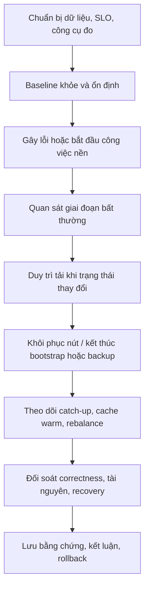
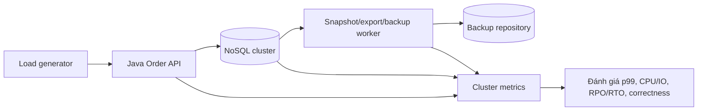
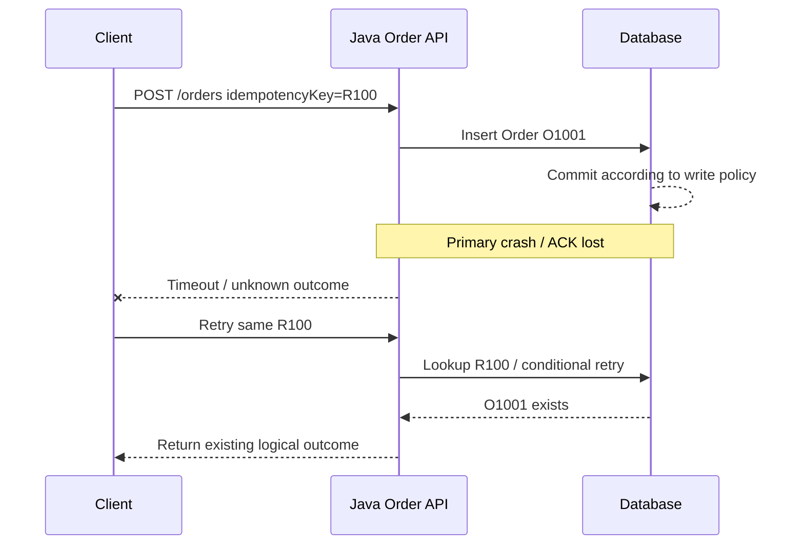

# Đo tải khi mất nút, thêm nút hoặc đang sao lưu

## 1. Bối cảnh: cụm chạy nhanh khi khỏe chưa chắc chịu được thay đổi topology

Một dịch vụ Java dùng NoSQL lưu đơn hàng đang vận hành trên cụm ba nút. Ở trạng thái khỏe mạnh, đo được:

```text
GET /orders/{id} p99:    80 ms
POST /orders p99:       150 ms
Throughput hoàn tất:  4.000 requests/s
HTTP error rate:        0,05%
```

Nhóm phát triển kết luận “đủ khả năng phục vụ 4.000 RPS”. Nhưng sau đó một nút bị mất, cluster cần bầu leader hoặc chuyển các truy vấn sang các replica còn lại. Trong vài phút kế tiếp:

- Một số request bị timeout khi driver chưa cập nhật topology.
- Các nút còn lại phải gánh nhiều traffic hơn.
- Write latency tăng do replication/quorum hoặc leader election.
- Client retry khiến số lần gọi database lớn hơn số logical requests.
- Khi nút trở lại, replication catch-up lại tạo tải disk/network.
- Cùng thời điểm, backup đọc dữ liệu lớn và tranh chấp I/O với ứng dụng.

Một phép đo chỉ chạy khi tất cả nút khỏe mạnh không thể trả lời: **dịch vụ còn giữ SLO khi nút mất, cụm đang mở rộng hoặc tiến trình sao lưu chạy cùng lúc không?**

Đó là mục tiêu của bài học **Database No SQL → Hiệu năng và đo tải → Đo tải khi mất nút, thêm nút hoặc đang sao lưu**.

Chúng ta không chỉ đo “bao nhiêu RPS”, mà còn xem **tỷ lệ thành công, p95/p99, dữ liệu đúng, tài nguyên còn dư và thời gian phục hồi** trong toàn bộ vòng đời biến cố.

---

## 2. Mục tiêu học tập

Sau bài học, bạn có thể:

1. Thiết kế load test khi một node, leader, replica, availability zone hoặc đường mạng gặp lỗi.
2. Phân biệt **mất nút**, **mất kết nối**, **node chậm**, **node restart**, **node đã mất dữ liệu** và **node bị phân vùng mạng**.
3. Đo throughput, tail latency, lỗi và correctness trước, trong và sau failure.
4. Phân biệt sự sẵn sàng ở cấp cluster với **SLO của một API Java cụ thể**.
5. Đo tác động của việc thêm nút, bootstrap, resharding, rebalancing và cache warming.
6. Nhận diện chi phí streaming/replication/repair khi đưa nút mới vào cụm.
7. Phân biệt logical backup, physical snapshot, incremental backup, PITR và restore verification.
8. Thiết kế kịch bản backup đồng thời với production-like reads/writes để đánh giá tranh chấp tài nguyên.
9. Đánh giá consistency, durability, retries, unknown commit và idempotency khi topology đổi.
10. Dùng workload open-loop, theo dõi coordinated omission và kiểm soát load generator.
11. Phân tích đặc điểm MongoDB, Cassandra, Redis, Elasticsearch/OpenSearch và DynamoDB managed.
12. Lập ngưỡng PASS/FAIL, fault-injection safety, dashboard, runbook và kế hoạch capacity N+1.
13. Dựng một bộ benchmark có thể lặp lại, không chỉ ghi lại p99 đẹp nhất.

## 3. “Chịu tải” phải được định nghĩa bằng hợp đồng dịch vụ

Một cụm vẫn trả lời `PING` trong lúc nhiều giao dịch thanh toán timeout. Việc database process còn sống **không đủ** để kết luận hệ còn phục vụ đúng.

Ví dụ hợp đồng thử nghiệm:

```yaml
service: order-api
offeredLoad: 3000 requests_per_second
readWriteMix:
  read: 80_percent
  write: 20_percent
businessRequirements:
  duplicateOrders: 0
  oversoldReservations: 0
  unauthorizedReads: 0
duringOneNodeLoss:
  httpSuccessRatioMin: 99.5_percent
  p99ReadLatencyMax: 500_ms
  p99WriteLatencyMax: 800_ms
  maxRecoveryDuration: 120_s
  maxUnknownOutcomeAge: 300_s
```

Các ngưỡng chỉ là **ví dụ**. Trong dự án thật, cần xác định bởi SLO, workload, mô hình replication và mức rủi ro nghiệp vụ.

### 3.1. Những nhóm kết quả phải đo riêng

| Nhóm | Câu hỏi |
| --- | --- |
| **Availability** | Requests có nhận kết quả hợp lệ không? |
| **Latency** | p50/p95/p99 và tỷ lệ vượt ngưỡng biến đổi thế nào? |
| **Throughput** | Hệ hoàn tất bao nhiêu thao tác, so với offered load? |
| **Correctness** | Có dữ liệu sai, mất, trùng hoặc stale vượt mức không? |
| **Durability** | Những writes đã ACK có còn sau failure theo contract không? |
| **Recovery** | Mất bao lâu để trở lại mức ổn định đã định nghĩa? |
| **Resource headroom** | Nút còn lại có CPU/IO/network/queue dự phòng không? |
| **Operational cost** | Bootstrap/backup/catch-up tiêu tốn bao nhiêu bandwidth/IOPS? |

**Một phép thử PASS về latency nhưng FAIL về mất dữ liệu vẫn là FAIL của dịch vụ.**

## 4. Ba biến cố khác nhau: mất nút, thêm nút, sao lưu

| Biến cố | Thay đổi chính | Tải phụ thường xuất hiện |
| --- | --- | --- |
| **Mất nút** | Giảm capacity/replica/leader availability | Failover, retries, re-replication, repair |
| **Thêm nút** | Tăng capacity tiềm năng, đổi topology | Data streaming, partition movement, index rebuild |
| **Đang sao lưu** | Đọc/chụp trạng thái nguồn và ghi sang nơi lưu backup | Disk read, CPU, network egress, object storage I/O |

Chúng cũng có thể **chồng lên nhau**: backup đang chạy thì nút mất; nút mới bootstrap trong lúc cụm bận. Tuy nhiên trước khi thử tổ hợp, phải hiểu từng biến cố riêng để biết nguyên nhân.

### 4.1. Không mọi “node” đều có cùng vai trò

Một cụm có thể chứa:

- Data node.
- Replica/follower.
- Primary/leader.
- Coordinator/router.
- Index/search node.
- Config/metadata/control-plane node.
- Cache node.
- Dedicated backup worker.

Mất leader khác mất follower; mất coordinator khác mất data shard. Trong thiết kế thử nghiệm phải nêu **vai trò, zone, shard placement, replica count và endpoint bị ảnh hưởng**.

## 5. Vòng đời một thí nghiệm thay đổi topology



Đừng kết thúc benchmark ngay khi node báo `UP`. Giai đoạn sau sự cố có thể có **read repair, replay, compaction, index recovery hoặc cache warming** khiến p99 xấu hơn cả thời điểm mất nút.

### 5.1. Mốc thời gian đề xuất

```text
T-10m..T0:  Baseline và warmup
T0:        Fault hoặc maintenance bắt đầu
T0..T+2m:  Failover / topology transition
T+2..10m:  Sustained reduced-capacity workload
T+10m:     Fault removed / node introduced / backup completed
T+10..25m: Catch-up / rebalance / warmup
T+25m:     Stability & correctness verification
```

Mốc chỉ minh họa. Với cụm dữ liệu lớn, bootstrap hoặc repair có thể lâu hơn nhiều; **thời gian thử phải phản ánh vận hành thực**.

## 6. Ghi trạng thái ban đầu đủ để lặp lại

Một benchmark không có metadata khó tái hiện.

| Thông tin | Ví dụ cần ghi |
| --- | --- |
| Product/version | MongoDB/Cassandra/Redis/Search phiên bản cụ thể |
| Topology | 3 data nodes, RF/replicas, zones, shards |
| Java runtime/client | JDK, driver/SDK, connection pool |
| Dataset | Document count, average size, large partitions |
| Query mix | GET point, range, update, insert, aggregate |
| Key distribution | Uniform, skew, hot key |
| Consistency | Read/write concern, CL, retry policies |
| Cache | Warm/cold, HIT ratio, TTL |
| Network | Cross-zone/region RTT và bandwidth |
| Backups | Snapshot/logical/PITR, target location |
| Background tasks | Compaction, index, CDC, repair |
| Test traffic | Arrival model, offered/achieved RPS |
| Observability | Histogram buckets, timers, tracing rate |
| Fault | Loại node, thời điểm, cách khôi phục |

### 6.1. Dùng dataset đủ lớn

Một cụm chứa 1.000 documents nằm toàn bộ trong RAM không đại diện cho production có hàng tỷ records, compaction, disk pressure và replica catch-up.

Cần dữ liệu có:

- Phân bố kích thước và key thực tế.
- Index và các tập truy vấn quan trọng.
- Tombstone/TTL, nếu backend có.
- Dữ liệu vừa ghi và dữ liệu lâu năm.
- Hot tenants/partitions.
- Dung lượng vượt RAM khi yêu cầu bài test chạm disk.

## 7. Phân biệt offered load, sent load và achieved throughput

Một test đặt mục tiêu 5.000 RPS không có nghĩa server thật sự nhận đủ 5.000 RPS.

```text
Offered schedule:  5.000 requests/s
Actually sent:     4.600 requests/s
Completed success: 3.700 requests/s
Timed out:           500 requests/s
Rejected:            400 requests/s
Outstanding queue:  tăng
```

Nếu chỉ ghi `3.700 RPS`, không biết đó là giới hạn server hay do load generator không kịp phát.

### 7.1. Bốn bộ đếm khác nhau

- **Scheduled arrivals:** theo mô hình workload dự kiến.
- **Sent requests:** đã thực sự bắt đầu gửi.
- **Terminal outcomes:** thành công, lỗi, timeout, cancel.
- **Business logical operations:** sau dedup/idempotency.

Trong quá trình failover, số DB attempts có thể tăng dù số logical requests không đổi.

### 7.2. Open-loop và closed-loop

- **Open-loop:** phát requests theo lịch arrivals độc lập với thời gian phản hồi.
- **Closed-loop:** mỗi virtual user chờ response rồi mới gửi tiếp theo quy tắc.

Closed-loop có thể mô phỏng người dùng hữu hạn, nhưng khi server stall, nó giảm số requests phát trong khoảng stall và có nguy cơ **coordinated omission** nếu mục đích là đo arrival rate không đổi.

Không nói một mô hình luôn đúng; chọn mô hình theo workload thực và ghi rõ trong báo cáo.

## 8. p50/p95/p99 trong các pha sự cố

Một báo cáo có thể như sau:

| Pha | p50 | p95 | p99 | Errors |
| --- | ---: | ---: | ---: | ---: |
| Healthy baseline | 20 ms | 80 ms | 150 ms | 0,1% |
| Leader election | 40 ms | 900 ms | 3.000 ms | 5,0% |
| One node absent | 30 ms | 160 ms | 500 ms | 0,7% |
| Node returns/catches up | 35 ms | 220 ms | 800 ms | 0,5% |
| Stable after recovery | 20 ms | 85 ms | 155 ms | 0,1% |

**Số liệu minh họa**, không phải kết quả đo thật. Bảng giúp thấy p99 có thể xấu nhất **trong giai đoạn bắt đầu hoặc phục hồi**, không nhất thiết trong giai đoạn duy trì một nút lỗi.

### 8.1. Không chỉ đo p99 của successful requests

Giả sử 15% requests bị timeout sau 10 giây, còn 85% thành công trong 50 ms. Nếu histogram chỉ ghi success:

```text
p99(success-only) = 50 ms
```

Nhưng trải nghiệm người dùng rất xấu. Cần báo:

```text
HTTP duration theo outcome
Error / timeout / cancelled ratio
Good-event ratio theo SLO
Unknown write outcomes
```

### 8.2. Quantiles không cộng hoặc trung bình được

Không lấy:

```text
average(p99(node A), p99(node B))
```

để suy p99 toàn cụm. Phải merge histogram bucket counts/sketches tương thích hoặc đo end-to-end tại API.

### 8.3. Đánh dấu mốc fault

Các biểu đồ cần annotations:

```text
fault_started
node_marked_down
leader_elected
traffic_rerouted
node_healthy
replica_caught_up
backup_started
backup_finished
```

Nếu không, một spike p99 rất khó liên hệ với sự kiện nào.

## 9. Kiểm thử mất nút: không chỉ có “kill -9”

Những dạng lỗi khác nhau:

| Loại | Mô tả | Rủi ro khác biệt |
| --- | --- | --- |
| Graceful shutdown | Node dừng có chủ đích | Draining/routing có thể thuận lợi |
| Process crash | Không cleanup | Mất in-flight state |
| Machine power loss | Toàn máy ngừng | Disk/network/host failure |
| Node không nhận inbound | Phân vùng một chiều | Half-open connections |
| Node không gửi outbound | Network partition | Quorum/heartbeat issue |
| Packet loss cao | Chậm, không hẳn chết | Retries và tail |
| Disk full | Process sống nhưng write fail | Backpressure hoặc consistency |
| Disk I/O stall | Node vẫn heartbeat một phần | Slow replica, timeout |
| CPU/GC pause | Slow node | Request backlog/leader suspicion |
| DNS/service discovery lỗi | App không route đúng | Client-side failure |
| Zone unavailable | Nhiều nodes cùng bị ảnh hưởng | Correlated failure |
| Restart với dữ liệu cũ | Node quay lại cần catch-up | Replay, re-replication |
| Unclean restore | Có state/version lệch | Reconciliation cần thiết |

### 9.1. Graceful stop không đại diện crash

Một graceful shutdown có thể chuyển leader trước khi dừng, flush state và ngăn nhận requests mới. Process crash không làm những bước đó.

Cần test cả hai nếu production failure model yêu cầu; **kết quả graceful maintenance đẹp không chứng minh crash recovery tốt**.

### 9.2. Slow node khác absent node

Một node trả kết quả sau 5 giây có thể tệ hơn node chết hẳn: router và client còn đợi nó trước khi timeout/failover. Thử artificial latency và packet loss, không chỉ tắt process.

### 9.3. Không tạo split-brain ngoài phạm vi kiểm thử an toàn

Network partition có thể làm các bên tin mình còn quyền ghi. Test phải hiểu ownership/quorum/fencing của engine, kiểm tra invariant và cách phục hồi trước khi inject. Không tự partition production một cách tùy tiện.

## 10. Sẵn sàng phục vụ và quorum

Giả sử một nhóm replication đơn giản có \(N\) replicas và một thao tác đòi \(W\) ghi, \(R\) đọc từ replicas.

Một trực giác hay gặp:

\[
R+W>N
\]

Trong một mô hình quorum cố định và nhất quán, điều kiện có thể bảo đảm các tập đọc/ghi giao nhau. Tuy nhiên **giao nhau không tự bảo đảm linearizability**; còn phụ thuộc timestamp/conflict protocol, leader, version và cách engine xử lý đọc/ghi.

### 10.1. Ví dụ replication factor 3

Với ba bản sao trên ba failure domains:

```text
N=3
Write yêu cầu 2 replicas
Một replica mất
Còn 2 replicas khỏe
```

Có thể vẫn ghi được nếu placement, coordinator, network và engine contract cho phép.

Nhưng nếu hai replicas mất hoặc bị partition đúng cách, write quorum có thể không đạt.

### 10.2. Quorum trong các engine khác nhau

- MongoDB có replica-set majority và leader election theo cơ chế riêng.
- Cassandra có consistency levels (`ONE`, `QUORUM`, `LOCAL_QUORUM`, v.v.) và behavior riêng.
- Elasticsearch/OpenSearch có shard primary/replica allocation và write acknowledgements riêng.
- Redis replication thường không tương đương một majority transactional commit trên mọi cấu hình.

Không lấy một công thức chung rồi suy mọi NoSQL có cùng availability/consistency semantics.

## 11. Thiết kế ma trận mất nút

| Biến cố | Tải | Điều cần xác minh |
| --- | --- | --- |
| Mất follower | Mixed read/write | Reads/routing, replica count, lag |
| Mất leader/primary | Mixed read/write | Election downtime, write errors, retry |
| Mất data node chứa hot shard | Skewed reads | Hotspot, relocation, p99 |
| Mất coordinator/router | HTTP queries | Client reconnect/discovery |
| Node vẫn sống nhưng RTT tăng | Mixed load | Long tails và timeouts |
| Mất node ngay sau write ACK | Writes | Durability theo policy |
| Mất node khi transaction commit | Conditional transactions | Unknown outcome và idempotency |
| Mất node trong backup | Mixed + backup | Backup fail/restart và request impact |
| Nút trở lại với backlog | Mixed load | Catch-up IO, p99, completion |
| Mất một zone | Cross-zone load | Correlated failure và headroom |

**Chọn những hàng phù hợp với topology thực**, không cần cố diễn tất cả loại node nếu service không có role đó.

## 12. Java driver phải thích nghi topology thay đổi

Một ứng dụng Java không chỉ chịu ảnh hưởng server mà còn bởi client driver/SDK:

```text
Application thread
  -> Driver pool
  -> Topology discovery
  -> Server selection / routing
  -> Network connect/reuse
  -> Retry and backoff
  -> Response/timeout
```

Các yếu tố làm p99 tăng:

- DNS cache giữ địa chỉ cũ.
- Socket chưa phát hiện node chết.
- Server selection timeout.
- Connection pool đang chờ node lỗi.
- Driver chưa nhận topology event.
- Thay leader nhưng request vẫn đi tới primary cũ.
- Số retries bên SDK và application nhân nhau.
- Thông số read preference/local DC không hợp lý.

### 12.1. Client reuse

Trong web service Java, driver client và connection pool thường được **dùng chung lâu dài**, không tạo lại theo mỗi HTTP request. Nhưng **session/cursor/transaction** có lifecycle ngắn và thread-safety riêng.

### 12.2. Timeout phải có ngân sách

Phân biệt:

```text
connect timeout
TLS handshake timeout
connection acquisition timeout
server selection timeout
request/socket timeout
transaction deadline
HTTP end-to-end deadline
```

Một API có deadline 800 ms nhưng driver giữ request 10 giây có thể tạo **in-flight backlog** và hủy/timeout lệch nhau.

### 12.3. Retry không biến một write thành idempotent

Một write có thể commit nhưng ACK mất khi leader failover. Nếu app tự tạo Order ID mới ở retry, có thể tạo dữ liệu trùng.

Cần **operation ID ổn định, conditional write, transaction semantics và authoritative outcome lookup** tùy backend.

## 13. Tính đúng đắn sau failover: đếm gì?

Đừng chỉ kiểm tra HTTP trả 200.

Một tập invariant cho Order API:

| Invariant | Cách xác minh |
| --- | --- |
| Mỗi idempotency key tạo tối đa một Order | Lookup source theo operation ID |
| Quantity/reserved stock không âm | Đối soát trạng thái nguồn |
| Order version không lùi | So monotonic revisions |
| Write ACK còn sau failover theo durability contract | Read từ authoritative path với consistency phù hợp |
| Không ghi nhận payment hai lần | Provider/ledger reconciliation |
| Event outbox không bị bỏ mất | Outbox/broker/consumer checkpoint |
| Delete không hồi sinh dữ liệu cũ | Tombstone/version guard |
| Tenant A không đọc dữ liệu B | Authorization test |

### 13.1. Phân biệt timeout và thất bại chắc chắn

```text
Client sends write
Server commits
Server crashes before ACK
Client sees TIMEOUT
```

Đây là **unknown outcome**, không phải bằng chứng “write failed”. Test cần có đường xác minh bằng stable operation ID.

### 13.2. Invariants quan trọng hơn tốc độ

Nếu giảm consistency để p99 đẹp nhưng làm double reservation, hệ chưa đạt mục tiêu. Khi so hai cấu hình, phải giữ **cùng correctness contract**, hoặc nêu rõ đánh đổi và được nghiệp vụ chấp nhận.

## 14. Capacity N+1: cơ sở của bài test mất nút

Nếu cụm có \(N\) nodes với tải được chia đều và một node mất, những nodes còn lại phải gánh phần tải bị mất.

Với tải tổng không đổi và capacity chia đều, hệ số tải bình quân trên mỗi node còn lại xấp xỉ:

\[
F=\frac{N}{N-1}
\]

Ví dụ ba data nodes:

\[
F=\frac{3}{2}=1,5
\]

Tải mỗi node có thể tăng khoảng **50%** khi một node ngừng phục vụ.

### 14.1. Đây chỉ là ước lượng đơn giản

Thực tế có thể khác mạnh do:

- Một key rất nóng đặt ở node mất.
- Replication traffic và failover coordination.
- Index/shard placement không đều.
- Nút còn lại không có đủ disk/memory.
- Quorum thay đổi routing.
- Read replica traffic không chuyển đều.
- Client retries tăng.
- Backup/compaction cùng lúc.

**Không đặt SLO trên giả định N/(N−1) mà không đo**.

### 14.2. Headroom phải được kiểm chứng

Nếu mọi node đã dùng 85% write capacity khi khỏe, việc mất một node có thể làm cụm quá tải, dù cluster có replication đủ để tiếp tục phục vụ.

Capacity planning phải tính cả **capacity trong failure mode**, không chỉ healthy throughput cực đại.

## 15. Phân pha load test một nút mất

Một kịch bản rõ:

```text
Phase 1: 10 phút warm baseline ở 2.000 RPS
Phase 2: Tắt một data node được chọn
Phase 3: Giữ 2.000 RPS qua leader/routing transition
Phase 4: Duy trì 2.000 RPS trong 10 phút khi thiếu node
Phase 5: Cho node trở lại
Phase 6: Giữ tải qua replication catch-up
Phase 7: Xác minh dữ liệu và ổn định
```

### 15.1. Phải ghi cả mốc topology

```text
T_fault_requested
T_node_unreachable
T_failure_detected
T_new_leader_elected
T_clients_route_to_healthy_nodes
T_node_rejoins
T_replication_lag_zero_or_acceptable
T_service_SLO_stable
```

Các mốc có thể không tuyến tính tuyệt đối giữa nhiều hosts vì clock skew, nên cần đồng bộ clock và IDs/metric events với scope rõ.

### 15.2. Recovery time là đại lượng nghiệp vụ

`node process started` không bằng `service recovered`. Có thể định nghĩa:

> Thời gian từ lúc khôi phục kết nối tới khi tỷ lệ good requests, p99 và replication lag ổn định liên tục trong một cửa sổ đã thỏa thuận.

Không chỉ đo đến lệnh `PING` thành công.

## 16. Thêm nút không tự tăng throughput ngay lập tức

Một nhóm vận hành bổ sung data node thứ tư vào cụm đang có ba nút và kỳ vọng tăng ngay 33% throughput.

Nhưng hệ có thể trải qua:

```text
Node provisioned
  -> Authentication and cluster join
  -> Metadata/topology updated
  -> Data/bootstrap streaming
  -> Shards/partitions moved
  -> Indexes built / replicas initialized
  -> Cache warm
  -> Client routing stabilizes
```

Trong giai đoạn này, **capacity usable có thể chưa tăng**; data movement còn làm giảm throughput thực.

### 16.1. Phân biệt scale-out và rebalance

- **Scale-out:** bổ sung tài nguyên/nút.
- **Rebalance:** di chuyển workload/partitions để tận dụng tài nguyên mới.
- **Bootstrap:** nạp dữ liệu/state ban đầu cho node.
- **Repair/catch-up:** đồng bộ các writes/snapshots bị thiếu.
- **Cache warm:** đưa hot working set vào RAM/page cache.

Một nút mới có mặt trong topology chưa chắc đã chứa dữ liệu hoặc được phép phục vụ traffic theo yêu cầu.

## 17. Ba pha khi thêm nút

| Pha | Hiện tượng | Cần đo |
| --- | --- | --- |
| Trước khi thêm | Cluster cân bằng ở N nodes | Baseline và headroom |
| Đang thêm/bootstrap/rebalance | Data streaming, routing đổi | p99, IO, network, throttle, movement progress |
| Sau khi cân bằng | N+1 nodes phục vụ ổn định | Throughput tại cùng SLO, hotspot, capacity |

### 17.1. Thử cùng offered load trước và trong

Giữ 2.000 RPS để xem quá trình thêm nút có gây **temporary regression** hay không.

### 17.2. Thử tìm capacity mới sau khi ổn định

Chạy load ladder sau rebalance, ví dụ:

```text
2000 -> 2500 -> 3000 -> 3500 RPS
```

Nhưng không suy phần trăm tăng chỉ từ node count; đo throughput **tại cùng error/latency/correctness SLO**.

### 17.3. Thử khi tải cao sẵn

Bootstrap lúc baseline 10% capacity khác hoàn toàn lúc flash sale 75%. Một bài kiểm thử cần ít nhất một trường hợp cluster đang ở tải thực tế cao nhưng còn trong headroom cho phép.

## 18. Rebalance và streaming dùng những tài nguyên gì?

Một tiến trình di chuyển dữ liệu có thể tiêu tốn:

- Disk reads tại nodes cũ.
- Disk writes ở node mới.
- Network bandwidth giữa nodes/zones.
- CPU cho compression/decompression/checksum.
- Memory page cache.
- Connection slots và queues.
- Background compaction/index creation.
- Metadata/control-plane updates.

Do đó cần đo cả **application requests** lẫn **background movement**.

### 18.1. Metric cho rebalancing

```text
bytes_to_move
bytes_moved
movement_bytes_per_second
active_streams
pending_partitions_or_shards
disk_read_iops
disk_write_iops
disk_latency
network_in_out
compaction_backlog
replica_lag
client_error_rate
```

Tùy backend, nhiều metrics có tên/semantics khác hoặc không được cung cấp trực tiếp.

### 18.2. Đừng chỉ nhìn phần trăm progress

Nếu progress đang ở 90% nhưng còn một partition rất lớn hoặc corrupted, thời gian còn lại có thể kéo dài. Cần **bytes/ranges còn lại, rate và blockers**, không dự báo tuyến tính máy móc.

## 19. Hot partition không tự biến mất khi thêm nút

Ví dụ một partition key nhận 70% traffic. Thêm node thứ tư nhưng partition key ấy vẫn được phục vụ bởi một tập replica/owner nhất định.

```text
Cluster nodes: A, B, C -> A, B, C, D
Hot key:       P100    -> vẫn là P100
```

Tổng cluster có thể tăng capacity nhưng **p99 của hot key không cải thiện**, vì bottleneck vẫn nằm ở một logical key/partition.

### 19.1. Hướng điều tra

- Có thể repartition/shard lại key theo domain?
- Có thể phân tách read/write load?
- Dữ liệu có phù hợp cache hoặc materialized read model?
- Một atomic counter quá nóng có thể chuyển sang escrow/batched model với invariant phù hợp?
- Có latency do secondary index/transaction conflicts không?

### 19.2. Thử hai phân bố dữ liệu

1. Uniform keys.
2. Zipf-like/hot key distribution.

Chỉ test uniform dễ tạo ảo tưởng scale-out tuyến tính.

## 20. Khi thêm nút có thể làm performance xấu hơn

Một số nguyên nhân:

- Data streaming gây bão hòa network.
- Compaction/index build cạnh tranh disk.
- Cluster routing thay đổi làm cache của client/OS lạnh.
- Thêm replica làm write replication cost tăng theo cấu hình.
- Connection pools tạo thêm connections/heartbeats.
- Nút mới chưa warm page cache nên reads chậm.
- Các partitions bị di chuyển nhiều lần do cấu hình rebalance sai.
- Query coordinator phân phối sai hoặc topology metadata chưa đồng bộ.

**Đo tải trong lúc thêm nút** là bài toán riêng với **đo tải sau khi thêm nút**.

## 21. Backup: một tiến trình nền có thể tác động user latency

Một backup có thể là:

- **Logical backup/export:** duyệt records/documents và ghi dữ liệu ở định dạng logic.
- **Physical snapshot:** chụp dữ liệu ở mức storage/volume/file theo cơ chế hỗ trợ.
- **Incremental backup:** chỉ lưu các phần thay đổi theo chính sách.
- **Point-in-time recovery (PITR):** kết hợp snapshot/log/change history để có thể khôi phục tới mốc thời gian hợp lệ.
- **Managed backup:** nhà cung cấp thực hiện nhiều bước phía service, khách hàng có thể chỉ thấy API/status.

Tác động hiệu năng phụ thuộc:

```text
Backup implementation
Source read path
Snapshot consistency
Disk IO behavior
Compression and encryption
Destination bandwidth
Backup target latency
Retention/log pressure
```

Không thể nói “backup không ảnh hưởng hiệu năng” cho mọi loại NoSQL và mọi phiên bản.

## 22. Backup nhất quán khác backup hoàn tất

Một file backup được tạo xong chưa chắc có thể restore thành trạng thái hợp lệ.

Cần hỏi:

- Snapshot có là một consistency cut hợp lệ không?
- Backup đa shard/partition có cùng mốc logic không?
- Các writes đang diễn ra được phản ánh theo cơ chế nào?
- Có transaction nào ở trạng thái nửa chừng sau restore không?
- Có đủ logs để PITR về mốc yêu cầu không?
- Restore đã được kiểm chứng trên môi trường riêng chưa?
- Encryption keys và credentials khôi phục có còn không?
- Backup có data/schema/index/config/ACL cần thiết không?

### 22.1. RPO và RTO

**Recovery Point Objective (RPO)**: lượng dữ liệu tối đa được phép mất, thường biểu diễn bằng khoảng cách giữa biến cố và điểm có thể khôi phục.

**Recovery Time Objective (RTO)**: thời gian tối đa mục tiêu để khôi phục dịch vụ theo định nghĩa.

Ví dụ:

```text
RPO target <= 5 minutes
RTO target <= 30 minutes
```

Đây là mục tiêu thiết kế. Có backup chạy mỗi 15 phút **chưa đủ chứng minh** RPO 5 phút nếu không có log/PITR phù hợp.

### 22.2. Backup success không bằng restore success

Một job kết thúc `SUCCESS` nhưng restore mất nhiều giờ, thiếu encryption key hoặc không phục hồi được indexes vẫn có thể không đáp ứng RTO.

Đo **cả backup under load và restore drill**, nhưng restore nên thực hiện trong sandbox cô lập, không ghi đè cluster đang chạy.

## 23. Đo tải khi backup đang chạy: sơ đồ



Một bài test backup đúng phải giữ tải ứng dụng và quan sát đồng thời:

- Backup có hoàn thành?
- Application SLO có bị ảnh hưởng?
- Replication lag tăng bao nhiêu?
- Compaction/checkpoint backlog sau backup?
- Backup có chứa dữ liệu nhất quán?
- Restore có được không?
- Sau backup p99 có trở lại baseline?

## 24. Các dạng backup gây tranh chấp tài nguyên

| Backup | Tài nguyên có thể bị tranh chấp | Ghi chú |
| --- | --- | --- |
| Logical export toàn bảng | Query reads, CPU serialization, network | Có thể gây scan load |
| Snapshot storage | I/O metadata và copy-on-write | Ảnh hưởng phụ thuộc storage |
| Copy snapshot ra object storage | Disk read, network egress, compression | Có thể kéo dài khi bandwidth thấp |
| PITR/log archiving | Log throughput, log retention/disk | Lag có thể tăng khi đích chậm |
| Backup từ replica | Replica read/IO và replication catch-up | Có thể giảm tải primary nhưng không miễn phí |
| Index-inclusive backup | Disk/network và index state | Tùy sản phẩm |
| Incremental backup | Delta scan, metadata và log | “Incremental” không luôn rẻ |
| Managed online backup | Hạ tầng service cấp thêm | Cần xác minh limit/metrics theo nhà cung cấp |

### 24.1. Backup từ replica có ưu và nhược

Đưa backup lên replica có thể tránh cạnh tranh trực tiếp với leader writes. Nhưng:

- Replica vẫn cần theo kịp writes.
- Backup đọc nhiều có thể gây replication lag.
- Nếu replica ấy cũng phục vụ user reads, p99 read tăng.
- Nếu replica mất lúc đang backup, backup có thể phải khởi động lại.
- Snapshot phải theo contract consistency; không chọn replica stale rồi giả định có mọi committed write.

## 25. Ma trận đo tải khi backup

| Kịch bản | Workload | Câu hỏi chính |
| --- | --- | --- |
| Không backup | Mixed reads/writes | Baseline |
| Backup nhẹ | Normal traffic | Có overhead thường xuyên không? |
| Full backup | Peak traffic | p99 và resource saturation |
| Incremental backup | Normal/peak | Delta change rate ảnh hưởng gì? |
| Backup trên replica | Mixed load | Replica lag/read latency |
| Backup khi write burst | Heavy inserts/updates | WAL/log, IOPS và snapshot |
| Backup với data compaction | Mixed load | I/O contention |
| Backup bị ngắt giữa chừng | Mixed load | Cleanup và retry behavior |
| Backup target quá chậm | Mixed load | Queue, disk retention, backpressure |
| Backup trong lúc một node mất | Reduced-capacity load | Có đủ capacity để tiếp tục? |
| Restore drill riêng | Isolated recovery environment | RPO/RTO và correctness |

### 25.1. Cần đo cửa sổ dài

Một full backup trên dataset lớn có thể kéo dài hàng giờ. Benchmark vài phút chỉ đo giai đoạn khởi đầu, bỏ qua tác động lâu dài, log retention hoặc compaction backlog.

### 25.2. Thử backup cuối kỳ

Ở một số hệ, việc finalize snapshot, upload manifest hoặc compact metadata tạo spike ngắn. Đừng dừng bài test ngay trước khi backup hoàn tất.

## 26. Backup có thể làm tăng tail latency mà mean không đổi nhiều

Ví dụ 95% requests chỉ đọc từ page cache, còn 5% phải đọc disk. Backup cùng lúc thực hiện sequential reads lớn:

```text
Cached requests:   ~10 ms
Disk-bound reads:   50 ms -> 700 ms
```

Mean tổng thể có thể chỉ tăng vừa phải, nhưng p95/p99 tăng mạnh.

### 26.1. Đo theo operation và shard

Nếu backup quét data shard A, chỉ queries chạm A chậm. p99 cluster-level có thể che một tenant quan trọng đang nằm trên A.

Báo thêm:

```text
Latency by query fingerprint
Latency by shard/region
Read vs write p99
Disk queue / IO latency
Compaction and replication lag
```

### 26.2. Bản thân backup cũng có tail

Đừng chỉ đo tổng backup duration; xem throughput sao lưu theo thời gian, retries và stalls khi object storage/network chậm.

## 27. Metrics theo ba pha: trước, trong, sau

| Lớp | Những chỉ số cốt lõi |
| --- | --- |
| HTTP | Offered/sent/completed rate, 2xx/4xx/5xx, timeout |
| Business | Unique intents, duplicate side effects, unknown outcomes |
| Latency | p50/p95/p99 theo operation và outcome, good-event ratio |
| Client | Pool wait, connection errors, discovery, retry attempts |
| Query | Query fingerprint, rows/bytes scanned, slow operations |
| Cluster | Node health, leader, members, shard allocation |
| Replication | Lag, under-replicated ranges, pending repairs |
| Compute | CPU usage/throttling, GC pauses, thread queues |
| Disk | IOPS, latency, throughput, utilization, free space |
| Network | Bytes/s, RTT, retransmits, egress |
| Movement | Shards/partitions moving, stream progress |
| Backup | Backup duration, progress, lag, failures, bytes written |
| Recovery | Time to SLO, time to replica convergence |
| Correctness | Read stale ratio, duplicates, missing writes |
| Cost | Network/IO/object storage usage nếu cần |

### 27.1. Đừng gắn ID thô làm metric label

Tránh `orderId`, `userId`, `idempotencyKey` hoặc raw partition key trong metrics. Dùng bounded labels cho operation, phase, outcome, region, node role; cần tìm hot keys thì dùng diagnostics/sample traces có bảo mật.

### 27.2. Cần cả “oldest pending”

Nếu replication/CDC/backup job dừng và không tạo completed samples mới, biểu đồ latency của jobs **đã xong** có thể vẫn đẹp. Theo dõi oldest pending age, checkpoint age, backlog và completion freshness.

## 28. Dashboard trước khi inject lỗi

Một dashboard nên có panels:

```text
A. API traffic + error/timeout/good events
B. p50/p95/p99 by read/write/query class
C. Driver pool wait + retries + topology changes
D. Cluster node health + leader/primary timeline
E. Replica/shard status + lag + rebalance progress
F. CPU/GC/heap + disk/network saturation
G. Hot partition/shard contribution
H. Backup progress/duration/bytes/target errors
I. Outbox/CDC backlog + consumer lag
J. Correctness monitors + unknown write outcomes
K. Fault/deploy markers
```

Sắp xếp biểu đồ cùng time range. Nếu các timestamps từ hosts lệch, dựa thêm vào event IDs/sequence và đồng bộ thời gian để tránh suy luận sai.

## 29. MongoDB: mất primary, secondary và sao lưu

MongoDB replica set có roles primary/secondaries và cơ chế election.

### 29.1. Mất primary

Kịch bản:

```text
Writes qua primary đang diễn ra
Primary bị mất đột ngột
Election diễn ra theo topology
Driver phát hiện primary mới
Writes tiếp tục theo policy
```

Cần đo:

- Window không nhận writes.
- Election duration và driver server-selection behavior.
- Error/timeout rate.
- Retryable write results.
- Unknown transaction commit outcomes.
- Replication lag và rollback risks theo write concern.
- p99 trước/trong/sau election.

### 29.2. Mất secondary

Có thể ảnh hưởng:

- Read preference trỏ tới secondaries.
- Majority availability nếu replica configuration thiếu.
- Backup đang chạy trên secondary.
- Replication catch-up khi node trở lại.

Đọc từ secondary có thể stale theo semantics, nên thêm **freshness/read-your-writes checks** nếu API cần.

### 29.3. Sharded MongoDB

Thử thêm shard hoặc mất một shard data node có thể kéo theo:

- Chunk/range migration.
- Balancer activity.
- Router metadata refresh.
- Network streaming.
- Shard-targeting changes.

Một query thiếu shard key có thể scatter–gather và p99 chịu ảnh hưởng từ shard chậm.

### 29.4. Backup MongoDB

Phân biệt snapshot, công cụ dump/restore và phương án managed backup theo môi trường/phiên bản. Một `mongodump` quét nhiều dữ liệu có thể tạo tải đọc; snapshot cần bảo đảm consistency cut. Với cluster sharded hoặc transactions, phải dùng cơ chế backup/restore đáp ứng tính nhất quán của **toàn deployment**, không ghép tùy tiện nhiều bản chụp ở các thời điểm độc lập.

## 30. Cassandra: mất replica, bootstrap và backup

Cassandra phân phối dữ liệu theo token/range và replication factor; driver CQL có consistency level và local datacenter configuration.

### 30.1. Mất một node với RF=3

Ví dụ `LOCAL_QUORUM` thường cần đủ replicas ở local DC theo số lượng bản sao cấu hình. Khi một replica mất, operation có thể vẫn phục vụ nếu số replicas khỏe/placement và network đáp ứng.

Test:

```text
RF / DC placement
CL of reads/writes
One replica unavailable
One replica slow
Coordinator routing
```

Không gộp outcome `Unavailable` với `Timeout` thành một trường hợp: nguyên nhân và retry semantics khác nhau.

### 30.2. Nút quay lại: hinted handoff và repair

Tùy phiên bản/cấu hình, hệ có thể xử lý hints, anti-entropy repair và streaming dữ liệu. Cần đo:

- Pending hints và replay rate.
- Replica divergence/repair backlog.
- Disk IO/compaction.
- Tombstones.
- Coordinator timeout/p99.
- Quorum success.
- Latency sau node restart.

**Một node ở trạng thái UP không chứng minh dữ liệu đã hội tụ.**

### 30.3. Thêm nút Cassandra

Bootstrap có thể streaming token ranges. Hỏi:

- Streaming lấy dữ liệu từ nodes nào?
- Network/disk có bị bão hòa?
- Token placement có cân bằng thật không?
- Client local DC có đúng?
- Có hot partition nằm ở một replica set vẫn là bottleneck?
- Khi node mới thành serving member, p99 thay đổi thế nào?

### 30.4. Snapshot và incremental backup

Cassandra có cơ chế snapshot/backups theo công cụ/version. File snapshot vật lý trên từng node không tự là một backup ứng dụng nhất quán toàn cụm. Restore còn cần keyspace/schema, token/range placement, manifest, quyền và phương án xử lý dữ liệu mới hơn.

## 31. Redis: failover nhanh nhưng có thể mất cached writes

Redis thường đóng vai cache, nhưng cũng có deployment dùng làm nguồn dữ liệu chính với durability policy riêng.

### 31.1. Redis standalone

Mất node có thể làm mọi key trong instance không truy cập được. Load test phải xem source fallback có bị nhân tải hay không.

### 31.2. Redis Sentinel hoặc Cluster

Khi primary mất:

- Replica có thể được promote.
- Clients reconnect và cập nhật topology.
- Redis Cluster có thể chuyển slot ownership.
- Lệnh có thể nhận redirects hoặc lỗi tạm.
- Một số writes gần failover có thể không xuất hiện ở replica mới nếu replication bất đồng bộ.

Đây là lý do không lấy Redis replication mặc định làm bảo đảm **zero data loss** cho mọi nghiệp vụ.

### 31.3. Thêm Redis node

Không có nghĩa keys tự phân bố đều. Với Cluster cần xem **slot migration/resharding** và client hỗ trợ `MOVED`/`ASK` theo giao thức.

### 31.4. Backup Redis

RDB snapshots, AOF/rewrites và cơ chế managed backup có overhead CPU/memory/disk tùy deployment. Snapshot bằng child process có thể liên quan đến copy-on-write memory khi writes nhiều.

Khi đo tải, theo dõi:

```text
used_memory
memory fragmentation
fork/child activity (nếu có)
copy-on-write memory
AOF rewrite state
disk write latency
blocked clients
evictions
cache hit/miss
```

Không khẳng định mọi Redis managed service dùng đúng cơ chế hoặc xuất mọi metric nêu trên.

## 32. Elasticsearch/OpenSearch: shard allocation và snapshot

Search cluster thường có data nodes và shard primary/replica.

### 32.1. Mất data node

Có thể dẫn tới:

- Shards bị thiếu.
- Replica promotion.
- Relocation/recovery.
- Trạng thái cluster yellow/red tùy placement.
- Search partial failures.
- Bulk/indexing retries.
- Request fan-out chịu chậm ở một shard.

Cần đo **HTTP status và thông tin shard failures trong response**, vì một request có thể trả dữ liệu partial theo cơ chế/config.

### 32.2. Thêm data node

Đây có thể kích hoạt shard relocation và cache cold trên node mới. Theo dõi:

```text
relocating_shards
initializing_shards
unassigned_shards
recovery bytes/s
search p99
bulk item failures
refresh/merge pressure
heap/GC
```

Không suy `cluster health green` tức p99 đã về baseline; cache/index warming vẫn có thể kéo dài.

### 32.3. Snapshot

Snapshot repositories và cơ chế snapshot của từng sản phẩm/phiên bản cần được thiết lập chính xác. Tải chụp snapshot có thể tranh chấp disk/network với search/indexing.

Thử:

1. Search load baseline.
2. Bắt đầu snapshot.
3. Giữ search+bulk load.
4. Theo dõi shard snapshot progress và partial failures.
5. Kết thúc snapshot.
6. Verify manifest và restore vào cluster cô lập.
7. Đo ảnh hưởng sau snapshot.

## 33. DynamoDB và những NoSQL managed services không cho quản lý node

Một số dịch vụ NoSQL là fully managed. Người sử dụng không được **kill node** hoặc **add database node** trực tiếp.

Với DynamoDB, bài test nên chuyển câu hỏi từ node vật lý sang **hành vi service mà ứng dụng quan sát và có thể kiểm soát**:

- SDK network timeout/connection reset.
- Throttling và hot partition.
- GSI propagation lag.
- Capacity mode/scaling behavior.
- Regional endpoint unavailable hoặc latency tăng trong môi trường test.
- Retry/fallback behavior.
- Cross-region replication semantics theo mode.
- Backup/PITR/export API và tác động read/write theo contract.

### 33.1. Không tự suy kiến trúc nội bộ

Không khẳng định “đã thêm ba nodes DynamoDB” nếu khách hàng chỉ thay đổi capacity hoặc partitioning được dịch vụ quản lý tự động.

### 33.2. Fault injection ở biên khách hàng

Có thể mô phỏng mất kết nối qua một fault proxy ở môi trường test, hoặc dùng service-fault capabilities được nhà cung cấp hỗ trợ/phê duyệt. Không thử làm hỏng hạ tầng shared của cloud provider.

### 33.3. Backup DynamoDB

Backup/PITR/exports có service guarantees và giới hạn riêng. Kiểm tra tài liệu theo thời điểm, Region, loại table, encryption, throughput và restore semantics. Một backup được tạo không tự đưa traffic sang table đã restore; cần data validation và kế hoạch cutover.

## 34. Không đánh đồng lỗi transport với thiếu consistency

Một lời gọi NoSQL có thể thất bại vì:

```text
Network timeout
Authentication error
Leader unavailable
Not enough replicas
Read consistency cannot be met
Conditional write rejected
Throttled capacity
Resource not found
```

Những loại lỗi khác nhau cần hành động khác nhau.

| Lỗi | Gợi ý xử lý |
| --- | --- |
| Connect timeout | Check network/topology, bounded retry |
| Primary selection timeout | Theo dõi election, client discovery |
| Quorum unavailable | Không hạ CL bừa, đánh giá availability contract |
| Conditional conflict | Business conflict, không retry mù |
| Throttle | Backoff/jitter và giảm hot partition |
| Unknown write commit | Outcome lookup với operation ID |
| Invalid auth | Sửa IAM/cert/credential, không retry nóng |
| Backup failure | Giữ dữ liệu backup trước, kiểm tra log/target |
| Index/search partial error | Kiểm tra shard item-level failures |
| Stale replica read | Chọn read path/consistency phù hợp |

### 34.1. Business status cần rõ

`HTTP 200` không đủ nếu response có `partialFailure=true`. Ngược lại `HTTP 504` không chứng minh transaction ở nguồn chưa commit. Test harness nên có business assertions ngoài HTTP assertions.

## 35. Thiết kế fault injection có kiểm soát

**Thứ tự ưu tiên:** môi trường giả lập → integration environment → staging production-like → production chỉ khi có chính sách và phê duyệt cụ thể.

Nguyên tắc:

1. Xác định scope của fault.
2. Giới hạn thời lượng và blast radius.
3. Chuẩn bị rollback/kill switch.
4. Khởi động monitoring trước.
5. Xác nhận cluster có bản backup/restore phù hợp.
6. Không dùng dữ liệu cá nhân thật nếu không cần.
7. Chỉ inject trên nodes được phép.
8. Không phá quorum mà chưa hiểu contract.
9. Giữ thông số tải trong capacity budget an toàn.
10. Thu thập trạng thái ứng dụng lẫn database.
11. Dừng thử nếu correctness/security invariant bị vi phạm.
12. Cleanup/recover rồi đối soát.

### 35.1. Dừng service khác giết toàn host

Trong test, có thể dùng orchestration/lab tooling để dừng đúng container/process. Nếu cần mô phỏng mất hạ tầng vật lý, sử dụng môi trường chuyên dụng và quy trình được phê duyệt.

**Không cung cấp hoặc tự chạy lệnh tắt node production trong bài benchmark này.**

### 35.2. Gắn ID thí nghiệm

Mọi run nên có:

```text
experimentId
scenarioId
faultType
faultStartAt
faultEndAt
targetNodeRole
testConfigVersion
datasetSeed
buildVersion
```

Các ID nên xuất hiện trong annotations/logs/traces với quyền phù hợp, không tạo high-cardinality metric labels thường trực.

## 36. Workload phải bao gồm writes và consistency

Một bài test chỉ có `GET` dễ bỏ sót lỗi quan trọng:

- Primary election ảnh hưởng writes.
- Quorum requirement làm writes fail khi mất replica.
- Conditional update contention.
- Transaction commit unknown.
- CDC/outbox backlog tăng.
- Backup log retention gây áp lực khi write volume cao.
- Replica catch-up sau outage tốn rất nhiều I/O.

### 36.1. Ví dụ workload mix

```text
60% point lookup by key
15% bounded range query
10% conditional update
10% insert with stable operation ID
 5% small aggregation
```

Tỷ lệ là ví dụ. Chọn theo production access patterns, không dùng một mix tùy tiện rồi khẳng định capacity thực.

### 36.2. Key distribution

Dùng ít nhất hai phân bố:

- Uniform keys.
- Skewed/hot keys, ví dụ top 1% keys nhận 40% traffic.

Thêm nút có thể giúp workload đều nhưng không giải quyết hot key; test phải thể hiện điều đó.

## 37. Ví dụ cấu hình bài benchmark

Một manifest thí nghiệm minh họa:

```yaml
experiment:
  id: no-sql-resilience-e01
  database: mongodb
  topology: replica-set-three-nodes
  scenario: primary-crash
  workload:
    targetArrivalRate: 2500_per_second
    model: open-loop
    duration: 25_minutes
    operations:
      pointRead: 60_percent
      rangeRead: 20_percent
      conditionalWrite: 20_percent
    keyDistribution: zipf-like
  phases:
    baseline: 5_minutes
    failoverAndReducedCapacity: 10_minutes
    recovery: 10_minutes
  checks:
    p99ReadLatencyMs: 500
    p99WriteLatencyMs: 800
    maxTimeoutRatio: 0.005
    duplicateBusinessEffects: 0
    maxRecoverySeconds: 120
```

Đây là cấu trúc tài liệu **không phải định dạng cấu hình chuẩn của công cụ cụ thể**. Run thật cần thêm thông tin dataset, API, seed, tools, credentials, fault action và permissions.

## 38. k6: một ví dụ load generator không thực hiện fault

Ví dụ k6 JavaScript tập trung vào GET trên API test. **Fault được điều khiển từ test harness riêng** theo quy trình phê duyệt, không gọi lệnh kill từ script này.

```javascript
import http from "k6/http";
import { check } from "k6";

const BASE = __ENV.TEST_BASE_URL;

if (!BASE) {
  throw new Error("TEST_BASE_URL is required");
}

export const options = {
  scenarios: {
    orders_read: {
      executor: "constant-arrival-rate",
      rate: 300,
      timeUnit: "1s",
      duration: "5m",
      preAllocatedVUs: 100,
      maxVUs: 300
    }
  },
  thresholds: {
    "http_req_duration{scenario:orders_read}": ["p(99)<500"],
    "http_req_failed{scenario:orders_read}": ["rate<0.005"]
  }
};

export default function () {
  const orderId = `O${(__VU % 10000) + 1}`;
  const response = http.get(
    `${BASE}/test/orders/${orderId}`,
    {
      tags: { route: "read_order" },
      timeout: "2s"
    }
  );

  check(response, {
    "status 200": (r) => r.status === 200
  });
}
```

### 38.1. Giới hạn của ví dụ

- `/test/orders/{id}` là endpoint giả định trong môi trường test, không nhất thiết có ở ứng dụng thật.
- `TEST_BASE_URL` phải trỏ tới deployment được phép.
- Phân bố keys của ví dụ **chưa phải Zipf-like**.
- `__VU` không phải ID cho từng request; trong bài đo thực cần generator theo tập key/workload chính xác.
- `http_req_duration` theo semantics của công cụ, không bao gồm mọi thời gian chờ trước khi request được thực sự phát.
- `dropped_iterations`, actual sent rate và generator resource saturation phải được quan sát để phát hiện load generator thiếu năng lực.
- Kiểm tra HTTP status không thay business correctness; test cần thêm oracle/version assertions.

### 38.2. Kết hợp với fault markers

Một controller riêng có thể ghi mốc `fault_started`/`fault_removed` vào hệ metric/log rồi thực hiện action trong lab. Không chèn destructive command vào script không có kiểm soát quyền và blast radius.

## 39. Java: đo latency của logical operation

Một service Java có thể instrument Micrometer ở điểm gọi repository:

```java
import io.micrometer.core.instrument.MeterRegistry;
import io.micrometer.core.instrument.Timer;

import java.util.concurrent.Callable;

public final class RepositoryMetering {
    private final MeterRegistry registry;

    public RepositoryMetering(MeterRegistry registry) {
        this.registry = registry;
    }

    public <T> T measure(
            String operation,
            Callable<T> work
    ) throws Exception {

        Timer.Sample sample = Timer.start(registry);
        String outcome = "success";

        try {
            return work.call();
        } catch (Exception ex) {
            outcome = classify(ex);
            throw ex;
        } finally {
            Timer timer = Timer.builder(
                "app.nosql.operation.duration"
            )
                .tag("operation", operation)
                .tag("outcome", outcome)
                .publishPercentileHistogram()
                .register(registry);

            sample.stop(timer);
        }
    }

    private static String classify(Exception ex) {
        // Bản production cần enum lỗi hữu hạn:
        // throttle, unavailable, timeout_unknown,
        // condition_false, unexpected...
        return "error";
    }
}
```

Đoạn code chỉ minh họa wrapper; phải map exception theo SDK cụ thể để không biến `unknown commit` thành `definite failed`. Đồng thời cần timer HTTP end-to-end ở ingress boundary.

### 39.1. Timer này đo gì?

Nếu `work.call()` bao gồm retries/backoff bên driver, Timer đo **application-observed duration**, không phải server execution time.

### 39.2. Metric labels phải hữu hạn

`operation` nên là `findOrder`, `reserveStock`, `createOrder` — không phải raw order ID hoặc query chứa PII.

## 40. Prometheus histogram trước và trong failure

Giả sử exporter công bố classic histogram:

```text
app_nosql_operation_duration_seconds_bucket
app_nosql_operation_duration_seconds_count
```

p99 trong một cửa sổ năm phút:

```promql
histogram_quantile(
  0.99,
  sum by (le, operation) (
    rate(app_nosql_operation_duration_seconds_bucket[5m])
  )
)
```

Tỷ lệ operations vượt 500 ms, khi có bucket `le="0.5"`:

```promql
1 -
(
  sum by (operation) (
    rate(app_nosql_operation_duration_seconds_bucket{le="0.5"}[5m])
  )
  /
  sum by (operation) (
    rate(app_nosql_operation_duration_seconds_count[5m])
  )
)
```

**Cú pháp là ví dụ**, cần đối chiếu metric naming convention, classic/native histogram support và actual bucket boundaries.

### 40.1. Nêu mẫu và window

Một p99 với 20 observations mỗi phút có thể dao động mạnh; cần đi kèm sample count, timeout count và nêu phương pháp estimate.

### 40.2. Đừng cộng p99 các tầng

Không cộng p99 API, p99 pool, p99 database để suy total p99. Dùng end-to-end Timer đo thật và traces để phân tích critical path từng request.

## 41. Kiểm thử timeout sau commit và idempotency

Một lỗi có thể xuất hiện đúng lúc primary mất:



### 41.1. Correctness assertion

Sau thí nghiệm:

```text
countOrdersByOperationId("R100") == 1
```

Kèm xác minh order state, inventory/payment side effects và outbox event IDs, tùy business workflow.

### 41.2. Không dựa vào trace ID làm dedup

Trace ID có thể khác giữa HTTP retries. Phải dùng business operation ID hoặc idempotency key ổn định theo contract.

### 41.3. Có thể commit ambiguous khác nhau tùy engine

Một số SDK/driver có protocol retry cho unknown transaction commit; không tự implement một vòng retry vô hạn không kiểm tra transaction/consistency semantics.

## 42. Đo replication lag sau nút trở lại

Khi một replica mất 10 phút, nguồn vẫn có writes mới. Node quay lại phải hội tụ.

Các metric có thể cần:

```text
replication_lag_seconds
source_revision_minus_replica_revision
pending_hints
pending_log_bytes
streaming_backlog
catchup_bytes_remaining
read_repair_requests
under_replicated_ranges
```

Không phải mọi backend có cùng metric hoặc một `revision` toàn cục. Chọn **offset/sequence/version có scope đúng**.

### 42.1. Lag 0 có luôn nghĩa an toàn?

Một metric lag bằng 0 có thể chỉ áp một subset partitions hoặc một replica-specific checkpoint. Cần xác minh phạm vi, cập nhật gần đây và business reads thực tế.

### 42.2. Monotonic reads

Nếu một user đã thấy Order v9 rồi bị route sang replica v7 sau failover, trải nghiệm có thể lùi trạng thái. Nếu nghiệp vụ đòi monotonic reads, test cần giữ session minimum version hoặc authoritative read path phù hợp.

### 42.3. Repair có thể cạnh tranh với reads

Khi node quay lại, p99 có thể tăng vì catch-up I/O. Không kết luận dịch vụ “đã phục hồi” chỉ vì election xong.

## 43. Kiểm thử bằng mô hình trạng thái

Để kiểm correctness trong load test, lưu một ledger kỳ vọng các **logical operations**:

```json
{
  "operationId": "RESERVE-T01-R100",
  "orderId": "O1001",
  "requestedQty": 2,
  "expectedTerminalStates": [
    "CONFIRMED",
    "REJECTED_INSUFFICIENT_STOCK"
  ]
}
```

Một test harness có thể:

1. Sinh operation IDs ổn định.
2. Gửi requests và ghi attempts/outcomes.
3. Khi timeout, không tự kết luận operation thất bại.
4. Sau thí nghiệm, đọc authoritative source qua consistency phù hợp.
5. So số lượng Orders/reservations và trạng thái.
6. Kiểm tra duplicate effects, negative inventory, version regression.
7. Liệt kê những operations còn UNKNOWN cho điều tra.

### 43.1. Không xem mọi timeout là lost write

Nếu timeout xảy ra sau commit và retry cùng ID xác nhận thành công, expected logical state là một thành công, không phải hai attempts.

### 43.2. Không phát lại writes trên production để “kiểm tra”

Reconciliation và test harness phải dùng IDs, audit/projection và các thao tác an toàn; không gây side effects tài chính thật.

## 44. RPO/RTO kiểm thử bằng restore drill

Một bản backup ngày hôm qua có thể restore nhanh nhưng không đạt RPO; một bản backup phút trước có thể cần restore cả buổi và không đạt RTO.

Một drill độc lập:

```text
1. Ghi mốc T0 và seed records kiểm chứng.
2. Tiếp tục workload write.
3. Thực hiện backup/PITR theo policy.
4. Chọn thời điểm restore mục tiêu T_restore.
5. Khôi phục sang cluster cô lập.
6. Verify schema/index/ACL và data checksums.
7. Kiểm tra những records trước T_restore tồn tại.
8. Kiểm tra records sau T_restore theo semantics.
9. Chạy smoke/consistency tests trên bản phục hồi.
10. Đo end-to-end restore-to-service-ready duration.
```

### 44.1. Các mốc quan trọng

- Thời điểm data được commit ở nguồn.
- Điểm phục hồi cuối cùng thực sự có sẵn.
- Thời điểm backup artifact hoàn tất.
- Thời gian truyền/copy về restore environment.
- Thời gian build indexes hoặc cache warm.
- Thời gian cutover/readiness nếu kế hoạch yêu cầu.

### 44.2. Schema, users và external systems

Restore database chỉ là một phần: có thể cần reconfigure secrets, service discovery, tenant permissions, event consumers, caches và search projections. Một restore “database UP” chưa chắc ứng dụng đã READY.

## 45. Backup đồng thời với streaming/rebalance

Một tình huống phức tạp:

```text
Cluster đang chuyển data ranges sang node mới.
Backup cũng scan/snapshot các ranges.
Application vẫn ghi liên tục.
```

Rủi ro:

- Network và disk tranh chấp mạnh.
- Snapshot toàn cụm không có consistent cut nếu ghép sai.
- Backup cố đọc một range vừa di chuyển.
- Log retention/phần delta lớn.
- Recovery sau restart bị chậm.
- Tiến trình backup bị hủy hoặc restart nhiều lần.

### 45.1. Kiểm thử theo thứ tự

1. Đo backup độc lập.
2. Đo bootstrap/rebalance độc lập.
3. Nếu hệ hỗ trợ và policy cho phép, thử kết hợp có giới hạn.
4. So with baseline, resource headroom và backup validity.
5. Không tiếp tục stress nếu có nguy cơ mất quorum hoặc data safety.

### 45.2. Có nên chạy backup khi rebalance?

Không có câu trả lời chung. Tùy engine, phiên bản, vendor guidance, dữ liệu cần bảo vệ và resource budget. Một số hệ khuyến nghị tránh trùng maintenance windows; số khác có managed backups ít ảnh hưởng hơn. Phải xác minh contract cụ thể.

## 46. Test backup bị lỗi giữa chừng

Các tình huống:

- Backup worker crash.
- Storage destination timeout.
- Không đủ dung lượng ở đích.
- Authentication key hết hạn.
- Network egress bị giới hạn.
- Node nguồn mất kết nối.
- Snapshot metadata thiếu hoặc corruption.
- PITR log archiving bị chậm hơn retention budget.

### 46.1. Assertions

- Ứng dụng không bị phá correctness.
- Backup job có outcome rõ: success/failure/partial, không đánh dấu success giả.
- Artifact không hợp lệ không được dùng restore theo mặc định.
- Cleanup/retry không làm đầy disk nguồn.
- Chính sách retry và backup schedule không nhân tải vô hạn.
- Alert có thể phát hiện thiếu điểm phục hồi mới.
- Khi sửa lỗi, backup sau có thể hoàn tất và restore được.

### 46.2. Restore validation quan trọng

Đừng kết luận backup an toàn chỉ vì upload `100%`. Phải kiểm tra checksum/manifest theo cơ chế dịch vụ và một đợt restore rehearsal.

## 47. Đánh giá tác động của backup lên disk/network budgets

Giả sử storage có bandwidth read tổng hiệu dụng 500 MB/s, workload ứng dụng sử dụng 300 MB/s ở peak, backup muốn đọc thêm 250 MB/s.

```text
Application peak demand: 300 MB/s
Backup desired demand:   250 MB/s
Total demand:            550 MB/s
Illustrative capacity:   500 MB/s
```

Trong mô hình đơn giản, tổng nhu cầu vượt capacity. Queueing và tail latency có thể tăng mạnh.

### 47.1. Băng thông không phải toàn bộ

Disk random IOPS, read/write mix, write amplification, compression CPU, network congestion và storage throttling đều có thể là bottleneck. Một phép cộng MB/s chỉ là cảnh báo sơ bộ.

### 47.2. Rate limit backup

Có thể cân nhắc:

- Giới hạn concurrent backup workers.
- Throttle snapshot copy bandwidth theo công cụ/service hỗ trợ.
- Chọn off-peak window phù hợp.
- Chọn replica chuyên phục vụ backup nếu kiến trúc cho phép.
- Đặt SLO bảo vệ writes và latency trước background tasks.
- Theo dõi backup completion deadline để tránh throttle quá mức làm trượt RPO.

### 47.3. Đừng phá backup schedule chỉ để p99 đẹp

Nếu hạ backup frequency làm tăng RPO vượt yêu cầu, tối ưu đó không hợp lệ. Cần thay đổi capacity/architecture/schedule có đánh giá rủi ro.

## 48. Phân biệt ba loại “phục hồi”

| Phục hồi | Khi nào xong? |
| --- | --- |
| **Service response recovery** | API lại đạt SLO, tỷ lệ success tốt |
| **Data/replication recovery** | Replica/shards hội tụ theo contract |
| **Backup/recoverability recovery** | Có điểm restore hợp lệ đáp ứng RPO/RTO |

Một cụm có thể đáp ứng HTTP p99 nhưng vẫn thiếu replica dự phòng. Ngược lại, replication đã bắt kịp nhưng API p99 còn xấu do page cache lạnh.

### 48.1. Định nghĩa “recovered” trong báo cáo

Ví dụ:

```text
API good-event ratio >= 99.5%
AND p99 read < 500ms
AND p99 write < 800ms
for 5 consecutive minutes
AND no under-replicated critical ranges
AND latest backup point within RPO
```

Đây là criteria minh họa; phải kiểm tra metrics đủ liên tục và đúng scope.

## 49. Load test có tính khả năng suy giảm có kiểm soát

Một hệ không nhất thiết giữ nguyên tốc độ 100% khi mất 1/3 data nodes. Nhưng nó cần:

- Bảo vệ business-critical operations.
- Hạn chế overload bằng admission control.
- Phân loại retryable errors.
- Tránh retry storms.
- Bảo đảm correctness và phân quyền.
- Trả kết quả/PENDING/UNAVAILABLE đúng contract.
- Phục hồi sau failure trong mục tiêu.

### 49.1. Graceful degradation

Ví dụ:

```text
Required: Order lookups và reservation correctness
Optional: Personalized recommendations
```

Khi mất một node, có thể giảm recommendation query load để dành capacity cho Order API.

Không đánh đổi stock/payment/auth correctness chỉ vì muốn giữ p99 thấp.

### 49.2. Fail fast có thể phù hợp

Từ chối sớm một request không thể phục vụ an toàn có thể tốt hơn giữ connection 30 giây rồi timeout. Nhưng success/error SLO phải tính những rejections theo contract, không loại khỏi metrics để làm đẹp số.

## 50. Điều phối retries để không gây thảm họa khi failover

Một logical request có thể qua nhiều tầng:

```text
Browser retry: 2
Gateway retry: 2
Service retry: 3
Driver retry: 2
```

Nếu triển khai ngây thơ, tối đa số attempts tiềm năng có thể nhân lên:

\[
2\times2\times3\times2=24
\]

Không phải mọi stack tạo đúng 24 attempts, nhưng phép nhân cho thấy vì sao cần retry budget **xuyên tầng**.

### 50.1. Nguyên tắc

- Một tầng sở hữu retry cho từng error class.
- Giữ operation ID qua attempts.
- Exponential backoff + jitter.
- Bounded total deadline.
- Tôn trọng throttling hints.
- Không retry validation/conditional conflict như transient network.
- Có circuit breaker/bulkhead theo nơi nghẽn.
- Giám sát `attempts / logical operation`.
- Không retry reads/writes không idempotent mà thiếu policy.

### 50.2. Test retry storm

Gây node chậm thay vì chết, giữ arrival rate, theo dõi:

```text
offered RPS
driver attempts/s
server requests/s
retry budget exhausted
pool wait
tail latency
logical successes
```

Nếu driver attempts/s tăng 5 lần nhưng success không tăng, retry đang tạo load amplification.

## 51. Benchmarks theo từng loại operation

Không trộn một con số “DB p99” cho mọi thao tác.

| Operation | Khi mất nút | Khi thêm nút | Khi backup |
| --- | --- | --- | --- |
| Point read | Read routing/replica lag | Cache cold/partition moves | Disk contention |
| Range scan | Shard fan-out | Rebalance ranges | Scan cạnh tranh I/O |
| Write | Leader/quorum/retry | Replication topology | WAL/checkpoint overhead |
| Conditional update | Conflict/outcome unknown | Ownership transfer | Storage contention |
| Transaction | Commit ambiguity/election | Metadata/routing | Snapshot/IO pressure |
| Search query | Shard loss/partial results | Relocation/cache cold | Snapshot I/O |
| Cache GET | Primary failover | Slot migration | Fork/CoW hoặc background work |
| CDC event | Source failover/offset | Repartition/consumer routing | Log retention/lag |
| Backup | Node unavailable | Data moving | Target behavior và completion |

Một thay đổi có thể cải thiện `GET` nhưng làm transaction p99 tệ hơn. So các operations theo đúng SLO business.

## 52. Bảng thử nghiệm tổng hợp

| ID | Điều kiện | Pha fault | Chính sách kỳ vọng |
| --- | --- | --- | --- |
| F01 | Healthy baseline | Không fault | SLO chuẩn |
| F02 | One secondary down | Đang đọc/writes | Quorum/routing theo contract |
| F03 | Primary down | Election | Không double writes, recovery |
| F04 | One node slow | High RTT | Timeout bounded |
| F05 | One availability zone down | Correlated failure | Invariants trước latency |
| F06 | Node returns | Replica catch-up | Eventual convergence, p99 |
| N01 | Add one data node | Provision/join | Không giả định speedup sớm |
| N02 | Rebalance during peak | Data streaming | Resource headroom |
| N03 | New node with cold cache | Reads | No prolonged p99 regression |
| N04 | Hot partition unchanged | Scale-out | Nhận diện hotspot |
| B01 | Full backup | Healthy mixed load | Backup hợp lệ, SLO theo policy |
| B02 | Backup from replica | Read-heavy load | Replica lag và query impact |
| B03 | Backup target throttled | Writes | Retry/backpressure |
| B04 | Backup interrupted | Mid-copy | Không success giả |
| B05 | Backup with node down | Reduced capacity | Theo maintenance policy |
| B06 | Restore drill | Isolated cluster | RPO/RTO và data consistency |
| C01 | Backup + rebalance | Concurrent | Chỉ khi được phép và an toàn |

Không cần chạy mọi ô trong một lần. Ưu tiên faults đúng failure model và nghiệp vụ của hệ đang kiểm thử.

## 53. Kịch bản thực hành A: mất primary dưới 3.000 RPS

### 53.1. Giả định

```text
MongoDB replica set: 3 members ở 3 zones
Java Order API: 3.000 offered RPS
Read:Write = 80:20
Read point + bounded range queries
Stable operation IDs
Write concern theo nghiệp vụ
```

### 53.2. Thực hiện

1. Đo 10 phút baseline với dữ liệu đủ lớn.
2. Chọn primary trong lab.
3. Ghi `fault_started`, làm primary unavailable theo fault method được phê duyệt.
4. Giữ offered load trong transition.
5. Ghi election, routing và SDK attempts.
6. Duy trì tải khi cluster chỉ có những members còn lại.
7. Khôi phục node.
8. Chờ replication catch-up và API stability.
9. Đối soát Orders theo operation IDs.
10. Lưu report theo pha.

### 53.3. Assertions

- Không có duplicate Orders từ retry.
- Không có inventory oversell.
- Độ trễ và timeout không vượt budgets đã phê duyệt.
- Không có write ACK bị mất trái durability contract.
- Pending/unknown outcomes được reconcile.
- Service trở lại SLO trong recovery window đã định.

### 53.4. Câu hỏi phân tích

p99 cao nhất xuất hiện khi primary mất, lúc bầu leader, khi replica bắt kịp, hay khi cache lạnh? Mỗi đáp án dẫn tới hướng tối ưu khác nhau.

## 54. Kịch bản thực hành B: thêm một data node

### 54.1. Giả định

```text
Cluster có 3 data nodes.
Dataset lớn hơn RAM trên mỗi node.
Read/write mix ổn định.
Có một nhóm hot partitions.
```

### 54.2. Các bước

1. Ghi baseline tại 2.000 RPS.
2. Thêm node bằng cơ chế admin được phép.
3. Giữ 2.000 RPS khi bootstrap/reshard.
4. Ghi bytes moved, network/disk, p99/errors.
5. Chờ balancing hoàn tất theo contract.
6. Thực hiện load ladder tìm capacity mới cùng SLO.
7. So uniform và hot-key workloads.
8. Kiểm tra data placement, replica count, correctness.
9. Quan sát recovery nếu node mới restart trong lúc bootstrap ở lab.
10. Tài liệu hóa tổng chi phí di chuyển.

### 54.3. Kỳ vọng đúng

Một kết quả hợp lệ có thể là “thêm nút giúp throughput ổn định tăng 18%, nhưng trong 12 phút rebalance p99 tăng 50%”. Không ép kết quả tuyến tính bằng số nút.

### 54.4. Kỳ vọng sai

“Đã thêm 33% nodes nên tốc độ phải tăng 33% ngay.” Điều này bỏ qua partitioning, replication, disk/network và warmup.

## 55. Kịch bản thực hành C: backup trong giờ tải cao

### 55.1. Giả định

```text
Cluster đang phục vụ 2.500 RPS.
Write volume 20% với document sizes đa dạng.
Backup full snapshot/export tới storage riêng.
```

### 55.2. Các bước

1. Baseline 10 phút.
2. Bắt đầu backup, ghi mốc.
3. Giữ đọc/ghi có kiểm soát đến khi backup kết thúc.
4. Theo dõi p99 và disk/network/compaction.
5. Kiểm tra backup result và manifest/checksum theo cơ chế.
6. Theo dõi 10 phút sau backup để thấy backlog.
7. Khôi phục vào cluster cô lập.
8. Verify dữ liệu/scheme/index và log recovery point.
9. Đo restore-to-ready time.
10. Kết luận theo SLO/RPO/RTO.

### 55.3. Assertions

- Không có data corruption.
- Backup hợp lệ và restore được.
- API SLO giữ trong maintenance budget.
- Replication lag không vượt mức rủi ro.
- Backup không làm đầy disk/log retention.
- Sau backup, cluster trở lại trạng thái bình thường.

### 55.4. Nếu backup không hoàn tất

Ghi outcome `FAILED` hoặc `PARTIAL`; không coi lượng bytes đã copy là một recovery point đủ tin cậy cho đến khi validation theo protocol đạt.

## 56. Kịch bản thực hành D: node mất khi backup đang chạy

Đây là bài test tổng hợp nên thực hiện **sau** khi các tình huống đơn lẻ đã được hiểu.

### 56.1. Các khả năng

- Node chứa dữ liệu đang đọc bị mất.
- Backup worker crash nhưng database vẫn khỏe.
- Backup target mất mạng.
- Node backup replica bị mất, primary tiếp tục nhận writes.
- Leader mất và ứng dụng failover đồng thời.

### 56.2. Tiêu chí

- Backup có thể tiếp tục/được retry theo supported mechanism hay báo failed rõ?
- Application có giữ correctness và resilience budget không?
- Có mất dữ liệu đã ACK vượt durability contract không?
- Backup có tạo snapshot không nhất quán nhưng vẫn đánh dấu success không?
- Có khả năng khởi tạo lại backup mà không làm tổn thương production traffic?
- Sau phục hồi, hệ còn đúng RPO/RTO target không?

### 56.3. Dừng thí nghiệm khi nào?

- Quorum/durability ở mức nguy hiểm theo policy.
- Disk/CPU/network vượt giới hạn an toàn.
- Tỷ lệ errors tăng quá ngưỡng kill-switch.
- Có dấu hiệu dữ liệu bị ghi đè ngoài scope.
- Backup/restore bắt đầu ảnh hưởng hệ ngoài môi trường test.

## 57. Anti-pattern: cách đo dễ dẫn tới kết luận sai

| Anti-pattern | Vì sao sai | Cách tốt hơn |
| --- | --- | --- |
| Chỉ đo healthy cluster | Không thấy failover/catch-up | Test cả trước, trong, sau |
| `PING` thành công = availability | API có thể vẫn lỗi | User-visible SLO |
| Node UP = recovered | Replica lag/cache cold | Recovery theo multiple criteria |
| Chỉ dừng node graceful | Không thấy crash ambiguity | Test crash/slow/network fault có kiểm soát |
| Chỉ thử node mất trong 1 giây | Không đo sustained reduced capacity | Giữ tải đủ lâu |
| Chỉ xem p99 của successes | Timeout bị loại | Duration theo outcome + error rate |
| Trung bình p99 các nodes | Quantile không tuyến tính | Merge histogram/sketch |
| Offered RPS = achieved RPS | Generator có thể nghẽn | Đo scheduled/sent/completed |
| Closed-loop luôn đại diện burst | Coordinated omission | Chọn arrival model đúng |
| Timeout nghĩa write không commit | ACK có thể mất | Stable operation IDs/lookup |
| Tăng retries để chữa availability | Nhân tải khi cluster yếu | Bounded retry/admission |
| Hạ consistency để giảm p99 | Có thể sai nghiệp vụ | Giữ invariant |
| N+1 nodes bảo đảm N+1 capacity | Hot partitions/replication | Benchmark sau rebalance |
| Add node tức throughput tăng ngay | Bootstrap cạnh tranh IO | Đo during + after |
| Thêm nút chữa một hot key | Key vẫn nóng | Data model/access pattern |
| Không đo data movement | Không thấy chi phí rebalance | Bytes/IO/stream backlog |
| Chỉ đo CPU average cụm | Che disk/hot shard | Per-node max/distribution |
| Backup completed = recoverable | Có thể restore thất bại | Restore drill |
| Backup từ replica miễn phí | Replica lag/read impact | Đo đầy đủ |
| Incremental backup luôn nhẹ | Delta/log có thể lớn | Kiểm tra implementation |
| Backup off-peak nên không cần test | Maintenance/failover có thể trùng | Test resource budgets |
| Không đo post-backup | Compaction/backlog kéo dài | Recovery window |
| `GREEN` cluster = p99 bình thường | Cache/shard warmup | User metric + cluster |
| Raw IDs trong metric labels | Cardinality/PII | Bounded tags |
| Dùng data giả vài KB | Không có disk/compaction pressure | Production-like dataset |
| Một benchmark run là bằng chứng đủ | Nhiễu, background tasks | Repeated runs |
| Khôi phục thử ngay trên production | Nguy cơ ghi đè dữ liệu | Restore isolated |
| Inject fault không kill switch | Blast radius khó kiểm soát | Safety gates |
| Kết thúc ngay khi node lên | Bỏ sót repair/catch-up | Theo dõi hội tụ |
| SLA chỉ là p99 | Correctness/availability cũng quan trọng | SLO nhiều chiều |
| Dùng Search làm oracle cho source | Projection có thể stale | Authoritative verification |

## 58. Runbook: mất nút làm p99 tăng đột ngột

1. Xác định fault type và node role.
2. Xem số nodes còn đủ quorum/replica không.
3. Kiểm tra topology/leader election timeline.
4. Đo HTTP error/timeout và good events.
5. So driver retries/server selection/pool wait.
6. Xem per-node CPU, disk, network, queue.
7. Kiểm tra workload mix và hot partition.
8. Xem read/write concern hoặc consistency level.
9. Phân loại unknown writes và giữ stable operation IDs.
10. Giảm background/noncritical load nếu cần.
11. Khôi phục node theo runbook của engine/vendor.
12. Theo dõi streaming/repair/replication catch-up.
13. Verify business invariants và outstanding operations.
14. Chỉ tuyên bố hồi phục khi user SLO và redundancy criteria đạt.

## 59. Runbook: thêm nút nhưng throughput không tăng

1. Nút mới đã join hoàn toàn hay vẫn bootstrap?
2. Data movement/relocation còn backlog không?
3. Shard/token/slot distribution đã cân bằng?
4. Nút mới có disk/network/CPU và permissions đúng?
5. Client topology/discovery đã cập nhật?
6. Nút mới đã warm page cache/index chưa?
7. Hot partitions còn nằm ở cùng owners?
8. Load generator có đạt arrival rate mục tiêu?
9. Error/timeout rate có tăng khi thêm node?
10. Replication factor hoặc write cost có đổi?
11. Có query scan/sort không targeted?
12. Thử lại sau ổn định cùng correctness và dataset.
13. Báo throughput tại **cùng SLO**, không chỉ QPS tối đa.

## 60. Runbook: backup làm p99 hoặc replication lag tăng

1. Xác định backup type, source node, target repository.
2. Khoanh mốc backup started/finished/error.
3. So p95/p99 theo read/write/query class.
4. Xem disk IOPS/latency và network egress.
5. Kiểm tra CPU compression/encryption, memory/GC.
6. Xem replication lag, compaction và snapshot/log pressure.
7. Xem backup rate, backlog, retries, target throttling.
8. Giảm concurrency/rate backup nếu policy cho phép.
9. Không xóa/interrupt recovery artifacts tùy tiện.
10. Đánh giá ảnh hưởng lên RPO nếu trì hoãn backup.
11. Kết thúc backup rồi theo dõi post-backup recovery.
12. Kiểm tra backup manifest/consistency và restore drill.
13. Điều chỉnh schedule/capacity/architecture, lưu kết quả.

## 61. Quy trình chuẩn bị một ngày diễn tập

### Bước 1 — Chọn mục tiêu

Ví dụ “mất một replica vẫn giữ read API p99 dưới 400 ms và write success trên 99,5%”.

### Bước 2 — Xác định correctness contract

Order uniqueness, stock invariant, read consistency, acknowledged-write durability và event delivery.

### Bước 3 — Lập bản đồ topology

Data nodes, shards/replicas, zones, leader candidates, client routes, backup source/target.

### Bước 4 — Cố định workload và dataset

Offered RPS, operation mix, hot keys, document sizes, cache state, JDK/driver versions.

### Bước 5 — Chọn instrumentation

End-to-end HTTP timer, driver metrics, per-node DB metrics, backup/movement metrics, logs/traces.

### Bước 6 — Thiết lập safety gates

Isolated environment, blast-radius limit, kill switch, backup/restore readiness, experiment owner.

### Bước 7 — Chạy baseline

Đảm bảo cluster ổn định, load generator đủ capacity và metrics thu được.

### Bước 8 — Inject fault hoặc bắt đầu maintenance

Ghi chính xác điều kiện và mốc thời gian, không thay nhiều biến cùng lúc khi chưa có mục tiêu kết hợp.

### Bước 9 — Giữ tải qua transition

Đừng dừng ngay sau failure; quan sát reduced-capacity and catch-up phases.

### Bước 10 — Khôi phục

Đưa node lại, cho bootstrap/replication/backup hoàn tất theo runbook.

### Bước 11 — Đối soát

So IDs, revisions, acknowledged writes, event logs, restore proofs và security invariants.

### Bước 12 — Tính SLO theo pha

Good-event ratio, latency quantiles, errors, throughput, recovery duration và headroom.

### Bước 13 — Lặp lại

Chạy cùng kịch bản nhiều lần hoặc ở nhiều workload levels; ghi variability và các yếu tố nền.

### Bước 14 — Đưa ra quyết định

Nâng capacity, đổi partitioning, giới hạn background work, cải thiện routing/retry hay bổ sung backup strategy; không tự “tăng số node” mà thiếu nguyên nhân.

## 62. Mẫu báo cáo kết quả

```markdown
# NoSQL resilience benchmark report

## Phạm vi
- Service / endpoint:
- Database product/version:
- Topology & replication:
- Scenario:
- Dataset:
- Workload and cache state:
- Consistency/durability policy:

## Timeline
- Baseline:
- Fault introduced:
- Leader / topology change:
- Node returned:
- Replica/rebalance complete:
- SLO stable:

## Offered vs achieved
- Scheduled requests:
- Actually sent:
- Completed successes:
- Timeouts / errors:
- Dropped generator iterations:

## Performance by phase
| Phase | RPS | p50 | p95 | p99 | Error rate |
| --- | --- | --- | --- | --- | --- |

## Correctness
- Duplicate operations:
- Missing acknowledged writes:
- Stale reads:
- Version regression:
- Unknown outcome backlog:

## Cluster resources
- Max node CPU:
- Disk IOPS / latency:
- Network bandwidth:
- Replication lag:
- Rebalance/stream bytes:

## Backup (nếu áp dụng)
- Type / consistency model:
- Start/end:
- Result:
- Restore verification:
- RPO/RTO observed:

## Kết luận
- SLO PASS/FAIL:
- Failure mode:
- Root-cause evidence:
- Mitigation:
- Follow-up experiment:
```

Báo cáo nên ghi **số thực đo được và nguồn telemetry**, không thay bằng nhận xét “khá nhanh” hay “ít ảnh hưởng”.

## 63. Checklist trước khi công bố kết quả

- [ ] Đã đo ở API boundary, không chỉ query server.
- [ ] Offered/sent/completed traffic được tách riêng.
- [ ] Workload arrival model phản ánh mục đích test.
- [ ] Không bỏ timeouts và failed requests khỏi báo cáo.
- [ ] Có p50/p95/p99 và SLO threshold exceedance.
- [ ] Histogram buckets/sample count đủ rõ.
- [ ] Dataset lớn và phân bố key gần thực tế.
- [ ] Đọc/ghi/conditional writes/queries được phân tách.
- [ ] Consistency và durability policy được giữ cố định.
- [ ] Có hot-key/large-partition scenario.
- [ ] Có baseline healthy, fault, steady degraded, recovery.
- [ ] Đã thử node down và node slow theo yêu cầu.
- [ ] Có leader election/topology markers.
- [ ] Có per-node/shard CPU/IO/network/queue metrics.
- [ ] Có driver pool, retry, timeout, discovery metrics.
- [ ] Đã phân loại unknown write outcomes.
- [ ] Không có duplicate side effects hoặc data regression.
- [ ] Khi add node, đo cả bootstrap và after rebalance.
- [ ] Khi add node, kiểm tra hotspot không tự biến mất.
- [ ] Backup loại nào và consistency cut đã được định nghĩa.
- [ ] Backup success đi kèm restore verification.
- [ ] Đã ghi RPO/RTO và backup failure behavior.
- [ ] Có quan sát sau restore/catch-up, không chỉ PING.
- [ ] Có cách dừng fault injection và rollback.
- [ ] Không tự thử destructive faults trên production.
- [ ] Không để raw key/PII trong metric labels.
- [ ] Có báo cáo biến đổi theo pha và repetitions.
- [ ] Root-cause conclusions dựa trên telemetry, không đoán.

## 64. Bài tập thực hành

### Bài 1 — N+1 capacity

Cụm có 3 nodes chia đều tải. Một node mất, tổng traffic giữ nguyên.

**Hỏi:** Hệ số tải trung bình trên mỗi node còn lại theo mô hình đơn giản?

**Gợi ý:** \(3/2=1,5\), tăng xấp xỉ 50%; thực tế còn replication/imbalance.

### Bài 2 — Leader failover

Một POST timeout ngay khi primary đổi, nhưng server có thể đã commit.

**Hỏi:** Có được retry bằng Order ID mới?

**Gợi ý:** Không; giữ operation ID và xác minh outcome.

### Bài 3 — Success-only p99

90% requests trả 20 ms, 10% timeout sau 5 giây.

**Hỏi:** p99 của only successes có đáng tin cho user experience?

**Gợi ý:** Không; lỗi bị loại khỏi population.

### Bài 4 — Graceful vs crash

Bảo trì graceful primary mất 1 giây nhưng power loss mất 20 giây.

**Hỏi:** Có mâu thuẫn không?

**Gợi ý:** Không; failure detection và cleanup/election khác.

### Bài 5 — Slow node

Node còn trả lời sau 3 giây, không chết.

**Hỏi:** Vì sao p99 có thể tệ hơn node tắt hẳn?

**Gợi ý:** Routing tiếp tục chờ node chậm; failover chưa kích hoạt đủ sớm.

### Bài 6 — Quorum

RF=3, một replica không khả dụng.

**Hỏi:** Có chắc mọi operation vẫn thành công không?

**Gợi ý:** Tùy CL, network, placement, coordinator và engine contract.

### Bài 7 — MongoDB replica

Read preference dùng secondary; primary có update v10 nhưng secondary mới v9.

**Hỏi:** p99 nhanh có đủ nếu API cần read-your-writes?

**Gợi ý:** Không; cần freshness/consistency check.

### Bài 8 — Cassandra LOCAL_QUORUM

Một node ở local DC mất, phần còn lại vẫn có replica đủ cho một số keys.

**Hỏi:** Cần đo gì?

**Gợi ý:** Quorum success, unavailable vs timeout, coordinator, hints/catch-up.

### Bài 9 — Redis async replication

Cache primary ACK SET rồi chết trước khi replica nhận.

**Hỏi:** Replica mới có thể thiếu value không?

**Gợi ý:** Có thể theo replication/durability contract; cache fill lại từ source nếu là projection.

### Bài 10 — Search shard recovery

Data node Search mất, cluster đang relocate shards.

**Hỏi:** Có thể có HTTP 200 nhưng partial shard failures không?

**Gợi ý:** Tùy API/config; cần kiểm tra body/shard status.

### Bài 11 — DynamoDB managed

Đội muốn tắt một “DynamoDB node” của AWS để benchmark.

**Hỏi:** Có phù hợp khả năng quản trị của khách hàng không?

**Gợi ý:** Không; test fault ở biên API/network, throttling và service-supported scenarios.

### Bài 12 — Thêm node

Từ 3 lên 4 nodes, p99 tăng ngay trong 15 phút đầu.

**Hỏi:** Nguyên nhân có thể?

**Gợi ý:** Data streaming, cache cold, compaction, routing update.

### Bài 13 — Hot key

Một partition key chiếm 70% writes, thêm một node không cải thiện.

**Hỏi:** Tại sao?

**Gợi ý:** Bottleneck logical key/owner không được chia nhỏ.

### Bài 14 — Throughput

Offered 5.000 RPS, sent 3.000, completed 2.800.

**Hỏi:** Có bằng chứng hệ chịu được 5.000 RPS không?

**Gợi ý:** Chưa; generator chưa phát đủ.

### Bài 15 — Coordinated omission

Load client đợi response rồi mới gửi; server pause 4 giây.

**Hỏi:** Kết quả có thể thiếu gì?

**Gợi ý:** Những arrivals đáng lẽ xuất hiện trong stall.

### Bài 16 — After recovery

Node đã UP, p99 còn cao do catch-up.

**Hỏi:** Có đạt recovery SLO chưa?

**Gợi ý:** Chưa nếu SLO yêu cầu user-facing latency ổn định.

### Bài 17 — Backup vs RPO

Full backup mỗi 24 giờ, RPO target 5 phút, không có PITR/log.

**Hỏi:** Đủ không?

**Gợi ý:** Không; dữ liệu sau điểm backup có thể mất gần 24 giờ.

### Bài 18 — Backup vs RTO

Backup hợp lệ nhưng restore cần 5 giờ, RTO target 30 phút.

**Hỏi:** Hệ đáp ứng RTO chưa?

**Gợi ý:** Không.

### Bài 19 — Logical export

`export all documents` đang chạy cùng traffic vào lúc peak.

**Hỏi:** Những tài nguyên cần đo?

**Gợi ý:** Source scan/IOPS/CPU/network, p99, replica lag.

### Bài 20 — Backup từ secondary

Backup không đụng primary nhưng secondary lag tăng.

**Hỏi:** Có thật backup “không ảnh hưởng hệ” không?

**Gợi ý:** Không; reads từ secondary và khả năng hội tụ bị ảnh hưởng.

### Bài 21 — Backup bytes

Backup báo upload 100%, nhưng chưa thử restore.

**Hỏi:** Có được kết luận recovery point hợp lệ không?

**Gợi ý:** Cần manifest/consistency và restore verification.

### Bài 22 — Snapshot nhiều shard

Các shards được chụp ở các thời điểm khác nhau, một transaction cập nhật nhiều shards.

**Hỏi:** Rủi ro gì?

**Gợi ý:** Không có consistent cut toàn cluster nếu cơ chế snapshot không phối hợp.

### Bài 23 — Backup target unavailable

Object storage timeout, backup job retry liên tục và làm đầy local disk.

**Hỏi:** Cần bảo vệ gì?

**Gợi ý:** Bounded retry, disk thresholds, alert, retention/cleanup policy.

### Bài 24 — Restore vào production

Một developer đề xuất test restore ghi đè production DB.

**Hỏi:** Cách an toàn hơn?

**Gợi ý:** Restore sang môi trường cô lập, xác minh rồi mới thực hiện kế hoạch DR có phê duyệt.

### Bài 25 — p99 cộng tầng

p99 API 300 ms, p99 DB 100 ms, p99 network 50 ms.

**Hỏi:** Có được cộng thành 450 ms không?

**Gợi ý:** Không, quantiles không cộng được.

### Bài 26 — Retry storm

HTTP intents giữ 2.000 RPS nhưng driver attempts tăng từ 2.100 lên 10.000/s sau failover.

**Hỏi:** Nên điều tra gì?

**Gợi ý:** Retry amplification, connection timeout, admission/backoff.

### Bài 27 — Headroom

Cụm ba nodes đều 85% CPU ở peak; một node mất.

**Hỏi:** Rủi ro capacity?

**Gợi ý:** Hai nodes còn lại có thể quá tải, cần đo failure-mode headroom.

### Bài 28 — Backup trong lúc rebalance

Một node mới đang bootstrap, backup cũng copy nhiều dữ liệu.

**Hỏi:** Có thể xảy ra điều gì?

**Gợi ý:** IO/network contention, snapshot consistency challenges.

### Bài 29 — Experiment PASS

p99 được giữ dưới 500 ms nhưng một số acknowledged writes biến mất sau failover.

**Hỏi:** PASS hay FAIL?

**Gợi ý:** FAIL nếu vi phạm durability/invariant.

### Bài 30 — Thiết kế hoàn chỉnh

Một Java API dùng MongoDB sharded cluster làm nguồn, Redis cache, OpenSearch read model và outbox/CDC. Peak 4.000 RPS, có backup mỗi đêm. Bạn cần:

- Đo p50/p95/p99 khi mất primary.
- Thử thêm một shard/data node và rebalance.
- Thử backup trùng một đợt write burst.
- Xác minh không có Order trùng/mất, không có stale read vượt hợp đồng.
- Giữ source/backend khỏi retry storm.
- Kiểm tra restore đáp ứng RPO/RTO.

**Gợi ý:** Lập manifest và timeline theo pha, stable operation IDs, metrics API/driver/cluster/CDC, offered vs achieved, fault-injection safety, snapshot+restore drill, source verification và báo cáo PASS/FAIL theo cả latency, availability, correctness.

## 65. Tài liệu tham khảo và hướng mở rộng

Khi triển khai, chọn tài liệu chính thức **đúng product/version/deployment mode**:

- MongoDB replication: https://www.mongodb.com/docs/manual/replication/
- MongoDB backup methods: https://www.mongodb.com/docs/manual/core/backups/
- Apache Cassandra operations: https://cassandra.apache.org/doc/latest/
- Redis Cluster specification: https://redis.io/docs/latest/operate/oss_and_stack/reference/cluster-spec/
- Redis persistence: https://redis.io/docs/latest/operate/oss_and_stack/management/persistence/
- Elasticsearch shard recovery: https://www.elastic.co/docs/
- OpenSearch documentation: https://docs.opensearch.org/
- DynamoDB backup and restore: https://docs.aws.amazon.com/amazondynamodb/latest/developerguide/Backup-and-Restore.html
- DynamoDB monitoring: https://docs.aws.amazon.com/amazondynamodb/latest/developerguide/monitoring-cloudwatch.html
- Prometheus histogram practices: https://prometheus.io/docs/practices/histograms/
- Micrometer: https://docs.micrometer.io/micrometer/reference/
- OpenTelemetry Java: https://opentelemetry.io/docs/languages/java/
- k6 load testing: https://grafana.com/docs/k6/latest/
- Chaos engineering principles: https://principlesofchaos.org/

Các liên kết giúp tham khảo tài liệu gốc; cú pháp/metrics và backup/failover guarantees có thể khác giữa phiên bản hoặc managed service. Ví dụ test, code và thresholds trong bài không thay thế capacity planning, change approval hoặc kiểm thử trên môi trường giống production.

## 66. Kết luận

**Khả năng chịu tải của NoSQL không chỉ thể hiện khi tất cả nút khỏe mạnh.** Một cụm có thể rất nhanh ở trạng thái chuẩn nhưng chậm hoặc sai khi primary bị mất, replica phải bắt kịp, node mới đang bootstrap, sharding phải cân bằng lại hoặc backup chiếm disk/network. Ba trường hợp **mất nút, thêm nút, đang sao lưu** đều làm thay đổi tài nguyên và điều kiện điều phối của hệ theo những cách khác nhau.

Phương pháp đáng tin là chia thí nghiệm thành **baseline, transition, sustained load và recovery**, giữ offered load, operation mix, consistency contract và dataset rõ ràng. Đo **p50/p95/p99 cùng error/timeout rate, throughput thực, retry amplification, per-node resource saturation, replication/rebalance progress và business correctness**. Sau khi fault kết thúc, tiếp tục quan sát catch-up, cache warming và backup validity; không kết luận phục hồi chỉ vì node báo UP hoặc backup báo SUCCESS.

Cuối cùng, **không đánh đổi dữ liệu đúng lấy con số p99 đẹp**. Một benchmark tốt phải chứng minh hệ vẫn giữ những bất biến đã cam kết, biết xử lý unknown writes và idempotency, có dự phòng khi thiếu một nút, có thể tăng capacity sau rebalance và thực sự khôi phục được dữ liệu từ backup đúng RPO/RTO. Đó mới là cơ sở để quyết định số nút, cấu hình cluster, thời điểm maintenance và mức tải mà ứng dụng có thể phục vụ an toàn.
