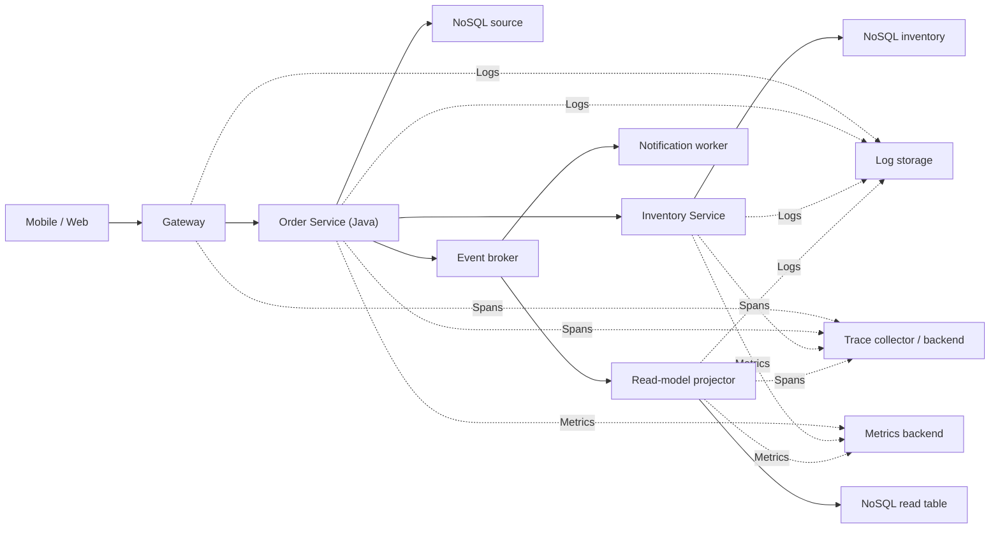
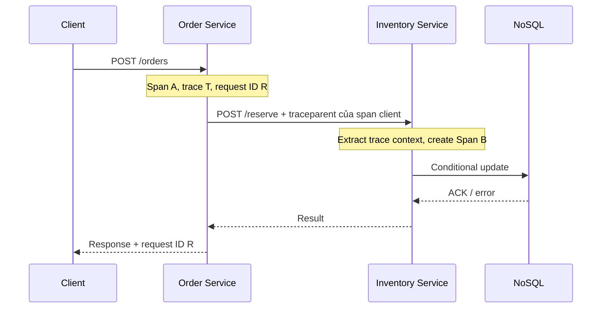
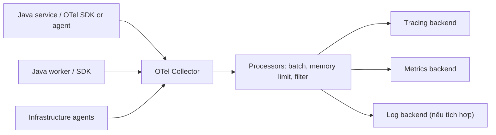

# Định danh yêu cầu, log có cấu trúc và truy vết xuyên thành phần

## 1. Khi một yêu cầu đi qua năm thành phần, lỗi nằm ở đâu?

Giả sử người dùng bấm **Đặt hàng** trong ứng dụng Java. Hệ thống xử lý:

1. API Gateway xác thực và định tuyến yêu cầu.
2. Order Service kiểm tra dữ liệu và ghi đơn hàng vào NoSQL.
3. Inventory Service giữ tồn kho bằng cập nhật có điều kiện.
4. Event publisher phát `OrderCreated` lên broker.
5. Search/Read Model Consumer cập nhật màn hình đơn hàng; Notification Service gửi thông báo.

Đôi khi API trả `500` sau 2 giây, nhưng người dùng vẫn thấy đơn hàng xuất hiện ít phút sau. Người trực vận hành mở log của từng service và chỉ thấy những dòng rời rạc:

```text
INFO  POST /orders
INFO  insert succeeded
WARN  timeout waiting for response
INFO  publishing message
ERROR duplicate key
```

Không có cách đáng tin để biết bốn dòng này thuộc **cùng yêu cầu**, thuộc những người dùng khác nhau, hay đến từ **lần retry** nào.

Nếu thêm một UUID tùy ý vào log của mỗi service nhưng không chuyển nó qua HTTP, gRPC, message broker và background workers, kết quả vẫn là những mảnh rời. Nếu chỉ có một trace nhưng không gắn dữ liệu nghiệp vụ phù hợp vào log, kỹ sư biết lời gọi nào chậm nhưng chưa chắc biết đơn hàng nào có kết quả không rõ. Nếu log mọi request/response body để tiện tìm kiếm, hệ còn có thể làm lộ token, địa chỉ và dữ liệu cá nhân.

**Định danh yêu cầu, log có cấu trúc và truy vết phân tán** giải quyết ba câu hỏi khác nhau:

- **Yêu cầu này là gì?** Định danh và mối liên hệ giữa request, command, event và các lần thử.
- **Từng thành phần đã quan sát thấy điều gì?** Các bản ghi log có ngữ cảnh, cấu trúc và mức độ nhạy cảm được kiểm soát.
- **Công việc lan qua những thành phần nào, theo thứ tự nào và mất bao lâu?** Các trace gồm spans và quan hệ cha–con hoặc liên kết nhân quả.

Bài học thuộc **Database No SQL — Quan sát và chẩn đoán**, đi từ khái niệm tới triển khai Java và cách chẩn đoán lỗi thực tế khi truy cập MongoDB, DynamoDB, Cassandra, Redis và luồng CDC/event bất đồng bộ.

> **Nguyên tắc xuyên suốt:** Định danh phải có ngữ nghĩa, ngữ cảnh phải được truyền xuyên boundary, dữ liệu quan sát phải có cấu trúc và an toàn. Một log chứa UUID không tự biến hệ thống thành có distributed tracing.

### Mục tiêu học tập

Sau bài, bạn có thể:

1. Phân biệt request ID, correlation ID, trace ID, span ID, event ID, aggregate ID, operation/idempotency ID.
2. Giải thích `traceparent` và `tracestate` theo W3C Trace Context, cùng giới hạn tin cậy của inbound headers.
3. Thiết kế JSON structured logs phục vụ lọc, thống kê, truy vấn và liên kết với traces.
4. Dùng SLF4J MDC trong Java và dọn ngữ cảnh an toàn.
5. Tạo application spans bằng OpenTelemetry Java, ghi attributes, events và errors đúng mức.
6. Truyền context qua HTTP/gRPC, asynchronous executors, Reactor và Kafka/event consumers.
7. Chọn parent–child span, span link hoặc business correlation cho công việc bất đồng bộ.
8. Instrument truy cập NoSQL mà không log raw queries và dữ liệu nhạy cảm.
9. Kiểm soát sampling, log volume, attribute cardinality, retention và chi phí.
10. Kết hợp logs, metrics và traces để giải quyết p99 latency, timeout, unknown commit và consumer lag.
11. Phân biệt lỗi truy vấn, lỗi kết nối, server throttling và lỗi business condition.
12. Xây acceptance tests, dashboards, alerting và runbooks có thể vận hành.
13. Biết sự khác nhau giữa quan sát (*observability*) và chứng minh tính đúng đắn của transaction.

## 2. Một sơ đồ cho ba loại tín hiệu



**Logs**, **metrics** và **traces** hỗ trợ nhau nhưng không thay thế nhau:

| Tín hiệu | Câu hỏi chính | Ví dụ |
|---|---|---|
| **Log** | Thành phần đã phát hiện sự kiện/trạng thái nào? | `ORDER_COMMIT_OUTCOME_UNKNOWN`, retry attempt, error code |
| **Metric** | Tần suất, tỷ lệ, phân bố và xu hướng ra sao? | HTTP error rate, DB p99, retry rate, consumer lag |
| **Trace** | Công việc đi qua những bước nào và thời gian nằm ở đâu? | Gateway 20 ms → Order 600 ms → DB 480 ms |
| **Audit record** | Hành động bảo mật/nghiệp vụ nào đã diễn ra và ai chịu trách nhiệm? | Ai đổi quyền, ai sửa giá, khi nào, outcome gì |

Audit log có thể cần chính sách chống sửa, retention và access control nghiêm ngặt hơn operational logs. Không coi các dòng debug có thể bị sampling/drop là audit ledger đáng tin cậy.

## 3. Từ điển các loại định danh

Ví dụ một người dùng gửi yêu cầu tạo đơn hàng rồi retry:

```text
Business operation ID  = create-order-8f2c
HTTP request ID A      = req-101
HTTP request ID B      = req-102       (client retry)
Trace ID A             = 51ab...      (request A)
Trace ID B             = 72cd...      (request B)
Order/aggregate ID     = O42
Event ID               = evt-O42-v1
Consumer attempt ID    = consume-7c1
```

Các IDs này **không có nhiệm vụ giống nhau**.

| ID | Phạm vi, ý nghĩa | Có giữ khi retry? | Dùng làm gì? |
|---|---|---|---|
| **Request ID** | Một request được nhận/xử lý ở boundary cụ thể | Thường mỗi HTTP attempt một ID | Tìm access/application logs |
| **Correlation ID** | Một chuỗi công việc liên quan theo workflow | Có thể giữ xuyên requests/events | Điều tra một hành trình nghiệp vụ |
| **Trace ID** | Một distributed trace theo tracing context | Theo trace; retry có thể là trace mới | Ghép spans trên trace backend |
| **Span ID** | Một đơn vị công việc trong trace | Mỗi span khác nhau | Parent–child timing |
| **Operation/Idempotency ID** | Một logical business command cần dedup | **Phải ổn định giữa các attempts cùng command** | Chống side effect lặp |
| **Event ID** | Một logical event được publish | Giữ khi redelivery/replay | Inbox/dedup và traceability |
| **Aggregate ID** | Danh tính đối tượng nghiệp vụ | Giữ theo đối tượng | Query/ownership/version |
| **Aggregate version** | Thứ tự thay đổi trong aggregate | Tăng mỗi committed transition | Chặn stale updates |
| **Transaction ID** | Phạm vi giao dịch theo DB/app | Tùy hệ | Phân tích transaction lifecycle |
| **Consumer attempt ID** | Một lần xử lý message cụ thể | Thường đổi khi redelivery | Retry/failure diagnosis |

### 3.1. Đừng dùng trace ID làm idempotency key

Một người dùng gửi `POST /orders`, nhận timeout rồi gửi lại. Hai HTTP attempts có thể tạo **hai traces khác nhau**. Nếu dedup bằng trace ID, ứng dụng có thể tạo hai đơn hàng.

Idempotency ID phải đại diện **cùng hành động nghiệp vụ**, không phải cùng hành trình chẩn đoán.

### 3.2. Đừng dùng request ID làm primary key

Request ID có thể được tạo bởi proxy, bị thay khi qua gateway, hoặc khác theo từng retry. Order ID là danh tính của tài nguyên; request ID không thay thế được.

### 3.3. Correlation ID là khái niệm nghiệp vụ, không phải chuẩn bắt buộc

Một workflow “tạo đơn → thanh toán → giao hàng” có thể kéo dài vài ngày, qua hàng trăm traces. Một `correlationId` hoặc `workflowId` có thể liên kết các events, jobs và compensations.

Không tự quy định rằng **tất cả công việc trong nhiều ngày phải dùng một trace duy nhất**. Trace quá dài, sampling/retention và boundaries làm điều đó kém thực dụng. Business correlation ID ổn định thích hợp hơn.

### 3.4. Bất kỳ định danh client-supplied nào cũng là dữ liệu không đáng tin

Client có thể gửi `X-Request-ID: "admin-user@example.com"` hoặc một chuỗi dài hàng megabyte. Không đưa thẳng vào MDC/log mà không có validation, length limit, normalization và security policy.

## 4. W3C Trace Context: trace-id, parent-id và flags

W3C Trace Context định nghĩa các HTTP headers tiêu chuẩn để nhiều vendors trao đổi tracing context:

```http
traceparent: 00-4bf92f3577b34da6a3ce929d0e0e4736-00f067aa0ba902b7-01
tracestate: vendor=value
```

Định dạng `traceparent` theo phiên bản `00`:

```text
version-trace-id-parent-id-trace-flags
  00       32 hex    16 hex      2 hex
```

- **Version:** `00` trong ví dụ.
- **Trace ID:** 16 byte (32 hex chars), tất cả zero là invalid.
- **Parent ID:** 8 byte (16 hex chars), tất cả zero là invalid.
- **Trace flags:** bit flags, thường chứa sampled bit.

Một giá trị `traceparent` hợp lệ chỉ là **ngữ cảnh để nối trace**, không chứng minh danh tính người dùng.

### 4.1. Incoming `parent-id` không phải span hiện tại

Khi Service B nhận header từ Service A, `parent-id` trỏ tới span của upstream. Service B tạo **span ID mới**, giữ trace ID nếu chấp nhận parent context, rồi truyền một `traceparent` mới với span ID của mình sang Service C.

### 4.2. Sampled flag không bảo đảm trace sẽ được lưu

`-01` có thể mang ý nghĩa sampling flag được đặt, nhưng hệ có thể áp policies khác: tail sampling, exporter failures, retention, rate limits. Không hứa “mọi trace có flag 01 luôn tìm được”.

### 4.3. `tracestate`

`tracestate` hỗ trợ metadata tracing theo các vendors/systems. Không dùng nó để truyền account password, authorization token hay PII. Các giới hạn cú pháp/kích thước phải tuân W3C spec.

### 4.4. W3C Baggage là header khác

`baggage` dùng để truyền các key-value properties có thể đi xuyên services. Nó **không phải chỗ để đính mọi thông tin nghiệp vụ**, vì có nguy cơ rò PII qua trust boundary, tăng request headers và sinh attribute cardinality lớn.

### 4.5. Đầu vào trace không phải authority

Upstream bên ngoài có thể tạo Trace ID tùy ý hoặc cố gắng gửi trace context nhằm làm nhiễu log/traces. Hệ cần quy định:

- Trust boundary nào được chấp nhận traceparent?
- Có reset/sanitize tại gateway không?
- Có chặn malformed/oversized headers không?
- Có tạo context mới nếu inbound không hợp lệ không?
- Không dùng trace ID để cấp quyền, quyết định quota hoặc financial authorization.

Thường dùng instrumentation/library chuẩn để parse/propagate, thay vì tự viết parser regex cho mọi phiên bản.

## 5. Một trace gồm spans chứ không chỉ một ID

Một span đại diện cho một hoạt động có thời điểm bắt đầu/kết thúc, attributes và status:

```text
Trace ID: 4bf92f...e4736

Span A: HTTP POST /orders           730 ms
  Span B: OrderService.create        690 ms
    Span C: MongoDB insert            85 ms
    Span D: Inventory reserve         520 ms
      Span E: DynamoDB UpdateItem    460 ms
    Span F: Event publish             40 ms
```

### 5.1. Span attributes và events

**Attributes**: những dữ liệu mô tả span:

```text
service.name = order-service
http.request.method = POST
http.route = /orders
db.system.name = mongodb
db.operation.name = insert
app.operation.kind = create_order
app.retry.attempt = 1
```

**Span events**: mốc đáng chú ý trong hoạt động:

```text
reservation.retry_scheduled
db.commit_outcome_unknown
business_operation.reconciled
```

Tên thuộc tính theo **OpenTelemetry semantic conventions** có thể thay giữa phiên bản/opt-in stability; dùng version tương ứng của instrumentation và tránh khai báo khác nhau giữa services.

### 5.2. Span status

Một span có thể kết thúc với `ERROR` khi có lỗi thực thi. Nhưng **business rejection** như “hết hàng” hoặc “coupon invalid” thường là kết quả nghiệp vụ dự kiến, không mặc nhiên là infrastructure error. Quy định cách phân loại và giám sát.

### 5.3. Parent–child và concurrency

Một server span chứa các client spans gọi MongoDB và Inventory. Nếu thực thi song song, tổng thời gian các spans con có thể vượt thời gian span cha; không cộng đơn giản “tổng duration các con” để suy latency request.

### 5.4. Trace không chứng minh commit outcome

Một span `MongoDB insert` có status ERROR do client timeout **không chứng minh DB chưa commit**. Span chỉ ghi lại điều mà client/driver quan sát. Muốn biết business operation đã commit, cần authoritative lookup/ledger và transaction semantics.

## 6. Một chuỗi request có thể có nhiều traces

Có hai dạng khác biệt:

**Đồng bộ HTTP/gRPC:**

```text
Client -> Gateway -> Order -> Inventory -> NoSQL
               cùng trace nếu propagation phù hợp
```

**Bất đồng bộ kéo dài:**

```text
HTTP request:     Trace A
OrderCreated:     Event ID E1
Projector:        Trace B (link to producer context A)
Scheduled retry:  Trace C (correlationId/orderId giống workflow)
```

Một message consumer có thể tạo span là **child** của producer span, hoặc tạo trace mới có **span link** tới context producer. Cách chọn phụ thuộc messaging instrumentation, latency, fan-out, batching và tracing policy.

Không mặc định mọi event processing phải là con trực tiếp của HTTP request kéo dài hàng giờ.

### 6.1. Khi nào parent–child phù hợp?

Khi có một mối quan hệ nhân quả tương đối trực tiếp với một parent context: service A gọi service B, hoặc một message đơn được xử lý theo instrumentation policy rõ.

### 6.2. Khi nào dùng span link?

- Một batch consumer xử lý nhiều events từ nhiều producers.
- Một job được kích hoạt bởi nhiều nguyên nhân.
- Một retry/catch-up là hoạt động riêng nhưng liên quan event ban đầu.
- Muốn phân tách trace lifetime/sampling, vẫn giữ causal reference.

### 6.3. Business correlation sống lâu hơn traces

Một `workflowId` hoặc `orderId` cho phép tìm tất cả trace IDs liên quan trong vài ngày. Đây là **liên kết ở tầng nghiệp vụ**, không thay thế parent/link relationship ở tracing protocol.

## 7. Thiết kế log có cấu trúc: mỗi sự kiện là một object

Một log “có cấu trúc” nghĩa các trường có tên và type rõ ràng, không chỉ một câu văn:

```json
{
  "timestamp": "2026-11-14T10:04:05.123Z",
  "severity": "WARN",
  "service.name": "order-service",
  "service.version": "2.8.1",
  "deployment.environment": "production",
  "event.name": "DB_WRITE_OUTCOME_UNKNOWN",
  "message": "Order write timed out after command was sent",
  "trace_id": "4bf92f3577b34da6a3ce929d0e0e4736",
  "span_id": "00f067aa0ba902b7",
  "request_id": "req-101",
  "correlation_id": "wf-701",
  "operation_id": "create-order-8f2c",
  "tenant_key": "tenant-opaque-17",
  "db.system.name": "mongodb",
  "db.operation.name": "insert",
  "db.collection.name": "orders",
  "duration_ms": 880,
  "retry_attempt": 1,
  "error.type": "MongoSocketReadTimeoutException",
  "outcome": "UNKNOWN"
}
```

Đây là **một schema minh họa**. OpenTelemetry log data model và backend-specific field conventions có thể khác; chọn một canonical contract và document mapping.

### 7.1. Vì sao structured tốt hơn text?

Một câu:

```text
Order create failed in MongoDB after 880ms for tenant 17
```

phải parse bằng regex, dễ hỏng khi wording đổi. Với JSON fields:

```text
event.name = DB_WRITE_OUTCOME_UNKNOWN
AND db.system.name = mongodb
AND duration_ms > 500
```

dễ lọc, nhóm theo service/error và tạo dashboard hơn.

### 7.2. Không phải “JSON trong một trường message”

Một log:

```json
{
  "message": "request_id=req-101 tenant=t17 db=mongodb retry=1"
}
```

vẫn cần parse message để lấy fields. Nên emit các thuộc tính JSON riêng biệt bằng logging framework/encoder hoặc structured logging API phù hợp.

### 7.3. Field naming cần thống nhất

Cần một convention chung:

- `service.name` hoặc `service_name`: chọn một contract/mapping.
- `trace_id` và `span_id`: cùng lowercase hex theo backend format.
- `request_id` và `correlation_id`: cùng semantics xuyên services.
- `event.name`: ổn định và có từ điển.
- `error.type`: phân loại có giới hạn.
- `outcome`: `SUCCESS`, `FAILURE`, `UNKNOWN` theo business/technical contract.
- `duration_ms` hoặc seconds: ghi rõ đơn vị.

Nếu mỗi service dùng `reqId`, `requestId`, `rid` khác nhau, vận hành phải viết query nhiều kiểu.

### 7.4. Thêm schema version của log khi cần

Logs cũng là dữ liệu downstream phân tích. Nếu chuyển `durationMs` từ string sang number, dashboards/alerts có thể hỏng. Một `log_schema_version` hoặc compatibility policy có thể có ích cho các event logs quan trọng.

## 8. Ghi log ở mức nào?

| Level | Mục đích | Ví dụ |
|---|---|---|
| **TRACE** | Chi tiết rất nhỏ, thường bật tạm có kiểm soát | Bước gọi parser nội bộ |
| **DEBUG** | Điều tra logic/flow, không bật đại trà nếu dữ liệu nhiều | Nhánh retry, lựa chọn backend |
| **INFO** | Mốc vận hành đáng chú ý | Application started, migration finished |
| **WARN** | Tình huống bất thường, có thể phục hồi | Timeout nhưng outcome unknown, retry scheduled |
| **ERROR** | Hoạt động thất bại cần chú ý | Quorum unavailable, unexpected DB failure |
| **Audit** | Fact an ninh/nghiệp vụ được kiểm soát riêng | Permission changed, order cancelled |

### 8.1. Không log cùng một exception ở mọi tầng

Một exception đi qua DB adapter, service, controller và gateway. Nếu mỗi lớp log ERROR cùng stack trace, một lỗi sinh 4–5 log entries, làm nhiễu và tăng chi phí.

Một pattern thực dụng:

- Lớp thấp **annotate/map error** và propagate cause.
- Một điểm có trách nhiệm phù hợp log error với trace context và response outcome.
- Những boundary đặc biệt (retries/circuit breaker) có thể log mốc riêng ở level thích hợp.

### 8.2. Không biến business rejection thành “đỏ” toàn bộ

Một `ConditionalCheckFailed` vì sản phẩm hết hàng có thể là kết quả nghiệp vụ `OUT_OF_STOCK` thường gặp, không phải một database outage. Nếu log `ERROR` cho mọi lượt hết hàng, error rate mất ý nghĩa.

### 8.3. Cần ghi những mốc ít nhưng có giá trị

Gợi ý cho write workflow:

```text
request.received
business.validation_rejected
db.write.unknown_outcome
retry.scheduled
business.operation.reconciled
request.completed
```

Không cần log từng dòng code hoặc mọi field của document.

### 8.4. Log stack trace có điều kiện

Đầy đủ stack trace hữu ích khi bug không biết nguyên nhân, nhưng có thể rất lớn và chứa message nhạy cảm. Lưu class/cause code, span context và stack trace theo level/sampling/redaction policy; không log raw DB credentials/connection URIs.

## 9. Định danh yêu cầu HTTP: ai tạo và ai có quyền sửa?

Một yêu cầu HTTP có thể đi qua ingress proxy, load balancer, API Gateway và ứng dụng.

### 9.1. Tạo ID tại boundary đáng tin

Gateway thường là nơi thích hợp để tạo/chuẩn hóa request ID. Nếu nhận client-supplied ID, nên:

- Giới hạn độ dài.
- Kiểm syntax/character allowlist.
- Chỉ chấp nhận namespace/trust policy đã rõ.
- Tạo ID mới khi không hợp lệ.
- Không ghi header độc hại vào log trước validation.
- Tránh dùng request ID như bằng chứng xác thực.
- Không nhất thiết expose internal trace ID cho mọi client.

### 9.2. Một ID ở gateway và một ID ở app?

Có thể giữ:

```text
edge_request_id = ID do ingress cấp
request_id = ID nội bộ cho ứng dụng
```

Nếu cùng một ID đã được chuẩn hóa và tin cậy, có thể truyền xuyên các hops. Quan trọng là **tên và semantics nhất quán**, không phải số lượng IDs.

### 9.3. Trả request ID trong response

Ví dụ:

```http
HTTP/1.1 503 Service Unavailable
X-Request-ID: req-101
Content-Type: application/json

{
  "error": "TEMPORARILY_UNAVAILABLE",
  "requestId": "req-101"
}
```

Người dùng gửi ID cho hỗ trợ; kỹ sư lọc logs. Đây không phải idempotency key và không cần tiết lộ nội bộ như database node IP.

### 9.4. Client retries

Hai attempts có thể tạo `request_id` khác nhau nhưng giữ nguyên `operation_id`:

```text
request-101 -> operation create-O42
request-102 -> operation create-O42
```

Logs liên kết được cả từng attempt và logical business operation.

## 10. Java SLF4J MDC: gắn ngữ cảnh vào log

**Mapped Diagnostic Context (MDC)** thường dùng thread-local storage để gắn key-value context vào những log events phát sinh trong một luồng xử lý.

Ví dụ:

```java
import org.slf4j.MDC;
import org.slf4j.Logger;
import org.slf4j.LoggerFactory;

public final class OrderHandler {
    private static final Logger log =
        LoggerFactory.getLogger(OrderHandler.class);

    public void handle(String requestId, String orderId) {
        try {
            MDC.put("request_id", requestId);
            MDC.put("operation_kind", "CREATE_ORDER");

            log.info("Order command received");
            // Gọi service/repository...
            log.info("Order command completed");
        } finally {
            MDC.remove("request_id");
            MDC.remove("operation_kind");
        }
    }
}
```

### 10.1. MDC tự nó không tạo JSON

`MDC.put` chỉ đưa properties vào logging context. Muốn chúng xuất hiện thành JSON fields, logging backend (Logback/Log4j2 encoder/structured logging configuration) phải được cấu hình tương ứng.

### 10.2. MDC không tự truyền qua threads

MDC thường gắn với thread của logger. Nếu code submit work vào `ExecutorService`, worker thread **không tự có đúng context**, hoặc tệ hơn, còn giữ context từ task trước nếu cleanup sai.

### 10.3. MDC không phải trace context

MDC không tự tạo spans, parent–child, sampling hay `traceparent`. OpenTelemetry có context propagation riêng; có thể bridge trace/span IDs vào MDC nếu framework/instrumentation hỗ trợ.

### 10.4. Dọn context trong `finally`

Server threads được tái sử dụng. Quên clear có thể khiến log của user B mang request ID hoặc tenant context của user A. Hãy dùng `try/finally` và test tình huống exceptions.

### 10.5. Tránh `MDC.clear()` tùy tiện trong library

Một library được gọi trong request có thể xóa cả keys do instrumentation/framework khác quản lý. Khi biết mình tạo những keys nào, hãy restore/remove có chọn lọc. Nếu request boundary sở hữu toàn bộ MDC snapshot, có thể save/restore map theo contract.

## 11. Java Servlet filter: request ID có validation và cleanup

Mẫu dưới đây dùng Spring Web Servlet stack với `OncePerRequestFilter` (Spring Framework 6 / Jakarta Servlet style), minh họa một **HTTP correlation ID boundary**, không phải một OpenTelemetry tracer.

```java
import jakarta.servlet.FilterChain;
import jakarta.servlet.ServletException;
import jakarta.servlet.http.HttpServletRequest;
import jakarta.servlet.http.HttpServletResponse;
import org.slf4j.MDC;
import org.springframework.web.filter.OncePerRequestFilter;

import java.io.IOException;
import java.util.UUID;
import java.util.regex.Pattern;

public final class RequestIdFilter
        extends OncePerRequestFilter {

    private static final String HEADER = "X-Request-ID";
    private static final Pattern SAFE_ID =
        Pattern.compile("[A-Za-z0-9_-]{8,64}");

    @Override
    protected void doFilterInternal(
            HttpServletRequest request,
            HttpServletResponse response,
            FilterChain chain)
            throws ServletException, IOException {

        String incoming = request.getHeader(HEADER);
        String requestId = isAllowed(incoming)
            ? incoming
            : UUID.randomUUID().toString();

        // Giữ giá trị MDC cũ để filter lồng nhau không
        // vô tình phá ngữ cảnh của caller.
        String previous = MDC.get("request_id");

        try {
            MDC.put("request_id", requestId);
            response.setHeader(HEADER, requestId);
            chain.doFilter(request, response);
        } finally {
            if (previous == null) {
                MDC.remove("request_id");
            } else {
                MDC.put("request_id", previous);
            }
        }
    }

    private static boolean isAllowed(String value) {
        return value != null &&
            value.length() <= 64 &&
            SAFE_ID.matcher(value).matches();
    }
}
```

### 11.1. Giới hạn có chủ đích

- Header nhận từ client phải theo trust policy; pattern/length limit **không chứng minh** ID đáng tin hay duy nhất.
- Nếu gateway được chỉ định tạo ID, app có thể chỉ tin header từ gateway đã xác thực, hoặc tạo ID khác từ outside traffic.
- `UUID.randomUUID()` đủ cho minh họa request correlation; không dùng UUID request để chứng minh idempotency.
- Code này áp dụng cho xử lý đồng bộ thông thường. **Async Servlet dispatch, Reactor/WebFlux, virtual threads và executor tasks cần propagation riêng.**
- `OncePerRequestFilter` có behavior theo dispatch type/config; không tự cho mỗi async continuation đúng MDC.
- `MDC` chỉ là logs, không tạo traces; instrumentation phải được cấu hình độc lập.
- Không log raw inbound header nếu không hợp lệ.
- Trước khi dùng production, kiểm framework/version, proxy trust và HTTP response schema.

## 12. OpenTelemetry: context và span trong Java

OpenTelemetry (OTel) cung cấp API/SDK và instrumentation để tạo/thu thập telemetry. Trong Java thường có hai hướng:

1. **Auto-instrumentation/Java agent:** tự tạo spans cho HTTP servers/clients, JDBC/driver libraries được hỗ trợ, messaging...
2. **Manual instrumentation:** thêm **application spans/events** nơi domain logic cần được giải thích.

Không nhất thiết phải viết thủ công một span cho mọi lệnh HTTP/DB nếu agent đã làm; tạo trùng spans có thể khiến trace nhiễu và tăng overhead.

### 12.1. Java 17: span cho nghiệp vụ, không log PII

```java
import io.opentelemetry.api.GlobalOpenTelemetry;
import io.opentelemetry.api.trace.Span;
import io.opentelemetry.api.trace.SpanKind;
import io.opentelemetry.api.trace.StatusCode;
import io.opentelemetry.api.trace.Tracer;
import io.opentelemetry.context.Scope;

public final class ReserveInventoryUseCase {
    private final Tracer tracer =
        GlobalOpenTelemetry.getTracer(
            "example.inventory.usecase", "1.0.0");

    private final InventoryRepository repository;

    public ReserveInventoryUseCase(
            InventoryRepository repository) {
        this.repository = repository;
    }

    public ReservationResult reserve(
            String sku, String operationId, int quantity) {
        Span span = tracer.spanBuilder("inventory.reserve")
            .setSpanKind(SpanKind.INTERNAL)
            .startSpan();

        try (Scope scope = span.makeCurrent()) {
            span.setAttribute(
                "app.operation.kind", "reserve_inventory"
            );
            span.setAttribute(
                "app.request.quantity_bucket",
                quantity == 1 ? "1" : "2_plus"
            );

            ReservationResult result =
                repository.reserve(sku, operationId, quantity);

            span.setAttribute(
                "app.outcome", result.status().name()
            );
            return result;
        } catch (RuntimeException ex) {
            span.recordException(ex);
            span.setStatus(
                StatusCode.ERROR, "Reservation processing failed"
            );
            throw ex;
        } finally {
            span.end();
        }
    }
}
```

`InventoryRepository` và `ReservationResult` là domain interfaces/types của ứng dụng giả định; ví dụ tập trung vào cách tạo span. Khi triển khai, cần cấu hình OpenTelemetry SDK/exporter/collector/agent tương ứng; `GlobalOpenTelemetry` chưa được thiết lập có thể hoạt động như no-op theo runtime config.

### 12.2. Một span phải được kết thúc

Dùng `try/finally` để gọi `span.end()`. Quên end tạo spans chưa hoàn thành hoặc memory overhead; end hai lần do lifecycle sai cũng có thể làm trace khó đọc.

### 12.3. `Scope` rất quan trọng

`makeCurrent()` đặt span vào context hiện tại cho những instrumentation downstream. Nếu chỉ gọi `startSpan()` rồi gọi repository không trong scope, DB client span có thể không nhận parent đúng.

### 12.4. Không đặt raw orderId/operationId vào span attribute mặc định

Mỗi giá trị business ID có cardinality cực lớn, có thể tăng chi phí index/traces và rò thông tin. Nếu cần tìm theo operation ID, cân nhắc **logs có phân quyền**, hashed/pseudonymized identifiers, hoặc log-to-trace link theo security policy.

### 12.5. Attribute phải hữu ích và có kiểm soát

Nên ưu tiên:

```text
app.operation.kind = reserve_inventory
app.outcome = OUT_OF_STOCK
db.operation.name = update
db.system.name = dynamodb
retry.attempt = 2
server.region = ap-southeast-1
```

Tránh:

```text
user.email = actual-address
authorization.token = Bearer ...
db.statement = full_query_with_customer_data
http.request.body = full_payment_payload
```

## 13. Instrumentation với NoSQL: đo đúng span nào?

Một ứng dụng có thể có cả:

```text
OrderService.create               application span
  MongoDB findById                database client span
  MongoDB updateOne               database client span
  Kafka publish                   messaging producer span
```

### 13.1. Application span vs DB span

**Application span** trả lời: use case nào đang chạy? Retry policy ra sao? Business result gì?

**DB client span** trả lời: một command từ app tới DB mất bao lâu? Command type, DB technology, server address theo policy, error type gì?

Hai thông tin bổ sung nhau. DB span thành công không chứng minh toàn business transaction commit khi còn các writes khác.

### 13.2. Semantic conventions

OpenTelemetry có các attributes thuộc namespace `db.*`, `server.*`, `network.*`, `messaging.*`, `http.*`; tên chi tiết thay đổi theo version/semantic convention stability. Khi nâng library/agent, cần kiểm dashboard queries và sampling rules theo đúng version, không copy hard-coded attributes từ tài liệu của một major version khác.

### 13.3. Không đo sai ranh giới

Một request tới Cassandra mất 350 ms có thể gồm:

- Chờ pool/connection.
- Driver retries.
- Server execution.
- Network RTT.
- Decode response.

Driver span có thể bao gồm một phần hoặc nhiều phần tùy instrumentation. Không kết luận “server xử lý query 350 ms” nếu span chỉ đo **end-to-end client latency**. Để tách, cần driver metrics, DB server metrics/tracing, connection pool và query profiling thích hợp.

### 13.4. Command span status và business conflict

MongoDB duplicate key hoặc DynamoDB conditional check failure có thể là lỗi command theo driver, nhưng với business operation chúng có thể là kết quả expected `ALREADY_EXISTS` hoặc `OUT_OF_STOCK`. Quy định error classification để giảm false positives và vẫn giữ thông tin diagnostic.

### 13.5. Không dùng raw query statement như log mặc định

Document filters và command parameters có thể chứa email, phone, token và PII. Nếu instrumentation phát `db.query.text`, `db.statement` hoặc raw SQL/CQL/JSON queries, cần redaction/disable capture theo policy. Dùng command name, collection/table **được phân loại**, query shape/fingerprint và error code thay vì raw values khi có thể.
## 14. Truyền context xuyên HTTP bằng thư viện chuẩn

Một trace chỉ đi xuyên các services nếu outgoing request mang context từ current span và receiving service **extract** đúng.



### 14.1. Auto-instrumentation thường nên là điểm xuất phát

Nhiều HTTP libraries được OpenTelemetry Java agent hoặc Spring/Micrometer Tracing integration hỗ trợ. Khi đã có, nên kiểm headers/span relationships thực tế trước khi viết manual propagation. Hai layers instrumentation không điều phối có thể tạo duplicate spans hoặc truyền nhầm parent.

### 14.2. Java OpenTelemetry API: inject context vào HTTP request

Ví dụ với JDK `HttpClient` và `HttpRequest.Builder`:

```java
import io.opentelemetry.api.GlobalOpenTelemetry;
import io.opentelemetry.context.Context;
import io.opentelemetry.context.propagation.TextMapSetter;

import java.net.URI;
import java.net.http.HttpRequest;

public final class TracedHttp {
    private static final TextMapSetter<HttpRequest.Builder> SETTER =
        (builder, key, value) -> {
            if (builder != null) {
                builder.setHeader(key, value);
            }
        };

    public static HttpRequest outgoing() {
        HttpRequest.Builder builder = HttpRequest.newBuilder()
            .uri(URI.create("https://internal.example.test/reserve"))
            .POST(HttpRequest.BodyPublishers.noBody());

        GlobalOpenTelemetry.getPropagators()
            .getTextMapPropagator()
            .inject(Context.current(), builder, SETTER);

        return builder.build();
    }
}
```

Ví dụ chỉ minh họa propagation; không gửi network request, chưa cấu hình HTTP client authentication, timeout hoặc authorization. Nếu HTTP client instrumentation đã inject tự động, **không cần inject thủ công lần nữa**.

### 14.3. Extract ở server

Với server stack có instrumentation, extraction thường xảy ra khi request đi vào. Khi tự làm, cần `TextMapGetter` đọc HTTP headers, gọi `extract` và tạo span có parent context đó, đồng thời xử lý untrusted upstream theo policy.

Không tự tạo child span chỉ bằng cách copy trace ID vào một string; quan hệ span phải được thiết lập qua tracing API/context.

### 14.4. Header forwarding và CORS/proxy

Proxy có thể drop hoặc rewrite `traceparent`/`tracestate`. Một gateway thay trace policy có thể cố tình tạo root trace mới, ví dụ ở trust boundary; khi ấy có thể lưu linkage theo policy. Kiểm thực tế trên HTTP/gRPC path, không giả định headers qua mọi hop.

### 14.5. Đừng chuyển toàn bộ MDC như HTTP headers

MDC có thể chứa những values chỉ dùng nội bộ. Chỉ propagate các headers được cho phép, như W3C Trace Context và một request/correlation ID theo contract. Không nhân bản toàn bộ MDC map sang `X-Debug-Context` hoặc baggage.

## 15. Truyền context qua `ExecutorService` và CompletableFuture

Java thread pool là một nguyên nhân phổ biến khiến log mất trace ID.

```text
HTTP thread (request_id=req-101, trace=T)
  -> executor.submit(task)
     -> worker thread (MDC trống hoặc của request khác)
```

### 15.1. Tại sao ThreadLocal không đủ?

MDC thường dựa trên thread-local. Worker thread phục vụ rất nhiều requests, không tự biết context của thread đã submit task. OpenTelemetry `Context.current()` cũng cần context propagation hoặc instrumentation phù hợp.

### 15.2. Ví dụ gói cả OpenTelemetry context và MDC

```java
import io.opentelemetry.context.Context;
import org.slf4j.MDC;

import java.util.Map;
import java.util.concurrent.Executor;

public final class ContextAwareExecutor {
    private final Executor delegate;

    public ContextAwareExecutor(Executor delegate) {
        this.delegate = delegate;
    }

    public void execute(Runnable task) {
        Context capturedTrace = Context.current();
        Map<String, String> capturedMdc =
            MDC.getCopyOfContextMap();

        Runnable wrapped = capturedTrace.wrap(() -> {
            Map<String, String> previous =
                MDC.getCopyOfContextMap();

            try {
                if (capturedMdc == null) {
                    MDC.clear();
                } else {
                    MDC.setContextMap(capturedMdc);
                }
                task.run();
            } finally {
                if (previous == null) {
                    MDC.clear();
                } else {
                    MDC.setContextMap(previous);
                }
            }
        });

        delegate.execute(wrapped);
    }
}
```

### 15.3. Giới hạn quan trọng

- Ví dụ áp dụng cho tasks gửi qua wrapper. Task gửi thẳng tới `delegate` sẽ không được wrap.
- Nếu framework/instrumentation đã truyền OpenTelemetry context, đừng duplicate wrappers không cần thiết.
- MDC snapshot có thể chứa PII nếu ứng dụng đặt nhầm dữ liệu vào MDC.
- Không lấy current trace context của worker lúc chạy thay cho context ở lúc submit.
- Cần giữ/khôi phục previous MDC để tránh leak giữa tasks.
- Cancellation, scheduling/deadlines và structured concurrency có semantics riêng.
- Một job chạy hàng giờ không nhất thiết giữ HTTP span làm parent trực tiếp; có thể tạo root/linked trace và giữ business correlation.

### 15.4. `CompletableFuture`

`supplyAsync` không tự bảo đảm thread context giống caller trong mọi execution environments. Dùng context-aware executor, instrumentation phù hợp, hoặc truyền explicit context. Test phải tạo hai requests khác nhau cùng chạy trên một thread pool để phát hiện cross-request contamination.

### 15.5. Virtual threads

Virtual threads có thread-local semantics riêng; đừng mặc định thay platform thread bằng virtual thread tự giải quyết context propagation hoặc tài nguyên database. Cần kiểm lifecycle/scope, tránh lưu request metadata toàn cục/static.

## 16. Reactive Java: Reactor Context và MDC không giống nhau

Spring WebFlux, Reactor hoặc reactive NoSQL clients thường chuyển execution qua nhiều threads. Gọi `MDC.put` rồi giả định mọi reactive operators đều chạy cùng thread sẽ làm mất/nhầm context.

### 16.1. Bối cảnh

```text
HTTP request
  -> Reactor operator A (thread-1)
  -> async DB operation (thread-4)
  -> operator B (thread-2)
```

Reactor có **Context** gắn với subscriber, không trùng Java `ThreadLocal`.

### 16.2. Hướng xử lý

- Dùng framework/OTel instrumentation hỗ trợ Reactor context propagation tương ứng phiên bản.
- Đặt request/correlation context tại đúng reactive boundary.
- Tạo MDC scope chỉ trong lúc thực hiện log event, rồi restore.
- Không tạo span trong mỗi `map()` nếu không có diagnostic value.
- Test `publishOn`/`subscribeOn` và concurrent requests để phát hiện trace mixing.

### 16.3. Không copy MDC một lần rồi mong hoàn chỉnh

Một reactive pipeline có thể thay đổi context trong quá trình thực thi và quay lại nhiều threads. Chụp MDC ở thời điểm assembly không chắc đúng tại thời điểm subscription. Dùng mechanisms chính thức của stack đang chạy.

### 16.4. Tên thuộc tính ổn định hơn tên thread

Một structured log nên có `trace_id`, `request_id`, `service.name` và `operation.kind`; thread name chỉ là thông tin hỗ trợ. Một business request không có nghĩa là một thread duy nhất.

## 17. Message broker: truyền trace context qua Kafka headers

HTTP thường có request/response trực tiếp. Kafka hoặc broker khác có thể gửi event hôm nay và consumer xử lý lại ngày mai. Cần giữ đồng thời:

- **Tracing context:** phục vụ liên kết producer–consumer spans.
- **Business correlation:** workflow/order/request nguồn.
- **Event ID:** dedup khi broker redelivery.
- **Aggregate version:** ordering/state reconciliation.
- **Event schema version:** decode đúng payload.

### 17.1. Producer tạo message với headers

Java pseudocode dùng OpenTelemetry API và Kafka ProducerRecord:

```java
import io.opentelemetry.api.GlobalOpenTelemetry;
import io.opentelemetry.context.Context;
import io.opentelemetry.context.propagation.TextMapSetter;
import org.apache.kafka.clients.producer.ProducerRecord;

import java.nio.charset.StandardCharsets;

public final class KafkaTraceHeaders {
    private static final TextMapSetter<
        ProducerRecord<String, String>
    > SETTER = (record, key, value) -> {
        if (record != null) {
            record.headers().remove(key);
            record.headers().add(
                key,
                value.getBytes(StandardCharsets.UTF_8)
            );
        }
    };

    public static void inject(
            ProducerRecord<String, String> record) {
        GlobalOpenTelemetry.getPropagators()
            .getTextMapPropagator()
            .inject(Context.current(), record, SETTER);
    }
}
```

Đây là ví dụ API propagation, không chứa producer send/ACK/transaction config. Khi publish event thật, cần event ID, schema, idempotency và failure policy riêng. Khi auto-instrumented Kafka producer đã tự inject, đừng tạo hai header propagation policies chồng nhau.

### 17.2. Consumer extract

```java
import io.opentelemetry.api.GlobalOpenTelemetry;
import io.opentelemetry.context.Context;
import io.opentelemetry.context.propagation.TextMapGetter;
import org.apache.kafka.clients.consumer.ConsumerRecord;
import org.apache.kafka.common.header.Header;

import java.nio.charset.StandardCharsets;
import java.util.ArrayList;
import java.util.List;

public final class KafkaReadContext {
    private static final TextMapGetter<
        ConsumerRecord<String, String>
    > GETTER = new TextMapGetter<>() {
        @Override
        public Iterable<String> keys(
                ConsumerRecord<String, String> record) {
            List<String> keys = new ArrayList<>();
            if (record == null) {
                return keys;
            }
            for (Header header : record.headers()) {
                keys.add(header.key());
            }
            return keys;
        }

        @Override
        public String get(
                ConsumerRecord<String, String> record,
                String key) {
            if (record == null) {
                return null;
            }
            Header header = record.headers().lastHeader(key);
            return header == null
                ? null
                : new String(
                    header.value(),
                    StandardCharsets.UTF_8
                );
        }
    };

    public static Context extract(
            ConsumerRecord<String, String> record) {
        return GlobalOpenTelemetry.getPropagators()
            .getTextMapPropagator()
            .extract(Context.root(), record, GETTER);
    }
}
```

### 17.3. Dùng parent hay link?

Sau `extract`, một consumer có thể:

```java
Context producerContext = KafkaReadContext.extract(record);

// Một chiến lược: child của remote producer context.
Span span = tracer.spanBuilder("order.events.process")
    .setSpanKind(SpanKind.CONSUMER)
    .setParent(producerContext)
    .startSpan();
```

Hoặc nếu muốn **trace mới** có link tới producer context:

```java
Span span = tracer.spanBuilder("order.events.process")
    .setSpanKind(SpanKind.CONSUMER)
    .setNoParent()
    .addLink(
        io.opentelemetry.api.trace.Span.fromContext(
            producerContext
        ).getSpanContext()
    )
    .startSpan();
```

Những đoạn này minh họa hai lựa chọn; cần dùng một policy nhất quán theo instrumentation/semantic conventions. Không đồng thời tự tạo spans và để auto-instrumentation tạo duplicates.

### 17.4. Một batch từ nhiều traces

Nếu một worker xử lý 100 messages từ nhiều producers, không có một parent span duy nhất đại diện cho tất cả. Có thể tạo batch span với **links** tới các producer contexts (và giới hạn số links) hoặc trace từng message, tùy hệ/volume.

### 17.5. Không chỉ gửi `traceparent`

Nếu consumer phải dedup `OrderCreated`, nó cần `eventId`/business operation ID. `traceparent` không đủ; một message có thể được replay với tracing context mới trong khi vẫn là cùng logical event.

### 17.6. Messaging headers cũng cần tin cậy

External producers có thể gửi oversized/malformed headers hoặc fake trace identity. Broker access control, validation và trust boundary quan trọng. Không coi traceparent là chứng chỉ để vượt authorization.

## 18. Transactional outbox và trace continuity

Một pattern phổ biến:

```text
Order Service transaction:
  update order O42
  insert outbox E42
commit

Outbox publisher:
  read E42
  publish to Kafka
Consumer:
  apply E42
```

Outbox publisher có thể chạy sau HTTP request vài phút hoặc sau restart. Request span ban đầu đã kết thúc.

### 18.1. Lưu gì trong outbox?

Một record minh họa:

```json
{
  "eventId": "evt-O42-v1",
  "eventType": "OrderCreated",
  "aggregateId": "O42",
  "aggregateVersion": 1,
  "operationId": "create-order-8f2c",
  "correlationId": "wf-701",
  "traceContext": {
    "traceparent": "00-4bf92f3577b34da6a3ce929d0e0e4736-00f067aa0ba902b7-01"
  },
  "payload": {
    "orderId": "O42",
    "status": "CREATED"
  }
}
```

Không phải hệ nào cũng cần lưu traceparent trong outbox; nếu có, áp dụng chính sách serialization, privacy, retention và trust phù hợp.

### 18.2. Nếu outbox publisher lấy traceparent cũ

Nó có thể tạo publish span liên kết tới context ban đầu qua span link, hoặc child relationship theo policy. **Không cần giữ HTTP request span còn mở** đến khi publisher hoàn thành.

### 18.3. Một sự kiện có thể có nhiều delivery attempts

```text
eventId=evt-O42-v1
publishAttempt=1 -> broker ACK lost
publishAttempt=2 -> broker accepted
consumeAttempt=1 -> target commit, ACK lost
consumeAttempt=2 -> duplicate detected
```

Logs nên ghi cả **stable event ID** và **attempt/retry count**. Nếu mọi attempt tạo trace mới, correlationId/eventId vẫn giúp liên kết các traces.

### 18.4. Outbox không chứng minh exactly-once downstream

Structured logs và trace links có thể giúp thấy duplicate deliveries. Chúng không thay thế idempotent consumer/inbox/target conditional write. Bản thân telemetry có thể bị drop hoặc sampled; **không dùng log line làm authoritative dedup ledger**.

## 19. CDC và background projectors: trace continuity không hoàn toàn

CDC có thể đọc database oplog/stream mà không có incoming HTTP trace context. Một source mutation có thể xảy ra từ import job, maintenance script hoặc một service không bật tracing.

### 19.1. Khi CDC có correlation metadata

Nếu authoritative record hoặc outbox có `operationId`/`eventId`/correlationId, projector có thể log ID đó và tạo spans liên kết causal event.

### 19.2. Khi CDC chỉ có mutation data

Nếu stream chỉ cho:

```json
{
  "op": "u",
  "key": "O42",
  "sourcePosition": "opaque-token",
  "updatedFields": {"status": "CONFIRMED"}
}
```

không thể chắc chắn truy ra HTTP trace gốc chỉ bằng record này. Có thể:

- Lưu `sourcePosition` và DB operation metadata.
- Dùng record version/operation ledger để liên kết nếu tồn tại.
- Tạo trace mới cho CDC projector.
- Dùng business ID để tìm log liên quan.
- Không bịa một traceparent giả đại diện cho mutation.

### 19.3. Trace của một pipeline có thể không tồn tại trong backend

Nếu source event từ nhiều tháng trước, trace dữ liệu ban đầu có thể đã hết retention. Business correlation/event ID nên được giữ trong logs/audit/index theo retention tương ứng, không hứa trace search mãi mãi.

### 19.4. Consumer lag vs trace duration

Một message commit lúc 10:00, consumer bắt đầu lúc 10:30. Span xử lý mất 12 ms, nhưng **end-to-end freshness** trễ 30 phút. Phải đo cả:

- Source commit/event time.
- Broker enqueue time.
- Consumer start time.
- Processing time.
- Target commit time.
- Source stream offset/watermark.

Chỉ nhìn span 12 ms không phát hiện backlog 30 phút.

## 20. Instrumentation với MongoDB

Một MongoDB Java driver operation có thể gồm server selection, pool wait, network, command execution, retries và response decode. Một client span hoặc slow-log chỉ ghi “`find` 350 ms” cần được giải thích theo ranh giới instrumentation.

### 20.1. Fields hữu ích

```json
{
  "event.name": "NOSQL_COMMAND_COMPLETED",
  "db.system.name": "mongodb",
  "db.operation.name": "find",
  "db.collection.name": "orders",
  "db.query.shape": "tenant_id_and_order_id",
  "elapsed_ms": 350,
  "retry_attempt": 1,
  "outcome": "SUCCESS",
  "trace_id": "4bf92f3577b34da6a3ce929d0e0e4736"
}
```

Tên field `db.query.shape` là custom schema minh họa; nếu dùng OpenTelemetry convention hiện hành, ánh xạ về key đúng theo version.

### 20.2. Command monitoring callbacks

MongoDB Java driver có APIs dạng command monitoring cho started/succeeded/failed events (theo driver version). Có thể đo operation categories, durations và failures. **Không mặc định log toàn bộ command document** từ callbacks vì filters/updates có thể chứa PII, tokens, addresses.

### 20.3. Server selection vs server execution

Nếu phần lớn thời gian nằm ở server selection vì primary không sẵn sàng, query plan chưa chắc là nguyên nhân. Cần driver cluster/pool metrics và server logs/metrics để phân biệt.

### 20.4. Transaction outcome unknown

MongoDB transaction commit có thể thành công ở server nhưng client mất ACK. Log:

```json
{
  "event.name": "COMMIT_OUTCOME_UNKNOWN",
  "operation_id": "create-order-8f2c",
  "db.system.name": "mongodb",
  "retry_attempt": 2,
  "outcome": "UNKNOWN"
}
```

Nên gắn operation ID để reconcile authoritative state. Tránh log `order created twice` chỉ vì hai client attempts, khi chưa đối soát.

### 20.5. `comment` và tags trong query

Một số engines/driver APIs hỗ trợ comment/tag metadata cho câu lệnh. Nếu dùng để liên kết query với request, **không** đưa PII/correlation IDs bí mật vào query comments hoặc query text; comments có thể xuất hiện ở profiler/server logs. Kiểm giới hạn tính năng/versions.

### 20.6. Slow query profiling

Có thể dùng MongoDB profiler/slow query logs với security và performance controls. Đối chiếu query shape, index usage, docs examined, query plan, server resource và client span; đừng coi việc client chờ 500 ms là bằng chứng server query thực thi 500 ms.

## 21. Instrumentation với DynamoDB

DynamoDB là service managed; Java application quan sát HTTP/SDK calls, retries và service responses.

### 21.1. Ghi gì?

- `db.system.name=dynamodb`.
- Operation `GetItem`, `Query`, `UpdateItem`, `TransactWriteItems`.
- Logical table name nếu policy cho phép.
- Latency từ client perspective.
- SDK retry attempt count.
- Throttling/rate-limit error category.
- Conditional check/business conflict.
- AWS request ID khi được cung cấp, theo policy.
- Capacity metrics từ cloud provider nếu có.
- Correlation/trace IDs ở application level.

### 21.2. Throttling khác condition failure

`ConditionalCheckFailedException` vì stock=0 có thể là expected business rejection. Throttling/resource exhausted có thể yêu cầu backoff/jitter. Nếu logs gộp cả hai thành `DYNAMODB_ERROR`, dashboard sẽ báo outage giả.

### 21.3. Client latency khác service execution

Một request chậm có thể do network hoặc SDK retries. Theo dõi CloudWatch/service-side metrics và SDK attempt metadata khi cần; không suy đơn giản mọi delay do hot partition nếu chưa có dữ liệu.

### 21.4. Không log AttributeValue payload đầy đủ

`PutItem`, `UpdateItem` hoặc `TransactWriteItems` payload có thể chứa dữ liệu khách hàng. Dùng operation name và sanitized keys/shape; không dump request body mặc định.

### 21.5. Thứ tự trace trong transaction

Một `TransactWriteItems` là một SDK/API operation đối với service, nhưng có thể bao gồm nhiều conditional mutations. Một span đơn không cho biết chi tiết từng condition, và telemetry không thay thế transaction response semantics.

## 22. Instrumentation với Cassandra

Cassandra có partition keys, consistency levels, token routing, coordinator/replicas, driver retries, speculative executions và tombstones. Kỹ sư cần phân biệt:

- **Client-side latency:** thời gian hoàn thành statement từ Java.
- **Server-side query tracing/metrics:** hoạt động trong cluster.
- **Coordinator/network:** nguyên nhân khác với CQL plan.
- **Consistency outcome:** timeout/read/write failure/Unavailable.
- **Partition behavior:** hot partitions, cross-node fan-out.
- **Tombstone/compaction pressure:** ảnh hưởng latency.

### 22.1. Attributes gợi ý

```text
db.system.name=cassandra
db.operation.name=SELECT
app.query.shape=orders_by_customer
app.consistency.level=LOCAL_QUORUM
app.paging.enabled=true
app.retry.attempt=2
```

`app.consistency.level` là custom app attribute minh họa; không mặc định là semantic convention ổn định. Không ghi raw partition key nếu nó là tenant/customer ID nhạy cảm.

### 22.2. Prepared statements không vô hình hóa query

Prepared statement vẫn có query shape và bound parameters. Log shape hoặc statement identity/fingerprint, **không log toàn bộ bound values**. Phân biệt preparation latency và execution latency khi cần.

### 22.3. Paging

Một màn hình đọc nhiều pages. Nếu chỉ trace page đầu, tổng end-to-end latency có thể bị đánh giá thấp. Theo dõi page count/rows bucket, cursor lifecycle, p99 per logical read operation.

### 22.4. Speculative execution

Driver có thể gửi nhiều attempts cùng một logical read để giảm tail latency. Logs/spans cần phân biệt logical command và physical attempts; không đếm speculative attempts như nhiều business reads, cũng không coi chúng là lỗi nếu policy chủ đích.

### 22.5. Tracing query của Cassandra không bật đại trà

Server-side tracing có overhead và có thể lưu thông tin nhạy cảm, nên dùng theo tài liệu và chế độ chẩn đoán có giới hạn, không bật cho toàn bộ production traffic vô thời hạn.

## 23. Instrumentation với Redis

Redis được dùng làm cache, counter, rate limiter, locks/leases hoặc streams. Một span `GET` nhanh không chứng minh cache hoặc dữ liệu nguồn đúng.

### 23.1. Cache metrics phải tách

- Cache hit/miss rate.
- Cache load latency.
- Redis round-trip latency.
- Cache fill/invalidation errors.
- Key expiry behavior.
- Eviction count.
- Pipeline/batch size.
- Pool wait time.
- Fallback source-DB latency.

### 23.2. Không log raw keys mặc định

Một Redis key có thể là `user:email@example.com` hoặc `session:<token>`. Log raw key có thể lộ PII/token. Hãy thiết kế key names không chứa secrets và dùng key **prefix/category** hoặc hashed identifier có chính sách thay vì nguyên giá trị.

### 23.3. GET miss không phải ERROR

Một cache miss là tình huống bình thường. Nếu ứng dụng log ERROR trên mọi miss, sẽ tạo alarm noise. Ghi metrics và debug sampled logs nếu cần.

### 23.4. Redis Streams

Khi nhận một stream entry, ghi:

```text
stream_name
consumer_group
logical_event_id
delivery_attempt
processing_lag
trace_id (nếu có)
correlation_id
ack_outcome
```

Không đưa raw stream payload vào logs nếu chứa dữ liệu nghiệp vụ nhạy cảm. Consumer ACK trước DB target commit có thể mất effect, cần đo và test recovery.

### 23.5. Lease expired không tự là correctness proof

Nếu worker A hết Redis lease nhưng vẫn giữ trace đang chạy, trace có thể giúp điều tra; nó không ngăn A tiếp tục ghi. Target-side fencing/version check mới bảo vệ invariant. Log phải cho thấy token/generation **ở dạng an toàn** cùng outcome của conditional write.

## 24. Một trace dài không đồng nghĩa một transaction phân tán

Ví dụ trace:

```text
POST /orders
  MongoDB insert
  HTTP Inventory reserve
  Kafka publish
  HTTP Payment capture
```

Dù có parent–child spans, điều này **không biến bốn bước thành một ACID transaction**. Có thể:

- MongoDB commit.
- Inventory reservation commit.
- Kafka publish thành công.
- Payment capture thất bại.

Tracing giúp thấy chuỗi kết quả và thời gian; consistency phụ thuộc outbox/saga/idempotency/transaction boundaries riêng.

### 24.1. Không gán outcome SUCCESS khi chưa biết commit

Nếu driver timeout sau khi gửi commit, log/trace nên thể hiện `UNKNOWN` và hành động reconcile. Kết luận “FAILED” có thể khiến client retry tạo side effect trùng.

### 24.2. Span status và business state tách nhau

HTTP `202 Accepted` có thể xử lý bất đồng bộ, không phải business order đã `CONFIRMED`. Trace span HTTP có thể thành công dù transaction cuối cùng thất bại sau đó. Cần event/business status queries riêng.

### 24.3. Telemetry có thể bị mất

Collector down, sampling hoặc network outage có thể khiến trace/log không xuất hiện. Không dùng sự vắng mặt của log để chứng minh business operation chưa xảy ra.

## 25. Từ log sang truy vết: mô hình liên kết chuẩn

Một log query:

```text
service.name="order-service"
AND request_id="req-101"
```

cho biết những mốc Order Service quan sát trong HTTP attempt. Log chứa `trace_id` cho phép mở trace timeline. Từ trace biết `Inventory.reserve` chậm, rồi truy sang service logs theo trace ID hoặc operation ID để tìm exception và domain state.

### 25.1. Một đường điều tra điển hình

1. Có HTTP request ID từ client.
2. Tìm access log và `trace_id`.
3. Mở trace để xem service nào chiếm critical path.
4. Từ span lỗi lấy `error.type` và DB operation.
5. Tìm structured logs tương ứng theo trace ID/span ID.
6. Từ logs lấy business operation ID.
7. Tra trạng thái authoritative operation ở NoSQL.
8. So với broker/outbox/consumer lag.
9. Xác định lỗi, blast radius, hành động recovery.
10. Ghi incident timeline/corrective action.

### 25.2. Một trace ID có thể có nhiều logs nhưng không phải mọi logs

Logs trước khi context được tạo hoặc từ thư viện không tích hợp MDC/OTel có thể thiếu trace ID. Điều tra cần có fallback qua timestamp, service instance, request ID, event ID và aggregate ID.

### 25.3. Khi không có sample trace

Metrics `db.operation.latency` hoặc error histogram có thể xác định vùng thời gian lỗi; unsampled logs hoặc targeted temporary sampling có thể hỗ trợ điều tra. Không bật full debug/body capture trên production chỉ vì thiếu một trace.

## 26. Structured logs cho lỗi NoSQL nên chứa những gì?

Một event log cho một DB operation thất bại nên đủ để trả lời:

| Nhóm thông tin | Trường gợi ý | Tránh |
|---|---|---|
| Thời gian | timestamp UTC, elapsed_ms | Timestamp local không timezone |
| Nguồn | service, version, env, instance/pod | Host secrets, raw config |
| Correlation | trace_id, span_id, request_id, operation_id | Dùng ID làm auth proof |
| Nghiệp vụ | operation_kind, outcome, tenant reference an toàn | Customer PII, card data |
| DB | db.system, operation, query shape, table/collection class | Raw query values |
| Thất bại | error.type, driver error code/label | Nguyên response chứa secrets |
| Retry | attempt, backoff_ms, final/recoverable | Log mỗi retry thành lỗi mới không phân loại |
| Consistency | mode/concern khi hữu ích | Hạ consistency để “hết lỗi” |
| Pipeline | event_id, source_position, partition | Thay offset bằng event ID |
| Kết quả | success/rejected/unknown | Đoán outcome sau timeout |

### 26.1. Dùng stable event names

`DB_WRITE_OUTCOME_UNKNOWN`, `CDC_RESUME_GAP`, `CACHE_STALE_FILL_REJECTED` là các identifiers có thể tạo dashboards/alerts ổn định. Wording của `message` có thể thay theo ngôn ngữ mà queries vẫn hoạt động.

### 26.2. Không lẫn lỗi application với lỗi storage

`INVALID_ORDER_QUANTITY` không cần gắn `db.system=mongodb` nếu chưa gọi DB. `CONDITIONAL_WRITE_REJECTED` có thể là business conflict, khác `THROTTLED` và `NETWORK_TIMEOUT`. Error taxonomy phải đi kèm service contract.

### 26.3. Thêm attempt boundaries

Ví dụ:

```json
{
  "event.name": "DB_RETRY_SCHEDULED",
  "operation_id": "create-order-8f2c",
  "retry_attempt": 2,
  "retry_reason": "SERVER_SELECTION_TIMEOUT",
  "backoff_ms": 250,
  "trace_id": "4bf92f3577b34da6a3ce929d0e0e4736"
}
```

Không để retry log chứa nguyên exception + stack trace giống nhau hàng trăm lần khi một outage lan rộng.

## 27. Sampling: giữ đủ thông tin nhưng không lưu mọi thứ

Một hệ 50.000 requests/giây, nếu mỗi request tạo 10 spans và 8 logs thì việc lưu 100% mọi record có thể rất tốn. Phải thiết kế sampling và retention theo tín hiệu.

### 27.1. Head sampling

Quyết định sample từ lúc bắt đầu trace, dựa trên probabilistic rate hoặc quy tắc khác. Ưu điểm chi phí có thể dự đoán và downstream làm theo; nhược điểm có thể bỏ lỡ sự cố hiếm nếu không có policy bổ sung.

### 27.2. Tail sampling

Quyết định sau khi có thêm thông tin về các spans, ví dụ giữ traces lỗi hoặc rất chậm. Cần collector giữ tạm state; tăng memory và đòi cấu hình để các spans của cùng trace đến đúng processing instance/policy.

### 27.3. Parent-based sampling

Có thể giữ nhất quán sampling decision trên các spans cha–con. Nhưng cross-tenant/external traffic, delayed asynchronous work và span links cần policies cụ thể; không cho upstream bên ngoài ép hệ lưu 100% traces vô hạn bằng cách đặt sampled bit.

### 27.4. Không giảm metrics bằng cách copy trace sampling rate

Counters, latency histograms và error rates thường phải phản ánh đủ traffic theo thiết kế instrumentation. Nếu chỉ đếm requests từ sampled traces mà quên weight/correct collection, số liệu SLO sẽ sai.

### 27.5. Logs cũng có sampling/rate limiting riêng

- Low-value DEBUG logs: có thể sample.
- Repeated retry WARN logs: có thể aggregate/rate-limit.
- Security/audit records: cần chính sách đảm bảo riêng, không áp sampling mù.
- Error logs: giữ những fields đủ truy nguyên, nhưng kiểm budget và privacy.

### 27.6. Sampling và tail latency

Một trace có 200 spans không nhất thiết chỉ là một request phức tạp; có thể do quá nhiều instrumentation. Kiểm span budget, group spans theo meaningful operations và tránh tạo span mỗi vòng lặp nhỏ.

## 28. Cardinality: sai một trường có thể phá chi phí quan sát

**Cardinality** là số giá trị khác nhau của một label/attribute qua một tập dữ liệu. Ví dụ:

```text
service.name: 20 values
db.operation.name: 6 values
http.route: 40 values
customerId: 10,000,000 values
orderId: 100,000,000 values
```

### 28.1. Metrics label cần cardinality thấp

Tạo metric:

```text
db_request_latency_ms{order_id="O42"}
```

cho mỗi order có thể tạo hàng triệu time series, tiêu tốn memory/storage và làm query chậm.

Dùng:

```text
db_request_latency_ms{
  service="order-service",
  operation="insert",
  outcome="success",
  region="ap-southeast-1"
}
```

### 28.2. Logs có thể chứa unique IDs nhưng vẫn cần kiểm

Structured log indexing mỗi `order_id` giá trị unique có thể tốn kém và nhạy cảm. Có thể cho phép truy vấn request/operation IDs trên log backend với index/sampling/retention policy riêng; không tự động thêm mọi ID làm metrics label.

### 28.3. HTTP routes phải chuẩn hóa

Đừng label metric bằng raw path:

```text
/orders/O42
/orders/O43
/orders/O44
```

Dùng route template:

```text
/orders/{orderId}
```

nếu framework cung cấp. Raw URLs cũng có thể chứa tokens/PII.

### 28.4. High cardinality trên traces

Trace backend có thể chấp nhận một số per-span unique attributes tùy storage, nhưng vẫn có indexing/cost/privacy impact. Không giả định “trace khác metrics nên mọi business ID đều vô hại”.
## 29. Bảo mật và quyền riêng tư khi ghi logs/traces

Một hệ quan sát mạnh có thể trở thành nguồn lộ dữ liệu lớn nếu lưu tất cả request body, authentication headers hoặc database query parameters.

### 29.1. Những dữ liệu thường không nên ghi

- Password, access token, refresh token, API key, session cookie.
- OTP, private key, connection URI kèm credentials.
- Card number, CVV, tài khoản ngân hàng đầy đủ.
- Dữ liệu sức khỏe hoặc định danh cá nhân nhạy cảm.
- Email, phone, địa chỉ chi tiết nếu không thật sự cần.
- Full document payload trong `InsertOne`/`PutItem`.
- Raw SQL/CQL/JSON query có parameter values.
- User-generated text có thể chứa bí mật.
- HTTP query string chứa token hoặc thông tin cá nhân.
- W3C baggage không được kiểm soát.

### 29.2. Một chính sách redaction nhiều tầng

1. **Ứng dụng**: không đưa giá trị nhạy cảm vào log/trace attributes ngay từ đầu.
2. **Instrumentation/SDK**: cấu hình tắt body/statement capture và lọc attributes phù hợp.
3. **Collector**: bổ sung filter/redact hash/drop nếu được phép.
4. **Storage/backend**: RBAC, encryption, retention, tenant separation.
5. **Query/UI**: giới hạn ai có thể truy vấn logs theo tenant/user.
6. **Audit**: theo dõi ai truy cập dữ liệu quan sát và lúc nào.

Không phụ thuộc hoàn toàn vào collector redaction: nếu collector hỏng/chưa nhận telemetry, SDK/exporter hoặc một log sink phụ vẫn có thể đã gửi raw data.

### 29.3. Hash không tự ẩn danh

Hash trực tiếp email/phone có thể bị dictionary attack. Nếu cần correlation mà không tiết lộ raw identifier, cân nhắc pseudonymization bằng keyed HMAC và salt/secret lifecycle theo security policy. Một HMAC vẫn là dữ liệu liên kết được và có thể chịu retention/privacy requirements.

### 29.4. Multi-tenant observability

Có hai rủi ro:

- Dashboard/query của tenant A xem log của tenant B.
- Một header `tenantId` client-supplied bị ghi như trusted tenant context.

Tenant authoritative context nên đến từ authentication/authorization layer, không tin giá trị do client đặt tùy ý. RBAC/attribute access control của log backend cũng phải được test.

### 29.5. Trace sampling không thay quyền truy cập

“Chúng tôi chỉ sample 1%” không làm việc log token trở nên an toàn. Bất kỳ sampled record nào cũng có thể chứa dữ liệu nhạy cảm; phải redaction trước.

### 29.6. Retention và quyền xóa

Logs/traces có vòng đời riêng với database. Một yêu cầu xóa dữ liệu có thể cần áp dụng tới:

- Operational log store.
- Trace backend.
- Archived exported logs.
- BI analysis from logs.
- Support tickets với raw payload.
- Backups theo policy.

Thiết kế data minimization từ đầu giúp tránh việc phải tìm và xóa PII đã phân tán trong nhiều hệ quan sát.

## 30. Collector và pipeline telemetry

OpenTelemetry thường dùng collector làm điểm nhận, xử lý và chuyển telemetry tới các backends.



### 30.1. Phân biệt phát ra và lưu được

`Span.end()` không bảo đảm trace đã được upload ngay. Có thể có in-memory batches, queue, exporter retries, network drops hoặc backend throttling.

### 30.2. Receiver, processor, exporter

Một collector config thường có:

- **Receivers:** OTLP gRPC/HTTP hoặc protocol khác.
- **Processors:** batch, memory limiter, attributes filtering, sampling/routing.
- **Exporters:** trace, metric, log backend.
- **Service pipelines:** kết nối receivers→processors→exporters.

Cú pháp và component availability phụ thuộc OpenTelemetry Collector distribution/version. Không copy một config ngẫu nhiên sang production mà không xác minh security/TLS và compatibility.

### 30.3. OTLP endpoint

Java instrumentation có thể cấu hình exporter theo `OTEL_EXPORTER_OTLP_ENDPOINT` và protocol thích hợp trong môi trường chạy. Tránh ghi credentials trong source code; cần kiểm SSL/mTLS và network route.

### 30.4. Resource attributes

Cần gắn metadata có ý nghĩa:

```text
service.name=order-service
service.version=2.8.1
deployment.environment.name=production
service.instance.id=...
cloud.region=...
k8s.namespace.name=...
```

Dùng semantic convention/agent config thích hợp và kiểm phiên bản attribute keys. Không gắn userId/orderId vào `service.name`; chúng sẽ phá service aggregation/cardinality.

### 30.5. Collector không nên nằm trên critical path ghi

Nếu telemetry backend chậm, ứng dụng chính không nên mặc định block business transaction vô hạn. Dùng bounded queues, timeouts, backpressure/drop policy tương ứng. Với audit records có yêu cầu bền vững, dùng một đường persistence riêng bảo đảm phù hợp, không dựa vào best-effort trace exporter.

### 30.6. Theo dõi hệ observability

Monitor collector queue fill/drop, exporter failures, backend ingestion lag, storage quota, query latency, sampling rate, log parse failures, format mismatch, trace-to-log linking coverage.

Một hệ quan sát bị lỗi có thể khiến sự cố khó xử lý hơn. Cần có tối thiểu health metrics và khả năng truy cập infrastructure telemetry độc lập.

## 31. Java logging framework và JSON encoder

SLF4J là API; Logback, Log4j2 hoặc backend khác quyết định định dạng/output. Có thể dùng JSON encoder hoặc structured logging feature của framework.

### 31.1. SLF4J 2: key-value pairs

```java
import org.slf4j.Logger;
import org.slf4j.LoggerFactory;

public final class DbLog {
    private static final Logger log =
        LoggerFactory.getLogger(DbLog.class);

    public void recordTimeout(int attempt, long latencyMs) {
        log.atWarn()
            .addKeyValue("event.name", "DB_RETRY_SCHEDULED")
            .addKeyValue("db.system.name", "mongodb")
            .addKeyValue("db.operation.name", "insert")
            .addKeyValue("retry.attempt", attempt)
            .addKeyValue("latency_ms", latencyMs)
            .log("Database retry scheduled");
    }
}
```

### 31.2. Vì sao `addKeyValue` chưa đủ?

Logging backend/encoder phải được cấu hình để giữ các key-values thành structured fields. Một plain-text pattern có thể in chúng vào cùng message hoặc bỏ qua, tùy cấu hình.

### 31.3. Gắn MDC cùng structured key-values

Có thể dùng MDC cho request-scoped context (`request_id`, `trace_id`) và per-event key-value API cho những trường thay đổi ở từng log call (`db.operation`, `retry_attempt`). Tránh đặt `error.type` một lần vào MDC rồi quên dọn, làm các log sau đều bị gắn cùng lỗi.

### 31.4. Cẩn thận structured arguments

Một object domain `Order` được pass trực tiếp vào `addKeyValue` hoặc logger JSON serializer có thể bị serialize toàn bộ, bao gồm PII. Chỉ log attributes đã được chọn và làm sạch.

### 31.5. Timezone và clock

Timestamp log nên theo UTC/ISO-8601 hoặc epoch có unit rõ. Trace span timestamps và source DB server logs có thể chịu clock skew; cần NTP/time synchronization và không dùng timestamp từ máy khác như total ordering đáng tin.

## 32. Kết hợp ba tín hiệu trong sự cố p99 latency

Giả sử dashboard cho thấy p99 `POST /orders` tăng từ 200 ms lên 2,5 s sau deploy.

### 32.1. Metric

```text
http.server.duration:
  route = /orders
  p99 = 2.5s

db.client.duration:
  system = mongodb
  p99 = 2.1s

mongodb.connection_pool.wait:
  p99 = 1.7s
```

Metrics nói rõ xu hướng và blast radius, nhưng chưa chỉ ra request cụ thể.

### 32.2. Trace

Một sampled trace:

```text
Gateway            2.53 s
  Order Service     2.47 s
    DB pool wait    1.80 s
    MongoDB update  0.50 s
    Response build  0.03 s
```

Trace cho thấy chậm chủ yếu ở **pool wait**, không nhất thiết query server.

### 32.3. Structured logs

```json
{
  "event.name": "DB_POOL_WAIT_TIMEOUT",
  "service.name": "order-service",
  "trace_id": "4bf92f3577b34da6a3ce929d0e0e4736",
  "request_id": "req-101",
  "db.system.name": "mongodb",
  "pool_wait_ms": 1800,
  "pool_max_size": 50,
  "outcome": "FAILURE"
}
```

### 32.4. Giả thuyết cần kiểm

- Java service đã tăng concurrency sau deploy.
- Tạo nhiều requests hơn số connections cho phép.
- Có client pool leak.
- DB server chậm khiến connections bị giữ lâu.
- Retry storm nhân tải.
- Một số query thiếu index.

Không kết luận cứ tăng maxPoolSize là sửa được. Nếu server đã quá tải, tăng connections có thể làm vấn đề nặng hơn. Đối chiếu pool wait và DB server CPU/IO/query planner trước khi hành động.

### 32.5. Cách tổng hợp

Metrics phát hiện và định lượng. Trace định vị critical path. Logs giải thích error/context. DB metrics/profiling xác nhận nguyên nhân tầng storage. Chúng hỗ trợ điều tra, không thay một phép đo nào thành chân lý tuyệt đối.

## 33. Sự cố timeout nhưng đơn hàng vẫn xuất hiện

Một timeline:

```text
T0 Client gửi POST /orders, operationId=R42.
T1 Order Service bắt đầu trace A, requestId=req-101.
T2 MongoDB commit order O42 và operation ledger R42.
T3 Network cắt response của DB -> client thấy timeout.
T4 Order Service log outcome=UNKNOWN.
T5 Client retry, requestId=req-102, trace B, cùng operationId=R42.
T6 Repository đọc ledger R42=COMMITTED.
T7 API trả lại cùng orderId=O42.
```

### 33.1. Logs cần liên kết qua operation ID

```json
{
  "request_id": "req-101",
  "trace_id": "trace-A",
  "operation_id": "R42",
  "event.name": "DB_COMMIT_ACK_LOST",
  "outcome": "UNKNOWN"
}
```

```json
{
  "request_id": "req-102",
  "trace_id": "trace-B",
  "operation_id": "R42",
  "event.name": "IDEMPOTENT_RESULT_REPLAYED",
  "order_ref": "O42",
  "outcome": "SUCCESS"
}
```

`trace-A`/`trace-B` là placeholder diễn giải; trace IDs chuẩn phải đúng format.

### 33.2. Không dựa vào log để quyết định retry

Nếu log có dòng “commit attempted”, nó không chứng minh commit succeeded. Source-of-truth operation ledger/conditional reads mới cung cấp business result theo consistency contract. Log chỉ hỗ trợ đối soát timeline.

### 33.3. Không gộp hai HTTP requests thành một trace bằng tay

Có thể liên kết theo operation ID và trace links. Không cần ép retry attempt B dùng lại toàn bộ trace A. Trace A có thể đã hoàn tất/sampled/drop.

### 33.4. Alert có ý nghĩa

Không chỉ đếm HTTP 500; theo dõi:

- `unknown_commit_outcome_total`.
- `idempotent_retry_replayed_total`.
- `duplicate_business_effect_total` — phải bằng 0 theo invariant.
- `reconciliation_pending_age`.
- `db_command_timeout_total`.
- `request_latency_p99`.

## 34. Sự cố “Search thấy sản phẩm đã xóa”

Một listing `L42` bị delete ở NoSQL source, nhưng search vẫn trả hit.

### 34.1. Những IDs cần có

- `operationId` xóa listing.
- `aggregateId=L42` và source version.
- `eventId` của deletion.
- CDC source position/resume token.
- Projector consumer group/partition/offset.
- Target index/version.
- Correlation ID nếu delete từ workflow cụ thể.
- Trace ID của projector attempt, nếu tồn tại.

### 34.2. Đường điều tra

```text
Source delete v19 committed?
  |
  +-- No -> write/transaction failure
  |
  +-- Yes -> Outbox/CDC event E19 emitted?
             |
             +-- No -> publisher/CDC gap
             |
             +-- Yes -> Broker delivered E19?
                        |
                        +-- No -> retention/offset/permissions
                        |
                        +-- Yes -> Projector processed E19?
                                   |
                                   +-- No -> lag/DLQ/poison event
                                   |
                                   +-- Yes -> Target accepted delete?
                                              |
                                              +-- No -> sink failure/version logic
                                              |
                                              +-- Yes -> Search cache/refresh/ACL?
```

### 34.3. Một tracing gap không đồng nghĩa missing event

Nếu deletion happened in background maintenance job mà không có HTTP trace, business event/log metadata vẫn có thể đủ để điều tra. Nếu không thấy span search projector vì sampling, đừng kết luận projector chưa chạy.

### 34.4. Privacy/authorization cần bảo vệ tại serving time

Một stale search index có thể vẫn trả dữ liệu không nên hiển thị. Với dữ liệu nhạy cảm, read API cần authorization check/fail-closed theo policy, không chờ debug trace xong mới chặn truy cập.

### 34.5. Metric quan trọng

- Delete propagation lag.
- Missing delete events.
- CDC consumer lag per partition.
- Search index version mismatch.
- Tombstone resurrection rejections.
- Search revalidation failures.
- Privacy delete SLA violations.

## 35. Sự cố “Một tenant bị chậm, những tenant khác bình thường”

Một request-level trace có thể giúp xác định tenant đang dùng partition/hot key, nhưng logging tenant ID có thể thuộc dữ liệu nhạy cảm/có cardinality cao.

### 35.1. Chọn cách phân nhóm phù hợp

Dùng tenant tier, workload class, region hoặc opaque reference có quyền truy cập phù hợp, thay vì đẩy mọi tenant ID thành metric label.

### 35.2. Tìm NoSQL bottleneck

- DynamoDB: hot partition/throughput throttle.
- Cassandra: hot partition, large partition, tombstone scans.
- MongoDB: index/query shape và shard key skew.
- Redis: hot key, long scripts, pool saturation.

### 35.3. Correlation không tự là nguyên nhân

Nếu traces của tenant T17 chậm, vẫn phải kiểm workload size, config, authorization, query shape, retry storms và upstream dependencies. Tránh “tenant bị chậm vì tenant” mà không phân tích.

### 35.4. Không đưa raw partition key vào telemetry đại trà

Một partition key có thể là email/user ID. Có thể dùng hashed bucket hoặc partition class đã chuẩn hóa để chẩn đoán, nếu không làm mất khả năng giải quyết incident và đáp ứng privacy policy.

## 36. Alerting: từ telemetry sang hành động

Một alert nên trả lời:

1. **Cái gì hỏng?**
2. **Ai bị ảnh hưởng và phạm vi?**
3. **Trong bao lâu, mức nào?**
4. **Cần làm gì ngay?**
5. **Có log/trace/dashboard/runbook nào giúp xác minh?**

### 36.1. Error rate

```text
http.server.error_rate{route="/orders"} > SLO_threshold
```

Đặt windows/tỷ lệ phù hợp, không báo động từ một request đơn lẻ nếu traffic nhỏ.

### 36.2. Tail latency

Monitor p95/p99 histogram theo route/operation/service; tránh lấy trung bình rồi bỏ qua vài requests cực chậm.

### 36.3. DB dependency health

- Pool wait exhaustion.
- Connection failures.
- Timeout/retry attempts.
- Throttling/rate-limit.
- Query latency per shape.
- Unavailable/no quorum.
- Replication lag.
- Slow query/large scan count.
- Storage pressure/compaction/eviction.

### 36.4. Asynchronous pipeline

- Outbox oldest unpublished age.
- Consumer lag offsets and time.
- DLQ oldest age.
- Event decode/schema failure rate.
- Target write failures.
- Reconciliation mismatch.
- Projection freshness.
- Delete propagation.

### 36.5. Observability pipeline health

- Trace export failure/drop rate.
- Log ingestion lag.
- Collector queue saturation.
- Schema parse errors.
- Sampling/retention policy drift.

### 36.6. Một business invariant alert khác observability system alert

Ví dụ `confirmedReservations > availableInitial` là invariant violation quan trọng, kể cả DB latency vẫn nhanh. Không để metrics chỉ tập trung hiệu năng mà quên correctness.

## 37. SLO và ngân sách dữ liệu quan sát

Một SLO định nghĩa chất lượng sản phẩm, không phải số lượng logs.

Ví dụ giả định:

| SLO/Objective | Cách đo | Tín hiệu hỗ trợ |
|---|---|---|
| 99,9% tạo đơn trả response hợp lệ | HTTP outcome theo business contract | Metrics + trace/log exemplars |
| p99 create-order dưới ngưỡng | Histogram theo route/method | Metrics + sample traces |
| Không có duplicate confirmed orders | Authoritative ledger/invariants | Business checks + diagnostic logs |
| 99% projection updates trong 30 giây | Source commit→target visible | Stream watermarks + metrics |
| Sensitive delete không lộ trên API | Serving-time authorization | Access tests + deletion metrics |
| Incident trace-log correlation coverage đạt target | Tỷ lệ trace IDs liên kết được | Telemetry pipeline tests |
| Crash không để MDC leak cross-user | Isolation test trên thread pool | Test assertions |

Những giá trị phần trăm/thời gian trong ví dụ là minh họa; sản phẩm cần chọn thresholds theo business risk và khả năng đo thực tế.

### 37.1. Quan sát không được chiếm ngân sách latency quá mức

Nếu instrument một thao tác NoSQL 2 ms nhưng serialize một log JSON 4 MB, tracing có thể làm chính service chậm. Cần đo overhead của instrumentation theo load và giảm số spans/logs/attributes không hữu ích.

### 37.2. Một trace đẹp nhưng dữ liệu sai vẫn là hệ sai

Độ mới và tính đúng của projection phải được đo bằng source watermark/correctness checks, không chỉ “consumer span thành công”.

### 37.3. Mục tiêu quan sát cũng cần kiểm

- Bao nhiêu HTTP requests có trace context?
- Bao nhiêu DB errors có error.type và operation kind?
- Bao nhiêu producer/consumer events giữ được event ID?
- Bao nhiêu logs có UTC timestamp?
- Bao nhiêu traces bị orphan/dropped?
- Có service nào emit fields sai tên/schema?
- Có PII/token lọt vào telemetry không?

## 38. Một chiến lược log/trace cho high-volume NoSQL

Giả sử 5.000 requests/s, trung bình 20 spans/request và 12 logs/request.

### 38.1. Số lượng bản ghi lý thuyết

\[
SpansPerSecond=5.000\times20=100.000
\]

\[
LogsPerSecond=5.000\times12=60.000
\]

Trong một ngày:

\[
SpansPerDay=100.000\times86.400=8.640.000.000
\]

\[
LogsPerDay=60.000\times86.400=5.184.000.000
\]

Các con số giả định chưa tính compression, index overhead, retention và replication. Chúng cho thấy phải thiết kế budget, sampling, storage và privacy, thay vì bật full tracing/debug trên mọi request vô hạn.

### 38.2. Head sampling 1% không đồng nghĩa logs cũng giảm 99%

Nếu trace head-sample 1%, danh nghĩa sampled spans có thể giảm mạnh, nhưng application logs thường có pipeline riêng. Không dùng số sampled spans để suy chi phí log.

### 38.3. Tail sampling giữ nhiều traces lỗi

Tail sampling có thể giữ các traces chậm/lỗi, nhưng collector phải đợi đủ spans trước khi quyết định. Các spans đến muộn qua async message hoặc qua các collectors không phối hợp có thể làm trace thiếu.

### 38.4. Top-K heavy hitters

Để thấy query shapes gây tải, có thể aggregate metrics theo **bounded query shape IDs** hoặc top-N cardinality thay vì một metric series cho từng raw query parameter.

### 38.5. Policy theo environment

- Development: thông tin chi tiết hơn, synthetic data.
- Staging: trace đầy đủ có kiểm soát cho E2E/failover.
- Production: sampling/rate limit/PII policy, và targeted diagnostic mode khi incident.

Không bật DEBUG toàn bộ production lâu dài chỉ để điều tra một partition hot nếu có cách targeted hơn.

## 39. Metrics, logs và traces không nên mang cùng dữ liệu giống hệt

Một cách phân phối thông tin hiệu quả:

| Dữ liệu | Metric | Log | Trace |
|---|---|---|---|
| Operation kind | Label thấp cardinality | Field | Attribute |
| Success/error category | Label | Field | Status/attribute |
| Latency | Histogram | Chỉ khi cần per-event | Span duration |
| Request ID | **Không label** | Field có kiểm soát | Có thể link nếu cần |
| Trace ID | Exemplar/link nếu backend hỗ trợ | Field | Bản chất trace |
| Event ID | Không label | Field có quyền | Có thể link tương ứng |
| Aggregate/Order ID | Không label | Chỉ khi policy cho phép | Hạn chế high-cardinality |
| Raw request body | Không | Tránh | Tránh |
| DB query shape | Bounded label | Field | Attribute |
| Full DB query values | Không | Tránh | Tránh |
| Error stack trace | Không | Theo policy/sampling | Exception event có thể được thu thập có kiểm soát |
| Tenant tier | Label bounded | Field | Attribute |
| Auth token | Không | **Không** | **Không** |

### 39.1. Exemplars

Một metrics backend hỗ trợ exemplars có thể gắn trace ID của một request đại diện vào histogram sample, giúp từ p99 graph mở trace tương ứng. Tuy vậy exemplar availability phụ thuộc sampling/backend; không tự bảo đảm click được mọi điểm dữ liệu.

### 39.2. Span events vs log entries

Một span event có thể hữu ích cho một mốc trong trace nhưng bị mất nếu trace không sampled/exported. Một critical operational log có retention khác có thể cần tồn tại độc lập. Chọn nơi lưu theo yêu cầu, không lặp cùng payload vô hạn.

## 40. Truy vết xuyên thành phần có thể đứt ở đâu?

Các boundary phổ biến:

- API Gateway không forward `traceparent`.
- HTTP client không được instrument.
- gRPC metadata propagation bị tắt.
- Thread pool task không capture `Context.current()`.
- Reactor operator đổi thread nhưng MDC không bridge.
- Kafka producer bỏ trace headers.
- Broker converter/sink connector drop headers.
- Outbox publisher không giữ correlation metadata.
- CDC raw mutation không có trace context gốc.
- Batch worker tạo trace mới mà không span link.
- Trace exporter/collector drop spans.
- Sampling policy khác nhau giữa services.
- Baggage hoặc tracestate bị giới hạn kích thước.
- Java library tự dựng new root span không parent.
- Một service không gắn `service.name` chuẩn.
- Cross-region collector routing phân tán spans của cùng trace.

### 40.1. Không sửa bằng cách ghi đè trace ID tùy ý

Trace ID nằm trong SpanContext, không phải một mutable MDC property. Ghi một chuỗi `trace_id` vào MDC có thể giúp log search nhưng không tạo được tracing graph.

### 40.2. Tìm điểm đứt

Một test E2E có thể gửi request với traceparent hợp lệ từ test harness (theo trust policy), xem spans tại gateway, service, DB client và consumer. Nếu đến service B thành root mới, kiểm propagation/instrumentation ở đoạn A→B.

### 40.3. Khi đứt là chủ đích

Một trust boundary có thể quyết định reset incoming trace context từ bên ngoài. Điều này có thể đúng về security; nếu cần liên kết hỗ trợ, dùng một correlation reference an toàn thay vì chấp nhận mọi external trace claims.
## 41. Kiểm thử context propagation và structured logging

Định danh/log/tracing thường trông đúng trong một request đơn lẻ nhưng hỏng khi chạy đồng thời, async hoặc xảy ra exception. Vì vậy cần kiểm **hành vi tại boundary**, không chỉ assert một log dòng chữ.

### 41.1. Ma trận kiểm thử

| Trường hợp | Kỳ vọng |
|---|---|
| HTTP request không có `X-Request-ID` | Tạo ID hợp lệ, phản hồi cùng ID, gắn MDC |
| HTTP request có ID hợp lệ | Theo policy: giữ nguyên hoặc cấp ID mới có liên kết |
| Header request ID dài quá giới hạn | Không đưa raw value vào log, dùng ID mới |
| Header chứa control characters | Reject/sanitize, không log injection |
| Controller throw exception | MDC cleanup trong `finally` |
| Hai requests trên cùng server thread | Không rò ID/tenant của request trước |
| Executor task chạy thread khác | Nhận đúng trace context và MDC |
| Hai executor tasks đồng thời | Không bị cross-request contamination |
| HTTP A→B | B tạo span con/có parent phù hợp |
| Kafka producer→consumer | Consumer extract context và giữ event ID |
| Kafka message redelivery | Cùng event ID, attempt ID mới theo policy |
| Batch consumer nhiều messages | Links/parent policy không gán sai một parent |
| Outbox publish sau restart | Có event ID/correlation, không cần request span còn mở |
| CDC mutation không có traceparent | Tạo trace riêng, không bịa upstream |
| DB client timeout | Trace status/error + `outcome=UNKNOWN` nếu commit chưa rõ |
| Business validation rejected | Không bị đếm như DB outage |
| Unknown user/tenant header | Không được dùng làm auth/tenant authority |
| PII trong DB filter | Không xuất hiện trong logs/traces |
| Collector unavailable | Business path xử lý theo fail-open/fail-safe contract |
| Sampling 1% | Metrics vẫn đại diện traffic theo design |
| High-cardinality input | Không tạo metric label cho mỗi raw ID |
| Backup/replay event | Giữ event ID, source version, không tạo payment/email side effects |

### 41.2. Kiểm định tương quan giữa log và trace

Một E2E test có thể:

1. Gửi HTTP request vào service A với operation ID cố định.
2. Nhận `X-Request-ID`.
3. Lấy access/application logs theo request ID.
4. Xác định `trace_id` trong logs.
5. Query test trace backend hoặc in-memory exporter theo trace ID.
6. Xác định span của A, HTTP B và DB command theo topology mong đợi.
7. Kiểm log của B có cùng trace ID hoặc mối liên kết khác theo policy.
8. Kiểm không có authorization header, raw user input hoặc full DB query values.
9. Gửi request thứ hai trên pool threads đã dùng; xác minh không lẫn context.

Nếu test dùng **head sampling**, cần cấu hình test sampling để spans cần kiểm được thu thập, không phụ thuộc xác suất 1%.

### 41.3. Kiểm exception cleanup riêng

Một `try/finally` thường bị bỏ quên ở async boundary. Test tạo exception trong handler/worker rồi chạy task tiếp theo trên cùng thread, kiểm MDC không còn giá trị cũ.

### 41.4. Kiểm trường hợp tracer no-op

Application phải thực thi đúng nghiệp vụ ngay cả khi không có OTel SDK/exporter hoặc tracing bị tắt. Business logic không được yêu cầu có trace ID hợp lệ mới cho phép database write.

### 41.5. Assertions không phụ thuộc raw timestamps chính xác

Một trace có nhiều clocks/threads; trong functional tests nên assert span names, parent/links và key attributes, không đòi duration đúng 5 ms. Latency/performance cần suite riêng.

## 42. JUnit 5: kiểm MDC được dọn sau exception

Ví dụ nhỏ kiểm business method dùng `MDC.put/remove` trong `finally`; không cần backend thu thập logs để chứng minh cleanup:

```java
import org.junit.jupiter.api.Test;
import org.slf4j.MDC;

import static org.junit.jupiter.api.Assertions.*;

class MdcCleanupTest {

    private static void failingHandler(String requestId) {
        String previous = MDC.get("request_id");
        try {
            MDC.put("request_id", requestId);
            assertEquals(
                requestId,
                MDC.get("request_id")
            );
            throw new IllegalStateException("simulated failure");
        } finally {
            if (previous == null) {
                MDC.remove("request_id");
            } else {
                MDC.put("request_id", previous);
            }
        }
    }

    @Test
    void restoresContextWhenHandlerThrows() {
        String before = MDC.get("request_id");
        try {
            assertThrows(
                IllegalStateException.class,
                () -> failingHandler("req-test-001")
            );
            assertEquals(before, MDC.get("request_id"));
        } finally {
            if (before == null) {
                MDC.remove("request_id");
            } else {
                MDC.put("request_id", before);
            }
        }
    }
}
```

### 42.1. Bài test chứng minh điều gì?

Trong thread chạy test, `failingHandler` khôi phục giá trị MDC trước đó sau exception. Điều này giúp tránh leak ở cùng thread.

### 42.2. Chưa chứng minh điều gì?

- JSON encoder thực sự xuất `request_id` thành field.
- HTTP filter đăng ký/được chạy đúng.
- MDC truyền qua thread pool.
- OTel `trace_id` khớp với active span.
- Collector nhận event.
- Không có PII trong payload được log.
- Không lộ context khi framework async dispatch.

Các hành vi đó cần integration tests phù hợp.

### 42.3. Kiểm log JSON

Có thể cấu hình một test logging appender để capture structured events, kiểm `event.name`, `request_id`, `trace_id` và type của fields. Không dùng regex khớp cả dòng log nếu mục tiêu là schema fields.

## 43. Test OpenTelemetry span context và exporter

Có thể dùng OpenTelemetry SDK test/in-memory exporter tùy phiên bản để kiểm manual spans mà không gửi network.

### 43.1. Điều nên assert

- Tracer tạo span tên `inventory.reserve`.
- Span có `SpanKind.INTERNAL`.
- Span tồn tại trong parent trace context mong đợi.
- Attribute `app.operation.kind` đúng.
- Expected business rejection không bị đánh dấu infrastructure error.
- Exception thực sự được ghi nhận theo policy và span ended.
- Không có raw order ID/password/PII attributes.
- Child DB span (nếu instrumentation cung cấp) có parent/causal relation phù hợp.

### 43.2. Điều không nên assert

- `trace_id` cố định do SDK sinh ngẫu nhiên.
- Nanosecond duration đúng tuyệt đối.
- Every library call creates exactly one span across agent versions.
- Every sampled trace appears in production backend.
- Raw stack trace serialized byte-for-byte giống mọi version.

### 43.3. Kiểm cấu hình thực

Một in-memory exporter test không kiểm Collector OTLP endpoint, TLS, queue overload, backend RBAC hoặc sampling production. Cần integration/staging smoke test với pipeline thật.

### 43.4. Kiểm gRPC

Nhiều gRPC Java integrations dùng metadata interceptors; test unary và streaming RPC, error paths, deadlines/cancellation. Nếu streaming RPC gửi nhiều business messages trên cùng stream, không mặc định mỗi message có request ID/trace mới theo đúng thiết kế; định nghĩa context scope rõ.

## 44. Runbook điều tra lỗi truy cập NoSQL

Một runbook cần có các bước cụ thể để người khác không cần đoán khi đang trực incident.

### Bước 1 — Tìm yêu cầu

Nhận ít nhất một trong:

- Request ID từ response.
- Correlation/operation ID.
- Event ID.
- Trace ID.
- Khoảng thời gian + service + tenant scope được phép.
- Order/listing reference theo quy trình bảo mật.

### Bước 2 — Xác nhận ảnh hưởng

Dùng metrics xác định:

- Route/service nào có error/latency tăng.
- Khi nào bắt đầu.
- Phiên bản deployment nào đang chạy.
- Region/tenant tier nào bị ảnh hưởng.
- Một shard/partition hay toàn hệ.
- Có ongoing data consistency violation không.

### Bước 3 — Mở trace nếu có

Xem critical path:

- Gateway/HTTP routing.
- Java service internal spans.
- DB command spans.
- External HTTP/gRPC.
- Broker publish.
- Async consumer spans/links.

Phân biệt thời gian call trực tiếp với thời gian chờ queue/CDC.

### Bước 4 — Tìm structured logs

Lọc theo trace/request ID, kiểm:

- `event.name`.
- `error.type` và code.
- Retry attempts.
- Pool wait.
- Transaction unknown outcome.
- Operation ID.
- Source/target version.
- Consumer offset.
- Service version.

### Bước 5 — Đọc DB/service-side metrics

**MongoDB:** query plan, index, server selection, pool wait, replica/primary health.

**DynamoDB:** throttling, conditional failure, SDK retries, capacity/hot partition metrics.

**Cassandra:** coordinator/consistency timeouts, partition/query shape, tombstones/compaction, driver attempts.

**Redis:** hit ratio, connection count/pool, memory/evictions, slow commands, hot keys, stream pending.

### Bước 6 — Chứng minh business outcome

Tra authoritative state/ledger theo operation ID. Nếu outcome unknown, không gửi command mới với ID khác cho tới khi protocol/reconciliation xác định bước tiếp theo.

### Bước 7 — Xác minh downstream

Nếu API ghi thành công nhưng read model stale, kiểm outbox, broker, CDC source positions, DLQ, target versions và cache.

### Bước 8 — Hành động giảm thiểu

Có thể:

- Giới hạn retries.
- Scale consumers khi bottleneck thật là backlog.
- Throttle noisy client/tenant theo chính sách.
- Rollback deployment gây regression.
- Sửa index/query shape sau khi kiểm.
- Chuyển read path sang authoritative fallback nếu được phép.
- Quarantine event lỗi, chạy rebuild/reconciliation.

Không thay đổi consistency/durability tùy tiện để làm latency graph đẹp hơn.

### Bước 9 — Hậu kiểm

Ghi incident timeline, root cause/evidence, blast radius, business data correctness, telemetry gaps và hành động phòng ngừa. Không chỉ ghi “đã restart DB”.

## 45. Những phản mẫu thường gặp

| Phản mẫu | Rủi ro | Hướng đúng |
|---|---|---|
| Mỗi service tự tạo correlation ID không forward | Không nối được requests | Quy ước propagation xuyên boundaries |
| Dùng trace ID làm idempotency key | Retry tạo duplicate effects | Stable business operation ID |
| Dùng request ID làm order ID | Trộn identity | Phân biệt resource và attempt |
| Copy client header vào MDC không validate | Log injection/PII/huge fields | Trust policy, length/allowlist |
| Nhận traceparent như authentication proof | Security flaw | Trace context không cấp quyền |
| Dùng một trace cho workflow nhiều ngày | Trace quá dài/retention | Business correlation + span links |
| Chỉ log text không field | Regex brittle | JSON structured logs |
| JSON bọc nguyên message text | Không lọc fields trực tiếp | Structured encoder/attributes |
| Một service dùng `rid`, service khác `requestId` | Search phức tạp | Canonical schema |
| Mọi tầng đều ERROR + stack | Noise/storage explosion | Log ở boundary có trách nhiệm |
| Log mọi cache miss là ERROR | Alert giả | Metrics/DEBUG policy |
| Không clear MDC trên thread pool | Leak context cross-user | `finally`/restore snapshot |
| Dùng MDC thay tracing context | Không có span graph | OTel context + propagation |
| Assume MDC qua Reactor tự động | Lost context | Reactive instrumentation/Context |
| Tự inject Kafka headers khi agent đã làm | Duplicate/conflict header | Một instrumentation policy |
| Kafka consumer coi trace ID là event ID | Dedup sai | Stable event ID |
| Bỏ outbox source correlation | Async khó liên kết | Lưu event/operation ID |
| CDC mutation phải có HTTP trace gốc | Không đúng | New span + source position |
| Chỉ đo consumer processing span | Không thấy queue lag | Commit→visible freshness metrics |
| Ghi toàn bộ MongoDB command | Lộ dữ liệu khách hàng | Query shape/operation |
| Log DynamoDB PutItem payload | PII leak | Redact attributes |
| Log Redis key chứa token | Secret leak | Key category/HMAC policy |
| Client DB span chậm = server query chậm | Sai ranh giới | Driver pool/server metrics |
| HTTP error = business operation failed | Unknown commit | Ledger/reconciliation |
| Sample traces rồi dùng làm exact request count | SLO sai | Metric instrumentation độc lập |
| Thêm orderId vào Prometheus label | Cardinality explosion | Low-cardinality dimensions |
| Raw URL chứa ID làm route label | Cardinality/PII | Template route |
| Collector down khiến write phải chờ mãi | Reliability coupling | Bounded async exporters |
| Logs là audit ledger | Sampling/drop, có thể sửa | Audit persistence riêng |
| Không thử exporter/collector | Local spans tồn tại nhưng backend trống | Pipeline smoke test |
| Không kiểm redaction trong tests | PII vào telemetry | Security-focused tests |
| Giữ debug logs vô thời hạn | Cost/compliance | Sampling/retention |
| Chỉ điều tra traces mà bỏ source data | Sai kết luận | Authoritative validation |

## 46. Bài tập thực hành

### Bài 1 — Phân biệt các định danh

Một request tạo đơn có `requestId=req-01`, `traceId=T1`, `operationId=OP42`, `orderId=O42`.

**Yêu cầu:** giải thích vì sao client retry cần request ID/trace ID mới nhưng operation ID giữ nguyên.

### Bài 2 — Sơ đồ spans

Vẽ trace cho Gateway → Order Service → Inventory Service → DynamoDB, có parallel MongoDB read.

**Yêu cầu:** thể hiện span cha–con và giải thích vì sao tổng thời lượng các con có thể lớn hơn parent.

### Bài 3 — W3C traceparent

Cho header:

```http
traceparent: 00-4bf92f3577b34da6a3ce929d0e0e4736-00f067aa0ba902b7-01
```

**Yêu cầu:** xác định version, trace ID, parent ID, flags; kiểm một giá trị toàn zero có hợp lệ không.

### Bài 4 — Trust boundary

Client gửi `X-Request-ID` dài 1 MB chứa control chars.

**Yêu cầu:** thiết kế validation/limit/generate ID mới và chứng minh không có log injection.

### Bài 5 — Structured log

Chuyển dòng:

```text
WARN insert MongoDB failed after 750ms at attempt 3
```

thành JSON event có timestamp, service, operation, duration, retry, error type và trace ID.

### Bài 6 — Log taxonomy

`OUT_OF_STOCK`, `DYNAMODB_THROTTLED`, `NETWORK_TIMEOUT` và `AUTH_DENIED` khác nhau thế nào?

**Yêu cầu:** chọn severity/retry/reporting contract.

### Bài 7 — MDC leak

Một servlet thread xử lý user A rồi user B. A throw exception trước khi `MDC.remove`.

**Yêu cầu:** mô tả hậu quả và viết `finally` restore ngữ cảnh.

### Bài 8 — Executor context

`CompletableFuture.supplyAsync` gọi repository trong thread pool.

**Yêu cầu:** capture và restore MDC/OTel context, test hai requests chạy đồng thời không lẫn IDs.

### Bài 9 — Reactor

Một WebFlux request qua `publishOn` và `subscribeOn` rồi log ở stage cuối.

**Yêu cầu:** vì sao MDC thread-local không đủ và giải pháp propagation theo Reactor.

### Bài 10 — OTel span

Tạo application span `order.validate`, attribute `app.operation.kind`, ghi exception và kết thúc span.

**Yêu cầu:** không capture raw body/payment data; phân biệt validation rejection với lỗi infrastructure.

### Bài 11 — Parent hay link?

Một worker batch đọc 100 events từ 20 producers.

**Yêu cầu:** phân tích khi nào dùng span links thay vì chọn một producer làm parent.

### Bài 12 — Kafka headers

Một Kafka record có `eventId=E42` và `traceparent`.

**Yêu cầu:** producer inject, consumer extract và giải thích vì sao không dùng trace ID cho dedup.

### Bài 13 — Outbox

HTTP request kết thúc lúc 10:00, outbox publisher phát event lúc 10:10.

**Yêu cầu:** giữ correlation như thế nào mà không để HTTP span mở 10 phút?

### Bài 14 — CDC missing trace

MongoDB change stream có updateDescription và resume token nhưng không có request ID.

**Yêu cầu:** thiết kế trace mới cho projector, gắn source position/event ID và thừa nhận giới hạn liên kết với HTTP gốc.

### Bài 15 — Unknown commit

MongoDB commit order rồi ACK mất, client timeout.

**Yêu cầu:** structured logs và trace nên ghi outcome gì? Dùng authoritative ledger để xác định kết quả ra sao?

### Bài 16 — MongoDB latency

Trace báo `find` mất 800 ms, nhưng DB server query profiler chỉ 20 ms.

**Yêu cầu:** đưa giả thuyết pool wait/network/server selection/driver retries và metrics cần kiểm.

### Bài 17 — DynamoDB conflict

`TransactWriteItems` trả conditional check failed do tồn kho không đủ.

**Yêu cầu:** phân biệt business rejection với service outage/throttling, thiết kế metric labels.

### Bài 18 — Cassandra tracing

Một request CQL chậm và driver có speculative executions.

**Yêu cầu:** phân biệt logical request và physical attempts, kiểm consistency/coordinator và query shape.

### Bài 19 — Redis key privacy

Key cache chứa email và access token.

**Yêu cầu:** thiết kế lại key format và telemetry redaction, giải thích vì sao hash không tự là ẩn danh.

### Bài 20 — p99 chậm

HTTP p99 tăng; OTel trace cho thấy pool wait 1,8 s và query execution 50 ms.

**Yêu cầu:** tại sao tăng DB index không phải giải pháp đầu tiên? Điều gì cần đo ở Java pool?

### Bài 21 — Delete propagation

Một listing đã xóa vẫn hiện trong search.

**Yêu cầu:** lập timeline source commit, CDC, broker, projector, search refresh, cache; xác định IDs/metrics cần kiểm ở từng hop.

### Bài 22 — Sampling

Hệ 10.000 requests/s, 20 spans/request, head sampling 2%.

**Yêu cầu:** tính số spans danh nghĩa trước/sau sampling và tại sao metrics request count không được dựa trên sampled spans.

### Bài 23 — Metric cardinality

Một team thêm `order_id` vào labels của `db_request_latency`.

**Yêu cầu:** phân tích explosion và thay bằng `operation_kind`, `outcome`, `region`.

### Bài 24 — Security

OTel agent tự capture HTTP headers, raw DB query và baggage.

**Yêu cầu:** lập allowlist/redaction policy và kiểm collector/exporter/trace UI không rò secrets.

### Bài 25 — Collector unavailable

Collector mất network 20 phút.

**Yêu cầu:** hệ thống giao dịch có tiếp tục không? Telemetry queue, drop policy, audit requirements và health alerts phải ra sao?

### Bài 26 — E2E trace propagation

Viết integration test cho Gateway→Order→Kafka→Projector.

**Yêu cầu:** assert trace relationships/links, stable event ID, same business correlation và không duplicate side effect khi redelivery.

### Bài 27 — Sự cố nhiều traces

Khách gửi cùng logical command ba lần do mạng chập chờn, tạo ba request IDs và ba trace IDs.

**Yêu cầu:** dùng operation ID để nhóm chúng, chứng minh nhiều nhất một DB write được commit đúng semantics.

### Bài 28 — Runbook đầy đủ

Một sản phẩm Java dùng MongoDB, Redis, Kafka và OpenSearch có lỗi p99 cao và một số dữ liệu read model stale.

**Yêu cầu:** lập runbook theo thứ tự metrics → traces → logs → authoritative source → CDC/broker → target, kèm privacy policy và cơ chế recovery.

## 47. Checklist triển khai định danh, logging và tracing

### Định danh

- [ ] Phân biệt request ID, correlation ID, trace ID và operation ID?
- [ ] Business idempotency key ổn định qua retry?
- [ ] Event ID ổn định qua redelivery/replay?
- [ ] Aggregate ID/version có semantics riêng?
- [ ] Header client-supplied được validate/trust-boundary kiểm?
- [ ] Không sử dụng trace/correlation ID để authorize?
- [ ] API response có request ID theo support contract?

### Structured logging

- [ ] Logs có UTC timestamps, service/version/env rõ?
- [ ] Có canonical field names và types?
- [ ] Có `event.name` ổn định?
- [ ] Có `trace_id`/`span_id` khi context tồn tại?
- [ ] Có request/operation/event IDs theo phạm vi phù hợp?
- [ ] Phân loại ERROR/WARN/business outcomes đúng?
- [ ] Có mã lỗi/driver label, attempt count và outcome?
- [ ] Có JSON encoder thật, không chỉ “JSON trong message”?
- [ ] Có cleanup MDC trong `finally`?
- [ ] Không log cùng exception ERROR ở mọi layer?
- [ ] Có đủ metadata để phân tích unknown commit/retry?

### Propagation

- [ ] W3C `traceparent`/`tracestate` theo library/contract?
- [ ] HTTP/gRPC clients và servers propagate context đúng?
- [ ] Async executors capture/restore context?
- [ ] Reactor/WebFlux không dựa vào MDC thread-local mù?
- [ ] Kafka headers chứa trace context nếu cần?
- [ ] Outbox giữ business correlation và event ID?
- [ ] CDC/projector tạo trace mới khi upstream không có?
- [ ] Parent–child và span link dùng theo policy?
- [ ] Baggage có allowlist và không chứa PII?
- [ ] Không duplicate instrumentation manual và agent?

### NoSQL diagnostics

- [ ] MongoDB command metrics phân biệt pool wait/query/server selection?
- [ ] DynamoDB conditional conflict vs throttling được phân loại?
- [ ] Cassandra tracing xét consistency/coordinator/retries?
- [ ] Redis logs không chứa raw token/cache keys?
- [ ] Query shape/fingerprint được chọn an toàn?
- [ ] DB command span được hiểu theo client-side latency boundary?
- [ ] Timeout outcome unknown được reconcile ở authority?
- [ ] CDC/outbox/consumer lag và source positions được đo?
- [ ] Delete/tombstone/replay correctness có diagnostic coverage?

### Privacy và chi phí

- [ ] No secrets, auth tokens, full PII hoặc raw payment payload?
- [ ] Có redaction từ ứng dụng trước collector?
- [ ] Metrics labels tránh user/order IDs high-cardinality?
- [ ] Có sampling, rate limits, retention policy?
- [ ] Audit trail tách khỏi sampled operational logs?
- [ ] Có RBAC/tenant isolation trên log/trace backends?
- [ ] Có policy deletion/retention cho telemetry archives?
- [ ] Collector/exporter drops/failures được giám sát?
- [ ] Telemetry pipeline không chặn business transaction quá lâu?

### Kiểm thử và vận hành

- [ ] Có test HTTP request ID và invalid header?
- [ ] Có test MDC cleanup cả khi exception?
- [ ] Có test context qua executor/reactive operators?
- [ ] Có test Kafka producer/consumer propagation?
- [ ] Có test batch spans links và retry trace differences?
- [ ] Có test redaction/absence of PII?
- [ ] Có test JSON field types và backend parse?
- [ ] Có test exporter/collector pipeline ở staging?
- [ ] Có metrics correlation coverage và trace drop rate?
- [ ] Có dashboards cho NoSQL p99, retry, pool, throttling, lag?
- [ ] Có runbook cho timeout/unknown commit/stale projection?
- [ ] Có xác minh business invariants tại source khi incident?

## 48. Tài liệu tham khảo

Các nguồn sau giúp đối chiếu APIs, semantic conventions và cấu hình **theo đúng phiên bản** đang dùng:

- [W3C Trace Context](https://www.w3.org/TR/trace-context/) — định dạng và propagation của `traceparent`/`tracestate`.
- [W3C Baggage](https://www.w3.org/TR/baggage/) — chuyển context properties và giới hạn.
- [OpenTelemetry Concepts](https://opentelemetry.io/docs/concepts/) — logs, metrics, traces, spans, contexts.
- [OpenTelemetry Java](https://opentelemetry.io/docs/languages/java/) — Java SDK/API và instrumentation.
- [OpenTelemetry Java Instrumentation](https://opentelemetry.io/docs/zero-code/java/agent/) — Java agent và auto-instrumentation.
- [OpenTelemetry Context Propagation](https://opentelemetry.io/docs/concepts/context-propagation/) — parent/context across boundaries.
- [OpenTelemetry Semantic Conventions](https://opentelemetry.io/docs/specs/semconv/) — names/attributes cho HTTP, DB, messaging và resources.
- [OpenTelemetry Collector](https://opentelemetry.io/docs/collector/) — receivers/processors/exporters, sampling và vận hành.
- [OpenTelemetry Specification — Trace API](https://opentelemetry.io/docs/specs/otel/trace/api/) — Tracer/Span/SpanContext.
- [OpenTelemetry Specification — Logs Data Model](https://opentelemetry.io/docs/specs/otel/logs/data-model/) — structured log fields và trace correlation.
- [SLF4J Manual](https://www.slf4j.org/manual.html) — logging API và fluent key-value API.
- [SLF4J MDC](https://www.slf4j.org/api/org/slf4j/MDC.html) — Mapped Diagnostic Context.
- [Logback Documentation](https://logback.qos.ch/documentation.html) — logging backend configuration.
- [Spring Framework OncePerRequestFilter](https://docs.spring.io/spring-framework/reference/web/webmvc/filters.html) — Servlet filter lifecycle.
- [Project Reactor Context](https://projectreactor.io/docs/core/release/reference/advancedFeatures/context.html) — context trên reactive pipelines.
- [Apache Kafka Documentation](https://kafka.apache.org/documentation/) — producer/consumer records, headers, partitions và delivery.
- [MongoDB Java Driver Monitoring](https://www.mongodb.com/docs/drivers/java/sync/current/monitoring/) — command/cluster/pool monitoring theo driver version.
- [MongoDB Database Profiler](https://www.mongodb.com/docs/manual/tutorial/manage-the-database-profiler/) — server-side profiling, chi phí và lưu ý bảo mật.
- [Amazon DynamoDB Monitoring](https://docs.aws.amazon.com/amazondynamodb/latest/developerguide/monitoring.html) — CloudWatch metrics và diagnostics.
- [AWS SDK for Java 2.x](https://docs.aws.amazon.com/sdk-for-java/latest/developer-guide/home.html) — retries, interceptors và client lifecycle.
- [Apache Cassandra Documentation](https://cassandra.apache.org/doc/latest/) — CQL, tracing, consistency và metrics.
- [Redis Monitoring](https://redis.io/docs/latest/operate/oss_and_stack/management/optimization/latency/) — latency diagnosis, slow commands và vận hành.
- [Google SRE Books](https://sre.google/books/) — SLO, incident response và monitoring principles.
- [Designing Data-Intensive Applications](https://dataintensive.net/) — distributed systems, consistency và failure scenarios.

Không có một chuẩn bảo đảm tất cả OTel agents, database clients và brokers đều xuất cùng một tập attributes hoặc luôn giữ trọn trace. Kiểm **đúng phiên bản, cấu hình instrumentation, trust boundary và export pipeline** của hệ thực tế.

## 49. Kết luận

Trong hệ NoSQL nhiều dịch vụ, một lỗi rất hiếm khi nằm gọn trong một dòng log hoặc một service. Một thao tác ghi có thể đi qua gateway, Java service, connection pool, database, event broker, CDC projector và cache. Nếu không có định danh và ngữ cảnh xuyên suốt, mỗi thành phần kể một câu chuyện rời rạc.

Ba lớp nền tảng cần đi cùng nhau:

1. **Định danh có ngữ nghĩa:** request ID cho một attempt; trace/span ID cho graph thực thi; correlation ID cho workflow; event ID cho một logical event; operation ID ổn định cho business idempotency. Không trộn vai trò của chúng.
2. **Log có cấu trúc:** timestamp, service, event name, trace/request/operation IDs, operation type, error classification, retry attempt và outcome. Ghi đủ để điều tra, nhưng không dump PII, secrets hoặc raw NoSQL command payload.
3. **Truy vết xuyên thành phần:** dùng W3C Trace Context và OpenTelemetry context propagation qua HTTP/gRPC, thread pools, Reactor và message brokers; tạo parent–child spans hoặc links phù hợp cho công việc bất đồng bộ.

Một hệ được instrument tốt cũng cần phân biệt **client latency với DB server time**, **business conflict với infrastructure error**, **outcome unknown với operation failed**, **queue delay với consumer execution time**, và **trace sampling với metrics tính trên toàn traffic**. Đồng thời phải có collector, retention, sampling, RBAC, cardinality control, tests và incident runbooks để dữ liệu quan sát thật sự sử dụng được.

Đặc biệt, **telemetry không thay thế cơ chế bảo vệ tính đúng đắn**: trace không khiến transaction trở thành atomic, log “commit attempted” không chứng minh write thành công, correlation ID không bảo đảm idempotency và không có span không chứng minh event chưa xử lý.

Một câu hỏi thực tế để đánh giá thiết kế là:

> **Khi khách hàng nói “tôi nhấn thanh toán, nhận timeout, rồi thấy hai thông báo”, liệu đội vận hành có thể đi từ request ID đến hai lần thử, nhận ra cùng một logical operation, đối chiếu commit thật trong NoSQL, tìm event nào đã publish/consume, xác định nơi duplicate xuất hiện và làm điều đó mà không mở xem dữ liệu nhạy cảm của khách hàng hay không?**

Nếu trả lời được bằng dữ liệu có cấu trúc, tracing context đúng và một runbook có thể thực hiện, hệ thống đã có nền tảng vững chắc để **quan sát và chẩn đoán** — thay vì chỉ thu gom nhiều log hơn.


