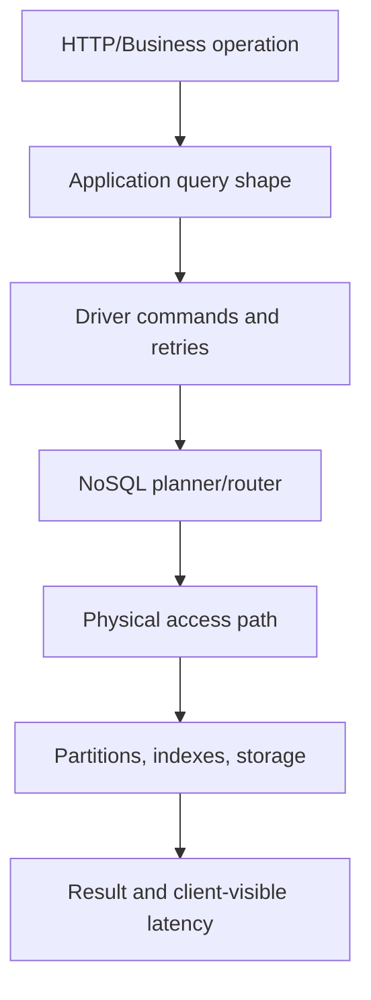

# Nhóm truy vấn theo dạng và xác định đường truy cập tốn chi phí

Một dashboard NoSQL có thể cho thấy **p99 tăng lên 1,8 giây**, số lượt đọc tăng và CPU của một vài node tiến gần 100%. Nhưng các số liệu tổng ấy chưa trả lời được câu hỏi quan trọng: **truy vấn nào đang tạo ra chi phí**, nó đi qua **đường truy cập dữ liệu nào**, và tối ưu ở đâu để không làm sai tính đúng của ứng dụng?

Ví dụ, hai yêu cầu đều gọi:

```http
GET /orders?status=PAID&limit=20
```

Nhưng một yêu cầu chỉ cần lấy 20 bản ghi từ index phù hợp, còn yêu cầu khác lại phải xem hàng trăm nghìn mục, lọc ở ứng dụng, sắp xếp rồi trả cùng 20 bản ghi. Nếu chỉ nhóm theo URL hoặc thời gian trung bình, ta khó phát hiện nguồn gây tải; nếu chỉ nhìn câu truy vấn chậm nhất, ta cũng dễ bỏ qua một câu truy vấn tương đối nhanh nhưng chạy hàng triệu lần mỗi ngày.

Bài thuộc **Database No SQL → Quan sát và chẩn đoán**, tập trung vào hai kỹ năng bổ trợ nhau:

1. **Nhóm truy vấn theo dạng (query shape/query fingerprint):** gom những lệnh có cùng cấu trúc nghiệp vụ và cách truy cập dự kiến, đồng thời giữ đủ chiều ngữ cảnh để phát hiện trường hợp đặc biệt.
2. **Xác định đường truy cập tốn chi phí (expensive access path):** đối chiếu truy vấn logic với thao tác vật lý như partition-key lookup, index seek/scan, document fetch, table/collection scan, scatter-gather, post-filter, sort, read repair hoặc cache miss.

Kết quả mong muốn không phải “thêm nhiều index nhất có thể”, mà là **chọn đúng nhóm truy vấn gây vấn đề, biết vì sao nó đắt, chứng minh bằng số liệu và xác minh tối ưu không làm đổi kết quả nghiệp vụ**.

> Các lệnh MongoDB, DynamoDB, Cassandra/ScyllaDB, Redis và ví dụ Java là minh họa. Tên metrics, query-plan stages, trace/profiler APIs và khả năng index phụ thuộc phiên bản, cấu hình, topology. Không bật tracing/profiling mức cao trên production với lưu lượng lớn khi chưa đánh giá overhead và bảo mật.

---

## 1. Vì sao bắt đầu từ nhóm truy vấn?

Nhìn các logs thô:

```text
GET order O-501  took 12ms
GET order O-502  took 11ms
GET order O-503  took 14ms
GET order O-504  took 13ms
...
GET paid orders for tenant T-A took 740ms
GET paid orders for tenant T-B took 22ms
```

Mỗi lệnh có một ID khác nhau. Nếu tập hợp theo nguyên văn request, hàng triệu IDs tạo ra hàng triệu nhóm không có ích. Ngược lại, nếu gom mọi request vào nhóm `"GET /orders"`, ta trộn **point lookup**, **listing**, **filter**, **sort**, **search** và **cross-tenant admin query** vào cùng một nhóm.

Cần hai mức:

```text
Mức 1 — Query shape:
    orders.lookup_by_id
    orders.list_by_tenant_status_created_desc
    orders.search_by_text

Mức 2 — Access-path/cohort:
    primary-key lookup
    compound index scan
    table scan + post-filter
    single shard
    cross-shard fan-out
    hot tenant / large partition
```

**Query shape cho biết ứng dụng đang hỏi điều gì theo cấu trúc; access path cho biết database thực sự làm gì để trả lời.**

## 2. Mục tiêu học tập

Sau bài này, bạn cần có thể:

- Xây dựng query fingerprints không chứa dữ liệu nhạy cảm và không gây cardinality vô hạn.
- Phân biệt **logical operation**, **query shape**, **parameter cohort**, **query plan/access path** và **physical requests**.
- Biết metric nào phản ánh chi phí truy cập: keys/documents/rows examined, partitions touched, consumed capacity, read bytes, server CPU, network fan-out, cache misses.
- Tính tác động theo **tần suất × chi phí**, không chỉ chọn câu chậm nhất.
- Dùng traces, profiler, slow log và explain theo từng loại NoSQL.
- Phân biệt `FilterExpression` sau read với key condition, collection scan với index scan, key lookup với wide-partition scan.
- Chẩn đoán parameter skew, hot keys, query plan drift, pagination sâu và thắt cổ chai ở application/driver.
- Chọn remediation: index, partition key, projection, query rewrite, cache, rate limit hoặc data-model redesign.
- Đo trước/sau với cùng dataset, query semantics và consistency contract.
- Viết một runbook và bộ acceptance tests cho quy trình tối ưu.

## 3. Năm lớp quan sát của một truy vấn

Một yêu cầu có thể đi qua:



Các lớp khác nhau về đơn vị đo:

| Lớp | Ví dụ | Cần biết |
| --- | --- | --- |
| Business operation | `listCustomerOrders` | Mục đích và SLO |
| Logical query shape | `tenant+status`, sort by time, limit 20 | Cấu trúc |
| Driver command | Query attempt 1/2 | Retry, batching, consistency |
| Planner/router | `IXSCAN` hoặc `COLLSCAN`, target 1 hay nhiều shards | Đường truy cập |
| Storage work | 2.000 index entries, 300 document fetches | Work amplification |
| Caller result | 20 orders, 450ms | Trải nghiệm, correctness |

Một API request có thể sinh nhiều DB commands; một DB command lại có thể fan-out tới nhiều shards/replicas. Đếm RPS ở các tầng vì thế **không tương đương**.

## 4. Query shape là gì?

Query shape là một biểu diễn **cấu trúc** của yêu cầu, thường bỏ qua các giá trị tham số cụ thể nhưng giữ những thành phần có thể quyết định cách truy cập.

Ví dụ:

```javascript
db.orders.find(
  { tenantId: "T1", status: "PAID" },
  { orderId: 1, totalMinor: 1, createdAt: 1 }
).sort({ createdAt: -1 }).limit(20);
```

Và:

```javascript
db.orders.find(
  { tenantId: "T2", status: "PENDING" },
  { orderId: 1, totalMinor: 1, createdAt: 1 }
).sort({ createdAt: -1 }).limit(20);
```

Có thể nhóm thành:

```text
collection: orders
predicate: eq(tenantId) AND eq(status)
projection: orderId,totalMinor,createdAt
sort: createdAt DESC
limitBucket: 1..20
readConsistency: configured level
```

Dạng này có ích để thống kê chung, song **không chứng minh chi phí sẽ giống nhau** cho T1 và T2: tenant T1 có thể có 100 orders, T2 có thể có 10 triệu.

## 5. “Cùng endpoint” không phải “cùng shape”

Một endpoint:

```http
GET /orders
```

có thể hỗ trợ:

```text
A: GET /orders?id=O-501
B: GET /orders?customerId=C-1&limit=20
C: GET /orders?status=PAID&sort=-createdAt&limit=20
D: GET /orders?q=laptop&limit=20
E: GET /orders?from=...&to=...&groupBy=day
```

Các dạng này khác biệt về:

- Predicate/key condition.
- Sort requirement.
- Result cardinality.
- Search/aggregation semantics.
- Index applicability.
- Partition routing.
- Fan-out.
- Pagination.
- Workload frequency.
- Consistency/read concern.
- Data returned.

Nếu nhóm theo đường dẫn HTTP `/orders`, hotspot của C bị average của A che mất.

**Gắn `db.query.shape` hoặc một operation name ổn định từ tầng repository/service** giúp phân biệt đúng hơn.

## 6. “Cùng shape” không đảm bảo cùng execution plan

Một template:

```text
tenantId = ?
AND status = ?
ORDER BY createdAt DESC
LIMIT 20
```

có thể thực thi khác nhau khi:

```text
Tenant T-small: 100 orders.
Tenant T-large: 50 million orders.
Status PAID selectivity 98% in T-large.
Status FAILED selectivity 0.1%.
```

Tùy engine/index/statistics/partitioning:

- Key range scan ngắn.
- Index scan dài.
- Collection/table scan.
- Index scan + document fetch.
- Shard fan-out.
- Filtering trên nhiều partitions.
- Sort trong memory hoặc trên nhiều shards.

Vì thế cần xem **phân bố tham số** và **plan/access-path fingerprint**, không chỉ shape fingerprint.

## 7. Nên chuẩn hóa những gì?

Một bộ chuẩn hóa query shape hợp lý có thể thay:

```text
tenantId="T-A"   -> tenantId=?
orderId="O-501"  -> orderId=?
total > 100000   -> total>?
```

Nhưng phải **giữ cấu trúc quan trọng**:

- Tên collection/table/index/API operation.
- Predicate fields và operators: `=`, `>`, `IN`, range, prefix, regex.
- Quan hệ AND/OR và các nhánh tùy chọn.
- Sort fields, ASC/DESC.
- Projection fields và có/không fetch body.
- Pagination mode và một bucket cho `limit`/IN-list size.
- Query consistency/read preference.
- Key routing: point-key, partition range hay fan-out.
- Aggregation stages/grouping.
- Có/không join-like lookup hoặc nested subqueries.
- Caller/version của feature khi query logic đổi.

Giữ cả literal values trong fingerprint sẽ làm số nhóm bùng nổ. Loại bỏ mọi cấu trúc lại gây nhóm sai.

## 8. Một ví dụ chuẩn hóa sai

Input:

```text
Query A: status = PAID AND createdAt >= 2026-01-01
Query B: status = PAID AND createdAt <= 2026-01-01
```

Nếu normalize chỉ thành:

```text
status=? AND createdAt=?
```

hai truy vấn bị đánh đồng dù range direction khác nhau.

Tương tự:

```text
ORDER BY createdAt ASC
ORDER BY createdAt DESC
```

có thể cần access path khác.

Cùng `IN` nhưng:

```text
customerId IN (2 values)
customerId IN (50.000 values)
```

có thể tạo network, CPU và plan cost rất khác. Có thể nhóm theo **bucket số phần tử** trong `IN`, không theo từng giá trị cụ thể.

## 9. Cấu trúc fingerprint gợi ý

Một descriptor:

```json
{
  "queryShapeVersion": 3,
  "logicalOperation": "orders.listPaid",
  "store": "orders",
  "predicateShape": [
    "eq:tenantId",
    "eq:status",
    "gte:createdAt"
  ],
  "sortShape": ["createdAt:desc"],
  "projectionShape": [
    "orderId",
    "totalMinor",
    "createdAt"
  ],
  "limitBucket": "1-50",
  "pagination": "keyset",
  "accessScope": "tenant",
  "consistencyClass": "session-consistent"
}
```

Từ canonical representation có thể tính một hash ổn định:

```text
shapeId = sha256(canonicalQueryDescriptor)
```

Không cần public raw query literals. Lưu `shapeVersion` để phân biệt thuật toán chuẩn hóa khi deploy.

**Hash collision về mật mã rất hiếm nhưng không phải lý do bỏ kiểm chứng:** có thể lưu canonical descriptor được redacted để kiểm tra fingerprint collisions/changes.

## 10. Dùng tên operation tĩnh khi có thể

Trong code Java:

```java
enum QueryShape {
    ORDER_BY_ID,
    ORDERS_BY_CUSTOMER_RECENT,
    ORDERS_BY_TENANT_STATUS_CREATED_DESC,
    PRODUCTS_BY_CATEGORY_PRICE,
    INVENTORY_RESERVE_CAS
}
```

Nếu repository có các phương thức cố định, dùng **logical operation name** có kiểm soát thường đáng tin hơn việc cố parse mọi CQL/JSON/BSON raw thành một shape chung.

Nhưng **tên method không tự phản ánh đường truy cập vật lý**. Cần kết hợp:

```text
shape ID + store/table + access-path evidence + parameter cohort
```

Nếu một method linh hoạt có nhiều nhánh query, nên cấp shape riêng cho từng nhánh.

## 11. Cần một “parameter cohort” ở giữa shape và literal

Nếu cùng shape có skew lớn, nhóm bổ sung theo **đặc tính thống kê an toàn**:

```text
tenantSizeBucket = SMALL / MEDIUM / LARGE
timeRangeBucket  = <1d / 1-30d / >30d
inListSizeBucket = 1 / 2-10 / 11-100 / >100
pageDepthBucket  = FIRST / DEEP
payloadBucket    = <1KB / 1-32KB / >32KB
keyHeatBucket    = NORMAL / HOT
```

Cohorts giúp thấy:

```text
orders.listPaid on SMALL tenant -> p99 18ms
orders.listPaid on LARGE tenant -> p99 920ms
```

**Không biến từng tenantId hoặc customerId thành metric label**. Nếu cần điều tra một tenant cụ thể, dùng traces/logs có kiểm soát quyền truy cập và privacy, không phát sinh hàng triệu time series.

## 12. Phân biệt query fingerprint với plan fingerprint

Có thể nghĩ tới bảng:

| `shapeId` | `planId` | Tình huống |
| --- | --- | --- |
| S-001 | INDEX_A | Indexed seek + bounded range |
| S-001 | FULL_SCAN | Planner đổi đường truy cập |
| S-001 | INDEX_A_FETCH | Index vẫn dùng nhưng phải fetch nhiều docs |
| S-001 | FANOUT_16 | Cùng shape nhưng route tới 16 shards |

`shapeId` mô tả câu hỏi logic; `planId` mô tả cách engine thực hiện/đường route tại thời điểm đo.

Không phải mọi NoSQL engine đều có **query optimizer/explain plan ID**. Với key-value hoặc wide-column, plan có thể là một **access-pattern descriptor** do ứng dụng suy ra từ operation và partition-key coverage.

## 13. Cần biết cấu trúc khóa mới đánh giá được chi phí

NoSQL thường tối ưu cho một số đường đọc nhất định:

- Document: `_id` lookup, compound indexes, aggregation pipelines.
- Key-value: exact key, range key/index lookup, scan.
- Wide-column: partition key + clustering range.
- Graph: adjacency traversal/index-assisted starting points.
- Cache: exact key command, hash/list/set traversal, Lua script.
- Search read model: inverted index query, segment scan, sorting, aggregations.

Cùng business request `"lấy đơn gần đây"` có thể rẻ hoặc đắt tùy **data model và key layout**. Không có một chỉ số chung `indexUsed=true` đủ cho tất cả NoSQL.

## 14. “Đường truy cập tốn chi phí” là gì?

Một đường truy cập đắt khi một request phải làm **nhiều công việc vật lý hoặc chờ nhiều tài nguyên** hơn mức cần thiết để đáp ứng cùng business contract.

Các loại chi phí:

- CPU cho filter, decode, sort, aggregation.
- Memory cho working set, sort, hash aggregation.
- Disk reads và cache/page faults.
- Network giữa shards/replicas.
- Index entry scans.
- Base document fetches sau index lookup.
- Read/write capacity units.
- Partition touches và quorum/replication coordination.
- Connection/pool wait.
- Lock/CAS/LWT contention.
- Result serialization và bytes trả về.
- Async projection lag gây chờ.

Một query có latency cao **không nhất thiết** do đường truy cập đắt: nó có thể chờ pool trong khi query thực sự chỉ mất 1ms. Cần tách **queue wait**, **storage service time** và **client/network time**.

## 15. Những đường truy cập phổ biến

```text
Key lookup
    -> đọc một record/item theo primary key.

Index seek/range scan
    -> tìm một key hoặc một khoảng trong index.

Index + document fetch
    -> index định vị candidates, sau đó lấy records gốc.

Collection/table scan
    -> duyệt một phần lớn hoặc toàn bộ dữ liệu.

Scatter-gather
    -> router gửi query tới nhiều shards rồi gộp.

Post-filter
    -> đọc candidates trước, lọc phần lớn sau.

In-memory sort
    -> đọc candidates, giữ/bổ sung dữ liệu rồi sắp xếp.

Wide partition scan
    -> đọc nhiều clustering rows/tombstones trong một partition.

Fan-out subqueries
    -> một request gọi hàng chục/hàng trăm point reads.

Cache miss fallback
    -> request bình thường rẻ bỗng chạm NoSQL source.

Conditional write contention
    -> conflict/retry/quorum round trips tăng.
```

Mục tiêu chẩn đoán là **xác định đường nào đã chạy trong phạm vi nào**, không phải áp một nhãn tốt/xấu tuyệt đối.

## 16. Một query chạy scan không luôn là sai

Scan có thể hợp lý khi:

- Dataset rất nhỏ.
- Báo cáo offline được chạy ít lần.
- Quét gần như toàn bộ tập dữ liệu là yêu cầu thật.
- Query không có index phù hợp và thêm index còn đắt hơn.
- Backfill/repair đã được rate-limited.
- Workload không có SLO foreground nghiêm ngặt.

Ngược lại, scan trên hàng trăm triệu items để trả 10 results cho API người dùng thường là dấu hiệu cần điều tra.

**Đánh giá bằng cost relative to purpose và tổng tác động**, không chỉ nhãn `SCAN`.

## 17. Phân biệt lọc trước và lọc sau khi đọc

Một predicate có thể được thực thi:

```text
A. Trong key/index access path.
B. Ở storage/filter stage sau khi đọc candidates.
C. Ở application sau khi database đã trả data.
```

Ví dụ:

```text
Source candidates read: 100.000
Rows surviving predicate: 200
Rows returned after limit: 20
```

Nếu A giảm trực tiếp candidates xuống vài chục, rẻ hơn nhiều so với C, nơi 100.000 records có thể đi qua mạng.

Cần xem **predicate pushdown** và số items/bytes đã xử lý *trước* khi lọc.

## 18. Read amplification của một truy vấn

Một số đo đơn giản:

\[
A_{\mathrm{read}}=
\frac{\mathrm{records\ or\ index\ entries\ examined}}
     {\max(1,\mathrm{records\ returned})}
\]

Ví dụ:

```text
Examined: 80.000 records
Returned: 20 records

Read amplification = 80.000/20 = 4.000
```

Tức mỗi record trả về tương ứng khoảng 4.000 records đã được xem trong định nghĩa đo này.

Lưu ý:

- Index entries examined và documents examined là **hai số khác nhau**.
- Engine có thể đọc pages, SSTables hoặc bytes chứ không có “records examined”.
- Một read trả 0 results cần được báo riêng; đặt denominator bằng 1 chỉ để tránh chia 0, không nên che chi phí của negative query.
- Chi phí có thể bị cache, compression và index-only access ảnh hưởng.
- Một giá trị amplification thấp không tự chứng minh latency thấp nếu network/quorum chậm.

## 19. Selectivity và cardinality

**Selectivity** của predicate là tỷ phần dữ liệu thỏa predicate. Một cách biểu diễn:

\[
S=\frac{N_{\mathrm{matching}}}{N_{\mathrm{candidate}}}
\]

Ví dụ:

```text
Có 1.000.000 orders.
status=PAID khớp 900.000 orders.
status=FAILED khớp 1.000 orders.
```

`status=PAID` có selectivity thấp theo nghĩa predicate giữ lại phần lớn, trong khi `status=FAILED` chọn rất ít.

Một index chỉ gồm `status` có thể không đủ ích cho query:

```text
tenantId=? AND status=PAID
ORDER BY createdAt DESC
LIMIT 20
```

Một index/schema bám theo `tenantId + status + createdAt` có thể thuận lợi hơn, **nếu chi phí ghi/index và partitioning chấp nhận được**.

Không chọn index theo tên field xuất hiện trong `WHERE` mà không xét selectivity, sort và workload.

## 20. Sort có thể khiến query đắt dù filter tốt

Một truy vấn:

```text
tenantId = T1
status = PAID
ORDER BY createdAt DESC
LIMIT 20
```

Nếu access path tìm được 100.000 matching orders nhưng không có thứ tự phù hợp, engine có thể phải:

```text
fetch candidates
sort by createdAt
select top 20
```

Nếu index/cluster order đã cung cấp thứ tự:

```text
seek prefix tenant+status
scan newest entries
stop after limit
```

thì work có thể nhỏ hơn nhiều.

Đừng chỉ kiểm tra “có index”. Phải xem index có phục vụ **equality prefix, range, sort order và projection** hay không trong engine tương ứng.

## 21. Projection/covering index giảm fetch nhưng có trade-off

Một query chỉ cần:

```text
orderId, totalMinor, createdAt
```

Nếu index/secondary read model chứa đủ fields theo contract, database có thể tránh fetch document/body gốc.

Lợi ích:

- Ít storage reads.
- Ít bytes qua network.
- Ít decode/serialization.
- Có thể giảm p95/p99.

Đánh đổi:

- Index lớn hơn, write amplification tăng.
- Updates phải bảo trì thêm index/projection.
- TTL/delete/privacy phải propagate.
- Secondary index có consistency semantics riêng.
- Dữ liệu bị denormalize có freshness SLO cần theo dõi.

**Giảm read cost có thể tăng write cost**, nên tối ưu theo workload tổng.

## 22. Phân trang offset sâu là một dạng đường đọc đắt

Ví dụ:

```text
GET /orders?limit=20&offset=100000
```

Một số storage/query layers phải duyệt, skip hoặc sắp xếp một lượng lớn candidates trước khi trả 20 records.

Một cách khác:

```text
GET /orders?limit=20&cursor=<opaque-last-seen-key>
```

Keyset/cursor pagination có thể tận dụng access order.

Cần phân biệt:

- Cursor của database có nghĩa gì?
- Nó có gắn query/filter/sort/tenant không?
- Có snapshot consistency hay dữ liệu thay đổi giữa pages không?
- Cursor hết hạn sau bao lâu?
- Deep pagination là nghiệp vụ cần thiết hay chỉ do UI?
- Có thể dedup hoặc skip records khi concurrent writes không?

Không dùng `offset`/`skip` tăng rất lớn mà chỉ nhìn p50 của trang đầu.

## 23. Một truy vấn list có thể là hàng trăm point lookups

Ví dụ:

```text
GET /dashboard
    1 query list order IDs
    100 calls getOrderById()
    100 calls getCustomerName()
```

Từng point lookup chỉ mất vài milliseconds, nhưng:

- 201 DB commands cho một HTTP request.
- Connection pool và network chịu fan-out.
- Tail latency tăng vì phải chờ nhiều dependencies.
- Nếu retry 10%, số physical operations còn nhiều hơn.
- N+1 behavior có thể ẩn trong ORM/repository mapping dù dùng NoSQL.

Nhóm theo **business operation** bên cạnh query shape để phát hiện **call amplification**:

\[
A_{\mathrm{calls}}=
\frac{\mathrm{DB\ commands}}{\mathrm{business\ requests}}
\]

## 24. Scatter-gather và shard targeting

Ví dụ query không có shard/partition-key predicate:

```text
Find orders with status=PAID globally.
```

Router có thể phải hỏi nhiều shards, rồi merge/sort.

Với mỗi request:

```text
Fan-out: 16 shards
Each shard: index seek + scan
Router: merge 16 streams
```

Nếu thêm tenantId theo đúng shard key:

```text
Find paid orders for tenant T1.
```

truy vấn có thể chỉ target một hoặc một subset shards, tùy data model/topology.

Đo:

- Number of targeted shards.
- Remote calls.
- Bytes transferred.
- Per-shard candidate counts.
- Router merge/sort time.
- Slowest shard latency.
- Retry/partial response behavior.

**Một query 200ms có thể đắt vì fan-out 16×, không phải vì một shard scan chậm.**

## 25. Hot key và hot partition khác full scan

Một request:

```text
GET inventory:SKU-HOT
```

là point lookup rất gọn. Nhưng nếu hàng chục nghìn requests/s tập trung vào cùng key:

- Một partition/leader có thể quá tải.
- Lock/serialization/CPU tăng.
- Redis hot slot bị nghẽn.
- CAS conflicts tăng ở writers.
- Replica/network congestion tăng.
- Cache invalidation quá thường xuyên.

Đường truy cập **rẻ cho một request** nhưng đắt ở **tổng workload** vì tần suất và skew.

Tối ưu có thể là caching, read replicas trong consistency contract, request coalescing, throttling hoặc thiết kế lại contention; thêm một index không xử lý được hot key.

## 26. Read cost và write cost phải đo cùng nhau

Một compound index mới làm query nhanh hơn:

```text
Read candidates:
    50.000 -> 30

Read p99:
    800ms -> 40ms
```

Nhưng:

```text
Write latency +15%
Index storage +40%
Compaction/index maintenance increased
```

Nếu workload 90% reads, đây có thể là trade-off tốt. Nếu 90% writes, có thể không phù hợp.

Cần đo:

- Read latency/throughput.
- Write latency/throughput.
- Index storage.
- Flush/compaction/replication overhead.
- Query cache behavior.
- CDC/index update lag.
- Time/cost to backfill index.
- Rollback/migration plan.

**Không kết luận index tối ưu chỉ từ một `explain` nhanh.**

## 27. Metric tối thiểu để nhóm và chẩn đoán

| Nhóm | Metric | Ý nghĩa |
| --- | --- | --- |
| Traffic | Calls/s theo shape | Tần suất |
| Latency | p50/p95/p99 | Trải nghiệm |
| Errors | Timeout/throttle/conflict | Chất lượng/overload |
| Work | Docs/keys/rows examined | Lượng dữ liệu phải xem |
| Result | Docs/rows returned | Kích thước kết quả |
| Bytes | Read/response bytes | I/O + network |
| Routing | Targeted partitions/shards | Fan-out |
| Index | Index name/scan type | Access path |
| Queue | Pool acquire/queue wait | Delay trước storage |
| Retry | Attempts per logical query | Amplification |
| Cost | Capacity units/server time | Tiêu thụ tài nguyên |
| Hotspot | Per-shard/partition load | Skew |
| Freshness | Replica/projection lag | Read quality |
| Cache | L1/L2 hit-miss | Source amplification |

Không phải engine nào cũng cung cấp mọi metric; cần định nghĩa mapping và ghi giới hạn quan sát.

## 28. Trace một HTTP request qua nhiều DB commands

Một trace có thể là:

```text
HTTP GET /customers/C-10/orders  [315ms]
  Auth/tenant policy             [3ms]
  Redis cache lookup             [2ms MISS]
  DB connection acquire          [88ms]
  MongoDB find orders            [170ms]
      queryShape=S-ORDER-LIST
      planShape=IXSCAN+FETCH+SORT
      docsExamined=28000
      nReturned=20
  Serialization                  [10ms]
  Response network               [...]
```

Nếu chỉ nhìn `DB find 170ms`, dễ bỏ qua **88ms chờ connection pool**.

Traces cần liên kết:

```text
logicalQueryId
queryShape
driverAttempt
database/collection
plan/access descriptor
target region/shard
cacheStatus
resultCount
duration
```

Không nhét raw customer ID hoặc query payload vào metric label; trace IDs và redacted identifiers phải có access control.

## 29. Tách client latency với server execution

Một công thức phân rã khái niệm:

\[
T_{\mathrm{client}}
=
T_{\mathrm{queue}}
+
T_{\mathrm{network}}
+
T_{\mathrm{server}}
+
T_{\mathrm{deserialize}}
+
T_{\mathrm{retry}}
+
T_{\mathrm{other}}
\]

Trong thực tế các thành phần có thể overlap khi request async/fan-out; không cộng các spans song song như thể chúng tuần tự.

Ví dụ:

```text
Java repository call: 620ms
Driver pool wait:     380ms
Network:               40ms
NoSQL execution:       30ms
Retries/backoff:      170ms
```

Truy vấn có thể **không có access path đắt**: bottleneck là pool/starvation/retry.

Nếu chẩn đoán nhầm, thêm index sẽ không chữa được.

## 30. Histogram, percentile và phân bố query shapes

Đừng chỉ lưu average:

```text
shape S-1:
    mean 12ms
    p99 210ms
```

Một số timeouts có thể kéo tail lên cao.

Cần:

- p50/p95/p99 riêng từng shape.
- Sample count/call count.
- Success vs failed attempts.
- Per cohort (hot tenant, large partition, deep page).
- Cold-cache vs warm-cache.
- Client end-to-end vs server observed latency.
- Time series theo từng khoảng, không chỉ histogram cả ngày.

Nếu một shape chỉ có 12 requests, p99 có độ tin cậy thấp. Với shape 1 triệu requests, mean có thể che số lượng lớn người dùng chịu tail latency.

## 31. Sampling có thể làm sai thứ tự ưu tiên

Giả sử APM lưu:

```text
100% requests chậm >1s.
1% requests bình thường.
```

Nếu đơn giản đếm số traces:

```text
Shape A: 100 slow traces.
Shape B: 30 normal traces.
```

không thể suy shape A chạy thường xuyên hơn B. Sampling đã ưu tiên A.

Cần:

- Truy cập aggregated counters/histograms từ source đầy đủ hoặc ước lượng có trọng số đúng.
- Ghi sampling rate/criteria.
- Tách head-based và tail-based sampled traces.
- Không nhân mọi sample với `1/p` nếu sampling probability không đồng nhất hoặc không biết.
- Dùng profiler sampled queries để tìm ví dụ, không thay metric total workload.

**Một trace chứng minh truy vấn có thể đắt; nó không chứng minh mức độ phổ biến của truy vấn.**

## 32. Tần suất × chi phí là nền tảng ưu tiên

Hai shapes:

```text
A: 1.000.000 queries/day, 5ms server time each.
B:     1.000 queries/day, 900ms server time each.
```

Tổng thời gian server quan sát:

\[
C_A=1.000.000\times 0{,}005=5.000s
\]

\[
C_B=1.000\times 0{,}9=900s
\]

A có thể tiêu thụ tổng server time nhiều hơn B, dù B chậm hơn rất nhiều cho từng caller.

Tuy nhiên, B vẫn có thể vi phạm SLO nghiêm trọng. Cần tối ưu theo **cả tổng cost và user-impact**, không một ranking duy nhất.

## 33. “Total time” không phải CPU time

Khi cộng:

```text
totalDurationMs = count × meanDurationMs
```

đây là **tổng thời gian bị quan sát**, bao gồm waiting. Các queries chạy song song có thể có durations chồng lấn; tổng này **không phải số giây CPU độc quyền**.

Nếu engine có số liệu consumed capacity, docs examined, CPU, disk read, dùng chúng để đánh giá resource cost cụ thể.

Một báo cáo tốt có hai góc:

- **Latency/user harm:** SLO violations, p99, timeouts, affected users.
- **Resource pressure:** CPU, I/O, RCU/WCU, read bytes, scanned rows, fan-out, occupied connections.

## 34. Một bảng xếp hạng shapes

Số liệu giả định:

| Shape | Calls/min | p99 | Rows examined/return | Fan-out | Nhận định |
| --- | ---: | ---: | ---: | ---: | --- |
| `profile.by_id` | 40.000 | 12ms | 1/1 | 1 | Nhiều nhưng rẻ |
| `orders.by_tenant_recent` | 15.000 | 680ms | 15.000/20 | 8 | Ưu tiên cao |
| `catalog.search_filter` | 2.000 | 1.5s | 150.000/20 | 16 | Chậm và đắt |
| `admin.full_export` | 12 | 10s | 2M/2M | 16 | Có thể hợp lý nếu offline |
| `inventory.reserve_cas` | 5.000 | 250ms | 1/1 | 1 | Contention, không phải scan |

Không nên tối ưu `admin.full_export` trước chỉ vì nó có p99 cao nhất nếu nó là công việc batch được rate-limited, trong khi `orders.by_tenant_recent` làm SLO foreground thất bại hàng nghìn lần mỗi phút.

## 35. Gợi ý một score ưu tiên có thể giải thích

Không nên biến mọi vấn đề thành một con số “magic”, nhưng có thể lập triage:

```text
Priority dimensions:
    affectedRequestRate
    SLOViolationRate
    excessReadWorkPerRequest
    totalPhysicalReadWork
    hotspotConcentration
    correctnessRisk
    remediationComplexity
```

Ví dụ:

```text
P0: trả sai dữ liệu hoặc cross-tenant leak.
P1: query shape ảnh hưởng user nhiều, p99 vượt SLO và gây overload.
P2: query đắt nhưng hiếm, chạy background có kiểm soát.
P3: chỉ cần cải thiện chi phí khi có cơ hội.
```

Khi so sánh hai candidates, ghi rõ **điều kiện doanh nghiệp và tài nguyên** dẫn tới quyết định. Không được để một score vô cớ lấn át vấn đề correctness.

## 36. Tìm query shape từ application code

Đây là nơi thường biết rõ nhất:

- Repository method hoặc service operation.
- Endpoint và business intent.
- Fields và predicates được xây có điều kiện.
- Read/write consistency.
- Pagination.
- User/tenant authorization.
- Retry policy.
- Cache key/usage.
- Expected result size.

Một chiến lược:

```text
1. Đặt tên operation theo business.
2. Gắn static shape ID cho nhánh query.
3. Ghi parameter cohorts an toàn.
4. Ghi driver attempts và result count.
5. Liên kết tới traces/server diagnostics khi cần.
```

Không chỉ dựa vào regex phân tích raw CQL/BSON strings; queries xây động có thể có semantics và sort/index paths phức tạp.

## 37. Không làm lộ dữ liệu khi log queries

Tránh ghi:

```text
SELECT users WHERE email="person@example.com"
paymentToken=...
tenantId=...
```

vào metrics, logs công khai hoặc APM chưa có controls.

Thay bằng:

```json
{
  "operation": "users.by_email",
  "shapeId": "S-USER-EMAIL",
  "parameterTypes": ["string"],
  "tenantSizeBucket": "medium",
  "resultCount": 1,
  "durationMs": 12
}
```

Đối với điều tra một request, có thể dùng trace ID và truy cập log chi tiết đã redacted theo phân quyền.

Cần xem thêm:

- SQL/CQL/BSON bind parameters.
- Query plans có literal values không?
- Exception messages từ driver.
- Sampling payloads.
- Slow query logs/stack traces.
- Retention của thông tin theo quy định.
- Multi-tenant access controls.

**Quan sát không được tạo ra sự cố bảo mật lớn hơn lỗi hiệu năng đang chẩn đoán.**

## 38. MongoDB: giải thích truy vấn với `explain`

MongoDB có thể cung cấp **query planner/execution stats** qua `explain` và tooling liên quan. Các tên stage/field khác nhau giữa execution engines và versions; cần đọc đúng output của phiên bản đang dùng.

Ví dụ:

```javascript
db.orders.find(
  {
    tenantId: "T1",
    status: "PAID"
  },
  {
    orderId: 1,
    totalMinor: 1,
    createdAt: 1
  }
).sort({ createdAt: -1 }).limit(20)
 .explain("executionStats");
```

Quan sát các thông tin phù hợp:

```text
winningPlan / queryPlanner details
indexName
COLLSCAN / IXSCAN / FETCH / SORT or equivalent stages
nReturned
totalKeysExamined
totalDocsExamined
executionTimeMillis or related timing
```

Tùy phiên bản, plan có thể dùng cấu trúc/stages khác. Không giả cùng một field name luôn có ở mọi topology và version.

## 39. MongoDB: một ví dụ đường truy cập tốn chi phí

Giả định:

```text
Shape: orders.by_tenant_status_recent
Input: tenantId=T-large, status=PAID, sort=-createdAt, limit=20

Observed:
    nReturned         = 20
    totalKeysExamined = 250.000
    totalDocsExamined = 120.000
    sort/merge stage present
```

Đây là dấu hiệu cần xem:

1. Query có dùng compound index phù hợp không?
2. Predicate nào được áp trong index, predicate nào sau FETCH?
3. Sort có được đáp ứng qua index order không?
4. Có route tới nhiều shards không?
5. `PAID` quá phổ biến trong tenant này không?
6. Projection có gây fetch thêm documents không?
7. Các variants khác của same shape có khác plan không?
8. Workload writes có chịu chi phí index mới không?

Không chỉ dựa vào `executionTimeMillis` một lần vì warm cache, concurrency, data distribution và load background thay đổi.

## 40. MongoDB: compound index theo query shape

Nếu workload thực sự hay dùng:

```text
tenantId = ?
status = ?
ORDER BY createdAt DESC
LIMIT 20
```

một candidate index về mặt ý tưởng:

```javascript
db.orders.createIndex(
  { tenantId: 1, status: 1, createdAt: -1 }
);
```

Nhưng trước khi tạo:

- Query có các predicates khác làm thay đổi prefix không?
- Index có tồn tại dưới tên/thứ tự khác rồi không?
- Shard key có khiến query route phân tán không?
- Có `collation` hoặc field types làm index không khớp?
- Query có cần thêm fields cho projection không?
- Data model có many tenants và skew lớn không?
- Index build ảnh hưởng production như thế nào?
- Write latency và storage thay đổi ra sao?

Tối ưu không nên là “mỗi query tạo một index”, vì quá nhiều indexes làm tăng write amplification và cost vận hành.

## 41. MongoDB: profiling/slow queries và query shapes

Các nguồn quan sát có thể bao gồm:

- Database profiler/slow operation logs theo cấu hình.
- Diagnostic/current operations.
- Query telemetry/query settings nếu phiên bản hỗ trợ.
- Explain plans với tập parameters đại diện.
- Index usage statistics/metrics.
- Driver command monitoring và application traces.
- Shard distribution và replication metrics.

Cần phân biệt:

```text
slowms threshold:
    chỉ ghi những operations vượt mốc.

Profiler sampling:
    không đại diện toàn bộ traffic nếu có sampling.

Explain:
    minh họa execution của một query, không thay toàn bộ workload histogram.
```

Đừng bật profiling mức chi tiết cao trên cluster production bận rộn mà không tính logging overhead, disk cost, quyền truy cập và tác động performance.

## 42. Query plan đổi mà application code không đổi

Một shape S có thể đổi plan vì:

- Cardinality/data distribution thay đổi.
- Index mới được tạo hoặc index cũ bị xóa.
- Database upgrade/optimizer behavior đổi.
- Statistics/plan cache thay đổi.
- Shard balancing.
- Query settings/hints.
- Collation/type/predicate thay đổi ở đường code.
- Workload chuyển từ tenant nhỏ sang tenant lớn.

Đây là **plan drift**.

Chẩn đoán:

```text
Shape S:
    Before plan = compound index seek, p99=40ms.
    After plan  = collection scan, p99=800ms.
```

Cần lưu **trạng thái plan/access path và deployment/schema change timeline**, nhưng tránh giả một plan fingerprint ổn định tuyệt đối qua tất cả database versions.

## 43. DynamoDB: `Query` và `Scan` khác nhau căn bản

Trong DynamoDB, một `Query` sử dụng key condition phù hợp với base table hoặc index. `Scan` đi qua dữ liệu rộng hơn theo phạm vi request, có thể gây chi phí cao.

Ví dụ ý tưởng:

```text
Desired:
    List orders by tenantId + createdAt range.

Key design:
    PK = TENANT#T1
    SK = ORDER#<createdAt>#<orderId>
```

Một `Query` theo partition key và sort key range có thể truy cập đường đã được thiết kế.

Ngược lại:

```text
Scan all orders
Filter tenantId = T1
Limit 20
```

có thể đọc rất nhiều data trước khi trả những items cần, không phù hợp foreground traffic nếu dataset lớn.

**DynamoDB không có generic query optimizer tự tìm một index phù hợp cho mọi filter**. Data model và table/GSI access pattern quyết định đường truy cập.

## 44. DynamoDB: key condition khác filter sau read

Một ví dụ cấu trúc:

```text
KeyConditionExpression:
    tenantId = :tenant AND begins_with(sortKey, :orderPrefix)

FilterExpression:
    status = :paid
```

Một `FilterExpression` được áp **sau bước đọc items trong operation** theo semantics của API. Nó không tạo biến truy vấn có status được đẩy thành key condition nếu index key không chứa status.

Một response có thể cho biết:

```text
Count        = 20
ScannedCount = 10.000
```

Sự khác biệt cảnh báo nhiều items được xem rồi mới lọc.

Cần hiểu giới hạn:

- `Count`/`ScannedCount` mô tả phạm vi của response/page đang xử lý; không tự nói toàn query đã hoàn tất khi còn `LastEvaluatedKey`.
- Consumed capacity chủ yếu gắn với lượng dữ liệu được đọc theo capacity model, không chỉ số items sau filter.
- `ProjectionExpression` và index projection ảnh hưởng dữ liệu trả về và access design, nhưng không nên giả projection làm giảm mọi consumed-read cost theo cùng tỷ lệ.
- `Limit` và page-size semantics không đơn giản là “trả đúng 20 matching items” nếu nhiều items bị filter.
- `Query` qua GSI có consistency semantics khác base table; phải kiểm tra contract.

## 45. DynamoDB: quan sát access path bằng access-pattern telemetry

Một log an toàn:

```json
{
  "shape": "orders.by_tenant_status_recent",
  "operation": "Query",
  "target": "orders-by-tenant-index",
  "partitionRouting": "single-partition-key",
  "pagesFetched": 14,
  "countReturned": 20,
  "scannedCount": 5600,
  "consumedCapacityUnits": 82.5,
  "sdkAttempts": 2
}
```

Số liệu minh họa.

Những chỉ số hữu ích:

- `Query` vs `Scan`.
- Table/index target.
- ReturnedCount / ScannedCount.
- Page count/LastEvaluatedKey.
- `ReturnConsumedCapacity` khi cấu hình.
- Throttling và retry attempts.
- Capacity theo table/GSI và hot partition.
- Client elapsed vs service latency.
- Strong/eventual consistency mode theo API.
- Result payload bytes.

Đừng tổng hợp chỉ `p99` mà bỏ consumed capacity; một query 50ms có thể tốn nhiều RCU và khi tăng RPS sẽ gây throttling.

## 46. DynamoDB: GSI giúp đọc nhưng làm phức tạp cost và freshness

Một GSI theo:

```text
GSI PK: TENANT#T1#STATUS#PAID
GSI SK: createdAt
```

có thể phục vụ một shape cụ thể hiệu quả hơn.

Đánh đổi:

- GSI cần capacity/storage để cập nhật.
- Có propagation delay, ảnh hưởng read-your-writes.
- Filter và projection phải được thiết kế phù hợp.
- Item write/update có thể tác động nhiều indexes.
- Partition skew/hot status keys vẫn có thể tồn tại.
- Query qua GSI không tự có strong consistent reads như mọi base table access.
- Backfill/migration cần kiểm tra dữ liệu trùng/thiếu và lag.

Nếu business yêu cầu xác nhận tồn kho, một eventual index không được thay authoritative conditional write chỉ vì query nhanh.

## 47. Cassandra/ScyllaDB: truy vấn được thiết kế theo partition và clustering

Một bảng:

```sql
CREATE TABLE orders_by_customer (
    tenant_id text,
    customer_id text,
    created_at timestamp,
    order_id text,
    status text,
    amount_minor bigint,
    PRIMARY KEY (
      (tenant_id, customer_id),
      created_at, order_id
    )
) WITH CLUSTERING ORDER BY (
    created_at DESC, order_id ASC
);
```

Một access pattern:

```sql
SELECT order_id, created_at, status, amount_minor
FROM orders_by_customer
WHERE tenant_id = ?
  AND customer_id = ?
LIMIT 20;
```

có thể đọc một partition và một đoạn clustering rows.

Nhưng nếu ứng dụng hỏi:

```text
All PAID orders across all customers,
sorted by created_at.
```

bảng này không tự cung cấp access path trực tiếp chỉ nhờ SQL-like syntax.

Trong wide-column NoSQL, **data model/table thường được tạo theo query**, vì vậy việc nhóm query shapes là đầu vào trực tiếp cho thiết kế bảng.

## 48. Cassandra/ScyllaDB: costly partition-range read

Một shape:

```text
customerOrders.recent
```

có thể hoạt động tốt với khách có vài trăm rows, nhưng chậm với tenant/customer có hàng triệu rows trong một partition.

Nguyên nhân có thể gồm:

- Large partition.
- Wide clustering scan.
- Tombstones.
- Row/page size lớn.
- SSTable overlap/compaction.
- Coordinator/replica read amplification.
- Replica/consistency wait.
- Network cross-DC.
- Driver paging/chậm do fetch many pages.

Thế nên cần cohort:

```text
partitionSizeBucket=SMALL/MEDIUM/LARGE
tombstoneDensityBucket=LOW/HIGH
pageCountBucket=1/2-10/>10
```

Không mặc định tất cả requests của same shape tiêu tốn chi phí như nhau.

## 49. `ALLOW FILTERING` không phải giải pháp index chung

Trong CQL, việc cho phép filtering hoặc một index strategy nào đó có thể hợp lệ tùy engine/version/schema, nhưng nó **không tự biến một truy vấn thành partition-key lookup hiệu quả**.

Ví dụ:

```text
SELECT ... WHERE status='PAID'
```

nếu schema không hỗ trợ access path đó, hệ có thể phải đọc/lọc nhiều dữ liệu hoặc yêu cầu một bảng/read model khác.

Hướng thiết kế:

```text
orders_by_customer
orders_by_tenant_status
orders_by_show_recent
```

Mỗi bảng/phân vùng phục vụ một nhóm query patterns có tính toán về:

- Partition key cardinality/skew.
- Clustering order.
- Time bucketing.
- TTL/tombstones.
- Denormalization cost.
- Consistency khi cập nhật nhiều views.
- Backfill và delete propagation.

Không “thêm bảng cho mọi tổ hợp filter” vô hạn; phải xếp hạng shapes theo workload và chi phí.

## 50. CQL tracing và diagnostics

Nguồn quan sát có thể gồm:

- Driver metrics: request latency, speculative execution, retries, connection/pool state.
- Query tracing có lấy mẫu hoặc bật chủ đích cho requests cụ thể.
- Node/table metrics, partition/compaction/tombstone statistics.
- Slow-query/trace tooling theo phiên bản.
- Nodetool/Scylla monitoring tools tương ứng.
- System tracing tables khi cấu hình và phạm vi hỗ trợ.

Cần lưu ý:

- Query tracing có overhead; không bật đại trà trên hệ bận.
- Một trace có thể ghi nhiều events trên coordinator/replicas.
- Timeouts khi truy vấn conditional/LWT có outcome semantics riêng.
- CQL `SELECT` có page size, CL, partition routing cần được ghi.
- Nếu lỗi do network cross-DC, thêm index có thể không giải quyết latency.
- Metrics per-table không tự xác định shape nếu nhiều shapes dùng chung bảng; cần nối với application operation name.

## 51. Redis: không có query planner kiểu MongoDB

Redis có command-level access patterns:

```text
GET key
MGET keys...
HGET hash field
HMGET hash fields...
HGETALL hash
LRANGE list start stop
ZRANGE ...
SCAN cursor
KEYS pattern
EVAL script ...
```

Chi phí phụ thuộc:

- Độ phức tạp của command và kích thước collection.
- Số keys, fields hoặc elements.
- Payload bytes.
- Serialization/client deserialization.
- Number of round trips.
- Pipelining/batching.
- Lua script execution.
- Hot key/slot.
- Redis server CPU/event loop, memory và network.
- Replication/persistence/failover behavior.

Ví dụ `HGETALL` trên hash rất lớn có thể đọc/serialize hàng trăm nghìn fields trong khi business chỉ cần hai fields; `HMGET`/field-specific design có thể rẻ hơn nếu phù hợp.

## 52. Redis: SLOWLOG không cho thấy toàn bộ latency

Redis có các công cụ như SLOWLOG, command statistics và latency monitoring theo phiên bản/config.

Điều cần phân biệt:

```text
Redis command execution time
    != Java client end-to-end latency.
```

Một GET chạy rất nhanh trên server vẫn có thể chậm do:

- Connection acquisition.
- TLS/network RTT.
- Large response bytes.
- Client CPU/deserialization.
- Pool saturation.
- Retry/reconnect.
- Cluster redirection.
- Load balancer/proxy.
- Hot slot queueing.

SLOWLOG thường tập trung vào **thời gian thực thi command trên server**, không bao gồm toàn bộ network transfer và queueing ở application.

Lệnh `MONITOR` hoặc profiling chi tiết có thể tạo overhead/lộ dữ liệu; chỉ dùng trong phạm vi an toàn.

## 53. Redis: tránh dùng keyspace-wide operations trên đường foreground

Ví dụ nguy hiểm với keyspace lớn:

```text
KEYS order:*
```

Thao tác duyệt toàn keyspace có thể cản trở xử lý các commands khác tùy topology.

`SCAN` được thiết kế để duyệt theo từng bước, nhưng:

- Không biến một phép quét toàn keyspace thành point lookup.
- Có thể có duplicate/missing observations khi keyspace đang đổi theo semantics tài liệu.
- Cần giới hạn batch, concurrency, cursor và rate.
- Không nên dùng làm primitive cho một endpoint tìm kiếm online tốc độ cao nếu không có read index phù hợp.

Tốt hơn cho danh sách đơn hàng có thể là **duy trì index/set/sorted set theo tenant/customer** với lifecycle được thiết kế và consistency rõ.

## 54. Chi phí của cache miss và negative lookup

Một shape:

```text
profile.by_user_id
```

có thể có hai execution paths:

```text
A. Redis HIT -> 2ms
B. Redis MISS -> NoSQL source -> 70ms
```

Khi có TTL expiry wave, `cache_miss_ratio` tăng:

```text
100.000 GET/s
95% hit -> 5.000 source GET/s

100.000 GET/s
50% hit -> 50.000 source GET/s
```

Cùng query shape và cùng endpoint, database load tăng 10 lần.

Nên nhóm thêm:

```text
cacheStatus = HIT / MISS / BYPASS
sourceReadPath = PRIMARY / REPLICA / INDEX / PROJECTION
```

**Thấy cache hit thấp là một giả thuyết**, cần đối chiếu hit/miss, source QPS và server metrics trước khi sửa TTL.

## 55. Chẩn đoán query plan theo thời gian

Một query shape thay đổi:

```text
T0:
    p99 45ms
    index examined 80
    docs examined 20

T1:
    p99 900ms
    index examined 200000
    docs examined 120000
```

Các câu hỏi:

1. Data size/cardinality đổi?
2. New code path/predicate được bật?
3. Index bị thiếu/ẩn/xóa?
4. Plan/optimizer behavior đổi?
5. Query được route sang shard khác?
6. Tenant/customer lớn hơn xuất hiện?
7. Thay đổi parameter `limit`/time range?
8. Cache/replica path khác?
9. Background index build/compaction?
10. Driver retry/timeout config đổi?

Một **deployment timeline** nối application version, schema/index version, database upgrade và incidents giúp tìm regression nhanh hơn.

## 56. Cần một “query inventory” có khả năng hành động

Ví dụ bảng:

| Shape | Purpose | Access expectation | Current path | Priority owner |
| --- | --- | --- | --- | --- |
| `orders.by_id` | Chi tiết đơn | Primary key | Key lookup | Orders |
| `orders.by_tenant_status_recent` | Danh sách | Partition+compound index | Full scan/fan-out bất thường | Orders |
| `inventory.reserve` | Giữ hàng | Conditional keyed write | Key hot/CAS | Inventory |
| `catalog.search` | Search | Search projection/index | Index + large post-filter | Catalog |
| `dashboard.summary` | Báo cáo | Materialized summary | Many point reads | Analytics |

Một inventory nên ghi:

- Definition/fingerprint version.
- Expected access path.
- SLO và correctness contract.
- Actual metrics và representative explain/trace.
- Index/schema dependency.
- Owner.
- Change history.
- Known parameter cohorts.
- Remediation plan.

Không bắt mọi team ghi raw query literals vào manifest này.

## 57. Java: gắn shape tĩnh ở repository layer

Ví dụ dùng Java 17:

```java
public enum QueryShape {
    ORDER_GET_BY_ID,
    ORDER_LIST_BY_CUSTOMER_RECENT,
    ORDER_LIST_BY_TENANT_STATUS,
    INVENTORY_RESERVE_CAS,
    CATALOG_SEARCH_FILTERED
}

public record QueryDescriptor(
        QueryShape shape,
        String targetStore,
        String accessScope,
        String consistency,
        String parameterCohort
) {
}
```

Repository:

```java
public List<Order> findPaidOrders(
        String tenantId, PageCursor cursor) {

    QueryDescriptor descriptor = new QueryDescriptor(
        QueryShape.ORDER_LIST_BY_TENANT_STATUS,
        "orders",
        "TENANT",
        "READ_CONTRACT_V1",
        tenantSizeBucket(tenantId)
    );

    return telemetry.measure(
        descriptor,
        () -> performNoSqlQuery(tenantId, cursor)
    );
}
```

`telemetry`, `Order`, `PageCursor` và adapters ở đây là abstractions, không phải chương trình hoàn chỉnh. Điểm chính: **operation identity đến từ code có kiểm soát**, không từ tên tenant hoặc literal query.

## 58. Java 17: một chương trình tổng hợp shapes đơn giản

Ví dụ sau có thể biên dịch độc lập bằng Java 17. Nó nhóm samples theo **shape name tĩnh**, đếm calls, tổng duration, max duration, số records đã đọc và số records trả về. Mục tiêu là minh họa **cơ sở của cost attribution**, không thay một histogram/observability system production.

```java
import java.util.*;
import java.util.concurrent.ConcurrentHashMap;
import java.util.concurrent.atomic.LongAdder;

public final class QueryShapeStatsDemo {

    enum Shape {
        ORDER_BY_ID,
        ORDERS_BY_TENANT_STATUS,
        CATALOG_FILTERED_SEARCH
    }

    static final class Stats {
        final LongAdder calls = new LongAdder();
        final LongAdder elapsedNanos = new LongAdder();
        final LongAdder examined = new LongAdder();
        final LongAdder returned = new LongAdder();
        final LongAdder errors = new LongAdder();

        void add(
                long durationNanos,
                long recordsExamined,
                long recordsReturned,
                boolean error) {

            calls.increment();
            elapsedNanos.add(durationNanos);
            examined.add(recordsExamined);
            returned.add(recordsReturned);
            if (error) {
                errors.increment();
            }
        }
    }

    static final class Collector {
        private final Map<Shape, Stats> byShape =
                new ConcurrentHashMap<>();

        void record(
                Shape shape,
                long durationNanos,
                long examined,
                long returned,
                boolean error) {

            byShape.computeIfAbsent(shape, k -> new Stats())
                   .add(durationNanos, examined, returned, error);
        }

        void report() {
            byShape.forEach((shape, stats) -> {
                long count = stats.calls.sum();
                double meanMs = stats.elapsedNanos.sum()
                        / (double) Math.max(1, count)
                        / 1_000_000.0;

                double amplification = stats.examined.sum()
                        / (double) Math.max(1, stats.returned.sum());

                System.out.printf(
                    "%s calls=%d errors=%d meanMs=%.2f " +
                    "examined=%d returned=%d observedAmp=%.1f%n",
                    shape,
                    count,
                    stats.errors.sum(),
                    meanMs,
                    stats.examined.sum(),
                    stats.returned.sum(),
                    amplification
                );
            });
        }
    }

    public static void main(String[] args) {
        Collector collector = new Collector();

        for (int i = 0; i < 1000; i++) {
            collector.record(
                Shape.ORDER_BY_ID,
                2_000_000,
                1, 1, false);
        }

        for (int i = 0; i < 30; i++) {
            collector.record(
                Shape.ORDERS_BY_TENANT_STATUS,
                400_000_000,
                50_000, 20, false);
        }

        collector.record(
            Shape.CATALOG_FILTERED_SEARCH,
            900_000_000,
            300_000, 20, false);

        collector.report();
    }
}
```

**Giới hạn kỹ thuật:**

- `LongAdder` là counter gần đồng thời, không cung cấp atomic snapshot đa trường.
- Không có p95/p99 histogram, sampling, time windows hoặc per-cohort tags.
- Các sample giả định có đơn vị `recordsExamined`, nhưng mỗi NoSQL có khái niệm khác.
- `observedAmp` gộp tổng numerator/denominator, không phải trung bình amplification của từng request.
- Không trừ các retried attempts; muốn tính logical vs physical phải theo dõi cả hai.
- Không có alert, trace IDs, persistence hay security controls.
- Trong production nên dùng metrics library/histograms/traces theo chuẩn thống nhất, không copy collector đơn giản này thành monitoring system.

## 59. Java: đo time nhưng không đánh đồng nó với server cost

Một wrapper đơn giản:

```java
long started = System.nanoTime();

try {
    return repository.loadOrders(query);
} finally {
    long elapsedNanos =
            System.nanoTime() - started;

    metrics.recordClientLatency(
        "orders.by_tenant_status",
        elapsedNanos);
}
```

Đây là **client-observed repository latency**, có thể gồm pool/network/retries.

Nếu driver hoặc database cung cấp `serverExecutionTime`, `docsExamined`, `consumedCapacity`, hãy ghi các metrics đó **riêng**. Không gọi `elapsedNanos` là `dbCpuTimeNanos`.

Đồng thời tránh:

```text
metrics.tag("orderId", orderId)
metrics.tag("query", rawBsonJson)
```

vì cardinality và rủi ro dữ liệu nhạy cảm.

## 60. Java/OpenTelemetry: trace attributes gợi ý

Một span schema khái niệm:

```text
db.system.name              = "mongodb"
db.namespace                = "shop.orders"
db.operation.name           = "find"
db.query.shape              = "orders.by_tenant_status_recent"
db.query.shape_version      = "3"
db.access.route_class       = "targeted"
db.access.path_class        = "IXSCAN_FETCH_SORT"
db.response.returned_count  = 20
db.response.examined_count  = 28000
db.client.attempt           = 2
db.client.cache_status      = "MISS"
db.consistency.class        = "session"
```

Tên fields là **gợi ý**, không khẳng định mọi tên đều thuộc bộ semantic conventions chính thức của OpenTelemetry hiện hành. Khi triển khai nên dùng official conventions tương ứng và custom namespace cho attributes riêng.

Một span có trace ID không phải bằng chứng rằng source query được sampling đầy đủ; kết hợp metrics aggregate và sampled traces.

## 61. Khi nào phải lấy `explain` hoặc query plan?

Nên lấy khi:

- Một shape có read amplification bất thường.
- p99 tăng mà CPU/IO tăng theo.
- Có plan drift sau deploy/index change.
- Cùng shape khác biệt lớn giữa parameter cohorts.
- Query mới sẽ được đưa vào production.
- Muốn chứng minh một index/schema fix giảm scanned work.
- Một hot shard bị tải nặng không giải thích được từ RPS.

Cần tránh:

- Lấy full explain cho mọi request production.
- Chạy execution-stats trên một scan rất đắt mà không có giới hạn/phê duyệt.
- Quên thay bind parameters bằng mẫu thực sự đại diện.
- Kết luận từ một lần explain trên dataset 100 rows.
- Coi query plan là source of truth cho business correctness.

`explain` là **bằng chứng chẩn đoán một access path**, không thay test tải và đối soát dữ liệu.

## 62. Quy trình điều tra một query chậm

Một thứ tự thực dụng:

```text
1. Xác định SLO/triệu chứng cụ thể.
2. Lọc theo business endpoint và database operation.
3. Nhóm theo query shape ổn định.
4. Xếp hạng frequency × cost + SLO violations.
5. Tách cohorts (tenant size, range, page depth, hot keys).
6. Mở sampled traces đại diện từng cohort.
7. Tách queue/network/client vs server execution.
8. Lấy access path/explain/metrics có chọn lọc.
9. Xác nhận root cause bằng data shape/index/shard topology.
10. Đưa ra candidate fix và chi phí ghi kèm theo.
11. Benchmark A/B với cùng workload/consistency.
12. Rollout canary, quan sát regression/freshness.
```

Đừng bắt đầu bằng `createIndex()` trước khi biết request có thật sự bị scan hay không.

## 63. Tình huống thực hành xuyên suốt: danh sách đơn đã thanh toán

Business endpoint:

```http
GET /v1/orders?tenantId=T1&status=PAID&limit=20&sort=-createdAt
```

Nhìn từ ứng dụng:

```text
shapeId = orders.by_tenant_status_recent
expected rows = 20
caller SLO p99 <= 200ms
```

Giả định:

```text
Traffic: 8.000 calls/minute.
Large-tenant p99: 900ms.
Small-tenant p99: 45ms.
```

Trace một request large-tenant:

```text
API duration: 980ms
Pool wait:    20ms
DB duration:  880ms
Serialize:    10ms
Other:        70ms
```

DB plan/access telemetry:

```text
Targeted shards: 8
Index entries examined: 300000
Documents fetched:      150000
Returned:                   20
```

Đây là bằng chứng hướng tới **access path + fan-out**, không phải connection pool.

## 64. Tạo giả thuyết có thể bác bỏ

Giả thuyết:

> Truy vấn large tenant chậm vì predicate `status` và sort `createdAt` không được phục vụ hiệu quả bằng current index; engine phải quét nhiều candidates qua nhiều shards rồi sort/merge.

Để kiểm tra:

- Xem index list và actual winning plan.
- So small/large tenant cohorts.
- So `keysExamined`, `docsExamined`, `nReturned`.
- Xem targeted shard count và router merge.
- Test một index/schema candidate trong staging.
- Kiểm tra `status=PAID` selectivity.
- Giữ `limit`, projection, read consistency và dataset tương đương.
- So CPU/write amplification sau index change.

Nếu observed scans thấp và server execution chỉ 10ms, giả thuyết sai; quay lại trace để tìm queue/network/lock.

## 65. Các giải pháp có thể thử cho tình huống này

**A. Compound index theo prefix/filter/sort**

```text
tenantId + status + createdAt DESC
```

Có thể giảm examined candidates nếu engine và shard topology phù hợp.

**B. Read model/query-specific collection**

```text
orders_by_tenant_status_recent
```

Hữu ích khi query cần latency/fan-out rất thấp mà index trên source không đủ; đổi lại phải xử lý denormalization, CDC và freshness.

**C. Điều chỉnh shard/partition key**

Nếu mọi query theo tenant nhưng data bị rải nhiều shards, có thể cân nhắc data placement. Đây là thay đổi kiến trúc lớn, có rủi ro hotspot và migration.

**D. Keyset pagination**

Thay offset sâu bằng cursor theo `createdAt + orderId`.

**E. Projection và fields**

Giảm fetch/response bytes nếu UI chỉ cần vài field, nhưng giữ privacy/consistency.

**F. Rate limit expensive admin filters**

Khi query là báo cáo ad hoc không thể index mọi tổ hợp, có thể chạy async/reporting workload có quota.

Không áp đồng thời mọi giải pháp; chọn dựa trên bằng chứng và trade-offs.

## 66. Đo trước/sau như thế nào?

Một bảng kiểm:

| Điều kiện | Trước | Sau |
| --- | --- | --- |
| Data distribution | Same | Same hoặc replay tương đương |
| Query shape | Same | Same |
| Filter/projection/sort | Same | Same |
| Consistency/durability | Same | Same |
| Cache state | Được mô tả | Tương đương |
| Query mix/concurrency | Same | Same |
| Parameter cohorts | Small/large/hot | Same proportions |
| Query result correctness | Baseline | So output/invariant |
| Explain/path metrics | Recorded | Recorded |
| p95/p99 + throughput | Recorded | Recorded |
| Write cost + index size | Recorded | Recorded |
| Background jobs | Recorded | Recorded |

Nếu thay **schema lẫn workload lẫn cache hit ratio** rồi báo p99 cải thiện, khó biết phần nào thực sự tạo ra khác biệt.

## 67. Một báo cáo thay đổi có chất lượng

Ví dụ giả định:

```text
Shape:
    orders.by_tenant_status_recent (S-001)

Before:
    8,000 calls/minute
    large-tenant p99 = 900ms
    examined median = 50,000
    fan-out median = 8 shards
    returned median = 20

Change:
    compound index candidate
    query projection narrowed
    rollout canary 5% -> 25% -> 100%

After:
    large-tenant p99 = 120ms
    examined median = 35
    fan-out still = 8 shards
    returned median = 20

Cost:
    index storage increased
    write p99 +7%
    no change to query semantics
    read-model freshness unchanged
```

Kết luận có thể là **index giải quyết scan cost nhưng chưa giải quyết fan-out**, nên dư địa tối ưu tiếp theo là routing/data model. Con số minh họa không phải kết quả đo thật.

## 68. Không giảm consistency để tối ưu một truy vấn thanh toán

Một query:

```text
GET /payments/P-501/status
```

có thể chậm vì phải đọc từ authoritative source theo consistency contract. Đổi sang cache eventual có thể giảm p99 nhưng gây:

```text
Payment source = CAPTURED
Cache = PENDING
```

Nếu API hứa đọc trạng thái có thẩm quyền ngay, đây là **thay đổi correctness contract**, không phải tối ưu tương đương.

Chỉ chấp nhận read model/cache nếu:

- Lời hứa freshness được định nghĩa lại có chủ đích.
- UI thể hiện trạng thái chưa cập nhật đúng.
- Workflow không ra quyết định tài chính từ dữ liệu stale.
- Có source-backed status path cho trường hợp quan trọng.

**Kế hoạch tối ưu phải giữ điều kiện nghiệp vụ, không chỉ giảm thời gian đọc.**

## 69. Đừng dùng số tài liệu trả về để ước lượng toàn bộ chi phí

Hai queries:

```text
Query A:
    returned = 10
    examined = 10

Query B:
    returned = 10
    examined = 1,000,000
```

Cả hai đều trả 10. Nếu chỉ ghi API `response.items.length=10`, chênh lệch chi phí biến mất.

Tương tự một result `NOT_FOUND` có thể rất đắt nếu database scan nhiều partitions tìm một item không tồn tại.

Nên có metric:

```text
returnedCount
examinedCount or readUnits
pagesFetched
bytesRead
partitionsTouched
```

trong phạm vi engine hỗ trợ, để phát hiện **expensive negative queries**.

## 70. Truy vấn đọc “rẻ” nhưng retry nhiều lần

Một point GET có:

```text
1 logical request
3 driver attempts
2 redirects
1 successful result
```

Server có thể nhận nhiều physical requests, dù repository ghi một lần call.

Khi xếp hạng shape:

```text
logicalQueriesPerSecond
physicalDbAttemptsPerSecond
attemptsPerLogicalQuery
retriesDueToTimeout/Throttling
```

Nếu `attemptsPerLogicalQuery` tăng, cần kiểm tra nguyên nhân trước khi thêm replicas hoặc indexes. **Retry amplification có thể là triệu chứng lẫn nguyên nhân làm quá tải.**

## 71. Slow query không nhất thiết là query đắt nhất tổng thể

Ba trường hợp:

```text
A: 10ms × 1,000,000/day
B: 3s × 10/day
C: 500ms × 100,000/day
```

A có tổng duration quan sát lớn vì tần suất; B ảnh hưởng một số ít foreground/reporting requests; C vừa phổ biến vừa chậm.

Quy trình ưu tiên nên hỏi:

- Shape nào chiếm nhiều **total consumed capacity**?
- Shape nào tạo nhiều **SLO violations**?
- Shape nào đẩy shard nóng đến throttling?
- Shape nào gây **correctness/timeout unknown**?
- Shape nào có fix dễ và tác động thấp?
- Shape nào chỉ chạy offline và có thể schedule khác giờ?

**Đừng tối ưu thứ đứng đầu slow-log theo latency nếu không có workload frequency.**

## 72. Công thức tổng công việc theo shape

Một chỉ số thô:

\[
W_s = N_s \times \overline{C_s}
\]

Trong đó:

- \(N_s\): số lần shape \(s\) thực thi trong cửa sổ đo.
- \(\overline{C_s}\): chi phí trung bình một lần theo đơn vị đã chọn.

Ví dụ:

```text
Shape A:
    100,000 calls
    12 RCU each
    => 1,200,000 consumed units

Shape B:
    200 calls
    400 RCU each
    => 80,000 consumed units
```

Trong ví dụ này A dùng capacity nhiều hơn dù B đắt hơn mỗi call. Đây là ước lượng để ưu tiên; với hệ có billing/capacity semantics riêng cần đo cost thực và read/write mix.

Không cộng RCU của DynamoDB với CPU-ms của MongoDB thành một “đơn vị chi phí chung” thiếu định nghĩa.

## 73. Đo theo phase khi có tải đột biến

Một shape có thể:

```text
Steady:
    cache HIT 95%
    p99=20ms

Burst:
    cache HIT 20%
    p99=1000ms

Recovery:
    cache HIT 90%
    p99=80ms
```

Nếu aggregate toàn ngày, spike có thể bị che.

Cần per-phase hoặc time-window metrics:

- Offered vs completed QPS.
- Cache hit/miss.
- Source query shape count.
- Scanned/returned ratio.
- Query-plan/cohort distribution.
- Queue wait.
- Per-shard hotspot.
- Retry.
- Projection freshness.

**Query shape ranking có thể thay đổi hoàn toàn trong flash sale hoặc rebuild**, nên không chỉ xếp hạng bằng trung bình ngày.

## 74. Một runbook sự cố p99 tăng bất thường

### Pha A — Khoanh vùng

1. Xác định API/user impact và SLO nào bị phá.
2. Ghi thời điểm bắt đầu, Region/tenant tier liên quan.
3. Tách lỗi kết nối, pool, storage và read-model lag.
4. Nhóm DB requests theo query shape.
5. Xếp hạng count, p99, slow-count, total consumed work.
6. Kiểm tra generator/workload mix có thay đổi không.

### Pha B — Tìm đường truy cập

7. Tách parameter cohorts lớn/nhỏ, hot/cold.
8. Chọn traces đại diện cho fast và slow cases.
9. Kiểm tra index/partition routing/fan-out.
10. Quan sát scanned/returned, read units, pages, bytes.
11. Xem plan drift/slow query/profile theo engine.
12. Phân biệt waiting time với server execution.

### Pha C — Lập giả thuyết

13. Kiểm tra index thiếu/sai thứ tự.
14. Kiểm tra filter sau read hoặc sort đắt.
15. Kiểm tra deep pagination.
16. Kiểm tra hot partition/large partition.
17. Kiểm tra cache miss storm.
18. Kiểm tra N+1 và retry amplification.
19. Kiểm tra compaction/GC/replication/CDC.
20. Đối chiếu deploy/schema/index/database timeline.

### Pha D — Thử fix an toàn

21. Chọn một thay đổi có thể bác bỏ bằng số liệu.
22. Kiểm tra semantics và authorization không đổi.
23. Benchmark staging với data shape đại diện.
24. So p95/p99, work cost, write amplification.
25. Đánh giá ảnh hưởng tới freshness, index build và storage.
26. Rollout canary với rollback criteria.

### Pha E — Xác nhận sau rollout

27. So same shape/cohort trước và sau.
28. Kiểm tra full workload và hot tenants.
29. Theo dõi regression của write paths khác.
30. Đối soát query results, pagination và delete.
31. Kiểm tra error rate/retry/timeout.
32. Cập nhật query inventory và runbook.
33. Ghi residual risks nếu scan/fan-out vẫn tồn tại.

## 75. Các hiểu nhầm phổ biến

**“Query chậm nhất là query đáng sửa nhất.”** Không nhất thiết; phải xét tần suất, business impact và total resource cost.

**“Cùng URL thì cùng query.”** Không; optional filters/sort/pagination tạo nhiều shapes.

**“Cùng shape thì cùng plan và cùng cost.”** Không; parameter skew, data distribution và topology có thể khác.

**“Hash raw query là fingerprint tốt.”** Nó tạo vô số nhóm do literal values và có thể chứa PII.

**“Bỏ mọi literal là đủ.”** Có thể bỏ mất IN-list size, range direction, sort và limits gây khác biệt.

**“Dùng index nghĩa query đã tối ưu.”** Có thể scan rất nhiều index entries, FETCH docs hoặc SORT.

**“nReturned=20 nghĩa database chỉ đọc 20.”** Có thể đã đọc hàng trăm nghìn candidates.

**“FilterExpression giảm consumed-read cost tương đương key condition.”** Không; phải hiểu read-before-filter semantics.

**“Scan luôn sai.”** Scan batch/offline có thể hợp lệ khi được giới hạn đúng.

**“Một query có nhiều shards là hiệu năng kém.”** Có thể chấp nhận nếu nghiệp vụ cần global search, nhưng phải đo fan-out.

**“Chỉ cần tăng số shards để xử lý hot key.”** Một key/invariant thường vẫn có bottleneck tập trung.

**“Slowlog latency bằng user latency.”** Network, pool, retry và serialization có thể chi phối.

**“Có trace sample thì biết query phổ biến nhất.”** Sampling bias có thể làm thứ hạng sai.

**“Lấy trung bình p99 mỗi phút để có p99 cả giờ.”** Không đúng toán học histogram.

**“Tối ưu read path không có cost phía write.”** Index và denormalized views cần bảo trì.

**“Bỏ consistency để giảm latency vẫn là cùng benchmark.”** Không còn cùng correctness contract.

**“Query plan test trên vài trăm records đại diện production.”** Không phản ánh cardinality/skew/compaction.

**“Metric label tenantId giúp debug nhanh.”** Có thể tạo cardinality explosion và rủi ro bảo mật.

**“Truy vấn trả NOT_FOUND chắc rẻ.”** Negative query có thể scan nhiều dữ liệu.

**“Một câu query shape nhất định chỉ có một nguyên nhân chậm.”** Có thể do cả scan, pool wait, network và cache misses.

## 76. Bài thực hành 1: tạo query fingerprints

Cho bốn lệnh:

```javascript
// A
db.orders.find({tenantId:"T1",status:"PAID"})
         .sort({createdAt:-1}).limit(20);

// B
db.orders.find({tenantId:"T2",status:"PAID"})
         .sort({createdAt:-1}).limit(20);

// C
db.orders.find({tenantId:"T1",status:"PAID"})
         .sort({createdAt:1}).limit(20);

// D
db.orders.find({tenantId:"T1",status:{$in:["PAID","FAILED"]}})
         .sort({createdAt:-1}).limit(100);
```

Yêu cầu:

1. A và B có nên cùng shape không?
2. C có cần shape khác không?
3. D khác thế nào về operator, IN-size và limit?
4. Đề xuất canonical descriptor cho mỗi nhóm.
5. Nếu tenant T2 lớn hơn T1 1.000 lần, cohort nào sẽ giúp phát hiện?
6. Nêu hai fields tuyệt đối không nên làm metrics labels.

Gợi ý: `sort direction`, predicate operator và limit bucket quan trọng; tenant ID cụ thể không nên là label cardinality lớn.

## 77. Bài thực hành 2: phân biệt scan với post-filter

Một query trả:

```text
examined = 250000
returned = 25
duration = 800ms
```

Yêu cầu:

- Tính examined/returned ratio.
- Nêu các cách nó có thể phát sinh: collection scan, index scan rộng, post-filter, fan-out.
- Cần thêm metric nào để phân biệt?
- Tại sao duration một lần chưa đủ?
- Nếu cùng query trên tenant nhỏ `examined=30`, có kết luận gì về parameter skew?
- Đề xuất một giả thuyết index/partition/query rewrite có thể thử.

## 78. Bài thực hành 3: DynamoDB read cost

Hai access patterns:

```text
A:
    Query base table with PK=TENANT#T1 and SK range.
    Count=20, ScannedCount=22, pages=1.

B:
    Query a broad tenant partition.
    Filter status=PAID after read.
    Count=20, ScannedCount=8000, pages=40.
```

Hãy giải thích:

1. Vì sao cả hai trả cùng 20 items nhưng cost khác?
2. `FilterExpression` có giúp tránh đọc những items bị loại không?
3. Khi nào cần thiết kế GSI hoặc read model khác?
4. Độ tươi của GSI có thể ảnh hưởng hợp đồng gì?
5. Vì sao cần xem consumed capacity và throttling?
6. Nếu B chỉ chạy mỗi đêm, có thể chấp nhận scan có giới hạn không?

## 79. Bài thực hành 4: Cassandra large partition

Một bảng có PK `(tenantId, customerId)` và clustering `createdAt DESC`. Có một khách sở hữu 5 triệu orders.

Yêu cầu:

- Nêu các dấu hiệu large/hot partition.
- Phân biệt một first-page query với full history export.
- Đo page counts, tombstone scans, partition sizes và coordinator latency.
- Đề xuất time bucketing mà vẫn phục vụ truy vấn gần đây.
- Phân tích rủi ro paging qua nhiều buckets.
- Kiểm tra correctness khi query theo thời gian và có concurrent writes.

## 80. Bài thực hành 5: Redis chậm ở ứng dụng nhưng không trong SLOWLOG

Triệu chứng:

```text
Java GET elapsed: 600ms.
Redis server command time: <1ms.
```

Hãy kiểm tra:

- Driver connection pool.
- Network RTT/TLS.
- Client deserialization.
- Retry/reconnect.
- Cluster MOVED/ASK redirection.
- Large response payload.
- JVM GC.
- Application queue waits.
- Hot key/slot và Redis commandstats.

Giải thích vì sao thêm index MongoDB không giải quyết hiện tượng này.

## 81. Bài thực hành 6: chọn ưu tiên tối ưu

Cho:

```text
Shape A:
    300,000 calls/hour, mean server 10ms, p99 60ms.

Shape B:
    4,000 calls/hour, mean server 500ms, p99 2s.

Shape C:
    50 calls/hour, mean server 10s, offline reports.
```

Yêu cầu:

1. Tính tổng observed server-duration mỗi shape.
2. Đề xuất ưu tiên theo total resource pressure.
3. Đề xuất ưu tiên theo foreground p99 SLO.
4. Những dữ liệu nào còn thiếu để quyết định?
5. Nếu B dùng 8 shards mỗi call, điều đó đổi thứ hạng ra sao?
6. Nếu A có 30% requests retry 3 lần, cần đếm thêm gì?

## 82. Bài thực hành 7: viết query-shape dashboard

Thiết kế dashboard tối thiểu gồm:

```text
shapeId
logicalCallsPerSecond
physicalAttemptsPerSecond
p50/p95/p99
errorsByClass
examinedCount / returnedCount
serverCostUnits
cacheHitMiss
partitionFanout
planAccessClass
tenantSizeBucket
```

Yêu cầu:

- Không dùng raw query/literals làm labels.
- Có charts theo phase và deployment time.
- Có liên kết tới sampled traces an toàn.
- Phân biệt index path với queue wait.
- Có alert theo SLO violation và total cost.
- Có cách đánh dấu query plan drift.
- Có owner và remediation notes.

## 83. Ma trận kiểm thử quan sát truy vấn

| Mã | Tình huống | Kỳ vọng |
| --- | --- | --- |
| T01 | Same shape, different IDs | Một nhóm shape, không một nhóm mỗi ID |
| T02 | Different sort direction | Không bị gộp sai nếu access khác |
| T03 | IN-list 2 vs 5000 | Có cohort/cardinality signal |
| T04 | Small vs large tenant | Có skew cohort |
| T05 | Same shape, different plan | Plan drift được nhìn thấy |
| T06 | Indexed query vs scan | Examined/returned và path class khác |
| T07 | Empty result với large scan | Chi phí negative query không bị bỏ qua |
| T08 | Shard targeting 1 vs 16 | Fan-out và network hiển thị |
| T09 | Cache HIT vs MISS | Source QPS được phân biệt |
| T10 | Driver retry x3 | Logical/physical attempts không lẫn |
| T11 | Pool wait 300ms, server 5ms | Không chẩn đoán nhầm scan |
| T12 | Deep offset page | Pagination cost được đo |
| T13 | Large CQL partition | Row/page/tombstone signals |
| T14 | DynamoDB post-filter | Count/ScannedCount/capacity đúng |
| T15 | Redis HGETALL large hash | Payload/command cost rõ |
| T16 | Slowlog sampled bias | Không suy raw event count thành frequency |
| T17 | Profiling enabled | Overhead/privacy được kiểm soát |
| T18 | New index | Read p99 tốt lên, write impact đo |
| T19 | Cross-tenant query | Không leak payload và data |
| T20 | CDC read projection | Freshness không bị bỏ qua |
| T21 | Batch scan offline | Không nhận nhầm foreground query |
| T22 | Hot key writes | CAS/contention thay vì index scan |
| T23 | Database failover | Retry và uncertainty được tách |
| T24 | Query shape version rollout | Có thể so trends đúng |
| T25 | Query results before/after fix | Business semantics giữ nguyên |
| T26 | Large load burst | Per-phase rankings có giá trị |
| T27 | Mixed query plans after upgrade | Có plan/cohort breakdown |
| T28 | Generator overload | Không tuyên bố capacity sai |

## 84. Acceptance criteria cho hệ chẩn đoán

| Mã | Tiêu chí | Cách xác minh |
| --- | --- | --- |
| AC-01 | Query shape ổn định, không chứa literal PII | Fingerprint tests |
| AC-02 | Shape phân biệt predicate/operator/sort/projection | Unit tests |
| AC-03 | Có cohort cho skew/limit/range | Integration metrics |
| AC-04 | Gắn logical operation với database commands | Traces |
| AC-05 | Physical retries không bị tính thành logical calls | Counting tests |
| AC-06 | Đo client/queue/server latency tách biệt | Trace inspection |
| AC-07 | Có p95/p99 và sample count theo shape | Metrics histogram |
| AC-08 | Profiler sampling được công bố | Config/report audit |
| AC-09 | Có examined/returned hoặc cost proxy | Driver/DB diagnostics |
| AC-10 | Route/fan-out được theo dõi | Shard diagnostics |
| AC-11 | Phân biệt scan và index/key lookup | Explain/access tests |
| AC-12 | DynamoDB filter cost không bị hiểu sai | Query response test |
| AC-13 | CQL partition/paging/tombstone load được đo | Wide-column test |
| AC-14 | Redis command vs client latency tách biệt | Network/pool test |
| AC-15 | Cache HIT/MISS ảnh hưởng rankings được nhận diện | Burst test |
| AC-16 | Có cảnh báo plan drift | Schema/deploy test |
| AC-17 | Query cost được xếp theo frequency × cost | Dashboard review |
| AC-18 | Foreground SLO violation được ưu tiên riêng | Triage drill |
| AC-19 | Changes không làm giảm consistency/invariant | Functional tests |
| AC-20 | Before/after giữ workload và data distribution | Benchmark plan |
| AC-21 | Thêm index đo write/storage overhead | Load test |
| AC-22 | Read model có freshness SLO | CDC lag test |
| AC-23 | Tenant scope và log redaction an toàn | Security review |
| AC-24 | Query inventory có owner/access expectation | Documentation |
| AC-25 | Production profiling giới hạn chi phí | Ops runbook |
| AC-26 | Incident có evidence và rollback plan | Retrospective |
| AC-27 | Không tuyên bố “scan xấu” thiếu ngữ cảnh | Architecture review |
| AC-28 | Không lấy một explain làm benchmark toàn hệ | Performance methodology |

## 85. Một mẫu báo cáo chẩn đoán query shape

```markdown
# Query Shape Investigation

## Scope
- Business operation:
- Query shape ID/version:
- Data store, version, cluster topology:
- Time window, sampling method:
- Traffic/tenant/data cohorts:

## Symptoms
- User-facing SLO violation:
- Logical QPS and physical attempts:
- p50/p95/p99 latency:
- Errors and retries:
- Impacted users/tenants:

## Access path
- Expected path:
- Actual route/index/scan:
- Examined/returned or consumed capacity:
- Partition/shard fan-out:
- Cache hits/misses:
- Pool/network/server split:
- Representative explain/trace:

## Hypothesis
- Likely cause:
- Competing explanations:
- Evidence that would falsify hypothesis:

## Proposed change
- Query/index/schema/routing adjustment:
- Expected resource cost improvement:
- Write/storage/freshness trade-offs:
- Correctness and security constraints:

## Validation
- Matching workload/cohorts:
- Before/after latency and resource cost:
- Write amplification impact:
- Result equality / invariant tests:
- Canary and rollback thresholds:

## Decision
- PASS / FAIL / INCONCLUSIVE:
- Residual risks:
- Owner and follow-up:
```

Báo cáo giúp chuyển từ “database chậm” thành một kết luận **có bằng chứng và có thể thực hiện**.

## Kết luận

**Nhóm truy vấn theo dạng và xác định đường truy cập tốn chi phí** là cách đưa việc quan sát NoSQL từ mức tổng quan vào đúng nguồn tạo tải. Trước hết, cần một **query shape/fingerprint ổn định**: giữ predicate operators, sort, projection, pagination và consistency, nhưng không ghi raw literal values hay tạo metric labels theo từng user/tenant. Tiếp theo, tách **logical query**, **parameter cohort**, **physical access path** và **driver attempts** để thấy cùng một shape có thể chạy khác nhau trên dữ liệu và topology khác nhau.

Chi phí thực không chỉ là latency. Một truy vấn có thể quét 100.000 records để trả 20, fan-out qua nhiều shards, dùng nhiều consumed capacity units, gây hot partition, đọc qua nhiều pages hoặc tăng write amplification vì index mới. Ngược lại, một request chậm có thể chỉ đang chờ connection pool hoặc retry. Vì vậy cần kết hợp **p95/p99, frequency × cost, examined/returned, bytes/pages, fan-out, cache hits, retry và traces/explain có chọn lọc**. Những dấu hiệu cụ thể khác nhau giữa MongoDB, DynamoDB, Cassandra/ScyllaDB và Redis, nhưng phương pháp điều tra là thống nhất.

Cuối cùng, tối ưu phải dựa trên **giả thuyết kiểm chứng được** và benchmark cùng workload, data distribution, consistency, correctness và SLO. Một index, bảng read model hay cache chỉ có giá trị nếu thực sự giảm đường truy cập tốn chi phí **mà không làm hỏng nghĩa của kết quả hoặc đẩy chi phí sang một phần khác không được đo**. Mục tiêu không phải “không còn scan” hay “mọi query đều nhanh”, mà là **biết nhóm truy vấn nào quan trọng, vì sao đắt, thay đổi gì có ích và có bằng chứng để vận hành ổn định lâu dài**.
