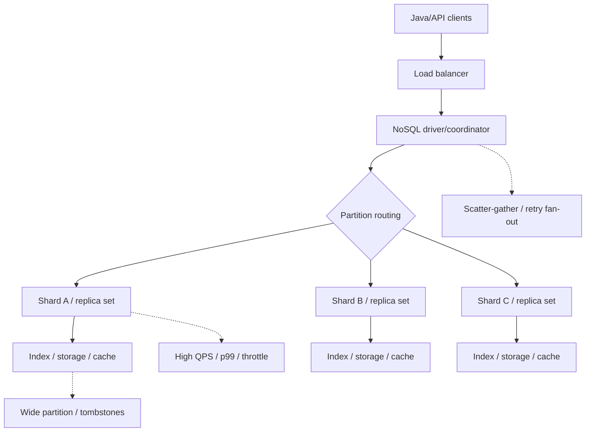

# Nhận diện điểm nóng, phân vùng lớn và phân phối không đều

Một cụm NoSQL có 12 node không nhất thiết có năng lực gấp 12 lần một node. Nếu 50% lưu lượng ghi dồn vào **một partition key**, nếu một **phân vùng dữ liệu quá lớn** khiến truy vấn phải quét nhiều SSTables và tombstones, hoặc nếu 60% dữ liệu rơi vào một **shard vật lý**, một số node có thể bão hòa trong khi những node còn lại gần như rảnh. Tăng số node lúc này có thể chỉ tăng chi phí mà không xử lý đúng nút thắt.

Để vận hành NoSQL hiệu quả, ta phải nhận diện ba nhóm vấn đề:

1. **Điểm nóng (hot spot)**: một key, partition, shard, index hoặc endpoint nhận lưu lượng/chi phí quá lớn.
2. **Phân vùng lớn (large/wide partition)**: một đơn vị dữ liệu logic tích tụ quá nhiều hàng, cột, byte, phiên bản hoặc tombstone.
3. **Phân phối không đều (skew/imbalance)**: dữ liệu, request rate, CPU, disk, IOPS, network hay quyền sở hữu vùng dữ liệu chênh lệch giữa các nodes.

Các hiện tượng này liên quan nhau nhưng **không đồng nghĩa**. Một partition có thể rất lớn nhưng ít được đọc. Một key chỉ chiếm vài byte vẫn có thể nóng vì nhận 100.000 lần ghi mỗi giây. Một shard có ít dữ liệu vẫn có thể quá tải nếu chứa những keys phổ biến.

Bài học thuộc chương **Quan sát và chẩn đoán**, module **Database No SQL**. Trọng tâm là xây được chuỗi lập luận:

**Quan sát triệu chứng → khoanh vùng tầng bị ảnh hưởng → đo mức lệch → nhận diện key/partition/query shape gây tải → xác minh nguyên nhân → chọn biện pháp phù hợp → đo lại và phòng tái diễn.**

> **Nguyên tắc:** đừng kết luận “thiếu tài nguyên” chỉ vì một node CPU cao, và đừng kết luận “cân bằng” chỉ vì số node hay số partitions phân phối đều. Hãy đo **công việc và độ trễ thực sự trên từng failure domain**, đặt cạnh kích thước dữ liệu và đặc điểm truy cập.

---

## 1. Một tình huống thực tế

Giả sử dịch vụ thương mại có MongoDB lưu orders, Cassandra lưu lịch sử sự kiện, Redis làm cache và một search index.

Dashboard tổng thể hiển thị:

```text
Tổng requests: 60.000/s
CPU trung bình cụm: 38%
Disk usage trung bình: 52%
API p99: 1.200 ms, vượt SLO 200 ms
```

Nhìn CPU trung bình 38%, dễ cho rằng cluster vẫn dư năng lực.

Nhưng khi xem từng node:

| Node | CPU | Reads/s | Writes/s | Disk used | p99 read |
| --- | ---: | ---: | ---: | ---: | ---: |
| A | 95% | 25.000 | 3.200 | 48% | 1.250 ms |
| B | 28% | 4.000 | 350 | 51% | 35 ms |
| C | 32% | 5.000 | 390 | 54% | 40 ms |
| D | 30% | 4.500 | 420 | 49% | 38 ms |
| E | 25% | 3.700 | 340 | 57% | 33 ms |
| F | 27% | 3.800 | 370 | 53% | 36 ms |

Các số liệu là **ví dụ giả định**. Dấu hiệu cần điều tra không phải CPU trung bình, mà là **nút A có tải và độ trễ khác biệt rất lớn**.

Có thể tồn tại nhiều nguyên nhân:

- Một product được đọc quá nhiều và mọi GET vào cùng Redis slot.
- Một tenant cực lớn khiến các query đều đi tới partition của node A.
- Shard A chứa nhiều data hơn các shard khác.
- A đang compaction hoặc cache cold.
- Client routing ưu tiên A bất thường.
- A chứa index shard lớn và một truy vấn full-text phức tạp.
- Một tài nguyên chung như NIC/disk bị giới hạn, không phải CPU.
- Network tới A lỗi khiến driver retry, tạo thêm request pressure.

Cần chứng cứ phân biệt các trường hợp trước khi thay kiến trúc.

---

## 2. Thuật ngữ: key, logical partition, shard, replica và node

| Thuật ngữ | Nghĩa | Ví dụ |
| --- | --- | --- |
| **Logical key** | Định danh một item/document hoặc giá trị | `product:sku-001` |
| **Partition key** | Giá trị quyết định nhóm/routing dữ liệu logic | `(tenantId, customerId)` |
| **Logical partition** | Tập dữ liệu cùng partition key | Tất cả orders của customer 42 |
| **Physical shard/tablet/token range** | Đơn vị phân phối trong storage cluster | Một chunk/range trên shard A |
| **Replica** | Bản sao dữ liệu được engine duy trì | Một trong ba replicas Cassandra |
| **Node/host** | Máy/process giữ tài nguyên | MongoDB shard member, Cassandra node |
| **Coordinator/router** | Thành phần định tuyến hoặc hợp nhất kết quả | `mongos`, Cassandra coordinator |
| **Cache slot** | Đơn vị định tuyến key trong cache cluster | Redis Cluster hash slot |
| **Index shard** | Phân mảnh của một chỉ mục search | OpenSearch primary shard |
| **Failure domain** | Nhóm có thể lỗi cùng nhau | Host, rack, AZ, region |

### 2.1. Tại sao phải dùng đúng đơn vị?

Một bảng Cassandra có hàng triệu logical partitions nhưng chỉ vài chục nodes. Một Redis hash slot có thể chứa nhiều keys. Một MongoDB shard có thể gồm replica set nhiều nodes. Báo “10 partitions” mà không nói loại partition nào rất khó dùng để chẩn đoán.

### 2.2. Đếm replicas khác đếm owners

Một partition có RF=3 không có nghĩa ba replicas chia đều writes hoặc mỗi write chỉ tiêu tốn 1/3 chi phí. Replication có consistency/write paths riêng; cần phân tích theo engine và consistency level.

---

## 3. Bốn chiều lệch cần tách biệt

Ta nên nhìn ít nhất bốn phân phối:

1. **Dung lượng**: bytes/records/partitions trên mỗi shard, node, disk.
2. **Lưu lượng**: reads/s, writes/s, requests/s và payload bytes/s.
3. **Công việc**: rows/keys examined, CPU, IOPS, compaction, index updates.
4. **Độ trễ và lỗi**: p95/p99, timeout, throttling, retry, queue.

Ví dụ:

```text
Node A: 10% disk bytes, 50% read QPS, 80% CPU
Node B: 30% disk bytes, 10% read QPS, 15% CPU
```

B có nhiều dữ liệu hơn, nhưng A mới là **điểm nóng đang ảnh hưởng SLO**.

### 3.1. Dung lượng cân bằng không bảo đảm tải cân bằng

Hash partitioning có thể trải records tương đối đều, nhưng một key nổi tiếng vẫn thu hút phần lớn requests.

### 3.2. Tải cân bằng không bảo đảm dung lượng cân bằng

Hai nodes nhận cùng QPS nhưng một node đầy 90% disk, có nguy cơ hết chỗ khi compaction/backup/rebuild.

### 3.3. CPU cân bằng không bảo đảm độ trễ cân bằng

Một node có network RTT cao, queue dài hoặc disk latency lớn có thể làm p99 xấu dù CPU thấp.

---

## 4. Phân loại điểm nóng

| Loại | Dấu hiệu | Ví dụ | Hướng điều tra |
| --- | --- | --- | --- |
| **Hot read key** | GET/s cao trên một key | Sản phẩm viral | Cache locality, read copies |
| **Hot write key** | Update/INCR/s cao trên một key | Bộ đếm view, stock | Write authority, contention |
| **Hot logical partition** | Một partition key nhận nhiều truy vấn | Tenant lớn | Partition-key model, bucket |
| **Wide/large partition** | Nhiều rows/cells/bytes trong một partition | Lịch sử customer 8 năm | Partition width, TTL, bucketing |
| **Hot physical shard** | Một shard chịu CPU/IOPS/QPS cao | Nhiều hot keys ở cùng shard | Placement, rebalance |
| **Hot replica** | Một replica nhận nhiều reads hơn peers | Client ưu tiên một replica | Read preference, routing |
| **Hot index range** | Writes tập trung đầu/cuối index | Range shard key tăng dần | Shard/range-key design |
| **Hot secondary index** | GSI/index key ít cardinality | `status=ACTIVE` | Index partition-key skew |
| **Hot coordinator** | Một node xử lý nhiều fan-out | Request routing lệch | Client/driver load balancing |
| **Hot cache slot** | Redis slot chứa key rất nóng | `catalog:global` | Slot owner và hash tags |
| **Noisy tenant** | Một tenant chiếm đa số tài nguyên | Enterprise bulk job | Quota, isolation |
| **Hot endpoint** | API retry/polling liên tục | `/orders/status` | Client behavior, rate limit |
| **Background pressure** | Compaction/index build dồn lên node | Rebuild/search merge | Scheduler và resource budgets |

Một symptom như “node A CPU 98%” chưa đủ để xác định loại. Cần biết CPU đang phục vụ reads, writes, compaction, indexing hay retries.

---

## 5. Hot key và hot partition khác nhau như thế nào?

Một **hot key** có thể là một giá trị nhỏ, trong khi **hot partition** là một tập dữ liệu cùng routing key.

Ví dụ Redis:

```text
GET product:sku-001   40.000/s
GET product:sku-002       70/s
GET product:sku-003       50/s
```

Một key duy nhất chịu phần lớn tải.

Ví dụ Cassandra:

```text
Partition (tenant=t1, customer=c42):
  2.400.000 clustering rows
  4.000 SELECTs/s với range scan
```

Đây có thể đồng thời là **wide partition** và **hot logical partition**.

### 5.1. Hot không nhất thiết lớn

```text
Key size: 256 bytes
Reads: 80.000/s
```

Rủi ro là CPU, network, queue hay lock contention, không phải thiếu disk.

### 5.2. Lớn không nhất thiết hot

```text
Partition size: 18 GiB
Reads: 2 queries/day
```

Không phải hotspot về QPS, nhưng vẫn có rủi ro repair/compaction, backup, timeout khi cần đọc, và mất cân bằng dung lượng.

### 5.3. Cần cả heat và size

Một biểu đồ 2 chiều phân nhóm:

```text
                          TẢI TRUY CẬP
                  Thấp                    Cao
Dung lượng  +------------------+-------------------------+
  Nhỏ       | Bình thường      | Hot small key           |
            +------------------+-------------------------+
  Lớn       | Large cold       | Large + hot partition   |
            +------------------+-------------------------+
```

Cách xử lý ở bốn ô rất khác nhau.

---

## 6. Kiến trúc truy vấn và nơi hot spot xuất hiện



Có thể xuất hiện điểm nóng ở:

- Load balancer/connection pool trước khi tới storage.
- Coordinator do client routing hoặc fan-out.
- Primary/leader xử lý writes.
- Replica phục vụ reads.
- Một shard/chunk/partition.
- Cache primary nhận hot slot.
- Index segment với range/field phổ biến.
- Network/disk/shared host nơi nhiều workloads cùng dùng tài nguyên.

**Không phải mọi hotspot là do partition key sai.**

---

# Phần I — Mô hình đo và xác định mức độ lệch

## 7. Đo tải theo nhiều trục

Một bản ghi quan sát per node/shard có thể là:

```json
{
  "window": "2026-11-14T09:00:00Z/60s",
  "engine": "cassandra",
  "cluster": "orders-prod",
  "node": "node-07",
  "datacenter": "dc1",
  "readOpsPerSec": 8100,
  "writeOpsPerSec": 930,
  "readBytesPerSec": 41000000,
  "writeBytesPerSec": 8000000,
  "cpuPercent": 88,
  "diskUsedPercent": 63,
  "diskReadIops": 4200,
  "readP99Millis": 170,
  "timeoutsPerSec": 12,
  "estimated": false
}
```

Đây là **schema đo minh họa, không phải output chính thức của Cassandra**.

### 7.1. Không so request rate đơn độc

Một query đọc 1 key không bằng một query quét 100.000 rows. Cần thêm `docsExamined`, `rowsScanned`, `bytesRead`, SSTables/tombstones hoặc CPU cost.

### 7.2. Đơn vị phải rõ

- `ops/s`: thao tác/giây.
- `MiB/s`: byte trên một tầng I/O.
- `p99 ms`: phân vị latency của **những request nào**?
- `CPU%`: trên core/process/container hay host?
- `diskUsed%`: có tính compaction headroom không?

### 7.3. Không tạo số 0 giả

Nếu engine không cung cấp byte đọc chính xác theo partition, đặt metric là **unknown/estimated**. Không ghi `partitionBytesRead=0` chỉ vì telemetry không có.

---

## 8. Tỷ lệ hot key

Gọi \(q_k\) là request rate của key \(k\), \(Q=\sum q_k\) là tổng request rate trong cùng khoảng thời gian và phạm vi.

\[
H_k = \frac{q_k}{Q}.
\]

Ví dụ:

```text
Total GET/s:         100.000
GET/s hot key X:      35.000
H_X:                   35%
```

Một key chiếm 35% reads là ứng viên ưu tiên, đặc biệt nếu mọi calls đi tới cùng owner.

### 8.1. Chỉ số chỉ có nghĩa trong đúng tập

Nếu mẫu chỉ chứa `GET` nhưng tổng \(Q\) gồm cả `SET`, kết quả sai. Phải thống nhất loại operation, cluster, region và time window.

### 8.2. Rate không phản ánh toàn bộ công việc

Có thể đặt trọng số cho mỗi loại thao tác:

\[
W_k \approx q_{r,k}\cdot c_r(k)
        + q_{w,k}\cdot c_w(k).
\]

Trong đó \(c_r,c_w\) là cost estimators chung đơn vị (CPU time, I/O cost hay normalized service units). Công thức giúp so key nóng vì **tần suất** hay vì **mỗi lần quá đắt**.

### 8.3. Key lạnh vẫn có thể chậm

Một partition khổng lồ chỉ được đọc 5 lần/giây nhưng mỗi read mất 2 giây có thể gây nhiều in-flight operations và timeout. Đừng chỉ dùng top-QPS.

---

## 9. Tỷ lệ tải lớn nhất so với trung bình

Cho \(n\) nodes, tải đã chọn \(x_i\) trên node \(i\):

\[
\overline{x}=\frac{1}{n}\sum_{i=1}^{n}x_i.
\]

Một chỉ số đơn giản:

\[
I_{\max/\mathrm{mean}}=
\frac{\max_i x_i}{\overline{x}}.
\]

Nếu có sáu nodes nhận:

```text
A: 30.000 reads/s
B:  6.000 reads/s
C:  6.000 reads/s
D:  6.000 reads/s
E:  6.000 reads/s
F:  6.000 reads/s
```

Tổng 60.000, trung bình 10.000, nên:

\[
I_{\max/\mathrm{mean}} = 30.000/10.000=3.
\]

Node lớn nhất nhận **gấp ba lần trung bình**.

### 9.1. Không có ngưỡng cố định cho mọi cụm

`I=1.5` có thể nghiêm trọng khi node gần saturation, nhưng có thể chấp nhận khi mọi node mới dùng 10% capacity. Cần đặt cạnh SLO và headroom.

### 9.2. Node không đồng cấu hình

Nếu node A mạnh gấp đôi node B, so raw QPS có thể gây hiểu nhầm. Cần **chuẩn hóa theo capacity**.

---

## 10. Chuẩn hóa theo năng lực thực tế

Giả sử node A phục vụ 18.000 GET/s với capacity mục tiêu 20.000, node B phục vụ 9.000 GET/s với capacity mục tiêu 10.000. Raw QPS khác nhau, nhưng cả hai đang ở 90% mức mục tiêu.

\[
U_i = \frac{\mathrm{load}_i}{\mathrm{sustainableCapacity}_i}.
\]

| Node | Load | Sustainable capacity | Utilization relative to budget |
| --- | ---: | ---: | ---: |
| A | 18.000 | 20.000 | 90% |
| B | 9.000 | 10.000 | 90% |
| C | 12.000 | 30.000 | 40% |

**Sustainable capacity** phải dựa vào benchmark/p99 SLO, payload và topology; không phải số tối đa đo trong một thử nghiệm không cần latency.

### 10.1. CPU% không phải capacity duy nhất

Node có thể hết NIC trước CPU, hoặc hết IOPS/connection trước memory. Cần xem nhiều bottlenecks:

\[
U_i^{*}
=
\max(U_{\mathrm{CPU}},U_{\mathrm{IOPS}},
U_{\mathrm{network}},U_{\mathrm{connections}}).
\]

Đây là một **heuristic để phát hiện tài nguyên chạm trần**, không phải chỉ số chuẩn do engine cung cấp.

### 10.2. Tính headroom cho failover

Nếu một AZ hoặc replica chết, lưu lượng có thể dồn sang nodes khác. Một cluster “ổn khi khỏe” nhưng không đủ N-1 headroom có thể sập khi failover.

---

## 11. Coefficient of variation và Gini

Khi muốn so mức độ lệch theo thời gian hoặc giữa những cách đặt dữ liệu, có thể dùng thêm thống kê phân phối.

Hệ số biến thiên:

\[
CV=\frac{\sigma}{\mu},
\]

với \(\sigma\) là độ lệch chuẩn, \(\mu\) là trung bình của cùng một metric có giá trị dương.

- `CV` nhỏ: các nodes gần nhau hơn theo metric được đo.
- `CV` lớn: độ phân tán cao hơn.
- Không định nghĩa hữu ích khi mean bằng 0.

Một chỉ số khác là **Gini coefficient**:

\[
G = \frac{
\sum_{i=1}^{n}\sum_{j=1}^{n}|x_i-x_j|
}{
2n\sum_{i=1}^{n}x_i
}.
\]

Với tải không âm, \(G\) gần 0 thể hiện phân phối đều hơn; lớn hơn thể hiện tập trung hơn.

### 11.1. Không biến chỉ số thống kê thành mục tiêu duy nhất

Một cluster có Gini thấp nhưng mọi nodes đều 95% CPU vẫn quá tải. Một cluster có Gini cao nhưng tổng QPS rất thấp có thể chưa có vấn đề vận hành.

### 11.2. Phải so cùng phạm vi

Đừng dùng Gini so 3 cache nodes ở region A với 12 storage nodes ở region B mà không nêu mục tiêu/phạm vi. Các nodes có capacity khác nhau cần normalized load.

### 11.3. Phân phối QPS khác phân phối bytes

Gini của disk usage có thể gần 0 trong khi Gini của reads/s cao. Nên lưu dashboard theo nhiều tài nguyên.

---

## 12. P95/p99 và thời gian quan sát

Một điểm nóng có thể chỉ tồn tại 30 giây nhưng đủ làm API lỗi.

Cần đo các cửa sổ:

- **10–30 giây**: phát hiện flash crowd, retry storm, failover.
- **1–5 phút**: cảnh báo vận hành, tránh quá nhạy với nhiễu.
- **1 giờ/ngày**: tìm workload theo chu kỳ, tăng trưởng và xu hướng lệch dữ liệu.
- **Theo đợt sự kiện**: deploy, sale, campaign, backfill, compaction.

### 12.1. Trung bình 1 giờ có thể che incident

```text
09:00-09:01: 100.000 writes/s trên partition A
09:01-10:00:  2.000 writes/s trên A
```

Trung bình giờ có thể trông bình thường, nhưng phút đầu đã tạo queue/throttling.

### 12.2. Độ trễ phải đo trên đúng endpoint và shard

Cluster-wide p99 có thể che một tenant nhỏ bị ảnh hưởng nặng; chỉ số per-tenant tier/query shape/per-shard giúp phân biệt.

### 12.3. Không suy nguyên nhân từ correlation một mình

Hot key QPS và CPU cùng tăng chưa đủ chứng minh nhân quả. Có thể một background compaction khiến retries tăng. Cần timeline, traces, operation breakdown và canary.

---

## 13. Đếm partition lớn bằng gì?

Một **large partition** có thể được mô tả theo nhiều thước đo:

- Bytes vật lý/logic của partition.
- Số clustering rows hoặc nested entries.
- Số cells/columns.
- Số tombstones và phiên bản cũ.
- Số SSTables/segments chứa dữ liệu liên quan.
- Thời gian đọc một range phổ biến.
- Số bytes phải giải nén/phục vụ mỗi query.
- Thời gian repair/streaming/compaction bị ảnh hưởng.

### 13.1. Chỉ nhìn `COUNT(*)` chưa đủ

100.000 rows mỗi row vài bytes khác với 100.000 rows chứa blob lớn.

### 13.2. Kích thước trên disk khác kích thước khi đọc

Compression, page/block boundaries và metadata khiến `storageBytes` khác tổng JSON/CQL values.

### 13.3. Một partition lớn không nhất thiết là một lỗi tự động

Ngưỡng nguy hiểm phụ thuộc engine version, read/write pattern, compaction, TTL, disk/network và SLO. Hãy định nghĩa threshold theo **độ trễ và repair/capacity thực**, không thuộc lòng một con số chung.

---

## 14. Heatmap “dung lượng × lưu lượng”

Một biểu đồ điều tra có thể dùng:

- Trục X: `partitionSizeBytes` hoặc `rowsPerPartition`.
- Trục Y: `readsPerSecond + weightedWritesPerSecond`.
- Kích thước chấm: p99 hoặc bytes read/s.
- Màu/nhóm: node, shard, tenant tier.

```text
Y: Workload
^           C: hot & large
|                 *
|       B: hot small
|            *
|
|                               D: large cold
|                                     *
|  A: ordinary
|     *
+----------------------------------------------> Partition size
```

### 14.1. Vai trò của bốn nhóm

- **A — small/cold:** không cần can thiệp.
- **B — small/hot:** cache read copies, request coalescing hoặc giải quyết write contention.
- **C — large/hot:** ưu tiên partition redesign, index/range, bucketing, TTL/tombstone và capacity.
- **D — large/cold:** xem disk balance, repair/backup, storage compaction và khả năng query đột xuất.

### 14.2. Không vẽ một chấm cho mọi key ở production metrics

Hàng triệu key labels gây cardinality explosion. Lấy mẫu/heavy hitters/quantiles và top-K tập trung vào vấn đề.

---

## 15. Chỉ số cần có ở bảng điều khiển

| Lớp | Metric | Câu hỏi |
| --- | --- | --- |
| Request/API | QPS, p95/p99, errors | Người dùng bị ảnh hưởng ở đâu? |
| Query shape | Calls/s, scan/returned, bytes | Query nào tạo nhiều work? |
| Logical key | Top read/write ops, bytes | Key nào nóng? |
| Logical partition | Reads/writes, size, row count, tombstones | Phân vùng nào lớn/nóng? |
| Physical shard | Disk bytes, QPS, CPU, IOPS, queue, p99 | Shard nào bão hòa? |
| Replica | Contacts, lag, read preference, state | Có lệch tải qua replicas? |
| Cluster | Max/mean normalized load, Gini/CV, N-1 | Cụm có cân bằng thật? |
| LSM storage | SSTables/read, compaction, tombstones | Read amplification/IO? |
| Index | Index size/entries/read/write hot range | Index là bottleneck? |
| Cache | Hit/miss, hot key/slot, evictions | Hot spot nằm ở L1/L2? |
| Network | Bytes/s, RTT, retransmits, cross-AZ | Đường mạng có nghẽn? |
| Security | Rate-limit reject, noisy tenants | Có traffic lạm dụng? |

Các metrics phải gắn đúng **engine, version, collection/table, node/shard, datacenter** và khoảng thời gian.

---

# Phần II — Thu thập tín hiệu không phá hệ thống

## 16. Heavy hitters: làm sao tìm hot keys trong hàng triệu keys?

Không nên gắn `cacheKey` hoặc `userId` làm metric label cho mọi request vì hệ metrics sẽ nổ cardinality.

Các hướng:

1. **Sampling access logs** có giới hạn và redact.
2. **Top-K key tracking** trong một thời gian quan sát.
3. **Count-Min Sketch** để ước lượng tần suất.
4. **Space-Saving/HeavyKeeper** giữ các ứng viên nóng.
5. **Engine-specific hot partition insights** khi có.
6. **Aggregated query shape** khi exact key không cần.

### 16.1. Sampling có thể bỏ sót key nóng ngắn hạn

Một sample rate 0,1% có thể không đủ để kết luận về một đợt burst 1 giây. Điều chỉnh sampling windows, ưu tiên capture errors/throttles có giới hạn.

### 16.2. Sketch có sai số

Count-Min Sketch có thể overestimate count do hash collisions. Dùng candidate tracking/cross-check khi cần quyết định thay đổi topology.

### 16.3. Đếm theo operation

`GET` và `SET` trên cùng key cần tách. Tổng `calls/s` không cho biết có nên nhân read copies hay phải sửa write model.

### 16.4. Bảo vệ thông tin nhạy cảm

Key có thể chứa email, user ID, session token hoặc tenant identifier. Hash với governance/access controls hoặc định danh nhóm thay vì đổ raw keys lên dashboard công khai.

---

## 17. Phân tích “công việc” thay vì đếm requests

Giả sử:

```text
Key A: 50.000 GET/s, payload 100 bytes
Key B:    200 GET/s, mỗi GET xét 5 triệu rows
```

A có request rate lớn. B có thể tiêu thụ CPU/IO hơn nhiều.

Một mô hình đánh giá:

\[
\mathrm{estimatedWork}(k)
=
q_k \cdot \mathrm{costPerQuery}(k).
\]

Tùy engine, cost có thể dùng:

- `totalDocsExamined` / `totalKeysExamined` từ explain.
- `ScannedCount` và `ConsumedCapacity` của DynamoDB.
- Tombstone/SSTable/bytes telemetry của Cassandra.
- Index candidates visited và query/fetch cost của search.
- Response bytes, server CPU time, disk bytes của cache.

**Không gộp tất cả thành “rows”**, vì các engine đếm những khái niệm khác nhau.

### 17.1. Khi không có per-key cost

Có thể kết hợp sampled traces, query shape stats và node aggregate metrics để ước lượng. Ghi `estimated=true`, độ tin cậy và giả định.

### 17.2. Không quy node IO hoàn toàn cho một key

Compaction, backups, replication và requests khác cũng tạo I/O. Chỉ lấy delta IO node rồi chia theo số query khi có workload isolation hoặc mô hình attribution có căn cứ.

---

## 18. Lập heatmap theo shard/node/AZ

Cấu trúc nhóm:

```text
cluster
  region
    AZ / rack
      physical node
        shard / tablet / token ranges
          logical partitions / keys
```

Một số vấn đề có thể chỉ lộ ở một cấp:

- **Node:** disk usage 92%, compaction backlog.
- **Shard:** 75% query traffic.
- **AZ:** network egress/cross-AZ cost cao.
- **Tenant:** chiếm 60% partition sizes hoặc reads.
- **Key:** một giá trị nóng.
- **Time range:** writes đang dồn vào “current month” partition.

### 18.1. Dashboard phải có max, không chỉ average

```text
cluster_avg_cpu = 42%
cluster_max_cpu = 98%
max_to_mean_cpu = 2.33
```

Nếu alert chỉ nhìn average, có thể bỏ qua node 98%.

### 18.2. So khả năng node

Nếu một số nodes khác cấu hình, dùng normalized load, không so raw IOPS một cách máy móc.

### 18.3. Cảnh báo đúng failure domain

Một AZ chứa nhiều hot shards có thể vẫn hoạt động nhưng khi AZ khác fail thì không còn headroom; xem placement/replica topology.

---

## 19. Phát hiện thay đổi trong timeline

Một biểu đồ tốt cho thấy:

```text
09:00  Deployment backend v23
09:03  Query rate increases 3x
09:04  Shard A CPU increases to 95%
09:05  Retries increase 2x
09:06  p99 becomes 1.5s
```

Ta có thể nghi regression từ deployment, nhưng vẫn cần:

- Xem query shape/code path vừa đổi.
- Xem metric trước khi retries tăng.
- Xem storage/compaction timeline.
- Xem traffic thật hay client retry amplification.
- Dùng canary/rollback để kiểm chứng khi an toàn.

### 19.1. Tránh nhầm nguyên nhân và hậu quả

Retry storm thường làm điểm nóng nặng hơn, nhưng có thể **bắt đầu từ** một disk/network issue. Chỉ giảm retry có thể giảm ảnh hưởng mà chưa sửa nguyên nhân gốc.

### 19.2. Trạng thái sau deploy

New indexes, changed read preference, cache invalidation, background migrations hay schema change có thể thay routing và tạo nóng bất ngờ.

---

## 20. Tracing một query chậm

Ví dụ query path:

```text
HTTP GET /orders/customer-42
       |
       v
Java repository
       |
       v
Coordinator
       |
       +--> Replica A:  12 ms
       +--> Replica B: 680 ms
       |
       v
Merge + serialize: 4 ms
```

Nếu p99 bị chi phối bởi replica B, cần xét B:

- Có hot partition/queue?
- Disk I/O/compaction?
- GC pause?
- Network RTT?
- Replica lag/read repair?
- Client chọn B không cân bằng?

### 20.1. Trace không phải thống kê toàn cụm

Một trace minh họa không chứng minh tất cả queries cùng pattern. Kết hợp traces mẫu với histograms và per-node metrics.

### 20.2. Đọc tracer theo actual contacts

Một logical read có thể liên hệ nhiều replicas hoặc retry thêm; đừng chỉ suy số contacts từ request đầu tiên.

---

# Phần III — Phân vùng lớn, wide partitions và storage amplification

## 21. Vì sao phân vùng phình to?

Nguồn gốc thường gặp:

1. Chọn partition key có cardinality thấp, ví dụ `country`.
2. Group mọi orders của một tenant/customer vào một partition **không có thời gian giới hạn**.
3. Dùng `status=ACTIVE` làm routing key cho quá nhiều records.
4. Dữ liệu thời gian liên tục append vào cùng bucket.
5. Blob hoặc collections lồng nhau phát triển quá lớn.
6. TTL/deletes để lại tombstones trong storage theo engine.
7. Lưu nhiều versions/history trong cùng partition.
8. Không có retention/archive cho dữ liệu cũ.

### 21.1. Tăng trưởng không tuyến tính theo traffic hiện tại

Một customer có 1.000 orders/ngày, sau ba năm có hơn 1 triệu orders. Query hiện tại chỉ cần 20 orders mới nhất nhưng partition vẫn phải được quản lý như một tập lớn.

### 21.2. Data shape quan trọng

Một partition chứa 500.000 small rows khác partition chứa 5.000 giant nested values; xem bytes/row, rows/partition và query range.

---

## 22. Tác động của phân vùng lớn

Một partition quá lớn có thể gây:

- Read latency do phải đọc nhiều storage fragments/cells.
- Tốn heap/CPU giải mã, merge versions.
- Tombstone scanning lớn để lấy ít live rows.
- SSTable read amplification/compaction nặng.
- Repair và streaming lâu.
- Data redistribution/rebalance khó.
- Backup/restore khó hoàn tất trong RTO.
- Một số shard split/placement algorithms bị giới hạn nếu không thể chia hợp lý.
- Tranh chấp với các partitions khác trên cùng node.
- Hotspot khi vừa lớn vừa được truy cập liên tục.

### 22.1. Không phải mọi engine giống nhau

Cassandra wide partition, MongoDB large document/range chunk, DynamoDB hot item collection/partition-key access và Redis big key có **cấu trúc và giới hạn riêng**. Không dùng một ngưỡng kích thước chung.

### 22.2. Repair/compaction là phần của SLO vận hành

Partition ít được đọc vẫn có thể gây sự cố khi repair/streaming/compaction. Theo dõi cả các tác vụ nền, không chỉ foreground query p99.

---

## 23. Cassandra: partition rộng và tombstones

Trong Cassandra, partition key xác định dữ liệu được đặt cùng nhóm replicas; clustering columns sắp thứ tự rows trong partition theo schema.

Ví dụ:

```sql
CREATE TABLE app.events_by_customer (
    tenant_id text,
    customer_id text,
    event_time timestamp,
    event_id timeuuid,
    event_type text,
    payload text,
    PRIMARY KEY (
        (tenant_id, customer_id),
        event_time,
        event_id
    )
) WITH CLUSTERING ORDER BY (
    event_time DESC,
    event_id DESC
);
```

Đây là schema **minh họa**, giả định keyspace `app` đã tồn tại. Nếu mỗi khách có hàng triệu events, một logical partition có thể phình to.

### 23.1. Đọc mới nhất thường theo clustering range

```sql
SELECT event_time, event_id, event_type
FROM app.events_by_customer
WHERE tenant_id = 'tenant-a'
  AND customer_id = 'customer-42'
LIMIT 20;
```

Query có đủ partition key, nhưng `LIMIT 20` không bảo đảm engine chỉ xét 20 storage cells nếu có tombstones/versions/SSTables.

### 23.2. Điểm nóng trong Cassandra

- Một partition key bị đọc/ghi liên tục.
- Một node/coordinator xử lý nhiều requests.
- Một replica có disk/CPU chậm.
- Một wide partition chứa nhiều tombstones.
- Token ownership hoặc data-size imbalance giữa nodes.
- Pending compactions tăng gây latency spikes.

### 23.3. Tombstone là chi phí đọc

Một row đã delete/TTL expire có thể để lại marker theo retention/compaction semantics. Truy vấn phải xét đủ dữ liệu để trả những live rows, nên “20 returned” có thể đi kèm rất nhiều tombstones scanned.

---

## 24. Cassandra: dấu hiệu và công cụ quan sát

Trong môi trường được phân quyền và thích hợp, có thể xem:

```bash
nodetool status
nodetool tablestats app.events_by_customer
nodetool tablehistograms app events_by_customer
```

Tên tham số/định dạng cần kiểm tra theo Cassandra version đang dùng. Ví dụ trên nhằm minh họa nhóm lệnh, **không coi syntax và output bất biến giữa phiên bản**.

### 24.1. `nodetool status`

Có thể giúp thấy node state, dữ liệu sở hữu và token/ring theo kiến trúc triển khai. Không dùng mỗi cột “Owns” để kết luận phân phối traffic tốt.

### 24.2. Table statistics

Xem storage bytes, số SSTables, partition-size metrics/histograms, tombstones, read/write latencies và compaction indicators theo khả năng phiên bản.

### 24.3. Table histograms

Phân phối partition size và read latencies thường hữu ích hơn average. P99 partition size hoặc max size có thể phơi bày outliers.

### 24.4. Tracing có chọn lọc

```sql
TRACING ON;

SELECT event_time, event_type
FROM app.events_by_customer
WHERE tenant_id = 'tenant-a'
  AND customer_id = 'customer-42'
LIMIT 20;

TRACING OFF;
```

Trace hỗ trợ quan sát coordinator/replica steps nhưng không tự luôn cung cấp “byte đọc chính xác per query”. Không bật full tracing rộng trên production nếu chưa đánh giá overhead.

### 24.5. Hot partition samplers

Một số phiên bản/distribution cung cấp công cụ/top-partition sampling (như nhóm chức năng `nodetool toppartitions`). Khả dụng và tham số thay đổi; chỉ dùng trên phiên bản xác nhận hỗ trợ, với giới hạn thời gian/tải và quyền hợp lệ.

---

## 25. Cassandra: khắc phục bằng bucketing

Nếu một partition customer chứa mọi event suốt nhiều năm, cân nhắc chia theo tháng:

```sql
CREATE TABLE app.events_by_customer_month (
    tenant_id text,
    customer_id text,
    bucket_month text,
    event_time timestamp,
    event_id timeuuid,
    event_type text,
    PRIMARY KEY (
        (tenant_id, customer_id, bucket_month),
        event_time,
        event_id
    )
) WITH CLUSTERING ORDER BY (
    event_time DESC,
    event_id DESC
);
```

Ví dụ:

```text
(tenant-a, customer-42, 2026-09)
(tenant-a, customer-42, 2026-10)
(tenant-a, customer-42, 2026-11)
```

### 25.1. Lợi ích

- Giới hạn tăng trưởng logical partition theo bucket.
- Dễ archive/retention theo thời gian.
- Truy vấn “events gần đây” có thể chỉ cần bucket hiện tại.

### 25.2. Chi phí

- Lịch sử 12 tháng phải đọc 12 partitions hoặc read model khác.
- Bucket hiện tại vẫn có thể là **hot write partition**.
- App phải xử lý tháng biên, timezone, late-arriving events.
- Bucket sizes cần được chọn bằng workload thật.

### 25.3. Chia nhỏ theo thời gian không luôn chia hot writes

Nếu tất cả writes vào tháng hiện tại, một monthly bucket vẫn nóng. Có thể cần thêm sub-buckets theo key/hash hợp pháp và giải quyết cách merge reads, nhưng phải bảo vệ invariants.

---

## 26. Cassandra: compaction và partition-size skew

Storage theo LSM có thể chứa nhiều SSTables; dữ liệu cũ/tombstones cần được hợp nhất theo compaction strategy.

Các vấn đề đi kèm:

- Compaction backlog tăng → disk bytes và IOPS cao.
- Nhiều SSTables per read → read amplification.
- Repair/streaming bị kéo dài bởi large partitions.
- Node disk usage chênh lệch khiến một số nodes thiếu headroom.
- Tốc độ ingestion cao hơn khả năng compaction bền vững.

### 26.1. Một sự cố compaction không nhất thiết do hot key

Dữ liệu có thể phân phối đều nhưng ingest tốc độ cao toàn cluster làm compaction backlog tăng. Trước khi đổi partition key, so read/write mix, SSTable sizes, disk bandwidth và compaction policies.

### 26.2. Không chạy tác vụ bảo trì nặng ngay giữa incident

Một manual compaction/repair/full scan khi node I/O đang bão hòa có thể làm tình trạng xấu hơn. Chọn runbook, maintenance windows và giới hạn concurrency theo phiên bản/cluster.

---

# Phần IV — MongoDB sharding

## 27. MongoDB: chunk/range phân phối không đều

Trong MongoDB sharded clusters, tài liệu được phân phối theo **shard key** và metadata/chunk/range placement theo phiên bản/cấu hình.

Các trường hợp gây lệch:

- Shard key có phân phối values không đều.
- Range-based key tăng đơn điệu khiến writes tập trung vào vùng “mới nhất”.
- Một tenant hoặc customer cực lớn.
- Một chunk/range chứa nhiều dữ liệu hoặc khó phân chia do đặc tính key.
- Migrations/balancer bị giới hạn hoặc backlog.
- Query thiếu shard-key predicate → scatter-gather.
- Một shard/replica nhận nhiều reads do read preference.

### 27.1. Dung lượng và throughput là hai bài toán khác nhau

Balancer có thể giúp placement/dung lượng theo cơ chế triển khai, nhưng **không đảm bảo chia một logical hot key thành nhiều nơi phục vụ ghi**.

### 27.2. Monotonic hotspot

Nếu shard key dựa trên thời gian tăng dần và writes mới luôn rơi vào vùng cuối, write throughput có thể tập trung vào một shard dù lịch sử cũ đã phân phối rộng.

### 27.3. Hashed shard key có đánh đổi

Hashed value có thể giúp phân tán writes của nhiều keys khác nhau, nhưng làm các range queries theo shard key gốc và locality khó hơn. Không tự coi hashed key luôn tối ưu.

---

## 28. MongoDB: điều tra routing và query work

Trên môi trường lab/admin phù hợp:

```javascript
sh.status();

db.orders.find({
  tenantId: "tenant-a",
  customerId: "customer-42"
})
.sort({ createdAt: -1 })
.limit(20)
.explain("executionStats");
```

`sh.status()` chỉ phù hợp trong ngữ cảnh sharded cluster và quyền phù hợp; explain cần đọc đúng output của query, engine và version.

Các trường quan trọng:

```text
winningPlan
executionStats.nReturned
executionStats.totalKeysExamined
executionStats.totalDocsExamined
executionStats.executionTimeMillis
per-shard execution details nếu có
```

### 28.1. Một query chạm bao nhiêu shards?

Cần xem targeted routing/per-shard stats theo topology. Nếu query thiếu shard key, một request có thể fan-out nhiều shards dù trả một document.

### 28.2. Một shard được chạm có thể vẫn chậm

Nếu shard đó chứa large documents hoặc scan 2 triệu docs, cải thiện routing một shard không đủ; phải tối ưu index và query shape.

### 28.3. Đừng dùng `explain` làm full production profiling liên tục

Explain có overhead và có thể khác hành vi request thường. Chạy sampled/troubleshooting có kiểm soát rồi đối chiếu profiler/query metrics.

---

## 29. MongoDB: tìm phân phối theo tenant/khóa trong lab

Có thể phân tích số documents theo tenant với aggregation:

```javascript
db.orders.aggregate([
  {
    $group: {
      _id: "$tenantId",
      documents: { $sum: 1 }
    }
  },
  {
    $sort: {
      documents: -1
    }
  },
  { $limit: 10 }
]);
```

### 29.1. Cảnh báo quan trọng

Đây là **query phân tích có thể rất đắt** trên dataset lớn. Chỉ chạy trong lab, offline replica/analytics environment hoặc pipeline có giới hạn được phê duyệt. Không tự chạy full scan này trên production để chữa production đang nghẽn.

### 29.2. Documents count không bằng bytes

Một tenant có 10.000 large documents có thể chiếm nhiều storage hơn tenant có 100.000 tiny documents. Cần thêm size metrics/estimates theo schema.

### 29.3. Documents count không bằng heat

Tenant A chứa 40% documents nhưng chỉ tạo 2% QPS; tenant B chứa 1% documents nhưng tạo 60% QPS. Cần request telemetry và per-shard load.

---

## 30. MongoDB: khi chunk/shard skew khó sửa

Nếu một shard chứa nhiều data hơn các peers, cần hỏi:

1. Do shard key distribution hay placement policy?
2. Balancer có chạy và migrations thành công?
3. Có zones/data residency constraints?
4. Các shards có capacity khác nhau?
5. Có chunks/ranges khó di chuyển hoặc chia?
6. Có Jumbo/oversized ranges theo engine/version?
7. Quá trình resharding có an toàn và phù hợp SLO?
8. Hotspot chủ yếu là writes cùng shard key hay nhiều independent hot keys?

### 30.1. Balancer không bảo đảm hot-write chia đều

Một document hoặc routing value nhận quá nhiều writes thường cần **đổi access pattern/aggregate model**; chỉ di chuyển owner có thể chuyển điểm nóng tới node khác.

### 30.2. Khi đổi shard key

Resharding/migration có chi phí I/O, temporary disk, traffic và risk. Cần thử trên workload thực tế, canary, rollback và đánh giá query routing sau đổi.

### 30.3. Index cũng có hotspot

Range index trên một field tăng đơn điệu có thể làm một đoạn index bận cập nhật, dù collection distribution ổn. Cần xem write path và page/index pressure, không chỉ chunk counts.

---

# Phần V — DynamoDB, Redis và search

## 31. DynamoDB: hot partition key và adaptive capacity

Trong DynamoDB, truy cập một partition key cực phổ biến hoặc GSI partition key ít giá trị phân biệt có thể gây throttling, dù table tổng thể còn capacity.

Ví dụ:

```text
PK = TENANT#LARGE
SK = ORDER#...
```

Một tenant rất lớn tạo phần lớn traffic vào một key range có thể làm access pattern lệch.

### 31.1. Adaptive capacity có thể giúp nhưng có giới hạn

DynamoDB có cơ chế tự điều chỉnh phân bổ capacity/partition behavior theo điều kiện, nhưng không nên suy **một hot item hoặc một access pattern có thể mở rộng vô hạn**. Giới hạn phụ thuộc size/consistency/physical partition và cách traffic truy cập.

### 31.2. Hot item khác hot item collection

Một item thường bị update/conditional write liên tục cần bảo vệ write contention. Một partition key có nhiều sort-key items có thể có khả năng phân phối khác khi split được, tùy service constraints.

### 31.3. GSI hotspot

Ngay cả table chính có PK đa dạng, GSI keyed theo `status="ACTIVE"` có thể tạo concentration tại index. Theo dõi **từng GSI** bên cạnh base table.

### 31.4. `Scan` tạo tải rộng, không nhất thiết hot key

Một full-table scan có thể gây throttling trên nhiều partitions. Đừng nhầm scan pressure với một partition key nóng chỉ từ metric throttling tổng.

---

## 32. DynamoDB: quan sát bằng CloudWatch và Contributor Insights

Các tín hiệu thường quan trọng:

- Consumed read/write capacity và xu hướng utilization.
- Throttling/throttle-related metrics theo table/index/operation khi khả dụng.
- Successful request latency, error rates.
- GSI-specific metrics.
- Độ lớn item, số requests và access patterns.
- **CloudWatch Contributor Insights for DynamoDB** khi được bật/hỗ trợ, giúp thấy các keys góp phần vào accessed/throttled traffic theo phạm vi sản phẩm.

### 32.1. Bật tính năng và dữ liệu quan sát theo quyền

Insights có thể yêu cầu enablement/quota/cost và có thể làm lộ identifiers trong operational data. Chỉ bật theo chính sách, kiểm tra permission/retention.

### 32.2. Phân biệt throttling do tổng capacity và hot key

Nếu table consumed capacity gần giới hạn và nhiều keys bị throttle, có thể thiếu tổng capacity. Nếu tổng còn headroom nhưng một nhóm keys bị throttle, nghi vấn partition-key concentration/cell hotness mạnh hơn.

### 32.3. Không chuyển thẳng từ `ConsumedCapacity` sang bytes

DynamoDB capacity units phụ thuộc loại operation, item size và consistency. Đó là thước đo **chi phí/năng lực theo API**, không phải physical disk bytes đọc từng query.

### 32.4. Query theo key vẫn có thể đọc quá nhiều items

Để tìm 20 đơn có status PAID, nếu phải đọc/evaluate 5.000 items rồi FilterExpression loại phần lớn, `ScannedCount` cao là dấu hiệu **read amplification**, không chỉ hot partition.

---

## 33. DynamoDB: thay đổi mô hình khi một tenant quá nóng

Các lựa chọn tùy invariant:

- Sử dụng partition-key sharding/bucketing cho các bản ghi độc lập.
- Chuyển các read patterns sang GSI/read model có partition keys phân phối hơn.
- Dùng cache cho những reads chấp nhận stale.
- Dùng write sharding cho append events/counters **khi aggregation semantics cho phép**.
- Điều chỉnh capacity/provisioning và quota.
- Tách tenants lớn sang workloads/bảng riêng khi isolation economics hợp lý.

### 33.1. Write sharding có read fan-out

Ví dụ:

```text
PK = TENANT#t1#BUCKET#0
PK = TENANT#t1#BUCKET#1
PK = TENANT#t1#BUCKET#2
```

Writes được phân tán, nhưng đọc toàn tenant cần query nhiều buckets và merge. Cần chọn số buckets theo measured throughput và bounded query budget.

### 33.2. Không chia invariant thành những buckets độc lập

Một ghế cuối cùng hoặc một payment charge không thể được “xác nhận riêng” ở 10 buckets mà không có authority. Chia logical keys chỉ an toàn khi aggregation/coordination protocol được thiết kế rõ.

---

## 34. Redis Cluster: hot key, hot slot và big key

Redis Cluster định tuyến mỗi key vào một hash slot; slot thuộc một primary theo assignment hiện hành.

```text
GET catalog:sku-001 -> slot S -> primary A
GET catalog:sku-002 -> slot T -> primary B
```

Một key nhận 50.000 GET/s có thể làm A quá tải, dù B/C còn rất rảnh.

### 34.1. Thêm node không tự chia một hot key

Nếu chỉ di chuyển slot S sang D, hot load chuyển từ A sang D. Cần thay **đường phục vụ đọc**: local cache, read replicas theo consistency policy hoặc logical read copies.

### 34.2. Hash tags

Các keys có cùng `{tag}` theo Redis Cluster slot rules thường được đặt cùng slot. Điều này hữu ích cho một số multi-key operations nhưng có thể **vô tình gom hot keys** vào cùng primary.

### 34.3. Big key không đồng nghĩa hot key

Một Redis value 200 MiB ít truy cập có rủi ro memory/network/serialization khi thao tác, nhưng không phải high-QPS hot key. Một key 100 B nhận 100.000 GET/s là hot key dù tiny.

---

## 35. Redis: công cụ quan sát và giới hạn

Trong môi trường được cấp quyền:

```bash
redis-cli INFO commandstats
redis-cli INFO stats
redis-cli INFO memory
redis-cli SLOWLOG GET 10
redis-cli MEMORY USAGE catalog:sku-001
redis-cli CLUSTER KEYSLOT catalog:sku-001
```

Một số lệnh chỉ có ý nghĩa trên deployment hỗ trợ Redis Cluster và theo quyền cấu hình.

### 35.1. `MEMORY USAGE` đo gì?

Ước lượng bộ nhớ key chiếm trong Redis, **không phải bytes mỗi GET đọc từ disk hoặc truyền qua wire**.

### 35.2. `SLOWLOG` đo gì?

Những lệnh server xử lý chậm theo ngưỡng cấu hình, không phải toàn bộ network round-trip latency. Lệnh chậm ít QPS và hot key nhiều QPS có thể là hai vấn đề khác.

### 35.3. `redis-cli --bigkeys`

Cơ chế scan giúp tìm các keys kích thước lớn, nhưng có thể tạo tải trên keyspace; dùng trong window/phạm vi được phê duyệt, không tự chạy vô hạn khi cluster đang quá tải.

### 35.4. `redis-cli --hotkeys`

Công cụ/khả năng tìm hot keys phụ thuộc phiên bản và cấu hình eviction frequency tracking (chẳng hạn LFU-related metadata). Không khẳng định nó luôn sẵn hoặc cho kết quả QPS chính xác ở mọi Redis cluster.

### 35.5. Không dùng `MONITOR` mặc định

`MONITOR` có overhead và có thể lộ keys/values nhạy cảm. Chọn sampling/telemetry hoặc kiểm tra có giới hạn trước.

---

## 36. Redis: phân tán reads và giữ đúng dữ liệu

Một số giải pháp:

| Tình huống | Cách cân nhắc | Đánh đổi |
| --- | --- | --- |
| Read-hot, ít update | L1 local cache | Stale/TTL, memory per instance |
| Read-hot vượt một primary | Read replicas hoặc logical copies | Replica lag, versioned fan-out |
| Key hết TTL đồng loạt | Single-flight, jitter, refresh-ahead | Refresh coordination |
| Write-hot counter | Sharded counter/aggregation | Read fan-out, eventual totals |
| Big key | Tách fields/value, chunk data | Code/model phức tạp hơn |
| Hot slot do nhiều keys | Rebalance slot/placement | Cần xác minh actual mapping |
| Noisy tenant | Rate limit/isolated pools | Quota/fairness |
| Cache miss storm | Bounded origin fallback | Throttle/stale policy |

### 36.1. Lưu ý consistency

Read replica/L1 cache có thể trả dữ liệu cũ. Không dùng bản cache stale để cấp quyền, xác nhận booking, thanh toán hoặc invariant quan trọng.

### 36.2. Copy không tự đúng phiên bản

Nếu có 6 copies, update mới có thể đến lệch thời điểm. Dùng source revision, invalidation/TTL và minimum-version route theo hợp đồng.

### 36.3. Single-flight chủ yếu giúp miss path

Nếu Redis primary đang bão hòa vì **cache hits**, single-flight khi miss không chia load hits. Phải đặt L1 hoặc phân phối nơi phục vụ reads.

---

## 37. OpenSearch/Elasticsearch: hot index shard

Search indexes phân thành primary shards và replicas. Một shard có thể:

- Chứa nhiều documents/bytes hơn peers.
- Nhận phần lớn queries do routing.
- Chịu update-heavy ingest.
- Có segment merges/refresh pressure.
- Tốn memory khi query/filter/aggregations.
- Bị ảnh hưởng do một node host nhiều hot shards.

### 37.1. Các metric quan trọng

- Documents/store size per shard.
- Search query/fetch rates và latencies.
- Indexing rates/latencies.
- Threadpool queues/rejections.
- JVM heap/GC, CPU, disk IOPS và network.
- Segment count/merge times.
- Shard allocation/relocation và replica placement.
- Query profile cho một request chậm.

### 37.2. Đếm shards không đủ

Hai shards đều 20 GiB nhưng một shard phục vụ 80% search requests. Data balance đẹp nhưng traffic skew nghiêm trọng.

### 37.3. Một index shard lớn không luôn nên split ngay

Split/reindex/rollover có chi phí và ràng buộc. Cần đánh giá query routing, shard count, heap overhead, segment merges và storage topology.

---

## 38. Search cluster: các câu hỏi chẩn đoán

Trong môi trường phù hợp, có thể tham khảo các endpoint quản trị/query:

```http
GET /_cat/shards?v
GET /_nodes/stats
GET /_cluster/health
```

Với một query chậm, dùng profiling theo khả năng sản phẩm:

```json
{
  "profile": true,
  "query": {
    "term": {
      "tenantId.keyword": "tenant-a"
    }
  },
  "size": 20
}
```

### 38.1. Profiling có overhead

Chỉ dùng khi cần điều tra, không bật cho mọi query production. Query shape và mapping field ví dụ cần khớp index thực.

### 38.2. Tách query và fetch phases

Một query có scoring nhẹ nhưng fetch `_source` documents lớn, hoặc aggregation nặng dù trả một kết quả. Cần xem phase-level cost.

### 38.3. Vector search

Với kNN/ANN, `k=20` không chứng minh chỉ duyệt 20 vector nodes. Số candidates, efSearch/numCandidates, filters và recall trade-off ảnh hưởng CPU/memory. Điều tra hotspot theo từng index shard và query filter.

---

# Phần VI — Tìm nguyên nhân qua truy vấn và hành vi ứng dụng

## 39. Query shape và fan-out

Một API có thể thường xuyên chạy:

```text
SELECT ... WHERE status = 'ACTIVE'
```

trên bảng có partition key `tenantId/customerId`. Nếu `status` không hỗ trợ routing/index phù hợp, query có thể scan rộng.

Trong MongoDB sharded cluster, query thiếu shard-key conditions có thể scatter-gather. Trong Cassandra, CQL thiếu partition key có thể bị từ chối hoặc cần một access path cụ thể. Trong DynamoDB, FilterExpression không thay thế partition-key Query.

### 39.1. Hotspot không nhất thiết do key đang hot

Một query quét 20 shards mỗi lần có thể tạo **tải đều nhưng cao trên toàn cluster**, hoặc dồn vào coordinator. Nếu chỉ tìm hot partition keys sẽ bỏ nguyên nhân.

### 39.2. `LIMIT 20` không đảm bảo đọc 20

Database có thể phải scan nhiều candidates, phân trang, sort hoặc bỏ tombstones để trả 20 results. Đo `examined`, bytes read và physical shard fan-out.

### 39.3. Dùng explain/trace

- MongoDB: `explain("executionStats")` + per-shard stats.
- Cassandra: tracing, table metrics, query model.
- DynamoDB: `Count`, `ScannedCount`, `ConsumedCapacity`.
- Search: query profile và shard metrics.

Không so các bộ đếm này như cùng một đơn vị thống nhất.

---

## 40. Retry storm biến một sự cố nhỏ thành hot spot lớn

Ví dụ:

```text
Normal: 5.000 reads/s
Node slow: timeout rate increases
Client retry 3 times immediately
Effective attempts: up to 15.000 reads/s
Node even slower
More retries...
```

Con số minh họa tối đa đơn giản, thực tế còn phụ thuộc retries thành công, cancellations và backoff.

### 40.1. Vì sao thành vòng phản hồi dương?

Timeout tăng → client phát thêm attempts → queue dài hơn → timeout tăng tiếp. Một node ban đầu chỉ bị disk latency có thể trở thành hotspot do retry traffic.

### 40.2. Đo attempts, không chỉ logical requests

Nếu API nhận 5.000 yêu cầu/s nhưng driver gửi 12.000 database attempts/s, dùng metric client requests sẽ đánh giá thấp backend load.

### 40.3. Hướng xử lý

- Retry budget và exponential backoff có jitter.
- Circuit breaker/bulkhead.
- Timeout hợp lý và deadline đầu-cuối.
- Rate limiting/admission control.
- Client load balancing tránh dồn vào node không khỏe.
- Idempotency/unknown-outcome resolution cho writes.

**Không tự retry writes không idempotent chỉ vì response timeout.**

---

## 41. Đọc và ghi vào một key: phân biệt đường khắc phục

Một hot read key:

```text
GET catalog:product:X  40.000/s
SET catalog:product:X       2/s
```

có thể hưởng lợi từ L1/read replicas/read copies.

Một hot write key:

```text
INCR views:video-X     40.000/s
GET views:video-X         50/s
```

khác hoàn toàn.

### 41.1. Read hotspot

Có thể:

- Phục vụ reads từ local L1.
- Chia reads ra replicas với policy freshness phù hợp.
- Tạo multiple logical cache copies, kiểm tra physical placement.
- Caching/edge cho public content.
- Giảm polling ở client, dùng push/event notifications.
- Request coalescing khi cache miss.

### 41.2. Write hotspot

Cần:

- Xem business invariant/atomicity.
- Cân nhắc append-only event partitioning, sharded counters.
- Thiết kế partition keys/buckets.
- Rate-limit write bursts.
- Tách index/update fan-out.
- Cân nhắc throughput/capacity và writer scheduling.

### 41.3. Không chia stock cuối cùng như view counter

Một chiếc vé cuối không thể được “chia thành 10 buckets có quyền xác nhận độc lập” nếu không có escrow/reservation authority. Cần giữ uniqueness/không oversell tại hệ có quyền quyết định.

---

## 42. Dung lượng data lệch khác topology placement lệch

Một số shards có nhiều bytes hơn do:

- Không phân phối đều key ranges.
- Một tenant lớn chiếm phần nhiều dataset.
- Index size khác nhau.
- TTL/retention khác giữa partitions.
- Tombstones/compaction lag.
- Zone placement constraints.
- Disk compression ratio khác.
- Node mới chưa được bootstrap/rebalance đầy đủ.

### 42.1. Đo ít nhất ba thứ

```text
logicalDataBytes
physicalStorageBytes
freeDiskHeadroom
```

Logical size không nhất thiết bằng physical bytes; index, replicas, compaction và compression có chi phí riêng.

### 42.2. Disk 80% có nguy cơ cao tùy hệ

Một node cần headroom cho compaction, replication catch-up, snapshots và recovery. Ngưỡng an toàn phải dựa trên storage engine và operations plan, không áp một số chung.

### 42.3. Rebalance có thể làm tải tạm tăng

Migrating ranges/chunks/replicas tiêu tốn network, disk I/O và compaction. Nếu cluster đang nóng, rebalance vô hạn có thể kéo p99 xấu hơn; dùng rate caps và maintenance plan.

---

# Phần VII — Java và quan sát ứng dụng

## 43. Java 17: tính chỉ số mất cân bằng từ mẫu node

Ví dụ chương trình Java độc lập nhận một bộ dữ liệu giám sát giả lập và tính max/mean cùng normalized utilization. Các numbers chỉ để minh họa công thức, không phải benchmark.

```java
import java.util.Comparator;
import java.util.List;

public final class PartitionSkewAnalyzer {

    record NodeLoad(
        String node,
        long readsPerSecond,
        long sustainableReadsPerSecond,
        double diskUsedPercent
    ) {
        NodeLoad {
            if (readsPerSecond < 0
                    || sustainableReadsPerSecond <= 0) {
                throw new IllegalArgumentException(
                    "Invalid load/capacity"
                );
            }
        }

        double normalizedLoad() {
            return (double) readsPerSecond
                / sustainableReadsPerSecond;
        }
    }

    static void summarize(List<NodeLoad> samples) {
        if (samples == null || samples.isEmpty()) {
            throw new IllegalArgumentException("No samples");
        }

        double mean = samples.stream()
            .mapToLong(NodeLoad::readsPerSecond)
            .average()
            .orElseThrow();

        NodeLoad rawHotNode = samples.stream()
            .max(Comparator.comparingLong(
                NodeLoad::readsPerSecond
            ))
            .orElseThrow();

        NodeLoad capacityHotNode = samples.stream()
            .max(Comparator.comparingDouble(
                NodeLoad::normalizedLoad
            ))
            .orElseThrow();

        double imbalance = mean > 0
            ? rawHotNode.readsPerSecond() / mean
            : Double.NaN;

        System.out.printf(
            "mean=%.1f reads/s, max/mean=%.2f%n",
            mean, imbalance
        );
        System.out.printf(
            "maxRawNode=%s (%d reads/s)%n",
            rawHotNode.node(),
            rawHotNode.readsPerSecond()
        );
        System.out.printf(
            "maxUtilNode=%s (%.1f%% of budget)%n",
            capacityHotNode.node(),
            100.0 * capacityHotNode.normalizedLoad()
        );
    }

    public static void main(String[] args) {
        summarize(List.of(
            new NodeLoad("A", 30000, 32000, 51.0),
            new NodeLoad("B", 6000, 10000, 49.0),
            new NodeLoad("C", 6000, 10000, 54.0),
            new NodeLoad("D", 6000, 10000, 52.0),
            new NodeLoad("E", 6000, 10000, 53.0),
            new NodeLoad("F", 6000, 10000, 56.0)
        ));
    }
}
```

### 43.1. Chương trình đo điều gì?

- Trung bình reads/s trên các nodes.
- Nút có raw reads/s lớn nhất.
- Max/mean imbalance.
- Nút dùng nhiều nhất năng lực read budget.

### 43.2. Không dùng raw QPS như toàn bộ truth

Nó chưa đo writes, bytes per op, query scan amplification, IOPS, compaction, cross-AZ, throttles hay error retries. Một hệ thật phải kết hợp nhiều dimensions.

### 43.3. Không suy load per key từ node metrics

Một node nóng có thể nhận nhiều keys hoặc các background operations. Cần heavy hitter/per-query telemetry để drill down.

---

## 44. Java metrics: tránh key cardinality explosion

Ví dụ logic với một metrics facade giả định:

```java
// Ví dụ pseudocode Java, không gắn vào framework cụ thể.
metrics.increment(
    "nosql.query.requests",
    tags(
        "engine", "cassandra",
        "queryShape", "orders-by-customer",
        "operation", "READ",
        "tenantTier", "enterprise"
    )
);

metrics.observe(
    "nosql.query.latency.ms",
    elapsedMillis,
    tags(
        "engine", "cassandra",
        "queryShape", "orders-by-customer"
    )
);
```

### 44.1. Không dùng như sau cho mọi request

```java
// Không nên tạo label theo mỗi customer/order:
tags("customerId", customerId);
tags("partitionKey", rawPartitionKey);
```

Hàng triệu values khiến metrics cardinality bùng nổ, và có thể rò rỉ identifiers.

### 44.2. Chọn top-K riêng

Một sampler/heavy-hitter collector có thể giữ top partitions trong cửa sổ 60 giây, gửi tới một hệ phân tích có quyền và retention riêng, không tạo một time series vĩnh viễn cho mỗi key.

### 44.3. Correlation IDs

Khi điều tra query chậm, liên kết:

```text
traceId
queryShape
logicalRequestId
databaseAttemptId
shard/node ID
operation type
latency
retries
responseBytes
```

Không log nội dung document hoặc secrets chỉ để chẩn đoán.

### 44.4. Có phân biệt request và attempt

Một logical HTTP request có thể tạo nhiều database attempts. Nếu tất cả attempts bị tính thành user requests, metrics dễ hiểu nhầm nguyên nhân retry.

---

## 45. Java: đo top-K keys bằng bucket thống kê có giới hạn

Một collector thử nghiệm có thể đếm keys trong một **sample cố định**, sau đó chỉ trả top-K. Đây là đoạn Java 17 minh họa thuật toán cho dữ liệu lab; production nhiều keys nên dùng bounded heavy-hitter algorithm hoặc streaming sketch để tránh giữ tất cả keys trong RAM.

```java
import java.util.HashMap;
import java.util.List;
import java.util.Map;
import java.util.Comparator;

public final class TopKeysLab {
    record Access(String key, String operation) {}
    record KeyHits(String key, long count) {}

    static List<KeyHits> topReads(
            List<Access> sampledEvents,
            int topK) {
        if (topK < 1) {
            throw new IllegalArgumentException("topK >= 1");
        }

        Map<String, Long> counts = new HashMap<>();

        for (Access event : sampledEvents) {
            if ("READ".equals(event.operation())) {
                counts.merge(event.key(), 1L, Long::sum);
            }
        }

        return counts.entrySet().stream()
            .map(e -> new KeyHits(e.getKey(), e.getValue()))
            .sorted(Comparator.comparingLong(
                KeyHits::count
            ).reversed())
            .limit(topK)
            .toList();
    }
}
```

### 45.1. Sampling bias

Nếu một key bị bỏ mẫu hoặc key names bị ẩn một cách không đồng đều, top-K chưa chắc phản ánh toàn bộ requests. Ghi rõ sample rate/time window và confidence.

### 45.2. Không dùng raw key dài hạn

Dữ liệu nhạy cảm nên được hash/group phù hợp; không lưu auth tokens/session keys vào sample collector.

### 45.3. Per-operation top-K

Tách top `READ`, `WRITE`, `DELETE`, `SCAN`, `AGGREGATE` vì hướng giải quyết khác nhau.

---

# Phần VIII — Quy trình chẩn đoán nhiều bước

## 46. Bước 1: Xác định symptom và phạm vi

Trước khi “tìm hot key”, mô tả rõ:

```text
SLO bị vi phạm:
  GET /v1/orders/customer/* p99 > 200 ms

Phạm vi:
  tenant enterprise, region ap-southeast-x
  thời điểm: sau rollout 09:15

Tài nguyên:
  node-07 CPU 96%, IOPS 90% budget
  các nodes khác CPU 25-40%
```

Các giá trị là giả định. Thông tin về failure domain/time window giúp tránh đo sai cluster hoặc nhầm local với global issue.

### 46.1. Không đổi kiến trúc khi thiếu baseline

Có thể cần giảm tải khẩn cấp bằng rate limit, nhưng chẩn đoán root cause phải có baseline query shape, p99, error rate và per-node work.

### 46.2. Kiểm tra recent changes

Deploy, index changes, reshard, adding replica, compaction, query plan regression, cache TTL change, data migration hoặc một tenant mới đều có thể gây lệch.

---

## 47. Bước 2: Định vị hot node, hot shard hay hot partition

Dùng một phép drill-down:

```text
Cluster p99 tăng
       |
       v
Max node normalized load?
       |
       +--> Một node / AZ nổi bật
       |         |
       |         v
       |    Shard/replica/node hot?
       |         |
       |         v
       |    Top keys/query shapes/partition sizes
       |
       +--> Mọi node cùng nóng
                 |
                 v
          Broad scans/traffic growth
          shared infrastructure overload
```

### 47.1. Có lệch capacity hay lệch traffic?

Nếu A nhận 10.000 ops/s và B 5.000 nhưng A mạnh gấp đôi, raw imbalance không giải thích SLO. So utilization so với sustainable capacity.

### 47.2. Một node nóng không chứng minh một key nóng

Node A có thể chứa 50.000 medium-hot keys do placement skew. Cần phân phối key contributions.

### 47.3. Mọi nodes nóng cũng có thể do một request shape

Một query scatter-gather có thể tiêu thụ CPU trên tất cả shards. Lúc đó cần query/index redesign, không nhất thiết repartition hot key.

---

## 48. Bước 3: Kiểm tra large partition và scan amplification

Khi thấy p99 cao trên một logical partition:

- Partition size bytes/rows.
- Live rows, expired/deleted rows, tombstones.
- SSTables/index segments per read.
- Bytes read vs bytes returned.
- Query range và clustering order.
- Read/write hotness.
- Single partition vs multi-partition fan-out.
- Query plan/explain trace.

### 48.1. Một query trả 20 rows nhưng scan 100.000

Đây là dấu hiệu của **không phù hợp giữa access pattern với storage layout**, không đơn giản “database chậm”.

### 48.2. Có phải phân vùng không chia được?

Nếu single partition data model khiến mọi queries cùng key, cần thiết kế lại bucket/salting/read projections. Thêm node mà giữ nguyên key có thể không chia được work.

---

## 49. Bước 4: Kiểm tra client và các tầng cạnh database

Không phải mọi độ trễ đều do storage.

- API connection pool bão hòa.
- Java GC/serialization chậm.
- Driver local datacenter/read preference sai.
- Retry chính sách quá aggressive.
- DNS/service discovery/pinned host khiến traffic dồn một node.
- Cache miss storm làm origin đột ngột nóng.
- Network cross-AZ/cross-region RTT cao.
- TLS/connection churn.
- Một query làm N+1 requests.

### 49.1. N+1 fan-out

Một API trả 100 orders nhưng lại gọi DB thêm 100 lần để lấy customer. Logical endpoint có thể chỉ 1 request nhưng tạo 101 DB requests. Theo dõi **database attempts per logical request**.

### 49.2. Cold cache sau rollout

Khi 100 Java instances restart, L1 cache trống, cùng lúc fetch một hot key. Dùng single-flight, warmup và bounded origin access thay vì chỉ tăng storage nodes.

---

## 50. Bước 5: Chọn biện pháp theo căn nguyên

| Nguyên nhân đã xác minh | Biện pháp cần đánh giá | Nguy cơ/đánh đổi |
| --- | --- | --- |
| Một hot read key nhỏ | L1, read replicas, replicated cache reads | Staleness và invalidation |
| Một hot write counter | Sharded counter/event aggregation | Tổng đọc có lag/fan-out |
| Wide time-series partition | Time bucketing, archive/TTL | Query nhiều buckets |
| Một tenant siêu lớn | Partition sub-buckets, isolation | Merge reads, capacity quotas |
| Một MongoDB shard range monotonic | Đổi shard-key/range design | Resharding và query routing |
| Redis hot slot do nhiều keys | Slot rebalancing | Hot logical key vẫn còn |
| Redis hot key duy nhất | L1/read copies/replicas | Versioned update/consistency |
| DynamoDB GSI hot key | GSI key cardinality/read model | Write fan-out và query change |
| Cassandra tombstones | TTL/delete policy, data model, compaction | Repair/retention semantics |
| Search hot shard | Routing/rollover/reindex/shard sizing | Resource cost và relevance |
| Broad scan | Index/partition-key/query rewrite | Index write/storage overhead |
| Retry storm | Backoff, retry budget, breaker | Availability/latency trade-off |
| Cache avalanche | SWR/single-flight/controlled fallback | Stale bound và origin budget |
| Placement imbalance | Rebalance/adjust allocation | Migration I/O và headroom |
| Noisy tenant | Rate limit, quota, resource isolation | Fairness/product expectations |

### 50.1. Không có giải pháp chung

Sao chép reads hợp lý cho hot read, nhưng không cấp quyền ghi độc lập cho dữ liệu cần nhất quán mạnh. Chia partition giảm kích thước mỗi partition nhưng tăng query fan-out.

### 50.2. Can thiệp dựa trên giả thuyết đo được

Ví dụ: “Giảm 60% GET tới Redis primary bằng L1 TTL 2 giây; stale age không vượt 2 giây với data public; p99 dưới 100 ms; origin QPS không tăng quá budget”. Sau triển khai, so metric với giả thuyết.

---

## 51. Bước 6: Xác minh sau tối ưu

Không chỉ hỏi “CPU đã giảm?” mà cần xác minh:

1. Hot key share của traffic thay đổi ra sao.
2. Max/mean normalized load giảm không.
3. p95/p99 theo endpoint/tenant được cải thiện không.
4. Tổng throughput/cost đổi thế nào.
5. Rows examined/bytes read có giảm không.
6. Thời gian failover và N-1 headroom có đủ không.
7. Replica lag/stale reads tăng không.
8. Write amplification/index storage tăng không.
9. Cross-tenant authorization vẫn đúng không.
10. Có tạo hot partition mới ở bucket/read model khác không.

### 51.1. Nguy cơ chuyển hotspot

Một read model có thể chuyển nhiều expensive reads sang một hot aggregation counter. Đo **toàn đường dữ liệu**, không chỉ dịch vụ vừa tối ưu.

### 51.2. Nguy cơ mất visibility

Nếu thêm cache replica, version lag có thể khiến người dùng thấy dữ liệu cũ. Một biện pháp giảm CPU nhưng làm sai business invariant không phải tối ưu thành công.

---

# Phần IX — Capacity planning và phòng ngừa

## 52. Tính capacity khi mất một replica/node

Giả sử có 4 read copies, mỗi copy phục vụ bền vững 8.000 GET/s tại SLO. Hot key tổng 24.000 GET/s.

Khi khỏe:

\[
24.000 / 4 = 6.000\ \mathrm{GET/s/copy}.
\]

Khi mất một copy:

\[
24.000 / 3 = 8.000\ \mathrm{GET/s/copy}.
\]

Ở failure state, mỗi copy đúng ngưỡng bền vững, không còn headroom cho burst/retries.

### 52.1. Thực tế cần margin

Nếu muốn tối đa 70% năng lực:

\[
Q_{\mathrm{safe}} = 8.000 \times 0,7 = 5.600.
\]

Để còn 5.600/copy sau mất một copy, cần:

\[
N-1 \geq \lceil 24.000/5.600 \rceil = 5
\]

nên tổng \(N\geq6\) copies trong mô hình chia đều lý tưởng.

### 52.2. Replica placement phải xét fault domain

Sáu copies cùng một AZ không giúp khi AZ đó mất. Tính theo topology và các failure domains được chấp nhận.

### 52.3. Writes có tính chất khác

RF tăng có thể tăng durability/availability và một số read capacity, nhưng thường thêm replication work. Không dùng read-copy capacity formula cho hệ write-hot.

---

## 53. Kịch bản phân phối không đều do tenant

Giả sử 1.000 tenants, nhưng:

```text
tenant-A: 45% requests, 50% data
tenant-B: 20% requests, 15% data
998 tenants còn lại: 35% requests, 35% data
```

Hash `tenantId` lên shards có thể khiến một shard mang tenant-A là bottleneck.

### 53.1. Tại sao random hash không giải quyết?

Hash phân đều **nhiều tenant keys**, nhưng traffic trên tenant-A vẫn thuộc một key nếu mọi data cùng partition. Dùng nhiều shards hơn có thể chỉ chuyển tenant-A vào một shard khác.

### 53.2. Các phương án

- Chia tenant-A theo customer/time bucket/subpartition.
- Tenant-specific isolation/service tier.
- Cache hot read projections.
- Tách analytics jobs khỏi write/interactive paths.
- Đặt quota/concurrency budgets.
- Xem shard placement và read preference.
- Mô hình lại query để không luôn đọc toàn tenant.

### 53.3. Không hardcode “tenant-A” mãi

Tenants có thể tăng/giảm; cần dynamic detection/threshold theo load, không đợi một tenant cụ thể được vận hành viên nhớ tên.

---

## 54. Hotspot theo thời gian: bucket hiện tại

Một dữ liệu chuỗi thời gian thường có:

```text
2026-09: ít writes, nhiều lịch sử
2026-10: ít writes, một số reads
2026-11: 95% writes vào bucket hiện tại
```

Time bucketing giúp hạn chế size, nhưng **tạo hotspot ở current bucket** nếu key chỉ gồm tháng.

### 54.1. Có thể thêm sub-buckets

```text
PK = (tenantId, yyyyMM, subBucket)
```

Chọn subBucket từ một thuộc tính phân tán hoặc hash hợp lệ để chia writes. Reader cần tổng hợp nhiều sub-buckets, có bounded fan-out.

### 54.2. Late events

Một event đến muộn cho tháng trước phải được ghi đúng bucket theo event-time/business semantics, không dùng `now()` một cách mù.

### 54.3. Không dùng time-bucket làm uniqueness authority

Nếu cùng một booking ID có thể rơi vào hai buckets do timezone/retry, vẫn phải có cơ chế unique ID/conditional check tại authority.

---

## 55. Các dấu hiệu mất cân bằng trong vận hành dài hạn

Theo dõi theo tuần/tháng:

- Shard/node max disk usage tăng nhanh hơn average.
- 99th percentile partition size tăng liên tục.
- Một tenant ngày càng chiếm phần lớn QPS.
- Compaction backlog không về bình thường sau peak.
- Thời gian repair/bootstrap node mới tăng.
- Hot-key share tăng dù tổng traffic tăng ít.
- Read amplification tăng sau schema/query change.
- Một AZ có quá nhiều primaries/hot shards.
- Query p99 tăng theo data age dù request rate không đổi.
- Cache hit rate cao nhưng một slot vẫn CPU/NIC bão hòa.

### 55.1. Theo dõi slope

Nếu max partition size tăng 5% mỗi tuần, đến một mốc cần archive/bucket. Đừng chờ tới khi read timeout mới quan tâm.

### 55.2. Query plan regression

Một index bị đổi hoặc optimizer chọn plan khác có thể khiến examined count tăng 100 lần. Đây là hotspot do **workload cost thay đổi**, không phải dữ liệu phân phối bỗng lệch.

---

# Phần X — Thử nghiệm và runbook

## 56. Thiết kế benchmark phát hiện skew

Một benchmark uniform random key gần như chắc chắn không đại diện production nếu traffic theo Zipf hoặc có hot tenants.

Thử tối thiểu:

| Kịch bản | Phân phối | Điều cần quan sát |
| --- | --- | --- |
| Uniform baseline | Keys gần đều | Năng lực tổng cơ bản |
| One hot read key | 30% GETs vào một key | Owner CPU/NIC và L1 hiệu quả |
| One hot write key | 30% writes vào một key | Contention, p99, timeouts |
| One large partition | Partition có hàng triệu rows | Range scan, tombstones, repair |
| Tenant skew | Một tenant có 50% QPS | Routing và quota |
| Monotonic keys | 90% writes tới current range | Range/shard hotspot |
| Cold cache | Restart toàn app/cache | Origin avalanche |
| Node/AZ failure | Mất một failure domain | N-1 headroom |
| Compaction overlap | Foreground cùng background I/O | p99 và disk saturation |
| Scan-heavy workload | Query thiếu routing key | Fan-out/CPU/IO |
| Search hotspot | Một index shard có 60% queries | Threadpool/merge/heap |

### 56.1. Đo cả lượng công việc

Cùng QPS, cần ghi `rowsExamined`, `bytesRead`, `shardsTouched`, `per-node max`, `p99`, retries, throttling và error budget.

### 56.2. Tải open-loop

Khi đo saturation, cân nhắc generator phát requests theo lịch/arrival rate độc lập với latency; tránh closed-loop vô tình giảm offered load khi server chậm. Đặt giới hạn an toàn để không gây outage.

### 56.3. Cold/warm

Run warm có thể che physical I/O. Test cả cache cold, rolling restart và mất replica để thấy worst-case path.

---

## 57. Fault injection: kiểm tra lệch tải khi hệ lỗi

Các lỗi cần thử trong môi trường kiểm soát:

1. Mất một cache primary chứa hot key.
2. Một Cassandra replica chậm disk.
3. MongoDB shard migration đang chạy.
4. Một AZ bị network partition hoặc latency cao.
5. Redis L2 mất, mọi reads fallback origin.
6. Driver connection pool với node A bị pinned.
7. OpenSearch shard đang relocate/merge.
8. Một large tenant phát batch job trùng peak.
9. Compaction backlog tăng.
10. CDC read model lag khiến client quay về truy vấn nguồn.
11. Hệ thống backoff lỗi tạo retry storm.
12. Index/query plan đổi làm examined count tăng.

### 57.1. Xác minh nguyên nhân cùng outcome

Không chỉ chứng minh “mất một node vẫn có response”. Phải xem p99, stale data, throttling, compensating traffic, retry budget và nguồn dữ liệu có thẩm quyền.

### 57.2. Giới hạn blast radius

Không chạy destructive partition/network injection trên production nếu chưa có phê duyệt, runbook, canary và rollback.

---

## 58. Runbook khẩn cấp khi một node quá nóng

### Giai đoạn A — Xác nhận

1. Xác định thời điểm, dịch vụ, SLO và tenants bị ảnh hưởng.
2. So node max vs mean CPU/IOPS/network/disk/p99.
3. Xem per-shard/per-replica read/write QPS, bytes và throttles.
4. Kiểm tra timeline deploy/index/cache/compaction.
5. Tìm top query shapes và top keys/partitions theo telemetry có giới hạn.
6. Đọc per-query plan/traces sample khi an toàn.
7. Phân biệt hot key, large partition, scan fan-out, node fault và retry amplification.

### Giai đoạn B — Bảo vệ tài nguyên

8. Chặn retry storm và giảm concurrency không cần thiết.
9. Bật rate limit/quota cho traffic lạm dụng hoặc batch không thiết yếu.
10. Bảo vệ origin bằng bulkhead/admission control.
11. Dùng cache stale/fallback **chỉ** với dữ liệu được phép stale.
12. Không tự hạ consistency hoặc bỏ uniqueness của booking/payment.
13. Giữ headroom để replica failover/repair.

### Giai đoạn C — Giải quyết nguyên nhân

14. Nếu hot read: cân nhắc L1, read copies, replica routing.
15. Nếu hot write: xem authority, sharded counter/bucketing.
16. Nếu wide partition: sửa key/range/TTL/retention/archival model.
17. Nếu shard skew: placement/rebalance theo giới hạn.
18. Nếu scan: index/read model/query rewrite.
19. Nếu node lỗi: thay/repair node theo runbook của engine.
20. Nếu compaction: xử lý backlog/IO scheduling có kiểm soát.

### Giai đoạn D — Xác minh

21. Đo p95/p99/errors, max/mean normalized load.
22. Đo query work và top-key contribution.
23. Kiểm tra data correctness và authorization.
24. Test N-1/failover trong môi trường được kiểm soát.
25. Xác minh không chuyển hotspot sang một index/cache/read model khác.
26. Ghi root cause, countermeasures, dashboard và regression tests.

---

## 59. Những ngộ nhận phổ biến

### 59.1. “CPU trung bình cả cụm thấp nên cluster khỏe”

Không. Một node hot có thể vi phạm p99 của một nhóm người dùng dù đa số nodes còn rảnh.

### 59.2. “Thêm shard chắc chắn chia một hot key”

Không. Cùng logical key có thể tiếp tục định tuyến tới một owner.

### 59.3. “Hot partition luôn là partition lớn”

Không. Một partition nhỏ với write/read rate cực cao vẫn nóng.

### 59.4. “Partition lớn luôn đang bị đọc nóng”

Không. Nó có thể lạnh nhưng rủi ro repair/compaction và khi truy vấn đột xuất.

### 59.5. “Disk usage đều nghĩa là workload đều”

Không. Data size và read/write rates khác nhau.

### 59.6. “QPS đều nghĩa là node load đều”

Không. Query cost, payload size, cache hits và background work khác nhau.

### 59.7. “`LIMIT 20` thì chỉ đọc 20 rows”

Không. Query có thể quét nhiều entries/tombstones hoặc sort trước khi giới hạn output.

### 59.8. “Một replica nóng nghĩa là partition key sai”

Có thể là driver read preference, network, compaction hoặc host capacity.

### 59.9. “Một shard hot, move chunk là xong”

Nếu chunk chứa một hot key, điểm nóng có thể chỉ chuyển sang shard khác.

### 59.10. “Quorum cao có nghĩa tải đọc sẽ tự chia đều”

Không; số replicas contacted và routing phụ thuộc consistency/read path cụ thể.

### 59.11. “Bật Redis LFU sẽ tăng throughput vô hạn cho hot key”

LFU giữ dữ liệu trong RAM; nó không tự chia request processing của một hot key.

### 59.12. “Redis big key và hot key là một”

Không. Kích thước và tần suất truy cập là hai chiều độc lập.

### 59.13. “MongoDB hashed shard key luôn tốt hơn range key”

Hash phân phối nhiều keys, nhưng có thể làm range queries khó; một logical hot key vẫn có giới hạn.

### 59.14. “Cassandra partition càng rộng càng tốt vì ít partitions”

Wide partitions tăng nguy cơ tombstone scans, read amplification và repair/compaction.

### 59.15. “DynamoDB adaptive capacity giải quyết mọi single-key hotspot”

Không nên giả định. Có giới hạn per-item/physical partition và access pattern.

### 59.16. “GSI không thể nóng vì table chính đã cân bằng”

Sai. GSI có key schema và phân phối riêng.

### 59.17. “Partition size có thể suy bằng số records nhân kích thước trung bình”

Đó chỉ là ước lượng; compression, index, cells và payload skew làm chênh lệch.

### 59.18. “Metrics theo mỗi raw key là luôn tốt”

Có thể gây cardinality explosion và rò rỉ IDs/PII.

### 59.19. “`SLOWLOG` ghi mọi request tới hot Redis key”

Không. Nó chỉ ghi lệnh thỏa điều kiện slowlog, không đo toàn bộ QPS theo key.

### 59.20. “`MEMORY USAGE` là byte truyền mỗi lần GET”

Không. Nó phản ánh bộ nhớ server dùng cho key.

### 59.21. “Full tracing production không có chi phí”

Tracing/profiler có overhead và security implications. Dùng sampling có kiểm soát.

### 59.22. “Rebalance không gây thêm tải”

Migration/streaming tiêu tốn I/O/network/disk headroom, có thể làm incident nặng hơn.

### 59.23. “Sharded counter phù hợp cho tồn kho cuối”

Không nếu không bảo vệ invariants/escrow/reservation authority.

### 59.24. “Bucket theo tháng luôn hết write hotspot”

Nếu mọi writes vẫn vào current-month key, hotspot còn.

### 59.25. “Cache hit rate cao chứng minh key không quá nóng”

Một Redis primary vẫn có thể nghẽn CPU/NIC khi 100% GET là hits.

### 59.26. “Một query có `IXSCAN` chắc chắn rẻ”

Index range scan có thể xét rất nhiều entries và tạo I/O lớn.

### 59.27. “Thêm index không tăng chi phí ghi”

Index updates, storage và compaction có cost; cần đo cả write path.

### 59.28. “Giảm p50 đủ chứng minh hết hotspot”

P99, retries, throttles, N-1 headroom và per-tenant impacts cũng phải cải thiện.

### 59.29. “Chỉ cần thêm cache mà không tối ưu source query”

Cache failover/eviction có thể gửi toàn bộ traffic về query nguồn đang quá đắt.

### 59.30. “Có thể bỏ qua ngữ cảnh quyền khi đo top tenants”

Operational metrics chứa IDs nhạy cảm; cần access control, retention và pseudonymization.

---

## 60. Bài tập thực hành

### Bài 1 — Hot key hay large partition?

Key A có 250 B, 100.000 GET/s. Partition B có 8 GiB và chỉ 1 read/ngày.

**Hỏi:** Trường hợp nào là hot key và trường hợp nào là large cold partition?

**Gợi ý:** A nóng do tần suất, B lớn nhưng lạnh.

### Bài 2 — Max/mean

Sáu nodes có reads/s lần lượt: 30.000, 6.000, 6.000, 6.000, 6.000, 6.000. Tính trung bình và max/mean.

**Gợi ý:** Trung bình 10.000; hệ số 3.

### Bài 3 — Capacity normalization

Node A chạy 18.000/20.000 sustainable QPS, node B chạy 9.000/10.000.

**Hỏi:** Node nào chịu normalized load lớn hơn?

**Gợi ý:** Cả hai đều 90%.

### Bài 4 — Hot key share

Tổng 75.000 GET/s, key K chiếm 15.000 GET/s. Tính \(H_K\).

**Gợi ý:** 20%.

### Bài 5 — CPU trung bình

10 nodes, 1 node CPU 98%, 9 nodes CPU 25%.

**Hỏi:** Vì sao average không đủ để chứng minh cluster khỏe?

**Gợi ý:** Node nóng vẫn có thể gây timeout cho partitions do nó sở hữu.

### Bài 6 — Tỷ lệ bytes vs QPS

Key X 20.000 reads/s × 100 bytes, key Y 200 reads/s × 5 MiB.

**Hỏi:** Key nào có nguy cơ network throughput lớn hơn nếu mọi lần đều truyền toàn payload?

**Gợi ý:** Tính bytes/s, không chỉ QPS.

### Bài 7 — Logical vs physical

200 logical partitions nằm trên 8 physical shards. Có thể ghi metric `partitionsTouched=8` không?

**Gợi ý:** Không; phải phân biệt logical partitions và physical shards.

### Bài 8 — Replica count

Một partition RF=3, query liên hệ 2 replicas theo read policy. Có nghĩa query chạm 2 logical partitions không?

**Gợi ý:** Không; vẫn 1 logical partition, 2 replica contacts trong giả định.

### Bài 9 — Cassandra wide partition

Một customer có 3 triệu rows trong partition. API chỉ muốn 20 events mới nhất.

**Hỏi:** Kiểm tra những yếu tố nào trước khi chọn time bucketing?

**Gợi ý:** Clustering, tombstones, SSTables/read, partition-size histograms, query range, hotness.

### Bài 10 — Tombstone scanning

Query trả 10 rows nhưng engine cần xét hàng chục nghìn tombstones.

**Hỏi:** Vì sao `LIMIT 10` không đảm bảo query rẻ?

**Gợi ý:** Phải bỏ qua tombstones để tìm live rows.

### Bài 11 — Bucket theo tháng

Một tenant ghi 50.000 events/s vào partition `(tenantId, currentMonth)`.

**Hỏi:** Chia theo tháng có giảm ngay hot writes không?

**Gợi ý:** Không nếu mọi writes vẫn đi vào current-month bucket.

### Bài 12 — Sub-buckets

Thêm `subBucket=hash(eventId)%N` vào partition key. Được lợi gì, mất gì?

**Gợi ý:** Ghi phân tán hơn; đọc phải fan-out/merge N buckets và xử lý ordering.

### Bài 13 — MongoDB monotonic key

Shard key là `createdAt` tăng dần, writes mới dồn vào range cuối.

**Hỏi:** Loại skew nào xảy ra?

**Gợi ý:** Hot write range; cân nhắc key design hoặc read/write distribution strategy.

### Bài 14 — MongoDB shard routing

Query thiếu shard key, vẫn trả một document.

**Hỏi:** Vì sao có thể chạm nhiều shards?

**Gợi ý:** Scatter-gather; kiểm tra explain/per-shard details.

### Bài 15 — Data skew vs traffic skew

Shard A 10 GiB, 35.000 QPS. Shard B 60 GiB, 2.000 QPS.

**Hỏi:** Chỉ thêm disk cho B có giúp p99 tại A không?

**Gợi ý:** Không; nguyên nhân ở traffic/cost tại A.

### Bài 16 — Redis hash tag

Nhiều keys dùng cùng `{catalog}` trong Redis Cluster.

**Hỏi:** Tại sao có thể nóng một slot?

**Gợi ý:** Hash tag khiến các keys cùng slot/primary.

### Bài 17 — Redis big key

`MEMORY USAGE` của key là 30 MiB.

**Hỏi:** Có thể kết luận key nhận nhiều GET/s hoặc một GET đọc 30 MiB từ disk không?

**Gợi ý:** Không; cần request rate và loại operation.

### Bài 18 — Read replicas

Dùng Redis replica để đọc key nóng. Những rủi ro nào phải ghi rõ?

**Gợi ý:** Replica lag, routing, capacity N-1, stale reads.

### Bài 19 — DynamoDB GSI

Base table PK đa dạng; GSI PK chỉ có ba status values.

**Hỏi:** Vì sao GSI có thể hotspot?

**Gợi ý:** Low-cardinality keys tập trung index writes/reads.

### Bài 20 — DynamoDB throttling

Table tổng thể còn capacity nhưng một hot key vẫn throttle.

**Hỏi:** Điều tra ở đâu?

**Gợi ý:** Per-key contributions, GSI, adaptive-capacity conditions và partition-key access.

### Bài 21 — Retry storm

Một logical request bị retry ba lần. API nhận 4.000 requests/s.

**Hỏi:** Backend attempts/s có thể lớn hơn 4.000 như thế nào?

**Gợi ý:** Đo retry attempts thực, không chỉ user-level requests; nếu mỗi request được thử tổng cộng ba lần là 12.000 attempts/s.

### Bài 22 — Noisy tenant

Một tenant tạo 70% writes. Giải pháp bảo vệ tenants còn lại?

**Gợi ý:** Quota/rate limit, bulkhead, isolation và partition-key redesign.

### Bài 23 — Cache avalanche

L1+Redis cache mất, origin nhận 50.000 GET/s đồng loạt.

**Hỏi:** Biện pháp nào giảm tác động?

**Gợi ý:** Single-flight, bounded fallback, SWR nếu hợp lệ, prewarming và rate limits.

### Bài 24 — Search hot shard

OpenSearch có 10 shards cùng khoảng 20 GiB nhưng một shard chịu 60% queries.

**Hỏi:** Vì sao rebalance theo disk không đủ?

**Gợi ý:** Data size cân bằng nhưng query routing/traffic skew.

### Bài 25 — Metric cardinality

Vì sao không dùng `partitionKey` làm label Prometheus cho 20 triệu partitions?

**Gợi ý:** Cardinality explosion và privacy. Dùng top-K/sketch/sampling.

### Bài 26 — Tracing

Một trace từ Cassandra chỉ thấy replica B chậm.

**Hỏi:** Có thể kết luận mọi queries đều chậm do B không?

**Gợi ý:** Chưa; đối chiếu sampled traces và per-node metrics.

### Bài 27 — Rebalance during incident

Node nóng 95% disk IOPS; operator muốn chạy migration toàn cluster ngay.

**Hỏi:** Rủi ro gì?

**Gợi ý:** Migration thêm I/O/network/compaction; cần throttling/headroom/runbook.

### Bài 28 — Capacity failover

Có 4 read copies, mỗi copy an toàn 8.000 GET/s, tổng 24.000. Mất một copy thì tải trung bình còn bao nhiêu mỗi copy?

**Gợi ý:** 8.000, không còn headroom.

### Bài 29 — Load test skewed

Benchmark uniform có p99 20 ms, production với một tenant rất lớn có p99 800 ms.

**Hỏi:** Bộ test đang thiếu điều gì?

**Gợi ý:** Hot tenant, large partition, skew/Zipf, burst, realistic read/write mix và per-shard sampling.

### Bài 30 — Thiết kế chẩn đoán cuối khóa

Một ứng dụng Java thuê xe có MongoDB lưu bookings, Cassandra lưu hành trình, DynamoDB làm bảng đọc khách hàng, Redis cache và OpenSearch tìm xe. Production p99 tăng sau chiến dịch quảng cáo.

Thiết kế báo cáo chẩn đoán gồm:

1. Phạm vi SLO, khoảng thời gian và tenant/region.
2. Per-node CPU, IOPS, network, disk, p99 và retry attempts.
3. Max/mean normalized load, CV hoặc Gini nếu hữu ích.
4. Top read/write keys, query shapes, hot partition IDs có bảo vệ PII.
5. Rows/documents/index entries examined.
6. Logical partitions, shards, replicas contacted.
7. Partition-size histogram, large rows/tombstones/SSTables.
8. MongoDB explain/sharding routing.
9. Cassandra table metrics/tracing.
10. DynamoDB GSI/Contributor Insights/capacity.
11. Redis slot/big-key/hot-key observations.
12. OpenSearch shard/index/profile metrics.
13. Phân tích retry storm, cache cold start và client polling.
14. Đề xuất ít nhất ba giả thuyết nguyên nhân có bằng chứng.
15. Phương án can thiệp theo hot read/write/large partition/placement.
16. Kế hoạch benchmark, N-1 failover và quyền dữ liệu.
17. Bộ metric xác minh và rollback.

**Gợi ý:** Báo cáo cần giải thích **vì sao node A chịu nhiều work**, không chỉ liệt kê CPU và kết luận “nâng máy”.

---

## 61. Checklist quan sát và chẩn đoán

### A. Định nghĩa đúng loại mất cân bằng

1. Xác định nguồn sự thật và topology của NoSQL.
2. Phân biệt key, logical partition, physical shard, replica và node.
3. Tách hot read, hot write, large partition và placement skew.
4. Phân biệt data bytes, QPS, work units, latency và error rates.
5. Đặt thước đo trong đúng region/AZ/tenant/time window.

### B. Quan sát

6. Có dashboard max/mean load và headroom, không chỉ average.
7. Có per-node/per-shard/per-replica CPU, disk, IOPS, network.
8. Có partition-size distributions/histograms khi engine hỗ trợ.
9. Có top-K reads/writes hoặc heavy-hitter sampling phù hợp.
10. Có query-shape latency và scanned/returned counters.
11. Có retry/timeout/throttle/queue metrics.
12. Có storage compaction/tombstone/SSTables/GC indicators.
13. Có per-tenant workload/tier metrics với cardinality kiểm soát.
14. Ghi metric trực tiếp hay ước lượng và scope đo.

### C. Tìm căn nguyên

15. Xem timeline deploy/reshard/cache/maintenance/traffic.
16. Kiểm tra hot key share và normalized utilization.
17. Xem per-shard skew, routing fan-out và replica read preference.
18. Điều tra partition width, tombstones, TTL và large payloads.
19. Kiểm tra query plan/index/range, scan amplification.
20. Phân biệt retry storm từ nguyên nhân gốc.
21. Phân biệt node hardware/network fault với data-model hotspot.
22. Kiểm tra background jobs/compaction/repair.
23. Không suy “đã có index” nghĩa query rẻ.
24. Không suy evenly distributed keys nghĩa evenly distributed work.

### D. Giải pháp

25. Với hot read, cân nhắc L1/read replicas/read copies/edge caching.
26. Với hot write, bảo vệ invariant rồi mới bucketing/sharding.
27. Với large partitions, chọn time buckets/retention/archive theo workload.
28. Với shard/placement skew, rebalance có giới hạn và headroom.
29. Với scan-heavy query, thay index/access pattern/read model.
30. Với multi-tenant noise, dùng quota/isolation/rate limits.
31. Với cache stampede, dùng single-flight, TTL jitter và bounded fallback.
32. Không dùng stale cache để quyết định thanh toán/tồn kho/quyền.
33. Tính throughput dưới failure domains và N-1.
34. Ghi chi phí đọc/ghi mới sau khi đổi schema.

### E. Xác minh và vận hành

35. So p95/p99/errors và max normalized utilization trước/sau.
36. Đo rows examined, bytes read, fan-out và top-key share.
37. Test uniform vs skewed, cold cache, burst, failover.
38. Theo dõi correctness, consistency và multi-tenant authorization.
39. Thử canary, rollback và capacity/compaction impact.
40. Có runbook xử lý incident và trend lớn lên của partitions.
41. Không bật tooling truy vết toàn phần gây quá tải production.
42. Không rò raw IDs/PII qua metrics/logs.

### Bảng chọn hướng xử lý

| Tín hiệu chủ đạo | Chẩn đoán khả dĩ | Hướng giải quyết nên kiểm chứng |
| --- | --- | --- |
| Một small key chiếm 40% GET/s | Hot read key | L1/read copies/replicas, giảm polling |
| Một item nhận 60.000 updates/s | Hot write key | Write authority, sharded counter nếu hợp lệ |
| Partition có triệu rows, tombstones cao | Wide partition | Time bucket/TTL policy/compaction |
| Một shard có CPU/p99 cao, disk đều | Traffic skew hoặc expensive query | Per-shard query/key attribution |
| Disk một node gấp nhiều peers | Placement/data-size skew | Shard balance/data-model review |
| Một timestamp range nhận gần hết writes | Monotonic range hot | Routing/shard-key strategy |
| Redis slot nóng khi keys khác rảnh | Hot slot | Inspect hash tags/placement, read replication |
| Redis cache hit cao nhưng CPU bão hòa | Hit-path bottleneck | L1/read copies, payload/network optimization |
| DynamoDB table còn headroom nhưng keys throttle | Hot partition key/GSI | Contributor Insights, schema/adaptive constraints |
| Cassandra read p99 cao trên partition lớn | Tombstones/SSTables/wide partition | Table metrics/traces/buckets |
| OpenSearch shard p99/rejections cao | Search/index shard hot | Query profile, routing, merge/shard layout |
| Truy vấn GET 20 kết quả nhưng scan rất nhiều | Read amplification | Index/partition-key/read model |
| Node lag, retries tăng theo vòng | Retry amplification | Backoff/breaker/origin diagnosis |
| Mọi app cache cùng restart | Cold-cache stampede | Prewarm/single-flight/bounded fallback |
| Một tenant chiếm 70% cluster | Noisy tenant | Rate limit/quota/isolation |
| Hết headroom khi mất một node | N-1 capacity thiếu | Replicas/copies/traffic budgets/topology |

**Kết luận:** Nhận diện **điểm nóng, phân vùng lớn và phân phối không đều** là bài toán **quan sát đúng cấp và đúng đơn vị** trong hệ NoSQL. Cần tách **khối lượng dữ liệu** khỏi **tải truy cập**, phân biệt **logical partition** với **physical shard**, và đo **max/mean normalized load, partition-size histograms, top hot keys, examined work, I/O bytes, p99, retries và throttling** theo thời gian. Một hot read key thường cần phân tán nơi phục vụ đọc; một hot write key đòi thay đổi chiến lược ghi mà vẫn bảo vệ invariant; một wide partition cần xem clustering, tombstones, retention và bucketing; shard skew cần phân tích placement và routing. Tối ưu đúng không phải “thêm node cho đến khi hết đỏ” mà là **xác định thành phần tạo work không cân đối, đo nguyên nhân, thử can thiệp có kiểm soát rồi xác minh cả hiệu năng, tính đúng và khả năng chịu lỗi**.
