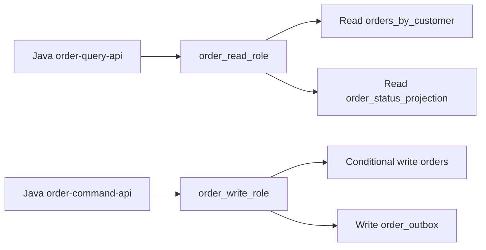
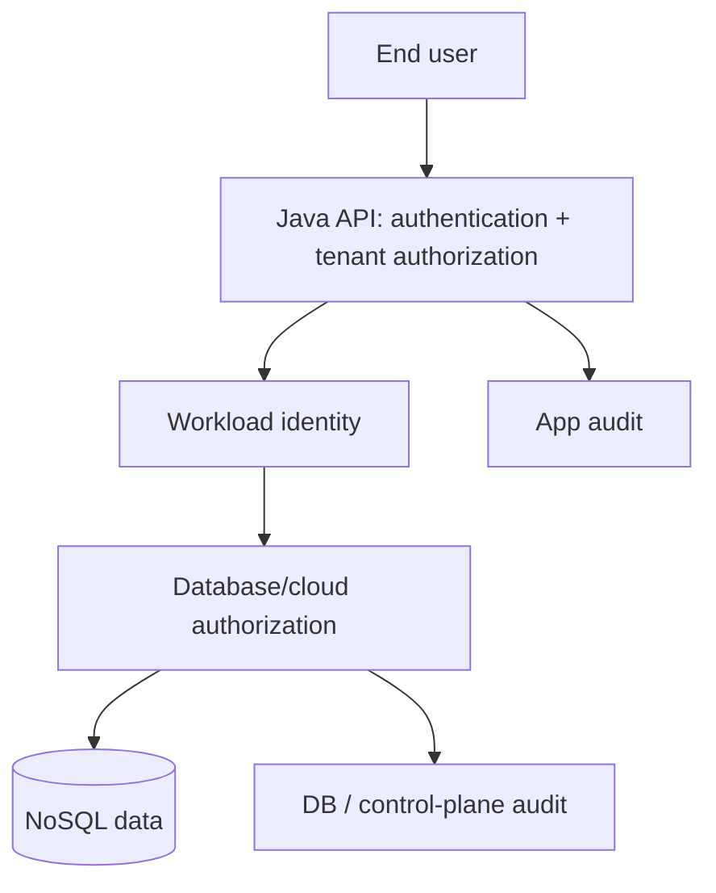

# Tài khoản dịch vụ, vai trò và nguyên tắc quyền tối thiểu

Một API Java kết nối NoSQL thường hoạt động dưới một danh tính kỹ thuật: **service account**, database user, IAM role hoặc workload identity. Danh tính đó có thể đọc, ghi hoặc quản trị những tài nguyên mà ứng dụng cần. Nếu cấp cho mọi microservice cùng một tài khoản `admin`, sự cố trong một API chỉ có chức năng tra cứu có thể trở thành sự cố **xóa toàn bộ dữ liệu**, **đọc thông tin của mọi tenant**, **sửa schema**, hoặc **vô hiệu hóa kiểm soát bảo mật**.

Ví dụ ứng dụng thương mại điện tử có những tác vụ rất khác nhau:

```text
order-query-api
    -> đọc một số bảng/collection phục vụ xem đơn.

order-command-api
    -> tạo, cập nhật đơn có điều kiện; ghi outbox.

inventory-reservation-worker
    -> giữ/trả tồn kho bằng thao tác có điều kiện.

cdc-projection-worker
    -> đọc luồng thay đổi, ghi read model.

schema-migrator
    -> tạo/thay index, bảng, collection hoặc schema.

backup-agent
    -> sao lưu theo cơ chế được phê duyệt.

security-administrator
    -> tạo/thu hồi quyền, điều tra sự cố.
```

Không có lý do mặc định để tất cả dùng một principal có quyền quản trị mọi tài nguyên.

Bài **Database No SQL → Bảo mật dữ liệu → Tài khoản dịch vụ, vai trò và nguyên tắc quyền tối thiểu** hướng dẫn thiết kế các danh tính máy, phân quyền theo chức năng và phạm vi dữ liệu, triển khai với các họ NoSQL phổ biến, xử lý vòng đời thông tin xác thực, giám sát quyền và kiểm chứng bằng những bài kiểm thử cả chiều **được phép** lẫn **bị từ chối**.

> Nguyên tắc nền tảng: **mỗi workload chỉ có những quyền cần thiết, với phạm vi hẹp nhất, trong thời gian cần thiết**. Không phải cứ kết nối thành công là được cấp quyền rộng. Các ví dụ MongoDB, DynamoDB, Cassandra/ScyllaDB và Redis mang tính minh họa; câu lệnh, tính năng phân quyền và chính sách phụ thuộc phiên bản, chế độ triển khai và nhà cung cấp. Trước production phải kiểm chứng với công cụ và tài liệu chính thức của môi trường thực tế.

---

## 1. Tài khoản dịch vụ là gì?

**Tài khoản dịch vụ** (*service account*) là danh tính dùng bởi ứng dụng, máy chủ, job hoặc một workload không có người trực tiếp nhập tài khoản tại mỗi lần chạy.

Ví dụ:

```text
Identity: order-reader-prod
Workload: Java service đọc đơn
Environment: production
Allowed: read orders_by_customer
Denied: delete orders, change schema, manage users
Credential: managed workload identity or short-lived secret
```

Danh tính có thể xuất hiện dưới nhiều hình thức:

- Database-native user/role.
- Cloud IAM role được gán cho workload.
- Kubernetes service account liên kết tới một workload identity.
- Short-lived access token hoặc workload credential.
- X.509 client certificate trong cơ chế mTLS nếu database hỗ trợ.
- Service principal của một hệ identity provider.
- Account dành riêng cho connector/backup/CDC tool.

**Service account không đồng nghĩa file chứa username/password**. Nơi hỗ trợ, có thể dùng cơ chế cấp danh tính ngắn hạn thay cho secret tĩnh.

## 2. Ba câu hỏi trước khi cấp bất kỳ quyền nào

Với một yêu cầu truy cập, hãy tách:

1. **Ai đang kết nối?** Danh tính của Java pod, worker, connector hay operator.
2. **Muốn làm hành động nào?** Đọc record, ghi có điều kiện, xóa, quản lý index, lấy backup, đổi quyền.
3. **Trên tài nguyên nào và dưới điều kiện gì?** Database, collection, table, index, key prefix, Region, tenant, thời gian hoặc network boundary.

Dạng khái quát:

\[
\mathrm{Permit}(principal,action,resource,context)
\]

Một quyết định cấp quyền chỉ hợp lệ nếu từng phần đáp ứng policy của tổ chức và khả năng enforcement thực của hệ.

Ví dụ:

```text
Principal: catalog-search-api-prod
Action: read
Resource: catalog_search_projection
Context: production, approved workload identity
Decision: ALLOW
```

Trong khi:

```text
Principal: catalog-search-api-prod
Action: dropCollection
Resource: orders
Decision: DENY
```

## 3. Xác thực và phân quyền là hai bước khác nhau

**Authentication (AuthN)** xác minh một bên là ai:

```text
Java service -> MongoDB:
    authenticate as order_reader_prod
```

**Authorization (AuthZ)** quyết định danh tính ấy được phép làm gì:

```text
Can order_reader_prod find() on orders_by_customer?
Can it update() on orders?
Can it createUser()?
```

Một hệ có thể xác thực thành công nhưng từ chối `INSERT`:

```text
Connection established = SUCCESS
SELECT permitted       = YES
UPDATE permitted       = NO
```

Đó là cấu hình bảo mật hợp lý, không phải lỗi kết nối.

Không được chữa lỗi `Unauthorized` bằng cách đổi sang user `root` chỉ để job chạy qua.

## 4. Database authorization khác authorization của người dùng cuối

Đây là ranh giới thường bị nhầm nhất.

```text
Người dùng A đã đăng nhập.
    |
    v
Java order-query-api
    |
    v
Database account order-query-prod
    |
    v
NoSQL orders collection
```

Database thấy **workload principal** `order-query-prod`, không tự biết người dùng A chỉ được xem đơn của tenant T1.

Ứng dụng phải bảo vệ **end-user/tenant authorization**:

```text
User A:
    membership tenant T1
    can view orders for tenant T1 only

Database principal:
    can read collection orders_by_customer
```

Nếu app nhận `tenantId` từ URL rồi truy vấn mà không xác minh người dùng được phép truy cập tenant đó, service account có thể trở thành **confused deputy** — dùng quyền dữ liệu rộng của mình thay người dùng trái phép.

**Quyền của database account là trần quyền của workload; nó không thay thế kiểm tra quyền ở tầng nghiệp vụ.**

## 5. Nguyên tắc quyền tối thiểu theo nhiều chiều

Quyền tối thiểu không chỉ là “read-only thay vì read-write”.

Cần xét:

| Chiều | Câu hỏi |
| --- | --- |
| Principal | Workload nào cần quyền? |
| Action | GET/FIND, QUERY, INSERT, UPDATE, DELETE, DDL hay ADMIN? |
| Resource | Database/collection/table/index/key prefix nào? |
| Data scope | Tenant, partition, subset records nào? |
| Condition | Chỉ được ghi khi thỏa session/role/workload context nào? |
| Environment | Dev, staging hay production? |
| Time | Quyền vĩnh viễn hay cấp có thời hạn cho migration? |
| Network | Chỉ từ workload/mạng được phê duyệt? |
| Credential lifetime | Secret tĩnh hay token ngắn hạn? |
| Propagation | Khi bị thu hồi, kết nối/session hiện hữu còn tác dụng bao lâu? |
| Audit | Ai cấp, vì sao, được dùng khi nào? |

Không phải mọi NoSQL engine hỗ trợ fine-grained conditions hoặc row-level authorization. Khi database không enforcement được tenant scope, cần **kết hợp giới hạn database với bảo vệ ứng dụng và cấu trúc dữ liệu** — đồng thời ghi rõ giới hạn của từng lớp.

## 6. Default deny và allowlist

Một policy tốt bắt đầu:

```text
DENY all unless explicitly permitted.
```

Sau đó cấp đúng quyền:

```text
order-reader:
    ALLOW read orders_by_customer
    DENY writes
    DENY schema changes
    DENY security administration
```

Tránh thiết kế:

```text
ALLOW all
DENY a few dangerous commands
```

vì những command mới hoặc endpoint mới có thể không được liệt kê trong denylist.

Cần xem **semantics của engine**: có hệ là allowlist quyền, có hệ có deny rules, role inheritance hoặc grant union. “Default deny” là mục tiêu chính sách; cách cấu hình phải đúng theo cơ chế thực.

## 7. RBAC: quyền được nhóm vào vai trò

**Role-Based Access Control (RBAC)** gắn permissions với role, rồi gán role cho principal.



Lợi ích:

- Role thể hiện một chức năng rõ.
- Dễ kiểm tra review và drift.
- Có thể tái sử dụng cho những replicas của **cùng workload**.
- Không phải cấp quyền thủ công cho từng pod.
- Hỗ trợ onboarding/offboarding workloads.

Nguy cơ:

- Role trở nên quá rộng khi nhiều service cùng dùng.
- Role inheritance cộng dồn quyền.
- Một database-managed `readWrite` role có thể cho nhiều thao tác hơn ý định nghiệp vụ.
- “Role app” chứa cả schema migration để tránh phải cấp role riêng.

**Role phải bám vào chức năng và tài nguyên thực, không phải tên nhóm team chung chung.**

## 8. ABAC và điều kiện dựa trên thuộc tính

**Attribute-Based Access Control (ABAC)** dùng các thuộc tính của principal, resource hoặc request:

```text
principal.environment = prod
resource.environment = prod
principal.team = orders
resource.ownerTeam = orders
requestedAction = read
```

Một số cloud IAM systems có thể áp conditions dựa trên tags hoặc resource attributes. Một số database bản thân không hỗ trợ policy theo tenant attribute của row/document.

Cần phân biệt:

- **Policy condition có enforcement tại authority**: database/cloud thực sự từ chối request không hợp lệ.
- **Ứng dụng tự thêm filter**: có thể mạnh khi code tốt nhưng không được gọi là DB row-level security nếu DB không enforce.
- **UI chỉ ẩn nút**: không phải authorization boundary.

Các attribute từ phía client phải được xác thực; không dùng header `X-Role: admin` do browser tự gửi làm bằng chứng quyền.

## 9. Mô hình IAM từ người dùng đến dữ liệu



Có nhiều ranh giới:

1. User identity -> business permission.
2. Workload identity -> database permission.
3. Network identity -> endpoint reachability.
4. Data-plane request -> key/record access.
5. Operations/control-plane -> configuration and role management.

**Defense in depth** không có nghĩa đẩy toàn bộ trách nhiệm cho một lớp duy nhất.

## 10. Service identity cho từng môi trường

Tránh:

```text
order-service account:
    used in dev, staging and production.
```

Nếu dev CI bị xâm nhập, attacker có thể dùng cùng credential vào production.

Nên có danh tính riêng:

```text
order-query-dev
order-query-staging
order-query-prod

order-command-dev
order-command-staging
order-command-prod
```

Cùng tên logic có thể được tạo bởi IaC, nhưng IDs, trust relationships, permissions và secrets phải tách biệt.

Những biên khác cần xét:

- Region.
- Cluster.
- Namespace.
- Tenant tier hoặc nhóm dữ liệu nhạy cảm.
- Human-operated tools vs automated workloads.
- Production data export vs masked staging data.
- Break-glass administrative access.

Không dùng production service account để chạy test tích hợp từ laptop khi có lựa chọn an toàn hơn.

## 11. Tài khoản theo chức năng, không theo repository lớn

Một monorepo có:

```text
order-query-service
order-command-service
billing-worker
search-indexer
```

Dù cùng project Git và cùng nhóm, chúng có **đường truy cập NoSQL khác nhau**.

Mỗi workload nên có danh tính và role riêng khi có thể:

```text
order-query:
    read orders_by_customer

order-command:
    read/write orders + outbox

billing-worker:
    read payments, write billing-ledger

search-indexer:
    read CDC, write search_projection
```

Nếu tất cả dùng `shop-app-admin`, lỗi RCE trong query-service mở toàn bộ quyền ghi billing.

Một số hệ có giới hạn số principal hoặc quản lý phức tạp; có thể gom những replicas cùng vai trò, nhưng phải ghi nhận trade-off và tránh biến convenience thành blanket admin.

## 12. Tách quyền đọc và ghi

Với workload chỉ đọc:

```text
ALLOW:
    SELECT/FIND/GET/QUERY on designated read tables

DENY:
    INSERT/UPDATE/DELETE
    index/schema changes
    user/role management
    backup/export outside policy
```

Nhưng hãy kiểm tra:

- Read có thể đọc PII/payment data không?
- Có thể quét **toàn bộ tenant** không?
- `SCAN`, `KEYS`, `HGETALL` có thể xuất dữ liệu lớn không?
- Read replica có chứa bí mật mà API không nên thấy không?
- Query qua GSI có trả fields nhạy cảm không?
- Debug/aggregation privileges có cho thông tin ngoài business purpose không?

**Read-only không đồng nghĩa ít rủi ro**. Đọc hàng triệu hồ sơ vẫn là sự cố bảo mật nghiêm trọng.

## 13. Tách DML, DDL và administration

Một service runtime thông thường cần **data operations**:

```text
GET / FIND / QUERY
INSERT / UPDATE / DELETE có giới hạn
```

Nó thường không cần:

```text
CREATE TABLE / COLLECTION
DROP TABLE / COLLECTION
CREATE INDEX
ALTER SCHEMA
GRANT / REVOKE
CREATE USER / ROLE
CHANGE AUDIT CONFIG
EXPORT FULL DATABASE
RESTORE BACKUP
```

Tạo các workload/role riêng:

```text
runtime-reader
runtime-writer
schema-migrator
security-admin
backup-operator
```

Càng có nhiều quyền quản trị trong runtime credential, phạm vi thiệt hại khi app bị khai thác càng lớn.

## 14. Tài khoản migration có thời hạn

Migration cần quyền mạnh hơn:

```text
create/alter index
create new collection
backfill data
adjust schema-related metadata
```

Không nên gán những quyền này vĩnh viễn cho API app.

Một workflow an toàn:

```text
1. Review migration plan and affected resources.
2. Approve temporary role/identity.
3. Execute from a controlled pipeline.
4. Record change, audit, and rollback info.
5. Revoke or expire elevated privilege.
6. Verify runtime principal cannot perform DDL.
```

Trong một số NoSQL, backfill lớn cần quyền đọc nguồn và ghi đích, có thể phải dùng một migration identity khác với DDL identity để tách phạm vi.

**Quyền tạm thời vẫn phải giới hạn tài nguyên và có audit**, không mặc định là full-cluster root.

## 15. Tài khoản backup và restore có rủi ro khác nhau

Backup có thể cần quyền đọc hoặc quyền snapshot thông qua control plane. Restore có thể ghi đè/xóa dữ liệu.

Không gom:

```text
backup-reader
restore-operator
cluster-admin
```

thành một role nếu không cần.

Các rủi ro:

- Backup chứa thông tin nhạy cảm, phải mã hóa, giới hạn nơi lưu và ai đọc.
- Kẻ có quyền tạo export có thể sao chép toàn bộ dữ liệu.
- Restore có thể phá dữ liệu hiện hữu hoặc làm mất audit history.
- Backup job có thể dùng cơ chế snapshot do cloud service thực hiện, không cần credentials truy vấn từng item.
- Export object storage cần IAM riêng.
- Khả năng xóa bản backup cũng là quyền nguy hiểm.

Nên có quy trình **phê duyệt, audit, kiểm tra integrity và diễn tập khôi phục**, đồng thời giữ tối thiểu quyền thực tế của từng operation.

## 16. CDC connector: đọc change stream không phải read toàn DB

Một CDC worker có thể cần:

```text
Read database change feed / stream
Read snapshot at bootstrap if necessary
Store resume token/checkpoint
Publish events to broker
```

Nó thường không cần:

```text
Modify business records
Delete source database
Create users
Change encryption settings
```

Tuy nhiên, CDC payload có thể chứa **giá trị cũ/mới của dữ liệu nhạy cảm**. Quyền xem change stream cũng có thể trở thành kênh xuất dữ liệu; cần:

- Scope theo table/collection nếu engine hỗ trợ.
- Redact/mask fields khi publish.
- Encrypt transport and downstream storage.
- Access control trên broker/topic.
- Rotate connector credentials.
- Audit initial snapshot, replay và DLQ.
- Quyền checkpoint trên storage riêng.
- Kiểm tra retention và quyền xóa dữ liệu trong events.

**Không coi CDC role là “chỉ đọc không nguy hiểm”.**

## 17. Read model updater và separation of duties

Một updater:

```text
Source stream: orders
Target: orders_by_customer_projection
```

Cần quyền:

```text
READ designated source changes.
WRITE designated projection.
```

Không nhất thiết cần quyền update `orders` source.

Nếu một consumer đồng thời có quyền ghi source và projection, một bug hoặc khai thác có thể gây:

- Feedback loop CDC.
- Overwrite authoritative state bằng stale projection.
- Cross-tenant data mixing.
- Phá delete/tombstone semantics.

Nên giới hạn quyền **source read**, **target write** tách biệt và xác định authority rõ.

## 18. Tài khoản dữ liệu cho nhiều tenant

Một service phục vụ các tenants:

```text
T1, T2, T3...
```

Có ba mô hình phổ biến:

1. **Shared database + shared tables**, tenantId trong key/filter.
2. **Shared cluster, separate databases/tables/collections per tenant**.
3. **Dedicated cluster hoặc account per tenant**.

Mức cô lập có thể tăng nhưng chi phí vận hành cũng tăng.

Cần hỏi:

- Database có per-tenant row/item conditions được enforce không?
- Role có thể scope theo table/collection/key prefix không?
- Thứ tự partition key có cho phép cô lập tenant không?
- Có tránh một account đọc tất cả tenants không?
- Một service có buộc phải được trusted để enforce tenant filter không?
- Khóa mã hóa/audit/backup có scope riêng không?
- Nếu tenant cần isolation mạnh, có cần tách account/cluster?

Không chỉ dùng `tenantId` field để khẳng định isolation nếu credentials vẫn có thể scan tất cả records.

## 19. Confused deputy: vì sao app authorization phải đúng

Ví dụ sai:

```http
GET /v1/orders?tenantId=T2
Authorization: Bearer <token-of-user-in-T1>
```

Repository:

```java
return orders.findByTenantId(request.tenantId());
```

Nếu không kiểm:

```text
User belongs to T2?
```

app sử dụng quyền DB rộng để đọc dữ liệu T2 thay người không có quyền.

Giải pháp:

- Resolve tenant scope từ verified authentication/authorization context.
- Validate membership/role/ownership với authority đúng.
- Query luôn gắn server-validated tenant ID.
- Không cho caller truyền arbitrary database table/key prefixes.
- Test cross-tenant access và enumeration.
- Gắn audit identity của end user vào application log/trace an toàn.
- Cân nhắc data-plane conditions ở database nếu engine hỗ trợ phù hợp.

**DB role read-only vẫn có thể cho lộ dữ liệu nếu app dùng nó như một proxy tùy ý.**

## 20. Quyền theo collection/table chưa đủ cho field nhạy cảm

Ví dụ collection `users` có:

```json
{
  "userId": "U-101",
  "displayName": "Minh Anh",
  "email": "private@example.invalid",
  "passwordHash": "<redacted>",
  "mfaRecoveryData": "<redacted>"
}
```

Một API chỉ hiển thị `displayName` không nên có khả năng tùy ý xuất toàn bộ document, nếu kiến trúc cho phép hạn chế hơn.

Có thể:

- Tách public profile view khỏi credentials/security records.
- Tách collection/table chứa dữ liệu cực nhạy cảm.
- Giới hạn role chỉ tới read model chứa dữ liệu cần.
- Sử dụng field-level access controls nếu engine hỗ trợ đúng.
- Dùng projection trong query để giảm dữ liệu truyền — **nhưng projection tự chọn ở code không phải DB-level field security**.
- Mã hóa fields với quản lý khóa phù hợp.
- Không đưa secrets/security fields vào CDC/search projections.

Nếu tất cả nằm trong cùng collection và DB principal có `find`, nó có thể có khả năng đọc nhiều hơn API cần; cần ghi nhận rủi ro này.

## 21. Vai trò và quyền cộng dồn

Nhiều RBAC engines cho phép principal có nhiều roles:

```text
Role A: read orders.
Role B: readWrite all shop collections.
```

Tài khoản có cả A+B có thể vẫn có quyền `readWrite` rộng.

Không được nhìn riêng role A rồi kết luận principal chỉ có quyền đọc.

Kiểm tra:

- Direct role grants.
- Inherited roles.
- Group/IAM policy attachments.
- Resource policies.
- Cloud permission boundaries/SCPs nếu có.
- Temporary credentials và assume-role paths.
- Grants được cấp sau một migration.
- Existing database sessions/cache of privileges.

**Effective permissions là hợp của những con đường được cho phép, có xét deny/conditions/permission boundaries theo hệ thực**, không chỉ file policy mà team mong muốn.

## 22. Wildcards và các role có quyền rộng

Những mẫu đáng cảnh báo:

```text
Action: "*"
Resource: "*"

Database role: root/admin
Collection scope: entire cluster
Redis key pattern: all keys
CQL GRANT ALL on all keyspaces
```

Vấn đề:

- Một service bị khai thác có phạm vi thiệt hại rất lớn.
- Các tài nguyên tương lai tự nằm trong quyền.
- Dễ đọc dữ liệu từ module khác.
- Dễ thay schema hoặc xóa dữ liệu.
- Khó chứng minh segregation of duties.

Không có nghĩa wildcard luôn bị cấm trong mọi hệ: một số actions không hỗ trợ resource-level restriction hoặc tooling cần quyền khám phá; khi đó phải ghi **lý do, điều kiện phụ, thời hạn, network scope và owner**. Không dùng `*` cho tiện vì chưa biết cụ thể tài nguyên cần.

## 23. Quyền tối thiểu không chỉ là danh sách permission

Một principal chỉ có:

```text
READ 1 table
```

vẫn có thể tạo sự cố nếu table chứa 100 triệu bản ghi nhạy cảm.

Một principal chỉ có:

```text
UPDATE 1 table
```

vẫn có thể sửa tất cả đơn trong table.

Cần thêm:

- Data model phân vùng/cô lập hợp lý.
- Application authorization.
- Request validation.
- Conditional writes và invariants.
- Query rate/concurrency limits.
- Field separation.
- Audit.
- Network egress restrictions.
- Short credential lifetime.
- Detection/incident response.

**Least privilege giới hạn blast radius, nhưng không tự bảo đảm mọi thao tác nghiệp vụ được phép.**

## 24. Ma trận quyền tối thiểu cho hệ đơn hàng

| Workload/principal | Orders source | Order read view | Inventory | Outbox/CDC | DDL/Admin |
| --- | --- | --- | --- | --- | --- |
| `order-query-prod` | Không cần nếu có view đủ | Read | None | None | None |
| `order-command-prod` | Scoped read/conditional write | None | None hoặc command API khác | Write order outbox | None |
| `inventory-worker-prod` | None | None | Conditional read/write | Write inventory events | None |
| `orders-projector-prod` | Read source changes | Write | None | Read event stream | None |
| `schema-migrator-prod` | Scoped migration | Scoped migration | Theo migration | Theo migration | Scoped DDL trong thời hạn |
| `backup-agent-prod` | Approved snapshot/read only | Theo scope | Theo scope | Theo scope | Không cần security-admin |
| `security-admin` | Không mặc định đọc nội dung | Không mặc định đọc | Không mặc định đọc | Audit/config | Role/security operations |

Ma trận là **thiết kế ban đầu**. Một service có thể cần một số quyền bổ sung được chứng minh bằng tests và operation contract, nhưng bổ sung phải có review. Tên `conditional write` mô tả ý định; database RBAC có thể chỉ enforce `UPDATE`, còn điều kiện trạng thái do query/transaction kiểm soát.

## 25. MongoDB: authentication database và role scope

MongoDB có users/roles, built-in roles và custom roles theo database/resource context. Một application account có thể được tạo trong một authentication database và được gán roles cho một database khác theo cấu hình.

Một connection URI minh họa cấu trúc:

```text
mongodb://<user>:<secret>@db-host.example.invalid:27017/shop?authSource=admin&tls=true
```

Không đặt URI chứa secret vào source code hoặc log. Host và giá trị là placeholder; phiên bản driver và môi trường quyết định các options chính xác.

Các câu hỏi:

- Account được authenticate ở đâu (`authSource`/mechanism)?
- Role có scope `shop` hay cluster rộng?
- Ứng dụng cần `find`, `insert`, `update`, `remove` trên collections nào?
- Có thật cần `listCollections`, `createIndex`, `dropCollection` không?
- Khi dùng change streams, cần quyền gì theo topology/version?
- Application có truy cập admin database không?
- Có connection tới replica/shard khác với quyền khác không?

Không mặc định dùng built-in `readWrite` cho một workload chỉ cập nhật một collection.

## 26. MongoDB: custom role cho đọc giới hạn

Một ví dụ khái niệm về quyền đọc trên collection `orders_by_customer` trong database `shop`:

```javascript
db.getSiblingDB("shop").createRole({
  role: "order_view_reader",
  privileges: [
    {
      resource: { db: "shop", collection: "orders_by_customer" },
      actions: [ "find" ]
    }
  ],
  roles: []
});
```

Sau đó một DBA/provisioner có quyền thích hợp gán role này cho application principal tương ứng. Không tự chạy `createRole` từ API runtime.

Điểm cần ghi nhớ:

- `find` ở mức collection không tự giới hạn tenant ID hoặc field.
- Quyền index/change stream/bulk actions có thể cần những actions khác theo API.
- Một API có thể phải đọc collection khác để phục vụ kết quả; nên ghi nhận rõ.
- Trong multi-tenant shared collection, DB role có thể đọc mọi tenants nếu engine không enforce row-level scope phù hợp.
- Custom role phải được kiểm tra trong deployment đúng auth mechanism và version.

**Mục tiêu ví dụ là giới hạn resource/action, không phải đưa một script provisioning sản xuất hoàn chỉnh.**

## 27. MongoDB: role cho writer không cần DDL

Ví dụ writer được phép trên `orders` và `order_outbox`:

```javascript
db.getSiblingDB("shop").createRole({
  role: "order_command_writer",
  privileges: [
    {
      resource: { db: "shop", collection: "orders" },
      actions: [ "find", "insert", "update" ]
    },
    {
      resource: { db: "shop", collection: "order_outbox" },
      actions: [ "find", "insert" ]
    }
  ],
  roles: []
});
```

Không liệt kê `remove`, `createIndex`, `dropCollection`, `createUser` nếu không cần.

Nhưng **cho phép `update` không chứng minh business update có điều kiện**. Nếu app gửi update sai filter, nó có thể sửa nhiều records trong scope đó. Cần:

```text
source constraint / unique index
authorization guard
CAS/version predicate
idempotency ledger
transaction consistency
```

Custom role giảm blast radius; invariant nghiệp vụ phải được bảo vệ độc lập.

## 28. MongoDB: xác minh negative permissions

Không chỉ test:

```text
order_reader can find orders -> PASS
```

Phải test:

```text
order_reader cannot insert orders.
order_reader cannot delete orders.
order_reader cannot createIndex.
order_reader cannot list security users.
order_reader cannot query payments collection.
```

Bằng một test principal thực và tài nguyên sandbox.

Lưu ý: một số lệnh cần quyền metadata hoặc system-level khác; khi test thất bại, xác định quyền nhỏ nhất cần bổ sung thay vì chuyển account sang `dbOwner` hoặc `root`.

## 29. MongoDB: transactions và change streams

Một API thực hiện transaction có thể đọc/ghi nhiều collections:

```text
orders
payment_intents
order_outbox
processed_operations
```

Cần liệt kê đầy đủ operations trong transaction. Nếu role thiếu quyền trên một collection, transaction có thể abort/raise auth error.

Đừng giải quyết bằng role toàn database trước khi biết collection nào còn thiếu.

CDC/change stream principal cũng cần xem permissions và API restrictions theo version/configuration. Việc có khả năng watch collection không đồng nghĩa nên cho connector xem mọi collection chứa dữ liệu nhạy cảm.

## 30. DynamoDB: IAM role khác bảng người dùng của ứng dụng

Với DynamoDB, truy cập AWS API thường được kiểm soát bằng IAM principal và policies. Trong Java chạy trên một cloud workload, nên ưu tiên **workload IAM role và short-lived credentials** thay vì lưu static AWS access keys trong application config.

Ví dụ:

```text
order-query workload
    -> assumed IAM role
    -> DynamoDB GetItem/Query on approved table/index
```

Những thành phần khác nhau:

- IAM role/trust policy quyết định **ai được assume role**.
- Identity/resource policies quyết định **actions/resources/conditions**.
- Table/index ARNs quyết định tài nguyên.
- Service Control Policies/permission boundaries có thể giới hạn thêm trong một tổ chức.
- App code vẫn phải enforce user/tenant authorization nếu IAM policy không bao phủ được row scope.

Không sử dụng IAM user có static access key dài hạn cho tất cả pods chỉ vì cấu hình dễ.

## 31. DynamoDB: ví dụ IAM policy đọc có giới hạn

Policy minh họa cho workload đọc đơn tại một Region và một account **giả định**:

```json
{
  "Version": "2012-10-17",
  "Statement": [
    {
      "Sid": "ReadOrderTableAndApprovedIndex",
      "Effect": "Allow",
      "Action": [
        "dynamodb:GetItem",
        "dynamodb:Query"
      ],
      "Resource": [
        "arn:aws:dynamodb:ap-southeast-1:111122223333:table/Orders",
        "arn:aws:dynamodb:ap-southeast-1:111122223333:table/Orders/index/ByCustomer"
      ]
    }
  ]
}
```

Không có `dynamodb:Scan`, `PutItem`, `UpdateItem`, `DeleteItem`, `CreateTable`, `DeleteTable` hay `iam:*` trong ví dụ.

**Cảnh báo quan trọng:**

- Table/index ARNs chỉ là minh họa.
- Cần match chính xác index và operations được gọi.
- IAM policies có evaluation semantics phức tạp (identity, resource, boundaries, explicit deny, role trust).
- Một `Query` trên table có thể trả nhiều tenant nếu partition key/schema không tự tách.
- Thiếu `Scan` không chứng minh không thể đọc hàng loạt: client có thể query nhiều partition keys nếu biết keys.
- Không xem ví dụ policy là cấu hình triển khai hoàn chỉnh.

## 32. DynamoDB: kiểm soát LeadingKeys với điều kiện

DynamoDB có những IAM condition keys phục vụ fine-grained access theo đặc tính request, trong đó có `dynamodb:LeadingKeys` cho những patterns phù hợp.

Ví dụ khái niệm:

```json
{
  "Condition": {
    "ForAllValues:StringEquals": {
      "dynamodb:LeadingKeys": [
        "${aws:PrincipalTag/tenantId}"
      ]
    }
  }
}
```

Một thiết kế như vậy **chỉ có nghĩa** nếu:

1. Partition key của dữ liệu thật sự biểu diễn tenant theo semantics policy.
2. Principal tag là trusted và không thể tự thay tùy ý.
3. Mọi API, batch, index access liên quan đều được xem xét.
4. Không có policy attachment khác mở đường bỏ qua.
5. Condition được kiểm chứng bằng allow/deny tests trên API thật.
6. Có cách xử lý platform/admin jobs cần nhiều tenants riêng.

Nếu key là `TENANT#T1` nhưng tag chỉ `T1`, phép so chuỗi trong ví dụ chưa khớp. Nếu partition key là orderId không chứa tenant, condition này không thể tự tạo tenant isolation.

**Condition IAM không thể thay thế việc thiết kế partition key phù hợp và kiểm tra quyền người dùng.**

## 33. DynamoDB: quyền transaction, Streams và export

Một workload có thể cần:

```text
TransactWriteItems / TransactGetItems
```

Cần xét quyền của các operations/tài nguyên liên quan theo API.

Một CDC worker có thể dùng DynamoDB Streams với các quyền đọc stream cụ thể; nó không cần mặc định `UpdateItem` trên source table.

Một backup/export task cần policy cho cơ chế backup/export tương ứng và object storage destination, không nhất thiết là `Scan` trên mọi table.

Phân quyền theo từng vai:

```text
runtime_data_read
runtime_transaction_write
stream_consumer
backup_export
schema_provisioner
security_auditor
```

Đừng gán `dynamodb:*` chỉ vì chưa biết đầy đủ actions; bắt đầu từ access inventory, chạy chức năng và xem deny logs trong môi trường an toàn.

## 34. AWS SDK for Java: tránh credentials hard-code

Ví dụ Java dùng credential provider chain theo môi trường (đòi dependency AWS SDK phù hợp):

```java
import software.amazon.awssdk.regions.Region;
import software.amazon.awssdk.services.dynamodb.DynamoDbClient;

public final class DynamoClientFactory {
    public static DynamoDbClient create() {
        return DynamoDbClient.builder()
            .region(Region.AP_SOUTHEAST_1)
            .build();
    }
}
```

Đoạn code không có access key trong source. Khi chạy trên workload cloud được cấu hình đúng, SDK sẽ sử dụng các credential providers theo chain của phiên bản SDK.

Tuy nhiên:

- Local developer profile/env credentials có thể khác production workload role.
- SDK chain có thứ tự và fallback; kiểm tra **actual caller identity** trong môi trường thực.
- Không log credentials/tokens.
- Không cho app assume một admin role ngoài mục đích.
- Không để CI credentials production rò rỉ qua build logs/artifacts.
- Token rotation/expiration phải được SDK/provider xử lý đúng.

Một `DefaultCredentialsProvider` hay builder mặc định **không tự bảo đảm least privilege** nếu principal mà nó tìm được quá mạnh.

## 35. Kubernetes service account không phải DB role

Một Kubernetes service account là identity trong control plane/workload environment. Database vẫn cần chấp nhận một cơ chế xác thực nào đó.

Có thể có chuỗi:

```text
Kubernetes ServiceAccount
    |
    v
Workload identity federation / projected credential
    |
    v
Cloud IAM role or database auth token
    |
    v
NoSQL API/cluster
```

Cần kiểm soát:

- Namespace và service account identity.
- OIDC trust/audience/subject binding.
- Pod nào được dùng identity đó.
- ServiceAccount token exposure.
- Admission/namespace policy và secret mounting.
- NetworkPolicy/egress restrictions.
- Cloud role trust policy.
- Role permission scope.
- Rollout/rotation/revocation.

Tên Kubernetes service account `db-reader` **không tạo ra quyền database reader** nếu các liên kết trust và DB policy chưa cấu hình đúng.

## 36. Cassandra/ScyllaDB: ROLE và CQL GRANT

Trong những deployment dùng database-native authorization, Cassandra/ScyllaDB có mô hình roles và GRANT/REVOKE permissions theo tài nguyên như keyspace/table. Chính xác feature set phụ thuộc engine/version và security configuration.

Một DBA có thể cấp quyền đọc cho role reader:

```sql
GRANT SELECT
ON TABLE shop.orders_by_customer
TO order_reader;
```

Một writer:

```sql
GRANT MODIFY
ON TABLE shop.order_outbox
TO order_outbox_writer;
```

`MODIFY` không phải quyền chỉ-INSERT theo nghĩa mọi engine đều hỗ trợ tách chi tiết đến từng động từ; nó có thể cho các thao tác cập nhật/xóa thuộc phạm vi CQL permission. Nếu business cần “insert-only, không delete” mà DB role không enforce được, hãy:

- Thiết kế dữ liệu append-only/unique identity.
- Dùng một service boundary kiểm soát lệnh.
- Xây audit và anomaly detection.
- Xem xét engine/authority khác nếu invariant không thể bảo vệ đủ.

Không tự coi CQL role và SQL row-level security là cùng một sản phẩm.

## 37. Cassandra/ScyllaDB: xác minh authentication được bật thật

Một lỗi cấu hình nguy hiểm là tạo roles trên paper nhưng cluster vẫn dùng cơ chế cho phép kết nối không cần xác thực hoặc không kiểm permissions như mong đợi.

Cần kiểm:

- Authentication mode.
- Authorization mode.
- Superuser/initial admin handling.
- Node-to-node và client-to-node TLS.
- Driver credentials/certificates.
- Effective permissions.
- Role inheritance.
- Deployment/upgrade continuity.
- Audit/logging plugin hay khả năng ghi nhận truy cập.

`GRANT SELECT` có ý nghĩa bảo vệ chỉ khi enforcement thực sự có hiệu lực ở đường truy cập mà application sử dụng.

Không thay đổi authentication/authorization live cluster một cách tùy tiện; cần runbook rollout và khả năng phục hồi quản trị.

## 38. Cassandra/ScyllaDB: quyền trên keyspace rộng

Một role:

```sql
GRANT SELECT ON KEYSPACE shop TO order_reader;
```

có thể rộng hơn mong muốn nếu keyspace `shop` chứa cả:

```text
orders_by_customer
payments
users
credentials_metadata
```

Trong nhiều trường hợp nên grant từng table thay vì toàn keyspace, hoặc tách keyspaces theo classification/sensitivity.

Tuy nhiên, số lượng roles/grants quá lớn cũng gây quản trị phức tạp; quyết định dựa trên data boundaries và các workloads có thật.

**Đặt tên table theo module không đủ nếu role scope vẫn là cả keyspace.**

## 39. Redis: ACL theo command và key pattern

Redis ACL có thể giới hạn user theo commands, key patterns và một số phạm vi khác tùy phiên bản.

Một conceptual ACL user definition:

```text
user profile_reader on >REPLACE_WITH_SECRET ~profiles:* -@all +get +mget +ttl
```

Đây là **cú pháp mô tả trong ACL configuration**, không phải lệnh an toàn để copy nguyên vào shell; thay secret bằng thông tin từ secret manager và đối chiếu Redis version trước khi dùng.

Ý tưởng:

```text
User: profile_reader
Allowed keys: profiles:*
Allowed commands: GET, MGET, TTL
Everything else: denied by default
```

Cần chú ý:

- `profiles:*` là key-prefix scope, không tự kiểm tenant.
- `MGET` trên nhiều keys vẫn phải có scope checks theo ACL semantics.
- `+@read` thường rộng hơn một allowlist vài commands.
- `+@write` có thể bao gồm các lệnh xóa/ghi không mong muốn.
- Scripts (`EVAL`, functions) có behavior/permission implications riêng.
- Một Redis account dùng cả cache lẫn queue cần tách quyền theo workload nếu có thể.

**Không cho ứng dụng cache reader quyền chạy mọi Redis command chỉ vì Redis nằm trong private network.**

## 40. Redis ACL: cẩn thận với key namespace

Giả sử:

```text
profiles:T1:U-101
profiles:T2:U-202
```

ACL:

```text
~profiles:*
```

cho phép cùng principal truy cập cả T1 và T2, không tạo tenant isolation.

Có thể:

- Dùng principal/key patterns theo nhóm tenants khi có requirement.
- Tách Redis database/cluster/account theo sensitivity.
- Đảm bảo app authorization và key construction đúng.
- Không để user nhập trực tiếp raw Redis key.
- Dùng server-derived tenant scope thay vì client-provided prefix.
- Kiểm tra key pattern collisions và Unicode/encoding.
- Xem phạm vi script, pattern và Redis cluster topology.

**Key prefix security có giá trị nhưng không thay end-user authorization**, đặc biệt với shared cache.

## 41. Redis: đừng dùng account default quá mạnh

Một Redis cache có thể hoạt động lâu năm chỉ với một password và một default user có quyền rộng. Khi nhiều workloads cùng dùng, secret rò rỉ sẽ cho quyền lớn hơn nhiều so với từng chức năng.

Tách ví dụ:

```text
profile_cache_reader:
    GET, MGET on profiles:*

profile_cache_writer:
    GET, SET, DEL on profiles:* if required

rate_limit_worker:
    allowed operations/functions on ratelimit:*

stream_consumer:
    narrowly scoped stream commands/keys

redis_operator:
    administration under controlled access
```

Thực tế command lists phải được kiểm chứng với Redis ACL rules và version. Không mở `CONFIG`, `FLUSHALL`, `ACL`, scripting tùy ý hoặc keyspace-wide destructive operations cho account chỉ xử lý request.

Có thể dùng kiểm thử permission dry-run/ACL diagnostics theo khả năng phiên bản, không dựa vào việc “chưa thấy lỗi” như bằng chứng.

## 42. Graph NoSQL và quyền theo graph/database

Với graph databases, quyền có thể phân chia theo database, graph, label/type, property, procedure hoặc query capability tùy sản phẩm và edition.

Một service chỉ cần:

```text
read neighbor recommendations
```

không nên tự có quyền:

```text
delete all vertices/edges
modify schema
call arbitrary admin procedures
```

Nhưng một query traversal hợp lệ có thể chạm hàng triệu edges hoặc đi qua dữ liệu của tenant khác nếu graph model không có boundary rõ.

Cần tách:

- Permission trên graph/database.
- Quyền chạy procedures.
- Property-level sensitivity.
- Tenant partitioning/traversal guards.
- Query depth/fan-out limits.
- Audit.

Không giả mọi graph product hỗ trợ cùng một row/edge-level RBAC model.

## 43. Quản lý mật khẩu và bí mật kết nối

Các bí mật có thể gồm:

```text
Database password
Cloud access key
OAuth/client secret
Private key for mTLS
Short-lived access token
Encryption key material
```

Nguyên tắc:

- Ưu tiên workload identity/short-lived credentials khi khả dụng.
- Dùng secret manager hoặc secret delivery mechanism được phê duyệt.
- Không commit bí mật vào Git, YAML mẫu, Markdown, container image hay build artifacts.
- Không ghi vào log, exception text, telemetry hoặc crash dump.
- Giới hạn ai có quyền đọc/rotate secret.
- Dùng TLS và xác minh certificate/server identity.
- Không dùng cùng một secret qua các môi trường.
- Có rotation và incident response.
- Coi secret bị lộ là sự cố cần revoke, không chỉ đổi chỗ lưu.

Environment variable có thể thuận tiện nhưng cũng có nguy cơ lộ qua process inspection, debug dump và cấu hình triển khai; không tự cho rằng ENV là secret manager.

## 44. Java và connection pool: credential được giữ ở đâu?

Một Java service thường tạo một connection pool/client lâu sống:

```text
Spring Boot startup
    -> create NoSQL client
    -> credentials/config
    -> establish pooled connections
    -> reuse for requests
```

Khi rotate secret:

- Các connections cũ có thể tiếp tục dùng credential/session đã được xác thực.
- Pool có thể không đọc lại secret mới cho tới khi recreate client.
- Token có thời hạn, SDK có thể refresh theo provider.
- Một số drivers hỗ trợ mechanisms riêng; cần xem driver version.
- Không được giả “đổi secret trong manager” đồng nghĩa mọi pod đã dùng secret mới.
- Cần cách chứng minh old credentials đã bị vô hiệu hóa.
- Reconnect behavior có thể gây spike nếu toàn bộ pods restart cùng lúc.

**Credential rotation là một thay đổi phân tán qua nhiều connection pools và pods**, không chỉ một thao tác cập nhật chuỗi password.

## 45. Rotation có bước chồng lấn được kiểm soát

Một quy trình mẫu khi DB cho phép hai credentials/identities tồn tại đồng thời:

```text
T0: old credential works.
T1: provision new credential with same intended minimal privileges.
T2: validate new credential from canary workload.
T3: roll out new credential to all pods/workers.
T4: confirm new connections use new identity.
T5: revoke old credential.
T6: test old credential no longer works.
T7: audit and remove temporary accesses.
```

Nếu engine không cho chồng lấn password trên cùng principal, có thể tạo **service principal mới** và migrate. Cần chú ý owner/role tags/conditions, network allowlists và auth caches.

Khi sự cố lộ secret nghiêm trọng, không được kéo dài overlap theo lịch thuận tiện; có thể cần revoke ngay và chấp nhận controlled degradation.

## 46. Thời hạn token và refresh failure

Short-lived credentials giúp giảm thời gian sử dụng bí mật bị lộ, nhưng tạo failure modes:

```text
Token expires.
Refresh endpoint temporarily unavailable.
Java client cannot authenticate new connections.
```

Cần:

- Credential provider tự refresh đúng.
- Mức cache token có giới hạn.
- Fail-safe behavior khi refresh thất bại.
- Không log raw token trong retry.
- Theo dõi auth failures và token refresh latency.
- Không fallback sang static admin secret được giấu sẵn.
- Có alert trước khi credential hết hạn nếu hệ hỗ trợ.
- Thử expiry/rotation trong staging.

Không tăng token lifetime vô hạn chỉ để bỏ việc xử lý refresh.

## 47. Secret rotation không thay role review

Nếu principal có quyền:

```text
readWrite all databases
```

rotate password 30 ngày/lần vẫn giữ quyền quá mức.

Cần hai trục độc lập:

```text
Credential hygiene:
    secret lifetime, storage, revocation

Authorization hygiene:
    action/resource/condition scope, role inheritance, review
```

**Thay khóa không giảm blast radius của quyền quá rộng.**

## 48. Trust boundary của workload identity federation

Một tổ chức có thể dùng Kubernetes OIDC hoặc workload federation để cấp cloud role.

Cần kiểm:

- Trust policy chỉ chấp nhận đúng issuer/audience/subject.
- Service account/namespace không thể bị workload khác impersonate.
- Không cho tùy ý gắn service account privileged vào một pod.
- Runner/CI không assume production role nếu chưa phê duyệt.
- Role session tags/tenant attributes đáng tin.
- Token file không bị mount vào sidecar không cần.
- Egress tới identity/token endpoints được kiểm soát phù hợp.
- Audit được ai đã assume role, từ workload nào.

**Một role có policy hẹp vẫn có thể bị lạm dụng nếu trust policy cho quá nhiều workloads mượn danh tính**.

## 49. CI/CD identity và quyền triển khai

Pipeline thường cần hai loại quyền:

```text
Deployment identity:
    deploy app, set workload role binding, update config.

Runtime identity:
    read/write bounded data at request time.
```

Không nên để build runner hoặc API application đều dùng một production admin principal.

Một migration pipeline có thể có quyền DB DDL trong một step được phê duyệt, nhưng quyền đó không cần nằm trong environment variables của mọi runtime pods.

Cần phân tách:

- Build artifact access.
- Deployment authority.
- Secret read/rotate.
- Database migration.
- Runtime data plane.
- Emergency security administration.

Nếu pipeline bị compromise, phạm vi quyền cần được giới hạn và audit được.

## 50. Break-glass access

Đôi lúc operator phải có quyền cao để cứu hệ thống:

```text
Restore data.
Revoke compromised account.
Repair access control.
Rotate cluster certificates.
```

Đây là **break-glass**, không phải tài khoản dùng hàng ngày.

Một quy trình:

1. Định nghĩa điều kiện được sử dụng.
2. Duyệt bởi người có thẩm quyền hoặc quy trình khẩn cấp.
3. Cấp quyền tạm thời và giám sát.
4. Ghi danh tính operator, lý do, ticket và thời gian.
5. Áp multi-factor/strong auth nếu hệ hỗ trợ.
6. Giới hạn network và công cụ sử dụng.
7. Gỡ quyền ngay khi xong.
8. Review actions và hậu kiểm.

Không đưa secret break-glass vào application config như fallback bí mật để tránh `Unauthorized`.

## 51. Quyền tối thiểu và network security bổ trợ nhau

Giả sử tài khoản reader bị lộ, nhưng database chỉ cho kết nối từ approved private network.

Đó là một lớp giảm rủi ro, song **không thay authorization**:

- Attacker có thể đã compromise pod nằm trong mạng đó.
- Một SSRF/RCE có thể sử dụng network path hợp lệ.
- Credential có thể bị dùng qua trusted bastion/service.
- Network rule có thể bị mở nhầm khi incident.

Cần kết hợp:

```text
Strong workload identity
Scoped DB/IAM role
TLS/mTLS where supported
Network segmentation
Egress filtering
Audit and anomaly detection
Secret rotation
```

Không cho quyền root chỉ vì database không có public IP.

## 52. Audit: ai làm gì, ở đâu, khi nào?

Audit event hữu ích:

```json
{
  "timestamp": "2026-11-14T10:00:00Z",
  "principal": "order-command-prod",
  "workload": "order-command-service",
  "action": "update",
  "resource": "shop.orders",
  "decision": "ALLOW",
  "traceId": "req-781",
  "operation": "orders.confirm",
  "environment": "production"
}
```

Không nên log document đầy đủ, password, payment token hoặc query parameters nhạy cảm chỉ để audit.

Có hai nguồn cần liên kết:

- **Application audit**: user/tenant/business intent/operation ID.
- **Database/cloud audit**: workload principal, DB action, resource, allow/deny.

Một database audit chỉ thấy service principal có thể không biết user cuối; một app log chỉ có user lại không chứng minh DB principal thực sự đã làm gì. Kết hợp bằng trace/correlation IDs an toàn.

## 53. Log denied operations mà không gây rò dữ liệu

Một log:

```text
AUTHORIZATION_DENIED
principal=order_reader_prod
action=delete
resource=shop.orders
traceId=req-781
```

hữu ích.

Nhưng tránh:

```text
AUTHORIZATION_DENIED
password=...
document={"fullUserProfile":...}
```

Deny logs có thể trở thành kênh lộ dữ liệu hoặc tạo cardinality/chi phí lớn khi attacker thử hàng triệu requests.

Cần:

- Structured log.
- Redaction.
- Rate-limited logging.
- Alert theo dạng hành vi.
- Retention và access control.
- Không gắn raw resource IDs nhạy cảm vào public metrics.
- Tách expected-deny tests khỏi suspicious-deny spikes.

## 54. Những tín hiệu cảnh báo quyền bị lạm dụng

Ví dụ metrics/alerts:

```text
db_auth_failures_total
db_authorization_denied_total
db_role_grants_changed_total
db_admin_operations_total
db_schema_mutations_total
service_account_credential_rotations_total
service_account_last_used_age
unexpected_database_access_paths_total
data_export_volume_bytes
high_volume_full_scans_by_principal
cross_tenant_access_denied_total
cdc_export_lag_and_volume
unusual_region_source_auth_total
```

Đây là tên gợi ý, không phải mặc định của mọi engine.

Các cảnh báo quan trọng:

- Runtime reader bắt đầu gọi `DROP`/`CREATE USER`.
- Service chưa từng đọc payments nay cố query payments.
- Một principal phát sinh export/scan đột biến.
- New role grant chứa wildcard admin.
- Secret/access key bị dùng từ nguồn bất thường.
- Credential cũ tiếp tục hoạt động sau revocation.
- Runtime pod bất ngờ assume một role khác.
- Denies tăng sau deploy.

Không chỉ nhìn số lỗi `Unauthorized`; xem **hành động, phạm vi, thay đổi behavior và metadata trust**.

## 55. Không tự cấp quyền khi gặp lỗi

Một pattern nguy hiểm trong deploy:

```text
Application fails with unauthorized.
Engineer grants admin temporarily.
App works.
Temporary grant never removed.
```

Quy trình đúng hơn:

1. Xác định command thực sự bị deny.
2. Xác nhận command đó là hành vi nghiệp vụ hợp lệ.
3. Xác định smallest resource/action để cấp.
4. Thử trong staging với principal và policy tương đương.
5. Review diff qua IaC/approval.
6. Deploy cấp quyền hẹp.
7. Chạy positive và negative tests.
8. Đặt thời hạn/review cho mọi privilege tạm.
9. Theo dõi quyền hiệu lực sau role inheritance.

**Một lỗi `Unauthorized` có thể là tín hiệu bảo mật đang hoạt động đúng**, chứ không phải luôn là cấu hình thiếu.

## 56. Permission creep qua thời gian

Ban đầu:

```text
order-query:
    read orders_by_customer
```

Sau 2 năm:

```text
read orders_by_customer
read orders
read customers
read payment_intents
write temp_export
create index
```

Mỗi quyền được thêm “chỉ lần này” và không bao giờ gỡ.

Giải pháp:

- Permission inventory per workload.
- Periodic access review.
- Last-used/access telemetry với độ tin cậy giới hạn.
- Cleanup sau migration.
- IaC policy diffs.
- Owner accountability.
- Expiring privileged grants.
- Tests khẳng định deny cho actions không cần.
- Review role inheritance khi thêm service mới.

**Quyền tối thiểu là một quá trình duy trì liên tục**, không phải cấu hình làm một lần khi project bắt đầu.

## 57. Những quyền “chưa dùng” có thể vẫn cần

Không nên tự xóa permission chỉ vì telemetry 7 ngày chưa thấy được dùng.

Một số operations hiếm:

```text
Disaster recovery.
Periodic monthly reconciliation.
Index repair.
On-call incident action.
Annual audit export.
```

Cần review với owner:

- Đây là quyền runtime hay emergency?
- Có thể chuyển sang role tạm thời không?
- Có test chứng minh job hiếm hoạt động?
- Có thể giới hạn time/resource/approval thay vì xóa mù?
- Logs có sampling/visibility gaps không?

Kết luận từ “last used” phải được xác minh theo business lifecycle, không tự động loại bỏ quyền phục hồi quan trọng mà không có plan.

## 58. Phân biệt quyền cho read replica và source authority

Một service chỉ hiển thị catalog có thể đọc eventual projection.

Một service xác nhận thanh toán cần read status có thẩm quyền hơn.

Quyền database có thể được tách theo endpoint:

```text
catalog-view:
    read catalog_projection

payment-status:
    read authoritative payment ledger
```

Cùng là `read`, nhưng sensitivity và consistency khác nhau.

Tuy nhiên, một role được cấp quyền đọc strong source không tự đảm bảo client sử dụng consistency đúng; cần driver settings và read path tương ứng.

**Least privilege bảo vệ truy cập, còn consistency contract bảo vệ tính đúng của quyết định nghiệp vụ.**

## 59. Không để client ứng dụng nối trực tiếp tới NoSQL với admin secret

Một pattern cần tránh:

```text
Web browser/mobile app
    -> database with bundled static credential
```

Lý do:

- Secret có thể trích xuất từ client.
- Người dùng có thể gửi requests ngoài UI.
- Tenant/field filtering dễ bị bypass.
- Credential rotation khó.
- Permission rộng gây rủi ro lớn.
- Audit không thể phân biệt user rõ.

Nên sử dụng API/service boundary có end-user authorization và workload identity, hoặc một dịch vụ client-direct database được thiết kế sẵn cơ chế identity/row-level security tương ứng theo contract. Không phát admin secret cho ứng dụng khách.

## 60. Token propagation và identity confusion

Một API có thể nhận end-user token:

```text
Authorization: Bearer user-token
```

Không tự động gửi token ấy đến database, broker và mọi downstream service nếu chúng không có trust/audience tương ứng.

Cần phân biệt:

- End-user identity.
- Calling service identity.
- Downstream service identity.
- Delegated access/on-behalf-of identity khi cần.
- Database credential.

Một service có thể truyền user context **dưới dạng dữ liệu kiểm soát** để audit/authorization, nhưng permission to DB vẫn theo workload principal nếu kiến trúc dùng service identity.

Không tự đặt `currentUserRole=ADMIN` trong CQL/Mongo/Redis connection session dựa trên header chưa xác thực.

## 61. Vòng đời danh tính: từ tạo đến hủy

Một service account có vòng đời:

```text
REQUESTED
    |
APPROVED
    |
PROVISIONED
    |
BOUND_TO_WORKLOAD
    |
ACTIVE
    |
ROTATED / REVIEWED
    |
DEPRECATED
    |
REVOKED
    |
DELETED / AUDIT RETAINED
```

Mỗi giai đoạn cần owner và bằng chứng.

Các sự kiện làm thay đổi vòng đời:

- Service mới.
- Tách read/write service.
- Move Region/cluster.
- Incident secret leak.
- Migration kết thúc.
- Service bị retire.
- Vendor/connector offboarding.
- Team ownership thay đổi.
- Cloud account reorganization.
- Database major upgrade.

Một service đã xóa deployment nhưng credential còn sống nhiều năm là một **orphaned service account**.

## 62. IaC và policy-as-code

Nên quản lý roles/policies bằng một quy trình versioned:

```text
Access request
    -> policy definition
    -> review/security approval
    -> automated deployment
    -> effective-permission verification
    -> audit
```

Ví dụ một manifest khái niệm:

```yaml
serviceIdentity: order-query-prod
environment: production
ownerTeam: orders
purpose: Read customer orders
trust:
  workload: order-query-api
  namespace: orders-prod
resources:
  - name: orders_by_customer
    operations:
      - READ
deniedCapabilities:
  - DELETE
  - SCHEMA_ADMIN
  - SECURITY_ADMIN
rotationPolicy: managed-workload-identity
reviewCadence: quarterly
```

Đây **không phải** schema thật của Terraform/IAM/MongoDB. Nó là bản mô tả mong muốn để review. Enforcement vẫn phải được xây bằng config thực và kiểm tra effective policy.

## 63. Thay đổi role qua CI phải có negative tests

Một policy diff:

```text
Before:
    read orders_by_customer.

After:
    read orders_by_customer.
    write orders.
```

Đây là tăng quyền đáng kể; cần reason và approval.

CI có thể kiểm:

- Role mới có wildcard không?
- Có grant DDL/admin vào runtime không?
- Có đọc collections nhạy cảm ngoài scope không?
- Có trust policy rộng sang namespace/runner khác không?
- Có resource condition bị xóa không?
- Có permanent role sau migration không?
- Có tests negative permissions không?
- Có owner/ticket/timebound exception không?

Tuy nhiên static policy lint **không thay runtime enforcement tests**, vì effective access có thể đến từ inherited roles hoặc resource policies khác.

## 64. Java: một authorization contract rõ ở repository boundary

Ví dụ interfaces:

```java
public enum WorkloadCapability {
    READ_ORDER_VIEW,
    WRITE_ORDER,
    WRITE_ORDER_OUTBOX,
    READ_CDC,
    APPLY_PROJECTION,
    ALTER_SCHEMA,
    MANAGE_DB_USERS
}

public record WorkloadIdentity(
        String name,
        String environment) {
}

public interface PermissionChecker {
    boolean isAllowed(
            WorkloadIdentity identity,
            WorkloadCapability capability);
}
```

Đây là mô hình giúp mô tả expected permissions trong code/tests, không phải cơ chế thay thế DB/IAM authorization.

Trong production, quyền phải được **enforce ở database/cloud authority**; check trong Java có ích để fail fast hoặc kiểm policy, nhưng process bị compromise vẫn có thể bỏ qua code check nếu credential quá rộng.

## 65. Java 17 runnable demo: ma trận quyền allow/deny

Đoạn sau có thể biên dịch độc lập bằng Java 17. Nó minh họa cách một test harness xác nhận **allow và deny kỳ vọng** của các workload identities. Demo chỉ là policy model trong một JVM, không tự kiểm tra quyền thực trên NoSQL.

```java
import java.util.EnumMap;
import java.util.EnumSet;
import java.util.Map;
import java.util.Set;

public final class LeastPrivilegeMatrixDemo {

    enum Role {
        ORDER_READER,
        ORDER_WRITER,
        PROJECTION_WORKER,
        MIGRATOR
    }

    enum Action {
        READ_ORDER_VIEW,
        WRITE_ORDER,
        WRITE_OUTBOX,
        WRITE_PROJECTION,
        CREATE_INDEX,
        DELETE_DATABASE,
        MANAGE_USERS
    }

    private static final Map<Role, Set<Action>> POLICY =
            new EnumMap<>(Role.class);

    static {
        POLICY.put(
            Role.ORDER_READER,
            EnumSet.of(Action.READ_ORDER_VIEW));
        POLICY.put(
            Role.ORDER_WRITER,
            EnumSet.of(Action.WRITE_ORDER, Action.WRITE_OUTBOX));
        POLICY.put(
            Role.PROJECTION_WORKER,
            EnumSet.of(Action.WRITE_PROJECTION));
        POLICY.put(
            Role.MIGRATOR,
            EnumSet.of(Action.CREATE_INDEX));
    }

    static void require(
            Role role, Action action, boolean expected) {

        boolean actual = POLICY.get(role).contains(action);

        if (actual != expected) {
            throw new AssertionError(
                    role + " " + action +
                    " expected=" + expected +
                    " actual=" + actual);
        }

        System.out.printf(
                "%s %-18s %s%n",
                role,
                action,
                actual ? "ALLOW" : "DENY");
    }

    public static void main(String[] args) {
        require(Role.ORDER_READER,
                Action.READ_ORDER_VIEW, true);
        require(Role.ORDER_READER,
                Action.WRITE_ORDER, false);
        require(Role.ORDER_READER,
                Action.DELETE_DATABASE, false);
        require(Role.ORDER_WRITER,
                Action.WRITE_ORDER, true);
        require(Role.ORDER_WRITER,
                Action.MANAGE_USERS, false);
        require(Role.PROJECTION_WORKER,
                Action.CREATE_INDEX, false);
        require(Role.MIGRATOR,
                Action.CREATE_INDEX, true);
        require(Role.MIGRATOR,
                Action.DELETE_DATABASE, false);

        System.out.println("Policy expectations passed.");
    }
}
```

Output khái niệm:

```text
ORDER_READER READ_ORDER_VIEW    ALLOW
ORDER_READER WRITE_ORDER       DENY
ORDER_READER DELETE_DATABASE   DENY
ORDER_WRITER WRITE_ORDER       ALLOW
ORDER_WRITER MANAGE_USERS      DENY
PROJECTION_WORKER CREATE_INDEX DENY
MIGRATOR CREATE_INDEX          ALLOW
MIGRATOR DELETE_DATABASE       DENY
Policy expectations passed.
```

**Giới hạn:** đây chỉ là unit test kỳ vọng, chưa xác minh actual IAM/DB policies; không có tenant context, role inheritance, policy conditions hoặc credentials. Integration test thật phải chạy bằng đúng principal và API mà production dùng.

## 66. Integration test: đăng nhập với principal thật và thử deny

Một test suite cho reader principal nên chạy trong isolated staging:

```text
CONNECT AS order_reader
    -> succeeds.

READ approved order view
    -> succeeds.

READ secret payment credentials
    -> denied.

WRITE order
    -> denied.

DELETE order
    -> denied.

CREATE INDEX
    -> denied.

CHANGE USER ROLE
    -> denied.
```

Với writer:

```text
WRITE approved table
    -> permitted.

DELETE unrelated payments table
    -> denied.

CREATE USER
    -> denied.
```

Đừng dùng một client đã cached admin credentials khi thử. Phải xác nhận **caller identity** để tránh false-pass.

Negative tests cần an toàn: không thử `DROP` trên production chỉ để chứng minh deny; dùng staging/test resources hoặc policy simulation theo cơ chế được phê duyệt.

## 67. IAM policy simulation không thay thử nghiệm end-to-end

Một công cụ IAM simulator hoặc static linter có thể nói:

```text
ALLOW dynamodb:GetItem on Orders
DENY dynamodb:DeleteTable on Orders
```

Đây là bằng chứng hữu ích, nhưng cần xem:

- Role trust/assume identity.
- Session tags.
- Permission boundary/resource policy.
- VPC endpoint policy nếu có.
- SDK endpoint/region/account.
- DynamoDB index ARN.
- Fine-grained condition keys.
- Multi-tenant requests.
- Credential provider chain ở runtime.

Tương tự, MongoDB role definitions trên paper không chứng minh runtime đang dùng đúng database user nếu connection URI trỏ authSource khác.

**Effective access được kiểm ở đường chạy thật**, không chỉ policy file.

## 68. Một ma trận threat model cho service accounts

| Đe dọa | Nếu quyền quá rộng | Cách giảm rủi ro |
| --- | --- | --- |
| RCE trong query API | Xóa/sửa mọi orders | Reader-only role và runtime sandbox |
| Secret lộ từ CI log | Attacker kết nối DB | Short-lived identity, redaction, revocation |
| Bị lộ Redis password | Đọc mọi keys/flush cache | ACL command/key scope, isolated credentials |
| SSRF từ pod | Truy cập metadata/identity endpoints | Hardened workload identity, egress controls |
| Tenant ID bị sửa | Đọc dữ liệu tenant khác | Server-authenticated tenant scope |
| Compromised CDC connector | Xuất toàn bộ source changes | Scoped streams, sensitive-field filtering |
| Migration script lỗi | Drop nhầm production tables | Timebound scoped DDL, reviews |
| Backup credential lộ | Xuất dữ liệu ngoài tổ chức | Object storage scope, encryption, audit |
| Orphaned service account | Truy cập âm thầm lâu dài | Inventory, expiry, offboarding |
| Stale IAM trust policy | Workload khác assume role | Narrow subject/audience bindings |
| Role creep | Dữ liệu ngoài module bị mở | Periodic effective-access review |
| Deny logging quá chi tiết | Rò token/PII vào SIEM | Redaction và retention |
| Admin break-glass dùng thường ngày | Khó audit, blast radius lớn | Approval/MFA/JIT, separate principals |
| Client app chứa DB secret | Ai cũng giải mã và gọi DB | Service boundary và authZ |

## 69. Test case: service account bị dùng ngoài môi trường

```text
Given:
    order-reader-staging credential.

When:
    attempt to access production DB.

Then:
    DENY based on identity/resource/trust/network controls.
```

Không chỉ kiểm hostname DNS: nếu hai môi trường dùng chung credential hoặc IAM role, attacker có thể đổi endpoint.

Kỳ vọng:

- Staging role không có permission production.
- Production trust không chấp nhận staging workload.
- Secret không được chia sẻ.
- Audit ghi attempt bị từ chối.
- Không fallback sang admin principal.

## 70. Test case: read-only có thể đọc quá nhiều tenant

```text
Given:
    User A belongs to tenant T1.
    order-query DB principal can read shared collection.

When:
    API request asks for T2 order ID.

Then:
    API authorization DENY.
    No T2 record/body leaks.
```

Nếu có DB row-level/partition condition, còn phải test tại data plane; nếu không có, ghi rõ rủi ro của shared collection và bảo vệ tầng application.

Kiểm tra cả:

- Point lookup by ID.
- Query list.
- Bulk export.
- Search index.
- Cache keys.
- Pagination cursor.
- Error-message side channel.

## 71. Test case: rotate credentials khi pods đang chạy

```text
1. Start 3 pods using old credential.
2. Provision new identity/credential.
3. Rotate 1 canary pod.
4. Run allowed/denied tests.
5. Roll remaining pods.
6. Revoke old credential.
7. Force reconnection on old pool.
8. Verify old credential no longer works.
```

Kỳ vọng:

- Không có downtime vượt SLO đã thống nhất.
- Old credential bị từ chối sau revoke theo semantics engine.
- Không dùng fallback admin secret.
- Audit và alerts hoạt động.
- Token/cert không bị log.
- Retry không biến auth failure thành storm.

Nếu tất cả pods cần restart, làm staggered rollout thay vì ngắt kết nối cả hệ cùng lúc khi có thể.

## 72. Test case: quyền tạm thời không bị bỏ quên

```text
Migration requires CREATE INDEX on orders.
Temporary migrator role granted for approved window.
Migration completed.
```

Sau đó:

```text
Runtime order API cannot create index.
Migrator privilege expired/revoked.
Logs show who performed migration.
Schema/index state matches expected.
```

Nếu quyền tạm thời còn hoạt động không có lý do, đánh dấu remediation, không coi “không có ai dùng quyền này nữa” là an toàn.

## 73. Test case: CDC connector không được ghi source

```text
CDC principal:
    may read approved source change stream.
    may write its own checkpoint storage.
    may publish approved topic.
```

Đồng thời:

```text
UPDATE business orders -> DENIED.
DROP business collection -> DENIED.
READ unrelated sensitive source -> DENIED if supported.
```

Cần thêm test rằng output topic/DLQ không chứa fields bị cấm xuất và replay vẫn giữ security/tenant scope.

Một CDC principal có quyền đọc nhiều data nhưng pipeline lọc field ở downstream vẫn có blast radius đáng kể nếu principal bị compromise; cân nhắc masking/source separation khi cần.

## 74. Test case: role inheritance tạo quyền bất ngờ

```text
Principal order-reader:
    Role A = READ order view.
    Role B = READWRITE all shop.
```

Dù review chỉ xem Role A, effective access của principal có thể rộng hơn.

Test:

```text
Attempt UPDATE orders -> should DENY.
```

Nếu ALLOW, kiểm toàn bộ grants, groups, resource/identity policies, default roles, inherited privileges và saved sessions.

Một positive test `GET succeeds` không phát hiện trường hợp này.

## 75. Test case: Redis ACL và script vượt phạm vi

Một worker chỉ cần:

```text
GET profiles:T1:U-1
```

Thử trong isolated environment:

```text
GET approved key -> ALLOW.
GET unrelated keys -> DENY according to policy.
SET approved key -> DENY for reader.
CONFIG SET ... -> DENY.
FLUSHALL -> DENY.
EVAL unrestricted script -> DENY if not part of contract.
```

Không chạy destructive commands trên production. Redis ACL hỗ trợ kiểm tra hiệu lực theo version; phải rà cả commands/scripts/functions mà ứng dụng được phép.

## 76. Test case: DynamoDB IAM LeadingKeys

Giả sử partition key đúng là tenant ID:

```text
principal tag tenantId=T1
```

Thử:

```text
GetItem PK=T1 -> ALLOW.
Query PK=T1 -> ALLOW if index/policy permits.
GetItem PK=T2 -> DENY.
Query PK=T2 -> DENY.
Scan -> DENY unless separately approved.
```

Nếu key thực tế có prefix khác, thay test để khớp schema và điều kiện đang dùng.

Thử cả base table, GSI, batch/transaction actions liên quan. Không chỉ giả rằng LeadingKeys tự kiểm mọi request khi chưa xác minh.

## 77. Test case: Java runtime dùng sai credential chain

Ví dụ:

```text
Local dev has administrator AWS profile.
Deployment accidentally mounts same credentials.
```

App vẫn kết nối thành công, nhưng thực tế có quyền quá rộng.

Một startup/diagnostic an toàn có thể kiểm **identity metadata** và so với expected allowlist mà không log secrets. Đừng dùng chương trình in access token để kiểm debug.

Ở production, bảo đảm:

- No static dev keys trong image/config.
- Role/trust matches service and environment.
- Credentials provider chain không fallback sai.
- Identity của job/sidecar được kiểm.
- Access audit cho runtime principal.

## 78. Positive tests và negative tests đều bắt buộc

Chỉ positive tests:

```text
Service can read orders -> PASS
```

không chứng minh least privilege.

Chỉ negative tests:

```text
Service cannot delete database -> PASS
```

không chứng minh nó đủ quyền làm chức năng.

Một policy tốt phải thỏa:

\[
\text{Required Operations} \subseteq \text{Effective Allowed Operations}
\]

và trong phạm vi policy kỳ vọng:

\[
\text{Forbidden Operations} \cap \text{Effective Allowed Operations} = \varnothing
\]

Đây là quan hệ logic về những operations đã được định nghĩa và test, không có nghĩa mọi khả năng tấn công đều đã được mô hình hóa. Cần review khi ứng dụng thay đổi để danh sách required/forbidden không lỗi thời.

## 79. Ma trận kiểm thử triển khai

| Mã | Kịch bản | Kỳ vọng |
| --- | --- | --- |
| T01 | Reader đọc approved collection | ALLOW |
| T02 | Reader update/delete | DENY |
| T03 | Reader tạo index/user | DENY |
| T04 | Writer ghi approved resource | ALLOW |
| T05 | Writer xóa unrelated resource | DENY |
| T06 | Runtime dùng DDL | DENY |
| T07 | Migrator làm approved DDL | ALLOW trong scope/time |
| T08 | Migrator hết hạn | Privilege revoked |
| T09 | Backup đọc/copy approved dataset | ALLOW theo policy |
| T10 | Backup sửa user/roles | DENY |
| T11 | CDC đọc approved changes | ALLOW |
| T12 | CDC cập nhật source | DENY |
| T13 | Staging role tới production | DENY |
| T14 | Different workload assumes privileged role | DENY |
| T15 | Cross-tenant point lookup | DENY |
| T16 | Cross-tenant list/export/search | DENY |
| T17 | Reader truy dữ liệu nhạy cảm ngoài scope | DENY |
| T18 | Redis ACL GET approved prefix | ALLOW |
| T19 | Redis ACL write/admin commands | DENY |
| T20 | DynamoDB GSI ngoài resource policy | DENY |
| T21 | DynamoDB LeadingKeys mismatch | DENY |
| T22 | Cassandra role không có MODIFY | UPDATE DENY |
| T23 | Mongo inherited role quá rộng | Detection/rollback |
| T24 | Rotate credentials với multiple pods | Zero unexpected admin fallback |
| T25 | Old secret sau revoke | DENY theo contract |
| T26 | SDK credential chain trỏ sai identity | Detection |
| T27 | High-volume export by reader | Alert/quota/action |
| T28 | Temporary grant bị bỏ quên | Detected/revoked |
| T29 | Orphaned account sau service retire | Disabled/deleted |
| T30 | Auth disabled in test topology | Detection, no false PASS |
| T31 | Deny logs có secret/PII | Không rò thông tin |
| T32 | Role policy drift sau deploy | Diff + alert |

Các bài test destructive phải chạy trên resource thử nghiệm riêng hoặc policy simulation được phê duyệt, không gửi lệnh phá hủy dữ liệu thật.

## 80. Tiêu chí nghiệm thu

| Mã | Tiêu chí | Bằng chứng |
| --- | --- | --- |
| AC-01 | Mỗi workload có owner và identity được quản lý | Service account inventory |
| AC-02 | Prod/staging/dev tách danh tính | Cross-environment deny tests |
| AC-03 | Runtime không dùng root/admin | Effective permission inspection |
| AC-04 | Read/write/DDL/admin tách theo nhiệm vụ | Role matrix |
| AC-05 | Reader có negative permissions rõ | Integration tests |
| AC-06 | Writer chỉ ghi approved resources | Integration tests |
| AC-07 | CDC không có source write quyền không cần | Connector account tests |
| AC-08 | Backup/export roles và dữ liệu đầu ra có scope | Backup audit |
| AC-09 | IAM trust/assume paths giới hạn workload | Trust policy tests |
| AC-10 | Không có secret hard-code trong Git/image | Secret scan |
| AC-11 | Credentials được rotate, revoke được | Rotation drill |
| AC-12 | Old credentials hết hiệu lực sau revocation | Auth test |
| AC-13 | Role inheritance và grants hiệu lực được kiểm | Effective-access report |
| AC-14 | Permission changes đi qua review/IaC | Change audit |
| AC-15 | Temporary elevated grants có expiry | Approval/access logs |
| AC-16 | Break-glass tách khỏi runtime | Incident runbook |
| AC-17 | Tenant authorization không dựa vào client header | Cross-tenant tests |
| AC-18 | Sensitive data không lộ qua read projections/CDC | Data-classification tests |
| AC-19 | DynamoDB table/index/condition policy đúng | IAM integration tests |
| AC-20 | MongoDB role scope theo collections | Auth tests |
| AC-21 | Cassandra/ScyllaDB authN/authZ thực sự bật | Cluster settings + test |
| AC-22 | Redis command/key ACL đúng | ACL dry-run/integration tests |
| AC-23 | Network/TLS và workload identity bổ trợ | Deployment security review |
| AC-24 | Audit liên kết principal với business operation | Trace/audit drill |
| AC-25 | Anomalous privileges/exports có alert | Monitoring test |
| AC-26 | Orphaned accounts được phát hiện | Offboarding review |
| AC-27 | Rate limit/quotas bảo vệ reads quá rộng | Abuse/load tests |
| AC-28 | Principal không thể tự nâng quyền | Privilege escalation tests |
| AC-29 | Tests không chứa destructive production commands | CI/test isolation |
| AC-30 | Security policy khớp version/topology thực | Environment verification |
| AC-31 | Không nhầm positive functional success với least privilege | Test evidence review |
| AC-32 | Có rollback/recovery khi grants thay đổi lỗi | Access incident drill |

Những chỉ tiêu cụ thể (chu kỳ review, token lifetime, SLA revocation, audit retention) phải được tổ chức quyết định dựa trên risk classification và yêu cầu tuân thủ; không có một cấu hình mặc định an toàn cho mọi hệ.

## 81. Bài tập 1: thiết kế role matrix cho Java microservices

Hệ gồm:

```text
catalog-api
order-query-api
order-command-api
payment-worker
search-projector
schema-migrator
backup-agent
```

Tài nguyên:

```text
catalog
orders
order_outbox
payment_ledger
orders_search
change_stream
```

Yêu cầu:

1. Mỗi workload có service identity riêng.
2. Liệt kê read, write, delete, DDL, admin per resource.
3. Xác định môi trường và owner.
4. Chỉ ra hai nhóm quyền có thể gây blast radius lớn nhất.
5. Tách quyền dùng thường xuyên và quyền temporary migration.
6. Viết ít nhất ba negative permission tests cho mỗi workload.
7. Đề xuất cách quản lý credentials/rotation.
8. Ghi rõ quyền nào database enforce, quyền nào application enforce.

## 82. Bài tập 2: sửa account quá rộng

Một service chỉ đọc:

```text
Principal: report-api
Granted: dbAdmin, readWrite all shop DBs
```

Yêu cầu:

- Liệt kê những actions quá mức.
- Xác định collections/tables thực sự cần đọc.
- Nếu báo cáo cần export 2 triệu records một tháng, có nên dùng cùng API account không?
- Tạo role reader riêng và export job identity riêng.
- Lập kịch bản migration credentials không downtime.
- Đề xuất kiểm thử DELETE/CREATE INDEX bị từ chối.
- Xem report API có được đọc PII không và cách tách dữ liệu.

## 83. Bài tập 3: IAM DynamoDB và tenant isolation

Một table có:

```text
PK = tenantId
SK = orderId
```

Role `orders-api-prod` có:

```text
dynamodb:GetItem, Query, UpdateItem on table Orders
```

Hãy:

1. Phân biệt IAM role scope với user T1/T2.
2. Nêu khi nào có thể dùng LeadingKeys.
3. Nếu mọi requests dùng một service role multi-tenant, có đủ để enforce từng user tenant không?
4. Đề xuất application authorization guard.
5. Viết integration test user T1 đọc order T2.
6. Xem GSI access và transaction policies.
7. Nếu app cần `Scan` cho migration, nên cấp qua role nào?

## 84. Bài tập 4: MongoDB custom roles

Có collections:

```text
orders
orders_by_customer
payment_ledger
order_outbox
```

Thiết kế:

```text
order_reader:
    find orders_by_customer only

order_writer:
    find/insert/update orders, insert outbox only

payment_ledger_reader:
    find payment_ledger only

schema_migrator:
    approved schema/index changes
```

Yêu cầu:

- Viết role definitions tương đương theo MongoDB version của bạn.
- Xác minh `authSource`.
- Thử positive và negative operations.
- Kiểm tra role inheritance.
- Xử lý transaction cần nhiều collections.
- Không cho runtime account quyền `createUser` hoặc `dropDatabase`.

## 85. Bài tập 5: Redis ACL và key prefixes

Redis keys:

```text
profiles:T1:U-101
profiles:T2:U-202
ratelimit:T1:api
queue:notifications
```

Tạo thiết kế:

- Reader chỉ GET profiles của scope được phép.
- Rate-limit worker chỉ thao tác keys và commands cần cho bucket.
- Queue consumer chỉ dùng stream operations được phép.
- Operator ACL và ADMIN role riêng.

Trả lời:

1. `~profiles:*` có chặn tenant T2 với principal shared không?
2. Vì sao `+@all` hoặc `+@write` có thể quá rộng?
3. Nếu worker dùng Lua `EVAL`, cần đánh giá gì?
4. Làm sao kiểm auth denied trên Redis version hiện có?
5. Vì sao Redis chỉ là cache không được chứa một production admin secret dùng chung?

## 86. Bài tập 6: sự cố secret lộ

Một access key của `order-command-prod` xuất hiện trong log build. Tổ chức chưa biết nó đã được sử dụng bên ngoài chưa.

Thiết kế ứng phó:

1. Xác định principal, actions, resources và trust scope.
2. Revoke/disable compromised credential theo quy trình khẩn cấp.
3. Rotate/replace workload identity.
4. Kiểm tra connections/pods còn dùng credential cũ.
5. Kiểm tra audit cho bất thường về đọc/ghi/exports.
6. Đối soát những business records quan trọng.
7. Không log secret một lần nữa khi debug.
8. Hạn chế build runner có production access.
9. Cập nhật secret scanning và runbook.
10. Đánh giá liệu quyền quá rộng đã tăng blast radius ra sao.

## 87. Bài tập 7: migration và break-glass

Một migration cần thêm index vào collection `orders` và backfill một projection. Trong lúc triển khai, worker trả unauthorized.

Hãy:

- Chỉ ra account nào cần `createIndex`, account nào cần đọc/ghi projection.
- Kiểm tra lỗi do thiếu permission thật hay sai identity/authSource.
- Không cấp `root` cho mọi APIs để chữa lỗi.
- Xác định approval và thời hạn elevated access.
- Test mutation/delayed retry trong migration.
- Kiểm tra role cleanup sau deploy.
- Lập phương án rollback và audit.

## 88. Runbook khi Java service nhận lỗi `Unauthorized`

### Pha A — Giữ an toàn

1. Không thay connection sang admin user để workaround.
2. Xác nhận service/workload, môi trường, Region, target DB.
3. Kiểm tra principal thực tế (không in secrets).
4. Ghi operation name, action, resource và thời điểm.
5. Phân biệt authentication failure và authorization denied.
6. Không bật full query payload logging chứa PII.

### Pha B — Khoanh vùng

7. Kiểm tra deploy/role change gần nhất.
8. Kiểm tra credential rotation và expiry.
9. Kiểm tra workload identity trust/session.
10. Kiểm tra Mongo authSource/DB roles hoặc Dynamo IAM role.
11. Kiểm tra CQL authN/authZ mode và Redis ACL.
12. Xem resource ARN/index/table/collection/key scope có đổi không.
13. Kiểm tra inherited grants và explicit deny/conditions.
14. Đối chiếu request có thực sự được phép theo nghiệp vụ không.

### Pha C — Chọn cách sửa

15. Nếu request bất hợp lệ: sửa ứng dụng để không gọi hành động trái phép.
16. Nếu service cần action hợp lệ: bổ sung **quyền nhỏ nhất** có review.
17. Nếu role sai môi trường: sửa binding/trust, không mở cross-env access.
18. Nếu token hết hạn: sửa credential provider/rotation.
19. Nếu schema migration cần quyền cao: dùng temporary migrator.
20. Nếu engine không enforce tenant scope: bổ sung app/security boundary hoặc xem lại data model.
21. Tránh tăng quyền bằng wildcard không có thời hạn.

### Pha D — Xác minh

22. Chạy positive test cho business operation.
23. Chạy negative tests cho DELETE/DDL/admin/out-of-scope resources.
24. Kiểm tra production runtime dùng principal đúng.
25. Xác minh auth errors về mức dự kiến.
26. Kiểm tra logs/audit không chứa secrets.
27. Kiểm tra không ảnh hưởng cross-tenant isolation.
28. Kiểm tra hiệu lực trên cả pods/workers/Regions nếu scope có.

### Pha E — Hậu kiểm

29. Cập nhật role matrix và permission inventory.
30. Ghi owner, reason, approval và expiry cho grant mới.
31. Tạo regression test chống quyền rộng trở lại.
32. Xem có thể tách workload/credential tốt hơn không.
33. Đánh giá policy-as-code drift.
34. Rà lại revocation và last-used telemetry.
35. Cập nhật runbook để incident tương tự không dẫn tới `grant admin` mù.

## 89. Runbook khi nghi tài khoản dịch vụ bị xâm nhập

1. Xác định credentials/tokens và principal bị ảnh hưởng.
2. Tính blast radius từ **effective permissions**, không chỉ role name.
3. Xác định tài nguyên nhạy cảm, backup/export và tenant liên quan.
4. Revoke/disable credentials/assume path theo quy trình khẩn cấp.
5. Cô lập workloads/network paths nếu cần theo response plan.
6. Ghi lại audit logs, access history và chứng cứ với quyền truy cập hạn chế.
7. Tìm các hành động bất thường: scan/export, DDL, delete, security role changes.
8. Đối soát những writes có thể đã commit, kể cả khi ACK mất.
9. Tạo identity mới hẹp, rollout theo môi trường.
10. Không bật lại broad admin grants vì service đang lỗi.
11. Review secrets trong logs/artifacts/CI.
12. Cân nhắc nghĩa vụ thông báo và legal/compliance theo tổ chức nếu dữ liệu bị ảnh hưởng.
13. Đặt alert cho credential cũ/nguồn bất thường.
14. Chạy validation allow/deny và recovery.
15. Ghi root cause và sửa IAM trust, role scope, app boundary tương ứng.

## 90. Những hiểu nhầm cần loại bỏ

**“Database có password nên mọi thứ đã an toàn.”** Password chỉ xác thực; quyền được phép còn tùy role/policy.

**“Một tài khoản readWrite cho tất cả services sẽ dễ vận hành hơn.”** Nó nhân phạm vi thiệt hại khi một service bị khai thác.

**“Read-only không nguy hiểm.”** Có thể đọc và xuất toàn bộ dữ liệu nhạy cảm.

**“App đã xác thực user nên DB account có thể dùng root.”** User auth và workload authorization là hai ranh giới khác nhau.

**“Tenant ID trong JSON tự tạo isolation.”** Không nếu DB credential có thể truy cập records khác và app không kiểm.

**“Role tên `reader` chắc chỉ đọc đúng vài fields.”** Cần xem effective permissions và field/data layout.

**“MongoDB `readWrite` chỉ cho viết một bảng.”** Phạm vi phụ thuộc database resource/role, có thể rộng hơn.

**“DynamoDB IAM Query chỉ trả tenant của principal.”** Chỉ khi key/schema/policy conditions thật sự enforce điều đó.

**“Redis `~profiles:*` nghĩa mỗi user chỉ xem được hồ sơ của mình.”** Prefix ACL không tự biết end-user.

**“CQL MODIFY luôn tương đương insert-only.”** Phải xem CQL permission semantics của engine.

**“Đã tắt public internet nên admin credentials dùng trong app vẫn ổn.”** RCE/SSRF/lateral movement vẫn có thể lạm dụng.

**“Bật tracing debug là có thể log database password.”** Tuyệt đối không; tránh bí mật và PII.

**“Rotate password đồng nghĩa giảm quyền quá mức.”** Không, authorization scope không thay.

**“Đổi secret trong manager là mọi connection đang chạy lập tức bị revoke.”** Connections, tokens và session caches có vòng đời riêng.

**“Dùng SDK default credential chain bảo đảm role nhỏ.”** Nó chỉ chọn một credential provider; quyền thực phụ thuộc identity được cấp.

**“Một policy file không wildcard chứng minh effective access hẹp.”** Có thể còn inherited roles, resource policies hoặc trust rộng.

**“Chạy positive test là đủ.”** Negative tests mới phát hiện quyền vượt nhu cầu.

**“Migration lỗi thì cấp root cho API tới khi xong.”** DDL phải tách vào controlled migrator.

**“Role chưa dùng 7 ngày có thể xóa ngay.”** Quyền restore/batch hiếm cần đánh giá vòng đời và có plan.

**“Service account không có owner là bình thường.”** Orphaned identities làm tăng nguy cơ truy cập không kiểm soát.

**“IAM role cho phép thao tác DB đồng nghĩa nghiệp vụ được phép.”** Database authorization không tự kiểm business invariant.

## 91. Checklist triển khai

```text
[ ] Mỗi workload có service identity, owner, purpose và environment.
[ ] Không dùng database root/admin cho runtime API.
[ ] Reader, writer, CDC, migration, backup, security-admin tách khi phù hợp.
[ ] Role scopes theo action và tài nguyên chính xác.
[ ] Data sensitivity/tenant boundaries được mô hình hóa.
[ ] App xác thực và phân quyền end-user độc lập với DB principal.
[ ] NoSQL enforcement capability và limitations được ghi rõ.
[ ] Không sử dụng wildcard rộng không có approval.
[ ] Role inheritance/effective permissions được kiểm.
[ ] Trust policy chỉ chấp nhận approved workloads.
[ ] Dev/staging/prod credentials không tái sử dụng.
[ ] Ưu tiên workload identity/short-lived credentials khi khả dụng.
[ ] Không có secrets trong source, image, logs hoặc traces.
[ ] TLS và network segmentation đúng policy.
[ ] Credential rotation/revocation được diễn tập.
[ ] Existing connection/session behavior sau revoke được hiểu.
[ ] Migration có temporary scoped identity và cleanup.
[ ] Backup/export có data access restrictions và audit riêng.
[ ] CDC chỉ đọc nguồn/fields cần và target pipeline được bảo vệ.
[ ] MongoDB users/roles/authSource được xác minh.
[ ] DynamoDB IAM table/index/conditions được xác minh.
[ ] Cassandra/ScyllaDB authentication/authorization thực sự bật.
[ ] Redis ACL command/key patterns được thử.
[ ] Positive tests cho lệnh được phép đã chạy.
[ ] Negative tests cho lệnh ngoài scope đã chạy.
[ ] Cross-tenant tests bao gồm point/list/search/cache/export.
[ ] Audit ghi principal, resource, action và decision an toàn.
[ ] Alert cho privileged operations, scan/export và role drift.
[ ] Orphaned identities bị revoke sau offboarding.
[ ] Có runbook cho Unauthorized, secret leak và break-glass.
[ ] Least-privilege review lặp lại sau thay schema/driver/workload.
```

## Kết luận

**Tài khoản dịch vụ, vai trò và nguyên tắc quyền tối thiểu** là nền tảng để giới hạn rủi ro khi một Java workload hoặc connector tương tác với NoSQL. Điểm xuất phát là **mỗi service có danh tính rõ**, quyền được mô tả theo **hành động, tài nguyên, phạm vi dữ liệu, môi trường và thời hạn**, cùng sự tách biệt giữa runtime reader/writer, CDC, migration, backup và administration. Một danh tính có thể xác thực thành công nhưng vẫn phải bị từ chối khi cố thực hiện một thao tác ngoài nhiệm vụ.

Các hệ NoSQL thực hiện phân quyền khác nhau: MongoDB có database users/roles và custom privilege actions; DynamoDB dựa vào IAM roles, resource ARNs và conditions; Cassandra/ScyllaDB có CQL roles và GRANT/REVOKE theo scope mà engine hỗ trợ; Redis có ACL commands và key patterns. Dù cơ chế nào, **database workload authorization không thay end-user/tenant authorization**, và quyền “chỉ đọc” cũng có thể quá rộng nếu làm lộ dữ liệu nhạy cảm hoặc toàn bộ tenants.

Một thiết kế mạnh cần **credential lifecycle và rotation/revocation**, short-lived workload identity khi có thể, TLS/network controls, policy-as-code, audit, giám sát permission drift và **positive lẫn negative tests** trên principal thực. Quyền mạnh cho migration/break-glass phải được cấp **có mục đích, có thời hạn và thu hồi được**. Không khắc phục lỗi `Unauthorized` bằng cách mở quyền admin mù, và không coi sự tồn tại của một policy file là bằng chứng effective access đã đúng.

Mục tiêu cuối cùng là: **mỗi workload làm được đúng công việc đã được duyệt, không thể dễ dàng làm điều ngoài scope, và nếu workload bị lỗi hoặc xâm nhập thì thiệt hại có thể bị giới hạn, phát hiện và xử lý**.
