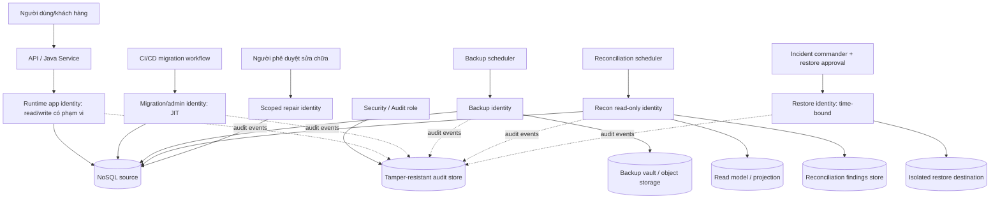
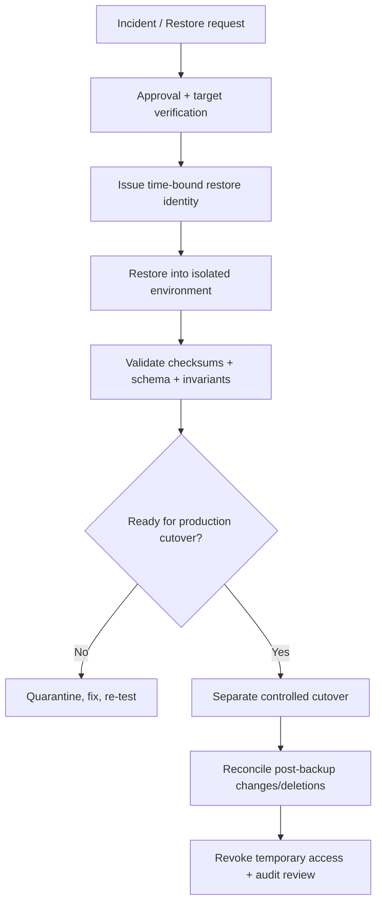

# Tách quyền ứng dụng, quản trị, sao lưu và đối soát

## 1. Một tài khoản database có thể làm tất cả: tiện hôm nay, rủi ro ngày mai

Giả sử một ứng dụng Java sử dụng MongoDB để lưu đơn hàng, Redis để cache, và một dịch vụ managed NoSQL để lưu trạng thái xử lý. Khi phát triển, đội kỹ thuật tạo một tài khoản `app_admin` có thể:

- Đọc và ghi mọi collection, table và key.
- Tạo/xóa index, thay đổi schema, quản lý tài khoản.
- Xóa database hoặc collection.
- Chạy sao lưu, xuất toàn bộ dữ liệu ra object storage.
- Phục hồi backup đè lên dữ liệu đang vận hành.
- Chạy đối soát và tự sửa các bản ghi sai lệch.

Ứng dụng Java, job backup hằng đêm và script đối soát cuối tuần đều dùng cùng credentials. Cấu hình này rất đơn giản, cho đến khi:

1. Một lỗi injection hoặc remote code execution cho phép kẻ tấn công dùng quyền của ứng dụng.
2. Một request xử lý sai gọi lệnh xóa nhầm trên toàn database.
3. Script đối soát có bug sửa hàng triệu bản ghi thay vì chỉ ghi nhận chênh lệch.
4. Backup archive bị chép ra tài khoản storage không thuộc tổ chức.
5. Một người vận hành dùng nhầm câu lệnh restore vào production.
6. Không thể xác định **ai** hoặc **quy trình nào** đã thay đổi dữ liệu vì mọi thao tác cùng một identity.

Một vấn đề cấu hình đã biến thành **một điểm thất bại về bảo mật và khả năng vận hành**.

Cách tiếp cận an toàn hơn là tạo những **danh tính, quyền, credential, luồng phê duyệt và nhật ký kiểm toán riêng** cho từng mục đích. Đây là nội dung trọng tâm của bài **“Tách quyền ứng dụng, quản trị, sao lưu và đối soát”** thuộc chương **Bảo mật dữ liệu**, module **Database No SQL**.

> **Nguyên tắc:** Quyền cần được cấp theo hành động tối thiểu, tài nguyên tối thiểu và thời hạn tối thiểu. Một thành phần có thể **quan sát** dữ liệu để phát hiện sai lệch không vì thế được quyền **thay đổi** dữ liệu; một dịch vụ có thể **tạo backup** không tự nhiên cần quyền **restore đè production**.

### Mục tiêu học tập

Sau bài học, bạn có thể:

1. Giải thích **least privilege**, **separation of duties (SoD)**, **blast radius**, **default deny**, **just-in-time access** và **break-glass**.
2. Xác định quyền tối thiểu cho **runtime app**, **migration/admin**, **backup**, **restore**, **reconciliation reader** và **repair executor**.
3. Phân biệt database RBAC, IAM/ABAC, resource policies, network policies và encryption/KMS permissions.
4. Biết tại sao bảo vệ tài khoản ứng dụng bằng role chỉ đọc/ghi đúng phạm vi là khác với xác thực người dùng cuối.
5. Thiết kế tách danh tính khi dùng MongoDB, DynamoDB/AWS IAM, Cassandra và Redis ACL.
6. Hiểu sự khác nhau giữa sao lưu logic/physical, snapshot/PITR, export, copy, restore và quyền giải mã.
7. Biết đối soát cần những quyền đọc gì và vì sao thao tác **sửa dữ liệu** phải là một luồng được phê duyệt riêng.
8. Thiết kế secrets rotation, workload identity, network boundary, MFA/PAM/JIT và audit logs.
9. Viết Java application dùng credentials phù hợp mà không nhúng quyền admin vào source code.
10. Kiểm chứng policies bằng **positive/negative authorization tests** và phục hồi thử nghiệm.
11. Xử lý sự cố lộ credentials, xóa dữ liệu hoặc sai lệch dữ liệu mà không mở rộng quyền tùy tiện.
12. Lập ma trận roles, checklist triển khai và kế hoạch chuyển đổi từ tài khoản dùng chung.

## 2. Bốn nhiệm vụ, bốn vùng rủi ro

Hãy hình dung một nền tảng thương mại điện tử có dữ liệu:

```text
orders            nguồn đơn hàng
payments          trạng thái thanh toán
inventory         tồn kho theo SKU
order_search      projection phục vụ tìm kiếm
reconciliation    kết quả kiểm tra chênh lệch
backups           snapshot/archive và metadata
```

Mỗi loại công việc cần tác động khác nhau:

| Vai trò | Nhu cầu chính | Không nên có mặc định |
|---|---|---|
| **Ứng dụng runtime** | Đọc/ghi đúng dữ liệu mà API phục vụ | Quản lý users, thay schema, backup/export toàn bộ, xóa database |
| **Quản trị/migration** | Thay cấu hình, indexes/schema, users/roles theo thay đổi có kiểm soát | Credentials nằm trong runtime app, chạy mọi lúc |
| **Sao lưu** | Đọc/snapshot đúng dữ liệu và lưu backup đã mã hóa | Sửa dữ liệu nguồn, restore đè production, chia sẻ archive công khai |
| **Đối soát** | Đọc trạng thái nguồn/đích, tính chênh lệch, ghi kết quả phân tích vào vùng riêng | Tự sửa nguồn/đích hoặc cấp quyền DB |
| **Khôi phục** | Restore dữ liệu vào đích được cấp phép khi có sự cố | Restore production tùy ý, xóa backup, quản trị IAM |
| **Sửa sai lệch** | Áp những sửa đổi cụ thể đã phê duyệt | Full admin, bulk write không giới hạn, bỏ qua CAS/version |
| **Kiểm toán/security** | Xem audit logs, permissions, change history | Sửa/xóa audit log hoặc dữ liệu kinh doanh |

**Tách quyền** không nhất thiết nghĩa mỗi vai trò chỉ có một câu lệnh. Nghĩa là không cấp một nhóm quyền mạnh **chỉ vì thuận tiện**, và không để một identity có thể tự thực hiện trọn vẹn một hành động rủi ro khi cần kiểm soát độc lập.

## 3. Sơ đồ kiến trúc tách danh tính



Trong sơ đồ, luồng restore mặc định hướng vào **môi trường cô lập**. Một bước cutover hoặc restore trực tiếp vào production phải có quyền và phê duyệt riêng, không phải hậu quả tự động của việc có backup.

### 3.1. Thêm identity chứ không chỉ thêm biến môi trường

Đổi `DB_ADMIN_USER` thành `DB_BACKUP_USER` trong file cấu hình **không tạo separation** nếu cả hai user cùng role admin hoặc cùng dùng một secret trên mọi service.

Tách quyền thực sự đòi hỏi:

- Identity riêng.
- Quyền database/IAM riêng.
- Credential issuer và lifetime phù hợp.
- Deployment/run target riêng khi cần.
- Network/secret accessibility khác nhau.
- Audit trail có principal và hành động rõ.
- Quá trình nâng quyền được kiểm soát.

### 3.2. Không dùng role tên “readOnly” làm bằng chứng

Một role custom tên `readOnly` vẫn có thể chứa `delete` hoặc `export`. Security review phải xem **effective permissions** sau khi cộng tất cả trực tiếp/gián tiếp roles, resource policies và permission boundaries.

### 3.3. Phân biệt control plane và data plane

- **Data plane:** get/query/insert/update/conditional write dữ liệu nghiệp vụ.
- **Control plane:** tạo database/table, sửa index, đổi policy, quản trị backup/PITR, xóa tài nguyên, cấu hình replication, tạo users.

Một ứng dụng cần `Query` trên table `orders` không vì thế cần `CreateTable` hoặc `DeleteTable`. Nhưng một số managed operations/backup APIs không chia rạch ròi hoàn toàn; phải đối chiếu **từng action** và quyền tài nguyên trên nền tảng thực tế.

## 4. Least privilege và separation of duties khác nhau thế nào?

### 4.1. Least privilege

Chỉ cấp quyền cần thiết cho **công việc cụ thể**:

```text
Order API:
  can GetItem(order)
  can PutItem(order) with conditions
  cannot DeleteTable
  cannot CreateBackup
  cannot Modify IAM
```

### 4.2. Separation of duties

Chia trách nhiệm giữa các identities hoặc người phê duyệt để một actor không thể **tự thực hiện đầy đủ** một hành động rủi ro:

```text
Person A đề xuất restore
Person B phê duyệt môi trường/đích
Restore job chỉ dùng role tạm trong maintenance window
Audit principal độc lập ghi lại kết quả
```

Least privilege là **độ hẹp quyền**, SoD là **cách phân chia khả năng và trách nhiệm**. Hai nguyên tắc bổ trợ nhau.

### 4.3. Phân tách ở những lớp nào?

1. **Con người:** developer, DBA, SRE, security, auditor, incident commander.
2. **Workload:** API, migrator, backup job, recon worker, repair worker.
3. **Identity:** service account, IAM role, database principal, workload federation.
4. **Tài nguyên:** DB/table/collection/index/namespace/bucket/key/tenant.
5. **Hành động:** read/write/delete/schema/export/backup/restore/grant.
6. **Thời gian:** cấp quyền trong một khoảng cần thiết.
7. **Môi trường:** dev/staging/production tách biệt.
8. **Mạng:** đường kết nối/endpoint/trust boundary.
9. **Audit:** quyền quan sát khác với quyền xóa sửa log.

### 4.4. Tại sao cần nhiều lớp?

Một NoSQL role chỉ đọc đúng collection nhưng network endpoint bị công khai và credential bị lộ vẫn có rủi ro. Một IAM role cho phép `RestoreTableFromBackup` nhưng không có quyền với KMS key có thể không phục hồi được backup mã hóa. Một policy mạnh ở database không bù được việc S3 backup bucket bị public.

## 5. Threat model: điều gì xảy ra khi một thành phần bị chiếm quyền?

Thiết kế theo kịch bản **assume breach**: giả định một credential hoặc service bị lộ, xem attacker có thể làm gì.

| Credential bị lộ | Với quyền tách đúng | Với quyền admin dùng chung |
|---|---|---|
| Runtime API | Đọc/ghi tập dữ liệu API được cấp, bị app/server validation hạn chế thêm | Xóa database, export toàn bộ, cấp quyền mới |
| Backup worker | Tạo/copy backup tới vault được phép, trong giới hạn service/IAM | Khôi phục đè, xóa nguồn/backup, chỉnh users |
| Reconciliation reader | Đọc những views cho phép, ghi findings ở store riêng | Sửa/rollback dữ liệu nguồn |
| Migration job | DDL đúng resource/window được cấp | Tồn tại quyền admin vĩnh viễn trong service |
| Repair executor | Sửa tập IDs có phê duyệt + CAS | Bulk update/delete tùy ý |
| Restore worker | Khôi phục tới destination được duyệt | Overwrite production theo ý muốn |
| Audit viewer | Xem records đã lọc theo policy | Sửa/xóa bằng chứng |

**Giảm blast radius** không có nghĩa credential ứng dụng bị lộ là vô hại. Nếu runtime phải đọc tất cả hồ sơ khách hàng thì read privilege ấy vẫn là rủi ro đáng kể. Cần thêm tenant authorization, minimization, network rules, egress control, alerting và rate limits.

### 5.1. App-level authorization khác DB role

Database principal của app có thể có quyền đọc collection `orders`. Nhưng khách A chỉ được đọc order của khách A. Đây là quy tắc **authorization của ứng dụng** hoặc DB row/tenant policy nếu engine hỗ trợ, không tự xảy ra chỉ vì role có `find` trên collection.

### 5.2. Mọi lệnh bảo mật đều có dependency

Để chặn exfiltration cần xem cả:

- API database permissions.
- API có thể export/scan hàng loạt không.
- Secrets của bucket/backup có đọc được từ runtime không.
- Egress network tới Internet.
- Audit/traffic anomaly detection.
- Tenant scoping.
- Client identity và token handling.

Không chỉ kiểm bảng role rồi kết luận dữ liệu được bảo vệ hoàn toàn.

## 6. Thiết kế danh tính ứng dụng runtime

Một Java API thường cần đọc/ghi theo những access patterns xác định.

Ví dụ:

```text
OrderService runtime:
  read orders by tenant + order ID
  create order if absent
  conditionally update state
  write outbox event as part of transaction (nếu kiến trúc hỗ trợ)
  NOT create/delete index
  NOT drop collection/table
  NOT list all databases
  NOT create DB user
  NOT backup/restore
  NOT read payroll/audit/backups
```

### 6.1. Không gộp mọi microservice vào một DB identity

`order-service`, `inventory-service` và `notification-service` có access patterns khác nhau. Nếu cả ba dùng `shared-app-user` với toàn bộ quyền, chiếm một service có thể truy cập dữ liệu của tất cả.

### 6.2. Bảo vệ theo resource thực

Có thể tách:

- Database/schema.
- Collection/table.
- Keyspace.
- Key prefix.
- IAM resource ARN.
- Tenant/partition key conditions nếu engine hỗ trợ chính xác.
- Index/resource policies.
- Read/write operations.

Không phải mọi NoSQL engine hỗ trợ row-level permissions giống nhau. Nếu service bắt buộc có quyền rộng ở DB, application authorization và kiểm thử cô lập tenant càng quan trọng.

### 6.3. Thêm operations chỉ khi use case cần

Nếu API chỉ thực hiện read và conditional update, không cần `delete`. Nếu một feature mới cần delete order, thay đổi policy phải trải qua review thay vì dùng sẵn quyền delete từ ngày đầu.

### 6.4. Phân biệt startup dependencies

Một anti-pattern là ứng dụng **tự tạo table/index** khi startup bằng admin role. Về lâu dài nên tách:

```text
Deployment/migration job: create/update schema/index
Application: verify required schema is ready, then serve
```

Nếu index thiếu, runtime có thể fail readiness hoặc báo deployment blocker, **không âm thầm xin full admin**.

### 6.5. Không cấp read trên backups cho runtime

Backup chứa khối dữ liệu lớn hơn response của một request, có thể gồm deleted/revoked data theo retention. API thông thường không cần đọc backup vault/object storage.

## 7. Quản trị và migration cần identity riêng

Quản trị có thể gồm:

- Tạo/sửa users/roles.
- Tạo/sửa database, collections/tables/indexes.
- Thay replication/cluster settings.
- Thực hiện schema migration.
- Quản lý backup retention/PITR.
- Khôi phục dữ liệu.
- Thay KMS key policies và network settings.

**Không nên gom tất cả các chức năng này vào một “admin job” duy nhất** khi hệ lớn hoặc dữ liệu quan trọng.

### 7.1. DBA không nhất thiết là security administrator

DBA có thể cần tối ưu index và vận hành cluster nhưng **không** cần khả năng tự cấp quyền truy cập dữ liệu nhạy cảm cho một user khác. IAM/security admin có thể quản lý grants mà không cần đọc toàn bộ business records, tùy engine/service support.

### 7.2. Migration ≠ quản trị tài khoản

Job tạo index `orders_by_customer` có thể chỉ cần quyền createIndex trên đúng collection. Không cần `grantRole` hoặc `dropDatabase`.

### 7.3. Chạy theo deployment

Cấp cho migration job một identity riêng khi triển khai release:

```text
CI/CD release gate
  -> approved migration plan
  -> short-lived migration credentials
  -> apply index/schema changes
  -> validate readiness
  -> revoke/expire elevated access
  -> app resumes/serves
```

### 7.4. Ưu tiên JIT/PAM

**Just-in-time** cho phép mở quyền quản trị trong khoảng thời gian hữu hạn với lý do, approval, MFA và audit. Nó giảm rủi ro một credential mạnh nằm bất động trong config nhiều tháng.

### 7.5. Cấm sử dụng lại admin credential trong API

Đừng copy secret `admin-prod` vào Kubernetes Secret của runtime chỉ vì migration từng được gọi từ startup hook. Deployment có thể tách thành hai workloads với roles riêng.

### 7.6. “Không có quyền” phải là kết quả kỳ vọng

Nếu ứng dụng gọi `createIndex` hoặc `dropDatabase` và nhận `Unauthorized`, đó có thể là **bằng chứng policy đúng**, không phải lý do cấp admin cho app. Sửa kiến trúc để thao tác thuộc migration job được phê duyệt.

## 8. Phân biệt backup, export, snapshot, restore và recovery

Một số quyền tên giống nhau nhưng hậu quả rất khác.

| Thao tác | Mục đích | Rủi ro chính |
|---|---|---|
| **Snapshot/backup** | Lưu trạng thái khôi phục | Lộ toàn bộ dataset, retention/quota |
| **PITR** | Khôi phục tới một thời điểm | Yêu cầu log/retention/permissions đúng |
| **Export** | Chép dữ liệu sang format/hệ khác | Exfiltration/PII, query overhead |
| **Copy backup cross-account/region** | DR, tách failure domain | KMS/key/bucket policies, cross-border |
| **Restore** | Tạo lại dữ liệu ở đích | Overwrite, stale resurrect, privilege escalation |
| **Delete backup** | Dọn theo retention | Phá khả năng recovery |
| **Modify backup retention** | Thay thời gian giữ | Compliance/DR capability |
| **Decrypt backup** | Đọc được nội dung backup | Quyền truy cập dữ liệu cực lớn |
| **Validate restore** | Thử khả năng phục hồi | Cần sandbox, scan data an toàn |

### 8.1. Backup identity không nên là restore identity

Một job chạy mỗi đêm chỉ cần tạo backup. Nếu account ấy cũng có quyền restore vào production, một secret bị lộ có thể phá dữ liệu đang chạy.

### 8.2. Backup không phải một bản sao mà ai cũng được đọc

Archive có thể chứa thông tin đã xóa khỏi online DB theo policy, transaction history hoặc fields không hiển thị qua API. Cần encryption, RBAC, audit và retention riêng.

### 8.3. Quyền tạo backup có thể ngầm cho khả năng đọc hàng loạt

Trong nhiều hệ, tạo logical dump đòi đọc dữ liệu rộng. Với managed snapshot API, quyền thực thi backup có thể khác quyền `Scan` trên table. Dù vậy, actor tạo backup có thể kiểm soát **đích chứa** hoặc shares, vì thế phải hạn chế tài nguyên và export destinations để tránh exfiltration.

### 8.4. Quyền restore có thể cấp quyền truy cập gián tiếp

Nếu actor được restore backup sang account hoặc region do mình kiểm soát, họ có thể đọc dữ liệu ở bản khôi phục. Do đó chỉ giới hạn “không được đọc production table” là **chưa đủ** nếu họ được tạo bản clone ở nơi tùy ý.

### 8.5. Không gộp chức năng xóa backup vào backup writer

Backup job thường không cần delete snapshots theo ý mình. Retention lifecycle có thể do policy/vault quản lý; một role quản trị retention riêng có approval khi có nhu cầu thật.

## 9. Sao lưu logic và sao lưu managed snapshot cần quyền khác nhau

### 9.1. Logic backup

Ví dụ một chương trình export documents:

```text
SELECT/Find/Scan records
  -> serialize
  -> encrypt
  -> write object storage
```

Nó cần quyền đọc phạm vi dữ liệu sao lưu, quyền ghi đúng prefix/bucket/vault, quyền dùng KMS key nếu cần, và network route. Không nên có quyền sửa records nguồn.

### 9.2. Managed snapshot

Một cloud service có thể tạo snapshot ở control plane mà không cần application quyền đọc từng item. Backup role cần đúng API/service permissions (và KMS/vault settings khi thích hợp); **không tự cấp Scan/GetItem** nếu không cần.

### 9.3. Cluster/physical backup

Một số engine cần quyền đọc metadata, transaction log, snapshot/replica state, filesystem hoặc cloud disk snapshot. Phải cấp quyền **cho đúng backup mechanism**, không dùng một policy chung của logical export.

### 9.4. Consistency của backup là một yêu cầu riêng

Có đủ quyền backup không có nghĩa snapshot nhất quán qua nhiều shards/tables. Cần kiểm point-in-time consistency, transaction log/PITR, cutover và restore correctness theo engine.

### 9.5. Backup key và database key

Backup có thể dùng KMS key riêng để giảm blast radius:

```text
Source DB encryption key: K_db
Backup vault encryption key: K_backup
DR replica key: K_dr
```

Không bắt buộc mọi môi trường đều dùng ba keys khác nhau, nhưng phải thiết kế quyền `Encrypt`, `Decrypt`, `GenerateDataKey`, `CreateGrant`, rotation và cross-region copy theo API thực. **Một quyền KMS không tự cho phép mọi lệnh database**, và ngược lại.

### 9.6. Restore validation phải được diễn tập

Một backup tạo thành công nhưng không restore được vì thiếu KMS key, schema metadata hoặc WAL/changelog thì không đáp ứng mục tiêu DR. Cần thử phục hồi vào sandbox với identity riêng.

## 10. Đối soát: đọc để phát hiện sai khác, không tự sửa

Đối soát (*reconciliation*) là quá trình so sánh hai hoặc nhiều nguồn trạng thái và xác định sai lệch cần xử lý.

Ví dụ:

```text
NoSQL authoritative orders
      |
      v
  Recon reader --------> Findings store
      ^
      |
Search projection / warehouse
```

Nhiều lỗi xảy ra khi script “đối soát” được cho phép cập nhật source và target trong cùng hàm.

### 10.1. Một tác vụ đối soát gồm hai pha khác nhau

**Pha A — Detect (đọc và báo cáo):**

- Đọc source và target trong phạm vi cần thiết.
- Lấy watermark/version/snapshot cutoff.
- So số lượng, checksum hoặc business fields.
- Tạo finding với provenance.
- Không sửa source/target.

**Pha B — Repair (được phép và kiểm soát):**

- Người hoặc policy phê duyệt từng loại sửa.
- Repair executor có role riêng.
- Recheck authoritative state tại thời điểm sửa.
- Áp CAS/conditional write và idempotency.
- Audit before/after ở mức an toàn.
- Verify postcondition; nếu thất bại thì dừng/escalate.

### 10.2. “Read-only” vẫn có thể gây hại

Một actor đọc được toàn bộ PII vẫn có quyền truy xuất nhạy cảm. Ngoài ra, scan lớn có thể làm ảnh hưởng throughput, cache và latency của production.

Cần giới hạn:

- Datasets, fields và tenants.
- Query/scan throughput.
- Time window.
- Parallelism/pagination.
- Rate limits.
- Nơi xuất findings.
- Retention của kết quả đối soát.

### 10.3. Source of truth quan trọng hơn “bên nào mới”

Không được thấy target khác source rồi tự lấy target ghi đè source. Đôi khi target có dữ liệu mới hơn vì replication/CDC lag; đôi khi source là authority. Cần kiến trúc mô tả direction và consistency contract.

### 10.4. Findings là dữ liệu riêng, không phải quyền mutate

Một finding:

```json
{
  "findingId": "diff-203",
  "entityRef": "order:O42",
  "sourceVersion": 19,
  "targetVersion": 17,
  "differenceType": "STALE_TARGET",
  "detectedAt": "2026-11-14T10:00:00Z",
  "sourceWatermark": "opaque",
  "resolutionStatus": "OPEN"
}
```

Recon reader có thể được phép ghi vào `reconciliation_findings`, nhưng **không** cần quyền `update` trên `orders` hoặc `order_search`. Findings phải bảo vệ PII/tenant scope, không dump toàn bộ bản ghi.

### 10.5. Đối soát và replay

Khi phát hiện target stale, recovery có thể là reprocess event, rebuild projection, hoặc targeted write. Mỗi hành động thuộc một quyền riêng và yêu cầu dedup/version checking.

## 11. Một ma trận quyền tham khảo

Bảng minh họa quyền tối thiểu, không phải policy chạy được cho mọi NoSQL engine.

| Quyền / Tác vụ | App runtime | Migration | Backup | Recon reader | Repair | Restore |
|---|:---:|:---:|:---:|:---:|:---:|:---:|
| Read đúng collections/tables | Có | Khi cần | Tùy backup method | Có, giới hạn | Có, để CAS | Khi verify |
| Conditional insert/update business | Có | Khi cần migration | Không | Không | Có, giới hạn | Không mặc định |
| Bulk write không giới hạn | Không | Chỉ khi phê duyệt | Không | Không | Không mặc định | Không |
| Delete business record | Theo use case | Theo migration | Không | Không | Theo approved plan | Không |
| Create/drop index/schema | Không | Có phạm vi | Không | Không | Không | Theo restore workflow |
| Create/grant database roles | Không | Không mặc định | Không | Không | Không | Không |
| Export/backup toàn dataset | Không | Không | Có | Không | Không | Không |
| Read backup archive | Không | Không | Chỉ theo mechanism | Không | Không | Có khi cần |
| Restore vào isolated target | Không | Không | Không | Không | Không | Có |
| Overwrite production | Không | Không | Không | Không | Không | JIT + approvals đặc biệt |
| Delete backups/vault | Không | Không | Không | Không | Không | Không |
| Write findings store | Không | Không | Không | Có | Có, outcome | Không |
| Apply repair plan | Không | Không | Không | Không | Có | Không |
| View audit logs | Theo phạm vi | Theo phạm vi | Theo phạm vi | Có thể | Có thể | Có thể |
| Modify/delete audit logs | Không | Không | Không | Không | Không | Không |

### 11.1. “App runtime có write” không có nghĩa toàn DB

Ứng dụng Order Service có thể có write vào `orders` và `order_outbox`, nhưng không có `payments`, `identity_credentials` hoặc `security_audit`.

### 11.2. Roles theo service, environment và tenant khi cần

Không chỉ có 6 users cho toàn công ty. Có thể:

```text
order-api-prod
inventory-api-prod
orders-migrator-prod
orders-backup-prod
orders-reconciler-prod
orders-repair-prod
orders-restore-prod
```

Staging có identities khác, không dùng lại production secrets.

### 11.3. Không sao chép policy mù

Một số hệ cần rights trên database metadata hoặc auxiliary tables để một lệnh chạy được. Định nghĩa vai trò bằng **đường thực thi được kiểm chứng**, không đoán “read means find only” mà không thử đúng backup/client/driver/version.

## 12. Quyền ở database, cloud IAM và filesystem là các lớp khác nhau

Một tài khoản có thể có:

```text
Network path to DB
Database role: read on orders
IAM role: write to backup bucket
KMS key policy: decrypt backup key
Cluster/container filesystem permissions
Cloud control-plane permissions
```

Effective risk là tổng quyền và khả năng kết hợp các lớp, không chỉ tài khoản DB.

### 12.1. Deny theo default, allow theo task

- Không tạo account với `*:*` chỉ để ứng dụng chạy.
- Không dùng resource `*` khi API hỗ trợ scoping chặt hơn.
- Sử dụng explicit deny/boundary khi architecture yêu cầu kiểm soát mạnh.
- Cẩn thận policies hợp từ nhiều roles/groups.
- Phân biệt resource owner, cross-account trust và identity policies.

### 12.2. Network không thay authorization

Chỉ cho API kết nối database qua private subnet là tốt, nhưng nếu API credential có quyền admin, khi API bị compromise attacker có thể dùng quyền ấy trong mạng hợp lệ. Network segmentation hỗ trợ, không thay RBAC/IAM.

### 12.3. KMS không thay database authorization

Mã hóa dữ liệu lúc nghỉ bảo vệ media/backup theo threat model. Một ứng dụng đã được database cấp quyền đọc thường thấy dữ liệu đã được giải mã. KMS key policy không tự cấp row-level business permission.

### 12.4. Mọi bản sao dữ liệu đều cần kiểm soát

- Primary cluster.
- Read replicas.
- Materialized views/search index.
- Snapshot/PITR.
- Data lake exports.
- Reconciliation reports.
- Audit logs.
- Temp restore sandbox.
- Developer local data extracts.

Nếu account chỉ bị hạn chế trên primary nhưng warehouse bản sao public, policy thất bại.

## 13. Quy tắc cấp quyền theo vòng đời của credential

### 13.1. Workload identity tốt hơn secret cứng khi có thể

Trong môi trường hỗ trợ, dùng managed identity/IAM role/workload federation thay vì password/key được commit trong repository.

Ví dụ:

```text
Kubernetes service account
   -> workload identity
   -> cloud role (scoped)
   -> NoSQL/managed API
```

Ứng dụng được cấp credentials có hạn sử dụng theo trust policy, thay vì static key lưu vô thời hạn.

### 13.2. Secrets manager khi database bắt buộc password

Nếu engine dùng username/password:

- Lưu trong secret manager.
- Cấp quyền đọc secret chỉ cho workload cần.
- Rotate định kỳ hoặc khi incident.
- Có cơ chế rollout/connection refresh.
- Không log URI chứa password.
- Không copy backup/admin secret vào runtime.
- Có break-glass process rõ nếu secret service down.

### 13.3. Identity theo môi trường

`order-api-dev` không được có quyền tới production database. Dùng separate accounts/projects/tenants, secrets và endpoints. Cấu hình “environment=prod” chỉ là label, không thay permission boundary.

### 13.4. Rotation không chỉ thay string

Drivers giữ connection pools và sessions. Sau rotation, test client reconnect/new credentials, revoke old principals và quan sát errors. Không để old secret vẫn active nhiều tháng vì “sợ app downtime”.

### 13.5. Credentials backup khác credentials restore

Một backup job chạy tự động cần account có lifecycle riêng; restore là tác vụ hiếm, có phê duyệt và short-lived access, không để key trong scheduler.

## 14. Audit trail cần độc lập với người thực hiện thay đổi

Một audit event có thể là:

```json
{
  "time": "2026-11-14T11:00:00Z",
  "principal": "orders-repair-prod",
  "action": "UpdateOrderStatus",
  "resource": "orders/O42",
  "environment": "production",
  "approvalId": "change-2026-017",
  "operationId": "repair-550",
  "result": "COMMITTED",
  "beforeVersion": 19,
  "afterVersion": 20
}
```

### 14.1. Audit identity phải truy được về nguồn

Nên có principal, assumed role/session, workload, người yêu cầu, người phê duyệt, timestamp, source network/client context, resource và outcome. Không cần log raw PII đầy đủ.

### 14.2. Không cho actor tự xóa bằng chứng

Một repair job không nên có quyền xóa audit logs. Nếu actor có cả write business data và destroy audit history, security monitoring mất giá trị.

### 14.3. Audit storage cần tamper resistance

Có thể dùng cơ chế append-only/WORM/object lock, immutable retention hoặc log account riêng, tùy compliance và service capabilities. Phải phân quyền read, write, lifecycle, cryptographic access và retention.

### 14.4. Audit log không đồng nhất với application log

Operational logs có thể bị sampling/rate limiting để tối ưu chi phí. Các hành động nhạy cảm như restore, grant privilege và repair có thể yêu cầu audit trail bền vững, chống sửa và truy vấn độc lập.

### 14.5. Metadata cũng có thể nhạy cảm

Tenant ID, resource path, business status và correlation ID có thể tiết lộ thông tin. Audit needs và privacy policy phải cùng được xem xét.
## 15. MongoDB: custom roles theo collection và hành động

MongoDB cung cấp role-based access control (RBAC), với các **privileges** trên resource cụ thể như database/collection. Với production nên dùng phiên bản server/driver có authentication/TLS phù hợp, tạo users qua quy trình quản trị bảo mật riêng.

Ví dụ service xử lý đơn cần đọc, tạo và cập nhật `orders`, đồng thời ghi `outbox`; không được drop collection hoặc quản lý users.

### 15.1. Custom role của ứng dụng

Mã minh họa chạy trong ngữ cảnh quản trị được phép, **không được nhúng vào ứng dụng Java runtime**:

```javascript
use orders

db.createRole({
  role: "orderApiRuntime",
  privileges: [
    {
      resource: { db: "orders", collection: "orders" },
      actions: ["find", "insert", "update"]
    },
    {
      resource: { db: "orders", collection: "order_outbox" },
      actions: ["find", "insert", "update"]
    }
  ],
  roles: []
});
```

Role này không chứa `remove`, `dropCollection`, `createIndex`, `createUser` hoặc `grantRole`. Nó cũng không tự cấp quyền lên database khác.

**Lưu ý kỹ thuật:** Cú pháp/privilege action names là ví dụ MongoDB server roles; các hoạt động ứng dụng thực tế có thể cần quyền bổ sung do API/feature và phiên bản. Kiểm với đúng commands mà driver chạy, không tự thêm quyền quản trị khi gặp một lỗi authorization.

### 15.2. Role chỉ đọc cho đối soát

```javascript
use orders

db.createRole({
  role: "ordersReconReader",
  privileges: [
    {
      resource: { db: "orders", collection: "orders" },
      actions: ["find"]
    },
    {
      resource: {
        db: "orders",
        collection: "order_outbox"
      },
      actions: ["find"]
    }
  ],
  roles: []
});
```

Role đối soát đọc orders và outbox để so thứ tự/version nếu cần. Để ghi findings, có thể cấp quyền `insert` vào **collection findings riêng**, hoặc tốt hơn dùng một sink service/store được cô lập. Không cần write vào `orders`.

### 15.3. Role migration

Một job tạo index có thể cần `createIndex` trên collection được phê duyệt. Những migration phức tạp hơn có thể cần `collMod`, `createCollection` hoặc truy cập metadata. Hãy lập manifest lệnh migration và chỉ cấp privileges tương ứng **trong cửa sổ triển khai**.

Không dùng `root`/`dbOwner` cho mọi migration vì tiện.

### 15.4. Backup roles

MongoDB có các built-in roles dành cho `backup`/`restore` và roles quản trị khác, nhưng mức privileges và deployment compatibility phụ thuộc phiên bản/tính năng. Chúng **không nhất thiết chỉ đọc một collection**. Phải xem role definition/effective actions và so yêu cầu thực tế của `mongodump`, filesystem/Atlas backups hoặc managed snapshot.

Một backup cần nhiều collection/system metadata thì không được ép quyền xuống `find` đơn giản mà làm backup hỏng; nhưng cũng không cấp một credential `root` sống lâu trong backup container.

### 15.5. Quyền khôi phục không tự đồng nghĩa quyền sao lưu

`mongorestore` có thể cần quyền create/index/insert và các metadata operations tùy mode. Identity restore nên sử dụng ở môi trường đích riêng và chỉ sau approval. Một tài khoản backup nightly không cần restore trên production.

### 15.6. Kiểm deny thực tế

Với principal ứng dụng:

```text
ALLOW:
  find orders
  insert order
  update order

DENY:
  dropDatabase
  drop orders
  createUser
  grantRole
  createIndex
  read security_audit
```

Trong test, chạy lệnh deny trên **database test được cô lập** với user runtime thật; không gửi lệnh nguy hiểm tới production chỉ để chứng minh nó bị từ chối.

### 15.7. MongoDB role không thay per-tenant authorization

Một role có `find` trên toàn `orders` vẫn có thể đọc documents nhiều tenants. Các query phải scope `tenantId` và application authorization phải có test, hoặc dùng kiến trúc/tính năng cách ly dữ liệu phù hợp. Đừng coi collection-level permission là row-level protection.

## 16. AWS DynamoDB: IAM policy theo API và ARN

Với DynamoDB, quyền chủ yếu được kiểm soát ở tầng **AWS IAM** và các policies liên quan. Ví dụ một Java service chỉ cần `GetItem`, `Query`, `PutItem` và `UpdateItem` trên bảng `Orders`.

### 16.1. Identity-based policy mẫu, được giới hạn table

**Ví dụ minh họa**, không phải một permission set đã kiểm cho mọi SDK call:

```json
{
  "Version": "2012-10-17",
  "Statement": [
    {
      "Sid": "OrderRuntimeDataPlane",
      "Effect": "Allow",
      "Action": [
        "dynamodb:GetItem",
        "dynamodb:Query",
        "dynamodb:PutItem",
        "dynamodb:UpdateItem"
      ],
      "Resource": [
        "arn:aws:dynamodb:ap-southeast-1:123456789012:table/Orders",
        "arn:aws:dynamodb:ap-southeast-1:123456789012:table/Orders/index/ByTenant"
      ]
    }
  ]
}
```

Cần thay account, region, table/index theo tài nguyên thật và điều chỉnh index permissions theo access pattern. Nếu application sử dụng `TransactWriteItems`, permission evaluation có thể cần các item-level actions tương ứng trên mọi tables/items trong transaction. Đừng đoán chỉ một action tổng quát là đủ.

### 16.2. Những gì policy không cấp

Ví dụ trên **không cấp**:

```text
dynamodb:CreateTable
dynamodb:DeleteTable
dynamodb:UpdateTable
dynamodb:CreateBackup
dynamodb:DeleteBackup
dynamodb:RestoreTableFromBackup
iam:PassRole
kms:Decrypt on arbitrary keys
s3:PutObject to arbitrary buckets
```

Tuy vậy, effective permissions còn phụ thuộc mọi attached policies/assumed role policies, permission boundaries, SCPs/resource policies, session policies và explicit denies. Phải review **toàn bộ IAM context**.

### 16.3. Quyền CRUD trên bảng vẫn có thể quá rộng

Một service có `Query` trên `Orders` không mặc nhiên chỉ được đọc đơn hàng của tenant đang đăng nhập. IAM có condition keys như `dynamodb:LeadingKeys` trong các tình huống thích hợp, nhưng chỉ hoạt động khi **partition key design** và request semantics tương thích.

Ví dụ nếu partition key bằng `tenantId`, một policy tenant-isolated có thể dùng IAM principal tag hoặc session attribute để giới hạn leading key sau khi xác minh cách đánh giá condition. Nếu partition key lại là `orderId` toàn cục, điều kiện `LeadingKeys=tenantId` không tự bảo vệ được.

### 16.4. Lệnh `Scan` là quyền đáng cân nhắc

Một API chỉ nên đọc order theo key không cần `Scan` trên mọi rows. Backup/recon job có thể cần scan trong phạm vi phù hợp, nhưng phải kiểm throughput, trang dữ liệu, PII exposure và giới hạn tài nguyên.

### 16.5. Backup/restore trong managed service

Có nhiều cơ chế:

- DynamoDB on-demand backup/PITR APIs.
- AWS Backup plans/vaults/restore jobs.
- Export to S3.
- Cross-account/cross-region copy.

**Mỗi cơ chế có IAM actions, service roles, KMS grants và resource policies khác nhau.** Một role có thể tạo backup nhưng không có quyền đọc backup contents; một role export sang S3 có thể đưa dữ liệu ra ngoài nếu bucket/policy không được hạn chế.

Backup scheduler nên có permissions cho đúng backup plan/resource và vault, không có `DeleteTable` hay full `RestoreTableFromBackup` mặc định.

### 16.6. Java AWS SDK 2.x dùng credential provider chain

Ví dụ:

```java
import software.amazon.awssdk.auth.credentials
    .DefaultCredentialsProvider;
import software.amazon.awssdk.regions.Region;
import software.amazon.awssdk.services.dynamodb
    .DynamoDbClient;

public final class DynamoClients {
    public static DynamoDbClient newRuntimeClient() {
        return DynamoDbClient.builder()
            .region(Region.AP_SOUTHEAST_1)
            .credentialsProvider(
                DefaultCredentialsProvider.create()
            )
            .build();
    }
}
```

Trong Java thật, import lines không thể ngắt giữa package/type như cách xuống dòng trình bày; đặt mỗi `import` trên một dòng hợp lệ:

```java
import software.amazon.awssdk.auth.credentials.DefaultCredentialsProvider;
import software.amazon.awssdk.regions.Region;
import software.amazon.awssdk.services.dynamodb.DynamoDbClient;

DynamoDbClient client = DynamoDbClient.builder()
    .region(Region.AP_SOUTHEAST_1)
    .credentialsProvider(DefaultCredentialsProvider.create())
    .build();
```

Credential provider chain hỗ trợ workload roles/configured sources, nhưng **không tự đảm bảo role đang dùng là role ít quyền**. Việc gắn IAM role cho workload và kiểm không dùng local profile/admin credentials ở production là một nhiệm vụ triển khai.

### 16.7. IAM test phải dùng đúng principal

Một unit test dùng SDK client với quyền developer admin có thể chạy dù runtime role production bị deny. Integration/staging authorization tests phải **assume đúng role** mà application/job sẽ sử dụng và xác nhận cả Allow lẫn Deny.

## 17. Apache Cassandra: quyền theo keyspace và table

Trong Cassandra CQL, truy cập có thể dùng role-based authentication/authorization theo cấu hình cluster. Các permissions thường thấy gồm `SELECT`, `MODIFY`, `CREATE`, `ALTER`, `DROP`, `AUTHORIZE` tùy resource/version.

### 17.1. Role cho ứng dụng runtime

Giả sử role `orders_api` được tạo bằng quy trình quản trị (password/secret được cấp riêng):

```sql
GRANT SELECT ON TABLE orders.orders_by_customer
TO orders_api;

GRANT MODIFY ON TABLE orders.orders_by_customer
TO orders_api;
```

### 17.2. Cảnh báo lớn: `MODIFY` không giống chỉ `UPDATE`

Ở Cassandra, quyền `MODIFY` trên table nói chung cho phép các thao tác thay đổi dữ liệu như insert/update/delete tùy phiên bản/feature; nó **không phải quyền chỉ update một field**.

Nếu business API chỉ muốn “không bao giờ delete”, Cassandra table-level privilege có thể **không đủ** để diễn tả điều đó. Cần:

- Cách ly table/mutation routes.
- Service-side authorization.
- Conditional updates/validation.
- Application protocol và integration tests.
- Audit/alert cho delete operations.
- Data model không phơi bày destructive path không cần thiết.

Không hứa granular row/column ACL nếu engine không hỗ trợ theo cách bạn cần.

### 17.3. Role đối soát chỉ đọc

```sql
GRANT SELECT ON TABLE orders.orders_by_customer
TO orders_recon_reader;
```

Role đối soát không cần `MODIFY`, `ALTER` hay `AUTHORIZE`. Nếu cần đọc nhiều keyspaces, cấp từng table cần thiết theo inventory.

### 17.4. Schema/migration role

Lệnh `ALTER TABLE`, `CREATE TABLE`, `CREATE INDEX` và changes ở keyspace cần các rights phù hợp. Tách khỏi API runtime và gắn vào release workflow.

### 17.5. Quyền quản trị cluster/file backup không đồng nhất với CQL grants

Sao lưu SSTables/snapshots/commit logs có thể phụ thuộc OS/filesystem/cluster management privileges, không chỉ `SELECT` trên table. Ai đọc được snapshot files có thể đọc dữ liệu thô mà không qua CQL authorization; phải bảo vệ storage/volume/object archive và encryption keys.

### 17.6. Driver Java giữ đúng identity

Dùng credentials hoặc authentication provider từ secret manager/workload setup. Không đặt `orders_admin` user/password trong code example ứng dụng để tránh “tạm cho chạy” rồi triển khai luôn.

### 17.7. Multi-DC và node configuration

Một role đúng trên CQL không thay network security, TLS, internode encryption, replication và audit. Xác nhận auth enabled thực sự trên cluster; nếu môi trường test tắt auth, tests chỉ kiểm query semantics chứ không chứng minh permission separation.

## 18. Redis ACL: command categories và key patterns

Redis cung cấp Access Control Lists để giới hạn commands/key patterns theo từng user (tùy Redis version và deployment). Một API dùng Redis cho cache không cần quyền `CONFIG`, `FLUSHALL`, `ACL SETUSER` hoặc `EVAL` nếu không chạy script.

### 18.1. Quyền runtime mẫu

Ví dụ **chỉ minh họa rule commands**, cần provision password/credential bằng cơ chế bảo mật riêng và kiểm deployment/version:

```text
ACL SETUSER orders_api on -@all ~orders:cache:* +get +set +expire +ttl
```

- `-@all`: bắt đầu từ tập command permissions rỗng.
- `~orders:cache:*`: key pattern được phép.
- `+get +set +expire +ttl`: chỉ bật commands cần.
- Chưa có credentials trong ví dụ: **không dùng user này như một cấu hình production hoàn chỉnh**; cần password/credential/key policy và hardening phù hợp.
- Permission evaluation đối với mỗi command, subcommand và key pattern cần thử trong Redis version đang dùng.

### 18.2. Không cấp `+@all` vì một lệnh mới

Một command category như `+@write` hoặc `+@admin` có thể bao gồm nhiều operations hơn ý định. Cần review command list, subcommands và key pattern semantics. Nếu chỉ cần cache read, có thể chỉ `+get` trên namespace.

### 18.3. Redis không phải backup authorization cho RDB/AOF theo key prefix

Backup kiểu RDB/AOF snapshots có thể liên quan quyền server/OS/config/storage; không thể nghĩ “ACL key pattern chỉ orders” thì bản physical snapshot chỉ chứa orders. Backup archive cần quyền/đích và encryption riêng.

### 18.4. Reconciliation của Redis cache

Một recon worker thường đọc source-of-truth và so với cache; nó có thể cần `GET`/`MGET` trên namespace. Không nên cấp `FLUSHDB` hoặc `KEYS *` để dễ “dọn” hoặc scan toàn keyspace trên production mà không đánh giá performance và ACL scope.

### 18.5. Redis Cluster, scripts và permissions

Một Lua script có thể thao tác nhiều keys và commands. ACL command/key restrictions vẫn cần xét; cấp `+eval` có thể mở rộng khả năng hơn dự kiến. Redis Cluster còn có hash-slot constraints và topology permissions. Kiểm bằng exact scripts/client requests, không chỉ đọc rule.

### 18.6. Namespace không tự là tenant security boundary

Nếu nhiều tenants cùng chia Redis instance và ACL key pattern không phân biệt được tenant một cách tin cậy, một API service bị compromise có thể truy cập cache của nhiều tenants. Thiết kế key prefix, user mapping, isolation và app authorization phù hợp; không coi prefix là thay thế cho strong tenant isolation khi threat model đòi hỏi.

## 19. Search/read model và log stores cũng cần role riêng

Một mô hình phổ biến:

```text
Source NoSQL orders
   -> Outbox/CDC
      -> Kafka
         -> Search projector
            -> OpenSearch/Elasticsearch
         -> BI warehouse
            -> Analytics read API
```

### 19.1. Search writer

Projector chỉ cần tạo/cập nhật/xóa documents trong **target index/alias có phạm vi**. Không tự cần tạo cluster-wide users, xóa mọi indexes hoặc đọc source secrets.

### 19.2. Search reader

API tìm kiếm có thể chỉ cần query index, không có quyền reindex/delete/index management. Một search API có query capability vẫn phải kiểm field-level/tenant visibility.

### 19.3. Reindex/migration operator

Một index rebuild job có thể cần create index, write new index, manage alias cutover. Đây là **nhiệm vụ migration riêng**, không nên dùng credential search API.

### 19.4. Recon reader

Có thể cần đọc source và read target, ghi finding. Nó **không** cần mutate target. Repair/rebuild job có quyền riêng để cập nhật index theo source version.

### 19.5. Logs và traces

Không cho app có quyền `delete` audit logs hoặc toàn log index. Application nên chỉ có quyền **emit** telemetry qua collector hoặc append-only endpoint, không quản trị retention, delete records hoặc đọc log của services khác.

## 20. Java service: injection đúng secret và bảo vệ vòng đời client

Ví dụ một ứng dụng MongoDB có thể tạo client từ environment được cấp bởi secret manager hoặc deployment, **không hard-code credentials**:

```java
import com.mongodb.client.MongoClient;
import com.mongodb.client.MongoClients;

public final class RuntimeMongoClientFactory {
    public static MongoClient create() {
        String uri = System.getenv("ORDERS_MONGO_URI");

        if (uri == null || uri.isBlank()) {
            throw new IllegalStateException(
                "Orders MongoDB credentials are not configured"
            );
        }

        // Không log uri: có thể chứa username/password.
        return MongoClients.create(uri);
    }
}
```

### 20.1. Environment variable không tự là secret manager

Environment variables có thể bị lộ qua debug dump, process inspection, deployment metadata hoặc các tools khác, tùy nền tảng. Cần controls về ai được đọc config, nơi logs gửi tới, runtime secret mounting và rotation.

### 20.2. Cấu hình fail closed

Nếu thiếu `ORDERS_MONGO_URI`, không fallback sang `MONGO_ADMIN_URI` hay một development superuser để ứng dụng khởi động. Fail readiness/deployment và báo lỗi không lộ credentials.

### 20.3. Không tạo client cho mỗi request

Một DB client có connection pool và lifecycle. Khởi tạo theo application dependency injection, đóng khi shutdown. Khi rotate credentials, vận hành cần chiến lược refresh/recreate clients.

### 20.4. Không “nâng quyền khi gặp Unauthorized”

Nếu runtime gặp `Unauthorized` do cố tạo index, không tự đọc admin secret hoặc assume admin role. Sửa deployment/migration contract hoặc permissions đúng resource.

### 20.5. Tách runtime và jobs trong codebase

Cùng codebase có thể chứa:

```text
OrderApplication
OrdersMigrationCommand
OrdersBackupWorker
OrdersReconReader
OrdersRepairExecutor
OrdersRestoreCommand
```

Nhưng mỗi entrypoint chạy bằng **service account khác**, được deploy riêng và được cấp secrets/roles khác. Không quan trọng chúng có chia sẻ Java library nếu privilege boundaries vẫn thực.

## 21. Đối soát an toàn: consistency và quyền đọc

So sánh hai databases có độ trễ đồng bộ khác nhau dễ tạo false positives.

Ví dụ:

```text
Source order.version = 20
Search order.version = 19
CDC lag = 15 seconds
```

Không phải cứ khác version là target hỏng. Phải hiểu freshness SLA và source watermark.

### 21.1. So cùng mốc thời gian/offset

Một recon worker nên xác định snapshot/cutoff hoặc watermark. Nếu source luôn thay đổi khi đang scan, việc so record đọc lúc 10:00 với target lúc 10:05 có thể tạo chênh lệch giả.

### 21.2. Bounded scans

Không quét toàn bộ 100 triệu items vào peak traffic chỉ để tìm một khác biệt. Có thể:

- Partition/range incremental checks.
- CDC/event-driven reconciliation.
- Sampling theo độ rủi ro.
- Periodic full audit ngoài giờ.
- Checksums và manifest/version comparisons.
- Server-side efficient queries/indexes.
- Rate limiting/capacity reservations.

### 21.3. Recon reader không cần đọc fields thừa

Nếu kiểm index completeness chỉ cần IDs, source versions và deletion markers, đừng yêu cầu full customer email/phone/payment details. Một projection/secure view giảm phơi lộ dữ liệu.

### 21.4. Đọc dữ liệu nhạy cảm vẫn cần log

Quan sát recon read volumes, export destinations, principal, source/target datasets và unusual scans. Bản thân đối soát có thể trở thành kênh exfiltration nếu tạo reports chứa dữ liệu thô.

### 21.5. Data correctness cần authority rõ

Ví dụ inventory và reservations có định nghĩa bất biến:

\[
available = initial - committedReservations + validReleases
\]

Recon job tính kết quả theo ledger authoritative, không đơn thuần chọn record có `updatedAt` lớn nhất (clock skew/retries có thể làm sai thứ tự).

### 21.6. Không tự áp correction nếu chưa chứng minh tình trạng thật

Nếu source v20, target v19, một background projector có thể sẽ áp v20 trong vài giây. Repair writer nên kiểm expected target version và event/source watermark để không làm gián đoạn đồng bộ hợp lệ.

## 22. Tách quyền sửa chữa khỏi quyền đối soát

Một pattern an toàn là tạo **repair plan** được phê duyệt:

```json
{
  "repairPlanId": "repair-plan-018",
  "requestedBy": "recon-job",
  "approvedBy": "reviewer-independent",
  "target": "order_search",
  "entityRef": "O42",
  "expectedSourceVersion": 20,
  "expectedTargetVersion": 19,
  "desiredAction": "REBUILD_TARGET_FROM_SOURCE",
  "expiresAt": "2026-11-14T16:00:00Z",
  "reason": "STALE_PROJECTION"
}
```

### 22.1. Plan không phải lệnh tùy ý

Không cho field `desiredAction="run arbitrary SQL/CQL/JS"`. Sử dụng một tập repair operations cho phép, input validation, resource constraints và approvals.

### 22.2. Repair executor quyền hẹp

Nó có thể được phép update `order_search` theo source version; không có quyền sửa `orders` authoritative. Nếu thật sự cần sửa source, đó là một procedure khác với review chặt hơn.

### 22.3. Dùng CAS/conditional write

Ví dụ target vẫn v19 lúc phê duyệt, nhưng đến khi execute nó đã v21. Repair plan dựa trên v19 **phải không ghi đè v21**.

```text
UPDATE target
IF target.version == 19
SET target = authoritative projection of version 20
```

Nếu condition thất bại, kiểm lại state; không lặp blindly.

### 22.4. Idempotency

Repair plan được retry vì timeout không được tăng counter hai lần hoặc sinh duplicate business event. Dùng repair operation ID, conditional writes/ledger và reconcile unknown commit.

### 22.5. Audit và rollback

Log người yêu cầu, người duyệt, principal thực thi, before/after versions, record count, errors và verification. Với bulk repair, phải có dry run, batch limit, pause/abort, progress checkpoint và hậu kiểm.

### 22.6. Không phê duyệt dựa trên report tự tạo mà không kiểm

Recon worker có thể lỗi hoặc bị compromise. Repair executor nên đọc lại authoritative state/version và verify plan constraints thay vì tin mọi field trong findings.

## 23. Sao lưu và đối soát không được chung identity

Thoạt nhìn, hai job đều “chỉ đọc rất nhiều dữ liệu”, nên có thể bị gộp role. Nhưng khác biệt:

| Tiêu chí | Backup | Reconciliation |
|---|---|---|
| Đích | Backup vault/object archive | Findings store/dashboard |
| Dữ liệu | Có thể cần đầy đủ để restore | Chỉ dữ liệu kiểm tra cần thiết |
| Quyền write | Viết backup archive | Viết findings |
| Retention | Theo DR/compliance | Theo operational investigation |
| Encryption | Backup-specific keys | Findings-specific controls |
| Tần suất | Lịch snapshot/PITR | Incremental/periodic |
| Tác động khi lộ | Lộ toàn bộ archive/keys | Lộ những data scopes đã đọc |
| Thao tác nguy hiểm | Export/share/copy backup | Bulk scan, hoặc repair nếu bị cấp sai |
| Người phê duyệt | DR/security | Data owner/operations |
| Restore ability | Không mặc định | Tuyệt đối không |

### 23.1. Backup vault writer không phải findings writer

Nếu recon worker được ghi vào backup bucket, có thể làm rối manifest/retention hoặc lợi dụng để xuất dữ liệu. Nếu backup worker được ghi findings, một bug có thể phá bằng chứng đối soát.

### 23.2. Dữ liệu backup có phạm vi thời gian khác

Backup có thể giữ các bản ghi đã xóa khỏi online database. Một recon report thường chỉ cần trạng thái hiện tại và một cửa sổ lịch sử. Không cấp archive access chỉ để “đọc cho đủ”.

### 23.3. Cross-region/cross-account replication

Backup copy có thể cần service roles, destination vault policy và KMS. Restrict endpoints/destinations. Recon job không cần copy toàn dataset sang region khác để so hai values.

## 24. Mã hóa và KMS: quyền dùng khóa cũng cần tách

Một policy ứng dụng `readWrite` không đủ nói ai có quyền lấy plaintext từ backups hoặc exports.

### 24.1. Các thao tác khóa khác nhau

- Encrypt/GenerateDataKey cho ghi dữ liệu.
- Decrypt cho đọc dữ liệu mã hóa.
- ReEncrypt cho chuyển ngữ cảnh/region.
- CreateGrant/RetireGrant.
- Rotate/Disable/DeleteKey.
- Read key policy/metadata.
- Change key policy.

Không cấp `kms:*` cho backup worker chỉ vì `backup encrypted`.

### 24.2. Envelope encryption

```text
Data key encrypts backup blocks
KMS key protects/wraps data key
Backup metadata references key
Restore identity needs authorized decrypt path
```

Quyền đọc backup bytes nhưng không decrypt được có thể giảm rủi ro trong một số threat models, nhưng cần cẩn thận metadata leak và shared credentials. Ngược lại, quyền KMS Decrypt nhưng không read backup objects cũng chưa đủ để lấy nội dung.

### 24.3. Key separation theo mục đích

Có thể tách application key, backup key và DR destination key. Nếu nhu cầu cross-account restore, phải chuẩn bị grants/policies chính xác và test restore; không mở key policy cho mọi principal để “đỡ lỗi”.

### 24.4. Quyền xóa/disable key rất nguy hiểm

Một security admin có thể vô tình làm backups không giải mã được. Key lifecycle/delete cần thời gian chờ, approvals, inventory backup references và diễn tập, tùy KMS provider.

### 24.5. Mã hóa không cứu được principal đã được cấp quyền giải mã

Nếu attacker có cả bucket read và KMS Decrypt, encryption at rest không ngăn họ đọc dữ liệu. Kiểm **effective combined privileges**.

## 25. Network segmentation và private endpoints

Phân tách permissions nên đi cùng network paths:

```text
Application subnet -> NoSQL data endpoint
Backup worker subnet -> snapshot/backup endpoint + vault
Recon worker subnet -> source read endpoint + target read + findings
Migration runner -> admin control plane trong cửa sổ
Restore runner -> isolated DR target
```

### 25.1. Private connectivity

Sử dụng private endpoints, VPC networking, firewalls/security groups và TLS khi service hỗ trợ. Chỉ mở đường từ workload cần thiết, không cho mọi CI runner kết nối production data.

### 25.2. Outbound data exfiltration

Một backup worker có quyền đọc toàn DB và egress bất kỳ domain có thể đưa archive ra ngoài dù database role chỉ có `read`. Giới hạn destination bucket/vault, account/region, network egress và monitor unusual transfers.

### 25.3. Network identities không thay users

Một IP allowlist chỉ chặn một số nguồn mạng; không thay authentication/authorization. Pod bị chiếm quyền trong subnet hợp lệ vẫn có thể gửi lệnh với credentials của pod.

### 25.4. Reconciliation scan cần resource safety

Ngay cả khi có đúng quyền SELECT/Query, scan lớn có thể làm giảm availability. Dùng dedicated capacity/replica nếu khả thi, rate limits, pagination và off-peak scheduling.

## 26. Khôi phục: một công việc hiếm nhưng quyền lớn

**Restore** thường nguy hiểm hơn backup vì có thể tạo hoặc thay thế trạng thái authoritative.

### 26.1. Một quy trình restore an toàn



### 26.2. Không restore đè production như mặc định

Phục hồi vào sandbox cho phép kiểm data corruption, virus/malicious data, schema migration và deletion ledger trước khi thay traffic. Nếu cần restore trực tiếp trong emergency, phải có break-glass/runbook và xác minh target rất chặt.

### 26.3. Restore role nên có resource constraints

- Backup source cụ thể.
- Destination environment/account/database.
- Destination naming convention.
- KMS keys cần thiết.
- Time window.
- No production overwrite trừ approval đặc biệt.
- Audit session.
- Post-restore verification.

### 26.4. RPO/RTO không chỉ là quyền

Một role đủ quyền chưa bảo đảm restore trong SLA. Cần kiểm tốc độ phục hồi, backup completeness, changelog/PITR, index recreation, credentials, schema versions, DNS/cutover và health check.

### 26.5. Phục hồi backup cũ có thể hồi sinh dữ liệu phải xóa

Nếu backup từ trước một yêu cầu privacy deletion, restore có thể mang dữ liệu đã xóa trở lại. Cần deletion ledger/suppression và kiểm recovery compliance trước khi phục vụ người dùng.

### 26.6. Audit người phê duyệt khác người chạy khi rủi ro cao

Với dữ liệu quan trọng, yêu cầu “two-person rule” hoặc dual control khi restore/cutover có thể phù hợp. Đừng để một principal vừa cấp quyền, chạy restore, xác nhận thành công và xóa audit.
## 27. Break-glass: quyền khẩn cấp không phải quyền thường trực

Một hệ production có thể gặp sự cố cần quyền vượt quá những gì role vận hành thông thường cho phép. **Break-glass access** là một quy trình khẩn cấp, không phải tên khác của tài khoản admin dùng mỗi ngày.

### 27.1. Khi nào có thể cần break-glass?

- Database cluster không thể khôi phục theo runbook thông thường.
- Credentials/authorization bị cấu hình sai khiến mọi admin accounts thông thường bị khóa.
- Cần phục hồi dữ liệu trước hạn RTO.
- Có incident nghiêm trọng đòi sửa quyền/trạng thái để chặn thiệt hại lớn.
- Cần thu thập forensics theo quy trình security riêng.

### 27.2. Thuộc tính của một quy trình tốt

- Identity khẩn cấp được kiểm soát, không có key nằm trong code.
- MFA hoặc cơ chế xác thực mạnh theo khả năng hệ.
- Approval/dual control khi khả thi.
- Reason và incident/change ticket.
- Time-bound session, revoke ngay khi hết việc.
- Network/source restriction.
- Session recording hoặc audit chi tiết.
- Notification cho security/on-call.
- Review hậu sự cố.
- Không cho người thực thi tự xóa bằng chứng.

### 27.3. Không để break-glass trở thành đường tắt

Nếu mỗi lần tạo index đều dùng root break-glass vì migration role thiếu `createIndex`, cần sửa role/migration process. Quyền khẩn cấp chỉ có giá trị khi **ít khi dùng và luôn được nhìn thấy**.

### 27.4. Quyền tạm vẫn có rủi ro sau khi hết hạn

Một admin có thể tạo user/service account vĩnh viễn hoặc sửa resource policy trong session 15 phút. Vì vậy revoke session chưa đủ; kiểm cả **changes to enduring grants, trust relationships và external exports**.

### 27.5. Điều tra việc sử dụng

Audit cần ghi principal/session, ticket, scope, commands/actions quan trọng, time và hậu kiểm. Một báo cáo “đã đăng nhập admin” không đủ nếu có thay đổi key policy, backup vault sharing hay role assignment.

## 28. Privilege escalation: không chỉ các câu lệnh CRUD

Một account có thể không được trực tiếp đọc database nhưng có đường **đạt được** quyền ấy qua một dịch vụ khác.

### 28.1. Role chaining và assume-role

Nếu một recon worker không có write permission nhưng được `AssumeRole` vào role admin mà không kiểm trust/conditions, sự phân tách chỉ tồn tại trên giấy.

### 28.2. PassRole/service roles

Với các managed services, việc tạo job/export/backup có thể cho phép chỉ định role mà service sẽ dùng. Nếu actor có thể gắn một role mạnh hoặc dùng arbitrary resource destination, nó có thể gián tiếp truy xuất dữ liệu. Kiểm trust policy, `iam:PassRole` constraints và resource policies.

### 28.3. Secrets access

Một app không có IAM admin nhưng có quyền đọc secret `orders_admin_password` thì **effective privilege** gần như admin đối với DB. Khi review permissions, kiểm cả secret manager.

### 28.4. KMS access

Một account không có `db:Read` nhưng có `s3:GetObject` cho backup và `kms:Decrypt` trên backup key vẫn có thể có đường đọc dữ liệu đã giải mã. Rủi ro là **tổ hợp quyền**.

### 28.5. Code execution qua migration job

Nếu một actor chỉ được “trigger migration” nhưng có thể thay arbitrary script/image artifact mà job admin sẽ chạy, quyền trigger có thể biến thành quyền admin. Cần pipeline signing/approval/artifact provenance và giới hạn input.

### 28.6. SQL/NoSQL injection qua service

Ứng dụng có role runtime hợp lý nhưng endpoint cho phép client tùy ý gửi query filter, collection name hoặc update operators vẫn nguy hiểm. Ít quyền giảm blast radius nhưng cần input validation, query allowlist và authorization.

### 28.7. Backup destination hijacking

Nếu backup worker có thể ghi vào mọi object bucket, attacker có thể đổi backup destination sang tài khoản của họ. Hạn chế dest ARN/path/vault/account/region và kiểm role có quyền tạo presigned URL/share/copy backup hay không.

### 28.8. Đối soát là kênh xuất dữ liệu tiềm ẩn

Một recon tool “chỉ đọc nguồn” nhưng cho phép xuất CSV hàng triệu rows ra URL tùy ý vẫn có rủi ro exfiltration. Ràng buộc fields, output destination, quota và approvals.

## 29. Định nghĩa tài nguyên: database, collection, keyspace, table và item

Least privilege phụ thuộc khả năng diễn tả resource của từng engine.

| Engine/hệ | Đơn vị quyền điển hình | Giới hạn cần nhớ |
|---|---|---|
| MongoDB | Database, collection, cluster resources/action | Collection role không tự enforce tenant filter |
| DynamoDB | IAM table/index ARNs, API actions, condition keys | LeadingKeys chỉ phù hợp khi key schema/conditions cho phép |
| Cassandra | Keyspace/table và permission types | `MODIFY` có thể gồm nhiều mutation kinds |
| Redis | Command/subcommand categories và key patterns/channels theo version | Key pattern không thay mọi tenant/row policy |
| Search engine | Index/alias, cluster privileges, field/document security tùy edition | Search query vs index management cần tách |
| Object storage backup | Bucket, prefix/object, vault/account/region | Control/share/export/copy rights cũng nguy hiểm |
| KMS | Keys/grants/actions | Quyền giải mã hợp với quyền đọc ciphertext tạo đường dữ liệu |
| Kafka/event broker | Topics/groups/transactional IDs và permissions | Read raw event stream có thể chứa dữ liệu cũ/PII |

### 29.1. Giới hạn của tên table/collection

Nếu data multi-tenant nằm trong một collection, việc cho role `find` không đồng nghĩa mỗi request chỉ thấy tenant của mình. Cần app authorization hoặc engine-native row/field controls nếu thật sự được hỗ trợ và triển khai đúng.

### 29.2. Key prefix không phải định danh tenant đáng tin nếu client kiểm soát prefix

Ví dụ một Redis service dùng key `tenant:{tenantId}:session:{id}` nhưng cho caller gửi bất kỳ tenantId; ACL role có thể chỉ giới hạn namespace chung. Nếu tenantId không đến từ authenticated principal, attacker có thể truy cập tenant khác.

### 29.3. Nhiều versions/indexes

Khi ứng dụng triển khai v2 schema, role runtime có thể cần đọc index v1 và v2 trong rolling rollout. Cấp quyền có time window, cập nhật policy khi cutover và loại quyền cũ theo kế hoạch thay vì giữ vĩnh viễn.

## 30. Quyền đối soát của dữ liệu đã mã hóa

Có trường hợp đối soát chỉ cần so checksum/version, không cần plaintext.

### 30.1. So hash thay cho payload đầy đủ

Giả sử source và target cùng lưu canonical hash của các trường được chọn:

```text
source: id=O42, version=20, contentHash=H(...)
target: id=O42, version=20, contentHash=H(...)
```

Recon có thể so version/hash để phát hiện khác biệt, chỉ mở quyền đọc chi tiết trên subset cần điều tra.

### 30.2. Không hash raw JSON tùy ý

JSON field order, float representation, timezone hoặc encoding có thể khác nhưng cùng semantics. Cần canonicalization/hashing contract ổn định và biết những fields nào thuộc business integrity.

### 30.3. Hash không chứng minh nguồn đúng

Hai stores có cùng hash trên dữ liệu sai thì vẫn sai; một source record còn PII không cần thiết trong hash input có thể gây privacy/compliance problem. Dùng hash như công cụ đối soát, không thay domain invariants/audit.

### 30.4. Keyed digest và truy vấn nhạy cảm

Một hash của email/phone không nhất thiết ẩn danh. Nếu sử dụng digest để correlation, cân nhắc keyed HMAC, secret lifecycle, access control và chính sách xóa. Recon role không nên được cấp quyền KMS Decrypt cho tất cả backup chỉ để so hash.

### 30.5. Data lineage

Finding cần lưu nguồn/cutoff/version và checksum algorithm version. Nếu thuật toán canonicalization đổi, hai hashes khác nhau không nhất thiết là data drift. Phân biệt `hashSchemaVersion` với DB record revision.

## 31. Một workflow Java tách read-only reconciliation và scoped repair

Giả sử source `orders`, target `order_search`. Ta tách hai executables.

### 31.1. Reader interface

```java
import java.util.List;

public interface ReconReader {
    List<OrderProjectionDifference> compare(
        String tenantId,
        String rangeStart,
        String rangeEnd
    );
}

public record OrderProjectionDifference(
    String entityId,
    long sourceVersion,
    long targetVersion,
    String differenceType
) {}
```

Reader chỉ nhận dependencies có read permissions. Nếu compiler hoặc DI container cho nó một `MongoClient` có credential full admin, interface `ReconReader` không đủ bảo vệ; cần **real database role** kiểm deny.

### 31.2. Findings writer

```java
public interface FindingWriter {
    void record(
        String reconciliationRunId,
        OrderProjectionDifference difference
    );
}
```

Writer này chỉ được ghi collection/tables `reconciliation_findings`. Không chia credential với source CRUD.

### 31.3. Repair plan DTO

```java
import java.time.Instant;

public record RepairPlan(
    String planId,
    String tenantId,
    String entityId,
    long expectedSourceVersion,
    long expectedTargetVersion,
    String action,
    String approvalId,
    Instant expiresAt
) {}
```

Một plan không phải arbitrary script. `action` nên là enum allowlist (`REBUILD_SEARCH_DOC`, `REPLAY_EVENT`...) thay vì string tự do khi triển khai.

### 31.4. Repair executor (logic khái niệm)

```java
public final class ScopedRepairService {
    private final SourceReader authoritativeSource;
    private final TargetRepairWriter target;
    private final ApprovalVerifier approvals;
    private final AuditRecorder audit;

    public ScopedRepairService(
            SourceReader authoritativeSource,
            TargetRepairWriter target,
            ApprovalVerifier approvals,
            AuditRecorder audit) {
        this.authoritativeSource = authoritativeSource;
        this.target = target;
        this.approvals = approvals;
        this.audit = audit;
    }

    public boolean apply(RepairPlan plan) {
        approvals.requireApprovedAndNotExpired(plan);

        // Không tin report cũ; đọc lại authoritative state.
        SourceOrder latest = authoritativeSource.load(
            plan.tenantId(), plan.entityId()
        );

        if (latest.version() !=
                plan.expectedSourceVersion()) {
            return false; // Plan đã stale, cần review lại.
        }

        boolean updated = target.compareAndReplace(
            plan.tenantId(),
            plan.entityId(),
            plan.expectedTargetVersion(),
            latest.asProjection()
        );

        audit.recordRepairOutcome(
            plan.planId(), updated, latest.version()
        );
        return updated;
    }
}
```

Đây là mẫu **pseudo-production Java**: `SourceReader`, `TargetRepairWriter`, `ApprovalVerifier`, `AuditRecorder`, `SourceOrder` là interfaces/types của ứng dụng cần triển khai. Để an toàn thật, cần thêm transaction/outbox semantics, idempotency, unknown commit reconciliation và durable audit cho các bước thất bại, ngoài authorization trên DB.

### 31.5. Không gọi repair bằng cùng role của recon reader

Nếu recon code cũng có `TargetRepairWriter` dùng secret repair, một bug hoặc bị compromise có thể gọi writer trái ý định. Run separate process/workload, role, approval và network policy.

### 31.6. Thời hạn và scope

Repair plan có `expiresAt` và approved IDs. Repair actor nên được cấp role time-bound; validation trong app **không thay thế** IAM/DB permissions giới hạn resource.

### 31.7. Kết quả chưa rõ

`compareAndReplace` timeout sau write có thể đã commit. Executor phải query target status/repair ledger thay vì tạo plan mới và ghi đè. Audit record `UNKNOWN` rồi reconcile nếu kết quả chưa xác minh.

## 32. Đối soát giá trị tài chính: read-only trước, quyền sửa cực hẹp

Một lỗi reconciliation về tiền có thể dẫn tới tự động ghi sai ledger hoặc refund trùng.

### 32.1. Định nghĩa authority

Ví dụ:

```text
Payment provider settlement -> authoritative external fact
Payment ledger               -> internal authoritative accounting state
Order read model             -> derived view
Search index                 -> derived view
```

Nếu search index thiếu payment status, repair target có thể an toàn khi dựng từ ledger. Nếu payment ledger và provider khác nhau, không được tự chọn provider webhook gần nhất mà ghi đè lịch sử.

### 32.2. Không tự áp dấu ± tiền

Một transaction reconciliation thấy thiếu 10.000 đơn vị không có nghĩa cứ tạo một payment transaction +10.000. Phải phân biệt reversal, refund, capture và pending/unknown outcome.

### 32.3. Quy trình hai người

Với financial corrections giá trị lớn, nên có reviewer độc lập, threshold, settlement evidence, ledger append-only adjustment thay vì update-in-place khi domain yêu cầu.

### 32.4. Read-only có thể cần dữ liệu ít nhạy cảm

Recon chỉ so `paymentId`, `status`, `amountMinor`, `currency`, `providerReference` theo policy; không cần full card data. Bảo vệ exports/findings.

### 32.5. Audit không được giấu sự khác biệt

Không ghi `SUCCESS` chỉ vì script chạy xong. Record findings open/resolved/escalated, approval và post-correction verification.

## 33. Kiểm thử quyền: positive và negative authorization tests

Policy tồn tại không đủ. Test bằng credentials của **principal thật của workload** và cả những lệnh được phép lẫn bị từ chối.

### 33.1. Positive tests

Ví dụ app runtime:

- Có thể đọc order được cấp.
- Có thể insert order trong collection/table đúng.
- Có thể conditional update trạng thái.
- Có thể phát outbox event theo transaction design.
- Có thể đọc/ghi qua đúng KMS grants/endpoint.
- Có thể thực thi bằng role workload (không dùng admin key).

### 33.2. Negative tests

Ví dụ app runtime:

- Không được drop database/table.
- Không được create index/user/role.
- Không được đọc backup vault hoặc secret admin.
- Không được truy cập collection/table của service khác.
- Không được restore hoặc export full dataset.
- Không được xóa audit logs.
- Không được assume admin role.
- Không được ghi ngoài resource scope.

### 33.3. Test recon role

- Đọc đúng source/target fields cần so.
- Ghi findings vào vùng riêng.
- **Deny** update/delete source records.
- **Deny** update target projection.
- **Deny** KMS decrypt của backup không cần thiết.
- **Deny** arbitrary export/share.
- Test scan throttling và pagination theo policy.

### 33.4. Test backup role

- Tạo được backup theo backup mechanism thật.
- Backup được mã hóa/đưa đến destination đã khóa.
- Không có quyền restore đè production.
- Không được delete backup/vault.
- Không được gửi archive sang bucket/account lạ.
- Không được sửa security policies.
- Test restore bằng **restore role riêng**, không mượn role backup.

### 33.5. Test migration role

- Lệnh migration được phê duyệt thực thi thành công.
- Không có quyền grant users/roles nếu không cần.
- Không có quyền thay backup retention nếu không thuộc nhiệm vụ.
- Session hết hạn sau window.
- Không bị app runtime assume lại.

### 33.6. Test restore role

- Restore được vào **sandbox destination** theo whitelist.
- Không restore vào production nếu chưa elevated approval.
- Không xóa source snapshot.
- Không mở được backup ngoài scope.
- Audit request và outcome đủ.

### 33.7. Không chạy destructive negative tests trên production

Một test cố thực hiện `DeleteTable` hoặc `dropDatabase` có thể thành công nếu policy lỡ rộng! **Chỉ chạy trên môi trường test cô lập**, hoặc dùng IAM policy simulator/dry-run phù hợp và policy evaluation thay vì gửi lệnh phá dữ liệu thật.

### 33.8. Unit mock không đủ kiểm RBAC/IAM

Mock `when(db).thenThrow(Unauthorized)` chỉ kiểm application error mapping. Real authorization cần staging/test principal, resource và engine config tương ứng.

## 34. Môi trường test gần giống production mà vẫn an toàn

### 34.1. Tạo test resources riêng

```text
test account/project
  DynamoDB OrdersTest
  MongoDB orders_test
  Redis namespace test:*
  BackupVault test-backups
  KMS Key test-backup-key
```

Không dùng credentials production cho tests có quyền mutate/delete/restore.

### 34.2. Test ở nhiều tầng

| Tầng | Mục tiêu |
|---|---|
| Unit | Authorization mapping, plan validation, approval state |
| Integration engine | DB role restrictions trên collection/table/keyspace |
| Cloud IAM test | Actual role trust, ARNs, conditions và KMS |
| Secure staging | Network endpoints, TLS, secrets, identity rollout |
| Restore drill | Backup completeness, decryption, recovery |
| Chaos/security drills | Credential revocation, KMS access denied, blocked egress |
| Audit review | Grant changes và principal traceability |

### 34.3. Không dùng user developer admin để “test ứng dụng”

Nếu application test chạy bằng admin, test chỉ chứng minh admin có quyền query. Nó không chứng minh role runtime đủ quyền hay không có quyền nguy hiểm.

### 34.4. Kiểm denial có tác động thật

Ví dụ một deny trên `GetItem` có thể do thiếu KMS grant hoặc policy condition; cần phân biệt:

- Network connect fail.
- Authentication fail.
- Authorization denied.
- Resource not found.
- Business conditional failure.
- Capacity throttling.

Không xem tất cả lỗi là “permission test pass”.

### 34.5. Observe expected denies

Negative authorization test nên ghi rõ “expected DENY”, không để security monitoring coi đó là attack production. Nhưng nếu cùng loại denial xuất hiện ngoài test identity/window, cần alert/review.

## 35. Khi một service cần cả read-only và write scope

Một service có nhiều endpoints, ví dụ:

```text
GET /orders
POST /orders
GET /orders/export
```

Không nhất thiết phải dùng một super-role cho toàn service.

### 35.1. Tách workloads theo risk

- `orders-read-api`: read-only.
- `orders-command-api`: conditional create/update.
- `orders-export-job`: scoped export, approval/limits.
- `orders-admin-console`: không dùng runtime credentials.

Điều này tăng operational complexity nhưng giảm blast radius.

### 35.2. Tách account hay tách process?

Nếu cả read/write clients chạy trong cùng một JVM với cả hai credentials, bất kỳ remote code execution trong JVM có thể sử dụng cả hai. **Hai client objects với roles riêng không tạo process isolation.**

Khi threat model đòi tách mạnh, dùng separate workloads/pods/VMs/accounts và network boundaries.

### 35.3. Một service với role duy nhất vẫn có thể hợp lý

Không nhất thiết tách mọi endpoint thành microservice. Nếu cùng một trusted workload cần một tập quyền hẹp, role chung vẫn hợp lý. Chọn theo risk, team ownership, scale và operational cost.

### 35.4. Không dùng “double role” để lách review

Nếu developer gắn `orders_read` và `orders_admin` cho app principal, effective rights là union; tên role read không còn ý nghĩa giảm quyền.

## 36. Quyền theo tenant và môi trường

### 36.1. Tenant isolation là một policy riêng

DB role trên collection không tự phân biệt người dùng cuối. Một Java service có thể truy cập orders của tất cả tenants và phải enforce:

- Authenticated tenant ID.
- Query filters/partition key constraints.
- Tenant-specific encryption/access policies khi cần.
- Response field filtering.
- Tenant-aware audit.
- Negative tests cross-tenant.

### 36.2. IAM condition keys có thể hỗ trợ nhưng không thay data model

Nếu DynamoDB partition key bằng tenant ID và principal/session tag được xác thực đúng, có thể hạn chế leading key theo policy phù hợp. Nếu data model/query paths không phù hợp, không dựa vào điều kiện này để giả định mọi item bị cô lập.

### 36.3. Backup của nhiều tenants có phạm vi lớn

Một snapshot toàn table có thể chứa nhiều tenants. Không cấp cho mỗi tenant admin quyền backup toàn bảng rồi coi đó là tenant-scoped export. Cần logical export được kiểm soát hoặc data isolation ở mức storage phù hợp.

### 36.4. Production và staging không được chia sẻ secrets

Một môi trường staging thường dễ truy cập hơn; nếu dùng lại production database password hoặc backup encryption key, compromise staging ảnh hưởng production. Tách identities/keys/resources.

### 36.5. Cross-account DR

DR account thường nhận bản backup cross-account; phải cấu hình trust, vault policy và KMS grants. Kiểm data residency và privacy obligations khi copy sang region khác.

## 37. Quản lý thay đổi quyền theo GitOps/IaC

Permissions nên được review như source code, không chỉ click trong console.

### 37.1. Versioned policy changes

Ví dụ một pull request thay policy:

```text
Before:
  dynamodb:GetItem, dynamodb:Query

After:
  dynamodb:GetItem, dynamodb:Query, dynamodb:UpdateItem
```

Review nên trả lời:

- Feature nào cần `UpdateItem`?
- Resource/table/index nào?
- Có condition expression/CAS trong app không?
- Có giới hạn principal/environment?
- Có test deny destructive actions?
- Có thời gian loại quyền sau migration không?

### 37.2. Static policy linting

Tìm những dấu hiệu:

- `Action: "*"` hoặc `Resource: "*"` không có lý do.
- Admin/root roles gắn cho runtime.
- Cross-account trust rộng.
- Secrets manager read wildcard.
- Backup object storage write anywhere.
- KMS decrypt trên mọi keys.
- Role có quyền tự chỉnh policy của mình.
- DB role cho phép `dropDatabase`/`AUTHORIZE` không cần thiết.

### 37.3. Policy drift

Người vận hành sửa IAM/DB role trực tiếp để giải quyết incident, sau đó IaC không còn phản ánh effective permissions. Cần scheduled drift detection, audit và reconcile permissions theo governance, không tự hoàn nguyên trong thời điểm incident chưa rõ risk.

### 37.4. Rollback quyền và code cùng nhau

Nếu code mới dùng thêm table, rollback code có thể cho phép gỡ quyền table sau khi xác nhận không còn worker nào dùng nó. Không loại quyền trước khi rolling deployment hoàn tất; cũng không để legacy quyền mãi.

### 37.5. Chủ sở hữu phải rõ

Mỗi privileged role nên có owner, purpose, approved resources/actions, expiration/review cycle, evidence tests và incident contact.

## 38. Rà soát quyền định kỳ và “toxic combinations”

Một số quyền riêng lẻ có thể hợp lý, nhưng tổ hợp nguy hiểm.

| Tổ hợp | Rủi ro | Biện pháp |
|---|---|---|
| Backup read + arbitrary external write | Exfiltration | Restrict destination + egress |
| Create backup + share snapshot | Data leak across accounts | Vault/resource policies |
| Restore + production overwrite | Data destruction | JIT + sandbox-first |
| Read sensitive table + decrypt all keys | Broad plaintext access | Scoped KMS/data permissions |
| App write + schema admin | Abuse/mistake expands | Tách migration |
| Recon read + repair write | Unreviewed mass modification | Separate identities/approval |
| IAM PassRole + create arbitrary job | Privilege escalation | Role allowlist/trust |
| Secret read + admin DB password | Indirect DBA | Secret namespace restrictions |
| Grant permissions + delete audit | Concealed privilege changes | Independent audit admin |
| Backup delete + alter retention | Destroy recovery capability | Two-person control/WORM |
| Migration job trigger + arbitrary script upload | Remote admin via pipeline | Artifact signing/review |
| Write source + write target + edit findings | Self-validated tampering | Independent verification |
| Production data access + staging broad access | Uncontrolled copy | Environment separation |
| Create KMS grants + read backup | Indirect decrypt/exfiltration | Key policy review |

### 38.1. Effective permissions là hợp, không phải role label

Một principal có một role read-only và một role admin thì về mặt quyền có thể là admin. Review IAM policies, database inherited roles và secrets access như một đồ thị.

### 38.2. Thời gian không xóa thay đổi vĩnh viễn

JIT admin chỉ mở 30 phút nhưng kẻ xấu tạo long-lived access key trong thời gian đó thì quyền tồn tại sau session. Cần kiểm phát sinh credentials/roles/new grants và revoke đầy đủ.

### 38.3. Không chỉ rà soát người dùng

Service accounts, CI runners, data export jobs, retired workloads và backup agents dễ bị bỏ quên. Tất cả principals có quyền tới NoSQL/backup cần được inventory.

## 39. Khi bị lộ credential ứng dụng: runbook

Giả sử secret `order-api-prod` bị lộ trong CI log.

### Bước 1 — Xác định scope

- Credential thuộc principal nào, service/môi trường nào?
- DB/table/collection/actions nào được phép?
- Có quyền đọc secrets/backup/assume other roles không?
- Có ảnh hưởng nhiều tenants không?
- Kẻ tấn công có network path khả dụng không?

### Bước 2 — Chặn access

Revoke/rotate secret, invalidate sessions khi có thể, disable compromised principal hoặc hạn chế network. Cẩn thận graceful rotation để không làm mất availability nếu có thể lập kế hoạch nhanh.

### Bước 3 — Kiểm sự kiện

Xem audit logs: logins, anomalous reads/scans, exports, writes, new users/roles, backups, IAM grants, KMS decrypt, unusual egress.

### Bước 4 — Xác định dữ liệu và correctness

- Có records bị sửa/xóa không?
- Có export dữ liệu nhạy cảm không?
- Backup/restore hoặc indexes bị thay không?
- Operation ledger và CDC có thể giúp đối soát không?
- Có phải chạy reconciliation/rebuild có kiểm soát không?

### Bước 5 — Cấp lại credentials/permissions đúng

Cấp credential mới qua secret manager/workload identity. Không fallback sang admin để “hệ chạy lại nhanh” nếu không cần.

### Bước 6 — Bảo toàn bằng chứng

Lưu logs/audit theo policy và incident process. Kẻ tấn công có thể cố xóa, vì vậy audit sink độc lập và retention là quan trọng.

### Bước 7 — Khắc phục gốc

Sửa CI masking, repository scan, deployment policies, secrets rotation, least privilege, network egress, monitoring và response runbooks.

### Bước 8 — Post-incident review

Đánh giá blast radius thực, hành động nào đã bị policy chặn, còn “toxic combination” nào chưa xử lý, và diễn tập lại credential revocation.
## 40. Nếu credential backup bị lộ: rủi ro khác credential ứng dụng

Giả sử job `backup-nightly` chạy với quyền đọc snapshot và ghi vào backup vault. Một attacker lấy được credential của job.

### 40.1. Câu hỏi điều tra đầu tiên

- Role có quyền đọc plaintext source database không?
- Có thể tạo backup snapshot mới?
- Có thể copy/share backup sang account khác?
- Có thể thay destination bucket/vault?
- Có quyền `kms:Decrypt` hoặc tạo grant?
- Có thể delete backup, thay retention, disable PITR?
- Có thể restore thành table/cluster mới do attacker kiểm soát?
- Credentials còn hiệu lực bao lâu?
- Có network egress ra Internet hoặc external storage không?

### 40.2. Tại sao tách backup/restore có ích?

Nếu backup role chỉ được tạo backup vào vault được kiểm soát, **không** được restore/copy/share/delete, attacker có ít đường phá hủy hoặc xuất dữ liệu hơn. Vẫn cần kiểm service API và resource/KMS policies để xác minh điều này; không có role name nào tự bảo vệ.

### 40.3. Response

1. Disable/revoke credential và dừng job khi cần.
2. Kiểm backup schedule và các backup đã tạo trong khoảng ảnh hưởng.
3. Tìm unusual snapshots/exports/vault policy changes.
4. Kiểm KMS usage và cross-account accesses.
5. Bảo vệ/đóng băng audit evidence.
6. Xác minh backup hợp lệ gần nhất và khả năng restore.
7. Re-issue scoped role/credential.
8. Chạy restore drill trong sandbox để xác nhận RPO/RTO.
9. Báo cáo data exposure theo incident/privacy policy nếu có.

### 40.4. Một lỗi khác: backup role không đủ quyền

Nếu job backup thất bại vì thiếu quyền sau khi role được siết, **đừng cấp ngay admin**. Xác định chính xác API/metadata/KMS operation bị deny và resource scope. Test bằng role backup trong staging, chỉ mở quyền thực sự cần.

## 41. Khi đối soát phát hiện chênh lệch hàng triệu bản ghi

Một recon job so sánh source order data và search projection. Trong đêm nó tìm thấy 2 triệu documents khác version.

### 41.1. Không lập tức cấp write permission cho recon job

Chênh lệch có thể do:

- Consumer lag theo watermark.
- Snapshot/read cutoff không cùng thời điểm.
- CDC retention gap.
- Projection schema evolution.
- Key/tenant normalization.
- Một batch target update thất bại.
- Source restore xảy ra gần đây.
- Bug report: so sai timestamp/schema/field order.

Nếu recon job có quyền ghi target, một bug còn có thể tự sửa sai dữ liệu và che nguyên nhân.

### 41.2. Quy trình chẩn đoán

1. Dừng/giới hạn scan để không làm quá tải source.
2. Chọn cùng cutoff và sample theo partition/tenant.
3. So source version, target version, event IDs và deletion markers.
4. Kiểm CDC/outbox lag, DLQ và data retention.
5. Phân loại sai lệch `STALE_TARGET`, `MISSING_TARGET`, `INVALID_TARGET`, `EXTRA_TARGET`, `SCHEMA_MISMATCH`.
6. Tạo findings với provenance và checksum.
7. Đánh giá blast radius và business impact.
8. Đề xuất remediation (replay, rebuild, targeted conditional write).
9. Phê duyệt riêng theo scope/threshold.
10. Repair executor áp lệnh với CAS/version guard và post-verification.

### 41.3. Khác biệt không phải lúc nào cũng yêu cầu write

Nếu target v19 còn source v20, và CDC consumer chỉ lag 10 giây trong SLO 60 giây, có thể chỉ cần đợi. Nếu source bị xóa nhưng target còn dữ liệu nhạy cảm, cần ưu tiên authorization/fail-closed để tránh lộ dữ liệu rồi phục hồi pipeline.

### 41.4. Rebuild là nhiệm vụ đặc quyền

Một job reindex có thể cần create new index, bulk-write, alias switch và delete old index. Nó **không dùng role read-only recon**, cũng không nên dùng identity search API production.

### 41.5. Biện pháp chống sửa quá mức

Repair plan phải có max records, resource prefix, version ceiling/cutoff, rate limits, dry run, pause/abort, idempotency và audit. Không dùng `UPDATE ... WHERE 1=1` kiểu tương đương NoSQL để sửa hàng triệu records mà thiếu guard.

## 42. Kế hoạch chuyển từ một tài khoản admin dùng chung sang nhiều roles

Nhiều đội đang có hệ hoạt động với một credential quá mạnh. Không thể chỉ xóa account ấy ngay mà không biết ai đang dùng.

### Giai đoạn 1 — Inventory

Liệt kê:

- Java services và background workers.
- Cron/backup jobs, scripts/manual tools.
- CI/CD/migration jobs.
- BI/reconciliation consumers.
- Vendor integrations.
- Secrets stores và môi trường.
- Collections/tables/keyspaces/indexes và API operations.
- Backup vaults, KMS keys, destinations.
- Tài khoản người dùng/grants được thừa kế.

Kết quả là bảng **principal → task → required resource/action → credential source → owner**.

### Giai đoạn 2 — Quan sát quyền được dùng

Ghi lại actual DB commands/API calls, IAM evaluation/audit logs và query shapes trong khoảng đại diện, không log dữ liệu nhạy cảm. Chú ý seasonal operations như monthly billing, quarterly backup hoặc rare restore không xuất hiện trong một tuần bình thường.

### Giai đoạn 3 — Thiết kế role matrix

Tạo:

```text
order-runtime-rw
orders-migration
orders-backup
orders-recon-read
orders-repair
orders-restore
orders-audit-read
```

và ràng buộc theo environment, resource, data sensitivity, network và time.

### Giai đoạn 4 — Tạo roles mới ở test/staging

- Positive tests cho hành vi cần.
- Negative tests cho actions nguy hiểm.
- Backup job chạy được với đúng method.
- Restore vào sandbox bằng role riêng.
- Recon chỉ đọc đúng datasets và ghi findings.
- Repair dùng approved plan + CAS.

### Giai đoạn 5 — Chuyển từng workload

1. Inject secret/assumed role mới cho một service.
2. Canary một phần instances.
3. Đo authorization errors, query fail và pool reconnect.
4. Rollout toàn bộ.
5. Chuyển job tiếp theo.
6. Đối soát audit principals không còn dùng credential cũ.

### Giai đoạn 6 — Thu hồi credential admin dùng chung

Không làm khi còn dependency chưa chuyển. Sau khi chứng minh không còn actor hợp lệ dùng:

- Disable/revoke.
- Rotate leaked/known secrets.
- Remove from CI, config, local env.
- Update runbooks/documentation.
- Đặt detection nếu account cũ được dùng lại.
- Giữ break-glass route theo policy riêng, không dùng lại secret cũ.

### Giai đoạn 7 — Giữ hệ đúng sau migration

Quyền mới sẽ drift khi feature mới ra đời. Dùng policy-as-code review, scheduled access recertification, CI authorization tests và audit detection để ngăn quay về một “shared admin” thứ hai.

## 43. Kiểm soát theo nhiệm vụ và tài nguyên: policy contract mẫu

Để review một role, nên viết policy ở dạng dễ đọc trước khi chuyển thành IAM/DB commands.

```yaml
principal: orders-recon-prod
owner: data-platform
environment: production
purpose: "So source orders với search projection"
allowed:
  - action: read
    resource: "orders.orders"
    fields: ["tenantId", "orderId", "revision", "status"]
  - action: read
    resource: "search.orders_projection"
    fields: ["tenantId", "orderId", "sourceVersion", "status"]
  - action: insert
    resource: "ops.reconciliation_findings"
denied_by_design:
  - update source orders
  - delete source orders
  - update search projection
  - restore backup
  - modify database roles
  - read secrets
  - copy data to arbitrary external destinations
network:
  source: "authorized recon workload"
  destinations: ["orders-read-endpoint", "search-read-endpoint", "findings-store"]
lifecycle:
  credentials: "short-lived workload identity"
  review: "periodic"
  audit: true
```

Đây là **bản mô tả hợp đồng**, không phải syntax policy được mọi engine thực thi. Đặc biệt, MongoDB role hoặc Cassandra SELECT có thể **không enforce field-level allowlist** từ YAML trên; lúc đó cần views/derived datasets, application projection, authorization layer hoặc cách ly storage tương ứng.

### 43.1. Mỗi permission có lý do

Ví dụ `dynamodb:Scan` có business purpose gì? Chạy bao lâu, trên table nào, throughput cap và output destination ra sao? Nếu không thể trả lời, chưa có lý do cấp quyền.

### 43.2. Explicit deny phải hiểu impact

Deny có thể chặn operation hệ thống mà managed service cần nếu gắn quá rộng. Chính sách phải test với workload thật và managed service service roles, không chỉ kiểm cú pháp.

### 43.3. Effective permissions mạnh hơn declared policy

Ngoài policy file, phải xem:

- Role inheritance/group grants.
- IAM trust paths.
- Resource policies.
- SCP/permission boundaries.
- KMS grants.
- Secrets access.
- Backup copy/share permissions.
- Network/egress.
- Actual runtime principal.

Một principal có nhiều đường để cùng một action sẽ vẫn được phép nếu có một đường hợp lệ và không bị explicit deny thích hợp.

## 44. Monitoring và phát hiện lạm dụng quyền

Một hệ permission tách tốt còn cần biết ai đang dùng quyền và khi nào.

### 44.1. Các sự kiện đáng theo dõi

- Tạo/xóa DB user/role, grant/revoke.
- Runtime principal thực thi lệnh DDL không đúng.
- Recon role nhận authorization denied khi cố update source.
- Backup role gọi restore/share/copy khác policy.
- KMS decrypt volume tăng bất thường.
- Delete backup/retention policy changes.
- Export dataset size/destination bất thường.
- Cross-account assume role mới.
- Admin/JIT session mở ngoài cửa sổ.
- Restore target trùng production resource.
- Large scans và data egress spikes.
- Repair runs vượt records/threshold.
- Unauthorized role changes sau deploy.
- Access từ region/IP/namespace khác thường.
- IaC drift so với effective grants.

### 44.2. Metric và alert theo quyền

Ví dụ conceptual metrics:

```text
security_permission_denied_total{
  workload="orders-recon",
  action_class="write"
}

backup_job_success_total{
  backup_plan="orders-daily"
}

restore_drill_age_days{
  environment="dr-sandbox"
}

reconciliation_findings_total{
  difference_type="STALE_TARGET"
}

privileged_session_open_total{
  role_class="break_glass"
}
```

Không thêm raw user/token/order ID vào metrics labels. Dùng low-cardinality dimensions và truy log/audit được bảo vệ để điều tra chi tiết.

### 44.3. Denial có thể là tín hiệu tốt

Nếu runtime app cố `DropTable` và bị deny, permission boundary đã chặn thao tác. Nhưng cần alert security vì **tại sao app lại thử DropTable?** Có thể là bug, unsafe migration call hoặc intrusion.

### 44.4. Monitoring không thay enforcement

Một dashboard cảnh báo “backup được copy ra tài khoản lạ” sau khi copy xong không mạnh bằng resource/KMS policy ngăn được operation. Thiết kế **prevent → detect → respond**, không chỉ detect.

### 44.5. Audit log cần chống sửa

Actor được audit không được tùy ý xóa audit records. Nên có storage/collector độc lập, retention, access reviews và incident evidence policies.

## 45. Bộ tình huống kiểm thử quyền chi tiết

### Case 1 — Runtime được đọc đúng tài nguyên

Ứng dụng `orders-api-prod` đọc `orders` thành công. Test dùng role thật, không dùng developer admin.

### Case 2 — Runtime không tạo index

`orders-api-prod` thử `createIndex` trên sandbox collection, phải bị deny.

### Case 3 — Runtime không được drop table

Kiểm bằng simulator/test-only DB hoặc isolated environment; **không gọi destructive action lên production**.

### Case 4 — Runtime không đọc backup secrets

Credential service không đọc được `backup-vault-key`/secret admin.

### Case 5 — Recon role read-only

Đọc source/target và ghi findings được; update/delete source và target bị deny.

### Case 6 — Recon không được export tùy ý

Một recon script yêu cầu ghi CSV ra external storage không nằm allowlist phải bị chặn.

### Case 7 — Backup writer

Job snapshot/write archive được; delete backup và restore production bị deny.

### Case 8 — Backup copy cross-account

Copy đến DR vault được duyệt thành công; copy đến account không cho phép bị deny.

### Case 9 — Restore sandbox

Restore vào isolated destination được; restore đè production khi không có approval bị deny.

### Case 10 — KMS decrypt

Restore role decrypt đúng backup key trong scope; không decrypt key của workload khác.

### Case 11 — Role trust

Recon workload không assume admin role hoặc repair role ngoài workflow được phê duyệt.

### Case 12 — Secret rotation

Sau rotate, runtime tiếp tục kết nối; credential cũ bị thu hồi, không dùng mãi.

### Case 13 — App credential leak

Mock một credential compromise trong staging; xác định blast radius và quyền bị chặn, không đụng prod.

### Case 14 — Backup credential leak

Xác định job không thể share/delete/restore arbitrary backups; kiểm audit destinations.

### Case 15 — MongoDB RBAC

`orderApiRuntime` find/insert/update đúng collection; không create users/drop collection.

### Case 16 — DynamoDB IAM

Service có `GetItem/Query/PutItem/UpdateItem` đúng table; không `DeleteTable`/`RestoreTableFromBackup`/arbitrary export.

### Case 17 — Cassandra MODIFY

Kiểm actual behavior của `MODIFY` đối với insert/update/delete trên sandbox, xác định limits của quyền granular.

### Case 18 — Redis ACL

`orders_api` chỉ thao tác commands và key patterns được cấp; không `FLUSHALL`, `CONFIG`, `ACL`, arbitrary Lua nếu không cần.

### Case 19 — Multi-tenant

Cùng order ID ở hai tenants. Runtime dù có permission trên collection vẫn phải enforce authenticated tenant scope, ngăn cross-tenant read/update.

### Case 20 — Migration deployment

Migration role tạo index được; application runtime không cần admin. Khi JIT session hết hạn, migration principal không còn elevated rights.

### Case 21 — Repair stale plan

Plan dựa target version 19, target đã lên 21. CAS reject, không ghi đè.

### Case 22 — Repair duplicate retry

Repair update commit nhưng ACK mất; retry cùng plan ID không tạo second effect.

### Case 23 — Privacy deletion khi restore

Restore backup cũ vào sandbox; deletion ledger được áp trước khi source phục vụ production.

### Case 24 — Recon scan load

Job scan 10 triệu records nhưng giữ bounded read capacity/parallelism, không làm API p99 vượt ngưỡng.

### Case 25 — Audit tampering

Repair account không thể xóa/đổi audit records hoặc storage retention.

### Case 26 — IaC drift

Một người gắn broad role trực tiếp; drift detection và review phát hiện.

### Case 27 — Supply-chain migration

CI runner trigger được migration approved artifact; không inject arbitrary script dưới admin service role.

### Case 28 — Disaster recovery drill

Khôi phục bằng đúng restore identity, encryption keys, schema/index và checksums; test RPO/RTO thực tế.

### Case 29 — Quota/retention

Backup writer không thể thay retention để tự xóa history; lifecycle do policy riêng.

### Case 30 — Operational incident

Khi IAM deny bất ngờ làm app fail, đội không mở `*:*`. Xác định action/resource cụ thể rồi cấp phạm vi tối thiểu qua change process.

## 46. Bài tập thực hành

### Bài 1 — Phân tách tài khoản dùng chung

Một Java service, backup cronjob và recon script cùng dùng `db_admin`.

**Yêu cầu:** đề xuất identities mới, quyền tối thiểu, secrets source và phương án rollback khi chuyển đổi.

### Bài 2 — MongoDB custom roles

Ứng dụng chỉ cần `find`, `insert` và `update` trên `orders`, không delete.

**Yêu cầu:** viết `createRole` và negative tests cho `remove`, `dropCollection`, `createUser`.

### Bài 3 — Cassandra MODIFY

Role được cấp `MODIFY` để update đơn hàng.

**Yêu cầu:** giải thích nó có thể rộng hơn update và cách giảm blast radius khi không có quyền granular theo mutation type.

### Bài 4 — DynamoDB IAM

Một role có `dynamodb:*` trên `Resource:"*"`.

**Yêu cầu:** chỉ giữ `GetItem`, `Query`, `PutItem`, `UpdateItem` đúng table/index; liệt kê actions backup/restore/DDL không cần.

### Bài 5 — DynamoDB tenant scope

Partition key là `tenantId`. Ứng dụng nhận tenant theo authenticated principal.

**Yêu cầu:** đánh giá khả năng dùng `dynamodb:LeadingKeys`/principal tags và những trường hợp access pattern khiến điều kiện đó không đủ.

### Bài 6 — Redis ACL

Một cache client chỉ dùng `GET`, `SET` và `EXPIRE` trên `orders:cache:*`.

**Yêu cầu:** xây rule ACL bắt đầu từ deny-all, không cấp `FLUSHALL`/`CONFIG`, kiểm bằng Redis sandbox.

### Bài 7 — Backup exfiltration

Role backup chỉ có `CreateBackup` nhưng cũng có quyền copy/share snapshots ra external account.

**Yêu cầu:** giải thích vì sao vẫn nguy hiểm và thiết kế resource/vault/destination controls.

### Bài 8 — Phân tách KMS

Backup vault được mã hóa bằng `K_backup`.

**Yêu cầu:** xác định ai có Encrypt/GenerateDataKey/Decrypt/CreateGrant/DeleteKey và quyền nào cần phê duyệt riêng.

### Bài 9 — Restore đè production

Một restore job có thể chọn arbitrary target database.

**Yêu cầu:** thiết kế destination allowlist, sandbox-first, approval, audit và cutover.

### Bài 10 — Recon reader

Job so `orders` và `order_search` theo sourceVersion.

**Yêu cầu:** lập permission matrix đọc/ghi và mô hình findings không làm lộ raw customer data.

### Bài 11 — Recon false positive

Source version 20, search target version 19 nhưng CDC lag nằm trong SLA.

**Yêu cầu:** chọn watermark/cutoff, thời gian đợi hợp lý và khi nào mới tạo repair plan.

### Bài 12 — Repair CAS

Plan duyệt khi target v19, lúc apply target v21.

**Yêu cầu:** viết điều kiện chống ghi đè version mới; nêu retry behavior khi commit outcome unknown.

### Bài 13 — Financial reconciliation

Payment ledger và external settlement khác số tiền.

**Yêu cầu:** tại sao không tự tạo credit/debit để làm “hai số bằng nhau”? Thiết kế review/adjustment event/audit.

### Bài 14 — Privilege escalation gián tiếp

Recon principal không có DB write nhưng đọc được secret `orders_admin_password`.

**Yêu cầu:** xác định effective privilege và policy sửa.

### Bài 15 — IaC review

Một PR cấp `iam:PassRole` và khả năng tạo export job.

**Yêu cầu:** đánh giá đường exfiltration/privilege escalation, trust conditions và approval.

### Bài 16 — Credential rotation

MongoDB runtime clients dùng connection pool. Password được rotate.

**Yêu cầu:** thiết kế rollout hai giai đoạn, revoke secret cũ, health checks và audit.

### Bài 17 — Multi-tenant backup

Một khách hàng cần export dữ liệu của tenant mình; snapshots lưu chung nhiều tenants.

**Yêu cầu:** vì sao không chia sẻ full snapshot và cách tạo scoped export bảo mật.

### Bài 18 — Audit độc lập

Một repair actor có cả quyền sửa orders và xóa logs.

**Yêu cầu:** thiết kế append-only audit sink/RBAC độc lập và dual control.

### Bài 19 — Break-glass

DB cluster gặp sự cố, cần restore gấp.

**Yêu cầu:** quy trình incident ticket, MFA/JIT, time-bound role, sandbox verification, revoke và postmortem.

### Bài 20 — Restore sau privacy deletion

Backup cũ chứa records đã được xóa theo yêu cầu người dùng.

**Yêu cầu:** thiết kế suppression/deletion ledger, kiểm trước cutover và retention policy.

### Bài 21 — Secret trong CI log

Một URI MongoDB với credentials bị in trong build logs.

**Yêu cầu:** liệt kê containment, rotation, scope review, audit, security improvements.

### Bài 22 — Performance của recon

Recon scan làm API p99 tăng gấp 4.

**Yêu cầu:** áp rate limits, bounded pagination, separate capacity hoặc off-peak scheduling; tại sao “read-only” không có nghĩa không tác động dịch vụ?

### Bài 23 — Deny tests

Policy app được kỳ vọng không cho `DropTable`.

**Yêu cầu:** xây test trong sandbox/policy simulator; nêu vì sao không chạy destructive negative test trên production.

### Bài 24 — Kế hoạch chuyển đổi quyền

Có 12 services và 3 background jobs đang dùng chung database admin user.

**Yêu cầu:** trình bày inventory, actual access observation, role matrix, staging tests, canary rollout, revoke credentials và drift detection.

### Bài 25 — Security policy contract

Viết YAML mô tả principal `orders-recon-prod` chỉ được đọc source/target, ghi findings và không restore/copy backups.

**Yêu cầu:** chỉ rõ phần nào enforcement thực hiện ở IAM/DB và phần nào cần app/egress policy.

### Bài 26 — Kiểm soát permissions theo vòng đời

Một migration cần tạo index trong đúng 30 phút.

**Yêu cầu:** thiết kế JIT credentials, approval, TTL/session expiry, audit và cách xác định app không còn dùng quyền đó.

### Bài 27 — Tìm toxic permissions

Một principal có `s3:GetObject` backups, `kms:Decrypt` và arbitrary network egress.

**Yêu cầu:** phân tích quyền tổ hợp, test deny và phương án phân tách.

### Bài 28 — Ma trận hoàn chỉnh

Thiết kế NoSQL architecture gồm MongoDB orders, Redis cache, Cassandra read table, DynamoDB inventory, Kafka CDC, backup vault và BI.

**Yêu cầu:** nêu tối thiểu 8 identities, resources/actions, trust boundaries, secret/key access, risk, integration tests, audit, DR và reconciliation workflow.

## 47. Checklist triển khai

### Phân loại vai trò

- [ ] Ứng dụng runtime có identity riêng cho service?
- [ ] Quản trị/schema migration tách khỏi app?
- [ ] Backup writer không có restore production mặc định?
- [ ] Restore là role hiếm/JIT với approval?
- [ ] Recon reader không có source/target write?
- [ ] Repair executor là workload/role riêng?
- [ ] Security audit viewers không thể sửa/xóa logs?
- [ ] Mọi principal đều có owner và business purpose?

### Phạm vi quyền

- [ ] Có map chính xác actions với resource thật?
- [ ] Có deny hành động không cần: drop, DDL, grant, export, delete?
- [ ] Có xem hiệu lực tổng hợp nhiều roles/policies?
- [ ] Không dùng `*:*` hoặc root/admin trong runtime?
- [ ] Có kiểm quyền secrets manager và assume-role?
- [ ] Có kiểm KMS grants/decrypt/copy/share?
- [ ] Có giới hạn backup destinations và network egress?
- [ ] Có phân biệt table/collection và tenant row-level scope?
- [ ] Có hạn chế scan/export bulk data?
- [ ] Data-derived stores, logs và archives cũng được bảo vệ?

### Application và jobs

- [ ] Java code không hard-code admin credentials?
- [ ] Runtime fail closed khi thiếu secret?
- [ ] Connection pool/rotation lifecycle được thiết kế?
- [ ] Job migration dùng entrypoint/deployment riêng?
- [ ] Recon chỉ ghi findings, không thực thi repair?
- [ ] Repair plan có approval, expiry, allowlisted action?
- [ ] Repair áp CAS và idempotency?
- [ ] Restore vào sandbox trước khi cutover khi khả thi?
- [ ] Backup snapshot/retention/keys đáp ứng RPO/RTO?

### Kiểm thử

- [ ] Positive tests chạy bằng đúng runtime principal?
- [ ] Negative tests trên sandbox/simulator, không production?
- [ ] MongoDB roles được kiểm với lệnh thực?
- [ ] DynamoDB IAM ARN/actions/conditions và KMS được kiểm?
- [ ] Cassandra SELECT/MODIFY limitations được hiểu?
- [ ] Redis ACL command/key permissions được thử?
- [ ] Recon write/update/delete deny được xác nhận?
- [ ] Backup không share/copy ra nơi bất hợp lệ?
- [ ] Restore role không overwrite production tùy ý?
- [ ] Cross-tenant isolation và PII minimization được test?
- [ ] Đã thực hành restore drill đúng identity/keys?

### Vận hành/bảo mật

- [ ] Có MFA/JIT/break-glass audit khi cần?
- [ ] Có secrets rotation và automatic expiry?
- [ ] Có policy-as-code review và drift detection?
- [ ] Có alerts cho grant/role changes và backup exports?
- [ ] Có immutable/tamper-resistant audit trail theo policy?
- [ ] Có alert khi runtime thử thao tác admin?
- [ ] Có inventory key lifecycle, snapshot retention và privacy deletes?
- [ ] Có runbook credential compromise và backup leak?
- [ ] Có scheduled access recertification?
- [ ] Có kiểm toxic combinations của policies/secret access?

## 48. Tài liệu tham khảo

Các lệnh và permissions trong bài nhằm minh họa nguyên tắc; trước khi dùng production cần xác minh **đúng engine/version, IAM resource constraints, authentication mode và backup mechanism**:

- [NIST SP 800-53 Rev.5 — Security and Privacy Controls](https://csrc.nist.gov/pubs/sp/800/53/r5/upd1/final) — access control, separation of duties, least privilege, audit.
- [NIST Zero Trust Architecture](https://csrc.nist.gov/pubs/sp/800/207/final) — định danh, giới hạn truy cập và kiểm chứng liên tục.
- [OWASP Secrets Management Cheat Sheet](https://cheatsheetseries.owasp.org/cheatsheets/Secrets_Management_Cheat_Sheet.html) — lưu, phân phối, rotation và thu hồi secrets.
- [OWASP Authorization Cheat Sheet](https://cheatsheetseries.owasp.org/cheatsheets/Authorization_Cheat_Sheet.html) — kiểm soát truy cập và deny by default.
- [MongoDB Role-Based Access Control](https://www.mongodb.com/docs/manual/core/authorization/) — authorization và resources.
- [MongoDB Create User-Defined Roles](https://www.mongodb.com/docs/manual/tutorial/define-roles/) — custom role privileges.
- [MongoDB Built-In Roles](https://www.mongodb.com/docs/manual/reference/built-in-roles/) — backup/restore, read/write và cluster roles.
- [MongoDB Security Checklist](https://www.mongodb.com/docs/manual/administration/security-checklist/) — authentication, network, auditing.
- [DynamoDB Identity-Based Policy Examples](https://docs.aws.amazon.com/amazondynamodb/latest/developerguide/using-identity-based-policies.html) — IAM action/resource/condition patterns.
- [DynamoDB Fine-Grained Access Control](https://docs.aws.amazon.com/amazondynamodb/latest/developerguide/specifying-conditions.html) — `LeadingKeys` và conditions.
- [DynamoDB Backup and Restore](https://docs.aws.amazon.com/amazondynamodb/latest/developerguide/Backup-and-Restore.html) — snapshots/PITR/restore.
- [AWS Backup Documentation](https://docs.aws.amazon.com/aws-backup/latest/devguide/whatisbackup.html) — backup plans, vaults và restore.
- [AWS IAM Best Practices](https://docs.aws.amazon.com/IAM/latest/UserGuide/best-practices.html) — temporary credentials, least privilege, MFA.
- [AWS KMS Permissions](https://docs.aws.amazon.com/kms/latest/developerguide/key-policies.html) — key policy, IAM và grants.
- [AWS SDK for Java 2.x Credentials Chain](https://docs.aws.amazon.com/sdk-for-java/latest/developer-guide/credentials-chain.html) — Java workload credential provider configuration.
- [Apache Cassandra Security](https://cassandra.apache.org/doc/latest/cassandra/managing/security.html) — authentication/authorization và CQL roles theo version.
- [Redis ACL](https://redis.io/docs/latest/operate/oss_and_stack/management/security/acl/) — command/key/channel permissions.
- [Redis Security](https://redis.io/docs/latest/operate/oss_and_stack/management/security/) — network, authentication và TLS.
- [OpenSearch Security](https://opensearch.org/docs/latest/security/) — security roles, index access và auditing.
- [Google SRE Books](https://sre.google/books/) — recovery, operations, incident response và risk.
- [Designing Data-Intensive Applications](https://dataintensive.net/) — distributed data correctness, recovery và derived views.

Một số đường dẫn tài liệu có thể đổi theo phiên bản vendor. Khi cấu hình quyền, hãy kiểm tài liệu chính thức của **deployment đang chạy** và thử trong môi trường an toàn trước khi triển khai.

## 49. Kết luận

Trong hệ NoSQL, bảo mật dữ liệu không chỉ là “đặt password cho database”. Một service có quyền CRUD, một job backup có quyền sao chép toàn dataset, một admin thay schema, một recon script đọc dữ liệu và một restore job đưa lịch sử trở lại production đang thực hiện **những nhiệm vụ có mức độ rủi ro hoàn toàn khác nhau**.

Muốn giảm blast radius và làm cho dữ liệu có thể phục hồi, cần thiết kế từ đầu:

1. **Runtime ứng dụng:** chỉ đọc/ghi đúng resources và actions cần thiết; không có quyền quản trị, backup toàn hệ hoặc restore.
2. **Quản trị/migration:** identities và quy trình phê duyệt riêng; ưu tiên JIT/time-bound privileges.
3. **Sao lưu:** quyền tạo/copy backup tới vault đã khóa, có encryption/retention/audit; không tự có restore/delete/share arbitrary.
4. **Khôi phục:** role riêng, thường phục hồi vào sandbox trước; production cutover cần kiểm soát và kiểm chứng.
5. **Đối soát:** read-only source/target, có thể ghi findings vào store riêng; đọc theo watermark và giới hạn tải/PII.
6. **Sửa dữ liệu:** approved repair plan, executor riêng, kiểm authoritative state, CAS/version guard và idempotency.
7. **Identity + IAM/DB ACL/KMS/network:** kiểm cả quyền trực tiếp lẫn đường nâng quyền gián tiếp; không chỉ tin tên role.
8. **Audit và thử nghiệm:** positive/negative authorization tests bằng principal thật, restore drill, access review và incident runbooks.

Tách quyền có chi phí quản lý roles, pipeline và secrets. Nhưng lợi ích cốt lõi là biến một bug, một credential leak hoặc một thao tác vận hành sai từ **sự cố có thể lan khắp hệ thống** thành **sự cố bị giới hạn trong phạm vi được thiết kế**.

Hãy kiểm thiết kế bằng một câu hỏi:

> **Nếu ngày mai tài khoản chạy API, job backup hoặc recon worker bị chiếm quyền, kẻ tấn công có thể đọc, sửa, xuất, xóa hoặc khôi phục những dữ liệu nào — và điều gì trong hệ thống thực sự ngăn được các hành động còn lại mà không cần con người kịp phản ứng?**

Nếu có thể trả lời bằng effective permissions, các bài kiểm thử từ chối truy cập, audit evidence và diễn tập phục hồi, việc **tách quyền ứng dụng, quản trị, sao lưu và đối soát** đã trở thành một biện pháp bảo vệ thực chất thay vì chỉ là sơ đồ tổ chức.


